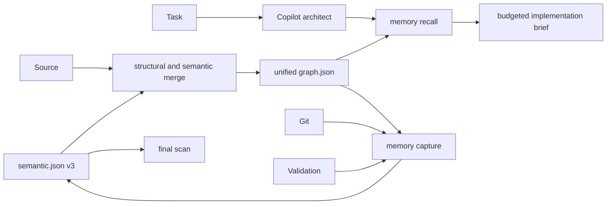

# Requirements

### Overview & Goals
Turn KGMaker into a compact, reusable implementation memory for GitHub Copilot CLI. Completed work becomes deterministic, Git-backed episodes in the same knowledge graph; future implementation requests retrieve only relevant episodes and current code locations instead of receiving the broad repository map at session start.

### In Scope
- Capture implementation episodes from a Git base, the pre-task stored graph, a fresh structural scan, commit metadata, changed file hashes, graph deltas, and bounded validation statuses.
- Store episodes in a backward-compatible evolution of `.kgmaker/semantic.json`, then materialize them as first-class graph nodes and edges in `.kgmaker/graph.json`.
- Add `kgmaker memory capture --base REF [--validation LABEL=STATUS]...` and `kgmaker memory recall [--limit N] [--token-budget N] WORD...`.
- Rank current files/declarations and prior episodes together; show freshness, affected symbols/files, validation outcomes, and compact Git provenance.
- Replace broad `sessionStart` injection with a small bootstrap containing graph status and instructions to invoke request-time recall.
- Update generated `kgmaker-architect`/repository instructions so Copilot recalls before implementation and captures after validation but before the final scan.
- Preserve the dependency-free Python 3.11 runtime.

### Out of Scope
- Full conversation or prompt transcripts.
- LLM-generated capture summaries, inferred rationale, embeddings, vector databases, external services, or model API keys.
- Cross-repository memory and a JetBrains-specific workflow in this MVP.

### Acceptance Criteria
- Repeating capture for the same Git/worktree state is idempotent and does not duplicate episodes.
- Episodes contain no source text, raw diff, validation output, or sensitive-path content.
- Existing semantic schema v1/v2 artifacts remain readable; v2 is upgraded without losing concepts or relationships when an episode is captured.
- Recall is deterministic, respects its token/limit bounds, prioritizes a relevant episode over unrelated history, and falls back to relevant current graph entities when no episode matches.
- Changed or removed evidence is labeled historical and down-ranked rather than presented as current truth.
- The recall response reports estimated output tokens and reduction versus the existing broad `render_context` baseline.
- The startup hook remains fail-open and materially smaller than the current repository-wide map.

# Technical Design

### Current Implementation
- `src/kgmaker/scanner.py` creates the structural `KnowledgeGraph`; `src/kgmaker/semantic.py` validates source-line-backed concepts and merges them through `apply_semantic_layer`.
- `src/kgmaker/store.py` persists `.kgmaker/graph.json`, renders architecture views, and builds the broad `render_context` startup map.
- `src/kgmaker/cli.py` owns commands, the `sessionStart` hook, and generated Copilot agent/instruction templates. Its current `query` is substring scoring with one-hop expansion.
- `tests/test_scanner.py` already covers semantic freshness, scoped updates, stale patches, generated Copilot files, and hook token caps.

### Key Decisions
- **Unified graph, distinct provenance:** bump the semantic artifact to schema v3 with an `episodes` collection. Existing `nodes`/`edges` keep their source-file/line validation; episodes use Git commits, worktree fingerprints, and per-file hashes.
- **Deterministic capture:** derive labels from commit subjects or affected symbols/files and derive topology changes from graph deltas. Do not call an LLM or invent rationale.
- **On-demand retrieval:** keep episodes out of generic startup context and architecture diagrams. `memory recall` uses the actual implementation request and a strict output budget.
- **Historical memory is not current truth:** retain old episodes when files evolve, but calculate `current`, `changed`, or `removed` freshness at recall time and suppress dangling graph edges.

### Data Contracts
Semantic schema v3 adds records equivalent to:

```json
{
  "schema_version": 3,
  "files": {"path": "current-sha256"},
  "nodes": [],
  "edges": [],
  "episodes": [{
    "id": "episode:<content-hash>",
    "base_commit": "<sha>",
    "head_commit": "<sha-or-null>",
    "worktree_fingerprint": "<sha256>",
    "title": "<commit-derived or structural label>",
    "changed_files": [{"path": "...", "status": "M", "sha256": "..."}],
    "affected_node_ids": ["..."],
    "graph_delta": {"added": [], "removed": [], "changed": []},
    "validations": [{"label": "unit-tests", "status": "passed"}]
  }]
}
```

`src/kgmaker/memory.py` will validate this contract, compute stable IDs/freshness, project each record to an `implementation_episode` node plus `affected` edges, capture episodes, and rank recall results. If `Node` needs to carry episode details in `.kgmaker/graph.json`, add a backward-compatible optional metadata field in `src/kgmaker/model.py`.

### Components & File Changes
- **`src/kgmaker/memory.py` (new):** deterministic Git/worktree capture, sensitive-path filtering, episode validation/projection, relevance scoring, freshness, token accounting, and Markdown/structured recall results.
- **`src/kgmaker/semantic.py`:** accept schemas v1-v3, preserve strict concept validation, validate v3 episodes separately, merge only valid episode edges, and migrate v2 artifacts on write.
- **`src/kgmaker/model.py`:** add only the optional metadata needed for lossless episode serialization while retaining compatibility with old graph JSON.
- **`src/kgmaker/store.py`:** render episode counts/a compact history section in `GRAPH.md`; exclude episodes from file/symbol listings, Mermaid architecture, and broad startup maps; add a minimal bootstrap renderer while retaining broad `render_context` for comparison/on-demand use.
- **`src/kgmaker/cli.py`:** add nested `memory capture`/`memory recall` parsers and dispatch, atomic semantic-artifact writes, concise hook context, updated scan/status output, and revised generated Copilot templates.
- **`README.md`:** document the capture/recall lifecycle, privacy boundary, provenance/freshness semantics, command examples, and cost metrics.
- **`tests/test_memory.py` (new) and `tests/test_scanner.py`:** cover memory behavior and update existing schema/hook/init expectations.

### Architecture


### Risks & Mitigations
- **Weak intent without an LLM summary:** index commit subjects, changed paths, declaration names/signatures, semantic summaries, and graph neighbors; deterministic fixture tests will guard ranking quality.
- **Artifact growth:** store hashes/IDs rather than source or diffs, deduplicate by content-derived episode ID, and cap recall rather than injecting history wholesale.
- **Stale links:** evaluate recorded file hashes against the live graph, label historical records, and omit edges whose endpoints no longer exist.
- **Schema regression:** normalize v1/v2 reads and test lossless v2-to-v3 writes before changing the default writer.

# Testing

### Validation Approach
Use dependency-free `unittest` integration tests with temporary Git repositories, matching the existing patterns in `tests/test_scanner.py`. Finish with `python -m unittest discover -s tests -v`.

### Key Scenarios
- Capture added/modified/deleted files and affected declarations from a Git base; verify stable IDs, idempotency, graph projection, and atomic persistence.
- Migrate a populated schema-v2 semantic artifact to v3 without changing existing concepts/relationships.
- Rank a matching episode and current declarations above unrelated episodes for representative implementation requests.
- Enforce `--limit` and `--token-budget`, and verify reported estimated tokens are below the legacy broad-context baseline.
- Generate Copilot files that call recall before implementation and capture after successful validation.

### Edge Cases
- No Git changes, missing/stale graph, malformed validation statuses, invalid refs, sensitive files, removed declarations, changed evidence hashes, duplicate captures, empty memory, malformed episodes, and hook/recall failures.
- Confirm startup remains fail-open and that semantic source-line validation remains as strict as before.

# Delivery Steps

### ✓ Step 1: Evolve the semantic artifact into a unified episode graph
Schema-v3 semantic artifacts preserve existing concepts while materializing Git-provenanced implementation episodes as graph nodes.

- Add `src/kgmaker/memory.py` contracts for episode IDs, provenance, graph deltas, validations, and freshness.
- Extend `src/kgmaker/semantic.py` to read v1/v2/v3, validate concepts and episodes under separate evidence rules, and project valid episode relationships into `KnowledgeGraph`.
- Add backward-compatible model metadata only where required for serialization.
- Add migration, malformed-record, stale-evidence, and dangling-endpoint tests.

### ✓ Step 2: Implement deterministic episode capture from Git and graph changes
`kgmaker memory capture` atomically records one compact, idempotent episode for the completed change set without invoking an LLM.

- Compare the pre-task stored graph with a fresh scan and collect the Git range, worktree fingerprint, changed non-sensitive files, affected nodes, and structural delta.
- Derive the episode label from commit metadata or changed symbols/files and accept only bounded validation labels/statuses.
- Store hashes and IDs rather than source, raw diffs, transcripts, or test output; refuse unsafe or malformed input without altering memory.
- Wire the nested CLI command in `src/kgmaker/cli.py` and test clean, dirty, untracked, deleted, duplicate, and sensitive-path cases.

### ✓ Step 3: Add budgeted graph-and-episode recall with lean startup context
Copilot can retrieve a deterministic, task-specific brief while the session hook injects only a minimal bootstrap.

- Rank query terms across episode titles, changed paths, affected declarations, summaries, and one-hop graph neighbors, with freshness and exact-match boosts.
- Render only the top current graph locations and episodes within `--limit`/`--token-budget`, labeling historical evidence explicitly.
- Report estimated recall tokens and savings against the retained broad `render_context` baseline.
- Add a compact bootstrap renderer in `src/kgmaker/store.py`, switch `hook_context` to it, and cover relevance, fallback, token-cap, reduction, and fail-open behavior.

### ✓ Step 4: Integrate the memory lifecycle into Copilot and documentation
Generated Copilot workflows recall before coding and capture validated outcomes before the final graph scan.

- Update `ARCHITECT_AGENT_CONTENT`, `INSTRUCTIONS_CONTENT`, and related generated templates in `src/kgmaker/cli.py` with the selected on-demand lifecycle.
- Update graph Markdown rendering to summarize episode counts/history without polluting architecture diagrams or startup context.
- Document commands, provenance, freshness, privacy, and cost metrics in `README.md` while leaving JetBrains-specific workflow expansion out of scope.
- Update init/rendering regressions and run the complete `unittest` suite.