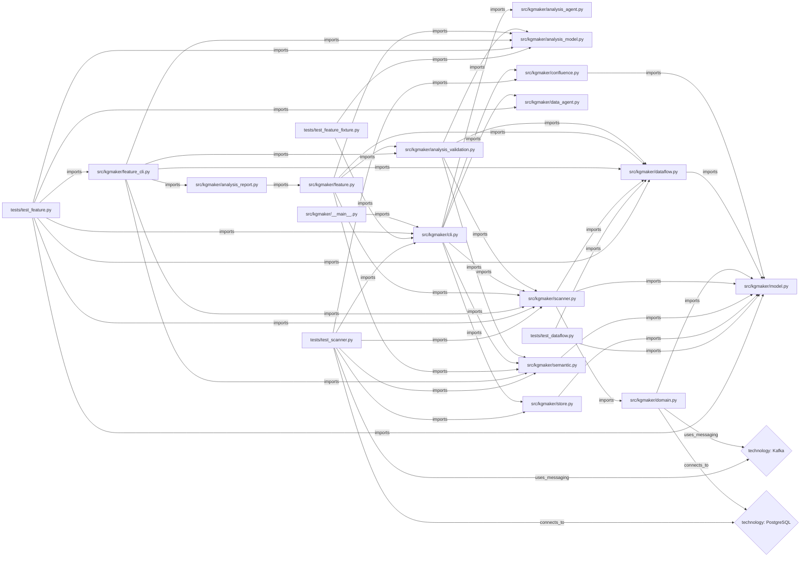

# Repository knowledge graph

> Generated locally by kgmaker. Structural edges come from source text; name-based call edges are heuristic.
> Review semantic conclusions with the repository's Copilot knowledge-graph agent.

- Files indexed: 35
- Symbols and sections: 331
- Internal imports: 47
- Heuristic cross-file calls: 396
- PostgreSQL tables/columns: 0/0
- Kafka topics: 0
- API endpoints: 0
- TypeScript frontend routes: 0
- Semantic concepts: 0
- Inferred/ambiguous relationships: 396/0

## Architecture diagram

The diagram groups declarations under their source files and shows detected imports and domain relationships. Heuristic call edges are omitted. An editable standalone Mermaid source is available at `.kgmaker/GRAPH.mmd`.

## Files and symbols

### `README.md`
- **section** `kgmaker` line 1
- **section** `Requirements` line 7
- **section** `Install` line 12
- **section** `Commands` line 26
- **section** `What gets indexed` line 60
- **section** `Copilot workflow` line 68
- **section** `Development` line 74
- **section** `Feature feasibility analysis (foundation)` line 83
- **section** `Follow candidate-template.json and write candidate.json with the host agent.` line 91
- **section** `Data prerequisite audit` line 115

### `docs/architecture.md`
- **section** `Architecture` line 1
- **section** `Relationship confidence` line 17
- **section** `Hook lifecycle` line 30
- **section** `Extension points` line 34
- **section** `Isolated feature-analysis foundation` line 38

### `docs/feature-analysis.md`
- **section** `Feature analysis: implemented foundation and remaining milestones` line 1
- **section** `Delivery status` line 6
- **section** `CLI workflow` line 33
- **section** `Agent reads packet.json and candidate-template.json, writes candidate.json.` line 37
- **section** `Candidate contract, schema version 1` line 84
- **section** `Evidence` line 132
- **section** `Context budget and known limits` line 166
- **section** `Host invocation and tests` line 182
- **section** `Implemented field and impact patterns (initial milestone B)` line 206

### `docs/implementation-feature-analysis.md`
- **section** `Implementační pokračování: analýza nových funkcí a datových požadavků` line 1
- **section** `1. Cíl a instrukce pro implementujícího agenta` line 9
- **section** `Kontext cílového použití` line 21
- **section** `2. Skutečný výchozí stav a změna scope` line 35
- **section** `3. Dva režimy a oddělení stavů` line 55
- **section** `3.1 Existing impact analysis` line 57
- **section** `3.2 Feature feasibility analysis` line 61
- **section** `3.3 Stav tvrzení versus stav návrhu` line 65
- **section** `4. Model analýzy a provenance` line 77
- **section** `5. Datové požadavky a dostupnost` line 112
- **section** `5.1 Neslučuj význam, dostupnost a zdroj` line 114
- **section** `5.2 Pravidla rozhodování` line 138
- **section** `6. Cross-layer data flow` line 151
- **section** `6.1 Rozšíření strukturální extrakce` line 153
- **section** `6.2 Minimální podporované vzory` line 176
- **section** `6.3 Scénáře a jednoduché výpočty` line 190
- **section** `7. Excel jako zdroj znalostí` line 198
- **section** `8. Requirement, availability a proposal graph` line 214
- **section** `9. Workflow analytického agenta` line 230
- **section** `10. Konkrétní CLI a lifecycle` line 251
- **section** `11. Analytický packet a validace` line 296
- **section** `12. Report pro analytika` line 319
- **section** `13. Inkrementální aktualizace a změny baseline` line 347
- **section** `14. Token budget a neúplné výsledky` line 367
- **section** `15. Autorita kódu, požadavků a dokumentace` line 383
- **section** `16. Volitelná Confluence synchronizace` line 396
- **section** `17. Moduly a kompatibilita` line 414
- **section** `18. Fixture pro celý analytický scénář` line 437
- **section** `19. Závazné akceptační testy` line 483
- **section** `20. Pořadí implementace a definition of done` line 527
- **section** `Milník A — analytické jádro` line 529
- **section** `Milník B — datové toky a matching` line 533
- **section** `Milník C — artefakty a dokumentace` line 537
- **section** `Milník D — incremental a host agent` line 541
- **section** `Milník E — synchronizační boundary` line 545
- **section** `21. Očekávaný výsledek pro analytika` line 563
- **section** `22. Doplnění scope: Flyway a workspace více repozitářů` line 577
- **section** `23. Rekonstrukce databázového schématu z Flyway migrací` line 589
- **section** `23.1 Cíl a hranice tvrzení` line 591
- **section** `23.2 Discovery a konfigurace` line 605
- **section** `23.3 Plán migrací` line 624
- **section** `23.4 SQL parsing a výsledný schema model` line 642
- **section** `23.5 Feature analysis a inkrementální replay` line 664
- **section** `24. Multirepo workspace: backend, frontend a automatické testy` line 676
- **section** `24.1 Explicitní lokální konfigurace` line 678
- **section** `24.2 Globální identita a baseline` line 733
- **section** `24.3 Backend ↔ frontend` line 749
- **section** `24.4 Repository automatických testů` line 761
- **section** `24.5 Cross-repo návrh změn a report` line 788
- **section** `25. Nové CLI, fixtures a akceptační testy` line 800
- **section** `26. Doplnění modulů a definition of done` line 854
- **section** `Milník F — Flyway schema intelligence` line 864
- **section** `Milník G — lokální multirepo analytický workspace` line 868
- **section** `27. Specializovaný agent pro datové předpoklady nové feature` line 882
- **section** `27.1 Nejmenší možný podíl LLM` line 888
- **section** `27.2 Aktuálně použitelný workflow a omezení` line 909
- **section** `27.3 Deterministická datová kontrola k implementaci` line 919
- **section** `27.4 Bash a PowerShell` line 946
- **section** `27.5 Výstup a validace` line 960

### `docs/project-scope.md`
- **section** `Project scope` line 1
- **section** `Goals` line 5
- **section** `Out of scope` line 15
- **section** `Initial implementation` line 23
- **section** `Graph workflows` line 31
- **section** `Feature-analysis extension` line 35

### `fixtures/feature-analysis/README.md`
- **section** `Analytical-core fixture (milestone A foundation)` line 1

### `fixtures/feature-analysis/backend/ExposureService.kt`
- **type** `Account` line 2 — `Account((val accountBalance: Double))`
- **data_field** `Account.accountBalance` line 3 — `Double`
- **type** `ExposureService` line 4 — `ExposureService()`
- **function** `pessimisticExposure` line 6 — `pessimisticExposure(position: Double)`
- **parameter** `ExposureService.pessimisticExposure(position: Double):position` line 6 — `Double`
- **return_value** `ExposureService.pessimisticExposure(position: Double)` line 6 — `Double`

### `fixtures/feature-analysis/backend/ScenarioCalculator.kt`
- **data_field** `ScenarioInput.pessimisticDecline` line 1 — `Double`
- **type** `ScenarioInput` line 1 — `ScenarioInput((val pessimisticDecline: Double))`
- **data_field** `ScenarioReport.midDecline` line 2 — `Double`
- **type** `ScenarioReport` line 2 — `ScenarioReport((val midDecline: Double))`
- **type** `ScenarioCalculator` line 3 — `ScenarioCalculator()`
- **function** `calculate` line 4 — `calculate(input: ScenarioInput)`
- **parameter** `ScenarioCalculator.calculate(input: ScenarioInput):input` line 4 — `ScenarioInput`
- **return_value** `ScenarioCalculator.calculate(input: ScenarioInput)` line 4 — `ScenarioReport`
- **local_value** `ScenarioCalculator.calculate(input: ScenarioInput):midDecline` line 5 — Declared expression: input.pessimisticDecline / 2

### `fixtures/feature-analysis/contracts/positions-event.json`
- **contract_field** `/properties/currency`  — `string` — JSON pointer /properties/currency
- **contract_field** `/properties/volume`  — `number` — JSON pointer /properties/volume

### `fixtures/feature-analysis/expected/analysis-invariants.json`
- No declarations extracted.

### `fixtures/feature-analysis/expected/candidate-invalid.json`
- No declarations extracted.

### `fixtures/feature-analysis/expected/candidate-valid.json`
- No declarations extracted.

### `fixtures/feature-analysis/requirements/additional-hedge-answers.json`
- No declarations extracted.

### `fixtures/feature-analysis/requirements/additional-hedge.md`
- No declarations extracted.

### `src/kgmaker/__init__.py`
- No declarations extracted.

### `src/kgmaker/__main__.py`
- No declarations extracted.

### `src/kgmaker/analysis_agent.py`
- No declarations extracted.

### `src/kgmaker/analysis_model.py`
- **class** `AnalysisError` line 31 — `AnalysisError(ValueError)`
- **function** `__init__` line 34 — `__init__(self, message: str, code: int = 2)`
- **function** `canonical` line 37 — `canonical(value: Any)`
- **function** `digest` line 41 — `digest(value: Any)`
- **function** `file_hash` line 45 — `file_hash(path: Path)`
- **function** `safe_path` line 49 — `safe_path(root: Path, value: str)`
- **function** `analysis_dir` line 67 — `analysis_dir(root: Path, analysis_id: str)`
- **function** `read_json` line 73 — `read_json(path: Path)`
- **function** `reject_constant` line 76 — `reject_constant(value: str)`
- **function** `unique` line 78 — `unique(pairs: list)`
- **function** `atomic_write` line 89 — `atomic_write(path: Path, text: str)`
- **function** `write_json` line 103 — `write_json(path: Path, value: Any)`
- **class** `FeatureAnalysis` line 110 — `FeatureAnalysis` — Serializable envelope. Nested contracts are checked by analysis_validation.
- **function** `from_dict` line 115 — `from_dict(cls, data: Any)`
- **function** `to_dict` line 132 — `to_dict(self)`
- **function** `inventory_candidate` line 135 — `inventory_candidate(packet: dict)`

### `src/kgmaker/analysis_report.py`
- **function** `cell` line 16 — `cell(value)`
- **function** `render_report` line 24 — `render_report(candidate: dict, packet: dict, stale: list[str], applied: bool = True)`
- **function** `section` line 34 — `section(index)`
- **function** `objects` line 36 — `objects(items)`

### `src/kgmaker/analysis_validation.py`
- **class** `_Anchors` line 17 — `_Anchors(HTMLParser)`
- **function** `__init__` line 20 — `__init__(self)`
- **function** `handle_starttag` line 23 — `handle_starttag(self, tag, attrs)`
- **function** `_location` line 28 — `_location(root: Path, item: dict, packet: dict)`
- **function** `validate_candidate` line 93 — `validate_candidate(root: Path, packet: dict, data: object)`
- **function** `_validate_candidate` line 100 — `_validate_candidate(root: Path, packet: dict, data: object)`
- **function** `strings` line 178 — `strings(item, key, choices=None, nullable=False)`
- **function** `refs` line 185 — `refs(item, key, targets, required=False)`
- **function** `visit` line 266 — `visit(identity)`

### `src/kgmaker/cli.py`
- **function** `_write_if_missing` line 193 — `_write_if_missing(path: Path, text: str, force: bool = False)`
- **function** `init` line 201 — `init(root: Path, force: bool = False)`
- **function** `scan` line 240 — `scan(root: Path, generate_docs: bool = True, confluence_dir: str | None = None, report: str | None = None)`
- **function** `status` line 271 — `status(root: Path)`
- **function** `check` line 294 — `check(root: Path)`
- **function** `docs` line 323 — `docs(root: Path, action: str | None = None, confluence_dir: str | None = None, report: str | None = None)`
- **function** `semantic_prepare` line 347 — `semantic_prepare(root: Path)`
- **function** `semantic_extract` line 361 — `semantic_extract(root: Path, base_ref: str, note_path: str | None = None, token_budget: int | None = None)`
- **function** `semantic_update` line 412 — `semantic_update(root: Path, base_ref: str, note_path: str | None = None, token_budget: int | None = None)`
- **function** `semantic_apply` line 493 — `semantic_apply(root: Path)`
- **function** `semantic_validate` line 513 — `semantic_validate(root: Path)`
- **function** `impact` line 528 — `impact(root: Path, changed_files: list[str])`
- **function** `query` line 600 — `query(root: Path, terms: str, limit: int = 10)`
- **function** `hook_context` line 629 — `hook_context(root: Path, token_budget: int | None = None)`
- **function** `build_parser` line 648 — `build_parser`
- **function** `main` line 722 — `main`

### `src/kgmaker/confluence.py`
- **function** `_norm` line 30 — `_norm(value: str)`
- **function** `_safe_rel` line 34 — `_safe_rel(path: str)`
- **function** `_sha` line 38 — `_sha(path: Path)`
- **class** `ConfluenceDocument` line 49 — `ConfluenceDocument`
- **class** `DocumentationAssertion` line 63 — `DocumentationAssertion`
- **class** `_ExportHTMLParser` line 80 — `_ExportHTMLParser(HTMLParser)`
- **function** `__init__` line 86 — `__init__(self)`
- **function** `_attrs` line 105 — `_attrs(self, attrs: list[tuple[str, str | None]])`
- **function** `handle_starttag` line 108 — `handle_starttag(self, tag: str, attrs: list[tuple[str, str | None]])`
- **function** `handle_endtag` line 139 — `handle_endtag(self, tag: str)`
- **function** `handle_data` line 169 — `handle_data(self, data: str)`
- **function** `text` line 183 — `text(self)`
- **function** `_resolve_local_ref` line 187 — `_resolve_local_ref(value: str, current_file: str)`
- **function** `_parse_mermaid` line 194 — `_parse_mermaid(source: str)`
- **function** `_parse_drawio` line 209 — `_parse_drawio(path: Path, source_file: str)`
- **function** `_parse_svg` line 232 — `_parse_svg(path: Path)`
- **function** `_document_from_html` line 243 — `_document_from_html(path: Path, export_root: Path, digest: str)`
- **function** `_load_cache` line 262 — `_load_cache(root: Path)`
- **function** `_write_cache` line 270 — `_write_cache(root: Path, payload: dict[str, Any])`
- **function** `discover_export` line 276 — `discover_export(export_root: Path)`
- **function** `ingest_export` line 280 — `ingest_export(export_root: Path, repository_root: Path)`
- **function** `_assertions_from_document` line 319 — `_assertions_from_document(doc: ConfluenceDocument)`
- **function** `_code_nodes` line 348 — `_code_nodes(graph: KnowledgeGraph)`
- **function** `_missing_category` line 355 — `_missing_category(assertion: DocumentationAssertion)`
- **function** `validate_documents` line 367 — `validate_documents(documents: list[ConfluenceDocument], graph: KnowledgeGraph)`
- **function** `merge_into_graph` line 415 — `merge_into_graph(graph: KnowledgeGraph, documents: list[ConfluenceDocument], attachments: list[dict[str, Any]], assertions: list[DocumentationAssertion])`
- **function** `render_report` line 456 — `render_report(assertions: list[DocumentationAssertion], report_path: Path, export_root: Path, revision: str = "working tree")`
- **function** `persist_validation_index` line 484 — `persist_validation_index(root: Path, assertions: list[DocumentationAssertion])`
- **function** `resolve_confluence_dir` line 495 — `resolve_confluence_dir(root: Path, cli_value: str | None)`
- **function** `documentation_check` line 529 — `documentation_check(root: Path, confluence_dir: str | None = None, report: str | None = None, graph: KnowledgeGraph | None = None)`

### `src/kgmaker/data_agent.py`
- No declarations extracted.

### `src/kgmaker/dataflow.py`
- **function** `masked` line 31 — `masked(text: str)`
- **function** `closing` line 37 — `closing(text: str, start: int, opening='(', ending=')')`
- **function** `parts` line 49 — `parts(text: str)`
- **class** `Extraction` line 56 — `Extraction`
- **function** `extract_dataflow` line 60 — `extract_dataflow(sources: dict[str, str])`
- **function** `node` line 67 — `node(path, kind, qualified, offset, signature=None, summary=None)`
- **function** `issue` line 77 — `issue(path, offset, reason)`
- **function** `relation` line 80 — `relation(source, target, kind, path, offset, evidence)`
- **function** `walk` line 145 — `walk(value, pointer='')`
- **function** `resolve` line 206 — `resolve(token)`
- **function** `expression` line 217 — `expression(value, destination, statement_offset)`
- **function** `impact_paths` line 282 — `impact_paths(graph: KnowledgeGraph, entity: str, max_depth: int = 20)`

### `src/kgmaker/domain.py`
- **technology** `Kafka`
- **technology** `PostgreSQL`
- **function** `_line` line 65 — `_line(text: str, offset: int)`
- **function** `_unquote_identifier` line 69 — `_unquote_identifier(value: str)`
- **function** `_canon` line 73 — `_canon(value: str)`
- **function** `_node_id` line 77 — `_node_id(kind: str, key: str)`
- **function** `_shared_node` line 81 — `_shared_node(kind: str, key: str, display: str, path: str, line: int | None = None, summary: str | None = None)`
- **function** `_split_sql_items` line 85 — `_split_sql_items(body: str)`
- **function** `_sql_objects` line 108 — `_sql_objects(text: str, path: str, file_id: str)`
- **function** `_entity_edges` line 137 — `_entity_edges(text: str, path: str, symbols: list[Node], tables: dict[str, Node], columns: dict[str, Node])`
- **function** `_string_literals` line 191 — `_string_literals(value: str)`
- **function** `_kafka_references` line 195 — `_kafka_references(text: str, path: str, file_id: str)`
- **function** `add` line 200 — `add(topic: str, offset: int, relation: str, evidence: str)`
- **function** `normalize_api_path` line 230 — `normalize_api_path(path: str)`
- **function** `_api_node` line 241 — `_api_node(method: str, path: str, source: str, line: int | None, operation: str | None = None)`
- **function** `_mapping_path` line 254 — `_mapping_path(args: str)`
- **function** `_openapi_yaml` line 259 — `_openapi_yaml(text: str, path: str, file_id: str)`
- **function** `flush` line 271 — `flush(offset: int)`
- **function** `_openapi_json` line 302 — `_openapi_json(text: str, path: str, file_id: str)`
- **function** `_api_references` line 324 — `_api_references(text: str, path: str, language: str, file_id: str)`
- **function** `add` line 329 — `add(method: str, endpoint_path: str, offset: int, relation: str, evidence: str)`
- **function** `_typescript_routes` line 392 — `_typescript_routes(path: str, text: str, file_id: str)`
- **function** `_technology_nodes` line 426 — `_technology_nodes(text: str, path: str, file_id: str)`
- **function** `extract_domain` line 440 — `extract_domain(path: str, text: str, language: str, file_id: str, symbols: list[Node])`
- **function** `extract_openapi` line 475 — `extract_openapi(path: str, text: str, file_id: str)`
- **function** `connect_persistence` line 484 — `connect_persistence(symbols_by_file: dict[str, list[Node]], text_by_file: dict[str, str], nodes: list[Node])`
- **function** `merge_domain_nodes` line 515 — `merge_domain_nodes(nodes: list[Node])`

### `src/kgmaker/feature.py`
- **function** `source_inventory` line 20 — `source_inventory(root: Path)`
- **function** `snapshot` line 51 — `snapshot(root: Path)`
- **function** `packet_identity` line 79 — `packet_identity(packet: dict)`
- **function** `load_packet` line 83 — `load_packet(root: Path, analysis_id: str)`
- **function** `freshness` line 92 — `freshness(root: Path, packet: dict)`
- **function** `prepare` line 108 — `prepare(root: Path, requirement: str, analysis_id: str, token_budget: int = 8000, *, _answers: list | None = None)`
- **function** `validate` line 174 — `validate(root: Path, analysis_id: str, candidate: dict)`
- **function** `apply` line 192 — `apply(root: Path, analysis_id: str, candidate: dict)`
- **function** `status` line 210 — `status(root: Path, analysis_id: str)`
- **function** `revise` line 219 — `revise(root: Path, analysis_id: str, answers: dict)`

### `src/kgmaker/feature_cli.py`
- **function** `register` line 11 — `register(subparsers)`
- **function** `run` line 35 — `run(args)`
- **function** `query_analysis` line 107 — `query_analysis(root: Path, analysis_id: str, terms: str, limit: int)`
- **function** `impact_entity` line 128 — `impact_entity(root: Path, entity: str, output_format: str)`

### `src/kgmaker/model.py`
- **class** `Node` line 10 — `Node`
- **class** `Edge` line 21 — `Edge`
- **class** `KnowledgeGraph` line 33 — `KnowledgeGraph`
- **function** `to_dict` line 40 — `to_dict(self)`
- **function** `from_dict` line 52 — `from_dict(cls, data: dict[str, Any])`

### `src/kgmaker/scanner.py`
- **function** `_safe_text` line 75 — `_safe_text(path: Path)`
- **function** `_file_digest` line 84 — `_file_digest(text: str)`
- **function** `_stable_id` line 88 — `_stable_id(kind: str, path: str, name: str, line: int | None = None)`
- **function** `_line_for` line 93 — `_line_for(text: str, offset: int)`
- **function** `_doc_for_line` line 97 — `_doc_for_line(lines: list[str], index: int)`
- **function** `_extract_symbols` line 105 — `_extract_symbols(text: str, path: str, language: str)`
- **function** `_imports` line 161 — `_imports(text: str, language: str)`
- **function** `_candidate_paths` line 179 — `_candidate_paths(root: Path, source: str, import_name: str, known_files: set[str])`
- **function** `_should_skip` line 208 — `_should_skip(path: Path, relative: Path)`
- **function** `scan_repository` line 219 — `scan_repository(root: Path)`

### `src/kgmaker/semantic.py`
- **class** `SemanticValidationError` line 31 — `SemanticValidationError(ValueError)`
- **function** `concept_id` line 35 — `concept_id(source_file: str, name: str)`
- **function** `graph_fingerprint` line 41 — `graph_fingerprint(graph: KnowledgeGraph)`
- **function** `build_semantic_input` line 52 — `build_semantic_input(graph: KnowledgeGraph)`
- **function** `_positive_line` line 73 — `_positive_line(value: Any, field: str)`
- **function** `_check_line` line 81 — `_check_line(root: Path, source_file: str, line: int | None, field: str, line_counts: dict[str, int])`
- **function** `validate_semantic_data` line 96 — `validate_semantic_data(data: Any, graph: KnowledgeGraph, root: Path)`
- **function** `_run_git` line 200 — `_run_git(root: Path, *args: str, check: bool = True)`
- **function** `_is_sensitive_path` line 215 — `_is_sensitive_path(path: str)`
- **function** `apply_semantic_patch` line 412 — `apply_semantic_patch(patch: Any, update: Any, graph: KnowledgeGraph, root: Path)`
- **function** `apply_semantic_layer` line 531 — `apply_semantic_layer(graph: KnowledgeGraph, root: Path)`

### `src/kgmaker/store.py`
- **function** `save_graph` line 14 — `save_graph(graph: KnowledgeGraph, root: Path, generate_docs: bool = True)`
- **function** `load_graph` line 27 — `load_graph(root: Path)`
- **function** `render_markdown` line 35 — `render_markdown(graph: KnowledgeGraph)`
- **function** `render_mermaid` line 112 — `render_mermaid(graph: KnowledgeGraph)`
- **function** `render_context` line 163 — `render_context(graph: KnowledgeGraph, limit: int = 8_000, root: Path | None = None)`
- **function** `_edge_details` line 205 — `_edge_details(edge)`

### `tests/test_dataflow.py`
- **class** `DataflowTests` line 5 — `DataflowTests(unittest.TestCase)`
- **function** `test_kotlin_constructor_fields_expression_and_mapping` line 8 — `test_kotlin_constructor_fields_expression_and_mapping(self)`
- **function** `test_field_inventory_for_java_typescript_and_json` line 32 — `test_field_inventory_for_java_typescript_and_json(self)`
- **function** `test_ambiguous_types_do_not_create_maps` line 45 — `test_ambiguous_types_do_not_create_maps(self)`
- **function** `test_control_flow_calls_and_comments_do_not_fabricate_dependencies` line 52 — `test_control_flow_calls_and_comments_do_not_fabricate_dependencies(self)`
- **function** `test_same_method_name_in_different_owners_has_distinct_identity` line 63 — `test_same_method_name_in_different_owners_has_distinct_identity(self)`
- **function** `test_fa35_direction_weakest_link_and_external_boundary` line 70 — `test_fa35_direction_weakest_link_and_external_boundary(self)`
- **function** `test_comment_only_edit_preserves_field_ids` line 84 — `test_comment_only_edit_preserves_field_ids(self)`
- **function** `test_parameter_reassignment_does_not_create_false_proof` line 90 — `test_parameter_reassignment_does_not_create_false_proof(self)`

### `tests/test_feature.py`
- **class** `FeatureTests` line 18 — `FeatureTests(unittest.TestCase)`
- **function** `setUp` line 21 — `setUp(self)`
- **function** `tree` line 30 — `tree(self)`
- **function** `cli` line 33 — `cli(self, *args)`
- **function** `evidence` line 40 — `evidence(self)`
- **function** `input` line 47 — `input(self)`
- **function** `test_fa12_prepare_is_idempotent_and_preserves_candidate` line 55 — `test_fa12_prepare_is_idempotent_and_preserves_candidate(self)`
- **function** `test_fa07_apply_isolated_and_idempotent` line 62 — `test_fa07_apply_isolated_and_idempotent(self)`
- **function** `test_fa10_forged_citations_and_no_mutation` line 76 — `test_fa10_forged_citations_and_no_mutation(self)`
- **function** `test_json_pointer_requires_existing_field_and_value` line 88 — `test_json_pointer_requires_existing_field_and_value(self)`
- **function** `test_fa11_packet_and_revision_mismatch` line 100 — `test_fa11_packet_and_revision_mismatch(self)`
- **function** `test_fa13_uncommitted_changes_and_requirement_invalidate` line 110 — `test_fa13_uncommitted_changes_and_requirement_invalidate(self)`
- **function** `test_fa18_19_small_budget_produces_incomplete_inventory` line 126 — `test_fa18_19_small_budget_produces_incomplete_inventory(self)`
- **function** `test_fa02_04_no_automatic_liquidity_or_absence_claim` line 139 — `test_fa02_04_no_automatic_liquidity_or_absence_claim(self)`
- **function** `test_fa27_dangling_proposal_and_traversal_rejected` line 147 — `test_fa27_dangling_proposal_and_traversal_rejected(self)`
- **function** `test_fa25_cli_workflow_without_semantic_packet_or_git` line 158 — `test_fa25_cli_workflow_without_semantic_packet_or_git(self)`
- **function** `test_fa33_report_not_used_as_source_evidence` line 172 — `test_fa33_report_not_used_as_source_evidence(self)`
- **function** `test_stale_report_is_labelled_and_returns_three` line 178 — `test_stale_report_is_labelled_and_returns_three(self)`
- **function** `test_fa34_processing_complete_with_business_decision_blocked` line 185 — `test_fa34_processing_complete_with_business_decision_blocked(self)`
- **function** `test_malformed_structures_never_raise_or_mutate` line 195 — `test_malformed_structures_never_raise_or_mutate(self)`
- **function** `test_fa31_graph_version_compatibility` line 205 — `test_fa31_graph_version_compatibility(self)`
- **function** `test_output_symlink_cannot_overwrite_source` line 212 — `test_output_symlink_cannot_overwrite_source(self)`
- **function** `test_revise_preserves_history_and_accepts_new_answer_file` line 221 — `test_revise_preserves_history_and_accepts_new_answer_file(self)`
- **function** `test_init_preserves_user_analyst_and_junie_files` line 255 — `test_init_preserves_user_analyst_and_junie_files(self)`
- **function** `test_scope_and_proposal_are_explicit_in_query` line 280 — `test_scope_and_proposal_are_explicit_in_query(self)`
- **function** `test_fake_human_approval_is_rejected` line 292 — `test_fake_human_approval_is_rejected(self)`
- **function** `test_cyclic_derivation_and_document_only_reuse_are_rejected` line 298 — `test_cyclic_derivation_and_document_only_reuse_are_rejected(self)`
- **function** `test_verified_impact_path_and_reversed_forgery` line 316 — `test_verified_impact_path_and_reversed_forgery(self)`
- **function** `test_impact_cli_json_uses_current_sources` line 334 — `test_impact_cli_json_uses_current_sources(self)`
- **function** `test_stale_impact_report_keeps_historical_proof_with_warning` line 346 — `test_stale_impact_report_keeps_historical_proof_with_warning(self)`

### `tests/test_feature_fixture.py`
- **function** `bind` line 16 — `bind(candidate, packet)`
- **class** `FeatureFixtureTests` line 26 — `FeatureFixtureTests(unittest.TestCase)`
- **function** `test_fixture_cli_lifecycle` line 29 — `test_fixture_cli_lifecycle(self)`
- **function** `run` line 34 — `run(*args)`

### `tests/test_scanner.py`
- **class** `ScannerTests` line 16 — `ScannerTests(unittest.TestCase)`
- **function** `test_semantic_extract_can_run_as_standalone_initial_workflow` line 19 — `test_semantic_extract_can_run_as_standalone_initial_workflow(self)`
- **function** `test_confluence_html_parser_resolves_pages_mermaid_and_drawio` line 32 — `test_confluence_html_parser_resolves_pages_mermaid_and_drawio(self)`
- **function** `test_confluence_code_is_truth_and_report_preserves_stale_documentation` line 50 — `test_confluence_code_is_truth_and_report_preserves_stale_documentation(self)`
- **function** `test_docs_check_accepts_external_export_and_custom_report` line 79 — `test_docs_check_accepts_external_export_and_custom_report(self)`
- **function** `test_extracts_python_symbols_and_internal_imports` line 91 — `test_extracts_python_symbols_and_internal_imports(self)`
- **function** `test_skips_secrets_and_dependency_folders` line 108 — `test_skips_secrets_and_dependency_folders(self)`
- **function** `test_persists_and_loads_graph` line 121 — `test_persists_and_loads_graph(self)`
- **function** `test_scan_no_docs_skips_markdown_and_mermaid_but_keeps_index` line 136 — `test_scan_no_docs_skips_markdown_and_mermaid_but_keeps_index(self)`
- **function** `test_mermaid_visualization_groups_symbols_and_shows_imports` line 154 — `test_mermaid_visualization_groups_symbols_and_shows_imports(self)`
- **function** `test_resolves_python_package_relative_import` line 169 — `test_resolves_python_package_relative_import(self)`
- **function** `test_init_preserves_existing_user_files` line 184 — `test_init_preserves_existing_user_files(self)`
- **function** `test_semantic_layer_uses_stable_ids_and_rejects_stale_or_dangling_edges` line 211 — `test_semantic_layer_uses_stable_ids_and_rejects_stale_or_dangling_edges(self)`
- **function** `test_semantic_update_refreshes_only_affected_entries` line 283 — `test_semantic_update_refreshes_only_affected_entries(self)`
- **function** `test_hook_emits_session_context_json` line 368 — `test_hook_emits_session_context_json(self)`
- **function** `test_impact_reports_exact_transitive_import_dependents` line 389 — `test_impact_reports_exact_transitive_import_dependents(self)`
- **function** `test_check_detects_stale_graph_and_docs_regenerate_markdown` line 408 — `test_check_detects_stale_graph_and_docs_regenerate_markdown(self)`
- **function** `test_check_command_works_without_local_json_index` line 429 — `test_check_command_works_without_local_json_index(self)`
- **function** `test_maps_kotlin_entities_repositories_and_columns_to_postgres_schema` line 442 — `test_maps_kotlin_entities_repositories_and_columns_to_postgres_schema(self)`
- **function** `test_finds_kafka_topics_and_postgres_connection_from_kotlin_and_yaml` line 477 — `test_finds_kafka_topics_and_postgres_connection_from_kotlin_and_yaml(self)`
- **function** `test_links_openapi_server_and_typescript_client_paths` line 509 — `test_links_openapi_server_and_typescript_client_paths(self)`

## Internal relationships

- `src/kgmaker/__main__.py` imports `src/kgmaker/cli.py` (.cli)
- `src/kgmaker/analysis_report.py` imports `src/kgmaker/feature.py` (.feature)
- `src/kgmaker/analysis_validation.py` imports `src/kgmaker/analysis_model.py` (.analysis_model)
- `src/kgmaker/analysis_validation.py` imports `src/kgmaker/dataflow.py` (.dataflow)
- `src/kgmaker/analysis_validation.py` imports `src/kgmaker/scanner.py` (.scanner)
- `src/kgmaker/analysis_validation.py` imports `src/kgmaker/semantic.py` (.semantic)
- `src/kgmaker/cli.py` imports `src/kgmaker/analysis_agent.py` (.analysis_agent)
- `src/kgmaker/cli.py` imports `src/kgmaker/confluence.py` (.confluence)
- `src/kgmaker/cli.py` imports `src/kgmaker/data_agent.py` (.data_agent)
- `src/kgmaker/cli.py` imports `src/kgmaker/scanner.py` (.scanner)
- `src/kgmaker/cli.py` imports `src/kgmaker/semantic.py` (.semantic)
- `src/kgmaker/cli.py` imports `src/kgmaker/store.py` (.store)
- `src/kgmaker/confluence.py` imports `src/kgmaker/model.py` (.model)
- `src/kgmaker/dataflow.py` imports `src/kgmaker/model.py` (.model)
- `src/kgmaker/domain.py` imports `src/kgmaker/model.py` (.model)
- `src/kgmaker/feature.py` imports `src/kgmaker/analysis_model.py` (.analysis_model)
- `src/kgmaker/feature.py` imports `src/kgmaker/analysis_validation.py` (.analysis_validation)
- `src/kgmaker/feature.py` imports `src/kgmaker/dataflow.py` (.dataflow)
- `src/kgmaker/feature.py` imports `src/kgmaker/scanner.py` (.scanner)
- `src/kgmaker/feature.py` imports `src/kgmaker/semantic.py` (.semantic)
- `src/kgmaker/feature_cli.py` imports `src/kgmaker/analysis_model.py` (.analysis_model)
- `src/kgmaker/feature_cli.py` imports `src/kgmaker/analysis_report.py` (.analysis_report)
- `src/kgmaker/feature_cli.py` imports `src/kgmaker/analysis_validation.py` (.analysis_validation)
- `src/kgmaker/feature_cli.py` imports `src/kgmaker/dataflow.py` (.dataflow)
- `src/kgmaker/feature_cli.py` imports `src/kgmaker/scanner.py` (.scanner)
- `src/kgmaker/feature_cli.py` imports `src/kgmaker/semantic.py` (.semantic)
- `src/kgmaker/scanner.py` imports `src/kgmaker/dataflow.py` (.dataflow)
- `src/kgmaker/scanner.py` imports `src/kgmaker/domain.py` (.domain)
- `src/kgmaker/scanner.py` imports `src/kgmaker/model.py` (.model)
- `src/kgmaker/semantic.py` imports `src/kgmaker/model.py` (.model)
- `src/kgmaker/store.py` imports `src/kgmaker/model.py` (.model)
- `tests/test_dataflow.py` imports `src/kgmaker/dataflow.py` (kgmaker.dataflow)
- `tests/test_dataflow.py` imports `src/kgmaker/model.py` (kgmaker.model)
- `tests/test_feature.py` imports `src/kgmaker/analysis_model.py` (kgmaker.analysis_model)
- `tests/test_feature.py` imports `src/kgmaker/cli.py` (kgmaker.cli)
- `tests/test_feature.py` imports `src/kgmaker/data_agent.py` (kgmaker.data_agent)
- `tests/test_feature.py` imports `src/kgmaker/dataflow.py` (kgmaker.dataflow)
- `tests/test_feature.py` imports `src/kgmaker/feature_cli.py` (kgmaker.feature_cli)
- `tests/test_feature.py` imports `src/kgmaker/model.py` (kgmaker.model)
- `tests/test_feature.py` imports `src/kgmaker/scanner.py` (kgmaker.scanner)
- `tests/test_feature_fixture.py` imports `src/kgmaker/analysis_model.py` (kgmaker.analysis_model)
- `tests/test_feature_fixture.py` imports `src/kgmaker/cli.py` (kgmaker.cli)
- `tests/test_scanner.py` imports `src/kgmaker/cli.py` (kgmaker.cli)
- `tests/test_scanner.py` imports `src/kgmaker/confluence.py` (kgmaker.confluence)
- `tests/test_scanner.py` imports `src/kgmaker/scanner.py` (kgmaker.scanner)
- `tests/test_scanner.py` imports `src/kgmaker/semantic.py` (kgmaker.semantic)
- `tests/test_scanner.py` imports `src/kgmaker/store.py` (kgmaker.store)
- `fixtures/feature-analysis/expected/candidate-invalid.json` may call `4 in `fixtures/feature-analysis/backend/ScenarioCalculator.kt`` (name match at line 101; INFERRED 0.85)
- `fixtures/feature-analysis/expected/candidate-invalid.json` may call `4 in `fixtures/feature-analysis/backend/ScenarioCalculator.kt`` (name match at line 106; INFERRED 0.85)
- `fixtures/feature-analysis/expected/candidate-invalid.json` may call `4 in `fixtures/feature-analysis/backend/ScenarioCalculator.kt`` (name match at line 116; INFERRED 0.85)
- `fixtures/feature-analysis/expected/candidate-invalid.json` may call `2 in `fixtures/feature-analysis/backend/ExposureService.kt`` (name match at line 196; INFERRED 0.85)
- `fixtures/feature-analysis/expected/candidate-invalid.json` may call `2 in `fixtures/feature-analysis/backend/ScenarioCalculator.kt`` (name match at line 119; INFERRED 0.85)
- `fixtures/feature-analysis/expected/candidate-valid.json` may call `4 in `fixtures/feature-analysis/backend/ScenarioCalculator.kt`` (name match at line 101; INFERRED 0.85)
- `fixtures/feature-analysis/expected/candidate-valid.json` may call `4 in `fixtures/feature-analysis/backend/ScenarioCalculator.kt`` (name match at line 106; INFERRED 0.85)
- `fixtures/feature-analysis/expected/candidate-valid.json` may call `4 in `fixtures/feature-analysis/backend/ScenarioCalculator.kt`` (name match at line 116; INFERRED 0.85)
- `fixtures/feature-analysis/expected/candidate-valid.json` may call `2 in `fixtures/feature-analysis/backend/ExposureService.kt`` (name match at line 196; INFERRED 0.85)
- `fixtures/feature-analysis/expected/candidate-valid.json` may call `2 in `fixtures/feature-analysis/backend/ScenarioCalculator.kt`` (name match at line 119; INFERRED 0.85)
- `src/kgmaker/__main__.py` may call `722 in `src/kgmaker/cli.py`` (name match at line 3; INFERRED 0.85)
- `src/kgmaker/analysis_model.py` may call `206 in `src/kgmaker/dataflow.py`` (name match at line 58; INFERRED 0.85)
- `src/kgmaker/analysis_model.py` may call `206 in `src/kgmaker/dataflow.py`` (name match at line 63; INFERRED 0.85)
- `src/kgmaker/analysis_model.py` may call `206 in `src/kgmaker/dataflow.py`` (name match at line 64; INFERRED 0.85)
- `src/kgmaker/analysis_model.py` may call `271 in `src/kgmaker/domain.py`` (name match at line 97; INFERRED 0.85)
- `src/kgmaker/analysis_validation.py` may call `31 in `src/kgmaker/analysis_model.py`` (name match at line 35; INFERRED 0.85)
- `src/kgmaker/analysis_validation.py` may call `31 in `src/kgmaker/analysis_model.py`` (name match at line 40; INFERRED 0.85)
- `src/kgmaker/analysis_validation.py` may call `31 in `src/kgmaker/analysis_model.py`` (name match at line 42; INFERRED 0.85)
- `src/kgmaker/analysis_validation.py` may call `31 in `src/kgmaker/analysis_model.py`` (name match at line 48; INFERRED 0.85)
- `src/kgmaker/analysis_validation.py` may call `31 in `src/kgmaker/analysis_model.py`` (name match at line 50; INFERRED 0.85)
- `src/kgmaker/analysis_validation.py` may call `31 in `src/kgmaker/analysis_model.py`` (name match at line 52; INFERRED 0.85)
- `src/kgmaker/analysis_validation.py` may call `31 in `src/kgmaker/analysis_model.py`` (name match at line 55; INFERRED 0.85)
- `src/kgmaker/analysis_validation.py` may call `31 in `src/kgmaker/analysis_model.py`` (name match at line 61; INFERRED 0.85)
- `src/kgmaker/analysis_validation.py` may call `31 in `src/kgmaker/analysis_model.py`` (name match at line 64; INFERRED 0.85)
- `src/kgmaker/analysis_validation.py` may call `31 in `src/kgmaker/analysis_model.py`` (name match at line 68; INFERRED 0.85)
- `src/kgmaker/analysis_validation.py` may call `31 in `src/kgmaker/analysis_model.py`` (name match at line 72; INFERRED 0.85)
- `src/kgmaker/analysis_validation.py` may call `31 in `src/kgmaker/analysis_model.py`` (name match at line 76; INFERRED 0.85)
- `src/kgmaker/analysis_validation.py` may call `31 in `src/kgmaker/analysis_model.py`` (name match at line 81; INFERRED 0.85)
- `src/kgmaker/analysis_validation.py` may call `31 in `src/kgmaker/analysis_model.py`` (name match at line 83; INFERRED 0.85)
- `src/kgmaker/analysis_validation.py` may call `31 in `src/kgmaker/analysis_model.py`` (name match at line 88; INFERRED 0.85)
- `src/kgmaker/analysis_validation.py` may call `31 in `src/kgmaker/analysis_model.py`` (name match at line 90; INFERRED 0.85)
- `src/kgmaker/analysis_validation.py` may call `31 in `src/kgmaker/analysis_model.py`` (name match at line 92; INFERRED 0.85)
- `src/kgmaker/analysis_validation.py` may call `45 in `src/kgmaker/analysis_model.py`` (name match at line 49; INFERRED 0.85)
- `src/kgmaker/analysis_validation.py` may call `73 in `src/kgmaker/analysis_model.py`` (name match at line 69; INFERRED 0.85)
- `src/kgmaker/analysis_validation.py` may call `49 in `src/kgmaker/analysis_model.py`` (name match at line 45; INFERRED 0.85)
- `src/kgmaker/analysis_validation.py` may call `282 in `src/kgmaker/dataflow.py`` (name match at line 313; INFERRED 0.85)
- `src/kgmaker/analysis_validation.py` may call `219 in `src/kgmaker/scanner.py`` (name match at line 303; INFERRED 0.85)
- `src/kgmaker/analysis_validation.py` may call `531 in `src/kgmaker/semantic.py`` (name match at line 303; INFERRED 0.85)
- `src/kgmaker/cli.py` may call `529 in `src/kgmaker/confluence.py`` (name match at line 329; INFERRED 0.85)
- `src/kgmaker/cli.py` may call `280 in `src/kgmaker/confluence.py`` (name match at line 246; INFERRED 0.85)
- `src/kgmaker/cli.py` may call `415 in `src/kgmaker/confluence.py`` (name match at line 249; INFERRED 0.85)
- `src/kgmaker/cli.py` may call `484 in `src/kgmaker/confluence.py`` (name match at line 248; INFERRED 0.85)
- `src/kgmaker/cli.py` may call `495 in `src/kgmaker/confluence.py`` (name match at line 244; INFERRED 0.85)
- `src/kgmaker/cli.py` may call `367 in `src/kgmaker/confluence.py`` (name match at line 247; INFERRED 0.85)
- `src/kgmaker/cli.py` may call `206 in `src/kgmaker/dataflow.py`` (name match at line 537; INFERRED 0.85)
- `src/kgmaker/cli.py` may call `206 in `src/kgmaker/dataflow.py`` (name match at line 545; INFERRED 0.85)
- `src/kgmaker/cli.py` may call `206 in `src/kgmaker/dataflow.py`` (name match at line 727; INFERRED 0.85)
- `src/kgmaker/cli.py` may call `128 in `src/kgmaker/feature_cli.py`` (name match at line 754; INFERRED 0.85)
- `src/kgmaker/cli.py` may call `107 in `src/kgmaker/feature_cli.py`` (name match at line 760; INFERRED 0.85)
- `src/kgmaker/cli.py` may call `11 in `src/kgmaker/feature_cli.py`` (name match at line 655; INFERRED 0.85)
- `src/kgmaker/cli.py` may call `219 in `src/kgmaker/scanner.py`` (name match at line 243; INFERRED 0.85)
- `src/kgmaker/cli.py` may call `219 in `src/kgmaker/scanner.py`` (name match at line 278; INFERRED 0.85)
- `src/kgmaker/cli.py` may call `219 in `src/kgmaker/scanner.py`` (name match at line 298; INFERRED 0.85)
- `src/kgmaker/cli.py` may call `219 in `src/kgmaker/scanner.py`` (name match at line 328; INFERRED 0.85)
- `src/kgmaker/cli.py` may call `219 in `src/kgmaker/scanner.py`` (name match at line 351; INFERRED 0.85)
- `src/kgmaker/cli.py` may call `219 in `src/kgmaker/scanner.py`` (name match at line 417; INFERRED 0.85)
- `src/kgmaker/cli.py` may call `219 in `src/kgmaker/scanner.py`` (name match at line 500; INFERRED 0.85)
- `src/kgmaker/cli.py` may call `219 in `src/kgmaker/scanner.py`` (name match at line 520; INFERRED 0.85)
- `src/kgmaker/cli.py` may call `219 in `src/kgmaker/scanner.py`` (name match at line 636; INFERRED 0.85)
- `src/kgmaker/cli.py` may call `531 in `src/kgmaker/semantic.py`` (name match at line 243; INFERRED 0.85)
- `src/kgmaker/cli.py` may call `531 in `src/kgmaker/semantic.py`` (name match at line 278; INFERRED 0.85)
- `src/kgmaker/cli.py` may call `531 in `src/kgmaker/semantic.py`` (name match at line 298; INFERRED 0.85)
- `src/kgmaker/cli.py` may call `531 in `src/kgmaker/semantic.py`` (name match at line 636; INFERRED 0.85)
- `src/kgmaker/cli.py` may call `412 in `src/kgmaker/semantic.py`` (name match at line 501; INFERRED 0.85)
- `src/kgmaker/cli.py` may call `52 in `src/kgmaker/semantic.py`` (name match at line 352; INFERRED 0.85)
- `src/kgmaker/cli.py` may call `96 in `src/kgmaker/semantic.py`` (name match at line 521; INFERRED 0.85)
- `src/kgmaker/cli.py` may call `27 in `src/kgmaker/store.py`` (name match at line 274; INFERRED 0.85)
- `src/kgmaker/cli.py` may call `27 in `src/kgmaker/store.py`` (name match at line 328; INFERRED 0.85)
- `src/kgmaker/cli.py` may call `27 in `src/kgmaker/store.py`` (name match at line 335; INFERRED 0.85)
- `src/kgmaker/cli.py` may call `27 in `src/kgmaker/store.py`` (name match at line 416; INFERRED 0.85)
- `src/kgmaker/cli.py` may call `27 in `src/kgmaker/store.py`` (name match at line 532; INFERRED 0.85)
- `src/kgmaker/cli.py` may call `27 in `src/kgmaker/store.py`` (name match at line 603; INFERRED 0.85)
- `src/kgmaker/cli.py` may call `163 in `src/kgmaker/store.py`` (name match at line 641; INFERRED 0.85)
- `src/kgmaker/cli.py` may call `35 in `src/kgmaker/store.py`` (name match at line 303; INFERRED 0.85)
- `src/kgmaker/cli.py` may call `35 in `src/kgmaker/store.py`` (name match at line 341; INFERRED 0.85)
- `src/kgmaker/cli.py` may call `112 in `src/kgmaker/store.py`` (name match at line 305; INFERRED 0.85)
- `src/kgmaker/cli.py` may call `112 in `src/kgmaker/store.py`` (name match at line 343; INFERRED 0.85)
- `src/kgmaker/cli.py` may call `14 in `src/kgmaker/store.py`` (name match at line 256; INFERRED 0.85)
- `src/kgmaker/cli.py` may call `14 in `src/kgmaker/store.py`` (name match at line 639; INFERRED 0.85)
- `src/kgmaker/confluence.py` may call `21 in `src/kgmaker/model.py`` (name match at line 429; INFERRED 0.85)
- `src/kgmaker/confluence.py` may call `21 in `src/kgmaker/model.py`` (name match at line 439; INFERRED 0.85)
- `src/kgmaker/confluence.py` may call `21 in `src/kgmaker/model.py`` (name match at line 446; INFERRED 0.85)
- `src/kgmaker/confluence.py` may call `21 in `src/kgmaker/model.py`` (name match at line 454; INFERRED 0.85)
- `src/kgmaker/confluence.py` may call `33 in `src/kgmaker/model.py`` (name match at line 455; INFERRED 0.85)
- `src/kgmaker/confluence.py` may call `33 in `src/kgmaker/model.py`` (name match at line 541; INFERRED 0.85)
- `src/kgmaker/confluence.py` may call `10 in `src/kgmaker/model.py`` (name match at line 423; INFERRED 0.85)
- `src/kgmaker/confluence.py` may call `10 in `src/kgmaker/model.py`` (name match at line 433; INFERRED 0.85)
- `src/kgmaker/confluence.py` may call `10 in `src/kgmaker/model.py`` (name match at line 451; INFERRED 0.85)
- `src/kgmaker/confluence.py` may call `206 in `src/kgmaker/dataflow.py`` (name match at line 284; INFERRED 0.85)
- `src/kgmaker/confluence.py` may call `206 in `src/kgmaker/dataflow.py`` (name match at line 500; INFERRED 0.85)
- `src/kgmaker/confluence.py` may call `206 in `src/kgmaker/dataflow.py`` (name match at line 515; INFERRED 0.85)
- `src/kgmaker/confluence.py` may call `206 in `src/kgmaker/dataflow.py`` (name match at line 527; INFERRED 0.85)
- `src/kgmaker/dataflow.py` may call `21 in `src/kgmaker/model.py`` (name match at line 82; INFERRED 0.85)
- `src/kgmaker/dataflow.py` may call `10 in `src/kgmaker/model.py`` (name match at line 70; INFERRED 0.85)
- `src/kgmaker/domain.py` may call `21 in `src/kgmaker/model.py`` (name match at line 118; INFERRED 0.85)
- `src/kgmaker/domain.py` may call `21 in `src/kgmaker/model.py`` (name match at line 135; INFERRED 0.85)
- `src/kgmaker/domain.py` may call `21 in `src/kgmaker/model.py`` (name match at line 155; INFERRED 0.85)
- `src/kgmaker/domain.py` may call `21 in `src/kgmaker/model.py`` (name match at line 179; INFERRED 0.85)
- `src/kgmaker/domain.py` may call `21 in `src/kgmaker/model.py`` (name match at line 189; INFERRED 0.85)
- `src/kgmaker/domain.py` may call `21 in `src/kgmaker/model.py`` (name match at line 206; INFERRED 0.85)
- `src/kgmaker/domain.py` may call `21 in `src/kgmaker/model.py`` (name match at line 276; INFERRED 0.85)
- `src/kgmaker/domain.py` may call `21 in `src/kgmaker/model.py`` (name match at line 322; INFERRED 0.85)
- `src/kgmaker/domain.py` may call `21 in `src/kgmaker/model.py`` (name match at line 335; INFERRED 0.85)
- `src/kgmaker/domain.py` may call `21 in `src/kgmaker/model.py`` (name match at line 380; INFERRED 0.85)
- `src/kgmaker/domain.py` may call `21 in `src/kgmaker/model.py`` (name match at line 417; INFERRED 0.85)
- `src/kgmaker/domain.py` may call `21 in `src/kgmaker/model.py`` (name match at line 424; INFERRED 0.85)
- `src/kgmaker/domain.py` may call `21 in `src/kgmaker/model.py`` (name match at line 434; INFERRED 0.85)
- `src/kgmaker/domain.py` may call `21 in `src/kgmaker/model.py`` (name match at line 438; INFERRED 0.85)
- `src/kgmaker/domain.py` may call `21 in `src/kgmaker/model.py`` (name match at line 509; INFERRED 0.85)
- `src/kgmaker/domain.py` may call `21 in `src/kgmaker/model.py`` (name match at line 513; INFERRED 0.85)
- `src/kgmaker/domain.py` may call `10 in `src/kgmaker/model.py`` (name match at line 126; INFERRED 0.85)
- `src/kgmaker/domain.py` may call `10 in `src/kgmaker/model.py`` (name match at line 246; INFERRED 0.85)
- `src/kgmaker/domain.py` may call `10 in `src/kgmaker/model.py`` (name match at line 415; INFERRED 0.85)
- `src/kgmaker/domain.py` may call `10 in `src/kgmaker/model.py`` (name match at line 84; INFERRED 0.85)
- `src/kgmaker/feature.py` may call `31 in `src/kgmaker/analysis_model.py`` (name match at line 112; INFERRED 0.85)
- `src/kgmaker/feature.py` may call `31 in `src/kgmaker/analysis_model.py`` (name match at line 116; INFERRED 0.85)
- `src/kgmaker/feature.py` may call `31 in `src/kgmaker/analysis_model.py`` (name match at line 119; INFERRED 0.85)
- `src/kgmaker/feature.py` may call `31 in `src/kgmaker/analysis_model.py`` (name match at line 204; INFERRED 0.85)
- `src/kgmaker/feature.py` may call `31 in `src/kgmaker/analysis_model.py`` (name match at line 226; INFERRED 0.85)
- `src/kgmaker/feature.py` may call `31 in `src/kgmaker/analysis_model.py`` (name match at line 230; INFERRED 0.85)
- `src/kgmaker/feature.py` may call `31 in `src/kgmaker/analysis_model.py`` (name match at line 236; INFERRED 0.85)
- `src/kgmaker/feature.py` may call `31 in `src/kgmaker/analysis_model.py`` (name match at line 238; INFERRED 0.85)
- `src/kgmaker/feature.py` may call `31 in `src/kgmaker/analysis_model.py`` (name match at line 241; INFERRED 0.85)
- `src/kgmaker/feature.py` may call `31 in `src/kgmaker/analysis_model.py`` (name match at line 243; INFERRED 0.85)
- `src/kgmaker/feature.py` may call `31 in `src/kgmaker/analysis_model.py`` (name match at line 246; INFERRED 0.85)
- `src/kgmaker/feature.py` may call `31 in `src/kgmaker/analysis_model.py`` (name match at line 250; INFERRED 0.85)
- `src/kgmaker/feature.py` may call `31 in `src/kgmaker/analysis_model.py`` (name match at line 255; INFERRED 0.85)
- `src/kgmaker/feature.py` may call `31 in `src/kgmaker/analysis_model.py`` (name match at line 88; INFERRED 0.85)
- `src/kgmaker/feature.py` may call `31 in `src/kgmaker/analysis_model.py`` (name match at line 90; INFERRED 0.85)
- `src/kgmaker/feature.py` may call `67 in `src/kgmaker/analysis_model.py`` (name match at line 113; INFERRED 0.85)
- `src/kgmaker/feature.py` may call `67 in `src/kgmaker/analysis_model.py`` (name match at line 86; INFERRED 0.85)
- `src/kgmaker/feature.py` may call `89 in `src/kgmaker/analysis_model.py`` (name match at line 169; INFERRED 0.85)
- `src/kgmaker/feature.py` may call `37 in `src/kgmaker/analysis_model.py`` (name match at line 141; INFERRED 0.85)
- `src/kgmaker/feature.py` may call `37 in `src/kgmaker/analysis_model.py`` (name match at line 149; INFERRED 0.85)
- `src/kgmaker/feature.py` may call `41 in `src/kgmaker/analysis_model.py`` (name match at line 126; INFERRED 0.85)
- `src/kgmaker/feature.py` may call `41 in `src/kgmaker/analysis_model.py`` (name match at line 207; INFERRED 0.85)
- `src/kgmaker/feature.py` may call `41 in `src/kgmaker/analysis_model.py`` (name match at line 63; INFERRED 0.85)
- `src/kgmaker/feature.py` may call `41 in `src/kgmaker/analysis_model.py`` (name match at line 64; INFERRED 0.85)
- `src/kgmaker/feature.py` may call `41 in `src/kgmaker/analysis_model.py`` (name match at line 82; INFERRED 0.85)
- `src/kgmaker/feature.py` may call `45 in `src/kgmaker/analysis_model.py`` (name match at line 105; INFERRED 0.85)
- `src/kgmaker/feature.py` may call `45 in `src/kgmaker/analysis_model.py`` (name match at line 125; INFERRED 0.85)
- `src/kgmaker/feature.py` may call `45 in `src/kgmaker/analysis_model.py`` (name match at line 48; INFERRED 0.85)
- `src/kgmaker/feature.py` may call `45 in `src/kgmaker/analysis_model.py`` (name match at line 65; INFERRED 0.85)
- `src/kgmaker/feature.py` may call `135 in `src/kgmaker/analysis_model.py`` (name match at line 172; INFERRED 0.85)
- `src/kgmaker/feature.py` may call `135 in `src/kgmaker/analysis_model.py`` (name match at line 215; INFERRED 0.85)
- `src/kgmaker/feature.py` may call `73 in `src/kgmaker/analysis_model.py`` (name match at line 200; INFERRED 0.85)
- `src/kgmaker/feature.py` may call `73 in `src/kgmaker/analysis_model.py`` (name match at line 215; INFERRED 0.85)
- `src/kgmaker/feature.py` may call `73 in `src/kgmaker/analysis_model.py`` (name match at line 227; INFERRED 0.85)
- `src/kgmaker/feature.py` may call `73 in `src/kgmaker/analysis_model.py`` (name match at line 86; INFERRED 0.85)
- `src/kgmaker/feature.py` may call `49 in `src/kgmaker/analysis_model.py`` (name match at line 104; INFERRED 0.85)
- `src/kgmaker/feature.py` may call `49 in `src/kgmaker/analysis_model.py`` (name match at line 114; INFERRED 0.85)
- `src/kgmaker/feature.py` may call `49 in `src/kgmaker/analysis_model.py`` (name match at line 147; INFERRED 0.85)
- `src/kgmaker/feature.py` may call `49 in `src/kgmaker/analysis_model.py`` (name match at line 168; INFERRED 0.85)
- `src/kgmaker/feature.py` may call `49 in `src/kgmaker/analysis_model.py`` (name match at line 169; INFERRED 0.85)
- `src/kgmaker/feature.py` may call `49 in `src/kgmaker/analysis_model.py`` (name match at line 170; INFERRED 0.85)
- `src/kgmaker/feature.py` may call `49 in `src/kgmaker/analysis_model.py`` (name match at line 172; INFERRED 0.85)
- `src/kgmaker/feature.py` may call `49 in `src/kgmaker/analysis_model.py`` (name match at line 198; INFERRED 0.85)
- `src/kgmaker/feature.py` may call `49 in `src/kgmaker/analysis_model.py`` (name match at line 205; INFERRED 0.85)
- `src/kgmaker/feature.py` may call `49 in `src/kgmaker/analysis_model.py`` (name match at line 206; INFERRED 0.85)
- `src/kgmaker/feature.py` may call `49 in `src/kgmaker/analysis_model.py`` (name match at line 214; INFERRED 0.85)
- `src/kgmaker/feature.py` may call `49 in `src/kgmaker/analysis_model.py`` (name match at line 224; INFERRED 0.85)
- `src/kgmaker/feature.py` may call `49 in `src/kgmaker/analysis_model.py`` (name match at line 62; INFERRED 0.85)
- `src/kgmaker/feature.py` may call `49 in `src/kgmaker/analysis_model.py`` (name match at line 71; INFERRED 0.85)
- `src/kgmaker/feature.py` may call `103 in `src/kgmaker/analysis_model.py`` (name match at line 168; INFERRED 0.85)
- `src/kgmaker/feature.py` may call `103 in `src/kgmaker/analysis_model.py`` (name match at line 170; INFERRED 0.85)
- `src/kgmaker/feature.py` may call `103 in `src/kgmaker/analysis_model.py`` (name match at line 172; INFERRED 0.85)
- `src/kgmaker/feature.py` may call `103 in `src/kgmaker/analysis_model.py`` (name match at line 205; INFERRED 0.85)
- `src/kgmaker/feature.py` may call `103 in `src/kgmaker/analysis_model.py`` (name match at line 206; INFERRED 0.85)
- `src/kgmaker/feature.py` may call `103 in `src/kgmaker/analysis_model.py`` (name match at line 208; INFERRED 0.85)
- `src/kgmaker/feature.py` may call `93 in `src/kgmaker/analysis_validation.py`` (name match at line 180; INFERRED 0.85)
- `src/kgmaker/feature.py` may call `60 in `src/kgmaker/dataflow.py`` (name match at line 71; INFERRED 0.85)
- `src/kgmaker/feature.py` may call `145 in `src/kgmaker/dataflow.py`` (name match at line 25; INFERRED 0.85)
- `src/kgmaker/feature.py` may call `219 in `src/kgmaker/scanner.py`` (name match at line 54; INFERRED 0.85)
- `src/kgmaker/feature.py` may call `531 in `src/kgmaker/semantic.py`` (name match at line 54; INFERRED 0.85)
- `src/kgmaker/feature_cli.py` may call `31 in `src/kgmaker/analysis_model.py`` (name match at line 59; INFERRED 0.85)
- `src/kgmaker/feature_cli.py` may call `31 in `src/kgmaker/analysis_model.py`` (name match at line 73; INFERRED 0.85)
- `src/kgmaker/feature_cli.py` may call `31 in `src/kgmaker/analysis_model.py`` (name match at line 80; INFERRED 0.85)
- `src/kgmaker/feature_cli.py` may call `31 in `src/kgmaker/analysis_model.py`` (name match at line 87; INFERRED 0.85)
- `src/kgmaker/feature_cli.py` may call `31 in `src/kgmaker/analysis_model.py`` (name match at line 92; INFERRED 0.85)
- `src/kgmaker/feature_cli.py` may call `89 in `src/kgmaker/analysis_model.py`` (name match at line 95; INFERRED 0.85)
- `src/kgmaker/feature_cli.py` may call `41 in `src/kgmaker/analysis_model.py`` (name match at line 79; INFERRED 0.85)
- `src/kgmaker/feature_cli.py` may call `135 in `src/kgmaker/analysis_model.py`` (name match at line 44; INFERRED 0.85)
- `src/kgmaker/feature_cli.py` may call `135 in `src/kgmaker/analysis_model.py`` (name match at line 52; INFERRED 0.85)
- `src/kgmaker/feature_cli.py` may call `135 in `src/kgmaker/analysis_model.py`` (name match at line 67; INFERRED 0.85)
- `src/kgmaker/feature_cli.py` may call `73 in `src/kgmaker/analysis_model.py`` (name match at line 111; INFERRED 0.85)
- `src/kgmaker/feature_cli.py` may call `73 in `src/kgmaker/analysis_model.py`` (name match at line 47; INFERRED 0.85)
- `src/kgmaker/feature_cli.py` may call `73 in `src/kgmaker/analysis_model.py`` (name match at line 50; INFERRED 0.85)
- `src/kgmaker/feature_cli.py` may call `73 in `src/kgmaker/analysis_model.py`` (name match at line 54; INFERRED 0.85)
- `src/kgmaker/feature_cli.py` may call `73 in `src/kgmaker/analysis_model.py`` (name match at line 67; INFERRED 0.85)
- `src/kgmaker/feature_cli.py` may call `73 in `src/kgmaker/analysis_model.py`` (name match at line 71; INFERRED 0.85)
- `src/kgmaker/feature_cli.py` may call `73 in `src/kgmaker/analysis_model.py`` (name match at line 78; INFERRED 0.85)
- `src/kgmaker/feature_cli.py` may call `49 in `src/kgmaker/analysis_model.py`` (name match at line 111; INFERRED 0.85)
- `src/kgmaker/feature_cli.py` may call `49 in `src/kgmaker/analysis_model.py`` (name match at line 47; INFERRED 0.85)
- `src/kgmaker/feature_cli.py` may call `49 in `src/kgmaker/analysis_model.py`` (name match at line 50; INFERRED 0.85)
- `src/kgmaker/feature_cli.py` may call `49 in `src/kgmaker/analysis_model.py`` (name match at line 54; INFERRED 0.85)
- `src/kgmaker/feature_cli.py` may call `49 in `src/kgmaker/analysis_model.py`` (name match at line 66; INFERRED 0.85)
- `src/kgmaker/feature_cli.py` may call `49 in `src/kgmaker/analysis_model.py`` (name match at line 71; INFERRED 0.85)
- `src/kgmaker/feature_cli.py` may call `49 in `src/kgmaker/analysis_model.py`` (name match at line 78; INFERRED 0.85)
- `src/kgmaker/feature_cli.py` may call `49 in `src/kgmaker/analysis_model.py`` (name match at line 93; INFERRED 0.85)
- `src/kgmaker/feature_cli.py` may call `93 in `src/kgmaker/analysis_validation.py`` (name match at line 85; INFERRED 0.85)
- `src/kgmaker/feature_cli.py` may call `282 in `src/kgmaker/dataflow.py`` (name match at line 136; INFERRED 0.85)
- `src/kgmaker/feature_cli.py` may call `206 in `src/kgmaker/dataflow.py`` (name match at line 38; INFERRED 0.85)
- `src/kgmaker/feature_cli.py` may call `92 in `src/kgmaker/feature.py`` (name match at line 74; INFERRED 0.85)
- `src/kgmaker/feature_cli.py` may call `83 in `src/kgmaker/feature.py`` (name match at line 65; INFERRED 0.85)
- `src/kgmaker/feature_cli.py` may call `79 in `src/kgmaker/feature.py`` (name match at line 72; INFERRED 0.85)
- `src/kgmaker/feature_cli.py` may call `108 in `src/kgmaker/feature.py`` (name match at line 42; INFERRED 0.85)
- `src/kgmaker/feature_cli.py` may call `219 in `src/kgmaker/feature.py`` (name match at line 50; INFERRED 0.85)
- `src/kgmaker/feature_cli.py` may call `51 in `src/kgmaker/feature.py`` (name match at line 114; INFERRED 0.85)
- `src/kgmaker/feature_cli.py` may call `174 in `src/kgmaker/feature.py`` (name match at line 112; INFERRED 0.85)
- `src/kgmaker/feature_cli.py` may call `174 in `src/kgmaker/feature.py`` (name match at line 55; INFERRED 0.85)
- `src/kgmaker/feature_cli.py` may call `219 in `src/kgmaker/scanner.py`` (name match at line 135; INFERRED 0.85)
- `src/kgmaker/feature_cli.py` may call `531 in `src/kgmaker/semantic.py`` (name match at line 135; INFERRED 0.85)
- `src/kgmaker/scanner.py` may call `21 in `src/kgmaker/model.py`` (name match at line 263; INFERRED 0.85)
- `src/kgmaker/scanner.py` may call `21 in `src/kgmaker/model.py`` (name match at line 275; INFERRED 0.85)
- `src/kgmaker/scanner.py` may call `21 in `src/kgmaker/model.py`` (name match at line 285; INFERRED 0.85)
- `src/kgmaker/scanner.py` may call `33 in `src/kgmaker/model.py`` (name match at line 315; INFERRED 0.85)
- `src/kgmaker/scanner.py` may call `10 in `src/kgmaker/model.py`` (name match at line 121; INFERRED 0.85)
- `src/kgmaker/scanner.py` may call `10 in `src/kgmaker/model.py`` (name match at line 150; INFERRED 0.85)
- `src/kgmaker/scanner.py` may call `10 in `src/kgmaker/model.py`` (name match at line 253; INFERRED 0.85)
- `src/kgmaker/scanner.py` may call `60 in `src/kgmaker/dataflow.py`` (name match at line 306; INFERRED 0.85)
- `src/kgmaker/scanner.py` may call `206 in `src/kgmaker/dataflow.py`` (name match at line 222; INFERRED 0.85)
- `src/kgmaker/scanner.py` may call `145 in `src/kgmaker/dataflow.py`` (name match at line 224; INFERRED 0.85)
- `src/kgmaker/scanner.py` may call `484 in `src/kgmaker/domain.py`` (name match at line 310; INFERRED 0.85)
- `src/kgmaker/scanner.py` may call `440 in `src/kgmaker/domain.py`` (name match at line 299; INFERRED 0.85)
- `src/kgmaker/scanner.py` may call `475 in `src/kgmaker/domain.py`` (name match at line 302; INFERRED 0.85)
- `src/kgmaker/scanner.py` may call `515 in `src/kgmaker/domain.py`` (name match at line 309; INFERRED 0.85)
- `src/kgmaker/semantic.py` may call `21 in `src/kgmaker/model.py`` (name match at line 192; INFERRED 0.85)
- `src/kgmaker/semantic.py` may call `10 in `src/kgmaker/model.py`` (name match at line 143; INFERRED 0.85)
- `src/kgmaker/semantic.py` may call `206 in `src/kgmaker/dataflow.py`` (name match at line 185; INFERRED 0.85)
- `src/kgmaker/semantic.py` may call `206 in `src/kgmaker/dataflow.py`` (name match at line 241; INFERRED 0.85)
- `src/kgmaker/semantic.py` may call `206 in `src/kgmaker/dataflow.py`` (name match at line 242; INFERRED 0.85)
- `src/kgmaker/semantic.py` may call `206 in `src/kgmaker/dataflow.py`` (name match at line 358; INFERRED 0.85)
- `src/kgmaker/semantic.py` may call `206 in `src/kgmaker/dataflow.py`` (name match at line 90; INFERRED 0.85)
- `tests/test_dataflow.py` may call `21 in `src/kgmaker/model.py`` (name match at line 73; INFERRED 0.85)
- `tests/test_dataflow.py` may call `21 in `src/kgmaker/model.py`` (name match at line 74; INFERRED 0.85)
- `tests/test_dataflow.py` may call `21 in `src/kgmaker/model.py`` (name match at line 75; INFERRED 0.85)
- `tests/test_dataflow.py` may call `33 in `src/kgmaker/model.py`` (name match at line 28; INFERRED 0.85)
- `tests/test_dataflow.py` may call `33 in `src/kgmaker/model.py`` (name match at line 76; INFERRED 0.85)
- `tests/test_dataflow.py` may call `10 in `src/kgmaker/model.py`` (name match at line 72; INFERRED 0.85)
- `tests/test_dataflow.py` may call `4 in `fixtures/feature-analysis/backend/ScenarioCalculator.kt`` (name match at line 12; INFERRED 0.85)
- `tests/test_dataflow.py` may call `60 in `src/kgmaker/dataflow.py`` (name match at line 18; INFERRED 0.85)
- `tests/test_dataflow.py` may call `60 in `src/kgmaker/dataflow.py`` (name match at line 34; INFERRED 0.85)
- `tests/test_dataflow.py` may call `60 in `src/kgmaker/dataflow.py`` (name match at line 47; INFERRED 0.85)
- `tests/test_dataflow.py` may call `60 in `src/kgmaker/dataflow.py`` (name match at line 59; INFERRED 0.85)
- `tests/test_dataflow.py` may call `60 in `src/kgmaker/dataflow.py`` (name match at line 65; INFERRED 0.85)
- `tests/test_dataflow.py` may call `60 in `src/kgmaker/dataflow.py`` (name match at line 86; INFERRED 0.85)
- `tests/test_dataflow.py` may call `60 in `src/kgmaker/dataflow.py`` (name match at line 87; INFERRED 0.85)
- `tests/test_dataflow.py` may call `60 in `src/kgmaker/dataflow.py`` (name match at line 93; INFERRED 0.85)
- `tests/test_dataflow.py` may call `282 in `src/kgmaker/dataflow.py`` (name match at line 29; INFERRED 0.85)
- `tests/test_dataflow.py` may call `282 in `src/kgmaker/dataflow.py`` (name match at line 31; INFERRED 0.85)
- `tests/test_dataflow.py` may call `282 in `src/kgmaker/dataflow.py`` (name match at line 77; INFERRED 0.85)
- `tests/test_dataflow.py` may call `282 in `src/kgmaker/dataflow.py`` (name match at line 82; INFERRED 0.85)
- `tests/test_dataflow.py` may call `282 in `src/kgmaker/dataflow.py`` (name match at line 83; INFERRED 0.85)
- `tests/test_feature.py` may call `135 in `src/kgmaker/analysis_model.py`` (name match at line 129; INFERRED 0.85)
- `tests/test_feature.py` may call `135 in `src/kgmaker/analysis_model.py`` (name match at line 242; INFERRED 0.85)
- `tests/test_feature.py` may call `135 in `src/kgmaker/analysis_model.py`` (name match at line 28; INFERRED 0.85)
- `tests/test_feature.py` may call `135 in `src/kgmaker/analysis_model.py`` (name match at line 322; INFERRED 0.85)
- `tests/test_feature.py` may call `135 in `src/kgmaker/analysis_model.py`` (name match at line 351; INFERRED 0.85)
- `tests/test_feature.py` may call `135 in `src/kgmaker/analysis_model.py`` (name match at line 68; INFERRED 0.85)
- `tests/test_feature.py` may call `135 in `src/kgmaker/analysis_model.py`` (name match at line 92; INFERRED 0.85)
- `tests/test_feature.py` may call `73 in `src/kgmaker/analysis_model.py`` (name match at line 124; INFERRED 0.85)
- `tests/test_feature.py` may call `73 in `src/kgmaker/analysis_model.py`` (name match at line 236; INFERRED 0.85)
- `tests/test_feature.py` may call `73 in `src/kgmaker/analysis_model.py`` (name match at line 237; INFERRED 0.85)
- `tests/test_feature.py` may call `73 in `src/kgmaker/analysis_model.py`` (name match at line 251; INFERRED 0.85)
- `tests/test_feature.py` may call `103 in `src/kgmaker/analysis_model.py`` (name match at line 160; INFERRED 0.85)
- `tests/test_feature.py` may call `103 in `src/kgmaker/analysis_model.py`` (name match at line 232; INFERRED 0.85)
- `tests/test_feature.py` may call `103 in `src/kgmaker/analysis_model.py`` (name match at line 363; INFERRED 0.85)
- `tests/test_feature.py` may call `103 in `src/kgmaker/analysis_model.py`` (name match at line 57; INFERRED 0.85)
- `tests/test_feature.py` may call `201 in `src/kgmaker/cli.py`` (name match at line 263; INFERRED 0.85)
- `tests/test_feature.py` may call `201 in `src/kgmaker/cli.py`` (name match at line 273; INFERRED 0.85)
- `tests/test_feature.py` may call `201 in `src/kgmaker/cli.py`` (name match at line 277; INFERRED 0.85)
- `tests/test_feature.py` may call `722 in `src/kgmaker/cli.py`` (name match at line 342; INFERRED 0.85)
- `tests/test_feature.py` may call `722 in `src/kgmaker/cli.py`` (name match at line 38; INFERRED 0.85)
- `tests/test_feature.py` may call `282 in `src/kgmaker/dataflow.py`` (name match at line 319; INFERRED 0.85)
- `tests/test_feature.py` may call `282 in `src/kgmaker/dataflow.py`` (name match at line 325; INFERRED 0.85)
- `tests/test_feature.py` may call `282 in `src/kgmaker/dataflow.py`` (name match at line 348; INFERRED 0.85)
- `tests/test_feature.py` may call `282 in `src/kgmaker/dataflow.py`` (name match at line 357; INFERRED 0.85)
- `tests/test_feature.py` may call `192 in `src/kgmaker/feature.py`` (name match at line 106; INFERRED 0.85)
- `tests/test_feature.py` may call `192 in `src/kgmaker/feature.py`` (name match at line 118; INFERRED 0.85)
- `tests/test_feature.py` may call `192 in `src/kgmaker/feature.py`` (name match at line 125; INFERRED 0.85)
- `tests/test_feature.py` may call `192 in `src/kgmaker/feature.py`` (name match at line 133; INFERRED 0.85)
- `tests/test_feature.py` may call `192 in `src/kgmaker/feature.py`` (name match at line 151; INFERRED 0.85)
- `tests/test_feature.py` may call `192 in `src/kgmaker/feature.py`` (name match at line 181; INFERRED 0.85)
- `tests/test_feature.py` may call `192 in `src/kgmaker/feature.py`` (name match at line 203; INFERRED 0.85)
- `tests/test_feature.py` may call `192 in `src/kgmaker/feature.py`` (name match at line 229; INFERRED 0.85)
- `tests/test_feature.py` may call `192 in `src/kgmaker/feature.py`` (name match at line 250; INFERRED 0.85)
- `tests/test_feature.py` may call `192 in `src/kgmaker/feature.py`` (name match at line 285; INFERRED 0.85)
- `tests/test_feature.py` may call `192 in `src/kgmaker/feature.py`` (name match at line 359; INFERRED 0.85)
- `tests/test_feature.py` may call `192 in `src/kgmaker/feature.py`` (name match at line 70; INFERRED 0.85)
- `tests/test_feature.py` may call `192 in `src/kgmaker/feature.py`` (name match at line 74; INFERRED 0.85)
- `tests/test_feature.py` may call `192 in `src/kgmaker/feature.py`` (name match at line 86; INFERRED 0.85)
- `tests/test_feature.py` may call `192 in `src/kgmaker/feature.py`` (name match at line 99; INFERRED 0.85)
- `tests/test_feature.py` may call `83 in `src/kgmaker/feature.py`` (name match at line 238; INFERRED 0.85)
- `tests/test_feature.py` may call `108 in `src/kgmaker/feature.py`` (name match at line 122; INFERRED 0.85)
- `tests/test_feature.py` may call `108 in `src/kgmaker/feature.py`` (name match at line 128; INFERRED 0.85)
- `tests/test_feature.py` may call `108 in `src/kgmaker/feature.py`` (name match at line 155; INFERRED 0.85)
- `tests/test_feature.py` may call `108 in `src/kgmaker/feature.py`` (name match at line 177; INFERRED 0.85)
- `tests/test_feature.py` may call `108 in `src/kgmaker/feature.py`` (name match at line 241; INFERRED 0.85)
- `tests/test_feature.py` may call `108 in `src/kgmaker/feature.py`` (name match at line 27; INFERRED 0.85)
- `tests/test_feature.py` may call `108 in `src/kgmaker/feature.py`` (name match at line 321; INFERRED 0.85)
- `tests/test_feature.py` may call `108 in `src/kgmaker/feature.py`` (name match at line 350; INFERRED 0.85)
- `tests/test_feature.py` may call `108 in `src/kgmaker/feature.py`` (name match at line 59; INFERRED 0.85)
- `tests/test_feature.py` may call `108 in `src/kgmaker/feature.py`` (name match at line 67; INFERRED 0.85)
- `tests/test_feature.py` may call `108 in `src/kgmaker/feature.py`` (name match at line 91; INFERRED 0.85)
- `tests/test_feature.py` may call `219 in `src/kgmaker/feature.py`` (name match at line 240; INFERRED 0.85)
- `tests/test_feature.py` may call `174 in `src/kgmaker/feature.py`` (name match at line 138; INFERRED 0.85)
- `tests/test_feature.py` may call `174 in `src/kgmaker/feature.py`` (name match at line 143; INFERRED 0.85)
- `tests/test_feature.py` may call `174 in `src/kgmaker/feature.py`` (name match at line 146; INFERRED 0.85)
- `tests/test_feature.py` may call `174 in `src/kgmaker/feature.py`` (name match at line 192; INFERRED 0.85)
- `tests/test_feature.py` may call `174 in `src/kgmaker/feature.py`` (name match at line 194; INFERRED 0.85)
- `tests/test_feature.py` may call `174 in `src/kgmaker/feature.py`` (name match at line 253; INFERRED 0.85)
- `tests/test_feature.py` may call `174 in `src/kgmaker/feature.py`` (name match at line 297; INFERRED 0.85)
- `tests/test_feature.py` may call `174 in `src/kgmaker/feature.py`` (name match at line 305; INFERRED 0.85)
- `tests/test_feature.py` may call `174 in `src/kgmaker/feature.py`` (name match at line 315; INFERRED 0.85)
- `tests/test_feature.py` may call `174 in `src/kgmaker/feature.py`` (name match at line 330; INFERRED 0.85)
- `tests/test_feature.py` may call `174 in `src/kgmaker/feature.py`` (name match at line 332; INFERRED 0.85)
- `tests/test_feature.py` may call `174 in `src/kgmaker/feature.py`` (name match at line 61; INFERRED 0.85)
- `tests/test_feature.py` may call `174 in `src/kgmaker/feature.py`` (name match at line 79; INFERRED 0.85)
- `tests/test_feature.py` may call `174 in `src/kgmaker/feature.py`` (name match at line 97; INFERRED 0.85)
- `tests/test_feature.py` may call `107 in `src/kgmaker/feature_cli.py`` (name match at line 288; INFERRED 0.85)
- `tests/test_feature.py` may call `219 in `src/kgmaker/scanner.py`` (name match at line 174; INFERRED 0.85)
- `tests/test_feature.py` may call `219 in `src/kgmaker/scanner.py`` (name match at line 176; INFERRED 0.85)
- `tests/test_feature.py` may call `219 in `src/kgmaker/scanner.py`` (name match at line 291; INFERRED 0.85)
- `tests/test_feature.py` may call `219 in `src/kgmaker/scanner.py`` (name match at line 323; INFERRED 0.85)
- `tests/test_feature.py` may call `219 in `src/kgmaker/scanner.py`` (name match at line 337; INFERRED 0.85)
- `tests/test_feature.py` may call `219 in `src/kgmaker/scanner.py`` (name match at line 352; INFERRED 0.85)
- `tests/test_feature_fixture.py` may call `73 in `src/kgmaker/analysis_model.py`` (name match at line 41; INFERRED 0.85)
- `tests/test_feature_fixture.py` may call `73 in `src/kgmaker/analysis_model.py`` (name match at line 42; INFERRED 0.85)
- `tests/test_feature_fixture.py` may call `73 in `src/kgmaker/analysis_model.py`` (name match at line 48; INFERRED 0.85)
- `tests/test_feature_fixture.py` may call `73 in `src/kgmaker/analysis_model.py`` (name match at line 60; INFERRED 0.85)
- `tests/test_feature_fixture.py` may call `103 in `src/kgmaker/analysis_model.py`` (name match at line 43; INFERRED 0.85)
- `tests/test_feature_fixture.py` may call `103 in `src/kgmaker/analysis_model.py`` (name match at line 49; INFERRED 0.85)
- `tests/test_feature_fixture.py` may call `103 in `src/kgmaker/analysis_model.py`` (name match at line 62; INFERRED 0.85)
- `tests/test_feature_fixture.py` may call `722 in `src/kgmaker/cli.py`` (name match at line 38; INFERRED 0.85)
- `tests/test_scanner.py` may call `294 in `src/kgmaker/cli.py`` (name match at line 415; INFERRED 0.85)
- `tests/test_scanner.py` may call `294 in `src/kgmaker/cli.py`` (name match at line 419; INFERRED 0.85)
- `tests/test_scanner.py` may call `294 in `src/kgmaker/cli.py`` (name match at line 422; INFERRED 0.85)
- `tests/test_scanner.py` may call `323 in `src/kgmaker/cli.py`` (name match at line 151; INFERRED 0.85)
- `tests/test_scanner.py` may call `323 in `src/kgmaker/cli.py`` (name match at line 426; INFERRED 0.85)
- `tests/test_scanner.py` may call `629 in `src/kgmaker/cli.py`` (name match at line 378; INFERRED 0.85)
- `tests/test_scanner.py` may call `629 in `src/kgmaker/cli.py`` (name match at line 386; INFERRED 0.85)
- `tests/test_scanner.py` may call `528 in `src/kgmaker/cli.py`` (name match at line 403; INFERRED 0.85)
- `tests/test_scanner.py` may call `201 in `src/kgmaker/cli.py`` (name match at line 192; INFERRED 0.85)
- `tests/test_scanner.py` may call `722 in `src/kgmaker/cli.py`` (name match at line 145; INFERRED 0.85)
- `tests/test_scanner.py` may call `722 in `src/kgmaker/cli.py`` (name match at line 375; INFERRED 0.85)
- `tests/test_scanner.py` may call `722 in `src/kgmaker/cli.py`` (name match at line 440; INFERRED 0.85)
- `tests/test_scanner.py` may call `722 in `src/kgmaker/cli.py`` (name match at line 565; INFERRED 0.85)
- `tests/test_scanner.py` may call `722 in `src/kgmaker/cli.py`` (name match at line 94; INFERRED 0.85)
- `tests/test_scanner.py` may call `493 in `src/kgmaker/cli.py`` (name match at line 358; INFERRED 0.85)
- `tests/test_scanner.py` may call `493 in `src/kgmaker/cli.py`` (name match at line 367; INFERRED 0.85)
- `tests/test_scanner.py` may call `361 in `src/kgmaker/cli.py`` (name match at line 27; INFERRED 0.85)
- `tests/test_scanner.py` may call `412 in `src/kgmaker/cli.py`` (name match at line 324; INFERRED 0.85)
- `tests/test_scanner.py` may call `412 in `src/kgmaker/cli.py`` (name match at line 339; INFERRED 0.85)
- `tests/test_scanner.py` may call `412 in `src/kgmaker/cli.py`` (name match at line 346; INFERRED 0.85)
- `tests/test_scanner.py` may call `513 in `src/kgmaker/cli.py`` (name match at line 254; INFERRED 0.85)
- `tests/test_scanner.py` may call `513 in `src/kgmaker/cli.py`` (name match at line 363; INFERRED 0.85)
- `tests/test_scanner.py` may call `529 in `src/kgmaker/confluence.py`` (name match at line 87; INFERRED 0.85)
- `tests/test_scanner.py` may call `280 in `src/kgmaker/confluence.py`` (name match at line 41; INFERRED 0.85)
- `tests/test_scanner.py` may call `280 in `src/kgmaker/confluence.py`` (name match at line 64; INFERRED 0.85)
- `tests/test_scanner.py` may call `415 in `src/kgmaker/confluence.py`` (name match at line 71; INFERRED 0.85)
- `tests/test_scanner.py` may call `367 in `src/kgmaker/confluence.py`` (name match at line 65; INFERRED 0.85)
- `tests/test_scanner.py` may call `219 in `src/kgmaker/scanner.py`` (name match at line 117; INFERRED 0.85)
- `tests/test_scanner.py` may call `219 in `src/kgmaker/scanner.py`` (name match at line 126; INFERRED 0.85)
- `tests/test_scanner.py` may call `219 in `src/kgmaker/scanner.py`` (name match at line 160; INFERRED 0.85)
- `tests/test_scanner.py` may call `219 in `src/kgmaker/scanner.py`` (name match at line 179; INFERRED 0.85)
- `tests/test_scanner.py` may call `219 in `src/kgmaker/scanner.py`` (name match at line 223; INFERRED 0.85)
- `tests/test_scanner.py` may call `219 in `src/kgmaker/scanner.py`` (name match at line 266; INFERRED 0.85)
- `tests/test_scanner.py` may call `219 in `src/kgmaker/scanner.py`` (name match at line 272; INFERRED 0.85)
- `tests/test_scanner.py` may call `219 in `src/kgmaker/scanner.py`` (name match at line 280; INFERRED 0.85)
- `tests/test_scanner.py` may call `219 in `src/kgmaker/scanner.py`` (name match at line 299; INFERRED 0.85)
- `tests/test_scanner.py` may call `219 in `src/kgmaker/scanner.py`` (name match at line 320; INFERRED 0.85)
- `tests/test_scanner.py` may call `219 in `src/kgmaker/scanner.py`` (name match at line 399; INFERRED 0.85)
- `tests/test_scanner.py` may call `219 in `src/kgmaker/scanner.py`` (name match at line 414; INFERRED 0.85)
- `tests/test_scanner.py` may call `219 in `src/kgmaker/scanner.py`` (name match at line 436; INFERRED 0.85)
- `tests/test_scanner.py` may call `219 in `src/kgmaker/scanner.py`` (name match at line 468; INFERRED 0.85)
- `tests/test_scanner.py` may call `219 in `src/kgmaker/scanner.py`` (name match at line 501; INFERRED 0.85)
- `tests/test_scanner.py` may call `219 in `src/kgmaker/scanner.py`` (name match at line 549; INFERRED 0.85)
- `tests/test_scanner.py` may call `219 in `src/kgmaker/scanner.py`` (name match at line 63; INFERRED 0.85)
- `tests/test_scanner.py` may call `219 in `src/kgmaker/scanner.py`` (name match at line 87; INFERRED 0.85)
- `tests/test_scanner.py` may call `219 in `src/kgmaker/scanner.py`` (name match at line 97; INFERRED 0.85)
- `tests/test_scanner.py` may call `531 in `src/kgmaker/semantic.py`` (name match at line 255; INFERRED 0.85)
- `tests/test_scanner.py` may call `531 in `src/kgmaker/semantic.py`` (name match at line 266; INFERRED 0.85)
- `tests/test_scanner.py` may call `531 in `src/kgmaker/semantic.py`` (name match at line 272; INFERRED 0.85)
- `tests/test_scanner.py` may call `531 in `src/kgmaker/semantic.py`` (name match at line 280; INFERRED 0.85)
- `tests/test_scanner.py` may call `52 in `src/kgmaker/semantic.py`` (name match at line 224; INFERRED 0.85)
- `tests/test_scanner.py` may call `35 in `src/kgmaker/semantic.py`` (name match at line 229; INFERRED 0.85)
- `tests/test_scanner.py` may call `35 in `src/kgmaker/semantic.py`` (name match at line 304; INFERRED 0.85)
- `tests/test_scanner.py` may call `27 in `src/kgmaker/store.py`` (name match at line 129; INFERRED 0.85)
- `tests/test_scanner.py` may call `163 in `src/kgmaker/store.py`` (name match at line 262; INFERRED 0.85)
- `tests/test_scanner.py` may call `35 in `src/kgmaker/store.py`` (name match at line 261; INFERRED 0.85)
- `tests/test_scanner.py` may call `112 in `src/kgmaker/store.py`` (name match at line 162; INFERRED 0.85)
- `tests/test_scanner.py` may call `14 in `src/kgmaker/store.py`` (name match at line 127; INFERRED 0.85)
- `tests/test_scanner.py` may call `14 in `src/kgmaker/store.py`` (name match at line 300; INFERRED 0.85)
- `tests/test_scanner.py` may call `14 in `src/kgmaker/store.py`` (name match at line 399; INFERRED 0.85)
- `tests/test_scanner.py` may call `14 in `src/kgmaker/store.py`` (name match at line 414; INFERRED 0.85)
- `tests/test_scanner.py` may call `14 in `src/kgmaker/store.py`` (name match at line 436; INFERRED 0.85)
- `src/kgmaker/domain.py` **connects_to** technology `PostgreSQL` in `src/kgmaker/domain.py` — PostgreSQL driver or connection string
- `src/kgmaker/domain.py` **uses_messaging** technology `Kafka` in `src/kgmaker/domain.py` — Kafka import, client, annotation, or configuration
- `tests/test_scanner.py` **connects_to** technology `PostgreSQL` in `src/kgmaker/domain.py` — PostgreSQL driver or connection string
- `tests/test_scanner.py` **uses_messaging** technology `Kafka` in `src/kgmaker/domain.py` — Kafka import, client, annotation, or configuration
- `ScenarioCalculator.calculate(input: ScenarioInput):midDecline in `fixtures/feature-analysis/backend/ScenarioCalculator.kt`` **derived_from** data_field `ScenarioInput.pessimisticDecline` in `fixtures/feature-analysis/backend/ScenarioCalculator.kt` — input.pessimisticDecline / 2; fixtures/feature-analysis/backend/ScenarioCalculator.kt:5
- `ScenarioCalculator.calculate(input: ScenarioInput):midDecline in `fixtures/feature-analysis/backend/ScenarioCalculator.kt`` **maps_to** data_field `ScenarioReport.midDecline` in `fixtures/feature-analysis/backend/ScenarioCalculator.kt` — ScenarioReport(midDecline); fixtures/feature-analysis/backend/ScenarioCalculator.kt:6
- `ExposureService.pessimisticExposure(position: Double) in `fixtures/feature-analysis/backend/ExposureService.kt`` **derived_from** parameter `ExposureService.pessimisticExposure(position: Double):position` in `fixtures/feature-analysis/backend/ExposureService.kt` — position * 1.1; fixtures/feature-analysis/backend/ExposureService.kt:6
- `ScenarioCalculator.calculate(input: ScenarioInput) in `fixtures/feature-analysis/backend/ScenarioCalculator.kt`` **reads_value** data_field `ScenarioReport.midDecline` in `fixtures/feature-analysis/backend/ScenarioCalculator.kt` — ScenarioReport(midDecline); fixtures/feature-analysis/backend/ScenarioCalculator.kt:6

## Reading this graph

File and symbol locations are repository-relative. `contains` edges bind declarations to their files. Domain edges such as `maps_to_table`, `consumes`, and `calls_endpoint` record annotations, SQL definitions, configuration, or literal paths found in source. `calls` edges are conservative name matches and must be verified before relying on them.
