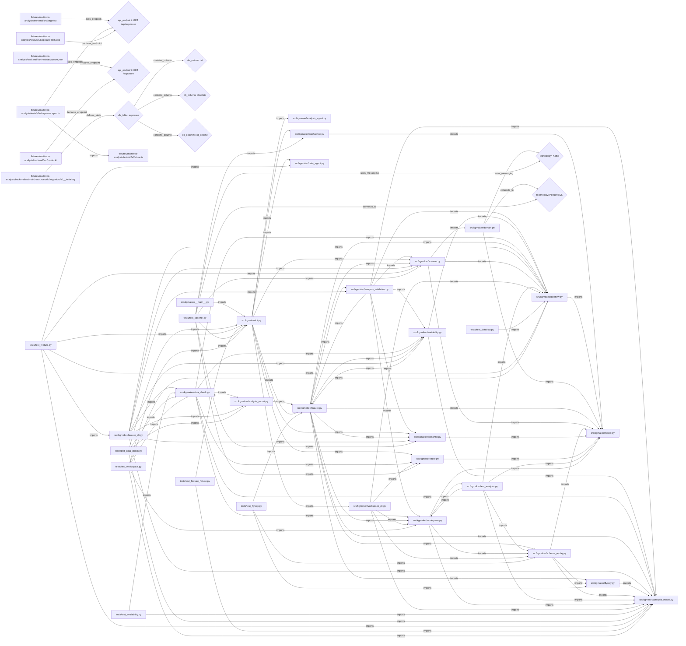

# Repository knowledge graph

> Generated locally by kgmaker. Structural edges come from source text; name-based call edges are heuristic.
> Review semantic conclusions with the repository's Copilot knowledge-graph agent.

- Files indexed: 62
- Symbols and sections: 475
- Internal imports: 99
- Heuristic cross-file calls: 1159
- PostgreSQL tables/columns: 1/3
- Kafka topics: 0
- API endpoints: 2
- TypeScript frontend routes: 0
- Semantic concepts: 0
- Inferred/ambiguous relationships: 1159/0

## Architecture diagram

The diagram groups declarations under their source files and shows detected imports and domain relationships. Heuristic call edges are omitted. An editable standalone Mermaid source is available at `.kgmaker/GRAPH.mmd`.

## Files and symbols

### `README.md`
- **section** `kgmaker` line 1
- **section** `Requirements` line 7
- **section** `Install` line 12
- **section** `Commands` line 26
- **section** `What gets indexed` line 60
- **section** `Copilot workflow` line 68
- **section** `Development` line 74
- **section** `Feature feasibility analysis (foundation)` line 83
- **section** `Follow candidate-template.json and write candidate.json with the host agent.` line 91
- **section** `Data prerequisite audit` line 115

### `docs/architecture.md`
- **section** `Architecture` line 1
- **section** `Relationship confidence` line 17
- **section** `Hook lifecycle` line 30
- **section** `Extension points` line 34
- **section** `Isolated feature-analysis foundation` line 38

### `docs/feature-analysis.md`
- **section** `Feature analysis: implemented foundation and remaining milestones` line 1
- **section** `Current extension status` line 3
- **section** `Delivery status` line 16
- **section** `CLI workflow` line 43
- **section** `Agent reads packet.json and candidate-template.json, writes candidate.json.` line 47
- **section** `Candidate contract, schema version 1` line 94
- **section** `Evidence` line 142
- **section** `Context budget and known limits` line 176
- **section** `Host invocation and tests` line 192
- **section** `Implemented field and impact patterns (initial milestone B)` line 216
- **section** `Deterministic data-check (chapter 27, single-root foundation)` line 248

### `docs/flyway-workspace-proofs.md`
- **section** `Flyway, local workspaces and scoped availability proofs` line 1
- **section** `Flyway schema reconstruction` line 9
- **section** `Workspace manifest` line 63
- **section** `Positive availability proofs` line 113
- **section** `Verified coverage and boundaries` line 175

### `docs/implementation-feature-analysis.md`
- **section** `Implementační pokračování: analýza nových funkcí a datových požadavků` line 1
- **section** `1. Cíl a instrukce pro implementujícího agenta` line 9
- **section** `Kontext cílového použití` line 21
- **section** `2. Skutečný výchozí stav a změna scope` line 35
- **section** `3. Dva režimy a oddělení stavů` line 55
- **section** `3.1 Existing impact analysis` line 57
- **section** `3.2 Feature feasibility analysis` line 61
- **section** `3.3 Stav tvrzení versus stav návrhu` line 65
- **section** `4. Model analýzy a provenance` line 77
- **section** `5. Datové požadavky a dostupnost` line 112
- **section** `5.1 Neslučuj význam, dostupnost a zdroj` line 114
- **section** `5.2 Pravidla rozhodování` line 138
- **section** `6. Cross-layer data flow` line 151
- **section** `6.1 Rozšíření strukturální extrakce` line 153
- **section** `6.2 Minimální podporované vzory` line 176
- **section** `6.3 Scénáře a jednoduché výpočty` line 190
- **section** `7. Excel jako zdroj znalostí` line 198
- **section** `8. Requirement, availability a proposal graph` line 214
- **section** `9. Workflow analytického agenta` line 230
- **section** `10. Konkrétní CLI a lifecycle` line 251
- **section** `11. Analytický packet a validace` line 296
- **section** `12. Report pro analytika` line 319
- **section** `13. Inkrementální aktualizace a změny baseline` line 347
- **section** `14. Token budget a neúplné výsledky` line 367
- **section** `15. Autorita kódu, požadavků a dokumentace` line 383
- **section** `16. Volitelná Confluence synchronizace` line 396
- **section** `17. Moduly a kompatibilita` line 414
- **section** `18. Fixture pro celý analytický scénář` line 437
- **section** `19. Závazné akceptační testy` line 483
- **section** `20. Pořadí implementace a definition of done` line 527
- **section** `Milník A — analytické jádro` line 529
- **section** `Milník B — datové toky a matching` line 533
- **section** `Milník C — artefakty a dokumentace` line 537
- **section** `Milník D — incremental a host agent` line 541
- **section** `Milník E — synchronizační boundary` line 545
- **section** `21. Očekávaný výsledek pro analytika` line 563
- **section** `22. Doplnění scope: Flyway a workspace více repozitářů` line 577
- **section** `23. Rekonstrukce databázového schématu z Flyway migrací` line 589
- **section** `23.1 Cíl a hranice tvrzení` line 591
- **section** `23.2 Discovery a konfigurace` line 605
- **section** `23.3 Plán migrací` line 624
- **section** `23.4 SQL parsing a výsledný schema model` line 642
- **section** `23.5 Feature analysis a inkrementální replay` line 664
- **section** `24. Multirepo workspace: backend, frontend a automatické testy` line 676
- **section** `24.1 Explicitní lokální konfigurace` line 678
- **section** `24.2 Globální identita a baseline` line 733
- **section** `24.3 Backend ↔ frontend` line 749
- **section** `24.4 Repository automatických testů` line 761
- **section** `24.5 Cross-repo návrh změn a report` line 788
- **section** `25. Nové CLI, fixtures a akceptační testy` line 800
- **section** `26. Doplnění modulů a definition of done` line 854
- **section** `Milník F — Flyway schema intelligence` line 864
- **section** `Milník G — lokální multirepo analytický workspace` line 868
- **section** `27. Specializovaný agent pro datové předpoklady nové feature` line 882
- **section** `27.1 Nejmenší možný podíl LLM` line 888
- **section** `27.2 Aktuálně použitelný workflow a omezení` line 909
- **section** `27.3 Deterministická datová kontrola k implementaci` line 919
- **section** `27.4 Bash a PowerShell` line 946
- **section** `27.5 Výstup a validace` line 960

### `docs/project-scope.md`
- **section** `Project scope` line 1
- **section** `Goals` line 5
- **section** `Out of scope` line 15
- **section** `Initial implementation` line 23
- **section** `Graph workflows` line 31
- **section** `Feature-analysis extension` line 35

### `fixtures/feature-analysis/README.md`
- **section** `Analytical-core fixture (milestone A foundation)` line 1

### `fixtures/feature-analysis/backend/ExposureService.kt`
- **type** `Account` line 2 — `Account((val accountBalance: Double))`
- **data_field** `Account.accountBalance` line 3 — `Double`
- **type** `ExposureService` line 4 — `ExposureService()`
- **function** `pessimisticExposure` line 6 — `pessimisticExposure(position: Double)`
- **parameter** `ExposureService.pessimisticExposure(position: Double):position` line 6 — `Double`
- **return_value** `ExposureService.pessimisticExposure(position: Double)` line 6 — `Double`

### `fixtures/feature-analysis/backend/ScenarioCalculator.kt`
- **data_field** `ScenarioInput.pessimisticDecline` line 1 — `Double`
- **type** `ScenarioInput` line 1 — `ScenarioInput((val pessimisticDecline: Double))`
- **data_field** `ScenarioReport.midDecline` line 2 — `Double`
- **type** `ScenarioReport` line 2 — `ScenarioReport((val midDecline: Double))`
- **type** `ScenarioCalculator` line 3 — `ScenarioCalculator()`
- **function** `calculate` line 4 — `calculate(input: ScenarioInput)`
- **parameter** `ScenarioCalculator.calculate(input: ScenarioInput):input` line 4 — `ScenarioInput`
- **return_value** `ScenarioCalculator.calculate(input: ScenarioInput)` line 4 — `ScenarioReport`
- **local_value** `ScenarioCalculator.calculate(input: ScenarioInput):midDecline` line 5 — Declared expression: input.pessimisticDecline / 2

### `fixtures/feature-analysis/contracts/positions-event.json`
- **contract_field** `/properties/currency`  — `string` — JSON pointer /properties/currency
- **contract_field** `/properties/volume`  — `number` — JSON pointer /properties/volume

### `fixtures/feature-analysis/expected/analysis-invariants.json`
- No declarations extracted.

### `fixtures/feature-analysis/expected/candidate-invalid.json`
- No declarations extracted.

### `fixtures/feature-analysis/expected/candidate-valid.json`
- No declarations extracted.

### `fixtures/feature-analysis/requirements/additional-hedge-answers.json`
- No declarations extracted.

### `fixtures/feature-analysis/requirements/additional-hedge.md`
- No declarations extracted.

### `fixtures/multirepo-analysis/README.md`
- **section** `Offline multirepository fixture` line 1

### `fixtures/multirepo-analysis/backend/contracts/exposure.json`
- **api_endpoint** `GET /exposure`  — operationId: getExposure
- **contract_field** `/paths/~1exposure/get/responses/200/content/application~1json/schema/properties/decline`  — `number` — JSON pointer /paths/~1exposure/get/responses/200/content/application~1json/schema/properties/decline

### `fixtures/multirepo-analysis/backend/src/main/resources/db/migration/R__exposure_view.sql`
- No declarations extracted.

### `fixtures/multirepo-analysis/backend/src/main/resources/db/migration/V10__precision.sql`
- No declarations extracted.

### `fixtures/multirepo-analysis/backend/src/main/resources/db/migration/V1__initial.sql`
- **db_column** `id` line 1 — `bigint`
- **db_column** `obsolete` line 1 — `text`
- **db_column** `old_decline` line 1 — `numeric`
- **db_table** `exposure` line 1

### `fixtures/multirepo-analysis/backend/src/main/resources/db/migration/V2__rename.sql`
- No declarations extracted.

### `fixtures/multirepo-analysis/backend/src/model.kt`
- **data_field** `ExposureInput.pessimisticDecline` line 1 — `Double`
- **type** `ExposureInput` line 1 — `ExposureInput((val pessimisticDecline: Double))`
- **data_field** `ExposureOutput.decline` line 2 — `Double`
- **type** `ExposureOutput` line 2 — `ExposureOutput((val decline: Double))`
- **function** `calculate` line 3 — `calculate(input: ExposureInput): ExposureOutput = ExposureOutput(input.pessimisticDecline / 2)`
- **parameter** `calculate(input: ExposureInput):input` line 3 — `ExposureInput`
- **return_value** `calculate(input: ExposureInput)` line 3 — `ExposureOutput`
- **function** `exposure` line 6 — `exposure(): ExposureOutput = calculate(ExposureInput(4.0))`
- **return_value** `exposure()` line 6 — `ExposureOutput`

### `fixtures/multirepo-analysis/backend/src/model.ts`
- **data_field** `Client.balance` line 1 — `number`
- **type** `Client` line 1 — `Client`

### `fixtures/multirepo-analysis/frontend/src/model.ts`
- **data_field** `Client.balance` line 1 — `number`
- **type** `Client` line 1 — `Client`

### `fixtures/multirepo-analysis/frontend/src/page.tsx`
- **component** `ExposurePage` line 1 — `ExposurePage`
- **api_endpoint** `GET /api/exposure` line 2

### `fixtures/multirepo-analysis/tests/e2e/exposure.spec.ts`
- No declarations extracted.

### `fixtures/multirepo-analysis/tests/e2e/fixture.ts`
- No declarations extracted.

### `fixtures/multirepo-analysis/tests/e2e/setup.sql`
- No declarations extracted.

### `fixtures/multirepo-analysis/tests/src/ExposureTest.java`
- **type** `ExposureTest` line 1 — `ExposureTest()`

### `fixtures/multirepo-analysis/tests/src/model.ts`
- **data_field** `Client.balance` line 1 — `number`
- **type** `Client` line 1 — `Client`

### `src/kgmaker/__init__.py`
- No declarations extracted.

### `src/kgmaker/__main__.py`
- No declarations extracted.

### `src/kgmaker/analysis_agent.py`
- No declarations extracted.

### `src/kgmaker/analysis_model.py`
- **class** `AnalysisError` line 31 — `AnalysisError(ValueError)`
- **function** `__init__` line 34 — `__init__(self, message: str, code: int = 2)`
- **function** `canonical` line 37 — `canonical(value: Any)`
- **function** `digest` line 41 — `digest(value: Any)`
- **function** `file_hash` line 45 — `file_hash(path: Path)`
- **function** `safe_path` line 49 — `safe_path(root: Path, value: str)`
- **function** `analysis_dir` line 67 — `analysis_dir(root: Path, analysis_id: str)`
- **function** `read_json` line 73 — `read_json(path: Path)`
- **function** `reject_constant` line 76 — `reject_constant(value: str)`
- **function** `unique` line 78 — `unique(pairs: list)`
- **function** `atomic_write` line 89 — `atomic_write(path: Path, text: str)`
- **function** `write_json` line 103 — `write_json(path: Path, value: Any)`
- **class** `FeatureAnalysis` line 110 — `FeatureAnalysis` — Serializable envelope. Nested contracts are checked by analysis_validation.
- **function** `from_dict` line 115 — `from_dict(cls, data: Any)`
- **function** `to_dict` line 132 — `to_dict(self)`
- **function** `inventory_candidate` line 135 — `inventory_candidate(packet: dict)`

### `src/kgmaker/analysis_report.py`
- **function** `cell` line 16 — `cell(value)`
- **function** `render_report` line 24 — `render_report(candidate: dict, packet: dict, stale: list[str], applied: bool = True, *, data_audit: dict | None = None)`
- **function** `section` line 34 — `section(index)`
- **function** `objects` line 36 — `objects(items)`

### `src/kgmaker/analysis_validation.py`
- **class** `_Anchors` line 17 — `_Anchors(HTMLParser)`
- **function** `__init__` line 20 — `__init__(self)`
- **function** `handle_starttag` line 23 — `handle_starttag(self, tag, attrs)`
- **function** `_location` line 28 — `_location(root: Path, item: dict, packet: dict)`
- **function** `validate_candidate` line 110 — `validate_candidate(root: Path, packet: dict, data: object)`
- **function** `_validate_candidate` line 117 — `_validate_candidate(root: Path, packet: dict, data: object)`
- **function** `strings` line 195 — `strings(item, key, choices=None, nullable=False)`
- **function** `refs` line 202 — `refs(item, key, targets, required=False)`
- **function** `visit` line 293 — `visit(identity)`

### `src/kgmaker/availability.py`
- **function** `observation_staleness` line 14 — `observation_staleness(candidate: dict)`
- **function** `evaluate_proof` line 35 — `evaluate_proof(root, packet, candidate, item, graph=None)`

### `src/kgmaker/cli.py`
- **function** `_write_if_missing` line 197 — `_write_if_missing(path: Path, text: str, force: bool = False)`
- **function** `init` line 205 — `init(root: Path, force: bool = False)`
- **function** `scan` line 244 — `scan(root: Path, generate_docs: bool = True, confluence_dir: str | None = None, report: str | None = None)`
- **function** `status` line 276 — `status(root: Path)`
- **function** `check` line 300 — `check(root: Path)`
- **function** `docs` line 330 — `docs(root: Path, action: str | None = None, confluence_dir: str | None = None, report: str | None = None)`
- **function** `semantic_prepare` line 354 — `semantic_prepare(root: Path)`
- **function** `semantic_extract` line 368 — `semantic_extract(root: Path, base_ref: str, note_path: str | None = None, token_budget: int | None = None)`
- **function** `semantic_update` line 419 — `semantic_update(root: Path, base_ref: str, note_path: str | None = None, token_budget: int | None = None)`
- **function** `semantic_apply` line 500 — `semantic_apply(root: Path)`
- **function** `semantic_validate` line 520 — `semantic_validate(root: Path)`
- **function** `impact` line 535 — `impact(root: Path, changed_files: list[str])`
- **function** `query` line 607 — `query(root: Path, terms: str, limit: int = 10)`
- **function** `hook_context` line 624 — `hook_context(root: Path, token_budget: int | None = None)`
- **function** `build_parser` line 643 — `build_parser`
- **function** `main` line 721 — `main`

### `src/kgmaker/confluence.py`
- **function** `_norm` line 30 — `_norm(value: str)`
- **function** `_safe_rel` line 34 — `_safe_rel(path: str)`
- **function** `_sha` line 38 — `_sha(path: Path)`
- **class** `ConfluenceDocument` line 49 — `ConfluenceDocument`
- **class** `DocumentationAssertion` line 63 — `DocumentationAssertion`
- **class** `_ExportHTMLParser` line 80 — `_ExportHTMLParser(HTMLParser)`
- **function** `__init__` line 86 — `__init__(self)`
- **function** `_attrs` line 105 — `_attrs(self, attrs: list[tuple[str, str | None]])`
- **function** `handle_starttag` line 108 — `handle_starttag(self, tag: str, attrs: list[tuple[str, str | None]])`
- **function** `handle_endtag` line 139 — `handle_endtag(self, tag: str)`
- **function** `handle_data` line 169 — `handle_data(self, data: str)`
- **function** `text` line 183 — `text(self)`
- **function** `_resolve_local_ref` line 187 — `_resolve_local_ref(value: str, current_file: str)`
- **function** `_parse_mermaid` line 194 — `_parse_mermaid(source: str)`
- **function** `_parse_drawio` line 209 — `_parse_drawio(path: Path, source_file: str)`
- **function** `_parse_svg` line 232 — `_parse_svg(path: Path)`
- **function** `_document_from_html` line 243 — `_document_from_html(path: Path, export_root: Path, digest: str)`
- **function** `_load_cache` line 262 — `_load_cache(root: Path)`
- **function** `_write_cache` line 270 — `_write_cache(root: Path, payload: dict[str, Any])`
- **function** `discover_export` line 276 — `discover_export(export_root: Path)`
- **function** `ingest_export` line 280 — `ingest_export(export_root: Path, repository_root: Path)`
- **function** `_assertions_from_document` line 319 — `_assertions_from_document(doc: ConfluenceDocument)`
- **function** `_code_nodes` line 348 — `_code_nodes(graph: KnowledgeGraph)`
- **function** `_missing_category` line 355 — `_missing_category(assertion: DocumentationAssertion)`
- **function** `validate_documents` line 367 — `validate_documents(documents: list[ConfluenceDocument], graph: KnowledgeGraph)`
- **function** `merge_into_graph` line 415 — `merge_into_graph(graph: KnowledgeGraph, documents: list[ConfluenceDocument], attachments: list[dict[str, Any]], assertions: list[DocumentationAssertion])`
- **function** `render_report` line 456 — `render_report(assertions: list[DocumentationAssertion], report_path: Path, export_root: Path, revision: str = "working tree")`
- **function** `persist_validation_index` line 484 — `persist_validation_index(root: Path, assertions: list[DocumentationAssertion])`
- **function** `resolve_confluence_dir` line 495 — `resolve_confluence_dir(root: Path, cli_value: str | None)`
- **function** `documentation_check` line 529 — `documentation_check(root: Path, confluence_dir: str | None = None, report: str | None = None, graph: KnowledgeGraph | None = None)`

### `src/kgmaker/data_agent.py`
- No declarations extracted.

### `src/kgmaker/data_check.py`
- **function** `_object` line 19 — `_object(value, required, optional=())`
- **function** `_array` line 24 — `_array(value, label)`
- **function** `_ids` line 29 — `_ids(value, allowed, label)`
- **function** `data_check` line 35 — `data_check(root: Path, analysis_id: str, specification: dict)`
- **function** `reference_evidence` line 54 — `reference_evidence(reference, identity)`

### `src/kgmaker/dataflow.py`
- **function** `masked` line 32 — `masked(text: str)`
- **function** `closing` line 38 — `closing(text: str, start: int, opening='(', ending=')')`
- **function** `parts` line 50 — `parts(text: str)`
- **class** `Extraction` line 57 — `Extraction`
- **function** `extract_dataflow` line 61 — `extract_dataflow(sources: dict[str, str])`
- **function** `node` line 68 — `node(path, kind, qualified, offset, signature=None, summary=None)`
- **function** `issue` line 78 — `issue(path, offset, reason)`
- **function** `relation` line 81 — `relation(source, target, kind, path, offset, evidence)`
- **function** `walk` line 146 — `walk(value, pointer='')`
- **function** `resolve` line 207 — `resolve(token)`
- **function** `expression` line 218 — `expression(value, destination, statement_offset)`
- **function** `impact_paths` line 283 — `impact_paths(graph: KnowledgeGraph, entity: str, max_depth: int = 20)`

### `src/kgmaker/domain.py`
- **technology** `Kafka`
- **technology** `PostgreSQL`
- **function** `_line` line 65 — `_line(text: str, offset: int)`
- **function** `_unquote_identifier` line 69 — `_unquote_identifier(value: str)`
- **function** `_canon` line 73 — `_canon(value: str)`
- **function** `_node_id` line 77 — `_node_id(kind: str, key: str)`
- **function** `_shared_node` line 81 — `_shared_node(kind: str, key: str, display: str, path: str, line: int | None = None, summary: str | None = None)`
- **function** `_split_sql_items` line 85 — `_split_sql_items(body: str)`
- **function** `_sql_objects` line 108 — `_sql_objects(text: str, path: str, file_id: str)`
- **function** `_entity_edges` line 137 — `_entity_edges(text: str, path: str, symbols: list[Node], tables: dict[str, Node], columns: dict[str, Node])`
- **function** `_string_literals` line 191 — `_string_literals(value: str)`
- **function** `_kafka_references` line 195 — `_kafka_references(text: str, path: str, file_id: str)`
- **function** `add` line 200 — `add(topic: str, offset: int, relation: str, evidence: str)`
- **function** `normalize_api_path` line 230 — `normalize_api_path(path: str)`
- **function** `_api_node` line 241 — `_api_node(method: str, path: str, source: str, line: int | None, operation: str | None = None)`
- **function** `_mapping_path` line 254 — `_mapping_path(args: str)`
- **function** `_openapi_yaml` line 259 — `_openapi_yaml(text: str, path: str, file_id: str)`
- **function** `flush` line 271 — `flush(offset: int)`
- **function** `_openapi_json` line 302 — `_openapi_json(text: str, path: str, file_id: str)`
- **function** `_api_references` line 324 — `_api_references(text: str, path: str, language: str, file_id: str)`
- **function** `add` line 329 — `add(method: str, endpoint_path: str, offset: int, relation: str, evidence: str)`
- **function** `_typescript_routes` line 392 — `_typescript_routes(path: str, text: str, file_id: str)`
- **function** `_technology_nodes` line 426 — `_technology_nodes(text: str, path: str, file_id: str)`
- **function** `extract_domain` line 440 — `extract_domain(path: str, text: str, language: str, file_id: str, symbols: list[Node])`
- **function** `extract_openapi` line 475 — `extract_openapi(path: str, text: str, file_id: str)`
- **function** `connect_persistence` line 484 — `connect_persistence(symbols_by_file: dict[str, list[Node]], text_by_file: dict[str, str], nodes: list[Node])`
- **function** `merge_domain_nodes` line 515 — `merge_domain_nodes(nodes: list[Node])`

### `src/kgmaker/feature.py`
- **function** `source_inventory` line 22 — `source_inventory(root: Path)`
- **function** `current_graph` line 53 — `current_graph(root: Path, workspace: Path | None = None)`
- **function** `attach_schema` line 70 — `attach_schema(graph, schema, root: Path | None = None)`
- **function** `source_path` line 101 — `source_path(root: Path, key: str, packet: dict)`
- **function** `graph_for_packet` line 108 — `graph_for_packet(root: Path, packet: dict)`
- **function** `snapshot` line 113 — `snapshot(root: Path, *, workspace: Path | None = None, _details: dict | None = None, _persist_cache: bool = False)`
- **function** `packet_identity` line 156 — `packet_identity(packet: dict)`
- **function** `load_packet` line 160 — `load_packet(root: Path, analysis_id: str)`
- **function** `freshness` line 169 — `freshness(root: Path, packet: dict)`
- **function** `prepare` line 188 — `prepare(root: Path, requirement: str, analysis_id: str, token_budget: int = 8000, *, _answers: list | None = None, workspace: Path | None = None)`
- **function** `validate` line 271 — `validate(root: Path, analysis_id: str, candidate: dict)`
- **function** `apply` line 291 — `apply(root: Path, analysis_id: str, candidate: dict)`
- **function** `status` line 309 — `status(root: Path, analysis_id: str)`
- **function** `revise` line 318 — `revise(root: Path, analysis_id: str, answers: dict)`

### `src/kgmaker/feature_cli.py`
- **function** `register` line 11 — `register(subparsers)`
- **function** `run` line 39 — `run(args)`
- **function** `query_analysis` line 123 — `query_analysis(root: Path, analysis_id: str, terms: str, limit: int)`
- **function** `impact_entity` line 144 — `impact_entity(root: Path, entity: str, output_format: str)`

### `src/kgmaker/flyway.py`
- **function** `version` line 22 — `version(value: str)`
- **function** `configuration` line 31 — `configuration(root: Path, overrides: dict | None = None)`
- **function** `migration_plan` line 148 — `migration_plan(root: Path, overrides: dict | None = None)`

### `src/kgmaker/model.py`
- **class** `Node` line 10 — `Node`
- **class** `Edge` line 21 — `Edge`
- **class** `KnowledgeGraph` line 33 — `KnowledgeGraph`
- **function** `to_dict` line 40 — `to_dict(self)`
- **function** `from_dict` line 52 — `from_dict(cls, data: dict[str, Any])`

### `src/kgmaker/scanner.py`
- **function** `_safe_text` line 75 — `_safe_text(path: Path)`
- **function** `_file_digest` line 84 — `_file_digest(text: str)`
- **function** `_stable_id` line 88 — `_stable_id(kind: str, path: str, name: str, line: int | None = None)`
- **function** `_line_for` line 93 — `_line_for(text: str, offset: int)`
- **function** `_doc_for_line` line 97 — `_doc_for_line(lines: list[str], index: int)`
- **function** `_extract_symbols` line 105 — `_extract_symbols(text: str, path: str, language: str)`
- **function** `_imports` line 161 — `_imports(text: str, language: str)`
- **function** `_candidate_paths` line 179 — `_candidate_paths(root: Path, source: str, import_name: str, known_files: set[str])`
- **function** `_should_skip` line 208 — `_should_skip(path: Path, relative: Path)`
- **function** `scan_repository` line 219 — `scan_repository(root: Path)`

### `src/kgmaker/schema_replay.py`
- **function** `statements` line 19 — `statements(text: str)`
- **function** `identifier` line 83 — `identifier(token: str)`
- **function** `groups` line 91 — `groups(tokens: list[str])`
- **class** `Replay` line 103 — `Replay`
- **function** `__init__` line 106 — `__init__(self, config: dict)`
- **function** `name` line 111 — `name(self, tokens, offset=0)`
- **function** `key` line 121 — `key(kind, name)`
- **function** `create` line 123 — `create(self, kind, name, **attributes)`
- **function** `get` line 136 — `get(self, kind, name)`
- **function** `change` line 142 — `change(self, item)`
- **function** `drop` line 146 — `drop(self, kind, name, optional=False)`
- **function** `rename` line 156 — `rename(self, kind, name, target)`
- **function** `constraint` line 180 — `constraint(self, table, tokens, fallback)`
- **function** `column` line 206 — `column(self, table, tokens)`
- **function** `apply` line 231 — `apply(self, tokens)`
- **function** `reconstruct` line 394 — `reconstruct(root: Path, config: dict | None = None, *, use_cache: bool = True)`
- **function** `schema_diff` line 463 — `schema_diff(root: Path, config: dict, start: str, end: str)`
- **function** `graph_entities` line 472 — `graph_entities(schema: dict)`
- **function** `schema_mappings` line 510 — `schema_mappings(root: Path, schema: dict, graph)`

### `src/kgmaker/semantic.py`
- **class** `SemanticValidationError` line 31 — `SemanticValidationError(ValueError)`
- **function** `concept_id` line 35 — `concept_id(source_file: str, name: str)`
- **function** `graph_fingerprint` line 41 — `graph_fingerprint(graph: KnowledgeGraph)`
- **function** `build_semantic_input` line 52 — `build_semantic_input(graph: KnowledgeGraph)`
- **function** `_positive_line` line 73 — `_positive_line(value: Any, field: str)`
- **function** `_check_line` line 81 — `_check_line(root: Path, source_file: str, line: int | None, field: str, line_counts: dict[str, int])`
- **function** `validate_semantic_data` line 96 — `validate_semantic_data(data: Any, graph: KnowledgeGraph, root: Path)`
- **function** `_run_git` line 200 — `_run_git(root: Path, *args: str, check: bool = True)`
- **function** `_is_sensitive_path` line 215 — `_is_sensitive_path(path: str)`
- **function** `apply_semantic_patch` line 412 — `apply_semantic_patch(patch: Any, update: Any, graph: KnowledgeGraph, root: Path)`
- **function** `apply_semantic_layer` line 531 — `apply_semantic_layer(graph: KnowledgeGraph, root: Path)`

### `src/kgmaker/store.py`
- **function** `query_nodes` line 14 — `query_nodes(graph: KnowledgeGraph, terms: str, limit: int = 10)`
- **function** `save_graph` line 35 — `save_graph(graph: KnowledgeGraph, root: Path, generate_docs: bool = True)`
- **function** `load_graph` line 48 — `load_graph(root: Path)`
- **function** `render_markdown` line 56 — `render_markdown(graph: KnowledgeGraph)`
- **function** `render_mermaid` line 133 — `render_mermaid(graph: KnowledgeGraph)`
- **function** `render_context` line 184 — `render_context(graph: KnowledgeGraph, limit: int = 8_000, root: Path | None = None)`
- **function** `_edge_details` line 226 — `_edge_details(edge)`

### `src/kgmaker/test_analysis.py`
- **function** `normalized_path` line 11 — `normalized_path(path: str)`
- **function** `_ref` line 16 — `_ref(document, value)`
- **function** `federated_links` line 32 — `federated_links(workspace, graphs, sources)`
- **function** `file_identity` line 39 — `file_identity(repo, path)`
- **function** `node` line 43 — `node(identity, kind, name, repo, path, line, signature=None)`
- **function** `edge` line 48 — `edge(source, target, kind, repo, path, line, evidence, confidence='EXTRACTED')`
- **function** `test_data_diagnostics` line 256 — `test_data_diagnostics(workspace, sources, schemas)`

### `src/kgmaker/workspace.py`
- **function** `qualified` line 14 — `qualified(repo: str, identity: str)`
- **function** `split_id` line 18 — `split_id(identity: str)`
- **function** `source_key` line 28 — `source_key(repo: str, path: str)`
- **function** `load_workspace` line 32 — `load_workspace(path: Path)`
- **function** `source_path` line 91 — `source_path(packet: dict, key: str)`
- **function** `snapshot_workspace` line 101 — `snapshot_workspace(manifest: Path, *, cache_root: Path | None = None, persist_cache: bool = False)`

### `src/kgmaker/workspace_cli.py`
- **function** `register_schema` line 6 — `register_schema(subparsers)`
- **function** `schema_command` line 23 — `schema_command(args)`
- **function** `workspace_command` line 54 — `workspace_command(args)`

### `tests/test_availability.py`
- **class** `AvailabilityTests` line 11 — `AvailabilityTests(unittest.TestCase)`
- **function** `setUp` line 14 — `setUp(self)`
- **function** `evidence` line 47 — `evidence(self)`
- **function** `input` line 53 — `input(self)`
- **function** `test_observed_approved_input_available` line 64 — `test_observed_approved_input_available(self)`
- **function** `test_dto_or_migration_declaration_alone_not_available` line 69 — `test_dto_or_migration_declaration_alone_not_available(self)`
- **function** `test_scoped_contract_absence_not_bankwide_absence` line 74 — `test_scoped_contract_absence_not_bankwide_absence(self)`
- **function** `test_source_mutation_invalidates_positive_proof` line 86 — `test_source_mutation_invalidates_positive_proof(self)`
- **function** `test_unapproved_or_different_business_mapping_rejected` line 91 — `test_unapproved_or_different_business_mapping_rejected(self)`
- **function** `test_partial_metadata_and_expired_observation` line 99 — `test_partial_metadata_and_expired_observation(self)`
- **function** `test_data_check_classifies_proof_without_llm` line 115 — `test_data_check_classifies_proof_without_llm(self)`
- **function** `test_explicit_approved_missing_decision_is_scoped` line 129 — `test_explicit_approved_missing_decision_is_scoped(self)`
- **function** `test_quality_violation_cannot_be_overridden_by_metadata` line 153 — `test_quality_violation_cannot_be_overridden_by_metadata(self)`

### `tests/test_data_check.py`
- **class** `DataCheckTests` line 15 — `DataCheckTests(unittest.TestCase)`
- **function** `setUp` line 18 — `setUp(self)`
- **function** `tree` line 33 — `tree(self)`
- **function** `cli` line 36 — `cli(self, *args)`
- **function** `test_fa66_68_static_candidates_are_unknown_and_use_existing_validation` line 44 — `test_fa66_68_static_candidates_are_unknown_and_use_existing_validation(self)`
- **function** `test_fa69_source_and_answer_hash_drift_fail_closed` line 59 — `test_fa69_source_and_answer_hash_drift_fail_closed(self)`
- **function** `test_fa70_coverage_gaps_are_not_delivery_gaps` line 70 — `test_fa70_coverage_gaps_are_not_delivery_gaps(self)`
- **function** `test_forged_reference_and_injected_availability_rejected` line 81 — `test_forged_reference_and_injected_availability_rejected(self)`
- **function** `test_derivation_cycles_reuse_validator` line 99 — `test_derivation_cycles_reuse_validator(self)`
- **function** `test_fa71_72_cli_no_shell_and_incomplete_exit` line 106 — `test_fa71_72_cli_no_shell_and_incomplete_exit(self)`
- **function** `probe` line 115 — `probe(args, **kwargs)`
- **function** `test_workspace_never_falls_back_to_root` line 127 — `test_workspace_never_falls_back_to_root(self)`
- **function** `test_fa74_validate_apply_report_preserve_sources_and_as_is` line 132 — `test_fa74_validate_apply_report_preserve_sources_and_as_is(self)`

### `tests/test_dataflow.py`
- **class** `DataflowTests` line 5 — `DataflowTests(unittest.TestCase)`
- **function** `test_kotlin_constructor_fields_expression_and_mapping` line 8 — `test_kotlin_constructor_fields_expression_and_mapping(self)`
- **function** `test_field_inventory_for_java_typescript_and_json` line 32 — `test_field_inventory_for_java_typescript_and_json(self)`
- **function** `test_ambiguous_types_do_not_create_maps` line 45 — `test_ambiguous_types_do_not_create_maps(self)`
- **function** `test_control_flow_calls_and_comments_do_not_fabricate_dependencies` line 52 — `test_control_flow_calls_and_comments_do_not_fabricate_dependencies(self)`
- **function** `test_same_method_name_in_different_owners_has_distinct_identity` line 63 — `test_same_method_name_in_different_owners_has_distinct_identity(self)`
- **function** `test_fa35_direction_weakest_link_and_external_boundary` line 70 — `test_fa35_direction_weakest_link_and_external_boundary(self)`
- **function** `test_comment_only_edit_preserves_field_ids` line 84 — `test_comment_only_edit_preserves_field_ids(self)`
- **function** `test_parameter_reassignment_does_not_create_false_proof` line 90 — `test_parameter_reassignment_does_not_create_false_proof(self)`

### `tests/test_feature.py`
- **class** `FeatureTests` line 18 — `FeatureTests(unittest.TestCase)`
- **function** `setUp` line 21 — `setUp(self)`
- **function** `tree` line 30 — `tree(self)`
- **function** `cli` line 33 — `cli(self, *args)`
- **function** `evidence` line 40 — `evidence(self)`
- **function** `input` line 47 — `input(self)`
- **function** `test_fa12_prepare_is_idempotent_and_preserves_candidate` line 55 — `test_fa12_prepare_is_idempotent_and_preserves_candidate(self)`
- **function** `test_fa07_apply_isolated_and_idempotent` line 62 — `test_fa07_apply_isolated_and_idempotent(self)`
- **function** `test_fa10_forged_citations_and_no_mutation` line 76 — `test_fa10_forged_citations_and_no_mutation(self)`
- **function** `test_json_pointer_requires_existing_field_and_value` line 88 — `test_json_pointer_requires_existing_field_and_value(self)`
- **function** `test_fa11_packet_and_revision_mismatch` line 100 — `test_fa11_packet_and_revision_mismatch(self)`
- **function** `test_fa13_uncommitted_changes_and_requirement_invalidate` line 110 — `test_fa13_uncommitted_changes_and_requirement_invalidate(self)`
- **function** `test_fa18_19_small_budget_produces_incomplete_inventory` line 126 — `test_fa18_19_small_budget_produces_incomplete_inventory(self)`
- **function** `test_fa02_04_no_automatic_liquidity_or_absence_claim` line 139 — `test_fa02_04_no_automatic_liquidity_or_absence_claim(self)`
- **function** `test_fa27_dangling_proposal_and_traversal_rejected` line 147 — `test_fa27_dangling_proposal_and_traversal_rejected(self)`
- **function** `test_fa25_cli_workflow_without_semantic_packet_or_git` line 158 — `test_fa25_cli_workflow_without_semantic_packet_or_git(self)`
- **function** `test_fa33_report_not_used_as_source_evidence` line 172 — `test_fa33_report_not_used_as_source_evidence(self)`
- **function** `test_stale_report_is_labelled_and_returns_three` line 178 — `test_stale_report_is_labelled_and_returns_three(self)`
- **function** `test_fa34_processing_complete_with_business_decision_blocked` line 185 — `test_fa34_processing_complete_with_business_decision_blocked(self)`
- **function** `test_malformed_structures_never_raise_or_mutate` line 195 — `test_malformed_structures_never_raise_or_mutate(self)`
- **function** `test_fa31_graph_version_compatibility` line 205 — `test_fa31_graph_version_compatibility(self)`
- **function** `test_output_symlink_cannot_overwrite_source` line 212 — `test_output_symlink_cannot_overwrite_source(self)`
- **function** `test_revise_preserves_history_and_accepts_new_answer_file` line 221 — `test_revise_preserves_history_and_accepts_new_answer_file(self)`
- **function** `test_init_preserves_user_analyst_and_junie_files` line 255 — `test_init_preserves_user_analyst_and_junie_files(self)`
- **function** `test_scope_and_proposal_are_explicit_in_query` line 280 — `test_scope_and_proposal_are_explicit_in_query(self)`
- **function** `test_fake_human_approval_is_rejected` line 292 — `test_fake_human_approval_is_rejected(self)`
- **function** `test_cyclic_derivation_and_document_only_reuse_are_rejected` line 298 — `test_cyclic_derivation_and_document_only_reuse_are_rejected(self)`
- **function** `test_verified_impact_path_and_reversed_forgery` line 316 — `test_verified_impact_path_and_reversed_forgery(self)`
- **function** `test_impact_cli_json_uses_current_sources` line 334 — `test_impact_cli_json_uses_current_sources(self)`
- **function** `test_stale_impact_report_keeps_historical_proof_with_warning` line 346 — `test_stale_impact_report_keeps_historical_proof_with_warning(self)`

### `tests/test_feature_fixture.py`
- **function** `bind` line 16 — `bind(candidate, packet)`
- **class** `FeatureFixtureTests` line 26 — `FeatureFixtureTests(unittest.TestCase)`
- **function** `test_fixture_cli_lifecycle` line 29 — `test_fixture_cli_lifecycle(self)`
- **function** `run` line 34 — `run(*args)`

### `tests/test_flyway.py`
- **class** `FlywayTests` line 7 — `FlywayTests(unittest.TestCase)`
- **function** `setUp` line 10 — `setUp(self)`
- **function** `write` line 17 — `write(self, name, text)`
- **function** `test_fa36_37_order_lifecycle_and_constraints` line 20 — `test_fa36_37_order_lifecycle_and_constraints(self)`
- **function** `test_fa38_repeatables_and_historical_diff` line 34 — `test_fa38_repeatables_and_historical_diff(self)`
- **function** `test_fa39_44_equivalent_versions_but_no_gap_guess` line 44 — `test_fa39_44_equivalent_versions_but_no_gap_guess(self)`
- **function** `test_fa40_placeholders_quoting_and_search_path` line 51 — `test_fa40_placeholders_quoting_and_search_path(self)`
- **function** `test_fa41_61_unknown_body_and_literals` line 59 — `test_fa41_61_unknown_body_and_literals(self)`
- **function** `test_fa43_checkpoint_replay_matches_full_after_old_change` line 67 — `test_fa43_checkpoint_replay_matches_full_after_old_change(self)`
- **function** `test_fa62_baseline_script_and_undo` line 78 — `test_fa62_baseline_script_and_undo(self)`
- **function** `test_constraints_indexes_views_and_table_rename` line 86 — `test_constraints_indexes_views_and_table_rename(self)`
- **function** `test_fa64_independent_streams_have_no_version_collision` line 94 — `test_fa64_independent_streams_have_no_version_collision(self)`
- **function** `test_quoted_dot_does_not_collide_with_qualified_name` line 102 — `test_quoted_dot_does_not_collide_with_qualified_name(self)`
- **function** `test_drop_recreate_has_new_identity` line 109 — `test_drop_recreate_has_new_identity(self)`
- **function** `test_configuration_profile_literals_and_no_credentials` line 116 — `test_configuration_profile_literals_and_no_credentials(self)`
- **function** `test_fa45_schema_mapping_precision_nullability_and_absent_column` line 127 — `test_fa45_schema_mapping_precision_nullability_and_absent_column(self)`

### `tests/test_scanner.py`
- **class** `ScannerTests` line 16 — `ScannerTests(unittest.TestCase)`
- **function** `test_semantic_extract_can_run_as_standalone_initial_workflow` line 19 — `test_semantic_extract_can_run_as_standalone_initial_workflow(self)`
- **function** `test_confluence_html_parser_resolves_pages_mermaid_and_drawio` line 32 — `test_confluence_html_parser_resolves_pages_mermaid_and_drawio(self)`
- **function** `test_confluence_code_is_truth_and_report_preserves_stale_documentation` line 50 — `test_confluence_code_is_truth_and_report_preserves_stale_documentation(self)`
- **function** `test_docs_check_accepts_external_export_and_custom_report` line 79 — `test_docs_check_accepts_external_export_and_custom_report(self)`
- **function** `test_extracts_python_symbols_and_internal_imports` line 91 — `test_extracts_python_symbols_and_internal_imports(self)`
- **function** `test_skips_secrets_and_dependency_folders` line 108 — `test_skips_secrets_and_dependency_folders(self)`
- **function** `test_persists_and_loads_graph` line 121 — `test_persists_and_loads_graph(self)`
- **function** `test_scan_no_docs_skips_markdown_and_mermaid_but_keeps_index` line 136 — `test_scan_no_docs_skips_markdown_and_mermaid_but_keeps_index(self)`
- **function** `test_mermaid_visualization_groups_symbols_and_shows_imports` line 154 — `test_mermaid_visualization_groups_symbols_and_shows_imports(self)`
- **function** `test_resolves_python_package_relative_import` line 169 — `test_resolves_python_package_relative_import(self)`
- **function** `test_init_preserves_existing_user_files` line 184 — `test_init_preserves_existing_user_files(self)`
- **function** `test_semantic_layer_uses_stable_ids_and_rejects_stale_or_dangling_edges` line 211 — `test_semantic_layer_uses_stable_ids_and_rejects_stale_or_dangling_edges(self)`
- **function** `test_semantic_update_refreshes_only_affected_entries` line 283 — `test_semantic_update_refreshes_only_affected_entries(self)`
- **function** `test_hook_emits_session_context_json` line 368 — `test_hook_emits_session_context_json(self)`
- **function** `test_impact_reports_exact_transitive_import_dependents` line 389 — `test_impact_reports_exact_transitive_import_dependents(self)`
- **function** `test_check_detects_stale_graph_and_docs_regenerate_markdown` line 408 — `test_check_detects_stale_graph_and_docs_regenerate_markdown(self)`
- **function** `test_check_command_works_without_local_json_index` line 429 — `test_check_command_works_without_local_json_index(self)`
- **function** `test_maps_kotlin_entities_repositories_and_columns_to_postgres_schema` line 442 — `test_maps_kotlin_entities_repositories_and_columns_to_postgres_schema(self)`
- **function** `test_finds_kafka_topics_and_postgres_connection_from_kotlin_and_yaml` line 477 — `test_finds_kafka_topics_and_postgres_connection_from_kotlin_and_yaml(self)`
- **function** `test_links_openapi_server_and_typescript_client_paths` line 509 — `test_links_openapi_server_and_typescript_client_paths(self)`

### `tests/test_workspace.py`
- **class** `WorkspaceTests` line 17 — `WorkspaceTests(unittest.TestCase)`
- **function** `setUp` line 20 — `setUp(self)`
- **function** `packet` line 38 — `packet(self)`
- **function** `test_fa46_47_identity_and_cross_repo_impact` line 41 — `test_fa46_47_identity_and_cross_repo_impact(self)`
- **function** `test_fa48_duplicate_service_identity_not_confirmed` line 54 — `test_fa48_duplicate_service_identity_not_confirmed(self)`
- **function** `test_fa50_request_only_not_field_coverage` line 61 — `test_fa50_request_only_not_field_coverage(self)`
- **function** `test_fa52_59_missing_checkout_and_reappearance` line 67 — `test_fa52_59_missing_checkout_and_reappearance(self)`
- **function** `test_fa53_unchanged_backend_not_reparsed` line 74 — `test_fa53_unchanged_backend_not_reparsed(self)`
- **function** `capture` line 80 — `capture(root, *args)`
- **function** `test_fa54_evidence_repo_mismatch_and_idempotent_prepare` line 85 — `test_fa54_evidence_repo_mismatch_and_idempotent_prepare(self)`
- **function** `test_fa55_57_apply_no_source_write_or_execution` line 99 — `test_fa55_57_apply_no_source_write_or_execution(self)`
- **function** `test_fa58_mixed_snapshot_rejected` line 106 — `test_fa58_mixed_snapshot_rejected(self)`
- **function** `racing` line 110 — `racing(root)`
- **function** `test_cli_workspace_prepare_and_schema` line 120 — `test_cli_workspace_prepare_and_schema(self)`
- **function** `test_overlap_duplicate_and_traversal_manifest_rejected` line 131 — `test_overlap_duplicate_and_traversal_manifest_rejected(self)`
- **function** `test_fa63_test_sql_mismatch_and_fa51_fixture_impact` line 136 — `test_fa63_test_sql_mismatch_and_fa51_fixture_impact(self)`
- **function** `test_workspace_data_check_and_report_are_valid` line 142 — `test_workspace_data_check_and_report_are_valid(self)`
- **function** `test_fa49_generation_origin_and_stale_contract` line 159 — `test_fa49_generation_origin_and_stale_contract(self)`
- **function** `test_comment_call_not_confirmed` line 175 — `test_comment_call_not_confirmed(self)`
- **function** `test_disk_cache_survives_process_cache_clear_and_validation_is_read_only` line 181 — `test_disk_cache_survives_process_cache_clear_and_validation_is_read_only(self)`

## Internal relationships

- `fixtures/multirepo-analysis/tests/e2e/exposure.spec.ts` imports `fixtures/multirepo-analysis/tests/e2e/fixture.ts` (./fixture)
- `src/kgmaker/__main__.py` imports `src/kgmaker/cli.py` (.cli)
- `src/kgmaker/analysis_report.py` imports `src/kgmaker/feature.py` (.feature)
- `src/kgmaker/analysis_validation.py` imports `src/kgmaker/analysis_model.py` (.analysis_model)
- `src/kgmaker/analysis_validation.py` imports `src/kgmaker/availability.py` (.availability)
- `src/kgmaker/analysis_validation.py` imports `src/kgmaker/dataflow.py` (.dataflow)
- `src/kgmaker/analysis_validation.py` imports `src/kgmaker/feature.py` (.feature)
- `src/kgmaker/analysis_validation.py` imports `src/kgmaker/scanner.py` (.scanner)
- `src/kgmaker/analysis_validation.py` imports `src/kgmaker/semantic.py` (.semantic)
- `src/kgmaker/analysis_validation.py` imports `src/kgmaker/workspace.py` (.workspace)
- `src/kgmaker/availability.py` imports `src/kgmaker/analysis_model.py` (.analysis_model)
- `src/kgmaker/availability.py` imports `src/kgmaker/dataflow.py` (.dataflow)
- `src/kgmaker/availability.py` imports `src/kgmaker/feature.py` (.feature)
- `src/kgmaker/cli.py` imports `src/kgmaker/analysis_agent.py` (.analysis_agent)
- `src/kgmaker/cli.py` imports `src/kgmaker/confluence.py` (.confluence)
- `src/kgmaker/cli.py` imports `src/kgmaker/data_agent.py` (.data_agent)
- `src/kgmaker/cli.py` imports `src/kgmaker/feature.py` (.feature)
- `src/kgmaker/cli.py` imports `src/kgmaker/scanner.py` (.scanner)
- `src/kgmaker/cli.py` imports `src/kgmaker/semantic.py` (.semantic)
- `src/kgmaker/cli.py` imports `src/kgmaker/store.py` (.store)
- `src/kgmaker/cli.py` imports `src/kgmaker/workspace_cli.py` (.workspace_cli)
- `src/kgmaker/confluence.py` imports `src/kgmaker/model.py` (.model)
- `src/kgmaker/data_check.py` imports `src/kgmaker/analysis_model.py` (.analysis_model)
- `src/kgmaker/data_check.py` imports `src/kgmaker/analysis_report.py` (.analysis_report)
- `src/kgmaker/data_check.py` imports `src/kgmaker/availability.py` (.availability)
- `src/kgmaker/data_check.py` imports `src/kgmaker/dataflow.py` (.dataflow)
- `src/kgmaker/data_check.py` imports `src/kgmaker/store.py` (.store)
- `src/kgmaker/data_check.py` imports `src/kgmaker/workspace.py` (.workspace)
- `src/kgmaker/dataflow.py` imports `src/kgmaker/model.py` (.model)
- `src/kgmaker/domain.py` imports `src/kgmaker/model.py` (.model)
- `src/kgmaker/feature.py` imports `src/kgmaker/analysis_model.py` (.analysis_model)
- `src/kgmaker/feature.py` imports `src/kgmaker/analysis_validation.py` (.analysis_validation)
- `src/kgmaker/feature.py` imports `src/kgmaker/availability.py` (.availability)
- `src/kgmaker/feature.py` imports `src/kgmaker/dataflow.py` (.dataflow)
- `src/kgmaker/feature.py` imports `src/kgmaker/flyway.py` (.flyway)
- `src/kgmaker/feature.py` imports `src/kgmaker/model.py` (.model)
- `src/kgmaker/feature.py` imports `src/kgmaker/scanner.py` (.scanner)
- `src/kgmaker/feature.py` imports `src/kgmaker/schema_replay.py` (.schema_replay)
- `src/kgmaker/feature.py` imports `src/kgmaker/semantic.py` (.semantic)
- `src/kgmaker/feature.py` imports `src/kgmaker/workspace.py` (.workspace)
- `src/kgmaker/feature_cli.py` imports `src/kgmaker/analysis_model.py` (.analysis_model)
- `src/kgmaker/feature_cli.py` imports `src/kgmaker/analysis_report.py` (.analysis_report)
- `src/kgmaker/feature_cli.py` imports `src/kgmaker/analysis_validation.py` (.analysis_validation)
- `src/kgmaker/feature_cli.py` imports `src/kgmaker/availability.py` (.availability)
- `src/kgmaker/feature_cli.py` imports `src/kgmaker/data_check.py` (.data_check)
- `src/kgmaker/feature_cli.py` imports `src/kgmaker/dataflow.py` (.dataflow)
- `src/kgmaker/feature_cli.py` imports `src/kgmaker/scanner.py` (.scanner)
- `src/kgmaker/feature_cli.py` imports `src/kgmaker/semantic.py` (.semantic)
- `src/kgmaker/flyway.py` imports `src/kgmaker/analysis_model.py` (.analysis_model)
- `src/kgmaker/scanner.py` imports `src/kgmaker/dataflow.py` (.dataflow)
- `src/kgmaker/scanner.py` imports `src/kgmaker/domain.py` (.domain)
- `src/kgmaker/scanner.py` imports `src/kgmaker/model.py` (.model)
- `src/kgmaker/schema_replay.py` imports `src/kgmaker/analysis_model.py` (.analysis_model)
- `src/kgmaker/schema_replay.py` imports `src/kgmaker/flyway.py` (.flyway)
- `src/kgmaker/schema_replay.py` imports `src/kgmaker/model.py` (.model)
- `src/kgmaker/semantic.py` imports `src/kgmaker/model.py` (.model)
- `src/kgmaker/store.py` imports `src/kgmaker/model.py` (.model)
- `src/kgmaker/test_analysis.py` imports `src/kgmaker/analysis_model.py` (.analysis_model)
- `src/kgmaker/test_analysis.py` imports `src/kgmaker/dataflow.py` (.dataflow)
- `src/kgmaker/test_analysis.py` imports `src/kgmaker/model.py` (.model)
- `src/kgmaker/test_analysis.py` imports `src/kgmaker/schema_replay.py` (.schema_replay)
- `src/kgmaker/test_analysis.py` imports `src/kgmaker/workspace.py` (.workspace)
- `src/kgmaker/workspace.py` imports `src/kgmaker/analysis_model.py` (.analysis_model)
- `src/kgmaker/workspace.py` imports `src/kgmaker/model.py` (.model)
- `src/kgmaker/workspace.py` imports `src/kgmaker/schema_replay.py` (.schema_replay)
- `src/kgmaker/workspace.py` imports `src/kgmaker/test_analysis.py` (.test_analysis)
- `src/kgmaker/workspace_cli.py` imports `src/kgmaker/analysis_model.py` (.analysis_model)
- `src/kgmaker/workspace_cli.py` imports `src/kgmaker/dataflow.py` (.dataflow)
- `src/kgmaker/workspace_cli.py` imports `src/kgmaker/schema_replay.py` (.schema_replay)
- `src/kgmaker/workspace_cli.py` imports `src/kgmaker/store.py` (.store)
- `src/kgmaker/workspace_cli.py` imports `src/kgmaker/workspace.py` (.workspace)
- `tests/test_availability.py` imports `src/kgmaker/analysis_model.py` (kgmaker.analysis_model)
- `tests/test_availability.py` imports `src/kgmaker/data_check.py` (kgmaker.data_check)
- `tests/test_data_check.py` imports `src/kgmaker/analysis_model.py` (kgmaker.analysis_model)
- `tests/test_data_check.py` imports `src/kgmaker/analysis_report.py` (kgmaker.analysis_report)
- `tests/test_data_check.py` imports `src/kgmaker/cli.py` (kgmaker.cli)
- `tests/test_data_check.py` imports `src/kgmaker/data_check.py` (kgmaker.data_check)
- `tests/test_dataflow.py` imports `src/kgmaker/dataflow.py` (kgmaker.dataflow)
- `tests/test_feature.py` imports `src/kgmaker/analysis_model.py` (kgmaker.analysis_model)
- `tests/test_feature.py` imports `src/kgmaker/cli.py` (kgmaker.cli)
- `tests/test_feature.py` imports `src/kgmaker/data_agent.py` (kgmaker.data_agent)
- `tests/test_feature.py` imports `src/kgmaker/dataflow.py` (kgmaker.dataflow)
- `tests/test_feature.py` imports `src/kgmaker/feature_cli.py` (kgmaker.feature_cli)
- `tests/test_feature.py` imports `src/kgmaker/scanner.py` (kgmaker.scanner)
- `tests/test_feature_fixture.py` imports `src/kgmaker/analysis_model.py` (kgmaker.analysis_model)
- `tests/test_feature_fixture.py` imports `src/kgmaker/cli.py` (kgmaker.cli)
- `tests/test_flyway.py` imports `src/kgmaker/feature.py` (kgmaker.feature)
- `tests/test_flyway.py` imports `src/kgmaker/flyway.py` (kgmaker.flyway)
- `tests/test_flyway.py` imports `src/kgmaker/schema_replay.py` (kgmaker.schema_replay)
- `tests/test_scanner.py` imports `src/kgmaker/cli.py` (kgmaker.cli)
- `tests/test_scanner.py` imports `src/kgmaker/confluence.py` (kgmaker.confluence)
- `tests/test_scanner.py` imports `src/kgmaker/scanner.py` (kgmaker.scanner)
- `tests/test_scanner.py` imports `src/kgmaker/semantic.py` (kgmaker.semantic)
- `tests/test_scanner.py` imports `src/kgmaker/store.py` (kgmaker.store)
- `tests/test_workspace.py` imports `src/kgmaker/analysis_model.py` (kgmaker.analysis_model)
- `tests/test_workspace.py` imports `src/kgmaker/cli.py` (kgmaker.cli)
- `tests/test_workspace.py` imports `src/kgmaker/data_check.py` (kgmaker.data_check)
- `tests/test_workspace.py` imports `src/kgmaker/dataflow.py` (kgmaker.dataflow)
- `tests/test_workspace.py` imports `src/kgmaker/workspace.py` (kgmaker.workspace)
- `docs/feature-analysis.md` may call `300 in `src/kgmaker/cli.py`` (name match at line 248; INFERRED 0.85)
- `fixtures/feature-analysis/expected/candidate-invalid.json` may call `2 in `fixtures/feature-analysis/backend/ExposureService.kt`` (name match at line 196; INFERRED 0.85)
- `fixtures/feature-analysis/expected/candidate-invalid.json` may call `2 in `fixtures/feature-analysis/backend/ScenarioCalculator.kt`` (name match at line 119; INFERRED 0.85)
- `fixtures/feature-analysis/expected/candidate-valid.json` may call `2 in `fixtures/feature-analysis/backend/ExposureService.kt`` (name match at line 196; INFERRED 0.85)
- `fixtures/feature-analysis/expected/candidate-valid.json` may call `2 in `fixtures/feature-analysis/backend/ScenarioCalculator.kt`` (name match at line 119; INFERRED 0.85)
- `fixtures/multirepo-analysis/backend/src/main/resources/db/migration/V1__initial.sql` may call `6 in `fixtures/multirepo-analysis/backend/src/model.kt`` (name match at line 1; INFERRED 0.85)
- `fixtures/multirepo-analysis/tests/e2e/exposure.spec.ts` may call `136 in `src/kgmaker/schema_replay.py`` (name match at line 10; INFERRED 0.85)
- `fixtures/multirepo-analysis/tests/e2e/exposure.spec.ts` may call `136 in `src/kgmaker/schema_replay.py`` (name match at line 4; INFERRED 0.85)
- `fixtures/multirepo-analysis/tests/e2e/setup.sql` may call `6 in `fixtures/multirepo-analysis/backend/src/model.kt`` (name match at line 2; INFERRED 0.85)
- `fixtures/multirepo-analysis/tests/src/ExposureTest.java` may call `136 in `src/kgmaker/schema_replay.py`` (name match at line 3; INFERRED 0.85)
- `src/kgmaker/__main__.py` may call `721 in `src/kgmaker/cli.py`` (name match at line 3; INFERRED 0.85)
- `src/kgmaker/analysis_model.py` may call `207 in `src/kgmaker/dataflow.py`` (name match at line 58; INFERRED 0.85)
- `src/kgmaker/analysis_model.py` may call `207 in `src/kgmaker/dataflow.py`` (name match at line 63; INFERRED 0.85)
- `src/kgmaker/analysis_model.py` may call `207 in `src/kgmaker/dataflow.py`` (name match at line 64; INFERRED 0.85)
- `src/kgmaker/analysis_model.py` may call `271 in `src/kgmaker/domain.py`` (name match at line 97; INFERRED 0.85)
- `src/kgmaker/analysis_model.py` may call `136 in `src/kgmaker/schema_replay.py`` (name match at line 118; INFERRED 0.85)
- `src/kgmaker/analysis_model.py` may call `136 in `src/kgmaker/schema_replay.py`` (name match at line 121; INFERRED 0.85)
- `src/kgmaker/analysis_model.py` may call `136 in `src/kgmaker/schema_replay.py`` (name match at line 123; INFERRED 0.85)
- `src/kgmaker/analysis_model.py` may call `136 in `src/kgmaker/schema_replay.py`` (name match at line 126; INFERRED 0.85)
- `src/kgmaker/analysis_model.py` may call `136 in `src/kgmaker/schema_replay.py`` (name match at line 129; INFERRED 0.85)
- `src/kgmaker/analysis_model.py` may call `17 in `tests/test_flyway.py`` (name match at line 96; INFERRED 0.85)
- `src/kgmaker/analysis_report.py` may call `136 in `src/kgmaker/schema_replay.py`` (name match at line 107; INFERRED 0.85)
- `src/kgmaker/analysis_report.py` may call `136 in `src/kgmaker/schema_replay.py`` (name match at line 114; INFERRED 0.85)
- `src/kgmaker/analysis_report.py` may call `136 in `src/kgmaker/schema_replay.py`` (name match at line 132; INFERRED 0.85)
- `src/kgmaker/analysis_report.py` may call `136 in `src/kgmaker/schema_replay.py`` (name match at line 133; INFERRED 0.85)
- `src/kgmaker/analysis_report.py` may call `136 in `src/kgmaker/schema_replay.py`` (name match at line 134; INFERRED 0.85)
- `src/kgmaker/analysis_report.py` may call `136 in `src/kgmaker/schema_replay.py`` (name match at line 136; INFERRED 0.85)
- `src/kgmaker/analysis_report.py` may call `136 in `src/kgmaker/schema_replay.py`` (name match at line 138; INFERRED 0.85)
- `src/kgmaker/analysis_report.py` may call `136 in `src/kgmaker/schema_replay.py`` (name match at line 140; INFERRED 0.85)
- `src/kgmaker/analysis_report.py` may call `136 in `src/kgmaker/schema_replay.py`` (name match at line 40; INFERRED 0.85)
- `src/kgmaker/analysis_report.py` may call `136 in `src/kgmaker/schema_replay.py`` (name match at line 56; INFERRED 0.85)
- `src/kgmaker/analysis_report.py` may call `136 in `src/kgmaker/schema_replay.py`` (name match at line 60; INFERRED 0.85)
- `src/kgmaker/analysis_report.py` may call `136 in `src/kgmaker/schema_replay.py`` (name match at line 62; INFERRED 0.85)
- `src/kgmaker/analysis_report.py` may call `136 in `src/kgmaker/schema_replay.py`` (name match at line 69; INFERRED 0.85)
- `src/kgmaker/analysis_report.py` may call `136 in `src/kgmaker/schema_replay.py`` (name match at line 71; INFERRED 0.85)
- `src/kgmaker/analysis_validation.py` may call `31 in `src/kgmaker/analysis_model.py`` (name match at line 100; INFERRED 0.85)
- `src/kgmaker/analysis_validation.py` may call `31 in `src/kgmaker/analysis_model.py`` (name match at line 105; INFERRED 0.85)
- `src/kgmaker/analysis_validation.py` may call `31 in `src/kgmaker/analysis_model.py`` (name match at line 107; INFERRED 0.85)
- `src/kgmaker/analysis_validation.py` may call `31 in `src/kgmaker/analysis_model.py`` (name match at line 109; INFERRED 0.85)
- `src/kgmaker/analysis_validation.py` may call `31 in `src/kgmaker/analysis_model.py`` (name match at line 35; INFERRED 0.85)
- `src/kgmaker/analysis_validation.py` may call `31 in `src/kgmaker/analysis_model.py`` (name match at line 40; INFERRED 0.85)
- `src/kgmaker/analysis_validation.py` may call `31 in `src/kgmaker/analysis_model.py`` (name match at line 42; INFERRED 0.85)
- `src/kgmaker/analysis_validation.py` may call `31 in `src/kgmaker/analysis_model.py`` (name match at line 51; INFERRED 0.85)
- `src/kgmaker/analysis_validation.py` may call `31 in `src/kgmaker/analysis_model.py`` (name match at line 56; INFERRED 0.85)
- `src/kgmaker/analysis_validation.py` may call `31 in `src/kgmaker/analysis_model.py`` (name match at line 59; INFERRED 0.85)
- `src/kgmaker/analysis_validation.py` may call `31 in `src/kgmaker/analysis_model.py`` (name match at line 61; INFERRED 0.85)
- `src/kgmaker/analysis_validation.py` may call `31 in `src/kgmaker/analysis_model.py`` (name match at line 65; INFERRED 0.85)
- `src/kgmaker/analysis_validation.py` may call `31 in `src/kgmaker/analysis_model.py`` (name match at line 67; INFERRED 0.85)
- `src/kgmaker/analysis_validation.py` may call `31 in `src/kgmaker/analysis_model.py`` (name match at line 69; INFERRED 0.85)
- `src/kgmaker/analysis_validation.py` may call `31 in `src/kgmaker/analysis_model.py`` (name match at line 72; INFERRED 0.85)
- `src/kgmaker/analysis_validation.py` may call `31 in `src/kgmaker/analysis_model.py`` (name match at line 78; INFERRED 0.85)
- `src/kgmaker/analysis_validation.py` may call `31 in `src/kgmaker/analysis_model.py`` (name match at line 81; INFERRED 0.85)
- `src/kgmaker/analysis_validation.py` may call `31 in `src/kgmaker/analysis_model.py`` (name match at line 85; INFERRED 0.85)
- `src/kgmaker/analysis_validation.py` may call `31 in `src/kgmaker/analysis_model.py`` (name match at line 89; INFERRED 0.85)
- `src/kgmaker/analysis_validation.py` may call `31 in `src/kgmaker/analysis_model.py`` (name match at line 93; INFERRED 0.85)
- `src/kgmaker/analysis_validation.py` may call `31 in `src/kgmaker/analysis_model.py`` (name match at line 98; INFERRED 0.85)
- `src/kgmaker/analysis_validation.py` may call `45 in `src/kgmaker/analysis_model.py`` (name match at line 66; INFERRED 0.85)
- `src/kgmaker/analysis_validation.py` may call `73 in `src/kgmaker/analysis_model.py`` (name match at line 86; INFERRED 0.85)
- `src/kgmaker/analysis_validation.py` may call `49 in `src/kgmaker/analysis_model.py`` (name match at line 52; INFERRED 0.85)
- `src/kgmaker/analysis_validation.py` may call `35 in `src/kgmaker/availability.py`` (name match at line 273; INFERRED 0.85)
- `src/kgmaker/analysis_validation.py` may call `283 in `src/kgmaker/dataflow.py`` (name match at line 343; INFERRED 0.85)
- `src/kgmaker/analysis_validation.py` may call `108 in `src/kgmaker/feature.py`` (name match at line 333; INFERRED 0.85)
- `src/kgmaker/analysis_validation.py` may call `136 in `src/kgmaker/schema_replay.py`` (name match at line 104; INFERRED 0.85)
- `src/kgmaker/analysis_validation.py` may call `136 in `src/kgmaker/schema_replay.py`` (name match at line 156; INFERRED 0.85)
- `src/kgmaker/analysis_validation.py` may call `136 in `src/kgmaker/schema_replay.py`` (name match at line 166; INFERRED 0.85)
- `src/kgmaker/analysis_validation.py` may call `136 in `src/kgmaker/schema_replay.py`` (name match at line 172; INFERRED 0.85)
- `src/kgmaker/analysis_validation.py` may call `136 in `src/kgmaker/schema_replay.py`` (name match at line 179; INFERRED 0.85)
- `src/kgmaker/analysis_validation.py` may call `136 in `src/kgmaker/schema_replay.py`` (name match at line 182; INFERRED 0.85)
- `src/kgmaker/analysis_validation.py` may call `136 in `src/kgmaker/schema_replay.py`` (name match at line 190; INFERRED 0.85)
- `src/kgmaker/analysis_validation.py` may call `136 in `src/kgmaker/schema_replay.py`` (name match at line 193; INFERRED 0.85)
- `src/kgmaker/analysis_validation.py` may call `136 in `src/kgmaker/schema_replay.py`` (name match at line 194; INFERRED 0.85)
- `src/kgmaker/analysis_validation.py` may call `136 in `src/kgmaker/schema_replay.py`` (name match at line 197; INFERRED 0.85)
- `src/kgmaker/analysis_validation.py` may call `136 in `src/kgmaker/schema_replay.py`` (name match at line 201; INFERRED 0.85)
- `src/kgmaker/analysis_validation.py` may call `136 in `src/kgmaker/schema_replay.py`` (name match at line 204; INFERRED 0.85)
- `src/kgmaker/analysis_validation.py` may call `136 in `src/kgmaker/schema_replay.py`` (name match at line 206; INFERRED 0.85)
- `src/kgmaker/analysis_validation.py` may call `136 in `src/kgmaker/schema_replay.py`` (name match at line 209; INFERRED 0.85)
- `src/kgmaker/analysis_validation.py` may call `136 in `src/kgmaker/schema_replay.py`` (name match at line 211; INFERRED 0.85)
- `src/kgmaker/analysis_validation.py` may call `136 in `src/kgmaker/schema_replay.py`` (name match at line 221; INFERRED 0.85)
- `src/kgmaker/analysis_validation.py` may call `136 in `src/kgmaker/schema_replay.py`` (name match at line 222; INFERRED 0.85)
- `src/kgmaker/analysis_validation.py` may call `136 in `src/kgmaker/schema_replay.py`` (name match at line 226; INFERRED 0.85)
- `src/kgmaker/analysis_validation.py` may call `136 in `src/kgmaker/schema_replay.py`` (name match at line 234; INFERRED 0.85)
- `src/kgmaker/analysis_validation.py` may call `136 in `src/kgmaker/schema_replay.py`` (name match at line 236; INFERRED 0.85)
- `src/kgmaker/analysis_validation.py` may call `136 in `src/kgmaker/schema_replay.py`` (name match at line 242; INFERRED 0.85)
- `src/kgmaker/analysis_validation.py` may call `136 in `src/kgmaker/schema_replay.py`` (name match at line 244; INFERRED 0.85)
- `src/kgmaker/analysis_validation.py` may call `136 in `src/kgmaker/schema_replay.py`` (name match at line 261; INFERRED 0.85)
- `src/kgmaker/analysis_validation.py` may call `136 in `src/kgmaker/schema_replay.py`` (name match at line 263; INFERRED 0.85)
- `src/kgmaker/analysis_validation.py` may call `136 in `src/kgmaker/schema_replay.py`` (name match at line 267; INFERRED 0.85)
- `src/kgmaker/analysis_validation.py` may call `136 in `src/kgmaker/schema_replay.py`` (name match at line 268; INFERRED 0.85)
- `src/kgmaker/analysis_validation.py` may call `136 in `src/kgmaker/schema_replay.py`` (name match at line 274; INFERRED 0.85)
- `src/kgmaker/analysis_validation.py` may call `136 in `src/kgmaker/schema_replay.py`` (name match at line 276; INFERRED 0.85)
- `src/kgmaker/analysis_validation.py` may call `136 in `src/kgmaker/schema_replay.py`` (name match at line 278; INFERRED 0.85)
- `src/kgmaker/analysis_validation.py` may call `136 in `src/kgmaker/schema_replay.py`` (name match at line 281; INFERRED 0.85)
- `src/kgmaker/analysis_validation.py` may call `136 in `src/kgmaker/schema_replay.py`` (name match at line 285; INFERRED 0.85)
- `src/kgmaker/analysis_validation.py` may call `136 in `src/kgmaker/schema_replay.py`` (name match at line 287; INFERRED 0.85)
- `src/kgmaker/analysis_validation.py` may call `136 in `src/kgmaker/schema_replay.py`` (name match at line 290; INFERRED 0.85)
- `src/kgmaker/analysis_validation.py` may call `136 in `src/kgmaker/schema_replay.py`` (name match at line 291; INFERRED 0.85)
- `src/kgmaker/analysis_validation.py` may call `136 in `src/kgmaker/schema_replay.py`` (name match at line 300; INFERRED 0.85)
- `src/kgmaker/analysis_validation.py` may call `136 in `src/kgmaker/schema_replay.py`` (name match at line 31; INFERRED 0.85)
- `src/kgmaker/analysis_validation.py` may call `136 in `src/kgmaker/schema_replay.py`` (name match at line 315; INFERRED 0.85)
- `src/kgmaker/analysis_validation.py` may call `136 in `src/kgmaker/schema_replay.py`` (name match at line 317; INFERRED 0.85)
- `src/kgmaker/analysis_validation.py` may call `136 in `src/kgmaker/schema_replay.py`` (name match at line 320; INFERRED 0.85)
- `src/kgmaker/analysis_validation.py` may call `136 in `src/kgmaker/schema_replay.py`` (name match at line 33; INFERRED 0.85)
- `src/kgmaker/analysis_validation.py` may call `136 in `src/kgmaker/schema_replay.py`` (name match at line 34; INFERRED 0.85)
- `src/kgmaker/analysis_validation.py` may call `136 in `src/kgmaker/schema_replay.py`` (name match at line 344; INFERRED 0.85)
- `src/kgmaker/analysis_validation.py` may call `136 in `src/kgmaker/schema_replay.py`` (name match at line 349; INFERRED 0.85)
- `src/kgmaker/analysis_validation.py` may call `136 in `src/kgmaker/schema_replay.py`` (name match at line 350; INFERRED 0.85)
- `src/kgmaker/analysis_validation.py` may call `136 in `src/kgmaker/schema_replay.py`` (name match at line 371; INFERRED 0.85)
- `src/kgmaker/analysis_validation.py` may call `136 in `src/kgmaker/schema_replay.py`` (name match at line 372; INFERRED 0.85)
- `src/kgmaker/analysis_validation.py` may call `136 in `src/kgmaker/schema_replay.py`` (name match at line 374; INFERRED 0.85)
- `src/kgmaker/analysis_validation.py` may call `136 in `src/kgmaker/schema_replay.py`` (name match at line 376; INFERRED 0.85)
- `src/kgmaker/analysis_validation.py` may call `136 in `src/kgmaker/schema_replay.py`` (name match at line 38; INFERRED 0.85)
- `src/kgmaker/analysis_validation.py` may call `136 in `src/kgmaker/schema_replay.py`` (name match at line 381; INFERRED 0.85)
- `src/kgmaker/analysis_validation.py` may call `136 in `src/kgmaker/schema_replay.py`` (name match at line 384; INFERRED 0.85)
- `src/kgmaker/analysis_validation.py` may call `136 in `src/kgmaker/schema_replay.py`` (name match at line 385; INFERRED 0.85)
- `src/kgmaker/analysis_validation.py` may call `136 in `src/kgmaker/schema_replay.py`` (name match at line 387; INFERRED 0.85)
- `src/kgmaker/analysis_validation.py` may call `136 in `src/kgmaker/schema_replay.py`` (name match at line 389; INFERRED 0.85)
- `src/kgmaker/analysis_validation.py` may call `136 in `src/kgmaker/schema_replay.py`` (name match at line 390; INFERRED 0.85)
- `src/kgmaker/analysis_validation.py` may call `136 in `src/kgmaker/schema_replay.py`` (name match at line 391; INFERRED 0.85)
- `src/kgmaker/analysis_validation.py` may call `136 in `src/kgmaker/schema_replay.py`` (name match at line 41; INFERRED 0.85)
- `src/kgmaker/analysis_validation.py` may call `136 in `src/kgmaker/schema_replay.py`` (name match at line 44; INFERRED 0.85)
- `src/kgmaker/analysis_validation.py` may call `136 in `src/kgmaker/schema_replay.py`` (name match at line 47; INFERRED 0.85)
- `src/kgmaker/analysis_validation.py` may call `136 in `src/kgmaker/schema_replay.py`` (name match at line 49; INFERRED 0.85)
- `src/kgmaker/analysis_validation.py` may call `136 in `src/kgmaker/schema_replay.py`` (name match at line 54; INFERRED 0.85)
- `src/kgmaker/analysis_validation.py` may call `136 in `src/kgmaker/schema_replay.py`` (name match at line 57; INFERRED 0.85)
- `src/kgmaker/analysis_validation.py` may call `136 in `src/kgmaker/schema_replay.py`` (name match at line 58; INFERRED 0.85)
- `src/kgmaker/analysis_validation.py` may call `136 in `src/kgmaker/schema_replay.py`` (name match at line 60; INFERRED 0.85)
- `src/kgmaker/analysis_validation.py` may call `136 in `src/kgmaker/schema_replay.py`` (name match at line 63; INFERRED 0.85)
- `src/kgmaker/analysis_validation.py` may call `136 in `src/kgmaker/schema_replay.py`` (name match at line 66; INFERRED 0.85)
- `src/kgmaker/analysis_validation.py` may call `136 in `src/kgmaker/schema_replay.py`` (name match at line 70; INFERRED 0.85)
- `src/kgmaker/analysis_validation.py` may call `136 in `src/kgmaker/schema_replay.py`` (name match at line 73; INFERRED 0.85)
- `src/kgmaker/analysis_validation.py` may call `136 in `src/kgmaker/schema_replay.py`` (name match at line 76; INFERRED 0.85)
- `src/kgmaker/analysis_validation.py` may call `136 in `src/kgmaker/schema_replay.py`` (name match at line 79; INFERRED 0.85)
- `src/kgmaker/analysis_validation.py` may call `136 in `src/kgmaker/schema_replay.py`` (name match at line 83; INFERRED 0.85)
- `src/kgmaker/analysis_validation.py` may call `28 in `src/kgmaker/workspace.py`` (name match at line 349; INFERRED 0.85)
- `src/kgmaker/analysis_validation.py` may call `28 in `src/kgmaker/workspace.py`` (name match at line 53; INFERRED 0.85)
- `src/kgmaker/analysis_validation.py` may call `18 in `src/kgmaker/workspace.py`` (name match at line 55; INFERRED 0.85)
- `src/kgmaker/availability.py` may call `31 in `src/kgmaker/analysis_model.py`` (name match at line 102; INFERRED 0.85)
- `src/kgmaker/availability.py` may call `31 in `src/kgmaker/analysis_model.py`` (name match at line 105; INFERRED 0.85)
- `src/kgmaker/availability.py` may call `31 in `src/kgmaker/analysis_model.py`` (name match at line 109; INFERRED 0.85)
- `src/kgmaker/availability.py` may call `31 in `src/kgmaker/analysis_model.py`` (name match at line 117; INFERRED 0.85)
- `src/kgmaker/availability.py` may call `31 in `src/kgmaker/analysis_model.py`` (name match at line 120; INFERRED 0.85)
- `src/kgmaker/availability.py` may call `31 in `src/kgmaker/analysis_model.py`` (name match at line 124; INFERRED 0.85)
- `src/kgmaker/availability.py` may call `31 in `src/kgmaker/analysis_model.py`` (name match at line 127; INFERRED 0.85)
- `src/kgmaker/availability.py` may call `31 in `src/kgmaker/analysis_model.py`` (name match at line 130; INFERRED 0.85)
- `src/kgmaker/availability.py` may call `31 in `src/kgmaker/analysis_model.py`` (name match at line 133; INFERRED 0.85)
- `src/kgmaker/availability.py` may call `31 in `src/kgmaker/analysis_model.py`` (name match at line 143; INFERRED 0.85)
- `src/kgmaker/availability.py` may call `31 in `src/kgmaker/analysis_model.py`` (name match at line 151; INFERRED 0.85)
- `src/kgmaker/availability.py` may call `31 in `src/kgmaker/analysis_model.py`` (name match at line 164; INFERRED 0.85)
- `src/kgmaker/availability.py` may call `31 in `src/kgmaker/analysis_model.py`` (name match at line 166; INFERRED 0.85)
- `src/kgmaker/availability.py` may call `31 in `src/kgmaker/analysis_model.py`` (name match at line 168; INFERRED 0.85)
- `src/kgmaker/availability.py` may call `31 in `src/kgmaker/analysis_model.py`` (name match at line 177; INFERRED 0.85)
- `src/kgmaker/availability.py` may call `31 in `src/kgmaker/analysis_model.py`` (name match at line 40; INFERRED 0.85)
- `src/kgmaker/availability.py` may call `31 in `src/kgmaker/analysis_model.py`` (name match at line 45; INFERRED 0.85)
- `src/kgmaker/availability.py` may call `31 in `src/kgmaker/analysis_model.py`` (name match at line 48; INFERRED 0.85)
- `src/kgmaker/availability.py` may call `31 in `src/kgmaker/analysis_model.py`` (name match at line 52; INFERRED 0.85)
- `src/kgmaker/availability.py` may call `31 in `src/kgmaker/analysis_model.py`` (name match at line 54; INFERRED 0.85)
- `src/kgmaker/availability.py` may call `31 in `src/kgmaker/analysis_model.py`` (name match at line 57; INFERRED 0.85)
- `src/kgmaker/availability.py` may call `31 in `src/kgmaker/analysis_model.py`` (name match at line 61; INFERRED 0.85)
- `src/kgmaker/availability.py` may call `31 in `src/kgmaker/analysis_model.py`` (name match at line 64; INFERRED 0.85)
- `src/kgmaker/availability.py` may call `31 in `src/kgmaker/analysis_model.py`` (name match at line 71; INFERRED 0.85)
- `src/kgmaker/availability.py` may call `31 in `src/kgmaker/analysis_model.py`` (name match at line 75; INFERRED 0.85)
- `src/kgmaker/availability.py` may call `31 in `src/kgmaker/analysis_model.py`` (name match at line 78; INFERRED 0.85)
- `src/kgmaker/availability.py` may call `31 in `src/kgmaker/analysis_model.py`` (name match at line 85; INFERRED 0.85)
- `src/kgmaker/availability.py` may call `31 in `src/kgmaker/analysis_model.py`` (name match at line 89; INFERRED 0.85)
- `src/kgmaker/availability.py` may call `31 in `src/kgmaker/analysis_model.py`` (name match at line 95; INFERRED 0.85)
- `src/kgmaker/availability.py` may call `31 in `src/kgmaker/analysis_model.py`` (name match at line 97; INFERRED 0.85)
- `src/kgmaker/availability.py` may call `31 in `src/kgmaker/analysis_model.py`` (name match at line 99; INFERRED 0.85)
- `src/kgmaker/availability.py` may call `283 in `src/kgmaker/dataflow.py`` (name match at line 82; INFERRED 0.85)
- `src/kgmaker/availability.py` may call `108 in `src/kgmaker/feature.py`` (name match at line 81; INFERRED 0.85)
- `src/kgmaker/availability.py` may call `136 in `src/kgmaker/schema_replay.py`` (name match at line 100; INFERRED 0.85)
- `src/kgmaker/availability.py` may call `136 in `src/kgmaker/schema_replay.py`` (name match at line 108; INFERRED 0.85)
- `src/kgmaker/availability.py` may call `136 in `src/kgmaker/schema_replay.py`` (name match at line 128; INFERRED 0.85)
- `src/kgmaker/availability.py` may call `136 in `src/kgmaker/schema_replay.py`` (name match at line 134; INFERRED 0.85)
- `src/kgmaker/availability.py` may call `136 in `src/kgmaker/schema_replay.py`` (name match at line 140; INFERRED 0.85)
- `src/kgmaker/availability.py` may call `136 in `src/kgmaker/schema_replay.py`` (name match at line 146; INFERRED 0.85)
- `src/kgmaker/availability.py` may call `136 in `src/kgmaker/schema_replay.py`` (name match at line 155; INFERRED 0.85)
- `src/kgmaker/availability.py` may call `136 in `src/kgmaker/schema_replay.py`` (name match at line 156; INFERRED 0.85)
- `src/kgmaker/availability.py` may call `136 in `src/kgmaker/schema_replay.py`` (name match at line 160; INFERRED 0.85)
- `src/kgmaker/availability.py` may call `136 in `src/kgmaker/schema_replay.py`` (name match at line 171; INFERRED 0.85)
- `src/kgmaker/availability.py` may call `136 in `src/kgmaker/schema_replay.py`` (name match at line 175; INFERRED 0.85)
- `src/kgmaker/availability.py` may call `136 in `src/kgmaker/schema_replay.py`` (name match at line 18; INFERRED 0.85)
- `src/kgmaker/availability.py` may call `136 in `src/kgmaker/schema_replay.py`` (name match at line 19; INFERRED 0.85)
- `src/kgmaker/availability.py` may call `136 in `src/kgmaker/schema_replay.py`` (name match at line 20; INFERRED 0.85)
- `src/kgmaker/availability.py` may call `136 in `src/kgmaker/schema_replay.py`` (name match at line 22; INFERRED 0.85)
- `src/kgmaker/availability.py` may call `136 in `src/kgmaker/schema_replay.py`` (name match at line 23; INFERRED 0.85)
- `src/kgmaker/availability.py` may call `136 in `src/kgmaker/schema_replay.py`` (name match at line 25; INFERRED 0.85)
- `src/kgmaker/availability.py` may call `136 in `src/kgmaker/schema_replay.py`` (name match at line 38; INFERRED 0.85)
- `src/kgmaker/availability.py` may call `136 in `src/kgmaker/schema_replay.py`` (name match at line 42; INFERRED 0.85)
- `src/kgmaker/availability.py` may call `136 in `src/kgmaker/schema_replay.py`` (name match at line 55; INFERRED 0.85)
- `src/kgmaker/availability.py` may call `136 in `src/kgmaker/schema_replay.py`` (name match at line 56; INFERRED 0.85)
- `src/kgmaker/availability.py` may call `136 in `src/kgmaker/schema_replay.py`` (name match at line 62; INFERRED 0.85)
- `src/kgmaker/availability.py` may call `136 in `src/kgmaker/schema_replay.py`` (name match at line 65; INFERRED 0.85)
- `src/kgmaker/availability.py` may call `136 in `src/kgmaker/schema_replay.py`` (name match at line 66; INFERRED 0.85)
- `src/kgmaker/availability.py` may call `136 in `src/kgmaker/schema_replay.py`` (name match at line 67; INFERRED 0.85)
- `src/kgmaker/availability.py` may call `136 in `src/kgmaker/schema_replay.py`` (name match at line 68; INFERRED 0.85)
- `src/kgmaker/availability.py` may call `136 in `src/kgmaker/schema_replay.py`` (name match at line 69; INFERRED 0.85)
- `src/kgmaker/availability.py` may call `136 in `src/kgmaker/schema_replay.py`` (name match at line 73; INFERRED 0.85)
- `src/kgmaker/availability.py` may call `136 in `src/kgmaker/schema_replay.py`` (name match at line 87; INFERRED 0.85)
- `src/kgmaker/availability.py` may call `136 in `src/kgmaker/schema_replay.py`` (name match at line 90; INFERRED 0.85)
- `src/kgmaker/availability.py` may call `136 in `src/kgmaker/schema_replay.py`` (name match at line 91; INFERRED 0.85)
- `src/kgmaker/availability.py` may call `136 in `src/kgmaker/schema_replay.py`` (name match at line 92; INFERRED 0.85)
- `src/kgmaker/availability.py` may call `136 in `src/kgmaker/schema_replay.py`` (name match at line 93; INFERRED 0.85)
- `src/kgmaker/availability.py` may call `136 in `src/kgmaker/schema_replay.py`` (name match at line 94; INFERRED 0.85)
- `src/kgmaker/availability.py` may call `136 in `src/kgmaker/schema_replay.py`` (name match at line 96; INFERRED 0.85)
- `src/kgmaker/availability.py` may call `136 in `src/kgmaker/schema_replay.py`` (name match at line 98; INFERRED 0.85)
- `src/kgmaker/availability.py` may call `91 in `src/kgmaker/schema_replay.py`` (name match at line 148; INFERRED 0.85)
- `src/kgmaker/availability.py` may call `91 in `src/kgmaker/schema_replay.py`` (name match at line 149; INFERRED 0.85)
- `src/kgmaker/cli.py` may call `529 in `src/kgmaker/confluence.py`` (name match at line 336; INFERRED 0.85)
- `src/kgmaker/cli.py` may call `280 in `src/kgmaker/confluence.py`` (name match at line 251; INFERRED 0.85)
- `src/kgmaker/cli.py` may call `415 in `src/kgmaker/confluence.py`` (name match at line 254; INFERRED 0.85)
- `src/kgmaker/cli.py` may call `484 in `src/kgmaker/confluence.py`` (name match at line 253; INFERRED 0.85)
- `src/kgmaker/cli.py` may call `495 in `src/kgmaker/confluence.py`` (name match at line 249; INFERRED 0.85)
- `src/kgmaker/cli.py` may call `367 in `src/kgmaker/confluence.py`` (name match at line 252; INFERRED 0.85)
- `src/kgmaker/cli.py` may call `207 in `src/kgmaker/dataflow.py`` (name match at line 544; INFERRED 0.85)
- `src/kgmaker/cli.py` may call `207 in `src/kgmaker/dataflow.py`` (name match at line 552; INFERRED 0.85)
- `src/kgmaker/cli.py` may call `207 in `src/kgmaker/dataflow.py`` (name match at line 726; INFERRED 0.85)
- `src/kgmaker/cli.py` may call `53 in `src/kgmaker/feature.py`` (name match at line 248; INFERRED 0.85)
- `src/kgmaker/cli.py` may call `53 in `src/kgmaker/feature.py`` (name match at line 284; INFERRED 0.85)
- `src/kgmaker/cli.py` may call `53 in `src/kgmaker/feature.py`` (name match at line 305; INFERRED 0.85)
- `src/kgmaker/cli.py` may call `144 in `src/kgmaker/feature_cli.py`` (name match at line 759; INFERRED 0.85)
- `src/kgmaker/cli.py` may call `123 in `src/kgmaker/feature_cli.py`` (name match at line 765; INFERRED 0.85)
- `src/kgmaker/cli.py` may call `11 in `src/kgmaker/feature_cli.py`` (name match at line 650; INFERRED 0.85)
- `src/kgmaker/cli.py` may call `219 in `src/kgmaker/scanner.py`` (name match at line 335; INFERRED 0.85)
- `src/kgmaker/cli.py` may call `219 in `src/kgmaker/scanner.py`` (name match at line 358; INFERRED 0.85)
- `src/kgmaker/cli.py` may call `219 in `src/kgmaker/scanner.py`` (name match at line 424; INFERRED 0.85)
- `src/kgmaker/cli.py` may call `219 in `src/kgmaker/scanner.py`` (name match at line 507; INFERRED 0.85)
- `src/kgmaker/cli.py` may call `219 in `src/kgmaker/scanner.py`` (name match at line 527; INFERRED 0.85)
- `src/kgmaker/cli.py` may call `219 in `src/kgmaker/scanner.py`` (name match at line 631; INFERRED 0.85)
- `src/kgmaker/cli.py` may call `136 in `src/kgmaker/schema_replay.py`` (name match at line 286; INFERRED 0.85)
- `src/kgmaker/cli.py` may call `136 in `src/kgmaker/schema_replay.py`` (name match at line 447; INFERRED 0.85)
- `src/kgmaker/cli.py` may call `136 in `src/kgmaker/schema_replay.py`` (name match at line 453; INFERRED 0.85)
- `src/kgmaker/cli.py` may call `136 in `src/kgmaker/schema_replay.py`` (name match at line 461; INFERRED 0.85)
- `src/kgmaker/cli.py` may call `136 in `src/kgmaker/schema_replay.py`` (name match at line 462; INFERRED 0.85)
- `src/kgmaker/cli.py` may call `136 in `src/kgmaker/schema_replay.py`` (name match at line 465; INFERRED 0.85)
- `src/kgmaker/cli.py` may call `136 in `src/kgmaker/schema_replay.py`` (name match at line 467; INFERRED 0.85)
- `src/kgmaker/cli.py` may call `136 in `src/kgmaker/schema_replay.py`` (name match at line 566; INFERRED 0.85)
- `src/kgmaker/cli.py` may call `136 in `src/kgmaker/schema_replay.py`` (name match at line 567; INFERRED 0.85)
- `src/kgmaker/cli.py` may call `136 in `src/kgmaker/schema_replay.py`` (name match at line 570; INFERRED 0.85)
- `src/kgmaker/cli.py` may call `136 in `src/kgmaker/schema_replay.py`` (name match at line 571; INFERRED 0.85)
- `src/kgmaker/cli.py` may call `136 in `src/kgmaker/schema_replay.py`` (name match at line 587; INFERRED 0.85)
- `src/kgmaker/cli.py` may call `136 in `src/kgmaker/schema_replay.py`` (name match at line 601; INFERRED 0.85)
- `src/kgmaker/cli.py` may call `531 in `src/kgmaker/semantic.py`` (name match at line 631; INFERRED 0.85)
- `src/kgmaker/cli.py` may call `412 in `src/kgmaker/semantic.py`` (name match at line 508; INFERRED 0.85)
- `src/kgmaker/cli.py` may call `52 in `src/kgmaker/semantic.py`` (name match at line 359; INFERRED 0.85)
- `src/kgmaker/cli.py` may call `96 in `src/kgmaker/semantic.py`` (name match at line 528; INFERRED 0.85)
- `src/kgmaker/cli.py` may call `48 in `src/kgmaker/store.py`` (name match at line 279; INFERRED 0.85)
- `src/kgmaker/cli.py` may call `48 in `src/kgmaker/store.py`` (name match at line 335; INFERRED 0.85)
- `src/kgmaker/cli.py` may call `48 in `src/kgmaker/store.py`` (name match at line 342; INFERRED 0.85)
- `src/kgmaker/cli.py` may call `48 in `src/kgmaker/store.py`` (name match at line 423; INFERRED 0.85)
- `src/kgmaker/cli.py` may call `48 in `src/kgmaker/store.py`` (name match at line 539; INFERRED 0.85)
- `src/kgmaker/cli.py` may call `48 in `src/kgmaker/store.py`` (name match at line 610; INFERRED 0.85)
- `src/kgmaker/cli.py` may call `14 in `src/kgmaker/store.py`` (name match at line 614; INFERRED 0.85)
- `src/kgmaker/cli.py` may call `184 in `src/kgmaker/store.py`` (name match at line 636; INFERRED 0.85)
- `src/kgmaker/cli.py` may call `56 in `src/kgmaker/store.py`` (name match at line 310; INFERRED 0.85)
- `src/kgmaker/cli.py` may call `56 in `src/kgmaker/store.py`` (name match at line 348; INFERRED 0.85)
- `src/kgmaker/cli.py` may call `133 in `src/kgmaker/store.py`` (name match at line 312; INFERRED 0.85)
- `src/kgmaker/cli.py` may call `133 in `src/kgmaker/store.py`` (name match at line 350; INFERRED 0.85)
- `src/kgmaker/cli.py` may call `35 in `src/kgmaker/store.py`` (name match at line 261; INFERRED 0.85)
- `src/kgmaker/cli.py` may call `35 in `src/kgmaker/store.py`` (name match at line 634; INFERRED 0.85)
- `src/kgmaker/cli.py` may call `6 in `src/kgmaker/workspace_cli.py`` (name match at line 717; INFERRED 0.85)
- `src/kgmaker/cli.py` may call `23 in `src/kgmaker/workspace_cli.py`` (name match at line 729; INFERRED 0.85)
- `src/kgmaker/cli.py` may call `54 in `src/kgmaker/workspace_cli.py`` (name match at line 732; INFERRED 0.85)
- `src/kgmaker/cli.py` may call `17 in `tests/test_flyway.py`` (name match at line 637; INFERRED 0.85)
- `src/kgmaker/cli.py` may call `17 in `tests/test_flyway.py`` (name match at line 641; INFERRED 0.85)
- `src/kgmaker/confluence.py` may call `21 in `src/kgmaker/model.py`` (name match at line 429; INFERRED 0.85)
- `src/kgmaker/confluence.py` may call `21 in `src/kgmaker/model.py`` (name match at line 439; INFERRED 0.85)
- `src/kgmaker/confluence.py` may call `21 in `src/kgmaker/model.py`` (name match at line 446; INFERRED 0.85)
- `src/kgmaker/confluence.py` may call `21 in `src/kgmaker/model.py`` (name match at line 454; INFERRED 0.85)
- `src/kgmaker/confluence.py` may call `33 in `src/kgmaker/model.py`` (name match at line 455; INFERRED 0.85)
- `src/kgmaker/confluence.py` may call `33 in `src/kgmaker/model.py`` (name match at line 541; INFERRED 0.85)
- `src/kgmaker/confluence.py` may call `10 in `src/kgmaker/model.py`` (name match at line 423; INFERRED 0.85)
- `src/kgmaker/confluence.py` may call `10 in `src/kgmaker/model.py`` (name match at line 433; INFERRED 0.85)
- `src/kgmaker/confluence.py` may call `10 in `src/kgmaker/model.py`` (name match at line 451; INFERRED 0.85)
- `src/kgmaker/confluence.py` may call `207 in `src/kgmaker/dataflow.py`` (name match at line 284; INFERRED 0.85)
- `src/kgmaker/confluence.py` may call `207 in `src/kgmaker/dataflow.py`` (name match at line 500; INFERRED 0.85)
- `src/kgmaker/confluence.py` may call `207 in `src/kgmaker/dataflow.py`` (name match at line 515; INFERRED 0.85)
- `src/kgmaker/confluence.py` may call `207 in `src/kgmaker/dataflow.py`` (name match at line 527; INFERRED 0.85)
- `src/kgmaker/confluence.py` may call `136 in `src/kgmaker/schema_replay.py`` (name match at line 113; INFERRED 0.85)
- `src/kgmaker/confluence.py` may call `136 in `src/kgmaker/schema_replay.py`` (name match at line 117; INFERRED 0.85)
- `src/kgmaker/confluence.py` may call `136 in `src/kgmaker/schema_replay.py`` (name match at line 123; INFERRED 0.85)
- `src/kgmaker/confluence.py` may call `136 in `src/kgmaker/schema_replay.py`` (name match at line 138; INFERRED 0.85)
- `src/kgmaker/confluence.py` may call `136 in `src/kgmaker/schema_replay.py`` (name match at line 164; INFERRED 0.85)
- `src/kgmaker/confluence.py` may call `136 in `src/kgmaker/schema_replay.py`` (name match at line 185; INFERRED 0.85)
- `src/kgmaker/confluence.py` may call `136 in `src/kgmaker/schema_replay.py`` (name match at line 221; INFERRED 0.85)
- `src/kgmaker/confluence.py` may call `136 in `src/kgmaker/schema_replay.py`` (name match at line 222; INFERRED 0.85)
- `src/kgmaker/confluence.py` may call `136 in `src/kgmaker/schema_replay.py`` (name match at line 226; INFERRED 0.85)
- `src/kgmaker/confluence.py` may call `136 in `src/kgmaker/schema_replay.py`` (name match at line 228; INFERRED 0.85)
- `src/kgmaker/confluence.py` may call `136 in `src/kgmaker/schema_replay.py`` (name match at line 288; INFERRED 0.85)
- `src/kgmaker/confluence.py` may call `136 in `src/kgmaker/schema_replay.py`` (name match at line 294; INFERRED 0.85)
- `src/kgmaker/confluence.py` may call `136 in `src/kgmaker/schema_replay.py`` (name match at line 295; INFERRED 0.85)
- `src/kgmaker/confluence.py` may call `136 in `src/kgmaker/schema_replay.py`` (name match at line 296; INFERRED 0.85)
- `src/kgmaker/confluence.py` may call `136 in `src/kgmaker/schema_replay.py`` (name match at line 328; INFERRED 0.85)
- `src/kgmaker/confluence.py` may call `136 in `src/kgmaker/schema_replay.py`` (name match at line 333; INFERRED 0.85)
- `src/kgmaker/confluence.py` may call `136 in `src/kgmaker/schema_replay.py`` (name match at line 336; INFERRED 0.85)
- `src/kgmaker/confluence.py` may call `136 in `src/kgmaker/schema_replay.py`` (name match at line 338; INFERRED 0.85)
- `src/kgmaker/confluence.py` may call `136 in `src/kgmaker/schema_replay.py`` (name match at line 344; INFERRED 0.85)
- `src/kgmaker/confluence.py` may call `136 in `src/kgmaker/schema_replay.py`` (name match at line 380; INFERRED 0.85)
- `src/kgmaker/confluence.py` may call `136 in `src/kgmaker/schema_replay.py`` (name match at line 381; INFERRED 0.85)
- `src/kgmaker/confluence.py` may call `136 in `src/kgmaker/schema_replay.py`` (name match at line 392; INFERRED 0.85)
- `src/kgmaker/confluence.py` may call `136 in `src/kgmaker/schema_replay.py`` (name match at line 398; INFERRED 0.85)
- `src/kgmaker/confluence.py` may call `136 in `src/kgmaker/schema_replay.py`` (name match at line 403; INFERRED 0.85)
- `src/kgmaker/confluence.py` may call `136 in `src/kgmaker/schema_replay.py`` (name match at line 443; INFERRED 0.85)
- `src/kgmaker/confluence.py` may call `136 in `src/kgmaker/schema_replay.py`` (name match at line 448; INFERRED 0.85)
- `src/kgmaker/confluence.py` may call `136 in `src/kgmaker/schema_replay.py`` (name match at line 512; INFERRED 0.85)
- `src/kgmaker/confluence.py` may call `136 in `src/kgmaker/schema_replay.py`` (name match at line 513; INFERRED 0.85)
- `src/kgmaker/data_check.py` may call `31 in `src/kgmaker/analysis_model.py`` (name match at line 121; INFERRED 0.85)
- `src/kgmaker/data_check.py` may call `31 in `src/kgmaker/analysis_model.py`` (name match at line 23; INFERRED 0.85)
- `src/kgmaker/data_check.py` may call `31 in `src/kgmaker/analysis_model.py`` (name match at line 28; INFERRED 0.85)
- `src/kgmaker/data_check.py` may call `31 in `src/kgmaker/analysis_model.py`` (name match at line 34; INFERRED 0.85)
- `src/kgmaker/data_check.py` may call `31 in `src/kgmaker/analysis_model.py`` (name match at line 46; INFERRED 0.85)
- `src/kgmaker/data_check.py` may call `31 in `src/kgmaker/analysis_model.py`` (name match at line 48; INFERRED 0.85)
- `src/kgmaker/data_check.py` may call `31 in `src/kgmaker/analysis_model.py`` (name match at line 50; INFERRED 0.85)
- `src/kgmaker/data_check.py` may call `31 in `src/kgmaker/analysis_model.py`` (name match at line 60; INFERRED 0.85)
- `src/kgmaker/data_check.py` may call `31 in `src/kgmaker/analysis_model.py`` (name match at line 86; INFERRED 0.85)
- `src/kgmaker/data_check.py` may call `31 in `src/kgmaker/analysis_model.py`` (name match at line 95; INFERRED 0.85)
- `src/kgmaker/data_check.py` may call `31 in `src/kgmaker/analysis_model.py`` (name match at line 97; INFERRED 0.85)
- `src/kgmaker/data_check.py` may call `135 in `src/kgmaker/analysis_model.py`` (name match at line 40; INFERRED 0.85)
- `src/kgmaker/data_check.py` may call `35 in `src/kgmaker/availability.py`` (name match at line 184; INFERRED 0.85)
- `src/kgmaker/data_check.py` may call `283 in `src/kgmaker/dataflow.py`` (name match at line 134; INFERRED 0.85)
- `src/kgmaker/data_check.py` may call `108 in `src/kgmaker/feature.py`` (name match at line 83; INFERRED 0.85)
- `src/kgmaker/data_check.py` may call `160 in `src/kgmaker/feature.py`` (name match at line 39; INFERRED 0.85)
- `src/kgmaker/data_check.py` may call `271 in `src/kgmaker/feature.py`` (name match at line 203; INFERRED 0.85)
- `src/kgmaker/data_check.py` may call `271 in `src/kgmaker/feature.py`` (name match at line 41; INFERRED 0.85)
- `src/kgmaker/data_check.py` may call `271 in `src/kgmaker/feature.py`` (name match at line 80; INFERRED 0.85)
- `src/kgmaker/data_check.py` may call `136 in `src/kgmaker/schema_replay.py`` (name match at line 101; INFERRED 0.85)
- `src/kgmaker/data_check.py` may call `136 in `src/kgmaker/schema_replay.py`` (name match at line 102; INFERRED 0.85)
- `src/kgmaker/data_check.py` may call `136 in `src/kgmaker/schema_replay.py`` (name match at line 114; INFERRED 0.85)
- `src/kgmaker/data_check.py` may call `136 in `src/kgmaker/schema_replay.py`` (name match at line 125; INFERRED 0.85)
- `src/kgmaker/data_check.py` may call `136 in `src/kgmaker/schema_replay.py`` (name match at line 130; INFERRED 0.85)
- `src/kgmaker/data_check.py` may call `136 in `src/kgmaker/schema_replay.py`` (name match at line 141; INFERRED 0.85)
- `src/kgmaker/data_check.py` may call `136 in `src/kgmaker/schema_replay.py`` (name match at line 152; INFERRED 0.85)
- `src/kgmaker/data_check.py` may call `136 in `src/kgmaker/schema_replay.py`` (name match at line 159; INFERRED 0.85)
- `src/kgmaker/data_check.py` may call `136 in `src/kgmaker/schema_replay.py`` (name match at line 160; INFERRED 0.85)
- `src/kgmaker/data_check.py` may call `136 in `src/kgmaker/schema_replay.py`` (name match at line 163; INFERRED 0.85)
- `src/kgmaker/data_check.py` may call `136 in `src/kgmaker/schema_replay.py`` (name match at line 168; INFERRED 0.85)
- `src/kgmaker/data_check.py` may call `136 in `src/kgmaker/schema_replay.py`` (name match at line 170; INFERRED 0.85)
- `src/kgmaker/data_check.py` may call `136 in `src/kgmaker/schema_replay.py`` (name match at line 171; INFERRED 0.85)
- `src/kgmaker/data_check.py` may call `136 in `src/kgmaker/schema_replay.py`` (name match at line 194; INFERRED 0.85)
- `src/kgmaker/data_check.py` may call `136 in `src/kgmaker/schema_replay.py`` (name match at line 196; INFERRED 0.85)
- `src/kgmaker/data_check.py` may call `136 in `src/kgmaker/schema_replay.py`` (name match at line 57; INFERRED 0.85)
- `src/kgmaker/data_check.py` may call `136 in `src/kgmaker/schema_replay.py`` (name match at line 58; INFERRED 0.85)
- `src/kgmaker/data_check.py` may call `136 in `src/kgmaker/schema_replay.py`` (name match at line 65; INFERRED 0.85)
- `src/kgmaker/data_check.py` may call `136 in `src/kgmaker/schema_replay.py`` (name match at line 76; INFERRED 0.85)
- `src/kgmaker/data_check.py` may call `14 in `src/kgmaker/store.py`` (name match at line 106; INFERRED 0.85)
- `src/kgmaker/data_check.py` may call `28 in `src/kgmaker/workspace.py`` (name match at line 57; INFERRED 0.85)
- `src/kgmaker/dataflow.py` may call `21 in `src/kgmaker/model.py`` (name match at line 83; INFERRED 0.85)
- `src/kgmaker/dataflow.py` may call `10 in `src/kgmaker/model.py`` (name match at line 71; INFERRED 0.85)
- `src/kgmaker/dataflow.py` may call `136 in `src/kgmaker/schema_replay.py`` (name match at line 148; INFERRED 0.85)
- `src/kgmaker/dataflow.py` may call `136 in `src/kgmaker/schema_replay.py`` (name match at line 152; INFERRED 0.85)
- `src/kgmaker/dataflow.py` may call `136 in `src/kgmaker/schema_replay.py`` (name match at line 210; INFERRED 0.85)
- `src/kgmaker/dataflow.py` may call `136 in `src/kgmaker/schema_replay.py`` (name match at line 212; INFERRED 0.85)
- `src/kgmaker/dataflow.py` may call `136 in `src/kgmaker/schema_replay.py`` (name match at line 213; INFERRED 0.85)
- `src/kgmaker/dataflow.py` may call `136 in `src/kgmaker/schema_replay.py`` (name match at line 217; INFERRED 0.85)
- `src/kgmaker/dataflow.py` may call `136 in `src/kgmaker/schema_replay.py`` (name match at line 223; INFERRED 0.85)
- `src/kgmaker/dataflow.py` may call `136 in `src/kgmaker/schema_replay.py`` (name match at line 236; INFERRED 0.85)
- `src/kgmaker/dataflow.py` may call `136 in `src/kgmaker/schema_replay.py`` (name match at line 310; INFERRED 0.85)
- `src/kgmaker/domain.py` may call `21 in `src/kgmaker/model.py`` (name match at line 118; INFERRED 0.85)
- `src/kgmaker/domain.py` may call `21 in `src/kgmaker/model.py`` (name match at line 135; INFERRED 0.85)
- `src/kgmaker/domain.py` may call `21 in `src/kgmaker/model.py`` (name match at line 155; INFERRED 0.85)
- `src/kgmaker/domain.py` may call `21 in `src/kgmaker/model.py`` (name match at line 179; INFERRED 0.85)
- `src/kgmaker/domain.py` may call `21 in `src/kgmaker/model.py`` (name match at line 189; INFERRED 0.85)
- `src/kgmaker/domain.py` may call `21 in `src/kgmaker/model.py`` (name match at line 206; INFERRED 0.85)
- `src/kgmaker/domain.py` may call `21 in `src/kgmaker/model.py`` (name match at line 276; INFERRED 0.85)
- `src/kgmaker/domain.py` may call `21 in `src/kgmaker/model.py`` (name match at line 322; INFERRED 0.85)
- `src/kgmaker/domain.py` may call `21 in `src/kgmaker/model.py`` (name match at line 335; INFERRED 0.85)
- `src/kgmaker/domain.py` may call `21 in `src/kgmaker/model.py`` (name match at line 380; INFERRED 0.85)
- `src/kgmaker/domain.py` may call `21 in `src/kgmaker/model.py`` (name match at line 417; INFERRED 0.85)
- `src/kgmaker/domain.py` may call `21 in `src/kgmaker/model.py`` (name match at line 424; INFERRED 0.85)
- `src/kgmaker/domain.py` may call `21 in `src/kgmaker/model.py`` (name match at line 434; INFERRED 0.85)
- `src/kgmaker/domain.py` may call `21 in `src/kgmaker/model.py`` (name match at line 438; INFERRED 0.85)
- `src/kgmaker/domain.py` may call `21 in `src/kgmaker/model.py`` (name match at line 509; INFERRED 0.85)
- `src/kgmaker/domain.py` may call `21 in `src/kgmaker/model.py`` (name match at line 513; INFERRED 0.85)
- `src/kgmaker/domain.py` may call `10 in `src/kgmaker/model.py`` (name match at line 126; INFERRED 0.85)
- `src/kgmaker/domain.py` may call `10 in `src/kgmaker/model.py`` (name match at line 246; INFERRED 0.85)
- `src/kgmaker/domain.py` may call `10 in `src/kgmaker/model.py`` (name match at line 415; INFERRED 0.85)
- `src/kgmaker/domain.py` may call `10 in `src/kgmaker/model.py`` (name match at line 84; INFERRED 0.85)
- `src/kgmaker/domain.py` may call `136 in `src/kgmaker/schema_replay.py`` (name match at line 309; INFERRED 0.85)
- `src/kgmaker/domain.py` may call `136 in `src/kgmaker/schema_replay.py`` (name match at line 319; INFERRED 0.85)
- `src/kgmaker/domain.py` may call `91 in `src/kgmaker/schema_replay.py`` (name match at line 150; INFERRED 0.85)
- `src/kgmaker/domain.py` may call `91 in `src/kgmaker/schema_replay.py`` (name match at line 176; INFERRED 0.85)
- `src/kgmaker/domain.py` may call `91 in `src/kgmaker/schema_replay.py`` (name match at line 222; INFERRED 0.85)
- `src/kgmaker/domain.py` may call `91 in `src/kgmaker/schema_replay.py`` (name match at line 258; INFERRED 0.85)
- `src/kgmaker/feature.py` may call `31 in `src/kgmaker/analysis_model.py`` (name match at line 165; INFERRED 0.85)
- `src/kgmaker/feature.py` may call `31 in `src/kgmaker/analysis_model.py`` (name match at line 167; INFERRED 0.85)
- `src/kgmaker/feature.py` may call `31 in `src/kgmaker/analysis_model.py`` (name match at line 192; INFERRED 0.85)
- `src/kgmaker/feature.py` may call `31 in `src/kgmaker/analysis_model.py`` (name match at line 196; INFERRED 0.85)
- `src/kgmaker/feature.py` may call `31 in `src/kgmaker/analysis_model.py`` (name match at line 201; INFERRED 0.85)
- `src/kgmaker/feature.py` may call `31 in `src/kgmaker/analysis_model.py`` (name match at line 208; INFERRED 0.85)
- `src/kgmaker/feature.py` may call `31 in `src/kgmaker/analysis_model.py`` (name match at line 303; INFERRED 0.85)
- `src/kgmaker/feature.py` may call `31 in `src/kgmaker/analysis_model.py`` (name match at line 325; INFERRED 0.85)
- `src/kgmaker/feature.py` may call `31 in `src/kgmaker/analysis_model.py`` (name match at line 329; INFERRED 0.85)
- `src/kgmaker/feature.py` may call `31 in `src/kgmaker/analysis_model.py`` (name match at line 335; INFERRED 0.85)
- `src/kgmaker/feature.py` may call `31 in `src/kgmaker/analysis_model.py`` (name match at line 337; INFERRED 0.85)
- `src/kgmaker/feature.py` may call `31 in `src/kgmaker/analysis_model.py`` (name match at line 340; INFERRED 0.85)
- `src/kgmaker/feature.py` may call `31 in `src/kgmaker/analysis_model.py`` (name match at line 342; INFERRED 0.85)
- `src/kgmaker/feature.py` may call `31 in `src/kgmaker/analysis_model.py`` (name match at line 345; INFERRED 0.85)
- `src/kgmaker/feature.py` may call `31 in `src/kgmaker/analysis_model.py`` (name match at line 349; INFERRED 0.85)
- `src/kgmaker/feature.py` may call `31 in `src/kgmaker/analysis_model.py`` (name match at line 354; INFERRED 0.85)
- `src/kgmaker/feature.py` may call `21 in `src/kgmaker/model.py`` (name match at line 94; INFERRED 0.85)
- `src/kgmaker/feature.py` may call `33 in `src/kgmaker/model.py`` (name match at line 99; INFERRED 0.85)
- `src/kgmaker/feature.py` may call `67 in `src/kgmaker/analysis_model.py`` (name match at line 163; INFERRED 0.85)
- `src/kgmaker/feature.py` may call `67 in `src/kgmaker/analysis_model.py`` (name match at line 193; INFERRED 0.85)
- `src/kgmaker/feature.py` may call `89 in `src/kgmaker/analysis_model.py`` (name match at line 266; INFERRED 0.85)
- `src/kgmaker/feature.py` may call `37 in `src/kgmaker/analysis_model.py`` (name match at line 230; INFERRED 0.85)
- `src/kgmaker/feature.py` may call `37 in `src/kgmaker/analysis_model.py`` (name match at line 242; INFERRED 0.85)
- `src/kgmaker/feature.py` may call `41 in `src/kgmaker/analysis_model.py`` (name match at line 131; INFERRED 0.85)
- `src/kgmaker/feature.py` may call `41 in `src/kgmaker/analysis_model.py`` (name match at line 132; INFERRED 0.85)
- `src/kgmaker/feature.py` may call `41 in `src/kgmaker/analysis_model.py`` (name match at line 159; INFERRED 0.85)
- `src/kgmaker/feature.py` may call `41 in `src/kgmaker/analysis_model.py`` (name match at line 213; INFERRED 0.85)
- `src/kgmaker/feature.py` may call `41 in `src/kgmaker/analysis_model.py`` (name match at line 306; INFERRED 0.85)
- `src/kgmaker/feature.py` may call `45 in `src/kgmaker/analysis_model.py`` (name match at line 133; INFERRED 0.85)
- `src/kgmaker/feature.py` may call `45 in `src/kgmaker/analysis_model.py`` (name match at line 185; INFERRED 0.85)
- `src/kgmaker/feature.py` may call `45 in `src/kgmaker/analysis_model.py`` (name match at line 207; INFERRED 0.85)
- `src/kgmaker/feature.py` may call `135 in `src/kgmaker/analysis_model.py`` (name match at line 269; INFERRED 0.85)
- `src/kgmaker/feature.py` may call `135 in `src/kgmaker/analysis_model.py`` (name match at line 314; INFERRED 0.85)
- `src/kgmaker/feature.py` may call `73 in `src/kgmaker/analysis_model.py`` (name match at line 163; INFERRED 0.85)
- `src/kgmaker/feature.py` may call `73 in `src/kgmaker/analysis_model.py`` (name match at line 299; INFERRED 0.85)
- `src/kgmaker/feature.py` may call `73 in `src/kgmaker/analysis_model.py`` (name match at line 314; INFERRED 0.85)
- `src/kgmaker/feature.py` may call `73 in `src/kgmaker/analysis_model.py`` (name match at line 326; INFERRED 0.85)
- `src/kgmaker/feature.py` may call `49 in `src/kgmaker/analysis_model.py`` (name match at line 107; INFERRED 0.85)
- `src/kgmaker/feature.py` may call `49 in `src/kgmaker/analysis_model.py`` (name match at line 130; INFERRED 0.85)
- `src/kgmaker/feature.py` may call `49 in `src/kgmaker/analysis_model.py`` (name match at line 139; INFERRED 0.85)
- `src/kgmaker/feature.py` may call `49 in `src/kgmaker/analysis_model.py`` (name match at line 184; INFERRED 0.85)
- `src/kgmaker/feature.py` may call `49 in `src/kgmaker/analysis_model.py`` (name match at line 194; INFERRED 0.85)
- `src/kgmaker/feature.py` may call `49 in `src/kgmaker/analysis_model.py`` (name match at line 265; INFERRED 0.85)
- `src/kgmaker/feature.py` may call `49 in `src/kgmaker/analysis_model.py`` (name match at line 266; INFERRED 0.85)
- `src/kgmaker/feature.py` may call `49 in `src/kgmaker/analysis_model.py`` (name match at line 267; INFERRED 0.85)
- `src/kgmaker/feature.py` may call `49 in `src/kgmaker/analysis_model.py`` (name match at line 269; INFERRED 0.85)
- `src/kgmaker/feature.py` may call `49 in `src/kgmaker/analysis_model.py`` (name match at line 297; INFERRED 0.85)
- `src/kgmaker/feature.py` may call `49 in `src/kgmaker/analysis_model.py`` (name match at line 304; INFERRED 0.85)
- `src/kgmaker/feature.py` may call `49 in `src/kgmaker/analysis_model.py`` (name match at line 305; INFERRED 0.85)
- `src/kgmaker/feature.py` may call `49 in `src/kgmaker/analysis_model.py`` (name match at line 313; INFERRED 0.85)
- `src/kgmaker/feature.py` may call `49 in `src/kgmaker/analysis_model.py`` (name match at line 323; INFERRED 0.85)
- `src/kgmaker/feature.py` may call `103 in `src/kgmaker/analysis_model.py`` (name match at line 265; INFERRED 0.85)
- `src/kgmaker/feature.py` may call `103 in `src/kgmaker/analysis_model.py`` (name match at line 267; INFERRED 0.85)
- `src/kgmaker/feature.py` may call `103 in `src/kgmaker/analysis_model.py`` (name match at line 269; INFERRED 0.85)
- `src/kgmaker/feature.py` may call `103 in `src/kgmaker/analysis_model.py`` (name match at line 304; INFERRED 0.85)
- `src/kgmaker/feature.py` may call `103 in `src/kgmaker/analysis_model.py`` (name match at line 305; INFERRED 0.85)
- `src/kgmaker/feature.py` may call `103 in `src/kgmaker/analysis_model.py`` (name match at line 307; INFERRED 0.85)
- `src/kgmaker/feature.py` may call `110 in `src/kgmaker/analysis_validation.py`` (name match at line 277; INFERRED 0.85)
- `src/kgmaker/feature.py` may call `14 in `src/kgmaker/availability.py`` (name match at line 283; INFERRED 0.85)
- `src/kgmaker/feature.py` may call `61 in `src/kgmaker/dataflow.py`` (name match at line 139; INFERRED 0.85)
- `src/kgmaker/feature.py` may call `207 in `src/kgmaker/dataflow.py`` (name match at line 106; INFERRED 0.85)
- `src/kgmaker/feature.py` may call `146 in `src/kgmaker/dataflow.py`` (name match at line 27; INFERRED 0.85)
- `src/kgmaker/feature.py` may call `31 in `src/kgmaker/flyway.py`` (name match at line 147; INFERRED 0.85)
- `src/kgmaker/feature.py` may call `31 in `src/kgmaker/flyway.py`` (name match at line 64; INFERRED 0.85)
- `src/kgmaker/feature.py` may call `219 in `src/kgmaker/scanner.py`` (name match at line 60; INFERRED 0.85)
- `src/kgmaker/feature.py` may call `136 in `src/kgmaker/schema_replay.py`` (name match at line 104; INFERRED 0.85)
- `src/kgmaker/feature.py` may call `136 in `src/kgmaker/schema_replay.py`` (name match at line 111; INFERRED 0.85)
- `src/kgmaker/feature.py` may call `136 in `src/kgmaker/schema_replay.py`` (name match at line 164; INFERRED 0.85)
- `src/kgmaker/feature.py` may call `136 in `src/kgmaker/schema_replay.py`` (name match at line 166; INFERRED 0.85)
- `src/kgmaker/feature.py` may call `136 in `src/kgmaker/schema_replay.py`` (name match at line 172; INFERRED 0.85)
- `src/kgmaker/feature.py` may call `136 in `src/kgmaker/schema_replay.py`` (name match at line 178; INFERRED 0.85)
- `src/kgmaker/feature.py` may call `136 in `src/kgmaker/schema_replay.py`` (name match at line 182; INFERRED 0.85)
- `src/kgmaker/feature.py` may call `136 in `src/kgmaker/schema_replay.py`` (name match at line 203; INFERRED 0.85)
- `src/kgmaker/feature.py` may call `136 in `src/kgmaker/schema_replay.py`` (name match at line 209; INFERRED 0.85)
- `src/kgmaker/feature.py` may call `136 in `src/kgmaker/schema_replay.py`` (name match at line 216; INFERRED 0.85)
- `src/kgmaker/feature.py` may call `136 in `src/kgmaker/schema_replay.py`` (name match at line 250; INFERRED 0.85)
- `src/kgmaker/feature.py` may call `136 in `src/kgmaker/schema_replay.py`` (name match at line 253; INFERRED 0.85)
- `src/kgmaker/feature.py` may call `136 in `src/kgmaker/schema_replay.py`` (name match at line 285; INFERRED 0.85)
- `src/kgmaker/feature.py` may call `136 in `src/kgmaker/schema_replay.py`` (name match at line 287; INFERRED 0.85)
- `src/kgmaker/feature.py` may call `136 in `src/kgmaker/schema_replay.py`` (name match at line 343; INFERRED 0.85)
- `src/kgmaker/feature.py` may call `136 in `src/kgmaker/schema_replay.py`` (name match at line 353; INFERRED 0.85)
- `src/kgmaker/feature.py` may call `472 in `src/kgmaker/schema_replay.py`` (name match at line 79; INFERRED 0.85)
- `src/kgmaker/feature.py` may call `394 in `src/kgmaker/schema_replay.py`` (name match at line 150; INFERRED 0.85)
- `src/kgmaker/feature.py` may call `394 in `src/kgmaker/schema_replay.py`` (name match at line 67; INFERRED 0.85)
- `src/kgmaker/feature.py` may call `510 in `src/kgmaker/schema_replay.py`` (name match at line 151; INFERRED 0.85)
- `src/kgmaker/feature.py` may call `510 in `src/kgmaker/schema_replay.py`` (name match at line 97; INFERRED 0.85)
- `src/kgmaker/feature.py` may call `531 in `src/kgmaker/semantic.py`` (name match at line 60; INFERRED 0.85)
- `src/kgmaker/feature.py` may call `101 in `src/kgmaker/workspace.py`` (name match at line 118; INFERRED 0.85)
- `src/kgmaker/feature.py` may call `101 in `src/kgmaker/workspace.py`` (name match at line 59; INFERRED 0.85)
- `src/kgmaker/feature_cli.py` may call `31 in `src/kgmaker/analysis_model.py`` (name match at line 100; INFERRED 0.85)
- `src/kgmaker/feature_cli.py` may call `31 in `src/kgmaker/analysis_model.py`` (name match at line 105; INFERRED 0.85)
- `src/kgmaker/feature_cli.py` may call `31 in `src/kgmaker/analysis_model.py`` (name match at line 48; INFERRED 0.85)
- `src/kgmaker/feature_cli.py` may call `31 in `src/kgmaker/analysis_model.py`` (name match at line 70; INFERRED 0.85)
- `src/kgmaker/feature_cli.py` may call `31 in `src/kgmaker/analysis_model.py`` (name match at line 84; INFERRED 0.85)
- `src/kgmaker/feature_cli.py` may call `31 in `src/kgmaker/analysis_model.py`` (name match at line 93; INFERRED 0.85)
- `src/kgmaker/feature_cli.py` may call `89 in `src/kgmaker/analysis_model.py`` (name match at line 108; INFERRED 0.85)
- `src/kgmaker/feature_cli.py` may call `41 in `src/kgmaker/analysis_model.py`` (name match at line 92; INFERRED 0.85)
- `src/kgmaker/feature_cli.py` may call `135 in `src/kgmaker/analysis_model.py`` (name match at line 52; INFERRED 0.85)
- `src/kgmaker/feature_cli.py` may call `135 in `src/kgmaker/analysis_model.py`` (name match at line 63; INFERRED 0.85)
- `src/kgmaker/feature_cli.py` may call `135 in `src/kgmaker/analysis_model.py`` (name match at line 78; INFERRED 0.85)
- `src/kgmaker/feature_cli.py` may call `73 in `src/kgmaker/analysis_model.py`` (name match at line 127; INFERRED 0.85)
- `src/kgmaker/feature_cli.py` may call `73 in `src/kgmaker/analysis_model.py`` (name match at line 56; INFERRED 0.85)
- `src/kgmaker/feature_cli.py` may call `73 in `src/kgmaker/analysis_model.py`` (name match at line 58; INFERRED 0.85)
- `src/kgmaker/feature_cli.py` may call `73 in `src/kgmaker/analysis_model.py`` (name match at line 61; INFERRED 0.85)
- `src/kgmaker/feature_cli.py` may call `73 in `src/kgmaker/analysis_model.py`` (name match at line 65; INFERRED 0.85)
- `src/kgmaker/feature_cli.py` may call `73 in `src/kgmaker/analysis_model.py`` (name match at line 78; INFERRED 0.85)
- `src/kgmaker/feature_cli.py` may call `73 in `src/kgmaker/analysis_model.py`` (name match at line 82; INFERRED 0.85)
- `src/kgmaker/feature_cli.py` may call `73 in `src/kgmaker/analysis_model.py`` (name match at line 91; INFERRED 0.85)
- `src/kgmaker/feature_cli.py` may call `49 in `src/kgmaker/analysis_model.py`` (name match at line 106; INFERRED 0.85)
- `src/kgmaker/feature_cli.py` may call `49 in `src/kgmaker/analysis_model.py`` (name match at line 127; INFERRED 0.85)
- `src/kgmaker/feature_cli.py` may call `49 in `src/kgmaker/analysis_model.py`` (name match at line 56; INFERRED 0.85)
- `src/kgmaker/feature_cli.py` may call `49 in `src/kgmaker/analysis_model.py`` (name match at line 58; INFERRED 0.85)
- `src/kgmaker/feature_cli.py` may call `49 in `src/kgmaker/analysis_model.py`` (name match at line 61; INFERRED 0.85)
- `src/kgmaker/feature_cli.py` may call `49 in `src/kgmaker/analysis_model.py`` (name match at line 65; INFERRED 0.85)
- `src/kgmaker/feature_cli.py` may call `49 in `src/kgmaker/analysis_model.py`` (name match at line 77; INFERRED 0.85)
- `src/kgmaker/feature_cli.py` may call `49 in `src/kgmaker/analysis_model.py`` (name match at line 82; INFERRED 0.85)
- `src/kgmaker/feature_cli.py` may call `49 in `src/kgmaker/analysis_model.py`` (name match at line 91; INFERRED 0.85)
- `src/kgmaker/feature_cli.py` may call `110 in `src/kgmaker/analysis_validation.py`` (name match at line 98; INFERRED 0.85)
- `src/kgmaker/feature_cli.py` may call `14 in `src/kgmaker/availability.py`` (name match at line 87; INFERRED 0.85)
- `src/kgmaker/feature_cli.py` may call `35 in `src/kgmaker/data_check.py`` (name match at line 56; INFERRED 0.85)
- `src/kgmaker/feature_cli.py` may call `283 in `src/kgmaker/dataflow.py`` (name match at line 152; INFERRED 0.85)
- `src/kgmaker/feature_cli.py` may call `207 in `src/kgmaker/dataflow.py`` (name match at line 42; INFERRED 0.85)
- `src/kgmaker/feature_cli.py` may call `207 in `src/kgmaker/dataflow.py`` (name match at line 47; INFERRED 0.85)
- `src/kgmaker/feature_cli.py` may call `53 in `src/kgmaker/feature.py`` (name match at line 151; INFERRED 0.85)
- `src/kgmaker/feature_cli.py` may call `169 in `src/kgmaker/feature.py`` (name match at line 85; INFERRED 0.85)
- `src/kgmaker/feature_cli.py` may call `108 in `src/kgmaker/feature.py`` (name match at line 130; INFERRED 0.85)
- `src/kgmaker/feature_cli.py` may call `160 in `src/kgmaker/feature.py`` (name match at line 130; INFERRED 0.85)
- `src/kgmaker/feature_cli.py` may call `160 in `src/kgmaker/feature.py`` (name match at line 46; INFERRED 0.85)
- `src/kgmaker/feature_cli.py` may call `160 in `src/kgmaker/feature.py`` (name match at line 76; INFERRED 0.85)
- `src/kgmaker/feature_cli.py` may call `156 in `src/kgmaker/feature.py`` (name match at line 83; INFERRED 0.85)
- `src/kgmaker/feature_cli.py` may call `188 in `src/kgmaker/feature.py`` (name match at line 50; INFERRED 0.85)
- `src/kgmaker/feature_cli.py` may call `318 in `src/kgmaker/feature.py`` (name match at line 61; INFERRED 0.85)
- `src/kgmaker/feature_cli.py` may call `271 in `src/kgmaker/feature.py`` (name match at line 128; INFERRED 0.85)
- `src/kgmaker/feature_cli.py` may call `271 in `src/kgmaker/feature.py`` (name match at line 66; INFERRED 0.85)
- `src/kgmaker/feature_cli.py` may call `136 in `src/kgmaker/schema_replay.py`` (name match at line 110; INFERRED 0.85)
- `src/kgmaker/feature_cli.py` may call `136 in `src/kgmaker/schema_replay.py`` (name match at line 112; INFERRED 0.85)
- `src/kgmaker/feature_cli.py` may call `136 in `src/kgmaker/schema_replay.py`` (name match at line 47; INFERRED 0.85)
- `src/kgmaker/feature_cli.py` may call `136 in `src/kgmaker/schema_replay.py`` (name match at line 81; INFERRED 0.85)
- `src/kgmaker/feature_cli.py` may call `136 in `src/kgmaker/schema_replay.py`` (name match at line 83; INFERRED 0.85)
- `src/kgmaker/flyway.py` may call `31 in `src/kgmaker/analysis_model.py`` (name match at line 131; INFERRED 0.85)
- `src/kgmaker/flyway.py` may call `31 in `src/kgmaker/analysis_model.py`` (name match at line 135; INFERRED 0.85)
- `src/kgmaker/flyway.py` may call `31 in `src/kgmaker/analysis_model.py`` (name match at line 138; INFERRED 0.85)
- `src/kgmaker/flyway.py` may call `31 in `src/kgmaker/analysis_model.py`` (name match at line 141; INFERRED 0.85)
- `src/kgmaker/flyway.py` may call `31 in `src/kgmaker/analysis_model.py`` (name match at line 143; INFERRED 0.85)
- `src/kgmaker/flyway.py` may call `31 in `src/kgmaker/analysis_model.py`` (name match at line 26; INFERRED 0.85)
- `src/kgmaker/flyway.py` may call `31 in `src/kgmaker/analysis_model.py`` (name match at line 36; INFERRED 0.85)
- `src/kgmaker/flyway.py` may call `31 in `src/kgmaker/analysis_model.py`` (name match at line 44; INFERRED 0.85)
- `src/kgmaker/flyway.py` may call `41 in `src/kgmaker/analysis_model.py`` (name match at line 228; INFERRED 0.85)
- `src/kgmaker/flyway.py` may call `45 in `src/kgmaker/analysis_model.py`` (name match at line 127; INFERRED 0.85)
- `src/kgmaker/flyway.py` may call `45 in `src/kgmaker/analysis_model.py`` (name match at line 190; INFERRED 0.85)
- `src/kgmaker/flyway.py` may call `49 in `src/kgmaker/analysis_model.py`` (name match at line 162; INFERRED 0.85)
- `src/kgmaker/flyway.py` may call `49 in `src/kgmaker/analysis_model.py`` (name match at line 170; INFERRED 0.85)
- `src/kgmaker/flyway.py` may call `49 in `src/kgmaker/analysis_model.py`` (name match at line 55; INFERRED 0.85)
- `src/kgmaker/flyway.py` may call `136 in `src/kgmaker/schema_replay.py`` (name match at line 119; INFERRED 0.85)
- `src/kgmaker/flyway.py` may call `136 in `src/kgmaker/schema_replay.py`` (name match at line 212; INFERRED 0.85)
- `src/kgmaker/flyway.py` may call `136 in `src/kgmaker/schema_replay.py`` (name match at line 38; INFERRED 0.85)
- `src/kgmaker/flyway.py` may call `136 in `src/kgmaker/schema_replay.py`` (name match at line 89; INFERRED 0.85)
- `src/kgmaker/model.py` may call `136 in `src/kgmaker/schema_replay.py`` (name match at line 53; INFERRED 0.85)
- `src/kgmaker/model.py` may call `136 in `src/kgmaker/schema_replay.py`` (name match at line 58; INFERRED 0.85)
- `src/kgmaker/model.py` may call `136 in `src/kgmaker/schema_replay.py`` (name match at line 59; INFERRED 0.85)
- `src/kgmaker/model.py` may call `136 in `src/kgmaker/schema_replay.py`` (name match at line 60; INFERRED 0.85)
- `src/kgmaker/model.py` may call `136 in `src/kgmaker/schema_replay.py`` (name match at line 61; INFERRED 0.85)
- `src/kgmaker/model.py` may call `136 in `src/kgmaker/schema_replay.py`` (name match at line 62; INFERRED 0.85)
- `src/kgmaker/scanner.py` may call `21 in `src/kgmaker/model.py`` (name match at line 263; INFERRED 0.85)
- `src/kgmaker/scanner.py` may call `21 in `src/kgmaker/model.py`` (name match at line 275; INFERRED 0.85)
- `src/kgmaker/scanner.py` may call `21 in `src/kgmaker/model.py`` (name match at line 285; INFERRED 0.85)
- `src/kgmaker/scanner.py` may call `33 in `src/kgmaker/model.py`` (name match at line 315; INFERRED 0.85)
- `src/kgmaker/scanner.py` may call `10 in `src/kgmaker/model.py`` (name match at line 121; INFERRED 0.85)
- `src/kgmaker/scanner.py` may call `10 in `src/kgmaker/model.py`` (name match at line 150; INFERRED 0.85)
- `src/kgmaker/scanner.py` may call `10 in `src/kgmaker/model.py`` (name match at line 253; INFERRED 0.85)
- `src/kgmaker/scanner.py` may call `61 in `src/kgmaker/dataflow.py`` (name match at line 306; INFERRED 0.85)
- `src/kgmaker/scanner.py` may call `207 in `src/kgmaker/dataflow.py`` (name match at line 222; INFERRED 0.85)
- `src/kgmaker/scanner.py` may call `146 in `src/kgmaker/dataflow.py`` (name match at line 224; INFERRED 0.85)
- `src/kgmaker/scanner.py` may call `484 in `src/kgmaker/domain.py`` (name match at line 310; INFERRED 0.85)
- `src/kgmaker/scanner.py` may call `440 in `src/kgmaker/domain.py`` (name match at line 299; INFERRED 0.85)
- `src/kgmaker/scanner.py` may call `475 in `src/kgmaker/domain.py`` (name match at line 302; INFERRED 0.85)
- `src/kgmaker/scanner.py` may call `515 in `src/kgmaker/domain.py`` (name match at line 309; INFERRED 0.85)
- `src/kgmaker/scanner.py` may call `136 in `src/kgmaker/schema_replay.py`` (name match at line 170; INFERRED 0.85)
- `src/kgmaker/scanner.py` may call `136 in `src/kgmaker/schema_replay.py`` (name match at line 282; INFERRED 0.85)
- `src/kgmaker/scanner.py` may call `91 in `src/kgmaker/schema_replay.py`` (name match at line 175; INFERRED 0.85)
- `src/kgmaker/schema_replay.py` may call `31 in `src/kgmaker/analysis_model.py`` (name match at line 117; INFERRED 0.85)
- `src/kgmaker/schema_replay.py` may call `31 in `src/kgmaker/analysis_model.py`` (name match at line 127; INFERRED 0.85)
- `src/kgmaker/schema_replay.py` may call `31 in `src/kgmaker/analysis_model.py`` (name match at line 140; INFERRED 0.85)
- `src/kgmaker/schema_replay.py` may call `31 in `src/kgmaker/analysis_model.py`` (name match at line 152; INFERRED 0.85)
- `src/kgmaker/schema_replay.py` may call `31 in `src/kgmaker/analysis_model.py`` (name match at line 160; INFERRED 0.85)
- `src/kgmaker/schema_replay.py` may call `31 in `src/kgmaker/analysis_model.py`` (name match at line 188; INFERRED 0.85)
- `src/kgmaker/schema_replay.py` may call `31 in `src/kgmaker/analysis_model.py`` (name match at line 211; INFERRED 0.85)
- `src/kgmaker/schema_replay.py` may call `31 in `src/kgmaker/analysis_model.py`` (name match at line 214; INFERRED 0.85)
- `src/kgmaker/schema_replay.py` may call `31 in `src/kgmaker/analysis_model.py`` (name match at line 238; INFERRED 0.85)
- `src/kgmaker/schema_replay.py` may call `31 in `src/kgmaker/analysis_model.py`` (name match at line 254; INFERRED 0.85)
- `src/kgmaker/schema_replay.py` may call `31 in `src/kgmaker/analysis_model.py`` (name match at line 268; INFERRED 0.85)
- `src/kgmaker/schema_replay.py` may call `31 in `src/kgmaker/analysis_model.py`` (name match at line 271; INFERRED 0.85)
- `src/kgmaker/schema_replay.py` may call `31 in `src/kgmaker/analysis_model.py`` (name match at line 284; INFERRED 0.85)
- `src/kgmaker/schema_replay.py` may call `31 in `src/kgmaker/analysis_model.py`` (name match at line 289; INFERRED 0.85)
- `src/kgmaker/schema_replay.py` may call `31 in `src/kgmaker/analysis_model.py`` (name match at line 293; INFERRED 0.85)
- `src/kgmaker/schema_replay.py` may call `31 in `src/kgmaker/analysis_model.py`` (name match at line 301; INFERRED 0.85)
- `src/kgmaker/schema_replay.py` may call `31 in `src/kgmaker/analysis_model.py`` (name match at line 307; INFERRED 0.85)
- `src/kgmaker/schema_replay.py` may call `31 in `src/kgmaker/analysis_model.py`` (name match at line 313; INFERRED 0.85)
- `src/kgmaker/schema_replay.py` may call `31 in `src/kgmaker/analysis_model.py`` (name match at line 319; INFERRED 0.85)
- `src/kgmaker/schema_replay.py` may call `31 in `src/kgmaker/analysis_model.py`` (name match at line 325; INFERRED 0.85)
- `src/kgmaker/schema_replay.py` may call `31 in `src/kgmaker/analysis_model.py`` (name match at line 339; INFERRED 0.85)
- `src/kgmaker/schema_replay.py` may call `31 in `src/kgmaker/analysis_model.py`` (name match at line 365; INFERRED 0.85)
- `src/kgmaker/schema_replay.py` may call `31 in `src/kgmaker/analysis_model.py`` (name match at line 389; INFERRED 0.85)
- `src/kgmaker/schema_replay.py` may call `31 in `src/kgmaker/analysis_model.py`` (name match at line 391; INFERRED 0.85)
- `src/kgmaker/schema_replay.py` may call `31 in `src/kgmaker/analysis_model.py`` (name match at line 393; INFERRED 0.85)
- `src/kgmaker/schema_replay.py` may call `31 in `src/kgmaker/analysis_model.py`` (name match at line 408; INFERRED 0.85)
- `src/kgmaker/schema_replay.py` may call `31 in `src/kgmaker/analysis_model.py`` (name match at line 44; INFERRED 0.85)
- `src/kgmaker/schema_replay.py` may call `31 in `src/kgmaker/analysis_model.py`` (name match at line 58; INFERRED 0.85)
- `src/kgmaker/schema_replay.py` may call `31 in `src/kgmaker/analysis_model.py`` (name match at line 73; INFERRED 0.85)
- `src/kgmaker/schema_replay.py` may call `31 in `src/kgmaker/analysis_model.py`` (name match at line 89; INFERRED 0.85)
- `src/kgmaker/schema_replay.py` may call `21 in `src/kgmaker/model.py`` (name match at line 489; INFERRED 0.85)
- `src/kgmaker/schema_replay.py` may call `21 in `src/kgmaker/model.py`` (name match at line 493; INFERRED 0.85)
- `src/kgmaker/schema_replay.py` may call `21 in `src/kgmaker/model.py`` (name match at line 498; INFERRED 0.85)
- `src/kgmaker/schema_replay.py` may call `21 in `src/kgmaker/model.py`` (name match at line 505; INFERRED 0.85)
- `src/kgmaker/schema_replay.py` may call `21 in `src/kgmaker/model.py`` (name match at line 508; INFERRED 0.85)
- `src/kgmaker/schema_replay.py` may call `21 in `src/kgmaker/model.py`` (name match at line 545; INFERRED 0.85)
- `src/kgmaker/schema_replay.py` may call `10 in `src/kgmaker/model.py`` (name match at line 479; INFERRED 0.85)
- `src/kgmaker/schema_replay.py` may call `10 in `src/kgmaker/model.py`` (name match at line 484; INFERRED 0.85)
- `src/kgmaker/schema_replay.py` may call `10 in `src/kgmaker/model.py`` (name match at line 497; INFERRED 0.85)
- `src/kgmaker/schema_replay.py` may call `10 in `src/kgmaker/model.py`` (name match at line 503; INFERRED 0.85)
- `src/kgmaker/schema_replay.py` may call `10 in `src/kgmaker/model.py`` (name match at line 504; INFERRED 0.85)
- `src/kgmaker/schema_replay.py` may call `41 in `src/kgmaker/analysis_model.py`` (name match at line 130; INFERRED 0.85)
- `src/kgmaker/schema_replay.py` may call `41 in `src/kgmaker/analysis_model.py`` (name match at line 411; INFERRED 0.85)
- `src/kgmaker/schema_replay.py` may call `41 in `src/kgmaker/analysis_model.py`` (name match at line 416; INFERRED 0.85)
- `src/kgmaker/schema_replay.py` may call `45 in `src/kgmaker/analysis_model.py`` (name match at line 410; INFERRED 0.85)
- `src/kgmaker/schema_replay.py` may call `73 in `src/kgmaker/analysis_model.py`` (name match at line 406; INFERRED 0.85)
- `src/kgmaker/schema_replay.py` may call `49 in `src/kgmaker/analysis_model.py`` (name match at line 405; INFERRED 0.85)
- `src/kgmaker/schema_replay.py` may call `49 in `src/kgmaker/analysis_model.py`` (name match at line 424; INFERRED 0.85)
- `src/kgmaker/schema_replay.py` may call `49 in `src/kgmaker/analysis_model.py`` (name match at line 519; INFERRED 0.85)
- `src/kgmaker/schema_replay.py` may call `207 in `src/kgmaker/dataflow.py`` (name match at line 411; INFERRED 0.85)
- `src/kgmaker/schema_replay.py` may call `148 in `src/kgmaker/flyway.py`` (name match at line 397; INFERRED 0.85)
- `src/kgmaker/semantic.py` may call `21 in `src/kgmaker/model.py`` (name match at line 192; INFERRED 0.85)
- `src/kgmaker/semantic.py` may call `10 in `src/kgmaker/model.py`` (name match at line 143; INFERRED 0.85)
- `src/kgmaker/semantic.py` may call `207 in `src/kgmaker/dataflow.py`` (name match at line 185; INFERRED 0.85)
- `src/kgmaker/semantic.py` may call `207 in `src/kgmaker/dataflow.py`` (name match at line 241; INFERRED 0.85)
- `src/kgmaker/semantic.py` may call `207 in `src/kgmaker/dataflow.py`` (name match at line 242; INFERRED 0.85)
- `src/kgmaker/semantic.py` may call `207 in `src/kgmaker/dataflow.py`` (name match at line 358; INFERRED 0.85)
- `src/kgmaker/semantic.py` may call `207 in `src/kgmaker/dataflow.py`` (name match at line 90; INFERRED 0.85)
- `src/kgmaker/semantic.py` may call `136 in `src/kgmaker/schema_replay.py`` (name match at line 100; INFERRED 0.85)
- `src/kgmaker/semantic.py` may call `136 in `src/kgmaker/schema_replay.py`` (name match at line 101; INFERRED 0.85)
- `src/kgmaker/semantic.py` may call `136 in `src/kgmaker/schema_replay.py`` (name match at line 104; INFERRED 0.85)
- `src/kgmaker/semantic.py` may call `136 in `src/kgmaker/schema_replay.py`` (name match at line 106; INFERRED 0.85)
- `src/kgmaker/semantic.py` may call `136 in `src/kgmaker/schema_replay.py`` (name match at line 113; INFERRED 0.85)
- `src/kgmaker/semantic.py` may call `136 in `src/kgmaker/schema_replay.py`` (name match at line 123; INFERRED 0.85)
- `src/kgmaker/semantic.py` may call `136 in `src/kgmaker/schema_replay.py`` (name match at line 124; INFERRED 0.85)
- `src/kgmaker/semantic.py` may call `136 in `src/kgmaker/schema_replay.py`` (name match at line 129; INFERRED 0.85)
- `src/kgmaker/semantic.py` may call `136 in `src/kgmaker/schema_replay.py`` (name match at line 131; INFERRED 0.85)
- `src/kgmaker/semantic.py` may call `136 in `src/kgmaker/schema_replay.py`` (name match at line 137; INFERRED 0.85)
- `src/kgmaker/semantic.py` may call `136 in `src/kgmaker/schema_replay.py`` (name match at line 139; INFERRED 0.85)
- `src/kgmaker/semantic.py` may call `136 in `src/kgmaker/schema_replay.py`` (name match at line 151; INFERRED 0.85)
- `src/kgmaker/semantic.py` may call `136 in `src/kgmaker/schema_replay.py`` (name match at line 158; INFERRED 0.85)
- `src/kgmaker/semantic.py` may call `136 in `src/kgmaker/schema_replay.py`` (name match at line 159; INFERRED 0.85)
- `src/kgmaker/semantic.py` may call `136 in `src/kgmaker/schema_replay.py`` (name match at line 171; INFERRED 0.85)
- `src/kgmaker/semantic.py` may call `136 in `src/kgmaker/schema_replay.py`` (name match at line 174; INFERRED 0.85)
- `src/kgmaker/semantic.py` may call `136 in `src/kgmaker/schema_replay.py`` (name match at line 176; INFERRED 0.85)
- `src/kgmaker/semantic.py` may call `136 in `src/kgmaker/schema_replay.py`` (name match at line 180; INFERRED 0.85)
- `src/kgmaker/semantic.py` may call `136 in `src/kgmaker/schema_replay.py`` (name match at line 271; INFERRED 0.85)
- `src/kgmaker/semantic.py` may call `136 in `src/kgmaker/schema_replay.py`` (name match at line 319; INFERRED 0.85)
- `src/kgmaker/semantic.py` may call `136 in `src/kgmaker/schema_replay.py`` (name match at line 332; INFERRED 0.85)
- `src/kgmaker/semantic.py` may call `136 in `src/kgmaker/schema_replay.py`` (name match at line 336; INFERRED 0.85)
- `src/kgmaker/semantic.py` may call `136 in `src/kgmaker/schema_replay.py`` (name match at line 337; INFERRED 0.85)
- `src/kgmaker/semantic.py` may call `136 in `src/kgmaker/schema_replay.py`` (name match at line 338; INFERRED 0.85)
- `src/kgmaker/semantic.py` may call `136 in `src/kgmaker/schema_replay.py`` (name match at line 341; INFERRED 0.85)
- `src/kgmaker/semantic.py` may call `136 in `src/kgmaker/schema_replay.py`` (name match at line 343; INFERRED 0.85)
- `src/kgmaker/semantic.py` may call `136 in `src/kgmaker/schema_replay.py`` (name match at line 345; INFERRED 0.85)
- `src/kgmaker/semantic.py` may call `136 in `src/kgmaker/schema_replay.py`` (name match at line 349; INFERRED 0.85)
- `src/kgmaker/semantic.py` may call `136 in `src/kgmaker/schema_replay.py`` (name match at line 350; INFERRED 0.85)
- `src/kgmaker/semantic.py` may call `136 in `src/kgmaker/schema_replay.py`` (name match at line 351; INFERRED 0.85)
- `src/kgmaker/semantic.py` may call `136 in `src/kgmaker/schema_replay.py`` (name match at line 352; INFERRED 0.85)
- `src/kgmaker/semantic.py` may call `136 in `src/kgmaker/schema_replay.py`` (name match at line 353; INFERRED 0.85)
- `src/kgmaker/semantic.py` may call `136 in `src/kgmaker/schema_replay.py`` (name match at line 376; INFERRED 0.85)
- `src/kgmaker/semantic.py` may call `136 in `src/kgmaker/schema_replay.py`` (name match at line 377; INFERRED 0.85)
- `src/kgmaker/semantic.py` may call `136 in `src/kgmaker/schema_replay.py`` (name match at line 380; INFERRED 0.85)
- `src/kgmaker/semantic.py` may call `136 in `src/kgmaker/schema_replay.py`` (name match at line 381; INFERRED 0.85)
- `src/kgmaker/semantic.py` may call `136 in `src/kgmaker/schema_replay.py`` (name match at line 386; INFERRED 0.85)
- `src/kgmaker/semantic.py` may call `136 in `src/kgmaker/schema_replay.py`` (name match at line 387; INFERRED 0.85)
- `src/kgmaker/semantic.py` may call `136 in `src/kgmaker/schema_replay.py`` (name match at line 394; INFERRED 0.85)
- `src/kgmaker/semantic.py` may call `136 in `src/kgmaker/schema_replay.py`` (name match at line 406; INFERRED 0.85)
- `src/kgmaker/semantic.py` may call `136 in `src/kgmaker/schema_replay.py`` (name match at line 416; INFERRED 0.85)
- `src/kgmaker/semantic.py` may call `136 in `src/kgmaker/schema_replay.py`` (name match at line 417; INFERRED 0.85)
- `src/kgmaker/semantic.py` may call `136 in `src/kgmaker/schema_replay.py`` (name match at line 419; INFERRED 0.85)
- `src/kgmaker/semantic.py` may call `136 in `src/kgmaker/schema_replay.py`` (name match at line 420; INFERRED 0.85)
- `src/kgmaker/semantic.py` may call `136 in `src/kgmaker/schema_replay.py`` (name match at line 422; INFERRED 0.85)
- `src/kgmaker/semantic.py` may call `136 in `src/kgmaker/schema_replay.py`` (name match at line 423; INFERRED 0.85)
- `src/kgmaker/semantic.py` may call `136 in `src/kgmaker/schema_replay.py`` (name match at line 424; INFERRED 0.85)
- `src/kgmaker/semantic.py` may call `136 in `src/kgmaker/schema_replay.py`` (name match at line 435; INFERRED 0.85)
- `src/kgmaker/semantic.py` may call `136 in `src/kgmaker/schema_replay.py`` (name match at line 437; INFERRED 0.85)
- `src/kgmaker/semantic.py` may call `136 in `src/kgmaker/schema_replay.py`` (name match at line 438; INFERRED 0.85)
- `src/kgmaker/semantic.py` may call `136 in `src/kgmaker/schema_replay.py`` (name match at line 439; INFERRED 0.85)
- `src/kgmaker/semantic.py` may call `136 in `src/kgmaker/schema_replay.py`` (name match at line 441; INFERRED 0.85)
- `src/kgmaker/semantic.py` may call `136 in `src/kgmaker/schema_replay.py`` (name match at line 443; INFERRED 0.85)
- `src/kgmaker/semantic.py` may call `136 in `src/kgmaker/schema_replay.py`` (name match at line 449; INFERRED 0.85)
- `src/kgmaker/semantic.py` may call `136 in `src/kgmaker/schema_replay.py`` (name match at line 453; INFERRED 0.85)
- `src/kgmaker/semantic.py` may call `136 in `src/kgmaker/schema_replay.py`` (name match at line 455; INFERRED 0.85)
- `src/kgmaker/semantic.py` may call `136 in `src/kgmaker/schema_replay.py`` (name match at line 457; INFERRED 0.85)
- `src/kgmaker/semantic.py` may call `136 in `src/kgmaker/schema_replay.py`` (name match at line 458; INFERRED 0.85)
- `src/kgmaker/semantic.py` may call `136 in `src/kgmaker/schema_replay.py`` (name match at line 460; INFERRED 0.85)
- `src/kgmaker/semantic.py` may call `136 in `src/kgmaker/schema_replay.py`` (name match at line 461; INFERRED 0.85)
- `src/kgmaker/semantic.py` may call `136 in `src/kgmaker/schema_replay.py`` (name match at line 462; INFERRED 0.85)
- `src/kgmaker/semantic.py` may call `136 in `src/kgmaker/schema_replay.py`` (name match at line 464; INFERRED 0.85)
- `src/kgmaker/semantic.py` may call `136 in `src/kgmaker/schema_replay.py`` (name match at line 467; INFERRED 0.85)
- `src/kgmaker/semantic.py` may call `136 in `src/kgmaker/schema_replay.py`` (name match at line 468; INFERRED 0.85)
- `src/kgmaker/semantic.py` may call `136 in `src/kgmaker/schema_replay.py`` (name match at line 473; INFERRED 0.85)
- `src/kgmaker/semantic.py` may call `136 in `src/kgmaker/schema_replay.py`` (name match at line 474; INFERRED 0.85)
- `src/kgmaker/semantic.py` may call `136 in `src/kgmaker/schema_replay.py`` (name match at line 487; INFERRED 0.85)
- `src/kgmaker/semantic.py` may call `136 in `src/kgmaker/schema_replay.py`` (name match at line 489; INFERRED 0.85)
- `src/kgmaker/semantic.py` may call `136 in `src/kgmaker/schema_replay.py`` (name match at line 490; INFERRED 0.85)
- `src/kgmaker/semantic.py` may call `136 in `src/kgmaker/schema_replay.py`` (name match at line 498; INFERRED 0.85)
- `src/kgmaker/semantic.py` may call `136 in `src/kgmaker/schema_replay.py`` (name match at line 499; INFERRED 0.85)
- `src/kgmaker/semantic.py` may call `136 in `src/kgmaker/schema_replay.py`` (name match at line 504; INFERRED 0.85)
- `src/kgmaker/semantic.py` may call `136 in `src/kgmaker/schema_replay.py`` (name match at line 505; INFERRED 0.85)
- `src/kgmaker/semantic.py` may call `136 in `src/kgmaker/schema_replay.py`` (name match at line 506; INFERRED 0.85)
- `src/kgmaker/semantic.py` may call `136 in `src/kgmaker/schema_replay.py`` (name match at line 507; INFERRED 0.85)
- `src/kgmaker/semantic.py` may call `136 in `src/kgmaker/schema_replay.py`` (name match at line 508; INFERRED 0.85)
- `src/kgmaker/semantic.py` may call `136 in `src/kgmaker/schema_replay.py`` (name match at line 509; INFERRED 0.85)
- `src/kgmaker/semantic.py` may call `136 in `src/kgmaker/schema_replay.py`` (name match at line 512; INFERRED 0.85)
- `src/kgmaker/semantic.py` may call `136 in `src/kgmaker/schema_replay.py`` (name match at line 513; INFERRED 0.85)
- `src/kgmaker/semantic.py` may call `136 in `src/kgmaker/schema_replay.py`` (name match at line 515; INFERRED 0.85)
- `src/kgmaker/semantic.py` may call `136 in `src/kgmaker/schema_replay.py`` (name match at line 516; INFERRED 0.85)
- `src/kgmaker/semantic.py` may call `136 in `src/kgmaker/schema_replay.py`` (name match at line 520; INFERRED 0.85)
- `src/kgmaker/semantic.py` may call `136 in `src/kgmaker/schema_replay.py`` (name match at line 541; INFERRED 0.85)
- `src/kgmaker/semantic.py` may call `136 in `src/kgmaker/schema_replay.py`` (name match at line 542; INFERRED 0.85)
- `src/kgmaker/semantic.py` may call `136 in `src/kgmaker/schema_replay.py`` (name match at line 543; INFERRED 0.85)
- `src/kgmaker/semantic.py` may call `136 in `src/kgmaker/schema_replay.py`` (name match at line 546; INFERRED 0.85)
- `src/kgmaker/semantic.py` may call `136 in `src/kgmaker/schema_replay.py`` (name match at line 548; INFERRED 0.85)
- `src/kgmaker/semantic.py` may call `136 in `src/kgmaker/schema_replay.py`` (name match at line 549; INFERRED 0.85)
- `src/kgmaker/semantic.py` may call `136 in `src/kgmaker/schema_replay.py`` (name match at line 550; INFERRED 0.85)
- `src/kgmaker/semantic.py` may call `136 in `src/kgmaker/schema_replay.py`` (name match at line 552; INFERRED 0.85)
- `src/kgmaker/semantic.py` may call `136 in `src/kgmaker/schema_replay.py`` (name match at line 553; INFERRED 0.85)
- `src/kgmaker/semantic.py` may call `136 in `src/kgmaker/schema_replay.py`` (name match at line 554; INFERRED 0.85)
- `src/kgmaker/semantic.py` may call `136 in `src/kgmaker/schema_replay.py`` (name match at line 555; INFERRED 0.85)
- `src/kgmaker/semantic.py` may call `136 in `src/kgmaker/schema_replay.py`` (name match at line 560; INFERRED 0.85)
- `src/kgmaker/semantic.py` may call `136 in `src/kgmaker/schema_replay.py`` (name match at line 561; INFERRED 0.85)
- `src/kgmaker/semantic.py` may call `136 in `src/kgmaker/schema_replay.py`` (name match at line 564; INFERRED 0.85)
- `src/kgmaker/semantic.py` may call `136 in `src/kgmaker/schema_replay.py`` (name match at line 574; INFERRED 0.85)
- `src/kgmaker/store.py` may call `136 in `src/kgmaker/schema_replay.py`` (name match at line 102; INFERRED 0.85)
- `src/kgmaker/store.py` may call `136 in `src/kgmaker/schema_replay.py`` (name match at line 117; INFERRED 0.85)
- `src/kgmaker/store.py` may call `136 in `src/kgmaker/schema_replay.py`` (name match at line 121; INFERRED 0.85)
- `src/kgmaker/store.py` may call `136 in `src/kgmaker/schema_replay.py`` (name match at line 123; INFERRED 0.85)
- `src/kgmaker/store.py` may call `136 in `src/kgmaker/schema_replay.py`` (name match at line 124; INFERRED 0.85)
- `src/kgmaker/store.py` may call `136 in `src/kgmaker/schema_replay.py`` (name match at line 158; INFERRED 0.85)
- `src/kgmaker/store.py` may call `136 in `src/kgmaker/schema_replay.py`` (name match at line 159; INFERRED 0.85)
- `src/kgmaker/store.py` may call `136 in `src/kgmaker/schema_replay.py`` (name match at line 162; INFERRED 0.85)
- `src/kgmaker/store.py` may call `136 in `src/kgmaker/schema_replay.py`` (name match at line 163; INFERRED 0.85)
- `src/kgmaker/store.py` may call `136 in `src/kgmaker/schema_replay.py`` (name match at line 194; INFERRED 0.85)
- `src/kgmaker/store.py` may call `136 in `src/kgmaker/schema_replay.py`` (name match at line 210; INFERRED 0.85)
- `src/kgmaker/store.py` may call `136 in `src/kgmaker/schema_replay.py`` (name match at line 31; INFERRED 0.85)
- `src/kgmaker/test_analysis.py` may call `21 in `src/kgmaker/model.py`` (name match at line 50; INFERRED 0.85)
- `src/kgmaker/test_analysis.py` may call `10 in `src/kgmaker/model.py`` (name match at line 45; INFERRED 0.85)
- `src/kgmaker/test_analysis.py` may call `103 in `src/kgmaker/schema_replay.py`` (name match at line 270; INFERRED 0.85)
- `src/kgmaker/test_analysis.py` may call `49 in `src/kgmaker/analysis_model.py`` (name match at line 153; INFERRED 0.85)
- `src/kgmaker/test_analysis.py` may call `49 in `src/kgmaker/analysis_model.py`` (name match at line 197; INFERRED 0.85)
- `src/kgmaker/test_analysis.py` may call `49 in `src/kgmaker/analysis_model.py`` (name match at line 271; INFERRED 0.85)
- `src/kgmaker/test_analysis.py` may call `49 in `src/kgmaker/analysis_model.py`` (name match at line 61; INFERRED 0.85)
- `src/kgmaker/test_analysis.py` may call `49 in `src/kgmaker/analysis_model.py`` (name match at line 79; INFERRED 0.85)
- `src/kgmaker/test_analysis.py` may call `49 in `src/kgmaker/analysis_model.py`` (name match at line 83; INFERRED 0.85)
- `src/kgmaker/test_analysis.py` may call `32 in `src/kgmaker/dataflow.py`` (name match at line 154; INFERRED 0.85)
- `src/kgmaker/test_analysis.py` may call `32 in `src/kgmaker/dataflow.py`` (name match at line 198; INFERRED 0.85)
- `src/kgmaker/test_analysis.py` may call `136 in `src/kgmaker/schema_replay.py`` (name match at line 107; INFERRED 0.85)
- `src/kgmaker/test_analysis.py` may call `136 in `src/kgmaker/schema_replay.py`` (name match at line 118; INFERRED 0.85)
- `src/kgmaker/test_analysis.py` may call `136 in `src/kgmaker/schema_replay.py`` (name match at line 122; INFERRED 0.85)
- `src/kgmaker/test_analysis.py` may call `136 in `src/kgmaker/schema_replay.py`` (name match at line 124; INFERRED 0.85)
- `src/kgmaker/test_analysis.py` may call `136 in `src/kgmaker/schema_replay.py`` (name match at line 125; INFERRED 0.85)
- `src/kgmaker/test_analysis.py` may call `136 in `src/kgmaker/schema_replay.py`` (name match at line 127; INFERRED 0.85)
- `src/kgmaker/test_analysis.py` may call `136 in `src/kgmaker/schema_replay.py`` (name match at line 134; INFERRED 0.85)
- `src/kgmaker/test_analysis.py` may call `136 in `src/kgmaker/schema_replay.py`` (name match at line 141; INFERRED 0.85)
- `src/kgmaker/test_analysis.py` may call `136 in `src/kgmaker/schema_replay.py`` (name match at line 142; INFERRED 0.85)
- `src/kgmaker/test_analysis.py` may call `136 in `src/kgmaker/schema_replay.py`` (name match at line 145; INFERRED 0.85)
- `src/kgmaker/test_analysis.py` may call `136 in `src/kgmaker/schema_replay.py`` (name match at line 164; INFERRED 0.85)
- `src/kgmaker/test_analysis.py` may call `136 in `src/kgmaker/schema_replay.py`` (name match at line 167; INFERRED 0.85)
- `src/kgmaker/test_analysis.py` may call `136 in `src/kgmaker/schema_replay.py`` (name match at line 173; INFERRED 0.85)
- `src/kgmaker/test_analysis.py` may call `136 in `src/kgmaker/schema_replay.py`` (name match at line 174; INFERRED 0.85)
- `src/kgmaker/test_analysis.py` may call `136 in `src/kgmaker/schema_replay.py`` (name match at line 184; INFERRED 0.85)
- `src/kgmaker/test_analysis.py` may call `136 in `src/kgmaker/schema_replay.py`` (name match at line 208; INFERRED 0.85)
- `src/kgmaker/test_analysis.py` may call `136 in `src/kgmaker/schema_replay.py`` (name match at line 235; INFERRED 0.85)
- `src/kgmaker/test_analysis.py` may call `136 in `src/kgmaker/schema_replay.py`` (name match at line 242; INFERRED 0.85)
- `src/kgmaker/test_analysis.py` may call `136 in `src/kgmaker/schema_replay.py`` (name match at line 266; INFERRED 0.85)
- `src/kgmaker/test_analysis.py` may call `136 in `src/kgmaker/schema_replay.py`` (name match at line 267; INFERRED 0.85)
- `src/kgmaker/test_analysis.py` may call `136 in `src/kgmaker/schema_replay.py`` (name match at line 53; INFERRED 0.85)
- `src/kgmaker/test_analysis.py` may call `136 in `src/kgmaker/schema_replay.py`` (name match at line 64; INFERRED 0.85)
- `src/kgmaker/test_analysis.py` may call `136 in `src/kgmaker/schema_replay.py`` (name match at line 69; INFERRED 0.85)
- `src/kgmaker/test_analysis.py` may call `136 in `src/kgmaker/schema_replay.py`` (name match at line 81; INFERRED 0.85)
- `src/kgmaker/test_analysis.py` may call `91 in `src/kgmaker/schema_replay.py`` (name match at line 159; INFERRED 0.85)
- `src/kgmaker/test_analysis.py` may call `83 in `src/kgmaker/schema_replay.py`` (name match at line 283; INFERRED 0.85)
- `src/kgmaker/test_analysis.py` may call `121 in `src/kgmaker/schema_replay.py`` (name match at line 283; INFERRED 0.85)
- `src/kgmaker/test_analysis.py` may call `111 in `src/kgmaker/schema_replay.py`` (name match at line 276; INFERRED 0.85)
- `src/kgmaker/test_analysis.py` may call `19 in `src/kgmaker/schema_replay.py`` (name match at line 273; INFERRED 0.85)
- `src/kgmaker/test_analysis.py` may call `14 in `src/kgmaker/workspace.py`` (name match at line 113; INFERRED 0.85)
- `src/kgmaker/test_analysis.py` may call `14 in `src/kgmaker/workspace.py`` (name match at line 143; INFERRED 0.85)
- `src/kgmaker/test_analysis.py` may call `14 in `src/kgmaker/workspace.py`` (name match at line 211; INFERRED 0.85)
- `src/kgmaker/test_analysis.py` may call `14 in `src/kgmaker/workspace.py`` (name match at line 216; INFERRED 0.85)
- `src/kgmaker/test_analysis.py` may call `14 in `src/kgmaker/workspace.py`` (name match at line 222; INFERRED 0.85)
- `src/kgmaker/test_analysis.py` may call `14 in `src/kgmaker/workspace.py`` (name match at line 233; INFERRED 0.85)
- `src/kgmaker/test_analysis.py` may call `14 in `src/kgmaker/workspace.py`` (name match at line 249; INFERRED 0.85)
- `src/kgmaker/test_analysis.py` may call `14 in `src/kgmaker/workspace.py`` (name match at line 252; INFERRED 0.85)
- `src/kgmaker/test_analysis.py` may call `14 in `src/kgmaker/workspace.py`` (name match at line 253; INFERRED 0.85)
- `src/kgmaker/test_analysis.py` may call `14 in `src/kgmaker/workspace.py`` (name match at line 42; INFERRED 0.85)
- `src/kgmaker/test_analysis.py` may call `14 in `src/kgmaker/workspace.py`` (name match at line 86; INFERRED 0.85)
- `src/kgmaker/test_analysis.py` may call `28 in `src/kgmaker/workspace.py`` (name match at line 45; INFERRED 0.85)
- `src/kgmaker/test_analysis.py` may call `28 in `src/kgmaker/workspace.py`` (name match at line 51; INFERRED 0.85)
- `src/kgmaker/test_analysis.py` may call `28 in `src/kgmaker/workspace.py`` (name match at line 57; INFERRED 0.85)
- `src/kgmaker/test_analysis.py` may call `28 in `src/kgmaker/workspace.py`` (name match at line 75; INFERRED 0.85)
- `src/kgmaker/test_analysis.py` may call `28 in `src/kgmaker/workspace.py`` (name match at line 91; INFERRED 0.85)
- `src/kgmaker/workspace.py` may call `31 in `src/kgmaker/analysis_model.py`` (name match at line 132; INFERRED 0.85)
- `src/kgmaker/workspace.py` may call `31 in `src/kgmaker/analysis_model.py`` (name match at line 150; INFERRED 0.85)
- `src/kgmaker/workspace.py` may call `31 in `src/kgmaker/analysis_model.py`` (name match at line 182; INFERRED 0.85)
- `src/kgmaker/workspace.py` may call `31 in `src/kgmaker/analysis_model.py`` (name match at line 184; INFERRED 0.85)
- `src/kgmaker/workspace.py` may call `31 in `src/kgmaker/analysis_model.py`` (name match at line 186; INFERRED 0.85)
- `src/kgmaker/workspace.py` may call `31 in `src/kgmaker/analysis_model.py`` (name match at line 23; INFERRED 0.85)
- `src/kgmaker/workspace.py` may call `31 in `src/kgmaker/analysis_model.py`` (name match at line 26; INFERRED 0.85)
- `src/kgmaker/workspace.py` may call `31 in `src/kgmaker/analysis_model.py`` (name match at line 40; INFERRED 0.85)
- `src/kgmaker/workspace.py` may call `31 in `src/kgmaker/analysis_model.py`` (name match at line 42; INFERRED 0.85)
- `src/kgmaker/workspace.py` may call `31 in `src/kgmaker/analysis_model.py`` (name match at line 46; INFERRED 0.85)
- `src/kgmaker/workspace.py` may call `31 in `src/kgmaker/analysis_model.py`` (name match at line 49; INFERRED 0.85)
- `src/kgmaker/workspace.py` may call `31 in `src/kgmaker/analysis_model.py`` (name match at line 51; INFERRED 0.85)
- `src/kgmaker/workspace.py` may call `31 in `src/kgmaker/analysis_model.py`` (name match at line 54; INFERRED 0.85)
- `src/kgmaker/workspace.py` may call `31 in `src/kgmaker/analysis_model.py`` (name match at line 57; INFERRED 0.85)
- `src/kgmaker/workspace.py` may call `31 in `src/kgmaker/analysis_model.py`` (name match at line 60; INFERRED 0.85)
- `src/kgmaker/workspace.py` may call `31 in `src/kgmaker/analysis_model.py`` (name match at line 65; INFERRED 0.85)
- `src/kgmaker/workspace.py` may call `31 in `src/kgmaker/analysis_model.py`` (name match at line 69; INFERRED 0.85)
- `src/kgmaker/workspace.py` may call `31 in `src/kgmaker/analysis_model.py`` (name match at line 73; INFERRED 0.85)
- `src/kgmaker/workspace.py` may call `31 in `src/kgmaker/analysis_model.py`` (name match at line 75; INFERRED 0.85)
- `src/kgmaker/workspace.py` may call `31 in `src/kgmaker/analysis_model.py`` (name match at line 79; INFERRED 0.85)
- `src/kgmaker/workspace.py` may call `31 in `src/kgmaker/analysis_model.py`` (name match at line 82; INFERRED 0.85)
- `src/kgmaker/workspace.py` may call `31 in `src/kgmaker/analysis_model.py`` (name match at line 87; INFERRED 0.85)
- `src/kgmaker/workspace.py` may call `31 in `src/kgmaker/analysis_model.py`` (name match at line 96; INFERRED 0.85)
- `src/kgmaker/workspace.py` may call `31 in `src/kgmaker/analysis_model.py`` (name match at line 99; INFERRED 0.85)
- `src/kgmaker/workspace.py` may call `33 in `src/kgmaker/model.py`` (name match at line 194; INFERRED 0.85)
- `src/kgmaker/workspace.py` may call `41 in `src/kgmaker/analysis_model.py`` (name match at line 120; INFERRED 0.85)
- `src/kgmaker/workspace.py` may call `41 in `src/kgmaker/analysis_model.py`` (name match at line 137; INFERRED 0.85)
- `src/kgmaker/workspace.py` may call `41 in `src/kgmaker/analysis_model.py`` (name match at line 166; INFERRED 0.85)
- `src/kgmaker/workspace.py` may call `41 in `src/kgmaker/analysis_model.py`` (name match at line 193; INFERRED 0.85)
- `src/kgmaker/workspace.py` may call `41 in `src/kgmaker/analysis_model.py`` (name match at line 198; INFERRED 0.85)
- `src/kgmaker/workspace.py` may call `41 in `src/kgmaker/analysis_model.py`` (name match at line 199; INFERRED 0.85)
- `src/kgmaker/workspace.py` may call `45 in `src/kgmaker/analysis_model.py`` (name match at line 122; INFERRED 0.85)
- `src/kgmaker/workspace.py` may call `45 in `src/kgmaker/analysis_model.py`` (name match at line 185; INFERRED 0.85)
- `src/kgmaker/workspace.py` may call `45 in `src/kgmaker/analysis_model.py`` (name match at line 89; INFERRED 0.85)
- `src/kgmaker/workspace.py` may call `73 in `src/kgmaker/analysis_model.py`` (name match at line 136; INFERRED 0.85)
- `src/kgmaker/workspace.py` may call `73 in `src/kgmaker/analysis_model.py`` (name match at line 36; INFERRED 0.85)
- `src/kgmaker/workspace.py` may call `49 in `src/kgmaker/analysis_model.py`` (name match at line 100; INFERRED 0.85)
- `src/kgmaker/workspace.py` may call `49 in `src/kgmaker/analysis_model.py`` (name match at line 133; INFERRED 0.85)
- `src/kgmaker/workspace.py` may call `49 in `src/kgmaker/analysis_model.py`` (name match at line 192; INFERRED 0.85)
- `src/kgmaker/workspace.py` may call `49 in `src/kgmaker/analysis_model.py`` (name match at line 83; INFERRED 0.85)
- `src/kgmaker/workspace.py` may call `103 in `src/kgmaker/analysis_model.py`` (name match at line 192; INFERRED 0.85)
- `src/kgmaker/workspace.py` may call `207 in `src/kgmaker/dataflow.py`` (name match at line 208; INFERRED 0.85)
- `src/kgmaker/workspace.py` may call `207 in `src/kgmaker/dataflow.py`` (name match at line 35; INFERRED 0.85)
- `src/kgmaker/workspace.py` may call `207 in `src/kgmaker/dataflow.py`` (name match at line 58; INFERRED 0.85)
- `src/kgmaker/workspace.py` may call `70 in `src/kgmaker/feature.py`` (name match at line 152; INFERRED 0.85)
- `src/kgmaker/workspace.py` may call `53 in `src/kgmaker/feature.py`` (name match at line 144; INFERRED 0.85)
- `src/kgmaker/workspace.py` may call `22 in `src/kgmaker/feature.py`` (name match at line 117; INFERRED 0.85)
- `src/kgmaker/workspace.py` may call `22 in `src/kgmaker/feature.py`` (name match at line 180; INFERRED 0.85)
- `src/kgmaker/workspace.py` may call `136 in `src/kgmaker/schema_replay.py`` (name match at line 120; INFERRED 0.85)
- `src/kgmaker/workspace.py` may call `136 in `src/kgmaker/schema_replay.py`` (name match at line 127; INFERRED 0.85)
- `src/kgmaker/workspace.py` may call `136 in `src/kgmaker/schema_replay.py`` (name match at line 129; INFERRED 0.85)
- `src/kgmaker/workspace.py` may call `136 in `src/kgmaker/schema_replay.py`` (name match at line 146; INFERRED 0.85)
- `src/kgmaker/workspace.py` may call `136 in `src/kgmaker/schema_replay.py`` (name match at line 164; INFERRED 0.85)
- `src/kgmaker/workspace.py` may call `136 in `src/kgmaker/schema_replay.py`` (name match at line 210; INFERRED 0.85)
- `src/kgmaker/workspace.py` may call `136 in `src/kgmaker/schema_replay.py`` (name match at line 37; INFERRED 0.85)
- `src/kgmaker/workspace.py` may call `136 in `src/kgmaker/schema_replay.py`` (name match at line 38; INFERRED 0.85)
- `src/kgmaker/workspace.py` may call `136 in `src/kgmaker/schema_replay.py`` (name match at line 39; INFERRED 0.85)
- `src/kgmaker/workspace.py` may call `136 in `src/kgmaker/schema_replay.py`` (name match at line 47; INFERRED 0.85)
- `src/kgmaker/workspace.py` may call `136 in `src/kgmaker/schema_replay.py`` (name match at line 50; INFERRED 0.85)
- `src/kgmaker/workspace.py` may call `136 in `src/kgmaker/schema_replay.py`` (name match at line 63; INFERRED 0.85)
- `src/kgmaker/workspace.py` may call `136 in `src/kgmaker/schema_replay.py`` (name match at line 68; INFERRED 0.85)
- `src/kgmaker/workspace.py` may call `136 in `src/kgmaker/schema_replay.py`` (name match at line 74; INFERRED 0.85)
- `src/kgmaker/workspace.py` may call `136 in `src/kgmaker/schema_replay.py`` (name match at line 77; INFERRED 0.85)
- `src/kgmaker/workspace.py` may call `136 in `src/kgmaker/schema_replay.py`` (name match at line 80; INFERRED 0.85)
- `src/kgmaker/workspace.py` may call `136 in `src/kgmaker/schema_replay.py`` (name match at line 85; INFERRED 0.85)
- `src/kgmaker/workspace.py` may call `136 in `src/kgmaker/schema_replay.py`` (name match at line 94; INFERRED 0.85)
- `src/kgmaker/workspace.py` may call `394 in `src/kgmaker/schema_replay.py`` (name match at line 148; INFERRED 0.85)
- `src/kgmaker/workspace.py` may call `510 in `src/kgmaker/schema_replay.py`` (name match at line 154; INFERRED 0.85)
- `src/kgmaker/workspace.py` may call `32 in `src/kgmaker/test_analysis.py`` (name match at line 173; INFERRED 0.85)
- `src/kgmaker/workspace.py` may call `256 in `src/kgmaker/test_analysis.py`` (name match at line 176; INFERRED 0.85)
- `src/kgmaker/workspace_cli.py` may call `31 in `src/kgmaker/analysis_model.py`` (name match at line 34; INFERRED 0.85)
- `src/kgmaker/workspace_cli.py` may call `31 in `src/kgmaker/analysis_model.py`` (name match at line 40; INFERRED 0.85)
- `src/kgmaker/workspace_cli.py` may call `31 in `src/kgmaker/analysis_model.py`` (name match at line 43; INFERRED 0.85)
- `src/kgmaker/workspace_cli.py` may call `31 in `src/kgmaker/analysis_model.py`` (name match at line 66; INFERRED 0.85)
- `src/kgmaker/workspace_cli.py` may call `31 in `src/kgmaker/analysis_model.py`` (name match at line 75; INFERRED 0.85)
- `src/kgmaker/workspace_cli.py` may call `31 in `src/kgmaker/analysis_model.py`` (name match at line 84; INFERRED 0.85)
- `src/kgmaker/workspace_cli.py` may call `31 in `src/kgmaker/analysis_model.py`` (name match at line 93; INFERRED 0.85)
- `src/kgmaker/workspace_cli.py` may call `73 in `src/kgmaker/analysis_model.py`` (name match at line 45; INFERRED 0.85)
- `src/kgmaker/workspace_cli.py` may call `73 in `src/kgmaker/analysis_model.py`` (name match at line 80; INFERRED 0.85)
- `src/kgmaker/workspace_cli.py` may call `49 in `src/kgmaker/analysis_model.py`` (name match at line 45; INFERRED 0.85)
- `src/kgmaker/workspace_cli.py` may call `49 in `src/kgmaker/analysis_model.py`` (name match at line 80; INFERRED 0.85)
- `src/kgmaker/workspace_cli.py` may call `283 in `src/kgmaker/dataflow.py`` (name match at line 76; INFERRED 0.85)
- `src/kgmaker/workspace_cli.py` may call `207 in `src/kgmaker/dataflow.py`` (name match at line 29; INFERRED 0.85)
- `src/kgmaker/workspace_cli.py` may call `207 in `src/kgmaker/dataflow.py`` (name match at line 62; INFERRED 0.85)
- `src/kgmaker/workspace_cli.py` may call `207 in `src/kgmaker/dataflow.py`` (name match at line 67; INFERRED 0.85)
- `src/kgmaker/workspace_cli.py` may call `207 in `src/kgmaker/dataflow.py`` (name match at line 68; INFERRED 0.85)
- `src/kgmaker/workspace_cli.py` may call `207 in `src/kgmaker/dataflow.py`` (name match at line 70; INFERRED 0.85)
- `src/kgmaker/workspace_cli.py` may call `207 in `src/kgmaker/dataflow.py`` (name match at line 80; INFERRED 0.85)
- `src/kgmaker/workspace_cli.py` may call `207 in `src/kgmaker/dataflow.py`` (name match at line 81; INFERRED 0.85)
- `src/kgmaker/workspace_cli.py` may call `207 in `src/kgmaker/dataflow.py`` (name match at line 82; INFERRED 0.85)
- `src/kgmaker/workspace_cli.py` may call `207 in `src/kgmaker/dataflow.py`` (name match at line 83; INFERRED 0.85)
- `src/kgmaker/workspace_cli.py` may call `160 in `src/kgmaker/feature.py`` (name match at line 82; INFERRED 0.85)
- `src/kgmaker/workspace_cli.py` may call `271 in `src/kgmaker/feature.py`` (name match at line 81; INFERRED 0.85)
- `src/kgmaker/workspace_cli.py` may call `136 in `src/kgmaker/schema_replay.py`` (name match at line 36; INFERRED 0.85)
- `src/kgmaker/workspace_cli.py` may call `136 in `src/kgmaker/schema_replay.py`` (name match at line 38; INFERRED 0.85)
- `src/kgmaker/workspace_cli.py` may call `136 in `src/kgmaker/schema_replay.py`` (name match at line 46; INFERRED 0.85)
- `src/kgmaker/workspace_cli.py` may call `136 in `src/kgmaker/schema_replay.py`` (name match at line 49; INFERRED 0.85)
- `src/kgmaker/workspace_cli.py` may call `136 in `src/kgmaker/schema_replay.py`` (name match at line 83; INFERRED 0.85)
- `src/kgmaker/workspace_cli.py` may call `394 in `src/kgmaker/schema_replay.py`` (name match at line 47; INFERRED 0.85)
- `src/kgmaker/workspace_cli.py` may call `463 in `src/kgmaker/schema_replay.py`` (name match at line 47; INFERRED 0.85)
- `src/kgmaker/workspace_cli.py` may call `48 in `src/kgmaker/store.py`` (name match at line 70; INFERRED 0.85)
- `src/kgmaker/workspace_cli.py` may call `14 in `src/kgmaker/store.py`` (name match at line 88; INFERRED 0.85)
- `src/kgmaker/workspace_cli.py` may call `35 in `src/kgmaker/store.py`` (name match at line 67; INFERRED 0.85)
- `src/kgmaker/workspace_cli.py` may call `32 in `src/kgmaker/workspace.py`` (name match at line 31; INFERRED 0.85)
- `src/kgmaker/workspace_cli.py` may call `101 in `src/kgmaker/workspace.py`` (name match at line 62; INFERRED 0.85)
- `tests/test_availability.py` may call `45 in `src/kgmaker/analysis_model.py`` (name match at line 29; INFERRED 0.85)
- `tests/test_availability.py` may call `45 in `src/kgmaker/analysis_model.py`` (name match at line 50; INFERRED 0.85)
- `tests/test_availability.py` may call `135 in `src/kgmaker/analysis_model.py`` (name match at line 104; INFERRED 0.85)
- `tests/test_availability.py` may call `135 in `src/kgmaker/analysis_model.py`` (name match at line 112; INFERRED 0.85)
- `tests/test_availability.py` may call `135 in `src/kgmaker/analysis_model.py`` (name match at line 141; INFERRED 0.85)
- `tests/test_availability.py` may call `135 in `src/kgmaker/analysis_model.py`` (name match at line 158; INFERRED 0.85)
- `tests/test_availability.py` may call `135 in `src/kgmaker/analysis_model.py`` (name match at line 36; INFERRED 0.85)
- `tests/test_availability.py` may call `135 in `src/kgmaker/analysis_model.py`` (name match at line 44; INFERRED 0.85)
- `tests/test_availability.py` may call `103 in `src/kgmaker/analysis_model.py`` (name match at line 102; INFERRED 0.85)
- `tests/test_availability.py` may call `103 in `src/kgmaker/analysis_model.py`` (name match at line 110; INFERRED 0.85)
- `tests/test_availability.py` may call `103 in `src/kgmaker/analysis_model.py`` (name match at line 156; INFERRED 0.85)
- `tests/test_availability.py` may call `103 in `src/kgmaker/analysis_model.py`` (name match at line 32; INFERRED 0.85)
- `tests/test_availability.py` may call `35 in `src/kgmaker/data_check.py`` (name match at line 125; INFERRED 0.85)
- `tests/test_availability.py` may call `188 in `src/kgmaker/feature.py`` (name match at line 103; INFERRED 0.85)
- `tests/test_availability.py` may call `188 in `src/kgmaker/feature.py`` (name match at line 111; INFERRED 0.85)
- `tests/test_availability.py` may call `188 in `src/kgmaker/feature.py`` (name match at line 157; INFERRED 0.85)
- `tests/test_availability.py` may call `188 in `src/kgmaker/feature.py`` (name match at line 35; INFERRED 0.85)
- `tests/test_availability.py` may call `318 in `src/kgmaker/feature.py`` (name match at line 140; INFERRED 0.85)
- `tests/test_availability.py` may call `318 in `src/kgmaker/feature.py`` (name match at line 41; INFERRED 0.85)
- `tests/test_availability.py` may call `271 in `src/kgmaker/feature.py`` (name match at line 108; INFERRED 0.85)
- `tests/test_availability.py` may call `271 in `src/kgmaker/feature.py`` (name match at line 114; INFERRED 0.85)
- `tests/test_availability.py` may call `271 in `src/kgmaker/feature.py`` (name match at line 150; INFERRED 0.85)
- `tests/test_availability.py` may call `271 in `src/kgmaker/feature.py`` (name match at line 152; INFERRED 0.85)
- `tests/test_availability.py` may call `271 in `src/kgmaker/feature.py`` (name match at line 160; INFERRED 0.85)
- `tests/test_availability.py` may call `271 in `src/kgmaker/feature.py`` (name match at line 66; INFERRED 0.85)
- `tests/test_availability.py` may call `271 in `src/kgmaker/feature.py`` (name match at line 73; INFERRED 0.85)
- `tests/test_availability.py` may call `271 in `src/kgmaker/feature.py`` (name match at line 83; INFERRED 0.85)
- `tests/test_availability.py` may call `271 in `src/kgmaker/feature.py`` (name match at line 85; INFERRED 0.85)
- `tests/test_availability.py` may call `271 in `src/kgmaker/feature.py`` (name match at line 89; INFERRED 0.85)
- `tests/test_availability.py` may call `271 in `src/kgmaker/feature.py`` (name match at line 95; INFERRED 0.85)
- `tests/test_availability.py` may call `271 in `src/kgmaker/feature.py`` (name match at line 98; INFERRED 0.85)
- `tests/test_availability.py` may call `2 in `fixtures/feature-analysis/backend/ExposureService.kt`` (name match at line 17; INFERRED 0.85)
- `tests/test_availability.py` may call `2 in `fixtures/feature-analysis/backend/ExposureService.kt`` (name match at line 88; INFERRED 0.85)
- `tests/test_data_check.py` may call `103 in `src/kgmaker/analysis_model.py`` (name match at line 108; INFERRED 0.85)
- `tests/test_data_check.py` may call `721 in `src/kgmaker/cli.py`` (name match at line 42; INFERRED 0.85)
- `tests/test_data_check.py` may call `35 in `src/kgmaker/data_check.py`` (name match at line 103; INFERRED 0.85)
- `tests/test_data_check.py` may call `35 in `src/kgmaker/data_check.py`` (name match at line 137; INFERRED 0.85)
- `tests/test_data_check.py` may call `35 in `src/kgmaker/data_check.py`` (name match at line 47; INFERRED 0.85)
- `tests/test_data_check.py` may call `35 in `src/kgmaker/data_check.py`` (name match at line 58; INFERRED 0.85)
- `tests/test_data_check.py` may call `35 in `src/kgmaker/data_check.py`` (name match at line 62; INFERRED 0.85)
- `tests/test_data_check.py` may call `35 in `src/kgmaker/data_check.py`` (name match at line 68; INFERRED 0.85)
- `tests/test_data_check.py` may call `35 in `src/kgmaker/data_check.py`` (name match at line 75; INFERRED 0.85)
- `tests/test_data_check.py` may call `35 in `src/kgmaker/data_check.py`` (name match at line 90; INFERRED 0.85)
- `tests/test_data_check.py` may call `35 in `src/kgmaker/data_check.py`` (name match at line 98; INFERRED 0.85)
- `tests/test_data_check.py` may call `160 in `src/kgmaker/feature.py`` (name match at line 143; INFERRED 0.85)
- `tests/test_data_check.py` may call `188 in `src/kgmaker/feature.py`` (name match at line 109; INFERRED 0.85)
- `tests/test_data_check.py` may call `188 in `src/kgmaker/feature.py`` (name match at line 136; INFERRED 0.85)
- `tests/test_data_check.py` may call `188 in `src/kgmaker/feature.py`` (name match at line 24; INFERRED 0.85)
- `tests/test_data_check.py` may call `188 in `src/kgmaker/feature.py`` (name match at line 65; INFERRED 0.85)
- `tests/test_data_check.py` may call `188 in `src/kgmaker/feature.py`` (name match at line 73; INFERRED 0.85)
- `tests/test_data_check.py` may call `271 in `src/kgmaker/feature.py`` (name match at line 51; INFERRED 0.85)
- `tests/test_data_check.py` may call `2 in `fixtures/feature-analysis/backend/ExposureService.kt`` (name match at line 22; INFERRED 0.85)
- `tests/test_data_check.py` may call `2 in `fixtures/feature-analysis/backend/ExposureService.kt`` (name match at line 61; INFERRED 0.85)
- `tests/test_dataflow.py` may call `21 in `src/kgmaker/model.py`` (name match at line 73; INFERRED 0.85)
- `tests/test_dataflow.py` may call `21 in `src/kgmaker/model.py`` (name match at line 74; INFERRED 0.85)
- `tests/test_dataflow.py` may call `21 in `src/kgmaker/model.py`` (name match at line 75; INFERRED 0.85)
- `tests/test_dataflow.py` may call `33 in `src/kgmaker/model.py`` (name match at line 28; INFERRED 0.85)
- `tests/test_dataflow.py` may call `33 in `src/kgmaker/model.py`` (name match at line 76; INFERRED 0.85)
- `tests/test_dataflow.py` may call `10 in `src/kgmaker/model.py`` (name match at line 72; INFERRED 0.85)
- `tests/test_dataflow.py` may call `61 in `src/kgmaker/dataflow.py`` (name match at line 18; INFERRED 0.85)
- `tests/test_dataflow.py` may call `61 in `src/kgmaker/dataflow.py`` (name match at line 34; INFERRED 0.85)
- `tests/test_dataflow.py` may call `61 in `src/kgmaker/dataflow.py`` (name match at line 47; INFERRED 0.85)
- `tests/test_dataflow.py` may call `61 in `src/kgmaker/dataflow.py`` (name match at line 59; INFERRED 0.85)
- `tests/test_dataflow.py` may call `61 in `src/kgmaker/dataflow.py`` (name match at line 65; INFERRED 0.85)
- `tests/test_dataflow.py` may call `61 in `src/kgmaker/dataflow.py`` (name match at line 86; INFERRED 0.85)
- `tests/test_dataflow.py` may call `61 in `src/kgmaker/dataflow.py`` (name match at line 87; INFERRED 0.85)
- `tests/test_dataflow.py` may call `61 in `src/kgmaker/dataflow.py`` (name match at line 93; INFERRED 0.85)
- `tests/test_dataflow.py` may call `283 in `src/kgmaker/dataflow.py`` (name match at line 29; INFERRED 0.85)
- `tests/test_dataflow.py` may call `283 in `src/kgmaker/dataflow.py`` (name match at line 31; INFERRED 0.85)
- `tests/test_dataflow.py` may call `283 in `src/kgmaker/dataflow.py`` (name match at line 77; INFERRED 0.85)
- `tests/test_dataflow.py` may call `283 in `src/kgmaker/dataflow.py`` (name match at line 82; INFERRED 0.85)
- `tests/test_dataflow.py` may call `283 in `src/kgmaker/dataflow.py`` (name match at line 83; INFERRED 0.85)
- `tests/test_feature.py` may call `135 in `src/kgmaker/analysis_model.py`` (name match at line 129; INFERRED 0.85)
- `tests/test_feature.py` may call `135 in `src/kgmaker/analysis_model.py`` (name match at line 242; INFERRED 0.85)
- `tests/test_feature.py` may call `135 in `src/kgmaker/analysis_model.py`` (name match at line 28; INFERRED 0.85)
- `tests/test_feature.py` may call `135 in `src/kgmaker/analysis_model.py`` (name match at line 322; INFERRED 0.85)
- `tests/test_feature.py` may call `135 in `src/kgmaker/analysis_model.py`` (name match at line 351; INFERRED 0.85)
- `tests/test_feature.py` may call `135 in `src/kgmaker/analysis_model.py`` (name match at line 68; INFERRED 0.85)
- `tests/test_feature.py` may call `135 in `src/kgmaker/analysis_model.py`` (name match at line 92; INFERRED 0.85)
- `tests/test_feature.py` may call `73 in `src/kgmaker/analysis_model.py`` (name match at line 124; INFERRED 0.85)
- `tests/test_feature.py` may call `73 in `src/kgmaker/analysis_model.py`` (name match at line 236; INFERRED 0.85)
- `tests/test_feature.py` may call `73 in `src/kgmaker/analysis_model.py`` (name match at line 237; INFERRED 0.85)
- `tests/test_feature.py` may call `73 in `src/kgmaker/analysis_model.py`` (name match at line 251; INFERRED 0.85)
- `tests/test_feature.py` may call `103 in `src/kgmaker/analysis_model.py`` (name match at line 160; INFERRED 0.85)
- `tests/test_feature.py` may call `103 in `src/kgmaker/analysis_model.py`` (name match at line 232; INFERRED 0.85)
- `tests/test_feature.py` may call `103 in `src/kgmaker/analysis_model.py`` (name match at line 363; INFERRED 0.85)
- `tests/test_feature.py` may call `103 in `src/kgmaker/analysis_model.py`` (name match at line 57; INFERRED 0.85)
- `tests/test_feature.py` may call `205 in `src/kgmaker/cli.py`` (name match at line 263; INFERRED 0.85)
- `tests/test_feature.py` may call `205 in `src/kgmaker/cli.py`` (name match at line 273; INFERRED 0.85)
- `tests/test_feature.py` may call `205 in `src/kgmaker/cli.py`` (name match at line 277; INFERRED 0.85)
- `tests/test_feature.py` may call `721 in `src/kgmaker/cli.py`` (name match at line 342; INFERRED 0.85)
- `tests/test_feature.py` may call `721 in `src/kgmaker/cli.py`` (name match at line 38; INFERRED 0.85)
- `tests/test_feature.py` may call `283 in `src/kgmaker/dataflow.py`` (name match at line 319; INFERRED 0.85)
- `tests/test_feature.py` may call `283 in `src/kgmaker/dataflow.py`` (name match at line 325; INFERRED 0.85)
- `tests/test_feature.py` may call `283 in `src/kgmaker/dataflow.py`` (name match at line 348; INFERRED 0.85)
- `tests/test_feature.py` may call `283 in `src/kgmaker/dataflow.py`` (name match at line 357; INFERRED 0.85)
- `tests/test_feature.py` may call `160 in `src/kgmaker/feature.py`` (name match at line 238; INFERRED 0.85)
- `tests/test_feature.py` may call `188 in `src/kgmaker/feature.py`` (name match at line 122; INFERRED 0.85)
- `tests/test_feature.py` may call `188 in `src/kgmaker/feature.py`` (name match at line 128; INFERRED 0.85)
- `tests/test_feature.py` may call `188 in `src/kgmaker/feature.py`` (name match at line 155; INFERRED 0.85)
- `tests/test_feature.py` may call `188 in `src/kgmaker/feature.py`` (name match at line 177; INFERRED 0.85)
- `tests/test_feature.py` may call `188 in `src/kgmaker/feature.py`` (name match at line 241; INFERRED 0.85)
- `tests/test_feature.py` may call `188 in `src/kgmaker/feature.py`` (name match at line 27; INFERRED 0.85)
- `tests/test_feature.py` may call `188 in `src/kgmaker/feature.py`` (name match at line 321; INFERRED 0.85)
- `tests/test_feature.py` may call `188 in `src/kgmaker/feature.py`` (name match at line 350; INFERRED 0.85)
- `tests/test_feature.py` may call `188 in `src/kgmaker/feature.py`` (name match at line 59; INFERRED 0.85)
- `tests/test_feature.py` may call `188 in `src/kgmaker/feature.py`` (name match at line 67; INFERRED 0.85)
- `tests/test_feature.py` may call `188 in `src/kgmaker/feature.py`` (name match at line 91; INFERRED 0.85)
- `tests/test_feature.py` may call `318 in `src/kgmaker/feature.py`` (name match at line 240; INFERRED 0.85)
- `tests/test_feature.py` may call `271 in `src/kgmaker/feature.py`` (name match at line 138; INFERRED 0.85)
- `tests/test_feature.py` may call `271 in `src/kgmaker/feature.py`` (name match at line 143; INFERRED 0.85)
- `tests/test_feature.py` may call `271 in `src/kgmaker/feature.py`` (name match at line 146; INFERRED 0.85)
- `tests/test_feature.py` may call `271 in `src/kgmaker/feature.py`` (name match at line 192; INFERRED 0.85)
- `tests/test_feature.py` may call `271 in `src/kgmaker/feature.py`` (name match at line 194; INFERRED 0.85)
- `tests/test_feature.py` may call `271 in `src/kgmaker/feature.py`` (name match at line 253; INFERRED 0.85)
- `tests/test_feature.py` may call `271 in `src/kgmaker/feature.py`` (name match at line 297; INFERRED 0.85)
- `tests/test_feature.py` may call `271 in `src/kgmaker/feature.py`` (name match at line 305; INFERRED 0.85)
- `tests/test_feature.py` may call `271 in `src/kgmaker/feature.py`` (name match at line 315; INFERRED 0.85)
- `tests/test_feature.py` may call `271 in `src/kgmaker/feature.py`` (name match at line 330; INFERRED 0.85)
- `tests/test_feature.py` may call `271 in `src/kgmaker/feature.py`` (name match at line 332; INFERRED 0.85)
- `tests/test_feature.py` may call `271 in `src/kgmaker/feature.py`` (name match at line 61; INFERRED 0.85)
- `tests/test_feature.py` may call `271 in `src/kgmaker/feature.py`` (name match at line 79; INFERRED 0.85)
- `tests/test_feature.py` may call `271 in `src/kgmaker/feature.py`` (name match at line 97; INFERRED 0.85)
- `tests/test_feature.py` may call `123 in `src/kgmaker/feature_cli.py`` (name match at line 288; INFERRED 0.85)
- `tests/test_feature.py` may call `219 in `src/kgmaker/scanner.py`` (name match at line 174; INFERRED 0.85)
- `tests/test_feature.py` may call `219 in `src/kgmaker/scanner.py`` (name match at line 176; INFERRED 0.85)
- `tests/test_feature.py` may call `219 in `src/kgmaker/scanner.py`` (name match at line 291; INFERRED 0.85)
- `tests/test_feature.py` may call `219 in `src/kgmaker/scanner.py`` (name match at line 323; INFERRED 0.85)
- `tests/test_feature.py` may call `219 in `src/kgmaker/scanner.py`` (name match at line 337; INFERRED 0.85)
- `tests/test_feature.py` may call `219 in `src/kgmaker/scanner.py`` (name match at line 352; INFERRED 0.85)
- `tests/test_feature_fixture.py` may call `73 in `src/kgmaker/analysis_model.py`` (name match at line 41; INFERRED 0.85)
- `tests/test_feature_fixture.py` may call `73 in `src/kgmaker/analysis_model.py`` (name match at line 42; INFERRED 0.85)
- `tests/test_feature_fixture.py` may call `73 in `src/kgmaker/analysis_model.py`` (name match at line 48; INFERRED 0.85)
- `tests/test_feature_fixture.py` may call `73 in `src/kgmaker/analysis_model.py`` (name match at line 60; INFERRED 0.85)
- `tests/test_feature_fixture.py` may call `103 in `src/kgmaker/analysis_model.py`` (name match at line 43; INFERRED 0.85)
- `tests/test_feature_fixture.py` may call `103 in `src/kgmaker/analysis_model.py`` (name match at line 49; INFERRED 0.85)
- `tests/test_feature_fixture.py` may call `103 in `src/kgmaker/analysis_model.py`` (name match at line 62; INFERRED 0.85)
- `tests/test_feature_fixture.py` may call `721 in `src/kgmaker/cli.py`` (name match at line 38; INFERRED 0.85)
- `tests/test_flyway.py` may call `721 in `src/kgmaker/cli.py`` (name match at line 149; INFERRED 0.85)
- `tests/test_flyway.py` may call `53 in `src/kgmaker/feature.py`` (name match at line 138; INFERRED 0.85)
- `tests/test_flyway.py` may call `148 in `src/kgmaker/flyway.py`` (name match at line 121; INFERRED 0.85)
- `tests/test_flyway.py` may call `148 in `src/kgmaker/flyway.py`` (name match at line 125; INFERRED 0.85)
- `tests/test_flyway.py` may call `148 in `src/kgmaker/flyway.py`` (name match at line 49; INFERRED 0.85)
- `tests/test_flyway.py` may call `22 in `src/kgmaker/flyway.py`` (name match at line 46; INFERRED 0.85)
- `tests/test_flyway.py` may call `394 in `src/kgmaker/schema_replay.py`` (name match at line 105; INFERRED 0.85)
- `tests/test_flyway.py` may call `394 in `src/kgmaker/schema_replay.py`` (name match at line 111; INFERRED 0.85)
- `tests/test_flyway.py` may call `394 in `src/kgmaker/schema_replay.py`` (name match at line 113; INFERRED 0.85)
- `tests/test_flyway.py` may call `394 in `src/kgmaker/schema_replay.py`` (name match at line 126; INFERRED 0.85)
- `tests/test_flyway.py` may call `394 in `src/kgmaker/schema_replay.py`` (name match at line 139; INFERRED 0.85)
- `tests/test_flyway.py` may call `394 in `src/kgmaker/schema_replay.py`` (name match at line 22; INFERRED 0.85)
- `tests/test_flyway.py` may call `394 in `src/kgmaker/schema_replay.py`` (name match at line 37; INFERRED 0.85)
- `tests/test_flyway.py` may call `394 in `src/kgmaker/schema_replay.py`` (name match at line 40; INFERRED 0.85)
- `tests/test_flyway.py` may call `394 in `src/kgmaker/schema_replay.py`` (name match at line 47; INFERRED 0.85)
- `tests/test_flyway.py` may call `394 in `src/kgmaker/schema_replay.py`` (name match at line 50; INFERRED 0.85)
- `tests/test_flyway.py` may call `394 in `src/kgmaker/schema_replay.py`` (name match at line 54; INFERRED 0.85)
- `tests/test_flyway.py` may call `394 in `src/kgmaker/schema_replay.py`` (name match at line 56; INFERRED 0.85)
- `tests/test_flyway.py` may call `394 in `src/kgmaker/schema_replay.py`` (name match at line 62; INFERRED 0.85)
- `tests/test_flyway.py` may call `394 in `src/kgmaker/schema_replay.py`` (name match at line 70; INFERRED 0.85)
- `tests/test_flyway.py` may call `394 in `src/kgmaker/schema_replay.py`` (name match at line 71; INFERRED 0.85)
- `tests/test_flyway.py` may call `394 in `src/kgmaker/schema_replay.py`` (name match at line 74; INFERRED 0.85)
- `tests/test_flyway.py` may call `394 in `src/kgmaker/schema_replay.py`` (name match at line 82; INFERRED 0.85)
- `tests/test_flyway.py` may call `394 in `src/kgmaker/schema_replay.py`` (name match at line 89; INFERRED 0.85)
- `tests/test_flyway.py` may call `394 in `src/kgmaker/schema_replay.py`` (name match at line 98; INFERRED 0.85)
- `tests/test_flyway.py` may call `394 in `src/kgmaker/schema_replay.py`` (name match at line 99; INFERRED 0.85)
- `tests/test_flyway.py` may call `463 in `src/kgmaker/schema_replay.py`` (name match at line 43; INFERRED 0.85)
- `tests/test_flyway.py` may call `510 in `src/kgmaker/schema_replay.py`` (name match at line 130; INFERRED 0.85)
- `tests/test_flyway.py` may call `510 in `src/kgmaker/schema_replay.py`` (name match at line 139; INFERRED 0.85)
- `tests/test_flyway.py` may call `19 in `src/kgmaker/schema_replay.py`` (name match at line 65; INFERRED 0.85)
- `tests/test_scanner.py` may call `300 in `src/kgmaker/cli.py`` (name match at line 415; INFERRED 0.85)
- `tests/test_scanner.py` may call `300 in `src/kgmaker/cli.py`` (name match at line 419; INFERRED 0.85)
- `tests/test_scanner.py` may call `300 in `src/kgmaker/cli.py`` (name match at line 422; INFERRED 0.85)
- `tests/test_scanner.py` may call `330 in `src/kgmaker/cli.py`` (name match at line 151; INFERRED 0.85)
- `tests/test_scanner.py` may call `330 in `src/kgmaker/cli.py`` (name match at line 426; INFERRED 0.85)
- `tests/test_scanner.py` may call `624 in `src/kgmaker/cli.py`` (name match at line 378; INFERRED 0.85)
- `tests/test_scanner.py` may call `624 in `src/kgmaker/cli.py`` (name match at line 386; INFERRED 0.85)
- `tests/test_scanner.py` may call `535 in `src/kgmaker/cli.py`` (name match at line 403; INFERRED 0.85)
- `tests/test_scanner.py` may call `205 in `src/kgmaker/cli.py`` (name match at line 192; INFERRED 0.85)
- `tests/test_scanner.py` may call `721 in `src/kgmaker/cli.py`` (name match at line 145; INFERRED 0.85)
- `tests/test_scanner.py` may call `721 in `src/kgmaker/cli.py`` (name match at line 375; INFERRED 0.85)
- `tests/test_scanner.py` may call `721 in `src/kgmaker/cli.py`` (name match at line 440; INFERRED 0.85)
- `tests/test_scanner.py` may call `721 in `src/kgmaker/cli.py`` (name match at line 565; INFERRED 0.85)
- `tests/test_scanner.py` may call `721 in `src/kgmaker/cli.py`` (name match at line 94; INFERRED 0.85)
- `tests/test_scanner.py` may call `500 in `src/kgmaker/cli.py`` (name match at line 358; INFERRED 0.85)
- `tests/test_scanner.py` may call `500 in `src/kgmaker/cli.py`` (name match at line 367; INFERRED 0.85)
- `tests/test_scanner.py` may call `368 in `src/kgmaker/cli.py`` (name match at line 27; INFERRED 0.85)
- `tests/test_scanner.py` may call `419 in `src/kgmaker/cli.py`` (name match at line 324; INFERRED 0.85)
- `tests/test_scanner.py` may call `419 in `src/kgmaker/cli.py`` (name match at line 339; INFERRED 0.85)
- `tests/test_scanner.py` may call `419 in `src/kgmaker/cli.py`` (name match at line 346; INFERRED 0.85)
- `tests/test_scanner.py` may call `520 in `src/kgmaker/cli.py`` (name match at line 254; INFERRED 0.85)
- `tests/test_scanner.py` may call `520 in `src/kgmaker/cli.py`` (name match at line 363; INFERRED 0.85)
- `tests/test_scanner.py` may call `529 in `src/kgmaker/confluence.py`` (name match at line 87; INFERRED 0.85)
- `tests/test_scanner.py` may call `280 in `src/kgmaker/confluence.py`` (name match at line 41; INFERRED 0.85)
- `tests/test_scanner.py` may call `280 in `src/kgmaker/confluence.py`` (name match at line 64; INFERRED 0.85)
- `tests/test_scanner.py` may call `415 in `src/kgmaker/confluence.py`` (name match at line 71; INFERRED 0.85)
- `tests/test_scanner.py` may call `367 in `src/kgmaker/confluence.py`` (name match at line 65; INFERRED 0.85)
- `tests/test_scanner.py` may call `219 in `src/kgmaker/scanner.py`` (name match at line 117; INFERRED 0.85)
- `tests/test_scanner.py` may call `219 in `src/kgmaker/scanner.py`` (name match at line 126; INFERRED 0.85)
- `tests/test_scanner.py` may call `219 in `src/kgmaker/scanner.py`` (name match at line 160; INFERRED 0.85)
- `tests/test_scanner.py` may call `219 in `src/kgmaker/scanner.py`` (name match at line 179; INFERRED 0.85)
- `tests/test_scanner.py` may call `219 in `src/kgmaker/scanner.py`` (name match at line 223; INFERRED 0.85)
- `tests/test_scanner.py` may call `219 in `src/kgmaker/scanner.py`` (name match at line 266; INFERRED 0.85)
- `tests/test_scanner.py` may call `219 in `src/kgmaker/scanner.py`` (name match at line 272; INFERRED 0.85)
- `tests/test_scanner.py` may call `219 in `src/kgmaker/scanner.py`` (name match at line 280; INFERRED 0.85)
- `tests/test_scanner.py` may call `219 in `src/kgmaker/scanner.py`` (name match at line 299; INFERRED 0.85)
- `tests/test_scanner.py` may call `219 in `src/kgmaker/scanner.py`` (name match at line 320; INFERRED 0.85)
- `tests/test_scanner.py` may call `219 in `src/kgmaker/scanner.py`` (name match at line 399; INFERRED 0.85)
- `tests/test_scanner.py` may call `219 in `src/kgmaker/scanner.py`` (name match at line 414; INFERRED 0.85)
- `tests/test_scanner.py` may call `219 in `src/kgmaker/scanner.py`` (name match at line 436; INFERRED 0.85)
- `tests/test_scanner.py` may call `219 in `src/kgmaker/scanner.py`` (name match at line 468; INFERRED 0.85)
- `tests/test_scanner.py` may call `219 in `src/kgmaker/scanner.py`` (name match at line 501; INFERRED 0.85)
- `tests/test_scanner.py` may call `219 in `src/kgmaker/scanner.py`` (name match at line 549; INFERRED 0.85)
- `tests/test_scanner.py` may call `219 in `src/kgmaker/scanner.py`` (name match at line 63; INFERRED 0.85)
- `tests/test_scanner.py` may call `219 in `src/kgmaker/scanner.py`` (name match at line 87; INFERRED 0.85)
- `tests/test_scanner.py` may call `219 in `src/kgmaker/scanner.py`` (name match at line 97; INFERRED 0.85)
- `tests/test_scanner.py` may call `531 in `src/kgmaker/semantic.py`` (name match at line 255; INFERRED 0.85)
- `tests/test_scanner.py` may call `531 in `src/kgmaker/semantic.py`` (name match at line 266; INFERRED 0.85)
- `tests/test_scanner.py` may call `531 in `src/kgmaker/semantic.py`` (name match at line 272; INFERRED 0.85)
- `tests/test_scanner.py` may call `531 in `src/kgmaker/semantic.py`` (name match at line 280; INFERRED 0.85)
- `tests/test_scanner.py` may call `52 in `src/kgmaker/semantic.py`` (name match at line 224; INFERRED 0.85)
- `tests/test_scanner.py` may call `35 in `src/kgmaker/semantic.py`` (name match at line 229; INFERRED 0.85)
- `tests/test_scanner.py` may call `35 in `src/kgmaker/semantic.py`` (name match at line 304; INFERRED 0.85)
- `tests/test_scanner.py` may call `48 in `src/kgmaker/store.py`` (name match at line 129; INFERRED 0.85)
- `tests/test_scanner.py` may call `184 in `src/kgmaker/store.py`` (name match at line 262; INFERRED 0.85)
- `tests/test_scanner.py` may call `56 in `src/kgmaker/store.py`` (name match at line 261; INFERRED 0.85)
- `tests/test_scanner.py` may call `133 in `src/kgmaker/store.py`` (name match at line 162; INFERRED 0.85)
- `tests/test_scanner.py` may call `35 in `src/kgmaker/store.py`` (name match at line 127; INFERRED 0.85)
- `tests/test_scanner.py` may call `35 in `src/kgmaker/store.py`` (name match at line 300; INFERRED 0.85)
- `tests/test_scanner.py` may call `35 in `src/kgmaker/store.py`` (name match at line 399; INFERRED 0.85)
- `tests/test_scanner.py` may call `35 in `src/kgmaker/store.py`` (name match at line 414; INFERRED 0.85)
- `tests/test_scanner.py` may call `35 in `src/kgmaker/store.py`` (name match at line 436; INFERRED 0.85)
- `tests/test_workspace.py` may call `45 in `src/kgmaker/analysis_model.py`` (name match at line 163; INFERRED 0.85)
- `tests/test_workspace.py` may call `135 in `src/kgmaker/analysis_model.py`` (name match at line 102; INFERRED 0.85)
- `tests/test_workspace.py` may call `135 in `src/kgmaker/analysis_model.py`` (name match at line 189; INFERRED 0.85)
- `tests/test_workspace.py` may call `135 in `src/kgmaker/analysis_model.py`` (name match at line 89; INFERRED 0.85)
- `tests/test_workspace.py` may call `103 in `src/kgmaker/analysis_model.py`` (name match at line 133; INFERRED 0.85)
- `tests/test_workspace.py` may call `103 in `src/kgmaker/analysis_model.py`` (name match at line 165; INFERRED 0.85)
- `tests/test_workspace.py` may call `103 in `src/kgmaker/analysis_model.py`` (name match at line 168; INFERRED 0.85)
- `tests/test_workspace.py` may call `103 in `src/kgmaker/analysis_model.py`` (name match at line 36; INFERRED 0.85)
- `tests/test_workspace.py` may call `103 in `src/kgmaker/analysis_model.py`` (name match at line 57; INFERRED 0.85)
- `tests/test_workspace.py` may call `103 in `src/kgmaker/analysis_model.py`` (name match at line 69; INFERRED 0.85)
- `tests/test_workspace.py` may call `721 in `src/kgmaker/cli.py`` (name match at line 129; INFERRED 0.85)
- `tests/test_workspace.py` may call `35 in `src/kgmaker/data_check.py`` (name match at line 153; INFERRED 0.85)
- `tests/test_workspace.py` may call `283 in `src/kgmaker/dataflow.py`` (name match at line 140; INFERRED 0.85)
- `tests/test_workspace.py` may call `283 in `src/kgmaker/dataflow.py`` (name match at line 48; INFERRED 0.85)
- `tests/test_workspace.py` may call `169 in `src/kgmaker/feature.py`` (name match at line 73; INFERRED 0.85)
- `tests/test_workspace.py` may call `188 in `src/kgmaker/feature.py`` (name match at line 40; INFERRED 0.85)
- `tests/test_workspace.py` may call `271 in `src/kgmaker/feature.py`` (name match at line 189; INFERRED 0.85)
- `tests/test_workspace.py` may call `271 in `src/kgmaker/feature.py`` (name match at line 96; INFERRED 0.85)
- `tests/test_workspace.py` may call `32 in `src/kgmaker/workspace.py`` (name match at line 135; INFERRED 0.85)
- `tests/test_workspace.py` may call `14 in `src/kgmaker/workspace.py`` (name match at line 140; INFERRED 0.85)
- `tests/test_workspace.py` may call `14 in `src/kgmaker/workspace.py`` (name match at line 151; INFERRED 0.85)
- `tests/test_workspace.py` may call `14 in `src/kgmaker/workspace.py`` (name match at line 179; INFERRED 0.85)
- `tests/test_workspace.py` may call `14 in `src/kgmaker/workspace.py`` (name match at line 47; INFERRED 0.85)
- `tests/test_workspace.py` may call `14 in `src/kgmaker/workspace.py`` (name match at line 48; INFERRED 0.85)
- `tests/test_workspace.py` may call `14 in `src/kgmaker/workspace.py`` (name match at line 50; INFERRED 0.85)
- `tests/test_workspace.py` may call `14 in `src/kgmaker/workspace.py`` (name match at line 64; INFERRED 0.85)
- `tests/test_workspace.py` may call `14 in `src/kgmaker/workspace.py`` (name match at line 91; INFERRED 0.85)
- `tests/test_workspace.py` may call `101 in `src/kgmaker/workspace.py`` (name match at line 119; INFERRED 0.85)
- `tests/test_workspace.py` may call `101 in `src/kgmaker/workspace.py`` (name match at line 138; INFERRED 0.85)
- `tests/test_workspace.py` may call `101 in `src/kgmaker/workspace.py`` (name match at line 169; INFERRED 0.85)
- `tests/test_workspace.py` may call `101 in `src/kgmaker/workspace.py`` (name match at line 172; INFERRED 0.85)
- `tests/test_workspace.py` may call `101 in `src/kgmaker/workspace.py`` (name match at line 178; INFERRED 0.85)
- `tests/test_workspace.py` may call `101 in `src/kgmaker/workspace.py`` (name match at line 183; INFERRED 0.85)
- `tests/test_workspace.py` may call `101 in `src/kgmaker/workspace.py`` (name match at line 186; INFERRED 0.85)
- `tests/test_workspace.py` may call `101 in `src/kgmaker/workspace.py`` (name match at line 43; INFERRED 0.85)
- `tests/test_workspace.py` may call `101 in `src/kgmaker/workspace.py`` (name match at line 58; INFERRED 0.85)
- `tests/test_workspace.py` may call `101 in `src/kgmaker/workspace.py`` (name match at line 63; INFERRED 0.85)
- `tests/test_workspace.py` may call `101 in `src/kgmaker/workspace.py`` (name match at line 76; INFERRED 0.85)
- `tests/test_workspace.py` may call `101 in `src/kgmaker/workspace.py`` (name match at line 83; INFERRED 0.85)
- `exposure in `fixtures/multirepo-analysis/backend/src/main/resources/db/migration/V1__initial.sql`` **contains_column** db_column `id` in `fixtures/multirepo-analysis/backend/src/main/resources/db/migration/V1__initial.sql` — BIGINT
- `exposure in `fixtures/multirepo-analysis/backend/src/main/resources/db/migration/V1__initial.sql`` **contains_column** db_column `obsolete` in `fixtures/multirepo-analysis/backend/src/main/resources/db/migration/V1__initial.sql` — TEXT
- `exposure in `fixtures/multirepo-analysis/backend/src/main/resources/db/migration/V1__initial.sql`` **contains_column** db_column `old_decline` in `fixtures/multirepo-analysis/backend/src/main/resources/db/migration/V1__initial.sql` — NUMERIC
- `fixtures/multirepo-analysis/backend/contracts/exposure.json` **declares_endpoint** api_endpoint `GET /exposure` in `fixtures/multirepo-analysis/backend/contracts/exposure.json` — getExposure
- `fixtures/multirepo-analysis/backend/src/main/resources/db/migration/V1__initial.sql` **defines_table** db_table `exposure` in `fixtures/multirepo-analysis/backend/src/main/resources/db/migration/V1__initial.sql` — CREATE TABLE at line 1
- `fixtures/multirepo-analysis/backend/src/model.kt` **declares_endpoint** api_endpoint `GET /exposure` in `fixtures/multirepo-analysis/backend/contracts/exposure.json` — Spring MVC mapping annotation
- `fixtures/multirepo-analysis/frontend/src/page.tsx` **calls_endpoint** api_endpoint `GET /api/exposure` in `fixtures/multirepo-analysis/frontend/src/page.tsx` — fetch call
- `fixtures/multirepo-analysis/tests/e2e/exposure.spec.ts` **calls_endpoint** api_endpoint `GET /api/exposure` in `fixtures/multirepo-analysis/frontend/src/page.tsx` — HTTP client method and path
- `fixtures/multirepo-analysis/tests/src/ExposureTest.java` **declares_endpoint** api_endpoint `GET /api/exposure` in `fixtures/multirepo-analysis/frontend/src/page.tsx` — Ktor route declaration candidate
- `src/kgmaker/domain.py` **connects_to** technology `PostgreSQL` in `src/kgmaker/domain.py` — PostgreSQL driver or connection string
- `src/kgmaker/domain.py` **uses_messaging** technology `Kafka` in `src/kgmaker/domain.py` — Kafka import, client, annotation, or configuration
- `tests/test_scanner.py` **connects_to** technology `PostgreSQL` in `src/kgmaker/domain.py` — PostgreSQL driver or connection string
- `tests/test_scanner.py` **uses_messaging** technology `Kafka` in `src/kgmaker/domain.py` — Kafka import, client, annotation, or configuration
- `ScenarioCalculator.calculate(input: ScenarioInput):midDecline in `fixtures/feature-analysis/backend/ScenarioCalculator.kt`` **derived_from** data_field `ScenarioInput.pessimisticDecline` in `fixtures/feature-analysis/backend/ScenarioCalculator.kt` — input.pessimisticDecline / 2; fixtures/feature-analysis/backend/ScenarioCalculator.kt:5
- `ScenarioCalculator.calculate(input: ScenarioInput):midDecline in `fixtures/feature-analysis/backend/ScenarioCalculator.kt`` **maps_to** data_field `ScenarioReport.midDecline` in `fixtures/feature-analysis/backend/ScenarioCalculator.kt` — ScenarioReport(midDecline); fixtures/feature-analysis/backend/ScenarioCalculator.kt:6
- `ExposureService.pessimisticExposure(position: Double) in `fixtures/feature-analysis/backend/ExposureService.kt`` **derived_from** parameter `ExposureService.pessimisticExposure(position: Double):position` in `fixtures/feature-analysis/backend/ExposureService.kt` — position * 1.1; fixtures/feature-analysis/backend/ExposureService.kt:6
- `ScenarioCalculator.calculate(input: ScenarioInput) in `fixtures/feature-analysis/backend/ScenarioCalculator.kt`` **reads_value** data_field `ScenarioReport.midDecline` in `fixtures/feature-analysis/backend/ScenarioCalculator.kt` — ScenarioReport(midDecline); fixtures/feature-analysis/backend/ScenarioCalculator.kt:6

## Reading this graph

File and symbol locations are repository-relative. `contains` edges bind declarations to their files. Domain edges such as `maps_to_table`, `consumes`, and `calls_endpoint` record annotations, SQL definitions, configuration, or literal paths found in source. `calls` edges are conservative name matches and must be verified before relying on them.
