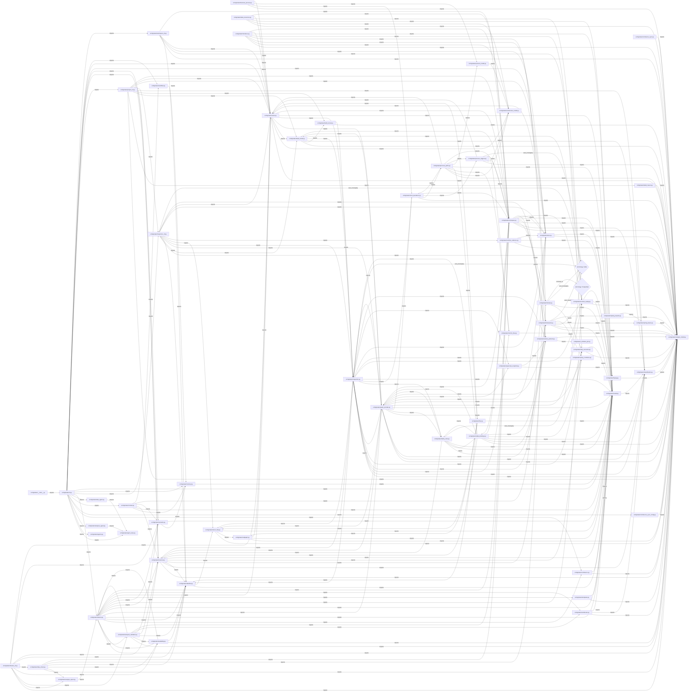

# Repository knowledge graph

> Generated locally by kgmaker. Structural edges come from source text; name-based call edges are heuristic.
> Review semantic conclusions with the repository's Copilot knowledge-graph agent.

- Scope: production; omitted files: 371
- Mode: SOURCE_ONLY; coverage: PARTIAL; no build/test/runtime result is implied.
- Freshness below describes the captured snapshot; use `kgmaker status` to compare current inputs.
- Context: `8694263110b0ea8095117585bc3ae9f341166c1047d792eb6857a6abeb041095`; content: `2a55aafc4516d367932c43ed9c40a56fcb26bb0f388e407e8c67da489eb0cd5b`; freshness: CONTENT_VERIFIED
- Files indexed: 73
- Symbols and sections: 959
- Internal imports: 271
- Heuristic cross-file calls: 4940
- PostgreSQL tables/columns: 0/0
- Kafka topics: 0
- API endpoints: 0
- TypeScript frontend routes: 0
- Workbooks/cells: 0/0
- Templates/fragments/variables/conditions: 0/0/0/0
- Semantic concepts: 0
- Implementation episodes: 225
- Inferred/ambiguous relationships: 4940/0

## Architecture diagram

The diagram groups declarations under their source files and shows detected imports and domain relationships. Heuristic call edges are omitted. An editable standalone Mermaid source is available at `.kgmaker/GRAPH.mmd`.

## Files and symbols

### `src/kgmaker/__init__.py`
- No declarations extracted.

### `src/kgmaker/__main__.py`
- No declarations extracted.

### `src/kgmaker/_windows_job.py`
- **class** `Job` line 4 — `Job`
- **function** `__init__` line 7 — `__init__(self)`
- **class** `Basic` line 26 — `Basic(ctypes.Structure)`
- **class** `Extended` line 32 — `Extended(ctypes.Structure)`
- **function** `attach_and_resume` line 47 — `attach_and_resume(self, process)`
- **class** `ThreadEntry` line 59 — `ThreadEntry(ctypes.Structure)`
- **function** `terminate` line 85 — `terminate(self)`
- **function** `close` line 89 — `close(self)`

### `src/kgmaker/agent_rules.py`
- No declarations extracted.

### `src/kgmaker/agents.py`
- No declarations extracted.

### `src/kgmaker/analysis_agent.py`
- No declarations extracted.

### `src/kgmaker/analysis_model.py`
- **class** `AnalysisError` line 31 — `AnalysisError(ValueError)`
- **function** `__init__` line 34 — `__init__(self, message: str, code: int = 2)`
- **function** `canonical` line 37 — `canonical(value: Any)`
- **function** `digest` line 41 — `digest(value: Any)`
- **function** `file_hash` line 45 — `file_hash(path: Path)`
- **function** `safe_path` line 49 — `safe_path(root: Path, value: str)`
- **function** `analysis_dir` line 67 — `analysis_dir(root: Path, analysis_id: str)`
- **function** `read_json` line 73 — `read_json(path: Path)`
- **function** `reject_constant` line 76 — `reject_constant(value: str)`
- **function** `unique` line 78 — `unique(pairs: list)`
- **function** `atomic_write` line 89 — `atomic_write(path: Path, text: str)`
- **function** `write_json` line 103 — `write_json(path: Path, value: Any)`
- **class** `FeatureAnalysis` line 110 — `FeatureAnalysis` — Serializable envelope. Nested contracts are checked by analysis_validation.
- **function** `from_dict` line 115 — `from_dict(cls, data: Any)`
- **function** `to_dict` line 132 — `to_dict(self)`
- **function** `inventory_candidate` line 135 — `inventory_candidate(packet: dict)`

### `src/kgmaker/analysis_report.py`
- **function** `cell` line 16 — `cell(value)`
- **function** `render_report` line 24 — `render_report(candidate: dict, packet: dict, stale: list[str], applied: bool = True, *, data_audit: dict | None = None)`
- **function** `section` line 34 — `section(index)`
- **function** `objects` line 36 — `objects(items)`

### `src/kgmaker/analysis_validation.py`
- **class** `_Anchors` line 17 — `_Anchors(HTMLParser)`
- **function** `__init__` line 20 — `__init__(self)`
- **function** `handle_starttag` line 23 — `handle_starttag(self, tag, attrs)`
- **function** `_location` line 28 — `_location(root: Path, item: dict, packet: dict)`
- **function** `validate_candidate` line 118 — `validate_candidate(root: Path, packet: dict, data: object)`
- **function** `_validate_candidate` line 125 — `_validate_candidate(root: Path, packet: dict, data: object)`
- **function** `strings` line 203 — `strings(item, key, choices=None, nullable=False)`
- **function** `refs` line 210 — `refs(item, key, targets, required=False)`
- **function** `visit` line 301 — `visit(identity)`

### `src/kgmaker/architecture_model.py`
- **class** `ViewValidationError` line 24 — `ViewValidationError(ValueError)`
- **function** `__init__` line 28 — `__init__(self, errors: list[dict[str, str]])`
- **function** `_reference_buckets` line 32 — `_reference_buckets(refs: Sequence[str], supporting: Sequence[str] = ()`
- **function** `_canonical_freshness` line 41 — `_canonical_freshness(value: Any)`
- **function** `raw_contexts_for_claim` line 250 — `raw_contexts_for_claim(edge: ViewEdge)`
- **function** `_canonical` line 255 — `_canonical(value: Any)`
- **class** `ViewNode` line 262 — `ViewNode`
- **function** `to_dict` line 276 — `to_dict(self)`
- **class** `ViewEdge` line 294 — `ViewEdge`
- **function** `to_dict` line 308 — `to_dict(self)`
- **class** `ViewDocument` line 326 — `ViewDocument`
- **function** `to_dict` line 341 — `to_dict(self, *, include_generation_metadata: bool = True)`
- **function** `to_json` line 362 — `to_json(self, *, include_generation_metadata: bool = True)`
- **function** `content_fingerprint` line 367 — `content_fingerprint(self)`
- **function** `from_dict` line 371 — `from_dict(cls, data: Mapping[str, Any])`
- **function** `ref_buckets` line 375 — `ref_buckets(item: Mapping[str, Any])`
- **function** `validate_view_document` line 419 — `validate_view_document(data: Mapping[str, Any])`
- **function** `err` line 424 — `err(code: str, path: str)`

### `src/kgmaker/availability.py`
- **function** `observation_staleness` line 14 — `observation_staleness(candidate: dict)`
- **function** `evaluate_proof` line 35 — `evaluate_proof(root, packet, candidate, item, graph=None)`

### `src/kgmaker/build_maven.py`
- **function** `_tag` line 19 — `_tag(name: str)`
- **function** `_text` line 23 — `_text(parent: ET.Element | None, name: str, default: str | None = None)`
- **function** `_children` line 31 — `_children(parent: ET.Element | None, name: str)`
- **function** `_interpolate` line 35 — `_interpolate(value: str | None, properties: dict[str, str])`
- **function** `_parse` line 41 — `_parse(path: Path, root: Path, properties: dict[str, str])`
- **function** `discover` line 79 — `discover(root: Path)`
- **function** `visit` line 90 — `visit(path: Path, inherited: dict[str, str])`

### `src/kgmaker/build_model.py`
- **function** `_validate_toolchain_selection` line 15 — `_validate_toolchain_selection(value: object)`
- **function** `validate_kotlin_options` line 40 — `validate_kotlin_options(options: dict)`
- **function** `validate_manifest` line 77 — `validate_manifest(root: Path, manifest: dict)`
- **function** `import_manifest` line 266 — `import_manifest(root: Path, manifest: dict)`
- **function** `inspection_inputs` line 281 — `inspection_inputs(root: Path, manifest: dict, *, context_id: str | None, scope: str)`
- **function** `absolute` line 293 — `absolute(raw)`

### `src/kgmaker/build_runner.py`
- **function** `exporter_contract` line 22 — `exporter_contract(home: Path, build_system: str, adapter: Path, *, required=False)`
- **function** `snapshot` line 56 — `snapshot(root: Path)`
- **function** `_jdk_executable` line 72 — `_jdk_executable(java_home: Path, name: str)`
- **function** `_select_java_home` line 81 — `_select_java_home(java_home: Path | None)`
- **function** `build_output_realms` line 97 — `build_output_realms(contexts: list[dict])`
- **function** `register` line 102 — `register(path, realm)`
- **function** `tests_report` line 176 — `tests_report(work: Path, phase: str)`
- **function** `run_plan` line 192 — `run_plan(plan: dict, *, cancel_file: Path | None=None)`

### `src/kgmaker/business_process.py`
- **class** `BusinessProcessError` line 17 — `BusinessProcessError(ValueError)`
- **function** `__init__` line 20 — `__init__(self, code, message)`
- **function** `_fail` line 23 — `_fail(message)`
- **function** `_bounded` line 27 — `_bounded(value)`
- **function** `_document` line 59 — `_document(value)`
- **function** `_cyclic` line 68 — `_cyclic(nodes, edges)`
- **function** `_operation` line 96 — `_operation(node, provenance)`
- **function** `_collapse` line 151 — `_collapse(doc)`
- **function** `normal` line 165 — `normal(edge)`
- **function** `_expand_impl` line 212 — `_expand_impl(doc, expected_document)`
- **function** `_public` line 258 — `_public(value, expand)`
- **function** `_expand_checked` line 277 — `_expand_checked(doc)`
- **function** `collapse_business_steps` line 283 — `collapse_business_steps(process)`
- **function** `expand_business_steps` line 288 — `expand_business_steps(process)`

### `src/kgmaker/callgraph.py`
- **function** `adjacency` line 9 — `adjacency(graph: KnowledgeGraph, include_candidates=True)`
- **function** `callees` line 41 — `callees(graph, symbol, *, scope="production", include_candidates=False)`
- **function** `callers` line 50 — `callers(graph, symbol, *, scope="production")`
- **function** `path` line 61 — `path(graph, source, target, *, scope="production", max_depth=30, max_nodes=5000, include_candidates=True)`
- **function** `strongly_connected` line 89 — `strongly_connected(graph: KnowledgeGraph)`

### `src/kgmaker/classification.py`
- **class** `Classification` line 20 — `Classification`
- **class** `Classifier` line 26 — `Classifier`
- **function** `__init__` line 29 — `__init__(self, root: Path, model: dict | None = None, strict: bool = False)`
- **function** `classify` line 59 — `classify(self, path: str)`

### `src/kgmaker/cli.py`
- **function** `_write_if_missing` line 243 — `_write_if_missing(path: Path, text: str, force: bool = False)`
- **function** `init` line 251 — `init(root: Path, force: bool = False)`
- **function** `scan` line 295 — `scan(root: Path, generate_docs: bool = True, confluence_dir: str | None = None, report: str | None = None)`
- **function** `status` line 331 — `status(root: Path)`
- **function** `check` line 365 — `check(root: Path)`
- **function** `docs` line 402 — `docs(root: Path, action: str | None = None, confluence_dir: str | None = None, report: str | None = None)`
- **function** `semantic_prepare` line 426 — `semantic_prepare(root: Path)`
- **function** `semantic_extract` line 440 — `semantic_extract(root: Path, base_ref: str, note_path: str | None = None, token_budget: int | None = None)`
- **function** `semantic_update` line 491 — `semantic_update(root: Path, base_ref: str, note_path: str | None = None, token_budget: int | None = None)`
- **function** `semantic_apply` line 572 — `semantic_apply(root: Path)`
- **function** `semantic_validate` line 592 — `semantic_validate(root: Path)`
- **function** `impact` line 607 — `impact(root: Path, changed_files: list[str])`
- **function** `memory_capture` line 705 — `memory_capture(root: Path, base: str, validation_values: list[str])`
- **function** `memory_recall` line 762 — `memory_recall(root: Path, terms: str, limit: int = 8, token_budget: int = 1_000)`
- **function** `task_add` line 782 — `task_add(root: Path, request: str, title: str | None, max_iterations: int)`
- **function** `task_list` line 793 — `task_list(root: Path, status_filter: str | None)`
- **function** `task_show` line 804 — `task_show(root: Path, task_id_value: str)`
- **function** `task_advance` line 814 — `task_advance(root: Path, task_id_value: str, target: str)`
- **function** `task_stop` line 824 — `task_stop(root: Path, task_id_value: str, reason: str)`
- **function** `task_record` line 834 — `task_record(root: Path, task_id_value: str, role: str, artifact_path: Path)`
- **function** `task_context` line 849 — `task_context(root: Path, task_id_value: str, role: str, token_budget: int)`
- **function** `hook_context` line 859 — `hook_context(root: Path, token_budget: int | None = None)`
- **function** `build_parser` line 879 — `build_parser`
- **function** `main` line 1014 — `main`

### `src/kgmaker/confluence.py`
- **function** `_norm` line 32 — `_norm(value: str)`
- **function** `_safe_rel` line 36 — `_safe_rel(path: str)`
- **function** `_sha` line 40 — `_sha(path: Path)`
- **class** `ConfluenceDocument` line 51 — `ConfluenceDocument`
- **class** `DocumentationAssertion` line 66 — `DocumentationAssertion`
- **class** `_ExportHTMLParser` line 89 — `_ExportHTMLParser(HTMLParser)`
- **function** `__init__` line 95 — `__init__(self)`
- **function** `_attrs` line 114 — `_attrs(self, attrs: list[tuple[str, str | None]])`
- **function** `handle_starttag` line 117 — `handle_starttag(self, tag: str, attrs: list[tuple[str, str | None]])`
- **function** `handle_endtag` line 148 — `handle_endtag(self, tag: str)`
- **function** `handle_data` line 178 — `handle_data(self, data: str)`
- **function** `text` line 192 — `text(self)`
- **function** `_resolve_local_ref` line 196 — `_resolve_local_ref(value: str, current_file: str)`
- **function** `_parse_mermaid` line 203 — `_parse_mermaid(source: str)`
- **function** `_parse_drawio` line 218 — `_parse_drawio(path: Path, source_file: str)`
- **function** `_parse_svg` line 241 — `_parse_svg(path: Path)`
- **function** `_document_from_html` line 252 — `_document_from_html(path: Path, export_root: Path, digest: str)`
- **function** `_load_cache` line 271 — `_load_cache(root: Path)`
- **function** `_write_cache` line 279 — `_write_cache(root: Path, payload: dict[str, Any])`
- **function** `discover_export` line 285 — `discover_export(export_root: Path)`
- **function** `ingest_export` line 289 — `ingest_export(export_root: Path, repository_root: Path)`
- **function** `current_documentation_assertions` line 368 — `current_documentation_assertions(cache: dict[str, Any])`
- **function** `_assertions_from_document` line 388 — `_assertions_from_document(doc: ConfluenceDocument)`
- **function** `_code_nodes` line 437 — `_code_nodes(graph: KnowledgeGraph)`
- **function** `_missing_category` line 444 — `_missing_category(assertion: DocumentationAssertion)`
- **function** `validate_documents` line 456 — `validate_documents(documents: list[ConfluenceDocument], graph: KnowledgeGraph)`
- **function** `merge_into_graph` line 511 — `merge_into_graph(graph: KnowledgeGraph, documents: list[ConfluenceDocument], attachments: list[dict[str, Any]], assertions: list[DocumentationAssertion])`
- **function** `render_report` line 552 — `render_report(assertions: list[DocumentationAssertion], report_path: Path, export_root: Path, revision: str = "working tree")`
- **function** `persist_validation_index` line 586 — `persist_validation_index(root: Path, assertions: list[DocumentationAssertion])`
- **function** `resolve_confluence_dir` line 597 — `resolve_confluence_dir(root: Path, cli_value: str | None)`
- **function** `documentation_check` line 631 — `documentation_check(root: Path, confluence_dir: str | None = None, report: str | None = None, graph: KnowledgeGraph | None = None)`

### `src/kgmaker/confluence_sync.py`
- **class** `PageSnapshot` line 20 — `PageSnapshot`
- **class** `PublishPackage` line 31 — `PublishPackage`
- **class** `Approval` line 46 — `Approval`
- **class** `PublishAudit` line 58 — `PublishAudit`
- **class** `ConfluenceSyncAdapter` line 69 — `ConfluenceSyncAdapter(Protocol)`
- **function** `pull` line 74 — `pull(self, page_ids: list[str])`
- **function** `_validate_page` line 79 — `_validate_page(page: PageSnapshot)`
- **class** `FakeConfluenceAdapter` line 88 — `FakeConfluenceAdapter`
- **function** `__init__` line 95 — `__init__(self, pages: list[PageSnapshot])`
- **function** `pull` line 103 — `pull(self, page_ids: list[str])`
- **function** `mutate_page` line 126 — `mutate_page(self, page_id: str, content: str)`
- **function** `pull_selected` line 131 — `pull_selected(adapter: ConfluenceSyncAdapter, page_ids: list[str])`
- **function** `save_pull_snapshot` line 139 — `save_pull_snapshot(root: Path, snapshot: dict, name: str = "pull-snapshot.json")`
- **function** `_markers` line 149 — `_markers(section: str)`
- **function** `_replace_section` line 155 — `_replace_section(content: str, section: str, body: str)`
- **function** `prepare_publish` line 170 — `prepare_publish(page: PageSnapshot, managed_section: str, proposed_section: str)`
- **function** `_package_hash` line 189 — `_package_hash(package: PublishPackage)`
- **function** `_package_diff` line 194 — `_package_diff(package: PublishPackage)`
- **function** `_validate_package` line 203 — `_validate_package(package: PublishPackage)`
- **function** `_approval_id` line 210 — `_approval_id(approval: Approval)`
- **function** `approve` line 215 — `approve(package: PublishPackage, decision_id: str)`
- **function** `audit_json` line 250 — `audit_json(audit: PublishAudit)`

### `src/kgmaker/confluence_sync_config.py`
- **class** `ConfluenceConnectionConfiguration` line 20 — `ConfluenceConnectionConfiguration`
- **function** `_unique_object` line 28 — `_unique_object(pairs)`
- **function** `_reject_constant` line 37 — `_reject_constant(_value)`
- **function** `_environment_name` line 41 — `_environment_name(value, field)`
- **function** `_connection` line 47 — `_connection(value)`
- **function** `load_connection_configuration` line 94 — `load_connection_configuration(root: Path, config_file: Path | None = None)`
- **function** `register` line 146 — `register(sub)`
- **function** `run` line 154 — `run(args)`

### `src/kgmaker/context.py`
- **class** `ContextError` line 28 — `ContextError(ValueError)`
- **function** `_terms` line 32 — `_terms(text: str)`
- **function** `_origin` line 36 — `_origin(kind: str)`
- **function** `_node_payload` line 44 — `_node_payload(node: Any, include_summary: bool = True)`
- **function** `_score_node` line 58 — `_score_node(node: Any, terms: list[str])`
- **function** `_rank_nodes` line 64 — `_rank_nodes(graph: KnowledgeGraph, terms: list[str], limit: int)`
- **function** `_neighbors` line 80 — `_neighbors(graph: KnowledgeGraph, seeds: list[Any], limit: int)`
- **function** `_episode_items` line 104 — `_episode_items(graph: KnowledgeGraph, terms: list[str], limit: int)`
- **function** `_semantic_hits` line 135 — `_semantic_hits(graph: KnowledgeGraph, root: Path, terms: list[str], limit: int)`
- **function** `_impact_items` line 164 — `_impact_items(graph: KnowledgeGraph, seed_paths: list[str], limit: int)`
- **function** `_compact_artifact` line 218 — `_compact_artifact(artifact: dict[str, Any])`
- **function** `_query_terms` line 237 — `_query_terms(task: dict[str, Any])`
- **function** `_token_estimate` line 249 — `_token_estimate(payload: dict[str, Any])`
- **function** `_truncate` line 254 — `_truncate(packet: dict[str, Any], token_budget: int)`
- **function** `_select_prior` line 275 — `_select_prior(task: dict[str, Any], role: str)`
- **function** `_graph_status` line 291 — `_graph_status(root: Path, graph: KnowledgeGraph | None)`
- **function** `_test_nodes` line 303 — `_test_nodes(graph: KnowledgeGraph, terms: list[str], limit: int)`
- **function** `_render_markdown` line 422 — `_render_markdown(packet: dict[str, Any], task: dict[str, Any])`

### `src/kgmaker/control_flow.py`
- **class** `Environment` line 17 — `Environment`
- **class** `Builder` line 23 — `Builder`
- **function** `__init__` line 26 — `__init__(self, method: str, context_id: str, *, max_blocks: int = 3000, max_depth: int = 150)`
- **function** `node` line 34 — `node(self, kind, label, ir, env)`
- **function** `edge` line 50 — `edge(self, source, target, kind="normal", **metadata)`
- **function** `computation` line 56 — `computation(self, ir, destination, env, kind="basic_block", label=None)`
- **function** `abrupt` line 63 — `abrupt(self, destination, env, *, keep=0, reason="return", depth=0)`
- **function** `condition` line 73 — `condition(self, ir, when_true, when_false, env, depth)`
- **function** `emit` line 95 — `emit(self, ir, destination, env, depth=0)`
- **function** `boundary` line 213 — `boundary(self, ir, reason, env)`
- **function** `build` line 217 — `build(self, body: dict)`
- **function** `from_body` line 230 — `from_body(record: dict, **limits)`

### `src/kgmaker/data_agent.py`
- No declarations extracted.

### `src/kgmaker/data_check.py`
- **function** `_object` line 19 — `_object(value, required, optional=())`
- **function** `_array` line 24 — `_array(value, label)`
- **function** `_ids` line 29 — `_ids(value, allowed, label)`
- **function** `data_check` line 35 — `data_check(root: Path, analysis_id: str, specification: dict)`
- **function** `reference_evidence` line 54 — `reference_evidence(reference, identity)`

### `src/kgmaker/data_resources.py`
- **class** `DataResourceError` line 21 — `DataResourceError(ValueError)`
- **function** `issue` line 58 — `issue(code, **fields)`
- **function** `local_path` line 63 — `local_path(path)`
- **function** `current` line 74 — `current(path, checksum)`
- **function** `owners` line 84 — `owners(repo, path, context=None)`
- **function** `realm` line 104 — `realm(database, stream)`
- **function** `resource` line 107 — `resource(repo, selected_realm, boundary)`
- **function** `source_proof` line 118 — `source_proof(source_id, *, kind='SOURCE_ONLY', checksum=None, derivation=None)`
- **function** `endpoint_matches` line 244 — `endpoint_matches(node, context)`
- **function** `edge_reference` line 260 — `edge_reference(edge)`
- **function** `proofs_for` line 266 — `proofs_for(edge, context)`

### `src/kgmaker/dataflow.py`
- **function** `masked` line 32 — `masked(text: str)`
- **function** `closing` line 38 — `closing(text: str, start: int, opening='(', ending=')')`
- **function** `parts` line 50 — `parts(text: str)`
- **class** `Extraction` line 57 — `Extraction`
- **function** `extract_dataflow` line 61 — `extract_dataflow(sources: dict[str, str])`
- **function** `node` line 68 — `node(path, kind, qualified, offset, signature=None, summary=None)`
- **function** `issue` line 78 — `issue(path, offset, reason)`
- **function** `relation` line 81 — `relation(source, target, kind, path, offset, evidence)`
- **function** `walk` line 146 — `walk(value, pointer='')`
- **function** `resolve` line 207 — `resolve(token)`
- **function** `expression` line 218 — `expression(value, destination, statement_offset)`
- **function** `impact_paths` line 283 — `impact_paths(graph: KnowledgeGraph, entity: str, max_depth: int = 20)`
- **function** `validate_argument_bindings` line 337 — `validate_argument_bindings(response: dict)`
- **function** `argument_parameter_bindings` line 402 — `argument_parameter_bindings(graph: KnowledgeGraph, call_site: str)`
- **function** `http_request_inventory` line 426 — `http_request_inventory(graph, *, callers=None)`

### `src/kgmaker/domain.py`
- **technology** `Kafka`
- **technology** `PostgreSQL`
- **function** `_line` line 67 — `_line(text: str, offset: int)`
- **function** `_unquote_identifier` line 71 — `_unquote_identifier(value: str)`
- **function** `_canon` line 75 — `_canon(value: str)`
- **function** `_node_id` line 79 — `_node_id(kind: str, key: str)`
- **function** `_shared_node` line 83 — `_shared_node(kind: str, key: str, display: str, path: str, line: int | None = None, summary: str | None = None)`
- **function** `_split_sql_items` line 87 — `_split_sql_items(body: str)`
- **function** `_sql_objects` line 110 — `_sql_objects(text: str, path: str, file_id: str)`
- **function** `_entity_edges` line 139 — `_entity_edges(text: str, path: str, symbols: list[Node], tables: dict[str, Node], columns: dict[str, Node])`
- **function** `_string_literals` line 193 — `_string_literals(value: str)`
- **function** `_kafka_references` line 197 — `_kafka_references(text: str, path: str, file_id: str)`
- **function** `boundary` line 202 — `boundary(offset)`
- **function** `add` line 209 — `add(topic: str, offset: int, relation: str, evidence: str)`
- **function** `normalize_api_path` line 262 — `normalize_api_path(path: str)`
- **function** `_api_node` line 273 — `_api_node(method: str, path: str, source: str, line: int | None, operation: str | None = None)`
- **function** `safe_path` line 301 — `safe_path(value)`
- **function** `_merge_api_node` line 343 — `_merge_api_node(first: Node, second: Node)`
- **function** `_keep_api` line 351 — `_keep_api(nodes: dict[str, Node], node: Node)`
- **function** `_mapping_path` line 355 — `_mapping_path(args: str)`
- **function** `_openapi_yaml` line 360 — `_openapi_yaml(text: str, path: str, file_id: str, *, source_sha256: str | None = None)`
- **function** `flush` line 372 — `flush(offset: int)`
- **function** `_openapi_json` line 405 — `_openapi_json(text: str, path: str, file_id: str, *, source_sha256: str | None = None)`
- **function** `_api_references` line 429 — `_api_references(text: str, path: str, language: str, file_id: str, *, source_sha256: str | None = None)`
- **function** `_typescript_routes` line 516 — `_typescript_routes(path: str, text: str, file_id: str)`
- **function** `_technology_nodes` line 550 — `_technology_nodes(text: str, path: str, file_id: str)`
- **function** `extract_domain` line 564 — `extract_domain(path: str, text: str, language: str, file_id: str, symbols: list[Node], *, source_sha256: str | None = None)`
- **function** `extract_openapi` line 599 — `extract_openapi(path: str, text: str, file_id: str, *, source_sha256: str | None = None)`
- **function** `connect_persistence` line 608 — `connect_persistence(symbols_by_file: dict[str, list[Node]], text_by_file: dict[str, str], nodes: list[Node])`
- **function** `merge_domain_nodes` line 639 — `merge_domain_nodes(nodes: list[Node])`

### `src/kgmaker/feature.py`
- **function** `_analysis_details` line 23 — `_analysis_details(graph)`
- **function** `source_inventory` line 40 — `source_inventory(root: Path)`
- **function** `current_graph` line 79 — `current_graph(root: Path, workspace: Path | None = None)`
- **function** `attach_schema` line 100 — `attach_schema(graph, schema, root: Path | None = None)`
- **function** `same_or_unqualified` line 109 — `same_or_unqualified(node)`
- **function** `source_path` line 139 — `source_path(root: Path, key: str, packet: dict)`
- **function** `graph_for_packet` line 146 — `graph_for_packet(root: Path, packet: dict)`
- **function** `packet_identity` line 249 — `packet_identity(packet: dict)`
- **function** `load_packet` line 253 — `load_packet(root: Path, analysis_id: str)`
- **function** `freshness` line 262 — `freshness(root: Path, packet: dict)`
- **function** `validate` line 403 — `validate(root: Path, analysis_id: str, candidate: dict)`
- **function** `apply` line 423 — `apply(root: Path, analysis_id: str, candidate: dict)`
- **function** `status` line 441 — `status(root: Path, analysis_id: str)`
- **function** `revise` line 450 — `revise(root: Path, analysis_id: str, answers: dict)`

### `src/kgmaker/feature_cli.py`
- **function** `register` line 11 — `register(subparsers)`
- **function** `run` line 41 — `run(args)`

### `src/kgmaker/flow.py`
- **function** `_label` line 11 — `_label(value)`
- **function** `control_flow` line 15 — `control_flow(graph, entry, *, scope="production", max_nodes=500, representation="SOURCE")`
- **function** `process` line 57 — `process(graph, entry, *, scope="production", max_depth=3, max_nodes=500)`
- **function** `expand` line 98 — `expand(method, depth, ancestry, prefix)`
- **function** `mermaid` line 176 — `mermaid(report)`
- **function** `markdown` line 197 — `markdown(report)`

### `src/kgmaker/flyway.py`
- **function** `version` line 22 — `version(value: str)`
- **function** `configuration` line 31 — `configuration(root: Path, overrides: dict | None = None)`
- **function** `migration_plan` line 148 — `migration_plan(root: Path, overrides: dict | None = None)`

### `src/kgmaker/framework.py`
- **function** `_simple` line 78 — `_simple(value: str)`
- **function** `_jpa_name_arg` line 82 — `_jpa_name_arg(args: str, names=("name", "value"))`
- **function** `_sql_identifier` line 96 — `_sql_identifier(value: str | None)`
- **function** `_line` line 109 — `_line(text: str, offset: int)`
- **function** `_args` line 113 — `_args(annotation: str)`
- **function** `_string_arg` line 118 — `_string_arg(args: str, names: tuple[str, ...] = ("name", "value", "path"))`
- **function** `_named_string_arg` line 129 — `_named_string_arg(args: str, name: str)`
- **function** `_annotation_values` line 134 — `_annotation_values(text: str, line: int)`
- **function** `_imports` line 150 — `_imports(text: str)`
- **function** `_allowed_annotation` line 154 — `_allowed_annotation(name: str, imports: set[str], families: tuple[str, ...])`
- **function** `_allowed_jpa_annotation` line 165 — `_allowed_jpa_annotation(name: str, imports: set[str])`
- **function** `_xml_local` line 182 — `_xml_local(element: ET.Element)`
- **function** `_xml_bool` line 190 — `_xml_bool(value: str | None)`
- **function** `_safe_jpa_xml` line 200 — `_safe_jpa_xml(root: Path, relative: str)`
- **function** `reject_doctype` line 226 — `reject_doctype(*_args)`
- **function** `_jpa_xml_model` line 243 — `_jpa_xml_model(root: Path, context: dict[str, Any])`
- **function** `_annotation_map` line 544 — `_annotation_map(symbol: dict[str, Any], source: str)`
- **function** `render_value` line 547 — `render_value(value: Any)`
- **function** `_format_annotation_value` line 587 — `_format_annotation_value(value: Any)`
- **function** `_annotation` line 601 — `_annotation(values: list[tuple[str, str]], name: str)`
- **function** `_class_args` line 605 — `_class_args(args: str)`
- **function** `_combined_state` line 611 — `_combined_state(*states: str)`
- **function** `_derived_query` line 615 — `_derived_query(method_name: str)`
- **function** `_path_text` line 646 — `_path_text(root: Path, path: str)`
- **function** `_node_id` line 655 — `_node_id(prefix: str, payload: Any)`
- **function** `augment_framework_graph` line 659 — `augment_framework_graph(root: Path, graph: KnowledgeGraph, context: dict[str, Any])`
- **function** `symbol_node` line 772 — `symbol_node(item: dict[str, Any])`
- **function** `bean_selection` line 775 — `bean_selection(values: list[tuple[str, str]])`
- **function** `expanded_annotations` line 791 — `expanded_annotations(values: list[tuple[str, str]], imports: set[str])`
- **function** `component_scan_state` line 821 — `component_scan_state(item: dict[str, Any])`
- **function** `condition_state` line 832 — `condition_state(values: list[tuple[str, str]], path: str, line: int | None)`
- **function** `class_for` line 848 — `class_for(item: dict[str, Any])`
- **function** `processor` line 890 — `processor(exact: str)`
- **function** `import_state` line 895 — `import_state(exact: str, state: str, reason: str)`
- **function** `registration_types` line 1188 — `registration_types(declared_type)`
- **function** `resolve_query_property` line 1299 — `resolve_query_property(model_owner: str, property_name: str)`
- **function** `repository_entity_owner` line 1322 — `repository_entity_owner(repository_symbol: dict[str, Any] | None)`
- **function** `in_schema_realm` line 1454 — `in_schema_realm(candidate: Node, declared_schema: str | None = None)`
- **function** `schema_table_matches` line 1478 — `schema_table_matches(candidate: Node, table_name, table_schema)`
- **function** `schema_column_matches` line 1482 — `schema_column_matches(candidate: Node, table_name, table_schema, column_name)`
- **function** `entity_index_key` line 1596 — `entity_index_key(declaration: dict[str, Any])`
- **function** `java_mapped_fields` line 1611 — `java_mapped_fields(declaration: dict[str, Any])`
- **function** `inherited_mapped_access` line 1634 — `inherited_mapped_access(symbol: dict[str, Any])`
- **function** `visit` line 1639 — `visit(owner: str)`
- **function** `property_site_annotations` line 1802 — `property_site_annotations(candidate: dict[str, Any])`
- **function** `mapped_ancestors` line 2080 — `mapped_ancestors(owner: str, seen: set[str] | None = None)`
- **function** `entity_ancestors` line 2104 — `entity_ancestors(owner: str, seen: set[str] | None = None)`
- **function** `mapped_ancestors_for_entity` line 2124 — `mapped_ancestors_for_entity(owner: str, seen: set[str] | None = None)`
- **function** `descriptor_return_owner` line 2582 — `descriptor_return_owner(descriptor: Any)`
- **function** `remove_attribute_columns` line 2749 — `remove_attribute_columns(attribute_id: str)`
- **function** `remove_entity_tables` line 2769 — `remove_entity_tables(entity_id: str)`
- **function** `entity_attribute_targets` line 2783 — `entity_attribute_targets(owner: str, attribute_name: str, class_kind: str)`
- **function** `xml_unknown` line 2806 — `xml_unknown(owner: str, record: dict[str, Any] | None, reason: str)`

### `src/kgmaker/graph_provider.py`
- **function** `_compiler_contexts` line 8 — `_compiler_contexts(graph: KnowledgeGraph, *, include_stale: bool = True)`
- **function** `_inspection_command` line 14 — `_inspection_command(context: dict)`
- **function** `_stale_context` line 37 — `_stale_context(context: dict, reason: str)`
- **function** `_selection_key` line 52 — `_selection_key(context: dict)`
- **function** `validate_context_snapshot` line 86 — `validate_context_snapshot(root: Path, context: dict)`
- **function** `validate_compiler_snapshot` line 220 — `validate_compiler_snapshot(root: Path, graph: KnowledgeGraph)`
- **function** `resolve_context_classpath_artifact` line 226 — `resolve_context_classpath_artifact(root: Path, context: dict, sha256: str)`
- **function** `merge_compiler_context` line 322 — `merge_compiler_context(root: Path, fresh: KnowledgeGraph, selected_context: dict)`
- **function** `retain_compiler_layer` line 339 — `retain_compiler_layer(root: Path, syntax: KnowledgeGraph)`

### `src/kgmaker/http_execution.py`
- **function** `uri_parts` line 24 — `uri_parts(value)`
- **function** `redact_uri_text` line 54 — `redact_uri_text(value: str, *, relative=True)`
- **function** `clean_uri` line 58 — `clean_uri(uri)` — Privacy applies even when this scheme is unsupported by HTTP analysis.
- **function** `_redact_tree` line 78 — `_redact_tree(value, *, relative=False)`
- **function** `prepare_context` line 87 — `prepare_context(root: Path, context: dict)`
- **function** `invalidate` line 117 — `invalidate(status)`
- **class** `_Value` line 158 — `_Value`
- **function** `_merge` line 166 — `_merge(left, right)`
- **class** `_Projection` line 172 — `_Projection`
- **function** `__init__` line 175 — `__init__(self, graph, context)`
- **function** `issue` line 185 — `issue(self, code, site=None)`
- **function** `target` line 192 — `target(self, site)`
- **function** `external` line 195 — `external(self, site, family)`
- **function** `escape` line 201 — `escape(self, origins, reason)`
- **function** `property_value` line 206 — `property_value(self, text)`
- **function** `reference` line 219 — `reference(self, record, aliases)`
- **function** `new` line 232 — `new(self, site, family, method, receiver, caller, conditional)`
- **function** `publisher` line 244 — `publisher(self, receiver, site)`
- **function** `update_uri` line 258 — `update_uri(self, origins, value, node)`
- **function** `call` line 289 — `call(self, node, aliases, caller, conditional)`
- **function** `trigger` line 360 — `trigger(self, receiver, site, conditional)`
- **function** `eval` line 373 — `eval(self, node, aliases, caller, conditional=False)`
- **function** `_eval` line 382 — `_eval(self, node, aliases, caller, conditional=False)`
- **function** `execute` line 430 — `execute(self, node, aliases, caller, conditional=False, depth=0)`
- **function** `feign` line 476 — `feign(self)`
- **function** `parents` line 479 — `parents(owner, seen)`
- **function** `finish` line 555 — `finish(self, bodies)`
- **function** `augment_http_graph` line 605 — `augment_http_graph(graph: KnowledgeGraph, bodies: list[dict], context: dict)`

### `src/kgmaker/inspection.py`
- **function** `artifact_hash` line 25 — `artifact_hash(path: Path)`
- **function** `worker_home` line 38 — `worker_home(path: Path | None = None)`
- **function** `_jvm_worker_jar` line 55 — `_jvm_worker_jar(home: Path, *, kotlin_backend="k1")`
- **function** `command` line 78 — `command(language: str, home: Path | None = None, *, kotlin_backend="k1")`
- **function** `distribution` line 123 — `distribution(language: str, home=None, *, kotlin_backend="k1")`
- **function** `sanitize` line 140 — `sanitize(value, *, key="", semantic=False)`
- **function** `source_snapshot` line 160 — `source_snapshot(root: Path, graph: KnowledgeGraph, selected: dict)`
- **function** `jpa_xml_input_snapshot` line 196 — `jpa_xml_input_snapshot(root: Path, selected: dict)`
- **function** `validate_response` line 281 — `validate_response(response: dict, selected_context: dict)`
- **function** `proof` line 385 — `proof(fact: dict, kind: str, *, source: str, target: str, relation: str)`
- **function** `relation` line 419 — `relation(source, target, name, fact, kind="SYMBOL_RESOLVED")`
- **function** `input_closure` line 528 — `input_closure(project: dict)`

### `src/kgmaker/inspection_cli.py`
- **function** `common` line 11 — `common(parser)`
- **function** `register` line 18 — `register(sub)`
- **function** `indexed` line 71 — `indexed(args)`
- **function** `run` line 101 — `run(args)`

### `src/kgmaker/interfaces.py`
- **class** `InterfaceProjectionError` line 25 — `InterfaceProjectionError(ValueError)`
- **function** `__init__` line 28 — `__init__(self, code, message)`
- **function** `_fail` line 31 — `_fail(code, message)`
- **function** `_registration` line 35 — `_registration(record, graph, path)`
- **function** `_mirror_mapping` line 75 — `_mirror_mapping(symbol, *, class_level=False)`
- **function** `strings` line 113 — `strings(key)`
- **function** `_canonical_owner` line 127 — `_canonical_owner(value)`
- **function** `_compiler_source_binding` line 131 — `_compiler_source_binding(symbol, node, context, graph)`
- **function** `_framework_edge_binding` line 166 — `_framework_edge_binding(edge, handler, endpoint, context, evidence, checksum)`
- **function** `_compiler_registrations` line 185 — `_compiler_registrations(handler, endpoint, symbols, graph, context, by_id)`
- **function** `component` line 240 — `component(value)`
- **function** `_coalesce_provider_variants` line 266 — `_coalesce_provider_variants(nodes, edges, diagnostics)`
- **function** `project_http_providers` line 307 — `project_http_providers(workspace, graph, *, scope='production', selected_contexts=None, source_coverage=None)`
- **function** `emit` line 344 — `emit(record, source, endpoint, edge, context_id, repo, *, evidence_kind='SYNTAX_CANDIDATE', handler_ids=(), class_id=None)`
- **function** `project_http_consumers` line 574 — `project_http_consumers(workspace, graph, *, scope='production', selected_contexts=None, source_coverage=None)`
- **function** `fail` line 612 — `fail(message)`
- **function** `local` line 615 — `local(identity, repo)`
- **function** `text` line 624 — `text(value)`
- **function** `strings` line 627 — `strings(value)`
- **function** `position` line 631 — `position(value)`
- **function** `declaration` line 639 — `declaration(identity, context)`
- **function** `site` line 645 — `site(identity, context, expected_caller=None)`
- **function** `binding` line 666 — `binding(request, source, locator, call_id, relation, context)`

### `src/kgmaker/kafka_bindings.py`
- **function** `_identifier` line 17 — `_identifier(value)`
- **function** `_path` line 21 — `_path(root, relative)`
- **function** `validate` line 36 — `validate(workspace)`
- **function** `_snapshot` line 126 — `_snapshot(root, path)`
- **function** `_properties` line 138 — `_properties(content)`
- **function** `sensitive_property` line 161 — `sensitive_property(key)`
- **function** `project_captured_context` line 168 — `project_captured_context(context)`
- **function** `_resolve` line 185 — `_resolve(key, properties, *, trace=None)`
- **function** `_context` line 205 — `_context(binding, graph, root)`
- **function** `_group` line 231 — `_group(prefix, properties, inputs, selected)`
- **function** `_code_reference` line 246 — `_code_reference(binding, graph, selected, root, topic, group)`
- **function** `build_links` line 278 — `build_links(workspace, graphs)`
- **function** `validate_snapshot` line 470 — `validate_snapshot(workspace, report)`

### `src/kgmaker/kafka_code.py`
- **function** `declaration_witness` line 18 — `declaration_witness(symbol: dict)`
- **function** `call_witness` line 23 — `call_witness(site: dict, target: dict)`
- **function** `analysis_stamp` line 31 — `analysis_stamp(context: dict)`
- **function** `validate_analysis` line 35 — `validate_analysis(root: Path, context: dict)`
- **function** `_string` line 52 — `_string(value, limit=4096)`
- **function** `_range` line 56 — `_range(value)`
- **function** `_property` line 66 — `_property(value, context, fingerprint=None)`
- **class** `_Capture` line 84 — `_Capture`
- **function** `__init__` line 87 — `__init__(self, root, graph, context)`
- **function** `issue` line 116 — `issue(self, reason, symbol=None)`
- **function** `source` line 124 — `source(self, symbol)`
- **function** `add` line 188 — `add(self, kind, symbol, source_node, metadata, *, origin_id=None, location=None, logical_extra=None, compiler_refs=())`
- **function** `listener` line 226 — `listener(self, symbol)`
- **function** `compiler_refs` line 299 — `compiler_refs(self, source, target, relation, symbol, location, extra=None)`
- **function** `token` line 317 — `token(self, symbol, where)`
- **function** `send` line 340 — `send(self, site, record, call)`
- **function** `producers` line 433 — `producers(self, bodies)`
- **function** `finish` line 465 — `finish(self, bodies)`
- **function** `augment_kafka_graph` line 484 — `augment_kafka_graph(root: Path, graph: KnowledgeGraph, bodies: list[dict], context: dict)`
- **function** `validate_code_fact` line 492 — `validate_code_fact(root: Path, graph: KnowledgeGraph, context: dict, fact: Node)`

### `src/kgmaker/local_operations.py`
- **function** `_fail` line 21 — `_fail(message)`
- **function** `_range` line 25 — `_range(value)`
- **function** `_walk` line 35 — `_walk(root)`
- **function** `_checksum` line 50 — `_checksum(context, path)`
- **function** `_ir_digest` line 58 — `_ir_digest(value)`
- **function** `_literal` line 65 — `_literal(value)`
- **function** `_assignable` line 94 — `_assignable(literal, target)`
- **function** `_validate_operations` line 109 — `_validate_operations(response, context)`
- **function** `validate_operations` line 202 — `validate_operations(response, context)`
- **function** `annotated_bodies` line 209 — `annotated_bodies(response, context)`
- **function** `materialize_operations` line 221 — `materialize_operations(graph, records, context)`
- **function** `_original_proof` line 270 — `_original_proof(proof, context)`
- **function** `original` line 281 — `original(value)`
- **function** `validated_cfg_operations` line 301 — `validated_cfg_operations(graph, context)`

### `src/kgmaker/memory.py`
- **class** `EpisodeValidationError` line 23 — `EpisodeValidationError(ValueError)`
- **class** `CaptureError` line 27 — `CaptureError(ValueError)`
- **function** `_canonical_payload` line 31 — `_canonical_payload(record: dict[str, Any])`
- **function** `episode_id` line 35 — `episode_id(record: dict[str, Any])`
- **function** `_safe_path` line 43 — `_safe_path(value: Any, field: str)`
- **function** `_string_list` line 52 — `_string_list(value: Any, field: str, limit: int = 2_000)`
- **function** `validate_episode` line 62 — `validate_episode(record: Any, index: int | None = None)`
- **function** `episode_freshness` line 130 — `episode_freshness(record: dict[str, Any], current_files: dict[str, str])`
- **function** `project_episode` line 145 — `project_episode(record: dict[str, Any], current_nodes: set[str], current_files: dict[str, str])`
- **function** `_terms` line 158 — `_terms(text: str)`
- **function** `_text_score` line 162 — `_text_score(query: list[str], exact_query: str, fields: list[str])`
- **function** `parse_validations` line 255 — `parse_validations(values: list[str])`
- **function** `_git` line 275 — `_git(root: Path, *args: str)`
- **function** `is_sensitive_path` line 285 — `is_sensitive_path(path: str)`
- **function** `_sensitive_path` line 298 — `_sensitive_path(path: str)`
- **function** `_changed_paths` line 302 — `_changed_paths(root: Path, base_commit: str)`
- **function** `_file_hash` line 332 — `_file_hash(root: Path, path: str)`
- **function** `_node_payload` line 344 — `_node_payload(node: Node)`

### `src/kgmaker/model.py`
- **class** `Node` line 10 — `Node`
- **class** `Edge` line 27 — `Edge`
- **class** `KnowledgeGraph` line 42 — `KnowledgeGraph`
- **function** `migrate_legacy` line 56 — `migrate_legacy(self)`
- **function** `to_dict` line 71 — `to_dict(self)`
- **function** `from_dict` line 90 — `from_dict(cls, data: dict[str, Any])`

### `src/kgmaker/process_model.py`
- **function** `_canonical` line 32 — `_canonical(value)`
- **function** `_fingerprint` line 36 — `_fingerprint(value)`
- **class** `_Validation` line 40 — `_Validation`
- **function** `__init__` line 43 — `__init__(self)`
- **function** `error` line 45 — `error(self, code, path)`
- **function** `object` line 50 — `object(self, value, allowed, required, path)`
- **function** `strings` line 60 — `strings(self, value, path, *, nonempty=False)`
- **function** `json` line 70 — `json(self, value)`
- **function** `finish` line 76 — `finish(self)`
- **function** `_definition` line 80 — `_definition(data, check, prefix='definition')`
- **function** `validate_process_definition` line 99 — `validate_process_definition(data)`
- **function** `_canonical_definition` line 108 — `_canonical_definition(data)`
- **function** `validate_process_view` line 115 — `validate_process_view(data)`
- **function** `scope_context` line 173 — `scope_context(item, path)`
- **class** `ProcessDefinition` line 307 — `ProcessDefinition` — Declared process identity and revision; approval here is supplied metadata.
- **function** `__post_init__` line 310 — `__post_init__(self)`
- **function** `from_dict` line 316 — `from_dict(cls, data)`
- **function** `to_dict` line 318 — `to_dict(self)`
- **function** `to_json` line 321 — `to_json(self)`
- **function** `content_fingerprint` line 326 — `content_fingerprint(self)`
- **function** `process_id` line 330 — `process_id(self)`
- **function** `revision` line 332 — `revision(self)`
- **function** `scope` line 334 — `scope(self)`
- **function** `semantic_review_status` line 336 — `semantic_review_status(self)`
- **function** `trigger_ids` line 338 — `trigger_ids(self): return tuple(self._document['trigger_ids'])`
- **class** `ProcessView` line 342 — `ProcessView` — Technical view plus a strictly separate, non-executable semantic overlay.
- **function** `__post_init__` line 345 — `__post_init__(self)`
- **function** `from_dict` line 351 — `from_dict(cls, data)`
- **function** `to_dict` line 353 — `to_dict(self, *, include_generation_metadata=True)`
- **function** `to_json` line 365 — `to_json(self, *, include_generation_metadata=True)`
- **function** `content_fingerprint` line 370 — `content_fingerprint(self)`
- **function** `technical_fingerprint` line 374 — `technical_fingerprint(self)`
- **function** `definition` line 376 — `definition(self): return ProcessDefinition.from_dict(self._document['definition'])`
- **function** `technical_view` line 378 — `technical_view(self): return ViewDocument.from_dict(self._document['technical_view'])`
- **function** `steps` line 380 — `steps(self)`
- **function** `transitions` line 382 — `transitions(self)`
- **function** `outcome_ids` line 384 — `outcome_ids(self): return tuple(sorted(self._document['outcome_ids']))`
- **function** `technical_status` line 386 — `technical_status(self)`

### `src/kgmaker/process_paths.py`
- **class** `ProcessPathError` line 23 — `ProcessPathError(ValueError)`
- **function** `__init__` line 26 — `__init__(self, code, message)`
- **function** `_fail` line 29 — `_fail(code, message)`
- **function** `_source_checksum` line 33 — `_source_checksum(graph, context, path)`
- **function** `_selected_trigger` line 42 — `_selected_trigger(graph, inventory, trigger_id)`
- **function** `_cfg_proofs` line 123 — `_cfg_proofs(graph, context, nodes, symbols)`
- **function** `_proved_sites` line 173 — `_proved_sites(graph, context, nodes, symbols)`
- **function** `canonical` line 177 — `canonical(value, expected)`
- **function** `proof` line 204 — `proof(p, source, target, relation)`
- **function** `boundary` line 262 — `boundary(reason)`

### `src/kgmaker/process_triggers.py`
- **class** `TriggerInventoryError` line 24 — `TriggerInventoryError(ValueError)`
- **function** `__init__` line 28 — `__init__(self, code, message)`
- **function** `_annotations` line 31 — `_annotations(symbol)`
- **function** `_same_line` line 36 — `_same_line(value, canonical)`
- **function** `_canonical_symbol` line 40 — `_canonical_symbol(symbol, node, context)`
- **function** `discover_process_triggers` line 81 — `discover_process_triggers(workspace, graph, *, source_coverage, scope='production', selected_contexts=None)`
- **function** `issue` line 126 — `issue(code, source_id=None, **fields)`
- **function** `local_path` line 131 — `local_path(path, repo)`
- **function** `current` line 139 — `current(path, checksum, repo)`
- **function** `endpoint_valid` line 150 — `endpoint_valid(node, context)`
- **function** `body_status` line 164 — `body_status(method, context)`

### `src/kgmaker/project_cli.py`
- **function** `common` line 13 — `common(parser)`
- **function** `register` line 21 — `register(sub)`
- **function** `run` line 71 — `run(args)`

### `src/kgmaker/return_flow.py`
- **function** `_range` line 17 — `_range(value)`
- **function** `_info` line 27 — `_info(value)`
- **function** `_enum` line 33 — `_enum(value,allowed)`
- **function** `_children` line 37 — `_children(node)`
- **function** `_child_shapes` line 52 — `_child_shapes(node)`
- **function** `validate_return_ir` line 67 — `validate_return_ir(response,context=None)`
- **function** `index` line 81 — `index(values)`
- **function** `enclosing_owners` line 86 — `enclosing_owners(value)`
- **function** `location` line 97 — `location(value,owner=None)`
- **class** `_Projection` line 203 — `_Projection`
- **function** `__init__` line 206 — `__init__(self,graph,bodies,context)`
- **function** `issue` line 215 — `issue(self,reason,node=None)`
- **function** `node` line 220 — `node(self,identity,role,loc,info,**extra)`
- **function** `edge` line 235 — `edge(self,source,target,loc,kind,*,site=None,condition=None,guards=(),transformation='DIRECT',**extra)`
- **function** `direct` line 253 — `direct(self,site)`
- **function** `status` line 262 — `status(self,site,status,reason)`
- **function** `expression` line 265 — `expression(self,node,env,guards=(),condition=None,depth=0)`
- **function** `execute` line 349 — `execute(self,node,env,guards=(),depth=0)`
- **function** `finish` line 382 — `finish(self)`
- **function** `augment_return_flow` line 449 — `augment_return_flow(graph:KnowledgeGraph,bodies:list[dict],context:dict)`
- **function** `return_consumer_bindings` line 453 — `return_consumer_bindings(graph:KnowledgeGraph,call_site:str|None=None)`

### `src/kgmaker/runtime_evidence.py`
- **function** `_check_hashes` line 16 — `_check_hashes(root: Path, context: dict[str, Any], manifest: dict[str, Any])`
- **function** `validate_manifest` line 36 — `validate_manifest(graph: KnowledgeGraph, root: Path, manifest: dict[str, Any])`
- **function** `import_manifest` line 69 — `import_manifest(root: Path, manifest: dict[str, Any], *, graph: KnowledgeGraph | None = None)`

### `src/kgmaker/scanner.py`
- **function** `_safe_source` line 84 — `_safe_source(path: Path)`
- **function** `_safe_text` line 99 — `_safe_text(path: Path)`
- **function** `_file_digest` line 103 — `_file_digest(text: str)`
- **function** `_public_source_text` line 107 — `_public_source_text(value: str)`
- **function** `_stable_id` line 114 — `_stable_id(kind: str, path: str, name: str, line: int | None = None)`
- **function** `_line_for` line 119 — `_line_for(text: str, offset: int)`
- **function** `_doc_for_line` line 123 — `_doc_for_line(lines: list[str], index: int)`
- **function** `_extract_symbols` line 131 — `_extract_symbols(text: str, path: str, language: str)`
- **function** `_imports` line 187 — `_imports(text: str, language: str)`
- **function** `_candidate_paths` line 205 — `_candidate_paths(root: Path, source: str, import_name: str, known_files: set[str])`
- **function** `_should_skip` line 234 — `_should_skip(path: Path, relative: Path)`
- **function** `_candidate_files` line 245 — `_candidate_files(root: Path, project_model: dict | None = None)`
- **function** `selected_directory` line 252 — `selected_directory(name)`
- **function** `scan_repository` line 268 — `scan_repository(root: Path, *, project_model: dict | None = None, strict: bool = False)`

### `src/kgmaker/schema_replay.py`
- **function** `persistence_pair` line 19 — `persistence_pair(database_id, stream_id)`
- **function** `persistence_selection` line 26 — `persistence_selection(context)`
- **function** `realm_prefix` line 36 — `realm_prefix(config)`
- **function** `schema_realm` line 43 — `schema_realm(schema, *, schema_name=None)`
- **function** `schema_node_realm` line 55 — `schema_node_realm(node)`
- **function** `statements` line 94 — `statements(text: str)`
- **function** `identifier` line 158 — `identifier(token: str)`
- **function** `groups` line 166 — `groups(tokens: list[str])`
- **class** `Replay` line 178 — `Replay`
- **function** `__init__` line 181 — `__init__(self, config: dict)`
- **function** `name` line 186 — `name(self, tokens, offset=0)`
- **function** `key` line 196 — `key(kind, name)`
- **function** `create` line 198 — `create(self, kind, name, **attributes)`
- **function** `get` line 211 — `get(self, kind, name)`
- **function** `change` line 217 — `change(self, item)`
- **function** `drop` line 221 — `drop(self, kind, name, optional=False)`
- **function** `rename` line 231 — `rename(self, kind, name, target)`
- **function** `constraint` line 255 — `constraint(self, table, tokens, fallback)`
- **function** `column` line 281 — `column(self, table, tokens)`
- **function** `apply` line 306 — `apply(self, tokens)`
- **function** `reconstruct` line 469 — `reconstruct(root: Path, config: dict | None = None, *, use_cache: bool = True)`
- **function** `schema_diff` line 538 — `schema_diff(root: Path, config: dict, start: str, end: str)`
- **function** `graph_entities` line 547 — `graph_entities(schema: dict)`
- **function** `schema_mappings` line 589 — `schema_mappings(root: Path, schema: dict, graph)`

### `src/kgmaker/semantic.py`
- **class** `SemanticValidationError` line 33 — `SemanticValidationError(ValueError)`
- **function** `concept_id` line 37 — `concept_id(source_file: str, name: str)`
- **function** `graph_fingerprint` line 43 — `graph_fingerprint(graph: KnowledgeGraph)`
- **function** `build_semantic_input` line 55 — `build_semantic_input(graph: KnowledgeGraph)`
- **function** `_positive_line` line 77 — `_positive_line(value: Any, field: str)`
- **function** `_check_line` line 85 — `_check_line(root: Path, source_file: str, line: int | None, field: str, line_counts: dict[str, int])`
- **function** `validate_semantic_data` line 100 — `validate_semantic_data(data: Any, graph: KnowledgeGraph, root: Path)`
- **function** `_run_git` line 227 — `_run_git(root: Path, *args: str, check: bool = True)`
- **function** `_is_sensitive_path` line 242 — `_is_sensitive_path(path: str)`
- **function** `apply_semantic_patch` line 440 — `apply_semantic_patch(patch: Any, update: Any, graph: KnowledgeGraph, root: Path)`
- **function** `apply_semantic_layer` line 562 — `apply_semantic_layer(graph: KnowledgeGraph, root: Path)`

### `src/kgmaker/spring_beans.py`
- **function** `_schema` line 6 — `_schema(value, fields, label)`
- **function** `_name` line 12 — `_name(value)`
- **function** `_method` line 16 — `_method(symbols, owner, name, context_id, descriptor=None)`
- **function** `registrar_info` line 23 — `registrar_info(symbol, symbols, context_id, reasons=())`
- **function** `factory_info` line 64 — `factory_info(symbol, symbols, context_id)`
- **function** `registration_assignability` line 160 — `registration_assignability(declared_type, field_type, injection_kind, types)`

### `src/kgmaker/spring_conditions.py`
- **class** `AnnotationArguments` line 16 — `AnnotationArguments(str)`
- **function** `__new__` line 20 — `__new__(cls, text, members, resolved=True)`
- **function** `__getnewargs__` line 26 — `__getnewargs__(self)`
- **function** `condition_inputs` line 29 — `condition_inputs(context)`
- **function** `_ignore_case` line 33 — `_ignore_case(actual, expected)`
- **function** `_strings` line 43 — `_strings(value)`
- **function** `_profile` line 50 — `_profile(expression, active)`
- **function** `group` line 59 — `group(depth=0)`
- **function** `atom` line 64 — `atom`
- **function** `_evaluate` line 101 — `_evaluate(name, members, context)`
- **function** `evaluate_conditions` line 157 — `evaluate_conditions(values, context)`

### `src/kgmaker/spring_imports.py`
- **function** `selector_info` line 14 — `selector_info(record: dict, types: dict, symbols: dict, context_id: str)`
- **function** `legacy_supertypes` line 32 — `legacy_supertypes(item)`

### `src/kgmaker/store.py`
- **function** `save_graph` line 38 — `save_graph(graph: KnowledgeGraph, root: Path, generate_docs: bool = True)`
- **function** `load_graph` line 55 — `load_graph(root: Path)`
- **function** `render_markdown` line 63 — `render_markdown(graph: KnowledgeGraph, scope: str = "production")`
- **function** `render_mermaid` line 176 — `render_mermaid(graph: KnowledgeGraph, scope: str = "production")`
- **function** `render_context` line 231 — `render_context(graph: KnowledgeGraph, limit: int = 8_000, root: Path | None = None)`
- **function** `render_bootstrap` line 277 — `render_bootstrap(graph: KnowledgeGraph, limit: int = 8_000)`
- **function** `_edge_details` line 306 — `_edge_details(edge)`

### `src/kgmaker/templates.py`
- **function** `_line` line 25 — `_line(text: str, offset: int)`
- **function** `_node_id` line 29 — `_node_id(kind: str, path: str, name: str)`
- **function** `_template_root` line 33 — `_template_root(path: str)`
- **function** `_expressions` line 41 — `_expressions(value: str)`
- **function** `_parse_fragment_declaration` line 70 — `_parse_fragment_declaration(value: str)`
- **function** `_split_arguments` line 85 — `_split_arguments(raw: str)`
- **function** `_parse_fragment_reference` line 95 — `_parse_fragment_reference(value: str)`
- **class** `_Fragment` line 116 — `_Fragment`
- **class** `_TemplateFacts` line 124 — `_TemplateFacts`
- **class** `_TemplateParser` line 131 — `_TemplateParser(HTMLParser)`
- **function** `__init__` line 134 — `__init__(self, path: str, source: str, file_node: Node, facts: _TemplateFacts)`
- **function** `_owner` line 144 — `_owner(self)`
- **function** `_variable_scope_blocked` line 153 — `_variable_scope_blocked(self)`
- **function** `_diagnostic` line 156 — `_diagnostic(self, code: str, reason: str, line: int, *, expression: str | None = None)`
- **function** `_variable` line 163 — `_variable(self, expression: str, line: int, usage: str)`
- **function** `_condition` line 194 — `_condition(self, attribute: str, value: str, line: int)`
- **function** `_attribute_expressions` line 231 — `_attribute_expressions(self, name: str, value: str, line: int)`
- **function** `handle_starttag` line 245 — `handle_starttag(self, tag, attrs)`
- **function** `handle_startendtag` line 360 — `handle_startendtag(self, tag, attrs)`
- **function** `handle_endtag` line 364 — `handle_endtag(self, tag)`
- **function** `handle_data` line 370 — `handle_data(self, data)`
- **function** `attach_templates` line 384 — `attach_templates(root: Path, graph: KnowledgeGraph)`

### `src/kgmaker/typescript_snapshot.py`
- **function** `_invalid` line 13 — `_invalid`
- **function** `_absolute` line 17 — `_absolute(value)`
- **function** `validate_capture` line 23 — `validate_capture(project)`
- **function** `canonical_path` line 56 — `canonical_path(value)`
- **function** `captured_sources` line 85 — `captured_sources(root: Path, project: dict)`
- **function** `_entries` line 97 — `_entries(root: Path, directory: Path)`
- **function** `replay` line 114 — `replay(root: Path, project: dict)`

### `src/kgmaker/views.py`
- **function** `_canonical_kind` line 20 — `_canonical_kind(value: Any)`
- **function** `_canonical_polarity` line 24 — `_canonical_polarity(value: Any)`
- **function** `_canonical_freshness` line 28 — `_canonical_freshness(value: Any)`
- **function** `_summarize_view_evidence` line 32 — `_summarize_view_evidence(refs, provenance)`
- **class** `ContextSelectionError` line 47 — `ContextSelectionError(ValueError)`
- **function** `__init__` line 51 — `__init__(self, diagnostic: dict)`
- **class** `ServiceInventoryError` line 55 — `ServiceInventoryError(ValueError)`
- **function** `__init__` line 59 — `__init__(self, diagnostic: dict)`
- **function** `fail` line 85 — `fail(code: str, message: str)`
- **function** `project` line 851 — `project(graph: KnowledgeGraph, scope: str = "production", *, view: str = "architecture", context_id: str | None = None)`
- **function** `rank` line 927 — `rank(graph: KnowledgeGraph, entry: str | None = None, profile: str = "execution", scope: str = "production")`

### `src/kgmaker/workbooks.py`
- **function** `binary_format` line 37 — `binary_format(header: bytes)`
- **function** `workbook_hash` line 52 — `workbook_hash(path: Path)`
- **function** `unsupported_binary` line 58 — `unsupported_binary(path: Path, relative: str)`
- **function** `_identity` line 72 — `_identity(kind: str, path: str, name: str)`
- **function** `_xml` line 76 — `_xml(archive: zipfile.ZipFile, name: str)`
- **function** `_part` line 93 — `_part(target: str)`
- **function** `_cell_value` line 112 — `_cell_value(cell: ET.Element, shared: list[str])`
- **function** `_column_number` line 126 — `_column_number(value: str)`
- **function** `_column_name` line 133 — `_column_name(value: int)`
- **function** `_range_cells` line 141 — `_range_cells(start: str, end: str | None)`
- **function** `_formula_syntax` line 154 — `_formula_syntax(expression: str)`
- **function** `_formula_calls` line 160 — `_formula_calls(syntax: str)`
- **function** `_reference_matches` line 165 — `_reference_matches(syntax: str)`
- **function** `_unsupported_reference_form` line 174 — `_unsupported_reference_form(syntax: str)`
- **function** `_references` line 189 — `_references(expression: str)`
- **function** `extract` line 197 — `extract(path: Path, relative: str, classifier: Classifier)`
- **function** `attach_workbooks` line 377 — `attach_workbooks(root: Path, graph: KnowledgeGraph)`
- **function** `locate_cell` line 422 — `locate_cell(path: Path, sheet: str, cell: str)`

### `src/kgmaker/worker_protocol.py`
- **class** `WorkerError` line 20 — `WorkerError(AnalysisError)`
- **function** `__init__` line 23 — `__init__(self, message: str, status: str, stderr: str = "")`
- **function** `_terminate` line 26 — `_terminate(process, job=None)`
- **function** `_exchange` line 47 — `_exchange(process, payload, *, deadline, cancel_file, max_response, job=None, abort)`
- **function** `send` line 58 — `send(name, value)`
- **function** `read` line 66 — `read(stream, name)`
- **function** `write` line 85 — `write`
- **function** `abort` line 179 — `abort`
- **function** `unique` line 215 — `unique(pairs)`
- **function** `reject_constant` line 222 — `reject_constant(value)`
- **function** `handshake` line 235 — `handshake(argv: list[str], *, cwd: Path, timeout: float = 30)`

### `src/kgmaker/workflow.py`
- **class** `WorkflowError` line 62 — `WorkflowError(ValueError)`
- **function** `_canonical` line 66 — `_canonical(record: dict[str, Any], exclude: set[str])`
- **function** `task_id` line 71 — `task_id(title: str, request: str, max_iterations: int, base_commit: str | None)`
- **function** `artifact_id` line 80 — `artifact_id(record: dict[str, Any])`
- **function** `packet_id` line 85 — `packet_id(record: dict[str, Any])`
- **function** `_safe_path` line 90 — `_safe_path(value: Any, field: str)`
- **function** `_string_list` line 101 — `_string_list(value: Any, field: str, limit: int = 200, item_limit: int = 500)`
- **function** `_bounded_text` line 111 — `_bounded_text(value: Any, field: str, limit: int, allow_empty: bool = False)`
- **function** `_git_head` line 119 — `_git_head(root: Path)`
- **function** `_non_negative_int` line 139 — `_non_negative_int(value: Any, field: str)`
- **function** `_artifact_fields` line 145 — `_artifact_fields(role: str, phase: str)`
- **function** `_validate_plan_steps` line 157 — `_validate_plan_steps(steps: Any, field: str)`
- **function** `_validate_validations` line 177 — `_validate_validations(values: Any, field: str)`
- **function** `_validate_findings` line 197 — `_validate_findings(values: Any, field: str)`
- **function** `validate_artifact` line 220 — `validate_artifact(record: Any, index: int | None = None)`
- **function** `validate_task` line 271 — `validate_task(record: Any)`
- **function** `legal_transitions` line 328 — `legal_transitions(task: dict[str, Any])`
- **function** `normalize_task_id` line 390 — `normalize_task_id(value: str)`
- **function** `task_path` line 404 — `task_path(root: Path, task_id_value: str)`
- **function** `_atomic_write` line 409 — `_atomic_write(path: Path, payload: dict[str, Any])`
- **function** `save_task` line 423 — `save_task(root: Path, task: dict[str, Any])`
- **function** `load_task` line 431 — `load_task(root: Path, task_id_value: str)`
- **function** `list_tasks` line 440 — `list_tasks(root: Path, status: str | None = None)`
- **function** `advance_task` line 473 — `advance_task(root: Path, task_id_value: str, target: str)`
- **function** `stop_task` line 494 — `stop_task(root: Path, task_id_value: str, reason: str)`
- **function** `_merge_paths` line 505 — `_merge_paths(existing: list[str], extra: list[str])`
- **function** `packet_path` line 515 — `packet_path(root: Path, task: dict[str, Any], role: str, iteration: int)`
- **function** `record_artifact` line 521 — `record_artifact(root: Path, task_id_value: str, role: str, payload: dict[str, Any])`

### `src/kgmaker/workspace.py`
- **function** `qualified` line 19 — `qualified(repo: str, identity: str)`
- **function** `split_id` line 23 — `split_id(identity: str)`
- **function** `source_key` line 33 — `source_key(repo: str, path: str)`
- **function** `_qualified_http_metadata` line 37 — `_qualified_http_metadata(repo: str, value: dict)`
- **function** `_qualified_kafka_metadata` line 53 — `_qualified_kafka_metadata(repo: str, value: dict)`
- **function** `_qualified_context` line 67 — `_qualified_context(repo: str, value: dict, *, redact_kafka_properties=False)`
- **function** `validate_projected_context` line 80 — `validate_projected_context(root: Path, repo: str, public_context: dict)`
- **function** `stale` line 87 — `stale`
- **function** `_qualified_symbol` line 115 — `_qualified_symbol(repo: str, value: dict)`
- **function** `_qualified_evidence` line 129 — `_qualified_evidence(repo: str, value: dict)`
- **function** `_qualified_call_site` line 154 — `_qualified_call_site(repo: str, value: dict)`
- **function** `_qualified_cfg` line 168 — `_qualified_cfg(repo: str, value: dict)`
- **function** `_qualified_annotation` line 203 — `_qualified_annotation(repo: str, value: dict)`
- **function** `_validate_release_mapping` line 211 — `_validate_release_mapping(data: dict, repo_ids: set[str])`
- **function** `load_workspace` line 247 — `load_workspace(path: Path)`
- **function** `resolve_service_ownership` line 366 — `resolve_service_ownership(symbol: dict, declaration: dict | None, *, context_id: str)`
- **function** `_release_artifact_links` line 423 — `_release_artifact_links(workspace: dict, graphs: dict[str, KnowledgeGraph])`
- **function** `_regular_file_hash` line 520 — `_regular_file_hash(path: Path)`
- **function** `_validate_release_artifact_snapshot` line 546 — `_validate_release_artifact_snapshot(workspace: dict, report: dict | None)`
- **function** `source_path` line 575 — `source_path(packet: dict, key: str)`
- **function** `snapshot_workspace` line 585 — `snapshot_workspace(manifest: Path, *, cache_root: Path | None = None, persist_cache: bool = False)`

### `src/kgmaker/workspace_cli.py`
- **function** `register_schema` line 6 — `register_schema(subparsers)`
- **function** `schema_command` line 23 — `schema_command(args)`
- **function** `workspace_command` line 54 — `workspace_command(args)`

### `workers/jvm/src/main/java/org/kgmaker/worker/Bytecode.java`
- **data_field** `Bytecode.state` line 14 — `State`
- **data_field** `Bytecode.hierarchy` line 15 — `DependencyHierarchy`
- **data_field** `Bytecode.sourceHierarchyView` line 21 — `boolean`
- **data_field** `Bytecode.targetFailureReason` line 22 — `String`
- **data_field** `Bytecode.sourceConflictReason` line 23 — `String`
- **function** `Bytecode` line 31 — `Bytecode(State state)`
- **function** `read` line 36 — `read(String owner)`
- **function** `hasDeclaredMethod` line 50 — `hasDeclaredMethod(String owner,String name,String descriptor)`
- **function** `classMethod` line 54 — `classMethod(String owner,String name,String descriptor,Set<String> visited)`
- **function** `definingOwner` line 62 — `definingOwner(String owner,String name,String descriptor,Set<String> visited)`
- **function** `interfaceMethods` line 77 — `interfaceMethods(String owner,String name,String descriptor,Set<String> visited,Set<String> result)`
- **function** `definingField` line 84 — `definingField(String owner,String name,String descriptor,Set<String> visited)`
- **function** `subtype` line 92 — `subtype(String child,String parent,Set<String> visited)`
- **function** `analyze` line 101 — `analyze(List<?> roots)` — A source backend without a type-hierarchy proof must not reuse stale
- **function** `load` line 145 — `load(byte[] data,Map<String,Object> realm)`
- **function** `sourceAbiConflict` line 153 — `sourceAbiConflict(String owner,String name,String descriptor,boolean physicalStatic)`
- **function** `method` line 166 — `method(ClassNode owner,MethodNode method)`
- **function** `target` line 182 — `target(String owner,String name,String descriptor)`
- **function** `inspect` line 191 — `inspect(ClassNode owner,MethodNode method)`
- **function** `sourceFlags` line 234 — `sourceFlags(Map<String,Object> symbol)`
- **function** `authoritativeMethod` line 242 — `authoritativeMethod(String owner,String name,String descriptor)`
- **function** `hierarchyDepth` line 250 — `hierarchyDepth`
- **function** `completeHierarchy` line 256 — `completeHierarchy(String owner,Set<String> visited)`
- **function** `dispatch` line 266 — `dispatch(Map<String,Object> site,String receiver,String name,String descriptor)`
- **function** `copySourceMapping` line 322 — `copySourceMapping(String caller,Map<String,Object> site)`
- **function** `cfg` line 334 — `cfg(String caller,MethodNode method,Map<AbstractInsnNode,Integer> positions)`
- **function** `if` line 346 — `if(insns[i] instanceof JumpInsnNode jump)`
- **function** `switchEdges` line 364 — `switchEdges(List<Map<String,Object>> edges,String source,List<LabelNode> labels,LabelNode defaultLabel,Map<AbstractInsnNode,Integer> positions,TreeMap<Integer,String> executable)`
- **function** `flags` line 368 — `flags(int flags)`
- **function** `annotationValue` line 372 — `annotationValue(Object v)`
- **function** `opcode` line 373 — `opcode(int op)`

### `workers/jvm/src/main/java/org/kgmaker/worker/DependencyHierarchy.java`
- **data_field** `DependencyHierarchy.MAX_CLASSES` line 11 — `int`
- **data_field** `DependencyHierarchy.state` line 15 — `State`
- **data_field** `DependencyHierarchy.entries` line 16 — `int`
- **data_field** `DependencyHierarchy.bytesRead` line 17 — `long`
- **function** `effectiveName` line 69 — `effectiveName(String name,boolean multiRelease)`
- **function** `budget` line 80 — `budget`
- **function** `select` line 86 — `select(String resource,Path path)`
- **function** `add` line 94 — `add(String resource,InputStream stream,Path path,Map<String,ClassNode> artifact)`
- **function** `selected` line 110 — `selected(String owner)`
- **function** `candidateUnsupported` line 111 — `candidateUnsupported(String owner)`
- **function** `problem` line 112 — `problem(String code,String detail)`

### `workers/jvm/src/main/java/org/kgmaker/worker/JavaFrontend.java`
- **data_field** `JavaFrontend.state` line 14 — `State`
- **data_field** `JavaFrontend.trees` line 15 — `Trees`
- **data_field** `JavaFrontend.elements` line 16 — `Elements`
- **data_field** `JavaFrontend.selectorFacts` line 16 — `SelectorFacts`
- **data_field** `JavaFrontend.types` line 16 — `Types`
- **data_field** `JavaFrontend.registrationFacts` line 18 — `RegistrationFacts`
- **data_field** `JavaFrontend.unit` line 19 — `CompilationUnitTree`
- **data_field** `JavaFrontend.file` line 20 — `Path`
- **data_field** `JavaFrontend.source` line 20 — `String`
- **function** `JavaFrontend` line 23 — `JavaFrontend(State state)`
- **function** `analyze` line 24 — `analyze(List<Path> sources)`
- **function** `typeDescriptor` line 48 — `typeDescriptor(TypeMirror type)`
- **function** `switch` line 50 — `switch(type.getKind())`
- **function** `descriptor` line 58 — `descriptor(ExecutableElement element)`
- **function** `owner` line 62 — `owner(Element element)`
- **function** `loc` line 67 — `loc(Tree tree)`
- **function** `declarationLocation` line 73 — `declarationLocation(Element element)`
- **function** `label` line 85 — `label(Tree tree)` — Locations retain original conditions; display strings are not payload storage.
- **function** `annotations` line 90 — `annotations(Element element)`
- **function** `annotationValue` line 100 — `annotationValue(Object value)`
- **function** `errorAt` line 107 — `errorAt(Tree tree)`
- **function** `method` line 112 — `method(ExecutableElement element,Map<String,Object> location)`
- **data_field** `Visitor.caller` line 121 — `String`
- **type** `Visitor` line 121 — `Visitor(extends TreePathScanner<Void,Void>)`
- **function** `invocation` line 164 — `invocation(Tree tree,String kind)`
- **function** `reference` line 249 — `reference(Tree tree)`
- **function** `callsIn` line 263 — `callsIn(Tree node)`
- **function** `valueInfo` line 272 — `valueInfo(TypeMirror type)`
- **function** `valueInfo` line 286 — `valueInfo(Tree tree)`
- **function** `valueBinding` line 290 — `valueBinding(Tree tree)`
- **function** `binding` line 313 — `binding(Tree node)`
- **function** `referencedBindings` line 332 — `referencedBindings(Tree node)`
- **function** `add` line 336 — `add(Tree tree)`
- **function** `localOperation` line 342 — `localOperation(Tree node)`
- **function** `if` line 353 — `if(node instanceof AssignmentTree assignment)`
- **function** `ir` line 360 — `ir(Tree node)`

### `workers/jvm/src/main/java/org/kgmaker/worker/RegistrationFacts.java`
- **data_field** `RegistrationFacts.FACTORY` line 12 — `String`
- **data_field** `RegistrationFacts.REGISTRAR` line 13 — `String`
- **data_field** `RegistrationFacts.REGISTRY` line 14 — `String`
- **data_field** `RegistrationFacts.trees` line 15 — `Trees`
- **data_field** `RegistrationFacts.elements` line 16 — `Elements`
- **data_field** `RegistrationFacts.types` line 16 — `Types`
- **function** `name` line 18 — `name(TypeMirror type)`
- **function** `ancestor` line 22 — `ancestor(TypeMirror type,String wanted)`
- **function** `callable` line 32 — `callable(ExecutableElement method,String wanted,int count)`
- **function** `methods` line 36 — `methods(TypeElement type,String wanted,int count)`
- **function** `owner` line 40 — `owner(List<ExecutableElement> methods)`
- **function** `factory` line 43 — `factory(TypeMirror type)`
- **function** `describe` line 57 — `describe(TypeElement type)`
- **function** `registrarMethod` line 67 — `registrarMethod(ExecutableElement method)`
- **function** `literalClass` line 73 — `literalClass(TreePath path,ExpressionTree expression)`
- **function** `method` line 78 — `method(ExecutableElement method,MethodTree tree,TreePath path,boolean erroneous)`

### `workers/jvm/src/main/java/org/kgmaker/worker/SelectorFacts.java`
- **data_field** `SelectorFacts.SELECTOR` line 11 — `String`
- **data_field** `SelectorFacts.DEFERRED` line 12 — `String`
- **data_field** `SelectorFacts.REGISTRAR` line 13 — `String`
- **data_field** `SelectorFacts.LIMIT` line 14 — `int`
- **data_field** `SelectorFacts.types` line 15 — `Types`
- **data_field** `SelectorFacts.elements` line 16 — `Elements`
- **function** `name` line 20 — `name(TypeMirror type)`
- **function** `selectMethod` line 25 — `selectMethod(ExecutableElement method)`
- **function** `describe` line 35 — `describe(TypeElement owner)`
- **function** `literalReturn` line 64 — `literalReturn(ExecutableElement method,MethodTree tree,boolean erroneous)`

### `workers/jvm/src/main/java/org/kgmaker/worker/SourceMapping.java`
- **data_field** `SourceMapping.state` line 9 — `State`
- **data_field** `SourceMapping.abiFailure` line 12 — `String`
- **function** `sameRealm` line 17 — `sameRealm(Map<String,Object> left,Map<String,Object> right)`
- **function** `source` line 25 — `source(String owner,String name,String descriptor,boolean expectedStatic)` — Source declarations belong to the selected request context. Scope is
- **function** `metadata` line 37 — `metadata(ClassNode owner,int kind)`
- **function** `defaultImpl` line 45 — `defaultImpl(ClassNode owner,MethodNode method)`
- **function** `bridge` line 65 — `bridge(ClassNode owner,MethodNode method)`
- **function** `coroutine` line 88 — `coroutine(ClassNode owner,MethodNode method)` — Only a compiler continuation's re-entry method. Suspend lambdas and
- **function** `mapMethod` line 124 — `mapMethod(ClassNode owner,MethodNode method,String bytecodeId)`

### `workers/jvm/src/main/java/org/kgmaker/worker/State.java`
- **data_field** `State.root` line 12 — `Path`
- **function** `State` line 22 — `State(Map<String,Object> request)`
- **function** `map` line 33 — `map(Object... values)`
- **function** `hash` line 38 — `hash(byte[] content)`
- **function** `fileHash` line 42 — `fileHash(Path path)`
- **function** `artifactHash` line 49 — `artifactHash(Path path)`
- **function** `bindRealm` line 50 — `bindRealm(String owner,Map<String,Object> realm)`
- **function** `text` line 51 — `text(Path file)`
- **function** `location` line 55 — `location(Path file,long start,long end,int startLine,int startColumn,int endLine,int endColumn)`
- **function** `platformResource` line 67 — `platformResource(String owner)`
- **function** `toolchainRealm` line 73 — `toolchainRealm(String owner)`
- **function** `realm` line 78 — `realm(String owner,Map<String,Object> loc)`
- **function** `prefix` line 95 — `prefix(Map<String,Object> realm)`
- **function** `methodIdentity` line 98 — `methodIdentity(String owner,String name,String descriptor,Map<String,Object> loc)`
- **function** `method` line 101 — `method(String owner,String name,String descriptor,Map<String,Object> loc,Map<String,Object> metadata)`
- **function** `type` line 111 — `type(String owner,Map<String,Object> loc,Map<String,Object> metadata)`
- **function** `field` line 119 — `field(String owner,String name,String descriptor,Map<String,Object> loc,Map<String,Object> metadata)`
- **function** `site` line 128 — `site(String caller,Map<String,Object> loc,String target,String invocation,String receiver,String reason)`
- **function** `bindingStatus` line 139 — `bindingStatus(String siteId,boolean proven,String reason)`
- **function** `argumentBinding` line 145 — `argumentBinding(String siteId,String methodId,int argumentIndex,int parameterIndex,String parameterName,
                                String transformation,Map<String,Object> location)`
- **function** `omittedArgument` line 167 — `omittedArgument(String siteId,int parameterIndex,String parameterName,String reason)`
- **function** `diagnostic` line 172 — `diagnostic(String code,String reason,Map<String,Object> loc)`
- **function** `verifyInputs` line 175 — `verifyInputs`

### `workers/jvm/src/main/kotlin/org/kgmaker/worker/JvmWorker.kt`
- **function** `handshake` line 8 — `handshake`
- **function** `main` line 15 — `main`

### `workers/jvm/src/main/kotlin/org/kgmaker/worker/KotlinFrontend.kt`
- **data_field** `KotlinFrontend.state` line 36 — `State`
- **type** `KotlinFrontend` line 36 — `KotlinFrontend((private val state: State))`
- **function** `loc` line 48 — `loc(element: PsiElement)`
- **function** `line` line 54 — `line(offset: Int)=text.take(offset)`
- **function** `column` line 55 — `column(offset: Int)=offset-(text.lastIndexOf('\n', (offset-1).coerceAtLeast(0)))`
- **function** `owner` line 59 — `owner(descriptor: DeclarationDescriptor)=mapper.mapOwner(descriptor).internalName.replace('/','.')`
- **function** `constant` line 60 — `constant(value: ConstantValue<*>): Any? = when(value)`
- **function** `annotation` line 70 — `annotation(value: org.jetbrains.kotlin.descriptors.annotations.AnnotationDescriptor)`
- **function** `annotations` line 72 — `annotations(descriptor: DeclarationDescriptor)=descriptor.annotations.map(::annotation)`
- **function** `staticAbi` line 73 — `staticAbi(descriptor: FunctionDescriptor)`
- **function** `method` line 89 — `method(descriptor: FunctionDescriptor, element: PsiElement? = null)`
- **function** `property` line 102 — `property(descriptor: PropertyDescriptor, element: PsiElement?=null)`
- **function** `analyze` line 108 — `analyze(files: List<Path>)`
- **data_field** `Visitor.caller` line 137 — `String`
- **function** `Visitor` line 137 — `Visitor(private var caller: String): KtTreeVisitorVoid()`
- **function** `processFileInitializers` line 138 — `processFileInitializers(file: KtFile)`
- **function** `visitClassOrObject` line 160 — `visitClassOrObject(declaration: KtClassOrObject)`
- **function** `visitAnonymousInitializer` line 193 — `visitAnonymousInitializer(initializer: KtAnonymousInitializer)` — Already visited once above under the primary constructor caller.
- **function** `visitNamedFunction` line 196 — `visitNamedFunction(function: KtNamedFunction)`
- **function** `visitSecondaryConstructor` line 211 — `visitSecondaryConstructor(constructor: KtSecondaryConstructor)`
- **function** `visitLambdaExpression` line 220 — `visitLambdaExpression(expression: KtLambdaExpression)`
- **function** `visitProperty` line 229 — `visitProperty(declaration: KtProperty)`
- **function** `visitParameter` line 252 — `visitParameter(parameter: KtParameter)`
- **function** `visitCallExpression` line 260 — `visitCallExpression(expression: KtCallExpression)`
- **function** `visitBinaryExpression` line 334 — `visitBinaryExpression(expression: KtBinaryExpression)`
- **function** `visitCallableReferenceExpression` line 349 — `visitCallableReferenceExpression(expression: KtCallableReferenceExpression)`
- **function** `visitSimpleNameExpression` line 356 — `visitSimpleNameExpression(expression: KtSimpleNameExpression)`
- **function** `callsIn` line 377 — `callsIn(element: KtExpression)`
- **function** `visitLambdaExpression` line 380 — `visitLambdaExpression(expression: KtLambdaExpression)`
- **function** `visitNamedFunction` line 381 — `visitNamedFunction(function: KtNamedFunction)`
- **function** `visitCallExpression` line 382 — `visitCallExpression(expression: KtCallExpression) {calls[expression]?.let(result::add);super.visitCallExpression(expression)`
- **function** `label` line 386 — `label(element: PsiElement)=element.text.replace(Regex("\"(?:\\\\.|[^\"\\\\])*\""),"\"…\"").take(300)`
- **function** `valueInfo` line 387 — `valueInfo(type: KotlinType?)`
- **function** `expressionInfo` line 397 — `expressionInfo(expression: KtExpression): Map<String,Any?> = valueInfo(binding[BindingContext.EXPRESSION_TYPE_INFO,expression]?.type)`
- **function** `valueBinding` line 398 — `valueBinding(element: KtElement?)`
- **function** `destructure` line 417 — `destructure(expression: KtDestructuringDeclaration)`
- **function** `ir` line 428 — `ir(expression: KtExpression?)`

## Implementation history

- **feat: map bounded coroutine source boundaries and continuations** — removed; files: .github/workflows/test.yml, README.md, docs/acceptance-inventory.md, docs/changes/51_mapCoroutineSourceBoundaries.md, docs/compiler-inspection.md; validation: combined_build_focus=unknown, combined_full=unknown
- **Integrate Windows main with bounded Spring imports** — removed; files: .github/workflows/test.yml, README.md, docs/acceptance-inventory.md, docs/changes/42_resolveBoundedSpringImports.md, docs/compiler-inspection.md; validation: integration38=passed, actualSpring24=passed, sourceIdentity=passed, semantic=passed, graphCheck=passed
- **Change Agent reads packet.json and candidate-template.json, writes candidate.json., Aktualizace stavu, Aktuální stav a zbývající práce** — removed; files: .github/agents/kgmaker-analyst.agent.md, .github/agents/kgmaker-architect.agent.md, .github/agents/kgmaker-data-auditor.agent.md, .github/agents/kgmaker-extract.agent.md, .github/agents/kgmaker.agent.md; validation: pytest193=passed, kotlin-operator-cfg=passed, jvm-construction-matrix=passed
- **Integrate current TypeScript selectors with bounded Spring imports** — removed; files: .github/workflows/test.yml, README.md, docs/acceptance-inventory.md, docs/changes/42_resolveBoundedSpringImports.md, docs/compiler-inspection.md; validation: combinedIntegration54=passed, currentMainTsContext2=passed, sourceIdentity=passed, semantic=passed, graphCheck=passed
- **feat(t010): catalog scoped HTTP provider declarations** — removed; files: .github/workflows/test.yml, README.md, docs/acceptance-inventory.md, docs/architecture.md, docs/changes/67_catalogHttpProviders.md; validation: strict-source-full=passed, integrated=passed, compiler=passed, source-closure=passed, remote-ci=unknown
- **merge current W01 and dependency dispatch into corrected inherited JPA projection** — changed; files: README.md, docs/acceptance-inventory.md, docs/changes/49_projectJpaInheritedAttributes.md, docs/compiler-inspection.md, docs/production-analysis-progress.md; validation: actual-compiler=passed, pure-integration=passed
- **Merge remote-tracking branch 'origin/main' into feat/t003-s04-01-k2-analysis-api-backend** — removed; files: .github/workflows/test.yml, .gitignore, README.md, docs/acceptance-inventory.md, docs/changes/35_addK2AnalysisBackend.md; validation: k2_30=passed, full321=passed, execution7=skipped, installed_k2=passed
- **feat(t010): catalog scoped HTTP provider declarations** — removed; files: .github/workflows/test.yml, README.md, docs/acceptance-inventory.md, docs/architecture.md, docs/changes/67_catalogHttpProviders.md; validation: resumed-pure=passed, historical-raw-receipts=unknown
- **Change 2 passed, 364 passed, 24 skipped, Aktualizace stavu** — changed; files: README.md, docs/acceptance-inventory.md, docs/changes/43_kotlinJpaUseSiteAccess.md, docs/compiler-inspection.md, docs/production-analysis-progress.md; validation: focused_k2_jpa=passed, framework_java_regression=passed, full_pytest_364_pass_24_skip=passed, explicit_k2_build=passed
- **Change Agent reads packet.json and candidate-template.json, writes candidate.json., Aktualizace stavu, Aktuální stav a zbývající práce** — removed; files: .github/agents/kgmaker-analyst.agent.md, .github/agents/kgmaker-architect.agent.md, .github/agents/kgmaker-data-auditor.agent.md, .github/agents/kgmaker-extract.agent.md, .github/agents/kgmaker.agent.md; validation: pytest192=passed, maven-effective-model=passed
- **Import explicit Gradle custom source-set scopes** — removed; files: README.md, docs/acceptance-inventory.md, docs/changes/13_importGradleSourceSetScopes.md, docs/compiler-inspection.md, docs/production-analysis-progress.md; validation: mandatory206=passed, gradle813=passed, semantic=passed
- **Project explicit datasource resources from scoped upstream evidence** — changed; files: README.md, docs/acceptance-inventory.md, docs/architecture.md, docs/changes/68_projectDataResources.md, docs/compiler-inspection.md; validation: focused115=passed, target_scope_guard=passed, strict_full=unknown, semantic=passed
- **Change 2 passed, 36 passed, 364 passed, 24 skipped** — changed; files: README.md, docs/acceptance-inventory.md, docs/changes/43_kotlinJpaUseSiteAccess.md, docs/compiler-inspection.md, docs/production-analysis-progress.md; validation: Full pytest=passed, Actual Javac AC06 and K2=passed, Focused Java and K2 JPA=passed, Semantic validate=passed, kgmaker check=passed
- **merge Kafka main before corrected consumer acceptance** — removed; files: .github/workflows/test.yml, README.md, docs/acceptance-inventory.md, docs/changes/76_catalogHttpConsumers.md, docs/http-consumers.md; validation: strict-full=passed, compiler-focus=passed
- **fix(t006): validate workspace context bindings** — changed; files: README.md, docs/acceptance-inventory.md, docs/architecture.md, docs/changes/32_selectServiceContexts.md, docs/production-analysis-progress.md; validation: focused=passed, full=passed, worker=skipped
- **Change Aktualizace stavu, Aktuální stav a zbývající práce, Alternativa s vlastní kompletní distribucí, bez fallbacku:** — changed; files: README.md, docs/acceptance-inventory.md, docs/changes/69_versionReactUiEvents.md, docs/compiler-inspection.md, docs/production-analysis-progress.md; validation: ui_matrix43=passed, full624_pass10_skip=passed, semantic=passed, candidate_remote_ci_not_run=unknown
- **Record verified current-parent Kafka acceptance and full evidence** — removed; files: .github/workflows/test.yml, README.md, docs/acceptance-inventory.md, docs/changes/77_scopeKafkaCodeBindings.md, docs/compiler-inspection.md; validation: historical-full19b=passed, parent-pure43=passed, available-case-equivalence=passed, new-parent-full=unknown
- **Change Acceptance a ověření, Aktualizace stavu, Aktuální stav a zbývající práce** — removed; files: README.md, docs/acceptance-inventory.md, docs/architecture.md, docs/changes/58_propagateViewEvidence.md, docs/production-analysis-progress.md; validation: focused=passed, full_suite=unknown, semantic_validate=passed, scan=passed, kgmaker_check=passed
- **Change Agent reads packet.json and candidate-template.json, writes candidate.json., Aktualizace stavu, Aktuální stav a zbývající práce** — removed; files: .github/agents/kgmaker-analyst.agent.md, .github/agents/kgmaker-architect.agent.md, .github/agents/kgmaker-data-auditor.agent.md, .github/agents/kgmaker-extract.agent.md, .github/agents/kgmaker.agent.md; validation: pytest191=passed
- **Change Advanced, Advanced.consume(value: String), Advanced.consume(value: String):value** — removed; files: .github/workflows/test.yml, README.md, docs/acceptance-inventory.md, docs/changes/57_verifyJvmGoldenCorpus.md, docs/compiler-inspection.md; validation: corpus_21_in_full=passed, full_setup_disk_failure=failed, installed_repair_9=passed, semantic=passed, remote_ci=unknown
- **fix(t006): bind external cache classpath evidence** — changed; files: README.md, docs/acceptance-inventory.md, docs/architecture.md, docs/changes/32_selectServiceContexts.md, docs/production-analysis-progress.md; validation: focused=passed, exporter_negative=passed, live_exporter_builds=skipped
- **Configure deferred Confluence connection without live execution** — changed; files: README.md, docs/acceptance-inventory.md, docs/changes/38_configureDeferredConfluence.md, docs/feature-analysis.md, docs/production-analysis-progress.md; validation: full297=passed, configuration28=passed, live=skipped
- **Change Acceptance criteria, Aktualizace stavu, Aktuální stav a zbývající práce** — removed; files: .github/workflows/test.yml, README.md, docs/acceptance-inventory.md, docs/changes/79_certifyLocalOperations.md, docs/process-paths.md; validation: protocol11=passed, legacy120=passed, baseline_actual_red=failed, complete_workers=unknown
- **Implement next steps from implementation plan** — removed; files: .github/agents/kgmaker-analyst.agent.md, .github/agents/kgmaker-architect.agent.md, .github/agents/kgmaker-data-auditor.agent.md, .github/agents/kgmaker-extract.agent.md, .github/agents/kgmaker-implementation.agent.md; validation: pytest197=passed, focused53=passed, derived-query-paths=passed, derived-query-intents=passed
- **merge: integrate verified main into data resource projection** — removed; files: .github/workflows/test.yml, README.md, docs/acceptance-inventory.md, docs/architecture.md, docs/changes/68_projectDataResources.md; validation: pure_integration=passed, prior_actual_k1_k2=passed, prior_source_full=passed
- **Merge approved process model parent before combined worker validation** — removed; files: .github/workflows/test.yml, README.md, docs/acceptance-inventory.md, docs/changes/47_declareSpringRegistrations.md, docs/compiler-inspection.md; validation: integration=passed
- **merge Factory and current main into typed Spring conditions** — removed; files: .github/workflows/test.yml, README.md, docs/acceptance-inventory.md, docs/changes/50_expandSpringConditions.md, docs/compiler-inspection.md; validation: integrated-actual=passed, integrated-pure=passed, required-prerequisites=passed
- **Record Kafka privacy and context compatibility validation** — changed; files: README.md, docs/acceptance-inventory.md, docs/changes/54_scopeKafkaBindingIdentity.md, docs/compiler-inspection.md, docs/production-analysis-progress.md; validation: privacy-t006-full-656=passed, actual-k1k2-2=passed, offline-114=passed, optional-10=skipped
- **Refresh operation-proof graph on final HTTP catalogue parent** — removed; files: .github/workflows/test.yml, README.md, docs/acceptance-inventory.md, docs/changes/79_certifyLocalOperations.md, docs/process-paths.md; validation: actual-focus-341=passed, descendant-superset-full-1566=passed, external-prerequisites-10=skipped
- **Merge commit 'ec333966e657896382f310ef018835e3d696513e' into feat/t003-s07-01-argument-parameter-flow** — removed; files: .github/workflows/test.yml, README.md, docs/acceptance-inventory.md, docs/changes/52_bindArgumentParameterFlow.md, docs/compiler-inspection.md; validation: combined_focused=passed, combined_strict_full=passed, optional_toolchain_gates=skipped
- **Change Aktualizace stavu, Aktuální stav a zbývající práce, Architecture** — changed; files: README.md, docs/acceptance-inventory.md, docs/architecture.md, docs/changes/33_defineServiceOwnership.md, docs/production-analysis-progress.md; validation: focused-tests=passed, full-pytest=passed, toolchain-gates=skipped, semantic-validation=passed, docs-check=passed
- **fix(t007): validate repo-qualified ownership context** — changed; files: README.md, docs/acceptance-inventory.md, docs/architecture.md, docs/changes/33_defineServiceOwnership.md, docs/production-analysis-progress.md; validation: focused-tests=passed, full-pytest=unknown, toolchain-gates=skipped, semantic-validation=passed, binary-integration=passed
- **fix(worker): retain descendant lifetime during bounded pipe cleanup** — removed; files: .github/workflows/test.yml, README.md, docs/acceptance-inventory.md, docs/changes/40_supportWindowsUserInstall.md, docs/compiler-inspection.md; validation: harness-python-yaml-powershell-syntax=passed, linux-focused=passed, actual-windows-smoke=skipped
- **Change AC a kompatibilita, Aktualizace stavu, Aktuální stav a zbývající práce** — removed; files: .github/workflows/test.yml, README.md, docs/acceptance-inventory.md, docs/changes/40_supportWindowsUserInstall.md, docs/compiler-inspection.md; validation: linux-strict=passed, linux-installed-workers=passed, powershell-parser-linux=passed, windows-actual-smoke=skipped
- **merge mandatory worker CI main into S06 JPA** — changed; files: README.md, docs/acceptance-inventory.md, docs/changes/43_kotlinJpaUseSiteAccess.md, docs/compiler-inspection.md, docs/production-analysis-progress.md; validation: K1-worker-build=passed, K2-worker-build=passed, actual-K2-JPA=passed, same-realm-static-ABI-K1K2-debug-nondebug=passed, mandatory-worker-CI-15=passed
- **merge: preserve return proofs alongside verified Kafka capture** — removed; files: .github/workflows/test.yml, README.md, docs/acceptance-inventory.md, docs/changes/66_bindReturnConsumerFlow.md, docs/compiler-inspection.md; validation: strict_full_079=passed, current_parent_3532_cross153=passed, gh_ci=unknown
- **merge current coroutine main into validated XML and Spring evidence composition** — changed; files: README.md, docs/acceptance-inventory.md, docs/changes/65_ormXmlOverrides.md, docs/compiler-inspection.md, docs/production-analysis-progress.md; validation: combined-actual=passed, parent-pure=passed, semantic=passed
- **merge current main 5430388 into S06 JPA W01** — changed; files: README.md, docs/acceptance-inventory.md, docs/changes/43_kotlinJpaUseSiteAccess.md, docs/compiler-inspection.md, docs/production-analysis-progress.md; validation: parent_only_integration79=passed, unchanged_JPA_source_actual35=passed, current_remote_ci=unknown
- **fix(data-resources): validate actual framework query provenance** — removed; files: .github/workflows/test.yml, README.md, docs/acceptance-inventory.md, docs/architecture.md, docs/changes/68_projectDataResources.md; validation: actual_focused=passed, strict_full=passed, toolchain_gates=skipped
- **Implement next steps from implementation plan** — removed; files: .github/agents/kgmaker-analyst.agent.md, .github/agents/kgmaker-architect.agent.md, .github/agents/kgmaker-data-auditor.agent.md, .github/agents/kgmaker-extract.agent.md, .github/agents/kgmaker-implementation.agent.md; validation: pytest197=passed, focused53=passed, jpa-embedded-id=passed, jpa-association-roles=passed, jpa-property-access=passed
- **test(T003-S06-W04): include real realm acceptance in compiler validation** — removed; files: .github/workflows/test.yml, README.md, docs/acceptance-inventory.md, docs/changes/74_isolatePersistenceRealms.md, docs/compiler-inspection.md; validation: strict_full_1348_pass_10_skip=passed, frozen_623_inputs=passed, actual_current_closure_13=passed
- **merge typed Spring conditions and preserve XML snapshot evidence** — changed; files: README.md, docs/acceptance-inventory.md, docs/changes/65_ormXmlOverrides.md, docs/compiler-inspection.md, docs/production-analysis-progress.md; validation: combined-actual=passed, current-pure=passed, semantic=passed
- **Change Akceptační kritéria, Atomické work packages pro dokončení T003, Cíl** — changed; files: docs/changes/6_splitRemainingImplementation.md, docs/tasks/README.md, docs/tasks/T003-S03-01-externalToolchainSelection.md, docs/tasks/T003-S03-02-gradleCustomVariants.md, docs/tasks/T003-S03-03-gradleIncludedBuilds.md; validation: task_specs=passed, links=passed, pytest=passed, semantic=passed
- **Reconcile methodology integration with merged view model** — changed; files: README.md, docs/acceptance-inventory.md, docs/changes/9_bindMethodologyApproval.md, docs/feature-analysis.md, docs/production-analysis-progress.md; validation: integration_tests=passed, compiler_acceptance=passed, optional_toolchains=skipped, semantic=passed
- **fix(ui): guard mutable bindings and integrate current projections** — removed; files: .github/workflows/test.yml, README.md, docs/acceptance-inventory.md, docs/changes/69_versionReactUiEvents.md, docs/compiler-inspection.md; validation: strict_full727_pass10_skip=passed, actual_ui_binding36=passed, immutable_source201=passed, semantic_scan_check=passed
- **test: bind default body replay to actual captured source snapshot** — removed; files: .github/workflows/test.yml, README.md, docs/acceptance-inventory.md, docs/changes/66_bindReturnConsumerFlow.md, docs/compiler-inspection.md; validation: source_review=passed, syntax=passed, current_build=unknown, current_focus=unknown
- **Change Acceptance a ověření, Kompatibilita a omezení, Následné nezávislé review — aktuální source checkpoint** — removed; files: docs/changes/64_propagateViewEvidence.md, tests/windows/no_admin_smoke.ps1; validation: windows_dependency_focus=passed, actual_windows=unknown, remote_ci=unknown
- **merge current main mandatory CI and JVM source mapping** — removed; files: .github/workflows/test.yml, README.md, docs/acceptance-inventory.md, docs/changes/45_scopeTypeScriptConfigFreshness.md, docs/compiler-inspection.md; validation: focused70=passed, full=unknown, ci=unknown
- **Change Agent reads packet.json and candidate-template.json, writes candidate.json., Aktualizace stavu, Aktuální stav a zbývající práce** — changed; files: README.md, docs/acceptance-inventory.md, docs/changes/5_preserveCompilerRefresh.md, docs/compiler-inspection.md, docs/feature-analysis.md; validation: pytest190=passed
- **chore(T005): include refreshed semantic index** — changed; files: README.md, docs/acceptance-inventory.md, docs/architecture.md, docs/changes/11_addViewModel.md, docs/production-analysis-progress.md; validation: t005=passed, pytest242=passed, toolchain21=skipped
- **fix(T003-S06-W02): require proven query return owner** — changed; files: README.md, docs/acceptance-inventory.md, docs/changes/43_kotlinJpaUseSiteAccess.md, docs/changes/49_projectJpaInheritedAttributes.md, docs/compiler-inspection.md; validation: jpa-focused=passed, t009-parent=passed, semantic=passed, source-identities=passed
- **Change Agent reads packet.json and candidate-template.json, writes candidate.json., Aktualizace stavu, Aktuální stav a zbývající práce** — changed; files: README.md, docs/acceptance-inventory.md, docs/changes/9_bindMethodologyApproval.md, docs/feature-analysis.md, docs/production-analysis-progress.md; validation: pytest203=passed, methodology27=passed, semantic=passed
- **Change Aktualizace stavu, Aktuální stav a zbývající práce, Alternativa s vlastní kompletní distribucí, bez fallbacku:** — changed; files: README.md, docs/acceptance-inventory.md, docs/changes/49_projectJpaInheritedAttributes.md, docs/compiler-inspection.md, docs/production-analysis-progress.md; validation: focused=passed, full=passed, semantic=passed, toolchain=passed
- **Change Acceptance a ověření, Doplnění T003-S11-W01 (2026-10-26), Inventář acceptance T001 a T002** — changed; files: docs/acceptance-inventory.md, docs/changes/64_propagateViewEvidence.md, src/kgmaker/architecture_model.py, tests/test_t009_propagate_view_evidence.py; validation: focused=passed, full_suite=passed, compiler_prerequisites=skipped, semantic_validate=passed
- **Reject frontend compiler input membership changes before publication** — removed; files: .github/workflows/test.yml, README.md, docs/acceptance-inventory.md, docs/changes/36_resolveTypeScriptProjectReferences.md, docs/compiler-inspection.md; validation: strict-full=passed, actual-TS-closure-and-legacy-selection=passed, unavailable-build-fixtures=skipped
- **feat(t007): define service ownership** — changed; files: README.md, docs/acceptance-inventory.md, docs/architecture.md, docs/changes/33_defineServiceOwnership.md, docs/production-analysis-progress.md; validation: focused-tests=passed, full-pytest=passed, toolchain-gates=skipped, semantic-validation=passed, docs-check=passed
- **Change Aktualizace stavu, Aktuální stav a zbývající práce, Atomické work packages pro dokončení T003** — removed; files: .codex/agents/README.md, .codex/agents/t003-s03-w01-external-toolchain-selection.toml, .codex/agents/t003-s03-w02-gradle-custom-variants.toml, .codex/agents/t003-s03-w03-gradle-included-builds.toml, .codex/agents/t003-s03-w04-kotlin-compiler-options.toml; validation: agent-profiles=passed, toml=passed, codex-loader=passed, links=passed, pytest197=passed
- **Merge remote-tracking branch 'origin/feat/t003-s05-03-spring-condition-matrix' into feat/t003-s09-03-template-dialect-expansion** — changed; files: README.md, docs/acceptance-inventory.md, docs/architecture.md, docs/changes/55_expandThymeleafFragments.md, docs/compiler-inspection.md; validation: focused-regressions=passed, full-core=passed, optional-worker-matrix=skipped
- **Change Akceptace a ověření, Aktualizace stavu, Aktuální stav a zbývající práce** — removed; files: .codex/agents/README.md, .codex/agents/code-review.toml, AGENTS.md, README.md, docs/changes/26_addCodeReviewAgent.md; validation: profile197=passed, conflict=passed
- **merge verified T009 main into S06 JPA W01** — changed; files: README.md, docs/acceptance-inventory.md, docs/changes/43_kotlinJpaUseSiteAccess.md, docs/compiler-inspection.md, docs/production-analysis-progress.md; validation: k2-jpa=passed, javac-ac06=passed, tsconfig-freshness=passed, semantic=passed
- **fix(ci): use native-verified user default ACL for restricted Windows smoke** — removed; files: .github/workflows/test.yml, README.md, docs/acceptance-inventory.md, docs/changes/40_supportWindowsUserInstall.md, docs/compiler-inspection.md; validation: actual-windows-installed-space=passed, actual-windows-nonadmin-protocol-cleanup=passed, all-seven-ci-on-d311=passed
- **Integrate T045 code-review agent with feat/impl** — removed; files: .codex/agents/README.md, .codex/agents/code-review.toml, AGENTS.md, README.md, docs/changes/26_addCodeReviewAgent.md; validation: full221=passed, graph=passed, toml=passed
- **merge: compose argument binding with factory and HTTP main** — removed; files: .github/workflows/test.yml, README.md, docs/acceptance-inventory.md, docs/changes/52_bindArgumentParameterFlow.md, docs/compiler-inspection.md; validation: parent-pure=passed, current-worker=unknown
- **Change Aktualizace stavu, Aktuální stav a zbývající práce, Alternativa s vlastní kompletní distribucí, bez fallbacku:** — changed; files: README.md, docs/acceptance-inventory.md, docs/changes/49_projectJpaInheritedAttributes.md, docs/compiler-inspection.md, docs/production-analysis-progress.md; validation: focused=passed, full=passed, semantic=passed
- **fix(worker): own initialization cleanup including unassigned Windows children** — removed; files: .github/workflows/test.yml, README.md, docs/acceptance-inventory.md, docs/changes/40_supportWindowsUserInstall.md, docs/compiler-inspection.md; validation: linux-transport-prerequisites=passed, native-corrected-startup=skipped
- **Change BuildInputs, Distribuce Maven/Gradle exporterů s ověřením obsahu, Finální ověření integrovaného worktree** — current; files: docs/changes/37_packageBuildExporters.md, tests/test_exporter_distribution.py; validation: exporter-prerequisites=passed, exporter-runtime-unchanged=passed
- **fix: preserve unknown HTTP control and configuration boundaries** — changed; files: README.md, docs/acceptance-inventory.md, docs/changes/63_classifyHttpClientExecution.md, docs/compiler-inspection.md, docs/production-analysis-progress.md; validation: focused_121=passed, full_654_skip10=passed, unchanged_k1_k2_runtime=passed, semantic=passed, remote_ci=unknown
- **fix: preserve compiler dispatch proof and physical ABI boundaries** — removed; files: .github/workflows/test.yml, README.md, docs/acceptance-inventory.md, docs/changes/44_addDependencyDispatchHierarchy.md, docs/compiler-inspection.md; validation: full-current-source=passed, focus-realm-abi=passed, protocol-ci=passed, jvm-k1=passed, jvm-k2=passed
- **feat(t025): certify bounded compiler local operations without resolving CFG order** — removed; files: .github/workflows/test.yml, README.md, docs/acceptance-inventory.md, docs/changes/79_certifyLocalOperations.md, docs/process-paths.md; validation: protocol32=passed, legacy120=passed, current_native=unknown
- **ci(data-resources): explicitly prepare pinned persistence APIs** — removed; files: .github/workflows/test.yml, README.md, docs/acceptance-inventory.md, docs/architecture.md, docs/changes/68_projectDataResources.md; validation: cold_api_bootstrap=passed, actual_k1_k2=passed, integration_focused=passed, inherited_strict_full=passed
- **merge: compose return consumers with current argument HTTP and React evidence** — removed; files: .github/workflows/test.yml, README.md, docs/acceptance-inventory.md, docs/changes/66_bindReturnConsumerFlow.md, docs/compiler-inspection.md; validation: source_review=passed, native_jar_reuse=passed, current_parent_focus=unknown, final_full=unknown
- **docs: preserve scoped freshness evidence and pending full validation** — removed; files: .github/workflows/test.yml, README.md, docs/acceptance-inventory.md, docs/changes/45_scopeTypeScriptConfigFreshness.md, docs/compiler-inspection.md; validation: focused70=passed, full567=passed, ci=unknown
- **Record scoped Spring condition evidence and explicit PR32 dependency** — removed; files: .github/workflows/test.yml, README.md, docs/acceptance-inventory.md, docs/changes/50_expandSpringConditions.md, docs/compiler-inspection.md; validation: conditions-full573=passed, focused40=passed, github-actions=skipped
- **merge: compose coroutine boundaries with selected-classpath dispatch** — removed; files: .github/workflows/test.yml, README.md, docs/acceptance-inventory.md, docs/changes/51_mapCoroutineSourceBoundaries.md, docs/compiler-inspection.md; validation: member_extension_regression=unknown, fresh_build_focus=unknown, fresh_full=unknown
- **Merge approved argument and template parent into Kafka bindings** — removed; files: .github/workflows/test.yml, README.md, docs/acceptance-inventory.md, docs/changes/54_scopeKafkaBindingIdentity.md, docs/compiler-inspection.md; validation: kafka_arg_actual205=passed, disjoint_t025_pure117=passed
- **fix(ci): launch Windows smoke with an explicit restricted token** — removed; files: .github/workflows/test.yml, README.md, docs/acceptance-inventory.md, docs/changes/40_supportWindowsUserInstall.md, docs/compiler-inspection.md; validation: linux-strict-final=passed, cleanup-init-regressions=passed, actual-corrected-windows=skipped
- **Implement next steps from implementation plan** — removed; files: .github/agents/kgmaker-analyst.agent.md, .github/agents/kgmaker-architect.agent.md, .github/agents/kgmaker-data-auditor.agent.md, .github/agents/kgmaker-extract.agent.md, .github/agents/kgmaker-implementation.agent.md; validation: pytest195=passed, focused51=passed, spring-collection-injection=passed, spring-provider-boundary=passed
- **Change Aktualizace stavu, Aktuální stav a zbývající práce, Alternativa s vlastní kompletní distribucí, bez fallbacku:** — removed; files: .github/workflows/test.yml, README.md, docs/acceptance-inventory.md, docs/changes/46_mapDefaultBodySources.md, docs/compiler-inspection.md; validation: focused16=passed, full410=passed, actualK1K2=passed, optional9=skipped, semantic=passed
- **Merge remote-tracking branch 'origin/main' into feat/t003-s08-01-typescript-project-references** — removed; files: .github/workflows/test.yml, README.md, docs/acceptance-inventory.md, docs/changes/36_addTypeScriptProjectReferences.md, docs/changes/36_resolveTypeScriptProjectReferences.md; validation: integration=passed, semantic=passed
- **Integrate final T009 metadata and bind persistence access to both endpoint snapshots** — removed; files: .github/workflows/test.yml, README.md, docs/acceptance-inventory.md, docs/architecture.md, docs/changes/68_projectDataResources.md; validation: actual_focused=passed, pure_focused=passed, strict_full=unknown
- **fix(T003-S09-W01): preserve qualified sheet and spaced range boundaries** — changed; files: README.md, docs/acceptance-inventory.md, docs/changes/39_boundXlsxFormulaReferences.md, docs/feature-analysis.md, docs/production-analysis-progress.md; validation: focused161=passed, full350=passed, toolchain25=skipped, semantic=passed
- **Change Aktualizace stavu, Aktuální stav a zbývající práce, Alternativa s vlastní kompletní distribucí, bez fallbacku:** — changed; files: README.md, docs/acceptance-inventory.md, docs/architecture.md, docs/changes/68_projectDataResources.md, docs/compiler-inspection.md; validation: focused110=passed, strict_full=unknown, semantic=passed
- **Integrate merged TypeScript callback prerequisite baseline** — removed; files: .github/workflows/test.yml, README.md, docs/acceptance-inventory.md, docs/changes/44_addDependencyDispatchHierarchy.md, docs/compiler-inspection.md; validation: pure_parent_integration=passed, prior_actual_dispatch=passed, prior_source_full=passed
- **merge refreshed W01 current-main evidence into S06 W02** — changed; files: README.md, docs/acceptance-inventory.md, docs/changes/49_projectJpaInheritedAttributes.md, docs/compiler-inspection.md, docs/production-analysis-progress.md; validation: actual-compiler=passed, pure-integration=passed
- **Document stacked Gradle PR validation** — removed; files: README.md, docs/acceptance-inventory.md, docs/changes/17_exportGradleIncludedBuilds.md, docs/compiler-inspection.md, docs/production-analysis-progress.md; validation: full221=passed, gradle=passed, integration=passed
- **Change Aktualizace stavu, Aktuální stav a zbývající práce, Co lze nyní použít** — removed; files: README.md, docs/acceptance-inventory.md, docs/changes/12_mapCrossRepoArtifacts.md, docs/flyway-workspace-proofs.md, docs/production-analysis-progress.md; validation: focused5=passed, workspace-provider=passed, real-maven-jdk21-jdk22=passed, mandatory-workers-full205=passed, semantic=passed
- **merge refreshed W01 T009 parent into S06 W02** — changed; files: README.md, docs/acceptance-inventory.md, docs/changes/43_kotlinJpaUseSiteAccess.md, docs/changes/49_projectJpaInheritedAttributes.md, docs/compiler-inspection.md; validation: jpa-focused=passed, semantic=passed, current-main=passed
- **Change Agent reads packet.json and candidate-template.json, writes candidate.json., Aktualizace stavu, Aktuální stav a zbývající práce** — removed; files: .github/agents/kgmaker-analyst.agent.md, .github/agents/kgmaker-architect.agent.md, .github/agents/kgmaker-data-auditor.agent.md, .github/agents/kgmaker-extract.agent.md, .github/agents/kgmaker.agent.md; validation: pytest195=passed, spring-meta-stereotype=passed, component-scan-scope=passed
- **Freeze reviewed Kafka code guard acceptance metadata** — removed; files: .github/workflows/test.yml, README.md, docs/acceptance-inventory.md, docs/changes/77_scopeKafkaCodeBindings.md, docs/compiler-inspection.md; validation: native-source-artifact-provenance=passed, semantic=passed, current-parent-focus=unknown, current-parent-full=unknown
- **Change Aktualizace stavu, Aktuální stav a zbývající práce, Architecture** — changed; files: README.md, docs/acceptance-inventory.md, docs/architecture.md, docs/changes/33_defineServiceOwnership.md, docs/production-analysis-progress.md; validation: focused-tests=passed, full-pytest=passed, toolchain-gates=skipped, semantic-validation=passed, docs-check=passed
- **Change Aktualizace stavu, Aktuální stav a zbývající práce, Audit-boundary repair (2026-10-27)** — changed; files: docs/acceptance-inventory.md, docs/changes/65_ormXmlOverrides.md, docs/production-analysis-progress.md, src/kgmaker/framework.py, src/kgmaker/graph_provider.py; validation: strict-full=passed, immutable-source=passed
- **feat(t023): define revision-bound business process documents** — changed; files: README.md, docs/acceptance-inventory.md, docs/architecture.md, docs/changes/70_defineBusinessProcessModel.md, docs/process-model.md; validation: focused130=passed, full729=passed, optional10=skipped, source-freeze=passed, semantic=passed
- **Change Agent reads packet.json and candidate-template.json, writes candidate.json., Aktualizace stavu, Aktuální stav a zbývající práce** — removed; files: .github/agents/kgmaker-analyst.agent.md, .github/agents/kgmaker-architect.agent.md, .github/agents/kgmaker-data-auditor.agent.md, .github/agents/kgmaker-extract.agent.md, .github/agents/kgmaker.agent.md; validation: pytest194=passed, file-facade-clinit=passed, object-constructor-realm=passed
- **Bind methodology approval to current offline export content** — changed; files: README.md, docs/acceptance-inventory.md, docs/changes/9_bindMethodologyApproval.md, docs/feature-analysis.md, docs/production-analysis-progress.md; validation: focused_tests=passed, full_suite=passed, missing_toolchains=skipped, semantic=passed
- **Change Aktualizace stavu, Aktuální stav a zbývající práce, Atomické work packages pro dokončení T003** — removed; files: .codex/agents/README.md, .codex/agents/t003-s03-w01-external-toolchain-selection.toml, .codex/agents/t003-s03-w02-gradle-custom-variants.toml, .codex/agents/t003-s03-w03-gradle-included-builds.toml, .codex/agents/t003-s03-w04-kotlin-compiler-options.toml; validation: agent-profiles=passed, toml=passed, codex-loader=passed, links=passed, pytest197=passed
- **Change Aktualizace stavu, Aktuální stav a zbývající práce, Atomické work packages pro dokončení T003** — removed; files: .codex/agents/README.md, .codex/agents/t003-s03-w01-external-toolchain-selection.toml, .codex/agents/t003-s03-w02-gradle-custom-variants.toml, .codex/agents/t003-s03-w03-gradle-included-builds.toml, .codex/agents/t003-s03-w04-kotlin-compiler-options.toml; validation: agent-profiles=passed, toml=passed, codex-loader=passed, links=passed, pytest197=passed
- **Draft canonical Kafka code and explicit group provenance** — removed; files: .github/workflows/test.yml, README.md, docs/acceptance-inventory.md, docs/changes/77_scopeKafkaCodeBindings.md, docs/compiler-inspection.md; validation: actual-kafka-code9=passed, legacy-kafka81=passed, strict-full=unknown
- **Change Acceptance a ověření, Kompatibilita a omezení, Následné nezávislé review — aktuální source checkpoint** — removed; files: .github/workflows/test.yml, docs/changes/64_propagateViewEvidence.md; validation: ci_dependency_focus=passed, remote_ci=unknown, semantic_validate=passed
- **Integrate merged data resource baseline into Spring registrations** — removed; files: .github/workflows/test.yml, README.md, docs/acceptance-inventory.md, docs/changes/47_declareSpringRegistrations.md, docs/compiler-inspection.md; validation: combined_projection_integration124=passed, combined_JVM_compiler_CI=unknown
- **feat(t003-s04-w02): map proven default and bridge declarations** — removed; files: .github/workflows/test.yml, README.md, docs/acceptance-inventory.md, docs/changes/46_mapDefaultBodySources.md, docs/compiler-inspection.md; validation: abi8=passed, full425=passed, actualK1K2=passed, optional10=skipped, semantic=passed
- **Change Agent reads packet.json and candidate-template.json, writes candidate.json., Aktualizace stavu, Aktuální stav a zbývající práce** — removed; files: .github/agents/kgmaker-analyst.agent.md, .github/agents/kgmaker-architect.agent.md, .github/agents/kgmaker-data-auditor.agent.md, .github/agents/kgmaker-extract.agent.md, .github/agents/kgmaker.agent.md; validation: pytest192=passed, generated-source-e2e=passed, generated-source-tamper=passed
- **docs: record combined argument flow strict validation** — removed; files: .github/workflows/test.yml, README.md, docs/acceptance-inventory.md, docs/changes/52_bindArgumentParameterFlow.md, docs/compiler-inspection.md; validation: parent-composition=passed, combined-k2=unknown
- **Change Aktualizace stavu, Aktuální stav a zbývající práce, Alternativa s vlastní kompletní distribucí, bez fallbacku:** — changed; files: README.md, docs/acceptance-inventory.md, docs/changes/44_addDependencyDispatchHierarchy.md, docs/compiler-inspection.md, docs/production-analysis-progress.md; validation: focused=passed, full-pytest=passed, jvm-k1=passed, jvm-k2=passed, semantic=passed
- **Harden release artifact snapshot validation** — changed; files: README.md, docs/acceptance-inventory.md, docs/changes/29_mapCrossRepoArtifacts.md, docs/flyway-workspace-proofs.md, docs/production-analysis-progress.md; validation: focused45=passed, strict242=passed, semantic=passed, gradle=passed
- **merge verified W02 local validation metadata into stacked callbacks** — removed; files: .github/workflows/test.yml, README.md, docs/acceptance-inventory.md, docs/changes/53_resolveBoundedTypeScriptCallbacks.md, docs/compiler-inspection.md; validation: actual15=passed, regression34=passed, full=unknown, ci=unknown
- **Record Spring selector validation and semantic evidence** — changed; files: docs/changes/42_resolveBoundedSpringImports.md; validation: semantic=passed, graphCheck=passed, diffCheck=passed, full402=passed, optionalBuilds9=skipped
- **merge: preserve Spring selector facts with source mapping ABI guards** — removed; files: .github/workflows/test.yml, README.md, docs/acceptance-inventory.md, docs/changes/46_mapDefaultBodySources.md, docs/compiler-inspection.md; validation: spring_mapping_34_pass=passed, views_integration=passed, windows=skipped, semantic=passed
- **Integrate explicit PR32 compiler-facts dependency for Kotlin conditions** — removed; files: .github/workflows/test.yml, README.md, docs/acceptance-inventory.md, docs/changes/50_expandSpringConditions.md, docs/compiler-inspection.md; validation: conditions-focused40=passed, variants=passed, full=unknown, github-actions=skipped
- **Verify owner-bound project reference targets and fail-closed redirect limits** — removed; files: .github/workflows/test.yml, README.md, docs/acceptance-inventory.md, docs/changes/36_resolveTypeScriptProjectReferences.md, docs/compiler-inspection.md; validation: integration10=passed, ts-runtime-byte-identical=passed, readme-evidence=passed, prior-strict302=passed
- **fix(worker): bound inherited-pipe cleanup and integrate service contexts** — removed; files: .github/workflows/test.yml, README.md, docs/acceptance-inventory.md, docs/changes/40_supportWindowsUserInstall.md, docs/compiler-inspection.md; validation: linux-strict=passed, inherited-pipe-regression=passed, windows-actual-smoke=skipped
- **docs: delimit overload signature and body navigation evidence** — removed; files: .github/workflows/test.yml, README.md, docs/acceptance-inventory.md, docs/changes/53_resolveBoundedTypeScriptCallbacks.md, docs/compiler-inspection.md; validation: actual15=passed, full582=passed, ci=unknown
- **Synthetic PR16 diff against feat/impl for local integration** — removed; files: README.md, docs/acceptance-inventory.md, docs/changes/28_captureKotlinCompilerOptions.md, docs/compiler-inspection.md, docs/production-analysis-progress.md; validation: focused34=passed, full234=passed, gradle=passed
- **Implement next steps from implementation plan** — removed; files: .github/agents/kgmaker-analyst.agent.md, .github/agents/kgmaker-architect.agent.md, .github/agents/kgmaker-data-auditor.agent.md, .github/agents/kgmaker-extract.agent.md, .github/agents/kgmaker-implementation.agent.md; validation: pytest197=passed, focused53=passed, jpql-symbol-query=passed, native-query-table=passed, named-query-reference=passed
- **Change Agent reads packet.json and candidate-template.json, writes candidate.json., Aktualizace stavu, Aktuální stav a zbývající práce** — removed; files: .github/agents/kgmaker-analyst.agent.md, .github/agents/kgmaker-architect.agent.md, .github/agents/kgmaker-data-auditor.agent.md, .github/agents/kgmaker-extract.agent.md, .github/agents/kgmaker.agent.md; validation: pytest193=passed, primary-constructor-cfg=passed, kotlin-init-order=passed
- **Integrate current main into bounded dependency dispatch** — removed; files: .github/workflows/test.yml, README.md, docs/acceptance-inventory.md, docs/changes/44_addDependencyDispatchHierarchy.md, docs/compiler-inspection.md; validation: parent_only_integration79=passed, unchanged_JVM_dispatch_source120=passed, current_remote_ci=unknown
- **merge: integrate current main and preserve exact dispatch realm proof** — removed; files: .github/workflows/test.yml, README.md, docs/acceptance-inventory.md, docs/changes/44_addDependencyDispatchHierarchy.md, docs/compiler-inspection.md; validation: dispatch_and_view_integration120=passed, prior_unchanged_source_full575pass10skip=passed, current_remote_ci=unknown
- **Change Aktualizace stavu, Aktuální stav a zbývající práce, Co lze nyní použít** — removed; files: README.md, docs/acceptance-inventory.md, docs/changes/12_mapCrossRepoArtifacts.md, docs/flyway-workspace-proofs.md, docs/production-analysis-progress.md; validation: cr_directory_regression_6=passed, full_pytest_206=passed
- **feat: classify HTTP request definitions and static terminal intent** — removed; files: .github/workflows/test.yml, README.md, docs/acceptance-inventory.md, docs/architecture.md, docs/changes/56_classifyHttpClientExecution.md; validation: focused_108=passed, full_641_skip10=passed, k1_k2_build=passed, semantic=passed, remote_ci=unknown
- **docs(t024): include CLI-generated graph diagram** — removed; files: .github/workflows/test.yml, README.md, docs/acceptance-inventory.md, docs/changes/71_discoverProcessTriggers.md, docs/process-triggers.md; validation: full812=passed, optional10=skipped, focus199=passed, frozen206=passed
- **merge T008 main and guard optional K2 JPA CI fixture** — changed; files: README.md, docs/acceptance-inventory.md, docs/changes/43_kotlinJpaUseSiteAccess.md, docs/compiler-inspection.md, docs/production-analysis-progress.md; validation: mandatory-worker-ci-15=passed, t008-inventory-workspace=passed, spring-typescript-context=passed, pure-integration-29=passed, semantic-validate=passed
- **Change Aktualizace stavu, Aktuální stav a zbývající práce, Alternativa s vlastní kompletní distribucí, bez fallbacku:** — changed; files: README.md, docs/acceptance-inventory.md, docs/changes/49_projectJpaInheritedAttributes.md, docs/compiler-inspection.md, docs/production-analysis-progress.md; validation: focused=passed, full=passed, semantic=passed, prerequisites=passed
- **merge: integrate source-only views and validate final W02 composition** — removed; files: .github/workflows/test.yml, README.md, docs/acceptance-inventory.md, docs/changes/46_mapDefaultBodySources.md, docs/compiler-inspection.md; validation: mandatory_core_36_pass=passed, semantic=passed
- **Change Agent reads packet.json and candidate-template.json, writes candidate.json., Aktualizace stavu, Aktuální stav a zbývající práce** — removed; files: .github/agents/kgmaker-analyst.agent.md, .github/agents/kgmaker-architect.agent.md, .github/agents/kgmaker-data-auditor.agent.md, .github/agents/kgmaker-extract.agent.md, .github/agents/kgmaker.agent.md; validation: pytest192=passed, ac02-real-worker=passed
- **Merge current UI parent and record verified T025 full gate** — removed; files: .github/workflows/test.yml, README.md, docs/acceptance-inventory.md, docs/changes/73_buildLocalProcessPath.md, docs/process-paths.md; validation: corrected_full_1104=passed, optional_10=skipped, argument_parent_actual_125=passed, current_frozen_272=passed
- **Record mandatory Kafka binding full validation** — removed; files: .github/workflows/test.yml, README.md, docs/acceptance-inventory.md, docs/changes/54_scopeKafkaBindingIdentity.md, docs/compiler-inspection.md; validation: strict-full-613=passed, actual-focused-51=passed, default-profile-54=passed, optional-10=skipped
- **Change Aktualizace stavu, Aktuální stav a zbývající práce, Alternativa s vlastní kompletní distribucí, bez fallbacku:** — removed; files: .github/workflows/test.yml, README.md, docs/acceptance-inventory.md, docs/changes/51_mapCoroutineSourceBoundaries.md, docs/compiler-inspection.md; validation: full_584_pass=passed, await_focus_2_pass=passed, semantic=passed, windows=skipped
- **docs: record verified bounded TypeScript callback full validation** — removed; files: .github/workflows/test.yml, README.md, docs/acceptance-inventory.md, docs/changes/53_resolveBoundedTypeScriptCallbacks.md, docs/compiler-inspection.md; validation: actual_callbacks=passed, view_evidence_integration=passed, prior_source_full=passed
- **Record final registrar and factory namespace validation** — removed; files: .github/workflows/test.yml, README.md, docs/acceptance-inventory.md, docs/changes/47_declareSpringRegistrations.md, docs/compiler-inspection.md; validation: strict-full-558-final=passed, actual-focused-59=passed, optional-10=skipped
- **docs(coroutines): refresh current scanner semantic citations** — removed; files: .github/workflows/test.yml, README.md, docs/acceptance-inventory.md, docs/changes/51_mapCoroutineSourceBoundaries.md, docs/compiler-inspection.md; validation: frozen-full=passed, combined-actual=passed, pure-integration=passed
- **Implement next steps from implementation plan** — removed; files: .github/agents/kgmaker-analyst.agent.md, .github/agents/kgmaker-architect.agent.md, .github/agents/kgmaker-data-auditor.agent.md, .github/agents/kgmaker-extract.agent.md, .github/agents/kgmaker-implementation.agent.md; validation: pytest=passed, task_specs=passed, semantic=passed, diff_check=passed
- **Change Aktualizace stavu, Aktuální stav a zbývající práce, Architecture** — changed; files: README.md, docs/acceptance-inventory.md, docs/architecture.md, docs/changes/33_defineServiceOwnership.md, docs/production-analysis-progress.md; validation: focused-tests=passed, full-pytest=passed, toolchain-gates=skipped, semantic-validation=passed, docs-check=passed
- **Change Aktualizace stavu, Aktuální stav a zbývající práce, Architecture** — changed; files: README.md, docs/acceptance-inventory.md, docs/architecture.md, docs/changes/32_selectServiceContexts.md, docs/production-analysis-progress.md; validation: t006-focused=passed, t005-workspace-regressions=passed, full-pytest=passed, full-suite-toolchain-gates=skipped, semantic-validate=passed
- **Integrate dependency dispatch with Spring registration hooks** — removed; files: .github/workflows/test.yml, README.md, docs/acceptance-inventory.md, docs/changes/47_declareSpringRegistrations.md, docs/compiler-inspection.md; validation: pure=passed
- **Integrate deferred connection settings with verified exporter distribution** — changed; files: README.md, docs/acceptance-inventory.md, docs/changes/38_configureDeferredConfluence.md, docs/feature-analysis.md, docs/production-analysis-progress.md; validation: configuration28=passed, full331=passed, live=skipped
- **Change Akceptační kritéria, Aktualizace stavu, Aktuální stav a zbývající práce** — changed; files: README.md, docs/acceptance-inventory.md, docs/changes/10_selectExternalToolchain.md, docs/compiler-inspection.md, docs/production-analysis-progress.md; validation: toolchain-acceptance=passed
- **Change Agent reads packet.json and candidate-template.json, writes candidate.json., Aktualizace stavu, Aktuální stav a zbývající práce** — changed; files: README.md, docs/acceptance-inventory.md, docs/changes/9_bindMethodologyApproval.md, docs/feature-analysis.md, docs/production-analysis-progress.md; validation: pytest=passed, methodology=passed
- **Change Agent reads packet.json and candidate-template.json, writes candidate.json., Aktualizace stavu, Aktuální stav a zbývající práce** — removed; files: .github/agents/kgmaker-analyst.agent.md, .github/agents/kgmaker-architect.agent.md, .github/agents/kgmaker-data-auditor.agent.md, .github/agents/kgmaker-extract.agent.md, .github/agents/kgmaker.agent.md; validation: pytest195=passed, ac05-spring-matrix=passed, spring-short-name-guard=passed
- **Change Agent reads packet.json and candidate-template.json, writes candidate.json., Aktualizace stavu, Aktuální stav a zbývající práce** — changed; files: README.md, docs/acceptance-inventory.md, docs/changes/55_expandThymeleafFragments.md, docs/compiler-inspection.md, docs/feature-analysis.md; validation: templates=passed, focused-core=passed, full-core=passed, optional-prerequisites=skipped, semantic=passed
- **Merge verified main and preserve Kafka code proof guards** — removed; files: .github/workflows/test.yml, README.md, docs/acceptance-inventory.md, docs/changes/77_scopeKafkaCodeBindings.md, docs/compiler-inspection.md; validation: current-parent-focus102=passed, strict-full1576=passed, optional-toolchains10=skipped, source-composition-review=passed
- **Bind methodology approval to current offline export content** — changed; files: README.md, docs/acceptance-inventory.md, docs/changes/9_bindMethodologyApproval.md, docs/feature-analysis.md, docs/production-analysis-progress.md; validation: focused_tests=passed, full_suite=passed, missing_toolchains=skipped, strict_workers=failed, semantic=passed
- **test(ci): diagnose restricted Windows native startup across tokens and object ACLs** — removed; files: .github/workflows/test.yml, README.md, docs/acceptance-inventory.md, docs/changes/40_supportWindowsUserInstall.md, docs/compiler-inspection.md; validation: native-acl-comparison=passed, linux-focused=passed, full-windows-install=skipped
- **Change Agent reads packet.json and candidate-template.json, writes candidate.json., Aktualizace stavu, Aktuální stav a zbývající práce** — changed; files: README.md, docs/changes/5_preserveCompilerRefresh.md, docs/compiler-inspection.md, docs/feature-analysis.md, docs/production-analysis-progress.md; validation: pytest189=passed
- **merge: compose argument binding with JPA and process main** — removed; files: .github/workflows/test.yml, README.md, docs/acceptance-inventory.md, docs/changes/52_bindArgumentParameterFlow.md, docs/compiler-inspection.md; validation: pure-parent=passed, combined-worker=unknown
- **Change Acceptance a ověření, Aktualizace stavu, Aktuální stav a zbývající práce** — changed; files: docs/acceptance-inventory.md, docs/changes/58_propagateViewEvidence.md, docs/changes/64_propagateViewEvidence.md, docs/production-analysis-progress.md, src/kgmaker/architecture_model.py; validation: focused=passed, full_suite=passed, compiler_prerequisites=skipped, semantic_validate=passed
- **Change Aktualizace stavu, Aktuální stav a zbývající práce, Alternativa s vlastní kompletní distribucí, bez fallbacku:** — changed; files: docs/acceptance-inventory.md, docs/changes/62_verifyJvmGoldenCorpus.md, docs/compiler-inspection.md, docs/production-analysis-progress.md; validation: prepared_full646_pass10_skip=passed, corpus21=passed, remote_ci=unknown
- **merge verified W02 source mapping into S06 JPA** — changed; files: README.md, docs/acceptance-inventory.md, docs/changes/43_kotlinJpaUseSiteAccess.md, docs/compiler-inspection.md, docs/production-analysis-progress.md; validation: jpa-focused=passed, t005=passed, t008=passed, t009=passed, semantic=passed
- **feat(T003-S11-W02): package verified Maven and Gradle exporters** — removed; files: .github/workflows/test.yml, README.md, docs/acceptance-inventory.md, docs/changes/37_packageBuildExporters.md, docs/compiler-inspection.md; validation: integration106=passed, exporter-runtime-unchanged=passed
- **feat(t006): select service contexts** — changed; files: README.md, docs/acceptance-inventory.md, docs/architecture.md, docs/changes/32_selectServiceContexts.md, docs/production-analysis-progress.md; validation: t006-workspace-integration=passed, t006-negative-mappings=passed, full-pytest=passed, full-suite-toolchain-gates=skipped, semantic-validate=passed
- **docs(T003-S08-W01): preserve main episode order through K2 integration** — removed; files: .github/workflows/test.yml, README.md, docs/acceptance-inventory.md, docs/changes/36_resolveTypeScriptProjectReferences.md, docs/compiler-inspection.md; validation: actual-ts-critical-regressions=passed, context-owner-provider-integration=passed, reviewed-source-byte-identity=passed, native-windows-local=skipped
- **Change Acceptance a ověření, Doplnění T003-S11-W01 (2026-10-26), Inventář acceptance T001 a T002** — changed; files: docs/acceptance-inventory.md, docs/changes/64_propagateViewEvidence.md; validation: focused=passed, full_suite=passed, compiler_prerequisites=skipped, semantic_validate=passed
- **Merge current main worker distribution into methodology integration** — changed; files: README.md, docs/acceptance-inventory.md, docs/changes/9_bindMethodologyApproval.md, docs/feature-analysis.md, docs/production-analysis-progress.md; validation: strict274=passed, packet_freshness=passed
- **Record strict registrar validation and corrected producer boundaries** — removed; files: .github/workflows/test.yml, README.md, docs/acceptance-inventory.md, docs/changes/47_declareSpringRegistrations.md, docs/compiler-inspection.md; validation: strict-full-558=passed, actual-focused-57=passed, optional-10=skipped
- **Integrate merged callback main into Kotlin JPA access** — changed; files: README.md, docs/acceptance-inventory.md, docs/changes/43_kotlinJpaUseSiteAccess.md, docs/compiler-inspection.md, docs/production-analysis-progress.md; validation: parent_T015_integration124=passed, unchanged_JPA_source_actual35=passed, current_remote_ci=unknown
- **Change 2 passed, 36 passed, 364 passed, 24 skipped** — changed; files: README.md, docs/acceptance-inventory.md, docs/changes/43_kotlinJpaUseSiteAccess.md, docs/compiler-inspection.md, docs/production-analysis-progress.md; validation: Final K2 and Javac JPA tests=passed, K2 and build-aware scoped suites=passed, Full pytest baseline=passed, Semantic validate=passed
- **feat(t007): define service ownership** — changed; files: README.md, docs/acceptance-inventory.md, docs/architecture.md, docs/changes/33_defineServiceOwnership.md, docs/production-analysis-progress.md; validation: focused-tests=passed, reviewer-full-suite=passed, toolchain-gates=skipped, semantic-validation=passed, docs-check=passed
- **feat(t026): reversibly group certified local process operations** — changed; files: README.md, docs/acceptance-inventory.md, docs/changes/82_collapseBusinessSteps.md, docs/process-paths.md, docs/production-analysis-progress.md; validation: strict-full1566-pass10-skip=passed, historical-focus265-unlocked=passed, immutable2091-input-receipt=passed, independent-source-review=passed
- **capture W03 ORM XML integration evidence** — changed; files: README.md, docs/acceptance-inventory.md, docs/changes/65_ormXmlOverrides.md, docs/compiler-inspection.md, docs/production-analysis-progress.md; validation: xml-actual-javac=passed, w02-repository-owner=passed, k2-mapped-superclass=passed, full-suite=passed, semantic=passed
- **Change Acceptance a ověření, Aktualizace stavu, Aktuální stav a zbývající práce** — removed; files: README.md, docs/acceptance-inventory.md, docs/architecture.md, docs/changes/58_propagateViewEvidence.md, docs/production-analysis-progress.md; validation: focused=passed, full_suite=passed, semantic_validate=passed, scan=passed, kgmaker_check=passed
- **merge: integrate verified Windows main into TypeScript project references** — removed; files: .github/workflows/test.yml, README.md, docs/acceptance-inventory.md, docs/changes/36_resolveTypeScriptProjectReferences.md, docs/compiler-inspection.md; validation: actual-ts-critical-six=passed, workspace-workbook-xlsx-cache=passed, reviewed-runtime-byte-identity=passed
- **merge: retarget golden corpus onto merged coroutine main** — removed; files: .github/workflows/test.yml, README.md, docs/acceptance-inventory.md, docs/changes/62_verifyJvmGoldenCorpus.md, docs/compiler-inspection.md; validation: actual-corpus=passed, parent-pure=passed, donor-provenance=passed
- **Merge remote-tracking branch 'origin/main' into fix/t010-ambiguous-provider-routes** — changed; files: README.md, docs/acceptance-inventory.md, docs/architecture.md, docs/changes/88_preserveAmbiguousHttpProviders.md, docs/production-analysis-progress.md; validation: actual-focus-149=passed, current-parent-pure-59=passed, full-acceptance-pending=unknown
- **merge: integrate K2 main with portable Windows installation candidate** — removed; files: .github/workflows/test.yml, README.md, docs/acceptance-inventory.md, docs/changes/40_supportWindowsUserInstall.md, docs/compiler-inspection.md; validation: linux-focused=passed, diagnostic-syntax=passed, native-diagnostic-matrix=skipped
- **fix: preserve mixed formal identities and unknown source locators** — removed; files: .github/workflows/test.yml, README.md, docs/acceptance-inventory.md, docs/changes/52_bindArgumentParameterFlow.md, docs/compiler-inspection.md; validation: full-current-source=passed, focused=passed, compiler-regression=passed, jvm-k1=passed, jvm-k2=passed
- **Change Aktualizace stavu, Aktuální stav a zbývající práce, Alternativa s vlastní kompletní distribucí, bez fallbacku:** — changed; files: README.md, docs/acceptance-inventory.md, docs/changes/49_projectJpaInheritedAttributes.md, docs/compiler-inspection.md, docs/production-analysis-progress.md; validation: full_pytest=passed, focused_k2_javac=passed, actual_javac_compat=passed, semantic_validate=passed, graph_check=passed
- **Change Agent reads packet.json and candidate-template.json, writes candidate.json., Aktualizace stavu, Aktuální stav a zbývající práce** — removed; files: .github/agents/kgmaker-analyst.agent.md, .github/agents/kgmaker-architect.agent.md, .github/agents/kgmaker-data-auditor.agent.md, .github/agents/kgmaker-extract.agent.md, .github/agents/kgmaker.agent.md; validation: pytest192=passed, maven-effective-model=passed, bom-property-interpolation=passed
- **Change Acceptance a ověření, Agent reads packet.json and candidate-template.json, writes candidate.json., Akceptační kritéria** — changed; files: README.md, docs/acceptance-inventory.md, docs/changes/38_configureDeferredConfluence.md, docs/feature-analysis.md, docs/production-analysis-progress.md; validation: configuration28=passed, full281=passed, live=skipped
- **Change Aktualizace stavu, Aktuální stav a zbývající práce, Alternativa s vlastní kompletní distribucí, bez fallbacku:** — removed; files: .github/workflows/test.yml, README.md, docs/acceptance-inventory.md, docs/changes/37_packageBuildExporters.md, docs/compiler-inspection.md; validation: installed-exporters=passed, strict-full=passed, schema=passed
- **Merge remote-tracking branch 'origin/main' into feat/t003-s08-01-typescript-project-references** — removed; files: .github/workflows/test.yml, README.md, docs/acceptance-inventory.md, docs/changes/36_resolveTypeScriptProjectReferences.md, docs/compiler-inspection.md; validation: contexts-ownership-workspace52=passed, ts-runtime-byte-identical=passed, actual-citations=passed, prior-strict302=passed
- **Change Acceptance a ověření, Doplnění T003-S11-W01 (2026-10-26), Inventář acceptance T001 a T002** — changed; files: docs/acceptance-inventory.md, docs/changes/64_propagateViewEvidence.md, src/kgmaker/architecture_model.py, tests/test_t009_propagate_view_evidence.py; validation: focused=passed, full_suite=unknown, compiler_prerequisites=skipped, semantic_validate=passed
- **fix(T003-S06-W03): bind safe ORM XML overlays to current input snapshots** — changed; files: README.md, docs/acceptance-inventory.md, docs/changes/65_ormXmlOverrides.md, docs/compiler-inspection.md, docs/production-analysis-progress.md; validation: actual-xml-dispatch=passed, provider-freshness=passed
- **Validate argument call-site reference shape before lookup** — removed; files: .github/workflows/test.yml, README.md, docs/acceptance-inventory.md, docs/changes/52_bindArgumentParameterFlow.md, docs/compiler-inspection.md; validation: combined_callback_repro=passed, combined_focused=unknown, combined_full=unknown
- **Merge current HTTP Spring XML guards with React rule4 selection** — removed; files: .github/workflows/test.yml, README.md, docs/acceptance-inventory.md, docs/changes/69_versionReactUiEvents.md, docs/compiler-inspection.md; validation: rule4_full=passed, current_focus=passed
- **Change Aktualizace stavu, Aktuální stav a zbývající práce, Co lze nyní použít** — removed; files: README.md, docs/acceptance-inventory.md, docs/changes/11_captureKotlinCompilerOptions.md, docs/compiler-inspection.md, docs/production-analysis-progress.md; validation: focused=passed, full=passed, real_maven=passed
- **Implement next steps from implementation plan** — removed; files: .github/agents/kgmaker-analyst.agent.md, .github/agents/kgmaker-architect.agent.md, .github/agents/kgmaker-data-auditor.agent.md, .github/agents/kgmaker-extract.agent.md, .github/agents/kgmaker-implementation.agent.md; validation: pytest195=passed, focused51=passed, spring-configuration-import=passed, framework-rule-invalidation=passed
- **fix(T003-S09-W01): bound XLSX formula reference tokens** — changed; files: README.md, docs/acceptance-inventory.md, docs/changes/39_boundXlsxFormulaReferences.md, docs/feature-analysis.md, docs/production-analysis-progress.md; validation: focused133=passed, full298=passed, toolchain23=skipped, semantic=passed, diff-check=passed
- **Change Aktualizace stavu, Aktuální stav a zbývající práce, Alternativa s vlastní kompletní distribucí, bez fallbacku:** — removed; files: .github/workflows/test.yml, README.md, docs/acceptance-inventory.md, docs/changes/69_versionReactUiEvents.md, docs/compiler-inspection.md; validation: renderer20=passed, preceding_guard_broad63=passed, final_ui_contract_guard6=passed, full_queued=unknown, remote_ci_paused=unknown
- **Change Aktualizace stavu, Aktuální stav a zbývající práce, Architecture** — changed; files: README.md, docs/acceptance-inventory.md, docs/architecture.md, docs/changes/32_selectServiceContexts.md, docs/production-analysis-progress.md; validation: t006-focused=passed, t005-workspace-regressions=passed, full-pytest-on-07ad865=passed, full-suite-toolchain-gates=skipped, rebase-focused=passed
- **fix(t003): validate full JDK before installed worker smoke** — current; files: docs/changes/83_classifyOptionalCompilerPrerequisites.md, tests/test_coroutine_mapping.py, tests/test_optional_compiler_prerequisites.py, tests/test_orm_xml_overrides.py, tests/test_worker_install.py; validation: optional-full-957=passed, strict-matrix-123-coverage=passed, optional-prerequisites-644=skipped
- **Change Aktualizace stavu, Aktuální stav a zbývající práce, Architecture** — changed; files: README.md, docs/acceptance-inventory.md, docs/architecture.md, docs/changes/32_selectServiceContexts.md, docs/production-analysis-progress.md; validation: t006-focused=passed, t005-workspace-regressions=passed, full-pytest=passed, full-suite-toolchain-gates=skipped, semantic-validate=passed
- **Merge remote-tracking branch 'origin/main' into feat/t003-s08-01-typescript-project-references** — changed; files: README.md, docs/acceptance-inventory.md, docs/changes/36_resolveTypeScriptProjectReferences.md, docs/compiler-inspection.md, docs/production-analysis-progress.md; validation: strict284=passed, ts-project-references=passed, fingerprint=passed, methodology12=passed
- **merge W02 canonical owner indexes into ORM XML mapping** — changed; files: README.md, docs/acceptance-inventory.md, docs/changes/65_ormXmlOverrides.md, docs/compiler-inspection.md, docs/production-analysis-progress.md; validation: jpa-xml-focused=passed, w02-jpql-owner=passed, k2-mapped-superclass=passed, semantic=passed, scan-check=passed
- **Merge HTTP catalog parent and preserve factory acceptance workflow** — removed; files: .github/workflows/test.yml, README.md, docs/acceptance-inventory.md, docs/changes/47_declareSpringRegistrations.md, docs/compiler-inspection.md; validation: integration=passed
- **Change 2 passed, 36 passed, 379 passed, 9 skipped in 144.12s (final suite after canonical JPA package guard)** — changed; files: README.md, docs/acceptance-inventory.md, docs/changes/43_kotlinJpaUseSiteAccess.md, docs/compiler-inspection.md, docs/production-analysis-progress.md; validation: Full pytest 379 pass 9 skip=passed, Actual Javac AC06 and K2 JPA=passed, Semantic validate=passed, kgmaker check=passed, review_registry=passed
- **fix: redact credentials in unsupported URI inputs** — removed; files: .github/workflows/test.yml, README.md, docs/acceptance-inventory.md, docs/architecture.md, docs/changes/56_classifyHttpClientExecution.md; validation: focused_113=passed, full_646_skip10=passed, k1_k2_build=passed, uri_privacy=passed, semantic=passed
- **Add bounded compiler-derived Spring import selections** — removed; files: .github/workflows/test.yml, README.md, docs/acceptance-inventory.md, docs/changes/42_resolveBoundedSpringImports.md, docs/compiler-inspection.md; validation: full402=passed, actualSpringK1K2=passed, apiGuards=passed, tsContextCompatibility=passed, optionalBuilds9=skipped
- **Change Acceptance a ověření, Aktualizace stavu, Aktuální stav a zbývající práce** — removed; files: .github/workflows/test.yml, README.md, docs/acceptance-inventory.md, docs/architecture.md, docs/changes/45_scopeTypeScriptConfigFreshness.md; validation: integration_view_core=passed, actual_ts_freshness=passed, semantic_validate=passed, remote_ci=unknown
- **docs: document clean-install test prerequisites and CI evidence** — removed; files: .github/workflows/test.yml, README.md, docs/acceptance-inventory.md, docs/changes/30_packageWorkerResources.md, docs/compiler-inspection.md; validation: strict242=passed, actual_maven_fixture=passed
- **Change Agent reads packet.json and candidate-template.json, writes candidate.json., Aktualizace stavu, Aktuální stav a zbývající práce** — changed; files: docs/acceptance-inventory.md, docs/changes/34_diagnoseBinaryXls.md, docs/feature-analysis.md, docs/production-analysis-progress.md, src/kgmaker/feature.py; validation: focused100=passed, full274=passed, toolchain23=skipped
- **fix(t008): retain root-owned source inventory** — changed; files: README.md, docs/acceptance-inventory.md, docs/architecture.md, docs/changes/41_projectServiceInventory.md, docs/production-analysis-progress.md; validation: focused=passed, full=passed, toolchain_skips=skipped, semantic=passed, scan=passed
- **feat(t008): project explicit service inventory** — changed; files: README.md, docs/acceptance-inventory.md, docs/architecture.md, docs/changes/41_projectServiceInventory.md, docs/production-analysis-progress.md; validation: focused=passed, full=passed, toolchain_skips=skipped, semantic=passed, scan=passed
- **fix(ci): isolate restricted Windows smoke desktop access** — removed; files: .github/workflows/test.yml, README.md, docs/acceptance-inventory.md, docs/changes/40_supportWindowsUserInstall.md, docs/compiler-inspection.md; validation: integration-focused=passed, actual-offline-k1-build=passed, actual-installed-space-smoke=passed, actual-windows-startup=skipped
- **Merge remote-tracking branch 'origin/main' into feat/t003-s08-01-typescript-project-references** — removed; files: .github/workflows/test.yml, README.md, docs/acceptance-inventory.md, docs/changes/36_resolveTypeScriptProjectReferences.md, docs/compiler-inspection.md; validation: strict302=passed, owner-checker=passed, redirect-disabled=passed, real-ts-workers=passed
- **Change Aktualizace stavu, Aktuální stav a zbývající práce, Co lze nyní použít** — changed; files: README.md, docs/acceptance-inventory.md, docs/changes/13_importGradleSourceSetScopes.md, docs/compiler-inspection.md, docs/production-analysis-progress.md; validation: focused25=passed, full215=passed, negative9=passed
- **Export snapshot-bound Gradle included build identities and realms** — removed; files: README.md, docs/acceptance-inventory.md, docs/changes/17_exportGradleIncludedBuilds.md, docs/compiler-inspection.md, docs/production-analysis-progress.md; validation: focused=passed, full=passed, gradle=passed
- **Capture Kotlin compiler options in build manifests** — removed; files: README.md, docs/acceptance-inventory.md, docs/changes/11_captureKotlinCompilerOptions.md, docs/compiler-inspection.md, docs/production-analysis-progress.md; validation: focused=passed, full-workers=passed, real-gradle=passed, semantic=passed, diff-check=passed
- **Merge remote-tracking branch 'origin/main' into feat/t003-s11-04-mandatory-worker-ci** — removed; files: .github/workflows/test.yml, README.md, docs/acceptance-inventory.md, docs/changes/48_enforceMandatoryWorkerCi.md, docs/compiler-inspection.md; validation: mandatory-prerequisites=passed, full498=passed, optional-toolchains=skipped
- **Record scoped Spring condition evidence and explicit PR32 dependency** — removed; files: .github/workflows/test.yml, README.md, docs/acceptance-inventory.md, docs/changes/50_expandSpringConditions.md, docs/compiler-inspection.md; validation: conditions-full573=passed, focused40=passed, github-actions=skipped
- **Change AC → konkrétní test, Aktualizace stavu, Aktuální stav a zbývající práce** — removed; files: .github/workflows/test.yml, README.md, docs/acceptance-inventory.md, docs/architecture.md, docs/changes/67_catalogHttpProviders.md; validation: focused=passed, full=passed, compiler=passed, source-closure=passed
- **Bind Kafka code mirrors to original compiler declarations and API calls** — changed; files: docs/changes/77_scopeKafkaCodeBindings.md, src/kgmaker/inspection.py, src/kgmaker/kafka_code.py, tests/test_kafka_code_bindings.py; validation: actual-kafka-code10=passed, independent-source-closure=passed, strict-full=unknown
- **feat(t006): select service contexts** — changed; files: README.md, docs/acceptance-inventory.md, docs/architecture.md, docs/changes/32_selectServiceContexts.md, docs/production-analysis-progress.md; validation: t006-workspace-integration=passed, t006-negative-mappings=passed, full-pytest=passed, full-suite-toolchain-gates=skipped, semantic-validate=passed
- **Change Acceptance a ověření, Aktualizace stavu, Aktuální stav a zbývající práce** — removed; files: README.md, docs/acceptance-inventory.md, docs/architecture.md, docs/changes/58_propagateViewEvidence.md, docs/production-analysis-progress.md; validation: focused=passed, full_suite=passed, semantic_validate=passed, kgmaker_check=passed, diff_check=passed
- **Merge reviewed TypeScript callbacks main into Spring factories** — removed; files: .github/workflows/test.yml, README.md, docs/acceptance-inventory.md, docs/changes/47_declareSpringRegistrations.md, docs/compiler-inspection.md; validation: parent_T015_integration124=passed, unchanged_Factory_source_actual38=passed, current_remote_ci=unknown
- **fix: preserve compiler dispatch proof and physical ABI boundaries** — removed; files: .github/workflows/test.yml, README.md, docs/acceptance-inventory.md, docs/changes/44_addDependencyDispatchHierarchy.md, docs/compiler-inspection.md; validation: composition=passed, dispatch-proof=passed, jvm-k1=passed, jvm-k2=passed, semantic=passed
- **Record integrated TypeScript reference acceptance and preserved semantic history** — removed; files: .github/workflows/test.yml, README.md, docs/acceptance-inventory.md, docs/changes/36_resolveTypeScriptProjectReferences.md, docs/compiler-inspection.md; validation: strict284=passed, ts-project-references=passed, fingerprint=passed, methodology12=passed
- **Change 1 expected setup error: mandatory K2/JDK is unavailable, 1 skipped: blocked: explicit K2 worker build and JDK required, 2 passed** — removed; files: .github/workflows/test.yml, README.md, docs/acceptance-inventory.md, docs/changes/43_kotlinJpaUseSiteAccess.md, docs/changes/49_projectJpaInheritedAttributes.md; validation: jpa-focused=passed, semantic-scan-check=passed, full-suite=skipped
- **Change Akceptace a ověření, Aktualizace stavu, Aktuální stav a zbývající práce** — removed; files: .codex/agents/README.md, .codex/agents/code-review.toml, AGENTS.md, README.md, docs/changes/72_makeGithubCiOptional.md; validation: profiles=passed, links=passed
- **Integrate dependency dispatch with Kotlin JPA metadata** — changed; files: README.md, docs/acceptance-inventory.md, docs/changes/43_kotlinJpaUseSiteAccess.md, docs/compiler-inspection.md, docs/production-analysis-progress.md; validation: pure-integration=passed, actual-compiler-receipt=passed
- **Integrate Windows main into approved XLSX boundaries** — changed; files: README.md, docs/acceptance-inventory.md, docs/changes/39_boundXlsxFormulaReferences.md, docs/feature-analysis.md, docs/production-analysis-progress.md; validation: integration198=passed, sourceIdentity=passed, semantic=passed, graphCheck=passed, diffCheck=passed
- **merge: refresh TypeScript references against bounded XLSX main** — removed; files: .github/workflows/test.yml, README.md, docs/acceptance-inventory.md, docs/changes/36_resolveTypeScriptProjectReferences.md, docs/compiler-inspection.md; validation: protocol=passed, semantic=passed
- **Merge remote-tracking branch 'origin/main' into feat/t003-s06-01-kotlin-jpa-access** — changed; files: README.md, docs/acceptance-inventory.md, docs/changes/43_kotlinJpaUseSiteAccess.md, docs/compiler-inspection.md, docs/production-analysis-progress.md; validation: K2-JPA-actual=passed, K2-missing-toolchain-optional-skip=passed, K2-missing-toolchain-mandatory-fail=passed, JPA-Spring-T008-focused-38=passed, semantic-validate=passed
- **Change Aktualizace stavu, Aktuální stav a zbývající práce, Architecture** — changed; files: README.md, docs/acceptance-inventory.md, docs/architecture.md, docs/changes/41_projectServiceInventory.md, docs/production-analysis-progress.md; validation: focused=passed, full=passed, toolchain_skips=skipped, semantic=passed, scan=passed
- **Change Acceptance a ověření, Aktualizace stavu, Aktuální stav a zbývající práce** — removed; files: README.md, docs/acceptance-inventory.md, docs/architecture.md, docs/changes/58_propagateViewEvidence.md, docs/production-analysis-progress.md; validation: focused=passed
- **Change Aktualizace stavu, Aktuální stav a zbývající práce, Alternativa s vlastní kompletní distribucí, bez fallbacku:** — removed; files: .github/workflows/test.yml, README.md, docs/acceptance-inventory.md, docs/changes/30_packageWorkerResources.md, docs/compiler-inspection.md; validation: wheel7=passed, pytest244=passed, toolchain5=skipped
- **Change Agent reads packet.json and candidate-template.json, writes candidate.json., Aktualizace stavu, Aktuální stav a zbývající práce** — removed; files: .github/agents/kgmaker-analyst.agent.md, .github/agents/kgmaker-architect.agent.md, .github/agents/kgmaker-data-auditor.agent.md, .github/agents/kgmaker-extract.agent.md, .github/agents/kgmaker.agent.md; validation: pytest193=passed, kotlin-accessor-cfg=passed, backing-field-no-recursion=passed
- **merge main into T007 ownership branch** — changed; files: README.md, docs/acceptance-inventory.md, docs/architecture.md, docs/changes/33_defineServiceOwnership.md, docs/production-analysis-progress.md; validation: ownership-tests=passed, exporter-negative-tests=passed, toolchain-gates=skipped, semantic-validation=passed, full-pytest=unknown
- **merge exporters main into T007 branch** — changed; files: README.md, docs/acceptance-inventory.md, docs/architecture.md, docs/changes/33_defineServiceOwnership.md, docs/production-analysis-progress.md; validation: focused-tests=passed, t006-context-tests=passed, semantic-validation=passed, full-pytest=unknown
- **merge pure trigger-model main into validated ORM XML projection** — changed; files: README.md, docs/acceptance-inventory.md, docs/changes/65_ormXmlOverrides.md, docs/compiler-inspection.md, docs/production-analysis-progress.md; validation: parent-source-equality=passed, semantic=passed
- **Change Aktualizace stavu, Aktuální stav a zbývající práce, Alternativa s vlastní kompletní distribucí, bez fallbacku:** — removed; files: .github/workflows/test.yml, README.md, docs/acceptance-inventory.md, docs/changes/44_addDependencyDispatchHierarchy.md, docs/compiler-inspection.md; validation: focused=passed, full-pytest=passed, jvm-k1=passed, jvm-k2=passed, semantic=passed
- **merge coroutine main before first HTTP integration build** — removed; files: .github/workflows/test.yml, README.md, docs/acceptance-inventory.md, docs/architecture.md, docs/changes/44_addDependencyDispatchHierarchy.md; validation: own-build-k1-k2=passed, source-c1-actual153=passed, current355-actual3=passed, current355-pure84=passed
- **feat(T003-S09-W02): preserve unsupported binary XLS diagnostics** — changed; files: README.md, docs/acceptance-inventory.md, docs/changes/34_diagnoseBinaryXls.md, docs/feature-analysis.md, docs/production-analysis-progress.md; validation: focused97=passed, full271=passed, toolchain23=skipped
- **Change Kompatibilita a příklad, Neprovedené kontroly, Obsahové mapování cross-repo artefaktů** — removed; files: docs/changes/12_mapCrossRepoArtifacts.md, src/kgmaker/workspace.py, tests/test_cross_repo_artifacts.py; validation: focused=passed, full=passed, semantic=passed
- **Integrate merged data resource baseline into Kotlin JPA access** — changed; files: README.md, docs/acceptance-inventory.md, docs/changes/43_kotlinJpaUseSiteAccess.md, docs/compiler-inspection.md, docs/production-analysis-progress.md; validation: combined_projection_integration124=passed, combined_K2_JPA_dispatch_CI=unknown
- **merge: preserve argument and React evidence on current main** — removed; files: .github/workflows/test.yml, README.md, docs/acceptance-inventory.md, docs/changes/52_bindArgumentParameterFlow.md, docs/compiler-inspection.md; validation: current_combined_actual=passed, template_parent_pure=passed
- **fix(ci): isolate restricted Windows smoke desktop access** — removed; files: .github/workflows/test.yml, README.md, docs/acceptance-inventory.md, docs/changes/40_supportWindowsUserInstall.md, docs/compiler-inspection.md; validation: integration-focused=passed, actual-offline-k1-build=passed, actual-windows-startup=skipped
- **merge: preserve HTTP intent and finally-safe process path boundaries** — removed; files: .github/workflows/test.yml, README.md, docs/acceptance-inventory.md, docs/changes/73_buildLocalProcessPath.md, docs/process-paths.md; validation: corrected_full_1104=passed, optional_10=skipped, frozen_246=passed, http_focus_127=passed, ui_parent_pure_130=passed

## Internal relationships

- `src/kgmaker/__main__.py` imports `src/kgmaker/cli.py` (.cli)
- `src/kgmaker/analysis_agent.py` imports `src/kgmaker/agent_rules.py` (.agent_rules)
- `src/kgmaker/analysis_report.py` imports `src/kgmaker/feature.py` (.feature)
- `src/kgmaker/analysis_validation.py` imports `src/kgmaker/analysis_model.py` (.analysis_model)
- `src/kgmaker/analysis_validation.py` imports `src/kgmaker/availability.py` (.availability)
- `src/kgmaker/analysis_validation.py` imports `src/kgmaker/dataflow.py` (.dataflow)
- `src/kgmaker/analysis_validation.py` imports `src/kgmaker/feature.py` (.feature)
- `src/kgmaker/analysis_validation.py` imports `src/kgmaker/scanner.py` (.scanner)
- `src/kgmaker/analysis_validation.py` imports `src/kgmaker/semantic.py` (.semantic)
- `src/kgmaker/analysis_validation.py` imports `src/kgmaker/workbooks.py` (.workbooks)
- `src/kgmaker/analysis_validation.py` imports `src/kgmaker/workspace.py` (.workspace)
- `src/kgmaker/availability.py` imports `src/kgmaker/analysis_model.py` (.analysis_model)
- `src/kgmaker/availability.py` imports `src/kgmaker/dataflow.py` (.dataflow)
- `src/kgmaker/availability.py` imports `src/kgmaker/feature.py` (.feature)
- `src/kgmaker/build_maven.py` imports `src/kgmaker/analysis_model.py` (.analysis_model)
- `src/kgmaker/build_model.py` imports `src/kgmaker/analysis_model.py` (.analysis_model)
- `src/kgmaker/build_model.py` imports `src/kgmaker/build_runner.py` (.build_runner)
- `src/kgmaker/build_model.py` imports `src/kgmaker/classification.py` (.classification)
- `src/kgmaker/build_model.py` imports `src/kgmaker/inspection.py` (.inspection)
- `src/kgmaker/build_model.py` imports `src/kgmaker/schema_replay.py` (.schema_replay)
- `src/kgmaker/build_runner.py` imports `src/kgmaker/analysis_model.py` (.analysis_model)
- `src/kgmaker/build_runner.py` imports `src/kgmaker/inspection.py` (.inspection)
- `src/kgmaker/business_process.py` imports `src/kgmaker/analysis_model.py` (.analysis_model)
- `src/kgmaker/business_process.py` imports `src/kgmaker/local_operations.py` (.local_operations)
- `src/kgmaker/business_process.py` imports `src/kgmaker/process_model.py` (.process_model)
- `src/kgmaker/business_process.py` imports `src/kgmaker/views.py` (.views)
- `src/kgmaker/callgraph.py` imports `src/kgmaker/analysis_model.py` (.analysis_model)
- `src/kgmaker/callgraph.py` imports `src/kgmaker/model.py` (.model)
- `src/kgmaker/callgraph.py` imports `src/kgmaker/views.py` (.views)
- `src/kgmaker/classification.py` imports `src/kgmaker/analysis_model.py` (.analysis_model)
- `src/kgmaker/cli.py` imports `src/kgmaker/agent_rules.py` (.agent_rules)
- `src/kgmaker/cli.py` imports `src/kgmaker/agents.py` (.agents)
- `src/kgmaker/cli.py` imports `src/kgmaker/analysis_agent.py` (.analysis_agent)
- `src/kgmaker/cli.py` imports `src/kgmaker/confluence.py` (.confluence)
- `src/kgmaker/cli.py` imports `src/kgmaker/confluence_sync_config.py` (.confluence_sync_config)
- `src/kgmaker/cli.py` imports `src/kgmaker/context.py` (.context)
- `src/kgmaker/cli.py` imports `src/kgmaker/data_agent.py` (.data_agent)
- `src/kgmaker/cli.py` imports `src/kgmaker/feature.py` (.feature)
- `src/kgmaker/cli.py` imports `src/kgmaker/inspection_cli.py` (.inspection_cli)
- `src/kgmaker/cli.py` imports `src/kgmaker/memory.py` (.memory)
- `src/kgmaker/cli.py` imports `src/kgmaker/model.py` (.model)
- `src/kgmaker/cli.py` imports `src/kgmaker/project_cli.py` (.project_cli)
- `src/kgmaker/cli.py` imports `src/kgmaker/scanner.py` (.scanner)
- `src/kgmaker/cli.py` imports `src/kgmaker/semantic.py` (.semantic)
- `src/kgmaker/cli.py` imports `src/kgmaker/store.py` (.store)
- `src/kgmaker/cli.py` imports `src/kgmaker/views.py` (.views)
- `src/kgmaker/cli.py` imports `src/kgmaker/workflow.py` (.workflow)
- `src/kgmaker/cli.py` imports `src/kgmaker/workspace_cli.py` (.workspace_cli)
- `src/kgmaker/confluence.py` imports `src/kgmaker/analysis_model.py` (.analysis_model)
- `src/kgmaker/confluence.py` imports `src/kgmaker/model.py` (.model)
- `src/kgmaker/confluence_sync.py` imports `src/kgmaker/analysis_model.py` (.analysis_model)
- `src/kgmaker/confluence_sync_config.py` imports `src/kgmaker/analysis_model.py` (.analysis_model)
- `src/kgmaker/context.py` imports `src/kgmaker/memory.py` (.memory)
- `src/kgmaker/context.py` imports `src/kgmaker/model.py` (.model)
- `src/kgmaker/context.py` imports `src/kgmaker/scanner.py` (.scanner)
- `src/kgmaker/context.py` imports `src/kgmaker/semantic.py` (.semantic)
- `src/kgmaker/context.py` imports `src/kgmaker/store.py` (.store)
- `src/kgmaker/context.py` imports `src/kgmaker/workflow.py` (.workflow)
- `src/kgmaker/control_flow.py` imports `src/kgmaker/analysis_model.py` (.analysis_model)
- `src/kgmaker/data_agent.py` imports `src/kgmaker/agent_rules.py` (.agent_rules)
- `src/kgmaker/data_check.py` imports `src/kgmaker/analysis_model.py` (.analysis_model)
- `src/kgmaker/data_check.py` imports `src/kgmaker/analysis_report.py` (.analysis_report)
- `src/kgmaker/data_check.py` imports `src/kgmaker/availability.py` (.availability)
- `src/kgmaker/data_check.py` imports `src/kgmaker/dataflow.py` (.dataflow)
- `src/kgmaker/data_check.py` imports `src/kgmaker/store.py` (.store)
- `src/kgmaker/data_check.py` imports `src/kgmaker/workspace.py` (.workspace)
- `src/kgmaker/data_resources.py` imports `src/kgmaker/analysis_model.py` (.analysis_model)
- `src/kgmaker/data_resources.py` imports `src/kgmaker/architecture_model.py` (.architecture_model)
- `src/kgmaker/data_resources.py` imports `src/kgmaker/model.py` (.model)
- `src/kgmaker/data_resources.py` imports `src/kgmaker/schema_replay.py` (.schema_replay)
- `src/kgmaker/data_resources.py` imports `src/kgmaker/views.py` (.views)
- `src/kgmaker/data_resources.py` imports `src/kgmaker/workspace.py` (.workspace)
- `src/kgmaker/dataflow.py` imports `src/kgmaker/model.py` (.model)
- `src/kgmaker/dataflow.py` imports `src/kgmaker/return_flow.py` (.return_flow)
- `src/kgmaker/domain.py` imports `src/kgmaker/http_execution.py` (.http_execution)
- `src/kgmaker/domain.py` imports `src/kgmaker/model.py` (.model)
- `src/kgmaker/feature.py` imports `src/kgmaker/analysis_model.py` (.analysis_model)
- `src/kgmaker/feature.py` imports `src/kgmaker/analysis_validation.py` (.analysis_validation)
- `src/kgmaker/feature.py` imports `src/kgmaker/availability.py` (.availability)
- `src/kgmaker/feature.py` imports `src/kgmaker/confluence.py` (.confluence)
- `src/kgmaker/feature.py` imports `src/kgmaker/dataflow.py` (.dataflow)
- `src/kgmaker/feature.py` imports `src/kgmaker/flyway.py` (.flyway)
- `src/kgmaker/feature.py` imports `src/kgmaker/graph_provider.py` (.graph_provider)
- `src/kgmaker/feature.py` imports `src/kgmaker/model.py` (.model)
- `src/kgmaker/feature.py` imports `src/kgmaker/scanner.py` (.scanner)
- `src/kgmaker/feature.py` imports `src/kgmaker/schema_replay.py` (.schema_replay)
- `src/kgmaker/feature.py` imports `src/kgmaker/semantic.py` (.semantic)
- `src/kgmaker/feature.py` imports `src/kgmaker/templates.py` (.templates)
- `src/kgmaker/feature.py` imports `src/kgmaker/views.py` (.views)
- `src/kgmaker/feature.py` imports `src/kgmaker/workbooks.py` (.workbooks)
- `src/kgmaker/feature.py` imports `src/kgmaker/workspace.py` (.workspace)
- `src/kgmaker/feature_cli.py` imports `src/kgmaker/analysis_model.py` (.analysis_model)
- `src/kgmaker/feature_cli.py` imports `src/kgmaker/analysis_report.py` (.analysis_report)
- `src/kgmaker/feature_cli.py` imports `src/kgmaker/analysis_validation.py` (.analysis_validation)
- `src/kgmaker/feature_cli.py` imports `src/kgmaker/availability.py` (.availability)
- `src/kgmaker/feature_cli.py` imports `src/kgmaker/data_check.py` (.data_check)
- `src/kgmaker/feature_cli.py` imports `src/kgmaker/dataflow.py` (.dataflow)
- `src/kgmaker/feature_cli.py` imports `src/kgmaker/scanner.py` (.scanner)
- `src/kgmaker/feature_cli.py` imports `src/kgmaker/semantic.py` (.semantic)
- `src/kgmaker/feature_cli.py` imports `src/kgmaker/views.py` (.views)
- `src/kgmaker/flow.py` imports `src/kgmaker/analysis_model.py` (.analysis_model)
- `src/kgmaker/flow.py` imports `src/kgmaker/callgraph.py` (.callgraph)
- `src/kgmaker/flow.py` imports `src/kgmaker/dataflow.py` (.dataflow)
- `src/kgmaker/flow.py` imports `src/kgmaker/return_flow.py` (.return_flow)
- `src/kgmaker/flow.py` imports `src/kgmaker/views.py` (.views)
- `src/kgmaker/flyway.py` imports `src/kgmaker/analysis_model.py` (.analysis_model)
- `src/kgmaker/framework.py` imports `src/kgmaker/analysis_model.py` (.analysis_model)
- `src/kgmaker/framework.py` imports `src/kgmaker/model.py` (.model)
- `src/kgmaker/framework.py` imports `src/kgmaker/schema_replay.py` (.schema_replay)
- `src/kgmaker/framework.py` imports `src/kgmaker/spring_beans.py` (.spring_beans)
- `src/kgmaker/framework.py` imports `src/kgmaker/spring_conditions.py` (.spring_conditions)
- `src/kgmaker/framework.py` imports `src/kgmaker/spring_imports.py` (.spring_imports)
- `src/kgmaker/graph_provider.py` imports `src/kgmaker/analysis_model.py` (.analysis_model)
- `src/kgmaker/graph_provider.py` imports `src/kgmaker/build_model.py` (.build_model)
- `src/kgmaker/graph_provider.py` imports `src/kgmaker/classification.py` (.classification)
- `src/kgmaker/graph_provider.py` imports `src/kgmaker/framework.py` (.framework)
- `src/kgmaker/graph_provider.py` imports `src/kgmaker/http_execution.py` (.http_execution)
- `src/kgmaker/graph_provider.py` imports `src/kgmaker/inspection.py` (.inspection)
- `src/kgmaker/graph_provider.py` imports `src/kgmaker/kafka_code.py` (.kafka_code)
- `src/kgmaker/graph_provider.py` imports `src/kgmaker/local_operations.py` (.local_operations)
- `src/kgmaker/graph_provider.py` imports `src/kgmaker/model.py` (.model)
- `src/kgmaker/graph_provider.py` imports `src/kgmaker/return_flow.py` (.return_flow)
- `src/kgmaker/graph_provider.py` imports `src/kgmaker/scanner.py` (.scanner)
- `src/kgmaker/graph_provider.py` imports `src/kgmaker/schema_replay.py` (.schema_replay)
- `src/kgmaker/graph_provider.py` imports `src/kgmaker/spring_conditions.py` (.spring_conditions)
- `src/kgmaker/graph_provider.py` imports `src/kgmaker/store.py` (.store)
- `src/kgmaker/graph_provider.py` imports `src/kgmaker/typescript_snapshot.py` (.typescript_snapshot)
- `src/kgmaker/graph_provider.py` imports `src/kgmaker/worker_protocol.py` (.worker_protocol)
- `src/kgmaker/http_execution.py` imports `src/kgmaker/analysis_model.py` (.analysis_model)
- `src/kgmaker/http_execution.py` imports `src/kgmaker/model.py` (.model)
- `src/kgmaker/inspection.py` imports `src/kgmaker/analysis_model.py` (.analysis_model)
- `src/kgmaker/inspection.py` imports `src/kgmaker/classification.py` (.classification)
- `src/kgmaker/inspection.py` imports `src/kgmaker/control_flow.py` (.control_flow)
- `src/kgmaker/inspection.py` imports `src/kgmaker/dataflow.py` (.dataflow)
- `src/kgmaker/inspection.py` imports `src/kgmaker/framework.py` (.framework)
- `src/kgmaker/inspection.py` imports `src/kgmaker/graph_provider.py` (.graph_provider)
- `src/kgmaker/inspection.py` imports `src/kgmaker/http_execution.py` (.http_execution)
- `src/kgmaker/inspection.py` imports `src/kgmaker/kafka_code.py` (.kafka_code)
- `src/kgmaker/inspection.py` imports `src/kgmaker/local_operations.py` (.local_operations)
- `src/kgmaker/inspection.py` imports `src/kgmaker/model.py` (.model)
- `src/kgmaker/inspection.py` imports `src/kgmaker/return_flow.py` (.return_flow)
- `src/kgmaker/inspection.py` imports `src/kgmaker/scanner.py` (.scanner)
- `src/kgmaker/inspection.py` imports `src/kgmaker/schema_replay.py` (.schema_replay)
- `src/kgmaker/inspection.py` imports `src/kgmaker/spring_conditions.py` (.spring_conditions)
- `src/kgmaker/inspection.py` imports `src/kgmaker/store.py` (.store)
- `src/kgmaker/inspection.py` imports `src/kgmaker/typescript_snapshot.py` (.typescript_snapshot)
- `src/kgmaker/inspection.py` imports `src/kgmaker/worker_protocol.py` (.worker_protocol)
- `src/kgmaker/inspection_cli.py` imports `src/kgmaker/analysis_model.py` (.analysis_model)
- `src/kgmaker/inspection_cli.py` imports `src/kgmaker/build_model.py` (.build_model)
- `src/kgmaker/inspection_cli.py` imports `src/kgmaker/dataflow.py` (.dataflow)
- `src/kgmaker/inspection_cli.py` imports `src/kgmaker/graph_provider.py` (.graph_provider)
- `src/kgmaker/inspection_cli.py` imports `src/kgmaker/inspection.py` (.inspection)
- `src/kgmaker/inspection_cli.py` imports `src/kgmaker/return_flow.py` (.return_flow)
- `src/kgmaker/inspection_cli.py` imports `src/kgmaker/runtime_evidence.py` (.runtime_evidence)
- `src/kgmaker/inspection_cli.py` imports `src/kgmaker/store.py` (.store)
- `src/kgmaker/inspection_cli.py` imports `src/kgmaker/views.py` (.views)
- `src/kgmaker/inspection_cli.py` imports `src/kgmaker/worker_protocol.py` (.worker_protocol)
- `src/kgmaker/interfaces.py` imports `src/kgmaker/analysis_model.py` (.analysis_model)
- `src/kgmaker/interfaces.py` imports `src/kgmaker/architecture_model.py` (.architecture_model)
- `src/kgmaker/interfaces.py` imports `src/kgmaker/domain.py` (.domain)
- `src/kgmaker/interfaces.py` imports `src/kgmaker/framework.py` (.framework)
- `src/kgmaker/interfaces.py` imports `src/kgmaker/http_execution.py` (.http_execution)
- `src/kgmaker/interfaces.py` imports `src/kgmaker/model.py` (.model)
- `src/kgmaker/interfaces.py` imports `src/kgmaker/views.py` (.views)
- `src/kgmaker/interfaces.py` imports `src/kgmaker/workspace.py` (.workspace)
- `src/kgmaker/kafka_bindings.py` imports `src/kgmaker/analysis_model.py` (.analysis_model)
- `src/kgmaker/kafka_bindings.py` imports `src/kgmaker/classification.py` (.classification)
- `src/kgmaker/kafka_bindings.py` imports `src/kgmaker/graph_provider.py` (.graph_provider)
- `src/kgmaker/kafka_bindings.py` imports `src/kgmaker/inspection.py` (.inspection)
- `src/kgmaker/kafka_bindings.py` imports `src/kgmaker/kafka_code.py` (.kafka_code)
- `src/kgmaker/kafka_bindings.py` imports `src/kgmaker/model.py` (.model)
- `src/kgmaker/kafka_bindings.py` imports `src/kgmaker/scanner.py` (.scanner)
- `src/kgmaker/kafka_bindings.py` imports `src/kgmaker/spring_conditions.py` (.spring_conditions)
- `src/kgmaker/kafka_bindings.py` imports `src/kgmaker/worker_protocol.py` (.worker_protocol)
- `src/kgmaker/kafka_bindings.py` imports `src/kgmaker/workspace.py` (.workspace)
- `src/kgmaker/kafka_code.py` imports `src/kgmaker/analysis_model.py` (.analysis_model)
- `src/kgmaker/kafka_code.py` imports `src/kgmaker/graph_provider.py` (.graph_provider)
- `src/kgmaker/kafka_code.py` imports `src/kgmaker/kafka_bindings.py` (.kafka_bindings)
- `src/kgmaker/kafka_code.py` imports `src/kgmaker/model.py` (.model)
- `src/kgmaker/kafka_code.py` imports `src/kgmaker/scanner.py` (.scanner)
- `src/kgmaker/kafka_code.py` imports `src/kgmaker/worker_protocol.py` (.worker_protocol)
- `src/kgmaker/local_operations.py` imports `src/kgmaker/analysis_model.py` (.analysis_model)
- `src/kgmaker/local_operations.py` imports `src/kgmaker/process_paths.py` (.process_paths)
- `src/kgmaker/local_operations.py` imports `src/kgmaker/process_triggers.py` (.process_triggers)
- `src/kgmaker/local_operations.py` imports `src/kgmaker/workspace.py` (.workspace)
- `src/kgmaker/memory.py` imports `src/kgmaker/model.py` (.model)
- `src/kgmaker/model.py` imports `src/kgmaker/classification.py` (.classification)
- `src/kgmaker/process_model.py` imports `src/kgmaker/architecture_model.py` (.architecture_model)
- `src/kgmaker/process_paths.py` imports `src/kgmaker/analysis_model.py` (.analysis_model)
- `src/kgmaker/process_paths.py` imports `src/kgmaker/architecture_model.py` (.architecture_model)
- `src/kgmaker/process_paths.py` imports `src/kgmaker/control_flow.py` (.control_flow)
- `src/kgmaker/process_paths.py` imports `src/kgmaker/flow.py` (.flow)
- `src/kgmaker/process_paths.py` imports `src/kgmaker/local_operations.py` (.local_operations)
- `src/kgmaker/process_paths.py` imports `src/kgmaker/model.py` (.model)
- `src/kgmaker/process_paths.py` imports `src/kgmaker/process_model.py` (.process_model)
- `src/kgmaker/process_paths.py` imports `src/kgmaker/process_triggers.py` (.process_triggers)
- `src/kgmaker/process_paths.py` imports `src/kgmaker/views.py` (.views)
- `src/kgmaker/process_paths.py` imports `src/kgmaker/workspace.py` (.workspace)
- `src/kgmaker/process_triggers.py` imports `src/kgmaker/analysis_model.py` (.analysis_model)
- `src/kgmaker/process_triggers.py` imports `src/kgmaker/architecture_model.py` (.architecture_model)
- `src/kgmaker/process_triggers.py` imports `src/kgmaker/control_flow.py` (.control_flow)
- `src/kgmaker/process_triggers.py` imports `src/kgmaker/views.py` (.views)
- `src/kgmaker/process_triggers.py` imports `src/kgmaker/workspace.py` (.workspace)
- `src/kgmaker/project_cli.py` imports `src/kgmaker/analysis_model.py` (.analysis_model)
- `src/kgmaker/project_cli.py` imports `src/kgmaker/build_maven.py` (.build_maven)
- `src/kgmaker/project_cli.py` imports `src/kgmaker/build_model.py` (.build_model)
- `src/kgmaker/project_cli.py` imports `src/kgmaker/build_runner.py` (.build_runner)
- `src/kgmaker/project_cli.py` imports `src/kgmaker/classification.py` (.classification)
- `src/kgmaker/project_cli.py` imports `src/kgmaker/inspection_cli.py` (.inspection_cli)
- `src/kgmaker/project_cli.py` imports `src/kgmaker/scanner.py` (.scanner)
- `src/kgmaker/project_cli.py` imports `src/kgmaker/store.py` (.store)
- `src/kgmaker/project_cli.py` imports `src/kgmaker/views.py` (.views)
- `src/kgmaker/project_cli.py` imports `src/kgmaker/workspace.py` (.workspace)
- `src/kgmaker/return_flow.py` imports `src/kgmaker/analysis_model.py` (.analysis_model)
- `src/kgmaker/return_flow.py` imports `src/kgmaker/callgraph.py` (.callgraph)
- `src/kgmaker/return_flow.py` imports `src/kgmaker/model.py` (.model)
- `src/kgmaker/runtime_evidence.py` imports `src/kgmaker/analysis_model.py` (.analysis_model)
- `src/kgmaker/runtime_evidence.py` imports `src/kgmaker/model.py` (.model)
- `src/kgmaker/runtime_evidence.py` imports `src/kgmaker/store.py` (.store)
- `src/kgmaker/scanner.py` imports `src/kgmaker/analysis_model.py` (.analysis_model)
- `src/kgmaker/scanner.py` imports `src/kgmaker/classification.py` (.classification)
- `src/kgmaker/scanner.py` imports `src/kgmaker/dataflow.py` (.dataflow)
- `src/kgmaker/scanner.py` imports `src/kgmaker/domain.py` (.domain)
- `src/kgmaker/scanner.py` imports `src/kgmaker/http_execution.py` (.http_execution)
- `src/kgmaker/scanner.py` imports `src/kgmaker/model.py` (.model)
- `src/kgmaker/schema_replay.py` imports `src/kgmaker/analysis_model.py` (.analysis_model)
- `src/kgmaker/schema_replay.py` imports `src/kgmaker/flyway.py` (.flyway)
- `src/kgmaker/schema_replay.py` imports `src/kgmaker/model.py` (.model)
- `src/kgmaker/semantic.py` imports `src/kgmaker/memory.py` (.memory)
- `src/kgmaker/semantic.py` imports `src/kgmaker/model.py` (.model)
- `src/kgmaker/spring_beans.py` imports `src/kgmaker/analysis_model.py` (.analysis_model)
- `src/kgmaker/spring_imports.py` imports `src/kgmaker/analysis_model.py` (.analysis_model)
- `src/kgmaker/spring_imports.py` imports `src/kgmaker/spring_beans.py` (.spring_beans)
- `src/kgmaker/store.py` imports `src/kgmaker/analysis_model.py` (.analysis_model)
- `src/kgmaker/store.py` imports `src/kgmaker/model.py` (.model)
- `src/kgmaker/store.py` imports `src/kgmaker/views.py` (.views)
- `src/kgmaker/templates.py` imports `src/kgmaker/analysis_model.py` (.analysis_model)
- `src/kgmaker/templates.py` imports `src/kgmaker/model.py` (.model)
- `src/kgmaker/typescript_snapshot.py` imports `src/kgmaker/analysis_model.py` (.analysis_model)
- `src/kgmaker/typescript_snapshot.py` imports `src/kgmaker/worker_protocol.py` (.worker_protocol)
- `src/kgmaker/views.py` imports `src/kgmaker/analysis_model.py` (.analysis_model)
- `src/kgmaker/views.py` imports `src/kgmaker/architecture_model.py` (.architecture_model)
- `src/kgmaker/views.py` imports `src/kgmaker/build_model.py` (.build_model)
- `src/kgmaker/views.py` imports `src/kgmaker/graph_provider.py` (.graph_provider)
- `src/kgmaker/views.py` imports `src/kgmaker/inspection.py` (.inspection)
- `src/kgmaker/views.py` imports `src/kgmaker/model.py` (.model)
- `src/kgmaker/views.py` imports `src/kgmaker/workspace.py` (.workspace)
- `src/kgmaker/workbooks.py` imports `src/kgmaker/analysis_model.py` (.analysis_model)
- `src/kgmaker/workbooks.py` imports `src/kgmaker/classification.py` (.classification)
- `src/kgmaker/workbooks.py` imports `src/kgmaker/model.py` (.model)
- `src/kgmaker/worker_protocol.py` imports `src/kgmaker/_windows_job.py` (._windows_job)
- `src/kgmaker/worker_protocol.py` imports `src/kgmaker/analysis_model.py` (.analysis_model)
- `src/kgmaker/workflow.py` imports `src/kgmaker/memory.py` (.memory)
- `src/kgmaker/workspace.py` imports `src/kgmaker/analysis_model.py` (.analysis_model)
- `src/kgmaker/workspace.py` imports `src/kgmaker/build_model.py` (.build_model)
- `src/kgmaker/workspace.py` imports `src/kgmaker/classification.py` (.classification)
- `src/kgmaker/workspace.py` imports `src/kgmaker/domain.py` (.domain)
- `src/kgmaker/workspace.py` imports `src/kgmaker/flyway.py` (.flyway)
- `src/kgmaker/workspace.py` imports `src/kgmaker/framework.py` (.framework)
- `src/kgmaker/workspace.py` imports `src/kgmaker/graph_provider.py` (.graph_provider)
- `src/kgmaker/workspace.py` imports `src/kgmaker/kafka_bindings.py` (.kafka_bindings)
- `src/kgmaker/workspace.py` imports `src/kgmaker/model.py` (.model)
- `src/kgmaker/workspace.py` imports `src/kgmaker/schema_replay.py` (.schema_replay)
- `src/kgmaker/workspace.py` imports `src/kgmaker/store.py` (.store)
- `src/kgmaker/workspace.py` imports `src/kgmaker/worker_protocol.py` (.worker_protocol)
- `src/kgmaker/workspace_cli.py` imports `src/kgmaker/analysis_model.py` (.analysis_model)
- `src/kgmaker/workspace_cli.py` imports `src/kgmaker/dataflow.py` (.dataflow)
- `src/kgmaker/workspace_cli.py` imports `src/kgmaker/schema_replay.py` (.schema_replay)
- `src/kgmaker/workspace_cli.py` imports `src/kgmaker/store.py` (.store)
- `src/kgmaker/workspace_cli.py` imports `src/kgmaker/views.py` (.views)
- `src/kgmaker/workspace_cli.py` imports `src/kgmaker/workspace.py` (.workspace)
- `src/kgmaker/analysis_model.py` may call `207 in `src/kgmaker/dataflow.py`` (name match at line 58; src/kgmaker/analysis_model.py:58; INFERRED 0.85)
- `src/kgmaker/analysis_model.py` may call `207 in `src/kgmaker/dataflow.py`` (name match at line 63; src/kgmaker/analysis_model.py:63; INFERRED 0.85)
- `src/kgmaker/analysis_model.py` may call `207 in `src/kgmaker/dataflow.py`` (name match at line 64; src/kgmaker/analysis_model.py:64; INFERRED 0.85)
- `src/kgmaker/analysis_model.py` may call `372 in `src/kgmaker/domain.py`` (name match at line 97; src/kgmaker/analysis_model.py:97; INFERRED 0.85)
- `src/kgmaker/analysis_model.py` may call `211 in `src/kgmaker/schema_replay.py`` (name match at line 118; src/kgmaker/analysis_model.py:118; INFERRED 0.85)
- `src/kgmaker/analysis_model.py` may call `211 in `src/kgmaker/schema_replay.py`` (name match at line 121; src/kgmaker/analysis_model.py:121; INFERRED 0.85)
- `src/kgmaker/analysis_model.py` may call `211 in `src/kgmaker/schema_replay.py`` (name match at line 123; src/kgmaker/analysis_model.py:123; INFERRED 0.85)
- `src/kgmaker/analysis_model.py` may call `211 in `src/kgmaker/schema_replay.py`` (name match at line 126; src/kgmaker/analysis_model.py:126; INFERRED 0.85)
- `src/kgmaker/analysis_model.py` may call `211 in `src/kgmaker/schema_replay.py`` (name match at line 129; src/kgmaker/analysis_model.py:129; INFERRED 0.85)
- `src/kgmaker/analysis_model.py` may call `85 in `src/kgmaker/worker_protocol.py`` (name match at line 96; src/kgmaker/analysis_model.py:96; INFERRED 0.85)
- `src/kgmaker/analysis_model.py` may call `111 in `workers/jvm/src/main/java/org/kgmaker/worker/State.java`` (name match at line 118; src/kgmaker/analysis_model.py:118; INFERRED 0.85)
- `src/kgmaker/analysis_model.py` may call `111 in `workers/jvm/src/main/java/org/kgmaker/worker/State.java`` (name match at line 123; src/kgmaker/analysis_model.py:123; INFERRED 0.85)
- `src/kgmaker/analysis_report.py` may call `211 in `src/kgmaker/schema_replay.py`` (name match at line 111; src/kgmaker/analysis_report.py:111; INFERRED 0.85)
- `src/kgmaker/analysis_report.py` may call `211 in `src/kgmaker/schema_replay.py`` (name match at line 118; src/kgmaker/analysis_report.py:118; INFERRED 0.85)
- `src/kgmaker/analysis_report.py` may call `211 in `src/kgmaker/schema_replay.py`` (name match at line 136; src/kgmaker/analysis_report.py:136; INFERRED 0.85)
- `src/kgmaker/analysis_report.py` may call `211 in `src/kgmaker/schema_replay.py`` (name match at line 137; src/kgmaker/analysis_report.py:137; INFERRED 0.85)
- `src/kgmaker/analysis_report.py` may call `211 in `src/kgmaker/schema_replay.py`` (name match at line 138; src/kgmaker/analysis_report.py:138; INFERRED 0.85)
- `src/kgmaker/analysis_report.py` may call `211 in `src/kgmaker/schema_replay.py`` (name match at line 140; src/kgmaker/analysis_report.py:140; INFERRED 0.85)
- `src/kgmaker/analysis_report.py` may call `211 in `src/kgmaker/schema_replay.py`` (name match at line 142; src/kgmaker/analysis_report.py:142; INFERRED 0.85)
- `src/kgmaker/analysis_report.py` may call `211 in `src/kgmaker/schema_replay.py`` (name match at line 144; src/kgmaker/analysis_report.py:144; INFERRED 0.85)
- `src/kgmaker/analysis_report.py` may call `211 in `src/kgmaker/schema_replay.py`` (name match at line 40; src/kgmaker/analysis_report.py:40; INFERRED 0.85)
- `src/kgmaker/analysis_report.py` may call `211 in `src/kgmaker/schema_replay.py`` (name match at line 51; src/kgmaker/analysis_report.py:51; INFERRED 0.85)
- `src/kgmaker/analysis_report.py` may call `211 in `src/kgmaker/schema_replay.py`` (name match at line 54; src/kgmaker/analysis_report.py:54; INFERRED 0.85)
- `src/kgmaker/analysis_report.py` may call `211 in `src/kgmaker/schema_replay.py`` (name match at line 60; src/kgmaker/analysis_report.py:60; INFERRED 0.85)
- `src/kgmaker/analysis_report.py` may call `211 in `src/kgmaker/schema_replay.py`` (name match at line 64; src/kgmaker/analysis_report.py:64; INFERRED 0.85)
- `src/kgmaker/analysis_report.py` may call `211 in `src/kgmaker/schema_replay.py`` (name match at line 66; src/kgmaker/analysis_report.py:66; INFERRED 0.85)
- `src/kgmaker/analysis_report.py` may call `211 in `src/kgmaker/schema_replay.py`` (name match at line 73; src/kgmaker/analysis_report.py:73; INFERRED 0.85)
- `src/kgmaker/analysis_report.py` may call `211 in `src/kgmaker/schema_replay.py`` (name match at line 75; src/kgmaker/analysis_report.py:75; INFERRED 0.85)
- `src/kgmaker/analysis_validation.py` may call `31 in `src/kgmaker/analysis_model.py`` (name match at line 100; src/kgmaker/analysis_validation.py:100; INFERRED 0.85)
- `src/kgmaker/analysis_validation.py` may call `31 in `src/kgmaker/analysis_model.py`` (name match at line 103; src/kgmaker/analysis_validation.py:103; INFERRED 0.85)
- `src/kgmaker/analysis_validation.py` may call `31 in `src/kgmaker/analysis_model.py`` (name match at line 107; src/kgmaker/analysis_validation.py:107; INFERRED 0.85)
- `src/kgmaker/analysis_validation.py` may call `31 in `src/kgmaker/analysis_model.py`` (name match at line 113; src/kgmaker/analysis_validation.py:113; INFERRED 0.85)
- `src/kgmaker/analysis_validation.py` may call `31 in `src/kgmaker/analysis_model.py`` (name match at line 115; src/kgmaker/analysis_validation.py:115; INFERRED 0.85)
- `src/kgmaker/analysis_validation.py` may call `31 in `src/kgmaker/analysis_model.py`` (name match at line 117; src/kgmaker/analysis_validation.py:117; INFERRED 0.85)
- `src/kgmaker/analysis_validation.py` may call `31 in `src/kgmaker/analysis_model.py`` (name match at line 35; src/kgmaker/analysis_validation.py:35; INFERRED 0.85)
- `src/kgmaker/analysis_validation.py` may call `31 in `src/kgmaker/analysis_model.py`` (name match at line 40; src/kgmaker/analysis_validation.py:40; INFERRED 0.85)
- `src/kgmaker/analysis_validation.py` may call `31 in `src/kgmaker/analysis_model.py`` (name match at line 42; src/kgmaker/analysis_validation.py:42; INFERRED 0.85)
- `src/kgmaker/analysis_validation.py` may call `31 in `src/kgmaker/analysis_model.py`` (name match at line 51; src/kgmaker/analysis_validation.py:51; INFERRED 0.85)
- `src/kgmaker/analysis_validation.py` may call `31 in `src/kgmaker/analysis_model.py`` (name match at line 56; src/kgmaker/analysis_validation.py:56; INFERRED 0.85)
- `src/kgmaker/analysis_validation.py` may call `31 in `src/kgmaker/analysis_model.py`` (name match at line 59; src/kgmaker/analysis_validation.py:59; INFERRED 0.85)
- `src/kgmaker/analysis_validation.py` may call `31 in `src/kgmaker/analysis_model.py`` (name match at line 61; src/kgmaker/analysis_validation.py:61; INFERRED 0.85)
- `src/kgmaker/analysis_validation.py` may call `31 in `src/kgmaker/analysis_model.py`` (name match at line 65; src/kgmaker/analysis_validation.py:65; INFERRED 0.85)
- `src/kgmaker/analysis_validation.py` may call `31 in `src/kgmaker/analysis_model.py`` (name match at line 67; src/kgmaker/analysis_validation.py:67; INFERRED 0.85)
- `src/kgmaker/analysis_validation.py` may call `31 in `src/kgmaker/analysis_model.py`` (name match at line 69; src/kgmaker/analysis_validation.py:69; INFERRED 0.85)
- `src/kgmaker/analysis_validation.py` may call `31 in `src/kgmaker/analysis_model.py`` (name match at line 72; src/kgmaker/analysis_validation.py:72; INFERRED 0.85)
- `src/kgmaker/analysis_validation.py` may call `31 in `src/kgmaker/analysis_model.py`` (name match at line 78; src/kgmaker/analysis_validation.py:78; INFERRED 0.85)
- `src/kgmaker/analysis_validation.py` may call `31 in `src/kgmaker/analysis_model.py`` (name match at line 81; src/kgmaker/analysis_validation.py:81; INFERRED 0.85)
- `src/kgmaker/analysis_validation.py` may call `31 in `src/kgmaker/analysis_model.py`` (name match at line 85; src/kgmaker/analysis_validation.py:85; INFERRED 0.85)
- `src/kgmaker/analysis_validation.py` may call `31 in `src/kgmaker/analysis_model.py`` (name match at line 89; src/kgmaker/analysis_validation.py:89; INFERRED 0.85)
- `src/kgmaker/analysis_validation.py` may call `31 in `src/kgmaker/analysis_model.py`` (name match at line 93; src/kgmaker/analysis_validation.py:93; INFERRED 0.85)
- `src/kgmaker/analysis_validation.py` may call `31 in `src/kgmaker/analysis_model.py`` (name match at line 98; src/kgmaker/analysis_validation.py:98; INFERRED 0.85)
- `src/kgmaker/analysis_validation.py` may call `45 in `src/kgmaker/analysis_model.py`` (name match at line 66; src/kgmaker/analysis_validation.py:66; INFERRED 0.85)
- `src/kgmaker/analysis_validation.py` may call `73 in `src/kgmaker/analysis_model.py`` (name match at line 86; src/kgmaker/analysis_validation.py:86; INFERRED 0.85)
- `src/kgmaker/analysis_validation.py` may call `35 in `src/kgmaker/availability.py`` (name match at line 281; src/kgmaker/analysis_validation.py:281; INFERRED 0.85)
- `src/kgmaker/analysis_validation.py` may call `283 in `src/kgmaker/dataflow.py`` (name match at line 351; src/kgmaker/analysis_validation.py:351; INFERRED 0.85)
- `src/kgmaker/analysis_validation.py` may call `146 in `src/kgmaker/feature.py`` (name match at line 341; src/kgmaker/analysis_validation.py:341; INFERRED 0.85)
- `src/kgmaker/analysis_validation.py` may call `211 in `src/kgmaker/schema_replay.py`` (name match at line 105; src/kgmaker/analysis_validation.py:105; INFERRED 0.85)
- `src/kgmaker/analysis_validation.py` may call `211 in `src/kgmaker/schema_replay.py`` (name match at line 106; src/kgmaker/analysis_validation.py:106; INFERRED 0.85)
- `src/kgmaker/analysis_validation.py` may call `211 in `src/kgmaker/schema_replay.py`` (name match at line 112; src/kgmaker/analysis_validation.py:112; INFERRED 0.85)
- `src/kgmaker/analysis_validation.py` may call `211 in `src/kgmaker/schema_replay.py`` (name match at line 164; src/kgmaker/analysis_validation.py:164; INFERRED 0.85)
- `src/kgmaker/analysis_validation.py` may call `211 in `src/kgmaker/schema_replay.py`` (name match at line 174; src/kgmaker/analysis_validation.py:174; INFERRED 0.85)
- `src/kgmaker/analysis_validation.py` may call `211 in `src/kgmaker/schema_replay.py`` (name match at line 180; src/kgmaker/analysis_validation.py:180; INFERRED 0.85)
- `src/kgmaker/analysis_validation.py` may call `211 in `src/kgmaker/schema_replay.py`` (name match at line 187; src/kgmaker/analysis_validation.py:187; INFERRED 0.85)
- `src/kgmaker/analysis_validation.py` may call `211 in `src/kgmaker/schema_replay.py`` (name match at line 190; src/kgmaker/analysis_validation.py:190; INFERRED 0.85)
- `src/kgmaker/analysis_validation.py` may call `211 in `src/kgmaker/schema_replay.py`` (name match at line 198; src/kgmaker/analysis_validation.py:198; INFERRED 0.85)
- `src/kgmaker/analysis_validation.py` may call `211 in `src/kgmaker/schema_replay.py`` (name match at line 201; src/kgmaker/analysis_validation.py:201; INFERRED 0.85)
- `src/kgmaker/analysis_validation.py` may call `211 in `src/kgmaker/schema_replay.py`` (name match at line 202; src/kgmaker/analysis_validation.py:202; INFERRED 0.85)
- `src/kgmaker/analysis_validation.py` may call `211 in `src/kgmaker/schema_replay.py`` (name match at line 205; src/kgmaker/analysis_validation.py:205; INFERRED 0.85)
- `src/kgmaker/analysis_validation.py` may call `211 in `src/kgmaker/schema_replay.py`` (name match at line 209; src/kgmaker/analysis_validation.py:209; INFERRED 0.85)
- `src/kgmaker/analysis_validation.py` may call `211 in `src/kgmaker/schema_replay.py`` (name match at line 212; src/kgmaker/analysis_validation.py:212; INFERRED 0.85)
- `src/kgmaker/analysis_validation.py` may call `211 in `src/kgmaker/schema_replay.py`` (name match at line 214; src/kgmaker/analysis_validation.py:214; INFERRED 0.85)
- `src/kgmaker/analysis_validation.py` may call `211 in `src/kgmaker/schema_replay.py`` (name match at line 217; src/kgmaker/analysis_validation.py:217; INFERRED 0.85)
- `src/kgmaker/analysis_validation.py` may call `211 in `src/kgmaker/schema_replay.py`` (name match at line 219; src/kgmaker/analysis_validation.py:219; INFERRED 0.85)
- `src/kgmaker/analysis_validation.py` may call `211 in `src/kgmaker/schema_replay.py`` (name match at line 229; src/kgmaker/analysis_validation.py:229; INFERRED 0.85)
- `src/kgmaker/analysis_validation.py` may call `211 in `src/kgmaker/schema_replay.py`` (name match at line 230; src/kgmaker/analysis_validation.py:230; INFERRED 0.85)
- `src/kgmaker/analysis_validation.py` may call `211 in `src/kgmaker/schema_replay.py`` (name match at line 234; src/kgmaker/analysis_validation.py:234; INFERRED 0.85)
- `src/kgmaker/analysis_validation.py` may call `211 in `src/kgmaker/schema_replay.py`` (name match at line 242; src/kgmaker/analysis_validation.py:242; INFERRED 0.85)
- `src/kgmaker/analysis_validation.py` may call `211 in `src/kgmaker/schema_replay.py`` (name match at line 244; src/kgmaker/analysis_validation.py:244; INFERRED 0.85)
- `src/kgmaker/analysis_validation.py` may call `211 in `src/kgmaker/schema_replay.py`` (name match at line 250; src/kgmaker/analysis_validation.py:250; INFERRED 0.85)
- `src/kgmaker/analysis_validation.py` may call `211 in `src/kgmaker/schema_replay.py`` (name match at line 252; src/kgmaker/analysis_validation.py:252; INFERRED 0.85)
- `src/kgmaker/analysis_validation.py` may call `211 in `src/kgmaker/schema_replay.py`` (name match at line 269; src/kgmaker/analysis_validation.py:269; INFERRED 0.85)
- `src/kgmaker/analysis_validation.py` may call `211 in `src/kgmaker/schema_replay.py`` (name match at line 271; src/kgmaker/analysis_validation.py:271; INFERRED 0.85)
- `src/kgmaker/analysis_validation.py` may call `211 in `src/kgmaker/schema_replay.py`` (name match at line 275; src/kgmaker/analysis_validation.py:275; INFERRED 0.85)
- `src/kgmaker/analysis_validation.py` may call `211 in `src/kgmaker/schema_replay.py`` (name match at line 276; src/kgmaker/analysis_validation.py:276; INFERRED 0.85)
- `src/kgmaker/analysis_validation.py` may call `211 in `src/kgmaker/schema_replay.py`` (name match at line 282; src/kgmaker/analysis_validation.py:282; INFERRED 0.85)
- `src/kgmaker/analysis_validation.py` may call `211 in `src/kgmaker/schema_replay.py`` (name match at line 284; src/kgmaker/analysis_validation.py:284; INFERRED 0.85)
- `src/kgmaker/analysis_validation.py` may call `211 in `src/kgmaker/schema_replay.py`` (name match at line 286; src/kgmaker/analysis_validation.py:286; INFERRED 0.85)
- `src/kgmaker/analysis_validation.py` may call `211 in `src/kgmaker/schema_replay.py`` (name match at line 289; src/kgmaker/analysis_validation.py:289; INFERRED 0.85)
- `src/kgmaker/analysis_validation.py` may call `211 in `src/kgmaker/schema_replay.py`` (name match at line 293; src/kgmaker/analysis_validation.py:293; INFERRED 0.85)
- `src/kgmaker/analysis_validation.py` may call `211 in `src/kgmaker/schema_replay.py`` (name match at line 295; src/kgmaker/analysis_validation.py:295; INFERRED 0.85)
- `src/kgmaker/analysis_validation.py` may call `211 in `src/kgmaker/schema_replay.py`` (name match at line 298; src/kgmaker/analysis_validation.py:298; INFERRED 0.85)
- `src/kgmaker/analysis_validation.py` may call `211 in `src/kgmaker/schema_replay.py`` (name match at line 299; src/kgmaker/analysis_validation.py:299; INFERRED 0.85)
- `src/kgmaker/analysis_validation.py` may call `211 in `src/kgmaker/schema_replay.py`` (name match at line 308; src/kgmaker/analysis_validation.py:308; INFERRED 0.85)
- `src/kgmaker/analysis_validation.py` may call `211 in `src/kgmaker/schema_replay.py`` (name match at line 31; src/kgmaker/analysis_validation.py:31; INFERRED 0.85)
- `src/kgmaker/analysis_validation.py` may call `211 in `src/kgmaker/schema_replay.py`` (name match at line 323; src/kgmaker/analysis_validation.py:323; INFERRED 0.85)
- `src/kgmaker/analysis_validation.py` may call `211 in `src/kgmaker/schema_replay.py`` (name match at line 325; src/kgmaker/analysis_validation.py:325; INFERRED 0.85)
- `src/kgmaker/analysis_validation.py` may call `211 in `src/kgmaker/schema_replay.py`` (name match at line 328; src/kgmaker/analysis_validation.py:328; INFERRED 0.85)
- `src/kgmaker/analysis_validation.py` may call `211 in `src/kgmaker/schema_replay.py`` (name match at line 33; src/kgmaker/analysis_validation.py:33; INFERRED 0.85)
- `src/kgmaker/analysis_validation.py` may call `211 in `src/kgmaker/schema_replay.py`` (name match at line 34; src/kgmaker/analysis_validation.py:34; INFERRED 0.85)
- `src/kgmaker/analysis_validation.py` may call `211 in `src/kgmaker/schema_replay.py`` (name match at line 352; src/kgmaker/analysis_validation.py:352; INFERRED 0.85)
- `src/kgmaker/analysis_validation.py` may call `211 in `src/kgmaker/schema_replay.py`` (name match at line 357; src/kgmaker/analysis_validation.py:357; INFERRED 0.85)
- `src/kgmaker/analysis_validation.py` may call `211 in `src/kgmaker/schema_replay.py`` (name match at line 358; src/kgmaker/analysis_validation.py:358; INFERRED 0.85)
- `src/kgmaker/analysis_validation.py` may call `211 in `src/kgmaker/schema_replay.py`` (name match at line 379; src/kgmaker/analysis_validation.py:379; INFERRED 0.85)
- `src/kgmaker/analysis_validation.py` may call `211 in `src/kgmaker/schema_replay.py`` (name match at line 38; src/kgmaker/analysis_validation.py:38; INFERRED 0.85)
- `src/kgmaker/analysis_validation.py` may call `211 in `src/kgmaker/schema_replay.py`` (name match at line 380; src/kgmaker/analysis_validation.py:380; INFERRED 0.85)
- `src/kgmaker/analysis_validation.py` may call `211 in `src/kgmaker/schema_replay.py`` (name match at line 382; src/kgmaker/analysis_validation.py:382; INFERRED 0.85)
- `src/kgmaker/analysis_validation.py` may call `211 in `src/kgmaker/schema_replay.py`` (name match at line 384; src/kgmaker/analysis_validation.py:384; INFERRED 0.85)
- `src/kgmaker/analysis_validation.py` may call `211 in `src/kgmaker/schema_replay.py`` (name match at line 389; src/kgmaker/analysis_validation.py:389; INFERRED 0.85)
- `src/kgmaker/analysis_validation.py` may call `211 in `src/kgmaker/schema_replay.py`` (name match at line 392; src/kgmaker/analysis_validation.py:392; INFERRED 0.85)
- `src/kgmaker/analysis_validation.py` may call `211 in `src/kgmaker/schema_replay.py`` (name match at line 393; src/kgmaker/analysis_validation.py:393; INFERRED 0.85)
- `src/kgmaker/analysis_validation.py` may call `211 in `src/kgmaker/schema_replay.py`` (name match at line 395; src/kgmaker/analysis_validation.py:395; INFERRED 0.85)
- `src/kgmaker/analysis_validation.py` may call `211 in `src/kgmaker/schema_replay.py`` (name match at line 397; src/kgmaker/analysis_validation.py:397; INFERRED 0.85)
- `src/kgmaker/analysis_validation.py` may call `211 in `src/kgmaker/schema_replay.py`` (name match at line 398; src/kgmaker/analysis_validation.py:398; INFERRED 0.85)
- `src/kgmaker/analysis_validation.py` may call `211 in `src/kgmaker/schema_replay.py`` (name match at line 399; src/kgmaker/analysis_validation.py:399; INFERRED 0.85)
- `src/kgmaker/analysis_validation.py` may call `211 in `src/kgmaker/schema_replay.py`` (name match at line 41; src/kgmaker/analysis_validation.py:41; INFERRED 0.85)
- `src/kgmaker/analysis_validation.py` may call `211 in `src/kgmaker/schema_replay.py`` (name match at line 44; src/kgmaker/analysis_validation.py:44; INFERRED 0.85)
- `src/kgmaker/analysis_validation.py` may call `211 in `src/kgmaker/schema_replay.py`` (name match at line 47; src/kgmaker/analysis_validation.py:47; INFERRED 0.85)
- `src/kgmaker/analysis_validation.py` may call `211 in `src/kgmaker/schema_replay.py`` (name match at line 49; src/kgmaker/analysis_validation.py:49; INFERRED 0.85)
- `src/kgmaker/analysis_validation.py` may call `211 in `src/kgmaker/schema_replay.py`` (name match at line 54; src/kgmaker/analysis_validation.py:54; INFERRED 0.85)
- `src/kgmaker/analysis_validation.py` may call `211 in `src/kgmaker/schema_replay.py`` (name match at line 57; src/kgmaker/analysis_validation.py:57; INFERRED 0.85)
- `src/kgmaker/analysis_validation.py` may call `211 in `src/kgmaker/schema_replay.py`` (name match at line 58; src/kgmaker/analysis_validation.py:58; INFERRED 0.85)
- `src/kgmaker/analysis_validation.py` may call `211 in `src/kgmaker/schema_replay.py`` (name match at line 60; src/kgmaker/analysis_validation.py:60; INFERRED 0.85)
- `src/kgmaker/analysis_validation.py` may call `211 in `src/kgmaker/schema_replay.py`` (name match at line 63; src/kgmaker/analysis_validation.py:63; INFERRED 0.85)
- `src/kgmaker/analysis_validation.py` may call `211 in `src/kgmaker/schema_replay.py`` (name match at line 66; src/kgmaker/analysis_validation.py:66; INFERRED 0.85)
- `src/kgmaker/analysis_validation.py` may call `211 in `src/kgmaker/schema_replay.py`` (name match at line 70; src/kgmaker/analysis_validation.py:70; INFERRED 0.85)
- `src/kgmaker/analysis_validation.py` may call `211 in `src/kgmaker/schema_replay.py`` (name match at line 73; src/kgmaker/analysis_validation.py:73; INFERRED 0.85)
- `src/kgmaker/analysis_validation.py` may call `211 in `src/kgmaker/schema_replay.py`` (name match at line 76; src/kgmaker/analysis_validation.py:76; INFERRED 0.85)
- `src/kgmaker/analysis_validation.py` may call `211 in `src/kgmaker/schema_replay.py`` (name match at line 79; src/kgmaker/analysis_validation.py:79; INFERRED 0.85)
- `src/kgmaker/analysis_validation.py` may call `211 in `src/kgmaker/schema_replay.py`` (name match at line 83; src/kgmaker/analysis_validation.py:83; INFERRED 0.85)
- `src/kgmaker/analysis_validation.py` may call `422 in `src/kgmaker/workbooks.py`` (name match at line 105; src/kgmaker/analysis_validation.py:105; INFERRED 0.85)
- `src/kgmaker/analysis_validation.py` may call `33 in `src/kgmaker/workspace.py`` (name match at line 357; src/kgmaker/analysis_validation.py:357; INFERRED 0.85)
- `src/kgmaker/analysis_validation.py` may call `33 in `src/kgmaker/workspace.py`` (name match at line 53; src/kgmaker/analysis_validation.py:53; INFERRED 0.85)
- `src/kgmaker/analysis_validation.py` may call `23 in `src/kgmaker/workspace.py`` (name match at line 55; src/kgmaker/analysis_validation.py:55; INFERRED 0.85)
- `src/kgmaker/analysis_validation.py` may call `111 in `workers/jvm/src/main/java/org/kgmaker/worker/State.java`` (name match at line 229; src/kgmaker/analysis_validation.py:229; INFERRED 0.85)
- `src/kgmaker/analysis_validation.py` may call `111 in `workers/jvm/src/main/java/org/kgmaker/worker/State.java`` (name match at line 250; src/kgmaker/analysis_validation.py:250; INFERRED 0.85)
- `src/kgmaker/analysis_validation.py` may call `111 in `workers/jvm/src/main/java/org/kgmaker/worker/State.java`` (name match at line 274; src/kgmaker/analysis_validation.py:274; INFERRED 0.85)
- `src/kgmaker/analysis_validation.py` may call `111 in `workers/jvm/src/main/java/org/kgmaker/worker/State.java`` (name match at line 77; src/kgmaker/analysis_validation.py:77; INFERRED 0.85)
- `src/kgmaker/architecture_model.py` may call `211 in `src/kgmaker/schema_replay.py`` (name match at line 100; src/kgmaker/architecture_model.py:100; INFERRED 0.85)
- `src/kgmaker/architecture_model.py` may call `211 in `src/kgmaker/schema_replay.py`` (name match at line 103; src/kgmaker/architecture_model.py:103; INFERRED 0.85)
- `src/kgmaker/architecture_model.py` may call `211 in `src/kgmaker/schema_replay.py`` (name match at line 130; src/kgmaker/architecture_model.py:130; INFERRED 0.85)
- `src/kgmaker/architecture_model.py` may call `211 in `src/kgmaker/schema_replay.py`` (name match at line 131; src/kgmaker/architecture_model.py:131; INFERRED 0.85)
- `src/kgmaker/architecture_model.py` may call `211 in `src/kgmaker/schema_replay.py`` (name match at line 132; src/kgmaker/architecture_model.py:132; INFERRED 0.85)
- `src/kgmaker/architecture_model.py` may call `211 in `src/kgmaker/schema_replay.py`` (name match at line 159; src/kgmaker/architecture_model.py:159; INFERRED 0.85)
- `src/kgmaker/architecture_model.py` may call `211 in `src/kgmaker/schema_replay.py`` (name match at line 160; src/kgmaker/architecture_model.py:160; INFERRED 0.85)
- `src/kgmaker/architecture_model.py` may call `211 in `src/kgmaker/schema_replay.py`` (name match at line 165; src/kgmaker/architecture_model.py:165; INFERRED 0.85)
- `src/kgmaker/architecture_model.py` may call `211 in `src/kgmaker/schema_replay.py`` (name match at line 180; src/kgmaker/architecture_model.py:180; INFERRED 0.85)
- `src/kgmaker/architecture_model.py` may call `211 in `src/kgmaker/schema_replay.py`` (name match at line 231; src/kgmaker/architecture_model.py:231; INFERRED 0.85)
- `src/kgmaker/architecture_model.py` may call `211 in `src/kgmaker/schema_replay.py`` (name match at line 253; src/kgmaker/architecture_model.py:253; INFERRED 0.85)
- `src/kgmaker/architecture_model.py` may call `211 in `src/kgmaker/schema_replay.py`` (name match at line 373; src/kgmaker/architecture_model.py:373; INFERRED 0.85)
- `src/kgmaker/architecture_model.py` may call `211 in `src/kgmaker/schema_replay.py`` (name match at line 377; src/kgmaker/architecture_model.py:377; INFERRED 0.85)
- `src/kgmaker/architecture_model.py` may call `211 in `src/kgmaker/schema_replay.py`` (name match at line 378; src/kgmaker/architecture_model.py:378; INFERRED 0.85)
- `src/kgmaker/architecture_model.py` may call `211 in `src/kgmaker/schema_replay.py`` (name match at line 379; src/kgmaker/architecture_model.py:379; INFERRED 0.85)
- `src/kgmaker/architecture_model.py` may call `211 in `src/kgmaker/schema_replay.py`` (name match at line 382; src/kgmaker/architecture_model.py:382; INFERRED 0.85)
- `src/kgmaker/architecture_model.py` may call `211 in `src/kgmaker/schema_replay.py`` (name match at line 385; src/kgmaker/architecture_model.py:385; INFERRED 0.85)
- `src/kgmaker/architecture_model.py` may call `211 in `src/kgmaker/schema_replay.py`` (name match at line 394; src/kgmaker/architecture_model.py:394; INFERRED 0.85)
- `src/kgmaker/architecture_model.py` may call `211 in `src/kgmaker/schema_replay.py`` (name match at line 395; src/kgmaker/architecture_model.py:395; INFERRED 0.85)
- `src/kgmaker/architecture_model.py` may call `211 in `src/kgmaker/schema_replay.py`` (name match at line 396; src/kgmaker/architecture_model.py:396; INFERRED 0.85)
- `src/kgmaker/architecture_model.py` may call `211 in `src/kgmaker/schema_replay.py`` (name match at line 397; src/kgmaker/architecture_model.py:397; INFERRED 0.85)
- `src/kgmaker/architecture_model.py` may call `211 in `src/kgmaker/schema_replay.py`` (name match at line 398; src/kgmaker/architecture_model.py:398; INFERRED 0.85)
- `src/kgmaker/architecture_model.py` may call `211 in `src/kgmaker/schema_replay.py`` (name match at line 399; src/kgmaker/architecture_model.py:399; INFERRED 0.85)
- `src/kgmaker/architecture_model.py` may call `211 in `src/kgmaker/schema_replay.py`` (name match at line 404; src/kgmaker/architecture_model.py:404; INFERRED 0.85)
- `src/kgmaker/architecture_model.py` may call `211 in `src/kgmaker/schema_replay.py`` (name match at line 405; src/kgmaker/architecture_model.py:405; INFERRED 0.85)
- `src/kgmaker/architecture_model.py` may call `211 in `src/kgmaker/schema_replay.py`` (name match at line 406; src/kgmaker/architecture_model.py:406; INFERRED 0.85)
- `src/kgmaker/architecture_model.py` may call `211 in `src/kgmaker/schema_replay.py`` (name match at line 407; src/kgmaker/architecture_model.py:407; INFERRED 0.85)
- `src/kgmaker/architecture_model.py` may call `211 in `src/kgmaker/schema_replay.py`` (name match at line 408; src/kgmaker/architecture_model.py:408; INFERRED 0.85)
- `src/kgmaker/architecture_model.py` may call `211 in `src/kgmaker/schema_replay.py`` (name match at line 409; src/kgmaker/architecture_model.py:409; INFERRED 0.85)
- `src/kgmaker/architecture_model.py` may call `211 in `src/kgmaker/schema_replay.py`` (name match at line 417; src/kgmaker/architecture_model.py:417; INFERRED 0.85)
- `src/kgmaker/architecture_model.py` may call `211 in `src/kgmaker/schema_replay.py`` (name match at line 439; src/kgmaker/architecture_model.py:439; INFERRED 0.85)
- `src/kgmaker/architecture_model.py` may call `211 in `src/kgmaker/schema_replay.py`` (name match at line 442; src/kgmaker/architecture_model.py:442; INFERRED 0.85)
- `src/kgmaker/architecture_model.py` may call `211 in `src/kgmaker/schema_replay.py`` (name match at line 444; src/kgmaker/architecture_model.py:444; INFERRED 0.85)
- `src/kgmaker/architecture_model.py` may call `211 in `src/kgmaker/schema_replay.py`` (name match at line 446; src/kgmaker/architecture_model.py:446; INFERRED 0.85)
- `src/kgmaker/architecture_model.py` may call `211 in `src/kgmaker/schema_replay.py`` (name match at line 449; src/kgmaker/architecture_model.py:449; INFERRED 0.85)
- `src/kgmaker/architecture_model.py` may call `211 in `src/kgmaker/schema_replay.py`` (name match at line 451; src/kgmaker/architecture_model.py:451; INFERRED 0.85)
- `src/kgmaker/architecture_model.py` may call `211 in `src/kgmaker/schema_replay.py`` (name match at line 452; src/kgmaker/architecture_model.py:452; INFERRED 0.85)
- `src/kgmaker/architecture_model.py` may call `211 in `src/kgmaker/schema_replay.py`` (name match at line 453; src/kgmaker/architecture_model.py:453; INFERRED 0.85)
- `src/kgmaker/architecture_model.py` may call `211 in `src/kgmaker/schema_replay.py`` (name match at line 456; src/kgmaker/architecture_model.py:456; INFERRED 0.85)
- `src/kgmaker/architecture_model.py` may call `211 in `src/kgmaker/schema_replay.py`` (name match at line 459; src/kgmaker/architecture_model.py:459; INFERRED 0.85)
- `src/kgmaker/architecture_model.py` may call `211 in `src/kgmaker/schema_replay.py`` (name match at line 460; src/kgmaker/architecture_model.py:460; INFERRED 0.85)
- `src/kgmaker/architecture_model.py` may call `211 in `src/kgmaker/schema_replay.py`` (name match at line 461; src/kgmaker/architecture_model.py:461; INFERRED 0.85)
- `src/kgmaker/architecture_model.py` may call `211 in `src/kgmaker/schema_replay.py`` (name match at line 464; src/kgmaker/architecture_model.py:464; INFERRED 0.85)
- `src/kgmaker/architecture_model.py` may call `211 in `src/kgmaker/schema_replay.py`` (name match at line 470; src/kgmaker/architecture_model.py:470; INFERRED 0.85)
- `src/kgmaker/architecture_model.py` may call `211 in `src/kgmaker/schema_replay.py`` (name match at line 472; src/kgmaker/architecture_model.py:472; INFERRED 0.85)
- `src/kgmaker/architecture_model.py` may call `211 in `src/kgmaker/schema_replay.py`` (name match at line 473; src/kgmaker/architecture_model.py:473; INFERRED 0.85)
- `src/kgmaker/architecture_model.py` may call `211 in `src/kgmaker/schema_replay.py`` (name match at line 474; src/kgmaker/architecture_model.py:474; INFERRED 0.85)
- `src/kgmaker/architecture_model.py` may call `211 in `src/kgmaker/schema_replay.py`` (name match at line 485; src/kgmaker/architecture_model.py:485; INFERRED 0.85)
- `src/kgmaker/architecture_model.py` may call `211 in `src/kgmaker/schema_replay.py`` (name match at line 493; src/kgmaker/architecture_model.py:493; INFERRED 0.85)
- `src/kgmaker/architecture_model.py` may call `211 in `src/kgmaker/schema_replay.py`` (name match at line 494; src/kgmaker/architecture_model.py:494; INFERRED 0.85)
- `src/kgmaker/architecture_model.py` may call `211 in `src/kgmaker/schema_replay.py`` (name match at line 498; src/kgmaker/architecture_model.py:498; INFERRED 0.85)
- `src/kgmaker/architecture_model.py` may call `211 in `src/kgmaker/schema_replay.py`` (name match at line 501; src/kgmaker/architecture_model.py:501; INFERRED 0.85)
- `src/kgmaker/architecture_model.py` may call `211 in `src/kgmaker/schema_replay.py`` (name match at line 505; src/kgmaker/architecture_model.py:505; INFERRED 0.85)
- `src/kgmaker/architecture_model.py` may call `211 in `src/kgmaker/schema_replay.py`` (name match at line 508; src/kgmaker/architecture_model.py:508; INFERRED 0.85)
- `src/kgmaker/architecture_model.py` may call `211 in `src/kgmaker/schema_replay.py`` (name match at line 511; src/kgmaker/architecture_model.py:511; INFERRED 0.85)
- `src/kgmaker/architecture_model.py` may call `211 in `src/kgmaker/schema_replay.py`` (name match at line 512; src/kgmaker/architecture_model.py:512; INFERRED 0.85)
- `src/kgmaker/architecture_model.py` may call `211 in `src/kgmaker/schema_replay.py`` (name match at line 513; src/kgmaker/architecture_model.py:513; INFERRED 0.85)
- `src/kgmaker/architecture_model.py` may call `211 in `src/kgmaker/schema_replay.py`` (name match at line 517; src/kgmaker/architecture_model.py:517; INFERRED 0.85)
- `src/kgmaker/architecture_model.py` may call `211 in `src/kgmaker/schema_replay.py`` (name match at line 518; src/kgmaker/architecture_model.py:518; INFERRED 0.85)
- `src/kgmaker/architecture_model.py` may call `211 in `src/kgmaker/schema_replay.py`` (name match at line 522; src/kgmaker/architecture_model.py:522; INFERRED 0.85)
- `src/kgmaker/architecture_model.py` may call `211 in `src/kgmaker/schema_replay.py`` (name match at line 535; src/kgmaker/architecture_model.py:535; INFERRED 0.85)
- `src/kgmaker/architecture_model.py` may call `211 in `src/kgmaker/schema_replay.py`` (name match at line 540; src/kgmaker/architecture_model.py:540; INFERRED 0.85)
- `src/kgmaker/architecture_model.py` may call `211 in `src/kgmaker/schema_replay.py`` (name match at line 542; src/kgmaker/architecture_model.py:542; INFERRED 0.85)
- `src/kgmaker/architecture_model.py` may call `211 in `src/kgmaker/schema_replay.py`` (name match at line 543; src/kgmaker/architecture_model.py:543; INFERRED 0.85)
- `src/kgmaker/architecture_model.py` may call `211 in `src/kgmaker/schema_replay.py`` (name match at line 545; src/kgmaker/architecture_model.py:545; INFERRED 0.85)
- `src/kgmaker/architecture_model.py` may call `211 in `src/kgmaker/schema_replay.py`` (name match at line 552; src/kgmaker/architecture_model.py:552; INFERRED 0.85)
- `src/kgmaker/architecture_model.py` may call `211 in `src/kgmaker/schema_replay.py`` (name match at line 555; src/kgmaker/architecture_model.py:555; INFERRED 0.85)
- `src/kgmaker/architecture_model.py` may call `211 in `src/kgmaker/schema_replay.py`` (name match at line 559; src/kgmaker/architecture_model.py:559; INFERRED 0.85)
- `src/kgmaker/architecture_model.py` may call `211 in `src/kgmaker/schema_replay.py`` (name match at line 562; src/kgmaker/architecture_model.py:562; INFERRED 0.85)
- `src/kgmaker/architecture_model.py` may call `211 in `src/kgmaker/schema_replay.py`` (name match at line 563; src/kgmaker/architecture_model.py:563; INFERRED 0.85)
- `src/kgmaker/architecture_model.py` may call `211 in `src/kgmaker/schema_replay.py`` (name match at line 564; src/kgmaker/architecture_model.py:564; INFERRED 0.85)
- `src/kgmaker/architecture_model.py` may call `211 in `src/kgmaker/schema_replay.py`` (name match at line 568; src/kgmaker/architecture_model.py:568; INFERRED 0.85)
- `src/kgmaker/architecture_model.py` may call `211 in `src/kgmaker/schema_replay.py`` (name match at line 569; src/kgmaker/architecture_model.py:569; INFERRED 0.85)
- `src/kgmaker/architecture_model.py` may call `211 in `src/kgmaker/schema_replay.py`` (name match at line 573; src/kgmaker/architecture_model.py:573; INFERRED 0.85)
- `src/kgmaker/architecture_model.py` may call `211 in `src/kgmaker/schema_replay.py`` (name match at line 575; src/kgmaker/architecture_model.py:575; INFERRED 0.85)
- `src/kgmaker/architecture_model.py` may call `211 in `src/kgmaker/schema_replay.py`` (name match at line 579; src/kgmaker/architecture_model.py:579; INFERRED 0.85)
- `src/kgmaker/architecture_model.py` may call `211 in `src/kgmaker/schema_replay.py`` (name match at line 586; src/kgmaker/architecture_model.py:586; INFERRED 0.85)
- `src/kgmaker/architecture_model.py` may call `211 in `src/kgmaker/schema_replay.py`` (name match at line 594; src/kgmaker/architecture_model.py:594; INFERRED 0.85)
- `src/kgmaker/architecture_model.py` may call `211 in `src/kgmaker/schema_replay.py`` (name match at line 597; src/kgmaker/architecture_model.py:597; INFERRED 0.85)
- `src/kgmaker/architecture_model.py` may call `211 in `src/kgmaker/schema_replay.py`` (name match at line 600; src/kgmaker/architecture_model.py:600; INFERRED 0.85)
- `src/kgmaker/architecture_model.py` may call `211 in `src/kgmaker/schema_replay.py`` (name match at line 603; src/kgmaker/architecture_model.py:603; INFERRED 0.85)
- `src/kgmaker/architecture_model.py` may call `211 in `src/kgmaker/schema_replay.py`` (name match at line 609; src/kgmaker/architecture_model.py:609; INFERRED 0.85)
- `src/kgmaker/architecture_model.py` may call `211 in `src/kgmaker/schema_replay.py`` (name match at line 612; src/kgmaker/architecture_model.py:612; INFERRED 0.85)
- `src/kgmaker/architecture_model.py` may call `211 in `src/kgmaker/schema_replay.py`` (name match at line 619; src/kgmaker/architecture_model.py:619; INFERRED 0.85)
- `src/kgmaker/architecture_model.py` may call `211 in `src/kgmaker/schema_replay.py`` (name match at line 621; src/kgmaker/architecture_model.py:621; INFERRED 0.85)
- `src/kgmaker/architecture_model.py` may call `211 in `src/kgmaker/schema_replay.py`` (name match at line 622; src/kgmaker/architecture_model.py:622; INFERRED 0.85)
- `src/kgmaker/architecture_model.py` may call `211 in `src/kgmaker/schema_replay.py`` (name match at line 634; src/kgmaker/architecture_model.py:634; INFERRED 0.85)
- `src/kgmaker/architecture_model.py` may call `211 in `src/kgmaker/schema_replay.py`` (name match at line 635; src/kgmaker/architecture_model.py:635; INFERRED 0.85)
- `src/kgmaker/architecture_model.py` may call `211 in `src/kgmaker/schema_replay.py`` (name match at line 638; src/kgmaker/architecture_model.py:638; INFERRED 0.85)
- `src/kgmaker/architecture_model.py` may call `211 in `src/kgmaker/schema_replay.py`` (name match at line 639; src/kgmaker/architecture_model.py:639; INFERRED 0.85)
- `src/kgmaker/architecture_model.py` may call `211 in `src/kgmaker/schema_replay.py`` (name match at line 66; src/kgmaker/architecture_model.py:66; INFERRED 0.85)
- `src/kgmaker/architecture_model.py` may call `211 in `src/kgmaker/schema_replay.py`` (name match at line 67; src/kgmaker/architecture_model.py:67; INFERRED 0.85)
- `src/kgmaker/architecture_model.py` may call `119 in `workers/jvm/src/main/java/org/kgmaker/worker/State.java`` (name match at line 269; src/kgmaker/architecture_model.py:269; INFERRED 0.85)
- `src/kgmaker/architecture_model.py` may call `119 in `workers/jvm/src/main/java/org/kgmaker/worker/State.java`` (name match at line 302; src/kgmaker/architecture_model.py:302; INFERRED 0.85)
- `src/kgmaker/architecture_model.py` may call `119 in `workers/jvm/src/main/java/org/kgmaker/worker/State.java`` (name match at line 336; src/kgmaker/architecture_model.py:336; INFERRED 0.85)
- `src/kgmaker/architecture_model.py` may call `111 in `workers/jvm/src/main/java/org/kgmaker/worker/State.java`` (name match at line 439; src/kgmaker/architecture_model.py:439; INFERRED 0.85)
- `src/kgmaker/architecture_model.py` may call `111 in `workers/jvm/src/main/java/org/kgmaker/worker/State.java`` (name match at line 459; src/kgmaker/architecture_model.py:459; INFERRED 0.85)
- `src/kgmaker/architecture_model.py` may call `111 in `workers/jvm/src/main/java/org/kgmaker/worker/State.java`` (name match at line 460; src/kgmaker/architecture_model.py:460; INFERRED 0.85)
- `src/kgmaker/architecture_model.py` may call `111 in `workers/jvm/src/main/java/org/kgmaker/worker/State.java`` (name match at line 461; src/kgmaker/architecture_model.py:461; INFERRED 0.85)
- `src/kgmaker/availability.py` may call `31 in `src/kgmaker/analysis_model.py`` (name match at line 102; src/kgmaker/availability.py:102; INFERRED 0.85)
- `src/kgmaker/availability.py` may call `31 in `src/kgmaker/analysis_model.py`` (name match at line 105; src/kgmaker/availability.py:105; INFERRED 0.85)
- `src/kgmaker/availability.py` may call `31 in `src/kgmaker/analysis_model.py`` (name match at line 109; src/kgmaker/availability.py:109; INFERRED 0.85)
- `src/kgmaker/availability.py` may call `31 in `src/kgmaker/analysis_model.py`` (name match at line 117; src/kgmaker/availability.py:117; INFERRED 0.85)
- `src/kgmaker/availability.py` may call `31 in `src/kgmaker/analysis_model.py`` (name match at line 120; src/kgmaker/availability.py:120; INFERRED 0.85)
- `src/kgmaker/availability.py` may call `31 in `src/kgmaker/analysis_model.py`` (name match at line 124; src/kgmaker/availability.py:124; INFERRED 0.85)
- `src/kgmaker/availability.py` may call `31 in `src/kgmaker/analysis_model.py`` (name match at line 127; src/kgmaker/availability.py:127; INFERRED 0.85)
- `src/kgmaker/availability.py` may call `31 in `src/kgmaker/analysis_model.py`` (name match at line 130; src/kgmaker/availability.py:130; INFERRED 0.85)
- `src/kgmaker/availability.py` may call `31 in `src/kgmaker/analysis_model.py`` (name match at line 133; src/kgmaker/availability.py:133; INFERRED 0.85)
- `src/kgmaker/availability.py` may call `31 in `src/kgmaker/analysis_model.py`` (name match at line 143; src/kgmaker/availability.py:143; INFERRED 0.85)
- `src/kgmaker/availability.py` may call `31 in `src/kgmaker/analysis_model.py`` (name match at line 151; src/kgmaker/availability.py:151; INFERRED 0.85)
- `src/kgmaker/availability.py` may call `31 in `src/kgmaker/analysis_model.py`` (name match at line 164; src/kgmaker/availability.py:164; INFERRED 0.85)
- `src/kgmaker/availability.py` may call `31 in `src/kgmaker/analysis_model.py`` (name match at line 166; src/kgmaker/availability.py:166; INFERRED 0.85)
- `src/kgmaker/availability.py` may call `31 in `src/kgmaker/analysis_model.py`` (name match at line 168; src/kgmaker/availability.py:168; INFERRED 0.85)
- `src/kgmaker/availability.py` may call `31 in `src/kgmaker/analysis_model.py`` (name match at line 177; src/kgmaker/availability.py:177; INFERRED 0.85)
- `src/kgmaker/availability.py` may call `31 in `src/kgmaker/analysis_model.py`` (name match at line 40; src/kgmaker/availability.py:40; INFERRED 0.85)
- `src/kgmaker/availability.py` may call `31 in `src/kgmaker/analysis_model.py`` (name match at line 45; src/kgmaker/availability.py:45; INFERRED 0.85)
- `src/kgmaker/availability.py` may call `31 in `src/kgmaker/analysis_model.py`` (name match at line 48; src/kgmaker/availability.py:48; INFERRED 0.85)
- `src/kgmaker/availability.py` may call `31 in `src/kgmaker/analysis_model.py`` (name match at line 52; src/kgmaker/availability.py:52; INFERRED 0.85)
- `src/kgmaker/availability.py` may call `31 in `src/kgmaker/analysis_model.py`` (name match at line 54; src/kgmaker/availability.py:54; INFERRED 0.85)
- `src/kgmaker/availability.py` may call `31 in `src/kgmaker/analysis_model.py`` (name match at line 57; src/kgmaker/availability.py:57; INFERRED 0.85)
- `src/kgmaker/availability.py` may call `31 in `src/kgmaker/analysis_model.py`` (name match at line 61; src/kgmaker/availability.py:61; INFERRED 0.85)
- `src/kgmaker/availability.py` may call `31 in `src/kgmaker/analysis_model.py`` (name match at line 64; src/kgmaker/availability.py:64; INFERRED 0.85)
- `src/kgmaker/availability.py` may call `31 in `src/kgmaker/analysis_model.py`` (name match at line 71; src/kgmaker/availability.py:71; INFERRED 0.85)
- `src/kgmaker/availability.py` may call `31 in `src/kgmaker/analysis_model.py`` (name match at line 75; src/kgmaker/availability.py:75; INFERRED 0.85)
- `src/kgmaker/availability.py` may call `31 in `src/kgmaker/analysis_model.py`` (name match at line 78; src/kgmaker/availability.py:78; INFERRED 0.85)
- `src/kgmaker/availability.py` may call `31 in `src/kgmaker/analysis_model.py`` (name match at line 85; src/kgmaker/availability.py:85; INFERRED 0.85)
- `src/kgmaker/availability.py` may call `31 in `src/kgmaker/analysis_model.py`` (name match at line 89; src/kgmaker/availability.py:89; INFERRED 0.85)
- `src/kgmaker/availability.py` may call `31 in `src/kgmaker/analysis_model.py`` (name match at line 95; src/kgmaker/availability.py:95; INFERRED 0.85)
- `src/kgmaker/availability.py` may call `31 in `src/kgmaker/analysis_model.py`` (name match at line 97; src/kgmaker/availability.py:97; INFERRED 0.85)
- `src/kgmaker/availability.py` may call `31 in `src/kgmaker/analysis_model.py`` (name match at line 99; src/kgmaker/availability.py:99; INFERRED 0.85)
- `src/kgmaker/availability.py` may call `283 in `src/kgmaker/dataflow.py`` (name match at line 82; src/kgmaker/availability.py:82; INFERRED 0.85)
- `src/kgmaker/availability.py` may call `146 in `src/kgmaker/feature.py`` (name match at line 81; src/kgmaker/availability.py:81; INFERRED 0.85)
- `src/kgmaker/availability.py` may call `211 in `src/kgmaker/schema_replay.py`` (name match at line 100; src/kgmaker/availability.py:100; INFERRED 0.85)
- `src/kgmaker/availability.py` may call `211 in `src/kgmaker/schema_replay.py`` (name match at line 108; src/kgmaker/availability.py:108; INFERRED 0.85)
- `src/kgmaker/availability.py` may call `211 in `src/kgmaker/schema_replay.py`` (name match at line 128; src/kgmaker/availability.py:128; INFERRED 0.85)
- `src/kgmaker/availability.py` may call `211 in `src/kgmaker/schema_replay.py`` (name match at line 134; src/kgmaker/availability.py:134; INFERRED 0.85)
- `src/kgmaker/availability.py` may call `211 in `src/kgmaker/schema_replay.py`` (name match at line 140; src/kgmaker/availability.py:140; INFERRED 0.85)
- `src/kgmaker/availability.py` may call `211 in `src/kgmaker/schema_replay.py`` (name match at line 146; src/kgmaker/availability.py:146; INFERRED 0.85)
- `src/kgmaker/availability.py` may call `211 in `src/kgmaker/schema_replay.py`` (name match at line 155; src/kgmaker/availability.py:155; INFERRED 0.85)
- `src/kgmaker/availability.py` may call `211 in `src/kgmaker/schema_replay.py`` (name match at line 156; src/kgmaker/availability.py:156; INFERRED 0.85)
- `src/kgmaker/availability.py` may call `211 in `src/kgmaker/schema_replay.py`` (name match at line 160; src/kgmaker/availability.py:160; INFERRED 0.85)
- `src/kgmaker/availability.py` may call `211 in `src/kgmaker/schema_replay.py`` (name match at line 171; src/kgmaker/availability.py:171; INFERRED 0.85)
- `src/kgmaker/availability.py` may call `211 in `src/kgmaker/schema_replay.py`` (name match at line 175; src/kgmaker/availability.py:175; INFERRED 0.85)
- `src/kgmaker/availability.py` may call `211 in `src/kgmaker/schema_replay.py`` (name match at line 18; src/kgmaker/availability.py:18; INFERRED 0.85)
- `src/kgmaker/availability.py` may call `211 in `src/kgmaker/schema_replay.py`` (name match at line 19; src/kgmaker/availability.py:19; INFERRED 0.85)
- `src/kgmaker/availability.py` may call `211 in `src/kgmaker/schema_replay.py`` (name match at line 20; src/kgmaker/availability.py:20; INFERRED 0.85)
- `src/kgmaker/availability.py` may call `211 in `src/kgmaker/schema_replay.py`` (name match at line 22; src/kgmaker/availability.py:22; INFERRED 0.85)
- `src/kgmaker/availability.py` may call `211 in `src/kgmaker/schema_replay.py`` (name match at line 23; src/kgmaker/availability.py:23; INFERRED 0.85)
- `src/kgmaker/availability.py` may call `211 in `src/kgmaker/schema_replay.py`` (name match at line 25; src/kgmaker/availability.py:25; INFERRED 0.85)
- `src/kgmaker/availability.py` may call `211 in `src/kgmaker/schema_replay.py`` (name match at line 38; src/kgmaker/availability.py:38; INFERRED 0.85)
- `src/kgmaker/availability.py` may call `211 in `src/kgmaker/schema_replay.py`` (name match at line 42; src/kgmaker/availability.py:42; INFERRED 0.85)
- `src/kgmaker/availability.py` may call `211 in `src/kgmaker/schema_replay.py`` (name match at line 55; src/kgmaker/availability.py:55; INFERRED 0.85)
- `src/kgmaker/availability.py` may call `211 in `src/kgmaker/schema_replay.py`` (name match at line 56; src/kgmaker/availability.py:56; INFERRED 0.85)
- `src/kgmaker/availability.py` may call `211 in `src/kgmaker/schema_replay.py`` (name match at line 62; src/kgmaker/availability.py:62; INFERRED 0.85)
- `src/kgmaker/availability.py` may call `211 in `src/kgmaker/schema_replay.py`` (name match at line 65; src/kgmaker/availability.py:65; INFERRED 0.85)
- `src/kgmaker/availability.py` may call `211 in `src/kgmaker/schema_replay.py`` (name match at line 66; src/kgmaker/availability.py:66; INFERRED 0.85)
- `src/kgmaker/availability.py` may call `211 in `src/kgmaker/schema_replay.py`` (name match at line 67; src/kgmaker/availability.py:67; INFERRED 0.85)
- `src/kgmaker/availability.py` may call `211 in `src/kgmaker/schema_replay.py`` (name match at line 68; src/kgmaker/availability.py:68; INFERRED 0.85)
- `src/kgmaker/availability.py` may call `211 in `src/kgmaker/schema_replay.py`` (name match at line 69; src/kgmaker/availability.py:69; INFERRED 0.85)
- `src/kgmaker/availability.py` may call `211 in `src/kgmaker/schema_replay.py`` (name match at line 73; src/kgmaker/availability.py:73; INFERRED 0.85)
- `src/kgmaker/availability.py` may call `211 in `src/kgmaker/schema_replay.py`` (name match at line 87; src/kgmaker/availability.py:87; INFERRED 0.85)
- `src/kgmaker/availability.py` may call `211 in `src/kgmaker/schema_replay.py`` (name match at line 90; src/kgmaker/availability.py:90; INFERRED 0.85)
- `src/kgmaker/availability.py` may call `211 in `src/kgmaker/schema_replay.py`` (name match at line 91; src/kgmaker/availability.py:91; INFERRED 0.85)
- `src/kgmaker/availability.py` may call `211 in `src/kgmaker/schema_replay.py`` (name match at line 92; src/kgmaker/availability.py:92; INFERRED 0.85)
- `src/kgmaker/availability.py` may call `211 in `src/kgmaker/schema_replay.py`` (name match at line 93; src/kgmaker/availability.py:93; INFERRED 0.85)
- `src/kgmaker/availability.py` may call `211 in `src/kgmaker/schema_replay.py`` (name match at line 94; src/kgmaker/availability.py:94; INFERRED 0.85)
- `src/kgmaker/availability.py` may call `211 in `src/kgmaker/schema_replay.py`` (name match at line 96; src/kgmaker/availability.py:96; INFERRED 0.85)
- `src/kgmaker/availability.py` may call `211 in `src/kgmaker/schema_replay.py`` (name match at line 98; src/kgmaker/availability.py:98; INFERRED 0.85)
- `src/kgmaker/availability.py` may call `166 in `src/kgmaker/schema_replay.py`` (name match at line 148; src/kgmaker/availability.py:148; INFERRED 0.85)
- `src/kgmaker/availability.py` may call `166 in `src/kgmaker/schema_replay.py`` (name match at line 149; src/kgmaker/availability.py:149; INFERRED 0.85)
- `src/kgmaker/availability.py` may call `111 in `workers/jvm/src/main/java/org/kgmaker/worker/State.java`` (name match at line 114; src/kgmaker/availability.py:114; INFERRED 0.85)
- `src/kgmaker/availability.py` may call `111 in `workers/jvm/src/main/java/org/kgmaker/worker/State.java`` (name match at line 163; src/kgmaker/availability.py:163; INFERRED 0.85)
- `src/kgmaker/availability.py` may call `111 in `workers/jvm/src/main/java/org/kgmaker/worker/State.java`` (name match at line 165; src/kgmaker/availability.py:165; INFERRED 0.85)
- `src/kgmaker/availability.py` may call `111 in `workers/jvm/src/main/java/org/kgmaker/worker/State.java`` (name match at line 176; src/kgmaker/availability.py:176; INFERRED 0.85)
- `src/kgmaker/availability.py` may call `111 in `workers/jvm/src/main/java/org/kgmaker/worker/State.java`` (name match at line 30; src/kgmaker/availability.py:30; INFERRED 0.85)
- `src/kgmaker/build_maven.py` may call `31 in `src/kgmaker/analysis_model.py`` (name match at line 47; src/kgmaker/build_maven.py:47; INFERRED 0.85)
- `src/kgmaker/build_maven.py` may call `31 in `src/kgmaker/analysis_model.py`` (name match at line 50; src/kgmaker/build_maven.py:50; INFERRED 0.85)
- `src/kgmaker/build_maven.py` may call `31 in `src/kgmaker/analysis_model.py`` (name match at line 86; src/kgmaker/build_maven.py:86; INFERRED 0.85)
- `src/kgmaker/build_maven.py` may call `31 in `src/kgmaker/analysis_model.py`` (name match at line 99; src/kgmaker/build_maven.py:99; INFERRED 0.85)
- `src/kgmaker/build_maven.py` may call `41 in `src/kgmaker/analysis_model.py`` (name match at line 115; src/kgmaker/build_maven.py:115; INFERRED 0.85)
- `src/kgmaker/build_maven.py` may call `45 in `src/kgmaker/analysis_model.py`` (name match at line 70; src/kgmaker/build_maven.py:70; INFERRED 0.85)
- `src/kgmaker/build_maven.py` may call `207 in `src/kgmaker/dataflow.py`` (name match at line 104; src/kgmaker/build_maven.py:104; INFERRED 0.85)
- `src/kgmaker/build_maven.py` may call `207 in `src/kgmaker/dataflow.py`` (name match at line 83; src/kgmaker/build_maven.py:83; INFERRED 0.85)
- `src/kgmaker/build_maven.py` may call `207 in `src/kgmaker/dataflow.py`` (name match at line 92; src/kgmaker/build_maven.py:92; INFERRED 0.85)
- `src/kgmaker/build_maven.py` may call `211 in `src/kgmaker/schema_replay.py`` (name match at line 40; src/kgmaker/build_maven.py:40; INFERRED 0.85)
- `src/kgmaker/build_maven.py` may call `59 in `src/kgmaker/spring_conditions.py`` (name match at line 40; src/kgmaker/build_maven.py:40; INFERRED 0.85)
- `src/kgmaker/build_model.py` may call `31 in `src/kgmaker/analysis_model.py`` (name match at line 104; src/kgmaker/build_model.py:104; INFERRED 0.85)
- `src/kgmaker/build_model.py` may call `31 in `src/kgmaker/analysis_model.py`` (name match at line 109; src/kgmaker/build_model.py:109; INFERRED 0.85)
- `src/kgmaker/build_model.py` may call `31 in `src/kgmaker/analysis_model.py`` (name match at line 113; src/kgmaker/build_model.py:113; INFERRED 0.85)
- `src/kgmaker/build_model.py` may call `31 in `src/kgmaker/analysis_model.py`` (name match at line 117; src/kgmaker/build_model.py:117; INFERRED 0.85)
- `src/kgmaker/build_model.py` may call `31 in `src/kgmaker/analysis_model.py`` (name match at line 124; src/kgmaker/build_model.py:124; INFERRED 0.85)
- `src/kgmaker/build_model.py` may call `31 in `src/kgmaker/analysis_model.py`` (name match at line 126; src/kgmaker/build_model.py:126; INFERRED 0.85)
- `src/kgmaker/build_model.py` may call `31 in `src/kgmaker/analysis_model.py`` (name match at line 132; src/kgmaker/build_model.py:132; INFERRED 0.85)
- `src/kgmaker/build_model.py` may call `31 in `src/kgmaker/analysis_model.py`` (name match at line 135; src/kgmaker/build_model.py:135; INFERRED 0.85)
- `src/kgmaker/build_model.py` may call `31 in `src/kgmaker/analysis_model.py`` (name match at line 145; src/kgmaker/build_model.py:145; INFERRED 0.85)
- `src/kgmaker/build_model.py` may call `31 in `src/kgmaker/analysis_model.py`` (name match at line 148; src/kgmaker/build_model.py:148; INFERRED 0.85)
- `src/kgmaker/build_model.py` may call `31 in `src/kgmaker/analysis_model.py`` (name match at line 152; src/kgmaker/build_model.py:152; INFERRED 0.85)
- `src/kgmaker/build_model.py` may call `31 in `src/kgmaker/analysis_model.py`` (name match at line 154; src/kgmaker/build_model.py:154; INFERRED 0.85)
- `src/kgmaker/build_model.py` may call `31 in `src/kgmaker/analysis_model.py`` (name match at line 162; src/kgmaker/build_model.py:162; INFERRED 0.85)
- `src/kgmaker/build_model.py` may call `31 in `src/kgmaker/analysis_model.py`` (name match at line 165; src/kgmaker/build_model.py:165; INFERRED 0.85)
- `src/kgmaker/build_model.py` may call `31 in `src/kgmaker/analysis_model.py`` (name match at line 173; src/kgmaker/build_model.py:173; INFERRED 0.85)
- `src/kgmaker/build_model.py` may call `31 in `src/kgmaker/analysis_model.py`` (name match at line 176; src/kgmaker/build_model.py:176; INFERRED 0.85)
- `src/kgmaker/build_model.py` may call `31 in `src/kgmaker/analysis_model.py`` (name match at line 180; src/kgmaker/build_model.py:180; INFERRED 0.85)
- `src/kgmaker/build_model.py` may call `31 in `src/kgmaker/analysis_model.py`` (name match at line 182; src/kgmaker/build_model.py:182; INFERRED 0.85)
- `src/kgmaker/build_model.py` may call `31 in `src/kgmaker/analysis_model.py`` (name match at line 185; src/kgmaker/build_model.py:185; INFERRED 0.85)
- `src/kgmaker/build_model.py` may call `31 in `src/kgmaker/analysis_model.py`` (name match at line 190; src/kgmaker/build_model.py:190; INFERRED 0.85)
- `src/kgmaker/build_model.py` may call `31 in `src/kgmaker/analysis_model.py`` (name match at line 192; src/kgmaker/build_model.py:192; INFERRED 0.85)
- `src/kgmaker/build_model.py` may call `31 in `src/kgmaker/analysis_model.py`` (name match at line 194; src/kgmaker/build_model.py:194; INFERRED 0.85)
- `src/kgmaker/build_model.py` may call `31 in `src/kgmaker/analysis_model.py`` (name match at line 197; src/kgmaker/build_model.py:197; INFERRED 0.85)
- `src/kgmaker/build_model.py` may call `31 in `src/kgmaker/analysis_model.py`` (name match at line 200; src/kgmaker/build_model.py:200; INFERRED 0.85)
- `src/kgmaker/build_model.py` may call `31 in `src/kgmaker/analysis_model.py`` (name match at line 202; src/kgmaker/build_model.py:202; INFERRED 0.85)
- `src/kgmaker/build_model.py` may call `31 in `src/kgmaker/analysis_model.py`` (name match at line 207; src/kgmaker/build_model.py:207; INFERRED 0.85)
- `src/kgmaker/build_model.py` may call `31 in `src/kgmaker/analysis_model.py`` (name match at line 21; src/kgmaker/build_model.py:21; INFERRED 0.85)
- `src/kgmaker/build_model.py` may call `31 in `src/kgmaker/analysis_model.py`` (name match at line 219; src/kgmaker/build_model.py:219; INFERRED 0.85)
- `src/kgmaker/build_model.py` may call `31 in `src/kgmaker/analysis_model.py`` (name match at line 225; src/kgmaker/build_model.py:225; INFERRED 0.85)
- `src/kgmaker/build_model.py` may call `31 in `src/kgmaker/analysis_model.py`` (name match at line 229; src/kgmaker/build_model.py:229; INFERRED 0.85)
- `src/kgmaker/build_model.py` may call `31 in `src/kgmaker/analysis_model.py`` (name match at line 231; src/kgmaker/build_model.py:231; INFERRED 0.85)
- `src/kgmaker/build_model.py` may call `31 in `src/kgmaker/analysis_model.py`` (name match at line 244; src/kgmaker/build_model.py:244; INFERRED 0.85)
- `src/kgmaker/build_model.py` may call `31 in `src/kgmaker/analysis_model.py`` (name match at line 248; src/kgmaker/build_model.py:248; INFERRED 0.85)
- `src/kgmaker/build_model.py` may call `31 in `src/kgmaker/analysis_model.py`` (name match at line 25; src/kgmaker/build_model.py:25; INFERRED 0.85)
- `src/kgmaker/build_model.py` may call `31 in `src/kgmaker/analysis_model.py`` (name match at line 250; src/kgmaker/build_model.py:250; INFERRED 0.85)
- `src/kgmaker/build_model.py` may call `31 in `src/kgmaker/analysis_model.py`` (name match at line 256; src/kgmaker/build_model.py:256; INFERRED 0.85)
- `src/kgmaker/build_model.py` may call `31 in `src/kgmaker/analysis_model.py`` (name match at line 258; src/kgmaker/build_model.py:258; INFERRED 0.85)
- `src/kgmaker/build_model.py` may call `31 in `src/kgmaker/analysis_model.py`` (name match at line 264; src/kgmaker/build_model.py:264; INFERRED 0.85)
- `src/kgmaker/build_model.py` may call `31 in `src/kgmaker/analysis_model.py`` (name match at line 286; src/kgmaker/build_model.py:286; INFERRED 0.85)
- `src/kgmaker/build_model.py` may call `31 in `src/kgmaker/analysis_model.py`` (name match at line 288; src/kgmaker/build_model.py:288; INFERRED 0.85)
- `src/kgmaker/build_model.py` may call `31 in `src/kgmaker/analysis_model.py`` (name match at line 291; src/kgmaker/build_model.py:291; INFERRED 0.85)
- `src/kgmaker/build_model.py` may call `31 in `src/kgmaker/analysis_model.py`` (name match at line 30; src/kgmaker/build_model.py:30; INFERRED 0.85)
- `src/kgmaker/build_model.py` may call `31 in `src/kgmaker/analysis_model.py`` (name match at line 33; src/kgmaker/build_model.py:33; INFERRED 0.85)
- `src/kgmaker/build_model.py` may call `31 in `src/kgmaker/analysis_model.py`` (name match at line 38; src/kgmaker/build_model.py:38; INFERRED 0.85)
- `src/kgmaker/build_model.py` may call `31 in `src/kgmaker/analysis_model.py`` (name match at line 45; src/kgmaker/build_model.py:45; INFERRED 0.85)
- `src/kgmaker/build_model.py` may call `31 in `src/kgmaker/analysis_model.py`` (name match at line 47; src/kgmaker/build_model.py:47; INFERRED 0.85)
- `src/kgmaker/build_model.py` may call `31 in `src/kgmaker/analysis_model.py`` (name match at line 51; src/kgmaker/build_model.py:51; INFERRED 0.85)
- `src/kgmaker/build_model.py` may call `31 in `src/kgmaker/analysis_model.py`` (name match at line 55; src/kgmaker/build_model.py:55; INFERRED 0.85)
- `src/kgmaker/build_model.py` may call `31 in `src/kgmaker/analysis_model.py`` (name match at line 60; src/kgmaker/build_model.py:60; INFERRED 0.85)
- `src/kgmaker/build_model.py` may call `31 in `src/kgmaker/analysis_model.py`` (name match at line 69; src/kgmaker/build_model.py:69; INFERRED 0.85)
- `src/kgmaker/build_model.py` may call `31 in `src/kgmaker/analysis_model.py`` (name match at line 73; src/kgmaker/build_model.py:73; INFERRED 0.85)
- `src/kgmaker/build_model.py` may call `31 in `src/kgmaker/analysis_model.py`` (name match at line 76; src/kgmaker/build_model.py:76; INFERRED 0.85)
- `src/kgmaker/build_model.py` may call `31 in `src/kgmaker/analysis_model.py`` (name match at line 81; src/kgmaker/build_model.py:81; INFERRED 0.85)
- `src/kgmaker/build_model.py` may call `31 in `src/kgmaker/analysis_model.py`` (name match at line 83; src/kgmaker/build_model.py:83; INFERRED 0.85)
- `src/kgmaker/build_model.py` may call `31 in `src/kgmaker/analysis_model.py`` (name match at line 87; src/kgmaker/build_model.py:87; INFERRED 0.85)
- `src/kgmaker/build_model.py` may call `31 in `src/kgmaker/analysis_model.py`` (name match at line 89; src/kgmaker/build_model.py:89; INFERRED 0.85)
- `src/kgmaker/build_model.py` may call `31 in `src/kgmaker/analysis_model.py`` (name match at line 91; src/kgmaker/build_model.py:91; INFERRED 0.85)
- `src/kgmaker/build_model.py` may call `31 in `src/kgmaker/analysis_model.py`` (name match at line 95; src/kgmaker/build_model.py:95; INFERRED 0.85)
- `src/kgmaker/build_model.py` may call `31 in `src/kgmaker/analysis_model.py`` (name match at line 97; src/kgmaker/build_model.py:97; INFERRED 0.85)
- `src/kgmaker/build_model.py` may call `41 in `src/kgmaker/analysis_model.py`` (name match at line 31; src/kgmaker/build_model.py:31; INFERRED 0.85)
- `src/kgmaker/build_model.py` may call `41 in `src/kgmaker/analysis_model.py`` (name match at line 321; src/kgmaker/build_model.py:321; INFERRED 0.85)
- `src/kgmaker/build_model.py` may call `41 in `src/kgmaker/analysis_model.py`` (name match at line 325; src/kgmaker/build_model.py:325; INFERRED 0.85)
- `src/kgmaker/build_model.py` may call `41 in `src/kgmaker/analysis_model.py`` (name match at line 90; src/kgmaker/build_model.py:90; INFERRED 0.85)
- `src/kgmaker/build_model.py` may call `45 in `src/kgmaker/analysis_model.py`` (name match at line 147; src/kgmaker/build_model.py:147; INFERRED 0.85)
- `src/kgmaker/build_model.py` may call `45 in `src/kgmaker/analysis_model.py`` (name match at line 37; src/kgmaker/build_model.py:37; INFERRED 0.85)
- `src/kgmaker/build_model.py` may call `45 in `src/kgmaker/analysis_model.py`` (name match at line 72; src/kgmaker/build_model.py:72; INFERRED 0.85)
- `src/kgmaker/build_model.py` may call `45 in `src/kgmaker/analysis_model.py`` (name match at line 94; src/kgmaker/build_model.py:94; INFERRED 0.85)
- `src/kgmaker/build_model.py` may call `103 in `src/kgmaker/analysis_model.py`` (name match at line 276; src/kgmaker/build_model.py:276; INFERRED 0.85)
- `src/kgmaker/build_model.py` may call `207 in `src/kgmaker/dataflow.py`` (name match at line 164; src/kgmaker/build_model.py:164; INFERRED 0.85)
- `src/kgmaker/build_model.py` may call `207 in `src/kgmaker/dataflow.py`` (name match at line 210; src/kgmaker/build_model.py:210; INFERRED 0.85)
- `src/kgmaker/build_model.py` may call `207 in `src/kgmaker/dataflow.py`` (name match at line 223; src/kgmaker/build_model.py:223; INFERRED 0.85)
- `src/kgmaker/build_model.py` may call `207 in `src/kgmaker/dataflow.py`` (name match at line 295; src/kgmaker/build_model.py:295; INFERRED 0.85)
- `src/kgmaker/build_model.py` may call `25 in `src/kgmaker/inspection.py`` (name match at line 189; src/kgmaker/build_model.py:189; INFERRED 0.85)
- `src/kgmaker/build_model.py` may call `25 in `src/kgmaker/inspection.py`` (name match at line 206; src/kgmaker/build_model.py:206; INFERRED 0.85)
- `src/kgmaker/build_model.py` may call `211 in `src/kgmaker/schema_replay.py`` (name match at line 103; src/kgmaker/build_model.py:103; INFERRED 0.85)
- `src/kgmaker/build_model.py` may call `211 in `src/kgmaker/schema_replay.py`` (name match at line 108; src/kgmaker/build_model.py:108; INFERRED 0.85)
- `src/kgmaker/build_model.py` may call `211 in `src/kgmaker/schema_replay.py`` (name match at line 110; src/kgmaker/build_model.py:110; INFERRED 0.85)
- `src/kgmaker/build_model.py` may call `211 in `src/kgmaker/schema_replay.py`` (name match at line 119; src/kgmaker/build_model.py:119; INFERRED 0.85)
- `src/kgmaker/build_model.py` may call `211 in `src/kgmaker/schema_replay.py`` (name match at line 123; src/kgmaker/build_model.py:123; INFERRED 0.85)
- `src/kgmaker/build_model.py` may call `211 in `src/kgmaker/schema_replay.py`` (name match at line 125; src/kgmaker/build_model.py:125; INFERRED 0.85)
- `src/kgmaker/build_model.py` may call `211 in `src/kgmaker/schema_replay.py`` (name match at line 129; src/kgmaker/build_model.py:129; INFERRED 0.85)
- `src/kgmaker/build_model.py` may call `211 in `src/kgmaker/schema_replay.py`` (name match at line 133; src/kgmaker/build_model.py:133; INFERRED 0.85)
- `src/kgmaker/build_model.py` may call `211 in `src/kgmaker/schema_replay.py`` (name match at line 138; src/kgmaker/build_model.py:138; INFERRED 0.85)
- `src/kgmaker/build_model.py` may call `211 in `src/kgmaker/schema_replay.py`` (name match at line 141; src/kgmaker/build_model.py:141; INFERRED 0.85)
- `src/kgmaker/build_model.py` may call `211 in `src/kgmaker/schema_replay.py`` (name match at line 142; src/kgmaker/build_model.py:142; INFERRED 0.85)
- `src/kgmaker/build_model.py` may call `211 in `src/kgmaker/schema_replay.py`` (name match at line 143; src/kgmaker/build_model.py:143; INFERRED 0.85)
- `src/kgmaker/build_model.py` may call `211 in `src/kgmaker/schema_replay.py`` (name match at line 144; src/kgmaker/build_model.py:144; INFERRED 0.85)
- `src/kgmaker/build_model.py` may call `211 in `src/kgmaker/schema_replay.py`` (name match at line 150; src/kgmaker/build_model.py:150; INFERRED 0.85)
- `src/kgmaker/build_model.py` may call `211 in `src/kgmaker/schema_replay.py`` (name match at line 153; src/kgmaker/build_model.py:153; INFERRED 0.85)
- `src/kgmaker/build_model.py` may call `211 in `src/kgmaker/schema_replay.py`` (name match at line 155; src/kgmaker/build_model.py:155; INFERRED 0.85)
- `src/kgmaker/build_model.py` may call `211 in `src/kgmaker/schema_replay.py`` (name match at line 157; src/kgmaker/build_model.py:157; INFERRED 0.85)
- `src/kgmaker/build_model.py` may call `211 in `src/kgmaker/schema_replay.py`` (name match at line 159; src/kgmaker/build_model.py:159; INFERRED 0.85)
- `src/kgmaker/build_model.py` may call `211 in `src/kgmaker/schema_replay.py`` (name match at line 164; src/kgmaker/build_model.py:164; INFERRED 0.85)
- `src/kgmaker/build_model.py` may call `211 in `src/kgmaker/schema_replay.py`` (name match at line 168; src/kgmaker/build_model.py:168; INFERRED 0.85)
- `src/kgmaker/build_model.py` may call `211 in `src/kgmaker/schema_replay.py`` (name match at line 171; src/kgmaker/build_model.py:171; INFERRED 0.85)
- `src/kgmaker/build_model.py` may call `211 in `src/kgmaker/schema_replay.py`` (name match at line 174; src/kgmaker/build_model.py:174; INFERRED 0.85)
- `src/kgmaker/build_model.py` may call `211 in `src/kgmaker/schema_replay.py`` (name match at line 175; src/kgmaker/build_model.py:175; INFERRED 0.85)
- `src/kgmaker/build_model.py` may call `211 in `src/kgmaker/schema_replay.py`` (name match at line 177; src/kgmaker/build_model.py:177; INFERRED 0.85)
- `src/kgmaker/build_model.py` may call `211 in `src/kgmaker/schema_replay.py`` (name match at line 179; src/kgmaker/build_model.py:179; INFERRED 0.85)
- `src/kgmaker/build_model.py` may call `211 in `src/kgmaker/schema_replay.py`` (name match at line 181; src/kgmaker/build_model.py:181; INFERRED 0.85)
- `src/kgmaker/build_model.py` may call `211 in `src/kgmaker/schema_replay.py`` (name match at line 184; src/kgmaker/build_model.py:184; INFERRED 0.85)
- `src/kgmaker/build_model.py` may call `211 in `src/kgmaker/schema_replay.py`` (name match at line 191; src/kgmaker/build_model.py:191; INFERRED 0.85)
- `src/kgmaker/build_model.py` may call `211 in `src/kgmaker/schema_replay.py`` (name match at line 193; src/kgmaker/build_model.py:193; INFERRED 0.85)
- `src/kgmaker/build_model.py` may call `211 in `src/kgmaker/schema_replay.py`` (name match at line 198; src/kgmaker/build_model.py:198; INFERRED 0.85)
- `src/kgmaker/build_model.py` may call `211 in `src/kgmaker/schema_replay.py`` (name match at line 199; src/kgmaker/build_model.py:199; INFERRED 0.85)
- `src/kgmaker/build_model.py` may call `211 in `src/kgmaker/schema_replay.py`` (name match at line 20; src/kgmaker/build_model.py:20; INFERRED 0.85)
- `src/kgmaker/build_model.py` may call `211 in `src/kgmaker/schema_replay.py`` (name match at line 201; src/kgmaker/build_model.py:201; INFERRED 0.85)
- `src/kgmaker/build_model.py` may call `211 in `src/kgmaker/schema_replay.py`` (name match at line 206; src/kgmaker/build_model.py:206; INFERRED 0.85)
- `src/kgmaker/build_model.py` may call `211 in `src/kgmaker/schema_replay.py`` (name match at line 208; src/kgmaker/build_model.py:208; INFERRED 0.85)
- `src/kgmaker/build_model.py` may call `211 in `src/kgmaker/schema_replay.py`` (name match at line 213; src/kgmaker/build_model.py:213; INFERRED 0.85)
- `src/kgmaker/build_model.py` may call `211 in `src/kgmaker/schema_replay.py`` (name match at line 22; src/kgmaker/build_model.py:22; INFERRED 0.85)
- `src/kgmaker/build_model.py` may call `211 in `src/kgmaker/schema_replay.py`` (name match at line 223; src/kgmaker/build_model.py:223; INFERRED 0.85)
- `src/kgmaker/build_model.py` may call `211 in `src/kgmaker/schema_replay.py`` (name match at line 226; src/kgmaker/build_model.py:226; INFERRED 0.85)
- `src/kgmaker/build_model.py` may call `211 in `src/kgmaker/schema_replay.py`` (name match at line 23; src/kgmaker/build_model.py:23; INFERRED 0.85)
- `src/kgmaker/build_model.py` may call `211 in `src/kgmaker/schema_replay.py`` (name match at line 230; src/kgmaker/build_model.py:230; INFERRED 0.85)
- `src/kgmaker/build_model.py` may call `211 in `src/kgmaker/schema_replay.py`` (name match at line 252; src/kgmaker/build_model.py:252; INFERRED 0.85)
- `src/kgmaker/build_model.py` may call `211 in `src/kgmaker/schema_replay.py`` (name match at line 253; src/kgmaker/build_model.py:253; INFERRED 0.85)
- `src/kgmaker/build_model.py` may call `211 in `src/kgmaker/schema_replay.py`` (name match at line 27; src/kgmaker/build_model.py:27; INFERRED 0.85)
- `src/kgmaker/build_model.py` may call `211 in `src/kgmaker/schema_replay.py`` (name match at line 277; src/kgmaker/build_model.py:277; INFERRED 0.85)
- `src/kgmaker/build_model.py` may call `211 in `src/kgmaker/schema_replay.py`` (name match at line 28; src/kgmaker/build_model.py:28; INFERRED 0.85)
- `src/kgmaker/build_model.py` may call `211 in `src/kgmaker/schema_replay.py`` (name match at line 285; src/kgmaker/build_model.py:285; INFERRED 0.85)
- `src/kgmaker/build_model.py` may call `211 in `src/kgmaker/schema_replay.py`` (name match at line 29; src/kgmaker/build_model.py:29; INFERRED 0.85)
- `src/kgmaker/build_model.py` may call `211 in `src/kgmaker/schema_replay.py`` (name match at line 297; src/kgmaker/build_model.py:297; INFERRED 0.85)
- `src/kgmaker/build_model.py` may call `211 in `src/kgmaker/schema_replay.py`` (name match at line 299; src/kgmaker/build_model.py:299; INFERRED 0.85)
- `src/kgmaker/build_model.py` may call `211 in `src/kgmaker/schema_replay.py`` (name match at line 300; src/kgmaker/build_model.py:300; INFERRED 0.85)
- `src/kgmaker/build_model.py` may call `211 in `src/kgmaker/schema_replay.py`` (name match at line 304; src/kgmaker/build_model.py:304; INFERRED 0.85)
- `src/kgmaker/build_model.py` may call `211 in `src/kgmaker/schema_replay.py`` (name match at line 310; src/kgmaker/build_model.py:310; INFERRED 0.85)
- `src/kgmaker/build_model.py` may call `211 in `src/kgmaker/schema_replay.py`` (name match at line 312; src/kgmaker/build_model.py:312; INFERRED 0.85)
- `src/kgmaker/build_model.py` may call `211 in `src/kgmaker/schema_replay.py`` (name match at line 315; src/kgmaker/build_model.py:315; INFERRED 0.85)
- `src/kgmaker/build_model.py` may call `211 in `src/kgmaker/schema_replay.py`` (name match at line 316; src/kgmaker/build_model.py:316; INFERRED 0.85)
- `src/kgmaker/build_model.py` may call `211 in `src/kgmaker/schema_replay.py`` (name match at line 317; src/kgmaker/build_model.py:317; INFERRED 0.85)
- `src/kgmaker/build_model.py` may call `211 in `src/kgmaker/schema_replay.py`` (name match at line 318; src/kgmaker/build_model.py:318; INFERRED 0.85)
- `src/kgmaker/build_model.py` may call `211 in `src/kgmaker/schema_replay.py`` (name match at line 319; src/kgmaker/build_model.py:319; INFERRED 0.85)
- `src/kgmaker/build_model.py` may call `211 in `src/kgmaker/schema_replay.py`` (name match at line 32; src/kgmaker/build_model.py:32; INFERRED 0.85)
- `src/kgmaker/build_model.py` may call `211 in `src/kgmaker/schema_replay.py`` (name match at line 320; src/kgmaker/build_model.py:320; INFERRED 0.85)
- `src/kgmaker/build_model.py` may call `211 in `src/kgmaker/schema_replay.py`` (name match at line 322; src/kgmaker/build_model.py:322; INFERRED 0.85)
- `src/kgmaker/build_model.py` may call `211 in `src/kgmaker/schema_replay.py`` (name match at line 323; src/kgmaker/build_model.py:323; INFERRED 0.85)
- `src/kgmaker/build_model.py` may call `211 in `src/kgmaker/schema_replay.py`` (name match at line 324; src/kgmaker/build_model.py:324; INFERRED 0.85)
- `src/kgmaker/build_model.py` may call `211 in `src/kgmaker/schema_replay.py`` (name match at line 44; src/kgmaker/build_model.py:44; INFERRED 0.85)
- `src/kgmaker/build_model.py` may call `211 in `src/kgmaker/schema_replay.py`` (name match at line 46; src/kgmaker/build_model.py:46; INFERRED 0.85)
- `src/kgmaker/build_model.py` may call `211 in `src/kgmaker/schema_replay.py`` (name match at line 49; src/kgmaker/build_model.py:49; INFERRED 0.85)
- `src/kgmaker/build_model.py` may call `211 in `src/kgmaker/schema_replay.py`` (name match at line 53; src/kgmaker/build_model.py:53; INFERRED 0.85)
- `src/kgmaker/build_model.py` may call `211 in `src/kgmaker/schema_replay.py`` (name match at line 56; src/kgmaker/build_model.py:56; INFERRED 0.85)
- `src/kgmaker/build_model.py` may call `211 in `src/kgmaker/schema_replay.py`` (name match at line 59; src/kgmaker/build_model.py:59; INFERRED 0.85)
- `src/kgmaker/build_model.py` may call `211 in `src/kgmaker/schema_replay.py`` (name match at line 65; src/kgmaker/build_model.py:65; INFERRED 0.85)
- `src/kgmaker/build_model.py` may call `211 in `src/kgmaker/schema_replay.py`` (name match at line 66; src/kgmaker/build_model.py:66; INFERRED 0.85)
- `src/kgmaker/build_model.py` may call `211 in `src/kgmaker/schema_replay.py`` (name match at line 67; src/kgmaker/build_model.py:67; INFERRED 0.85)
- `src/kgmaker/build_model.py` may call `211 in `src/kgmaker/schema_replay.py`` (name match at line 80; src/kgmaker/build_model.py:80; INFERRED 0.85)
- `src/kgmaker/build_model.py` may call `211 in `src/kgmaker/schema_replay.py`` (name match at line 82; src/kgmaker/build_model.py:82; INFERRED 0.85)
- `src/kgmaker/build_model.py` may call `211 in `src/kgmaker/schema_replay.py`` (name match at line 84; src/kgmaker/build_model.py:84; INFERRED 0.85)
- `src/kgmaker/build_model.py` may call `211 in `src/kgmaker/schema_replay.py`` (name match at line 85; src/kgmaker/build_model.py:85; INFERRED 0.85)
- `src/kgmaker/build_model.py` may call `211 in `src/kgmaker/schema_replay.py`` (name match at line 86; src/kgmaker/build_model.py:86; INFERRED 0.85)
- `src/kgmaker/build_model.py` may call `211 in `src/kgmaker/schema_replay.py`` (name match at line 88; src/kgmaker/build_model.py:88; INFERRED 0.85)
- `src/kgmaker/build_model.py` may call `211 in `src/kgmaker/schema_replay.py`` (name match at line 90; src/kgmaker/build_model.py:90; INFERRED 0.85)
- `src/kgmaker/build_model.py` may call `211 in `src/kgmaker/schema_replay.py`` (name match at line 96; src/kgmaker/build_model.py:96; INFERRED 0.85)
- `src/kgmaker/build_model.py` may call `211 in `src/kgmaker/schema_replay.py`` (name match at line 98; src/kgmaker/build_model.py:98; INFERRED 0.85)
- `src/kgmaker/build_model.py` may call `26 in `src/kgmaker/schema_replay.py`` (name match at line 107; src/kgmaker/build_model.py:107; INFERRED 0.85)
- `src/kgmaker/build_model.py` may call `111 in `workers/jvm/src/main/java/org/kgmaker/worker/State.java`` (name match at line 44; src/kgmaker/build_model.py:44; INFERRED 0.85)
- `src/kgmaker/build_model.py` may call `111 in `workers/jvm/src/main/java/org/kgmaker/worker/State.java`` (name match at line 75; src/kgmaker/build_model.py:75; INFERRED 0.85)
- `src/kgmaker/build_model.py` may call `111 in `workers/jvm/src/main/java/org/kgmaker/worker/State.java`` (name match at line 80; src/kgmaker/build_model.py:80; INFERRED 0.85)
- `src/kgmaker/build_runner.py` may call `31 in `src/kgmaker/analysis_model.py`` (name match at line 128; src/kgmaker/build_runner.py:128; INFERRED 0.85)
- `src/kgmaker/build_runner.py` may call `31 in `src/kgmaker/analysis_model.py`` (name match at line 130; src/kgmaker/build_runner.py:130; INFERRED 0.85)
- `src/kgmaker/build_runner.py` may call `31 in `src/kgmaker/analysis_model.py`` (name match at line 131; src/kgmaker/build_runner.py:131; INFERRED 0.85)
- `src/kgmaker/build_runner.py` may call `31 in `src/kgmaker/analysis_model.py`` (name match at line 132; src/kgmaker/build_runner.py:132; INFERRED 0.85)
- `src/kgmaker/build_runner.py` may call `31 in `src/kgmaker/analysis_model.py`` (name match at line 136; src/kgmaker/build_runner.py:136; INFERRED 0.85)
- `src/kgmaker/build_runner.py` may call `31 in `src/kgmaker/analysis_model.py`` (name match at line 138; src/kgmaker/build_runner.py:138; INFERRED 0.85)
- `src/kgmaker/build_runner.py` may call `31 in `src/kgmaker/analysis_model.py`` (name match at line 140; src/kgmaker/build_runner.py:140; INFERRED 0.85)
- `src/kgmaker/build_runner.py` may call `31 in `src/kgmaker/analysis_model.py`` (name match at line 145; src/kgmaker/build_runner.py:145; INFERRED 0.85)
- `src/kgmaker/build_runner.py` may call `31 in `src/kgmaker/analysis_model.py`` (name match at line 149; src/kgmaker/build_runner.py:149; INFERRED 0.85)
- `src/kgmaker/build_runner.py` may call `31 in `src/kgmaker/analysis_model.py`` (name match at line 158; src/kgmaker/build_runner.py:158; INFERRED 0.85)
- `src/kgmaker/build_runner.py` may call `31 in `src/kgmaker/analysis_model.py`` (name match at line 162; src/kgmaker/build_runner.py:162; INFERRED 0.85)
- `src/kgmaker/build_runner.py` may call `31 in `src/kgmaker/analysis_model.py`` (name match at line 196; src/kgmaker/build_runner.py:196; INFERRED 0.85)
- `src/kgmaker/build_runner.py` may call `31 in `src/kgmaker/analysis_model.py`` (name match at line 198; src/kgmaker/build_runner.py:198; INFERRED 0.85)
- `src/kgmaker/build_runner.py` may call `31 in `src/kgmaker/analysis_model.py`` (name match at line 199; src/kgmaker/build_runner.py:199; INFERRED 0.85)
- `src/kgmaker/build_runner.py` may call `31 in `src/kgmaker/analysis_model.py`` (name match at line 203; src/kgmaker/build_runner.py:203; INFERRED 0.85)
- `src/kgmaker/build_runner.py` may call `31 in `src/kgmaker/analysis_model.py`` (name match at line 204; src/kgmaker/build_runner.py:204; INFERRED 0.85)
- `src/kgmaker/build_runner.py` may call `31 in `src/kgmaker/analysis_model.py`` (name match at line 206; src/kgmaker/build_runner.py:206; INFERRED 0.85)
- `src/kgmaker/build_runner.py` may call `31 in `src/kgmaker/analysis_model.py`` (name match at line 210; src/kgmaker/build_runner.py:210; INFERRED 0.85)
- `src/kgmaker/build_runner.py` may call `31 in `src/kgmaker/analysis_model.py`` (name match at line 214; src/kgmaker/build_runner.py:214; INFERRED 0.85)
- `src/kgmaker/build_runner.py` may call `31 in `src/kgmaker/analysis_model.py`` (name match at line 217; src/kgmaker/build_runner.py:217; INFERRED 0.85)
- `src/kgmaker/build_runner.py` may call `31 in `src/kgmaker/analysis_model.py`` (name match at line 220; src/kgmaker/build_runner.py:220; INFERRED 0.85)
- `src/kgmaker/build_runner.py` may call `31 in `src/kgmaker/analysis_model.py`` (name match at line 227; src/kgmaker/build_runner.py:227; INFERRED 0.85)
- `src/kgmaker/build_runner.py` may call `31 in `src/kgmaker/analysis_model.py`` (name match at line 232; src/kgmaker/build_runner.py:232; INFERRED 0.85)
- `src/kgmaker/build_runner.py` may call `31 in `src/kgmaker/analysis_model.py`` (name match at line 235; src/kgmaker/build_runner.py:235; INFERRED 0.85)
- `src/kgmaker/build_runner.py` may call `31 in `src/kgmaker/analysis_model.py`` (name match at line 239; src/kgmaker/build_runner.py:239; INFERRED 0.85)
- `src/kgmaker/build_runner.py` may call `31 in `src/kgmaker/analysis_model.py`` (name match at line 245; src/kgmaker/build_runner.py:245; INFERRED 0.85)
- `src/kgmaker/build_runner.py` may call `31 in `src/kgmaker/analysis_model.py`` (name match at line 249; src/kgmaker/build_runner.py:249; INFERRED 0.85)
- `src/kgmaker/build_runner.py` may call `31 in `src/kgmaker/analysis_model.py`` (name match at line 251; src/kgmaker/build_runner.py:251; INFERRED 0.85)
- `src/kgmaker/build_runner.py` may call `31 in `src/kgmaker/analysis_model.py`` (name match at line 274; src/kgmaker/build_runner.py:274; INFERRED 0.85)
- `src/kgmaker/build_runner.py` may call `31 in `src/kgmaker/analysis_model.py`` (name match at line 34; src/kgmaker/build_runner.py:34; INFERRED 0.85)
- `src/kgmaker/build_runner.py` may call `31 in `src/kgmaker/analysis_model.py`` (name match at line 40; src/kgmaker/build_runner.py:40; INFERRED 0.85)
- `src/kgmaker/build_runner.py` may call `31 in `src/kgmaker/analysis_model.py`` (name match at line 44; src/kgmaker/build_runner.py:44; INFERRED 0.85)
- `src/kgmaker/build_runner.py` may call `31 in `src/kgmaker/analysis_model.py`` (name match at line 46; src/kgmaker/build_runner.py:46; INFERRED 0.85)
- `src/kgmaker/build_runner.py` may call `31 in `src/kgmaker/analysis_model.py`` (name match at line 50; src/kgmaker/build_runner.py:50; INFERRED 0.85)
- `src/kgmaker/build_runner.py` may call `31 in `src/kgmaker/analysis_model.py`` (name match at line 52; src/kgmaker/build_runner.py:52; INFERRED 0.85)
- `src/kgmaker/build_runner.py` may call `31 in `src/kgmaker/analysis_model.py`` (name match at line 65; src/kgmaker/build_runner.py:65; INFERRED 0.85)
- `src/kgmaker/build_runner.py` may call `31 in `src/kgmaker/analysis_model.py`` (name match at line 68; src/kgmaker/build_runner.py:68; INFERRED 0.85)
- `src/kgmaker/build_runner.py` may call `31 in `src/kgmaker/analysis_model.py`` (name match at line 69; src/kgmaker/build_runner.py:69; INFERRED 0.85)
- `src/kgmaker/build_runner.py` may call `31 in `src/kgmaker/analysis_model.py`` (name match at line 80; src/kgmaker/build_runner.py:80; INFERRED 0.85)
- `src/kgmaker/build_runner.py` may call `31 in `src/kgmaker/analysis_model.py`` (name match at line 88; src/kgmaker/build_runner.py:88; INFERRED 0.85)
- `src/kgmaker/build_runner.py` may call `41 in `src/kgmaker/analysis_model.py`` (name match at line 166; src/kgmaker/build_runner.py:166; INFERRED 0.85)
- `src/kgmaker/build_runner.py` may call `41 in `src/kgmaker/analysis_model.py`` (name match at line 169; src/kgmaker/build_runner.py:169; INFERRED 0.85)
- `src/kgmaker/build_runner.py` may call `41 in `src/kgmaker/analysis_model.py`` (name match at line 174; src/kgmaker/build_runner.py:174; INFERRED 0.85)
- `src/kgmaker/build_runner.py` may call `41 in `src/kgmaker/analysis_model.py`` (name match at line 198; src/kgmaker/build_runner.py:198; INFERRED 0.85)
- `src/kgmaker/build_runner.py` may call `41 in `src/kgmaker/analysis_model.py`` (name match at line 225; src/kgmaker/build_runner.py:225; INFERRED 0.85)
- `src/kgmaker/build_runner.py` may call `41 in `src/kgmaker/analysis_model.py`` (name match at line 239; src/kgmaker/build_runner.py:239; INFERRED 0.85)
- `src/kgmaker/build_runner.py` may call `41 in `src/kgmaker/analysis_model.py`` (name match at line 95; src/kgmaker/build_runner.py:95; INFERRED 0.85)
- `src/kgmaker/build_runner.py` may call `45 in `src/kgmaker/analysis_model.py`` (name match at line 168; src/kgmaker/build_runner.py:168; INFERRED 0.85)
- `src/kgmaker/build_runner.py` may call `45 in `src/kgmaker/analysis_model.py`` (name match at line 206; src/kgmaker/build_runner.py:206; INFERRED 0.85)
- `src/kgmaker/build_runner.py` may call `45 in `src/kgmaker/analysis_model.py`` (name match at line 216; src/kgmaker/build_runner.py:216; INFERRED 0.85)
- `src/kgmaker/build_runner.py` may call `45 in `src/kgmaker/analysis_model.py`` (name match at line 234; src/kgmaker/build_runner.py:234; INFERRED 0.85)
- `src/kgmaker/build_runner.py` may call `45 in `src/kgmaker/analysis_model.py`` (name match at line 249; src/kgmaker/build_runner.py:249; INFERRED 0.85)
- `src/kgmaker/build_runner.py` may call `45 in `src/kgmaker/analysis_model.py`` (name match at line 291; src/kgmaker/build_runner.py:291; INFERRED 0.85)
- `src/kgmaker/build_runner.py` may call `45 in `src/kgmaker/analysis_model.py`` (name match at line 295; src/kgmaker/build_runner.py:295; INFERRED 0.85)
- `src/kgmaker/build_runner.py` may call `45 in `src/kgmaker/analysis_model.py`` (name match at line 328; src/kgmaker/build_runner.py:328; INFERRED 0.85)
- `src/kgmaker/build_runner.py` may call `45 in `src/kgmaker/analysis_model.py`` (name match at line 49; src/kgmaker/build_runner.py:49; INFERRED 0.85)
- `src/kgmaker/build_runner.py` may call `45 in `src/kgmaker/analysis_model.py`` (name match at line 54; src/kgmaker/build_runner.py:54; INFERRED 0.85)
- `src/kgmaker/build_runner.py` may call `45 in `src/kgmaker/analysis_model.py`` (name match at line 55; src/kgmaker/build_runner.py:55; INFERRED 0.85)
- `src/kgmaker/build_runner.py` may call `45 in `src/kgmaker/analysis_model.py`` (name match at line 70; src/kgmaker/build_runner.py:70; INFERRED 0.85)
- `src/kgmaker/build_runner.py` may call `45 in `src/kgmaker/analysis_model.py`` (name match at line 92; src/kgmaker/build_runner.py:92; INFERRED 0.85)
- `src/kgmaker/build_runner.py` may call `73 in `src/kgmaker/analysis_model.py`` (name match at line 269; src/kgmaker/build_runner.py:269; INFERRED 0.85)
- `src/kgmaker/build_runner.py` may call `73 in `src/kgmaker/analysis_model.py`` (name match at line 36; src/kgmaker/build_runner.py:36; INFERRED 0.85)
- `src/kgmaker/build_runner.py` may call `103 in `src/kgmaker/analysis_model.py`` (name match at line 341; src/kgmaker/build_runner.py:341; INFERRED 0.85)
- `src/kgmaker/build_runner.py` may call `207 in `src/kgmaker/dataflow.py`` (name match at line 103; src/kgmaker/build_runner.py:103; INFERRED 0.85)
- `src/kgmaker/build_runner.py` may call `207 in `src/kgmaker/dataflow.py`` (name match at line 115; src/kgmaker/build_runner.py:115; INFERRED 0.85)
- `src/kgmaker/build_runner.py` may call `207 in `src/kgmaker/dataflow.py`` (name match at line 118; src/kgmaker/build_runner.py:118; INFERRED 0.85)
- `src/kgmaker/build_runner.py` may call `207 in `src/kgmaker/dataflow.py`` (name match at line 129; src/kgmaker/build_runner.py:129; INFERRED 0.85)
- `src/kgmaker/build_runner.py` may call `207 in `src/kgmaker/dataflow.py`` (name match at line 141; src/kgmaker/build_runner.py:141; INFERRED 0.85)
- `src/kgmaker/build_runner.py` may call `207 in `src/kgmaker/dataflow.py`` (name match at line 200; src/kgmaker/build_runner.py:200; INFERRED 0.85)
- `src/kgmaker/build_runner.py` may call `207 in `src/kgmaker/dataflow.py`` (name match at line 278; src/kgmaker/build_runner.py:278; INFERRED 0.85)
- `src/kgmaker/build_runner.py` may call `207 in `src/kgmaker/dataflow.py`` (name match at line 282; src/kgmaker/build_runner.py:282; INFERRED 0.85)
- `src/kgmaker/build_runner.py` may call `207 in `src/kgmaker/dataflow.py`` (name match at line 306; src/kgmaker/build_runner.py:306; INFERRED 0.85)
- `src/kgmaker/build_runner.py` may call `207 in `src/kgmaker/dataflow.py`` (name match at line 49; src/kgmaker/build_runner.py:49; INFERRED 0.85)
- `src/kgmaker/build_runner.py` may call `207 in `src/kgmaker/dataflow.py`` (name match at line 79; src/kgmaker/build_runner.py:79; INFERRED 0.85)
- `src/kgmaker/build_runner.py` may call `207 in `src/kgmaker/dataflow.py`` (name match at line 86; src/kgmaker/build_runner.py:86; INFERRED 0.85)
- `src/kgmaker/build_runner.py` may call `146 in `src/kgmaker/dataflow.py`` (name match at line 61; src/kgmaker/build_runner.py:61; INFERRED 0.85)
- `src/kgmaker/build_runner.py` may call `25 in `src/kgmaker/inspection.py`` (name match at line 305; src/kgmaker/build_runner.py:305; INFERRED 0.85)
- `src/kgmaker/build_runner.py` may call `25 in `src/kgmaker/inspection.py`` (name match at line 334; src/kgmaker/build_runner.py:334; INFERRED 0.85)
- `src/kgmaker/build_runner.py` may call `38 in `src/kgmaker/inspection.py`` (name match at line 143; src/kgmaker/build_runner.py:143; INFERRED 0.85)
- `src/kgmaker/build_runner.py` may call `211 in `src/kgmaker/schema_replay.py`` (name match at line 111; src/kgmaker/build_runner.py:111; INFERRED 0.85)
- `src/kgmaker/build_runner.py` may call `211 in `src/kgmaker/schema_replay.py`` (name match at line 113; src/kgmaker/build_runner.py:113; INFERRED 0.85)
- `src/kgmaker/build_runner.py` may call `211 in `src/kgmaker/schema_replay.py`` (name match at line 115; src/kgmaker/build_runner.py:115; INFERRED 0.85)
- `src/kgmaker/build_runner.py` may call `211 in `src/kgmaker/schema_replay.py`` (name match at line 116; src/kgmaker/build_runner.py:116; INFERRED 0.85)
- `src/kgmaker/build_runner.py` may call `211 in `src/kgmaker/schema_replay.py`` (name match at line 142; src/kgmaker/build_runner.py:142; INFERRED 0.85)
- `src/kgmaker/build_runner.py` may call `211 in `src/kgmaker/schema_replay.py`` (name match at line 169; src/kgmaker/build_runner.py:169; INFERRED 0.85)
- `src/kgmaker/build_runner.py` may call `211 in `src/kgmaker/schema_replay.py`` (name match at line 186; src/kgmaker/build_runner.py:186; INFERRED 0.85)
- `src/kgmaker/build_runner.py` may call `211 in `src/kgmaker/schema_replay.py`` (name match at line 198; src/kgmaker/build_runner.py:198; INFERRED 0.85)
- `src/kgmaker/build_runner.py` may call `211 in `src/kgmaker/schema_replay.py`` (name match at line 199; src/kgmaker/build_runner.py:199; INFERRED 0.85)
- `src/kgmaker/build_runner.py` may call `211 in `src/kgmaker/schema_replay.py`` (name match at line 207; src/kgmaker/build_runner.py:207; INFERRED 0.85)
- `src/kgmaker/build_runner.py` may call `211 in `src/kgmaker/schema_replay.py`` (name match at line 209; src/kgmaker/build_runner.py:209; INFERRED 0.85)
- `src/kgmaker/build_runner.py` may call `211 in `src/kgmaker/schema_replay.py`` (name match at line 212; src/kgmaker/build_runner.py:212; INFERRED 0.85)
- `src/kgmaker/build_runner.py` may call `211 in `src/kgmaker/schema_replay.py`` (name match at line 213; src/kgmaker/build_runner.py:213; INFERRED 0.85)
- `src/kgmaker/build_runner.py` may call `211 in `src/kgmaker/schema_replay.py`` (name match at line 216; src/kgmaker/build_runner.py:216; INFERRED 0.85)
- `src/kgmaker/build_runner.py` may call `211 in `src/kgmaker/schema_replay.py`` (name match at line 218; src/kgmaker/build_runner.py:218; INFERRED 0.85)
- `src/kgmaker/build_runner.py` may call `211 in `src/kgmaker/schema_replay.py`` (name match at line 221; src/kgmaker/build_runner.py:221; INFERRED 0.85)
- `src/kgmaker/build_runner.py` may call `211 in `src/kgmaker/schema_replay.py`` (name match at line 223; src/kgmaker/build_runner.py:223; INFERRED 0.85)
- `src/kgmaker/build_runner.py` may call `211 in `src/kgmaker/schema_replay.py`` (name match at line 224; src/kgmaker/build_runner.py:224; INFERRED 0.85)
- `src/kgmaker/build_runner.py` may call `211 in `src/kgmaker/schema_replay.py`` (name match at line 225; src/kgmaker/build_runner.py:225; INFERRED 0.85)
- `src/kgmaker/build_runner.py` may call `211 in `src/kgmaker/schema_replay.py`` (name match at line 226; src/kgmaker/build_runner.py:226; INFERRED 0.85)
- `src/kgmaker/build_runner.py` may call `211 in `src/kgmaker/schema_replay.py`` (name match at line 229; src/kgmaker/build_runner.py:229; INFERRED 0.85)
- `src/kgmaker/build_runner.py` may call `211 in `src/kgmaker/schema_replay.py`` (name match at line 230; src/kgmaker/build_runner.py:230; INFERRED 0.85)
- `src/kgmaker/build_runner.py` may call `211 in `src/kgmaker/schema_replay.py`` (name match at line 231; src/kgmaker/build_runner.py:231; INFERRED 0.85)
- `src/kgmaker/build_runner.py` may call `211 in `src/kgmaker/schema_replay.py`` (name match at line 238; src/kgmaker/build_runner.py:238; INFERRED 0.85)
- `src/kgmaker/build_runner.py` may call `211 in `src/kgmaker/schema_replay.py`` (name match at line 243; src/kgmaker/build_runner.py:243; INFERRED 0.85)
- `src/kgmaker/build_runner.py` may call `211 in `src/kgmaker/schema_replay.py`` (name match at line 271; src/kgmaker/build_runner.py:271; INFERRED 0.85)
- `src/kgmaker/build_runner.py` may call `211 in `src/kgmaker/schema_replay.py`` (name match at line 273; src/kgmaker/build_runner.py:273; INFERRED 0.85)
- `src/kgmaker/build_runner.py` may call `211 in `src/kgmaker/schema_replay.py`` (name match at line 276; src/kgmaker/build_runner.py:276; INFERRED 0.85)
- `src/kgmaker/build_runner.py` may call `211 in `src/kgmaker/schema_replay.py`` (name match at line 280; src/kgmaker/build_runner.py:280; INFERRED 0.85)
- `src/kgmaker/build_runner.py` may call `211 in `src/kgmaker/schema_replay.py`` (name match at line 281; src/kgmaker/build_runner.py:281; INFERRED 0.85)
- `src/kgmaker/build_runner.py` may call `211 in `src/kgmaker/schema_replay.py`` (name match at line 283; src/kgmaker/build_runner.py:283; INFERRED 0.85)
- `src/kgmaker/build_runner.py` may call `211 in `src/kgmaker/schema_replay.py`` (name match at line 290; src/kgmaker/build_runner.py:290; INFERRED 0.85)
- `src/kgmaker/build_runner.py` may call `211 in `src/kgmaker/schema_replay.py`` (name match at line 298; src/kgmaker/build_runner.py:298; INFERRED 0.85)
- `src/kgmaker/build_runner.py` may call `211 in `src/kgmaker/schema_replay.py`` (name match at line 300; src/kgmaker/build_runner.py:300; INFERRED 0.85)
- `src/kgmaker/build_runner.py` may call `211 in `src/kgmaker/schema_replay.py`` (name match at line 301; src/kgmaker/build_runner.py:301; INFERRED 0.85)
- `src/kgmaker/build_runner.py` may call `211 in `src/kgmaker/schema_replay.py`` (name match at line 309; src/kgmaker/build_runner.py:309; INFERRED 0.85)
- `src/kgmaker/build_runner.py` may call `211 in `src/kgmaker/schema_replay.py`` (name match at line 310; src/kgmaker/build_runner.py:310; INFERRED 0.85)
- `src/kgmaker/build_runner.py` may call `211 in `src/kgmaker/schema_replay.py`` (name match at line 317; src/kgmaker/build_runner.py:317; INFERRED 0.85)
- `src/kgmaker/build_runner.py` may call `211 in `src/kgmaker/schema_replay.py`` (name match at line 319; src/kgmaker/build_runner.py:319; INFERRED 0.85)
- `src/kgmaker/build_runner.py` may call `211 in `src/kgmaker/schema_replay.py`` (name match at line 321; src/kgmaker/build_runner.py:321; INFERRED 0.85)
- `src/kgmaker/build_runner.py` may call `211 in `src/kgmaker/schema_replay.py`` (name match at line 322; src/kgmaker/build_runner.py:322; INFERRED 0.85)
- `src/kgmaker/build_runner.py` may call `211 in `src/kgmaker/schema_replay.py`` (name match at line 339; src/kgmaker/build_runner.py:339; INFERRED 0.85)
- `src/kgmaker/build_runner.py` may call `211 in `src/kgmaker/schema_replay.py`` (name match at line 342; src/kgmaker/build_runner.py:342; INFERRED 0.85)
- `src/kgmaker/build_runner.py` may call `211 in `src/kgmaker/schema_replay.py`` (name match at line 37; src/kgmaker/build_runner.py:37; INFERRED 0.85)
- `src/kgmaker/build_runner.py` may call `211 in `src/kgmaker/schema_replay.py`` (name match at line 38; src/kgmaker/build_runner.py:38; INFERRED 0.85)
- `src/kgmaker/build_runner.py` may call `211 in `src/kgmaker/schema_replay.py`` (name match at line 41; src/kgmaker/build_runner.py:41; INFERRED 0.85)
- `src/kgmaker/build_runner.py` may call `211 in `src/kgmaker/schema_replay.py`` (name match at line 42; src/kgmaker/build_runner.py:42; INFERRED 0.85)
- `src/kgmaker/build_runner.py` may call `111 in `workers/jvm/src/main/java/org/kgmaker/worker/State.java`` (name match at line 271; src/kgmaker/build_runner.py:271; INFERRED 0.85)
- `src/kgmaker/build_runner.py` may call `111 in `workers/jvm/src/main/java/org/kgmaker/worker/State.java`` (name match at line 37; src/kgmaker/build_runner.py:37; INFERRED 0.85)
- `src/kgmaker/build_runner.py` may call `111 in `workers/jvm/src/main/java/org/kgmaker/worker/State.java`` (name match at line 38; src/kgmaker/build_runner.py:38; INFERRED 0.85)
- `src/kgmaker/business_process.py` may call `41 in `src/kgmaker/analysis_model.py`` (name match at line 113; src/kgmaker/business_process.py:113; INFERRED 0.85)
- `src/kgmaker/business_process.py` may call `41 in `src/kgmaker/analysis_model.py`` (name match at line 114; src/kgmaker/business_process.py:114; INFERRED 0.85)
- `src/kgmaker/business_process.py` may call `41 in `src/kgmaker/analysis_model.py`` (name match at line 195; src/kgmaker/business_process.py:195; INFERRED 0.85)
- `src/kgmaker/business_process.py` may call `41 in `src/kgmaker/analysis_model.py`` (name match at line 224; src/kgmaker/business_process.py:224; INFERRED 0.85)
- `src/kgmaker/business_process.py` may call `270 in `src/kgmaker/local_operations.py`` (name match at line 110; src/kgmaker/business_process.py:110; INFERRED 0.85)
- `src/kgmaker/business_process.py` may call `211 in `src/kgmaker/schema_replay.py`` (name match at line 107; src/kgmaker/business_process.py:107; INFERRED 0.85)
- `src/kgmaker/business_process.py` may call `211 in `src/kgmaker/schema_replay.py`` (name match at line 110; src/kgmaker/business_process.py:110; INFERRED 0.85)
- `src/kgmaker/business_process.py` may call `211 in `src/kgmaker/schema_replay.py`` (name match at line 139; src/kgmaker/business_process.py:139; INFERRED 0.85)
- `src/kgmaker/business_process.py` may call `211 in `src/kgmaker/schema_replay.py`` (name match at line 149; src/kgmaker/business_process.py:149; INFERRED 0.85)
- `src/kgmaker/business_process.py` may call `211 in `src/kgmaker/schema_replay.py`` (name match at line 158; src/kgmaker/business_process.py:158; INFERRED 0.85)
- `src/kgmaker/business_process.py` may call `211 in `src/kgmaker/schema_replay.py`` (name match at line 168; src/kgmaker/business_process.py:168; INFERRED 0.85)
- `src/kgmaker/business_process.py` may call `211 in `src/kgmaker/schema_replay.py`` (name match at line 178; src/kgmaker/business_process.py:178; INFERRED 0.85)
- `src/kgmaker/business_process.py` may call `211 in `src/kgmaker/schema_replay.py`` (name match at line 209; src/kgmaker/business_process.py:209; INFERRED 0.85)
- `src/kgmaker/business_process.py` may call `211 in `src/kgmaker/schema_replay.py`` (name match at line 210; src/kgmaker/business_process.py:210; INFERRED 0.85)
- `src/kgmaker/business_process.py` may call `211 in `src/kgmaker/schema_replay.py`` (name match at line 227; src/kgmaker/business_process.py:227; INFERRED 0.85)
- `src/kgmaker/business_process.py` may call `211 in `src/kgmaker/schema_replay.py`` (name match at line 229; src/kgmaker/business_process.py:229; INFERRED 0.85)
- `src/kgmaker/business_process.py` may call `211 in `src/kgmaker/schema_replay.py`` (name match at line 233; src/kgmaker/business_process.py:233; INFERRED 0.85)
- `src/kgmaker/business_process.py` may call `211 in `src/kgmaker/schema_replay.py`` (name match at line 234; src/kgmaker/business_process.py:234; INFERRED 0.85)
- `src/kgmaker/business_process.py` may call `211 in `src/kgmaker/schema_replay.py`` (name match at line 243; src/kgmaker/business_process.py:243; INFERRED 0.85)
- `src/kgmaker/business_process.py` may call `211 in `src/kgmaker/schema_replay.py`` (name match at line 244; src/kgmaker/business_process.py:244; INFERRED 0.85)
- `src/kgmaker/business_process.py` may call `211 in `src/kgmaker/schema_replay.py`` (name match at line 99; src/kgmaker/business_process.py:99; INFERRED 0.85)
- `src/kgmaker/business_process.py` may call `32 in `src/kgmaker/views.py`` (name match at line 198; src/kgmaker/business_process.py:198; INFERRED 0.85)
- `src/kgmaker/business_process.py` may call `111 in `workers/jvm/src/main/java/org/kgmaker/worker/State.java`` (name match at line 115; src/kgmaker/business_process.py:115; INFERRED 0.85)
- `src/kgmaker/business_process.py` may call `111 in `workers/jvm/src/main/java/org/kgmaker/worker/State.java`` (name match at line 116; src/kgmaker/business_process.py:116; INFERRED 0.85)
- `src/kgmaker/business_process.py` may call `111 in `workers/jvm/src/main/java/org/kgmaker/worker/State.java`` (name match at line 141; src/kgmaker/business_process.py:141; INFERRED 0.85)
- `src/kgmaker/callgraph.py` may call `31 in `src/kgmaker/analysis_model.py`` (name match at line 46; src/kgmaker/callgraph.py:46; INFERRED 0.85)
- `src/kgmaker/callgraph.py` may call `31 in `src/kgmaker/analysis_model.py`` (name match at line 55; src/kgmaker/callgraph.py:55; INFERRED 0.85)
- `src/kgmaker/callgraph.py` may call `31 in `src/kgmaker/analysis_model.py`` (name match at line 67; src/kgmaker/callgraph.py:67; INFERRED 0.85)
- `src/kgmaker/callgraph.py` may call `211 in `src/kgmaker/schema_replay.py`` (name match at line 14; src/kgmaker/callgraph.py:14; INFERRED 0.85)
- `src/kgmaker/callgraph.py` may call `211 in `src/kgmaker/schema_replay.py`` (name match at line 16; src/kgmaker/callgraph.py:16; INFERRED 0.85)
- `src/kgmaker/callgraph.py` may call `211 in `src/kgmaker/schema_replay.py`` (name match at line 19; src/kgmaker/callgraph.py:19; INFERRED 0.85)
- `src/kgmaker/callgraph.py` may call `211 in `src/kgmaker/schema_replay.py`` (name match at line 20; src/kgmaker/callgraph.py:20; INFERRED 0.85)
- `src/kgmaker/callgraph.py` may call `211 in `src/kgmaker/schema_replay.py`` (name match at line 22; src/kgmaker/callgraph.py:22; INFERRED 0.85)
- `src/kgmaker/callgraph.py` may call `211 in `src/kgmaker/schema_replay.py`` (name match at line 25; src/kgmaker/callgraph.py:25; INFERRED 0.85)
- `src/kgmaker/callgraph.py` may call `211 in `src/kgmaker/schema_replay.py`` (name match at line 26; src/kgmaker/callgraph.py:26; INFERRED 0.85)
- `src/kgmaker/callgraph.py` may call `851 in `src/kgmaker/views.py`` (name match at line 44; src/kgmaker/callgraph.py:44; INFERRED 0.85)
- `src/kgmaker/callgraph.py` may call `851 in `src/kgmaker/views.py`` (name match at line 53; src/kgmaker/callgraph.py:53; INFERRED 0.85)
- `src/kgmaker/callgraph.py` may call `851 in `src/kgmaker/views.py`` (name match at line 64; src/kgmaker/callgraph.py:64; INFERRED 0.85)
- `src/kgmaker/classification.py` may call `31 in `src/kgmaker/analysis_model.py`` (name match at line 113; src/kgmaker/classification.py:113; INFERRED 0.85)
- `src/kgmaker/classification.py` may call `31 in `src/kgmaker/analysis_model.py`` (name match at line 35; src/kgmaker/classification.py:35; INFERRED 0.85)
- `src/kgmaker/classification.py` may call `31 in `src/kgmaker/analysis_model.py`` (name match at line 37; src/kgmaker/classification.py:37; INFERRED 0.85)
- `src/kgmaker/classification.py` may call `31 in `src/kgmaker/analysis_model.py`` (name match at line 40; src/kgmaker/classification.py:40; INFERRED 0.85)
- `src/kgmaker/classification.py` may call `31 in `src/kgmaker/analysis_model.py`` (name match at line 42; src/kgmaker/classification.py:42; INFERRED 0.85)
- `src/kgmaker/classification.py` may call `31 in `src/kgmaker/analysis_model.py`` (name match at line 46; src/kgmaker/classification.py:46; INFERRED 0.85)
- `src/kgmaker/classification.py` may call `31 in `src/kgmaker/analysis_model.py`` (name match at line 49; src/kgmaker/classification.py:49; INFERRED 0.85)
- `src/kgmaker/classification.py` may call `31 in `src/kgmaker/analysis_model.py`` (name match at line 52; src/kgmaker/classification.py:52; INFERRED 0.85)
- `src/kgmaker/classification.py` may call `31 in `src/kgmaker/analysis_model.py`` (name match at line 55; src/kgmaker/classification.py:55; INFERRED 0.85)
- `src/kgmaker/classification.py` may call `41 in `src/kgmaker/analysis_model.py`` (name match at line 58; src/kgmaker/classification.py:58; INFERRED 0.85)
- `src/kgmaker/classification.py` may call `73 in `src/kgmaker/analysis_model.py`` (name match at line 33; src/kgmaker/classification.py:33; INFERRED 0.85)
- `src/kgmaker/classification.py` may call `211 in `src/kgmaker/schema_replay.py`` (name match at line 110; src/kgmaker/classification.py:110; INFERRED 0.85)
- `src/kgmaker/classification.py` may call `211 in `src/kgmaker/schema_replay.py`` (name match at line 34; src/kgmaker/classification.py:34; INFERRED 0.85)
- `src/kgmaker/classification.py` may call `211 in `src/kgmaker/schema_replay.py`` (name match at line 36; src/kgmaker/classification.py:36; INFERRED 0.85)
- `src/kgmaker/classification.py` may call `211 in `src/kgmaker/schema_replay.py`` (name match at line 41; src/kgmaker/classification.py:41; INFERRED 0.85)
- `src/kgmaker/classification.py` may call `211 in `src/kgmaker/schema_replay.py`` (name match at line 43; src/kgmaker/classification.py:43; INFERRED 0.85)
- `src/kgmaker/classification.py` may call `211 in `src/kgmaker/schema_replay.py`` (name match at line 48; src/kgmaker/classification.py:48; INFERRED 0.85)
- `src/kgmaker/classification.py` may call `211 in `src/kgmaker/schema_replay.py`` (name match at line 51; src/kgmaker/classification.py:51; INFERRED 0.85)
- `src/kgmaker/classification.py` may call `211 in `src/kgmaker/schema_replay.py`` (name match at line 53; src/kgmaker/classification.py:53; INFERRED 0.85)
- `src/kgmaker/classification.py` may call `211 in `src/kgmaker/schema_replay.py`` (name match at line 56; src/kgmaker/classification.py:56; INFERRED 0.85)
- `src/kgmaker/classification.py` may call `211 in `src/kgmaker/schema_replay.py`` (name match at line 69; src/kgmaker/classification.py:69; INFERRED 0.85)
- `src/kgmaker/classification.py` may call `211 in `src/kgmaker/schema_replay.py`` (name match at line 73; src/kgmaker/classification.py:73; INFERRED 0.85)
- `src/kgmaker/classification.py` may call `111 in `workers/jvm/src/main/java/org/kgmaker/worker/State.java`` (name match at line 34; src/kgmaker/classification.py:34; INFERRED 0.85)
- `src/kgmaker/classification.py` may call `111 in `workers/jvm/src/main/java/org/kgmaker/worker/State.java`` (name match at line 54; src/kgmaker/classification.py:54; INFERRED 0.85)
- `src/kgmaker/cli.py` may call `27 in `src/kgmaker/memory.py`` (name match at line 712; src/kgmaker/cli.py:712; INFERRED 0.85)
- `src/kgmaker/cli.py` may call `27 in `src/kgmaker/memory.py`` (name match at line 728; src/kgmaker/cli.py:728; INFERRED 0.85)
- `src/kgmaker/cli.py` may call `27 in `src/kgmaker/memory.py`` (name match at line 731; src/kgmaker/cli.py:731; INFERRED 0.85)
- `src/kgmaker/cli.py` may call `27 in `src/kgmaker/memory.py`` (name match at line 735; src/kgmaker/cli.py:735; INFERRED 0.85)
- `src/kgmaker/cli.py` may call `62 in `src/kgmaker/workflow.py`` (name match at line 842; src/kgmaker/cli.py:842; INFERRED 0.85)
- `src/kgmaker/cli.py` may call `631 in `src/kgmaker/confluence.py`` (name match at line 408; src/kgmaker/cli.py:408; INFERRED 0.85)
- `src/kgmaker/cli.py` may call `289 in `src/kgmaker/confluence.py`` (name match at line 302; src/kgmaker/cli.py:302; INFERRED 0.85)
- `src/kgmaker/cli.py` may call `511 in `src/kgmaker/confluence.py`` (name match at line 305; src/kgmaker/cli.py:305; INFERRED 0.85)
- `src/kgmaker/cli.py` may call `586 in `src/kgmaker/confluence.py`` (name match at line 304; src/kgmaker/cli.py:304; INFERRED 0.85)
- `src/kgmaker/cli.py` may call `597 in `src/kgmaker/confluence.py`` (name match at line 300; src/kgmaker/cli.py:300; INFERRED 0.85)
- `src/kgmaker/cli.py` may call `456 in `src/kgmaker/confluence.py`` (name match at line 303; src/kgmaker/cli.py:303; INFERRED 0.85)
- `src/kgmaker/cli.py` may call `207 in `src/kgmaker/dataflow.py`` (name match at line 1019; src/kgmaker/cli.py:1019; INFERRED 0.85)
- `src/kgmaker/cli.py` may call `207 in `src/kgmaker/dataflow.py`` (name match at line 616; src/kgmaker/cli.py:616; INFERRED 0.85)
- `src/kgmaker/cli.py` may call `207 in `src/kgmaker/dataflow.py`` (name match at line 624; src/kgmaker/cli.py:624; INFERRED 0.85)
- `src/kgmaker/cli.py` may call `207 in `src/kgmaker/dataflow.py`` (name match at line 838; src/kgmaker/cli.py:838; INFERRED 0.85)
- `src/kgmaker/cli.py` may call `207 in `src/kgmaker/dataflow.py`` (name match at line 839; src/kgmaker/cli.py:839; INFERRED 0.85)
- `src/kgmaker/cli.py` may call `79 in `src/kgmaker/feature.py`` (name match at line 299; src/kgmaker/cli.py:299; INFERRED 0.85)
- `src/kgmaker/cli.py` may call `79 in `src/kgmaker/feature.py`` (name match at line 339; src/kgmaker/cli.py:339; INFERRED 0.85)
- `src/kgmaker/cli.py` may call `79 in `src/kgmaker/feature.py`` (name match at line 370; src/kgmaker/cli.py:370; INFERRED 0.85)
- `src/kgmaker/cli.py` may call `79 in `src/kgmaker/feature.py`` (name match at line 689; src/kgmaker/cli.py:689; INFERRED 0.85)
- `src/kgmaker/cli.py` may call `79 in `src/kgmaker/feature.py`` (name match at line 867; src/kgmaker/cli.py:867; INFERRED 0.85)
- `src/kgmaker/cli.py` may call `255 in `src/kgmaker/memory.py`` (name match at line 713; src/kgmaker/cli.py:713; INFERRED 0.85)
- `src/kgmaker/cli.py` may call `45 in `src/kgmaker/process_model.py`` (name match at line 1078; src/kgmaker/cli.py:1078; INFERRED 0.85)
- `src/kgmaker/cli.py` may call `45 in `src/kgmaker/process_model.py`` (name match at line 1082; src/kgmaker/cli.py:1082; INFERRED 0.85)
- `src/kgmaker/cli.py` may call `45 in `src/kgmaker/process_model.py`` (name match at line 1089; src/kgmaker/cli.py:1089; INFERRED 0.85)
- `src/kgmaker/cli.py` may call `268 in `src/kgmaker/scanner.py`` (name match at line 407; src/kgmaker/cli.py:407; INFERRED 0.85)
- `src/kgmaker/cli.py` may call `268 in `src/kgmaker/scanner.py`` (name match at line 430; src/kgmaker/cli.py:430; INFERRED 0.85)
- `src/kgmaker/cli.py` may call `268 in `src/kgmaker/scanner.py`` (name match at line 496; src/kgmaker/cli.py:496; INFERRED 0.85)
- `src/kgmaker/cli.py` may call `268 in `src/kgmaker/scanner.py`` (name match at line 579; src/kgmaker/cli.py:579; INFERRED 0.85)
- `src/kgmaker/cli.py` may call `268 in `src/kgmaker/scanner.py`` (name match at line 599; src/kgmaker/cli.py:599; INFERRED 0.85)
- `src/kgmaker/cli.py` may call `268 in `src/kgmaker/scanner.py`` (name match at line 714; src/kgmaker/cli.py:714; INFERRED 0.85)
- `src/kgmaker/cli.py` may call `211 in `src/kgmaker/schema_replay.py`` (name match at line 327; src/kgmaker/cli.py:327; INFERRED 0.85)
- `src/kgmaker/cli.py` may call `211 in `src/kgmaker/schema_replay.py`` (name match at line 328; src/kgmaker/cli.py:328; INFERRED 0.85)
- `src/kgmaker/cli.py` may call `211 in `src/kgmaker/schema_replay.py`` (name match at line 329; src/kgmaker/cli.py:329; INFERRED 0.85)
- `src/kgmaker/cli.py` may call `211 in `src/kgmaker/schema_replay.py`` (name match at line 341; src/kgmaker/cli.py:341; INFERRED 0.85)
- `src/kgmaker/cli.py` may call `211 in `src/kgmaker/schema_replay.py`` (name match at line 343; src/kgmaker/cli.py:343; INFERRED 0.85)
- `src/kgmaker/cli.py` may call `211 in `src/kgmaker/schema_replay.py`` (name match at line 357; src/kgmaker/cli.py:357; INFERRED 0.85)
- `src/kgmaker/cli.py` may call `211 in `src/kgmaker/schema_replay.py`` (name match at line 358; src/kgmaker/cli.py:358; INFERRED 0.85)
- `src/kgmaker/cli.py` may call `211 in `src/kgmaker/schema_replay.py`` (name match at line 359; src/kgmaker/cli.py:359; INFERRED 0.85)
- `src/kgmaker/cli.py` may call `211 in `src/kgmaker/schema_replay.py`` (name match at line 372; src/kgmaker/cli.py:372; INFERRED 0.85)
- `src/kgmaker/cli.py` may call `211 in `src/kgmaker/schema_replay.py`` (name match at line 375; src/kgmaker/cli.py:375; INFERRED 0.85)
- `src/kgmaker/cli.py` may call `211 in `src/kgmaker/schema_replay.py`` (name match at line 376; src/kgmaker/cli.py:376; INFERRED 0.85)
- `src/kgmaker/cli.py` may call `211 in `src/kgmaker/schema_replay.py`` (name match at line 519; src/kgmaker/cli.py:519; INFERRED 0.85)
- `src/kgmaker/cli.py` may call `211 in `src/kgmaker/schema_replay.py`` (name match at line 525; src/kgmaker/cli.py:525; INFERRED 0.85)
- `src/kgmaker/cli.py` may call `211 in `src/kgmaker/schema_replay.py`` (name match at line 533; src/kgmaker/cli.py:533; INFERRED 0.85)
- `src/kgmaker/cli.py` may call `211 in `src/kgmaker/schema_replay.py`` (name match at line 534; src/kgmaker/cli.py:534; INFERRED 0.85)
- `src/kgmaker/cli.py` may call `211 in `src/kgmaker/schema_replay.py`` (name match at line 537; src/kgmaker/cli.py:537; INFERRED 0.85)
- `src/kgmaker/cli.py` may call `211 in `src/kgmaker/schema_replay.py`` (name match at line 539; src/kgmaker/cli.py:539; INFERRED 0.85)
- `src/kgmaker/cli.py` may call `211 in `src/kgmaker/schema_replay.py`` (name match at line 638; src/kgmaker/cli.py:638; INFERRED 0.85)
- `src/kgmaker/cli.py` may call `211 in `src/kgmaker/schema_replay.py`` (name match at line 639; src/kgmaker/cli.py:639; INFERRED 0.85)
- `src/kgmaker/cli.py` may call `211 in `src/kgmaker/schema_replay.py`` (name match at line 642; src/kgmaker/cli.py:642; INFERRED 0.85)
- `src/kgmaker/cli.py` may call `211 in `src/kgmaker/schema_replay.py`` (name match at line 643; src/kgmaker/cli.py:643; INFERRED 0.85)
- `src/kgmaker/cli.py` may call `211 in `src/kgmaker/schema_replay.py`` (name match at line 659; src/kgmaker/cli.py:659; INFERRED 0.85)
- `src/kgmaker/cli.py` may call `211 in `src/kgmaker/schema_replay.py`` (name match at line 673; src/kgmaker/cli.py:673; INFERRED 0.85)
- `src/kgmaker/cli.py` may call `211 in `src/kgmaker/schema_replay.py`` (name match at line 727; src/kgmaker/cli.py:727; INFERRED 0.85)
- `src/kgmaker/cli.py` may call `211 in `src/kgmaker/schema_replay.py`` (name match at line 733; src/kgmaker/cli.py:733; INFERRED 0.85)
- `src/kgmaker/cli.py` may call `211 in `src/kgmaker/schema_replay.py`` (name match at line 738; src/kgmaker/cli.py:738; INFERRED 0.85)
- `src/kgmaker/cli.py` may call `211 in `src/kgmaker/schema_replay.py`` (name match at line 742; src/kgmaker/cli.py:742; INFERRED 0.85)
- `src/kgmaker/cli.py` may call `211 in `src/kgmaker/schema_replay.py`` (name match at line 747; src/kgmaker/cli.py:747; INFERRED 0.85)
- `src/kgmaker/cli.py` may call `211 in `src/kgmaker/schema_replay.py`` (name match at line 748; src/kgmaker/cli.py:748; INFERRED 0.85)
- `src/kgmaker/cli.py` may call `562 in `src/kgmaker/semantic.py`` (name match at line 729; src/kgmaker/cli.py:729; INFERRED 0.85)
- `src/kgmaker/cli.py` may call `440 in `src/kgmaker/semantic.py`` (name match at line 580; src/kgmaker/cli.py:580; INFERRED 0.85)
- `src/kgmaker/cli.py` may call `55 in `src/kgmaker/semantic.py`` (name match at line 431; src/kgmaker/cli.py:431; INFERRED 0.85)
- `src/kgmaker/cli.py` may call `100 in `src/kgmaker/semantic.py`` (name match at line 600; src/kgmaker/cli.py:600; INFERRED 0.85)
- `src/kgmaker/cli.py` may call `100 in `src/kgmaker/semantic.py`` (name match at line 718; src/kgmaker/cli.py:718; INFERRED 0.85)
- `src/kgmaker/cli.py` may call `100 in `src/kgmaker/semantic.py`` (name match at line 751; src/kgmaker/cli.py:751; INFERRED 0.85)
- `src/kgmaker/cli.py` may call `55 in `src/kgmaker/store.py`` (name match at line 334; src/kgmaker/cli.py:334; INFERRED 0.85)
- `src/kgmaker/cli.py` may call `55 in `src/kgmaker/store.py`` (name match at line 407; src/kgmaker/cli.py:407; INFERRED 0.85)
- `src/kgmaker/cli.py` may call `55 in `src/kgmaker/store.py`` (name match at line 414; src/kgmaker/cli.py:414; INFERRED 0.85)
- `src/kgmaker/cli.py` may call `55 in `src/kgmaker/store.py`` (name match at line 495; src/kgmaker/cli.py:495; INFERRED 0.85)
- `src/kgmaker/cli.py` may call `55 in `src/kgmaker/store.py`` (name match at line 611; src/kgmaker/cli.py:611; INFERRED 0.85)
- `src/kgmaker/cli.py` may call `55 in `src/kgmaker/store.py`` (name match at line 683; src/kgmaker/cli.py:683; INFERRED 0.85)
- `src/kgmaker/cli.py` may call `55 in `src/kgmaker/store.py`` (name match at line 710; src/kgmaker/cli.py:710; INFERRED 0.85)
- `src/kgmaker/cli.py` may call `55 in `src/kgmaker/store.py`` (name match at line 767; src/kgmaker/cli.py:767; INFERRED 0.85)
- `src/kgmaker/cli.py` may call `277 in `src/kgmaker/store.py`` (name match at line 872; src/kgmaker/cli.py:872; INFERRED 0.85)
- `src/kgmaker/cli.py` may call `231 in `src/kgmaker/store.py`` (name match at line 775; src/kgmaker/cli.py:775; INFERRED 0.85)
- `src/kgmaker/cli.py` may call `63 in `src/kgmaker/store.py`` (name match at line 382; src/kgmaker/cli.py:382; INFERRED 0.85)
- `src/kgmaker/cli.py` may call `63 in `src/kgmaker/store.py`` (name match at line 420; src/kgmaker/cli.py:420; INFERRED 0.85)
- `src/kgmaker/cli.py` may call `176 in `src/kgmaker/store.py`` (name match at line 384; src/kgmaker/cli.py:384; INFERRED 0.85)
- `src/kgmaker/cli.py` may call `176 in `src/kgmaker/store.py`` (name match at line 422; src/kgmaker/cli.py:422; INFERRED 0.85)
- `src/kgmaker/cli.py` may call `38 in `src/kgmaker/store.py`` (name match at line 312; src/kgmaker/cli.py:312; INFERRED 0.85)
- `src/kgmaker/cli.py` may call `38 in `src/kgmaker/store.py`` (name match at line 870; src/kgmaker/cli.py:870; INFERRED 0.85)
- `src/kgmaker/cli.py` may call `85 in `src/kgmaker/worker_protocol.py`` (name match at line 873; src/kgmaker/cli.py:873; INFERRED 0.85)
- `src/kgmaker/cli.py` may call `85 in `src/kgmaker/worker_protocol.py`` (name match at line 877; src/kgmaker/cli.py:877; INFERRED 0.85)
- `src/kgmaker/cli.py` may call `473 in `src/kgmaker/workflow.py`` (name match at line 818; src/kgmaker/cli.py:818; INFERRED 0.85)
- `src/kgmaker/cli.py` may call `440 in `src/kgmaker/workflow.py`` (name match at line 797; src/kgmaker/cli.py:797; INFERRED 0.85)
- `src/kgmaker/cli.py` may call `431 in `src/kgmaker/workflow.py`` (name match at line 808; src/kgmaker/cli.py:808; INFERRED 0.85)
- `src/kgmaker/cli.py` may call `521 in `src/kgmaker/workflow.py`` (name match at line 843; src/kgmaker/cli.py:843; INFERRED 0.85)
- `src/kgmaker/cli.py` may call `494 in `src/kgmaker/workflow.py`` (name match at line 828; src/kgmaker/cli.py:828; INFERRED 0.85)
- `src/kgmaker/cli.py` may call `6 in `src/kgmaker/workspace_cli.py`` (name match at line 1010; src/kgmaker/cli.py:1010; INFERRED 0.85)
- `src/kgmaker/cli.py` may call `23 in `src/kgmaker/workspace_cli.py`` (name match at line 1028; src/kgmaker/cli.py:1028; INFERRED 0.85)
- `src/kgmaker/cli.py` may call `54 in `src/kgmaker/workspace_cli.py`` (name match at line 1031; src/kgmaker/cli.py:1031; INFERRED 0.85)
- `src/kgmaker/cli.py` may call `80 in `workers/jvm/src/main/java/org/kgmaker/worker/DependencyHierarchy.java`` (name match at line 548; src/kgmaker/cli.py:548; INFERRED 0.85)
- `src/kgmaker/confluence.py` may call `31 in `src/kgmaker/analysis_model.py`` (name match at line 320; src/kgmaker/confluence.py:320; INFERRED 0.85)
- `src/kgmaker/confluence.py` may call `31 in `src/kgmaker/analysis_model.py`` (name match at line 328; src/kgmaker/confluence.py:328; INFERRED 0.85)
- `src/kgmaker/confluence.py` may call `31 in `src/kgmaker/analysis_model.py`` (name match at line 333; src/kgmaker/confluence.py:333; INFERRED 0.85)
- `src/kgmaker/confluence.py` may call `31 in `src/kgmaker/analysis_model.py`` (name match at line 337; src/kgmaker/confluence.py:337; INFERRED 0.85)
- `src/kgmaker/confluence.py` may call `31 in `src/kgmaker/analysis_model.py`` (name match at line 341; src/kgmaker/confluence.py:341; INFERRED 0.85)
- `src/kgmaker/confluence.py` may call `31 in `src/kgmaker/analysis_model.py`` (name match at line 344; src/kgmaker/confluence.py:344; INFERRED 0.85)
- `src/kgmaker/confluence.py` may call `31 in `src/kgmaker/analysis_model.py`` (name match at line 374; src/kgmaker/confluence.py:374; INFERRED 0.85)
- `src/kgmaker/confluence.py` may call `31 in `src/kgmaker/analysis_model.py`` (name match at line 378; src/kgmaker/confluence.py:378; INFERRED 0.85)
- `src/kgmaker/confluence.py` may call `31 in `src/kgmaker/analysis_model.py`` (name match at line 382; src/kgmaker/confluence.py:382; INFERRED 0.85)
- `src/kgmaker/confluence.py` may call `31 in `src/kgmaker/analysis_model.py`` (name match at line 386; src/kgmaker/confluence.py:386; INFERRED 0.85)
- `src/kgmaker/confluence.py` may call `31 in `src/kgmaker/analysis_model.py`` (name match at line 435; src/kgmaker/confluence.py:435; INFERRED 0.85)
- `src/kgmaker/confluence.py` may call `27 in `src/kgmaker/model.py`` (name match at line 525; src/kgmaker/confluence.py:525; INFERRED 0.85)
- `src/kgmaker/confluence.py` may call `27 in `src/kgmaker/model.py`` (name match at line 535; src/kgmaker/confluence.py:535; INFERRED 0.85)
- `src/kgmaker/confluence.py` may call `27 in `src/kgmaker/model.py`` (name match at line 542; src/kgmaker/confluence.py:542; INFERRED 0.85)
- `src/kgmaker/confluence.py` may call `27 in `src/kgmaker/model.py`` (name match at line 550; src/kgmaker/confluence.py:550; INFERRED 0.85)
- `src/kgmaker/confluence.py` may call `42 in `src/kgmaker/model.py`` (name match at line 643; src/kgmaker/confluence.py:643; INFERRED 0.85)
- `src/kgmaker/confluence.py` may call `10 in `src/kgmaker/model.py`` (name match at line 519; src/kgmaker/confluence.py:519; INFERRED 0.85)
- `src/kgmaker/confluence.py` may call `10 in `src/kgmaker/model.py`` (name match at line 529; src/kgmaker/confluence.py:529; INFERRED 0.85)
- `src/kgmaker/confluence.py` may call `10 in `src/kgmaker/model.py`` (name match at line 547; src/kgmaker/confluence.py:547; INFERRED 0.85)
- `src/kgmaker/confluence.py` may call `73 in `src/kgmaker/analysis_model.py`` (name match at line 317; src/kgmaker/confluence.py:317; INFERRED 0.85)
- `src/kgmaker/confluence.py` may call `207 in `src/kgmaker/dataflow.py`` (name match at line 293; src/kgmaker/confluence.py:293; INFERRED 0.85)
- `src/kgmaker/confluence.py` may call `207 in `src/kgmaker/dataflow.py`` (name match at line 602; src/kgmaker/confluence.py:602; INFERRED 0.85)
- `src/kgmaker/confluence.py` may call `207 in `src/kgmaker/dataflow.py`` (name match at line 617; src/kgmaker/confluence.py:617; INFERRED 0.85)
- `src/kgmaker/confluence.py` may call `207 in `src/kgmaker/dataflow.py`` (name match at line 629; src/kgmaker/confluence.py:629; INFERRED 0.85)
- `src/kgmaker/confluence.py` may call `211 in `src/kgmaker/schema_replay.py`` (name match at line 122; src/kgmaker/confluence.py:122; INFERRED 0.85)
- `src/kgmaker/confluence.py` may call `211 in `src/kgmaker/schema_replay.py`` (name match at line 126; src/kgmaker/confluence.py:126; INFERRED 0.85)
- `src/kgmaker/confluence.py` may call `211 in `src/kgmaker/schema_replay.py`` (name match at line 132; src/kgmaker/confluence.py:132; INFERRED 0.85)
- `src/kgmaker/confluence.py` may call `211 in `src/kgmaker/schema_replay.py`` (name match at line 147; src/kgmaker/confluence.py:147; INFERRED 0.85)
- `src/kgmaker/confluence.py` may call `211 in `src/kgmaker/schema_replay.py`` (name match at line 173; src/kgmaker/confluence.py:173; INFERRED 0.85)
- `src/kgmaker/confluence.py` may call `211 in `src/kgmaker/schema_replay.py`` (name match at line 194; src/kgmaker/confluence.py:194; INFERRED 0.85)
- `src/kgmaker/confluence.py` may call `211 in `src/kgmaker/schema_replay.py`` (name match at line 230; src/kgmaker/confluence.py:230; INFERRED 0.85)
- `src/kgmaker/confluence.py` may call `211 in `src/kgmaker/schema_replay.py`` (name match at line 231; src/kgmaker/confluence.py:231; INFERRED 0.85)
- `src/kgmaker/confluence.py` may call `211 in `src/kgmaker/schema_replay.py`` (name match at line 235; src/kgmaker/confluence.py:235; INFERRED 0.85)
- `src/kgmaker/confluence.py` may call `211 in `src/kgmaker/schema_replay.py`` (name match at line 237; src/kgmaker/confluence.py:237; INFERRED 0.85)
- `src/kgmaker/confluence.py` may call `211 in `src/kgmaker/schema_replay.py`` (name match at line 297; src/kgmaker/confluence.py:297; INFERRED 0.85)
- `src/kgmaker/confluence.py` may call `211 in `src/kgmaker/schema_replay.py`` (name match at line 303; src/kgmaker/confluence.py:303; INFERRED 0.85)
- `src/kgmaker/confluence.py` may call `211 in `src/kgmaker/schema_replay.py`` (name match at line 304; src/kgmaker/confluence.py:304; INFERRED 0.85)
- `src/kgmaker/confluence.py` may call `211 in `src/kgmaker/schema_replay.py`` (name match at line 305; src/kgmaker/confluence.py:305; INFERRED 0.85)
- `src/kgmaker/confluence.py` may call `211 in `src/kgmaker/schema_replay.py`` (name match at line 318; src/kgmaker/confluence.py:318; INFERRED 0.85)
- `src/kgmaker/confluence.py` may call `211 in `src/kgmaker/schema_replay.py`` (name match at line 319; src/kgmaker/confluence.py:319; INFERRED 0.85)
- `src/kgmaker/confluence.py` may call `211 in `src/kgmaker/schema_replay.py`` (name match at line 326; src/kgmaker/confluence.py:326; INFERRED 0.85)
- `src/kgmaker/confluence.py` may call `211 in `src/kgmaker/schema_replay.py`` (name match at line 330; src/kgmaker/confluence.py:330; INFERRED 0.85)
- `src/kgmaker/confluence.py` may call `211 in `src/kgmaker/schema_replay.py`` (name match at line 331; src/kgmaker/confluence.py:331; INFERRED 0.85)
- `src/kgmaker/confluence.py` may call `211 in `src/kgmaker/schema_replay.py`` (name match at line 332; src/kgmaker/confluence.py:332; INFERRED 0.85)
- `src/kgmaker/confluence.py` may call `211 in `src/kgmaker/schema_replay.py`` (name match at line 334; src/kgmaker/confluence.py:334; INFERRED 0.85)
- `src/kgmaker/confluence.py` may call `211 in `src/kgmaker/schema_replay.py`` (name match at line 335; src/kgmaker/confluence.py:335; INFERRED 0.85)
- `src/kgmaker/confluence.py` may call `211 in `src/kgmaker/schema_replay.py`` (name match at line 336; src/kgmaker/confluence.py:336; INFERRED 0.85)
- `src/kgmaker/confluence.py` may call `211 in `src/kgmaker/schema_replay.py`` (name match at line 338; src/kgmaker/confluence.py:338; INFERRED 0.85)
- `src/kgmaker/confluence.py` may call `211 in `src/kgmaker/schema_replay.py`` (name match at line 339; src/kgmaker/confluence.py:339; INFERRED 0.85)
- `src/kgmaker/confluence.py` may call `211 in `src/kgmaker/schema_replay.py`` (name match at line 379; src/kgmaker/confluence.py:379; INFERRED 0.85)
- `src/kgmaker/confluence.py` may call `211 in `src/kgmaker/schema_replay.py`` (name match at line 381; src/kgmaker/confluence.py:381; INFERRED 0.85)
- `src/kgmaker/confluence.py` may call `211 in `src/kgmaker/schema_replay.py`` (name match at line 383; src/kgmaker/confluence.py:383; INFERRED 0.85)
- `src/kgmaker/confluence.py` may call `211 in `src/kgmaker/schema_replay.py`` (name match at line 385; src/kgmaker/confluence.py:385; INFERRED 0.85)
- `src/kgmaker/confluence.py` may call `211 in `src/kgmaker/schema_replay.py`` (name match at line 387; src/kgmaker/confluence.py:387; INFERRED 0.85)
- `src/kgmaker/confluence.py` may call `211 in `src/kgmaker/schema_replay.py`` (name match at line 397; src/kgmaker/confluence.py:397; INFERRED 0.85)
- `src/kgmaker/confluence.py` may call `211 in `src/kgmaker/schema_replay.py`` (name match at line 402; src/kgmaker/confluence.py:402; INFERRED 0.85)
- `src/kgmaker/confluence.py` may call `211 in `src/kgmaker/schema_replay.py`` (name match at line 405; src/kgmaker/confluence.py:405; INFERRED 0.85)
- `src/kgmaker/confluence.py` may call `211 in `src/kgmaker/schema_replay.py`` (name match at line 407; src/kgmaker/confluence.py:407; INFERRED 0.85)
- `src/kgmaker/confluence.py` may call `211 in `src/kgmaker/schema_replay.py`` (name match at line 413; src/kgmaker/confluence.py:413; INFERRED 0.85)
- `src/kgmaker/confluence.py` may call `211 in `src/kgmaker/schema_replay.py`` (name match at line 471; src/kgmaker/confluence.py:471; INFERRED 0.85)
- `src/kgmaker/confluence.py` may call `211 in `src/kgmaker/schema_replay.py`` (name match at line 472; src/kgmaker/confluence.py:472; INFERRED 0.85)
- `src/kgmaker/confluence.py` may call `211 in `src/kgmaker/schema_replay.py`` (name match at line 483; src/kgmaker/confluence.py:483; INFERRED 0.85)
- `src/kgmaker/confluence.py` may call `211 in `src/kgmaker/schema_replay.py`` (name match at line 489; src/kgmaker/confluence.py:489; INFERRED 0.85)
- `src/kgmaker/confluence.py` may call `211 in `src/kgmaker/schema_replay.py`` (name match at line 494; src/kgmaker/confluence.py:494; INFERRED 0.85)
- `src/kgmaker/confluence.py` may call `211 in `src/kgmaker/schema_replay.py`` (name match at line 539; src/kgmaker/confluence.py:539; INFERRED 0.85)
- `src/kgmaker/confluence.py` may call `211 in `src/kgmaker/schema_replay.py`` (name match at line 544; src/kgmaker/confluence.py:544; INFERRED 0.85)
- `src/kgmaker/confluence.py` may call `211 in `src/kgmaker/schema_replay.py`` (name match at line 614; src/kgmaker/confluence.py:614; INFERRED 0.85)
- `src/kgmaker/confluence.py` may call `211 in `src/kgmaker/schema_replay.py`` (name match at line 615; src/kgmaker/confluence.py:615; INFERRED 0.85)
- `src/kgmaker/confluence.py` may call `59 in `src/kgmaker/spring_conditions.py`` (name match at line 213; src/kgmaker/confluence.py:213; INFERRED 0.85)
- `src/kgmaker/confluence.py` may call `59 in `src/kgmaker/spring_conditions.py`` (name match at line 214; src/kgmaker/confluence.py:214; INFERRED 0.85)
- `src/kgmaker/confluence.py` may call `59 in `src/kgmaker/spring_conditions.py`` (name match at line 393; src/kgmaker/confluence.py:393; INFERRED 0.85)
- `src/kgmaker/confluence.py` may call `59 in `src/kgmaker/spring_conditions.py`` (name match at line 397; src/kgmaker/confluence.py:397; INFERRED 0.85)
- `src/kgmaker/confluence.py` may call `59 in `src/kgmaker/spring_conditions.py`` (name match at line 398; src/kgmaker/confluence.py:398; INFERRED 0.85)
- `src/kgmaker/confluence.py` may call `119 in `workers/jvm/src/main/java/org/kgmaker/worker/State.java`` (name match at line 55; src/kgmaker/confluence.py:55; INFERRED 0.85)
- `src/kgmaker/confluence.py` may call `119 in `workers/jvm/src/main/java/org/kgmaker/worker/State.java`` (name match at line 56; src/kgmaker/confluence.py:56; INFERRED 0.85)
- `src/kgmaker/confluence.py` may call `119 in `workers/jvm/src/main/java/org/kgmaker/worker/State.java`` (name match at line 57; src/kgmaker/confluence.py:57; INFERRED 0.85)
- `src/kgmaker/confluence.py` may call `119 in `workers/jvm/src/main/java/org/kgmaker/worker/State.java`` (name match at line 58; src/kgmaker/confluence.py:58; INFERRED 0.85)
- `src/kgmaker/confluence.py` may call `119 in `workers/jvm/src/main/java/org/kgmaker/worker/State.java`` (name match at line 59; src/kgmaker/confluence.py:59; INFERRED 0.85)
- `src/kgmaker/confluence.py` may call `119 in `workers/jvm/src/main/java/org/kgmaker/worker/State.java`` (name match at line 62; src/kgmaker/confluence.py:62; INFERRED 0.85)
- `src/kgmaker/confluence.py` may call `119 in `workers/jvm/src/main/java/org/kgmaker/worker/State.java`` (name match at line 82; src/kgmaker/confluence.py:82; INFERRED 0.85)
- `src/kgmaker/confluence.py` may call `111 in `workers/jvm/src/main/java/org/kgmaker/worker/State.java`` (name match at line 335; src/kgmaker/confluence.py:335; INFERRED 0.85)
- `src/kgmaker/confluence_sync.py` may call `31 in `src/kgmaker/analysis_model.py`` (name match at line 101; src/kgmaker/confluence_sync.py:101; INFERRED 0.85)
- `src/kgmaker/confluence_sync.py` may call `31 in `src/kgmaker/analysis_model.py`` (name match at line 106; src/kgmaker/confluence_sync.py:106; INFERRED 0.85)
- `src/kgmaker/confluence_sync.py` may call `31 in `src/kgmaker/analysis_model.py`` (name match at line 109; src/kgmaker/confluence_sync.py:109; INFERRED 0.85)
- `src/kgmaker/confluence_sync.py` may call `31 in `src/kgmaker/analysis_model.py`` (name match at line 116; src/kgmaker/confluence_sync.py:116; INFERRED 0.85)
- `src/kgmaker/confluence_sync.py` may call `31 in `src/kgmaker/analysis_model.py`` (name match at line 118; src/kgmaker/confluence_sync.py:118; INFERRED 0.85)
- `src/kgmaker/confluence_sync.py` may call `31 in `src/kgmaker/analysis_model.py`` (name match at line 122; src/kgmaker/confluence_sync.py:122; INFERRED 0.85)
- `src/kgmaker/confluence_sync.py` may call `31 in `src/kgmaker/analysis_model.py`` (name match at line 143; src/kgmaker/confluence_sync.py:143; INFERRED 0.85)
- `src/kgmaker/confluence_sync.py` may call `31 in `src/kgmaker/analysis_model.py`` (name match at line 146; src/kgmaker/confluence_sync.py:146; INFERRED 0.85)
- `src/kgmaker/confluence_sync.py` may call `31 in `src/kgmaker/analysis_model.py`` (name match at line 153; src/kgmaker/confluence_sync.py:153; INFERRED 0.85)
- `src/kgmaker/confluence_sync.py` may call `31 in `src/kgmaker/analysis_model.py`` (name match at line 160; src/kgmaker/confluence_sync.py:160; INFERRED 0.85)
- `src/kgmaker/confluence_sync.py` may call `31 in `src/kgmaker/analysis_model.py`` (name match at line 163; src/kgmaker/confluence_sync.py:163; INFERRED 0.85)
- `src/kgmaker/confluence_sync.py` may call `31 in `src/kgmaker/analysis_model.py`` (name match at line 168; src/kgmaker/confluence_sync.py:168; INFERRED 0.85)
- `src/kgmaker/confluence_sync.py` may call `31 in `src/kgmaker/analysis_model.py`` (name match at line 175; src/kgmaker/confluence_sync.py:175; INFERRED 0.85)
- `src/kgmaker/confluence_sync.py` may call `31 in `src/kgmaker/analysis_model.py`` (name match at line 209; src/kgmaker/confluence_sync.py:209; INFERRED 0.85)
- `src/kgmaker/confluence_sync.py` may call `31 in `src/kgmaker/analysis_model.py`` (name match at line 220; src/kgmaker/confluence_sync.py:220; INFERRED 0.85)
- `src/kgmaker/confluence_sync.py` may call `31 in `src/kgmaker/analysis_model.py`` (name match at line 234; src/kgmaker/confluence_sync.py:234; INFERRED 0.85)
- `src/kgmaker/confluence_sync.py` may call `31 in `src/kgmaker/analysis_model.py`` (name match at line 239; src/kgmaker/confluence_sync.py:239; INFERRED 0.85)
- `src/kgmaker/confluence_sync.py` may call `31 in `src/kgmaker/analysis_model.py`` (name match at line 244; src/kgmaker/confluence_sync.py:244; INFERRED 0.85)
- `src/kgmaker/confluence_sync.py` may call `31 in `src/kgmaker/analysis_model.py`` (name match at line 83; src/kgmaker/confluence_sync.py:83; INFERRED 0.85)
- `src/kgmaker/confluence_sync.py` may call `31 in `src/kgmaker/analysis_model.py`` (name match at line 85; src/kgmaker/confluence_sync.py:85; INFERRED 0.85)
- `src/kgmaker/confluence_sync.py` may call `31 in `src/kgmaker/analysis_model.py`` (name match at line 87; src/kgmaker/confluence_sync.py:87; INFERRED 0.85)
- `src/kgmaker/confluence_sync.py` may call `41 in `src/kgmaker/analysis_model.py`` (name match at line 181; src/kgmaker/confluence_sync.py:181; INFERRED 0.85)
- `src/kgmaker/confluence_sync.py` may call `41 in `src/kgmaker/analysis_model.py`` (name match at line 192; src/kgmaker/confluence_sync.py:192; INFERRED 0.85)
- `src/kgmaker/confluence_sync.py` may call `41 in `src/kgmaker/analysis_model.py`` (name match at line 214; src/kgmaker/confluence_sync.py:214; INFERRED 0.85)
- `src/kgmaker/confluence_sync.py` may call `103 in `src/kgmaker/analysis_model.py`` (name match at line 147; src/kgmaker/confluence_sync.py:147; INFERRED 0.85)
- `src/kgmaker/confluence_sync.py` may call `207 in `src/kgmaker/dataflow.py`` (name match at line 145; src/kgmaker/confluence_sync.py:145; INFERRED 0.85)
- `src/kgmaker/confluence_sync.py` may call `211 in `src/kgmaker/schema_replay.py`` (name match at line 114; src/kgmaker/confluence_sync.py:114; INFERRED 0.85)
- `src/kgmaker/confluence_sync.py` may call `211 in `src/kgmaker/schema_replay.py`` (name match at line 142; src/kgmaker/confluence_sync.py:142; INFERRED 0.85)
- `src/kgmaker/confluence_sync.py` may call `111 in `workers/jvm/src/main/java/org/kgmaker/worker/State.java`` (name match at line 82; src/kgmaker/confluence_sync.py:82; INFERRED 0.85)
- `src/kgmaker/confluence_sync_config.py` may call `31 in `src/kgmaker/analysis_model.py`` (name match at line 111; src/kgmaker/confluence_sync_config.py:111; INFERRED 0.85)
- `src/kgmaker/confluence_sync_config.py` may call `31 in `src/kgmaker/analysis_model.py`` (name match at line 113; src/kgmaker/confluence_sync_config.py:113; INFERRED 0.85)
- `src/kgmaker/confluence_sync_config.py` may call `31 in `src/kgmaker/analysis_model.py`` (name match at line 120; src/kgmaker/confluence_sync_config.py:120; INFERRED 0.85)
- `src/kgmaker/confluence_sync_config.py` may call `31 in `src/kgmaker/analysis_model.py`` (name match at line 122; src/kgmaker/confluence_sync_config.py:122; INFERRED 0.85)
- `src/kgmaker/confluence_sync_config.py` may call `31 in `src/kgmaker/analysis_model.py`` (name match at line 127; src/kgmaker/confluence_sync_config.py:127; INFERRED 0.85)
- `src/kgmaker/confluence_sync_config.py` may call `31 in `src/kgmaker/analysis_model.py`` (name match at line 34; src/kgmaker/confluence_sync_config.py:34; INFERRED 0.85)
- `src/kgmaker/confluence_sync_config.py` may call `31 in `src/kgmaker/analysis_model.py`` (name match at line 40; src/kgmaker/confluence_sync_config.py:40; INFERRED 0.85)
- `src/kgmaker/confluence_sync_config.py` may call `31 in `src/kgmaker/analysis_model.py`` (name match at line 45; src/kgmaker/confluence_sync_config.py:45; INFERRED 0.85)
- `src/kgmaker/confluence_sync_config.py` may call `31 in `src/kgmaker/analysis_model.py`` (name match at line 51; src/kgmaker/confluence_sync_config.py:51; INFERRED 0.85)
- `src/kgmaker/confluence_sync_config.py` may call `31 in `src/kgmaker/analysis_model.py`` (name match at line 53; src/kgmaker/confluence_sync_config.py:53; INFERRED 0.85)
- `src/kgmaker/confluence_sync_config.py` may call `31 in `src/kgmaker/analysis_model.py`` (name match at line 56; src/kgmaker/confluence_sync_config.py:56; INFERRED 0.85)
- `src/kgmaker/confluence_sync_config.py` may call `31 in `src/kgmaker/analysis_model.py`` (name match at line 61; src/kgmaker/confluence_sync_config.py:61; INFERRED 0.85)
- `src/kgmaker/confluence_sync_config.py` may call `31 in `src/kgmaker/analysis_model.py`` (name match at line 70; src/kgmaker/confluence_sync_config.py:70; INFERRED 0.85)
- `src/kgmaker/confluence_sync_config.py` may call `31 in `src/kgmaker/analysis_model.py`` (name match at line 73; src/kgmaker/confluence_sync_config.py:73; INFERRED 0.85)
- `src/kgmaker/confluence_sync_config.py` may call `31 in `src/kgmaker/analysis_model.py`` (name match at line 77; src/kgmaker/confluence_sync_config.py:77; INFERRED 0.85)
- `src/kgmaker/confluence_sync_config.py` may call `31 in `src/kgmaker/analysis_model.py`` (name match at line 82; src/kgmaker/confluence_sync_config.py:82; INFERRED 0.85)
- `src/kgmaker/confluence_sync_config.py` may call `31 in `src/kgmaker/analysis_model.py`` (name match at line 85; src/kgmaker/confluence_sync_config.py:85; INFERRED 0.85)
- `src/kgmaker/confluence_sync_config.py` may call `31 in `src/kgmaker/analysis_model.py`` (name match at line 90; src/kgmaker/confluence_sync_config.py:90; INFERRED 0.85)
- `src/kgmaker/confluence_sync_config.py` may call `31 in `src/kgmaker/analysis_model.py`` (name match at line 92; src/kgmaker/confluence_sync_config.py:92; INFERRED 0.85)
- `src/kgmaker/confluence_sync_config.py` may call `207 in `src/kgmaker/dataflow.py`` (name match at line 159; src/kgmaker/confluence_sync_config.py:159; INFERRED 0.85)
- `src/kgmaker/confluence_sync_config.py` may call `211 in `src/kgmaker/schema_replay.py`` (name match at line 125; src/kgmaker/confluence_sync_config.py:125; INFERRED 0.85)
- `src/kgmaker/confluence_sync_config.py` may call `211 in `src/kgmaker/schema_replay.py`` (name match at line 138; src/kgmaker/confluence_sync_config.py:138; INFERRED 0.85)
- `src/kgmaker/confluence_sync_config.py` may call `211 in `src/kgmaker/schema_replay.py`` (name match at line 140; src/kgmaker/confluence_sync_config.py:140; INFERRED 0.85)
- `src/kgmaker/confluence_sync_config.py` may call `211 in `src/kgmaker/schema_replay.py`` (name match at line 54; src/kgmaker/confluence_sync_config.py:54; INFERRED 0.85)
- `src/kgmaker/confluence_sync_config.py` may call `211 in `src/kgmaker/schema_replay.py`` (name match at line 57; src/kgmaker/confluence_sync_config.py:57; INFERRED 0.85)
- `src/kgmaker/confluence_sync_config.py` may call `211 in `src/kgmaker/schema_replay.py`` (name match at line 71; src/kgmaker/confluence_sync_config.py:71; INFERRED 0.85)
- `src/kgmaker/confluence_sync_config.py` may call `211 in `src/kgmaker/schema_replay.py`` (name match at line 74; src/kgmaker/confluence_sync_config.py:74; INFERRED 0.85)
- `src/kgmaker/confluence_sync_config.py` may call `211 in `src/kgmaker/schema_replay.py`` (name match at line 78; src/kgmaker/confluence_sync_config.py:78; INFERRED 0.85)
- `src/kgmaker/confluence_sync_config.py` may call `211 in `src/kgmaker/schema_replay.py`` (name match at line 83; src/kgmaker/confluence_sync_config.py:83; INFERRED 0.85)
- `src/kgmaker/confluence_sync_config.py` may call `211 in `src/kgmaker/schema_replay.py`` (name match at line 86; src/kgmaker/confluence_sync_config.py:86; INFERRED 0.85)
- `src/kgmaker/confluence_sync_config.py` may call `211 in `src/kgmaker/schema_replay.py`` (name match at line 88; src/kgmaker/confluence_sync_config.py:88; INFERRED 0.85)
- `src/kgmaker/confluence_sync_config.py` may call `111 in `workers/jvm/src/main/java/org/kgmaker/worker/State.java`` (name match at line 55; src/kgmaker/confluence_sync_config.py:55; INFERRED 0.85)
- `src/kgmaker/context.py` may call `285 in `src/kgmaker/memory.py`` (name match at line 128; src/kgmaker/context.py:128; INFERRED 0.85)
- `src/kgmaker/context.py` may call `285 in `src/kgmaker/memory.py`` (name match at line 140; src/kgmaker/context.py:140; INFERRED 0.85)
- `src/kgmaker/context.py` may call `285 in `src/kgmaker/memory.py`` (name match at line 206; src/kgmaker/context.py:206; INFERRED 0.85)
- `src/kgmaker/context.py` may call `285 in `src/kgmaker/memory.py`` (name match at line 309; src/kgmaker/context.py:309; INFERRED 0.85)
- `src/kgmaker/context.py` may call `285 in `src/kgmaker/memory.py`` (name match at line 47; src/kgmaker/context.py:47; INFERRED 0.85)
- `src/kgmaker/context.py` may call `285 in `src/kgmaker/memory.py`` (name match at line 70; src/kgmaker/context.py:70; INFERRED 0.85)
- `src/kgmaker/context.py` may call `285 in `src/kgmaker/memory.py`` (name match at line 92; src/kgmaker/context.py:92; INFERRED 0.85)
- `src/kgmaker/context.py` may call `268 in `src/kgmaker/scanner.py`` (name match at line 297; src/kgmaker/context.py:297; INFERRED 0.85)
- `src/kgmaker/context.py` may call `211 in `src/kgmaker/schema_replay.py`` (name match at line 113; src/kgmaker/context.py:113; INFERRED 0.85)
- `src/kgmaker/context.py` may call `211 in `src/kgmaker/schema_replay.py`` (name match at line 114; src/kgmaker/context.py:114; INFERRED 0.85)
- `src/kgmaker/context.py` may call `211 in `src/kgmaker/schema_replay.py`` (name match at line 118; src/kgmaker/context.py:118; INFERRED 0.85)
- `src/kgmaker/context.py` may call `211 in `src/kgmaker/schema_replay.py`` (name match at line 122; src/kgmaker/context.py:122; INFERRED 0.85)
- `src/kgmaker/context.py` may call `211 in `src/kgmaker/schema_replay.py`` (name match at line 123; src/kgmaker/context.py:123; INFERRED 0.85)
- `src/kgmaker/context.py` may call `211 in `src/kgmaker/schema_replay.py`` (name match at line 158; src/kgmaker/context.py:158; INFERRED 0.85)
- `src/kgmaker/context.py` may call `211 in `src/kgmaker/schema_replay.py`` (name match at line 160; src/kgmaker/context.py:160; INFERRED 0.85)
- `src/kgmaker/context.py` may call `211 in `src/kgmaker/schema_replay.py`` (name match at line 176; src/kgmaker/context.py:176; INFERRED 0.85)
- `src/kgmaker/context.py` may call `211 in `src/kgmaker/schema_replay.py`` (name match at line 177; src/kgmaker/context.py:177; INFERRED 0.85)
- `src/kgmaker/context.py` may call `211 in `src/kgmaker/schema_replay.py`` (name match at line 180; src/kgmaker/context.py:180; INFERRED 0.85)
- `src/kgmaker/context.py` may call `211 in `src/kgmaker/schema_replay.py`` (name match at line 181; src/kgmaker/context.py:181; INFERRED 0.85)
- `src/kgmaker/context.py` may call `211 in `src/kgmaker/schema_replay.py`` (name match at line 196; src/kgmaker/context.py:196; INFERRED 0.85)
- `src/kgmaker/context.py` may call `211 in `src/kgmaker/schema_replay.py`` (name match at line 208; src/kgmaker/context.py:208; INFERRED 0.85)
- `src/kgmaker/context.py` may call `211 in `src/kgmaker/schema_replay.py`` (name match at line 264; src/kgmaker/context.py:264; INFERRED 0.85)
- `src/kgmaker/context.py` may call `211 in `src/kgmaker/schema_replay.py`` (name match at line 278; src/kgmaker/context.py:278; INFERRED 0.85)
- `src/kgmaker/context.py` may call `211 in `src/kgmaker/schema_replay.py`` (name match at line 367; src/kgmaker/context.py:367; INFERRED 0.85)
- `src/kgmaker/context.py` may call `211 in `src/kgmaker/schema_replay.py`` (name match at line 368; src/kgmaker/context.py:368; INFERRED 0.85)
- `src/kgmaker/context.py` may call `211 in `src/kgmaker/schema_replay.py`` (name match at line 369; src/kgmaker/context.py:369; INFERRED 0.85)
- `src/kgmaker/context.py` may call `211 in `src/kgmaker/schema_replay.py`` (name match at line 371; src/kgmaker/context.py:371; INFERRED 0.85)
- `src/kgmaker/context.py` may call `211 in `src/kgmaker/schema_replay.py`` (name match at line 443; src/kgmaker/context.py:443; INFERRED 0.85)
- `src/kgmaker/context.py` may call `211 in `src/kgmaker/schema_replay.py`` (name match at line 77; src/kgmaker/context.py:77; INFERRED 0.85)
- `src/kgmaker/context.py` may call `55 in `src/kgmaker/store.py`` (name match at line 329; src/kgmaker/context.py:329; INFERRED 0.85)
- `src/kgmaker/context.py` may call `328 in `src/kgmaker/workflow.py`` (name match at line 338; src/kgmaker/context.py:338; INFERRED 0.85)
- `src/kgmaker/context.py` may call `431 in `src/kgmaker/workflow.py`` (name match at line 466; src/kgmaker/context.py:466; INFERRED 0.85)
- `src/kgmaker/context.py` may call `85 in `src/kgmaker/workflow.py`` (name match at line 403; src/kgmaker/context.py:403; INFERRED 0.85)
- `src/kgmaker/context.py` may call `515 in `src/kgmaker/workflow.py`` (name match at line 406; src/kgmaker/context.py:406; INFERRED 0.85)
- `src/kgmaker/context.py` may call `271 in `src/kgmaker/workflow.py`` (name match at line 328; src/kgmaker/context.py:328; INFERRED 0.85)
- `src/kgmaker/control_flow.py` may call `31 in `src/kgmaker/analysis_model.py`` (name match at line 100; src/kgmaker/control_flow.py:100; INFERRED 0.85)
- `src/kgmaker/control_flow.py` may call `31 in `src/kgmaker/analysis_model.py`` (name match at line 37; src/kgmaker/control_flow.py:37; INFERRED 0.85)
- `src/kgmaker/control_flow.py` may call `31 in `src/kgmaker/analysis_model.py`` (name match at line 53; src/kgmaker/control_flow.py:53; INFERRED 0.85)
- `src/kgmaker/control_flow.py` may call `31 in `src/kgmaker/analysis_model.py`` (name match at line 98; src/kgmaker/control_flow.py:98; INFERRED 0.85)
- `src/kgmaker/control_flow.py` may call `41 in `src/kgmaker/analysis_model.py`` (name match at line 39; src/kgmaker/control_flow.py:39; INFERRED 0.85)
- `src/kgmaker/control_flow.py` may call `41 in `src/kgmaker/analysis_model.py`` (name match at line 40; src/kgmaker/control_flow.py:40; INFERRED 0.85)
- `src/kgmaker/control_flow.py` may call `41 in `src/kgmaker/analysis_model.py`` (name match at line 70; src/kgmaker/control_flow.py:70; INFERRED 0.85)
- `src/kgmaker/control_flow.py` may call `211 in `src/kgmaker/schema_replay.py`` (name match at line 101; src/kgmaker/control_flow.py:101; INFERRED 0.85)
- `src/kgmaker/control_flow.py` may call `211 in `src/kgmaker/schema_replay.py`` (name match at line 102; src/kgmaker/control_flow.py:102; INFERRED 0.85)
- `src/kgmaker/control_flow.py` may call `211 in `src/kgmaker/schema_replay.py`` (name match at line 109; src/kgmaker/control_flow.py:109; INFERRED 0.85)
- `src/kgmaker/control_flow.py` may call `211 in `src/kgmaker/schema_replay.py`` (name match at line 113; src/kgmaker/control_flow.py:113; INFERRED 0.85)
- `src/kgmaker/control_flow.py` may call `211 in `src/kgmaker/schema_replay.py`` (name match at line 114; src/kgmaker/control_flow.py:114; INFERRED 0.85)
- `src/kgmaker/control_flow.py` may call `211 in `src/kgmaker/schema_replay.py`` (name match at line 115; src/kgmaker/control_flow.py:115; INFERRED 0.85)
- `src/kgmaker/control_flow.py` may call `211 in `src/kgmaker/schema_replay.py`` (name match at line 118; src/kgmaker/control_flow.py:118; INFERRED 0.85)
- `src/kgmaker/control_flow.py` may call `211 in `src/kgmaker/schema_replay.py`` (name match at line 120; src/kgmaker/control_flow.py:120; INFERRED 0.85)
- `src/kgmaker/control_flow.py` may call `211 in `src/kgmaker/schema_replay.py`` (name match at line 121; src/kgmaker/control_flow.py:121; INFERRED 0.85)
- `src/kgmaker/control_flow.py` may call `211 in `src/kgmaker/schema_replay.py`` (name match at line 125; src/kgmaker/control_flow.py:125; INFERRED 0.85)
- `src/kgmaker/control_flow.py` may call `211 in `src/kgmaker/schema_replay.py`` (name match at line 127; src/kgmaker/control_flow.py:127; INFERRED 0.85)
- `src/kgmaker/control_flow.py` may call `211 in `src/kgmaker/schema_replay.py`` (name match at line 130; src/kgmaker/control_flow.py:130; INFERRED 0.85)
- `src/kgmaker/control_flow.py` may call `211 in `src/kgmaker/schema_replay.py`` (name match at line 143; src/kgmaker/control_flow.py:143; INFERRED 0.85)
- `src/kgmaker/control_flow.py` may call `211 in `src/kgmaker/schema_replay.py`` (name match at line 145; src/kgmaker/control_flow.py:145; INFERRED 0.85)
- `src/kgmaker/control_flow.py` may call `211 in `src/kgmaker/schema_replay.py`` (name match at line 147; src/kgmaker/control_flow.py:147; INFERRED 0.85)
- `src/kgmaker/control_flow.py` may call `211 in `src/kgmaker/schema_replay.py`` (name match at line 153; src/kgmaker/control_flow.py:153; INFERRED 0.85)
- `src/kgmaker/control_flow.py` may call `211 in `src/kgmaker/schema_replay.py`` (name match at line 155; src/kgmaker/control_flow.py:155; INFERRED 0.85)
- `src/kgmaker/control_flow.py` may call `211 in `src/kgmaker/schema_replay.py`` (name match at line 156; src/kgmaker/control_flow.py:156; INFERRED 0.85)
- `src/kgmaker/control_flow.py` may call `211 in `src/kgmaker/schema_replay.py`` (name match at line 163; src/kgmaker/control_flow.py:163; INFERRED 0.85)
- `src/kgmaker/control_flow.py` may call `211 in `src/kgmaker/schema_replay.py`` (name match at line 168; src/kgmaker/control_flow.py:168; INFERRED 0.85)
- `src/kgmaker/control_flow.py` may call `211 in `src/kgmaker/schema_replay.py`` (name match at line 174; src/kgmaker/control_flow.py:174; INFERRED 0.85)
- `src/kgmaker/control_flow.py` may call `211 in `src/kgmaker/schema_replay.py`` (name match at line 175; src/kgmaker/control_flow.py:175; INFERRED 0.85)
- `src/kgmaker/control_flow.py` may call `211 in `src/kgmaker/schema_replay.py`` (name match at line 178; src/kgmaker/control_flow.py:178; INFERRED 0.85)
- `src/kgmaker/control_flow.py` may call `211 in `src/kgmaker/schema_replay.py`` (name match at line 180; src/kgmaker/control_flow.py:180; INFERRED 0.85)
- `src/kgmaker/control_flow.py` may call `211 in `src/kgmaker/schema_replay.py`` (name match at line 181; src/kgmaker/control_flow.py:181; INFERRED 0.85)
- `src/kgmaker/control_flow.py` may call `211 in `src/kgmaker/schema_replay.py`` (name match at line 191; src/kgmaker/control_flow.py:191; INFERRED 0.85)
- `src/kgmaker/control_flow.py` may call `211 in `src/kgmaker/schema_replay.py`` (name match at line 196; src/kgmaker/control_flow.py:196; INFERRED 0.85)
- `src/kgmaker/control_flow.py` may call `211 in `src/kgmaker/schema_replay.py`` (name match at line 198; src/kgmaker/control_flow.py:198; INFERRED 0.85)
- `src/kgmaker/control_flow.py` may call `211 in `src/kgmaker/schema_replay.py`` (name match at line 205; src/kgmaker/control_flow.py:205; INFERRED 0.85)
- `src/kgmaker/control_flow.py` may call `211 in `src/kgmaker/schema_replay.py`` (name match at line 207; src/kgmaker/control_flow.py:207; INFERRED 0.85)
- `src/kgmaker/control_flow.py` may call `211 in `src/kgmaker/schema_replay.py`` (name match at line 209; src/kgmaker/control_flow.py:209; INFERRED 0.85)
- `src/kgmaker/control_flow.py` may call `211 in `src/kgmaker/schema_replay.py`` (name match at line 211; src/kgmaker/control_flow.py:211; INFERRED 0.85)
- `src/kgmaker/control_flow.py` may call `211 in `src/kgmaker/schema_replay.py`` (name match at line 215; src/kgmaker/control_flow.py:215; INFERRED 0.85)
- `src/kgmaker/control_flow.py` may call `211 in `src/kgmaker/schema_replay.py`` (name match at line 226; src/kgmaker/control_flow.py:226; INFERRED 0.85)
- `src/kgmaker/control_flow.py` may call `211 in `src/kgmaker/schema_replay.py`` (name match at line 39; src/kgmaker/control_flow.py:39; INFERRED 0.85)
- `src/kgmaker/control_flow.py` may call `211 in `src/kgmaker/schema_replay.py`` (name match at line 42; src/kgmaker/control_flow.py:42; INFERRED 0.85)
- `src/kgmaker/control_flow.py` may call `211 in `src/kgmaker/schema_replay.py`` (name match at line 43; src/kgmaker/control_flow.py:43; INFERRED 0.85)
- `src/kgmaker/control_flow.py` may call `211 in `src/kgmaker/schema_replay.py`` (name match at line 44; src/kgmaker/control_flow.py:44; INFERRED 0.85)
- `src/kgmaker/control_flow.py` may call `211 in `src/kgmaker/schema_replay.py`` (name match at line 45; src/kgmaker/control_flow.py:45; INFERRED 0.85)
- `src/kgmaker/control_flow.py` may call `211 in `src/kgmaker/schema_replay.py`` (name match at line 47; src/kgmaker/control_flow.py:47; INFERRED 0.85)
- `src/kgmaker/control_flow.py` may call `211 in `src/kgmaker/schema_replay.py`` (name match at line 54; src/kgmaker/control_flow.py:54; INFERRED 0.85)
- `src/kgmaker/control_flow.py` may call `211 in `src/kgmaker/schema_replay.py`` (name match at line 58; src/kgmaker/control_flow.py:58; INFERRED 0.85)
- `src/kgmaker/control_flow.py` may call `211 in `src/kgmaker/schema_replay.py`` (name match at line 60; src/kgmaker/control_flow.py:60; INFERRED 0.85)
- `src/kgmaker/control_flow.py` may call `211 in `src/kgmaker/schema_replay.py`` (name match at line 75; src/kgmaker/control_flow.py:75; INFERRED 0.85)
- `src/kgmaker/control_flow.py` may call `211 in `src/kgmaker/schema_replay.py`` (name match at line 82; src/kgmaker/control_flow.py:82; INFERRED 0.85)
- `src/kgmaker/control_flow.py` may call `211 in `src/kgmaker/schema_replay.py`` (name match at line 89; src/kgmaker/control_flow.py:89; INFERRED 0.85)
- `src/kgmaker/control_flow.py` may call `211 in `src/kgmaker/schema_replay.py`` (name match at line 92; src/kgmaker/control_flow.py:92; INFERRED 0.85)
- `src/kgmaker/data_check.py` may call `31 in `src/kgmaker/analysis_model.py`` (name match at line 141; src/kgmaker/data_check.py:141; INFERRED 0.85)
- `src/kgmaker/data_check.py` may call `31 in `src/kgmaker/analysis_model.py`` (name match at line 23; src/kgmaker/data_check.py:23; INFERRED 0.85)
- `src/kgmaker/data_check.py` may call `31 in `src/kgmaker/analysis_model.py`` (name match at line 28; src/kgmaker/data_check.py:28; INFERRED 0.85)
- `src/kgmaker/data_check.py` may call `31 in `src/kgmaker/analysis_model.py`` (name match at line 34; src/kgmaker/data_check.py:34; INFERRED 0.85)
- `src/kgmaker/data_check.py` may call `31 in `src/kgmaker/analysis_model.py`` (name match at line 46; src/kgmaker/data_check.py:46; INFERRED 0.85)
- `src/kgmaker/data_check.py` may call `31 in `src/kgmaker/analysis_model.py`` (name match at line 48; src/kgmaker/data_check.py:48; INFERRED 0.85)
- `src/kgmaker/data_check.py` may call `31 in `src/kgmaker/analysis_model.py`` (name match at line 50; src/kgmaker/data_check.py:50; INFERRED 0.85)
- `src/kgmaker/data_check.py` may call `31 in `src/kgmaker/analysis_model.py`` (name match at line 60; src/kgmaker/data_check.py:60; INFERRED 0.85)
- `src/kgmaker/data_check.py` may call `31 in `src/kgmaker/analysis_model.py`` (name match at line 86; src/kgmaker/data_check.py:86; INFERRED 0.85)
- `src/kgmaker/data_check.py` may call `31 in `src/kgmaker/analysis_model.py`` (name match at line 95; src/kgmaker/data_check.py:95; INFERRED 0.85)
- `src/kgmaker/data_check.py` may call `31 in `src/kgmaker/analysis_model.py`` (name match at line 97; src/kgmaker/data_check.py:97; INFERRED 0.85)
- `src/kgmaker/data_check.py` may call `135 in `src/kgmaker/analysis_model.py`` (name match at line 40; src/kgmaker/data_check.py:40; INFERRED 0.85)
- `src/kgmaker/data_check.py` may call `35 in `src/kgmaker/availability.py`` (name match at line 205; src/kgmaker/data_check.py:205; INFERRED 0.85)
- `src/kgmaker/data_check.py` may call `283 in `src/kgmaker/dataflow.py`` (name match at line 155; src/kgmaker/data_check.py:155; INFERRED 0.85)
- `src/kgmaker/data_check.py` may call `146 in `src/kgmaker/feature.py`` (name match at line 83; src/kgmaker/data_check.py:83; INFERRED 0.85)
- `src/kgmaker/data_check.py` may call `253 in `src/kgmaker/feature.py`` (name match at line 39; src/kgmaker/data_check.py:39; INFERRED 0.85)
- `src/kgmaker/data_check.py` may call `211 in `src/kgmaker/schema_replay.py`` (name match at line 101; src/kgmaker/data_check.py:101; INFERRED 0.85)
- `src/kgmaker/data_check.py` may call `211 in `src/kgmaker/schema_replay.py`` (name match at line 102; src/kgmaker/data_check.py:102; INFERRED 0.85)
- `src/kgmaker/data_check.py` may call `211 in `src/kgmaker/schema_replay.py`` (name match at line 115; src/kgmaker/data_check.py:115; INFERRED 0.85)
- `src/kgmaker/data_check.py` may call `211 in `src/kgmaker/schema_replay.py`` (name match at line 123; src/kgmaker/data_check.py:123; INFERRED 0.85)
- `src/kgmaker/data_check.py` may call `211 in `src/kgmaker/schema_replay.py`` (name match at line 127; src/kgmaker/data_check.py:127; INFERRED 0.85)
- `src/kgmaker/data_check.py` may call `211 in `src/kgmaker/schema_replay.py`` (name match at line 144; src/kgmaker/data_check.py:144; INFERRED 0.85)
- `src/kgmaker/data_check.py` may call `211 in `src/kgmaker/schema_replay.py`` (name match at line 151; src/kgmaker/data_check.py:151; INFERRED 0.85)
- `src/kgmaker/data_check.py` may call `211 in `src/kgmaker/schema_replay.py`` (name match at line 162; src/kgmaker/data_check.py:162; INFERRED 0.85)
- `src/kgmaker/data_check.py` may call `211 in `src/kgmaker/schema_replay.py`` (name match at line 173; src/kgmaker/data_check.py:173; INFERRED 0.85)
- `src/kgmaker/data_check.py` may call `211 in `src/kgmaker/schema_replay.py`` (name match at line 180; src/kgmaker/data_check.py:180; INFERRED 0.85)
- `src/kgmaker/data_check.py` may call `211 in `src/kgmaker/schema_replay.py`` (name match at line 181; src/kgmaker/data_check.py:181; INFERRED 0.85)
- `src/kgmaker/data_check.py` may call `211 in `src/kgmaker/schema_replay.py`` (name match at line 184; src/kgmaker/data_check.py:184; INFERRED 0.85)
- `src/kgmaker/data_check.py` may call `211 in `src/kgmaker/schema_replay.py`` (name match at line 189; src/kgmaker/data_check.py:189; INFERRED 0.85)
- `src/kgmaker/data_check.py` may call `211 in `src/kgmaker/schema_replay.py`` (name match at line 191; src/kgmaker/data_check.py:191; INFERRED 0.85)
- `src/kgmaker/data_check.py` may call `211 in `src/kgmaker/schema_replay.py`` (name match at line 192; src/kgmaker/data_check.py:192; INFERRED 0.85)
- `src/kgmaker/data_check.py` may call `211 in `src/kgmaker/schema_replay.py`` (name match at line 215; src/kgmaker/data_check.py:215; INFERRED 0.85)
- `src/kgmaker/data_check.py` may call `211 in `src/kgmaker/schema_replay.py`` (name match at line 217; src/kgmaker/data_check.py:217; INFERRED 0.85)
- `src/kgmaker/data_check.py` may call `211 in `src/kgmaker/schema_replay.py`` (name match at line 57; src/kgmaker/data_check.py:57; INFERRED 0.85)
- `src/kgmaker/data_check.py` may call `211 in `src/kgmaker/schema_replay.py`` (name match at line 58; src/kgmaker/data_check.py:58; INFERRED 0.85)
- `src/kgmaker/data_check.py` may call `211 in `src/kgmaker/schema_replay.py`` (name match at line 65; src/kgmaker/data_check.py:65; INFERRED 0.85)
- `src/kgmaker/data_check.py` may call `211 in `src/kgmaker/schema_replay.py`` (name match at line 76; src/kgmaker/data_check.py:76; INFERRED 0.85)
- `src/kgmaker/data_check.py` may call `33 in `src/kgmaker/workspace.py`` (name match at line 57; src/kgmaker/data_check.py:57; INFERRED 0.85)
- `src/kgmaker/data_check.py` may call `111 in `workers/jvm/src/main/java/org/kgmaker/worker/State.java`` (name match at line 45; src/kgmaker/data_check.py:45; INFERRED 0.85)
- `src/kgmaker/data_resources.py` may call `326 in `src/kgmaker/architecture_model.py`` (name match at line 421; src/kgmaker/data_resources.py:421; INFERRED 0.85)
- `src/kgmaker/data_resources.py` may call `294 in `src/kgmaker/architecture_model.py`` (name match at line 379; src/kgmaker/data_resources.py:379; INFERRED 0.85)
- `src/kgmaker/data_resources.py` may call `294 in `src/kgmaker/architecture_model.py`` (name match at line 412; src/kgmaker/data_resources.py:412; INFERRED 0.85)
- `src/kgmaker/data_resources.py` may call `262 in `src/kgmaker/architecture_model.py`` (name match at line 401; src/kgmaker/data_resources.py:401; INFERRED 0.85)
- `src/kgmaker/data_resources.py` may call `41 in `src/kgmaker/analysis_model.py`` (name match at line 109; src/kgmaker/data_resources.py:109; INFERRED 0.85)
- `src/kgmaker/data_resources.py` may call `41 in `src/kgmaker/analysis_model.py`` (name match at line 125; src/kgmaker/data_resources.py:125; INFERRED 0.85)
- `src/kgmaker/data_resources.py` may call `41 in `src/kgmaker/analysis_model.py`` (name match at line 152; src/kgmaker/data_resources.py:152; INFERRED 0.85)
- `src/kgmaker/data_resources.py` may call `41 in `src/kgmaker/analysis_model.py`` (name match at line 308; src/kgmaker/data_resources.py:308; INFERRED 0.85)
- `src/kgmaker/data_resources.py` may call `41 in `src/kgmaker/analysis_model.py`` (name match at line 379; src/kgmaker/data_resources.py:379; INFERRED 0.85)
- `src/kgmaker/data_resources.py` may call `41 in `src/kgmaker/analysis_model.py`` (name match at line 412; src/kgmaker/data_resources.py:412; INFERRED 0.85)
- `src/kgmaker/data_resources.py` may call `41 in `src/kgmaker/analysis_model.py`` (name match at line 422; src/kgmaker/data_resources.py:422; INFERRED 0.85)
- `src/kgmaker/data_resources.py` may call `45 in `src/kgmaker/analysis_model.py`` (name match at line 79; src/kgmaker/data_resources.py:79; INFERRED 0.85)
- `src/kgmaker/data_resources.py` may call `211 in `src/kgmaker/schema_replay.py`` (name match at line 130; src/kgmaker/data_resources.py:130; INFERRED 0.85)
- `src/kgmaker/data_resources.py` may call `211 in `src/kgmaker/schema_replay.py`` (name match at line 135; src/kgmaker/data_resources.py:135; INFERRED 0.85)
- `src/kgmaker/data_resources.py` may call `211 in `src/kgmaker/schema_replay.py`` (name match at line 136; src/kgmaker/data_resources.py:136; INFERRED 0.85)
- `src/kgmaker/data_resources.py` may call `211 in `src/kgmaker/schema_replay.py`` (name match at line 137; src/kgmaker/data_resources.py:137; INFERRED 0.85)
- `src/kgmaker/data_resources.py` may call `211 in `src/kgmaker/schema_replay.py`` (name match at line 140; src/kgmaker/data_resources.py:140; INFERRED 0.85)
- `src/kgmaker/data_resources.py` may call `211 in `src/kgmaker/schema_replay.py`` (name match at line 143; src/kgmaker/data_resources.py:143; INFERRED 0.85)
- `src/kgmaker/data_resources.py` may call `211 in `src/kgmaker/schema_replay.py`` (name match at line 145; src/kgmaker/data_resources.py:145; INFERRED 0.85)
- `src/kgmaker/data_resources.py` may call `211 in `src/kgmaker/schema_replay.py`` (name match at line 147; src/kgmaker/data_resources.py:147; INFERRED 0.85)
- `src/kgmaker/data_resources.py` may call `211 in `src/kgmaker/schema_replay.py`` (name match at line 150; src/kgmaker/data_resources.py:150; INFERRED 0.85)
- `src/kgmaker/data_resources.py` may call `211 in `src/kgmaker/schema_replay.py`` (name match at line 152; src/kgmaker/data_resources.py:152; INFERRED 0.85)
- `src/kgmaker/data_resources.py` may call `211 in `src/kgmaker/schema_replay.py`` (name match at line 155; src/kgmaker/data_resources.py:155; INFERRED 0.85)
- `src/kgmaker/data_resources.py` may call `211 in `src/kgmaker/schema_replay.py`` (name match at line 156; src/kgmaker/data_resources.py:156; INFERRED 0.85)
- `src/kgmaker/data_resources.py` may call `211 in `src/kgmaker/schema_replay.py`` (name match at line 159; src/kgmaker/data_resources.py:159; INFERRED 0.85)
- `src/kgmaker/data_resources.py` may call `211 in `src/kgmaker/schema_replay.py`` (name match at line 166; src/kgmaker/data_resources.py:166; INFERRED 0.85)
- `src/kgmaker/data_resources.py` may call `211 in `src/kgmaker/schema_replay.py`` (name match at line 167; src/kgmaker/data_resources.py:167; INFERRED 0.85)
- `src/kgmaker/data_resources.py` may call `211 in `src/kgmaker/schema_replay.py`` (name match at line 168; src/kgmaker/data_resources.py:168; INFERRED 0.85)
- `src/kgmaker/data_resources.py` may call `211 in `src/kgmaker/schema_replay.py`` (name match at line 169; src/kgmaker/data_resources.py:169; INFERRED 0.85)
- `src/kgmaker/data_resources.py` may call `211 in `src/kgmaker/schema_replay.py`` (name match at line 182; src/kgmaker/data_resources.py:182; INFERRED 0.85)
- `src/kgmaker/data_resources.py` may call `211 in `src/kgmaker/schema_replay.py`` (name match at line 188; src/kgmaker/data_resources.py:188; INFERRED 0.85)
- `src/kgmaker/data_resources.py` may call `211 in `src/kgmaker/schema_replay.py`` (name match at line 190; src/kgmaker/data_resources.py:190; INFERRED 0.85)
- `src/kgmaker/data_resources.py` may call `211 in `src/kgmaker/schema_replay.py`` (name match at line 196; src/kgmaker/data_resources.py:196; INFERRED 0.85)
- `src/kgmaker/data_resources.py` may call `211 in `src/kgmaker/schema_replay.py`` (name match at line 199; src/kgmaker/data_resources.py:199; INFERRED 0.85)
- `src/kgmaker/data_resources.py` may call `211 in `src/kgmaker/schema_replay.py`` (name match at line 202; src/kgmaker/data_resources.py:202; INFERRED 0.85)
- `src/kgmaker/data_resources.py` may call `211 in `src/kgmaker/schema_replay.py`` (name match at line 204; src/kgmaker/data_resources.py:204; INFERRED 0.85)
- `src/kgmaker/data_resources.py` may call `211 in `src/kgmaker/schema_replay.py`` (name match at line 210; src/kgmaker/data_resources.py:210; INFERRED 0.85)
- `src/kgmaker/data_resources.py` may call `211 in `src/kgmaker/schema_replay.py`` (name match at line 227; src/kgmaker/data_resources.py:227; INFERRED 0.85)
- `src/kgmaker/data_resources.py` may call `211 in `src/kgmaker/schema_replay.py`` (name match at line 228; src/kgmaker/data_resources.py:228; INFERRED 0.85)
- `src/kgmaker/data_resources.py` may call `211 in `src/kgmaker/schema_replay.py`` (name match at line 229; src/kgmaker/data_resources.py:229; INFERRED 0.85)
- `src/kgmaker/data_resources.py` may call `211 in `src/kgmaker/schema_replay.py`` (name match at line 236; src/kgmaker/data_resources.py:236; INFERRED 0.85)
- `src/kgmaker/data_resources.py` may call `211 in `src/kgmaker/schema_replay.py`` (name match at line 242; src/kgmaker/data_resources.py:242; INFERRED 0.85)
- `src/kgmaker/data_resources.py` may call `211 in `src/kgmaker/schema_replay.py`` (name match at line 246; src/kgmaker/data_resources.py:246; INFERRED 0.85)
- `src/kgmaker/data_resources.py` may call `211 in `src/kgmaker/schema_replay.py`` (name match at line 250; src/kgmaker/data_resources.py:250; INFERRED 0.85)
- `src/kgmaker/data_resources.py` may call `211 in `src/kgmaker/schema_replay.py`` (name match at line 258; src/kgmaker/data_resources.py:258; INFERRED 0.85)
- `src/kgmaker/data_resources.py` may call `211 in `src/kgmaker/schema_replay.py`` (name match at line 259; src/kgmaker/data_resources.py:259; INFERRED 0.85)
- `src/kgmaker/data_resources.py` may call `211 in `src/kgmaker/schema_replay.py`` (name match at line 279; src/kgmaker/data_resources.py:279; INFERRED 0.85)
- `src/kgmaker/data_resources.py` may call `211 in `src/kgmaker/schema_replay.py`` (name match at line 280; src/kgmaker/data_resources.py:280; INFERRED 0.85)
- `src/kgmaker/data_resources.py` may call `211 in `src/kgmaker/schema_replay.py`` (name match at line 281; src/kgmaker/data_resources.py:281; INFERRED 0.85)
- `src/kgmaker/data_resources.py` may call `211 in `src/kgmaker/schema_replay.py`` (name match at line 282; src/kgmaker/data_resources.py:282; INFERRED 0.85)
- `src/kgmaker/data_resources.py` may call `211 in `src/kgmaker/schema_replay.py`` (name match at line 284; src/kgmaker/data_resources.py:284; INFERRED 0.85)
- `src/kgmaker/data_resources.py` may call `211 in `src/kgmaker/schema_replay.py`` (name match at line 287; src/kgmaker/data_resources.py:287; INFERRED 0.85)
- `src/kgmaker/data_resources.py` may call `211 in `src/kgmaker/schema_replay.py`` (name match at line 299; src/kgmaker/data_resources.py:299; INFERRED 0.85)
- `src/kgmaker/data_resources.py` may call `211 in `src/kgmaker/schema_replay.py`` (name match at line 323; src/kgmaker/data_resources.py:323; INFERRED 0.85)
- `src/kgmaker/data_resources.py` may call `211 in `src/kgmaker/schema_replay.py`` (name match at line 324; src/kgmaker/data_resources.py:324; INFERRED 0.85)
- `src/kgmaker/data_resources.py` may call `211 in `src/kgmaker/schema_replay.py`` (name match at line 325; src/kgmaker/data_resources.py:325; INFERRED 0.85)
- `src/kgmaker/data_resources.py` may call `211 in `src/kgmaker/schema_replay.py`` (name match at line 330; src/kgmaker/data_resources.py:330; INFERRED 0.85)
- `src/kgmaker/data_resources.py` may call `211 in `src/kgmaker/schema_replay.py`` (name match at line 332; src/kgmaker/data_resources.py:332; INFERRED 0.85)
- `src/kgmaker/data_resources.py` may call `211 in `src/kgmaker/schema_replay.py`` (name match at line 333; src/kgmaker/data_resources.py:333; INFERRED 0.85)
- `src/kgmaker/data_resources.py` may call `211 in `src/kgmaker/schema_replay.py`` (name match at line 335; src/kgmaker/data_resources.py:335; INFERRED 0.85)
- `src/kgmaker/data_resources.py` may call `211 in `src/kgmaker/schema_replay.py`` (name match at line 336; src/kgmaker/data_resources.py:336; INFERRED 0.85)
- `src/kgmaker/data_resources.py` may call `211 in `src/kgmaker/schema_replay.py`` (name match at line 339; src/kgmaker/data_resources.py:339; INFERRED 0.85)
- `src/kgmaker/data_resources.py` may call `211 in `src/kgmaker/schema_replay.py`` (name match at line 347; src/kgmaker/data_resources.py:347; INFERRED 0.85)
- `src/kgmaker/data_resources.py` may call `211 in `src/kgmaker/schema_replay.py`` (name match at line 353; src/kgmaker/data_resources.py:353; INFERRED 0.85)
- `src/kgmaker/data_resources.py` may call `211 in `src/kgmaker/schema_replay.py`` (name match at line 354; src/kgmaker/data_resources.py:354; INFERRED 0.85)
- `src/kgmaker/data_resources.py` may call `211 in `src/kgmaker/schema_replay.py`` (name match at line 356; src/kgmaker/data_resources.py:356; INFERRED 0.85)
- `src/kgmaker/data_resources.py` may call `211 in `src/kgmaker/schema_replay.py`` (name match at line 36; src/kgmaker/data_resources.py:36; INFERRED 0.85)
- `src/kgmaker/data_resources.py` may call `211 in `src/kgmaker/schema_replay.py`` (name match at line 423; src/kgmaker/data_resources.py:423; INFERRED 0.85)
- `src/kgmaker/data_resources.py` may call `211 in `src/kgmaker/schema_replay.py`` (name match at line 56; src/kgmaker/data_resources.py:56; INFERRED 0.85)
- `src/kgmaker/data_resources.py` may call `211 in `src/kgmaker/schema_replay.py`` (name match at line 78; src/kgmaker/data_resources.py:78; INFERRED 0.85)
- `src/kgmaker/data_resources.py` may call `211 in `src/kgmaker/schema_replay.py`` (name match at line 86; src/kgmaker/data_resources.py:86; INFERRED 0.85)
- `src/kgmaker/data_resources.py` may call `211 in `src/kgmaker/schema_replay.py`` (name match at line 89; src/kgmaker/data_resources.py:89; INFERRED 0.85)
- `src/kgmaker/data_resources.py` may call `211 in `src/kgmaker/schema_replay.py`` (name match at line 90; src/kgmaker/data_resources.py:90; INFERRED 0.85)
- `src/kgmaker/data_resources.py` may call `211 in `src/kgmaker/schema_replay.py`` (name match at line 91; src/kgmaker/data_resources.py:91; INFERRED 0.85)
- `src/kgmaker/data_resources.py` may call `211 in `src/kgmaker/schema_replay.py`` (name match at line 95; src/kgmaker/data_resources.py:95; INFERRED 0.85)
- `src/kgmaker/data_resources.py` may call `211 in `src/kgmaker/schema_replay.py`` (name match at line 96; src/kgmaker/data_resources.py:96; INFERRED 0.85)
- `src/kgmaker/data_resources.py` may call `19 in `src/kgmaker/schema_replay.py`` (name match at line 106; src/kgmaker/data_resources.py:106; INFERRED 0.85)
- `src/kgmaker/data_resources.py` may call `36 in `src/kgmaker/schema_replay.py`` (name match at line 183; src/kgmaker/data_resources.py:183; INFERRED 0.85)
- `src/kgmaker/data_resources.py` may call `36 in `src/kgmaker/schema_replay.py`` (name match at line 192; src/kgmaker/data_resources.py:192; INFERRED 0.85)
- `src/kgmaker/data_resources.py` may call `43 in `src/kgmaker/schema_replay.py`` (name match at line 207; src/kgmaker/data_resources.py:207; INFERRED 0.85)
- `src/kgmaker/data_resources.py` may call `32 in `src/kgmaker/views.py`` (name match at line 378; src/kgmaker/data_resources.py:378; INFERRED 0.85)
- `src/kgmaker/data_resources.py` may call `32 in `src/kgmaker/views.py`` (name match at line 394; src/kgmaker/data_resources.py:394; INFERRED 0.85)
- `src/kgmaker/data_resources.py` may call `247 in `src/kgmaker/workspace.py`` (name match at line 43; src/kgmaker/data_resources.py:43; INFERRED 0.85)
- `src/kgmaker/data_resources.py` may call `19 in `src/kgmaker/workspace.py`` (name match at line 181; src/kgmaker/data_resources.py:181; INFERRED 0.85)
- `src/kgmaker/data_resources.py` may call `19 in `src/kgmaker/workspace.py`` (name match at line 183; src/kgmaker/data_resources.py:183; INFERRED 0.85)
- `src/kgmaker/data_resources.py` may call `19 in `src/kgmaker/workspace.py`` (name match at line 195; src/kgmaker/data_resources.py:195; INFERRED 0.85)
- `src/kgmaker/data_resources.py` may call `19 in `src/kgmaker/workspace.py`` (name match at line 232; src/kgmaker/data_resources.py:232; INFERRED 0.85)
- `src/kgmaker/data_resources.py` may call `19 in `src/kgmaker/workspace.py`` (name match at line 255; src/kgmaker/data_resources.py:255; INFERRED 0.85)
- `src/kgmaker/data_resources.py` may call `366 in `src/kgmaker/workspace.py`` (name match at line 94; src/kgmaker/data_resources.py:94; INFERRED 0.85)
- `src/kgmaker/dataflow.py` may call `27 in `src/kgmaker/model.py`` (name match at line 83; src/kgmaker/dataflow.py:83; INFERRED 0.85)
- `src/kgmaker/dataflow.py` may call `10 in `src/kgmaker/model.py`` (name match at line 71; src/kgmaker/dataflow.py:71; INFERRED 0.85)
- `src/kgmaker/dataflow.py` may call `81 in `src/kgmaker/return_flow.py`` (name match at line 114; src/kgmaker/dataflow.py:114; INFERRED 0.85)
- `src/kgmaker/dataflow.py` may call `81 in `src/kgmaker/return_flow.py`` (name match at line 170; src/kgmaker/dataflow.py:170; INFERRED 0.85)
- `src/kgmaker/dataflow.py` may call `81 in `src/kgmaker/return_flow.py`` (name match at line 92; src/kgmaker/dataflow.py:92; INFERRED 0.85)
- `src/kgmaker/dataflow.py` may call `453 in `src/kgmaker/return_flow.py`` (name match at line 334; src/kgmaker/dataflow.py:334; INFERRED 0.85)
- `src/kgmaker/dataflow.py` may call `211 in `src/kgmaker/schema_replay.py`` (name match at line 148; src/kgmaker/dataflow.py:148; INFERRED 0.85)
- `src/kgmaker/dataflow.py` may call `211 in `src/kgmaker/schema_replay.py`` (name match at line 152; src/kgmaker/dataflow.py:152; INFERRED 0.85)
- `src/kgmaker/dataflow.py` may call `211 in `src/kgmaker/schema_replay.py`` (name match at line 210; src/kgmaker/dataflow.py:210; INFERRED 0.85)
- `src/kgmaker/dataflow.py` may call `211 in `src/kgmaker/schema_replay.py`` (name match at line 212; src/kgmaker/dataflow.py:212; INFERRED 0.85)
- `src/kgmaker/dataflow.py` may call `211 in `src/kgmaker/schema_replay.py`` (name match at line 213; src/kgmaker/dataflow.py:213; INFERRED 0.85)
- `src/kgmaker/dataflow.py` may call `211 in `src/kgmaker/schema_replay.py`` (name match at line 217; src/kgmaker/dataflow.py:217; INFERRED 0.85)
- `src/kgmaker/dataflow.py` may call `211 in `src/kgmaker/schema_replay.py`` (name match at line 223; src/kgmaker/dataflow.py:223; INFERRED 0.85)
- `src/kgmaker/dataflow.py` may call `211 in `src/kgmaker/schema_replay.py`` (name match at line 236; src/kgmaker/dataflow.py:236; INFERRED 0.85)
- `src/kgmaker/dataflow.py` may call `211 in `src/kgmaker/schema_replay.py`` (name match at line 292; src/kgmaker/dataflow.py:292; INFERRED 0.85)
- `src/kgmaker/dataflow.py` may call `211 in `src/kgmaker/schema_replay.py`` (name match at line 293; src/kgmaker/dataflow.py:293; INFERRED 0.85)
- `src/kgmaker/dataflow.py` may call `211 in `src/kgmaker/schema_replay.py`` (name match at line 321; src/kgmaker/dataflow.py:321; INFERRED 0.85)
- `src/kgmaker/dataflow.py` may call `211 in `src/kgmaker/schema_replay.py`` (name match at line 330; src/kgmaker/dataflow.py:330; INFERRED 0.85)
- `src/kgmaker/dataflow.py` may call `211 in `src/kgmaker/schema_replay.py`` (name match at line 351; src/kgmaker/dataflow.py:351; INFERRED 0.85)
- `src/kgmaker/dataflow.py` may call `211 in `src/kgmaker/schema_replay.py`` (name match at line 352; src/kgmaker/dataflow.py:352; INFERRED 0.85)
- `src/kgmaker/dataflow.py` may call `211 in `src/kgmaker/schema_replay.py`` (name match at line 353; src/kgmaker/dataflow.py:353; INFERRED 0.85)
- `src/kgmaker/dataflow.py` may call `211 in `src/kgmaker/schema_replay.py`` (name match at line 362; src/kgmaker/dataflow.py:362; INFERRED 0.85)
- `src/kgmaker/dataflow.py` may call `211 in `src/kgmaker/schema_replay.py`` (name match at line 364; src/kgmaker/dataflow.py:364; INFERRED 0.85)
- `src/kgmaker/dataflow.py` may call `211 in `src/kgmaker/schema_replay.py`` (name match at line 365; src/kgmaker/dataflow.py:365; INFERRED 0.85)
- `src/kgmaker/dataflow.py` may call `211 in `src/kgmaker/schema_replay.py`` (name match at line 369; src/kgmaker/dataflow.py:369; INFERRED 0.85)
- `src/kgmaker/dataflow.py` may call `211 in `src/kgmaker/schema_replay.py`` (name match at line 373; src/kgmaker/dataflow.py:373; INFERRED 0.85)
- `src/kgmaker/dataflow.py` may call `211 in `src/kgmaker/schema_replay.py`` (name match at line 375; src/kgmaker/dataflow.py:375; INFERRED 0.85)
- `src/kgmaker/dataflow.py` may call `211 in `src/kgmaker/schema_replay.py`` (name match at line 376; src/kgmaker/dataflow.py:376; INFERRED 0.85)
- `src/kgmaker/dataflow.py` may call `211 in `src/kgmaker/schema_replay.py`` (name match at line 377; src/kgmaker/dataflow.py:377; INFERRED 0.85)
- `src/kgmaker/dataflow.py` may call `211 in `src/kgmaker/schema_replay.py`` (name match at line 378; src/kgmaker/dataflow.py:378; INFERRED 0.85)
- `src/kgmaker/dataflow.py` may call `211 in `src/kgmaker/schema_replay.py`` (name match at line 379; src/kgmaker/dataflow.py:379; INFERRED 0.85)
- `src/kgmaker/dataflow.py` may call `211 in `src/kgmaker/schema_replay.py`` (name match at line 380; src/kgmaker/dataflow.py:380; INFERRED 0.85)
- `src/kgmaker/dataflow.py` may call `211 in `src/kgmaker/schema_replay.py`` (name match at line 381; src/kgmaker/dataflow.py:381; INFERRED 0.85)
- `src/kgmaker/dataflow.py` may call `211 in `src/kgmaker/schema_replay.py`` (name match at line 382; src/kgmaker/dataflow.py:382; INFERRED 0.85)
- `src/kgmaker/dataflow.py` may call `211 in `src/kgmaker/schema_replay.py`` (name match at line 383; src/kgmaker/dataflow.py:383; INFERRED 0.85)
- `src/kgmaker/dataflow.py` may call `211 in `src/kgmaker/schema_replay.py`` (name match at line 384; src/kgmaker/dataflow.py:384; INFERRED 0.85)
- `src/kgmaker/dataflow.py` may call `211 in `src/kgmaker/schema_replay.py`` (name match at line 386; src/kgmaker/dataflow.py:386; INFERRED 0.85)
- `src/kgmaker/dataflow.py` may call `211 in `src/kgmaker/schema_replay.py`` (name match at line 387; src/kgmaker/dataflow.py:387; INFERRED 0.85)
- `src/kgmaker/dataflow.py` may call `211 in `src/kgmaker/schema_replay.py`` (name match at line 388; src/kgmaker/dataflow.py:388; INFERRED 0.85)
- `src/kgmaker/dataflow.py` may call `211 in `src/kgmaker/schema_replay.py`` (name match at line 389; src/kgmaker/dataflow.py:389; INFERRED 0.85)
- `src/kgmaker/dataflow.py` may call `211 in `src/kgmaker/schema_replay.py`` (name match at line 390; src/kgmaker/dataflow.py:390; INFERRED 0.85)
- `src/kgmaker/dataflow.py` may call `211 in `src/kgmaker/schema_replay.py`` (name match at line 391; src/kgmaker/dataflow.py:391; INFERRED 0.85)
- `src/kgmaker/dataflow.py` may call `211 in `src/kgmaker/schema_replay.py`` (name match at line 392; src/kgmaker/dataflow.py:392; INFERRED 0.85)
- `src/kgmaker/dataflow.py` may call `211 in `src/kgmaker/schema_replay.py`` (name match at line 395; src/kgmaker/dataflow.py:395; INFERRED 0.85)
- `src/kgmaker/dataflow.py` may call `211 in `src/kgmaker/schema_replay.py`` (name match at line 396; src/kgmaker/dataflow.py:396; INFERRED 0.85)
- `src/kgmaker/dataflow.py` may call `211 in `src/kgmaker/schema_replay.py`` (name match at line 412; src/kgmaker/dataflow.py:412; INFERRED 0.85)
- `src/kgmaker/dataflow.py` may call `211 in `src/kgmaker/schema_replay.py`` (name match at line 413; src/kgmaker/dataflow.py:413; INFERRED 0.85)
- `src/kgmaker/dataflow.py` may call `211 in `src/kgmaker/schema_replay.py`` (name match at line 435; src/kgmaker/dataflow.py:435; INFERRED 0.85)
- `src/kgmaker/dataflow.py` may call `211 in `src/kgmaker/schema_replay.py`` (name match at line 438; src/kgmaker/dataflow.py:438; INFERRED 0.85)
- `src/kgmaker/dataflow.py` may call `211 in `src/kgmaker/schema_replay.py`` (name match at line 439; src/kgmaker/dataflow.py:439; INFERRED 0.85)
- `src/kgmaker/dataflow.py` may call `211 in `src/kgmaker/schema_replay.py`` (name match at line 442; src/kgmaker/dataflow.py:442; INFERRED 0.85)
- `src/kgmaker/dataflow.py` may call `59 in `src/kgmaker/spring_conditions.py`` (name match at line 37; src/kgmaker/dataflow.py:37; INFERRED 0.85)
- `src/kgmaker/dataflow.py` may call `111 in `workers/jvm/src/main/java/org/kgmaker/worker/State.java`` (name match at line 349; src/kgmaker/dataflow.py:349; INFERRED 0.85)
- `src/kgmaker/dataflow.py` may call `111 in `workers/jvm/src/main/java/org/kgmaker/worker/State.java`` (name match at line 362; src/kgmaker/dataflow.py:362; INFERRED 0.85)
- `src/kgmaker/dataflow.py` may call `111 in `workers/jvm/src/main/java/org/kgmaker/worker/State.java`` (name match at line 371; src/kgmaker/dataflow.py:371; INFERRED 0.85)
- `src/kgmaker/dataflow.py` may call `111 in `workers/jvm/src/main/java/org/kgmaker/worker/State.java`` (name match at line 385; src/kgmaker/dataflow.py:385; INFERRED 0.85)
- `src/kgmaker/dataflow.py` may call `111 in `workers/jvm/src/main/java/org/kgmaker/worker/State.java`` (name match at line 389; src/kgmaker/dataflow.py:389; INFERRED 0.85)
- `src/kgmaker/dataflow.py` may call `111 in `workers/jvm/src/main/java/org/kgmaker/worker/State.java`` (name match at line 393; src/kgmaker/dataflow.py:393; INFERRED 0.85)
- `src/kgmaker/domain.py` may call `27 in `src/kgmaker/model.py`` (name match at line 120; src/kgmaker/domain.py:120; INFERRED 0.85)
- `src/kgmaker/domain.py` may call `27 in `src/kgmaker/model.py`` (name match at line 137; src/kgmaker/domain.py:137; INFERRED 0.85)
- `src/kgmaker/domain.py` may call `27 in `src/kgmaker/model.py`` (name match at line 157; src/kgmaker/domain.py:157; INFERRED 0.85)
- `src/kgmaker/domain.py` may call `27 in `src/kgmaker/model.py`` (name match at line 181; src/kgmaker/domain.py:181; INFERRED 0.85)
- `src/kgmaker/domain.py` may call `27 in `src/kgmaker/model.py`` (name match at line 191; src/kgmaker/domain.py:191; INFERRED 0.85)
- `src/kgmaker/domain.py` may call `27 in `src/kgmaker/model.py`` (name match at line 208; src/kgmaker/domain.py:208; INFERRED 0.85)
- `src/kgmaker/domain.py` may call `27 in `src/kgmaker/model.py`` (name match at line 216; src/kgmaker/domain.py:216; INFERRED 0.85)
- `src/kgmaker/domain.py` may call `27 in `src/kgmaker/model.py`` (name match at line 378; src/kgmaker/domain.py:378; INFERRED 0.85)
- `src/kgmaker/domain.py` may call `27 in `src/kgmaker/model.py`` (name match at line 426; src/kgmaker/domain.py:426; INFERRED 0.85)
- `src/kgmaker/domain.py` may call `27 in `src/kgmaker/model.py`` (name match at line 442; src/kgmaker/domain.py:442; INFERRED 0.85)
- `src/kgmaker/domain.py` may call `27 in `src/kgmaker/model.py`` (name match at line 451; src/kgmaker/domain.py:451; INFERRED 0.85)
- `src/kgmaker/domain.py` may call `27 in `src/kgmaker/model.py`` (name match at line 504; src/kgmaker/domain.py:504; INFERRED 0.85)
- `src/kgmaker/domain.py` may call `27 in `src/kgmaker/model.py`` (name match at line 541; src/kgmaker/domain.py:541; INFERRED 0.85)
- `src/kgmaker/domain.py` may call `27 in `src/kgmaker/model.py`` (name match at line 548; src/kgmaker/domain.py:548; INFERRED 0.85)
- `src/kgmaker/domain.py` may call `27 in `src/kgmaker/model.py`` (name match at line 558; src/kgmaker/domain.py:558; INFERRED 0.85)
- `src/kgmaker/domain.py` may call `27 in `src/kgmaker/model.py`` (name match at line 562; src/kgmaker/domain.py:562; INFERRED 0.85)
- `src/kgmaker/domain.py` may call `27 in `src/kgmaker/model.py`` (name match at line 633; src/kgmaker/domain.py:633; INFERRED 0.85)
- `src/kgmaker/domain.py` may call `27 in `src/kgmaker/model.py`` (name match at line 637; src/kgmaker/domain.py:637; INFERRED 0.85)
- `src/kgmaker/domain.py` may call `10 in `src/kgmaker/model.py`` (name match at line 128; src/kgmaker/domain.py:128; INFERRED 0.85)
- `src/kgmaker/domain.py` may call `10 in `src/kgmaker/model.py`` (name match at line 205; src/kgmaker/domain.py:205; INFERRED 0.85)
- `src/kgmaker/domain.py` may call `10 in `src/kgmaker/model.py`` (name match at line 278; src/kgmaker/domain.py:278; INFERRED 0.85)
- `src/kgmaker/domain.py` may call `10 in `src/kgmaker/model.py`` (name match at line 340; src/kgmaker/domain.py:340; INFERRED 0.85)
- `src/kgmaker/domain.py` may call `10 in `src/kgmaker/model.py`` (name match at line 539; src/kgmaker/domain.py:539; INFERRED 0.85)
- `src/kgmaker/domain.py` may call `10 in `src/kgmaker/model.py`` (name match at line 86; src/kgmaker/domain.py:86; INFERRED 0.85)
- `src/kgmaker/domain.py` may call `54 in `src/kgmaker/http_execution.py`` (name match at line 332; src/kgmaker/domain.py:332; INFERRED 0.85)
- `src/kgmaker/domain.py` may call `54 in `src/kgmaker/http_execution.py`` (name match at line 446; src/kgmaker/domain.py:446; INFERRED 0.85)
- `src/kgmaker/domain.py` may call `54 in `src/kgmaker/http_execution.py`` (name match at line 500; src/kgmaker/domain.py:500; INFERRED 0.85)
- `src/kgmaker/domain.py` may call `81 in `src/kgmaker/return_flow.py`` (name match at line 526; src/kgmaker/domain.py:526; INFERRED 0.85)
- `src/kgmaker/domain.py` may call `211 in `src/kgmaker/schema_replay.py`` (name match at line 346; src/kgmaker/domain.py:346; INFERRED 0.85)
- `src/kgmaker/domain.py` may call `211 in `src/kgmaker/schema_replay.py`` (name match at line 347; src/kgmaker/domain.py:347; INFERRED 0.85)
- `src/kgmaker/domain.py` may call `211 in `src/kgmaker/schema_replay.py`` (name match at line 412; src/kgmaker/domain.py:412; INFERRED 0.85)
- `src/kgmaker/domain.py` may call `211 in `src/kgmaker/schema_replay.py`` (name match at line 422; src/kgmaker/domain.py:422; INFERRED 0.85)
- `src/kgmaker/domain.py` may call `166 in `src/kgmaker/schema_replay.py`` (name match at line 152; src/kgmaker/domain.py:152; INFERRED 0.85)
- `src/kgmaker/domain.py` may call `166 in `src/kgmaker/schema_replay.py`` (name match at line 178; src/kgmaker/domain.py:178; INFERRED 0.85)
- `src/kgmaker/domain.py` may call `166 in `src/kgmaker/schema_replay.py`` (name match at line 241; src/kgmaker/domain.py:241; INFERRED 0.85)
- `src/kgmaker/domain.py` may call `166 in `src/kgmaker/schema_replay.py`` (name match at line 359; src/kgmaker/domain.py:359; INFERRED 0.85)
- `src/kgmaker/domain.py` may call `59 in `src/kgmaker/spring_conditions.py`` (name match at line 116; src/kgmaker/domain.py:116; INFERRED 0.85)
- `src/kgmaker/domain.py` may call `59 in `src/kgmaker/spring_conditions.py`` (name match at line 121; src/kgmaker/domain.py:121; INFERRED 0.85)
- `src/kgmaker/domain.py` may call `59 in `src/kgmaker/spring_conditions.py`` (name match at line 125; src/kgmaker/domain.py:125; INFERRED 0.85)
- `src/kgmaker/domain.py` may call `59 in `src/kgmaker/spring_conditions.py`` (name match at line 133; src/kgmaker/domain.py:133; INFERRED 0.85)
- `src/kgmaker/domain.py` may call `59 in `src/kgmaker/spring_conditions.py`` (name match at line 134; src/kgmaker/domain.py:134; INFERRED 0.85)
- `src/kgmaker/domain.py` may call `59 in `src/kgmaker/spring_conditions.py`` (name match at line 137; src/kgmaker/domain.py:137; INFERRED 0.85)
- `src/kgmaker/domain.py` may call `59 in `src/kgmaker/spring_conditions.py`` (name match at line 154; src/kgmaker/domain.py:154; INFERRED 0.85)
- `src/kgmaker/domain.py` may call `59 in `src/kgmaker/spring_conditions.py`` (name match at line 171; src/kgmaker/domain.py:171; INFERRED 0.85)
- `src/kgmaker/domain.py` may call `59 in `src/kgmaker/spring_conditions.py`` (name match at line 174; src/kgmaker/domain.py:174; INFERRED 0.85)
- `src/kgmaker/domain.py` may call `59 in `src/kgmaker/spring_conditions.py`` (name match at line 184; src/kgmaker/domain.py:184; INFERRED 0.85)
- `src/kgmaker/domain.py` may call `59 in `src/kgmaker/spring_conditions.py`` (name match at line 219; src/kgmaker/domain.py:219; INFERRED 0.85)
- `src/kgmaker/domain.py` may call `59 in `src/kgmaker/spring_conditions.py`` (name match at line 221; src/kgmaker/domain.py:221; INFERRED 0.85)
- `src/kgmaker/domain.py` may call `59 in `src/kgmaker/spring_conditions.py`` (name match at line 231; src/kgmaker/domain.py:231; INFERRED 0.85)
- `src/kgmaker/domain.py` may call `59 in `src/kgmaker/spring_conditions.py`` (name match at line 243; src/kgmaker/domain.py:243; INFERRED 0.85)
- `src/kgmaker/domain.py` may call `59 in `src/kgmaker/spring_conditions.py`` (name match at line 252; src/kgmaker/domain.py:252; INFERRED 0.85)
- `src/kgmaker/domain.py` may call `59 in `src/kgmaker/spring_conditions.py`` (name match at line 255; src/kgmaker/domain.py:255; INFERRED 0.85)
- `src/kgmaker/domain.py` may call `59 in `src/kgmaker/spring_conditions.py`` (name match at line 260; src/kgmaker/domain.py:260; INFERRED 0.85)
- `src/kgmaker/domain.py` may call `59 in `src/kgmaker/spring_conditions.py`` (name match at line 389; src/kgmaker/domain.py:389; INFERRED 0.85)
- `src/kgmaker/domain.py` may call `59 in `src/kgmaker/spring_conditions.py`` (name match at line 396; src/kgmaker/domain.py:396; INFERRED 0.85)
- `src/kgmaker/domain.py` may call `59 in `src/kgmaker/spring_conditions.py`` (name match at line 402; src/kgmaker/domain.py:402; INFERRED 0.85)
- `src/kgmaker/domain.py` may call `59 in `src/kgmaker/spring_conditions.py`` (name match at line 456; src/kgmaker/domain.py:456; INFERRED 0.85)
- `src/kgmaker/domain.py` may call `59 in `src/kgmaker/spring_conditions.py`` (name match at line 458; src/kgmaker/domain.py:458; INFERRED 0.85)
- `src/kgmaker/domain.py` may call `59 in `src/kgmaker/spring_conditions.py`` (name match at line 465; src/kgmaker/domain.py:465; INFERRED 0.85)
- `src/kgmaker/domain.py` may call `59 in `src/kgmaker/spring_conditions.py`` (name match at line 477; src/kgmaker/domain.py:477; INFERRED 0.85)
- `src/kgmaker/domain.py` may call `59 in `src/kgmaker/spring_conditions.py`` (name match at line 480; src/kgmaker/domain.py:480; INFERRED 0.85)
- `src/kgmaker/domain.py` may call `59 in `src/kgmaker/spring_conditions.py`` (name match at line 486; src/kgmaker/domain.py:486; INFERRED 0.85)
- `src/kgmaker/domain.py` may call `59 in `src/kgmaker/spring_conditions.py`` (name match at line 487; src/kgmaker/domain.py:487; INFERRED 0.85)
- `src/kgmaker/domain.py` may call `59 in `src/kgmaker/spring_conditions.py`` (name match at line 491; src/kgmaker/domain.py:491; INFERRED 0.85)
- `src/kgmaker/domain.py` may call `59 in `src/kgmaker/spring_conditions.py`` (name match at line 492; src/kgmaker/domain.py:492; INFERRED 0.85)
- `src/kgmaker/domain.py` may call `59 in `src/kgmaker/spring_conditions.py`` (name match at line 494; src/kgmaker/domain.py:494; INFERRED 0.85)
- `src/kgmaker/domain.py` may call `59 in `src/kgmaker/spring_conditions.py`` (name match at line 496; src/kgmaker/domain.py:496; INFERRED 0.85)
- `src/kgmaker/domain.py` may call `59 in `src/kgmaker/spring_conditions.py`` (name match at line 497; src/kgmaker/domain.py:497; INFERRED 0.85)
- `src/kgmaker/domain.py` may call `59 in `src/kgmaker/spring_conditions.py`` (name match at line 498; src/kgmaker/domain.py:498; INFERRED 0.85)
- `src/kgmaker/domain.py` may call `59 in `src/kgmaker/spring_conditions.py`` (name match at line 510; src/kgmaker/domain.py:510; INFERRED 0.85)
- `src/kgmaker/domain.py` may call `59 in `src/kgmaker/spring_conditions.py`` (name match at line 511; src/kgmaker/domain.py:511; INFERRED 0.85)
- `src/kgmaker/domain.py` may call `59 in `src/kgmaker/spring_conditions.py`` (name match at line 513; src/kgmaker/domain.py:513; INFERRED 0.85)
- `src/kgmaker/domain.py` may call `59 in `src/kgmaker/spring_conditions.py`` (name match at line 544; src/kgmaker/domain.py:544; INFERRED 0.85)
- `src/kgmaker/domain.py` may call `59 in `src/kgmaker/spring_conditions.py`` (name match at line 625; src/kgmaker/domain.py:625; INFERRED 0.85)
- `src/kgmaker/domain.py` may call `59 in `src/kgmaker/spring_conditions.py`` (name match at line 629; src/kgmaker/domain.py:629; INFERRED 0.85)
- `src/kgmaker/feature.py` may call `31 in `src/kgmaker/analysis_model.py`` (name match at line 258; src/kgmaker/feature.py:258; INFERRED 0.85)
- `src/kgmaker/feature.py` may call `31 in `src/kgmaker/analysis_model.py`` (name match at line 260; src/kgmaker/feature.py:260; INFERRED 0.85)
- `src/kgmaker/feature.py` may call `31 in `src/kgmaker/analysis_model.py`` (name match at line 316; src/kgmaker/feature.py:316; INFERRED 0.85)
- `src/kgmaker/feature.py` may call `31 in `src/kgmaker/analysis_model.py`` (name match at line 320; src/kgmaker/feature.py:320; INFERRED 0.85)
- `src/kgmaker/feature.py` may call `31 in `src/kgmaker/analysis_model.py`` (name match at line 325; src/kgmaker/feature.py:325; INFERRED 0.85)
- `src/kgmaker/feature.py` may call `31 in `src/kgmaker/analysis_model.py`` (name match at line 338; src/kgmaker/feature.py:338; INFERRED 0.85)
- `src/kgmaker/feature.py` may call `31 in `src/kgmaker/analysis_model.py`` (name match at line 340; src/kgmaker/feature.py:340; INFERRED 0.85)
- `src/kgmaker/feature.py` may call `31 in `src/kgmaker/analysis_model.py`` (name match at line 435; src/kgmaker/feature.py:435; INFERRED 0.85)
- `src/kgmaker/feature.py` may call `31 in `src/kgmaker/analysis_model.py`` (name match at line 457; src/kgmaker/feature.py:457; INFERRED 0.85)
- `src/kgmaker/feature.py` may call `31 in `src/kgmaker/analysis_model.py`` (name match at line 461; src/kgmaker/feature.py:461; INFERRED 0.85)
- `src/kgmaker/feature.py` may call `31 in `src/kgmaker/analysis_model.py`` (name match at line 467; src/kgmaker/feature.py:467; INFERRED 0.85)
- `src/kgmaker/feature.py` may call `31 in `src/kgmaker/analysis_model.py`` (name match at line 469; src/kgmaker/feature.py:469; INFERRED 0.85)
- `src/kgmaker/feature.py` may call `31 in `src/kgmaker/analysis_model.py`` (name match at line 472; src/kgmaker/feature.py:472; INFERRED 0.85)
- `src/kgmaker/feature.py` may call `31 in `src/kgmaker/analysis_model.py`` (name match at line 474; src/kgmaker/feature.py:474; INFERRED 0.85)
- `src/kgmaker/feature.py` may call `31 in `src/kgmaker/analysis_model.py`` (name match at line 477; src/kgmaker/feature.py:477; INFERRED 0.85)
- `src/kgmaker/feature.py` may call `31 in `src/kgmaker/analysis_model.py`` (name match at line 481; src/kgmaker/feature.py:481; INFERRED 0.85)
- `src/kgmaker/feature.py` may call `31 in `src/kgmaker/analysis_model.py`` (name match at line 486; src/kgmaker/feature.py:486; INFERRED 0.85)
- `src/kgmaker/feature.py` may call `67 in `src/kgmaker/analysis_model.py`` (name match at line 256; src/kgmaker/feature.py:256; INFERRED 0.85)
- `src/kgmaker/feature.py` may call `67 in `src/kgmaker/analysis_model.py`` (name match at line 317; src/kgmaker/feature.py:317; INFERRED 0.85)
- `src/kgmaker/feature.py` may call `89 in `src/kgmaker/analysis_model.py`` (name match at line 398; src/kgmaker/feature.py:398; INFERRED 0.85)
- `src/kgmaker/feature.py` may call `41 in `src/kgmaker/analysis_model.py`` (name match at line 175; src/kgmaker/feature.py:175; INFERRED 0.85)
- `src/kgmaker/feature.py` may call `41 in `src/kgmaker/analysis_model.py`` (name match at line 200; src/kgmaker/feature.py:200; INFERRED 0.85)
- `src/kgmaker/feature.py` may call `41 in `src/kgmaker/analysis_model.py`` (name match at line 201; src/kgmaker/feature.py:201; INFERRED 0.85)
- `src/kgmaker/feature.py` may call `41 in `src/kgmaker/analysis_model.py`` (name match at line 203; src/kgmaker/feature.py:203; INFERRED 0.85)
- `src/kgmaker/feature.py` may call `41 in `src/kgmaker/analysis_model.py`` (name match at line 252; src/kgmaker/feature.py:252; INFERRED 0.85)
- `src/kgmaker/feature.py` may call `41 in `src/kgmaker/analysis_model.py`` (name match at line 345; src/kgmaker/feature.py:345; INFERRED 0.85)
- `src/kgmaker/feature.py` may call `41 in `src/kgmaker/analysis_model.py`` (name match at line 36; src/kgmaker/feature.py:36; INFERRED 0.85)
- `src/kgmaker/feature.py` may call `41 in `src/kgmaker/analysis_model.py`` (name match at line 438; src/kgmaker/feature.py:438; INFERRED 0.85)
- `src/kgmaker/feature.py` may call `45 in `src/kgmaker/analysis_model.py`` (name match at line 202; src/kgmaker/feature.py:202; INFERRED 0.85)
- `src/kgmaker/feature.py` may call `45 in `src/kgmaker/analysis_model.py`` (name match at line 307; src/kgmaker/feature.py:307; INFERRED 0.85)
- `src/kgmaker/feature.py` may call `45 in `src/kgmaker/analysis_model.py`` (name match at line 339; src/kgmaker/feature.py:339; INFERRED 0.85)
- `src/kgmaker/feature.py` may call `135 in `src/kgmaker/analysis_model.py`` (name match at line 401; src/kgmaker/feature.py:401; INFERRED 0.85)
- `src/kgmaker/feature.py` may call `135 in `src/kgmaker/analysis_model.py`` (name match at line 446; src/kgmaker/feature.py:446; INFERRED 0.85)
- `src/kgmaker/feature.py` may call `73 in `src/kgmaker/analysis_model.py`` (name match at line 229; src/kgmaker/feature.py:229; INFERRED 0.85)
- `src/kgmaker/feature.py` may call `73 in `src/kgmaker/analysis_model.py`` (name match at line 256; src/kgmaker/feature.py:256; INFERRED 0.85)
- `src/kgmaker/feature.py` may call `73 in `src/kgmaker/analysis_model.py`` (name match at line 431; src/kgmaker/feature.py:431; INFERRED 0.85)
- `src/kgmaker/feature.py` may call `73 in `src/kgmaker/analysis_model.py`` (name match at line 446; src/kgmaker/feature.py:446; INFERRED 0.85)
- `src/kgmaker/feature.py` may call `73 in `src/kgmaker/analysis_model.py`` (name match at line 458; src/kgmaker/feature.py:458; INFERRED 0.85)
- `src/kgmaker/feature.py` may call `103 in `src/kgmaker/analysis_model.py`` (name match at line 397; src/kgmaker/feature.py:397; INFERRED 0.85)
- `src/kgmaker/feature.py` may call `103 in `src/kgmaker/analysis_model.py`` (name match at line 399; src/kgmaker/feature.py:399; INFERRED 0.85)
- `src/kgmaker/feature.py` may call `103 in `src/kgmaker/analysis_model.py`` (name match at line 401; src/kgmaker/feature.py:401; INFERRED 0.85)
- `src/kgmaker/feature.py` may call `103 in `src/kgmaker/analysis_model.py`` (name match at line 436; src/kgmaker/feature.py:436; INFERRED 0.85)
- `src/kgmaker/feature.py` may call `103 in `src/kgmaker/analysis_model.py`` (name match at line 437; src/kgmaker/feature.py:437; INFERRED 0.85)
- `src/kgmaker/feature.py` may call `103 in `src/kgmaker/analysis_model.py`` (name match at line 439; src/kgmaker/feature.py:439; INFERRED 0.85)
- `src/kgmaker/feature.py` may call `118 in `src/kgmaker/analysis_validation.py`` (name match at line 409; src/kgmaker/feature.py:409; INFERRED 0.85)
- `src/kgmaker/feature.py` may call `14 in `src/kgmaker/availability.py`` (name match at line 415; src/kgmaker/feature.py:415; INFERRED 0.85)
- `src/kgmaker/feature.py` may call `56 in `src/kgmaker/build_runner.py`` (name match at line 159; src/kgmaker/feature.py:159; INFERRED 0.85)
- `src/kgmaker/feature.py` may call `56 in `src/kgmaker/build_runner.py`` (name match at line 271; src/kgmaker/feature.py:271; INFERRED 0.85)
- `src/kgmaker/feature.py` may call `56 in `src/kgmaker/build_runner.py`` (name match at line 273; src/kgmaker/feature.py:273; INFERRED 0.85)
- `src/kgmaker/feature.py` may call `56 in `src/kgmaker/build_runner.py`` (name match at line 334; src/kgmaker/feature.py:334; INFERRED 0.85)
- `src/kgmaker/feature.py` may call `368 in `src/kgmaker/confluence.py`` (name match at line 229; src/kgmaker/feature.py:229; INFERRED 0.85)
- `src/kgmaker/feature.py` may call `61 in `src/kgmaker/dataflow.py`` (name match at line 215; src/kgmaker/feature.py:215; INFERRED 0.85)
- `src/kgmaker/feature.py` may call `207 in `src/kgmaker/dataflow.py`` (name match at line 144; src/kgmaker/feature.py:144; INFERRED 0.85)
- `src/kgmaker/feature.py` may call `146 in `src/kgmaker/dataflow.py`` (name match at line 45; src/kgmaker/feature.py:45; INFERRED 0.85)
- `src/kgmaker/feature.py` may call `31 in `src/kgmaker/flyway.py`` (name match at line 240; src/kgmaker/feature.py:240; INFERRED 0.85)
- `src/kgmaker/feature.py` may call `31 in `src/kgmaker/flyway.py`` (name match at line 94; src/kgmaker/feature.py:94; INFERRED 0.85)
- `src/kgmaker/feature.py` may call `339 in `src/kgmaker/graph_provider.py`` (name match at line 90; src/kgmaker/feature.py:90; INFERRED 0.85)
- `src/kgmaker/feature.py` may call `268 in `src/kgmaker/scanner.py`` (name match at line 89; src/kgmaker/feature.py:89; INFERRED 0.85)
- `src/kgmaker/feature.py` may call `211 in `src/kgmaker/schema_replay.py`` (name match at line 110; src/kgmaker/feature.py:110; INFERRED 0.85)
- `src/kgmaker/feature.py` may call `211 in `src/kgmaker/schema_replay.py`` (name match at line 112; src/kgmaker/feature.py:112; INFERRED 0.85)
- `src/kgmaker/feature.py` may call `211 in `src/kgmaker/schema_replay.py`` (name match at line 126; src/kgmaker/feature.py:126; INFERRED 0.85)
- `src/kgmaker/feature.py` may call `211 in `src/kgmaker/schema_replay.py`` (name match at line 129; src/kgmaker/feature.py:129; INFERRED 0.85)
- `src/kgmaker/feature.py` may call `211 in `src/kgmaker/schema_replay.py`` (name match at line 130; src/kgmaker/feature.py:130; INFERRED 0.85)
- `src/kgmaker/feature.py` may call `211 in `src/kgmaker/schema_replay.py`` (name match at line 132; src/kgmaker/feature.py:132; INFERRED 0.85)
- `src/kgmaker/feature.py` may call `211 in `src/kgmaker/schema_replay.py`` (name match at line 142; src/kgmaker/feature.py:142; INFERRED 0.85)
- `src/kgmaker/feature.py` may call `211 in `src/kgmaker/schema_replay.py`` (name match at line 149; src/kgmaker/feature.py:149; INFERRED 0.85)
- `src/kgmaker/feature.py` may call `211 in `src/kgmaker/schema_replay.py`` (name match at line 153; src/kgmaker/feature.py:153; INFERRED 0.85)
- `src/kgmaker/feature.py` may call `211 in `src/kgmaker/schema_replay.py`` (name match at line 155; src/kgmaker/feature.py:155; INFERRED 0.85)
- `src/kgmaker/feature.py` may call `211 in `src/kgmaker/schema_replay.py`` (name match at line 170; src/kgmaker/feature.py:170; INFERRED 0.85)
- `src/kgmaker/feature.py` may call `211 in `src/kgmaker/schema_replay.py`` (name match at line 171; src/kgmaker/feature.py:171; INFERRED 0.85)
- `src/kgmaker/feature.py` may call `211 in `src/kgmaker/schema_replay.py`` (name match at line 186; src/kgmaker/feature.py:186; INFERRED 0.85)
- `src/kgmaker/feature.py` may call `211 in `src/kgmaker/schema_replay.py`` (name match at line 187; src/kgmaker/feature.py:187; INFERRED 0.85)
- `src/kgmaker/feature.py` may call `211 in `src/kgmaker/schema_replay.py`` (name match at line 231; src/kgmaker/feature.py:231; INFERRED 0.85)
- `src/kgmaker/feature.py` may call `211 in `src/kgmaker/schema_replay.py`` (name match at line 234; src/kgmaker/feature.py:234; INFERRED 0.85)
- `src/kgmaker/feature.py` may call `211 in `src/kgmaker/schema_replay.py`` (name match at line 235; src/kgmaker/feature.py:235; INFERRED 0.85)
- `src/kgmaker/feature.py` may call `211 in `src/kgmaker/schema_replay.py`` (name match at line 257; src/kgmaker/feature.py:257; INFERRED 0.85)
- `src/kgmaker/feature.py` may call `211 in `src/kgmaker/schema_replay.py`` (name match at line 259; src/kgmaker/feature.py:259; INFERRED 0.85)
- `src/kgmaker/feature.py` may call `211 in `src/kgmaker/schema_replay.py`` (name match at line 265; src/kgmaker/feature.py:265; INFERRED 0.85)
- `src/kgmaker/feature.py` may call `211 in `src/kgmaker/schema_replay.py`` (name match at line 266; src/kgmaker/feature.py:266; INFERRED 0.85)
- `src/kgmaker/feature.py` may call `211 in `src/kgmaker/schema_replay.py`` (name match at line 274; src/kgmaker/feature.py:274; INFERRED 0.85)
- `src/kgmaker/feature.py` may call `211 in `src/kgmaker/schema_replay.py`` (name match at line 278; src/kgmaker/feature.py:278; INFERRED 0.85)
- `src/kgmaker/feature.py` may call `211 in `src/kgmaker/schema_replay.py`` (name match at line 282; src/kgmaker/feature.py:282; INFERRED 0.85)
- `src/kgmaker/feature.py` may call `211 in `src/kgmaker/schema_replay.py`` (name match at line 291; src/kgmaker/feature.py:291; INFERRED 0.85)
- `src/kgmaker/feature.py` may call `211 in `src/kgmaker/schema_replay.py`` (name match at line 294; src/kgmaker/feature.py:294; INFERRED 0.85)
- `src/kgmaker/feature.py` may call `211 in `src/kgmaker/schema_replay.py`` (name match at line 300; src/kgmaker/feature.py:300; INFERRED 0.85)
- `src/kgmaker/feature.py` may call `211 in `src/kgmaker/schema_replay.py`` (name match at line 304; src/kgmaker/feature.py:304; INFERRED 0.85)
- `src/kgmaker/feature.py` may call `211 in `src/kgmaker/schema_replay.py`` (name match at line 327; src/kgmaker/feature.py:327; INFERRED 0.85)
- `src/kgmaker/feature.py` may call `211 in `src/kgmaker/schema_replay.py`` (name match at line 330; src/kgmaker/feature.py:330; INFERRED 0.85)
- `src/kgmaker/feature.py` may call `211 in `src/kgmaker/schema_replay.py`` (name match at line 34; src/kgmaker/feature.py:34; INFERRED 0.85)
- `src/kgmaker/feature.py` may call `211 in `src/kgmaker/schema_replay.py`` (name match at line 341; src/kgmaker/feature.py:341; INFERRED 0.85)
- `src/kgmaker/feature.py` may call `211 in `src/kgmaker/schema_replay.py`` (name match at line 348; src/kgmaker/feature.py:348; INFERRED 0.85)
- `src/kgmaker/feature.py` may call `211 in `src/kgmaker/schema_replay.py`` (name match at line 382; src/kgmaker/feature.py:382; INFERRED 0.85)
- `src/kgmaker/feature.py` may call `211 in `src/kgmaker/schema_replay.py`` (name match at line 385; src/kgmaker/feature.py:385; INFERRED 0.85)
- `src/kgmaker/feature.py` may call `211 in `src/kgmaker/schema_replay.py`` (name match at line 417; src/kgmaker/feature.py:417; INFERRED 0.85)
- `src/kgmaker/feature.py` may call `211 in `src/kgmaker/schema_replay.py`` (name match at line 419; src/kgmaker/feature.py:419; INFERRED 0.85)
- `src/kgmaker/feature.py` may call `211 in `src/kgmaker/schema_replay.py`` (name match at line 475; src/kgmaker/feature.py:475; INFERRED 0.85)
- `src/kgmaker/feature.py` may call `211 in `src/kgmaker/schema_replay.py`` (name match at line 485; src/kgmaker/feature.py:485; INFERRED 0.85)
- `src/kgmaker/feature.py` may call `547 in `src/kgmaker/schema_replay.py`` (name match at line 115; src/kgmaker/feature.py:115; INFERRED 0.85)
- `src/kgmaker/feature.py` may call `19 in `src/kgmaker/schema_replay.py`` (name match at line 108; src/kgmaker/feature.py:108; INFERRED 0.85)
- `src/kgmaker/feature.py` may call `19 in `src/kgmaker/schema_replay.py`` (name match at line 112; src/kgmaker/feature.py:112; INFERRED 0.85)
- `src/kgmaker/feature.py` may call `469 in `src/kgmaker/schema_replay.py`` (name match at line 243; src/kgmaker/feature.py:243; INFERRED 0.85)
- `src/kgmaker/feature.py` may call `469 in `src/kgmaker/schema_replay.py`` (name match at line 97; src/kgmaker/feature.py:97; INFERRED 0.85)
- `src/kgmaker/feature.py` may call `589 in `src/kgmaker/schema_replay.py`` (name match at line 135; src/kgmaker/feature.py:135; INFERRED 0.85)
- `src/kgmaker/feature.py` may call `589 in `src/kgmaker/schema_replay.py`` (name match at line 244; src/kgmaker/feature.py:244; INFERRED 0.85)
- `src/kgmaker/feature.py` may call `562 in `src/kgmaker/semantic.py`` (name match at line 90; src/kgmaker/feature.py:90; INFERRED 0.85)
- `src/kgmaker/feature.py` may call `384 in `src/kgmaker/templates.py`` (name match at line 89; src/kgmaker/feature.py:89; INFERRED 0.85)
- `src/kgmaker/feature.py` may call `851 in `src/kgmaker/views.py`` (name match at line 156; src/kgmaker/feature.py:156; INFERRED 0.85)
- `src/kgmaker/feature.py` may call `851 in `src/kgmaker/views.py`` (name match at line 168; src/kgmaker/feature.py:168; INFERRED 0.85)
- `src/kgmaker/feature.py` may call `851 in `src/kgmaker/views.py`` (name match at line 191; src/kgmaker/feature.py:191; INFERRED 0.85)
- `src/kgmaker/feature.py` may call `377 in `src/kgmaker/workbooks.py`` (name match at line 89; src/kgmaker/feature.py:89; INFERRED 0.85)
- `src/kgmaker/feature.py` may call `37 in `src/kgmaker/workbooks.py`` (name match at line 77; src/kgmaker/feature.py:77; INFERRED 0.85)
- `src/kgmaker/feature.py` may call `52 in `src/kgmaker/workbooks.py`` (name match at line 288; src/kgmaker/feature.py:288; INFERRED 0.85)
- `src/kgmaker/feature.py` may call `52 in `src/kgmaker/workbooks.py`` (name match at line 65; src/kgmaker/feature.py:65; INFERRED 0.85)
- `src/kgmaker/feature.py` may call `585 in `src/kgmaker/workspace.py`` (name match at line 164; src/kgmaker/feature.py:164; INFERRED 0.85)
- `src/kgmaker/feature.py` may call `585 in `src/kgmaker/workspace.py`` (name match at line 85; src/kgmaker/feature.py:85; INFERRED 0.85)
- `src/kgmaker/feature.py` may call `111 in `workers/jvm/src/main/java/org/kgmaker/worker/State.java`` (name match at line 315; src/kgmaker/feature.py:315; INFERRED 0.85)
- `src/kgmaker/feature.py` may call `111 in `workers/jvm/src/main/java/org/kgmaker/worker/State.java`` (name match at line 473; src/kgmaker/feature.py:473; INFERRED 0.85)
- `src/kgmaker/feature_cli.py` may call `31 in `src/kgmaker/analysis_model.py`` (name match at line 103; src/kgmaker/feature_cli.py:103; INFERRED 0.85)
- `src/kgmaker/feature_cli.py` may call `31 in `src/kgmaker/analysis_model.py`` (name match at line 110; src/kgmaker/feature_cli.py:110; INFERRED 0.85)
- `src/kgmaker/feature_cli.py` may call `31 in `src/kgmaker/analysis_model.py`` (name match at line 115; src/kgmaker/feature_cli.py:115; INFERRED 0.85)
- `src/kgmaker/feature_cli.py` may call `31 in `src/kgmaker/analysis_model.py`` (name match at line 50; src/kgmaker/feature_cli.py:50; INFERRED 0.85)
- `src/kgmaker/feature_cli.py` may call `31 in `src/kgmaker/analysis_model.py`` (name match at line 56; src/kgmaker/feature_cli.py:56; INFERRED 0.85)
- `src/kgmaker/feature_cli.py` may call `31 in `src/kgmaker/analysis_model.py`` (name match at line 80; src/kgmaker/feature_cli.py:80; INFERRED 0.85)
- `src/kgmaker/feature_cli.py` may call `31 in `src/kgmaker/analysis_model.py`` (name match at line 94; src/kgmaker/feature_cli.py:94; INFERRED 0.85)
- `src/kgmaker/feature_cli.py` may call `89 in `src/kgmaker/analysis_model.py`` (name match at line 118; src/kgmaker/feature_cli.py:118; INFERRED 0.85)
- `src/kgmaker/feature_cli.py` may call `41 in `src/kgmaker/analysis_model.py`` (name match at line 102; src/kgmaker/feature_cli.py:102; INFERRED 0.85)
- `src/kgmaker/feature_cli.py` may call `135 in `src/kgmaker/analysis_model.py`` (name match at line 62; src/kgmaker/feature_cli.py:62; INFERRED 0.85)
- `src/kgmaker/feature_cli.py` may call `135 in `src/kgmaker/analysis_model.py`` (name match at line 73; src/kgmaker/feature_cli.py:73; INFERRED 0.85)
- `src/kgmaker/feature_cli.py` may call `135 in `src/kgmaker/analysis_model.py`` (name match at line 88; src/kgmaker/feature_cli.py:88; INFERRED 0.85)
- `src/kgmaker/feature_cli.py` may call `73 in `src/kgmaker/analysis_model.py`` (name match at line 101; src/kgmaker/feature_cli.py:101; INFERRED 0.85)
- `src/kgmaker/feature_cli.py` may call `73 in `src/kgmaker/analysis_model.py`` (name match at line 138; src/kgmaker/feature_cli.py:138; INFERRED 0.85)
- `src/kgmaker/feature_cli.py` may call `73 in `src/kgmaker/analysis_model.py`` (name match at line 66; src/kgmaker/feature_cli.py:66; INFERRED 0.85)
- `src/kgmaker/feature_cli.py` may call `73 in `src/kgmaker/analysis_model.py`` (name match at line 68; src/kgmaker/feature_cli.py:68; INFERRED 0.85)
- `src/kgmaker/feature_cli.py` may call `73 in `src/kgmaker/analysis_model.py`` (name match at line 71; src/kgmaker/feature_cli.py:71; INFERRED 0.85)
- `src/kgmaker/feature_cli.py` may call `73 in `src/kgmaker/analysis_model.py`` (name match at line 75; src/kgmaker/feature_cli.py:75; INFERRED 0.85)
- `src/kgmaker/feature_cli.py` may call `73 in `src/kgmaker/analysis_model.py`` (name match at line 88; src/kgmaker/feature_cli.py:88; INFERRED 0.85)
- `src/kgmaker/feature_cli.py` may call `73 in `src/kgmaker/analysis_model.py`` (name match at line 92; src/kgmaker/feature_cli.py:92; INFERRED 0.85)
- `src/kgmaker/feature_cli.py` may call `118 in `src/kgmaker/analysis_validation.py`` (name match at line 108; src/kgmaker/feature_cli.py:108; INFERRED 0.85)
- `src/kgmaker/feature_cli.py` may call `14 in `src/kgmaker/availability.py`` (name match at line 97; src/kgmaker/feature_cli.py:97; INFERRED 0.85)
- `src/kgmaker/feature_cli.py` may call `35 in `src/kgmaker/data_check.py`` (name match at line 66; src/kgmaker/feature_cli.py:66; INFERRED 0.85)
- `src/kgmaker/feature_cli.py` may call `283 in `src/kgmaker/dataflow.py`` (name match at line 171; src/kgmaker/feature_cli.py:171; INFERRED 0.85)
- `src/kgmaker/feature_cli.py` may call `207 in `src/kgmaker/dataflow.py`` (name match at line 44; src/kgmaker/feature_cli.py:44; INFERRED 0.85)
- `src/kgmaker/feature_cli.py` may call `207 in `src/kgmaker/dataflow.py`` (name match at line 49; src/kgmaker/feature_cli.py:49; INFERRED 0.85)
- `src/kgmaker/feature_cli.py` may call `79 in `src/kgmaker/feature.py`` (name match at line 167; src/kgmaker/feature_cli.py:167; INFERRED 0.85)
- `src/kgmaker/feature_cli.py` may call `262 in `src/kgmaker/feature.py`` (name match at line 95; src/kgmaker/feature_cli.py:95; INFERRED 0.85)
- `src/kgmaker/feature_cli.py` may call `146 in `src/kgmaker/feature.py`` (name match at line 141; src/kgmaker/feature_cli.py:141; INFERRED 0.85)
- `src/kgmaker/feature_cli.py` may call `253 in `src/kgmaker/feature.py`` (name match at line 141; src/kgmaker/feature_cli.py:141; INFERRED 0.85)
- `src/kgmaker/feature_cli.py` may call `253 in `src/kgmaker/feature.py`` (name match at line 48; src/kgmaker/feature_cli.py:48; INFERRED 0.85)
- `src/kgmaker/feature_cli.py` may call `253 in `src/kgmaker/feature.py`` (name match at line 52; src/kgmaker/feature_cli.py:52; INFERRED 0.85)
- `src/kgmaker/feature_cli.py` may call `253 in `src/kgmaker/feature.py`` (name match at line 86; src/kgmaker/feature_cli.py:86; INFERRED 0.85)
- `src/kgmaker/feature_cli.py` may call `249 in `src/kgmaker/feature.py`` (name match at line 93; src/kgmaker/feature_cli.py:93; INFERRED 0.85)
- `src/kgmaker/feature_cli.py` may call `450 in `src/kgmaker/feature.py`` (name match at line 71; src/kgmaker/feature_cli.py:71; INFERRED 0.85)
- `src/kgmaker/feature_cli.py` may call `211 in `src/kgmaker/schema_replay.py`` (name match at line 120; src/kgmaker/feature_cli.py:120; INFERRED 0.85)
- `src/kgmaker/feature_cli.py` may call `211 in `src/kgmaker/schema_replay.py`` (name match at line 122; src/kgmaker/feature_cli.py:122; INFERRED 0.85)
- `src/kgmaker/feature_cli.py` may call `211 in `src/kgmaker/schema_replay.py`` (name match at line 49; src/kgmaker/feature_cli.py:49; INFERRED 0.85)
- `src/kgmaker/feature_cli.py` may call `211 in `src/kgmaker/schema_replay.py`` (name match at line 53; src/kgmaker/feature_cli.py:53; INFERRED 0.85)
- `src/kgmaker/feature_cli.py` may call `211 in `src/kgmaker/schema_replay.py`` (name match at line 54; src/kgmaker/feature_cli.py:54; INFERRED 0.85)
- `src/kgmaker/feature_cli.py` may call `211 in `src/kgmaker/schema_replay.py`` (name match at line 55; src/kgmaker/feature_cli.py:55; INFERRED 0.85)
- `src/kgmaker/feature_cli.py` may call `211 in `src/kgmaker/schema_replay.py`` (name match at line 91; src/kgmaker/feature_cli.py:91; INFERRED 0.85)
- `src/kgmaker/feature_cli.py` may call `211 in `src/kgmaker/schema_replay.py`` (name match at line 93; src/kgmaker/feature_cli.py:93; INFERRED 0.85)
- `src/kgmaker/feature_cli.py` may call `851 in `src/kgmaker/views.py`` (name match at line 144; src/kgmaker/feature_cli.py:144; INFERRED 0.85)
- `src/kgmaker/feature_cli.py` may call `851 in `src/kgmaker/views.py`` (name match at line 170; src/kgmaker/feature_cli.py:170; INFERRED 0.85)
- `src/kgmaker/flow.py` may call `31 in `src/kgmaker/analysis_model.py`` (name match at line 19; src/kgmaker/flow.py:19; INFERRED 0.85)
- `src/kgmaker/flow.py` may call `31 in `src/kgmaker/analysis_model.py`` (name match at line 190; src/kgmaker/flow.py:190; INFERRED 0.85)
- `src/kgmaker/flow.py` may call `31 in `src/kgmaker/analysis_model.py`` (name match at line 23; src/kgmaker/flow.py:23; INFERRED 0.85)
- `src/kgmaker/flow.py` may call `31 in `src/kgmaker/analysis_model.py`` (name match at line 26; src/kgmaker/flow.py:26; INFERRED 0.85)
- `src/kgmaker/flow.py` may call `31 in `src/kgmaker/analysis_model.py`` (name match at line 66; src/kgmaker/flow.py:66; INFERRED 0.85)
- `src/kgmaker/flow.py` may call `31 in `src/kgmaker/analysis_model.py`` (name match at line 70; src/kgmaker/flow.py:70; INFERRED 0.85)
- `src/kgmaker/flow.py` may call `31 in `src/kgmaker/analysis_model.py`` (name match at line 74; src/kgmaker/flow.py:74; INFERRED 0.85)
- `src/kgmaker/flow.py` may call `41 in `src/kgmaker/analysis_model.py`` (name match at line 102; src/kgmaker/flow.py:102; INFERRED 0.85)
- `src/kgmaker/flow.py` may call `41 in `src/kgmaker/analysis_model.py`` (name match at line 106; src/kgmaker/flow.py:106; INFERRED 0.85)
- `src/kgmaker/flow.py` may call `41 in `src/kgmaker/analysis_model.py`` (name match at line 181; src/kgmaker/flow.py:181; INFERRED 0.85)
- `src/kgmaker/flow.py` may call `41 in `src/kgmaker/analysis_model.py`` (name match at line 48; src/kgmaker/flow.py:48; INFERRED 0.85)
- `src/kgmaker/flow.py` may call `41 in `src/kgmaker/analysis_model.py`` (name match at line 80; src/kgmaker/flow.py:80; INFERRED 0.85)
- `src/kgmaker/flow.py` may call `89 in `src/kgmaker/callgraph.py`` (name match at line 173; src/kgmaker/flow.py:173; INFERRED 0.85)
- `src/kgmaker/flow.py` may call `402 in `src/kgmaker/dataflow.py`` (name match at line 127; src/kgmaker/flow.py:127; INFERRED 0.85)
- `src/kgmaker/flow.py` may call `426 in `src/kgmaker/dataflow.py`` (name match at line 166; src/kgmaker/flow.py:166; INFERRED 0.85)
- `src/kgmaker/flow.py` may call `201 in `src/kgmaker/http_execution.py`` (name match at line 14; src/kgmaker/flow.py:14; INFERRED 0.85)
- `src/kgmaker/flow.py` may call `453 in `src/kgmaker/return_flow.py`` (name match at line 129; src/kgmaker/flow.py:129; INFERRED 0.85)
- `src/kgmaker/flow.py` may call `211 in `src/kgmaker/schema_replay.py`` (name match at line 105; src/kgmaker/flow.py:105; INFERRED 0.85)
- `src/kgmaker/flow.py` may call `211 in `src/kgmaker/schema_replay.py`` (name match at line 108; src/kgmaker/flow.py:108; INFERRED 0.85)
- `src/kgmaker/flow.py` may call `211 in `src/kgmaker/schema_replay.py`` (name match at line 111; src/kgmaker/flow.py:111; INFERRED 0.85)
- `src/kgmaker/flow.py` may call `211 in `src/kgmaker/schema_replay.py`` (name match at line 117; src/kgmaker/flow.py:117; INFERRED 0.85)
- `src/kgmaker/flow.py` may call `211 in `src/kgmaker/schema_replay.py`` (name match at line 118; src/kgmaker/flow.py:118; INFERRED 0.85)
- `src/kgmaker/flow.py` may call `211 in `src/kgmaker/schema_replay.py`` (name match at line 119; src/kgmaker/flow.py:119; INFERRED 0.85)
- `src/kgmaker/flow.py` may call `211 in `src/kgmaker/schema_replay.py`` (name match at line 120; src/kgmaker/flow.py:120; INFERRED 0.85)
- `src/kgmaker/flow.py` may call `211 in `src/kgmaker/schema_replay.py`` (name match at line 121; src/kgmaker/flow.py:121; INFERRED 0.85)
- `src/kgmaker/flow.py` may call `211 in `src/kgmaker/schema_replay.py`` (name match at line 122; src/kgmaker/flow.py:122; INFERRED 0.85)
- `src/kgmaker/flow.py` may call `211 in `src/kgmaker/schema_replay.py`` (name match at line 123; src/kgmaker/flow.py:123; INFERRED 0.85)
- `src/kgmaker/flow.py` may call `211 in `src/kgmaker/schema_replay.py`` (name match at line 131; src/kgmaker/flow.py:131; INFERRED 0.85)
- `src/kgmaker/flow.py` may call `211 in `src/kgmaker/schema_replay.py`` (name match at line 132; src/kgmaker/flow.py:132; INFERRED 0.85)
- `src/kgmaker/flow.py` may call `211 in `src/kgmaker/schema_replay.py`` (name match at line 133; src/kgmaker/flow.py:133; INFERRED 0.85)
- `src/kgmaker/flow.py` may call `211 in `src/kgmaker/schema_replay.py`` (name match at line 136; src/kgmaker/flow.py:136; INFERRED 0.85)
- `src/kgmaker/flow.py` may call `211 in `src/kgmaker/schema_replay.py`` (name match at line 137; src/kgmaker/flow.py:137; INFERRED 0.85)
- `src/kgmaker/flow.py` may call `211 in `src/kgmaker/schema_replay.py`` (name match at line 138; src/kgmaker/flow.py:138; INFERRED 0.85)
- `src/kgmaker/flow.py` may call `211 in `src/kgmaker/schema_replay.py`` (name match at line 157; src/kgmaker/flow.py:157; INFERRED 0.85)
- `src/kgmaker/flow.py` may call `211 in `src/kgmaker/schema_replay.py`` (name match at line 160; src/kgmaker/flow.py:160; INFERRED 0.85)
- `src/kgmaker/flow.py` may call `211 in `src/kgmaker/schema_replay.py`` (name match at line 168; src/kgmaker/flow.py:168; INFERRED 0.85)
- `src/kgmaker/flow.py` may call `211 in `src/kgmaker/schema_replay.py`` (name match at line 169; src/kgmaker/flow.py:169; INFERRED 0.85)
- `src/kgmaker/flow.py` may call `211 in `src/kgmaker/schema_replay.py`` (name match at line 183; src/kgmaker/flow.py:183; INFERRED 0.85)
- `src/kgmaker/flow.py` may call `211 in `src/kgmaker/schema_replay.py`` (name match at line 184; src/kgmaker/flow.py:184; INFERRED 0.85)
- `src/kgmaker/flow.py` may call `211 in `src/kgmaker/schema_replay.py`` (name match at line 191; src/kgmaker/flow.py:191; INFERRED 0.85)
- `src/kgmaker/flow.py` may call `211 in `src/kgmaker/schema_replay.py`` (name match at line 194; src/kgmaker/flow.py:194; INFERRED 0.85)
- `src/kgmaker/flow.py` may call `211 in `src/kgmaker/schema_replay.py`` (name match at line 203; src/kgmaker/flow.py:203; INFERRED 0.85)
- `src/kgmaker/flow.py` may call `211 in `src/kgmaker/schema_replay.py`` (name match at line 204; src/kgmaker/flow.py:204; INFERRED 0.85)
- `src/kgmaker/flow.py` may call `211 in `src/kgmaker/schema_replay.py`` (name match at line 205; src/kgmaker/flow.py:205; INFERRED 0.85)
- `src/kgmaker/flow.py` may call `211 in `src/kgmaker/schema_replay.py`` (name match at line 207; src/kgmaker/flow.py:207; INFERRED 0.85)
- `src/kgmaker/flow.py` may call `211 in `src/kgmaker/schema_replay.py`` (name match at line 208; src/kgmaker/flow.py:208; INFERRED 0.85)
- `src/kgmaker/flow.py` may call `211 in `src/kgmaker/schema_replay.py`` (name match at line 209; src/kgmaker/flow.py:209; INFERRED 0.85)
- `src/kgmaker/flow.py` may call `211 in `src/kgmaker/schema_replay.py`` (name match at line 21; src/kgmaker/flow.py:21; INFERRED 0.85)
- `src/kgmaker/flow.py` may call `211 in `src/kgmaker/schema_replay.py`` (name match at line 210; src/kgmaker/flow.py:210; INFERRED 0.85)
- `src/kgmaker/flow.py` may call `211 in `src/kgmaker/schema_replay.py`` (name match at line 211; src/kgmaker/flow.py:211; INFERRED 0.85)
- `src/kgmaker/flow.py` may call `211 in `src/kgmaker/schema_replay.py`` (name match at line 216; src/kgmaker/flow.py:216; INFERRED 0.85)
- `src/kgmaker/flow.py` may call `211 in `src/kgmaker/schema_replay.py`` (name match at line 217; src/kgmaker/flow.py:217; INFERRED 0.85)
- `src/kgmaker/flow.py` may call `211 in `src/kgmaker/schema_replay.py`` (name match at line 221; src/kgmaker/flow.py:221; INFERRED 0.85)
- `src/kgmaker/flow.py` may call `211 in `src/kgmaker/schema_replay.py`` (name match at line 23; src/kgmaker/flow.py:23; INFERRED 0.85)
- `src/kgmaker/flow.py` may call `211 in `src/kgmaker/schema_replay.py`` (name match at line 54; src/kgmaker/flow.py:54; INFERRED 0.85)
- `src/kgmaker/flow.py` may call `211 in `src/kgmaker/schema_replay.py`` (name match at line 55; src/kgmaker/flow.py:55; INFERRED 0.85)
- `src/kgmaker/flow.py` may call `211 in `src/kgmaker/schema_replay.py`` (name match at line 56; src/kgmaker/flow.py:56; INFERRED 0.85)
- `src/kgmaker/flow.py` may call `211 in `src/kgmaker/schema_replay.py`` (name match at line 68; src/kgmaker/flow.py:68; INFERRED 0.85)
- `src/kgmaker/flow.py` may call `851 in `src/kgmaker/views.py`` (name match at line 20; src/kgmaker/flow.py:20; INFERRED 0.85)
- `src/kgmaker/flow.py` may call `851 in `src/kgmaker/views.py`` (name match at line 67; src/kgmaker/flow.py:67; INFERRED 0.85)
- `src/kgmaker/flow.py` may call `111 in `workers/jvm/src/main/java/org/kgmaker/worker/State.java`` (name match at line 65; src/kgmaker/flow.py:65; INFERRED 0.85)
- `src/kgmaker/flyway.py` may call `31 in `src/kgmaker/analysis_model.py`` (name match at line 131; src/kgmaker/flyway.py:131; INFERRED 0.85)
- `src/kgmaker/flyway.py` may call `31 in `src/kgmaker/analysis_model.py`` (name match at line 135; src/kgmaker/flyway.py:135; INFERRED 0.85)
- `src/kgmaker/flyway.py` may call `31 in `src/kgmaker/analysis_model.py`` (name match at line 138; src/kgmaker/flyway.py:138; INFERRED 0.85)
- `src/kgmaker/flyway.py` may call `31 in `src/kgmaker/analysis_model.py`` (name match at line 141; src/kgmaker/flyway.py:141; INFERRED 0.85)
- `src/kgmaker/flyway.py` may call `31 in `src/kgmaker/analysis_model.py`` (name match at line 143; src/kgmaker/flyway.py:143; INFERRED 0.85)
- `src/kgmaker/flyway.py` may call `31 in `src/kgmaker/analysis_model.py`` (name match at line 26; src/kgmaker/flyway.py:26; INFERRED 0.85)
- `src/kgmaker/flyway.py` may call `31 in `src/kgmaker/analysis_model.py`` (name match at line 36; src/kgmaker/flyway.py:36; INFERRED 0.85)
- `src/kgmaker/flyway.py` may call `31 in `src/kgmaker/analysis_model.py`` (name match at line 44; src/kgmaker/flyway.py:44; INFERRED 0.85)
- `src/kgmaker/flyway.py` may call `41 in `src/kgmaker/analysis_model.py`` (name match at line 228; src/kgmaker/flyway.py:228; INFERRED 0.85)
- `src/kgmaker/flyway.py` may call `45 in `src/kgmaker/analysis_model.py`` (name match at line 127; src/kgmaker/flyway.py:127; INFERRED 0.85)
- `src/kgmaker/flyway.py` may call `45 in `src/kgmaker/analysis_model.py`` (name match at line 190; src/kgmaker/flyway.py:190; INFERRED 0.85)
- `src/kgmaker/flyway.py` may call `201 in `src/kgmaker/http_execution.py`` (name match at line 175; src/kgmaker/flyway.py:175; INFERRED 0.85)
- `src/kgmaker/flyway.py` may call `201 in `src/kgmaker/http_execution.py`` (name match at line 177; src/kgmaker/flyway.py:177; INFERRED 0.85)
- `src/kgmaker/flyway.py` may call `211 in `src/kgmaker/schema_replay.py`` (name match at line 119; src/kgmaker/flyway.py:119; INFERRED 0.85)
- `src/kgmaker/flyway.py` may call `211 in `src/kgmaker/schema_replay.py`` (name match at line 212; src/kgmaker/flyway.py:212; INFERRED 0.85)
- `src/kgmaker/flyway.py` may call `211 in `src/kgmaker/schema_replay.py`` (name match at line 38; src/kgmaker/flyway.py:38; INFERRED 0.85)
- `src/kgmaker/flyway.py` may call `211 in `src/kgmaker/schema_replay.py`` (name match at line 89; src/kgmaker/flyway.py:89; INFERRED 0.85)
- `src/kgmaker/framework.py` may call `31 in `src/kgmaker/analysis_model.py`` (name match at line 670; src/kgmaker/framework.py:670; INFERRED 0.85)
- `src/kgmaker/framework.py` may call `27 in `src/kgmaker/model.py`` (name match at line 753; src/kgmaker/framework.py:753; INFERRED 0.85)
- `src/kgmaker/framework.py` may call `10 in `src/kgmaker/model.py`` (name match at line 765; src/kgmaker/framework.py:765; INFERRED 0.85)
- `src/kgmaker/framework.py` may call `16 in `src/kgmaker/spring_conditions.py`` (name match at line 582; src/kgmaker/framework.py:582; INFERRED 0.85)
- `src/kgmaker/framework.py` may call `41 in `src/kgmaker/analysis_model.py`` (name match at line 1446; src/kgmaker/framework.py:1446; INFERRED 0.85)
- `src/kgmaker/framework.py` may call `41 in `src/kgmaker/analysis_model.py`` (name match at line 1447; src/kgmaker/framework.py:1447; INFERRED 0.85)
- `src/kgmaker/framework.py` may call `41 in `src/kgmaker/analysis_model.py`` (name match at line 658; src/kgmaker/framework.py:658; INFERRED 0.85)
- `src/kgmaker/framework.py` may call `41 in `src/kgmaker/analysis_model.py`` (name match at line 734; src/kgmaker/framework.py:734; INFERRED 0.85)
- `src/kgmaker/framework.py` may call `207 in `src/kgmaker/dataflow.py`` (name match at line 204; src/kgmaker/framework.py:204; INFERRED 0.85)
- `src/kgmaker/framework.py` may call `207 in `src/kgmaker/dataflow.py`` (name match at line 206; src/kgmaker/framework.py:206; INFERRED 0.85)
- `src/kgmaker/framework.py` may call `207 in `src/kgmaker/dataflow.py`` (name match at line 651; src/kgmaker/framework.py:651; INFERRED 0.85)
- `src/kgmaker/framework.py` may call `201 in `src/kgmaker/http_execution.py`` (name match at line 1396; src/kgmaker/framework.py:1396; INFERRED 0.85)
- `src/kgmaker/framework.py` may call `201 in `src/kgmaker/http_execution.py`` (name match at line 2695; src/kgmaker/framework.py:2695; INFERRED 0.85)
- `src/kgmaker/framework.py` may call `201 in `src/kgmaker/http_execution.py`` (name match at line 88; src/kgmaker/framework.py:88; INFERRED 0.85)
- `src/kgmaker/framework.py` may call `211 in `src/kgmaker/schema_replay.py`` (name match at line 1000; src/kgmaker/framework.py:1000; INFERRED 0.85)
- `src/kgmaker/framework.py` may call `211 in `src/kgmaker/schema_replay.py`` (name match at line 1001; src/kgmaker/framework.py:1001; INFERRED 0.85)
- `src/kgmaker/framework.py` may call `211 in `src/kgmaker/schema_replay.py`` (name match at line 1002; src/kgmaker/framework.py:1002; INFERRED 0.85)
- `src/kgmaker/framework.py` may call `211 in `src/kgmaker/schema_replay.py`` (name match at line 1005; src/kgmaker/framework.py:1005; INFERRED 0.85)
- `src/kgmaker/framework.py` may call `211 in `src/kgmaker/schema_replay.py`` (name match at line 1006; src/kgmaker/framework.py:1006; INFERRED 0.85)
- `src/kgmaker/framework.py` may call `211 in `src/kgmaker/schema_replay.py`` (name match at line 1009; src/kgmaker/framework.py:1009; INFERRED 0.85)
- `src/kgmaker/framework.py` may call `211 in `src/kgmaker/schema_replay.py`` (name match at line 1012; src/kgmaker/framework.py:1012; INFERRED 0.85)
- `src/kgmaker/framework.py` may call `211 in `src/kgmaker/schema_replay.py`` (name match at line 1015; src/kgmaker/framework.py:1015; INFERRED 0.85)
- `src/kgmaker/framework.py` may call `211 in `src/kgmaker/schema_replay.py`` (name match at line 1022; src/kgmaker/framework.py:1022; INFERRED 0.85)
- `src/kgmaker/framework.py` may call `211 in `src/kgmaker/schema_replay.py`` (name match at line 1028; src/kgmaker/framework.py:1028; INFERRED 0.85)
- `src/kgmaker/framework.py` may call `211 in `src/kgmaker/schema_replay.py`` (name match at line 1029; src/kgmaker/framework.py:1029; INFERRED 0.85)
- `src/kgmaker/framework.py` may call `211 in `src/kgmaker/schema_replay.py`` (name match at line 1030; src/kgmaker/framework.py:1030; INFERRED 0.85)
- `src/kgmaker/framework.py` may call `211 in `src/kgmaker/schema_replay.py`` (name match at line 1034; src/kgmaker/framework.py:1034; INFERRED 0.85)
- `src/kgmaker/framework.py` may call `211 in `src/kgmaker/schema_replay.py`` (name match at line 1066; src/kgmaker/framework.py:1066; INFERRED 0.85)
- `src/kgmaker/framework.py` may call `211 in `src/kgmaker/schema_replay.py`` (name match at line 1069; src/kgmaker/framework.py:1069; INFERRED 0.85)
- `src/kgmaker/framework.py` may call `211 in `src/kgmaker/schema_replay.py`` (name match at line 1077; src/kgmaker/framework.py:1077; INFERRED 0.85)
- `src/kgmaker/framework.py` may call `211 in `src/kgmaker/schema_replay.py`` (name match at line 1079; src/kgmaker/framework.py:1079; INFERRED 0.85)
- `src/kgmaker/framework.py` may call `211 in `src/kgmaker/schema_replay.py`` (name match at line 1081; src/kgmaker/framework.py:1081; INFERRED 0.85)
- `src/kgmaker/framework.py` may call `211 in `src/kgmaker/schema_replay.py`` (name match at line 1089; src/kgmaker/framework.py:1089; INFERRED 0.85)
- `src/kgmaker/framework.py` may call `211 in `src/kgmaker/schema_replay.py`` (name match at line 1093; src/kgmaker/framework.py:1093; INFERRED 0.85)
- `src/kgmaker/framework.py` may call `211 in `src/kgmaker/schema_replay.py`` (name match at line 1103; src/kgmaker/framework.py:1103; INFERRED 0.85)
- `src/kgmaker/framework.py` may call `211 in `src/kgmaker/schema_replay.py`` (name match at line 1111; src/kgmaker/framework.py:1111; INFERRED 0.85)
- `src/kgmaker/framework.py` may call `211 in `src/kgmaker/schema_replay.py`` (name match at line 1112; src/kgmaker/framework.py:1112; INFERRED 0.85)
- `src/kgmaker/framework.py` may call `211 in `src/kgmaker/schema_replay.py`` (name match at line 1119; src/kgmaker/framework.py:1119; INFERRED 0.85)
- `src/kgmaker/framework.py` may call `211 in `src/kgmaker/schema_replay.py`` (name match at line 1120; src/kgmaker/framework.py:1120; INFERRED 0.85)
- `src/kgmaker/framework.py` may call `211 in `src/kgmaker/schema_replay.py`` (name match at line 1121; src/kgmaker/framework.py:1121; INFERRED 0.85)
- `src/kgmaker/framework.py` may call `211 in `src/kgmaker/schema_replay.py`` (name match at line 1124; src/kgmaker/framework.py:1124; INFERRED 0.85)
- `src/kgmaker/framework.py` may call `211 in `src/kgmaker/schema_replay.py`` (name match at line 1130; src/kgmaker/framework.py:1130; INFERRED 0.85)
- `src/kgmaker/framework.py` may call `211 in `src/kgmaker/schema_replay.py`` (name match at line 1133; src/kgmaker/framework.py:1133; INFERRED 0.85)
- `src/kgmaker/framework.py` may call `211 in `src/kgmaker/schema_replay.py`` (name match at line 1135; src/kgmaker/framework.py:1135; INFERRED 0.85)
- `src/kgmaker/framework.py` may call `211 in `src/kgmaker/schema_replay.py`` (name match at line 1154; src/kgmaker/framework.py:1154; INFERRED 0.85)
- `src/kgmaker/framework.py` may call `211 in `src/kgmaker/schema_replay.py`` (name match at line 1155; src/kgmaker/framework.py:1155; INFERRED 0.85)
- `src/kgmaker/framework.py` may call `211 in `src/kgmaker/schema_replay.py`` (name match at line 1163; src/kgmaker/framework.py:1163; INFERRED 0.85)
- `src/kgmaker/framework.py` may call `211 in `src/kgmaker/schema_replay.py`` (name match at line 1191; src/kgmaker/framework.py:1191; INFERRED 0.85)
- `src/kgmaker/framework.py` may call `211 in `src/kgmaker/schema_replay.py`` (name match at line 1192; src/kgmaker/framework.py:1192; INFERRED 0.85)
- `src/kgmaker/framework.py` may call `211 in `src/kgmaker/schema_replay.py`` (name match at line 1201; src/kgmaker/framework.py:1201; INFERRED 0.85)
- `src/kgmaker/framework.py` may call `211 in `src/kgmaker/schema_replay.py`` (name match at line 1206; src/kgmaker/framework.py:1206; INFERRED 0.85)
- `src/kgmaker/framework.py` may call `211 in `src/kgmaker/schema_replay.py`` (name match at line 1209; src/kgmaker/framework.py:1209; INFERRED 0.85)
- `src/kgmaker/framework.py` may call `211 in `src/kgmaker/schema_replay.py`` (name match at line 1210; src/kgmaker/framework.py:1210; INFERRED 0.85)
- `src/kgmaker/framework.py` may call `211 in `src/kgmaker/schema_replay.py`` (name match at line 1215; src/kgmaker/framework.py:1215; INFERRED 0.85)
- `src/kgmaker/framework.py` may call `211 in `src/kgmaker/schema_replay.py`` (name match at line 1219; src/kgmaker/framework.py:1219; INFERRED 0.85)
- `src/kgmaker/framework.py` may call `211 in `src/kgmaker/schema_replay.py`` (name match at line 1234; src/kgmaker/framework.py:1234; INFERRED 0.85)
- `src/kgmaker/framework.py` may call `211 in `src/kgmaker/schema_replay.py`` (name match at line 1240; src/kgmaker/framework.py:1240; INFERRED 0.85)
- `src/kgmaker/framework.py` may call `211 in `src/kgmaker/schema_replay.py`` (name match at line 1241; src/kgmaker/framework.py:1241; INFERRED 0.85)
- `src/kgmaker/framework.py` may call `211 in `src/kgmaker/schema_replay.py`` (name match at line 1242; src/kgmaker/framework.py:1242; INFERRED 0.85)
- `src/kgmaker/framework.py` may call `211 in `src/kgmaker/schema_replay.py`` (name match at line 1267; src/kgmaker/framework.py:1267; INFERRED 0.85)
- `src/kgmaker/framework.py` may call `211 in `src/kgmaker/schema_replay.py`` (name match at line 1268; src/kgmaker/framework.py:1268; INFERRED 0.85)
- `src/kgmaker/framework.py` may call `211 in `src/kgmaker/schema_replay.py`` (name match at line 1273; src/kgmaker/framework.py:1273; INFERRED 0.85)
- `src/kgmaker/framework.py` may call `211 in `src/kgmaker/schema_replay.py`` (name match at line 1287; src/kgmaker/framework.py:1287; INFERRED 0.85)
- `src/kgmaker/framework.py` may call `211 in `src/kgmaker/schema_replay.py`` (name match at line 1293; src/kgmaker/framework.py:1293; INFERRED 0.85)
- `src/kgmaker/framework.py` may call `211 in `src/kgmaker/schema_replay.py`` (name match at line 1301; src/kgmaker/framework.py:1301; INFERRED 0.85)
- `src/kgmaker/framework.py` may call `211 in `src/kgmaker/schema_replay.py`` (name match at line 1304; src/kgmaker/framework.py:1304; INFERRED 0.85)
- `src/kgmaker/framework.py` may call `211 in `src/kgmaker/schema_replay.py`` (name match at line 1307; src/kgmaker/framework.py:1307; INFERRED 0.85)
- `src/kgmaker/framework.py` may call `211 in `src/kgmaker/schema_replay.py`` (name match at line 1313; src/kgmaker/framework.py:1313; INFERRED 0.85)
- `src/kgmaker/framework.py` may call `211 in `src/kgmaker/schema_replay.py`` (name match at line 1314; src/kgmaker/framework.py:1314; INFERRED 0.85)
- `src/kgmaker/framework.py` may call `211 in `src/kgmaker/schema_replay.py`` (name match at line 1315; src/kgmaker/framework.py:1315; INFERRED 0.85)
- `src/kgmaker/framework.py` may call `211 in `src/kgmaker/schema_replay.py`` (name match at line 1328; src/kgmaker/framework.py:1328; INFERRED 0.85)
- `src/kgmaker/framework.py` may call `211 in `src/kgmaker/schema_replay.py`` (name match at line 1345; src/kgmaker/framework.py:1345; INFERRED 0.85)
- `src/kgmaker/framework.py` may call `211 in `src/kgmaker/schema_replay.py`` (name match at line 1349; src/kgmaker/framework.py:1349; INFERRED 0.85)
- `src/kgmaker/framework.py` may call `211 in `src/kgmaker/schema_replay.py`` (name match at line 1369; src/kgmaker/framework.py:1369; INFERRED 0.85)
- `src/kgmaker/framework.py` may call `211 in `src/kgmaker/schema_replay.py`` (name match at line 1372; src/kgmaker/framework.py:1372; INFERRED 0.85)
- `src/kgmaker/framework.py` may call `211 in `src/kgmaker/schema_replay.py`` (name match at line 1373; src/kgmaker/framework.py:1373; INFERRED 0.85)
- `src/kgmaker/framework.py` may call `211 in `src/kgmaker/schema_replay.py`` (name match at line 1374; src/kgmaker/framework.py:1374; INFERRED 0.85)
- `src/kgmaker/framework.py` may call `211 in `src/kgmaker/schema_replay.py`` (name match at line 1375; src/kgmaker/framework.py:1375; INFERRED 0.85)
- `src/kgmaker/framework.py` may call `211 in `src/kgmaker/schema_replay.py`` (name match at line 1376; src/kgmaker/framework.py:1376; INFERRED 0.85)
- `src/kgmaker/framework.py` may call `211 in `src/kgmaker/schema_replay.py`` (name match at line 1380; src/kgmaker/framework.py:1380; INFERRED 0.85)
- `src/kgmaker/framework.py` may call `211 in `src/kgmaker/schema_replay.py`` (name match at line 1381; src/kgmaker/framework.py:1381; INFERRED 0.85)
- `src/kgmaker/framework.py` may call `211 in `src/kgmaker/schema_replay.py`` (name match at line 1383; src/kgmaker/framework.py:1383; INFERRED 0.85)
- `src/kgmaker/framework.py` may call `211 in `src/kgmaker/schema_replay.py`` (name match at line 1392; src/kgmaker/framework.py:1392; INFERRED 0.85)
- `src/kgmaker/framework.py` may call `211 in `src/kgmaker/schema_replay.py`` (name match at line 1394; src/kgmaker/framework.py:1394; INFERRED 0.85)
- `src/kgmaker/framework.py` may call `211 in `src/kgmaker/schema_replay.py`` (name match at line 1395; src/kgmaker/framework.py:1395; INFERRED 0.85)
- `src/kgmaker/framework.py` may call `211 in `src/kgmaker/schema_replay.py`` (name match at line 1398; src/kgmaker/framework.py:1398; INFERRED 0.85)
- `src/kgmaker/framework.py` may call `211 in `src/kgmaker/schema_replay.py`` (name match at line 1404; src/kgmaker/framework.py:1404; INFERRED 0.85)
- `src/kgmaker/framework.py` may call `211 in `src/kgmaker/schema_replay.py`` (name match at line 1406; src/kgmaker/framework.py:1406; INFERRED 0.85)
- `src/kgmaker/framework.py` may call `211 in `src/kgmaker/schema_replay.py`` (name match at line 1410; src/kgmaker/framework.py:1410; INFERRED 0.85)
- `src/kgmaker/framework.py` may call `211 in `src/kgmaker/schema_replay.py`` (name match at line 1424; src/kgmaker/framework.py:1424; INFERRED 0.85)
- `src/kgmaker/framework.py` may call `211 in `src/kgmaker/schema_replay.py`` (name match at line 1436; src/kgmaker/framework.py:1436; INFERRED 0.85)
- `src/kgmaker/framework.py` may call `211 in `src/kgmaker/schema_replay.py`` (name match at line 1437; src/kgmaker/framework.py:1437; INFERRED 0.85)
- `src/kgmaker/framework.py` may call `211 in `src/kgmaker/schema_replay.py`` (name match at line 1438; src/kgmaker/framework.py:1438; INFERRED 0.85)
- `src/kgmaker/framework.py` may call `211 in `src/kgmaker/schema_replay.py`` (name match at line 1441; src/kgmaker/framework.py:1441; INFERRED 0.85)
- `src/kgmaker/framework.py` may call `211 in `src/kgmaker/schema_replay.py`` (name match at line 1446; src/kgmaker/framework.py:1446; INFERRED 0.85)
- `src/kgmaker/framework.py` may call `211 in `src/kgmaker/schema_replay.py`` (name match at line 1447; src/kgmaker/framework.py:1447; INFERRED 0.85)
- `src/kgmaker/framework.py` may call `211 in `src/kgmaker/schema_replay.py`` (name match at line 1459; src/kgmaker/framework.py:1459; INFERRED 0.85)
- `src/kgmaker/framework.py` may call `211 in `src/kgmaker/schema_replay.py`` (name match at line 1461; src/kgmaker/framework.py:1461; INFERRED 0.85)
- `src/kgmaker/framework.py` may call `211 in `src/kgmaker/schema_replay.py`` (name match at line 1463; src/kgmaker/framework.py:1463; INFERRED 0.85)
- `src/kgmaker/framework.py` may call `211 in `src/kgmaker/schema_replay.py`` (name match at line 1477; src/kgmaker/framework.py:1477; INFERRED 0.85)
- `src/kgmaker/framework.py` may call `211 in `src/kgmaker/schema_replay.py`` (name match at line 1493; src/kgmaker/framework.py:1493; INFERRED 0.85)
- `src/kgmaker/framework.py` may call `211 in `src/kgmaker/schema_replay.py`` (name match at line 1498; src/kgmaker/framework.py:1498; INFERRED 0.85)
- `src/kgmaker/framework.py` may call `211 in `src/kgmaker/schema_replay.py`` (name match at line 1507; src/kgmaker/framework.py:1507; INFERRED 0.85)
- `src/kgmaker/framework.py` may call `211 in `src/kgmaker/schema_replay.py`` (name match at line 1516; src/kgmaker/framework.py:1516; INFERRED 0.85)
- `src/kgmaker/framework.py` may call `211 in `src/kgmaker/schema_replay.py`` (name match at line 1517; src/kgmaker/framework.py:1517; INFERRED 0.85)
- `src/kgmaker/framework.py` may call `211 in `src/kgmaker/schema_replay.py`` (name match at line 1523; src/kgmaker/framework.py:1523; INFERRED 0.85)
- `src/kgmaker/framework.py` may call `211 in `src/kgmaker/schema_replay.py`` (name match at line 1529; src/kgmaker/framework.py:1529; INFERRED 0.85)
- `src/kgmaker/framework.py` may call `211 in `src/kgmaker/schema_replay.py`` (name match at line 1533; src/kgmaker/framework.py:1533; INFERRED 0.85)
- `src/kgmaker/framework.py` may call `211 in `src/kgmaker/schema_replay.py`` (name match at line 1544; src/kgmaker/framework.py:1544; INFERRED 0.85)
- `src/kgmaker/framework.py` may call `211 in `src/kgmaker/schema_replay.py`` (name match at line 1556; src/kgmaker/framework.py:1556; INFERRED 0.85)
- `src/kgmaker/framework.py` may call `211 in `src/kgmaker/schema_replay.py`` (name match at line 1568; src/kgmaker/framework.py:1568; INFERRED 0.85)
- `src/kgmaker/framework.py` may call `211 in `src/kgmaker/schema_replay.py`` (name match at line 1574; src/kgmaker/framework.py:1574; INFERRED 0.85)
- `src/kgmaker/framework.py` may call `211 in `src/kgmaker/schema_replay.py`` (name match at line 1575; src/kgmaker/framework.py:1575; INFERRED 0.85)
- `src/kgmaker/framework.py` may call `211 in `src/kgmaker/schema_replay.py`` (name match at line 1585; src/kgmaker/framework.py:1585; INFERRED 0.85)
- `src/kgmaker/framework.py` may call `211 in `src/kgmaker/schema_replay.py`` (name match at line 1586; src/kgmaker/framework.py:1586; INFERRED 0.85)
- `src/kgmaker/framework.py` may call `211 in `src/kgmaker/schema_replay.py`` (name match at line 1588; src/kgmaker/framework.py:1588; INFERRED 0.85)
- `src/kgmaker/framework.py` may call `211 in `src/kgmaker/schema_replay.py`` (name match at line 1590; src/kgmaker/framework.py:1590; INFERRED 0.85)
- `src/kgmaker/framework.py` may call `211 in `src/kgmaker/schema_replay.py`` (name match at line 1591; src/kgmaker/framework.py:1591; INFERRED 0.85)
- `src/kgmaker/framework.py` may call `211 in `src/kgmaker/schema_replay.py`` (name match at line 1598; src/kgmaker/framework.py:1598; INFERRED 0.85)
- `src/kgmaker/framework.py` may call `211 in `src/kgmaker/schema_replay.py`` (name match at line 1617; src/kgmaker/framework.py:1617; INFERRED 0.85)
- `src/kgmaker/framework.py` may call `211 in `src/kgmaker/schema_replay.py`` (name match at line 1644; src/kgmaker/framework.py:1644; INFERRED 0.85)
- `src/kgmaker/framework.py` may call `211 in `src/kgmaker/schema_replay.py`` (name match at line 1646; src/kgmaker/framework.py:1646; INFERRED 0.85)
- `src/kgmaker/framework.py` may call `211 in `src/kgmaker/schema_replay.py`` (name match at line 1649; src/kgmaker/framework.py:1649; INFERRED 0.85)
- `src/kgmaker/framework.py` may call `211 in `src/kgmaker/schema_replay.py`` (name match at line 1651; src/kgmaker/framework.py:1651; INFERRED 0.85)
- `src/kgmaker/framework.py` may call `211 in `src/kgmaker/schema_replay.py`` (name match at line 1660; src/kgmaker/framework.py:1660; INFERRED 0.85)
- `src/kgmaker/framework.py` may call `211 in `src/kgmaker/schema_replay.py`` (name match at line 1662; src/kgmaker/framework.py:1662; INFERRED 0.85)
- `src/kgmaker/framework.py` may call `211 in `src/kgmaker/schema_replay.py`` (name match at line 1663; src/kgmaker/framework.py:1663; INFERRED 0.85)
- `src/kgmaker/framework.py` may call `211 in `src/kgmaker/schema_replay.py`` (name match at line 1668; src/kgmaker/framework.py:1668; INFERRED 0.85)
- `src/kgmaker/framework.py` may call `211 in `src/kgmaker/schema_replay.py`` (name match at line 1678; src/kgmaker/framework.py:1678; INFERRED 0.85)
- `src/kgmaker/framework.py` may call `211 in `src/kgmaker/schema_replay.py`` (name match at line 1680; src/kgmaker/framework.py:1680; INFERRED 0.85)
- `src/kgmaker/framework.py` may call `211 in `src/kgmaker/schema_replay.py`` (name match at line 1686; src/kgmaker/framework.py:1686; INFERRED 0.85)
- `src/kgmaker/framework.py` may call `211 in `src/kgmaker/schema_replay.py`` (name match at line 1689; src/kgmaker/framework.py:1689; INFERRED 0.85)
- `src/kgmaker/framework.py` may call `211 in `src/kgmaker/schema_replay.py`` (name match at line 1712; src/kgmaker/framework.py:1712; INFERRED 0.85)
- `src/kgmaker/framework.py` may call `211 in `src/kgmaker/schema_replay.py`` (name match at line 1713; src/kgmaker/framework.py:1713; INFERRED 0.85)
- `src/kgmaker/framework.py` may call `211 in `src/kgmaker/schema_replay.py`` (name match at line 1714; src/kgmaker/framework.py:1714; INFERRED 0.85)
- `src/kgmaker/framework.py` may call `211 in `src/kgmaker/schema_replay.py`` (name match at line 1715; src/kgmaker/framework.py:1715; INFERRED 0.85)
- `src/kgmaker/framework.py` may call `211 in `src/kgmaker/schema_replay.py`` (name match at line 1717; src/kgmaker/framework.py:1717; INFERRED 0.85)
- `src/kgmaker/framework.py` may call `211 in `src/kgmaker/schema_replay.py`` (name match at line 1748; src/kgmaker/framework.py:1748; INFERRED 0.85)
- `src/kgmaker/framework.py` may call `211 in `src/kgmaker/schema_replay.py`` (name match at line 1751; src/kgmaker/framework.py:1751; INFERRED 0.85)
- `src/kgmaker/framework.py` may call `211 in `src/kgmaker/schema_replay.py`` (name match at line 1754; src/kgmaker/framework.py:1754; INFERRED 0.85)
- `src/kgmaker/framework.py` may call `211 in `src/kgmaker/schema_replay.py`` (name match at line 1763; src/kgmaker/framework.py:1763; INFERRED 0.85)
- `src/kgmaker/framework.py` may call `211 in `src/kgmaker/schema_replay.py`` (name match at line 1788; src/kgmaker/framework.py:1788; INFERRED 0.85)
- `src/kgmaker/framework.py` may call `211 in `src/kgmaker/schema_replay.py`` (name match at line 1800; src/kgmaker/framework.py:1800; INFERRED 0.85)
- `src/kgmaker/framework.py` may call `211 in `src/kgmaker/schema_replay.py`` (name match at line 1801; src/kgmaker/framework.py:1801; INFERRED 0.85)
- `src/kgmaker/framework.py` may call `211 in `src/kgmaker/schema_replay.py`` (name match at line 1804; src/kgmaker/framework.py:1804; INFERRED 0.85)
- `src/kgmaker/framework.py` may call `211 in `src/kgmaker/schema_replay.py`` (name match at line 1805; src/kgmaker/framework.py:1805; INFERRED 0.85)
- `src/kgmaker/framework.py` may call `211 in `src/kgmaker/schema_replay.py`` (name match at line 1809; src/kgmaker/framework.py:1809; INFERRED 0.85)
- `src/kgmaker/framework.py` may call `211 in `src/kgmaker/schema_replay.py`` (name match at line 1810; src/kgmaker/framework.py:1810; INFERRED 0.85)
- `src/kgmaker/framework.py` may call `211 in `src/kgmaker/schema_replay.py`` (name match at line 1811; src/kgmaker/framework.py:1811; INFERRED 0.85)
- `src/kgmaker/framework.py` may call `211 in `src/kgmaker/schema_replay.py`` (name match at line 1867; src/kgmaker/framework.py:1867; INFERRED 0.85)
- `src/kgmaker/framework.py` may call `211 in `src/kgmaker/schema_replay.py`` (name match at line 1876; src/kgmaker/framework.py:1876; INFERRED 0.85)
- `src/kgmaker/framework.py` may call `211 in `src/kgmaker/schema_replay.py`` (name match at line 1878; src/kgmaker/framework.py:1878; INFERRED 0.85)
- `src/kgmaker/framework.py` may call `211 in `src/kgmaker/schema_replay.py`` (name match at line 1911; src/kgmaker/framework.py:1911; INFERRED 0.85)
- `src/kgmaker/framework.py` may call `211 in `src/kgmaker/schema_replay.py`` (name match at line 1935; src/kgmaker/framework.py:1935; INFERRED 0.85)
- `src/kgmaker/framework.py` may call `211 in `src/kgmaker/schema_replay.py`` (name match at line 1998; src/kgmaker/framework.py:1998; INFERRED 0.85)
- `src/kgmaker/framework.py` may call `211 in `src/kgmaker/schema_replay.py`` (name match at line 2000; src/kgmaker/framework.py:2000; INFERRED 0.85)
- `src/kgmaker/framework.py` may call `211 in `src/kgmaker/schema_replay.py`` (name match at line 2022; src/kgmaker/framework.py:2022; INFERRED 0.85)
- `src/kgmaker/framework.py` may call `211 in `src/kgmaker/schema_replay.py`` (name match at line 2085; src/kgmaker/framework.py:2085; INFERRED 0.85)
- `src/kgmaker/framework.py` may call `211 in `src/kgmaker/schema_replay.py`` (name match at line 2089; src/kgmaker/framework.py:2089; INFERRED 0.85)
- `src/kgmaker/framework.py` may call `211 in `src/kgmaker/schema_replay.py`` (name match at line 2091; src/kgmaker/framework.py:2091; INFERRED 0.85)
- `src/kgmaker/framework.py` may call `211 in `src/kgmaker/schema_replay.py`` (name match at line 2093; src/kgmaker/framework.py:2093; INFERRED 0.85)
- `src/kgmaker/framework.py` may call `211 in `src/kgmaker/schema_replay.py`` (name match at line 2098; src/kgmaker/framework.py:2098; INFERRED 0.85)
- `src/kgmaker/framework.py` may call `211 in `src/kgmaker/schema_replay.py`` (name match at line 2110; src/kgmaker/framework.py:2110; INFERRED 0.85)
- `src/kgmaker/framework.py` may call `211 in `src/kgmaker/schema_replay.py`` (name match at line 2114; src/kgmaker/framework.py:2114; INFERRED 0.85)
- `src/kgmaker/framework.py` may call `211 in `src/kgmaker/schema_replay.py`` (name match at line 2130; src/kgmaker/framework.py:2130; INFERRED 0.85)
- `src/kgmaker/framework.py` may call `211 in `src/kgmaker/schema_replay.py`` (name match at line 2134; src/kgmaker/framework.py:2134; INFERRED 0.85)
- `src/kgmaker/framework.py` may call `211 in `src/kgmaker/schema_replay.py`` (name match at line 2136; src/kgmaker/framework.py:2136; INFERRED 0.85)
- `src/kgmaker/framework.py` may call `211 in `src/kgmaker/schema_replay.py`` (name match at line 2138; src/kgmaker/framework.py:2138; INFERRED 0.85)
- `src/kgmaker/framework.py` may call `211 in `src/kgmaker/schema_replay.py`` (name match at line 2151; src/kgmaker/framework.py:2151; INFERRED 0.85)
- `src/kgmaker/framework.py` may call `211 in `src/kgmaker/schema_replay.py`` (name match at line 2160; src/kgmaker/framework.py:2160; INFERRED 0.85)
- `src/kgmaker/framework.py` may call `211 in `src/kgmaker/schema_replay.py`` (name match at line 2162; src/kgmaker/framework.py:2162; INFERRED 0.85)
- `src/kgmaker/framework.py` may call `211 in `src/kgmaker/schema_replay.py`` (name match at line 2164; src/kgmaker/framework.py:2164; INFERRED 0.85)
- `src/kgmaker/framework.py` may call `211 in `src/kgmaker/schema_replay.py`` (name match at line 2169; src/kgmaker/framework.py:2169; INFERRED 0.85)
- `src/kgmaker/framework.py` may call `211 in `src/kgmaker/schema_replay.py`` (name match at line 2174; src/kgmaker/framework.py:2174; INFERRED 0.85)
- `src/kgmaker/framework.py` may call `211 in `src/kgmaker/schema_replay.py`` (name match at line 2193; src/kgmaker/framework.py:2193; INFERRED 0.85)
- `src/kgmaker/framework.py` may call `211 in `src/kgmaker/schema_replay.py`` (name match at line 2194; src/kgmaker/framework.py:2194; INFERRED 0.85)
- `src/kgmaker/framework.py` may call `211 in `src/kgmaker/schema_replay.py`` (name match at line 2195; src/kgmaker/framework.py:2195; INFERRED 0.85)
- `src/kgmaker/framework.py` may call `211 in `src/kgmaker/schema_replay.py`` (name match at line 2209; src/kgmaker/framework.py:2209; INFERRED 0.85)
- `src/kgmaker/framework.py` may call `211 in `src/kgmaker/schema_replay.py`` (name match at line 2210; src/kgmaker/framework.py:2210; INFERRED 0.85)
- `src/kgmaker/framework.py` may call `211 in `src/kgmaker/schema_replay.py`` (name match at line 2211; src/kgmaker/framework.py:2211; INFERRED 0.85)
- `src/kgmaker/framework.py` may call `211 in `src/kgmaker/schema_replay.py`` (name match at line 2212; src/kgmaker/framework.py:2212; INFERRED 0.85)
- `src/kgmaker/framework.py` may call `211 in `src/kgmaker/schema_replay.py`` (name match at line 2225; src/kgmaker/framework.py:2225; INFERRED 0.85)
- `src/kgmaker/framework.py` may call `211 in `src/kgmaker/schema_replay.py`` (name match at line 2231; src/kgmaker/framework.py:2231; INFERRED 0.85)
- `src/kgmaker/framework.py` may call `211 in `src/kgmaker/schema_replay.py`` (name match at line 2233; src/kgmaker/framework.py:2233; INFERRED 0.85)
- `src/kgmaker/framework.py` may call `211 in `src/kgmaker/schema_replay.py`` (name match at line 2241; src/kgmaker/framework.py:2241; INFERRED 0.85)
- `src/kgmaker/framework.py` may call `211 in `src/kgmaker/schema_replay.py`` (name match at line 2243; src/kgmaker/framework.py:2243; INFERRED 0.85)
- `src/kgmaker/framework.py` may call `211 in `src/kgmaker/schema_replay.py`` (name match at line 2247; src/kgmaker/framework.py:2247; INFERRED 0.85)
- `src/kgmaker/framework.py` may call `211 in `src/kgmaker/schema_replay.py`` (name match at line 2249; src/kgmaker/framework.py:2249; INFERRED 0.85)
- `src/kgmaker/framework.py` may call `211 in `src/kgmaker/schema_replay.py`` (name match at line 2252; src/kgmaker/framework.py:2252; INFERRED 0.85)
- `src/kgmaker/framework.py` may call `211 in `src/kgmaker/schema_replay.py`` (name match at line 2256; src/kgmaker/framework.py:2256; INFERRED 0.85)
- `src/kgmaker/framework.py` may call `211 in `src/kgmaker/schema_replay.py`` (name match at line 2258; src/kgmaker/framework.py:2258; INFERRED 0.85)
- `src/kgmaker/framework.py` may call `211 in `src/kgmaker/schema_replay.py`` (name match at line 2265; src/kgmaker/framework.py:2265; INFERRED 0.85)
- `src/kgmaker/framework.py` may call `211 in `src/kgmaker/schema_replay.py`` (name match at line 2270; src/kgmaker/framework.py:2270; INFERRED 0.85)
- `src/kgmaker/framework.py` may call `211 in `src/kgmaker/schema_replay.py`` (name match at line 2275; src/kgmaker/framework.py:2275; INFERRED 0.85)
- `src/kgmaker/framework.py` may call `211 in `src/kgmaker/schema_replay.py`` (name match at line 2277; src/kgmaker/framework.py:2277; INFERRED 0.85)
- `src/kgmaker/framework.py` may call `211 in `src/kgmaker/schema_replay.py`` (name match at line 2278; src/kgmaker/framework.py:2278; INFERRED 0.85)
- `src/kgmaker/framework.py` may call `211 in `src/kgmaker/schema_replay.py`` (name match at line 2283; src/kgmaker/framework.py:2283; INFERRED 0.85)
- `src/kgmaker/framework.py` may call `211 in `src/kgmaker/schema_replay.py`` (name match at line 2284; src/kgmaker/framework.py:2284; INFERRED 0.85)
- `src/kgmaker/framework.py` may call `211 in `src/kgmaker/schema_replay.py`` (name match at line 2285; src/kgmaker/framework.py:2285; INFERRED 0.85)
- `src/kgmaker/framework.py` may call `211 in `src/kgmaker/schema_replay.py`` (name match at line 2288; src/kgmaker/framework.py:2288; INFERRED 0.85)
- `src/kgmaker/framework.py` may call `211 in `src/kgmaker/schema_replay.py`` (name match at line 2290; src/kgmaker/framework.py:2290; INFERRED 0.85)
- `src/kgmaker/framework.py` may call `211 in `src/kgmaker/schema_replay.py`` (name match at line 2292; src/kgmaker/framework.py:2292; INFERRED 0.85)
- `src/kgmaker/framework.py` may call `211 in `src/kgmaker/schema_replay.py`` (name match at line 2293; src/kgmaker/framework.py:2293; INFERRED 0.85)
- `src/kgmaker/framework.py` may call `211 in `src/kgmaker/schema_replay.py`` (name match at line 2296; src/kgmaker/framework.py:2296; INFERRED 0.85)
- `src/kgmaker/framework.py` may call `211 in `src/kgmaker/schema_replay.py`` (name match at line 2298; src/kgmaker/framework.py:2298; INFERRED 0.85)
- `src/kgmaker/framework.py` may call `211 in `src/kgmaker/schema_replay.py`` (name match at line 2304; src/kgmaker/framework.py:2304; INFERRED 0.85)
- `src/kgmaker/framework.py` may call `211 in `src/kgmaker/schema_replay.py`` (name match at line 2337; src/kgmaker/framework.py:2337; INFERRED 0.85)
- `src/kgmaker/framework.py` may call `211 in `src/kgmaker/schema_replay.py`` (name match at line 2368; src/kgmaker/framework.py:2368; INFERRED 0.85)
- `src/kgmaker/framework.py` may call `211 in `src/kgmaker/schema_replay.py`` (name match at line 2374; src/kgmaker/framework.py:2374; INFERRED 0.85)
- `src/kgmaker/framework.py` may call `211 in `src/kgmaker/schema_replay.py`` (name match at line 2397; src/kgmaker/framework.py:2397; INFERRED 0.85)
- `src/kgmaker/framework.py` may call `211 in `src/kgmaker/schema_replay.py`` (name match at line 2399; src/kgmaker/framework.py:2399; INFERRED 0.85)
- `src/kgmaker/framework.py` may call `211 in `src/kgmaker/schema_replay.py`` (name match at line 2407; src/kgmaker/framework.py:2407; INFERRED 0.85)
- `src/kgmaker/framework.py` may call `211 in `src/kgmaker/schema_replay.py`` (name match at line 2412; src/kgmaker/framework.py:2412; INFERRED 0.85)
- `src/kgmaker/framework.py` may call `211 in `src/kgmaker/schema_replay.py`` (name match at line 2448; src/kgmaker/framework.py:2448; INFERRED 0.85)
- `src/kgmaker/framework.py` may call `211 in `src/kgmaker/schema_replay.py`` (name match at line 2450; src/kgmaker/framework.py:2450; INFERRED 0.85)
- `src/kgmaker/framework.py` may call `211 in `src/kgmaker/schema_replay.py`` (name match at line 2462; src/kgmaker/framework.py:2462; INFERRED 0.85)
- `src/kgmaker/framework.py` may call `211 in `src/kgmaker/schema_replay.py`` (name match at line 2473; src/kgmaker/framework.py:2473; INFERRED 0.85)
- `src/kgmaker/framework.py` may call `211 in `src/kgmaker/schema_replay.py`` (name match at line 250; src/kgmaker/framework.py:250; INFERRED 0.85)
- `src/kgmaker/framework.py` may call `211 in `src/kgmaker/schema_replay.py`` (name match at line 2502; src/kgmaker/framework.py:2502; INFERRED 0.85)
- `src/kgmaker/framework.py` may call `211 in `src/kgmaker/schema_replay.py`` (name match at line 2506; src/kgmaker/framework.py:2506; INFERRED 0.85)
- `src/kgmaker/framework.py` may call `211 in `src/kgmaker/schema_replay.py`` (name match at line 2510; src/kgmaker/framework.py:2510; INFERRED 0.85)
- `src/kgmaker/framework.py` may call `211 in `src/kgmaker/schema_replay.py`` (name match at line 2555; src/kgmaker/framework.py:2555; INFERRED 0.85)
- `src/kgmaker/framework.py` may call `211 in `src/kgmaker/schema_replay.py`` (name match at line 2576; src/kgmaker/framework.py:2576; INFERRED 0.85)
- `src/kgmaker/framework.py` may call `211 in `src/kgmaker/schema_replay.py`` (name match at line 2577; src/kgmaker/framework.py:2577; INFERRED 0.85)
- `src/kgmaker/framework.py` may call `211 in `src/kgmaker/schema_replay.py`` (name match at line 2593; src/kgmaker/framework.py:2593; INFERRED 0.85)
- `src/kgmaker/framework.py` may call `211 in `src/kgmaker/schema_replay.py`` (name match at line 2595; src/kgmaker/framework.py:2595; INFERRED 0.85)
- `src/kgmaker/framework.py` may call `211 in `src/kgmaker/schema_replay.py`` (name match at line 2603; src/kgmaker/framework.py:2603; INFERRED 0.85)
- `src/kgmaker/framework.py` may call `211 in `src/kgmaker/schema_replay.py`` (name match at line 2606; src/kgmaker/framework.py:2606; INFERRED 0.85)
- `src/kgmaker/framework.py` may call `211 in `src/kgmaker/schema_replay.py`` (name match at line 2611; src/kgmaker/framework.py:2611; INFERRED 0.85)
- `src/kgmaker/framework.py` may call `211 in `src/kgmaker/schema_replay.py`` (name match at line 2614; src/kgmaker/framework.py:2614; INFERRED 0.85)
- `src/kgmaker/framework.py` may call `211 in `src/kgmaker/schema_replay.py`` (name match at line 2618; src/kgmaker/framework.py:2618; INFERRED 0.85)
- `src/kgmaker/framework.py` may call `211 in `src/kgmaker/schema_replay.py`` (name match at line 2619; src/kgmaker/framework.py:2619; INFERRED 0.85)
- `src/kgmaker/framework.py` may call `211 in `src/kgmaker/schema_replay.py`` (name match at line 2627; src/kgmaker/framework.py:2627; INFERRED 0.85)
- `src/kgmaker/framework.py` may call `211 in `src/kgmaker/schema_replay.py`` (name match at line 2628; src/kgmaker/framework.py:2628; INFERRED 0.85)
- `src/kgmaker/framework.py` may call `211 in `src/kgmaker/schema_replay.py`` (name match at line 2632; src/kgmaker/framework.py:2632; INFERRED 0.85)
- `src/kgmaker/framework.py` may call `211 in `src/kgmaker/schema_replay.py`` (name match at line 2633; src/kgmaker/framework.py:2633; INFERRED 0.85)
- `src/kgmaker/framework.py` may call `211 in `src/kgmaker/schema_replay.py`` (name match at line 2672; src/kgmaker/framework.py:2672; INFERRED 0.85)
- `src/kgmaker/framework.py` may call `211 in `src/kgmaker/schema_replay.py`` (name match at line 268; src/kgmaker/framework.py:268; INFERRED 0.85)
- `src/kgmaker/framework.py` may call `211 in `src/kgmaker/schema_replay.py`` (name match at line 2681; src/kgmaker/framework.py:2681; INFERRED 0.85)
- `src/kgmaker/framework.py` may call `211 in `src/kgmaker/schema_replay.py`` (name match at line 2683; src/kgmaker/framework.py:2683; INFERRED 0.85)
- `src/kgmaker/framework.py` may call `211 in `src/kgmaker/schema_replay.py`` (name match at line 2691; src/kgmaker/framework.py:2691; INFERRED 0.85)
- `src/kgmaker/framework.py` may call `211 in `src/kgmaker/schema_replay.py`` (name match at line 2705; src/kgmaker/framework.py:2705; INFERRED 0.85)
- `src/kgmaker/framework.py` may call `211 in `src/kgmaker/schema_replay.py`` (name match at line 271; src/kgmaker/framework.py:271; INFERRED 0.85)
- `src/kgmaker/framework.py` may call `211 in `src/kgmaker/schema_replay.py`` (name match at line 2714; src/kgmaker/framework.py:2714; INFERRED 0.85)
- `src/kgmaker/framework.py` may call `211 in `src/kgmaker/schema_replay.py`` (name match at line 2716; src/kgmaker/framework.py:2716; INFERRED 0.85)
- `src/kgmaker/framework.py` may call `211 in `src/kgmaker/schema_replay.py`` (name match at line 2717; src/kgmaker/framework.py:2717; INFERRED 0.85)
- `src/kgmaker/framework.py` may call `211 in `src/kgmaker/schema_replay.py`` (name match at line 2728; src/kgmaker/framework.py:2728; INFERRED 0.85)
- `src/kgmaker/framework.py` may call `211 in `src/kgmaker/schema_replay.py`` (name match at line 2730; src/kgmaker/framework.py:2730; INFERRED 0.85)
- `src/kgmaker/framework.py` may call `211 in `src/kgmaker/schema_replay.py`` (name match at line 2733; src/kgmaker/framework.py:2733; INFERRED 0.85)
- `src/kgmaker/framework.py` may call `211 in `src/kgmaker/schema_replay.py`` (name match at line 2734; src/kgmaker/framework.py:2734; INFERRED 0.85)
- `src/kgmaker/framework.py` may call `211 in `src/kgmaker/schema_replay.py`` (name match at line 2736; src/kgmaker/framework.py:2736; INFERRED 0.85)
- `src/kgmaker/framework.py` may call `211 in `src/kgmaker/schema_replay.py`` (name match at line 2785; src/kgmaker/framework.py:2785; INFERRED 0.85)
- `src/kgmaker/framework.py` may call `211 in `src/kgmaker/schema_replay.py`` (name match at line 2787; src/kgmaker/framework.py:2787; INFERRED 0.85)
- `src/kgmaker/framework.py` may call `211 in `src/kgmaker/schema_replay.py`` (name match at line 2788; src/kgmaker/framework.py:2788; INFERRED 0.85)
- `src/kgmaker/framework.py` may call `211 in `src/kgmaker/schema_replay.py`` (name match at line 2791; src/kgmaker/framework.py:2791; INFERRED 0.85)
- `src/kgmaker/framework.py` may call `211 in `src/kgmaker/schema_replay.py`` (name match at line 2792; src/kgmaker/framework.py:2792; INFERRED 0.85)
- `src/kgmaker/framework.py` may call `211 in `src/kgmaker/schema_replay.py`` (name match at line 2796; src/kgmaker/framework.py:2796; INFERRED 0.85)
- `src/kgmaker/framework.py` may call `211 in `src/kgmaker/schema_replay.py`` (name match at line 2797; src/kgmaker/framework.py:2797; INFERRED 0.85)
- `src/kgmaker/framework.py` may call `211 in `src/kgmaker/schema_replay.py`` (name match at line 2801; src/kgmaker/framework.py:2801; INFERRED 0.85)
- `src/kgmaker/framework.py` may call `211 in `src/kgmaker/schema_replay.py`` (name match at line 2803; src/kgmaker/framework.py:2803; INFERRED 0.85)
- `src/kgmaker/framework.py` may call `211 in `src/kgmaker/schema_replay.py`` (name match at line 2808; src/kgmaker/framework.py:2808; INFERRED 0.85)
- `src/kgmaker/framework.py` may call `211 in `src/kgmaker/schema_replay.py`` (name match at line 2815; src/kgmaker/framework.py:2815; INFERRED 0.85)
- `src/kgmaker/framework.py` may call `211 in `src/kgmaker/schema_replay.py`` (name match at line 2818; src/kgmaker/framework.py:2818; INFERRED 0.85)
- `src/kgmaker/framework.py` may call `211 in `src/kgmaker/schema_replay.py`` (name match at line 2819; src/kgmaker/framework.py:2819; INFERRED 0.85)
- `src/kgmaker/framework.py` may call `211 in `src/kgmaker/schema_replay.py`` (name match at line 2820; src/kgmaker/framework.py:2820; INFERRED 0.85)
- `src/kgmaker/framework.py` may call `211 in `src/kgmaker/schema_replay.py`` (name match at line 2822; src/kgmaker/framework.py:2822; INFERRED 0.85)
- `src/kgmaker/framework.py` may call `211 in `src/kgmaker/schema_replay.py`` (name match at line 2829; src/kgmaker/framework.py:2829; INFERRED 0.85)
- `src/kgmaker/framework.py` may call `211 in `src/kgmaker/schema_replay.py`` (name match at line 2836; src/kgmaker/framework.py:2836; INFERRED 0.85)
- `src/kgmaker/framework.py` may call `211 in `src/kgmaker/schema_replay.py`` (name match at line 284; src/kgmaker/framework.py:284; INFERRED 0.85)
- `src/kgmaker/framework.py` may call `211 in `src/kgmaker/schema_replay.py`` (name match at line 2848; src/kgmaker/framework.py:2848; INFERRED 0.85)
- `src/kgmaker/framework.py` may call `211 in `src/kgmaker/schema_replay.py`` (name match at line 285; src/kgmaker/framework.py:285; INFERRED 0.85)
- `src/kgmaker/framework.py` may call `211 in `src/kgmaker/schema_replay.py`` (name match at line 2853; src/kgmaker/framework.py:2853; INFERRED 0.85)
- `src/kgmaker/framework.py` may call `211 in `src/kgmaker/schema_replay.py`` (name match at line 2854; src/kgmaker/framework.py:2854; INFERRED 0.85)
- `src/kgmaker/framework.py` may call `211 in `src/kgmaker/schema_replay.py`` (name match at line 2857; src/kgmaker/framework.py:2857; INFERRED 0.85)
- `src/kgmaker/framework.py` may call `211 in `src/kgmaker/schema_replay.py`` (name match at line 2862; src/kgmaker/framework.py:2862; INFERRED 0.85)
- `src/kgmaker/framework.py` may call `211 in `src/kgmaker/schema_replay.py`` (name match at line 2866; src/kgmaker/framework.py:2866; INFERRED 0.85)
- `src/kgmaker/framework.py` may call `211 in `src/kgmaker/schema_replay.py`` (name match at line 2871; src/kgmaker/framework.py:2871; INFERRED 0.85)
- `src/kgmaker/framework.py` may call `211 in `src/kgmaker/schema_replay.py`` (name match at line 2875; src/kgmaker/framework.py:2875; INFERRED 0.85)
- `src/kgmaker/framework.py` may call `211 in `src/kgmaker/schema_replay.py`` (name match at line 2881; src/kgmaker/framework.py:2881; INFERRED 0.85)
- `src/kgmaker/framework.py` may call `211 in `src/kgmaker/schema_replay.py`` (name match at line 2889; src/kgmaker/framework.py:2889; INFERRED 0.85)
- `src/kgmaker/framework.py` may call `211 in `src/kgmaker/schema_replay.py`` (name match at line 2893; src/kgmaker/framework.py:2893; INFERRED 0.85)
- `src/kgmaker/framework.py` may call `211 in `src/kgmaker/schema_replay.py`` (name match at line 2902; src/kgmaker/framework.py:2902; INFERRED 0.85)
- `src/kgmaker/framework.py` may call `211 in `src/kgmaker/schema_replay.py`` (name match at line 2905; src/kgmaker/framework.py:2905; INFERRED 0.85)
- `src/kgmaker/framework.py` may call `211 in `src/kgmaker/schema_replay.py`` (name match at line 2908; src/kgmaker/framework.py:2908; INFERRED 0.85)
- `src/kgmaker/framework.py` may call `211 in `src/kgmaker/schema_replay.py`` (name match at line 2909; src/kgmaker/framework.py:2909; INFERRED 0.85)
- `src/kgmaker/framework.py` may call `211 in `src/kgmaker/schema_replay.py`` (name match at line 2913; src/kgmaker/framework.py:2913; INFERRED 0.85)
- `src/kgmaker/framework.py` may call `211 in `src/kgmaker/schema_replay.py`` (name match at line 2916; src/kgmaker/framework.py:2916; INFERRED 0.85)
- `src/kgmaker/framework.py` may call `211 in `src/kgmaker/schema_replay.py`` (name match at line 2917; src/kgmaker/framework.py:2917; INFERRED 0.85)
- `src/kgmaker/framework.py` may call `211 in `src/kgmaker/schema_replay.py`` (name match at line 2926; src/kgmaker/framework.py:2926; INFERRED 0.85)
- `src/kgmaker/framework.py` may call `211 in `src/kgmaker/schema_replay.py`` (name match at line 2934; src/kgmaker/framework.py:2934; INFERRED 0.85)
- `src/kgmaker/framework.py` may call `211 in `src/kgmaker/schema_replay.py`` (name match at line 2940; src/kgmaker/framework.py:2940; INFERRED 0.85)
- `src/kgmaker/framework.py` may call `211 in `src/kgmaker/schema_replay.py`` (name match at line 2941; src/kgmaker/framework.py:2941; INFERRED 0.85)
- `src/kgmaker/framework.py` may call `211 in `src/kgmaker/schema_replay.py`` (name match at line 2946; src/kgmaker/framework.py:2946; INFERRED 0.85)
- `src/kgmaker/framework.py` may call `211 in `src/kgmaker/schema_replay.py`` (name match at line 2949; src/kgmaker/framework.py:2949; INFERRED 0.85)
- `src/kgmaker/framework.py` may call `211 in `src/kgmaker/schema_replay.py`` (name match at line 2953; src/kgmaker/framework.py:2953; INFERRED 0.85)
- `src/kgmaker/framework.py` may call `211 in `src/kgmaker/schema_replay.py`` (name match at line 2957; src/kgmaker/framework.py:2957; INFERRED 0.85)
- `src/kgmaker/framework.py` may call `211 in `src/kgmaker/schema_replay.py`` (name match at line 2961; src/kgmaker/framework.py:2961; INFERRED 0.85)
- `src/kgmaker/framework.py` may call `211 in `src/kgmaker/schema_replay.py`` (name match at line 2962; src/kgmaker/framework.py:2962; INFERRED 0.85)
- `src/kgmaker/framework.py` may call `211 in `src/kgmaker/schema_replay.py`` (name match at line 2964; src/kgmaker/framework.py:2964; INFERRED 0.85)
- `src/kgmaker/framework.py` may call `211 in `src/kgmaker/schema_replay.py`` (name match at line 2967; src/kgmaker/framework.py:2967; INFERRED 0.85)
- `src/kgmaker/framework.py` may call `211 in `src/kgmaker/schema_replay.py`` (name match at line 297; src/kgmaker/framework.py:297; INFERRED 0.85)
- `src/kgmaker/framework.py` may call `211 in `src/kgmaker/schema_replay.py`` (name match at line 2973; src/kgmaker/framework.py:2973; INFERRED 0.85)
- `src/kgmaker/framework.py` may call `211 in `src/kgmaker/schema_replay.py`` (name match at line 2974; src/kgmaker/framework.py:2974; INFERRED 0.85)
- `src/kgmaker/framework.py` may call `211 in `src/kgmaker/schema_replay.py`` (name match at line 2976; src/kgmaker/framework.py:2976; INFERRED 0.85)
- `src/kgmaker/framework.py` may call `211 in `src/kgmaker/schema_replay.py`` (name match at line 2977; src/kgmaker/framework.py:2977; INFERRED 0.85)
- `src/kgmaker/framework.py` may call `211 in `src/kgmaker/schema_replay.py`` (name match at line 2978; src/kgmaker/framework.py:2978; INFERRED 0.85)
- `src/kgmaker/framework.py` may call `211 in `src/kgmaker/schema_replay.py`` (name match at line 2979; src/kgmaker/framework.py:2979; INFERRED 0.85)
- `src/kgmaker/framework.py` may call `211 in `src/kgmaker/schema_replay.py`` (name match at line 2981; src/kgmaker/framework.py:2981; INFERRED 0.85)
- `src/kgmaker/framework.py` may call `211 in `src/kgmaker/schema_replay.py`` (name match at line 2994; src/kgmaker/framework.py:2994; INFERRED 0.85)
- `src/kgmaker/framework.py` may call `211 in `src/kgmaker/schema_replay.py`` (name match at line 2995; src/kgmaker/framework.py:2995; INFERRED 0.85)
- `src/kgmaker/framework.py` may call `211 in `src/kgmaker/schema_replay.py`` (name match at line 2996; src/kgmaker/framework.py:2996; INFERRED 0.85)
- `src/kgmaker/framework.py` may call `211 in `src/kgmaker/schema_replay.py`` (name match at line 2997; src/kgmaker/framework.py:2997; INFERRED 0.85)
- `src/kgmaker/framework.py` may call `211 in `src/kgmaker/schema_replay.py`` (name match at line 2998; src/kgmaker/framework.py:2998; INFERRED 0.85)
- `src/kgmaker/framework.py` may call `211 in `src/kgmaker/schema_replay.py`` (name match at line 2999; src/kgmaker/framework.py:2999; INFERRED 0.85)
- `src/kgmaker/framework.py` may call `211 in `src/kgmaker/schema_replay.py`` (name match at line 3000; src/kgmaker/framework.py:3000; INFERRED 0.85)
- `src/kgmaker/framework.py` may call `211 in `src/kgmaker/schema_replay.py`` (name match at line 3001; src/kgmaker/framework.py:3001; INFERRED 0.85)
- `src/kgmaker/framework.py` may call `211 in `src/kgmaker/schema_replay.py`` (name match at line 3034; src/kgmaker/framework.py:3034; INFERRED 0.85)
- `src/kgmaker/framework.py` may call `211 in `src/kgmaker/schema_replay.py`` (name match at line 3036; src/kgmaker/framework.py:3036; INFERRED 0.85)
- `src/kgmaker/framework.py` may call `211 in `src/kgmaker/schema_replay.py`` (name match at line 3043; src/kgmaker/framework.py:3043; INFERRED 0.85)
- `src/kgmaker/framework.py` may call `211 in `src/kgmaker/schema_replay.py`` (name match at line 3044; src/kgmaker/framework.py:3044; INFERRED 0.85)
- `src/kgmaker/framework.py` may call `211 in `src/kgmaker/schema_replay.py`` (name match at line 3046; src/kgmaker/framework.py:3046; INFERRED 0.85)
- `src/kgmaker/framework.py` may call `211 in `src/kgmaker/schema_replay.py`` (name match at line 3047; src/kgmaker/framework.py:3047; INFERRED 0.85)
- `src/kgmaker/framework.py` may call `211 in `src/kgmaker/schema_replay.py`` (name match at line 3050; src/kgmaker/framework.py:3050; INFERRED 0.85)
- `src/kgmaker/framework.py` may call `211 in `src/kgmaker/schema_replay.py`` (name match at line 3051; src/kgmaker/framework.py:3051; INFERRED 0.85)
- `src/kgmaker/framework.py` may call `211 in `src/kgmaker/schema_replay.py`` (name match at line 3052; src/kgmaker/framework.py:3052; INFERRED 0.85)
- `src/kgmaker/framework.py` may call `211 in `src/kgmaker/schema_replay.py`` (name match at line 3054; src/kgmaker/framework.py:3054; INFERRED 0.85)
- `src/kgmaker/framework.py` may call `211 in `src/kgmaker/schema_replay.py`` (name match at line 3057; src/kgmaker/framework.py:3057; INFERRED 0.85)
- `src/kgmaker/framework.py` may call `211 in `src/kgmaker/schema_replay.py`` (name match at line 3062; src/kgmaker/framework.py:3062; INFERRED 0.85)
- `src/kgmaker/framework.py` may call `211 in `src/kgmaker/schema_replay.py`` (name match at line 3064; src/kgmaker/framework.py:3064; INFERRED 0.85)
- `src/kgmaker/framework.py` may call `211 in `src/kgmaker/schema_replay.py`` (name match at line 3068; src/kgmaker/framework.py:3068; INFERRED 0.85)
- `src/kgmaker/framework.py` may call `211 in `src/kgmaker/schema_replay.py`` (name match at line 3073; src/kgmaker/framework.py:3073; INFERRED 0.85)
- `src/kgmaker/framework.py` may call `211 in `src/kgmaker/schema_replay.py`` (name match at line 3076; src/kgmaker/framework.py:3076; INFERRED 0.85)
- `src/kgmaker/framework.py` may call `211 in `src/kgmaker/schema_replay.py`` (name match at line 3077; src/kgmaker/framework.py:3077; INFERRED 0.85)
- `src/kgmaker/framework.py` may call `211 in `src/kgmaker/schema_replay.py`` (name match at line 3084; src/kgmaker/framework.py:3084; INFERRED 0.85)
- `src/kgmaker/framework.py` may call `211 in `src/kgmaker/schema_replay.py`` (name match at line 3085; src/kgmaker/framework.py:3085; INFERRED 0.85)
- `src/kgmaker/framework.py` may call `211 in `src/kgmaker/schema_replay.py`` (name match at line 3086; src/kgmaker/framework.py:3086; INFERRED 0.85)
- `src/kgmaker/framework.py` may call `211 in `src/kgmaker/schema_replay.py`` (name match at line 3087; src/kgmaker/framework.py:3087; INFERRED 0.85)
- `src/kgmaker/framework.py` may call `211 in `src/kgmaker/schema_replay.py`` (name match at line 3088; src/kgmaker/framework.py:3088; INFERRED 0.85)
- `src/kgmaker/framework.py` may call `211 in `src/kgmaker/schema_replay.py`` (name match at line 3089; src/kgmaker/framework.py:3089; INFERRED 0.85)
- `src/kgmaker/framework.py` may call `211 in `src/kgmaker/schema_replay.py`` (name match at line 3090; src/kgmaker/framework.py:3090; INFERRED 0.85)
- `src/kgmaker/framework.py` may call `211 in `src/kgmaker/schema_replay.py`` (name match at line 3091; src/kgmaker/framework.py:3091; INFERRED 0.85)
- `src/kgmaker/framework.py` may call `211 in `src/kgmaker/schema_replay.py`` (name match at line 3093; src/kgmaker/framework.py:3093; INFERRED 0.85)
- `src/kgmaker/framework.py` may call `211 in `src/kgmaker/schema_replay.py`` (name match at line 3097; src/kgmaker/framework.py:3097; INFERRED 0.85)
- `src/kgmaker/framework.py` may call `211 in `src/kgmaker/schema_replay.py`` (name match at line 3101; src/kgmaker/framework.py:3101; INFERRED 0.85)
- `src/kgmaker/framework.py` may call `211 in `src/kgmaker/schema_replay.py`` (name match at line 3104; src/kgmaker/framework.py:3104; INFERRED 0.85)
- `src/kgmaker/framework.py` may call `211 in `src/kgmaker/schema_replay.py`` (name match at line 3109; src/kgmaker/framework.py:3109; INFERRED 0.85)
- `src/kgmaker/framework.py` may call `211 in `src/kgmaker/schema_replay.py`` (name match at line 3111; src/kgmaker/framework.py:3111; INFERRED 0.85)
- `src/kgmaker/framework.py` may call `211 in `src/kgmaker/schema_replay.py`` (name match at line 3113; src/kgmaker/framework.py:3113; INFERRED 0.85)
- `src/kgmaker/framework.py` may call `211 in `src/kgmaker/schema_replay.py`` (name match at line 3115; src/kgmaker/framework.py:3115; INFERRED 0.85)
- `src/kgmaker/framework.py` may call `211 in `src/kgmaker/schema_replay.py`` (name match at line 3118; src/kgmaker/framework.py:3118; INFERRED 0.85)
- `src/kgmaker/framework.py` may call `211 in `src/kgmaker/schema_replay.py`` (name match at line 3122; src/kgmaker/framework.py:3122; INFERRED 0.85)
- `src/kgmaker/framework.py` may call `211 in `src/kgmaker/schema_replay.py`` (name match at line 3130; src/kgmaker/framework.py:3130; INFERRED 0.85)
- `src/kgmaker/framework.py` may call `211 in `src/kgmaker/schema_replay.py`` (name match at line 3136; src/kgmaker/framework.py:3136; INFERRED 0.85)
- `src/kgmaker/framework.py` may call `211 in `src/kgmaker/schema_replay.py`` (name match at line 3147; src/kgmaker/framework.py:3147; INFERRED 0.85)
- `src/kgmaker/framework.py` may call `211 in `src/kgmaker/schema_replay.py`` (name match at line 3153; src/kgmaker/framework.py:3153; INFERRED 0.85)
- `src/kgmaker/framework.py` may call `211 in `src/kgmaker/schema_replay.py`` (name match at line 3159; src/kgmaker/framework.py:3159; INFERRED 0.85)
- `src/kgmaker/framework.py` may call `211 in `src/kgmaker/schema_replay.py`` (name match at line 3170; src/kgmaker/framework.py:3170; INFERRED 0.85)
- `src/kgmaker/framework.py` may call `211 in `src/kgmaker/schema_replay.py`` (name match at line 3176; src/kgmaker/framework.py:3176; INFERRED 0.85)
- `src/kgmaker/framework.py` may call `211 in `src/kgmaker/schema_replay.py`` (name match at line 3186; src/kgmaker/framework.py:3186; INFERRED 0.85)
- `src/kgmaker/framework.py` may call `211 in `src/kgmaker/schema_replay.py`` (name match at line 3187; src/kgmaker/framework.py:3187; INFERRED 0.85)
- `src/kgmaker/framework.py` may call `211 in `src/kgmaker/schema_replay.py`` (name match at line 3188; src/kgmaker/framework.py:3188; INFERRED 0.85)
- `src/kgmaker/framework.py` may call `211 in `src/kgmaker/schema_replay.py`` (name match at line 3189; src/kgmaker/framework.py:3189; INFERRED 0.85)
- `src/kgmaker/framework.py` may call `211 in `src/kgmaker/schema_replay.py`` (name match at line 3193; src/kgmaker/framework.py:3193; INFERRED 0.85)
- `src/kgmaker/framework.py` may call `211 in `src/kgmaker/schema_replay.py`` (name match at line 3198; src/kgmaker/framework.py:3198; INFERRED 0.85)
- `src/kgmaker/framework.py` may call `211 in `src/kgmaker/schema_replay.py`` (name match at line 3199; src/kgmaker/framework.py:3199; INFERRED 0.85)
- `src/kgmaker/framework.py` may call `211 in `src/kgmaker/schema_replay.py`` (name match at line 3200; src/kgmaker/framework.py:3200; INFERRED 0.85)
- `src/kgmaker/framework.py` may call `211 in `src/kgmaker/schema_replay.py`` (name match at line 3207; src/kgmaker/framework.py:3207; INFERRED 0.85)
- `src/kgmaker/framework.py` may call `211 in `src/kgmaker/schema_replay.py`` (name match at line 3221; src/kgmaker/framework.py:3221; INFERRED 0.85)
- `src/kgmaker/framework.py` may call `211 in `src/kgmaker/schema_replay.py`` (name match at line 3228; src/kgmaker/framework.py:3228; INFERRED 0.85)
- `src/kgmaker/framework.py` may call `211 in `src/kgmaker/schema_replay.py`` (name match at line 365; src/kgmaker/framework.py:365; INFERRED 0.85)
- `src/kgmaker/framework.py` may call `211 in `src/kgmaker/schema_replay.py`` (name match at line 367; src/kgmaker/framework.py:367; INFERRED 0.85)
- `src/kgmaker/framework.py` may call `211 in `src/kgmaker/schema_replay.py`` (name match at line 376; src/kgmaker/framework.py:376; INFERRED 0.85)
- `src/kgmaker/framework.py` may call `211 in `src/kgmaker/schema_replay.py`` (name match at line 382; src/kgmaker/framework.py:382; INFERRED 0.85)
- `src/kgmaker/framework.py` may call `211 in `src/kgmaker/schema_replay.py`` (name match at line 433; src/kgmaker/framework.py:433; INFERRED 0.85)
- `src/kgmaker/framework.py` may call `211 in `src/kgmaker/schema_replay.py`` (name match at line 448; src/kgmaker/framework.py:448; INFERRED 0.85)
- `src/kgmaker/framework.py` may call `211 in `src/kgmaker/schema_replay.py`` (name match at line 453; src/kgmaker/framework.py:453; INFERRED 0.85)
- `src/kgmaker/framework.py` may call `211 in `src/kgmaker/schema_replay.py`` (name match at line 466; src/kgmaker/framework.py:466; INFERRED 0.85)
- `src/kgmaker/framework.py` may call `211 in `src/kgmaker/schema_replay.py`` (name match at line 477; src/kgmaker/framework.py:477; INFERRED 0.85)
- `src/kgmaker/framework.py` may call `211 in `src/kgmaker/schema_replay.py`` (name match at line 478; src/kgmaker/framework.py:478; INFERRED 0.85)
- `src/kgmaker/framework.py` may call `211 in `src/kgmaker/schema_replay.py`` (name match at line 490; src/kgmaker/framework.py:490; INFERRED 0.85)
- `src/kgmaker/framework.py` may call `211 in `src/kgmaker/schema_replay.py`` (name match at line 502; src/kgmaker/framework.py:502; INFERRED 0.85)
- `src/kgmaker/framework.py` may call `211 in `src/kgmaker/schema_replay.py`` (name match at line 507; src/kgmaker/framework.py:507; INFERRED 0.85)
- `src/kgmaker/framework.py` may call `211 in `src/kgmaker/schema_replay.py`` (name match at line 509; src/kgmaker/framework.py:509; INFERRED 0.85)
- `src/kgmaker/framework.py` may call `211 in `src/kgmaker/schema_replay.py`` (name match at line 510; src/kgmaker/framework.py:510; INFERRED 0.85)
- `src/kgmaker/framework.py` may call `211 in `src/kgmaker/schema_replay.py`` (name match at line 515; src/kgmaker/framework.py:515; INFERRED 0.85)
- `src/kgmaker/framework.py` may call `211 in `src/kgmaker/schema_replay.py`` (name match at line 517; src/kgmaker/framework.py:517; INFERRED 0.85)
- `src/kgmaker/framework.py` may call `211 in `src/kgmaker/schema_replay.py`` (name match at line 524; src/kgmaker/framework.py:524; INFERRED 0.85)
- `src/kgmaker/framework.py` may call `211 in `src/kgmaker/schema_replay.py`` (name match at line 525; src/kgmaker/framework.py:525; INFERRED 0.85)
- `src/kgmaker/framework.py` may call `211 in `src/kgmaker/schema_replay.py`` (name match at line 530; src/kgmaker/framework.py:530; INFERRED 0.85)
- `src/kgmaker/framework.py` may call `211 in `src/kgmaker/schema_replay.py`` (name match at line 548; src/kgmaker/framework.py:548; INFERRED 0.85)
- `src/kgmaker/framework.py` may call `211 in `src/kgmaker/schema_replay.py`` (name match at line 549; src/kgmaker/framework.py:549; INFERRED 0.85)
- `src/kgmaker/framework.py` may call `211 in `src/kgmaker/schema_replay.py`` (name match at line 561; src/kgmaker/framework.py:561; INFERRED 0.85)
- `src/kgmaker/framework.py` may call `211 in `src/kgmaker/schema_replay.py`` (name match at line 562; src/kgmaker/framework.py:562; INFERRED 0.85)
- `src/kgmaker/framework.py` may call `211 in `src/kgmaker/schema_replay.py`` (name match at line 563; src/kgmaker/framework.py:563; INFERRED 0.85)
- `src/kgmaker/framework.py` may call `211 in `src/kgmaker/schema_replay.py`` (name match at line 564; src/kgmaker/framework.py:564; INFERRED 0.85)
- `src/kgmaker/framework.py` may call `211 in `src/kgmaker/schema_replay.py`` (name match at line 583; src/kgmaker/framework.py:583; INFERRED 0.85)
- `src/kgmaker/framework.py` may call `211 in `src/kgmaker/schema_replay.py`` (name match at line 584; src/kgmaker/framework.py:584; INFERRED 0.85)
- `src/kgmaker/framework.py` may call `211 in `src/kgmaker/schema_replay.py`` (name match at line 590; src/kgmaker/framework.py:590; INFERRED 0.85)
- `src/kgmaker/framework.py` may call `211 in `src/kgmaker/schema_replay.py`` (name match at line 591; src/kgmaker/framework.py:591; INFERRED 0.85)
- `src/kgmaker/framework.py` may call `211 in `src/kgmaker/schema_replay.py`` (name match at line 668; src/kgmaker/framework.py:668; INFERRED 0.85)
- `src/kgmaker/framework.py` may call `211 in `src/kgmaker/schema_replay.py`` (name match at line 673; src/kgmaker/framework.py:673; INFERRED 0.85)
- `src/kgmaker/framework.py` may call `211 in `src/kgmaker/schema_replay.py`` (name match at line 674; src/kgmaker/framework.py:674; INFERRED 0.85)
- `src/kgmaker/framework.py` may call `211 in `src/kgmaker/schema_replay.py`` (name match at line 675; src/kgmaker/framework.py:675; INFERRED 0.85)
- `src/kgmaker/framework.py` may call `211 in `src/kgmaker/schema_replay.py`` (name match at line 683; src/kgmaker/framework.py:683; INFERRED 0.85)
- `src/kgmaker/framework.py` may call `211 in `src/kgmaker/schema_replay.py`` (name match at line 685; src/kgmaker/framework.py:685; INFERRED 0.85)
- `src/kgmaker/framework.py` may call `211 in `src/kgmaker/schema_replay.py`` (name match at line 686; src/kgmaker/framework.py:686; INFERRED 0.85)
- `src/kgmaker/framework.py` may call `211 in `src/kgmaker/schema_replay.py`` (name match at line 687; src/kgmaker/framework.py:687; INFERRED 0.85)
- `src/kgmaker/framework.py` may call `211 in `src/kgmaker/schema_replay.py`` (name match at line 688; src/kgmaker/framework.py:688; INFERRED 0.85)
- `src/kgmaker/framework.py` may call `211 in `src/kgmaker/schema_replay.py`` (name match at line 689; src/kgmaker/framework.py:689; INFERRED 0.85)
- `src/kgmaker/framework.py` may call `211 in `src/kgmaker/schema_replay.py`` (name match at line 692; src/kgmaker/framework.py:692; INFERRED 0.85)
- `src/kgmaker/framework.py` may call `211 in `src/kgmaker/schema_replay.py`` (name match at line 694; src/kgmaker/framework.py:694; INFERRED 0.85)
- `src/kgmaker/framework.py` may call `211 in `src/kgmaker/schema_replay.py`` (name match at line 696; src/kgmaker/framework.py:696; INFERRED 0.85)
- `src/kgmaker/framework.py` may call `211 in `src/kgmaker/schema_replay.py`` (name match at line 706; src/kgmaker/framework.py:706; INFERRED 0.85)
- `src/kgmaker/framework.py` may call `211 in `src/kgmaker/schema_replay.py`` (name match at line 707; src/kgmaker/framework.py:707; INFERRED 0.85)
- `src/kgmaker/framework.py` may call `211 in `src/kgmaker/schema_replay.py`` (name match at line 713; src/kgmaker/framework.py:713; INFERRED 0.85)
- `src/kgmaker/framework.py` may call `211 in `src/kgmaker/schema_replay.py`` (name match at line 715; src/kgmaker/framework.py:715; INFERRED 0.85)
- `src/kgmaker/framework.py` may call `211 in `src/kgmaker/schema_replay.py`` (name match at line 717; src/kgmaker/framework.py:717; INFERRED 0.85)
- `src/kgmaker/framework.py` may call `211 in `src/kgmaker/schema_replay.py`` (name match at line 718; src/kgmaker/framework.py:718; INFERRED 0.85)
- `src/kgmaker/framework.py` may call `211 in `src/kgmaker/schema_replay.py`` (name match at line 724; src/kgmaker/framework.py:724; INFERRED 0.85)
- `src/kgmaker/framework.py` may call `211 in `src/kgmaker/schema_replay.py`` (name match at line 727; src/kgmaker/framework.py:727; INFERRED 0.85)
- `src/kgmaker/framework.py` may call `211 in `src/kgmaker/schema_replay.py`` (name match at line 728; src/kgmaker/framework.py:728; INFERRED 0.85)
- `src/kgmaker/framework.py` may call `211 in `src/kgmaker/schema_replay.py`` (name match at line 732; src/kgmaker/framework.py:732; INFERRED 0.85)
- `src/kgmaker/framework.py` may call `211 in `src/kgmaker/schema_replay.py`` (name match at line 733; src/kgmaker/framework.py:733; INFERRED 0.85)
- `src/kgmaker/framework.py` may call `211 in `src/kgmaker/schema_replay.py`` (name match at line 768; src/kgmaker/framework.py:768; INFERRED 0.85)
- `src/kgmaker/framework.py` may call `211 in `src/kgmaker/schema_replay.py`` (name match at line 774; src/kgmaker/framework.py:774; INFERRED 0.85)
- `src/kgmaker/framework.py` may call `211 in `src/kgmaker/schema_replay.py`` (name match at line 788; src/kgmaker/framework.py:788; INFERRED 0.85)
- `src/kgmaker/framework.py` may call `211 in `src/kgmaker/schema_replay.py`` (name match at line 809; src/kgmaker/framework.py:809; INFERRED 0.85)
- `src/kgmaker/framework.py` may call `211 in `src/kgmaker/schema_replay.py`` (name match at line 812; src/kgmaker/framework.py:812; INFERRED 0.85)
- `src/kgmaker/framework.py` may call `211 in `src/kgmaker/schema_replay.py`` (name match at line 813; src/kgmaker/framework.py:813; INFERRED 0.85)
- `src/kgmaker/framework.py` may call `211 in `src/kgmaker/schema_replay.py`` (name match at line 823; src/kgmaker/framework.py:823; INFERRED 0.85)
- `src/kgmaker/framework.py` may call `211 in `src/kgmaker/schema_replay.py`` (name match at line 824; src/kgmaker/framework.py:824; INFERRED 0.85)
- `src/kgmaker/framework.py` may call `211 in `src/kgmaker/schema_replay.py`` (name match at line 834; src/kgmaker/framework.py:834; INFERRED 0.85)
- `src/kgmaker/framework.py` may call `211 in `src/kgmaker/schema_replay.py`` (name match at line 850; src/kgmaker/framework.py:850; INFERRED 0.85)
- `src/kgmaker/framework.py` may call `211 in `src/kgmaker/schema_replay.py`` (name match at line 851; src/kgmaker/framework.py:851; INFERRED 0.85)
- `src/kgmaker/framework.py` may call `211 in `src/kgmaker/schema_replay.py`` (name match at line 853; src/kgmaker/framework.py:853; INFERRED 0.85)
- `src/kgmaker/framework.py` may call `211 in `src/kgmaker/schema_replay.py`` (name match at line 854; src/kgmaker/framework.py:854; INFERRED 0.85)
- `src/kgmaker/framework.py` may call `211 in `src/kgmaker/schema_replay.py`` (name match at line 855; src/kgmaker/framework.py:855; INFERRED 0.85)
- `src/kgmaker/framework.py` may call `211 in `src/kgmaker/schema_replay.py`` (name match at line 861; src/kgmaker/framework.py:861; INFERRED 0.85)
- `src/kgmaker/framework.py` may call `211 in `src/kgmaker/schema_replay.py`` (name match at line 863; src/kgmaker/framework.py:863; INFERRED 0.85)
- `src/kgmaker/framework.py` may call `211 in `src/kgmaker/schema_replay.py`` (name match at line 867; src/kgmaker/framework.py:867; INFERRED 0.85)
- `src/kgmaker/framework.py` may call `211 in `src/kgmaker/schema_replay.py`` (name match at line 871; src/kgmaker/framework.py:871; INFERRED 0.85)
- `src/kgmaker/framework.py` may call `211 in `src/kgmaker/schema_replay.py`` (name match at line 897; src/kgmaker/framework.py:897; INFERRED 0.85)
- `src/kgmaker/framework.py` may call `211 in `src/kgmaker/schema_replay.py`` (name match at line 909; src/kgmaker/framework.py:909; INFERRED 0.85)
- `src/kgmaker/framework.py` may call `211 in `src/kgmaker/schema_replay.py`` (name match at line 926; src/kgmaker/framework.py:926; INFERRED 0.85)
- `src/kgmaker/framework.py` may call `211 in `src/kgmaker/schema_replay.py`` (name match at line 927; src/kgmaker/framework.py:927; INFERRED 0.85)
- `src/kgmaker/framework.py` may call `211 in `src/kgmaker/schema_replay.py`` (name match at line 937; src/kgmaker/framework.py:937; INFERRED 0.85)
- `src/kgmaker/framework.py` may call `211 in `src/kgmaker/schema_replay.py`` (name match at line 944; src/kgmaker/framework.py:944; INFERRED 0.85)
- `src/kgmaker/framework.py` may call `211 in `src/kgmaker/schema_replay.py`` (name match at line 948; src/kgmaker/framework.py:948; INFERRED 0.85)
- `src/kgmaker/framework.py` may call `211 in `src/kgmaker/schema_replay.py`` (name match at line 966; src/kgmaker/framework.py:966; INFERRED 0.85)
- `src/kgmaker/framework.py` may call `211 in `src/kgmaker/schema_replay.py`` (name match at line 970; src/kgmaker/framework.py:970; INFERRED 0.85)
- `src/kgmaker/framework.py` may call `211 in `src/kgmaker/schema_replay.py`` (name match at line 972; src/kgmaker/framework.py:972; INFERRED 0.85)
- `src/kgmaker/framework.py` may call `211 in `src/kgmaker/schema_replay.py`` (name match at line 975; src/kgmaker/framework.py:975; INFERRED 0.85)
- `src/kgmaker/framework.py` may call `211 in `src/kgmaker/schema_replay.py`` (name match at line 976; src/kgmaker/framework.py:976; INFERRED 0.85)
- `src/kgmaker/framework.py` may call `211 in `src/kgmaker/schema_replay.py`` (name match at line 987; src/kgmaker/framework.py:987; INFERRED 0.85)
- `src/kgmaker/framework.py` may call `211 in `src/kgmaker/schema_replay.py`` (name match at line 994; src/kgmaker/framework.py:994; INFERRED 0.85)
- `src/kgmaker/framework.py` may call `158 in `src/kgmaker/schema_replay.py`` (name match at line 106; src/kgmaker/framework.py:106; INFERRED 0.85)
- `src/kgmaker/framework.py` may call `19 in `src/kgmaker/schema_replay.py`` (name match at line 1436; src/kgmaker/framework.py:1436; INFERRED 0.85)
- `src/kgmaker/framework.py` may call `19 in `src/kgmaker/schema_replay.py`` (name match at line 1459; src/kgmaker/framework.py:1459; INFERRED 0.85)
- `src/kgmaker/framework.py` may call `26 in `src/kgmaker/schema_replay.py`` (name match at line 1443; src/kgmaker/framework.py:1443; INFERRED 0.85)
- `src/kgmaker/framework.py` may call `26 in `src/kgmaker/schema_replay.py`` (name match at line 1445; src/kgmaker/framework.py:1445; INFERRED 0.85)
- `src/kgmaker/framework.py` may call `55 in `src/kgmaker/schema_replay.py`` (name match at line 1456; src/kgmaker/framework.py:1456; INFERRED 0.85)
- `src/kgmaker/framework.py` may call `94 in `src/kgmaker/schema_replay.py`` (name match at line 103; src/kgmaker/framework.py:103; INFERRED 0.85)
- `src/kgmaker/framework.py` may call `64 in `src/kgmaker/spring_beans.py`` (name match at line 1208; src/kgmaker/framework.py:1208; INFERRED 0.85)
- `src/kgmaker/framework.py` may call `64 in `src/kgmaker/spring_beans.py`` (name match at line 1235; src/kgmaker/framework.py:1235; INFERRED 0.85)
- `src/kgmaker/framework.py` may call `160 in `src/kgmaker/spring_beans.py`` (name match at line 1383; src/kgmaker/framework.py:1383; INFERRED 0.85)
- `src/kgmaker/framework.py` may call `157 in `src/kgmaker/spring_conditions.py`` (name match at line 847; src/kgmaker/framework.py:847; INFERRED 0.85)
- `src/kgmaker/framework.py` may call `59 in `src/kgmaker/spring_conditions.py`` (name match at line 1136; src/kgmaker/framework.py:1136; INFERRED 0.85)
- `src/kgmaker/framework.py` may call `59 in `src/kgmaker/spring_conditions.py`` (name match at line 117; src/kgmaker/framework.py:117; INFERRED 0.85)
- `src/kgmaker/framework.py` may call `59 in `src/kgmaker/spring_conditions.py`` (name match at line 1170; src/kgmaker/framework.py:1170; INFERRED 0.85)
- `src/kgmaker/framework.py` may call `59 in `src/kgmaker/spring_conditions.py`` (name match at line 124; src/kgmaker/framework.py:124; INFERRED 0.85)
- `src/kgmaker/framework.py` may call `59 in `src/kgmaker/spring_conditions.py`` (name match at line 128; src/kgmaker/framework.py:128; INFERRED 0.85)
- `src/kgmaker/framework.py` may call `59 in `src/kgmaker/spring_conditions.py`` (name match at line 133; src/kgmaker/framework.py:133; INFERRED 0.85)
- `src/kgmaker/framework.py` may call `59 in `src/kgmaker/spring_conditions.py`` (name match at line 1332; src/kgmaker/framework.py:1332; INFERRED 0.85)
- `src/kgmaker/framework.py` may call `59 in `src/kgmaker/spring_conditions.py`` (name match at line 1336; src/kgmaker/framework.py:1336; INFERRED 0.85)
- `src/kgmaker/framework.py` may call `59 in `src/kgmaker/spring_conditions.py`` (name match at line 1352; src/kgmaker/framework.py:1352; INFERRED 0.85)
- `src/kgmaker/framework.py` may call `59 in `src/kgmaker/spring_conditions.py`` (name match at line 1366; src/kgmaker/framework.py:1366; INFERRED 0.85)
- `src/kgmaker/framework.py` may call `59 in `src/kgmaker/spring_conditions.py`` (name match at line 1367; src/kgmaker/framework.py:1367; INFERRED 0.85)
- `src/kgmaker/framework.py` may call `59 in `src/kgmaker/spring_conditions.py`` (name match at line 1375; src/kgmaker/framework.py:1375; INFERRED 0.85)
- `src/kgmaker/framework.py` may call `59 in `src/kgmaker/spring_conditions.py`` (name match at line 1398; src/kgmaker/framework.py:1398; INFERRED 0.85)
- `src/kgmaker/framework.py` may call `59 in `src/kgmaker/spring_conditions.py`` (name match at line 1417; src/kgmaker/framework.py:1417; INFERRED 0.85)
- `src/kgmaker/framework.py` may call `59 in `src/kgmaker/spring_conditions.py`` (name match at line 148; src/kgmaker/framework.py:148; INFERRED 0.85)
- `src/kgmaker/framework.py` may call `59 in `src/kgmaker/spring_conditions.py`` (name match at line 1628; src/kgmaker/framework.py:1628; INFERRED 0.85)
- `src/kgmaker/framework.py` may call `59 in `src/kgmaker/spring_conditions.py`` (name match at line 1630; src/kgmaker/framework.py:1630; INFERRED 0.85)
- `src/kgmaker/framework.py` may call `59 in `src/kgmaker/spring_conditions.py`` (name match at line 1794; src/kgmaker/framework.py:1794; INFERRED 0.85)
- `src/kgmaker/framework.py` may call `59 in `src/kgmaker/spring_conditions.py`` (name match at line 1880; src/kgmaker/framework.py:1880; INFERRED 0.85)
- `src/kgmaker/framework.py` may call `59 in `src/kgmaker/spring_conditions.py`` (name match at line 1881; src/kgmaker/framework.py:1881; INFERRED 0.85)
- `src/kgmaker/framework.py` may call `59 in `src/kgmaker/spring_conditions.py`` (name match at line 1929; src/kgmaker/framework.py:1929; INFERRED 0.85)
- `src/kgmaker/framework.py` may call `59 in `src/kgmaker/spring_conditions.py`` (name match at line 2009; src/kgmaker/framework.py:2009; INFERRED 0.85)
- `src/kgmaker/framework.py` may call `59 in `src/kgmaker/spring_conditions.py`` (name match at line 2013; src/kgmaker/framework.py:2013; INFERRED 0.85)
- `src/kgmaker/framework.py` may call `59 in `src/kgmaker/spring_conditions.py`` (name match at line 2014; src/kgmaker/framework.py:2014; INFERRED 0.85)
- `src/kgmaker/framework.py` may call `59 in `src/kgmaker/spring_conditions.py`` (name match at line 2496; src/kgmaker/framework.py:2496; INFERRED 0.85)
- `src/kgmaker/framework.py` may call `59 in `src/kgmaker/spring_conditions.py`` (name match at line 2499; src/kgmaker/framework.py:2499; INFERRED 0.85)
- `src/kgmaker/framework.py` may call `59 in `src/kgmaker/spring_conditions.py`` (name match at line 2526; src/kgmaker/framework.py:2526; INFERRED 0.85)
- `src/kgmaker/framework.py` may call `59 in `src/kgmaker/spring_conditions.py`` (name match at line 2587; src/kgmaker/framework.py:2587; INFERRED 0.85)
- `src/kgmaker/framework.py` may call `59 in `src/kgmaker/spring_conditions.py`` (name match at line 2679; src/kgmaker/framework.py:2679; INFERRED 0.85)
- `src/kgmaker/framework.py` may call `59 in `src/kgmaker/spring_conditions.py`` (name match at line 2680; src/kgmaker/framework.py:2680; INFERRED 0.85)
- `src/kgmaker/framework.py` may call `59 in `src/kgmaker/spring_conditions.py`` (name match at line 623; src/kgmaker/framework.py:623; INFERRED 0.85)
- `src/kgmaker/framework.py` may call `59 in `src/kgmaker/spring_conditions.py`` (name match at line 642; src/kgmaker/framework.py:642; INFERRED 0.85)
- `src/kgmaker/framework.py` may call `59 in `src/kgmaker/spring_conditions.py`` (name match at line 643; src/kgmaker/framework.py:643; INFERRED 0.85)
- `src/kgmaker/framework.py` may call `59 in `src/kgmaker/spring_conditions.py`` (name match at line 645; src/kgmaker/framework.py:645; INFERRED 0.85)
- `src/kgmaker/framework.py` may call `14 in `src/kgmaker/spring_imports.py`` (name match at line 893; src/kgmaker/framework.py:893; INFERRED 0.85)
- `src/kgmaker/graph_provider.py` may call `31 in `src/kgmaker/analysis_model.py`` (name match at line 233; src/kgmaker/graph_provider.py:233; INFERRED 0.85)
- `src/kgmaker/graph_provider.py` may call `31 in `src/kgmaker/analysis_model.py`` (name match at line 235; src/kgmaker/graph_provider.py:235; INFERRED 0.85)
- `src/kgmaker/graph_provider.py` may call `31 in `src/kgmaker/analysis_model.py`` (name match at line 240; src/kgmaker/graph_provider.py:240; INFERRED 0.85)
- `src/kgmaker/graph_provider.py` may call `31 in `src/kgmaker/analysis_model.py`` (name match at line 242; src/kgmaker/graph_provider.py:242; INFERRED 0.85)
- `src/kgmaker/graph_provider.py` may call `31 in `src/kgmaker/analysis_model.py`` (name match at line 249; src/kgmaker/graph_provider.py:249; INFERRED 0.85)
- `src/kgmaker/graph_provider.py` may call `26 in `src/kgmaker/classification.py`` (name match at line 201; src/kgmaker/graph_provider.py:201; INFERRED 0.85)
- `src/kgmaker/graph_provider.py` may call `20 in `src/kgmaker/worker_protocol.py`` (name match at line 102; src/kgmaker/graph_provider.py:102; INFERRED 0.85)
- `src/kgmaker/graph_provider.py` may call `20 in `src/kgmaker/worker_protocol.py`` (name match at line 107; src/kgmaker/graph_provider.py:107; INFERRED 0.85)
- `src/kgmaker/graph_provider.py` may call `20 in `src/kgmaker/worker_protocol.py`` (name match at line 112; src/kgmaker/graph_provider.py:112; INFERRED 0.85)
- `src/kgmaker/graph_provider.py` may call `20 in `src/kgmaker/worker_protocol.py`` (name match at line 118; src/kgmaker/graph_provider.py:118; INFERRED 0.85)
- `src/kgmaker/graph_provider.py` may call `20 in `src/kgmaker/worker_protocol.py`` (name match at line 124; src/kgmaker/graph_provider.py:124; INFERRED 0.85)
- `src/kgmaker/graph_provider.py` may call `20 in `src/kgmaker/worker_protocol.py`` (name match at line 130; src/kgmaker/graph_provider.py:130; INFERRED 0.85)
- `src/kgmaker/graph_provider.py` may call `20 in `src/kgmaker/worker_protocol.py`` (name match at line 136; src/kgmaker/graph_provider.py:136; INFERRED 0.85)
- `src/kgmaker/graph_provider.py` may call `20 in `src/kgmaker/worker_protocol.py`` (name match at line 142; src/kgmaker/graph_provider.py:142; INFERRED 0.85)
- `src/kgmaker/graph_provider.py` may call `20 in `src/kgmaker/worker_protocol.py`` (name match at line 150; src/kgmaker/graph_provider.py:150; INFERRED 0.85)
- `src/kgmaker/graph_provider.py` may call `20 in `src/kgmaker/worker_protocol.py`` (name match at line 158; src/kgmaker/graph_provider.py:158; INFERRED 0.85)
- `src/kgmaker/graph_provider.py` may call `20 in `src/kgmaker/worker_protocol.py`` (name match at line 161; src/kgmaker/graph_provider.py:161; INFERRED 0.85)
- `src/kgmaker/graph_provider.py` may call `20 in `src/kgmaker/worker_protocol.py`` (name match at line 167; src/kgmaker/graph_provider.py:167; INFERRED 0.85)
- `src/kgmaker/graph_provider.py` may call `20 in `src/kgmaker/worker_protocol.py`` (name match at line 170; src/kgmaker/graph_provider.py:170; INFERRED 0.85)
- `src/kgmaker/graph_provider.py` may call `20 in `src/kgmaker/worker_protocol.py`` (name match at line 174; src/kgmaker/graph_provider.py:174; INFERRED 0.85)
- `src/kgmaker/graph_provider.py` may call `20 in `src/kgmaker/worker_protocol.py`` (name match at line 181; src/kgmaker/graph_provider.py:181; INFERRED 0.85)
- `src/kgmaker/graph_provider.py` may call `20 in `src/kgmaker/worker_protocol.py`` (name match at line 186; src/kgmaker/graph_provider.py:186; INFERRED 0.85)
- `src/kgmaker/graph_provider.py` may call `20 in `src/kgmaker/worker_protocol.py`` (name match at line 189; src/kgmaker/graph_provider.py:189; INFERRED 0.85)
- `src/kgmaker/graph_provider.py` may call `20 in `src/kgmaker/worker_protocol.py`` (name match at line 193; src/kgmaker/graph_provider.py:193; INFERRED 0.85)
- `src/kgmaker/graph_provider.py` may call `20 in `src/kgmaker/worker_protocol.py`` (name match at line 197; src/kgmaker/graph_provider.py:197; INFERRED 0.85)
- `src/kgmaker/graph_provider.py` may call `20 in `src/kgmaker/worker_protocol.py`` (name match at line 202; src/kgmaker/graph_provider.py:202; INFERRED 0.85)
- `src/kgmaker/graph_provider.py` may call `20 in `src/kgmaker/worker_protocol.py`` (name match at line 209; src/kgmaker/graph_provider.py:209; INFERRED 0.85)
- `src/kgmaker/graph_provider.py` may call `20 in `src/kgmaker/worker_protocol.py`` (name match at line 213; src/kgmaker/graph_provider.py:213; INFERRED 0.85)
- `src/kgmaker/graph_provider.py` may call `20 in `src/kgmaker/worker_protocol.py`` (name match at line 217; src/kgmaker/graph_provider.py:217; INFERRED 0.85)
- `src/kgmaker/graph_provider.py` may call `20 in `src/kgmaker/worker_protocol.py`` (name match at line 219; src/kgmaker/graph_provider.py:219; INFERRED 0.85)
- `src/kgmaker/graph_provider.py` may call `20 in `src/kgmaker/worker_protocol.py`` (name match at line 276; src/kgmaker/graph_provider.py:276; INFERRED 0.85)
- `src/kgmaker/graph_provider.py` may call `20 in `src/kgmaker/worker_protocol.py`` (name match at line 91; src/kgmaker/graph_provider.py:91; INFERRED 0.85)
- `src/kgmaker/graph_provider.py` may call `41 in `src/kgmaker/analysis_model.py`` (name match at line 126; src/kgmaker/graph_provider.py:126; INFERRED 0.85)
- `src/kgmaker/graph_provider.py` may call `41 in `src/kgmaker/analysis_model.py`` (name match at line 138; src/kgmaker/graph_provider.py:138; INFERRED 0.85)
- `src/kgmaker/graph_provider.py` may call `41 in `src/kgmaker/analysis_model.py`` (name match at line 147; src/kgmaker/graph_provider.py:147; INFERRED 0.85)
- `src/kgmaker/graph_provider.py` may call `41 in `src/kgmaker/analysis_model.py`` (name match at line 201; src/kgmaker/graph_provider.py:201; INFERRED 0.85)
- `src/kgmaker/graph_provider.py` may call `41 in `src/kgmaker/analysis_model.py`` (name match at line 82; src/kgmaker/graph_provider.py:82; INFERRED 0.85)
- `src/kgmaker/graph_provider.py` may call `41 in `src/kgmaker/analysis_model.py`` (name match at line 85; src/kgmaker/graph_provider.py:85; INFERRED 0.85)
- `src/kgmaker/graph_provider.py` may call `45 in `src/kgmaker/analysis_model.py`` (name match at line 196; src/kgmaker/graph_provider.py:196; INFERRED 0.85)
- `src/kgmaker/graph_provider.py` may call `45 in `src/kgmaker/analysis_model.py`` (name match at line 212; src/kgmaker/graph_provider.py:212; INFERRED 0.85)
- `src/kgmaker/graph_provider.py` may call `40 in `src/kgmaker/build_model.py`` (name match at line 156; src/kgmaker/graph_provider.py:156; INFERRED 0.85)
- `src/kgmaker/graph_provider.py` may call `25 in `src/kgmaker/inspection.py`` (name match at line 216; src/kgmaker/graph_provider.py:216; INFERRED 0.85)
- `src/kgmaker/graph_provider.py` may call `196 in `src/kgmaker/inspection.py`` (name match at line 173; src/kgmaker/graph_provider.py:173; INFERRED 0.85)
- `src/kgmaker/graph_provider.py` may call `196 in `src/kgmaker/inspection.py`` (name match at line 179; src/kgmaker/graph_provider.py:179; INFERRED 0.85)
- `src/kgmaker/graph_provider.py` may call `196 in `src/kgmaker/inspection.py`` (name match at line 184; src/kgmaker/graph_provider.py:184; INFERRED 0.85)
- `src/kgmaker/graph_provider.py` may call `160 in `src/kgmaker/inspection.py`` (name match at line 207; src/kgmaker/graph_provider.py:207; INFERRED 0.85)
- `src/kgmaker/graph_provider.py` may call `35 in `src/kgmaker/kafka_code.py`` (name match at line 115; src/kgmaker/graph_provider.py:115; INFERRED 0.85)
- `src/kgmaker/graph_provider.py` may call `268 in `src/kgmaker/scanner.py`` (name match at line 205; src/kgmaker/graph_provider.py:205; INFERRED 0.85)
- `src/kgmaker/graph_provider.py` may call `211 in `src/kgmaker/schema_replay.py`` (name match at line 108; src/kgmaker/graph_provider.py:108; INFERRED 0.85)
- `src/kgmaker/graph_provider.py` may call `211 in `src/kgmaker/schema_replay.py`` (name match at line 110; src/kgmaker/graph_provider.py:110; INFERRED 0.85)
- `src/kgmaker/graph_provider.py` may call `211 in `src/kgmaker/schema_replay.py`` (name match at line 111; src/kgmaker/graph_provider.py:111; INFERRED 0.85)
- `src/kgmaker/graph_provider.py` may call `211 in `src/kgmaker/schema_replay.py`` (name match at line 113; src/kgmaker/graph_provider.py:113; INFERRED 0.85)
- `src/kgmaker/graph_provider.py` may call `211 in `src/kgmaker/schema_replay.py`` (name match at line 116; src/kgmaker/graph_provider.py:116; INFERRED 0.85)
- `src/kgmaker/graph_provider.py` may call `211 in `src/kgmaker/schema_replay.py`` (name match at line 117; src/kgmaker/graph_provider.py:117; INFERRED 0.85)
- `src/kgmaker/graph_provider.py` may call `211 in `src/kgmaker/schema_replay.py`` (name match at line 119; src/kgmaker/graph_provider.py:119; INFERRED 0.85)
- `src/kgmaker/graph_provider.py` may call `211 in `src/kgmaker/schema_replay.py`` (name match at line 12; src/kgmaker/graph_provider.py:12; INFERRED 0.85)
- `src/kgmaker/graph_provider.py` may call `211 in `src/kgmaker/schema_replay.py`` (name match at line 126; src/kgmaker/graph_provider.py:126; INFERRED 0.85)
- `src/kgmaker/graph_provider.py` may call `211 in `src/kgmaker/schema_replay.py`` (name match at line 13; src/kgmaker/graph_provider.py:13; INFERRED 0.85)
- `src/kgmaker/graph_provider.py` may call `211 in `src/kgmaker/schema_replay.py`` (name match at line 131; src/kgmaker/graph_provider.py:131; INFERRED 0.85)
- `src/kgmaker/graph_provider.py` may call `211 in `src/kgmaker/schema_replay.py`` (name match at line 138; src/kgmaker/graph_provider.py:138; INFERRED 0.85)
- `src/kgmaker/graph_provider.py` may call `211 in `src/kgmaker/schema_replay.py`` (name match at line 144; src/kgmaker/graph_provider.py:144; INFERRED 0.85)
- `src/kgmaker/graph_provider.py` may call `211 in `src/kgmaker/schema_replay.py`` (name match at line 147; src/kgmaker/graph_provider.py:147; INFERRED 0.85)
- `src/kgmaker/graph_provider.py` may call `211 in `src/kgmaker/schema_replay.py`` (name match at line 148; src/kgmaker/graph_provider.py:148; INFERRED 0.85)
- `src/kgmaker/graph_provider.py` may call `211 in `src/kgmaker/schema_replay.py`` (name match at line 149; src/kgmaker/graph_provider.py:149; INFERRED 0.85)
- `src/kgmaker/graph_provider.py` may call `211 in `src/kgmaker/schema_replay.py`` (name match at line 151; src/kgmaker/graph_provider.py:151; INFERRED 0.85)
- `src/kgmaker/graph_provider.py` may call `211 in `src/kgmaker/schema_replay.py`` (name match at line 159; src/kgmaker/graph_provider.py:159; INFERRED 0.85)
- `src/kgmaker/graph_provider.py` may call `211 in `src/kgmaker/schema_replay.py`` (name match at line 162; src/kgmaker/graph_provider.py:162; INFERRED 0.85)
- `src/kgmaker/graph_provider.py` may call `211 in `src/kgmaker/schema_replay.py`` (name match at line 163; src/kgmaker/graph_provider.py:163; INFERRED 0.85)
- `src/kgmaker/graph_provider.py` may call `211 in `src/kgmaker/schema_replay.py`` (name match at line 164; src/kgmaker/graph_provider.py:164; INFERRED 0.85)
- `src/kgmaker/graph_provider.py` may call `211 in `src/kgmaker/schema_replay.py`` (name match at line 169; src/kgmaker/graph_provider.py:169; INFERRED 0.85)
- `src/kgmaker/graph_provider.py` may call `211 in `src/kgmaker/schema_replay.py`` (name match at line 17; src/kgmaker/graph_provider.py:17; INFERRED 0.85)
- `src/kgmaker/graph_provider.py` may call `211 in `src/kgmaker/schema_replay.py`` (name match at line 171; src/kgmaker/graph_provider.py:171; INFERRED 0.85)
- `src/kgmaker/graph_provider.py` may call `211 in `src/kgmaker/schema_replay.py`` (name match at line 173; src/kgmaker/graph_provider.py:173; INFERRED 0.85)
- `src/kgmaker/graph_provider.py` may call `211 in `src/kgmaker/schema_replay.py`` (name match at line 175; src/kgmaker/graph_provider.py:175; INFERRED 0.85)
- `src/kgmaker/graph_provider.py` may call `211 in `src/kgmaker/schema_replay.py`` (name match at line 180; src/kgmaker/graph_provider.py:180; INFERRED 0.85)
- `src/kgmaker/graph_provider.py` may call `211 in `src/kgmaker/schema_replay.py`` (name match at line 182; src/kgmaker/graph_provider.py:182; INFERRED 0.85)
- `src/kgmaker/graph_provider.py` may call `211 in `src/kgmaker/schema_replay.py`` (name match at line 185; src/kgmaker/graph_provider.py:185; INFERRED 0.85)
- `src/kgmaker/graph_provider.py` may call `211 in `src/kgmaker/schema_replay.py`` (name match at line 188; src/kgmaker/graph_provider.py:188; INFERRED 0.85)
- `src/kgmaker/graph_provider.py` may call `211 in `src/kgmaker/schema_replay.py`` (name match at line 19; src/kgmaker/graph_provider.py:19; INFERRED 0.85)
- `src/kgmaker/graph_provider.py` may call `211 in `src/kgmaker/schema_replay.py`` (name match at line 191; src/kgmaker/graph_provider.py:191; INFERRED 0.85)
- `src/kgmaker/graph_provider.py` may call `211 in `src/kgmaker/schema_replay.py`` (name match at line 192; src/kgmaker/graph_provider.py:192; INFERRED 0.85)
- `src/kgmaker/graph_provider.py` may call `211 in `src/kgmaker/schema_replay.py`` (name match at line 194; src/kgmaker/graph_provider.py:194; INFERRED 0.85)
- `src/kgmaker/graph_provider.py` may call `211 in `src/kgmaker/schema_replay.py`` (name match at line 195; src/kgmaker/graph_provider.py:195; INFERRED 0.85)
- `src/kgmaker/graph_provider.py` may call `211 in `src/kgmaker/schema_replay.py`` (name match at line 198; src/kgmaker/graph_provider.py:198; INFERRED 0.85)
- `src/kgmaker/graph_provider.py` may call `211 in `src/kgmaker/schema_replay.py`` (name match at line 20; src/kgmaker/graph_provider.py:20; INFERRED 0.85)
- `src/kgmaker/graph_provider.py` may call `211 in `src/kgmaker/schema_replay.py`` (name match at line 203; src/kgmaker/graph_provider.py:203; INFERRED 0.85)
- `src/kgmaker/graph_provider.py` may call `211 in `src/kgmaker/schema_replay.py`` (name match at line 205; src/kgmaker/graph_provider.py:205; INFERRED 0.85)
- `src/kgmaker/graph_provider.py` may call `211 in `src/kgmaker/schema_replay.py`` (name match at line 208; src/kgmaker/graph_provider.py:208; INFERRED 0.85)
- `src/kgmaker/graph_provider.py` may call `211 in `src/kgmaker/schema_replay.py`` (name match at line 21; src/kgmaker/graph_provider.py:21; INFERRED 0.85)
- `src/kgmaker/graph_provider.py` may call `211 in `src/kgmaker/schema_replay.py`` (name match at line 210; src/kgmaker/graph_provider.py:210; INFERRED 0.85)
- `src/kgmaker/graph_provider.py` may call `211 in `src/kgmaker/schema_replay.py`` (name match at line 214; src/kgmaker/graph_provider.py:214; INFERRED 0.85)
- `src/kgmaker/graph_provider.py` may call `211 in `src/kgmaker/schema_replay.py`` (name match at line 22; src/kgmaker/graph_provider.py:22; INFERRED 0.85)
- `src/kgmaker/graph_provider.py` may call `211 in `src/kgmaker/schema_replay.py`` (name match at line 232; src/kgmaker/graph_provider.py:232; INFERRED 0.85)
- `src/kgmaker/graph_provider.py` may call `211 in `src/kgmaker/schema_replay.py`` (name match at line 237; src/kgmaker/graph_provider.py:237; INFERRED 0.85)
- `src/kgmaker/graph_provider.py` may call `211 in `src/kgmaker/schema_replay.py`` (name match at line 238; src/kgmaker/graph_provider.py:238; INFERRED 0.85)
- `src/kgmaker/graph_provider.py` may call `211 in `src/kgmaker/schema_replay.py`` (name match at line 24; src/kgmaker/graph_provider.py:24; INFERRED 0.85)
- `src/kgmaker/graph_provider.py` may call `211 in `src/kgmaker/schema_replay.py`` (name match at line 25; src/kgmaker/graph_provider.py:25; INFERRED 0.85)
- `src/kgmaker/graph_provider.py` may call `211 in `src/kgmaker/schema_replay.py`` (name match at line 265; src/kgmaker/graph_provider.py:265; INFERRED 0.85)
- `src/kgmaker/graph_provider.py` may call `211 in `src/kgmaker/schema_replay.py`` (name match at line 266; src/kgmaker/graph_provider.py:266; INFERRED 0.85)
- `src/kgmaker/graph_provider.py` may call `211 in `src/kgmaker/schema_replay.py`` (name match at line 267; src/kgmaker/graph_provider.py:267; INFERRED 0.85)
- `src/kgmaker/graph_provider.py` may call `211 in `src/kgmaker/schema_replay.py`` (name match at line 268; src/kgmaker/graph_provider.py:268; INFERRED 0.85)
- `src/kgmaker/graph_provider.py` may call `211 in `src/kgmaker/schema_replay.py`` (name match at line 269; src/kgmaker/graph_provider.py:269; INFERRED 0.85)
- `src/kgmaker/graph_provider.py` may call `211 in `src/kgmaker/schema_replay.py`` (name match at line 27; src/kgmaker/graph_provider.py:27; INFERRED 0.85)
- `src/kgmaker/graph_provider.py` may call `211 in `src/kgmaker/schema_replay.py`` (name match at line 273; src/kgmaker/graph_provider.py:273; INFERRED 0.85)
- `src/kgmaker/graph_provider.py` may call `211 in `src/kgmaker/schema_replay.py`` (name match at line 287; src/kgmaker/graph_provider.py:287; INFERRED 0.85)
- `src/kgmaker/graph_provider.py` may call `211 in `src/kgmaker/schema_replay.py`` (name match at line 289; src/kgmaker/graph_provider.py:289; INFERRED 0.85)
- `src/kgmaker/graph_provider.py` may call `211 in `src/kgmaker/schema_replay.py`` (name match at line 29; src/kgmaker/graph_provider.py:29; INFERRED 0.85)
- `src/kgmaker/graph_provider.py` may call `211 in `src/kgmaker/schema_replay.py`` (name match at line 290; src/kgmaker/graph_provider.py:290; INFERRED 0.85)
- `src/kgmaker/graph_provider.py` may call `211 in `src/kgmaker/schema_replay.py`` (name match at line 291; src/kgmaker/graph_provider.py:291; INFERRED 0.85)
- `src/kgmaker/graph_provider.py` may call `211 in `src/kgmaker/schema_replay.py`` (name match at line 297; src/kgmaker/graph_provider.py:297; INFERRED 0.85)
- `src/kgmaker/graph_provider.py` may call `211 in `src/kgmaker/schema_replay.py`` (name match at line 299; src/kgmaker/graph_provider.py:299; INFERRED 0.85)
- `src/kgmaker/graph_provider.py` may call `211 in `src/kgmaker/schema_replay.py`` (name match at line 302; src/kgmaker/graph_provider.py:302; INFERRED 0.85)
- `src/kgmaker/graph_provider.py` may call `211 in `src/kgmaker/schema_replay.py`` (name match at line 306; src/kgmaker/graph_provider.py:306; INFERRED 0.85)
- `src/kgmaker/graph_provider.py` may call `211 in `src/kgmaker/schema_replay.py`` (name match at line 309; src/kgmaker/graph_provider.py:309; INFERRED 0.85)
- `src/kgmaker/graph_provider.py` may call `211 in `src/kgmaker/schema_replay.py`` (name match at line 32; src/kgmaker/graph_provider.py:32; INFERRED 0.85)
- `src/kgmaker/graph_provider.py` may call `211 in `src/kgmaker/schema_replay.py`` (name match at line 334; src/kgmaker/graph_provider.py:334; INFERRED 0.85)
- `src/kgmaker/graph_provider.py` may call `211 in `src/kgmaker/schema_replay.py`` (name match at line 34; src/kgmaker/graph_provider.py:34; INFERRED 0.85)
- `src/kgmaker/graph_provider.py` may call `211 in `src/kgmaker/schema_replay.py`` (name match at line 348; src/kgmaker/graph_provider.py:348; INFERRED 0.85)
- `src/kgmaker/graph_provider.py` may call `211 in `src/kgmaker/schema_replay.py`` (name match at line 35; src/kgmaker/graph_provider.py:35; INFERRED 0.85)
- `src/kgmaker/graph_provider.py` may call `211 in `src/kgmaker/schema_replay.py`` (name match at line 353; src/kgmaker/graph_provider.py:353; INFERRED 0.85)
- `src/kgmaker/graph_provider.py` may call `211 in `src/kgmaker/schema_replay.py`` (name match at line 47; src/kgmaker/graph_provider.py:47; INFERRED 0.85)
- `src/kgmaker/graph_provider.py` may call `211 in `src/kgmaker/schema_replay.py`` (name match at line 48; src/kgmaker/graph_provider.py:48; INFERRED 0.85)
- `src/kgmaker/graph_provider.py` may call `211 in `src/kgmaker/schema_replay.py`` (name match at line 55; src/kgmaker/graph_provider.py:55; INFERRED 0.85)
- `src/kgmaker/graph_provider.py` may call `211 in `src/kgmaker/schema_replay.py`` (name match at line 56; src/kgmaker/graph_provider.py:56; INFERRED 0.85)
- `src/kgmaker/graph_provider.py` may call `211 in `src/kgmaker/schema_replay.py`` (name match at line 59; src/kgmaker/graph_provider.py:59; INFERRED 0.85)
- `src/kgmaker/graph_provider.py` may call `211 in `src/kgmaker/schema_replay.py`` (name match at line 69; src/kgmaker/graph_provider.py:69; INFERRED 0.85)
- `src/kgmaker/graph_provider.py` may call `211 in `src/kgmaker/schema_replay.py`` (name match at line 71; src/kgmaker/graph_provider.py:71; INFERRED 0.85)
- `src/kgmaker/graph_provider.py` may call `211 in `src/kgmaker/schema_replay.py`` (name match at line 75; src/kgmaker/graph_provider.py:75; INFERRED 0.85)
- `src/kgmaker/graph_provider.py` may call `211 in `src/kgmaker/schema_replay.py`` (name match at line 76; src/kgmaker/graph_provider.py:76; INFERRED 0.85)
- `src/kgmaker/graph_provider.py` may call `211 in `src/kgmaker/schema_replay.py`` (name match at line 77; src/kgmaker/graph_provider.py:77; INFERRED 0.85)
- `src/kgmaker/graph_provider.py` may call `211 in `src/kgmaker/schema_replay.py`` (name match at line 78; src/kgmaker/graph_provider.py:78; INFERRED 0.85)
- `src/kgmaker/graph_provider.py` may call `211 in `src/kgmaker/schema_replay.py`` (name match at line 90; src/kgmaker/graph_provider.py:90; INFERRED 0.85)
- `src/kgmaker/graph_provider.py` may call `211 in `src/kgmaker/schema_replay.py`` (name match at line 92; src/kgmaker/graph_provider.py:92; INFERRED 0.85)
- `src/kgmaker/graph_provider.py` may call `211 in `src/kgmaker/schema_replay.py`` (name match at line 93; src/kgmaker/graph_provider.py:93; INFERRED 0.85)
- `src/kgmaker/graph_provider.py` may call `26 in `src/kgmaker/schema_replay.py`` (name match at line 138; src/kgmaker/graph_provider.py:138; INFERRED 0.85)
- `src/kgmaker/graph_provider.py` may call `29 in `src/kgmaker/spring_conditions.py`` (name match at line 126; src/kgmaker/graph_provider.py:126; INFERRED 0.85)
- `src/kgmaker/graph_provider.py` may call `55 in `src/kgmaker/store.py`` (name match at line 326; src/kgmaker/graph_provider.py:326; INFERRED 0.85)
- `src/kgmaker/graph_provider.py` may call `55 in `src/kgmaker/store.py`` (name match at line 347; src/kgmaker/graph_provider.py:347; INFERRED 0.85)
- `src/kgmaker/graph_provider.py` may call `114 in `src/kgmaker/typescript_snapshot.py`` (name match at line 191; src/kgmaker/graph_provider.py:191; INFERRED 0.85)
- `src/kgmaker/graph_provider.py` may call `111 in `workers/jvm/src/main/java/org/kgmaker/worker/State.java`` (name match at line 290; src/kgmaker/graph_provider.py:290; INFERRED 0.85)
- `src/kgmaker/http_execution.py` may call `27 in `src/kgmaker/model.py`` (name match at line 602; src/kgmaker/http_execution.py:602; INFERRED 0.85)
- `src/kgmaker/http_execution.py` may call `10 in `src/kgmaker/model.py`` (name match at line 591; src/kgmaker/http_execution.py:591; INFERRED 0.85)
- `src/kgmaker/http_execution.py` may call `41 in `src/kgmaker/analysis_model.py`` (name match at line 101; src/kgmaker/http_execution.py:101; INFERRED 0.85)
- `src/kgmaker/http_execution.py` may call `41 in `src/kgmaker/analysis_model.py`` (name match at line 104; src/kgmaker/http_execution.py:104; INFERRED 0.85)
- `src/kgmaker/http_execution.py` may call `41 in `src/kgmaker/analysis_model.py`` (name match at line 108; src/kgmaker/http_execution.py:108; INFERRED 0.85)
- `src/kgmaker/http_execution.py` may call `41 in `src/kgmaker/analysis_model.py`` (name match at line 152; src/kgmaker/http_execution.py:152; INFERRED 0.85)
- `src/kgmaker/http_execution.py` may call `41 in `src/kgmaker/analysis_model.py`` (name match at line 234; src/kgmaker/http_execution.py:234; INFERRED 0.85)
- `src/kgmaker/http_execution.py` may call `41 in `src/kgmaker/analysis_model.py`` (name match at line 248; src/kgmaker/http_execution.py:248; INFERRED 0.85)
- `src/kgmaker/http_execution.py` may call `41 in `src/kgmaker/analysis_model.py`` (name match at line 533; src/kgmaker/http_execution.py:533; INFERRED 0.85)
- `src/kgmaker/http_execution.py` may call `41 in `src/kgmaker/analysis_model.py`` (name match at line 600; src/kgmaker/http_execution.py:600; INFERRED 0.85)
- `src/kgmaker/http_execution.py` may call `45 in `src/kgmaker/analysis_model.py`` (name match at line 122; src/kgmaker/http_execution.py:122; INFERRED 0.85)
- `src/kgmaker/http_execution.py` may call `211 in `src/kgmaker/schema_replay.py`` (name match at line 110; src/kgmaker/http_execution.py:110; INFERRED 0.85)
- `src/kgmaker/http_execution.py` may call `211 in `src/kgmaker/schema_replay.py`` (name match at line 111; src/kgmaker/http_execution.py:111; INFERRED 0.85)
- `src/kgmaker/http_execution.py` may call `211 in `src/kgmaker/schema_replay.py`` (name match at line 113; src/kgmaker/http_execution.py:113; INFERRED 0.85)
- `src/kgmaker/http_execution.py` may call `211 in `src/kgmaker/schema_replay.py`` (name match at line 152; src/kgmaker/http_execution.py:152; INFERRED 0.85)
- `src/kgmaker/http_execution.py` may call `211 in `src/kgmaker/schema_replay.py`` (name match at line 153; src/kgmaker/http_execution.py:153; INFERRED 0.85)
- `src/kgmaker/http_execution.py` may call `211 in `src/kgmaker/schema_replay.py`` (name match at line 178; src/kgmaker/http_execution.py:178; INFERRED 0.85)
- `src/kgmaker/http_execution.py` may call `211 in `src/kgmaker/schema_replay.py`` (name match at line 183; src/kgmaker/http_execution.py:183; INFERRED 0.85)
- `src/kgmaker/http_execution.py` may call `211 in `src/kgmaker/schema_replay.py`` (name match at line 189; src/kgmaker/http_execution.py:189; INFERRED 0.85)
- `src/kgmaker/http_execution.py` may call `211 in `src/kgmaker/schema_replay.py`` (name match at line 194; src/kgmaker/http_execution.py:194; INFERRED 0.85)
- `src/kgmaker/http_execution.py` may call `211 in `src/kgmaker/schema_replay.py`` (name match at line 198; src/kgmaker/http_execution.py:198; INFERRED 0.85)
- `src/kgmaker/http_execution.py` may call `211 in `src/kgmaker/schema_replay.py`` (name match at line 199; src/kgmaker/http_execution.py:199; INFERRED 0.85)
- `src/kgmaker/http_execution.py` may call `211 in `src/kgmaker/schema_replay.py`` (name match at line 212; src/kgmaker/http_execution.py:212; INFERRED 0.85)
- `src/kgmaker/http_execution.py` may call `211 in `src/kgmaker/schema_replay.py`` (name match at line 213; src/kgmaker/http_execution.py:213; INFERRED 0.85)
- `src/kgmaker/http_execution.py` may call `211 in `src/kgmaker/schema_replay.py`` (name match at line 214; src/kgmaker/http_execution.py:214; INFERRED 0.85)
- `src/kgmaker/http_execution.py` may call `211 in `src/kgmaker/schema_replay.py`` (name match at line 215; src/kgmaker/http_execution.py:215; INFERRED 0.85)
- `src/kgmaker/http_execution.py` may call `211 in `src/kgmaker/schema_replay.py`` (name match at line 223; src/kgmaker/http_execution.py:223; INFERRED 0.85)
- `src/kgmaker/http_execution.py` may call `211 in `src/kgmaker/schema_replay.py`` (name match at line 225; src/kgmaker/http_execution.py:225; INFERRED 0.85)
- `src/kgmaker/http_execution.py` may call `211 in `src/kgmaker/schema_replay.py`` (name match at line 226; src/kgmaker/http_execution.py:226; INFERRED 0.85)
- `src/kgmaker/http_execution.py` may call `211 in `src/kgmaker/schema_replay.py`` (name match at line 227; src/kgmaker/http_execution.py:227; INFERRED 0.85)
- `src/kgmaker/http_execution.py` may call `211 in `src/kgmaker/schema_replay.py`` (name match at line 228; src/kgmaker/http_execution.py:228; INFERRED 0.85)
- `src/kgmaker/http_execution.py` may call `211 in `src/kgmaker/schema_replay.py`` (name match at line 262; src/kgmaker/http_execution.py:262; INFERRED 0.85)
- `src/kgmaker/http_execution.py` may call `211 in `src/kgmaker/schema_replay.py`` (name match at line 266; src/kgmaker/http_execution.py:266; INFERRED 0.85)
- `src/kgmaker/http_execution.py` may call `211 in `src/kgmaker/schema_replay.py`` (name match at line 269; src/kgmaker/http_execution.py:269; INFERRED 0.85)
- `src/kgmaker/http_execution.py` may call `211 in `src/kgmaker/schema_replay.py`` (name match at line 272; src/kgmaker/http_execution.py:272; INFERRED 0.85)
- `src/kgmaker/http_execution.py` may call `211 in `src/kgmaker/schema_replay.py`` (name match at line 276; src/kgmaker/http_execution.py:276; INFERRED 0.85)
- `src/kgmaker/http_execution.py` may call `211 in `src/kgmaker/schema_replay.py`` (name match at line 284; src/kgmaker/http_execution.py:284; INFERRED 0.85)
- `src/kgmaker/http_execution.py` may call `211 in `src/kgmaker/schema_replay.py`` (name match at line 291; src/kgmaker/http_execution.py:291; INFERRED 0.85)
- `src/kgmaker/http_execution.py` may call `211 in `src/kgmaker/schema_replay.py`` (name match at line 292; src/kgmaker/http_execution.py:292; INFERRED 0.85)
- `src/kgmaker/http_execution.py` may call `211 in `src/kgmaker/schema_replay.py`` (name match at line 293; src/kgmaker/http_execution.py:293; INFERRED 0.85)
- `src/kgmaker/http_execution.py` may call `211 in `src/kgmaker/schema_replay.py`` (name match at line 294; src/kgmaker/http_execution.py:294; INFERRED 0.85)
- `src/kgmaker/http_execution.py` may call `211 in `src/kgmaker/schema_replay.py`` (name match at line 296; src/kgmaker/http_execution.py:296; INFERRED 0.85)
- `src/kgmaker/http_execution.py` may call `211 in `src/kgmaker/schema_replay.py`` (name match at line 299; src/kgmaker/http_execution.py:299; INFERRED 0.85)
- `src/kgmaker/http_execution.py` may call `211 in `src/kgmaker/schema_replay.py`` (name match at line 303; src/kgmaker/http_execution.py:303; INFERRED 0.85)
- `src/kgmaker/http_execution.py` may call `211 in `src/kgmaker/schema_replay.py`` (name match at line 313; src/kgmaker/http_execution.py:313; INFERRED 0.85)
- `src/kgmaker/http_execution.py` may call `211 in `src/kgmaker/schema_replay.py`` (name match at line 318; src/kgmaker/http_execution.py:318; INFERRED 0.85)
- `src/kgmaker/http_execution.py` may call `211 in `src/kgmaker/schema_replay.py`` (name match at line 324; src/kgmaker/http_execution.py:324; INFERRED 0.85)
- `src/kgmaker/http_execution.py` may call `211 in `src/kgmaker/schema_replay.py`` (name match at line 325; src/kgmaker/http_execution.py:325; INFERRED 0.85)
- `src/kgmaker/http_execution.py` may call `211 in `src/kgmaker/schema_replay.py`` (name match at line 326; src/kgmaker/http_execution.py:326; INFERRED 0.85)
- `src/kgmaker/http_execution.py` may call `211 in `src/kgmaker/schema_replay.py`` (name match at line 350; src/kgmaker/http_execution.py:350; INFERRED 0.85)
- `src/kgmaker/http_execution.py` may call `211 in `src/kgmaker/schema_replay.py`` (name match at line 356; src/kgmaker/http_execution.py:356; INFERRED 0.85)
- `src/kgmaker/http_execution.py` may call `211 in `src/kgmaker/schema_replay.py`` (name match at line 370; src/kgmaker/http_execution.py:370; INFERRED 0.85)
- `src/kgmaker/http_execution.py` may call `211 in `src/kgmaker/schema_replay.py`` (name match at line 389; src/kgmaker/http_execution.py:389; INFERRED 0.85)
- `src/kgmaker/http_execution.py` may call `211 in `src/kgmaker/schema_replay.py`` (name match at line 393; src/kgmaker/http_execution.py:393; INFERRED 0.85)
- `src/kgmaker/http_execution.py` may call `211 in `src/kgmaker/schema_replay.py`` (name match at line 394; src/kgmaker/http_execution.py:394; INFERRED 0.85)
- `src/kgmaker/http_execution.py` may call `211 in `src/kgmaker/schema_replay.py`` (name match at line 396; src/kgmaker/http_execution.py:396; INFERRED 0.85)
- `src/kgmaker/http_execution.py` may call `211 in `src/kgmaker/schema_replay.py`` (name match at line 399; src/kgmaker/http_execution.py:399; INFERRED 0.85)
- `src/kgmaker/http_execution.py` may call `211 in `src/kgmaker/schema_replay.py`` (name match at line 400; src/kgmaker/http_execution.py:400; INFERRED 0.85)
- `src/kgmaker/http_execution.py` may call `211 in `src/kgmaker/schema_replay.py`` (name match at line 402; src/kgmaker/http_execution.py:402; INFERRED 0.85)
- `src/kgmaker/http_execution.py` may call `211 in `src/kgmaker/schema_replay.py`` (name match at line 403; src/kgmaker/http_execution.py:403; INFERRED 0.85)
- `src/kgmaker/http_execution.py` may call `211 in `src/kgmaker/schema_replay.py`` (name match at line 406; src/kgmaker/http_execution.py:406; INFERRED 0.85)
- `src/kgmaker/http_execution.py` may call `211 in `src/kgmaker/schema_replay.py`` (name match at line 407; src/kgmaker/http_execution.py:407; INFERRED 0.85)
- `src/kgmaker/http_execution.py` may call `211 in `src/kgmaker/schema_replay.py`` (name match at line 408; src/kgmaker/http_execution.py:408; INFERRED 0.85)
- `src/kgmaker/http_execution.py` may call `211 in `src/kgmaker/schema_replay.py`` (name match at line 417; src/kgmaker/http_execution.py:417; INFERRED 0.85)
- `src/kgmaker/http_execution.py` may call `211 in `src/kgmaker/schema_replay.py`` (name match at line 419; src/kgmaker/http_execution.py:419; INFERRED 0.85)
- `src/kgmaker/http_execution.py` may call `211 in `src/kgmaker/schema_replay.py`` (name match at line 420; src/kgmaker/http_execution.py:420; INFERRED 0.85)
- `src/kgmaker/http_execution.py` may call `211 in `src/kgmaker/schema_replay.py`` (name match at line 422; src/kgmaker/http_execution.py:422; INFERRED 0.85)
- `src/kgmaker/http_execution.py` may call `211 in `src/kgmaker/schema_replay.py`` (name match at line 424; src/kgmaker/http_execution.py:424; INFERRED 0.85)
- `src/kgmaker/http_execution.py` may call `211 in `src/kgmaker/schema_replay.py`` (name match at line 427; src/kgmaker/http_execution.py:427; INFERRED 0.85)
- `src/kgmaker/http_execution.py` may call `211 in `src/kgmaker/schema_replay.py`` (name match at line 434; src/kgmaker/http_execution.py:434; INFERRED 0.85)
- `src/kgmaker/http_execution.py` may call `211 in `src/kgmaker/schema_replay.py`` (name match at line 436; src/kgmaker/http_execution.py:436; INFERRED 0.85)
- `src/kgmaker/http_execution.py` may call `211 in `src/kgmaker/schema_replay.py`` (name match at line 439; src/kgmaker/http_execution.py:439; INFERRED 0.85)
- `src/kgmaker/http_execution.py` may call `211 in `src/kgmaker/schema_replay.py`` (name match at line 442; src/kgmaker/http_execution.py:442; INFERRED 0.85)
- `src/kgmaker/http_execution.py` may call `211 in `src/kgmaker/schema_replay.py`` (name match at line 444; src/kgmaker/http_execution.py:444; INFERRED 0.85)
- `src/kgmaker/http_execution.py` may call `211 in `src/kgmaker/schema_replay.py`` (name match at line 445; src/kgmaker/http_execution.py:445; INFERRED 0.85)
- `src/kgmaker/http_execution.py` may call `211 in `src/kgmaker/schema_replay.py`` (name match at line 447; src/kgmaker/http_execution.py:447; INFERRED 0.85)
- `src/kgmaker/http_execution.py` may call `211 in `src/kgmaker/schema_replay.py`` (name match at line 456; src/kgmaker/http_execution.py:456; INFERRED 0.85)
- `src/kgmaker/http_execution.py` may call `211 in `src/kgmaker/schema_replay.py`` (name match at line 459; src/kgmaker/http_execution.py:459; INFERRED 0.85)
- `src/kgmaker/http_execution.py` may call `211 in `src/kgmaker/schema_replay.py`` (name match at line 461; src/kgmaker/http_execution.py:461; INFERRED 0.85)
- `src/kgmaker/http_execution.py` may call `211 in `src/kgmaker/schema_replay.py`` (name match at line 462; src/kgmaker/http_execution.py:462; INFERRED 0.85)
- `src/kgmaker/http_execution.py` may call `211 in `src/kgmaker/schema_replay.py`` (name match at line 468; src/kgmaker/http_execution.py:468; INFERRED 0.85)
- `src/kgmaker/http_execution.py` may call `211 in `src/kgmaker/schema_replay.py`` (name match at line 471; src/kgmaker/http_execution.py:471; INFERRED 0.85)
- `src/kgmaker/http_execution.py` may call `211 in `src/kgmaker/schema_replay.py`` (name match at line 478; src/kgmaker/http_execution.py:478; INFERRED 0.85)
- `src/kgmaker/http_execution.py` may call `211 in `src/kgmaker/schema_replay.py`` (name match at line 483; src/kgmaker/http_execution.py:483; INFERRED 0.85)
- `src/kgmaker/http_execution.py` may call `211 in `src/kgmaker/schema_replay.py`` (name match at line 485; src/kgmaker/http_execution.py:485; INFERRED 0.85)
- `src/kgmaker/http_execution.py` may call `211 in `src/kgmaker/schema_replay.py`` (name match at line 491; src/kgmaker/http_execution.py:491; INFERRED 0.85)
- `src/kgmaker/http_execution.py` may call `211 in `src/kgmaker/schema_replay.py`` (name match at line 492; src/kgmaker/http_execution.py:492; INFERRED 0.85)
- `src/kgmaker/http_execution.py` may call `211 in `src/kgmaker/schema_replay.py`` (name match at line 494; src/kgmaker/http_execution.py:494; INFERRED 0.85)
- `src/kgmaker/http_execution.py` may call `211 in `src/kgmaker/schema_replay.py`` (name match at line 495; src/kgmaker/http_execution.py:495; INFERRED 0.85)
- `src/kgmaker/http_execution.py` may call `211 in `src/kgmaker/schema_replay.py`` (name match at line 497; src/kgmaker/http_execution.py:497; INFERRED 0.85)
- `src/kgmaker/http_execution.py` may call `211 in `src/kgmaker/schema_replay.py`` (name match at line 499; src/kgmaker/http_execution.py:499; INFERRED 0.85)
- `src/kgmaker/http_execution.py` may call `211 in `src/kgmaker/schema_replay.py`` (name match at line 500; src/kgmaker/http_execution.py:500; INFERRED 0.85)
- `src/kgmaker/http_execution.py` may call `211 in `src/kgmaker/schema_replay.py`` (name match at line 506; src/kgmaker/http_execution.py:506; INFERRED 0.85)
- `src/kgmaker/http_execution.py` may call `211 in `src/kgmaker/schema_replay.py`` (name match at line 508; src/kgmaker/http_execution.py:508; INFERRED 0.85)
- `src/kgmaker/http_execution.py` may call `211 in `src/kgmaker/schema_replay.py`` (name match at line 513; src/kgmaker/http_execution.py:513; INFERRED 0.85)
- `src/kgmaker/http_execution.py` may call `211 in `src/kgmaker/schema_replay.py`` (name match at line 514; src/kgmaker/http_execution.py:514; INFERRED 0.85)
- `src/kgmaker/http_execution.py` may call `211 in `src/kgmaker/schema_replay.py`` (name match at line 518; src/kgmaker/http_execution.py:518; INFERRED 0.85)
- `src/kgmaker/http_execution.py` may call `211 in `src/kgmaker/schema_replay.py`` (name match at line 519; src/kgmaker/http_execution.py:519; INFERRED 0.85)
- `src/kgmaker/http_execution.py` may call `211 in `src/kgmaker/schema_replay.py`` (name match at line 521; src/kgmaker/http_execution.py:521; INFERRED 0.85)
- `src/kgmaker/http_execution.py` may call `211 in `src/kgmaker/schema_replay.py`` (name match at line 525; src/kgmaker/http_execution.py:525; INFERRED 0.85)
- `src/kgmaker/http_execution.py` may call `211 in `src/kgmaker/schema_replay.py`` (name match at line 535; src/kgmaker/http_execution.py:535; INFERRED 0.85)
- `src/kgmaker/http_execution.py` may call `211 in `src/kgmaker/schema_replay.py`` (name match at line 536; src/kgmaker/http_execution.py:536; INFERRED 0.85)
- `src/kgmaker/http_execution.py` may call `211 in `src/kgmaker/schema_replay.py`` (name match at line 537; src/kgmaker/http_execution.py:537; INFERRED 0.85)
- `src/kgmaker/http_execution.py` may call `211 in `src/kgmaker/schema_replay.py`` (name match at line 546; src/kgmaker/http_execution.py:546; INFERRED 0.85)
- `src/kgmaker/http_execution.py` may call `211 in `src/kgmaker/schema_replay.py`` (name match at line 548; src/kgmaker/http_execution.py:548; INFERRED 0.85)
- `src/kgmaker/http_execution.py` may call `211 in `src/kgmaker/schema_replay.py`` (name match at line 549; src/kgmaker/http_execution.py:549; INFERRED 0.85)
- `src/kgmaker/http_execution.py` may call `211 in `src/kgmaker/schema_replay.py`` (name match at line 559; src/kgmaker/http_execution.py:559; INFERRED 0.85)
- `src/kgmaker/http_execution.py` may call `211 in `src/kgmaker/schema_replay.py`` (name match at line 560; src/kgmaker/http_execution.py:560; INFERRED 0.85)
- `src/kgmaker/http_execution.py` may call `211 in `src/kgmaker/schema_replay.py`` (name match at line 561; src/kgmaker/http_execution.py:561; INFERRED 0.85)
- `src/kgmaker/http_execution.py` may call `211 in `src/kgmaker/schema_replay.py`` (name match at line 562; src/kgmaker/http_execution.py:562; INFERRED 0.85)
- `src/kgmaker/http_execution.py` may call `211 in `src/kgmaker/schema_replay.py`` (name match at line 563; src/kgmaker/http_execution.py:563; INFERRED 0.85)
- `src/kgmaker/http_execution.py` may call `211 in `src/kgmaker/schema_replay.py`` (name match at line 568; src/kgmaker/http_execution.py:568; INFERRED 0.85)
- `src/kgmaker/http_execution.py` may call `211 in `src/kgmaker/schema_replay.py`` (name match at line 575; src/kgmaker/http_execution.py:575; INFERRED 0.85)
- `src/kgmaker/http_execution.py` may call `211 in `src/kgmaker/schema_replay.py`` (name match at line 577; src/kgmaker/http_execution.py:577; INFERRED 0.85)
- `src/kgmaker/http_execution.py` may call `211 in `src/kgmaker/schema_replay.py`` (name match at line 578; src/kgmaker/http_execution.py:578; INFERRED 0.85)
- `src/kgmaker/http_execution.py` may call `211 in `src/kgmaker/schema_replay.py`` (name match at line 587; src/kgmaker/http_execution.py:587; INFERRED 0.85)
- `src/kgmaker/http_execution.py` may call `211 in `src/kgmaker/schema_replay.py`` (name match at line 588; src/kgmaker/http_execution.py:588; INFERRED 0.85)
- `src/kgmaker/http_execution.py` may call `211 in `src/kgmaker/schema_replay.py`` (name match at line 592; src/kgmaker/http_execution.py:592; INFERRED 0.85)
- `src/kgmaker/http_execution.py` may call `211 in `src/kgmaker/schema_replay.py`` (name match at line 595; src/kgmaker/http_execution.py:595; INFERRED 0.85)
- `src/kgmaker/http_execution.py` may call `211 in `src/kgmaker/schema_replay.py`` (name match at line 598; src/kgmaker/http_execution.py:598; INFERRED 0.85)
- `src/kgmaker/http_execution.py` may call `211 in `src/kgmaker/schema_replay.py`` (name match at line 603; src/kgmaker/http_execution.py:603; INFERRED 0.85)
- `src/kgmaker/http_execution.py` may call `211 in `src/kgmaker/schema_replay.py`` (name match at line 92; src/kgmaker/http_execution.py:92; INFERRED 0.85)
- `src/kgmaker/http_execution.py` may call `166 in `src/kgmaker/schema_replay.py`` (name match at line 140; src/kgmaker/http_execution.py:140; INFERRED 0.85)
- `src/kgmaker/http_execution.py` may call `111 in `workers/jvm/src/main/java/org/kgmaker/worker/State.java`` (name match at line 508; src/kgmaker/http_execution.py:508; INFERRED 0.85)
- `src/kgmaker/inspection.py` may call `31 in `src/kgmaker/analysis_model.py`` (name match at line 34; src/kgmaker/inspection.py:34; INFERRED 0.85)
- `src/kgmaker/inspection.py` may call `31 in `src/kgmaker/analysis_model.py`` (name match at line 37; src/kgmaker/inspection.py:37; INFERRED 0.85)
- `src/kgmaker/inspection.py` may call `31 in `src/kgmaker/analysis_model.py`` (name match at line 616; src/kgmaker/inspection.py:616; INFERRED 0.85)
- `src/kgmaker/inspection.py` may call `31 in `src/kgmaker/analysis_model.py`` (name match at line 618; src/kgmaker/inspection.py:618; INFERRED 0.85)
- `src/kgmaker/inspection.py` may call `31 in `src/kgmaker/analysis_model.py`` (name match at line 621; src/kgmaker/inspection.py:621; INFERRED 0.85)
- `src/kgmaker/inspection.py` may call `31 in `src/kgmaker/analysis_model.py`` (name match at line 624; src/kgmaker/inspection.py:624; INFERRED 0.85)
- `src/kgmaker/inspection.py` may call `31 in `src/kgmaker/analysis_model.py`` (name match at line 628; src/kgmaker/inspection.py:628; INFERRED 0.85)
- `src/kgmaker/inspection.py` may call `31 in `src/kgmaker/analysis_model.py`` (name match at line 630; src/kgmaker/inspection.py:630; INFERRED 0.85)
- `src/kgmaker/inspection.py` may call `31 in `src/kgmaker/analysis_model.py`` (name match at line 642; src/kgmaker/inspection.py:642; INFERRED 0.85)
- `src/kgmaker/inspection.py` may call `31 in `src/kgmaker/analysis_model.py`` (name match at line 645; src/kgmaker/inspection.py:645; INFERRED 0.85)
- `src/kgmaker/inspection.py` may call `31 in `src/kgmaker/analysis_model.py`` (name match at line 653; src/kgmaker/inspection.py:653; INFERRED 0.85)
- `src/kgmaker/inspection.py` may call `31 in `src/kgmaker/analysis_model.py`` (name match at line 655; src/kgmaker/inspection.py:655; INFERRED 0.85)
- `src/kgmaker/inspection.py` may call `31 in `src/kgmaker/analysis_model.py`` (name match at line 659; src/kgmaker/inspection.py:659; INFERRED 0.85)
- `src/kgmaker/inspection.py` may call `31 in `src/kgmaker/analysis_model.py`` (name match at line 663; src/kgmaker/inspection.py:663; INFERRED 0.85)
- `src/kgmaker/inspection.py` may call `31 in `src/kgmaker/analysis_model.py`` (name match at line 86; src/kgmaker/inspection.py:86; INFERRED 0.85)
- `src/kgmaker/inspection.py` may call `26 in `src/kgmaker/classification.py`` (name match at line 246; src/kgmaker/inspection.py:246; INFERRED 0.85)
- `src/kgmaker/inspection.py` may call `26 in `src/kgmaker/classification.py`` (name match at line 365; src/kgmaker/inspection.py:365; INFERRED 0.85)
- `src/kgmaker/inspection.py` may call `26 in `src/kgmaker/classification.py`` (name match at line 579; src/kgmaker/inspection.py:579; INFERRED 0.85)
- `src/kgmaker/inspection.py` may call `26 in `src/kgmaker/classification.py`` (name match at line 596; src/kgmaker/inspection.py:596; INFERRED 0.85)
- `src/kgmaker/inspection.py` may call `27 in `src/kgmaker/model.py`` (name match at line 423; src/kgmaker/inspection.py:423; INFERRED 0.85)
- `src/kgmaker/inspection.py` may call `42 in `src/kgmaker/model.py`` (name match at line 506; src/kgmaker/inspection.py:506; INFERRED 0.85)
- `src/kgmaker/inspection.py` may call `10 in `src/kgmaker/model.py`` (name match at line 440; src/kgmaker/inspection.py:440; INFERRED 0.85)
- `src/kgmaker/inspection.py` may call `10 in `src/kgmaker/model.py`` (name match at line 452; src/kgmaker/inspection.py:452; INFERRED 0.85)
- `src/kgmaker/inspection.py` may call `10 in `src/kgmaker/model.py`` (name match at line 463; src/kgmaker/inspection.py:463; INFERRED 0.85)
- `src/kgmaker/inspection.py` may call `10 in `src/kgmaker/model.py`` (name match at line 491; src/kgmaker/inspection.py:491; INFERRED 0.85)
- `src/kgmaker/inspection.py` may call `20 in `src/kgmaker/worker_protocol.py`` (name match at line 104; src/kgmaker/inspection.py:104; INFERRED 0.85)
- `src/kgmaker/inspection.py` may call `20 in `src/kgmaker/worker_protocol.py`` (name match at line 113; src/kgmaker/inspection.py:113; INFERRED 0.85)
- `src/kgmaker/inspection.py` may call `20 in `src/kgmaker/worker_protocol.py`` (name match at line 115; src/kgmaker/inspection.py:115; INFERRED 0.85)
- `src/kgmaker/inspection.py` may call `20 in `src/kgmaker/worker_protocol.py`` (name match at line 117; src/kgmaker/inspection.py:117; INFERRED 0.85)
- `src/kgmaker/inspection.py` may call `20 in `src/kgmaker/worker_protocol.py`` (name match at line 121; src/kgmaker/inspection.py:121; INFERRED 0.85)
- `src/kgmaker/inspection.py` may call `20 in `src/kgmaker/worker_protocol.py`` (name match at line 285; src/kgmaker/inspection.py:285; INFERRED 0.85)
- `src/kgmaker/inspection.py` may call `20 in `src/kgmaker/worker_protocol.py`` (name match at line 288; src/kgmaker/inspection.py:288; INFERRED 0.85)
- `src/kgmaker/inspection.py` may call `20 in `src/kgmaker/worker_protocol.py`` (name match at line 290; src/kgmaker/inspection.py:290; INFERRED 0.85)
- `src/kgmaker/inspection.py` may call `20 in `src/kgmaker/worker_protocol.py`` (name match at line 293; src/kgmaker/inspection.py:293; INFERRED 0.85)
- `src/kgmaker/inspection.py` may call `20 in `src/kgmaker/worker_protocol.py`` (name match at line 297; src/kgmaker/inspection.py:297; INFERRED 0.85)
- `src/kgmaker/inspection.py` may call `20 in `src/kgmaker/worker_protocol.py`` (name match at line 300; src/kgmaker/inspection.py:300; INFERRED 0.85)
- `src/kgmaker/inspection.py` may call `20 in `src/kgmaker/worker_protocol.py`` (name match at line 302; src/kgmaker/inspection.py:302; INFERRED 0.85)
- `src/kgmaker/inspection.py` may call `20 in `src/kgmaker/worker_protocol.py`` (name match at line 304; src/kgmaker/inspection.py:304; INFERRED 0.85)
- `src/kgmaker/inspection.py` may call `20 in `src/kgmaker/worker_protocol.py`` (name match at line 306; src/kgmaker/inspection.py:306; INFERRED 0.85)
- `src/kgmaker/inspection.py` may call `20 in `src/kgmaker/worker_protocol.py`` (name match at line 309; src/kgmaker/inspection.py:309; INFERRED 0.85)
- `src/kgmaker/inspection.py` may call `20 in `src/kgmaker/worker_protocol.py`` (name match at line 317; src/kgmaker/inspection.py:317; INFERRED 0.85)
- `src/kgmaker/inspection.py` may call `20 in `src/kgmaker/worker_protocol.py`` (name match at line 327; src/kgmaker/inspection.py:327; INFERRED 0.85)
- `src/kgmaker/inspection.py` may call `20 in `src/kgmaker/worker_protocol.py`` (name match at line 332; src/kgmaker/inspection.py:332; INFERRED 0.85)
- `src/kgmaker/inspection.py` may call `20 in `src/kgmaker/worker_protocol.py`` (name match at line 334; src/kgmaker/inspection.py:334; INFERRED 0.85)
- `src/kgmaker/inspection.py` may call `20 in `src/kgmaker/worker_protocol.py`` (name match at line 340; src/kgmaker/inspection.py:340; INFERRED 0.85)
- `src/kgmaker/inspection.py` may call `20 in `src/kgmaker/worker_protocol.py`` (name match at line 344; src/kgmaker/inspection.py:344; INFERRED 0.85)
- `src/kgmaker/inspection.py` may call `20 in `src/kgmaker/worker_protocol.py`` (name match at line 352; src/kgmaker/inspection.py:352; INFERRED 0.85)
- `src/kgmaker/inspection.py` may call `20 in `src/kgmaker/worker_protocol.py`` (name match at line 358; src/kgmaker/inspection.py:358; INFERRED 0.85)
- `src/kgmaker/inspection.py` may call `20 in `src/kgmaker/worker_protocol.py`` (name match at line 532; src/kgmaker/inspection.py:532; INFERRED 0.85)
- `src/kgmaker/inspection.py` may call `20 in `src/kgmaker/worker_protocol.py`` (name match at line 540; src/kgmaker/inspection.py:540; INFERRED 0.85)
- `src/kgmaker/inspection.py` may call `20 in `src/kgmaker/worker_protocol.py`` (name match at line 548; src/kgmaker/inspection.py:548; INFERRED 0.85)
- `src/kgmaker/inspection.py` may call `20 in `src/kgmaker/worker_protocol.py`` (name match at line 556; src/kgmaker/inspection.py:556; INFERRED 0.85)
- `src/kgmaker/inspection.py` may call `20 in `src/kgmaker/worker_protocol.py`` (name match at line 561; src/kgmaker/inspection.py:561; INFERRED 0.85)
- `src/kgmaker/inspection.py` may call `20 in `src/kgmaker/worker_protocol.py`` (name match at line 563; src/kgmaker/inspection.py:563; INFERRED 0.85)
- `src/kgmaker/inspection.py` may call `20 in `src/kgmaker/worker_protocol.py`` (name match at line 565; src/kgmaker/inspection.py:565; INFERRED 0.85)
- `src/kgmaker/inspection.py` may call `20 in `src/kgmaker/worker_protocol.py`` (name match at line 570; src/kgmaker/inspection.py:570; INFERRED 0.85)
- `src/kgmaker/inspection.py` may call `20 in `src/kgmaker/worker_protocol.py`` (name match at line 572; src/kgmaker/inspection.py:572; INFERRED 0.85)
- `src/kgmaker/inspection.py` may call `20 in `src/kgmaker/worker_protocol.py`` (name match at line 574; src/kgmaker/inspection.py:574; INFERRED 0.85)
- `src/kgmaker/inspection.py` may call `20 in `src/kgmaker/worker_protocol.py`` (name match at line 580; src/kgmaker/inspection.py:580; INFERRED 0.85)
- `src/kgmaker/inspection.py` may call `20 in `src/kgmaker/worker_protocol.py`` (name match at line 582; src/kgmaker/inspection.py:582; INFERRED 0.85)
- `src/kgmaker/inspection.py` may call `20 in `src/kgmaker/worker_protocol.py`` (name match at line 592; src/kgmaker/inspection.py:592; INFERRED 0.85)
- `src/kgmaker/inspection.py` may call `20 in `src/kgmaker/worker_protocol.py`` (name match at line 597; src/kgmaker/inspection.py:597; INFERRED 0.85)
- `src/kgmaker/inspection.py` may call `20 in `src/kgmaker/worker_protocol.py`` (name match at line 599; src/kgmaker/inspection.py:599; INFERRED 0.85)
- `src/kgmaker/inspection.py` may call `20 in `src/kgmaker/worker_protocol.py`` (name match at line 601; src/kgmaker/inspection.py:601; INFERRED 0.85)
- `src/kgmaker/inspection.py` may call `20 in `src/kgmaker/worker_protocol.py`` (name match at line 637; src/kgmaker/inspection.py:637; INFERRED 0.85)
- `src/kgmaker/inspection.py` may call `20 in `src/kgmaker/worker_protocol.py`` (name match at line 674; src/kgmaker/inspection.py:674; INFERRED 0.85)
- `src/kgmaker/inspection.py` may call `20 in `src/kgmaker/worker_protocol.py`` (name match at line 680; src/kgmaker/inspection.py:680; INFERRED 0.85)
- `src/kgmaker/inspection.py` may call `20 in `src/kgmaker/worker_protocol.py`` (name match at line 705; src/kgmaker/inspection.py:705; INFERRED 0.85)
- `src/kgmaker/inspection.py` may call `20 in `src/kgmaker/worker_protocol.py`` (name match at line 707; src/kgmaker/inspection.py:707; INFERRED 0.85)
- `src/kgmaker/inspection.py` may call `20 in `src/kgmaker/worker_protocol.py`` (name match at line 73; src/kgmaker/inspection.py:73; INFERRED 0.85)
- `src/kgmaker/inspection.py` may call `20 in `src/kgmaker/worker_protocol.py`` (name match at line 82; src/kgmaker/inspection.py:82; INFERRED 0.85)
- `src/kgmaker/inspection.py` may call `20 in `src/kgmaker/worker_protocol.py`` (name match at line 89; src/kgmaker/inspection.py:89; INFERRED 0.85)
- `src/kgmaker/inspection.py` may call `20 in `src/kgmaker/worker_protocol.py`` (name match at line 92; src/kgmaker/inspection.py:92; INFERRED 0.85)
- `src/kgmaker/inspection.py` may call `20 in `src/kgmaker/worker_protocol.py`` (name match at line 98; src/kgmaker/inspection.py:98; INFERRED 0.85)
- `src/kgmaker/inspection.py` may call `41 in `src/kgmaker/analysis_model.py`` (name match at line 246; src/kgmaker/inspection.py:246; INFERRED 0.85)
- `src/kgmaker/inspection.py` may call `41 in `src/kgmaker/analysis_model.py`` (name match at line 252; src/kgmaker/inspection.py:252; INFERRED 0.85)
- `src/kgmaker/inspection.py` may call `41 in `src/kgmaker/analysis_model.py`` (name match at line 267; src/kgmaker/inspection.py:267; INFERRED 0.85)
- `src/kgmaker/inspection.py` may call `41 in `src/kgmaker/analysis_model.py`` (name match at line 279; src/kgmaker/inspection.py:279; INFERRED 0.85)
- `src/kgmaker/inspection.py` may call `41 in `src/kgmaker/analysis_model.py`` (name match at line 36; src/kgmaker/inspection.py:36; INFERRED 0.85)
- `src/kgmaker/inspection.py` may call `41 in `src/kgmaker/analysis_model.py`` (name match at line 404; src/kgmaker/inspection.py:404; INFERRED 0.85)
- `src/kgmaker/inspection.py` may call `41 in `src/kgmaker/analysis_model.py`` (name match at line 416; src/kgmaker/inspection.py:416; INFERRED 0.85)
- `src/kgmaker/inspection.py` may call `41 in `src/kgmaker/analysis_model.py`` (name match at line 462; src/kgmaker/inspection.py:462; INFERRED 0.85)
- `src/kgmaker/inspection.py` may call `41 in `src/kgmaker/analysis_model.py`` (name match at line 490; src/kgmaker/inspection.py:490; INFERRED 0.85)
- `src/kgmaker/inspection.py` may call `41 in `src/kgmaker/analysis_model.py`` (name match at line 579; src/kgmaker/inspection.py:579; INFERRED 0.85)
- `src/kgmaker/inspection.py` may call `41 in `src/kgmaker/analysis_model.py`` (name match at line 596; src/kgmaker/inspection.py:596; INFERRED 0.85)
- `src/kgmaker/inspection.py` may call `45 in `src/kgmaker/analysis_model.py`` (name match at line 139; src/kgmaker/inspection.py:139; INFERRED 0.85)
- `src/kgmaker/inspection.py` may call `45 in `src/kgmaker/analysis_model.py`` (name match at line 194; src/kgmaker/inspection.py:194; INFERRED 0.85)
- `src/kgmaker/inspection.py` may call `45 in `src/kgmaker/analysis_model.py`` (name match at line 29; src/kgmaker/inspection.py:29; INFERRED 0.85)
- `src/kgmaker/inspection.py` may call `45 in `src/kgmaker/analysis_model.py`` (name match at line 35; src/kgmaker/inspection.py:35; INFERRED 0.85)
- `src/kgmaker/inspection.py` may call `45 in `src/kgmaker/analysis_model.py`` (name match at line 559; src/kgmaker/inspection.py:559; INFERRED 0.85)
- `src/kgmaker/inspection.py` may call `45 in `src/kgmaker/analysis_model.py`` (name match at line 591; src/kgmaker/inspection.py:591; INFERRED 0.85)
- `src/kgmaker/inspection.py` may call `45 in `src/kgmaker/analysis_model.py`` (name match at line 600; src/kgmaker/inspection.py:600; INFERRED 0.85)
- `src/kgmaker/inspection.py` may call `45 in `src/kgmaker/analysis_model.py`` (name match at line 706; src/kgmaker/inspection.py:706; INFERRED 0.85)
- `src/kgmaker/inspection.py` may call `59 in `src/kgmaker/classification.py`` (name match at line 430; src/kgmaker/inspection.py:430; INFERRED 0.85)
- `src/kgmaker/inspection.py` may call `59 in `src/kgmaker/classification.py`` (name match at line 476; src/kgmaker/inspection.py:476; INFERRED 0.85)
- `src/kgmaker/inspection.py` may call `59 in `src/kgmaker/classification.py`` (name match at line 489; src/kgmaker/inspection.py:489; INFERRED 0.85)
- `src/kgmaker/inspection.py` may call `230 in `src/kgmaker/control_flow.py`` (name match at line 495; src/kgmaker/inspection.py:495; INFERRED 0.85)
- `src/kgmaker/inspection.py` may call `207 in `src/kgmaker/dataflow.py`` (name match at line 139; src/kgmaker/inspection.py:139; INFERRED 0.85)
- `src/kgmaker/inspection.py` may call `207 in `src/kgmaker/dataflow.py`` (name match at line 206; src/kgmaker/inspection.py:206; INFERRED 0.85)
- `src/kgmaker/inspection.py` may call `207 in `src/kgmaker/dataflow.py`` (name match at line 207; src/kgmaker/inspection.py:207; INFERRED 0.85)
- `src/kgmaker/inspection.py` may call `207 in `src/kgmaker/dataflow.py`` (name match at line 223; src/kgmaker/inspection.py:223; INFERRED 0.85)
- `src/kgmaker/inspection.py` may call `207 in `src/kgmaker/dataflow.py`` (name match at line 224; src/kgmaker/inspection.py:224; INFERRED 0.85)
- `src/kgmaker/inspection.py` may call `207 in `src/kgmaker/dataflow.py`` (name match at line 47; src/kgmaker/inspection.py:47; INFERRED 0.85)
- `src/kgmaker/inspection.py` may call `207 in `src/kgmaker/dataflow.py`` (name match at line 49; src/kgmaker/inspection.py:49; INFERRED 0.85)
- `src/kgmaker/inspection.py` may call `207 in `src/kgmaker/dataflow.py`` (name match at line 520; src/kgmaker/inspection.py:520; INFERRED 0.85)
- `src/kgmaker/inspection.py` may call `207 in `src/kgmaker/dataflow.py`` (name match at line 53; src/kgmaker/inspection.py:53; INFERRED 0.85)
- `src/kgmaker/inspection.py` may call `207 in `src/kgmaker/dataflow.py`` (name match at line 54; src/kgmaker/inspection.py:54; INFERRED 0.85)
- `src/kgmaker/inspection.py` may call `207 in `src/kgmaker/dataflow.py`` (name match at line 614; src/kgmaker/inspection.py:614; INFERRED 0.85)
- `src/kgmaker/inspection.py` may call `207 in `src/kgmaker/dataflow.py`` (name match at line 649; src/kgmaker/inspection.py:649; INFERRED 0.85)
- `src/kgmaker/inspection.py` may call `207 in `src/kgmaker/dataflow.py`` (name match at line 668; src/kgmaker/inspection.py:668; INFERRED 0.85)
- `src/kgmaker/inspection.py` may call `207 in `src/kgmaker/dataflow.py`` (name match at line 90; src/kgmaker/inspection.py:90; INFERRED 0.85)
- `src/kgmaker/inspection.py` may call `337 in `src/kgmaker/dataflow.py`` (name match at line 356; src/kgmaker/inspection.py:356; INFERRED 0.85)
- `src/kgmaker/inspection.py` may call `200 in `src/kgmaker/framework.py`` (name match at line 211; src/kgmaker/inspection.py:211; INFERRED 0.85)
- `src/kgmaker/inspection.py` may call `182 in `src/kgmaker/framework.py`` (name match at line 213; src/kgmaker/inspection.py:213; INFERRED 0.85)
- `src/kgmaker/inspection.py` may call `182 in `src/kgmaker/framework.py`` (name match at line 218; src/kgmaker/inspection.py:218; INFERRED 0.85)
- `src/kgmaker/inspection.py` may call `659 in `src/kgmaker/framework.py`` (name match at line 686; src/kgmaker/inspection.py:686; INFERRED 0.85)
- `src/kgmaker/inspection.py` may call `52 in `src/kgmaker/graph_provider.py`` (name match at line 277; src/kgmaker/inspection.py:277; INFERRED 0.85)
- `src/kgmaker/inspection.py` may call `322 in `src/kgmaker/graph_provider.py`` (name match at line 604; src/kgmaker/inspection.py:604; INFERRED 0.85)
- `src/kgmaker/inspection.py` may call `322 in `src/kgmaker/graph_provider.py`` (name match at line 710; src/kgmaker/inspection.py:710; INFERRED 0.85)
- `src/kgmaker/inspection.py` may call `605 in `src/kgmaker/http_execution.py`` (name match at line 688; src/kgmaker/inspection.py:688; INFERRED 0.85)
- `src/kgmaker/inspection.py` may call `87 in `src/kgmaker/http_execution.py`` (name match at line 265; src/kgmaker/inspection.py:265; INFERRED 0.85)
- `src/kgmaker/inspection.py` may call `54 in `src/kgmaker/http_execution.py`` (name match at line 158; src/kgmaker/inspection.py:158; INFERRED 0.85)
- `src/kgmaker/inspection.py` may call `484 in `src/kgmaker/kafka_code.py`` (name match at line 690; src/kgmaker/inspection.py:690; INFERRED 0.85)
- `src/kgmaker/inspection.py` may call `23 in `src/kgmaker/kafka_code.py`` (name match at line 410; src/kgmaker/inspection.py:410; INFERRED 0.85)
- `src/kgmaker/inspection.py` may call `18 in `src/kgmaker/kafka_code.py`` (name match at line 408; src/kgmaker/inspection.py:408; INFERRED 0.85)
- `src/kgmaker/inspection.py` may call `35 in `src/kgmaker/kafka_code.py`` (name match at line 699; src/kgmaker/inspection.py:699; INFERRED 0.85)
- `src/kgmaker/inspection.py` may call `209 in `src/kgmaker/local_operations.py`` (name match at line 494; src/kgmaker/inspection.py:494; INFERRED 0.85)
- `src/kgmaker/inspection.py` may call `221 in `src/kgmaker/local_operations.py`` (name match at line 511; src/kgmaker/inspection.py:511; INFERRED 0.85)
- `src/kgmaker/inspection.py` may call `202 in `src/kgmaker/local_operations.py`` (name match at line 350; src/kgmaker/inspection.py:350; INFERRED 0.85)
- `src/kgmaker/inspection.py` may call `449 in `src/kgmaker/return_flow.py`` (name match at line 512; src/kgmaker/inspection.py:512; INFERRED 0.85)
- `src/kgmaker/inspection.py` may call `67 in `src/kgmaker/return_flow.py`` (name match at line 349; src/kgmaker/inspection.py:349; INFERRED 0.85)
- `src/kgmaker/inspection.py` may call `268 in `src/kgmaker/scanner.py`` (name match at line 524; src/kgmaker/inspection.py:524; INFERRED 0.85)
- `src/kgmaker/inspection.py` may call `268 in `src/kgmaker/scanner.py`` (name match at line 577; src/kgmaker/inspection.py:577; INFERRED 0.85)
- `src/kgmaker/inspection.py` may call `268 in `src/kgmaker/scanner.py`` (name match at line 583; src/kgmaker/inspection.py:583; INFERRED 0.85)
- `src/kgmaker/inspection.py` may call `268 in `src/kgmaker/scanner.py`` (name match at line 593; src/kgmaker/inspection.py:593; INFERRED 0.85)
- `src/kgmaker/inspection.py` may call `268 in `src/kgmaker/scanner.py`` (name match at line 639; src/kgmaker/inspection.py:639; INFERRED 0.85)
- `src/kgmaker/inspection.py` may call `268 in `src/kgmaker/scanner.py`` (name match at line 675; src/kgmaker/inspection.py:675; INFERRED 0.85)
- `src/kgmaker/inspection.py` may call `268 in `src/kgmaker/scanner.py`` (name match at line 700; src/kgmaker/inspection.py:700; INFERRED 0.85)
- `src/kgmaker/inspection.py` may call `211 in `src/kgmaker/schema_replay.py`` (name match at line 111; src/kgmaker/inspection.py:111; INFERRED 0.85)
- `src/kgmaker/inspection.py` may call `211 in `src/kgmaker/schema_replay.py`` (name match at line 118; src/kgmaker/inspection.py:118; INFERRED 0.85)
- `src/kgmaker/inspection.py` may call `211 in `src/kgmaker/schema_replay.py`` (name match at line 164; src/kgmaker/inspection.py:164; INFERRED 0.85)
- `src/kgmaker/inspection.py` may call `211 in `src/kgmaker/schema_replay.py`` (name match at line 166; src/kgmaker/inspection.py:166; INFERRED 0.85)
- `src/kgmaker/inspection.py` may call `211 in `src/kgmaker/schema_replay.py`` (name match at line 168; src/kgmaker/inspection.py:168; INFERRED 0.85)
- `src/kgmaker/inspection.py` may call `211 in `src/kgmaker/schema_replay.py`` (name match at line 169; src/kgmaker/inspection.py:169; INFERRED 0.85)
- `src/kgmaker/inspection.py` may call `211 in `src/kgmaker/schema_replay.py`` (name match at line 170; src/kgmaker/inspection.py:170; INFERRED 0.85)
- `src/kgmaker/inspection.py` may call `211 in `src/kgmaker/schema_replay.py`` (name match at line 173; src/kgmaker/inspection.py:173; INFERRED 0.85)
- `src/kgmaker/inspection.py` may call `211 in `src/kgmaker/schema_replay.py`` (name match at line 180; src/kgmaker/inspection.py:180; INFERRED 0.85)
- `src/kgmaker/inspection.py` may call `211 in `src/kgmaker/schema_replay.py`` (name match at line 214; src/kgmaker/inspection.py:214; INFERRED 0.85)
- `src/kgmaker/inspection.py` may call `211 in `src/kgmaker/schema_replay.py`` (name match at line 215; src/kgmaker/inspection.py:215; INFERRED 0.85)
- `src/kgmaker/inspection.py` may call `211 in `src/kgmaker/schema_replay.py`` (name match at line 237; src/kgmaker/inspection.py:237; INFERRED 0.85)
- `src/kgmaker/inspection.py` may call `211 in `src/kgmaker/schema_replay.py`` (name match at line 247; src/kgmaker/inspection.py:247; INFERRED 0.85)
- `src/kgmaker/inspection.py` may call `211 in `src/kgmaker/schema_replay.py`` (name match at line 255; src/kgmaker/inspection.py:255; INFERRED 0.85)
- `src/kgmaker/inspection.py` may call `211 in `src/kgmaker/schema_replay.py`` (name match at line 268; src/kgmaker/inspection.py:268; INFERRED 0.85)
- `src/kgmaker/inspection.py` may call `211 in `src/kgmaker/schema_replay.py`` (name match at line 269; src/kgmaker/inspection.py:269; INFERRED 0.85)
- `src/kgmaker/inspection.py` may call `211 in `src/kgmaker/schema_replay.py`` (name match at line 284; src/kgmaker/inspection.py:284; INFERRED 0.85)
- `src/kgmaker/inspection.py` may call `211 in `src/kgmaker/schema_replay.py`` (name match at line 287; src/kgmaker/inspection.py:287; INFERRED 0.85)
- `src/kgmaker/inspection.py` may call `211 in `src/kgmaker/schema_replay.py`` (name match at line 289; src/kgmaker/inspection.py:289; INFERRED 0.85)
- `src/kgmaker/inspection.py` may call `211 in `src/kgmaker/schema_replay.py`` (name match at line 296; src/kgmaker/inspection.py:296; INFERRED 0.85)
- `src/kgmaker/inspection.py` may call `211 in `src/kgmaker/schema_replay.py`` (name match at line 299; src/kgmaker/inspection.py:299; INFERRED 0.85)
- `src/kgmaker/inspection.py` may call `211 in `src/kgmaker/schema_replay.py`` (name match at line 301; src/kgmaker/inspection.py:301; INFERRED 0.85)
- `src/kgmaker/inspection.py` may call `211 in `src/kgmaker/schema_replay.py`` (name match at line 305; src/kgmaker/inspection.py:305; INFERRED 0.85)
- `src/kgmaker/inspection.py` may call `211 in `src/kgmaker/schema_replay.py`` (name match at line 308; src/kgmaker/inspection.py:308; INFERRED 0.85)
- `src/kgmaker/inspection.py` may call `211 in `src/kgmaker/schema_replay.py`` (name match at line 311; src/kgmaker/inspection.py:311; INFERRED 0.85)
- `src/kgmaker/inspection.py` may call `211 in `src/kgmaker/schema_replay.py`` (name match at line 324; src/kgmaker/inspection.py:324; INFERRED 0.85)
- `src/kgmaker/inspection.py` may call `211 in `src/kgmaker/schema_replay.py`` (name match at line 325; src/kgmaker/inspection.py:325; INFERRED 0.85)
- `src/kgmaker/inspection.py` may call `211 in `src/kgmaker/schema_replay.py`` (name match at line 326; src/kgmaker/inspection.py:326; INFERRED 0.85)
- `src/kgmaker/inspection.py` may call `211 in `src/kgmaker/schema_replay.py`` (name match at line 330; src/kgmaker/inspection.py:330; INFERRED 0.85)
- `src/kgmaker/inspection.py` may call `211 in `src/kgmaker/schema_replay.py`` (name match at line 331; src/kgmaker/inspection.py:331; INFERRED 0.85)
- `src/kgmaker/inspection.py` may call `211 in `src/kgmaker/schema_replay.py`` (name match at line 337; src/kgmaker/inspection.py:337; INFERRED 0.85)
- `src/kgmaker/inspection.py` may call `211 in `src/kgmaker/schema_replay.py`` (name match at line 338; src/kgmaker/inspection.py:338; INFERRED 0.85)
- `src/kgmaker/inspection.py` may call `211 in `src/kgmaker/schema_replay.py`` (name match at line 339; src/kgmaker/inspection.py:339; INFERRED 0.85)
- `src/kgmaker/inspection.py` may call `211 in `src/kgmaker/schema_replay.py`` (name match at line 343; src/kgmaker/inspection.py:343; INFERRED 0.85)
- `src/kgmaker/inspection.py` may call `211 in `src/kgmaker/schema_replay.py`` (name match at line 377; src/kgmaker/inspection.py:377; INFERRED 0.85)
- `src/kgmaker/inspection.py` may call `211 in `src/kgmaker/schema_replay.py`` (name match at line 378; src/kgmaker/inspection.py:378; INFERRED 0.85)
- `src/kgmaker/inspection.py` may call `211 in `src/kgmaker/schema_replay.py`` (name match at line 380; src/kgmaker/inspection.py:380; INFERRED 0.85)
- `src/kgmaker/inspection.py` may call `211 in `src/kgmaker/schema_replay.py`` (name match at line 381; src/kgmaker/inspection.py:381; INFERRED 0.85)
- `src/kgmaker/inspection.py` may call `211 in `src/kgmaker/schema_replay.py`` (name match at line 382; src/kgmaker/inspection.py:382; INFERRED 0.85)
- `src/kgmaker/inspection.py` may call `211 in `src/kgmaker/schema_replay.py`` (name match at line 384; src/kgmaker/inspection.py:384; INFERRED 0.85)
- `src/kgmaker/inspection.py` may call `211 in `src/kgmaker/schema_replay.py`` (name match at line 389; src/kgmaker/inspection.py:389; INFERRED 0.85)
- `src/kgmaker/inspection.py` may call `211 in `src/kgmaker/schema_replay.py`` (name match at line 390; src/kgmaker/inspection.py:390; INFERRED 0.85)
- `src/kgmaker/inspection.py` may call `211 in `src/kgmaker/schema_replay.py`` (name match at line 391; src/kgmaker/inspection.py:391; INFERRED 0.85)
- `src/kgmaker/inspection.py` may call `211 in `src/kgmaker/schema_replay.py`` (name match at line 392; src/kgmaker/inspection.py:392; INFERRED 0.85)
- `src/kgmaker/inspection.py` may call `211 in `src/kgmaker/schema_replay.py`` (name match at line 393; src/kgmaker/inspection.py:393; INFERRED 0.85)
- `src/kgmaker/inspection.py` may call `211 in `src/kgmaker/schema_replay.py`` (name match at line 394; src/kgmaker/inspection.py:394; INFERRED 0.85)
- `src/kgmaker/inspection.py` may call `211 in `src/kgmaker/schema_replay.py`` (name match at line 395; src/kgmaker/inspection.py:395; INFERRED 0.85)
- `src/kgmaker/inspection.py` may call `211 in `src/kgmaker/schema_replay.py`` (name match at line 396; src/kgmaker/inspection.py:396; INFERRED 0.85)
- `src/kgmaker/inspection.py` may call `211 in `src/kgmaker/schema_replay.py`` (name match at line 397; src/kgmaker/inspection.py:397; INFERRED 0.85)
- `src/kgmaker/inspection.py` may call `211 in `src/kgmaker/schema_replay.py`` (name match at line 398; src/kgmaker/inspection.py:398; INFERRED 0.85)
- `src/kgmaker/inspection.py` may call `211 in `src/kgmaker/schema_replay.py`` (name match at line 399; src/kgmaker/inspection.py:399; INFERRED 0.85)
- `src/kgmaker/inspection.py` may call `211 in `src/kgmaker/schema_replay.py`` (name match at line 401; src/kgmaker/inspection.py:401; INFERRED 0.85)
- `src/kgmaker/inspection.py` may call `211 in `src/kgmaker/schema_replay.py`` (name match at line 402; src/kgmaker/inspection.py:402; INFERRED 0.85)
- `src/kgmaker/inspection.py` may call `211 in `src/kgmaker/schema_replay.py`` (name match at line 405; src/kgmaker/inspection.py:405; INFERRED 0.85)
- `src/kgmaker/inspection.py` may call `211 in `src/kgmaker/schema_replay.py`` (name match at line 406; src/kgmaker/inspection.py:406; INFERRED 0.85)
- `src/kgmaker/inspection.py` may call `211 in `src/kgmaker/schema_replay.py`` (name match at line 409; src/kgmaker/inspection.py:409; INFERRED 0.85)
- `src/kgmaker/inspection.py` may call `211 in `src/kgmaker/schema_replay.py`` (name match at line 411; src/kgmaker/inspection.py:411; INFERRED 0.85)
- `src/kgmaker/inspection.py` may call `211 in `src/kgmaker/schema_replay.py`` (name match at line 412; src/kgmaker/inspection.py:412; INFERRED 0.85)
- `src/kgmaker/inspection.py` may call `211 in `src/kgmaker/schema_replay.py`` (name match at line 414; src/kgmaker/inspection.py:414; INFERRED 0.85)
- `src/kgmaker/inspection.py` may call `211 in `src/kgmaker/schema_replay.py`` (name match at line 422; src/kgmaker/inspection.py:422; INFERRED 0.85)
- `src/kgmaker/inspection.py` may call `211 in `src/kgmaker/schema_replay.py`` (name match at line 424; src/kgmaker/inspection.py:424; INFERRED 0.85)
- `src/kgmaker/inspection.py` may call `211 in `src/kgmaker/schema_replay.py`` (name match at line 429; src/kgmaker/inspection.py:429; INFERRED 0.85)
- `src/kgmaker/inspection.py` may call `211 in `src/kgmaker/schema_replay.py`` (name match at line 431; src/kgmaker/inspection.py:431; INFERRED 0.85)
- `src/kgmaker/inspection.py` may call `211 in `src/kgmaker/schema_replay.py`` (name match at line 434; src/kgmaker/inspection.py:434; INFERRED 0.85)
- `src/kgmaker/inspection.py` may call `211 in `src/kgmaker/schema_replay.py`` (name match at line 437; src/kgmaker/inspection.py:437; INFERRED 0.85)
- `src/kgmaker/inspection.py` may call `211 in `src/kgmaker/schema_replay.py`` (name match at line 439; src/kgmaker/inspection.py:439; INFERRED 0.85)
- `src/kgmaker/inspection.py` may call `211 in `src/kgmaker/schema_replay.py`` (name match at line 440; src/kgmaker/inspection.py:440; INFERRED 0.85)
- `src/kgmaker/inspection.py` may call `211 in `src/kgmaker/schema_replay.py`` (name match at line 441; src/kgmaker/inspection.py:441; INFERRED 0.85)
- `src/kgmaker/inspection.py` may call `211 in `src/kgmaker/schema_replay.py`` (name match at line 442; src/kgmaker/inspection.py:442; INFERRED 0.85)
- `src/kgmaker/inspection.py` may call `211 in `src/kgmaker/schema_replay.py`` (name match at line 451; src/kgmaker/inspection.py:451; INFERRED 0.85)
- `src/kgmaker/inspection.py` may call `211 in `src/kgmaker/schema_replay.py`` (name match at line 452; src/kgmaker/inspection.py:452; INFERRED 0.85)
- `src/kgmaker/inspection.py` may call `211 in `src/kgmaker/schema_replay.py`` (name match at line 453; src/kgmaker/inspection.py:453; INFERRED 0.85)
- `src/kgmaker/inspection.py` may call `211 in `src/kgmaker/schema_replay.py`` (name match at line 454; src/kgmaker/inspection.py:454; INFERRED 0.85)
- `src/kgmaker/inspection.py` may call `211 in `src/kgmaker/schema_replay.py`` (name match at line 455; src/kgmaker/inspection.py:455; INFERRED 0.85)
- `src/kgmaker/inspection.py` may call `211 in `src/kgmaker/schema_replay.py`` (name match at line 456; src/kgmaker/inspection.py:456; INFERRED 0.85)
- `src/kgmaker/inspection.py` may call `211 in `src/kgmaker/schema_replay.py`` (name match at line 457; src/kgmaker/inspection.py:457; INFERRED 0.85)
- `src/kgmaker/inspection.py` may call `211 in `src/kgmaker/schema_replay.py`` (name match at line 459; src/kgmaker/inspection.py:459; INFERRED 0.85)
- `src/kgmaker/inspection.py` may call `211 in `src/kgmaker/schema_replay.py`` (name match at line 467; src/kgmaker/inspection.py:467; INFERRED 0.85)
- `src/kgmaker/inspection.py` may call `211 in `src/kgmaker/schema_replay.py`` (name match at line 468; src/kgmaker/inspection.py:468; INFERRED 0.85)
- `src/kgmaker/inspection.py` may call `211 in `src/kgmaker/schema_replay.py`` (name match at line 469; src/kgmaker/inspection.py:469; INFERRED 0.85)
- `src/kgmaker/inspection.py` may call `211 in `src/kgmaker/schema_replay.py`` (name match at line 471; src/kgmaker/inspection.py:471; INFERRED 0.85)
- `src/kgmaker/inspection.py` may call `211 in `src/kgmaker/schema_replay.py`` (name match at line 475; src/kgmaker/inspection.py:475; INFERRED 0.85)
- `src/kgmaker/inspection.py` may call `211 in `src/kgmaker/schema_replay.py`` (name match at line 478; src/kgmaker/inspection.py:478; INFERRED 0.85)
- `src/kgmaker/inspection.py` may call `211 in `src/kgmaker/schema_replay.py`` (name match at line 48; src/kgmaker/inspection.py:48; INFERRED 0.85)
- `src/kgmaker/inspection.py` may call `211 in `src/kgmaker/schema_replay.py`` (name match at line 482; src/kgmaker/inspection.py:482; INFERRED 0.85)
- `src/kgmaker/inspection.py` may call `211 in `src/kgmaker/schema_replay.py`` (name match at line 484; src/kgmaker/inspection.py:484; INFERRED 0.85)
- `src/kgmaker/inspection.py` may call `211 in `src/kgmaker/schema_replay.py`` (name match at line 486; src/kgmaker/inspection.py:486; INFERRED 0.85)
- `src/kgmaker/inspection.py` may call `211 in `src/kgmaker/schema_replay.py`` (name match at line 496; src/kgmaker/inspection.py:496; INFERRED 0.85)
- `src/kgmaker/inspection.py` may call `211 in `src/kgmaker/schema_replay.py`` (name match at line 499; src/kgmaker/inspection.py:499; INFERRED 0.85)
- `src/kgmaker/inspection.py` may call `211 in `src/kgmaker/schema_replay.py`` (name match at line 500; src/kgmaker/inspection.py:500; INFERRED 0.85)
- `src/kgmaker/inspection.py` may call `211 in `src/kgmaker/schema_replay.py`` (name match at line 502; src/kgmaker/inspection.py:502; INFERRED 0.85)
- `src/kgmaker/inspection.py` may call `211 in `src/kgmaker/schema_replay.py`` (name match at line 504; src/kgmaker/inspection.py:504; INFERRED 0.85)
- `src/kgmaker/inspection.py` may call `211 in `src/kgmaker/schema_replay.py`` (name match at line 505; src/kgmaker/inspection.py:505; INFERRED 0.85)
- `src/kgmaker/inspection.py` may call `211 in `src/kgmaker/schema_replay.py`` (name match at line 508; src/kgmaker/inspection.py:508; INFERRED 0.85)
- `src/kgmaker/inspection.py` may call `211 in `src/kgmaker/schema_replay.py`` (name match at line 530; src/kgmaker/inspection.py:530; INFERRED 0.85)
- `src/kgmaker/inspection.py` may call `211 in `src/kgmaker/schema_replay.py`` (name match at line 535; src/kgmaker/inspection.py:535; INFERRED 0.85)
- `src/kgmaker/inspection.py` may call `211 in `src/kgmaker/schema_replay.py`` (name match at line 536; src/kgmaker/inspection.py:536; INFERRED 0.85)
- `src/kgmaker/inspection.py` may call `211 in `src/kgmaker/schema_replay.py`` (name match at line 545; src/kgmaker/inspection.py:545; INFERRED 0.85)
- `src/kgmaker/inspection.py` may call `211 in `src/kgmaker/schema_replay.py`` (name match at line 547; src/kgmaker/inspection.py:547; INFERRED 0.85)
- `src/kgmaker/inspection.py` may call `211 in `src/kgmaker/schema_replay.py`` (name match at line 549; src/kgmaker/inspection.py:549; INFERRED 0.85)
- `src/kgmaker/inspection.py` may call `211 in `src/kgmaker/schema_replay.py`` (name match at line 555; src/kgmaker/inspection.py:555; INFERRED 0.85)
- `src/kgmaker/inspection.py` may call `211 in `src/kgmaker/schema_replay.py`` (name match at line 564; src/kgmaker/inspection.py:564; INFERRED 0.85)
- `src/kgmaker/inspection.py` may call `211 in `src/kgmaker/schema_replay.py`` (name match at line 566; src/kgmaker/inspection.py:566; INFERRED 0.85)
- `src/kgmaker/inspection.py` may call `211 in `src/kgmaker/schema_replay.py`` (name match at line 571; src/kgmaker/inspection.py:571; INFERRED 0.85)
- `src/kgmaker/inspection.py` may call `211 in `src/kgmaker/schema_replay.py`` (name match at line 573; src/kgmaker/inspection.py:573; INFERRED 0.85)
- `src/kgmaker/inspection.py` may call `211 in `src/kgmaker/schema_replay.py`` (name match at line 590; src/kgmaker/inspection.py:590; INFERRED 0.85)
- `src/kgmaker/inspection.py` may call `211 in `src/kgmaker/schema_replay.py`` (name match at line 619; src/kgmaker/inspection.py:619; INFERRED 0.85)
- `src/kgmaker/inspection.py` may call `211 in `src/kgmaker/schema_replay.py`` (name match at line 620; src/kgmaker/inspection.py:620; INFERRED 0.85)
- `src/kgmaker/inspection.py` may call `211 in `src/kgmaker/schema_replay.py`` (name match at line 622; src/kgmaker/inspection.py:622; INFERRED 0.85)
- `src/kgmaker/inspection.py` may call `211 in `src/kgmaker/schema_replay.py`` (name match at line 623; src/kgmaker/inspection.py:623; INFERRED 0.85)
- `src/kgmaker/inspection.py` may call `211 in `src/kgmaker/schema_replay.py`` (name match at line 627; src/kgmaker/inspection.py:627; INFERRED 0.85)
- `src/kgmaker/inspection.py` may call `211 in `src/kgmaker/schema_replay.py`` (name match at line 629; src/kgmaker/inspection.py:629; INFERRED 0.85)
- `src/kgmaker/inspection.py` may call `211 in `src/kgmaker/schema_replay.py`` (name match at line 636; src/kgmaker/inspection.py:636; INFERRED 0.85)
- `src/kgmaker/inspection.py` may call `211 in `src/kgmaker/schema_replay.py`` (name match at line 652; src/kgmaker/inspection.py:652; INFERRED 0.85)
- `src/kgmaker/inspection.py` may call `211 in `src/kgmaker/schema_replay.py`` (name match at line 654; src/kgmaker/inspection.py:654; INFERRED 0.85)
- `src/kgmaker/inspection.py` may call `211 in `src/kgmaker/schema_replay.py`` (name match at line 658; src/kgmaker/inspection.py:658; INFERRED 0.85)
- `src/kgmaker/inspection.py` may call `211 in `src/kgmaker/schema_replay.py`` (name match at line 662; src/kgmaker/inspection.py:662; INFERRED 0.85)
- `src/kgmaker/inspection.py` may call `211 in `src/kgmaker/schema_replay.py`` (name match at line 673; src/kgmaker/inspection.py:673; INFERRED 0.85)
- `src/kgmaker/inspection.py` may call `211 in `src/kgmaker/schema_replay.py`` (name match at line 677; src/kgmaker/inspection.py:677; INFERRED 0.85)
- `src/kgmaker/inspection.py` may call `211 in `src/kgmaker/schema_replay.py`` (name match at line 679; src/kgmaker/inspection.py:679; INFERRED 0.85)
- `src/kgmaker/inspection.py` may call `211 in `src/kgmaker/schema_replay.py`` (name match at line 698; src/kgmaker/inspection.py:698; INFERRED 0.85)
- `src/kgmaker/inspection.py` may call `211 in `src/kgmaker/schema_replay.py`` (name match at line 702; src/kgmaker/inspection.py:702; INFERRED 0.85)
- `src/kgmaker/inspection.py` may call `211 in `src/kgmaker/schema_replay.py`` (name match at line 704; src/kgmaker/inspection.py:704; INFERRED 0.85)
- `src/kgmaker/inspection.py` may call `26 in `src/kgmaker/schema_replay.py`` (name match at line 252; src/kgmaker/inspection.py:252; INFERRED 0.85)
- `src/kgmaker/inspection.py` may call `29 in `src/kgmaker/spring_conditions.py`` (name match at line 267; src/kgmaker/inspection.py:267; INFERRED 0.85)
- `src/kgmaker/inspection.py` may call `59 in `src/kgmaker/spring_conditions.py`` (name match at line 97; src/kgmaker/inspection.py:97; INFERRED 0.85)
- `src/kgmaker/inspection.py` may call `38 in `src/kgmaker/store.py`` (name match at line 605; src/kgmaker/inspection.py:605; INFERRED 0.85)
- `src/kgmaker/inspection.py` may call `38 in `src/kgmaker/store.py`` (name match at line 711; src/kgmaker/inspection.py:711; INFERRED 0.85)
- `src/kgmaker/inspection.py` may call `85 in `src/kgmaker/typescript_snapshot.py`` (name match at line 166; src/kgmaker/inspection.py:166; INFERRED 0.85)
- `src/kgmaker/inspection.py` may call `23 in `src/kgmaker/typescript_snapshot.py`` (name match at line 546; src/kgmaker/inspection.py:546; INFERRED 0.85)
- `src/kgmaker/inspection.py` may call `111 in `workers/jvm/src/main/java/org/kgmaker/worker/State.java`` (name match at line 114; src/kgmaker/inspection.py:114; INFERRED 0.85)
- `src/kgmaker/inspection.py` may call `111 in `workers/jvm/src/main/java/org/kgmaker/worker/State.java`` (name match at line 119; src/kgmaker/inspection.py:119; INFERRED 0.85)
- `src/kgmaker/inspection.py` may call `111 in `workers/jvm/src/main/java/org/kgmaker/worker/State.java`` (name match at line 333; src/kgmaker/inspection.py:333; INFERRED 0.85)
- `src/kgmaker/inspection.py` may call `111 in `workers/jvm/src/main/java/org/kgmaker/worker/State.java`` (name match at line 644; src/kgmaker/inspection.py:644; INFERRED 0.85)
- `src/kgmaker/inspection_cli.py` may call `31 in `src/kgmaker/analysis_model.py`` (name match at line 114; src/kgmaker/inspection_cli.py:114; INFERRED 0.85)
- `src/kgmaker/inspection_cli.py` may call `31 in `src/kgmaker/analysis_model.py`` (name match at line 188; src/kgmaker/inspection_cli.py:188; INFERRED 0.85)
- `src/kgmaker/inspection_cli.py` may call `31 in `src/kgmaker/analysis_model.py`` (name match at line 77; src/kgmaker/inspection_cli.py:77; INFERRED 0.85)
- `src/kgmaker/inspection_cli.py` may call `31 in `src/kgmaker/analysis_model.py`` (name match at line 79; src/kgmaker/inspection_cli.py:79; INFERRED 0.85)
- `src/kgmaker/inspection_cli.py` may call `31 in `src/kgmaker/analysis_model.py`` (name match at line 88; src/kgmaker/inspection_cli.py:88; INFERRED 0.85)
- `src/kgmaker/inspection_cli.py` may call `31 in `src/kgmaker/analysis_model.py`` (name match at line 92; src/kgmaker/inspection_cli.py:92; INFERRED 0.85)
- `src/kgmaker/inspection_cli.py` may call `31 in `src/kgmaker/analysis_model.py`` (name match at line 96; src/kgmaker/inspection_cli.py:96; INFERRED 0.85)
- `src/kgmaker/inspection_cli.py` may call `31 in `src/kgmaker/analysis_model.py`` (name match at line 98; src/kgmaker/inspection_cli.py:98; INFERRED 0.85)
- `src/kgmaker/inspection_cli.py` may call `73 in `src/kgmaker/analysis_model.py`` (name match at line 107; src/kgmaker/inspection_cli.py:107; INFERRED 0.85)
- `src/kgmaker/inspection_cli.py` may call `73 in `src/kgmaker/analysis_model.py`` (name match at line 117; src/kgmaker/inspection_cli.py:117; INFERRED 0.85)
- `src/kgmaker/inspection_cli.py` may call `73 in `src/kgmaker/analysis_model.py`` (name match at line 131; src/kgmaker/inspection_cli.py:131; INFERRED 0.85)
- `src/kgmaker/inspection_cli.py` may call `281 in `src/kgmaker/build_model.py`` (name match at line 131; src/kgmaker/inspection_cli.py:131; INFERRED 0.85)
- `src/kgmaker/inspection_cli.py` may call `41 in `src/kgmaker/callgraph.py`` (name match at line 142; src/kgmaker/inspection_cli.py:142; INFERRED 0.85)
- `src/kgmaker/inspection_cli.py` may call `50 in `src/kgmaker/callgraph.py`` (name match at line 144; src/kgmaker/inspection_cli.py:144; INFERRED 0.85)
- `src/kgmaker/inspection_cli.py` may call `61 in `src/kgmaker/callgraph.py`` (name match at line 146; src/kgmaker/inspection_cli.py:146; INFERRED 0.85)
- `src/kgmaker/inspection_cli.py` may call `426 in `src/kgmaker/dataflow.py`` (name match at line 186; src/kgmaker/inspection_cli.py:186; INFERRED 0.85)
- `src/kgmaker/inspection_cli.py` may call `207 in `src/kgmaker/dataflow.py`` (name match at line 107; src/kgmaker/inspection_cli.py:107; INFERRED 0.85)
- `src/kgmaker/inspection_cli.py` may call `207 in `src/kgmaker/dataflow.py`` (name match at line 131; src/kgmaker/inspection_cli.py:131; INFERRED 0.85)
- `src/kgmaker/inspection_cli.py` may call `207 in `src/kgmaker/dataflow.py`` (name match at line 74; src/kgmaker/inspection_cli.py:74; INFERRED 0.85)
- `src/kgmaker/inspection_cli.py` may call `15 in `src/kgmaker/flow.py`` (name match at line 173; src/kgmaker/inspection_cli.py:173; INFERRED 0.85)
- `src/kgmaker/inspection_cli.py` may call `197 in `src/kgmaker/flow.py`` (name match at line 193; src/kgmaker/inspection_cli.py:193; INFERRED 0.85)
- `src/kgmaker/inspection_cli.py` may call `176 in `src/kgmaker/flow.py`` (name match at line 190; src/kgmaker/inspection_cli.py:190; INFERRED 0.85)
- `src/kgmaker/inspection_cli.py` may call `57 in `src/kgmaker/flow.py`` (name match at line 175; src/kgmaker/inspection_cli.py:175; INFERRED 0.85)
- `src/kgmaker/inspection_cli.py` may call `220 in `src/kgmaker/graph_provider.py`` (name match at line 81; src/kgmaker/inspection_cli.py:81; INFERRED 0.85)
- `src/kgmaker/inspection_cli.py` may call `453 in `src/kgmaker/return_flow.py`` (name match at line 183; src/kgmaker/inspection_cli.py:183; INFERRED 0.85)
- `src/kgmaker/inspection_cli.py` may call `211 in `src/kgmaker/schema_replay.py`` (name match at line 119; src/kgmaker/inspection_cli.py:119; INFERRED 0.85)
- `src/kgmaker/inspection_cli.py` may call `211 in `src/kgmaker/schema_replay.py`` (name match at line 120; src/kgmaker/inspection_cli.py:120; INFERRED 0.85)
- `src/kgmaker/inspection_cli.py` may call `211 in `src/kgmaker/schema_replay.py`` (name match at line 160; src/kgmaker/inspection_cli.py:160; INFERRED 0.85)
- `src/kgmaker/inspection_cli.py` may call `211 in `src/kgmaker/schema_replay.py`` (name match at line 164; src/kgmaker/inspection_cli.py:164; INFERRED 0.85)
- `src/kgmaker/inspection_cli.py` may call `211 in `src/kgmaker/schema_replay.py`` (name match at line 166; src/kgmaker/inspection_cli.py:166; INFERRED 0.85)
- `src/kgmaker/inspection_cli.py` may call `211 in `src/kgmaker/schema_replay.py`` (name match at line 196; src/kgmaker/inspection_cli.py:196; INFERRED 0.85)
- `src/kgmaker/inspection_cli.py` may call `211 in `src/kgmaker/schema_replay.py`` (name match at line 82; src/kgmaker/inspection_cli.py:82; INFERRED 0.85)
- `src/kgmaker/inspection_cli.py` may call `211 in `src/kgmaker/schema_replay.py`` (name match at line 83; src/kgmaker/inspection_cli.py:83; INFERRED 0.85)
- `src/kgmaker/inspection_cli.py` may call `211 in `src/kgmaker/schema_replay.py`` (name match at line 84; src/kgmaker/inspection_cli.py:84; INFERRED 0.85)
- `src/kgmaker/inspection_cli.py` may call `211 in `src/kgmaker/schema_replay.py`` (name match at line 88; src/kgmaker/inspection_cli.py:88; INFERRED 0.85)
- `src/kgmaker/inspection_cli.py` may call `211 in `src/kgmaker/schema_replay.py`` (name match at line 94; src/kgmaker/inspection_cli.py:94; INFERRED 0.85)
- `src/kgmaker/inspection_cli.py` may call `55 in `src/kgmaker/store.py`` (name match at line 75; src/kgmaker/inspection_cli.py:75; INFERRED 0.85)
- `src/kgmaker/inspection_cli.py` may call `851 in `src/kgmaker/views.py`` (name match at line 100; src/kgmaker/inspection_cli.py:100; INFERRED 0.85)
- `src/kgmaker/inspection_cli.py` may call `851 in `src/kgmaker/views.py`` (name match at line 150; src/kgmaker/inspection_cli.py:150; INFERRED 0.85)
- `src/kgmaker/inspection_cli.py` may call `851 in `src/kgmaker/views.py`` (name match at line 178; src/kgmaker/inspection_cli.py:178; INFERRED 0.85)
- `src/kgmaker/interfaces.py` may call `326 in `src/kgmaker/architecture_model.py`` (name match at line 554; src/kgmaker/interfaces.py:554; INFERRED 0.85)
- `src/kgmaker/interfaces.py` may call `326 in `src/kgmaker/architecture_model.py`` (name match at line 834; src/kgmaker/interfaces.py:834; INFERRED 0.85)
- `src/kgmaker/interfaces.py` may call `294 in `src/kgmaker/architecture_model.py`` (name match at line 417; src/kgmaker/interfaces.py:417; INFERRED 0.85)
- `src/kgmaker/interfaces.py` may call `294 in `src/kgmaker/architecture_model.py`` (name match at line 828; src/kgmaker/interfaces.py:828; INFERRED 0.85)
- `src/kgmaker/interfaces.py` may call `262 in `src/kgmaker/architecture_model.py`` (name match at line 409; src/kgmaker/interfaces.py:409; INFERRED 0.85)
- `src/kgmaker/interfaces.py` may call `262 in `src/kgmaker/architecture_model.py`` (name match at line 824; src/kgmaker/interfaces.py:824; INFERRED 0.85)
- `src/kgmaker/interfaces.py` may call `41 in `src/kgmaker/analysis_model.py`` (name match at line 259; src/kgmaker/interfaces.py:259; INFERRED 0.85)
- `src/kgmaker/interfaces.py` may call `41 in `src/kgmaker/analysis_model.py`` (name match at line 264; src/kgmaker/interfaces.py:264; INFERRED 0.85)
- `src/kgmaker/interfaces.py` may call `41 in `src/kgmaker/analysis_model.py`` (name match at line 278; src/kgmaker/interfaces.py:278; INFERRED 0.85)
- `src/kgmaker/interfaces.py` may call `41 in `src/kgmaker/analysis_model.py`` (name match at line 370; src/kgmaker/interfaces.py:370; INFERRED 0.85)
- `src/kgmaker/interfaces.py` may call `41 in `src/kgmaker/analysis_model.py`` (name match at line 377; src/kgmaker/interfaces.py:377; INFERRED 0.85)
- `src/kgmaker/interfaces.py` may call `41 in `src/kgmaker/analysis_model.py`` (name match at line 381; src/kgmaker/interfaces.py:381; INFERRED 0.85)
- `src/kgmaker/interfaces.py` may call `41 in `src/kgmaker/analysis_model.py`` (name match at line 382; src/kgmaker/interfaces.py:382; INFERRED 0.85)
- `src/kgmaker/interfaces.py` may call `41 in `src/kgmaker/analysis_model.py`` (name match at line 384; src/kgmaker/interfaces.py:384; INFERRED 0.85)
- `src/kgmaker/interfaces.py` may call `41 in `src/kgmaker/analysis_model.py`` (name match at line 555; src/kgmaker/interfaces.py:555; INFERRED 0.85)
- `src/kgmaker/interfaces.py` may call `41 in `src/kgmaker/analysis_model.py`` (name match at line 734; src/kgmaker/interfaces.py:734; INFERRED 0.85)
- `src/kgmaker/interfaces.py` may call `41 in `src/kgmaker/analysis_model.py`` (name match at line 741; src/kgmaker/interfaces.py:741; INFERRED 0.85)
- `src/kgmaker/interfaces.py` may call `41 in `src/kgmaker/analysis_model.py`` (name match at line 803; src/kgmaker/interfaces.py:803; INFERRED 0.85)
- `src/kgmaker/interfaces.py` may call `41 in `src/kgmaker/analysis_model.py`` (name match at line 835; src/kgmaker/interfaces.py:835; INFERRED 0.85)
- `src/kgmaker/interfaces.py` may call `262 in `src/kgmaker/domain.py`` (name match at line 256; src/kgmaker/interfaces.py:256; INFERRED 0.85)
- `src/kgmaker/interfaces.py` may call `262 in `src/kgmaker/domain.py`` (name match at line 72; src/kgmaker/interfaces.py:72; INFERRED 0.85)
- `src/kgmaker/interfaces.py` may call `54 in `src/kgmaker/http_execution.py`` (name match at line 761; src/kgmaker/interfaces.py:761; INFERRED 0.85)
- `src/kgmaker/interfaces.py` may call `211 in `src/kgmaker/schema_replay.py`` (name match at line 100; src/kgmaker/interfaces.py:100; INFERRED 0.85)
- `src/kgmaker/interfaces.py` may call `211 in `src/kgmaker/schema_replay.py`` (name match at line 110; src/kgmaker/interfaces.py:110; INFERRED 0.85)
- `src/kgmaker/interfaces.py` may call `211 in `src/kgmaker/schema_replay.py`` (name match at line 114; src/kgmaker/interfaces.py:114; INFERRED 0.85)
- `src/kgmaker/interfaces.py` may call `211 in `src/kgmaker/schema_replay.py`` (name match at line 137; src/kgmaker/interfaces.py:137; INFERRED 0.85)
- `src/kgmaker/interfaces.py` may call `211 in `src/kgmaker/schema_replay.py`` (name match at line 144; src/kgmaker/interfaces.py:144; INFERRED 0.85)
- `src/kgmaker/interfaces.py` may call `211 in `src/kgmaker/schema_replay.py`` (name match at line 145; src/kgmaker/interfaces.py:145; INFERRED 0.85)
- `src/kgmaker/interfaces.py` may call `211 in `src/kgmaker/schema_replay.py`` (name match at line 147; src/kgmaker/interfaces.py:147; INFERRED 0.85)
- `src/kgmaker/interfaces.py` may call `211 in `src/kgmaker/schema_replay.py`` (name match at line 149; src/kgmaker/interfaces.py:149; INFERRED 0.85)
- `src/kgmaker/interfaces.py` may call `211 in `src/kgmaker/schema_replay.py`` (name match at line 151; src/kgmaker/interfaces.py:151; INFERRED 0.85)
- `src/kgmaker/interfaces.py` may call `211 in `src/kgmaker/schema_replay.py`` (name match at line 154; src/kgmaker/interfaces.py:154; INFERRED 0.85)
- `src/kgmaker/interfaces.py` may call `211 in `src/kgmaker/schema_replay.py`` (name match at line 158; src/kgmaker/interfaces.py:158; INFERRED 0.85)
- `src/kgmaker/interfaces.py` may call `211 in `src/kgmaker/schema_replay.py`` (name match at line 159; src/kgmaker/interfaces.py:159; INFERRED 0.85)
- `src/kgmaker/interfaces.py` may call `211 in `src/kgmaker/schema_replay.py`` (name match at line 160; src/kgmaker/interfaces.py:160; INFERRED 0.85)
- `src/kgmaker/interfaces.py` may call `211 in `src/kgmaker/schema_replay.py`` (name match at line 161; src/kgmaker/interfaces.py:161; INFERRED 0.85)
- `src/kgmaker/interfaces.py` may call `211 in `src/kgmaker/schema_replay.py`` (name match at line 162; src/kgmaker/interfaces.py:162; INFERRED 0.85)
- `src/kgmaker/interfaces.py` may call `211 in `src/kgmaker/schema_replay.py`` (name match at line 163; src/kgmaker/interfaces.py:163; INFERRED 0.85)
- `src/kgmaker/interfaces.py` may call `211 in `src/kgmaker/schema_replay.py`` (name match at line 164; src/kgmaker/interfaces.py:164; INFERRED 0.85)
- `src/kgmaker/interfaces.py` may call `211 in `src/kgmaker/schema_replay.py`` (name match at line 165; src/kgmaker/interfaces.py:165; INFERRED 0.85)
- `src/kgmaker/interfaces.py` may call `211 in `src/kgmaker/schema_replay.py`` (name match at line 176; src/kgmaker/interfaces.py:176; INFERRED 0.85)
- `src/kgmaker/interfaces.py` may call `211 in `src/kgmaker/schema_replay.py`` (name match at line 177; src/kgmaker/interfaces.py:177; INFERRED 0.85)
- `src/kgmaker/interfaces.py` may call `211 in `src/kgmaker/schema_replay.py`` (name match at line 178; src/kgmaker/interfaces.py:178; INFERRED 0.85)
- `src/kgmaker/interfaces.py` may call `211 in `src/kgmaker/schema_replay.py`` (name match at line 179; src/kgmaker/interfaces.py:179; INFERRED 0.85)
- `src/kgmaker/interfaces.py` may call `211 in `src/kgmaker/schema_replay.py`` (name match at line 180; src/kgmaker/interfaces.py:180; INFERRED 0.85)
- `src/kgmaker/interfaces.py` may call `211 in `src/kgmaker/schema_replay.py`` (name match at line 182; src/kgmaker/interfaces.py:182; INFERRED 0.85)
- `src/kgmaker/interfaces.py` may call `211 in `src/kgmaker/schema_replay.py`` (name match at line 188; src/kgmaker/interfaces.py:188; INFERRED 0.85)
- `src/kgmaker/interfaces.py` may call `211 in `src/kgmaker/schema_replay.py`` (name match at line 191; src/kgmaker/interfaces.py:191; INFERRED 0.85)
- `src/kgmaker/interfaces.py` may call `211 in `src/kgmaker/schema_replay.py`` (name match at line 192; src/kgmaker/interfaces.py:192; INFERRED 0.85)
- `src/kgmaker/interfaces.py` may call `211 in `src/kgmaker/schema_replay.py`` (name match at line 193; src/kgmaker/interfaces.py:193; INFERRED 0.85)
- `src/kgmaker/interfaces.py` may call `211 in `src/kgmaker/schema_replay.py`` (name match at line 195; src/kgmaker/interfaces.py:195; INFERRED 0.85)
- `src/kgmaker/interfaces.py` may call `211 in `src/kgmaker/schema_replay.py`` (name match at line 196; src/kgmaker/interfaces.py:196; INFERRED 0.85)
- `src/kgmaker/interfaces.py` may call `211 in `src/kgmaker/schema_replay.py`` (name match at line 197; src/kgmaker/interfaces.py:197; INFERRED 0.85)
- `src/kgmaker/interfaces.py` may call `211 in `src/kgmaker/schema_replay.py`` (name match at line 206; src/kgmaker/interfaces.py:206; INFERRED 0.85)
- `src/kgmaker/interfaces.py` may call `211 in `src/kgmaker/schema_replay.py`` (name match at line 210; src/kgmaker/interfaces.py:210; INFERRED 0.85)
- `src/kgmaker/interfaces.py` may call `211 in `src/kgmaker/schema_replay.py`` (name match at line 214; src/kgmaker/interfaces.py:214; INFERRED 0.85)
- `src/kgmaker/interfaces.py` may call `211 in `src/kgmaker/schema_replay.py`` (name match at line 221; src/kgmaker/interfaces.py:221; INFERRED 0.85)
- `src/kgmaker/interfaces.py` may call `211 in `src/kgmaker/schema_replay.py`` (name match at line 223; src/kgmaker/interfaces.py:223; INFERRED 0.85)
- `src/kgmaker/interfaces.py` may call `211 in `src/kgmaker/schema_replay.py`` (name match at line 224; src/kgmaker/interfaces.py:224; INFERRED 0.85)
- `src/kgmaker/interfaces.py` may call `211 in `src/kgmaker/schema_replay.py`` (name match at line 230; src/kgmaker/interfaces.py:230; INFERRED 0.85)
- `src/kgmaker/interfaces.py` may call `211 in `src/kgmaker/schema_replay.py`` (name match at line 233; src/kgmaker/interfaces.py:233; INFERRED 0.85)
- `src/kgmaker/interfaces.py` may call `211 in `src/kgmaker/schema_replay.py`` (name match at line 262; src/kgmaker/interfaces.py:262; INFERRED 0.85)
- `src/kgmaker/interfaces.py` may call `211 in `src/kgmaker/schema_replay.py`` (name match at line 285; src/kgmaker/interfaces.py:285; INFERRED 0.85)
- `src/kgmaker/interfaces.py` may call `211 in `src/kgmaker/schema_replay.py`` (name match at line 323; src/kgmaker/interfaces.py:323; INFERRED 0.85)
- `src/kgmaker/interfaces.py` may call `211 in `src/kgmaker/schema_replay.py`` (name match at line 329; src/kgmaker/interfaces.py:329; INFERRED 0.85)
- `src/kgmaker/interfaces.py` may call `211 in `src/kgmaker/schema_replay.py`` (name match at line 331; src/kgmaker/interfaces.py:331; INFERRED 0.85)
- `src/kgmaker/interfaces.py` may call `211 in `src/kgmaker/schema_replay.py`` (name match at line 332; src/kgmaker/interfaces.py:332; INFERRED 0.85)
- `src/kgmaker/interfaces.py` may call `211 in `src/kgmaker/schema_replay.py`` (name match at line 338; src/kgmaker/interfaces.py:338; INFERRED 0.85)
- `src/kgmaker/interfaces.py` may call `211 in `src/kgmaker/schema_replay.py`` (name match at line 350; src/kgmaker/interfaces.py:350; INFERRED 0.85)
- `src/kgmaker/interfaces.py` may call `211 in `src/kgmaker/schema_replay.py`` (name match at line 352; src/kgmaker/interfaces.py:352; INFERRED 0.85)
- `src/kgmaker/interfaces.py` may call `211 in `src/kgmaker/schema_replay.py`` (name match at line 361; src/kgmaker/interfaces.py:361; INFERRED 0.85)
- `src/kgmaker/interfaces.py` may call `211 in `src/kgmaker/schema_replay.py`` (name match at line 362; src/kgmaker/interfaces.py:362; INFERRED 0.85)
- `src/kgmaker/interfaces.py` may call `211 in `src/kgmaker/schema_replay.py`` (name match at line 363; src/kgmaker/interfaces.py:363; INFERRED 0.85)
- `src/kgmaker/interfaces.py` may call `211 in `src/kgmaker/schema_replay.py`` (name match at line 365; src/kgmaker/interfaces.py:365; INFERRED 0.85)
- `src/kgmaker/interfaces.py` may call `211 in `src/kgmaker/schema_replay.py`` (name match at line 377; src/kgmaker/interfaces.py:377; INFERRED 0.85)
- `src/kgmaker/interfaces.py` may call `211 in `src/kgmaker/schema_replay.py`` (name match at line 38; src/kgmaker/interfaces.py:38; INFERRED 0.85)
- `src/kgmaker/interfaces.py` may call `211 in `src/kgmaker/schema_replay.py`` (name match at line 380; src/kgmaker/interfaces.py:380; INFERRED 0.85)
- `src/kgmaker/interfaces.py` may call `211 in `src/kgmaker/schema_replay.py`` (name match at line 386; src/kgmaker/interfaces.py:386; INFERRED 0.85)
- `src/kgmaker/interfaces.py` may call `211 in `src/kgmaker/schema_replay.py`` (name match at line 425; src/kgmaker/interfaces.py:425; INFERRED 0.85)
- `src/kgmaker/interfaces.py` may call `211 in `src/kgmaker/schema_replay.py`` (name match at line 44; src/kgmaker/interfaces.py:44; INFERRED 0.85)
- `src/kgmaker/interfaces.py` may call `211 in `src/kgmaker/schema_replay.py`` (name match at line 440; src/kgmaker/interfaces.py:440; INFERRED 0.85)
- `src/kgmaker/interfaces.py` may call `211 in `src/kgmaker/schema_replay.py`` (name match at line 448; src/kgmaker/interfaces.py:448; INFERRED 0.85)
- `src/kgmaker/interfaces.py` may call `211 in `src/kgmaker/schema_replay.py`` (name match at line 449; src/kgmaker/interfaces.py:449; INFERRED 0.85)
- `src/kgmaker/interfaces.py` may call `211 in `src/kgmaker/schema_replay.py`` (name match at line 45; src/kgmaker/interfaces.py:45; INFERRED 0.85)
- `src/kgmaker/interfaces.py` may call `211 in `src/kgmaker/schema_replay.py`` (name match at line 456; src/kgmaker/interfaces.py:456; INFERRED 0.85)
- `src/kgmaker/interfaces.py` may call `211 in `src/kgmaker/schema_replay.py`` (name match at line 47; src/kgmaker/interfaces.py:47; INFERRED 0.85)
- `src/kgmaker/interfaces.py` may call `211 in `src/kgmaker/schema_replay.py`` (name match at line 475; src/kgmaker/interfaces.py:475; INFERRED 0.85)
- `src/kgmaker/interfaces.py` may call `211 in `src/kgmaker/schema_replay.py`` (name match at line 480; src/kgmaker/interfaces.py:480; INFERRED 0.85)
- `src/kgmaker/interfaces.py` may call `211 in `src/kgmaker/schema_replay.py`` (name match at line 497; src/kgmaker/interfaces.py:497; INFERRED 0.85)
- `src/kgmaker/interfaces.py` may call `211 in `src/kgmaker/schema_replay.py`` (name match at line 509; src/kgmaker/interfaces.py:509; INFERRED 0.85)
- `src/kgmaker/interfaces.py` may call `211 in `src/kgmaker/schema_replay.py`` (name match at line 51; src/kgmaker/interfaces.py:51; INFERRED 0.85)
- `src/kgmaker/interfaces.py` may call `211 in `src/kgmaker/schema_replay.py`` (name match at line 510; src/kgmaker/interfaces.py:510; INFERRED 0.85)
- `src/kgmaker/interfaces.py` may call `211 in `src/kgmaker/schema_replay.py`` (name match at line 513; src/kgmaker/interfaces.py:513; INFERRED 0.85)
- `src/kgmaker/interfaces.py` may call `211 in `src/kgmaker/schema_replay.py`` (name match at line 514; src/kgmaker/interfaces.py:514; INFERRED 0.85)
- `src/kgmaker/interfaces.py` may call `211 in `src/kgmaker/schema_replay.py`` (name match at line 516; src/kgmaker/interfaces.py:516; INFERRED 0.85)
- `src/kgmaker/interfaces.py` may call `211 in `src/kgmaker/schema_replay.py`` (name match at line 522; src/kgmaker/interfaces.py:522; INFERRED 0.85)
- `src/kgmaker/interfaces.py` may call `211 in `src/kgmaker/schema_replay.py`` (name match at line 523; src/kgmaker/interfaces.py:523; INFERRED 0.85)
- `src/kgmaker/interfaces.py` may call `211 in `src/kgmaker/schema_replay.py`` (name match at line 53; src/kgmaker/interfaces.py:53; INFERRED 0.85)
- `src/kgmaker/interfaces.py` may call `211 in `src/kgmaker/schema_replay.py`` (name match at line 545; src/kgmaker/interfaces.py:545; INFERRED 0.85)
- `src/kgmaker/interfaces.py` may call `211 in `src/kgmaker/schema_replay.py`` (name match at line 56; src/kgmaker/interfaces.py:56; INFERRED 0.85)
- `src/kgmaker/interfaces.py` may call `211 in `src/kgmaker/schema_replay.py`` (name match at line 596; src/kgmaker/interfaces.py:596; INFERRED 0.85)
- `src/kgmaker/interfaces.py` may call `211 in `src/kgmaker/schema_replay.py`` (name match at line 598; src/kgmaker/interfaces.py:598; INFERRED 0.85)
- `src/kgmaker/interfaces.py` may call `211 in `src/kgmaker/schema_replay.py`` (name match at line 599; src/kgmaker/interfaces.py:599; INFERRED 0.85)
- `src/kgmaker/interfaces.py` may call `211 in `src/kgmaker/schema_replay.py`` (name match at line 600; src/kgmaker/interfaces.py:600; INFERRED 0.85)
- `src/kgmaker/interfaces.py` may call `211 in `src/kgmaker/schema_replay.py`` (name match at line 601; src/kgmaker/interfaces.py:601; INFERRED 0.85)
- `src/kgmaker/interfaces.py` may call `211 in `src/kgmaker/schema_replay.py`` (name match at line 602; src/kgmaker/interfaces.py:602; INFERRED 0.85)
- `src/kgmaker/interfaces.py` may call `211 in `src/kgmaker/schema_replay.py`` (name match at line 603; src/kgmaker/interfaces.py:603; INFERRED 0.85)
- `src/kgmaker/interfaces.py` may call `211 in `src/kgmaker/schema_replay.py`` (name match at line 61; src/kgmaker/interfaces.py:61; INFERRED 0.85)
- `src/kgmaker/interfaces.py` may call `211 in `src/kgmaker/schema_replay.py`` (name match at line 63; src/kgmaker/interfaces.py:63; INFERRED 0.85)
- `src/kgmaker/interfaces.py` may call `211 in `src/kgmaker/schema_replay.py`` (name match at line 635; src/kgmaker/interfaces.py:635; INFERRED 0.85)
- `src/kgmaker/interfaces.py` may call `211 in `src/kgmaker/schema_replay.py`` (name match at line 641; src/kgmaker/interfaces.py:641; INFERRED 0.85)
- `src/kgmaker/interfaces.py` may call `211 in `src/kgmaker/schema_replay.py`` (name match at line 642; src/kgmaker/interfaces.py:642; INFERRED 0.85)
- `src/kgmaker/interfaces.py` may call `211 in `src/kgmaker/schema_replay.py`` (name match at line 647; src/kgmaker/interfaces.py:647; INFERRED 0.85)
- `src/kgmaker/interfaces.py` may call `211 in `src/kgmaker/schema_replay.py`` (name match at line 648; src/kgmaker/interfaces.py:648; INFERRED 0.85)
- `src/kgmaker/interfaces.py` may call `211 in `src/kgmaker/schema_replay.py`` (name match at line 651; src/kgmaker/interfaces.py:651; INFERRED 0.85)
- `src/kgmaker/interfaces.py` may call `211 in `src/kgmaker/schema_replay.py`` (name match at line 652; src/kgmaker/interfaces.py:652; INFERRED 0.85)
- `src/kgmaker/interfaces.py` may call `211 in `src/kgmaker/schema_replay.py`` (name match at line 653; src/kgmaker/interfaces.py:653; INFERRED 0.85)
- `src/kgmaker/interfaces.py` may call `211 in `src/kgmaker/schema_replay.py`` (name match at line 654; src/kgmaker/interfaces.py:654; INFERRED 0.85)
- `src/kgmaker/interfaces.py` may call `211 in `src/kgmaker/schema_replay.py`` (name match at line 657; src/kgmaker/interfaces.py:657; INFERRED 0.85)
- `src/kgmaker/interfaces.py` may call `211 in `src/kgmaker/schema_replay.py`` (name match at line 66; src/kgmaker/interfaces.py:66; INFERRED 0.85)
- `src/kgmaker/interfaces.py` may call `211 in `src/kgmaker/schema_replay.py`` (name match at line 663; src/kgmaker/interfaces.py:663; INFERRED 0.85)
- `src/kgmaker/interfaces.py` may call `211 in `src/kgmaker/schema_replay.py`` (name match at line 668; src/kgmaker/interfaces.py:668; INFERRED 0.85)
- `src/kgmaker/interfaces.py` may call `211 in `src/kgmaker/schema_replay.py`` (name match at line 678; src/kgmaker/interfaces.py:678; INFERRED 0.85)
- `src/kgmaker/interfaces.py` may call `211 in `src/kgmaker/schema_replay.py`` (name match at line 679; src/kgmaker/interfaces.py:679; INFERRED 0.85)
- `src/kgmaker/interfaces.py` may call `211 in `src/kgmaker/schema_replay.py`` (name match at line 68; src/kgmaker/interfaces.py:68; INFERRED 0.85)
- `src/kgmaker/interfaces.py` may call `211 in `src/kgmaker/schema_replay.py`` (name match at line 680; src/kgmaker/interfaces.py:680; INFERRED 0.85)
- `src/kgmaker/interfaces.py` may call `211 in `src/kgmaker/schema_replay.py`` (name match at line 681; src/kgmaker/interfaces.py:681; INFERRED 0.85)
- `src/kgmaker/interfaces.py` may call `211 in `src/kgmaker/schema_replay.py`` (name match at line 682; src/kgmaker/interfaces.py:682; INFERRED 0.85)
- `src/kgmaker/interfaces.py` may call `211 in `src/kgmaker/schema_replay.py`` (name match at line 683; src/kgmaker/interfaces.py:683; INFERRED 0.85)
- `src/kgmaker/interfaces.py` may call `211 in `src/kgmaker/schema_replay.py`` (name match at line 684; src/kgmaker/interfaces.py:684; INFERRED 0.85)
- `src/kgmaker/interfaces.py` may call `211 in `src/kgmaker/schema_replay.py`` (name match at line 685; src/kgmaker/interfaces.py:685; INFERRED 0.85)
- `src/kgmaker/interfaces.py` may call `211 in `src/kgmaker/schema_replay.py`` (name match at line 695; src/kgmaker/interfaces.py:695; INFERRED 0.85)
- `src/kgmaker/interfaces.py` may call `211 in `src/kgmaker/schema_replay.py`` (name match at line 701; src/kgmaker/interfaces.py:701; INFERRED 0.85)
- `src/kgmaker/interfaces.py` may call `211 in `src/kgmaker/schema_replay.py`` (name match at line 702; src/kgmaker/interfaces.py:702; INFERRED 0.85)
- `src/kgmaker/interfaces.py` may call `211 in `src/kgmaker/schema_replay.py`` (name match at line 704; src/kgmaker/interfaces.py:704; INFERRED 0.85)
- `src/kgmaker/interfaces.py` may call `211 in `src/kgmaker/schema_replay.py`` (name match at line 707; src/kgmaker/interfaces.py:707; INFERRED 0.85)
- `src/kgmaker/interfaces.py` may call `211 in `src/kgmaker/schema_replay.py`` (name match at line 710; src/kgmaker/interfaces.py:710; INFERRED 0.85)
- `src/kgmaker/interfaces.py` may call `211 in `src/kgmaker/schema_replay.py`` (name match at line 713; src/kgmaker/interfaces.py:713; INFERRED 0.85)
- `src/kgmaker/interfaces.py` may call `211 in `src/kgmaker/schema_replay.py`` (name match at line 714; src/kgmaker/interfaces.py:714; INFERRED 0.85)
- `src/kgmaker/interfaces.py` may call `211 in `src/kgmaker/schema_replay.py`` (name match at line 715; src/kgmaker/interfaces.py:715; INFERRED 0.85)
- `src/kgmaker/interfaces.py` may call `211 in `src/kgmaker/schema_replay.py`` (name match at line 717; src/kgmaker/interfaces.py:717; INFERRED 0.85)
- `src/kgmaker/interfaces.py` may call `211 in `src/kgmaker/schema_replay.py`` (name match at line 718; src/kgmaker/interfaces.py:718; INFERRED 0.85)
- `src/kgmaker/interfaces.py` may call `211 in `src/kgmaker/schema_replay.py`` (name match at line 719; src/kgmaker/interfaces.py:719; INFERRED 0.85)
- `src/kgmaker/interfaces.py` may call `211 in `src/kgmaker/schema_replay.py`` (name match at line 720; src/kgmaker/interfaces.py:720; INFERRED 0.85)
- `src/kgmaker/interfaces.py` may call `211 in `src/kgmaker/schema_replay.py`` (name match at line 721; src/kgmaker/interfaces.py:721; INFERRED 0.85)
- `src/kgmaker/interfaces.py` may call `211 in `src/kgmaker/schema_replay.py`` (name match at line 729; src/kgmaker/interfaces.py:729; INFERRED 0.85)
- `src/kgmaker/interfaces.py` may call `211 in `src/kgmaker/schema_replay.py`` (name match at line 731; src/kgmaker/interfaces.py:731; INFERRED 0.85)
- `src/kgmaker/interfaces.py` may call `211 in `src/kgmaker/schema_replay.py`` (name match at line 750; src/kgmaker/interfaces.py:750; INFERRED 0.85)
- `src/kgmaker/interfaces.py` may call `211 in `src/kgmaker/schema_replay.py`` (name match at line 760; src/kgmaker/interfaces.py:760; INFERRED 0.85)
- `src/kgmaker/interfaces.py` may call `211 in `src/kgmaker/schema_replay.py`` (name match at line 764; src/kgmaker/interfaces.py:764; INFERRED 0.85)
- `src/kgmaker/interfaces.py` may call `211 in `src/kgmaker/schema_replay.py`` (name match at line 766; src/kgmaker/interfaces.py:766; INFERRED 0.85)
- `src/kgmaker/interfaces.py` may call `211 in `src/kgmaker/schema_replay.py`` (name match at line 770; src/kgmaker/interfaces.py:770; INFERRED 0.85)
- `src/kgmaker/interfaces.py` may call `211 in `src/kgmaker/schema_replay.py`` (name match at line 771; src/kgmaker/interfaces.py:771; INFERRED 0.85)
- `src/kgmaker/interfaces.py` may call `211 in `src/kgmaker/schema_replay.py`` (name match at line 773; src/kgmaker/interfaces.py:773; INFERRED 0.85)
- `src/kgmaker/interfaces.py` may call `211 in `src/kgmaker/schema_replay.py`` (name match at line 774; src/kgmaker/interfaces.py:774; INFERRED 0.85)
- `src/kgmaker/interfaces.py` may call `211 in `src/kgmaker/schema_replay.py`` (name match at line 786; src/kgmaker/interfaces.py:786; INFERRED 0.85)
- `src/kgmaker/interfaces.py` may call `211 in `src/kgmaker/schema_replay.py`` (name match at line 787; src/kgmaker/interfaces.py:787; INFERRED 0.85)
- `src/kgmaker/interfaces.py` may call `211 in `src/kgmaker/schema_replay.py`` (name match at line 789; src/kgmaker/interfaces.py:789; INFERRED 0.85)
- `src/kgmaker/interfaces.py` may call `211 in `src/kgmaker/schema_replay.py`` (name match at line 79; src/kgmaker/interfaces.py:79; INFERRED 0.85)
- `src/kgmaker/interfaces.py` may call `211 in `src/kgmaker/schema_replay.py`` (name match at line 796; src/kgmaker/interfaces.py:796; INFERRED 0.85)
- `src/kgmaker/interfaces.py` may call `211 in `src/kgmaker/schema_replay.py`` (name match at line 797; src/kgmaker/interfaces.py:797; INFERRED 0.85)
- `src/kgmaker/interfaces.py` may call `211 in `src/kgmaker/schema_replay.py`` (name match at line 798; src/kgmaker/interfaces.py:798; INFERRED 0.85)
- `src/kgmaker/interfaces.py` may call `211 in `src/kgmaker/schema_replay.py`` (name match at line 800; src/kgmaker/interfaces.py:800; INFERRED 0.85)
- `src/kgmaker/interfaces.py` may call `211 in `src/kgmaker/schema_replay.py`` (name match at line 808; src/kgmaker/interfaces.py:808; INFERRED 0.85)
- `src/kgmaker/interfaces.py` may call `211 in `src/kgmaker/schema_replay.py`` (name match at line 814; src/kgmaker/interfaces.py:814; INFERRED 0.85)
- `src/kgmaker/interfaces.py` may call `211 in `src/kgmaker/schema_replay.py`` (name match at line 817; src/kgmaker/interfaces.py:817; INFERRED 0.85)
- `src/kgmaker/interfaces.py` may call `211 in `src/kgmaker/schema_replay.py`` (name match at line 818; src/kgmaker/interfaces.py:818; INFERRED 0.85)
- `src/kgmaker/interfaces.py` may call `211 in `src/kgmaker/schema_replay.py`` (name match at line 824; src/kgmaker/interfaces.py:824; INFERRED 0.85)
- `src/kgmaker/interfaces.py` may call `211 in `src/kgmaker/schema_replay.py`` (name match at line 84; src/kgmaker/interfaces.py:84; INFERRED 0.85)
- `src/kgmaker/interfaces.py` may call `211 in `src/kgmaker/schema_replay.py`` (name match at line 94; src/kgmaker/interfaces.py:94; INFERRED 0.85)
- `src/kgmaker/interfaces.py` may call `211 in `src/kgmaker/schema_replay.py`` (name match at line 95; src/kgmaker/interfaces.py:95; INFERRED 0.85)
- `src/kgmaker/interfaces.py` may call `211 in `src/kgmaker/schema_replay.py`` (name match at line 96; src/kgmaker/interfaces.py:96; INFERRED 0.85)
- `src/kgmaker/interfaces.py` may call `211 in `src/kgmaker/schema_replay.py`` (name match at line 97; src/kgmaker/interfaces.py:97; INFERRED 0.85)
- `src/kgmaker/interfaces.py` may call `211 in `src/kgmaker/schema_replay.py`` (name match at line 98; src/kgmaker/interfaces.py:98; INFERRED 0.85)
- `src/kgmaker/interfaces.py` may call `24 in `src/kgmaker/views.py`` (name match at line 808; src/kgmaker/interfaces.py:808; INFERRED 0.85)
- `src/kgmaker/interfaces.py` may call `32 in `src/kgmaker/views.py`` (name match at line 811; src/kgmaker/interfaces.py:811; INFERRED 0.85)
- `src/kgmaker/interfaces.py` may call `19 in `src/kgmaker/workspace.py`` (name match at line 661; src/kgmaker/interfaces.py:661; INFERRED 0.85)
- `src/kgmaker/interfaces.py` may call `19 in `src/kgmaker/workspace.py`` (name match at line 734; src/kgmaker/interfaces.py:734; INFERRED 0.85)
- `src/kgmaker/interfaces.py` may call `19 in `src/kgmaker/workspace.py`` (name match at line 741; src/kgmaker/interfaces.py:741; INFERRED 0.85)
- `src/kgmaker/interfaces.py` may call `366 in `src/kgmaker/workspace.py`` (name match at line 349; src/kgmaker/interfaces.py:349; INFERRED 0.85)
- `src/kgmaker/interfaces.py` may call `366 in `src/kgmaker/workspace.py`` (name match at line 795; src/kgmaker/interfaces.py:795; INFERRED 0.85)
- `src/kgmaker/interfaces.py` may call `33 in `src/kgmaker/workspace.py`` (name match at line 138; src/kgmaker/interfaces.py:138; INFERRED 0.85)
- `src/kgmaker/interfaces.py` may call `33 in `src/kgmaker/workspace.py`` (name match at line 140; src/kgmaker/interfaces.py:140; INFERRED 0.85)
- `src/kgmaker/interfaces.py` may call `33 in `src/kgmaker/workspace.py`` (name match at line 458; src/kgmaker/interfaces.py:458; INFERRED 0.85)
- `src/kgmaker/interfaces.py` may call `33 in `src/kgmaker/workspace.py`` (name match at line 791; src/kgmaker/interfaces.py:791; INFERRED 0.85)
- `src/kgmaker/interfaces.py` may call `23 in `src/kgmaker/workspace.py`` (name match at line 154; src/kgmaker/interfaces.py:154; INFERRED 0.85)
- `src/kgmaker/interfaces.py` may call `23 in `src/kgmaker/workspace.py`` (name match at line 432; src/kgmaker/interfaces.py:432; INFERRED 0.85)
- `src/kgmaker/interfaces.py` may call `23 in `src/kgmaker/workspace.py`` (name match at line 433; src/kgmaker/interfaces.py:433; INFERRED 0.85)
- `src/kgmaker/interfaces.py` may call `23 in `src/kgmaker/workspace.py`` (name match at line 467; src/kgmaker/interfaces.py:467; INFERRED 0.85)
- `src/kgmaker/interfaces.py` may call `23 in `src/kgmaker/workspace.py`` (name match at line 501; src/kgmaker/interfaces.py:501; INFERRED 0.85)
- `src/kgmaker/interfaces.py` may call `23 in `src/kgmaker/workspace.py`` (name match at line 502; src/kgmaker/interfaces.py:502; INFERRED 0.85)
- `src/kgmaker/interfaces.py` may call `23 in `src/kgmaker/workspace.py`` (name match at line 618; src/kgmaker/interfaces.py:618; INFERRED 0.85)
- `src/kgmaker/interfaces.py` may call `111 in `workers/jvm/src/main/java/org/kgmaker/worker/State.java`` (name match at line 150; src/kgmaker/interfaces.py:150; INFERRED 0.85)
- `src/kgmaker/interfaces.py` may call `111 in `workers/jvm/src/main/java/org/kgmaker/worker/State.java`` (name match at line 151; src/kgmaker/interfaces.py:151; INFERRED 0.85)
- `src/kgmaker/interfaces.py` may call `111 in `workers/jvm/src/main/java/org/kgmaker/worker/State.java`` (name match at line 170; src/kgmaker/interfaces.py:170; INFERRED 0.85)
- `src/kgmaker/interfaces.py` may call `111 in `workers/jvm/src/main/java/org/kgmaker/worker/State.java`` (name match at line 171; src/kgmaker/interfaces.py:171; INFERRED 0.85)
- `src/kgmaker/interfaces.py` may call `111 in `workers/jvm/src/main/java/org/kgmaker/worker/State.java`` (name match at line 180; src/kgmaker/interfaces.py:180; INFERRED 0.85)
- `src/kgmaker/interfaces.py` may call `111 in `workers/jvm/src/main/java/org/kgmaker/worker/State.java`` (name match at line 234; src/kgmaker/interfaces.py:234; INFERRED 0.85)
- `src/kgmaker/interfaces.py` may call `111 in `workers/jvm/src/main/java/org/kgmaker/worker/State.java`` (name match at line 341; src/kgmaker/interfaces.py:341; INFERRED 0.85)
- `src/kgmaker/interfaces.py` may call `111 in `workers/jvm/src/main/java/org/kgmaker/worker/State.java`` (name match at line 38; src/kgmaker/interfaces.py:38; INFERRED 0.85)
- `src/kgmaker/interfaces.py` may call `111 in `workers/jvm/src/main/java/org/kgmaker/worker/State.java`` (name match at line 635; src/kgmaker/interfaces.py:635; INFERRED 0.85)
- `src/kgmaker/interfaces.py` may call `111 in `workers/jvm/src/main/java/org/kgmaker/worker/State.java`` (name match at line 638; src/kgmaker/interfaces.py:638; INFERRED 0.85)
- `src/kgmaker/interfaces.py` may call `111 in `workers/jvm/src/main/java/org/kgmaker/worker/State.java`` (name match at line 66; src/kgmaker/interfaces.py:66; INFERRED 0.85)
- `src/kgmaker/interfaces.py` may call `111 in `workers/jvm/src/main/java/org/kgmaker/worker/State.java`` (name match at line 674; src/kgmaker/interfaces.py:674; INFERRED 0.85)
- `src/kgmaker/interfaces.py` may call `111 in `workers/jvm/src/main/java/org/kgmaker/worker/State.java`` (name match at line 713; src/kgmaker/interfaces.py:713; INFERRED 0.85)
- `src/kgmaker/interfaces.py` may call `111 in `workers/jvm/src/main/java/org/kgmaker/worker/State.java`` (name match at line 727; src/kgmaker/interfaces.py:727; INFERRED 0.85)
- `src/kgmaker/interfaces.py` may call `111 in `workers/jvm/src/main/java/org/kgmaker/worker/State.java`` (name match at line 96; src/kgmaker/interfaces.py:96; INFERRED 0.85)
- `src/kgmaker/kafka_bindings.py` may call `31 in `src/kgmaker/analysis_model.py`` (name match at line 100; src/kgmaker/kafka_bindings.py:100; INFERRED 0.85)
- `src/kgmaker/kafka_bindings.py` may call `31 in `src/kgmaker/analysis_model.py`` (name match at line 104; src/kgmaker/kafka_bindings.py:104; INFERRED 0.85)
- `src/kgmaker/kafka_bindings.py` may call `31 in `src/kgmaker/analysis_model.py`` (name match at line 110; src/kgmaker/kafka_bindings.py:110; INFERRED 0.85)
- `src/kgmaker/kafka_bindings.py` may call `31 in `src/kgmaker/analysis_model.py`` (name match at line 112; src/kgmaker/kafka_bindings.py:112; INFERRED 0.85)
- `src/kgmaker/kafka_bindings.py` may call `31 in `src/kgmaker/analysis_model.py`` (name match at line 119; src/kgmaker/kafka_bindings.py:119; INFERRED 0.85)
- `src/kgmaker/kafka_bindings.py` may call `31 in `src/kgmaker/analysis_model.py`` (name match at line 125; src/kgmaker/kafka_bindings.py:125; INFERRED 0.85)
- `src/kgmaker/kafka_bindings.py` may call `31 in `src/kgmaker/analysis_model.py`` (name match at line 135; src/kgmaker/kafka_bindings.py:135; INFERRED 0.85)
- `src/kgmaker/kafka_bindings.py` may call `31 in `src/kgmaker/analysis_model.py`` (name match at line 214; src/kgmaker/kafka_bindings.py:214; INFERRED 0.85)
- `src/kgmaker/kafka_bindings.py` may call `31 in `src/kgmaker/analysis_model.py`` (name match at line 216; src/kgmaker/kafka_bindings.py:216; INFERRED 0.85)
- `src/kgmaker/kafka_bindings.py` may call `31 in `src/kgmaker/analysis_model.py`` (name match at line 221; src/kgmaker/kafka_bindings.py:221; INFERRED 0.85)
- `src/kgmaker/kafka_bindings.py` may call `31 in `src/kgmaker/analysis_model.py`` (name match at line 229; src/kgmaker/kafka_bindings.py:229; INFERRED 0.85)
- `src/kgmaker/kafka_bindings.py` may call `31 in `src/kgmaker/analysis_model.py`` (name match at line 25; src/kgmaker/kafka_bindings.py:25; INFERRED 0.85)
- `src/kgmaker/kafka_bindings.py` may call `31 in `src/kgmaker/analysis_model.py`` (name match at line 28; src/kgmaker/kafka_bindings.py:28; INFERRED 0.85)
- `src/kgmaker/kafka_bindings.py` may call `31 in `src/kgmaker/analysis_model.py`` (name match at line 32; src/kgmaker/kafka_bindings.py:32; INFERRED 0.85)
- `src/kgmaker/kafka_bindings.py` may call `31 in `src/kgmaker/analysis_model.py`` (name match at line 34; src/kgmaker/kafka_bindings.py:34; INFERRED 0.85)
- `src/kgmaker/kafka_bindings.py` may call `31 in `src/kgmaker/analysis_model.py`` (name match at line 46; src/kgmaker/kafka_bindings.py:46; INFERRED 0.85)
- `src/kgmaker/kafka_bindings.py` may call `31 in `src/kgmaker/analysis_model.py`` (name match at line 479; src/kgmaker/kafka_bindings.py:479; INFERRED 0.85)
- `src/kgmaker/kafka_bindings.py` may call `31 in `src/kgmaker/analysis_model.py`` (name match at line 50; src/kgmaker/kafka_bindings.py:50; INFERRED 0.85)
- `src/kgmaker/kafka_bindings.py` may call `31 in `src/kgmaker/analysis_model.py`` (name match at line 69; src/kgmaker/kafka_bindings.py:69; INFERRED 0.85)
- `src/kgmaker/kafka_bindings.py` may call `31 in `src/kgmaker/analysis_model.py`` (name match at line 81; src/kgmaker/kafka_bindings.py:81; INFERRED 0.85)
- `src/kgmaker/kafka_bindings.py` may call `31 in `src/kgmaker/analysis_model.py`` (name match at line 86; src/kgmaker/kafka_bindings.py:86; INFERRED 0.85)
- `src/kgmaker/kafka_bindings.py` may call `31 in `src/kgmaker/analysis_model.py`` (name match at line 90; src/kgmaker/kafka_bindings.py:90; INFERRED 0.85)
- `src/kgmaker/kafka_bindings.py` may call `31 in `src/kgmaker/analysis_model.py`` (name match at line 94; src/kgmaker/kafka_bindings.py:94; INFERRED 0.85)
- `src/kgmaker/kafka_bindings.py` may call `26 in `src/kgmaker/classification.py`` (name match at line 295; src/kgmaker/kafka_bindings.py:295; INFERRED 0.85)
- `src/kgmaker/kafka_bindings.py` may call `27 in `src/kgmaker/model.py`` (name match at line 400; src/kgmaker/kafka_bindings.py:400; INFERRED 0.85)
- `src/kgmaker/kafka_bindings.py` may call `27 in `src/kgmaker/model.py`` (name match at line 443; src/kgmaker/kafka_bindings.py:443; INFERRED 0.85)
- `src/kgmaker/kafka_bindings.py` may call `27 in `src/kgmaker/model.py`` (name match at line 450; src/kgmaker/kafka_bindings.py:450; INFERRED 0.85)
- `src/kgmaker/kafka_bindings.py` may call `27 in `src/kgmaker/model.py`` (name match at line 464; src/kgmaker/kafka_bindings.py:464; INFERRED 0.85)
- `src/kgmaker/kafka_bindings.py` may call `10 in `src/kgmaker/model.py`` (name match at line 388; src/kgmaker/kafka_bindings.py:388; INFERRED 0.85)
- `src/kgmaker/kafka_bindings.py` may call `10 in `src/kgmaker/model.py`` (name match at line 413; src/kgmaker/kafka_bindings.py:413; INFERRED 0.85)
- `src/kgmaker/kafka_bindings.py` may call `10 in `src/kgmaker/model.py`` (name match at line 429; src/kgmaker/kafka_bindings.py:429; INFERRED 0.85)
- `src/kgmaker/kafka_bindings.py` may call `41 in `src/kgmaker/analysis_model.py`` (name match at line 182; src/kgmaker/kafka_bindings.py:182; INFERRED 0.85)
- `src/kgmaker/kafka_bindings.py` may call `41 in `src/kgmaker/analysis_model.py`` (name match at line 244; src/kgmaker/kafka_bindings.py:244; INFERRED 0.85)
- `src/kgmaker/kafka_bindings.py` may call `41 in `src/kgmaker/analysis_model.py`` (name match at line 370; src/kgmaker/kafka_bindings.py:370; INFERRED 0.85)
- `src/kgmaker/kafka_bindings.py` may call `41 in `src/kgmaker/analysis_model.py`` (name match at line 377; src/kgmaker/kafka_bindings.py:377; INFERRED 0.85)
- `src/kgmaker/kafka_bindings.py` may call `41 in `src/kgmaker/analysis_model.py`` (name match at line 399; src/kgmaker/kafka_bindings.py:399; INFERRED 0.85)
- `src/kgmaker/kafka_bindings.py` may call `41 in `src/kgmaker/analysis_model.py`` (name match at line 406; src/kgmaker/kafka_bindings.py:406; INFERRED 0.85)
- `src/kgmaker/kafka_bindings.py` may call `41 in `src/kgmaker/analysis_model.py`` (name match at line 410; src/kgmaker/kafka_bindings.py:410; INFERRED 0.85)
- `src/kgmaker/kafka_bindings.py` may call `41 in `src/kgmaker/analysis_model.py`` (name match at line 426; src/kgmaker/kafka_bindings.py:426; INFERRED 0.85)
- `src/kgmaker/kafka_bindings.py` may call `41 in `src/kgmaker/analysis_model.py`` (name match at line 442; src/kgmaker/kafka_bindings.py:442; INFERRED 0.85)
- `src/kgmaker/kafka_bindings.py` may call `41 in `src/kgmaker/analysis_model.py`` (name match at line 449; src/kgmaker/kafka_bindings.py:449; INFERRED 0.85)
- `src/kgmaker/kafka_bindings.py` may call `41 in `src/kgmaker/analysis_model.py`` (name match at line 463; src/kgmaker/kafka_bindings.py:463; INFERRED 0.85)
- `src/kgmaker/kafka_bindings.py` may call `59 in `src/kgmaker/classification.py`` (name match at line 303; src/kgmaker/kafka_bindings.py:303; INFERRED 0.85)
- `src/kgmaker/kafka_bindings.py` may call `86 in `src/kgmaker/graph_provider.py`` (name match at line 225; src/kgmaker/kafka_bindings.py:225; INFERRED 0.85)
- `src/kgmaker/kafka_bindings.py` may call `140 in `src/kgmaker/inspection.py`` (name match at line 178; src/kgmaker/kafka_bindings.py:178; INFERRED 0.85)
- `src/kgmaker/kafka_bindings.py` may call `492 in `src/kgmaker/kafka_code.py`` (name match at line 267; src/kgmaker/kafka_bindings.py:267; INFERRED 0.85)
- `src/kgmaker/kafka_bindings.py` may call `211 in `src/kgmaker/schema_replay.py`` (name match at line 117; src/kgmaker/kafka_bindings.py:117; INFERRED 0.85)
- `src/kgmaker/kafka_bindings.py` may call `211 in `src/kgmaker/schema_replay.py`` (name match at line 123; src/kgmaker/kafka_bindings.py:123; INFERRED 0.85)
- `src/kgmaker/kafka_bindings.py` may call `211 in `src/kgmaker/schema_replay.py`` (name match at line 175; src/kgmaker/kafka_bindings.py:175; INFERRED 0.85)
- `src/kgmaker/kafka_bindings.py` may call `211 in `src/kgmaker/schema_replay.py`` (name match at line 196; src/kgmaker/kafka_bindings.py:196; INFERRED 0.85)
- `src/kgmaker/kafka_bindings.py` may call `211 in `src/kgmaker/schema_replay.py`` (name match at line 208; src/kgmaker/kafka_bindings.py:208; INFERRED 0.85)
- `src/kgmaker/kafka_bindings.py` may call `211 in `src/kgmaker/schema_replay.py`` (name match at line 209; src/kgmaker/kafka_bindings.py:209; INFERRED 0.85)
- `src/kgmaker/kafka_bindings.py` may call `211 in `src/kgmaker/schema_replay.py`` (name match at line 210; src/kgmaker/kafka_bindings.py:210; INFERRED 0.85)
- `src/kgmaker/kafka_bindings.py` may call `211 in `src/kgmaker/schema_replay.py`` (name match at line 220; src/kgmaker/kafka_bindings.py:220; INFERRED 0.85)
- `src/kgmaker/kafka_bindings.py` may call `211 in `src/kgmaker/schema_replay.py`` (name match at line 228; src/kgmaker/kafka_bindings.py:228; INFERRED 0.85)
- `src/kgmaker/kafka_bindings.py` may call `211 in `src/kgmaker/schema_replay.py`` (name match at line 238; src/kgmaker/kafka_bindings.py:238; INFERRED 0.85)
- `src/kgmaker/kafka_bindings.py` may call `211 in `src/kgmaker/schema_replay.py`` (name match at line 249; src/kgmaker/kafka_bindings.py:249; INFERRED 0.85)
- `src/kgmaker/kafka_bindings.py` may call `211 in `src/kgmaker/schema_replay.py`` (name match at line 252; src/kgmaker/kafka_bindings.py:252; INFERRED 0.85)
- `src/kgmaker/kafka_bindings.py` may call `211 in `src/kgmaker/schema_replay.py`` (name match at line 256; src/kgmaker/kafka_bindings.py:256; INFERRED 0.85)
- `src/kgmaker/kafka_bindings.py` may call `211 in `src/kgmaker/schema_replay.py`` (name match at line 257; src/kgmaker/kafka_bindings.py:257; INFERRED 0.85)
- `src/kgmaker/kafka_bindings.py` may call `211 in `src/kgmaker/schema_replay.py`` (name match at line 263; src/kgmaker/kafka_bindings.py:263; INFERRED 0.85)
- `src/kgmaker/kafka_bindings.py` may call `211 in `src/kgmaker/schema_replay.py`` (name match at line 264; src/kgmaker/kafka_bindings.py:264; INFERRED 0.85)
- `src/kgmaker/kafka_bindings.py` may call `211 in `src/kgmaker/schema_replay.py`` (name match at line 269; src/kgmaker/kafka_bindings.py:269; INFERRED 0.85)
- `src/kgmaker/kafka_bindings.py` may call `211 in `src/kgmaker/schema_replay.py`` (name match at line 271; src/kgmaker/kafka_bindings.py:271; INFERRED 0.85)
- `src/kgmaker/kafka_bindings.py` may call `211 in `src/kgmaker/schema_replay.py`` (name match at line 272; src/kgmaker/kafka_bindings.py:272; INFERRED 0.85)
- `src/kgmaker/kafka_bindings.py` may call `211 in `src/kgmaker/schema_replay.py`` (name match at line 274; src/kgmaker/kafka_bindings.py:274; INFERRED 0.85)
- `src/kgmaker/kafka_bindings.py` may call `211 in `src/kgmaker/schema_replay.py`` (name match at line 275; src/kgmaker/kafka_bindings.py:275; INFERRED 0.85)
- `src/kgmaker/kafka_bindings.py` may call `211 in `src/kgmaker/schema_replay.py`` (name match at line 282; src/kgmaker/kafka_bindings.py:282; INFERRED 0.85)
- `src/kgmaker/kafka_bindings.py` may call `211 in `src/kgmaker/schema_replay.py`` (name match at line 295; src/kgmaker/kafka_bindings.py:295; INFERRED 0.85)
- `src/kgmaker/kafka_bindings.py` may call `211 in `src/kgmaker/schema_replay.py`` (name match at line 307; src/kgmaker/kafka_bindings.py:307; INFERRED 0.85)
- `src/kgmaker/kafka_bindings.py` may call `211 in `src/kgmaker/schema_replay.py`` (name match at line 330; src/kgmaker/kafka_bindings.py:330; INFERRED 0.85)
- `src/kgmaker/kafka_bindings.py` may call `211 in `src/kgmaker/schema_replay.py`` (name match at line 343; src/kgmaker/kafka_bindings.py:343; INFERRED 0.85)
- `src/kgmaker/kafka_bindings.py` may call `211 in `src/kgmaker/schema_replay.py`` (name match at line 350; src/kgmaker/kafka_bindings.py:350; INFERRED 0.85)
- `src/kgmaker/kafka_bindings.py` may call `211 in `src/kgmaker/schema_replay.py`` (name match at line 371; src/kgmaker/kafka_bindings.py:371; INFERRED 0.85)
- `src/kgmaker/kafka_bindings.py` may call `211 in `src/kgmaker/schema_replay.py`` (name match at line 39; src/kgmaker/kafka_bindings.py:39; INFERRED 0.85)
- `src/kgmaker/kafka_bindings.py` may call `211 in `src/kgmaker/schema_replay.py`` (name match at line 53; src/kgmaker/kafka_bindings.py:53; INFERRED 0.85)
- `src/kgmaker/kafka_bindings.py` may call `211 in `src/kgmaker/schema_replay.py`` (name match at line 71; src/kgmaker/kafka_bindings.py:71; INFERRED 0.85)
- `src/kgmaker/kafka_bindings.py` may call `211 in `src/kgmaker/schema_replay.py`` (name match at line 75; src/kgmaker/kafka_bindings.py:75; INFERRED 0.85)
- `src/kgmaker/kafka_bindings.py` may call `211 in `src/kgmaker/schema_replay.py`` (name match at line 76; src/kgmaker/kafka_bindings.py:76; INFERRED 0.85)
- `src/kgmaker/kafka_bindings.py` may call `211 in `src/kgmaker/schema_replay.py`` (name match at line 78; src/kgmaker/kafka_bindings.py:78; INFERRED 0.85)
- `src/kgmaker/kafka_bindings.py` may call `211 in `src/kgmaker/schema_replay.py`` (name match at line 85; src/kgmaker/kafka_bindings.py:85; INFERRED 0.85)
- `src/kgmaker/kafka_bindings.py` may call `166 in `src/kgmaker/schema_replay.py`` (name match at line 156; src/kgmaker/kafka_bindings.py:156; INFERRED 0.85)
- `src/kgmaker/kafka_bindings.py` may call `50 in `src/kgmaker/spring_conditions.py`` (name match at line 317; src/kgmaker/kafka_bindings.py:317; INFERRED 0.85)
- `src/kgmaker/kafka_bindings.py` may call `59 in `src/kgmaker/spring_conditions.py`` (name match at line 201; src/kgmaker/kafka_bindings.py:201; INFERRED 0.85)
- `src/kgmaker/kafka_bindings.py` may call `19 in `src/kgmaker/workspace.py`` (name match at line 341; src/kgmaker/kafka_bindings.py:341; INFERRED 0.85)
- `src/kgmaker/kafka_bindings.py` may call `19 in `src/kgmaker/workspace.py`` (name match at line 375; src/kgmaker/kafka_bindings.py:375; INFERRED 0.85)
- `src/kgmaker/kafka_bindings.py` may call `19 in `src/kgmaker/workspace.py`` (name match at line 385; src/kgmaker/kafka_bindings.py:385; INFERRED 0.85)
- `src/kgmaker/kafka_bindings.py` may call `19 in `src/kgmaker/workspace.py`` (name match at line 386; src/kgmaker/kafka_bindings.py:386; INFERRED 0.85)
- `src/kgmaker/kafka_bindings.py` may call `19 in `src/kgmaker/workspace.py`` (name match at line 392; src/kgmaker/kafka_bindings.py:392; INFERRED 0.85)
- `src/kgmaker/kafka_bindings.py` may call `19 in `src/kgmaker/workspace.py`` (name match at line 395; src/kgmaker/kafka_bindings.py:395; INFERRED 0.85)
- `src/kgmaker/kafka_bindings.py` may call `19 in `src/kgmaker/workspace.py`` (name match at line 397; src/kgmaker/kafka_bindings.py:397; INFERRED 0.85)
- `src/kgmaker/kafka_bindings.py` may call `19 in `src/kgmaker/workspace.py`` (name match at line 418; src/kgmaker/kafka_bindings.py:418; INFERRED 0.85)
- `src/kgmaker/kafka_bindings.py` may call `19 in `src/kgmaker/workspace.py`` (name match at line 419; src/kgmaker/kafka_bindings.py:419; INFERRED 0.85)
- `src/kgmaker/kafka_bindings.py` may call `19 in `src/kgmaker/workspace.py`` (name match at line 420; src/kgmaker/kafka_bindings.py:420; INFERRED 0.85)
- `src/kgmaker/kafka_bindings.py` may call `19 in `src/kgmaker/workspace.py`` (name match at line 421; src/kgmaker/kafka_bindings.py:421; INFERRED 0.85)
- `src/kgmaker/kafka_bindings.py` may call `19 in `src/kgmaker/workspace.py`` (name match at line 434; src/kgmaker/kafka_bindings.py:434; INFERRED 0.85)
- `src/kgmaker/kafka_bindings.py` may call `19 in `src/kgmaker/workspace.py`` (name match at line 438; src/kgmaker/kafka_bindings.py:438; INFERRED 0.85)
- `src/kgmaker/kafka_bindings.py` may call `19 in `src/kgmaker/workspace.py`` (name match at line 440; src/kgmaker/kafka_bindings.py:440; INFERRED 0.85)
- `src/kgmaker/kafka_bindings.py` may call `366 in `src/kgmaker/workspace.py`` (name match at line 115; src/kgmaker/kafka_bindings.py:115; INFERRED 0.85)
- `src/kgmaker/kafka_bindings.py` may call `366 in `src/kgmaker/workspace.py`` (name match at line 121; src/kgmaker/kafka_bindings.py:121; INFERRED 0.85)
- `src/kgmaker/kafka_bindings.py` may call `33 in `src/kgmaker/workspace.py`` (name match at line 302; src/kgmaker/kafka_bindings.py:302; INFERRED 0.85)
- `src/kgmaker/kafka_bindings.py` may call `33 in `src/kgmaker/workspace.py`` (name match at line 347; src/kgmaker/kafka_bindings.py:347; INFERRED 0.85)
- `src/kgmaker/kafka_bindings.py` may call `33 in `src/kgmaker/workspace.py`` (name match at line 356; src/kgmaker/kafka_bindings.py:356; INFERRED 0.85)
- `src/kgmaker/kafka_bindings.py` may call `111 in `workers/jvm/src/main/java/org/kgmaker/worker/State.java`` (name match at line 43; src/kgmaker/kafka_bindings.py:43; INFERRED 0.85)
- `src/kgmaker/kafka_code.py` may call `27 in `src/kgmaker/model.py`` (name match at line 221; src/kgmaker/kafka_code.py:221; INFERRED 0.85)
- `src/kgmaker/kafka_code.py` may call `10 in `src/kgmaker/model.py`` (name match at line 209; src/kgmaker/kafka_code.py:209; INFERRED 0.85)
- `src/kgmaker/kafka_code.py` may call `20 in `src/kgmaker/worker_protocol.py`` (name match at line 43; src/kgmaker/kafka_code.py:43; INFERRED 0.85)
- `src/kgmaker/kafka_code.py` may call `20 in `src/kgmaker/worker_protocol.py`` (name match at line 51; src/kgmaker/kafka_code.py:51; INFERRED 0.85)
- `src/kgmaker/kafka_code.py` may call `41 in `src/kgmaker/analysis_model.py`` (name match at line 106; src/kgmaker/kafka_code.py:106; INFERRED 0.85)
- `src/kgmaker/kafka_code.py` may call `41 in `src/kgmaker/analysis_model.py`` (name match at line 164; src/kgmaker/kafka_code.py:164; INFERRED 0.85)
- `src/kgmaker/kafka_code.py` may call `41 in `src/kgmaker/analysis_model.py`` (name match at line 194; src/kgmaker/kafka_code.py:194; INFERRED 0.85)
- `src/kgmaker/kafka_code.py` may call `41 in `src/kgmaker/analysis_model.py`` (name match at line 198; src/kgmaker/kafka_code.py:198; INFERRED 0.85)
- `src/kgmaker/kafka_code.py` may call `41 in `src/kgmaker/analysis_model.py`` (name match at line 208; src/kgmaker/kafka_code.py:208; INFERRED 0.85)
- `src/kgmaker/kafka_code.py` may call `207 in `src/kgmaker/dataflow.py`` (name match at line 88; src/kgmaker/kafka_code.py:88; INFERRED 0.85)
- `src/kgmaker/kafka_code.py` may call `86 in `src/kgmaker/graph_provider.py`` (name match at line 505; src/kgmaker/kafka_code.py:505; INFERRED 0.85)
- `src/kgmaker/kafka_code.py` may call `185 in `src/kgmaker/kafka_bindings.py`` (name match at line 78; src/kgmaker/kafka_code.py:78; INFERRED 0.85)
- `src/kgmaker/kafka_code.py` may call `103 in `src/kgmaker/scanner.py`` (name match at line 181; src/kgmaker/kafka_code.py:181; INFERRED 0.85)
- `src/kgmaker/kafka_code.py` may call `84 in `src/kgmaker/scanner.py`` (name match at line 174; src/kgmaker/kafka_code.py:174; INFERRED 0.85)
- `src/kgmaker/kafka_code.py` may call `84 in `src/kgmaker/scanner.py`` (name match at line 47; src/kgmaker/kafka_code.py:47; INFERRED 0.85)
- `src/kgmaker/kafka_code.py` may call `211 in `src/kgmaker/schema_replay.py`` (name match at line 100; src/kgmaker/kafka_code.py:100; INFERRED 0.85)
- `src/kgmaker/kafka_code.py` may call `211 in `src/kgmaker/schema_replay.py`` (name match at line 101; src/kgmaker/kafka_code.py:101; INFERRED 0.85)
- `src/kgmaker/kafka_code.py` may call `211 in `src/kgmaker/schema_replay.py`` (name match at line 102; src/kgmaker/kafka_code.py:102; INFERRED 0.85)
- `src/kgmaker/kafka_code.py` may call `211 in `src/kgmaker/schema_replay.py`` (name match at line 105; src/kgmaker/kafka_code.py:105; INFERRED 0.85)
- `src/kgmaker/kafka_code.py` may call `211 in `src/kgmaker/schema_replay.py`` (name match at line 109; src/kgmaker/kafka_code.py:109; INFERRED 0.85)
- `src/kgmaker/kafka_code.py` may call `211 in `src/kgmaker/schema_replay.py`` (name match at line 110; src/kgmaker/kafka_code.py:110; INFERRED 0.85)
- `src/kgmaker/kafka_code.py` may call `211 in `src/kgmaker/schema_replay.py`` (name match at line 113; src/kgmaker/kafka_code.py:113; INFERRED 0.85)
- `src/kgmaker/kafka_code.py` may call `211 in `src/kgmaker/schema_replay.py`` (name match at line 114; src/kgmaker/kafka_code.py:114; INFERRED 0.85)
- `src/kgmaker/kafka_code.py` may call `211 in `src/kgmaker/schema_replay.py`` (name match at line 115; src/kgmaker/kafka_code.py:115; INFERRED 0.85)
- `src/kgmaker/kafka_code.py` may call `211 in `src/kgmaker/schema_replay.py`` (name match at line 119; src/kgmaker/kafka_code.py:119; INFERRED 0.85)
- `src/kgmaker/kafka_code.py` may call `211 in `src/kgmaker/schema_replay.py`` (name match at line 121; src/kgmaker/kafka_code.py:121; INFERRED 0.85)
- `src/kgmaker/kafka_code.py` may call `211 in `src/kgmaker/schema_replay.py`` (name match at line 127; src/kgmaker/kafka_code.py:127; INFERRED 0.85)
- `src/kgmaker/kafka_code.py` may call `211 in `src/kgmaker/schema_replay.py`` (name match at line 129; src/kgmaker/kafka_code.py:129; INFERRED 0.85)
- `src/kgmaker/kafka_code.py` may call `211 in `src/kgmaker/schema_replay.py`` (name match at line 130; src/kgmaker/kafka_code.py:130; INFERRED 0.85)
- `src/kgmaker/kafka_code.py` may call `211 in `src/kgmaker/schema_replay.py`` (name match at line 131; src/kgmaker/kafka_code.py:131; INFERRED 0.85)
- `src/kgmaker/kafka_code.py` may call `211 in `src/kgmaker/schema_replay.py`` (name match at line 132; src/kgmaker/kafka_code.py:132; INFERRED 0.85)
- `src/kgmaker/kafka_code.py` may call `211 in `src/kgmaker/schema_replay.py`` (name match at line 134; src/kgmaker/kafka_code.py:134; INFERRED 0.85)
- `src/kgmaker/kafka_code.py` may call `211 in `src/kgmaker/schema_replay.py`` (name match at line 139; src/kgmaker/kafka_code.py:139; INFERRED 0.85)
- `src/kgmaker/kafka_code.py` may call `211 in `src/kgmaker/schema_replay.py`` (name match at line 155; src/kgmaker/kafka_code.py:155; INFERRED 0.85)
- `src/kgmaker/kafka_code.py` may call `211 in `src/kgmaker/schema_replay.py`` (name match at line 156; src/kgmaker/kafka_code.py:156; INFERRED 0.85)
- `src/kgmaker/kafka_code.py` may call `211 in `src/kgmaker/schema_replay.py`` (name match at line 157; src/kgmaker/kafka_code.py:157; INFERRED 0.85)
- `src/kgmaker/kafka_code.py` may call `211 in `src/kgmaker/schema_replay.py`` (name match at line 158; src/kgmaker/kafka_code.py:158; INFERRED 0.85)
- `src/kgmaker/kafka_code.py` may call `211 in `src/kgmaker/schema_replay.py`` (name match at line 159; src/kgmaker/kafka_code.py:159; INFERRED 0.85)
- `src/kgmaker/kafka_code.py` may call `211 in `src/kgmaker/schema_replay.py`` (name match at line 160; src/kgmaker/kafka_code.py:160; INFERRED 0.85)
- `src/kgmaker/kafka_code.py` may call `211 in `src/kgmaker/schema_replay.py`` (name match at line 161; src/kgmaker/kafka_code.py:161; INFERRED 0.85)
- `src/kgmaker/kafka_code.py` may call `211 in `src/kgmaker/schema_replay.py`` (name match at line 162; src/kgmaker/kafka_code.py:162; INFERRED 0.85)
- `src/kgmaker/kafka_code.py` may call `211 in `src/kgmaker/schema_replay.py`` (name match at line 164; src/kgmaker/kafka_code.py:164; INFERRED 0.85)
- `src/kgmaker/kafka_code.py` may call `211 in `src/kgmaker/schema_replay.py`` (name match at line 165; src/kgmaker/kafka_code.py:165; INFERRED 0.85)
- `src/kgmaker/kafka_code.py` may call `211 in `src/kgmaker/schema_replay.py`` (name match at line 183; src/kgmaker/kafka_code.py:183; INFERRED 0.85)
- `src/kgmaker/kafka_code.py` may call `211 in `src/kgmaker/schema_replay.py`` (name match at line 185; src/kgmaker/kafka_code.py:185; INFERRED 0.85)
- `src/kgmaker/kafka_code.py` may call `211 in `src/kgmaker/schema_replay.py`` (name match at line 190; src/kgmaker/kafka_code.py:190; INFERRED 0.85)
- `src/kgmaker/kafka_code.py` may call `211 in `src/kgmaker/schema_replay.py`` (name match at line 191; src/kgmaker/kafka_code.py:191; INFERRED 0.85)
- `src/kgmaker/kafka_code.py` may call `211 in `src/kgmaker/schema_replay.py`` (name match at line 21; src/kgmaker/kafka_code.py:21; INFERRED 0.85)
- `src/kgmaker/kafka_code.py` may call `211 in `src/kgmaker/schema_replay.py`` (name match at line 215; src/kgmaker/kafka_code.py:215; INFERRED 0.85)
- `src/kgmaker/kafka_code.py` may call `211 in `src/kgmaker/schema_replay.py`` (name match at line 228; src/kgmaker/kafka_code.py:228; INFERRED 0.85)
- `src/kgmaker/kafka_code.py` may call `211 in `src/kgmaker/schema_replay.py`` (name match at line 232; src/kgmaker/kafka_code.py:232; INFERRED 0.85)
- `src/kgmaker/kafka_code.py` may call `211 in `src/kgmaker/schema_replay.py`` (name match at line 239; src/kgmaker/kafka_code.py:239; INFERRED 0.85)
- `src/kgmaker/kafka_code.py` may call `211 in `src/kgmaker/schema_replay.py`` (name match at line 241; src/kgmaker/kafka_code.py:241; INFERRED 0.85)
- `src/kgmaker/kafka_code.py` may call `211 in `src/kgmaker/schema_replay.py`` (name match at line 242; src/kgmaker/kafka_code.py:242; INFERRED 0.85)
- `src/kgmaker/kafka_code.py` may call `211 in `src/kgmaker/schema_replay.py`` (name match at line 245; src/kgmaker/kafka_code.py:245; INFERRED 0.85)
- `src/kgmaker/kafka_code.py` may call `211 in `src/kgmaker/schema_replay.py`` (name match at line 246; src/kgmaker/kafka_code.py:246; INFERRED 0.85)
- `src/kgmaker/kafka_code.py` may call `211 in `src/kgmaker/schema_replay.py`` (name match at line 250; src/kgmaker/kafka_code.py:250; INFERRED 0.85)
- `src/kgmaker/kafka_code.py` may call `211 in `src/kgmaker/schema_replay.py`` (name match at line 255; src/kgmaker/kafka_code.py:255; INFERRED 0.85)
- `src/kgmaker/kafka_code.py` may call `211 in `src/kgmaker/schema_replay.py`` (name match at line 26; src/kgmaker/kafka_code.py:26; INFERRED 0.85)
- `src/kgmaker/kafka_code.py` may call `211 in `src/kgmaker/schema_replay.py`` (name match at line 263; src/kgmaker/kafka_code.py:263; INFERRED 0.85)
- `src/kgmaker/kafka_code.py` may call `211 in `src/kgmaker/schema_replay.py`` (name match at line 286; src/kgmaker/kafka_code.py:286; INFERRED 0.85)
- `src/kgmaker/kafka_code.py` may call `211 in `src/kgmaker/schema_replay.py`` (name match at line 287; src/kgmaker/kafka_code.py:287; INFERRED 0.85)
- `src/kgmaker/kafka_code.py` may call `211 in `src/kgmaker/schema_replay.py`` (name match at line 288; src/kgmaker/kafka_code.py:288; INFERRED 0.85)
- `src/kgmaker/kafka_code.py` may call `211 in `src/kgmaker/schema_replay.py`` (name match at line 289; src/kgmaker/kafka_code.py:289; INFERRED 0.85)
- `src/kgmaker/kafka_code.py` may call `211 in `src/kgmaker/schema_replay.py`` (name match at line 29; src/kgmaker/kafka_code.py:29; INFERRED 0.85)
- `src/kgmaker/kafka_code.py` may call `211 in `src/kgmaker/schema_replay.py`` (name match at line 309; src/kgmaker/kafka_code.py:309; INFERRED 0.85)
- `src/kgmaker/kafka_code.py` may call `211 in `src/kgmaker/schema_replay.py`` (name match at line 310; src/kgmaker/kafka_code.py:310; INFERRED 0.85)
- `src/kgmaker/kafka_code.py` may call `211 in `src/kgmaker/schema_replay.py`` (name match at line 311; src/kgmaker/kafka_code.py:311; INFERRED 0.85)
- `src/kgmaker/kafka_code.py` may call `211 in `src/kgmaker/schema_replay.py`` (name match at line 312; src/kgmaker/kafka_code.py:312; INFERRED 0.85)
- `src/kgmaker/kafka_code.py` may call `211 in `src/kgmaker/schema_replay.py`` (name match at line 313; src/kgmaker/kafka_code.py:313; INFERRED 0.85)
- `src/kgmaker/kafka_code.py` may call `211 in `src/kgmaker/schema_replay.py`` (name match at line 314; src/kgmaker/kafka_code.py:314; INFERRED 0.85)
- `src/kgmaker/kafka_code.py` may call `211 in `src/kgmaker/schema_replay.py`` (name match at line 343; src/kgmaker/kafka_code.py:343; INFERRED 0.85)
- `src/kgmaker/kafka_code.py` may call `211 in `src/kgmaker/schema_replay.py`` (name match at line 345; src/kgmaker/kafka_code.py:345; INFERRED 0.85)
- `src/kgmaker/kafka_code.py` may call `211 in `src/kgmaker/schema_replay.py`` (name match at line 346; src/kgmaker/kafka_code.py:346; INFERRED 0.85)
- `src/kgmaker/kafka_code.py` may call `211 in `src/kgmaker/schema_replay.py`` (name match at line 347; src/kgmaker/kafka_code.py:347; INFERRED 0.85)
- `src/kgmaker/kafka_code.py` may call `211 in `src/kgmaker/schema_replay.py`` (name match at line 348; src/kgmaker/kafka_code.py:348; INFERRED 0.85)
- `src/kgmaker/kafka_code.py` may call `211 in `src/kgmaker/schema_replay.py`` (name match at line 349; src/kgmaker/kafka_code.py:349; INFERRED 0.85)
- `src/kgmaker/kafka_code.py` may call `211 in `src/kgmaker/schema_replay.py`` (name match at line 350; src/kgmaker/kafka_code.py:350; INFERRED 0.85)
- `src/kgmaker/kafka_code.py` may call `211 in `src/kgmaker/schema_replay.py`` (name match at line 351; src/kgmaker/kafka_code.py:351; INFERRED 0.85)
- `src/kgmaker/kafka_code.py` may call `211 in `src/kgmaker/schema_replay.py`` (name match at line 352; src/kgmaker/kafka_code.py:352; INFERRED 0.85)
- `src/kgmaker/kafka_code.py` may call `211 in `src/kgmaker/schema_replay.py`` (name match at line 353; src/kgmaker/kafka_code.py:353; INFERRED 0.85)
- `src/kgmaker/kafka_code.py` may call `211 in `src/kgmaker/schema_replay.py`` (name match at line 354; src/kgmaker/kafka_code.py:354; INFERRED 0.85)
- `src/kgmaker/kafka_code.py` may call `211 in `src/kgmaker/schema_replay.py`` (name match at line 357; src/kgmaker/kafka_code.py:357; INFERRED 0.85)
- `src/kgmaker/kafka_code.py` may call `211 in `src/kgmaker/schema_replay.py`` (name match at line 359; src/kgmaker/kafka_code.py:359; INFERRED 0.85)
- `src/kgmaker/kafka_code.py` may call `211 in `src/kgmaker/schema_replay.py`` (name match at line 361; src/kgmaker/kafka_code.py:361; INFERRED 0.85)
- `src/kgmaker/kafka_code.py` may call `211 in `src/kgmaker/schema_replay.py`` (name match at line 362; src/kgmaker/kafka_code.py:362; INFERRED 0.85)
- `src/kgmaker/kafka_code.py` may call `211 in `src/kgmaker/schema_replay.py`` (name match at line 363; src/kgmaker/kafka_code.py:363; INFERRED 0.85)
- `src/kgmaker/kafka_code.py` may call `211 in `src/kgmaker/schema_replay.py`` (name match at line 364; src/kgmaker/kafka_code.py:364; INFERRED 0.85)
- `src/kgmaker/kafka_code.py` may call `211 in `src/kgmaker/schema_replay.py`` (name match at line 366; src/kgmaker/kafka_code.py:366; INFERRED 0.85)
- `src/kgmaker/kafka_code.py` may call `211 in `src/kgmaker/schema_replay.py`` (name match at line 367; src/kgmaker/kafka_code.py:367; INFERRED 0.85)
- `src/kgmaker/kafka_code.py` may call `211 in `src/kgmaker/schema_replay.py`` (name match at line 368; src/kgmaker/kafka_code.py:368; INFERRED 0.85)
- `src/kgmaker/kafka_code.py` may call `211 in `src/kgmaker/schema_replay.py`` (name match at line 370; src/kgmaker/kafka_code.py:370; INFERRED 0.85)
- `src/kgmaker/kafka_code.py` may call `211 in `src/kgmaker/schema_replay.py`` (name match at line 376; src/kgmaker/kafka_code.py:376; INFERRED 0.85)
- `src/kgmaker/kafka_code.py` may call `211 in `src/kgmaker/schema_replay.py`` (name match at line 377; src/kgmaker/kafka_code.py:377; INFERRED 0.85)
- `src/kgmaker/kafka_code.py` may call `211 in `src/kgmaker/schema_replay.py`` (name match at line 381; src/kgmaker/kafka_code.py:381; INFERRED 0.85)
- `src/kgmaker/kafka_code.py` may call `211 in `src/kgmaker/schema_replay.py`` (name match at line 382; src/kgmaker/kafka_code.py:382; INFERRED 0.85)
- `src/kgmaker/kafka_code.py` may call `211 in `src/kgmaker/schema_replay.py`` (name match at line 383; src/kgmaker/kafka_code.py:383; INFERRED 0.85)
- `src/kgmaker/kafka_code.py` may call `211 in `src/kgmaker/schema_replay.py`` (name match at line 384; src/kgmaker/kafka_code.py:384; INFERRED 0.85)
- `src/kgmaker/kafka_code.py` may call `211 in `src/kgmaker/schema_replay.py`` (name match at line 386; src/kgmaker/kafka_code.py:386; INFERRED 0.85)
- `src/kgmaker/kafka_code.py` may call `211 in `src/kgmaker/schema_replay.py`` (name match at line 387; src/kgmaker/kafka_code.py:387; INFERRED 0.85)
- `src/kgmaker/kafka_code.py` may call `211 in `src/kgmaker/schema_replay.py`` (name match at line 392; src/kgmaker/kafka_code.py:392; INFERRED 0.85)
- `src/kgmaker/kafka_code.py` may call `211 in `src/kgmaker/schema_replay.py`` (name match at line 393; src/kgmaker/kafka_code.py:393; INFERRED 0.85)
- `src/kgmaker/kafka_code.py` may call `211 in `src/kgmaker/schema_replay.py`` (name match at line 394; src/kgmaker/kafka_code.py:394; INFERRED 0.85)
- `src/kgmaker/kafka_code.py` may call `211 in `src/kgmaker/schema_replay.py`` (name match at line 395; src/kgmaker/kafka_code.py:395; INFERRED 0.85)
- `src/kgmaker/kafka_code.py` may call `211 in `src/kgmaker/schema_replay.py`` (name match at line 396; src/kgmaker/kafka_code.py:396; INFERRED 0.85)
- `src/kgmaker/kafka_code.py` may call `211 in `src/kgmaker/schema_replay.py`` (name match at line 397; src/kgmaker/kafka_code.py:397; INFERRED 0.85)
- `src/kgmaker/kafka_code.py` may call `211 in `src/kgmaker/schema_replay.py`` (name match at line 398; src/kgmaker/kafka_code.py:398; INFERRED 0.85)
- `src/kgmaker/kafka_code.py` may call `211 in `src/kgmaker/schema_replay.py`` (name match at line 399; src/kgmaker/kafka_code.py:399; INFERRED 0.85)
- `src/kgmaker/kafka_code.py` may call `211 in `src/kgmaker/schema_replay.py`` (name match at line 400; src/kgmaker/kafka_code.py:400; INFERRED 0.85)
- `src/kgmaker/kafka_code.py` may call `211 in `src/kgmaker/schema_replay.py`` (name match at line 401; src/kgmaker/kafka_code.py:401; INFERRED 0.85)
- `src/kgmaker/kafka_code.py` may call `211 in `src/kgmaker/schema_replay.py`` (name match at line 404; src/kgmaker/kafka_code.py:404; INFERRED 0.85)
- `src/kgmaker/kafka_code.py` may call `211 in `src/kgmaker/schema_replay.py`` (name match at line 406; src/kgmaker/kafka_code.py:406; INFERRED 0.85)
- `src/kgmaker/kafka_code.py` may call `211 in `src/kgmaker/schema_replay.py`` (name match at line 407; src/kgmaker/kafka_code.py:407; INFERRED 0.85)
- `src/kgmaker/kafka_code.py` may call `211 in `src/kgmaker/schema_replay.py`` (name match at line 408; src/kgmaker/kafka_code.py:408; INFERRED 0.85)
- `src/kgmaker/kafka_code.py` may call `211 in `src/kgmaker/schema_replay.py`` (name match at line 41; src/kgmaker/kafka_code.py:41; INFERRED 0.85)
- `src/kgmaker/kafka_code.py` may call `211 in `src/kgmaker/schema_replay.py`` (name match at line 415; src/kgmaker/kafka_code.py:415; INFERRED 0.85)
- `src/kgmaker/kafka_code.py` may call `211 in `src/kgmaker/schema_replay.py`` (name match at line 416; src/kgmaker/kafka_code.py:416; INFERRED 0.85)
- `src/kgmaker/kafka_code.py` may call `211 in `src/kgmaker/schema_replay.py`` (name match at line 417; src/kgmaker/kafka_code.py:417; INFERRED 0.85)
- `src/kgmaker/kafka_code.py` may call `211 in `src/kgmaker/schema_replay.py`` (name match at line 418; src/kgmaker/kafka_code.py:418; INFERRED 0.85)
- `src/kgmaker/kafka_code.py` may call `211 in `src/kgmaker/schema_replay.py`` (name match at line 438; src/kgmaker/kafka_code.py:438; INFERRED 0.85)
- `src/kgmaker/kafka_code.py` may call `211 in `src/kgmaker/schema_replay.py`` (name match at line 440; src/kgmaker/kafka_code.py:440; INFERRED 0.85)
- `src/kgmaker/kafka_code.py` may call `211 in `src/kgmaker/schema_replay.py`` (name match at line 449; src/kgmaker/kafka_code.py:449; INFERRED 0.85)
- `src/kgmaker/kafka_code.py` may call `211 in `src/kgmaker/schema_replay.py`` (name match at line 455; src/kgmaker/kafka_code.py:455; INFERRED 0.85)
- `src/kgmaker/kafka_code.py` may call `211 in `src/kgmaker/schema_replay.py`` (name match at line 456; src/kgmaker/kafka_code.py:456; INFERRED 0.85)
- `src/kgmaker/kafka_code.py` may call `211 in `src/kgmaker/schema_replay.py`` (name match at line 459; src/kgmaker/kafka_code.py:459; INFERRED 0.85)
- `src/kgmaker/kafka_code.py` may call `211 in `src/kgmaker/schema_replay.py`` (name match at line 468; src/kgmaker/kafka_code.py:468; INFERRED 0.85)
- `src/kgmaker/kafka_code.py` may call `211 in `src/kgmaker/schema_replay.py`` (name match at line 477; src/kgmaker/kafka_code.py:477; INFERRED 0.85)
- `src/kgmaker/kafka_code.py` may call `211 in `src/kgmaker/schema_replay.py`` (name match at line 497; src/kgmaker/kafka_code.py:497; INFERRED 0.85)
- `src/kgmaker/kafka_code.py` may call `211 in `src/kgmaker/schema_replay.py`` (name match at line 499; src/kgmaker/kafka_code.py:499; INFERRED 0.85)
- `src/kgmaker/kafka_code.py` may call `211 in `src/kgmaker/schema_replay.py`` (name match at line 500; src/kgmaker/kafka_code.py:500; INFERRED 0.85)
- `src/kgmaker/kafka_code.py` may call `211 in `src/kgmaker/schema_replay.py`` (name match at line 508; src/kgmaker/kafka_code.py:508; INFERRED 0.85)
- `src/kgmaker/kafka_code.py` may call `211 in `src/kgmaker/schema_replay.py`` (name match at line 510; src/kgmaker/kafka_code.py:510; INFERRED 0.85)
- `src/kgmaker/kafka_code.py` may call `211 in `src/kgmaker/schema_replay.py`` (name match at line 511; src/kgmaker/kafka_code.py:511; INFERRED 0.85)
- `src/kgmaker/kafka_code.py` may call `211 in `src/kgmaker/schema_replay.py`` (name match at line 512; src/kgmaker/kafka_code.py:512; INFERRED 0.85)
- `src/kgmaker/kafka_code.py` may call `211 in `src/kgmaker/schema_replay.py`` (name match at line 515; src/kgmaker/kafka_code.py:515; INFERRED 0.85)
- `src/kgmaker/kafka_code.py` may call `211 in `src/kgmaker/schema_replay.py`` (name match at line 516; src/kgmaker/kafka_code.py:516; INFERRED 0.85)
- `src/kgmaker/kafka_code.py` may call `211 in `src/kgmaker/schema_replay.py`` (name match at line 517; src/kgmaker/kafka_code.py:517; INFERRED 0.85)
- `src/kgmaker/kafka_code.py` may call `211 in `src/kgmaker/schema_replay.py`` (name match at line 518; src/kgmaker/kafka_code.py:518; INFERRED 0.85)
- `src/kgmaker/kafka_code.py` may call `211 in `src/kgmaker/schema_replay.py`` (name match at line 520; src/kgmaker/kafka_code.py:520; INFERRED 0.85)
- `src/kgmaker/kafka_code.py` may call `211 in `src/kgmaker/schema_replay.py`` (name match at line 522; src/kgmaker/kafka_code.py:522; INFERRED 0.85)
- `src/kgmaker/kafka_code.py` may call `211 in `src/kgmaker/schema_replay.py`` (name match at line 523; src/kgmaker/kafka_code.py:523; INFERRED 0.85)
- `src/kgmaker/kafka_code.py` may call `211 in `src/kgmaker/schema_replay.py`` (name match at line 530; src/kgmaker/kafka_code.py:530; INFERRED 0.85)
- `src/kgmaker/kafka_code.py` may call `211 in `src/kgmaker/schema_replay.py`` (name match at line 62; src/kgmaker/kafka_code.py:62; INFERRED 0.85)
- `src/kgmaker/kafka_code.py` may call `211 in `src/kgmaker/schema_replay.py`` (name match at line 75; src/kgmaker/kafka_code.py:75; INFERRED 0.85)
- `src/kgmaker/kafka_code.py` may call `211 in `src/kgmaker/schema_replay.py`` (name match at line 90; src/kgmaker/kafka_code.py:90; INFERRED 0.85)
- `src/kgmaker/kafka_code.py` may call `211 in `src/kgmaker/schema_replay.py`` (name match at line 91; src/kgmaker/kafka_code.py:91; INFERRED 0.85)
- `src/kgmaker/kafka_code.py` may call `211 in `src/kgmaker/schema_replay.py`` (name match at line 92; src/kgmaker/kafka_code.py:92; INFERRED 0.85)
- `src/kgmaker/kafka_code.py` may call `211 in `src/kgmaker/schema_replay.py`` (name match at line 97; src/kgmaker/kafka_code.py:97; INFERRED 0.85)
- `src/kgmaker/kafka_code.py` may call `211 in `src/kgmaker/schema_replay.py`` (name match at line 98; src/kgmaker/kafka_code.py:98; INFERRED 0.85)
- `src/kgmaker/kafka_code.py` may call `211 in `src/kgmaker/schema_replay.py`` (name match at line 99; src/kgmaker/kafka_code.py:99; INFERRED 0.85)
- `src/kgmaker/kafka_code.py` may call `111 in `workers/jvm/src/main/java/org/kgmaker/worker/State.java`` (name match at line 137; src/kgmaker/kafka_code.py:137; INFERRED 0.85)
- `src/kgmaker/kafka_code.py` may call `111 in `workers/jvm/src/main/java/org/kgmaker/worker/State.java`` (name match at line 151; src/kgmaker/kafka_code.py:151; INFERRED 0.85)
- `src/kgmaker/kafka_code.py` may call `111 in `workers/jvm/src/main/java/org/kgmaker/worker/State.java`` (name match at line 247; src/kgmaker/kafka_code.py:247; INFERRED 0.85)
- `src/kgmaker/kafka_code.py` may call `111 in `workers/jvm/src/main/java/org/kgmaker/worker/State.java`` (name match at line 306; src/kgmaker/kafka_code.py:306; INFERRED 0.85)
- `src/kgmaker/kafka_code.py` may call `111 in `workers/jvm/src/main/java/org/kgmaker/worker/State.java`` (name match at line 314; src/kgmaker/kafka_code.py:314; INFERRED 0.85)
- `src/kgmaker/kafka_code.py` may call `111 in `workers/jvm/src/main/java/org/kgmaker/worker/State.java`` (name match at line 372; src/kgmaker/kafka_code.py:372; INFERRED 0.85)
- `src/kgmaker/kafka_code.py` may call `111 in `workers/jvm/src/main/java/org/kgmaker/worker/State.java`` (name match at line 400; src/kgmaker/kafka_code.py:400; INFERRED 0.85)
- `src/kgmaker/kafka_code.py` may call `111 in `workers/jvm/src/main/java/org/kgmaker/worker/State.java`` (name match at line 403; src/kgmaker/kafka_code.py:403; INFERRED 0.85)
- `src/kgmaker/kafka_code.py` may call `111 in `workers/jvm/src/main/java/org/kgmaker/worker/State.java`` (name match at line 62; src/kgmaker/kafka_code.py:62; INFERRED 0.85)
- `src/kgmaker/local_operations.py` may call `41 in `src/kgmaker/analysis_model.py`` (name match at line 199; src/kgmaker/local_operations.py:199; INFERRED 0.85)
- `src/kgmaker/local_operations.py` may call `41 in `src/kgmaker/analysis_model.py`` (name match at line 264; src/kgmaker/local_operations.py:264; INFERRED 0.85)
- `src/kgmaker/local_operations.py` may call `41 in `src/kgmaker/analysis_model.py`` (name match at line 345; src/kgmaker/local_operations.py:345; INFERRED 0.85)
- `src/kgmaker/local_operations.py` may call `41 in `src/kgmaker/analysis_model.py`` (name match at line 348; src/kgmaker/local_operations.py:348; INFERRED 0.85)
- `src/kgmaker/local_operations.py` may call `33 in `src/kgmaker/process_paths.py`` (name match at line 322; src/kgmaker/local_operations.py:322; INFERRED 0.85)
- `src/kgmaker/local_operations.py` may call `40 in `src/kgmaker/process_triggers.py`` (name match at line 240; src/kgmaker/local_operations.py:240; INFERRED 0.85)
- `src/kgmaker/local_operations.py` may call `40 in `src/kgmaker/process_triggers.py`` (name match at line 319; src/kgmaker/local_operations.py:319; INFERRED 0.85)
- `src/kgmaker/local_operations.py` may call `211 in `src/kgmaker/schema_replay.py`` (name match at line 108; src/kgmaker/local_operations.py:108; INFERRED 0.85)
- `src/kgmaker/local_operations.py` may call `211 in `src/kgmaker/schema_replay.py`` (name match at line 114; src/kgmaker/local_operations.py:114; INFERRED 0.85)
- `src/kgmaker/local_operations.py` may call `211 in `src/kgmaker/schema_replay.py`` (name match at line 116; src/kgmaker/local_operations.py:116; INFERRED 0.85)
- `src/kgmaker/local_operations.py` may call `211 in `src/kgmaker/schema_replay.py`` (name match at line 118; src/kgmaker/local_operations.py:118; INFERRED 0.85)
- `src/kgmaker/local_operations.py` may call `211 in `src/kgmaker/schema_replay.py`` (name match at line 125; src/kgmaker/local_operations.py:125; INFERRED 0.85)
- `src/kgmaker/local_operations.py` may call `211 in `src/kgmaker/schema_replay.py`` (name match at line 129; src/kgmaker/local_operations.py:129; INFERRED 0.85)
- `src/kgmaker/local_operations.py` may call `211 in `src/kgmaker/schema_replay.py`` (name match at line 130; src/kgmaker/local_operations.py:130; INFERRED 0.85)
- `src/kgmaker/local_operations.py` may call `211 in `src/kgmaker/schema_replay.py`` (name match at line 131; src/kgmaker/local_operations.py:131; INFERRED 0.85)
- `src/kgmaker/local_operations.py` may call `211 in `src/kgmaker/schema_replay.py`` (name match at line 132; src/kgmaker/local_operations.py:132; INFERRED 0.85)
- `src/kgmaker/local_operations.py` may call `211 in `src/kgmaker/schema_replay.py`` (name match at line 133; src/kgmaker/local_operations.py:133; INFERRED 0.85)
- `src/kgmaker/local_operations.py` may call `211 in `src/kgmaker/schema_replay.py`` (name match at line 134; src/kgmaker/local_operations.py:134; INFERRED 0.85)
- `src/kgmaker/local_operations.py` may call `211 in `src/kgmaker/schema_replay.py`` (name match at line 135; src/kgmaker/local_operations.py:135; INFERRED 0.85)
- `src/kgmaker/local_operations.py` may call `211 in `src/kgmaker/schema_replay.py`` (name match at line 137; src/kgmaker/local_operations.py:137; INFERRED 0.85)
- `src/kgmaker/local_operations.py` may call `211 in `src/kgmaker/schema_replay.py`` (name match at line 139; src/kgmaker/local_operations.py:139; INFERRED 0.85)
- `src/kgmaker/local_operations.py` may call `211 in `src/kgmaker/schema_replay.py`` (name match at line 140; src/kgmaker/local_operations.py:140; INFERRED 0.85)
- `src/kgmaker/local_operations.py` may call `211 in `src/kgmaker/schema_replay.py`` (name match at line 147; src/kgmaker/local_operations.py:147; INFERRED 0.85)
- `src/kgmaker/local_operations.py` may call `211 in `src/kgmaker/schema_replay.py`` (name match at line 154; src/kgmaker/local_operations.py:154; INFERRED 0.85)
- `src/kgmaker/local_operations.py` may call `211 in `src/kgmaker/schema_replay.py`` (name match at line 155; src/kgmaker/local_operations.py:155; INFERRED 0.85)
- `src/kgmaker/local_operations.py` may call `211 in `src/kgmaker/schema_replay.py`` (name match at line 156; src/kgmaker/local_operations.py:156; INFERRED 0.85)
- `src/kgmaker/local_operations.py` may call `211 in `src/kgmaker/schema_replay.py`` (name match at line 163; src/kgmaker/local_operations.py:163; INFERRED 0.85)
- `src/kgmaker/local_operations.py` may call `211 in `src/kgmaker/schema_replay.py`` (name match at line 164; src/kgmaker/local_operations.py:164; INFERRED 0.85)
- `src/kgmaker/local_operations.py` may call `211 in `src/kgmaker/schema_replay.py`` (name match at line 166; src/kgmaker/local_operations.py:166; INFERRED 0.85)
- `src/kgmaker/local_operations.py` may call `211 in `src/kgmaker/schema_replay.py`` (name match at line 170; src/kgmaker/local_operations.py:170; INFERRED 0.85)
- `src/kgmaker/local_operations.py` may call `211 in `src/kgmaker/schema_replay.py`` (name match at line 171; src/kgmaker/local_operations.py:171; INFERRED 0.85)
- `src/kgmaker/local_operations.py` may call `211 in `src/kgmaker/schema_replay.py`` (name match at line 172; src/kgmaker/local_operations.py:172; INFERRED 0.85)
- `src/kgmaker/local_operations.py` may call `211 in `src/kgmaker/schema_replay.py`` (name match at line 173; src/kgmaker/local_operations.py:173; INFERRED 0.85)
- `src/kgmaker/local_operations.py` may call `211 in `src/kgmaker/schema_replay.py`` (name match at line 174; src/kgmaker/local_operations.py:174; INFERRED 0.85)
- `src/kgmaker/local_operations.py` may call `211 in `src/kgmaker/schema_replay.py`` (name match at line 175; src/kgmaker/local_operations.py:175; INFERRED 0.85)
- `src/kgmaker/local_operations.py` may call `211 in `src/kgmaker/schema_replay.py`` (name match at line 182; src/kgmaker/local_operations.py:182; INFERRED 0.85)
- `src/kgmaker/local_operations.py` may call `211 in `src/kgmaker/schema_replay.py`` (name match at line 183; src/kgmaker/local_operations.py:183; INFERRED 0.85)
- `src/kgmaker/local_operations.py` may call `211 in `src/kgmaker/schema_replay.py`` (name match at line 184; src/kgmaker/local_operations.py:184; INFERRED 0.85)
- `src/kgmaker/local_operations.py` may call `211 in `src/kgmaker/schema_replay.py`` (name match at line 186; src/kgmaker/local_operations.py:186; INFERRED 0.85)
- `src/kgmaker/local_operations.py` may call `211 in `src/kgmaker/schema_replay.py`` (name match at line 230; src/kgmaker/local_operations.py:230; INFERRED 0.85)
- `src/kgmaker/local_operations.py` may call `211 in `src/kgmaker/schema_replay.py`` (name match at line 236; src/kgmaker/local_operations.py:236; INFERRED 0.85)
- `src/kgmaker/local_operations.py` may call `211 in `src/kgmaker/schema_replay.py`` (name match at line 238; src/kgmaker/local_operations.py:238; INFERRED 0.85)
- `src/kgmaker/local_operations.py` may call `211 in `src/kgmaker/schema_replay.py`` (name match at line 239; src/kgmaker/local_operations.py:239; INFERRED 0.85)
- `src/kgmaker/local_operations.py` may call `211 in `src/kgmaker/schema_replay.py`` (name match at line 241; src/kgmaker/local_operations.py:241; INFERRED 0.85)
- `src/kgmaker/local_operations.py` may call `211 in `src/kgmaker/schema_replay.py`` (name match at line 242; src/kgmaker/local_operations.py:242; INFERRED 0.85)
- `src/kgmaker/local_operations.py` may call `211 in `src/kgmaker/schema_replay.py`` (name match at line 243; src/kgmaker/local_operations.py:243; INFERRED 0.85)
- `src/kgmaker/local_operations.py` may call `211 in `src/kgmaker/schema_replay.py`` (name match at line 248; src/kgmaker/local_operations.py:248; INFERRED 0.85)
- `src/kgmaker/local_operations.py` may call `211 in `src/kgmaker/schema_replay.py`` (name match at line 250; src/kgmaker/local_operations.py:250; INFERRED 0.85)
- `src/kgmaker/local_operations.py` may call `211 in `src/kgmaker/schema_replay.py`` (name match at line 251; src/kgmaker/local_operations.py:251; INFERRED 0.85)
- `src/kgmaker/local_operations.py` may call `211 in `src/kgmaker/schema_replay.py`` (name match at line 252; src/kgmaker/local_operations.py:252; INFERRED 0.85)
- `src/kgmaker/local_operations.py` may call `211 in `src/kgmaker/schema_replay.py`` (name match at line 253; src/kgmaker/local_operations.py:253; INFERRED 0.85)
- `src/kgmaker/local_operations.py` may call `211 in `src/kgmaker/schema_replay.py`` (name match at line 254; src/kgmaker/local_operations.py:254; INFERRED 0.85)
- `src/kgmaker/local_operations.py` may call `211 in `src/kgmaker/schema_replay.py`` (name match at line 255; src/kgmaker/local_operations.py:255; INFERRED 0.85)
- `src/kgmaker/local_operations.py` may call `211 in `src/kgmaker/schema_replay.py`` (name match at line 287; src/kgmaker/local_operations.py:287; INFERRED 0.85)
- `src/kgmaker/local_operations.py` may call `211 in `src/kgmaker/schema_replay.py`` (name match at line 295; src/kgmaker/local_operations.py:295; INFERRED 0.85)
- `src/kgmaker/local_operations.py` may call `211 in `src/kgmaker/schema_replay.py`` (name match at line 310; src/kgmaker/local_operations.py:310; INFERRED 0.85)
- `src/kgmaker/local_operations.py` may call `211 in `src/kgmaker/schema_replay.py`` (name match at line 312; src/kgmaker/local_operations.py:312; INFERRED 0.85)
- `src/kgmaker/local_operations.py` may call `211 in `src/kgmaker/schema_replay.py`` (name match at line 316; src/kgmaker/local_operations.py:316; INFERRED 0.85)
- `src/kgmaker/local_operations.py` may call `211 in `src/kgmaker/schema_replay.py`` (name match at line 320; src/kgmaker/local_operations.py:320; INFERRED 0.85)
- `src/kgmaker/local_operations.py` may call `211 in `src/kgmaker/schema_replay.py`` (name match at line 322; src/kgmaker/local_operations.py:322; INFERRED 0.85)
- `src/kgmaker/local_operations.py` may call `211 in `src/kgmaker/schema_replay.py`` (name match at line 323; src/kgmaker/local_operations.py:323; INFERRED 0.85)
- `src/kgmaker/local_operations.py` may call `211 in `src/kgmaker/schema_replay.py`` (name match at line 324; src/kgmaker/local_operations.py:324; INFERRED 0.85)
- `src/kgmaker/local_operations.py` may call `211 in `src/kgmaker/schema_replay.py`` (name match at line 325; src/kgmaker/local_operations.py:325; INFERRED 0.85)
- `src/kgmaker/local_operations.py` may call `211 in `src/kgmaker/schema_replay.py`` (name match at line 326; src/kgmaker/local_operations.py:326; INFERRED 0.85)
- `src/kgmaker/local_operations.py` may call `211 in `src/kgmaker/schema_replay.py`` (name match at line 327; src/kgmaker/local_operations.py:327; INFERRED 0.85)
- `src/kgmaker/local_operations.py` may call `211 in `src/kgmaker/schema_replay.py`` (name match at line 328; src/kgmaker/local_operations.py:328; INFERRED 0.85)
- `src/kgmaker/local_operations.py` may call `211 in `src/kgmaker/schema_replay.py`` (name match at line 329; src/kgmaker/local_operations.py:329; INFERRED 0.85)
- `src/kgmaker/local_operations.py` may call `211 in `src/kgmaker/schema_replay.py`` (name match at line 330; src/kgmaker/local_operations.py:330; INFERRED 0.85)
- `src/kgmaker/local_operations.py` may call `211 in `src/kgmaker/schema_replay.py`` (name match at line 331; src/kgmaker/local_operations.py:331; INFERRED 0.85)
- `src/kgmaker/local_operations.py` may call `211 in `src/kgmaker/schema_replay.py`` (name match at line 332; src/kgmaker/local_operations.py:332; INFERRED 0.85)
- `src/kgmaker/local_operations.py` may call `211 in `src/kgmaker/schema_replay.py`` (name match at line 333; src/kgmaker/local_operations.py:333; INFERRED 0.85)
- `src/kgmaker/local_operations.py` may call `211 in `src/kgmaker/schema_replay.py`` (name match at line 334; src/kgmaker/local_operations.py:334; INFERRED 0.85)
- `src/kgmaker/local_operations.py` may call `211 in `src/kgmaker/schema_replay.py`` (name match at line 335; src/kgmaker/local_operations.py:335; INFERRED 0.85)
- `src/kgmaker/local_operations.py` may call `211 in `src/kgmaker/schema_replay.py`` (name match at line 336; src/kgmaker/local_operations.py:336; INFERRED 0.85)
- `src/kgmaker/local_operations.py` may call `211 in `src/kgmaker/schema_replay.py`` (name match at line 337; src/kgmaker/local_operations.py:337; INFERRED 0.85)
- `src/kgmaker/local_operations.py` may call `211 in `src/kgmaker/schema_replay.py`` (name match at line 338; src/kgmaker/local_operations.py:338; INFERRED 0.85)
- `src/kgmaker/local_operations.py` may call `211 in `src/kgmaker/schema_replay.py`` (name match at line 339; src/kgmaker/local_operations.py:339; INFERRED 0.85)
- `src/kgmaker/local_operations.py` may call `211 in `src/kgmaker/schema_replay.py`` (name match at line 340; src/kgmaker/local_operations.py:340; INFERRED 0.85)
- `src/kgmaker/local_operations.py` may call `211 in `src/kgmaker/schema_replay.py`` (name match at line 341; src/kgmaker/local_operations.py:341; INFERRED 0.85)
- `src/kgmaker/local_operations.py` may call `211 in `src/kgmaker/schema_replay.py`` (name match at line 342; src/kgmaker/local_operations.py:342; INFERRED 0.85)
- `src/kgmaker/local_operations.py` may call `211 in `src/kgmaker/schema_replay.py`` (name match at line 55; src/kgmaker/local_operations.py:55; INFERRED 0.85)
- `src/kgmaker/local_operations.py` may call `211 in `src/kgmaker/schema_replay.py`` (name match at line 56; src/kgmaker/local_operations.py:56; INFERRED 0.85)
- `src/kgmaker/local_operations.py` may call `211 in `src/kgmaker/schema_replay.py`` (name match at line 68; src/kgmaker/local_operations.py:68; INFERRED 0.85)
- `src/kgmaker/local_operations.py` may call `211 in `src/kgmaker/schema_replay.py`` (name match at line 70; src/kgmaker/local_operations.py:70; INFERRED 0.85)
- `src/kgmaker/local_operations.py` may call `23 in `src/kgmaker/workspace.py`` (name match at line 282; src/kgmaker/local_operations.py:282; INFERRED 0.85)
- `src/kgmaker/local_operations.py` may call `111 in `workers/jvm/src/main/java/org/kgmaker/worker/State.java`` (name match at line 123; src/kgmaker/local_operations.py:123; INFERRED 0.85)
- `src/kgmaker/local_operations.py` may call `111 in `workers/jvm/src/main/java/org/kgmaker/worker/State.java`` (name match at line 152; src/kgmaker/local_operations.py:152; INFERRED 0.85)
- `src/kgmaker/local_operations.py` may call `111 in `workers/jvm/src/main/java/org/kgmaker/worker/State.java`` (name match at line 30; src/kgmaker/local_operations.py:30; INFERRED 0.85)
- `src/kgmaker/local_operations.py` may call `111 in `workers/jvm/src/main/java/org/kgmaker/worker/State.java`` (name match at line 317; src/kgmaker/local_operations.py:317; INFERRED 0.85)
- `src/kgmaker/local_operations.py` may call `111 in `workers/jvm/src/main/java/org/kgmaker/worker/State.java`` (name match at line 324; src/kgmaker/local_operations.py:324; INFERRED 0.85)
- `src/kgmaker/local_operations.py` may call `111 in `workers/jvm/src/main/java/org/kgmaker/worker/State.java`` (name match at line 353; src/kgmaker/local_operations.py:353; INFERRED 0.85)
- `src/kgmaker/local_operations.py` may call `111 in `workers/jvm/src/main/java/org/kgmaker/worker/State.java`` (name match at line 73; src/kgmaker/local_operations.py:73; INFERRED 0.85)
- `src/kgmaker/local_operations.py` may call `111 in `workers/jvm/src/main/java/org/kgmaker/worker/State.java`` (name match at line 75; src/kgmaker/local_operations.py:75; INFERRED 0.85)
- `src/kgmaker/local_operations.py` may call `111 in `workers/jvm/src/main/java/org/kgmaker/worker/State.java`` (name match at line 77; src/kgmaker/local_operations.py:77; INFERRED 0.85)
- `src/kgmaker/memory.py` may call `27 in `src/kgmaker/model.py`` (name match at line 154; src/kgmaker/memory.py:154; INFERRED 0.85)
- `src/kgmaker/memory.py` may call `10 in `src/kgmaker/model.py`` (name match at line 152; src/kgmaker/memory.py:152; INFERRED 0.85)
- `src/kgmaker/memory.py` may call `207 in `src/kgmaker/dataflow.py`` (name match at line 337; src/kgmaker/memory.py:337; INFERRED 0.85)
- `src/kgmaker/memory.py` may call `207 in `src/kgmaker/dataflow.py`` (name match at line 338; src/kgmaker/memory.py:338; INFERRED 0.85)
- `src/kgmaker/memory.py` may call `211 in `src/kgmaker/schema_replay.py`` (name match at line 137; src/kgmaker/memory.py:137; INFERRED 0.85)
- `src/kgmaker/memory.py` may call `211 in `src/kgmaker/schema_replay.py`` (name match at line 197; src/kgmaker/memory.py:197; INFERRED 0.85)
- `src/kgmaker/memory.py` may call `211 in `src/kgmaker/schema_replay.py`` (name match at line 198; src/kgmaker/memory.py:198; INFERRED 0.85)
- `src/kgmaker/memory.py` may call `211 in `src/kgmaker/schema_replay.py`` (name match at line 199; src/kgmaker/memory.py:199; INFERRED 0.85)
- `src/kgmaker/memory.py` may call `211 in `src/kgmaker/schema_replay.py`` (name match at line 200; src/kgmaker/memory.py:200; INFERRED 0.85)
- `src/kgmaker/memory.py` may call `211 in `src/kgmaker/schema_replay.py`` (name match at line 203; src/kgmaker/memory.py:203; INFERRED 0.85)
- `src/kgmaker/memory.py` may call `211 in `src/kgmaker/schema_replay.py`` (name match at line 212; src/kgmaker/memory.py:212; INFERRED 0.85)
- `src/kgmaker/memory.py` may call `211 in `src/kgmaker/schema_replay.py`` (name match at line 213; src/kgmaker/memory.py:213; INFERRED 0.85)
- `src/kgmaker/memory.py` may call `211 in `src/kgmaker/schema_replay.py`` (name match at line 214; src/kgmaker/memory.py:214; INFERRED 0.85)
- `src/kgmaker/memory.py` may call `211 in `src/kgmaker/schema_replay.py`` (name match at line 215; src/kgmaker/memory.py:215; INFERRED 0.85)
- `src/kgmaker/memory.py` may call `211 in `src/kgmaker/schema_replay.py`` (name match at line 223; src/kgmaker/memory.py:223; INFERRED 0.85)
- `src/kgmaker/memory.py` may call `211 in `src/kgmaker/schema_replay.py`` (name match at line 224; src/kgmaker/memory.py:224; INFERRED 0.85)
- `src/kgmaker/model.py` may call `211 in `src/kgmaker/schema_replay.py`` (name match at line 109; src/kgmaker/model.py:109; INFERRED 0.85)
- `src/kgmaker/model.py` may call `211 in `src/kgmaker/schema_replay.py`` (name match at line 128; src/kgmaker/model.py:128; INFERRED 0.85)
- `src/kgmaker/model.py` may call `211 in `src/kgmaker/schema_replay.py`` (name match at line 129; src/kgmaker/model.py:129; INFERRED 0.85)
- `src/kgmaker/model.py` may call `211 in `src/kgmaker/schema_replay.py`` (name match at line 132; src/kgmaker/model.py:132; INFERRED 0.85)
- `src/kgmaker/model.py` may call `211 in `src/kgmaker/schema_replay.py`` (name match at line 134; src/kgmaker/model.py:134; INFERRED 0.85)
- `src/kgmaker/model.py` may call `211 in `src/kgmaker/schema_replay.py`` (name match at line 146; src/kgmaker/model.py:146; INFERRED 0.85)
- `src/kgmaker/model.py` may call `211 in `src/kgmaker/schema_replay.py`` (name match at line 152; src/kgmaker/model.py:152; INFERRED 0.85)
- `src/kgmaker/model.py` may call `211 in `src/kgmaker/schema_replay.py`` (name match at line 155; src/kgmaker/model.py:155; INFERRED 0.85)
- `src/kgmaker/model.py` may call `211 in `src/kgmaker/schema_replay.py`` (name match at line 156; src/kgmaker/model.py:156; INFERRED 0.85)
- `src/kgmaker/model.py` may call `211 in `src/kgmaker/schema_replay.py`` (name match at line 160; src/kgmaker/model.py:160; INFERRED 0.85)
- `src/kgmaker/model.py` may call `211 in `src/kgmaker/schema_replay.py`` (name match at line 161; src/kgmaker/model.py:161; INFERRED 0.85)
- `src/kgmaker/model.py` may call `211 in `src/kgmaker/schema_replay.py`` (name match at line 163; src/kgmaker/model.py:163; INFERRED 0.85)
- `src/kgmaker/model.py` may call `211 in `src/kgmaker/schema_replay.py`` (name match at line 165; src/kgmaker/model.py:165; INFERRED 0.85)
- `src/kgmaker/model.py` may call `211 in `src/kgmaker/schema_replay.py`` (name match at line 168; src/kgmaker/model.py:168; INFERRED 0.85)
- `src/kgmaker/model.py` may call `211 in `src/kgmaker/schema_replay.py`` (name match at line 170; src/kgmaker/model.py:170; INFERRED 0.85)
- `src/kgmaker/model.py` may call `211 in `src/kgmaker/schema_replay.py`` (name match at line 172; src/kgmaker/model.py:172; INFERRED 0.85)
- `src/kgmaker/model.py` may call `211 in `src/kgmaker/schema_replay.py`` (name match at line 174; src/kgmaker/model.py:174; INFERRED 0.85)
- `src/kgmaker/model.py` may call `211 in `src/kgmaker/schema_replay.py`` (name match at line 175; src/kgmaker/model.py:175; INFERRED 0.85)
- `src/kgmaker/model.py` may call `211 in `src/kgmaker/schema_replay.py`` (name match at line 177; src/kgmaker/model.py:177; INFERRED 0.85)
- `src/kgmaker/model.py` may call `211 in `src/kgmaker/schema_replay.py`` (name match at line 178; src/kgmaker/model.py:178; INFERRED 0.85)
- `src/kgmaker/model.py` may call `211 in `src/kgmaker/schema_replay.py`` (name match at line 180; src/kgmaker/model.py:180; INFERRED 0.85)
- `src/kgmaker/model.py` may call `211 in `src/kgmaker/schema_replay.py`` (name match at line 182; src/kgmaker/model.py:182; INFERRED 0.85)
- `src/kgmaker/model.py` may call `211 in `src/kgmaker/schema_replay.py`` (name match at line 185; src/kgmaker/model.py:185; INFERRED 0.85)
- `src/kgmaker/model.py` may call `211 in `src/kgmaker/schema_replay.py`` (name match at line 187; src/kgmaker/model.py:187; INFERRED 0.85)
- `src/kgmaker/model.py` may call `211 in `src/kgmaker/schema_replay.py`` (name match at line 191; src/kgmaker/model.py:191; INFERRED 0.85)
- `src/kgmaker/model.py` may call `211 in `src/kgmaker/schema_replay.py`` (name match at line 192; src/kgmaker/model.py:192; INFERRED 0.85)
- `src/kgmaker/model.py` may call `211 in `src/kgmaker/schema_replay.py`` (name match at line 195; src/kgmaker/model.py:195; INFERRED 0.85)
- `src/kgmaker/model.py` may call `211 in `src/kgmaker/schema_replay.py`` (name match at line 196; src/kgmaker/model.py:196; INFERRED 0.85)
- `src/kgmaker/model.py` may call `211 in `src/kgmaker/schema_replay.py`` (name match at line 197; src/kgmaker/model.py:197; INFERRED 0.85)
- `src/kgmaker/model.py` may call `211 in `src/kgmaker/schema_replay.py`` (name match at line 198; src/kgmaker/model.py:198; INFERRED 0.85)
- `src/kgmaker/model.py` may call `211 in `src/kgmaker/schema_replay.py`` (name match at line 199; src/kgmaker/model.py:199; INFERRED 0.85)
- `src/kgmaker/model.py` may call `211 in `src/kgmaker/schema_replay.py`` (name match at line 200; src/kgmaker/model.py:200; INFERRED 0.85)
- `src/kgmaker/model.py` may call `211 in `src/kgmaker/schema_replay.py`` (name match at line 201; src/kgmaker/model.py:201; INFERRED 0.85)
- `src/kgmaker/model.py` may call `211 in `src/kgmaker/schema_replay.py`` (name match at line 202; src/kgmaker/model.py:202; INFERRED 0.85)
- `src/kgmaker/model.py` may call `211 in `src/kgmaker/schema_replay.py`` (name match at line 91; src/kgmaker/model.py:91; INFERRED 0.85)
- `src/kgmaker/model.py` may call `211 in `src/kgmaker/schema_replay.py`` (name match at line 95; src/kgmaker/model.py:95; INFERRED 0.85)
- `src/kgmaker/model.py` may call `119 in `workers/jvm/src/main/java/org/kgmaker/worker/State.java`` (name match at line 49; src/kgmaker/model.py:49; INFERRED 0.85)
- `src/kgmaker/model.py` may call `119 in `workers/jvm/src/main/java/org/kgmaker/worker/State.java`` (name match at line 50; src/kgmaker/model.py:50; INFERRED 0.85)
- `src/kgmaker/model.py` may call `119 in `workers/jvm/src/main/java/org/kgmaker/worker/State.java`` (name match at line 51; src/kgmaker/model.py:51; INFERRED 0.85)
- `src/kgmaker/model.py` may call `119 in `workers/jvm/src/main/java/org/kgmaker/worker/State.java`` (name match at line 52; src/kgmaker/model.py:52; INFERRED 0.85)
- `src/kgmaker/model.py` may call `119 in `workers/jvm/src/main/java/org/kgmaker/worker/State.java`` (name match at line 53; src/kgmaker/model.py:53; INFERRED 0.85)
- `src/kgmaker/model.py` may call `119 in `workers/jvm/src/main/java/org/kgmaker/worker/State.java`` (name match at line 54; src/kgmaker/model.py:54; INFERRED 0.85)
- `src/kgmaker/model.py` may call `119 in `workers/jvm/src/main/java/org/kgmaker/worker/State.java`` (name match at line 55; src/kgmaker/model.py:55; INFERRED 0.85)
- `src/kgmaker/model.py` may call `111 in `workers/jvm/src/main/java/org/kgmaker/worker/State.java`` (name match at line 92; src/kgmaker/model.py:92; INFERRED 0.85)
- `src/kgmaker/process_model.py` may call `24 in `src/kgmaker/architecture_model.py`` (name match at line 79; src/kgmaker/process_model.py:79; INFERRED 0.85)
- `src/kgmaker/process_model.py` may call `419 in `src/kgmaker/architecture_model.py`` (name match at line 146; src/kgmaker/process_model.py:146; INFERRED 0.85)
- `src/kgmaker/process_model.py` may call `211 in `src/kgmaker/schema_replay.py`` (name match at line 128; src/kgmaker/process_model.py:128; INFERRED 0.85)
- `src/kgmaker/process_model.py` may call `211 in `src/kgmaker/schema_replay.py`` (name match at line 130; src/kgmaker/process_model.py:130; INFERRED 0.85)
- `src/kgmaker/process_model.py` may call `211 in `src/kgmaker/schema_replay.py`` (name match at line 135; src/kgmaker/process_model.py:135; INFERRED 0.85)
- `src/kgmaker/process_model.py` may call `211 in `src/kgmaker/schema_replay.py`` (name match at line 136; src/kgmaker/process_model.py:136; INFERRED 0.85)
- `src/kgmaker/process_model.py` may call `211 in `src/kgmaker/schema_replay.py`` (name match at line 142; src/kgmaker/process_model.py:142; INFERRED 0.85)
- `src/kgmaker/process_model.py` may call `211 in `src/kgmaker/schema_replay.py`` (name match at line 144; src/kgmaker/process_model.py:144; INFERRED 0.85)
- `src/kgmaker/process_model.py` may call `211 in `src/kgmaker/schema_replay.py`` (name match at line 156; src/kgmaker/process_model.py:156; INFERRED 0.85)
- `src/kgmaker/process_model.py` may call `211 in `src/kgmaker/schema_replay.py`` (name match at line 157; src/kgmaker/process_model.py:157; INFERRED 0.85)
- `src/kgmaker/process_model.py` may call `211 in `src/kgmaker/schema_replay.py`` (name match at line 158; src/kgmaker/process_model.py:158; INFERRED 0.85)
- `src/kgmaker/process_model.py` may call `211 in `src/kgmaker/schema_replay.py`` (name match at line 159; src/kgmaker/process_model.py:159; INFERRED 0.85)
- `src/kgmaker/process_model.py` may call `211 in `src/kgmaker/schema_replay.py`` (name match at line 160; src/kgmaker/process_model.py:160; INFERRED 0.85)
- `src/kgmaker/process_model.py` may call `211 in `src/kgmaker/schema_replay.py`` (name match at line 162; src/kgmaker/process_model.py:162; INFERRED 0.85)
- `src/kgmaker/process_model.py` may call `211 in `src/kgmaker/schema_replay.py`` (name match at line 163; src/kgmaker/process_model.py:163; INFERRED 0.85)
- `src/kgmaker/process_model.py` may call `211 in `src/kgmaker/schema_replay.py`` (name match at line 164; src/kgmaker/process_model.py:164; INFERRED 0.85)
- `src/kgmaker/process_model.py` may call `211 in `src/kgmaker/schema_replay.py`` (name match at line 166; src/kgmaker/process_model.py:166; INFERRED 0.85)
- `src/kgmaker/process_model.py` may call `211 in `src/kgmaker/schema_replay.py`` (name match at line 167; src/kgmaker/process_model.py:167; INFERRED 0.85)
- `src/kgmaker/process_model.py` may call `211 in `src/kgmaker/schema_replay.py`` (name match at line 168; src/kgmaker/process_model.py:168; INFERRED 0.85)
- `src/kgmaker/process_model.py` may call `211 in `src/kgmaker/schema_replay.py`` (name match at line 169; src/kgmaker/process_model.py:169; INFERRED 0.85)
- `src/kgmaker/process_model.py` may call `211 in `src/kgmaker/schema_replay.py`` (name match at line 170; src/kgmaker/process_model.py:170; INFERRED 0.85)
- `src/kgmaker/process_model.py` may call `211 in `src/kgmaker/schema_replay.py`` (name match at line 171; src/kgmaker/process_model.py:171; INFERRED 0.85)
- `src/kgmaker/process_model.py` may call `211 in `src/kgmaker/schema_replay.py`` (name match at line 172; src/kgmaker/process_model.py:172; INFERRED 0.85)
- `src/kgmaker/process_model.py` may call `211 in `src/kgmaker/schema_replay.py`` (name match at line 175; src/kgmaker/process_model.py:175; INFERRED 0.85)
- `src/kgmaker/process_model.py` may call `211 in `src/kgmaker/schema_replay.py`` (name match at line 177; src/kgmaker/process_model.py:177; INFERRED 0.85)
- `src/kgmaker/process_model.py` may call `211 in `src/kgmaker/schema_replay.py`` (name match at line 191; src/kgmaker/process_model.py:191; INFERRED 0.85)
- `src/kgmaker/process_model.py` may call `211 in `src/kgmaker/schema_replay.py`` (name match at line 192; src/kgmaker/process_model.py:192; INFERRED 0.85)
- `src/kgmaker/process_model.py` may call `211 in `src/kgmaker/schema_replay.py`` (name match at line 196; src/kgmaker/process_model.py:196; INFERRED 0.85)
- `src/kgmaker/process_model.py` may call `211 in `src/kgmaker/schema_replay.py`` (name match at line 197; src/kgmaker/process_model.py:197; INFERRED 0.85)
- `src/kgmaker/process_model.py` may call `211 in `src/kgmaker/schema_replay.py`` (name match at line 198; src/kgmaker/process_model.py:198; INFERRED 0.85)
- `src/kgmaker/process_model.py` may call `211 in `src/kgmaker/schema_replay.py`` (name match at line 199; src/kgmaker/process_model.py:199; INFERRED 0.85)
- `src/kgmaker/process_model.py` may call `211 in `src/kgmaker/schema_replay.py`` (name match at line 207; src/kgmaker/process_model.py:207; INFERRED 0.85)
- `src/kgmaker/process_model.py` may call `211 in `src/kgmaker/schema_replay.py`` (name match at line 208; src/kgmaker/process_model.py:208; INFERRED 0.85)
- `src/kgmaker/process_model.py` may call `211 in `src/kgmaker/schema_replay.py`` (name match at line 214; src/kgmaker/process_model.py:214; INFERRED 0.85)
- `src/kgmaker/process_model.py` may call `211 in `src/kgmaker/schema_replay.py`` (name match at line 217; src/kgmaker/process_model.py:217; INFERRED 0.85)
- `src/kgmaker/process_model.py` may call `211 in `src/kgmaker/schema_replay.py`` (name match at line 221; src/kgmaker/process_model.py:221; INFERRED 0.85)
- `src/kgmaker/process_model.py` may call `211 in `src/kgmaker/schema_replay.py`` (name match at line 226; src/kgmaker/process_model.py:226; INFERRED 0.85)
- `src/kgmaker/process_model.py` may call `211 in `src/kgmaker/schema_replay.py`` (name match at line 234; src/kgmaker/process_model.py:234; INFERRED 0.85)
- `src/kgmaker/process_model.py` may call `211 in `src/kgmaker/schema_replay.py`` (name match at line 235; src/kgmaker/process_model.py:235; INFERRED 0.85)
- `src/kgmaker/process_model.py` may call `211 in `src/kgmaker/schema_replay.py`` (name match at line 236; src/kgmaker/process_model.py:236; INFERRED 0.85)
- `src/kgmaker/process_model.py` may call `211 in `src/kgmaker/schema_replay.py`` (name match at line 241; src/kgmaker/process_model.py:241; INFERRED 0.85)
- `src/kgmaker/process_model.py` may call `211 in `src/kgmaker/schema_replay.py`` (name match at line 245; src/kgmaker/process_model.py:245; INFERRED 0.85)
- `src/kgmaker/process_model.py` may call `211 in `src/kgmaker/schema_replay.py`` (name match at line 246; src/kgmaker/process_model.py:246; INFERRED 0.85)
- `src/kgmaker/process_model.py` may call `211 in `src/kgmaker/schema_replay.py`` (name match at line 248; src/kgmaker/process_model.py:248; INFERRED 0.85)
- `src/kgmaker/process_model.py` may call `211 in `src/kgmaker/schema_replay.py`` (name match at line 249; src/kgmaker/process_model.py:249; INFERRED 0.85)
- `src/kgmaker/process_model.py` may call `211 in `src/kgmaker/schema_replay.py`` (name match at line 251; src/kgmaker/process_model.py:251; INFERRED 0.85)
- `src/kgmaker/process_model.py` may call `211 in `src/kgmaker/schema_replay.py`` (name match at line 253; src/kgmaker/process_model.py:253; INFERRED 0.85)
- `src/kgmaker/process_model.py` may call `211 in `src/kgmaker/schema_replay.py`` (name match at line 258; src/kgmaker/process_model.py:258; INFERRED 0.85)
- `src/kgmaker/process_model.py` may call `211 in `src/kgmaker/schema_replay.py`` (name match at line 262; src/kgmaker/process_model.py:262; INFERRED 0.85)
- `src/kgmaker/process_model.py` may call `211 in `src/kgmaker/schema_replay.py`` (name match at line 264; src/kgmaker/process_model.py:264; INFERRED 0.85)
- `src/kgmaker/process_model.py` may call `211 in `src/kgmaker/schema_replay.py`` (name match at line 270; src/kgmaker/process_model.py:270; INFERRED 0.85)
- `src/kgmaker/process_model.py` may call `211 in `src/kgmaker/schema_replay.py`` (name match at line 272; src/kgmaker/process_model.py:272; INFERRED 0.85)
- `src/kgmaker/process_model.py` may call `211 in `src/kgmaker/schema_replay.py`` (name match at line 279; src/kgmaker/process_model.py:279; INFERRED 0.85)
- `src/kgmaker/process_model.py` may call `211 in `src/kgmaker/schema_replay.py`` (name match at line 286; src/kgmaker/process_model.py:286; INFERRED 0.85)
- `src/kgmaker/process_model.py` may call `211 in `src/kgmaker/schema_replay.py`` (name match at line 288; src/kgmaker/process_model.py:288; INFERRED 0.85)
- `src/kgmaker/process_model.py` may call `211 in `src/kgmaker/schema_replay.py`` (name match at line 294; src/kgmaker/process_model.py:294; INFERRED 0.85)
- `src/kgmaker/process_model.py` may call `211 in `src/kgmaker/schema_replay.py`` (name match at line 85; src/kgmaker/process_model.py:85; INFERRED 0.85)
- `src/kgmaker/process_model.py` may call `211 in `src/kgmaker/schema_replay.py`` (name match at line 88; src/kgmaker/process_model.py:88; INFERRED 0.85)
- `src/kgmaker/process_model.py` may call `211 in `src/kgmaker/schema_replay.py`` (name match at line 90; src/kgmaker/process_model.py:90; INFERRED 0.85)
- `src/kgmaker/process_model.py` may call `211 in `src/kgmaker/schema_replay.py`` (name match at line 92; src/kgmaker/process_model.py:92; INFERRED 0.85)
- `src/kgmaker/process_model.py` may call `211 in `src/kgmaker/schema_replay.py`` (name match at line 94; src/kgmaker/process_model.py:94; INFERRED 0.85)
- `src/kgmaker/process_model.py` may call `211 in `src/kgmaker/schema_replay.py`` (name match at line 95; src/kgmaker/process_model.py:95; INFERRED 0.85)
- `src/kgmaker/process_model.py` may call `211 in `src/kgmaker/schema_replay.py`` (name match at line 96; src/kgmaker/process_model.py:96; INFERRED 0.85)
- `src/kgmaker/process_model.py` may call `111 in `workers/jvm/src/main/java/org/kgmaker/worker/State.java`` (name match at line 128; src/kgmaker/process_model.py:128; INFERRED 0.85)
- `src/kgmaker/process_model.py` may call `111 in `workers/jvm/src/main/java/org/kgmaker/worker/State.java`` (name match at line 135; src/kgmaker/process_model.py:135; INFERRED 0.85)
- `src/kgmaker/process_model.py` may call `111 in `workers/jvm/src/main/java/org/kgmaker/worker/State.java`` (name match at line 85; src/kgmaker/process_model.py:85; INFERRED 0.85)
- `src/kgmaker/process_model.py` may call `111 in `workers/jvm/src/main/java/org/kgmaker/worker/State.java`` (name match at line 90; src/kgmaker/process_model.py:90; INFERRED 0.85)
- `src/kgmaker/process_paths.py` may call `326 in `src/kgmaker/architecture_model.py`` (name match at line 358; src/kgmaker/process_paths.py:358; INFERRED 0.85)
- `src/kgmaker/process_paths.py` may call `294 in `src/kgmaker/architecture_model.py`` (name match at line 340; src/kgmaker/process_paths.py:340; INFERRED 0.85)
- `src/kgmaker/process_paths.py` may call `294 in `src/kgmaker/architecture_model.py`` (name match at line 349; src/kgmaker/process_paths.py:349; INFERRED 0.85)
- `src/kgmaker/process_paths.py` may call `262 in `src/kgmaker/architecture_model.py`` (name match at line 264; src/kgmaker/process_paths.py:264; INFERRED 0.85)
- `src/kgmaker/process_paths.py` may call `262 in `src/kgmaker/architecture_model.py`` (name match at line 315; src/kgmaker/process_paths.py:315; INFERRED 0.85)
- `src/kgmaker/process_paths.py` may call `41 in `src/kgmaker/analysis_model.py`` (name match at line 263; src/kgmaker/process_paths.py:263; INFERRED 0.85)
- `src/kgmaker/process_paths.py` may call `41 in `src/kgmaker/analysis_model.py`` (name match at line 340; src/kgmaker/process_paths.py:340; INFERRED 0.85)
- `src/kgmaker/process_paths.py` may call `41 in `src/kgmaker/analysis_model.py`` (name match at line 341; src/kgmaker/process_paths.py:341; INFERRED 0.85)
- `src/kgmaker/process_paths.py` may call `41 in `src/kgmaker/analysis_model.py`` (name match at line 349; src/kgmaker/process_paths.py:349; INFERRED 0.85)
- `src/kgmaker/process_paths.py` may call `41 in `src/kgmaker/analysis_model.py`` (name match at line 353; src/kgmaker/process_paths.py:353; INFERRED 0.85)
- `src/kgmaker/process_paths.py` may call `41 in `src/kgmaker/analysis_model.py`` (name match at line 356; src/kgmaker/process_paths.py:356; INFERRED 0.85)
- `src/kgmaker/process_paths.py` may call `41 in `src/kgmaker/analysis_model.py`` (name match at line 77; src/kgmaker/process_paths.py:77; INFERRED 0.85)
- `src/kgmaker/process_paths.py` may call `57 in `src/kgmaker/flow.py`` (name match at line 276; src/kgmaker/process_paths.py:276; INFERRED 0.85)
- `src/kgmaker/process_paths.py` may call `301 in `src/kgmaker/local_operations.py`` (name match at line 253; src/kgmaker/process_paths.py:253; INFERRED 0.85)
- `src/kgmaker/process_paths.py` may call `31 in `src/kgmaker/process_triggers.py`` (name match at line 83; src/kgmaker/process_paths.py:83; INFERRED 0.85)
- `src/kgmaker/process_paths.py` may call `40 in `src/kgmaker/process_triggers.py`` (name match at line 132; src/kgmaker/process_paths.py:132; INFERRED 0.85)
- `src/kgmaker/process_paths.py` may call `40 in `src/kgmaker/process_triggers.py`` (name match at line 187; src/kgmaker/process_paths.py:187; INFERRED 0.85)
- `src/kgmaker/process_paths.py` may call `40 in `src/kgmaker/process_triggers.py`` (name match at line 70; src/kgmaker/process_paths.py:70; INFERRED 0.85)
- `src/kgmaker/process_paths.py` may call `211 in `src/kgmaker/schema_replay.py`` (name match at line 102; src/kgmaker/process_paths.py:102; INFERRED 0.85)
- `src/kgmaker/process_paths.py` may call `211 in `src/kgmaker/schema_replay.py`` (name match at line 103; src/kgmaker/process_paths.py:103; INFERRED 0.85)
- `src/kgmaker/process_paths.py` may call `211 in `src/kgmaker/schema_replay.py`` (name match at line 104; src/kgmaker/process_paths.py:104; INFERRED 0.85)
- `src/kgmaker/process_paths.py` may call `211 in `src/kgmaker/schema_replay.py`` (name match at line 105; src/kgmaker/process_paths.py:105; INFERRED 0.85)
- `src/kgmaker/process_paths.py` may call `211 in `src/kgmaker/schema_replay.py`` (name match at line 106; src/kgmaker/process_paths.py:106; INFERRED 0.85)
- `src/kgmaker/process_paths.py` may call `211 in `src/kgmaker/schema_replay.py`` (name match at line 107; src/kgmaker/process_paths.py:107; INFERRED 0.85)
- `src/kgmaker/process_paths.py` may call `211 in `src/kgmaker/schema_replay.py`` (name match at line 108; src/kgmaker/process_paths.py:108; INFERRED 0.85)
- `src/kgmaker/process_paths.py` may call `211 in `src/kgmaker/schema_replay.py`` (name match at line 109; src/kgmaker/process_paths.py:109; INFERRED 0.85)
- `src/kgmaker/process_paths.py` may call `211 in `src/kgmaker/schema_replay.py`` (name match at line 110; src/kgmaker/process_paths.py:110; INFERRED 0.85)
- `src/kgmaker/process_paths.py` may call `211 in `src/kgmaker/schema_replay.py`` (name match at line 111; src/kgmaker/process_paths.py:111; INFERRED 0.85)
- `src/kgmaker/process_paths.py` may call `211 in `src/kgmaker/schema_replay.py`` (name match at line 112; src/kgmaker/process_paths.py:112; INFERRED 0.85)
- `src/kgmaker/process_paths.py` may call `211 in `src/kgmaker/schema_replay.py`` (name match at line 113; src/kgmaker/process_paths.py:113; INFERRED 0.85)
- `src/kgmaker/process_paths.py` may call `211 in `src/kgmaker/schema_replay.py`` (name match at line 114; src/kgmaker/process_paths.py:114; INFERRED 0.85)
- `src/kgmaker/process_paths.py` may call `211 in `src/kgmaker/schema_replay.py`` (name match at line 115; src/kgmaker/process_paths.py:115; INFERRED 0.85)
- `src/kgmaker/process_paths.py` may call `211 in `src/kgmaker/schema_replay.py`` (name match at line 116; src/kgmaker/process_paths.py:116; INFERRED 0.85)
- `src/kgmaker/process_paths.py` may call `211 in `src/kgmaker/schema_replay.py`` (name match at line 117; src/kgmaker/process_paths.py:117; INFERRED 0.85)
- `src/kgmaker/process_paths.py` may call `211 in `src/kgmaker/schema_replay.py`` (name match at line 118; src/kgmaker/process_paths.py:118; INFERRED 0.85)
- `src/kgmaker/process_paths.py` may call `211 in `src/kgmaker/schema_replay.py`` (name match at line 119; src/kgmaker/process_paths.py:119; INFERRED 0.85)
- `src/kgmaker/process_paths.py` may call `211 in `src/kgmaker/schema_replay.py`` (name match at line 129; src/kgmaker/process_paths.py:129; INFERRED 0.85)
- `src/kgmaker/process_paths.py` may call `211 in `src/kgmaker/schema_replay.py`` (name match at line 130; src/kgmaker/process_paths.py:130; INFERRED 0.85)
- `src/kgmaker/process_paths.py` may call `211 in `src/kgmaker/schema_replay.py`` (name match at line 131; src/kgmaker/process_paths.py:131; INFERRED 0.85)
- `src/kgmaker/process_paths.py` may call `211 in `src/kgmaker/schema_replay.py`` (name match at line 132; src/kgmaker/process_paths.py:132; INFERRED 0.85)
- `src/kgmaker/process_paths.py` may call `211 in `src/kgmaker/schema_replay.py`` (name match at line 133; src/kgmaker/process_paths.py:133; INFERRED 0.85)
- `src/kgmaker/process_paths.py` may call `211 in `src/kgmaker/schema_replay.py`` (name match at line 134; src/kgmaker/process_paths.py:134; INFERRED 0.85)
- `src/kgmaker/process_paths.py` may call `211 in `src/kgmaker/schema_replay.py`` (name match at line 137; src/kgmaker/process_paths.py:137; INFERRED 0.85)
- `src/kgmaker/process_paths.py` may call `211 in `src/kgmaker/schema_replay.py`` (name match at line 140; src/kgmaker/process_paths.py:140; INFERRED 0.85)
- `src/kgmaker/process_paths.py` may call `211 in `src/kgmaker/schema_replay.py`` (name match at line 143; src/kgmaker/process_paths.py:143; INFERRED 0.85)
- `src/kgmaker/process_paths.py` may call `211 in `src/kgmaker/schema_replay.py`` (name match at line 144; src/kgmaker/process_paths.py:144; INFERRED 0.85)
- `src/kgmaker/process_paths.py` may call `211 in `src/kgmaker/schema_replay.py`` (name match at line 145; src/kgmaker/process_paths.py:145; INFERRED 0.85)
- `src/kgmaker/process_paths.py` may call `211 in `src/kgmaker/schema_replay.py`` (name match at line 146; src/kgmaker/process_paths.py:146; INFERRED 0.85)
- `src/kgmaker/process_paths.py` may call `211 in `src/kgmaker/schema_replay.py`` (name match at line 147; src/kgmaker/process_paths.py:147; INFERRED 0.85)
- `src/kgmaker/process_paths.py` may call `211 in `src/kgmaker/schema_replay.py`` (name match at line 148; src/kgmaker/process_paths.py:148; INFERRED 0.85)
- `src/kgmaker/process_paths.py` may call `211 in `src/kgmaker/schema_replay.py`` (name match at line 151; src/kgmaker/process_paths.py:151; INFERRED 0.85)
- `src/kgmaker/process_paths.py` may call `211 in `src/kgmaker/schema_replay.py`` (name match at line 156; src/kgmaker/process_paths.py:156; INFERRED 0.85)
- `src/kgmaker/process_paths.py` may call `211 in `src/kgmaker/schema_replay.py`` (name match at line 157; src/kgmaker/process_paths.py:157; INFERRED 0.85)
- `src/kgmaker/process_paths.py` may call `211 in `src/kgmaker/schema_replay.py`` (name match at line 158; src/kgmaker/process_paths.py:158; INFERRED 0.85)
- `src/kgmaker/process_paths.py` may call `211 in `src/kgmaker/schema_replay.py`` (name match at line 159; src/kgmaker/process_paths.py:159; INFERRED 0.85)
- `src/kgmaker/process_paths.py` may call `211 in `src/kgmaker/schema_replay.py`` (name match at line 160; src/kgmaker/process_paths.py:160; INFERRED 0.85)
- `src/kgmaker/process_paths.py` may call `211 in `src/kgmaker/schema_replay.py`` (name match at line 161; src/kgmaker/process_paths.py:161; INFERRED 0.85)
- `src/kgmaker/process_paths.py` may call `211 in `src/kgmaker/schema_replay.py`` (name match at line 166; src/kgmaker/process_paths.py:166; INFERRED 0.85)
- `src/kgmaker/process_paths.py` may call `211 in `src/kgmaker/schema_replay.py`` (name match at line 180; src/kgmaker/process_paths.py:180; INFERRED 0.85)
- `src/kgmaker/process_paths.py` may call `211 in `src/kgmaker/schema_replay.py`` (name match at line 181; src/kgmaker/process_paths.py:181; INFERRED 0.85)
- `src/kgmaker/process_paths.py` may call `211 in `src/kgmaker/schema_replay.py`` (name match at line 182; src/kgmaker/process_paths.py:182; INFERRED 0.85)
- `src/kgmaker/process_paths.py` may call `211 in `src/kgmaker/schema_replay.py`` (name match at line 184; src/kgmaker/process_paths.py:184; INFERRED 0.85)
- `src/kgmaker/process_paths.py` may call `211 in `src/kgmaker/schema_replay.py`` (name match at line 185; src/kgmaker/process_paths.py:185; INFERRED 0.85)
- `src/kgmaker/process_paths.py` may call `211 in `src/kgmaker/schema_replay.py`` (name match at line 186; src/kgmaker/process_paths.py:186; INFERRED 0.85)
- `src/kgmaker/process_paths.py` may call `211 in `src/kgmaker/schema_replay.py`` (name match at line 190; src/kgmaker/process_paths.py:190; INFERRED 0.85)
- `src/kgmaker/process_paths.py` may call `211 in `src/kgmaker/schema_replay.py`` (name match at line 192; src/kgmaker/process_paths.py:192; INFERRED 0.85)
- `src/kgmaker/process_paths.py` may call `211 in `src/kgmaker/schema_replay.py`` (name match at line 194; src/kgmaker/process_paths.py:194; INFERRED 0.85)
- `src/kgmaker/process_paths.py` may call `211 in `src/kgmaker/schema_replay.py`` (name match at line 197; src/kgmaker/process_paths.py:197; INFERRED 0.85)
- `src/kgmaker/process_paths.py` may call `211 in `src/kgmaker/schema_replay.py`` (name match at line 203; src/kgmaker/process_paths.py:203; INFERRED 0.85)
- `src/kgmaker/process_paths.py` may call `211 in `src/kgmaker/schema_replay.py`` (name match at line 205; src/kgmaker/process_paths.py:205; INFERRED 0.85)
- `src/kgmaker/process_paths.py` may call `211 in `src/kgmaker/schema_replay.py`` (name match at line 206; src/kgmaker/process_paths.py:206; INFERRED 0.85)
- `src/kgmaker/process_paths.py` may call `211 in `src/kgmaker/schema_replay.py`` (name match at line 207; src/kgmaker/process_paths.py:207; INFERRED 0.85)
- `src/kgmaker/process_paths.py` may call `211 in `src/kgmaker/schema_replay.py`` (name match at line 208; src/kgmaker/process_paths.py:208; INFERRED 0.85)
- `src/kgmaker/process_paths.py` may call `211 in `src/kgmaker/schema_replay.py`` (name match at line 209; src/kgmaker/process_paths.py:209; INFERRED 0.85)
- `src/kgmaker/process_paths.py` may call `211 in `src/kgmaker/schema_replay.py`` (name match at line 212; src/kgmaker/process_paths.py:212; INFERRED 0.85)
- `src/kgmaker/process_paths.py` may call `211 in `src/kgmaker/schema_replay.py`` (name match at line 215; src/kgmaker/process_paths.py:215; INFERRED 0.85)
- `src/kgmaker/process_paths.py` may call `211 in `src/kgmaker/schema_replay.py`` (name match at line 220; src/kgmaker/process_paths.py:220; INFERRED 0.85)
- `src/kgmaker/process_paths.py` may call `211 in `src/kgmaker/schema_replay.py`` (name match at line 221; src/kgmaker/process_paths.py:221; INFERRED 0.85)
- `src/kgmaker/process_paths.py` may call `211 in `src/kgmaker/schema_replay.py`` (name match at line 227; src/kgmaker/process_paths.py:227; INFERRED 0.85)
- `src/kgmaker/process_paths.py` may call `211 in `src/kgmaker/schema_replay.py`` (name match at line 272; src/kgmaker/process_paths.py:272; INFERRED 0.85)
- `src/kgmaker/process_paths.py` may call `211 in `src/kgmaker/schema_replay.py`` (name match at line 280; src/kgmaker/process_paths.py:280; INFERRED 0.85)
- `src/kgmaker/process_paths.py` may call `211 in `src/kgmaker/schema_replay.py`` (name match at line 283; src/kgmaker/process_paths.py:283; INFERRED 0.85)
- `src/kgmaker/process_paths.py` may call `211 in `src/kgmaker/schema_replay.py`` (name match at line 286; src/kgmaker/process_paths.py:286; INFERRED 0.85)
- `src/kgmaker/process_paths.py` may call `211 in `src/kgmaker/schema_replay.py`` (name match at line 289; src/kgmaker/process_paths.py:289; INFERRED 0.85)
- `src/kgmaker/process_paths.py` may call `211 in `src/kgmaker/schema_replay.py`` (name match at line 290; src/kgmaker/process_paths.py:290; INFERRED 0.85)
- `src/kgmaker/process_paths.py` may call `211 in `src/kgmaker/schema_replay.py`` (name match at line 294; src/kgmaker/process_paths.py:294; INFERRED 0.85)
- `src/kgmaker/process_paths.py` may call `211 in `src/kgmaker/schema_replay.py`` (name match at line 295; src/kgmaker/process_paths.py:295; INFERRED 0.85)
- `src/kgmaker/process_paths.py` may call `211 in `src/kgmaker/schema_replay.py`` (name match at line 296; src/kgmaker/process_paths.py:296; INFERRED 0.85)
- `src/kgmaker/process_paths.py` may call `211 in `src/kgmaker/schema_replay.py`` (name match at line 297; src/kgmaker/process_paths.py:297; INFERRED 0.85)
- `src/kgmaker/process_paths.py` may call `211 in `src/kgmaker/schema_replay.py`` (name match at line 315; src/kgmaker/process_paths.py:315; INFERRED 0.85)
- `src/kgmaker/process_paths.py` may call `211 in `src/kgmaker/schema_replay.py`` (name match at line 316; src/kgmaker/process_paths.py:316; INFERRED 0.85)
- `src/kgmaker/process_paths.py` may call `211 in `src/kgmaker/schema_replay.py`` (name match at line 324; src/kgmaker/process_paths.py:324; INFERRED 0.85)
- `src/kgmaker/process_paths.py` may call `211 in `src/kgmaker/schema_replay.py`` (name match at line 325; src/kgmaker/process_paths.py:325; INFERRED 0.85)
- `src/kgmaker/process_paths.py` may call `211 in `src/kgmaker/schema_replay.py`` (name match at line 331; src/kgmaker/process_paths.py:331; INFERRED 0.85)
- `src/kgmaker/process_paths.py` may call `211 in `src/kgmaker/schema_replay.py`` (name match at line 334; src/kgmaker/process_paths.py:334; INFERRED 0.85)
- `src/kgmaker/process_paths.py` may call `211 in `src/kgmaker/schema_replay.py`` (name match at line 336; src/kgmaker/process_paths.py:336; INFERRED 0.85)
- `src/kgmaker/process_paths.py` may call `211 in `src/kgmaker/schema_replay.py`` (name match at line 338; src/kgmaker/process_paths.py:338; INFERRED 0.85)
- `src/kgmaker/process_paths.py` may call `211 in `src/kgmaker/schema_replay.py`` (name match at line 339; src/kgmaker/process_paths.py:339; INFERRED 0.85)
- `src/kgmaker/process_paths.py` may call `211 in `src/kgmaker/schema_replay.py`` (name match at line 341; src/kgmaker/process_paths.py:341; INFERRED 0.85)
- `src/kgmaker/process_paths.py` may call `211 in `src/kgmaker/schema_replay.py`` (name match at line 353; src/kgmaker/process_paths.py:353; INFERRED 0.85)
- `src/kgmaker/process_paths.py` may call `211 in `src/kgmaker/schema_replay.py`` (name match at line 36; src/kgmaker/process_paths.py:36; INFERRED 0.85)
- `src/kgmaker/process_paths.py` may call `211 in `src/kgmaker/schema_replay.py`` (name match at line 51; src/kgmaker/process_paths.py:51; INFERRED 0.85)
- `src/kgmaker/process_paths.py` may call `211 in `src/kgmaker/schema_replay.py`` (name match at line 54; src/kgmaker/process_paths.py:54; INFERRED 0.85)
- `src/kgmaker/process_paths.py` may call `211 in `src/kgmaker/schema_replay.py`` (name match at line 58; src/kgmaker/process_paths.py:58; INFERRED 0.85)
- `src/kgmaker/process_paths.py` may call `211 in `src/kgmaker/schema_replay.py`` (name match at line 59; src/kgmaker/process_paths.py:59; INFERRED 0.85)
- `src/kgmaker/process_paths.py` may call `211 in `src/kgmaker/schema_replay.py`` (name match at line 60; src/kgmaker/process_paths.py:60; INFERRED 0.85)
- `src/kgmaker/process_paths.py` may call `211 in `src/kgmaker/schema_replay.py`` (name match at line 61; src/kgmaker/process_paths.py:61; INFERRED 0.85)
- `src/kgmaker/process_paths.py` may call `211 in `src/kgmaker/schema_replay.py`` (name match at line 62; src/kgmaker/process_paths.py:62; INFERRED 0.85)
- `src/kgmaker/process_paths.py` may call `211 in `src/kgmaker/schema_replay.py`` (name match at line 63; src/kgmaker/process_paths.py:63; INFERRED 0.85)
- `src/kgmaker/process_paths.py` may call `211 in `src/kgmaker/schema_replay.py`` (name match at line 66; src/kgmaker/process_paths.py:66; INFERRED 0.85)
- `src/kgmaker/process_paths.py` may call `211 in `src/kgmaker/schema_replay.py`` (name match at line 67; src/kgmaker/process_paths.py:67; INFERRED 0.85)
- `src/kgmaker/process_paths.py` may call `211 in `src/kgmaker/schema_replay.py`` (name match at line 68; src/kgmaker/process_paths.py:68; INFERRED 0.85)
- `src/kgmaker/process_paths.py` may call `211 in `src/kgmaker/schema_replay.py`` (name match at line 69; src/kgmaker/process_paths.py:69; INFERRED 0.85)
- `src/kgmaker/process_paths.py` may call `211 in `src/kgmaker/schema_replay.py`` (name match at line 75; src/kgmaker/process_paths.py:75; INFERRED 0.85)
- `src/kgmaker/process_paths.py` may call `211 in `src/kgmaker/schema_replay.py`` (name match at line 78; src/kgmaker/process_paths.py:78; INFERRED 0.85)
- `src/kgmaker/process_paths.py` may call `211 in `src/kgmaker/schema_replay.py`` (name match at line 80; src/kgmaker/process_paths.py:80; INFERRED 0.85)
- `src/kgmaker/process_paths.py` may call `211 in `src/kgmaker/schema_replay.py`` (name match at line 83; src/kgmaker/process_paths.py:83; INFERRED 0.85)
- `src/kgmaker/process_paths.py` may call `211 in `src/kgmaker/schema_replay.py`` (name match at line 86; src/kgmaker/process_paths.py:86; INFERRED 0.85)
- `src/kgmaker/process_paths.py` may call `211 in `src/kgmaker/schema_replay.py`` (name match at line 87; src/kgmaker/process_paths.py:87; INFERRED 0.85)
- `src/kgmaker/process_paths.py` may call `211 in `src/kgmaker/schema_replay.py`` (name match at line 93; src/kgmaker/process_paths.py:93; INFERRED 0.85)
- `src/kgmaker/process_paths.py` may call `211 in `src/kgmaker/schema_replay.py`` (name match at line 94; src/kgmaker/process_paths.py:94; INFERRED 0.85)
- `src/kgmaker/process_paths.py` may call `32 in `src/kgmaker/views.py`` (name match at line 282; src/kgmaker/process_paths.py:282; INFERRED 0.85)
- `src/kgmaker/process_paths.py` may call `32 in `src/kgmaker/views.py`` (name match at line 310; src/kgmaker/process_paths.py:310; INFERRED 0.85)
- `src/kgmaker/process_paths.py` may call `32 in `src/kgmaker/views.py`` (name match at line 335; src/kgmaker/process_paths.py:335; INFERRED 0.85)
- `src/kgmaker/process_paths.py` may call `851 in `src/kgmaker/views.py`` (name match at line 242; src/kgmaker/process_paths.py:242; INFERRED 0.85)
- `src/kgmaker/process_paths.py` may call `19 in `src/kgmaker/workspace.py`` (name match at line 178; src/kgmaker/process_paths.py:178; INFERRED 0.85)
- `src/kgmaker/process_paths.py` may call `19 in `src/kgmaker/workspace.py`` (name match at line 200; src/kgmaker/process_paths.py:200; INFERRED 0.85)
- `src/kgmaker/process_paths.py` may call `19 in `src/kgmaker/workspace.py`` (name match at line 88; src/kgmaker/process_paths.py:88; INFERRED 0.85)
- `src/kgmaker/process_paths.py` may call `111 in `workers/jvm/src/main/java/org/kgmaker/worker/State.java`` (name match at line 234; src/kgmaker/process_paths.py:234; INFERRED 0.85)
- `src/kgmaker/process_paths.py` may call `111 in `workers/jvm/src/main/java/org/kgmaker/worker/State.java`` (name match at line 235; src/kgmaker/process_paths.py:235; INFERRED 0.85)
- `src/kgmaker/process_paths.py` may call `111 in `workers/jvm/src/main/java/org/kgmaker/worker/State.java`` (name match at line 289; src/kgmaker/process_paths.py:289; INFERRED 0.85)
- `src/kgmaker/process_triggers.py` may call `326 in `src/kgmaker/architecture_model.py`` (name match at line 324; src/kgmaker/process_triggers.py:324; INFERRED 0.85)
- `src/kgmaker/process_triggers.py` may call `262 in `src/kgmaker/architecture_model.py`` (name match at line 313; src/kgmaker/process_triggers.py:313; INFERRED 0.85)
- `src/kgmaker/process_triggers.py` may call `41 in `src/kgmaker/analysis_model.py`` (name match at line 277; src/kgmaker/process_triggers.py:277; INFERRED 0.85)
- `src/kgmaker/process_triggers.py` may call `41 in `src/kgmaker/analysis_model.py`` (name match at line 290; src/kgmaker/process_triggers.py:290; INFERRED 0.85)
- `src/kgmaker/process_triggers.py` may call `41 in `src/kgmaker/analysis_model.py`` (name match at line 322; src/kgmaker/process_triggers.py:322; INFERRED 0.85)
- `src/kgmaker/process_triggers.py` may call `41 in `src/kgmaker/analysis_model.py`` (name match at line 325; src/kgmaker/process_triggers.py:325; INFERRED 0.85)
- `src/kgmaker/process_triggers.py` may call `45 in `src/kgmaker/analysis_model.py`` (name match at line 144; src/kgmaker/process_triggers.py:144; INFERRED 0.85)
- `src/kgmaker/process_triggers.py` may call `211 in `src/kgmaker/schema_replay.py`` (name match at line 106; src/kgmaker/process_triggers.py:106; INFERRED 0.85)
- `src/kgmaker/process_triggers.py` may call `211 in `src/kgmaker/schema_replay.py`` (name match at line 120; src/kgmaker/process_triggers.py:120; INFERRED 0.85)
- `src/kgmaker/process_triggers.py` may call `211 in `src/kgmaker/schema_replay.py`` (name match at line 143; src/kgmaker/process_triggers.py:143; INFERRED 0.85)
- `src/kgmaker/process_triggers.py` may call `211 in `src/kgmaker/schema_replay.py`` (name match at line 153; src/kgmaker/process_triggers.py:153; INFERRED 0.85)
- `src/kgmaker/process_triggers.py` may call `211 in `src/kgmaker/schema_replay.py`` (name match at line 156; src/kgmaker/process_triggers.py:156; INFERRED 0.85)
- `src/kgmaker/process_triggers.py` may call `211 in `src/kgmaker/schema_replay.py`` (name match at line 157; src/kgmaker/process_triggers.py:157; INFERRED 0.85)
- `src/kgmaker/process_triggers.py` may call `211 in `src/kgmaker/schema_replay.py`` (name match at line 159; src/kgmaker/process_triggers.py:159; INFERRED 0.85)
- `src/kgmaker/process_triggers.py` may call `211 in `src/kgmaker/schema_replay.py`` (name match at line 160; src/kgmaker/process_triggers.py:160; INFERRED 0.85)
- `src/kgmaker/process_triggers.py` may call `211 in `src/kgmaker/schema_replay.py`` (name match at line 163; src/kgmaker/process_triggers.py:163; INFERRED 0.85)
- `src/kgmaker/process_triggers.py` may call `211 in `src/kgmaker/schema_replay.py`` (name match at line 166; src/kgmaker/process_triggers.py:166; INFERRED 0.85)
- `src/kgmaker/process_triggers.py` may call `211 in `src/kgmaker/schema_replay.py`` (name match at line 167; src/kgmaker/process_triggers.py:167; INFERRED 0.85)
- `src/kgmaker/process_triggers.py` may call `211 in `src/kgmaker/schema_replay.py`` (name match at line 171; src/kgmaker/process_triggers.py:171; INFERRED 0.85)
- `src/kgmaker/process_triggers.py` may call `211 in `src/kgmaker/schema_replay.py`` (name match at line 173; src/kgmaker/process_triggers.py:173; INFERRED 0.85)
- `src/kgmaker/process_triggers.py` may call `211 in `src/kgmaker/schema_replay.py`` (name match at line 178; src/kgmaker/process_triggers.py:178; INFERRED 0.85)
- `src/kgmaker/process_triggers.py` may call `211 in `src/kgmaker/schema_replay.py`` (name match at line 179; src/kgmaker/process_triggers.py:179; INFERRED 0.85)
- `src/kgmaker/process_triggers.py` may call `211 in `src/kgmaker/schema_replay.py`` (name match at line 181; src/kgmaker/process_triggers.py:181; INFERRED 0.85)
- `src/kgmaker/process_triggers.py` may call `211 in `src/kgmaker/schema_replay.py`` (name match at line 182; src/kgmaker/process_triggers.py:182; INFERRED 0.85)
- `src/kgmaker/process_triggers.py` may call `211 in `src/kgmaker/schema_replay.py`` (name match at line 183; src/kgmaker/process_triggers.py:183; INFERRED 0.85)
- `src/kgmaker/process_triggers.py` may call `211 in `src/kgmaker/schema_replay.py`` (name match at line 184; src/kgmaker/process_triggers.py:184; INFERRED 0.85)
- `src/kgmaker/process_triggers.py` may call `211 in `src/kgmaker/schema_replay.py`` (name match at line 185; src/kgmaker/process_triggers.py:185; INFERRED 0.85)
- `src/kgmaker/process_triggers.py` may call `211 in `src/kgmaker/schema_replay.py`` (name match at line 188; src/kgmaker/process_triggers.py:188; INFERRED 0.85)
- `src/kgmaker/process_triggers.py` may call `211 in `src/kgmaker/schema_replay.py`` (name match at line 192; src/kgmaker/process_triggers.py:192; INFERRED 0.85)
- `src/kgmaker/process_triggers.py` may call `211 in `src/kgmaker/schema_replay.py`` (name match at line 194; src/kgmaker/process_triggers.py:194; INFERRED 0.85)
- `src/kgmaker/process_triggers.py` may call `211 in `src/kgmaker/schema_replay.py`` (name match at line 196; src/kgmaker/process_triggers.py:196; INFERRED 0.85)
- `src/kgmaker/process_triggers.py` may call `211 in `src/kgmaker/schema_replay.py`` (name match at line 198; src/kgmaker/process_triggers.py:198; INFERRED 0.85)
- `src/kgmaker/process_triggers.py` may call `211 in `src/kgmaker/schema_replay.py`` (name match at line 206; src/kgmaker/process_triggers.py:206; INFERRED 0.85)
- `src/kgmaker/process_triggers.py` may call `211 in `src/kgmaker/schema_replay.py`` (name match at line 207; src/kgmaker/process_triggers.py:207; INFERRED 0.85)
- `src/kgmaker/process_triggers.py` may call `211 in `src/kgmaker/schema_replay.py`` (name match at line 209; src/kgmaker/process_triggers.py:209; INFERRED 0.85)
- `src/kgmaker/process_triggers.py` may call `211 in `src/kgmaker/schema_replay.py`` (name match at line 210; src/kgmaker/process_triggers.py:210; INFERRED 0.85)
- `src/kgmaker/process_triggers.py` may call `211 in `src/kgmaker/schema_replay.py`` (name match at line 215; src/kgmaker/process_triggers.py:215; INFERRED 0.85)
- `src/kgmaker/process_triggers.py` may call `211 in `src/kgmaker/schema_replay.py`` (name match at line 216; src/kgmaker/process_triggers.py:216; INFERRED 0.85)
- `src/kgmaker/process_triggers.py` may call `211 in `src/kgmaker/schema_replay.py`` (name match at line 217; src/kgmaker/process_triggers.py:217; INFERRED 0.85)
- `src/kgmaker/process_triggers.py` may call `211 in `src/kgmaker/schema_replay.py`` (name match at line 234; src/kgmaker/process_triggers.py:234; INFERRED 0.85)
- `src/kgmaker/process_triggers.py` may call `211 in `src/kgmaker/schema_replay.py`` (name match at line 251; src/kgmaker/process_triggers.py:251; INFERRED 0.85)
- `src/kgmaker/process_triggers.py` may call `211 in `src/kgmaker/schema_replay.py`` (name match at line 262; src/kgmaker/process_triggers.py:262; INFERRED 0.85)
- `src/kgmaker/process_triggers.py` may call `211 in `src/kgmaker/schema_replay.py`` (name match at line 263; src/kgmaker/process_triggers.py:263; INFERRED 0.85)
- `src/kgmaker/process_triggers.py` may call `211 in `src/kgmaker/schema_replay.py`` (name match at line 264; src/kgmaker/process_triggers.py:264; INFERRED 0.85)
- `src/kgmaker/process_triggers.py` may call `211 in `src/kgmaker/schema_replay.py`` (name match at line 265; src/kgmaker/process_triggers.py:265; INFERRED 0.85)
- `src/kgmaker/process_triggers.py` may call `211 in `src/kgmaker/schema_replay.py`` (name match at line 266; src/kgmaker/process_triggers.py:266; INFERRED 0.85)
- `src/kgmaker/process_triggers.py` may call `211 in `src/kgmaker/schema_replay.py`` (name match at line 267; src/kgmaker/process_triggers.py:267; INFERRED 0.85)
- `src/kgmaker/process_triggers.py` may call `211 in `src/kgmaker/schema_replay.py`` (name match at line 270; src/kgmaker/process_triggers.py:270; INFERRED 0.85)
- `src/kgmaker/process_triggers.py` may call `211 in `src/kgmaker/schema_replay.py`` (name match at line 274; src/kgmaker/process_triggers.py:274; INFERRED 0.85)
- `src/kgmaker/process_triggers.py` may call `211 in `src/kgmaker/schema_replay.py`` (name match at line 281; src/kgmaker/process_triggers.py:281; INFERRED 0.85)
- `src/kgmaker/process_triggers.py` may call `211 in `src/kgmaker/schema_replay.py`` (name match at line 282; src/kgmaker/process_triggers.py:282; INFERRED 0.85)
- `src/kgmaker/process_triggers.py` may call `211 in `src/kgmaker/schema_replay.py`` (name match at line 303; src/kgmaker/process_triggers.py:303; INFERRED 0.85)
- `src/kgmaker/process_triggers.py` may call `211 in `src/kgmaker/schema_replay.py`` (name match at line 304; src/kgmaker/process_triggers.py:304; INFERRED 0.85)
- `src/kgmaker/process_triggers.py` may call `211 in `src/kgmaker/schema_replay.py`` (name match at line 322; src/kgmaker/process_triggers.py:322; INFERRED 0.85)
- `src/kgmaker/process_triggers.py` may call `211 in `src/kgmaker/schema_replay.py`` (name match at line 34; src/kgmaker/process_triggers.py:34; INFERRED 0.85)
- `src/kgmaker/process_triggers.py` may call `211 in `src/kgmaker/schema_replay.py`` (name match at line 35; src/kgmaker/process_triggers.py:35; INFERRED 0.85)
- `src/kgmaker/process_triggers.py` may call `211 in `src/kgmaker/schema_replay.py`` (name match at line 51; src/kgmaker/process_triggers.py:51; INFERRED 0.85)
- `src/kgmaker/process_triggers.py` may call `211 in `src/kgmaker/schema_replay.py`` (name match at line 53; src/kgmaker/process_triggers.py:53; INFERRED 0.85)
- `src/kgmaker/process_triggers.py` may call `211 in `src/kgmaker/schema_replay.py`` (name match at line 57; src/kgmaker/process_triggers.py:57; INFERRED 0.85)
- `src/kgmaker/process_triggers.py` may call `211 in `src/kgmaker/schema_replay.py`` (name match at line 58; src/kgmaker/process_triggers.py:58; INFERRED 0.85)
- `src/kgmaker/process_triggers.py` may call `211 in `src/kgmaker/schema_replay.py`` (name match at line 62; src/kgmaker/process_triggers.py:62; INFERRED 0.85)
- `src/kgmaker/process_triggers.py` may call `211 in `src/kgmaker/schema_replay.py`` (name match at line 66; src/kgmaker/process_triggers.py:66; INFERRED 0.85)
- `src/kgmaker/process_triggers.py` may call `211 in `src/kgmaker/schema_replay.py`` (name match at line 69; src/kgmaker/process_triggers.py:69; INFERRED 0.85)
- `src/kgmaker/process_triggers.py` may call `211 in `src/kgmaker/schema_replay.py`` (name match at line 72; src/kgmaker/process_triggers.py:72; INFERRED 0.85)
- `src/kgmaker/process_triggers.py` may call `211 in `src/kgmaker/schema_replay.py`` (name match at line 74; src/kgmaker/process_triggers.py:74; INFERRED 0.85)
- `src/kgmaker/process_triggers.py` may call `211 in `src/kgmaker/schema_replay.py`` (name match at line 75; src/kgmaker/process_triggers.py:75; INFERRED 0.85)
- `src/kgmaker/process_triggers.py` may call `211 in `src/kgmaker/schema_replay.py`` (name match at line 76; src/kgmaker/process_triggers.py:76; INFERRED 0.85)
- `src/kgmaker/process_triggers.py` may call `211 in `src/kgmaker/schema_replay.py`` (name match at line 78; src/kgmaker/process_triggers.py:78; INFERRED 0.85)
- `src/kgmaker/process_triggers.py` may call `32 in `src/kgmaker/views.py`` (name match at line 310; src/kgmaker/process_triggers.py:310; INFERRED 0.85)
- `src/kgmaker/process_triggers.py` may call `247 in `src/kgmaker/workspace.py`` (name match at line 95; src/kgmaker/process_triggers.py:95; INFERRED 0.85)
- `src/kgmaker/process_triggers.py` may call `19 in `src/kgmaker/workspace.py`` (name match at line 162; src/kgmaker/process_triggers.py:162; INFERRED 0.85)
- `src/kgmaker/process_triggers.py` may call `19 in `src/kgmaker/workspace.py`` (name match at line 67; src/kgmaker/process_triggers.py:67; INFERRED 0.85)
- `src/kgmaker/process_triggers.py` may call `366 in `src/kgmaker/workspace.py`` (name match at line 281; src/kgmaker/process_triggers.py:281; INFERRED 0.85)
- `src/kgmaker/process_triggers.py` may call `111 in `workers/jvm/src/main/java/org/kgmaker/worker/State.java`` (name match at line 158; src/kgmaker/process_triggers.py:158; INFERRED 0.85)
- `src/kgmaker/process_triggers.py` may call `111 in `workers/jvm/src/main/java/org/kgmaker/worker/State.java`` (name match at line 39; src/kgmaker/process_triggers.py:39; INFERRED 0.85)
- `src/kgmaker/project_cli.py` may call `31 in `src/kgmaker/analysis_model.py`` (name match at line 112; src/kgmaker/project_cli.py:112; INFERRED 0.85)
- `src/kgmaker/project_cli.py` may call `31 in `src/kgmaker/analysis_model.py`` (name match at line 81; src/kgmaker/project_cli.py:81; INFERRED 0.85)
- `src/kgmaker/project_cli.py` may call `31 in `src/kgmaker/analysis_model.py`` (name match at line 84; src/kgmaker/project_cli.py:84; INFERRED 0.85)
- `src/kgmaker/project_cli.py` may call `73 in `src/kgmaker/analysis_model.py`` (name match at line 101; src/kgmaker/project_cli.py:101; INFERRED 0.85)
- `src/kgmaker/project_cli.py` may call `73 in `src/kgmaker/analysis_model.py`` (name match at line 107; src/kgmaker/project_cli.py:107; INFERRED 0.85)
- `src/kgmaker/project_cli.py` may call `73 in `src/kgmaker/analysis_model.py`` (name match at line 87; src/kgmaker/project_cli.py:87; INFERRED 0.85)
- `src/kgmaker/project_cli.py` may call `103 in `src/kgmaker/analysis_model.py`` (name match at line 98; src/kgmaker/project_cli.py:98; INFERRED 0.85)
- `src/kgmaker/project_cli.py` may call `79 in `src/kgmaker/build_maven.py`` (name match at line 125; src/kgmaker/project_cli.py:125; INFERRED 0.85)
- `src/kgmaker/project_cli.py` may call `192 in `src/kgmaker/build_runner.py`` (name match at line 101; src/kgmaker/project_cli.py:101; INFERRED 0.85)
- `src/kgmaker/project_cli.py` may call `207 in `src/kgmaker/dataflow.py`` (name match at line 75; src/kgmaker/project_cli.py:75; INFERRED 0.85)
- `src/kgmaker/project_cli.py` may call `71 in `src/kgmaker/inspection_cli.py`` (name match at line 140; src/kgmaker/project_cli.py:140; INFERRED 0.85)
- `src/kgmaker/project_cli.py` may call `56 in `src/kgmaker/model.py`` (name match at line 113; src/kgmaker/project_cli.py:113; INFERRED 0.85)
- `src/kgmaker/project_cli.py` may call `268 in `src/kgmaker/scanner.py`` (name match at line 118; src/kgmaker/project_cli.py:118; INFERRED 0.85)
- `src/kgmaker/project_cli.py` may call `211 in `src/kgmaker/schema_replay.py`` (name match at line 158; src/kgmaker/project_cli.py:158; INFERRED 0.85)
- `src/kgmaker/project_cli.py` may call `211 in `src/kgmaker/schema_replay.py`` (name match at line 159; src/kgmaker/project_cli.py:159; INFERRED 0.85)
- `src/kgmaker/project_cli.py` may call `211 in `src/kgmaker/schema_replay.py`` (name match at line 160; src/kgmaker/project_cli.py:160; INFERRED 0.85)
- `src/kgmaker/project_cli.py` may call `211 in `src/kgmaker/schema_replay.py`` (name match at line 161; src/kgmaker/project_cli.py:161; INFERRED 0.85)
- `src/kgmaker/project_cli.py` may call `211 in `src/kgmaker/schema_replay.py`` (name match at line 162; src/kgmaker/project_cli.py:162; INFERRED 0.85)
- `src/kgmaker/project_cli.py` may call `211 in `src/kgmaker/schema_replay.py`` (name match at line 163; src/kgmaker/project_cli.py:163; INFERRED 0.85)
- `src/kgmaker/project_cli.py` may call `55 in `src/kgmaker/store.py`` (name match at line 110; src/kgmaker/project_cli.py:110; INFERRED 0.85)
- `src/kgmaker/project_cli.py` may call `55 in `src/kgmaker/store.py`` (name match at line 136; src/kgmaker/project_cli.py:136; INFERRED 0.85)
- `src/kgmaker/project_cli.py` may call `38 in `src/kgmaker/store.py`` (name match at line 114; src/kgmaker/project_cli.py:114; INFERRED 0.85)
- `src/kgmaker/project_cli.py` may call `851 in `src/kgmaker/views.py`` (name match at line 146; src/kgmaker/project_cli.py:146; INFERRED 0.85)
- `src/kgmaker/project_cli.py` may call `927 in `src/kgmaker/views.py`` (name match at line 143; src/kgmaker/project_cli.py:143; INFERRED 0.85)
- `src/kgmaker/project_cli.py` may call `247 in `src/kgmaker/workspace.py`` (name match at line 78; src/kgmaker/project_cli.py:78; INFERRED 0.85)
- `src/kgmaker/return_flow.py` may call `27 in `src/kgmaker/model.py`` (name match at line 251; src/kgmaker/return_flow.py:251; INFERRED 0.85)
- `src/kgmaker/return_flow.py` may call `10 in `src/kgmaker/model.py`` (name match at line 232; src/kgmaker/return_flow.py:232; INFERRED 0.85)
- `src/kgmaker/return_flow.py` may call `41 in `src/kgmaker/analysis_model.py`` (name match at line 247; src/kgmaker/return_flow.py:247; INFERRED 0.85)
- `src/kgmaker/return_flow.py` may call `89 in `src/kgmaker/callgraph.py`` (name match at line 214; src/kgmaker/return_flow.py:214; INFERRED 0.85)
- `src/kgmaker/return_flow.py` may call `211 in `src/kgmaker/schema_replay.py`` (name match at line 100; src/kgmaker/return_flow.py:100; INFERRED 0.85)
- `src/kgmaker/return_flow.py` may call `211 in `src/kgmaker/schema_replay.py`` (name match at line 104; src/kgmaker/return_flow.py:104; INFERRED 0.85)
- `src/kgmaker/return_flow.py` may call `211 in `src/kgmaker/schema_replay.py`` (name match at line 105; src/kgmaker/return_flow.py:105; INFERRED 0.85)
- `src/kgmaker/return_flow.py` may call `211 in `src/kgmaker/schema_replay.py`` (name match at line 114; src/kgmaker/return_flow.py:114; INFERRED 0.85)
- `src/kgmaker/return_flow.py` may call `211 in `src/kgmaker/schema_replay.py`` (name match at line 116; src/kgmaker/return_flow.py:116; INFERRED 0.85)
- `src/kgmaker/return_flow.py` may call `211 in `src/kgmaker/schema_replay.py`` (name match at line 118; src/kgmaker/return_flow.py:118; INFERRED 0.85)
- `src/kgmaker/return_flow.py` may call `211 in `src/kgmaker/schema_replay.py`` (name match at line 121; src/kgmaker/return_flow.py:121; INFERRED 0.85)
- `src/kgmaker/return_flow.py` may call `211 in `src/kgmaker/schema_replay.py`` (name match at line 124; src/kgmaker/return_flow.py:124; INFERRED 0.85)
- `src/kgmaker/return_flow.py` may call `211 in `src/kgmaker/schema_replay.py`` (name match at line 126; src/kgmaker/return_flow.py:126; INFERRED 0.85)
- `src/kgmaker/return_flow.py` may call `211 in `src/kgmaker/schema_replay.py`` (name match at line 129; src/kgmaker/return_flow.py:129; INFERRED 0.85)
- `src/kgmaker/return_flow.py` may call `211 in `src/kgmaker/schema_replay.py`` (name match at line 132; src/kgmaker/return_flow.py:132; INFERRED 0.85)
- `src/kgmaker/return_flow.py` may call `211 in `src/kgmaker/schema_replay.py`` (name match at line 133; src/kgmaker/return_flow.py:133; INFERRED 0.85)
- `src/kgmaker/return_flow.py` may call `211 in `src/kgmaker/schema_replay.py`` (name match at line 137; src/kgmaker/return_flow.py:137; INFERRED 0.85)
- `src/kgmaker/return_flow.py` may call `211 in `src/kgmaker/schema_replay.py`` (name match at line 143; src/kgmaker/return_flow.py:143; INFERRED 0.85)
- `src/kgmaker/return_flow.py` may call `211 in `src/kgmaker/schema_replay.py`` (name match at line 146; src/kgmaker/return_flow.py:146; INFERRED 0.85)
- `src/kgmaker/return_flow.py` may call `211 in `src/kgmaker/schema_replay.py`` (name match at line 147; src/kgmaker/return_flow.py:147; INFERRED 0.85)
- `src/kgmaker/return_flow.py` may call `211 in `src/kgmaker/schema_replay.py`` (name match at line 149; src/kgmaker/return_flow.py:149; INFERRED 0.85)
- `src/kgmaker/return_flow.py` may call `211 in `src/kgmaker/schema_replay.py`` (name match at line 151; src/kgmaker/return_flow.py:151; INFERRED 0.85)
- `src/kgmaker/return_flow.py` may call `211 in `src/kgmaker/schema_replay.py`` (name match at line 152; src/kgmaker/return_flow.py:152; INFERRED 0.85)
- `src/kgmaker/return_flow.py` may call `211 in `src/kgmaker/schema_replay.py`` (name match at line 153; src/kgmaker/return_flow.py:153; INFERRED 0.85)
- `src/kgmaker/return_flow.py` may call `211 in `src/kgmaker/schema_replay.py`` (name match at line 154; src/kgmaker/return_flow.py:154; INFERRED 0.85)
- `src/kgmaker/return_flow.py` may call `211 in `src/kgmaker/schema_replay.py`` (name match at line 155; src/kgmaker/return_flow.py:155; INFERRED 0.85)
- `src/kgmaker/return_flow.py` may call `211 in `src/kgmaker/schema_replay.py`` (name match at line 156; src/kgmaker/return_flow.py:156; INFERRED 0.85)
- `src/kgmaker/return_flow.py` may call `211 in `src/kgmaker/schema_replay.py`` (name match at line 157; src/kgmaker/return_flow.py:157; INFERRED 0.85)
- `src/kgmaker/return_flow.py` may call `211 in `src/kgmaker/schema_replay.py`` (name match at line 160; src/kgmaker/return_flow.py:160; INFERRED 0.85)
- `src/kgmaker/return_flow.py` may call `211 in `src/kgmaker/schema_replay.py`` (name match at line 170; src/kgmaker/return_flow.py:170; INFERRED 0.85)
- `src/kgmaker/return_flow.py` may call `211 in `src/kgmaker/schema_replay.py`` (name match at line 175; src/kgmaker/return_flow.py:175; INFERRED 0.85)
- `src/kgmaker/return_flow.py` may call `211 in `src/kgmaker/schema_replay.py`` (name match at line 176; src/kgmaker/return_flow.py:176; INFERRED 0.85)
- `src/kgmaker/return_flow.py` may call `211 in `src/kgmaker/schema_replay.py`` (name match at line 178; src/kgmaker/return_flow.py:178; INFERRED 0.85)
- `src/kgmaker/return_flow.py` may call `211 in `src/kgmaker/schema_replay.py`` (name match at line 179; src/kgmaker/return_flow.py:179; INFERRED 0.85)
- `src/kgmaker/return_flow.py` may call `211 in `src/kgmaker/schema_replay.py`` (name match at line 180; src/kgmaker/return_flow.py:180; INFERRED 0.85)
- `src/kgmaker/return_flow.py` may call `211 in `src/kgmaker/schema_replay.py`` (name match at line 181; src/kgmaker/return_flow.py:181; INFERRED 0.85)
- `src/kgmaker/return_flow.py` may call `211 in `src/kgmaker/schema_replay.py`` (name match at line 186; src/kgmaker/return_flow.py:186; INFERRED 0.85)
- `src/kgmaker/return_flow.py` may call `211 in `src/kgmaker/schema_replay.py`` (name match at line 187; src/kgmaker/return_flow.py:187; INFERRED 0.85)
- `src/kgmaker/return_flow.py` may call `211 in `src/kgmaker/schema_replay.py`` (name match at line 188; src/kgmaker/return_flow.py:188; INFERRED 0.85)
- `src/kgmaker/return_flow.py` may call `211 in `src/kgmaker/schema_replay.py`` (name match at line 189; src/kgmaker/return_flow.py:189; INFERRED 0.85)
- `src/kgmaker/return_flow.py` may call `211 in `src/kgmaker/schema_replay.py`` (name match at line 190; src/kgmaker/return_flow.py:190; INFERRED 0.85)
- `src/kgmaker/return_flow.py` may call `211 in `src/kgmaker/schema_replay.py`` (name match at line 192; src/kgmaker/return_flow.py:192; INFERRED 0.85)
- `src/kgmaker/return_flow.py` may call `211 in `src/kgmaker/schema_replay.py`` (name match at line 193; src/kgmaker/return_flow.py:193; INFERRED 0.85)
- `src/kgmaker/return_flow.py` may call `211 in `src/kgmaker/schema_replay.py`` (name match at line 194; src/kgmaker/return_flow.py:194; INFERRED 0.85)
- `src/kgmaker/return_flow.py` may call `211 in `src/kgmaker/schema_replay.py`` (name match at line 197; src/kgmaker/return_flow.py:197; INFERRED 0.85)
- `src/kgmaker/return_flow.py` may call `211 in `src/kgmaker/schema_replay.py`` (name match at line 20; src/kgmaker/return_flow.py:20; INFERRED 0.85)
- `src/kgmaker/return_flow.py` may call `211 in `src/kgmaker/schema_replay.py`` (name match at line 210; src/kgmaker/return_flow.py:210; INFERRED 0.85)
- `src/kgmaker/return_flow.py` may call `211 in `src/kgmaker/schema_replay.py`` (name match at line 218; src/kgmaker/return_flow.py:218; INFERRED 0.85)
- `src/kgmaker/return_flow.py` may call `211 in `src/kgmaker/schema_replay.py`` (name match at line 225; src/kgmaker/return_flow.py:225; INFERRED 0.85)
- `src/kgmaker/return_flow.py` may call `211 in `src/kgmaker/schema_replay.py`` (name match at line 226; src/kgmaker/return_flow.py:226; INFERRED 0.85)
- `src/kgmaker/return_flow.py` may call `211 in `src/kgmaker/schema_replay.py`` (name match at line 229; src/kgmaker/return_flow.py:229; INFERRED 0.85)
- `src/kgmaker/return_flow.py` may call `211 in `src/kgmaker/schema_replay.py`` (name match at line 232; src/kgmaker/return_flow.py:232; INFERRED 0.85)
- `src/kgmaker/return_flow.py` may call `211 in `src/kgmaker/schema_replay.py`` (name match at line 233; src/kgmaker/return_flow.py:233; INFERRED 0.85)
- `src/kgmaker/return_flow.py` may call `211 in `src/kgmaker/schema_replay.py`` (name match at line 240; src/kgmaker/return_flow.py:240; INFERRED 0.85)
- `src/kgmaker/return_flow.py` may call `211 in `src/kgmaker/schema_replay.py`` (name match at line 244; src/kgmaker/return_flow.py:244; INFERRED 0.85)
- `src/kgmaker/return_flow.py` may call `211 in `src/kgmaker/schema_replay.py`` (name match at line 245; src/kgmaker/return_flow.py:245; INFERRED 0.85)
- `src/kgmaker/return_flow.py` may call `211 in `src/kgmaker/schema_replay.py`` (name match at line 252; src/kgmaker/return_flow.py:252; INFERRED 0.85)
- `src/kgmaker/return_flow.py` may call `211 in `src/kgmaker/schema_replay.py`` (name match at line 255; src/kgmaker/return_flow.py:255; INFERRED 0.85)
- `src/kgmaker/return_flow.py` may call `211 in `src/kgmaker/schema_replay.py`` (name match at line 256; src/kgmaker/return_flow.py:256; INFERRED 0.85)
- `src/kgmaker/return_flow.py` may call `211 in `src/kgmaker/schema_replay.py`` (name match at line 257; src/kgmaker/return_flow.py:257; INFERRED 0.85)
- `src/kgmaker/return_flow.py` may call `211 in `src/kgmaker/schema_replay.py`` (name match at line 258; src/kgmaker/return_flow.py:258; INFERRED 0.85)
- `src/kgmaker/return_flow.py` may call `211 in `src/kgmaker/schema_replay.py`` (name match at line 259; src/kgmaker/return_flow.py:259; INFERRED 0.85)
- `src/kgmaker/return_flow.py` may call `211 in `src/kgmaker/schema_replay.py`` (name match at line 260; src/kgmaker/return_flow.py:260; INFERRED 0.85)
- `src/kgmaker/return_flow.py` may call `211 in `src/kgmaker/schema_replay.py`` (name match at line 261; src/kgmaker/return_flow.py:261; INFERRED 0.85)
- `src/kgmaker/return_flow.py` may call `211 in `src/kgmaker/schema_replay.py`` (name match at line 271; src/kgmaker/return_flow.py:271; INFERRED 0.85)
- `src/kgmaker/return_flow.py` may call `211 in `src/kgmaker/schema_replay.py`` (name match at line 273; src/kgmaker/return_flow.py:273; INFERRED 0.85)
- `src/kgmaker/return_flow.py` may call `211 in `src/kgmaker/schema_replay.py`` (name match at line 274; src/kgmaker/return_flow.py:274; INFERRED 0.85)
- `src/kgmaker/return_flow.py` may call `211 in `src/kgmaker/schema_replay.py`` (name match at line 275; src/kgmaker/return_flow.py:275; INFERRED 0.85)
- `src/kgmaker/return_flow.py` may call `211 in `src/kgmaker/schema_replay.py`` (name match at line 276; src/kgmaker/return_flow.py:276; INFERRED 0.85)
- `src/kgmaker/return_flow.py` may call `211 in `src/kgmaker/schema_replay.py`` (name match at line 277; src/kgmaker/return_flow.py:277; INFERRED 0.85)
- `src/kgmaker/return_flow.py` may call `211 in `src/kgmaker/schema_replay.py`` (name match at line 281; src/kgmaker/return_flow.py:281; INFERRED 0.85)
- `src/kgmaker/return_flow.py` may call `211 in `src/kgmaker/schema_replay.py`` (name match at line 283; src/kgmaker/return_flow.py:283; INFERRED 0.85)
- `src/kgmaker/return_flow.py` may call `211 in `src/kgmaker/schema_replay.py`` (name match at line 284; src/kgmaker/return_flow.py:284; INFERRED 0.85)
- `src/kgmaker/return_flow.py` may call `211 in `src/kgmaker/schema_replay.py`` (name match at line 285; src/kgmaker/return_flow.py:285; INFERRED 0.85)
- `src/kgmaker/return_flow.py` may call `211 in `src/kgmaker/schema_replay.py`` (name match at line 287; src/kgmaker/return_flow.py:287; INFERRED 0.85)
- `src/kgmaker/return_flow.py` may call `211 in `src/kgmaker/schema_replay.py`` (name match at line 288; src/kgmaker/return_flow.py:288; INFERRED 0.85)
- `src/kgmaker/return_flow.py` may call `211 in `src/kgmaker/schema_replay.py`` (name match at line 295; src/kgmaker/return_flow.py:295; INFERRED 0.85)
- `src/kgmaker/return_flow.py` may call `211 in `src/kgmaker/schema_replay.py`` (name match at line 296; src/kgmaker/return_flow.py:296; INFERRED 0.85)
- `src/kgmaker/return_flow.py` may call `211 in `src/kgmaker/schema_replay.py`` (name match at line 298; src/kgmaker/return_flow.py:298; INFERRED 0.85)
- `src/kgmaker/return_flow.py` may call `211 in `src/kgmaker/schema_replay.py`` (name match at line 30; src/kgmaker/return_flow.py:30; INFERRED 0.85)
- `src/kgmaker/return_flow.py` may call `211 in `src/kgmaker/schema_replay.py`` (name match at line 301; src/kgmaker/return_flow.py:301; INFERRED 0.85)
- `src/kgmaker/return_flow.py` may call `211 in `src/kgmaker/schema_replay.py`` (name match at line 302; src/kgmaker/return_flow.py:302; INFERRED 0.85)
- `src/kgmaker/return_flow.py` may call `211 in `src/kgmaker/schema_replay.py`` (name match at line 307; src/kgmaker/return_flow.py:307; INFERRED 0.85)
- `src/kgmaker/return_flow.py` may call `211 in `src/kgmaker/schema_replay.py`` (name match at line 309; src/kgmaker/return_flow.py:309; INFERRED 0.85)
- `src/kgmaker/return_flow.py` may call `211 in `src/kgmaker/schema_replay.py`` (name match at line 31; src/kgmaker/return_flow.py:31; INFERRED 0.85)
- `src/kgmaker/return_flow.py` may call `211 in `src/kgmaker/schema_replay.py`` (name match at line 318; src/kgmaker/return_flow.py:318; INFERRED 0.85)
- `src/kgmaker/return_flow.py` may call `211 in `src/kgmaker/schema_replay.py`` (name match at line 32; src/kgmaker/return_flow.py:32; INFERRED 0.85)
- `src/kgmaker/return_flow.py` may call `211 in `src/kgmaker/schema_replay.py`` (name match at line 320; src/kgmaker/return_flow.py:320; INFERRED 0.85)
- `src/kgmaker/return_flow.py` may call `211 in `src/kgmaker/schema_replay.py`` (name match at line 321; src/kgmaker/return_flow.py:321; INFERRED 0.85)
- `src/kgmaker/return_flow.py` may call `211 in `src/kgmaker/schema_replay.py`` (name match at line 322; src/kgmaker/return_flow.py:322; INFERRED 0.85)
- `src/kgmaker/return_flow.py` may call `211 in `src/kgmaker/schema_replay.py`` (name match at line 325; src/kgmaker/return_flow.py:325; INFERRED 0.85)
- `src/kgmaker/return_flow.py` may call `211 in `src/kgmaker/schema_replay.py`` (name match at line 326; src/kgmaker/return_flow.py:326; INFERRED 0.85)
- `src/kgmaker/return_flow.py` may call `211 in `src/kgmaker/schema_replay.py`` (name match at line 329; src/kgmaker/return_flow.py:329; INFERRED 0.85)
- `src/kgmaker/return_flow.py` may call `211 in `src/kgmaker/schema_replay.py`` (name match at line 334; src/kgmaker/return_flow.py:334; INFERRED 0.85)
- `src/kgmaker/return_flow.py` may call `211 in `src/kgmaker/schema_replay.py`` (name match at line 335; src/kgmaker/return_flow.py:335; INFERRED 0.85)
- `src/kgmaker/return_flow.py` may call `211 in `src/kgmaker/schema_replay.py`` (name match at line 337; src/kgmaker/return_flow.py:337; INFERRED 0.85)
- `src/kgmaker/return_flow.py` may call `211 in `src/kgmaker/schema_replay.py`` (name match at line 344; src/kgmaker/return_flow.py:344; INFERRED 0.85)
- `src/kgmaker/return_flow.py` may call `211 in `src/kgmaker/schema_replay.py`` (name match at line 353; src/kgmaker/return_flow.py:353; INFERRED 0.85)
- `src/kgmaker/return_flow.py` may call `211 in `src/kgmaker/schema_replay.py`` (name match at line 355; src/kgmaker/return_flow.py:355; INFERRED 0.85)
- `src/kgmaker/return_flow.py` may call `211 in `src/kgmaker/schema_replay.py`` (name match at line 359; src/kgmaker/return_flow.py:359; INFERRED 0.85)
- `src/kgmaker/return_flow.py` may call `211 in `src/kgmaker/schema_replay.py`` (name match at line 360; src/kgmaker/return_flow.py:360; INFERRED 0.85)
- `src/kgmaker/return_flow.py` may call `211 in `src/kgmaker/schema_replay.py`` (name match at line 362; src/kgmaker/return_flow.py:362; INFERRED 0.85)
- `src/kgmaker/return_flow.py` may call `211 in `src/kgmaker/schema_replay.py`` (name match at line 369; src/kgmaker/return_flow.py:369; INFERRED 0.85)
- `src/kgmaker/return_flow.py` may call `211 in `src/kgmaker/schema_replay.py`` (name match at line 370; src/kgmaker/return_flow.py:370; INFERRED 0.85)
- `src/kgmaker/return_flow.py` may call `211 in `src/kgmaker/schema_replay.py`` (name match at line 371; src/kgmaker/return_flow.py:371; INFERRED 0.85)
- `src/kgmaker/return_flow.py` may call `211 in `src/kgmaker/schema_replay.py`` (name match at line 373; src/kgmaker/return_flow.py:373; INFERRED 0.85)
- `src/kgmaker/return_flow.py` may call `211 in `src/kgmaker/schema_replay.py`` (name match at line 374; src/kgmaker/return_flow.py:374; INFERRED 0.85)
- `src/kgmaker/return_flow.py` may call `211 in `src/kgmaker/schema_replay.py`` (name match at line 379; src/kgmaker/return_flow.py:379; INFERRED 0.85)
- `src/kgmaker/return_flow.py` may call `211 in `src/kgmaker/schema_replay.py`` (name match at line 386; src/kgmaker/return_flow.py:386; INFERRED 0.85)
- `src/kgmaker/return_flow.py` may call `211 in `src/kgmaker/schema_replay.py`` (name match at line 387; src/kgmaker/return_flow.py:387; INFERRED 0.85)
- `src/kgmaker/return_flow.py` may call `211 in `src/kgmaker/schema_replay.py`` (name match at line 390; src/kgmaker/return_flow.py:390; INFERRED 0.85)
- `src/kgmaker/return_flow.py` may call `211 in `src/kgmaker/schema_replay.py`` (name match at line 392; src/kgmaker/return_flow.py:392; INFERRED 0.85)
- `src/kgmaker/return_flow.py` may call `211 in `src/kgmaker/schema_replay.py`` (name match at line 395; src/kgmaker/return_flow.py:395; INFERRED 0.85)
- `src/kgmaker/return_flow.py` may call `211 in `src/kgmaker/schema_replay.py`` (name match at line 397; src/kgmaker/return_flow.py:397; INFERRED 0.85)
- `src/kgmaker/return_flow.py` may call `211 in `src/kgmaker/schema_replay.py`` (name match at line 398; src/kgmaker/return_flow.py:398; INFERRED 0.85)
- `src/kgmaker/return_flow.py` may call `211 in `src/kgmaker/schema_replay.py`` (name match at line 404; src/kgmaker/return_flow.py:404; INFERRED 0.85)
- `src/kgmaker/return_flow.py` may call `211 in `src/kgmaker/schema_replay.py`` (name match at line 405; src/kgmaker/return_flow.py:405; INFERRED 0.85)
- `src/kgmaker/return_flow.py` may call `211 in `src/kgmaker/schema_replay.py`` (name match at line 406; src/kgmaker/return_flow.py:406; INFERRED 0.85)
- `src/kgmaker/return_flow.py` may call `211 in `src/kgmaker/schema_replay.py`` (name match at line 408; src/kgmaker/return_flow.py:408; INFERRED 0.85)
- `src/kgmaker/return_flow.py` may call `211 in `src/kgmaker/schema_replay.py`` (name match at line 409; src/kgmaker/return_flow.py:409; INFERRED 0.85)
- `src/kgmaker/return_flow.py` may call `211 in `src/kgmaker/schema_replay.py`` (name match at line 41; src/kgmaker/return_flow.py:41; INFERRED 0.85)
- `src/kgmaker/return_flow.py` may call `211 in `src/kgmaker/schema_replay.py`` (name match at line 410; src/kgmaker/return_flow.py:410; INFERRED 0.85)
- `src/kgmaker/return_flow.py` may call `211 in `src/kgmaker/schema_replay.py`` (name match at line 415; src/kgmaker/return_flow.py:415; INFERRED 0.85)
- `src/kgmaker/return_flow.py` may call `211 in `src/kgmaker/schema_replay.py`` (name match at line 419; src/kgmaker/return_flow.py:419; INFERRED 0.85)
- `src/kgmaker/return_flow.py` may call `211 in `src/kgmaker/schema_replay.py`` (name match at line 420; src/kgmaker/return_flow.py:420; INFERRED 0.85)
- `src/kgmaker/return_flow.py` may call `211 in `src/kgmaker/schema_replay.py`` (name match at line 421; src/kgmaker/return_flow.py:421; INFERRED 0.85)
- `src/kgmaker/return_flow.py` may call `211 in `src/kgmaker/schema_replay.py`` (name match at line 422; src/kgmaker/return_flow.py:422; INFERRED 0.85)
- `src/kgmaker/return_flow.py` may call `211 in `src/kgmaker/schema_replay.py`` (name match at line 427; src/kgmaker/return_flow.py:427; INFERRED 0.85)
- `src/kgmaker/return_flow.py` may call `211 in `src/kgmaker/schema_replay.py`` (name match at line 428; src/kgmaker/return_flow.py:428; INFERRED 0.85)
- `src/kgmaker/return_flow.py` may call `211 in `src/kgmaker/schema_replay.py`` (name match at line 430; src/kgmaker/return_flow.py:430; INFERRED 0.85)
- `src/kgmaker/return_flow.py` may call `211 in `src/kgmaker/schema_replay.py`` (name match at line 431; src/kgmaker/return_flow.py:431; INFERRED 0.85)
- `src/kgmaker/return_flow.py` may call `211 in `src/kgmaker/schema_replay.py`` (name match at line 437; src/kgmaker/return_flow.py:437; INFERRED 0.85)
- `src/kgmaker/return_flow.py` may call `211 in `src/kgmaker/schema_replay.py`` (name match at line 439; src/kgmaker/return_flow.py:439; INFERRED 0.85)
- `src/kgmaker/return_flow.py` may call `211 in `src/kgmaker/schema_replay.py`` (name match at line 44; src/kgmaker/return_flow.py:44; INFERRED 0.85)
- `src/kgmaker/return_flow.py` may call `211 in `src/kgmaker/schema_replay.py`` (name match at line 440; src/kgmaker/return_flow.py:440; INFERRED 0.85)
- `src/kgmaker/return_flow.py` may call `211 in `src/kgmaker/schema_replay.py`` (name match at line 442; src/kgmaker/return_flow.py:442; INFERRED 0.85)
- `src/kgmaker/return_flow.py` may call `211 in `src/kgmaker/schema_replay.py`` (name match at line 444; src/kgmaker/return_flow.py:444; INFERRED 0.85)
- `src/kgmaker/return_flow.py` may call `211 in `src/kgmaker/schema_replay.py`` (name match at line 445; src/kgmaker/return_flow.py:445; INFERRED 0.85)
- `src/kgmaker/return_flow.py` may call `211 in `src/kgmaker/schema_replay.py`` (name match at line 461; src/kgmaker/return_flow.py:461; INFERRED 0.85)
- `src/kgmaker/return_flow.py` may call `211 in `src/kgmaker/schema_replay.py`` (name match at line 462; src/kgmaker/return_flow.py:462; INFERRED 0.85)
- `src/kgmaker/return_flow.py` may call `211 in `src/kgmaker/schema_replay.py`` (name match at line 463; src/kgmaker/return_flow.py:463; INFERRED 0.85)
- `src/kgmaker/return_flow.py` may call `211 in `src/kgmaker/schema_replay.py`` (name match at line 48; src/kgmaker/return_flow.py:48; INFERRED 0.85)
- `src/kgmaker/return_flow.py` may call `211 in `src/kgmaker/schema_replay.py`` (name match at line 51; src/kgmaker/return_flow.py:51; INFERRED 0.85)
- `src/kgmaker/return_flow.py` may call `211 in `src/kgmaker/schema_replay.py`` (name match at line 62; src/kgmaker/return_flow.py:62; INFERRED 0.85)
- `src/kgmaker/return_flow.py` may call `211 in `src/kgmaker/schema_replay.py`` (name match at line 66; src/kgmaker/return_flow.py:66; INFERRED 0.85)
- `src/kgmaker/return_flow.py` may call `211 in `src/kgmaker/schema_replay.py`` (name match at line 72; src/kgmaker/return_flow.py:72; INFERRED 0.85)
- `src/kgmaker/return_flow.py` may call `211 in `src/kgmaker/schema_replay.py`` (name match at line 73; src/kgmaker/return_flow.py:73; INFERRED 0.85)
- `src/kgmaker/return_flow.py` may call `211 in `src/kgmaker/schema_replay.py`` (name match at line 74; src/kgmaker/return_flow.py:74; INFERRED 0.85)
- `src/kgmaker/return_flow.py` may call `211 in `src/kgmaker/schema_replay.py`` (name match at line 78; src/kgmaker/return_flow.py:78; INFERRED 0.85)
- `src/kgmaker/return_flow.py` may call `211 in `src/kgmaker/schema_replay.py`` (name match at line 79; src/kgmaker/return_flow.py:79; INFERRED 0.85)
- `src/kgmaker/return_flow.py` may call `211 in `src/kgmaker/schema_replay.py`` (name match at line 87; src/kgmaker/return_flow.py:87; INFERRED 0.85)
- `src/kgmaker/return_flow.py` may call `111 in `workers/jvm/src/main/java/org/kgmaker/worker/State.java`` (name match at line 112; src/kgmaker/return_flow.py:112; INFERRED 0.85)
- `src/kgmaker/return_flow.py` may call `111 in `workers/jvm/src/main/java/org/kgmaker/worker/State.java`` (name match at line 127; src/kgmaker/return_flow.py:127; INFERRED 0.85)
- `src/kgmaker/return_flow.py` may call `111 in `workers/jvm/src/main/java/org/kgmaker/worker/State.java`` (name match at line 151; src/kgmaker/return_flow.py:151; INFERRED 0.85)
- `src/kgmaker/return_flow.py` may call `111 in `workers/jvm/src/main/java/org/kgmaker/worker/State.java`` (name match at line 180; src/kgmaker/return_flow.py:180; INFERRED 0.85)
- `src/kgmaker/return_flow.py` may call `111 in `workers/jvm/src/main/java/org/kgmaker/worker/State.java`` (name match at line 189; src/kgmaker/return_flow.py:189; INFERRED 0.85)
- `src/kgmaker/return_flow.py` may call `111 in `workers/jvm/src/main/java/org/kgmaker/worker/State.java`` (name match at line 20; src/kgmaker/return_flow.py:20; INFERRED 0.85)
- `src/kgmaker/return_flow.py` may call `111 in `workers/jvm/src/main/java/org/kgmaker/worker/State.java`` (name match at line 22; src/kgmaker/return_flow.py:22; INFERRED 0.85)
- `src/kgmaker/return_flow.py` may call `111 in `workers/jvm/src/main/java/org/kgmaker/worker/State.java`` (name match at line 30; src/kgmaker/return_flow.py:30; INFERRED 0.85)
- `src/kgmaker/runtime_evidence.py` may call `31 in `src/kgmaker/analysis_model.py`` (name match at line 22; src/kgmaker/runtime_evidence.py:22; INFERRED 0.85)
- `src/kgmaker/runtime_evidence.py` may call `31 in `src/kgmaker/analysis_model.py`` (name match at line 26; src/kgmaker/runtime_evidence.py:26; INFERRED 0.85)
- `src/kgmaker/runtime_evidence.py` may call `31 in `src/kgmaker/analysis_model.py`` (name match at line 31; src/kgmaker/runtime_evidence.py:31; INFERRED 0.85)
- `src/kgmaker/runtime_evidence.py` may call `31 in `src/kgmaker/analysis_model.py`` (name match at line 35; src/kgmaker/runtime_evidence.py:35; INFERRED 0.85)
- `src/kgmaker/runtime_evidence.py` may call `31 in `src/kgmaker/analysis_model.py`` (name match at line 40; src/kgmaker/runtime_evidence.py:40; INFERRED 0.85)
- `src/kgmaker/runtime_evidence.py` may call `31 in `src/kgmaker/analysis_model.py`` (name match at line 43; src/kgmaker/runtime_evidence.py:43; INFERRED 0.85)
- `src/kgmaker/runtime_evidence.py` may call `31 in `src/kgmaker/analysis_model.py`` (name match at line 46; src/kgmaker/runtime_evidence.py:46; INFERRED 0.85)
- `src/kgmaker/runtime_evidence.py` may call `31 in `src/kgmaker/analysis_model.py`` (name match at line 49; src/kgmaker/runtime_evidence.py:49; INFERRED 0.85)
- `src/kgmaker/runtime_evidence.py` may call `31 in `src/kgmaker/analysis_model.py`` (name match at line 52; src/kgmaker/runtime_evidence.py:52; INFERRED 0.85)
- `src/kgmaker/runtime_evidence.py` may call `31 in `src/kgmaker/analysis_model.py`` (name match at line 54; src/kgmaker/runtime_evidence.py:54; INFERRED 0.85)
- `src/kgmaker/runtime_evidence.py` may call `31 in `src/kgmaker/analysis_model.py`` (name match at line 59; src/kgmaker/runtime_evidence.py:59; INFERRED 0.85)
- `src/kgmaker/runtime_evidence.py` may call `31 in `src/kgmaker/analysis_model.py`` (name match at line 61; src/kgmaker/runtime_evidence.py:61; INFERRED 0.85)
- `src/kgmaker/runtime_evidence.py` may call `31 in `src/kgmaker/analysis_model.py`` (name match at line 63; src/kgmaker/runtime_evidence.py:63; INFERRED 0.85)
- `src/kgmaker/runtime_evidence.py` may call `31 in `src/kgmaker/analysis_model.py`` (name match at line 65; src/kgmaker/runtime_evidence.py:65; INFERRED 0.85)
- `src/kgmaker/runtime_evidence.py` may call `31 in `src/kgmaker/analysis_model.py`` (name match at line 67; src/kgmaker/runtime_evidence.py:67; INFERRED 0.85)
- `src/kgmaker/runtime_evidence.py` may call `31 in `src/kgmaker/analysis_model.py`` (name match at line 77; src/kgmaker/runtime_evidence.py:77; INFERRED 0.85)
- `src/kgmaker/runtime_evidence.py` may call `27 in `src/kgmaker/model.py`` (name match at line 90; src/kgmaker/runtime_evidence.py:90; INFERRED 0.85)
- `src/kgmaker/runtime_evidence.py` may call `41 in `src/kgmaker/analysis_model.py`` (name match at line 88; src/kgmaker/runtime_evidence.py:88; INFERRED 0.85)
- `src/kgmaker/runtime_evidence.py` may call `45 in `src/kgmaker/analysis_model.py`` (name match at line 25; src/kgmaker/runtime_evidence.py:25; INFERRED 0.85)
- `src/kgmaker/runtime_evidence.py` may call `45 in `src/kgmaker/analysis_model.py`` (name match at line 34; src/kgmaker/runtime_evidence.py:34; INFERRED 0.85)
- `src/kgmaker/runtime_evidence.py` may call `207 in `src/kgmaker/dataflow.py`` (name match at line 72; src/kgmaker/runtime_evidence.py:72; INFERRED 0.85)
- `src/kgmaker/runtime_evidence.py` may call `211 in `src/kgmaker/schema_replay.py`` (name match at line 19; src/kgmaker/runtime_evidence.py:19; INFERRED 0.85)
- `src/kgmaker/runtime_evidence.py` may call `211 in `src/kgmaker/schema_replay.py`` (name match at line 20; src/kgmaker/runtime_evidence.py:20; INFERRED 0.85)
- `src/kgmaker/runtime_evidence.py` may call `211 in `src/kgmaker/schema_replay.py`` (name match at line 27; src/kgmaker/runtime_evidence.py:27; INFERRED 0.85)
- `src/kgmaker/runtime_evidence.py` may call `211 in `src/kgmaker/schema_replay.py`` (name match at line 28; src/kgmaker/runtime_evidence.py:28; INFERRED 0.85)
- `src/kgmaker/runtime_evidence.py` may call `211 in `src/kgmaker/schema_replay.py`` (name match at line 29; src/kgmaker/runtime_evidence.py:29; INFERRED 0.85)
- `src/kgmaker/runtime_evidence.py` may call `211 in `src/kgmaker/schema_replay.py`` (name match at line 39; src/kgmaker/runtime_evidence.py:39; INFERRED 0.85)
- `src/kgmaker/runtime_evidence.py` may call `211 in `src/kgmaker/schema_replay.py`` (name match at line 42; src/kgmaker/runtime_evidence.py:42; INFERRED 0.85)
- `src/kgmaker/runtime_evidence.py` may call `211 in `src/kgmaker/schema_replay.py`` (name match at line 44; src/kgmaker/runtime_evidence.py:44; INFERRED 0.85)
- `src/kgmaker/runtime_evidence.py` may call `211 in `src/kgmaker/schema_replay.py`` (name match at line 47; src/kgmaker/runtime_evidence.py:47; INFERRED 0.85)
- `src/kgmaker/runtime_evidence.py` may call `211 in `src/kgmaker/schema_replay.py`` (name match at line 51; src/kgmaker/runtime_evidence.py:51; INFERRED 0.85)
- `src/kgmaker/runtime_evidence.py` may call `211 in `src/kgmaker/schema_replay.py`` (name match at line 53; src/kgmaker/runtime_evidence.py:53; INFERRED 0.85)
- `src/kgmaker/runtime_evidence.py` may call `211 in `src/kgmaker/schema_replay.py`` (name match at line 60; src/kgmaker/runtime_evidence.py:60; INFERRED 0.85)
- `src/kgmaker/runtime_evidence.py` may call `211 in `src/kgmaker/schema_replay.py`` (name match at line 64; src/kgmaker/runtime_evidence.py:64; INFERRED 0.85)
- `src/kgmaker/runtime_evidence.py` may call `211 in `src/kgmaker/schema_replay.py`` (name match at line 66; src/kgmaker/runtime_evidence.py:66; INFERRED 0.85)
- `src/kgmaker/runtime_evidence.py` may call `211 in `src/kgmaker/schema_replay.py`` (name match at line 83; src/kgmaker/runtime_evidence.py:83; INFERRED 0.85)
- `src/kgmaker/runtime_evidence.py` may call `211 in `src/kgmaker/schema_replay.py`` (name match at line 86; src/kgmaker/runtime_evidence.py:86; INFERRED 0.85)
- `src/kgmaker/runtime_evidence.py` may call `211 in `src/kgmaker/schema_replay.py`` (name match at line 87; src/kgmaker/runtime_evidence.py:87; INFERRED 0.85)
- `src/kgmaker/runtime_evidence.py` may call `55 in `src/kgmaker/store.py`` (name match at line 75; src/kgmaker/runtime_evidence.py:75; INFERRED 0.85)
- `src/kgmaker/runtime_evidence.py` may call `38 in `src/kgmaker/store.py`` (name match at line 101; src/kgmaker/runtime_evidence.py:101; INFERRED 0.85)
- `src/kgmaker/scanner.py` may call `31 in `src/kgmaker/analysis_model.py`` (name match at line 382; src/kgmaker/scanner.py:382; INFERRED 0.85)
- `src/kgmaker/scanner.py` may call `31 in `src/kgmaker/analysis_model.py`` (name match at line 384; src/kgmaker/scanner.py:384; INFERRED 0.85)
- `src/kgmaker/scanner.py` may call `26 in `src/kgmaker/classification.py`` (name match at line 272; src/kgmaker/scanner.py:272; INFERRED 0.85)
- `src/kgmaker/scanner.py` may call `26 in `src/kgmaker/classification.py`` (name match at line 383; src/kgmaker/scanner.py:383; INFERRED 0.85)
- `src/kgmaker/scanner.py` may call `27 in `src/kgmaker/model.py`` (name match at line 310; src/kgmaker/scanner.py:310; INFERRED 0.85)
- `src/kgmaker/scanner.py` may call `27 in `src/kgmaker/model.py`` (name match at line 324; src/kgmaker/scanner.py:324; INFERRED 0.85)
- `src/kgmaker/scanner.py` may call `27 in `src/kgmaker/model.py`` (name match at line 334; src/kgmaker/scanner.py:334; INFERRED 0.85)
- `src/kgmaker/scanner.py` may call `42 in `src/kgmaker/model.py`` (name match at line 412; src/kgmaker/scanner.py:412; INFERRED 0.85)
- `src/kgmaker/scanner.py` may call `10 in `src/kgmaker/model.py`` (name match at line 147; src/kgmaker/scanner.py:147; INFERRED 0.85)
- `src/kgmaker/scanner.py` may call `10 in `src/kgmaker/model.py`` (name match at line 176; src/kgmaker/scanner.py:176; INFERRED 0.85)
- `src/kgmaker/scanner.py` may call `10 in `src/kgmaker/model.py`` (name match at line 296; src/kgmaker/scanner.py:296; INFERRED 0.85)
- `src/kgmaker/scanner.py` may call `41 in `src/kgmaker/analysis_model.py`` (name match at line 388; src/kgmaker/scanner.py:388; INFERRED 0.85)
- `src/kgmaker/scanner.py` may call `41 in `src/kgmaker/analysis_model.py`` (name match at line 390; src/kgmaker/scanner.py:390; INFERRED 0.85)
- `src/kgmaker/scanner.py` may call `41 in `src/kgmaker/analysis_model.py`` (name match at line 408; src/kgmaker/scanner.py:408; INFERRED 0.85)
- `src/kgmaker/scanner.py` may call `59 in `src/kgmaker/classification.py`` (name match at line 301; src/kgmaker/scanner.py:301; INFERRED 0.85)
- `src/kgmaker/scanner.py` may call `59 in `src/kgmaker/classification.py`` (name match at line 374; src/kgmaker/scanner.py:374; INFERRED 0.85)
- `src/kgmaker/scanner.py` may call `61 in `src/kgmaker/dataflow.py`` (name match at line 364; src/kgmaker/scanner.py:364; INFERRED 0.85)
- `src/kgmaker/scanner.py` may call `207 in `src/kgmaker/dataflow.py`` (name match at line 271; src/kgmaker/scanner.py:271; INFERRED 0.85)
- `src/kgmaker/scanner.py` may call `146 in `src/kgmaker/dataflow.py`` (name match at line 250; src/kgmaker/scanner.py:250; INFERRED 0.85)
- `src/kgmaker/scanner.py` may call `608 in `src/kgmaker/domain.py`` (name match at line 368; src/kgmaker/scanner.py:368; INFERRED 0.85)
- `src/kgmaker/scanner.py` may call `564 in `src/kgmaker/domain.py`` (name match at line 358; src/kgmaker/scanner.py:358; INFERRED 0.85)
- `src/kgmaker/scanner.py` may call `599 in `src/kgmaker/domain.py`` (name match at line 361; src/kgmaker/scanner.py:361; INFERRED 0.85)
- `src/kgmaker/scanner.py` may call `639 in `src/kgmaker/domain.py`` (name match at line 367; src/kgmaker/scanner.py:367; INFERRED 0.85)
- `src/kgmaker/scanner.py` may call `54 in `src/kgmaker/http_execution.py`` (name match at line 113; src/kgmaker/scanner.py:113; INFERRED 0.85)
- `src/kgmaker/scanner.py` may call `211 in `src/kgmaker/schema_replay.py`` (name match at line 196; src/kgmaker/scanner.py:196; INFERRED 0.85)
- `src/kgmaker/scanner.py` may call `211 in `src/kgmaker/schema_replay.py`` (name match at line 249; src/kgmaker/scanner.py:249; INFERRED 0.85)
- `src/kgmaker/scanner.py` may call `211 in `src/kgmaker/schema_replay.py`` (name match at line 331; src/kgmaker/scanner.py:331; INFERRED 0.85)
- `src/kgmaker/scanner.py` may call `211 in `src/kgmaker/schema_replay.py`` (name match at line 373; src/kgmaker/scanner.py:373; INFERRED 0.85)
- `src/kgmaker/scanner.py` may call `211 in `src/kgmaker/schema_replay.py`` (name match at line 376; src/kgmaker/scanner.py:376; INFERRED 0.85)
- `src/kgmaker/scanner.py` may call `211 in `src/kgmaker/schema_replay.py`` (name match at line 401; src/kgmaker/scanner.py:401; INFERRED 0.85)
- `src/kgmaker/scanner.py` may call `211 in `src/kgmaker/schema_replay.py`` (name match at line 405; src/kgmaker/scanner.py:405; INFERRED 0.85)
- `src/kgmaker/scanner.py` may call `166 in `src/kgmaker/schema_replay.py`` (name match at line 201; src/kgmaker/scanner.py:201; INFERRED 0.85)
- `src/kgmaker/scanner.py` may call `59 in `src/kgmaker/spring_conditions.py`` (name match at line 148; src/kgmaker/scanner.py:148; INFERRED 0.85)
- `src/kgmaker/scanner.py` may call `59 in `src/kgmaker/spring_conditions.py`` (name match at line 150; src/kgmaker/scanner.py:150; INFERRED 0.85)
- `src/kgmaker/scanner.py` may call `59 in `src/kgmaker/spring_conditions.py`` (name match at line 162; src/kgmaker/scanner.py:162; INFERRED 0.85)
- `src/kgmaker/scanner.py` may call `59 in `src/kgmaker/spring_conditions.py`` (name match at line 165; src/kgmaker/scanner.py:165; INFERRED 0.85)
- `src/kgmaker/scanner.py` may call `59 in `src/kgmaker/spring_conditions.py`` (name match at line 173; src/kgmaker/scanner.py:173; INFERRED 0.85)
- `src/kgmaker/scanner.py` may call `59 in `src/kgmaker/spring_conditions.py`` (name match at line 328; src/kgmaker/scanner.py:328; INFERRED 0.85)
- `src/kgmaker/schema_replay.py` may call `31 in `src/kgmaker/analysis_model.py`` (name match at line 119; src/kgmaker/schema_replay.py:119; INFERRED 0.85)
- `src/kgmaker/schema_replay.py` may call `31 in `src/kgmaker/analysis_model.py`` (name match at line 133; src/kgmaker/schema_replay.py:133; INFERRED 0.85)
- `src/kgmaker/schema_replay.py` may call `31 in `src/kgmaker/analysis_model.py`` (name match at line 148; src/kgmaker/schema_replay.py:148; INFERRED 0.85)
- `src/kgmaker/schema_replay.py` may call `31 in `src/kgmaker/analysis_model.py`` (name match at line 164; src/kgmaker/schema_replay.py:164; INFERRED 0.85)
- `src/kgmaker/schema_replay.py` may call `31 in `src/kgmaker/analysis_model.py`` (name match at line 192; src/kgmaker/schema_replay.py:192; INFERRED 0.85)
- `src/kgmaker/schema_replay.py` may call `31 in `src/kgmaker/analysis_model.py`` (name match at line 202; src/kgmaker/schema_replay.py:202; INFERRED 0.85)
- `src/kgmaker/schema_replay.py` may call `31 in `src/kgmaker/analysis_model.py`` (name match at line 215; src/kgmaker/schema_replay.py:215; INFERRED 0.85)
- `src/kgmaker/schema_replay.py` may call `31 in `src/kgmaker/analysis_model.py`` (name match at line 227; src/kgmaker/schema_replay.py:227; INFERRED 0.85)
- `src/kgmaker/schema_replay.py` may call `31 in `src/kgmaker/analysis_model.py`` (name match at line 235; src/kgmaker/schema_replay.py:235; INFERRED 0.85)
- `src/kgmaker/schema_replay.py` may call `31 in `src/kgmaker/analysis_model.py`` (name match at line 263; src/kgmaker/schema_replay.py:263; INFERRED 0.85)
- `src/kgmaker/schema_replay.py` may call `31 in `src/kgmaker/analysis_model.py`` (name match at line 286; src/kgmaker/schema_replay.py:286; INFERRED 0.85)
- `src/kgmaker/schema_replay.py` may call `31 in `src/kgmaker/analysis_model.py`` (name match at line 289; src/kgmaker/schema_replay.py:289; INFERRED 0.85)
- `src/kgmaker/schema_replay.py` may call `31 in `src/kgmaker/analysis_model.py`` (name match at line 313; src/kgmaker/schema_replay.py:313; INFERRED 0.85)
- `src/kgmaker/schema_replay.py` may call `31 in `src/kgmaker/analysis_model.py`` (name match at line 329; src/kgmaker/schema_replay.py:329; INFERRED 0.85)
- `src/kgmaker/schema_replay.py` may call `31 in `src/kgmaker/analysis_model.py`` (name match at line 34; src/kgmaker/schema_replay.py:34; INFERRED 0.85)
- `src/kgmaker/schema_replay.py` may call `31 in `src/kgmaker/analysis_model.py`` (name match at line 343; src/kgmaker/schema_replay.py:343; INFERRED 0.85)
- `src/kgmaker/schema_replay.py` may call `31 in `src/kgmaker/analysis_model.py`` (name match at line 346; src/kgmaker/schema_replay.py:346; INFERRED 0.85)
- `src/kgmaker/schema_replay.py` may call `31 in `src/kgmaker/analysis_model.py`` (name match at line 359; src/kgmaker/schema_replay.py:359; INFERRED 0.85)
- `src/kgmaker/schema_replay.py` may call `31 in `src/kgmaker/analysis_model.py`` (name match at line 364; src/kgmaker/schema_replay.py:364; INFERRED 0.85)
- `src/kgmaker/schema_replay.py` may call `31 in `src/kgmaker/analysis_model.py`` (name match at line 368; src/kgmaker/schema_replay.py:368; INFERRED 0.85)
- `src/kgmaker/schema_replay.py` may call `31 in `src/kgmaker/analysis_model.py`` (name match at line 376; src/kgmaker/schema_replay.py:376; INFERRED 0.85)
- `src/kgmaker/schema_replay.py` may call `31 in `src/kgmaker/analysis_model.py`` (name match at line 382; src/kgmaker/schema_replay.py:382; INFERRED 0.85)
- `src/kgmaker/schema_replay.py` may call `31 in `src/kgmaker/analysis_model.py`` (name match at line 388; src/kgmaker/schema_replay.py:388; INFERRED 0.85)
- `src/kgmaker/schema_replay.py` may call `31 in `src/kgmaker/analysis_model.py`` (name match at line 394; src/kgmaker/schema_replay.py:394; INFERRED 0.85)
- `src/kgmaker/schema_replay.py` may call `31 in `src/kgmaker/analysis_model.py`` (name match at line 400; src/kgmaker/schema_replay.py:400; INFERRED 0.85)
- `src/kgmaker/schema_replay.py` may call `31 in `src/kgmaker/analysis_model.py`` (name match at line 41; src/kgmaker/schema_replay.py:41; INFERRED 0.85)
- `src/kgmaker/schema_replay.py` may call `31 in `src/kgmaker/analysis_model.py`` (name match at line 414; src/kgmaker/schema_replay.py:414; INFERRED 0.85)
- `src/kgmaker/schema_replay.py` may call `31 in `src/kgmaker/analysis_model.py`` (name match at line 440; src/kgmaker/schema_replay.py:440; INFERRED 0.85)
- `src/kgmaker/schema_replay.py` may call `31 in `src/kgmaker/analysis_model.py`` (name match at line 464; src/kgmaker/schema_replay.py:464; INFERRED 0.85)
- `src/kgmaker/schema_replay.py` may call `31 in `src/kgmaker/analysis_model.py`` (name match at line 466; src/kgmaker/schema_replay.py:466; INFERRED 0.85)
- `src/kgmaker/schema_replay.py` may call `31 in `src/kgmaker/analysis_model.py`` (name match at line 468; src/kgmaker/schema_replay.py:468; INFERRED 0.85)
- `src/kgmaker/schema_replay.py` may call `31 in `src/kgmaker/analysis_model.py`` (name match at line 483; src/kgmaker/schema_replay.py:483; INFERRED 0.85)
- `src/kgmaker/schema_replay.py` may call `27 in `src/kgmaker/model.py`` (name match at line 567; src/kgmaker/schema_replay.py:567; INFERRED 0.85)
- `src/kgmaker/schema_replay.py` may call `27 in `src/kgmaker/model.py`` (name match at line 571; src/kgmaker/schema_replay.py:571; INFERRED 0.85)
- `src/kgmaker/schema_replay.py` may call `27 in `src/kgmaker/model.py`` (name match at line 577; src/kgmaker/schema_replay.py:577; INFERRED 0.85)
- `src/kgmaker/schema_replay.py` may call `27 in `src/kgmaker/model.py`` (name match at line 584; src/kgmaker/schema_replay.py:584; INFERRED 0.85)
- `src/kgmaker/schema_replay.py` may call `27 in `src/kgmaker/model.py`` (name match at line 587; src/kgmaker/schema_replay.py:587; INFERRED 0.85)
- `src/kgmaker/schema_replay.py` may call `10 in `src/kgmaker/model.py`` (name match at line 554; src/kgmaker/schema_replay.py:554; INFERRED 0.85)
- `src/kgmaker/schema_replay.py` may call `10 in `src/kgmaker/model.py`` (name match at line 560; src/kgmaker/schema_replay.py:560; INFERRED 0.85)
- `src/kgmaker/schema_replay.py` may call `10 in `src/kgmaker/model.py`` (name match at line 575; src/kgmaker/schema_replay.py:575; INFERRED 0.85)
- `src/kgmaker/schema_replay.py` may call `10 in `src/kgmaker/model.py`` (name match at line 582; src/kgmaker/schema_replay.py:582; INFERRED 0.85)
- `src/kgmaker/schema_replay.py` may call `10 in `src/kgmaker/model.py`` (name match at line 583; src/kgmaker/schema_replay.py:583; INFERRED 0.85)
- `src/kgmaker/schema_replay.py` may call `41 in `src/kgmaker/analysis_model.py`` (name match at line 205; src/kgmaker/schema_replay.py:205; INFERRED 0.85)
- `src/kgmaker/schema_replay.py` may call `41 in `src/kgmaker/analysis_model.py`` (name match at line 486; src/kgmaker/schema_replay.py:486; INFERRED 0.85)
- `src/kgmaker/schema_replay.py` may call `41 in `src/kgmaker/analysis_model.py`` (name match at line 491; src/kgmaker/schema_replay.py:491; INFERRED 0.85)
- `src/kgmaker/schema_replay.py` may call `41 in `src/kgmaker/analysis_model.py`` (name match at line 51; src/kgmaker/schema_replay.py:51; INFERRED 0.85)
- `src/kgmaker/schema_replay.py` may call `41 in `src/kgmaker/analysis_model.py`` (name match at line 53; src/kgmaker/schema_replay.py:53; INFERRED 0.85)
- `src/kgmaker/schema_replay.py` may call `41 in `src/kgmaker/analysis_model.py`` (name match at line 71; src/kgmaker/schema_replay.py:71; INFERRED 0.85)
- `src/kgmaker/schema_replay.py` may call `45 in `src/kgmaker/analysis_model.py`` (name match at line 485; src/kgmaker/schema_replay.py:485; INFERRED 0.85)
- `src/kgmaker/schema_replay.py` may call `73 in `src/kgmaker/analysis_model.py`` (name match at line 481; src/kgmaker/schema_replay.py:481; INFERRED 0.85)
- `src/kgmaker/schema_replay.py` may call `207 in `src/kgmaker/dataflow.py`` (name match at line 486; src/kgmaker/schema_replay.py:486; INFERRED 0.85)
- `src/kgmaker/schema_replay.py` may call `148 in `src/kgmaker/flyway.py`` (name match at line 472; src/kgmaker/schema_replay.py:472; INFERRED 0.85)
- `src/kgmaker/schema_replay.py` may call `201 in `src/kgmaker/http_execution.py`` (name match at line 602; src/kgmaker/schema_replay.py:602; INFERRED 0.85)
- `src/kgmaker/schema_replay.py` may call `201 in `src/kgmaker/http_execution.py`` (name match at line 605; src/kgmaker/schema_replay.py:605; INFERRED 0.85)
- `src/kgmaker/schema_replay.py` may call `201 in `src/kgmaker/http_execution.py`` (name match at line 91; src/kgmaker/schema_replay.py:91; INFERRED 0.85)
- `src/kgmaker/schema_replay.py` may call `81 in `src/kgmaker/return_flow.py`` (name match at line 266; src/kgmaker/schema_replay.py:266; INFERRED 0.85)
- `src/kgmaker/schema_replay.py` may call `81 in `src/kgmaker/return_flow.py`` (name match at line 272; src/kgmaker/schema_replay.py:272; INFERRED 0.85)
- `src/kgmaker/schema_replay.py` may call `81 in `src/kgmaker/return_flow.py`` (name match at line 292; src/kgmaker/schema_replay.py:292; INFERRED 0.85)
- `src/kgmaker/schema_replay.py` may call `81 in `src/kgmaker/return_flow.py`` (name match at line 300; src/kgmaker/schema_replay.py:300; INFERRED 0.85)
- `src/kgmaker/schema_replay.py` may call `81 in `src/kgmaker/return_flow.py`` (name match at line 302; src/kgmaker/schema_replay.py:302; INFERRED 0.85)
- `src/kgmaker/schema_replay.py` may call `81 in `src/kgmaker/return_flow.py`` (name match at line 365; src/kgmaker/schema_replay.py:365; INFERRED 0.85)
- `src/kgmaker/semantic.py` may call `27 in `src/kgmaker/model.py`` (name match at line 203; src/kgmaker/semantic.py:203; INFERRED 0.85)
- `src/kgmaker/semantic.py` may call `10 in `src/kgmaker/model.py`` (name match at line 153; src/kgmaker/semantic.py:153; INFERRED 0.85)
- `src/kgmaker/semantic.py` may call `207 in `src/kgmaker/dataflow.py`` (name match at line 196; src/kgmaker/semantic.py:196; INFERRED 0.85)
- `src/kgmaker/semantic.py` may call `207 in `src/kgmaker/dataflow.py`` (name match at line 268; src/kgmaker/semantic.py:268; INFERRED 0.85)
- `src/kgmaker/semantic.py` may call `207 in `src/kgmaker/dataflow.py`` (name match at line 269; src/kgmaker/semantic.py:269; INFERRED 0.85)
- `src/kgmaker/semantic.py` may call `207 in `src/kgmaker/dataflow.py`` (name match at line 385; src/kgmaker/semantic.py:385; INFERRED 0.85)
- `src/kgmaker/semantic.py` may call `207 in `src/kgmaker/dataflow.py`` (name match at line 94; src/kgmaker/semantic.py:94; INFERRED 0.85)
- `src/kgmaker/semantic.py` may call `145 in `src/kgmaker/memory.py`` (name match at line 223; src/kgmaker/semantic.py:223; INFERRED 0.85)
- `src/kgmaker/semantic.py` may call `62 in `src/kgmaker/memory.py`` (name match at line 217; src/kgmaker/semantic.py:217; INFERRED 0.85)
- `src/kgmaker/semantic.py` may call `211 in `src/kgmaker/schema_replay.py`` (name match at line 104; src/kgmaker/semantic.py:104; INFERRED 0.85)
- `src/kgmaker/semantic.py` may call `211 in `src/kgmaker/schema_replay.py`` (name match at line 105; src/kgmaker/semantic.py:105; INFERRED 0.85)
- `src/kgmaker/semantic.py` may call `211 in `src/kgmaker/schema_replay.py`` (name match at line 111; src/kgmaker/semantic.py:111; INFERRED 0.85)
- `src/kgmaker/semantic.py` may call `211 in `src/kgmaker/schema_replay.py`` (name match at line 113; src/kgmaker/semantic.py:113; INFERRED 0.85)
- `src/kgmaker/semantic.py` may call `211 in `src/kgmaker/schema_replay.py`` (name match at line 120; src/kgmaker/semantic.py:120; INFERRED 0.85)
- `src/kgmaker/semantic.py` may call `211 in `src/kgmaker/schema_replay.py`` (name match at line 122; src/kgmaker/semantic.py:122; INFERRED 0.85)
- `src/kgmaker/semantic.py` may call `211 in `src/kgmaker/schema_replay.py`` (name match at line 132; src/kgmaker/semantic.py:132; INFERRED 0.85)
- `src/kgmaker/semantic.py` may call `211 in `src/kgmaker/schema_replay.py`` (name match at line 133; src/kgmaker/semantic.py:133; INFERRED 0.85)
- `src/kgmaker/semantic.py` may call `211 in `src/kgmaker/schema_replay.py`` (name match at line 139; src/kgmaker/semantic.py:139; INFERRED 0.85)
- `src/kgmaker/semantic.py` may call `211 in `src/kgmaker/schema_replay.py`` (name match at line 141; src/kgmaker/semantic.py:141; INFERRED 0.85)
- `src/kgmaker/semantic.py` may call `211 in `src/kgmaker/schema_replay.py`` (name match at line 147; src/kgmaker/semantic.py:147; INFERRED 0.85)
- `src/kgmaker/semantic.py` may call `211 in `src/kgmaker/schema_replay.py`` (name match at line 149; src/kgmaker/semantic.py:149; INFERRED 0.85)
- `src/kgmaker/semantic.py` may call `211 in `src/kgmaker/schema_replay.py`` (name match at line 161; src/kgmaker/semantic.py:161; INFERRED 0.85)
- `src/kgmaker/semantic.py` may call `211 in `src/kgmaker/schema_replay.py`` (name match at line 168; src/kgmaker/semantic.py:168; INFERRED 0.85)
- `src/kgmaker/semantic.py` may call `211 in `src/kgmaker/schema_replay.py`` (name match at line 169; src/kgmaker/semantic.py:169; INFERRED 0.85)
- `src/kgmaker/semantic.py` may call `211 in `src/kgmaker/schema_replay.py`` (name match at line 181; src/kgmaker/semantic.py:181; INFERRED 0.85)
- `src/kgmaker/semantic.py` may call `211 in `src/kgmaker/schema_replay.py`` (name match at line 185; src/kgmaker/semantic.py:185; INFERRED 0.85)
- `src/kgmaker/semantic.py` may call `211 in `src/kgmaker/schema_replay.py`` (name match at line 187; src/kgmaker/semantic.py:187; INFERRED 0.85)
- `src/kgmaker/semantic.py` may call `211 in `src/kgmaker/schema_replay.py`` (name match at line 191; src/kgmaker/semantic.py:191; INFERRED 0.85)
- `src/kgmaker/semantic.py` may call `211 in `src/kgmaker/schema_replay.py`` (name match at line 298; src/kgmaker/semantic.py:298; INFERRED 0.85)
- `src/kgmaker/semantic.py` may call `211 in `src/kgmaker/schema_replay.py`` (name match at line 346; src/kgmaker/semantic.py:346; INFERRED 0.85)
- `src/kgmaker/semantic.py` may call `211 in `src/kgmaker/schema_replay.py`` (name match at line 359; src/kgmaker/semantic.py:359; INFERRED 0.85)
- `src/kgmaker/semantic.py` may call `211 in `src/kgmaker/schema_replay.py`` (name match at line 363; src/kgmaker/semantic.py:363; INFERRED 0.85)
- `src/kgmaker/semantic.py` may call `211 in `src/kgmaker/schema_replay.py`` (name match at line 364; src/kgmaker/semantic.py:364; INFERRED 0.85)
- `src/kgmaker/semantic.py` may call `211 in `src/kgmaker/schema_replay.py`` (name match at line 365; src/kgmaker/semantic.py:365; INFERRED 0.85)
- `src/kgmaker/semantic.py` may call `211 in `src/kgmaker/schema_replay.py`` (name match at line 368; src/kgmaker/semantic.py:368; INFERRED 0.85)
- `src/kgmaker/semantic.py` may call `211 in `src/kgmaker/schema_replay.py`` (name match at line 370; src/kgmaker/semantic.py:370; INFERRED 0.85)
- `src/kgmaker/semantic.py` may call `211 in `src/kgmaker/schema_replay.py`` (name match at line 372; src/kgmaker/semantic.py:372; INFERRED 0.85)
- `src/kgmaker/semantic.py` may call `211 in `src/kgmaker/schema_replay.py`` (name match at line 376; src/kgmaker/semantic.py:376; INFERRED 0.85)
- `src/kgmaker/semantic.py` may call `211 in `src/kgmaker/schema_replay.py`` (name match at line 377; src/kgmaker/semantic.py:377; INFERRED 0.85)
- `src/kgmaker/semantic.py` may call `211 in `src/kgmaker/schema_replay.py`` (name match at line 378; src/kgmaker/semantic.py:378; INFERRED 0.85)
- `src/kgmaker/semantic.py` may call `211 in `src/kgmaker/schema_replay.py`` (name match at line 379; src/kgmaker/semantic.py:379; INFERRED 0.85)
- `src/kgmaker/semantic.py` may call `211 in `src/kgmaker/schema_replay.py`` (name match at line 380; src/kgmaker/semantic.py:380; INFERRED 0.85)
- `src/kgmaker/semantic.py` may call `211 in `src/kgmaker/schema_replay.py`` (name match at line 403; src/kgmaker/semantic.py:403; INFERRED 0.85)
- `src/kgmaker/semantic.py` may call `211 in `src/kgmaker/schema_replay.py`` (name match at line 404; src/kgmaker/semantic.py:404; INFERRED 0.85)
- `src/kgmaker/semantic.py` may call `211 in `src/kgmaker/schema_replay.py`` (name match at line 407; src/kgmaker/semantic.py:407; INFERRED 0.85)
- `src/kgmaker/semantic.py` may call `211 in `src/kgmaker/schema_replay.py`` (name match at line 408; src/kgmaker/semantic.py:408; INFERRED 0.85)
- `src/kgmaker/semantic.py` may call `211 in `src/kgmaker/schema_replay.py`` (name match at line 413; src/kgmaker/semantic.py:413; INFERRED 0.85)
- `src/kgmaker/semantic.py` may call `211 in `src/kgmaker/schema_replay.py`` (name match at line 414; src/kgmaker/semantic.py:414; INFERRED 0.85)
- `src/kgmaker/semantic.py` may call `211 in `src/kgmaker/schema_replay.py`` (name match at line 422; src/kgmaker/semantic.py:422; INFERRED 0.85)
- `src/kgmaker/semantic.py` may call `211 in `src/kgmaker/schema_replay.py`` (name match at line 434; src/kgmaker/semantic.py:434; INFERRED 0.85)
- `src/kgmaker/semantic.py` may call `211 in `src/kgmaker/schema_replay.py`` (name match at line 444; src/kgmaker/semantic.py:444; INFERRED 0.85)
- `src/kgmaker/semantic.py` may call `211 in `src/kgmaker/schema_replay.py`` (name match at line 445; src/kgmaker/semantic.py:445; INFERRED 0.85)
- `src/kgmaker/semantic.py` may call `211 in `src/kgmaker/schema_replay.py`` (name match at line 447; src/kgmaker/semantic.py:447; INFERRED 0.85)
- `src/kgmaker/semantic.py` may call `211 in `src/kgmaker/schema_replay.py`` (name match at line 448; src/kgmaker/semantic.py:448; INFERRED 0.85)
- `src/kgmaker/semantic.py` may call `211 in `src/kgmaker/schema_replay.py`` (name match at line 450; src/kgmaker/semantic.py:450; INFERRED 0.85)
- `src/kgmaker/semantic.py` may call `211 in `src/kgmaker/schema_replay.py`` (name match at line 451; src/kgmaker/semantic.py:451; INFERRED 0.85)
- `src/kgmaker/semantic.py` may call `211 in `src/kgmaker/schema_replay.py`` (name match at line 452; src/kgmaker/semantic.py:452; INFERRED 0.85)
- `src/kgmaker/semantic.py` may call `211 in `src/kgmaker/schema_replay.py`` (name match at line 463; src/kgmaker/semantic.py:463; INFERRED 0.85)
- `src/kgmaker/semantic.py` may call `211 in `src/kgmaker/schema_replay.py`` (name match at line 465; src/kgmaker/semantic.py:465; INFERRED 0.85)
- `src/kgmaker/semantic.py` may call `211 in `src/kgmaker/schema_replay.py`` (name match at line 467; src/kgmaker/semantic.py:467; INFERRED 0.85)
- `src/kgmaker/semantic.py` may call `211 in `src/kgmaker/schema_replay.py`` (name match at line 468; src/kgmaker/semantic.py:468; INFERRED 0.85)
- `src/kgmaker/semantic.py` may call `211 in `src/kgmaker/schema_replay.py`` (name match at line 469; src/kgmaker/semantic.py:469; INFERRED 0.85)
- `src/kgmaker/semantic.py` may call `211 in `src/kgmaker/schema_replay.py`` (name match at line 471; src/kgmaker/semantic.py:471; INFERRED 0.85)
- `src/kgmaker/semantic.py` may call `211 in `src/kgmaker/schema_replay.py`` (name match at line 473; src/kgmaker/semantic.py:473; INFERRED 0.85)
- `src/kgmaker/semantic.py` may call `211 in `src/kgmaker/schema_replay.py`` (name match at line 479; src/kgmaker/semantic.py:479; INFERRED 0.85)
- `src/kgmaker/semantic.py` may call `211 in `src/kgmaker/schema_replay.py`` (name match at line 483; src/kgmaker/semantic.py:483; INFERRED 0.85)
- `src/kgmaker/semantic.py` may call `211 in `src/kgmaker/schema_replay.py`` (name match at line 485; src/kgmaker/semantic.py:485; INFERRED 0.85)
- `src/kgmaker/semantic.py` may call `211 in `src/kgmaker/schema_replay.py`` (name match at line 487; src/kgmaker/semantic.py:487; INFERRED 0.85)
- `src/kgmaker/semantic.py` may call `211 in `src/kgmaker/schema_replay.py`` (name match at line 488; src/kgmaker/semantic.py:488; INFERRED 0.85)
- `src/kgmaker/semantic.py` may call `211 in `src/kgmaker/schema_replay.py`` (name match at line 490; src/kgmaker/semantic.py:490; INFERRED 0.85)
- `src/kgmaker/semantic.py` may call `211 in `src/kgmaker/schema_replay.py`` (name match at line 491; src/kgmaker/semantic.py:491; INFERRED 0.85)
- `src/kgmaker/semantic.py` may call `211 in `src/kgmaker/schema_replay.py`` (name match at line 492; src/kgmaker/semantic.py:492; INFERRED 0.85)
- `src/kgmaker/semantic.py` may call `211 in `src/kgmaker/schema_replay.py`` (name match at line 494; src/kgmaker/semantic.py:494; INFERRED 0.85)
- `src/kgmaker/semantic.py` may call `211 in `src/kgmaker/schema_replay.py`` (name match at line 497; src/kgmaker/semantic.py:497; INFERRED 0.85)
- `src/kgmaker/semantic.py` may call `211 in `src/kgmaker/schema_replay.py`` (name match at line 498; src/kgmaker/semantic.py:498; INFERRED 0.85)
- `src/kgmaker/semantic.py` may call `211 in `src/kgmaker/schema_replay.py`` (name match at line 503; src/kgmaker/semantic.py:503; INFERRED 0.85)
- `src/kgmaker/semantic.py` may call `211 in `src/kgmaker/schema_replay.py`` (name match at line 504; src/kgmaker/semantic.py:504; INFERRED 0.85)
- `src/kgmaker/semantic.py` may call `211 in `src/kgmaker/schema_replay.py`` (name match at line 517; src/kgmaker/semantic.py:517; INFERRED 0.85)
- `src/kgmaker/semantic.py` may call `211 in `src/kgmaker/schema_replay.py`` (name match at line 519; src/kgmaker/semantic.py:519; INFERRED 0.85)
- `src/kgmaker/semantic.py` may call `211 in `src/kgmaker/schema_replay.py`` (name match at line 520; src/kgmaker/semantic.py:520; INFERRED 0.85)
- `src/kgmaker/semantic.py` may call `211 in `src/kgmaker/schema_replay.py`` (name match at line 528; src/kgmaker/semantic.py:528; INFERRED 0.85)
- `src/kgmaker/semantic.py` may call `211 in `src/kgmaker/schema_replay.py`` (name match at line 529; src/kgmaker/semantic.py:529; INFERRED 0.85)
- `src/kgmaker/semantic.py` may call `211 in `src/kgmaker/schema_replay.py`` (name match at line 534; src/kgmaker/semantic.py:534; INFERRED 0.85)
- `src/kgmaker/semantic.py` may call `211 in `src/kgmaker/schema_replay.py`` (name match at line 535; src/kgmaker/semantic.py:535; INFERRED 0.85)
- `src/kgmaker/semantic.py` may call `211 in `src/kgmaker/schema_replay.py`` (name match at line 536; src/kgmaker/semantic.py:536; INFERRED 0.85)
- `src/kgmaker/semantic.py` may call `211 in `src/kgmaker/schema_replay.py`` (name match at line 537; src/kgmaker/semantic.py:537; INFERRED 0.85)
- `src/kgmaker/semantic.py` may call `211 in `src/kgmaker/schema_replay.py`` (name match at line 538; src/kgmaker/semantic.py:538; INFERRED 0.85)
- `src/kgmaker/semantic.py` may call `211 in `src/kgmaker/schema_replay.py`` (name match at line 539; src/kgmaker/semantic.py:539; INFERRED 0.85)
- `src/kgmaker/semantic.py` may call `211 in `src/kgmaker/schema_replay.py`` (name match at line 542; src/kgmaker/semantic.py:542; INFERRED 0.85)
- `src/kgmaker/semantic.py` may call `211 in `src/kgmaker/schema_replay.py`` (name match at line 543; src/kgmaker/semantic.py:543; INFERRED 0.85)
- `src/kgmaker/semantic.py` may call `211 in `src/kgmaker/schema_replay.py`` (name match at line 545; src/kgmaker/semantic.py:545; INFERRED 0.85)
- `src/kgmaker/semantic.py` may call `211 in `src/kgmaker/schema_replay.py`` (name match at line 546; src/kgmaker/semantic.py:546; INFERRED 0.85)
- `src/kgmaker/semantic.py` may call `211 in `src/kgmaker/schema_replay.py`` (name match at line 550; src/kgmaker/semantic.py:550; INFERRED 0.85)
- `src/kgmaker/semantic.py` may call `211 in `src/kgmaker/schema_replay.py`` (name match at line 558; src/kgmaker/semantic.py:558; INFERRED 0.85)
- `src/kgmaker/semantic.py` may call `211 in `src/kgmaker/schema_replay.py`` (name match at line 572; src/kgmaker/semantic.py:572; INFERRED 0.85)
- `src/kgmaker/semantic.py` may call `211 in `src/kgmaker/schema_replay.py`` (name match at line 573; src/kgmaker/semantic.py:573; INFERRED 0.85)
- `src/kgmaker/semantic.py` may call `211 in `src/kgmaker/schema_replay.py`` (name match at line 574; src/kgmaker/semantic.py:574; INFERRED 0.85)
- `src/kgmaker/semantic.py` may call `211 in `src/kgmaker/schema_replay.py`` (name match at line 577; src/kgmaker/semantic.py:577; INFERRED 0.85)
- `src/kgmaker/semantic.py` may call `211 in `src/kgmaker/schema_replay.py`` (name match at line 579; src/kgmaker/semantic.py:579; INFERRED 0.85)
- `src/kgmaker/semantic.py` may call `211 in `src/kgmaker/schema_replay.py`` (name match at line 580; src/kgmaker/semantic.py:580; INFERRED 0.85)
- `src/kgmaker/semantic.py` may call `211 in `src/kgmaker/schema_replay.py`` (name match at line 581; src/kgmaker/semantic.py:581; INFERRED 0.85)
- `src/kgmaker/semantic.py` may call `211 in `src/kgmaker/schema_replay.py`` (name match at line 583; src/kgmaker/semantic.py:583; INFERRED 0.85)
- `src/kgmaker/semantic.py` may call `211 in `src/kgmaker/schema_replay.py`` (name match at line 584; src/kgmaker/semantic.py:584; INFERRED 0.85)
- `src/kgmaker/semantic.py` may call `211 in `src/kgmaker/schema_replay.py`` (name match at line 585; src/kgmaker/semantic.py:585; INFERRED 0.85)
- `src/kgmaker/semantic.py` may call `211 in `src/kgmaker/schema_replay.py`` (name match at line 586; src/kgmaker/semantic.py:586; INFERRED 0.85)
- `src/kgmaker/semantic.py` may call `211 in `src/kgmaker/schema_replay.py`` (name match at line 591; src/kgmaker/semantic.py:591; INFERRED 0.85)
- `src/kgmaker/semantic.py` may call `211 in `src/kgmaker/schema_replay.py`` (name match at line 592; src/kgmaker/semantic.py:592; INFERRED 0.85)
- `src/kgmaker/semantic.py` may call `211 in `src/kgmaker/schema_replay.py`` (name match at line 595; src/kgmaker/semantic.py:595; INFERRED 0.85)
- `src/kgmaker/semantic.py` may call `211 in `src/kgmaker/schema_replay.py`` (name match at line 605; src/kgmaker/semantic.py:605; INFERRED 0.85)
- `src/kgmaker/spring_beans.py` may call `31 in `src/kgmaker/analysis_model.py`` (name match at line 107; src/kgmaker/spring_beans.py:107; INFERRED 0.85)
- `src/kgmaker/spring_beans.py` may call `31 in `src/kgmaker/analysis_model.py`` (name match at line 11; src/kgmaker/spring_beans.py:11; INFERRED 0.85)
- `src/kgmaker/spring_beans.py` may call `31 in `src/kgmaker/analysis_model.py`` (name match at line 110; src/kgmaker/spring_beans.py:110; INFERRED 0.85)
- `src/kgmaker/spring_beans.py` may call `31 in `src/kgmaker/analysis_model.py`` (name match at line 125; src/kgmaker/spring_beans.py:125; INFERRED 0.85)
- `src/kgmaker/spring_beans.py` may call `31 in `src/kgmaker/analysis_model.py`` (name match at line 150; src/kgmaker/spring_beans.py:150; INFERRED 0.85)
- `src/kgmaker/spring_beans.py` may call `31 in `src/kgmaker/analysis_model.py`` (name match at line 35; src/kgmaker/spring_beans.py:35; INFERRED 0.85)
- `src/kgmaker/spring_beans.py` may call `31 in `src/kgmaker/analysis_model.py`` (name match at line 48; src/kgmaker/spring_beans.py:48; INFERRED 0.85)
- `src/kgmaker/spring_beans.py` may call `31 in `src/kgmaker/analysis_model.py`` (name match at line 53; src/kgmaker/spring_beans.py:53; INFERRED 0.85)
- `src/kgmaker/spring_beans.py` may call `31 in `src/kgmaker/analysis_model.py`` (name match at line 71; src/kgmaker/spring_beans.py:71; INFERRED 0.85)
- `src/kgmaker/spring_beans.py` may call `31 in `src/kgmaker/analysis_model.py`` (name match at line 83; src/kgmaker/spring_beans.py:83; INFERRED 0.85)
- `src/kgmaker/spring_beans.py` may call `31 in `src/kgmaker/analysis_model.py`` (name match at line 92; src/kgmaker/spring_beans.py:92; INFERRED 0.85)
- `src/kgmaker/spring_beans.py` may call `211 in `src/kgmaker/schema_replay.py`` (name match at line 100; src/kgmaker/spring_beans.py:100; INFERRED 0.85)
- `src/kgmaker/spring_beans.py` may call `211 in `src/kgmaker/schema_replay.py`` (name match at line 109; src/kgmaker/spring_beans.py:109; INFERRED 0.85)
- `src/kgmaker/spring_beans.py` may call `211 in `src/kgmaker/schema_replay.py`` (name match at line 117; src/kgmaker/spring_beans.py:117; INFERRED 0.85)
- `src/kgmaker/spring_beans.py` may call `211 in `src/kgmaker/schema_replay.py`` (name match at line 129; src/kgmaker/spring_beans.py:129; INFERRED 0.85)
- `src/kgmaker/spring_beans.py` may call `211 in `src/kgmaker/schema_replay.py`` (name match at line 130; src/kgmaker/spring_beans.py:130; INFERRED 0.85)
- `src/kgmaker/spring_beans.py` may call `211 in `src/kgmaker/schema_replay.py`` (name match at line 131; src/kgmaker/spring_beans.py:131; INFERRED 0.85)
- `src/kgmaker/spring_beans.py` may call `211 in `src/kgmaker/schema_replay.py`` (name match at line 174; src/kgmaker/spring_beans.py:174; INFERRED 0.85)
- `src/kgmaker/spring_beans.py` may call `211 in `src/kgmaker/schema_replay.py`` (name match at line 175; src/kgmaker/spring_beans.py:175; INFERRED 0.85)
- `src/kgmaker/spring_beans.py` may call `211 in `src/kgmaker/schema_replay.py`` (name match at line 177; src/kgmaker/spring_beans.py:177; INFERRED 0.85)
- `src/kgmaker/spring_beans.py` may call `211 in `src/kgmaker/schema_replay.py`` (name match at line 19; src/kgmaker/spring_beans.py:19; INFERRED 0.85)
- `src/kgmaker/spring_beans.py` may call `211 in `src/kgmaker/schema_replay.py`` (name match at line 20; src/kgmaker/spring_beans.py:20; INFERRED 0.85)
- `src/kgmaker/spring_beans.py` may call `211 in `src/kgmaker/schema_replay.py`` (name match at line 21; src/kgmaker/spring_beans.py:21; INFERRED 0.85)
- `src/kgmaker/spring_beans.py` may call `211 in `src/kgmaker/schema_replay.py`` (name match at line 28; src/kgmaker/spring_beans.py:28; INFERRED 0.85)
- `src/kgmaker/spring_beans.py` may call `211 in `src/kgmaker/schema_replay.py`` (name match at line 34; src/kgmaker/spring_beans.py:34; INFERRED 0.85)
- `src/kgmaker/spring_beans.py` may call `211 in `src/kgmaker/schema_replay.py`` (name match at line 67; src/kgmaker/spring_beans.py:67; INFERRED 0.85)
- `src/kgmaker/spring_beans.py` may call `211 in `src/kgmaker/schema_replay.py`` (name match at line 68; src/kgmaker/spring_beans.py:68; INFERRED 0.85)
- `src/kgmaker/spring_beans.py` may call `211 in `src/kgmaker/schema_replay.py`` (name match at line 69; src/kgmaker/spring_beans.py:69; INFERRED 0.85)
- `src/kgmaker/spring_beans.py` may call `211 in `src/kgmaker/schema_replay.py`` (name match at line 70; src/kgmaker/spring_beans.py:70; INFERRED 0.85)
- `src/kgmaker/spring_beans.py` may call `211 in `src/kgmaker/schema_replay.py`` (name match at line 72; src/kgmaker/spring_beans.py:72; INFERRED 0.85)
- `src/kgmaker/spring_beans.py` may call `211 in `src/kgmaker/schema_replay.py`` (name match at line 76; src/kgmaker/spring_beans.py:76; INFERRED 0.85)
- `src/kgmaker/spring_beans.py` may call `211 in `src/kgmaker/schema_replay.py`` (name match at line 77; src/kgmaker/spring_beans.py:77; INFERRED 0.85)
- `src/kgmaker/spring_beans.py` may call `211 in `src/kgmaker/schema_replay.py`` (name match at line 78; src/kgmaker/spring_beans.py:78; INFERRED 0.85)
- `src/kgmaker/spring_beans.py` may call `211 in `src/kgmaker/schema_replay.py`` (name match at line 90; src/kgmaker/spring_beans.py:90; INFERRED 0.85)
- `src/kgmaker/spring_beans.py` may call `211 in `src/kgmaker/schema_replay.py`` (name match at line 97; src/kgmaker/spring_beans.py:97; INFERRED 0.85)
- `src/kgmaker/spring_beans.py` may call `211 in `src/kgmaker/schema_replay.py`` (name match at line 98; src/kgmaker/spring_beans.py:98; INFERRED 0.85)
- `src/kgmaker/spring_beans.py` may call `111 in `workers/jvm/src/main/java/org/kgmaker/worker/State.java`` (name match at line 10; src/kgmaker/spring_beans.py:10; INFERRED 0.85)
- `src/kgmaker/spring_beans.py` may call `111 in `workers/jvm/src/main/java/org/kgmaker/worker/State.java`` (name match at line 34; src/kgmaker/spring_beans.py:34; INFERRED 0.85)
- `src/kgmaker/spring_conditions.py` may call `211 in `src/kgmaker/schema_replay.py`` (name match at line 105; src/kgmaker/spring_conditions.py:105; INFERRED 0.85)
- `src/kgmaker/spring_conditions.py` may call `211 in `src/kgmaker/schema_replay.py`` (name match at line 108; src/kgmaker/spring_conditions.py:108; INFERRED 0.85)
- `src/kgmaker/spring_conditions.py` may call `211 in `src/kgmaker/schema_replay.py`` (name match at line 117; src/kgmaker/spring_conditions.py:117; INFERRED 0.85)
- `src/kgmaker/spring_conditions.py` may call `211 in `src/kgmaker/schema_replay.py`` (name match at line 118; src/kgmaker/spring_conditions.py:118; INFERRED 0.85)
- `src/kgmaker/spring_conditions.py` may call `211 in `src/kgmaker/schema_replay.py`` (name match at line 124; src/kgmaker/spring_conditions.py:124; INFERRED 0.85)
- `src/kgmaker/spring_conditions.py` may call `211 in `src/kgmaker/schema_replay.py`` (name match at line 125; src/kgmaker/spring_conditions.py:125; INFERRED 0.85)
- `src/kgmaker/spring_conditions.py` may call `211 in `src/kgmaker/schema_replay.py`` (name match at line 126; src/kgmaker/spring_conditions.py:126; INFERRED 0.85)
- `src/kgmaker/spring_conditions.py` may call `211 in `src/kgmaker/schema_replay.py`` (name match at line 133; src/kgmaker/spring_conditions.py:133; INFERRED 0.85)
- `src/kgmaker/spring_conditions.py` may call `211 in `src/kgmaker/schema_replay.py`` (name match at line 147; src/kgmaker/spring_conditions.py:147; INFERRED 0.85)
- `src/kgmaker/spring_conditions.py` may call `211 in `src/kgmaker/schema_replay.py`` (name match at line 151; src/kgmaker/spring_conditions.py:151; INFERRED 0.85)
- `src/kgmaker/spring_conditions.py` may call `211 in `src/kgmaker/schema_replay.py`` (name match at line 32; src/kgmaker/spring_conditions.py:32; INFERRED 0.85)
- `src/kgmaker/spring_conditions.py` may call `111 in `workers/jvm/src/main/java/org/kgmaker/worker/State.java`` (name match at line 127; src/kgmaker/spring_conditions.py:127; INFERRED 0.85)
- `src/kgmaker/spring_imports.py` may call `31 in `src/kgmaker/analysis_model.py`` (name match at line 27; src/kgmaker/spring_imports.py:27; INFERRED 0.85)
- `src/kgmaker/spring_imports.py` may call `31 in `src/kgmaker/analysis_model.py`` (name match at line 35; src/kgmaker/spring_imports.py:35; INFERRED 0.85)
- `src/kgmaker/spring_imports.py` may call `31 in `src/kgmaker/analysis_model.py`` (name match at line 57; src/kgmaker/spring_imports.py:57; INFERRED 0.85)
- `src/kgmaker/spring_imports.py` may call `31 in `src/kgmaker/analysis_model.py`` (name match at line 74; src/kgmaker/spring_imports.py:74; INFERRED 0.85)
- `src/kgmaker/spring_imports.py` may call `31 in `src/kgmaker/analysis_model.py`` (name match at line 96; src/kgmaker/spring_imports.py:96; INFERRED 0.85)
- `src/kgmaker/spring_imports.py` may call `211 in `src/kgmaker/schema_replay.py`` (name match at line 19; src/kgmaker/spring_imports.py:19; INFERRED 0.85)
- `src/kgmaker/spring_imports.py` may call `211 in `src/kgmaker/schema_replay.py`` (name match at line 33; src/kgmaker/spring_imports.py:33; INFERRED 0.85)
- `src/kgmaker/spring_imports.py` may call `211 in `src/kgmaker/schema_replay.py`` (name match at line 54; src/kgmaker/spring_imports.py:54; INFERRED 0.85)
- `src/kgmaker/spring_imports.py` may call `211 in `src/kgmaker/schema_replay.py`` (name match at line 73; src/kgmaker/spring_imports.py:73; INFERRED 0.85)
- `src/kgmaker/spring_imports.py` may call `211 in `src/kgmaker/schema_replay.py`` (name match at line 79; src/kgmaker/spring_imports.py:79; INFERRED 0.85)
- `src/kgmaker/spring_imports.py` may call `211 in `src/kgmaker/schema_replay.py`` (name match at line 80; src/kgmaker/spring_imports.py:80; INFERRED 0.85)
- `src/kgmaker/spring_imports.py` may call `211 in `src/kgmaker/schema_replay.py`` (name match at line 81; src/kgmaker/spring_imports.py:81; INFERRED 0.85)
- `src/kgmaker/spring_imports.py` may call `211 in `src/kgmaker/schema_replay.py`` (name match at line 82; src/kgmaker/spring_imports.py:82; INFERRED 0.85)
- `src/kgmaker/spring_imports.py` may call `23 in `src/kgmaker/spring_beans.py`` (name match at line 65; src/kgmaker/spring_imports.py:65; INFERRED 0.85)
- `src/kgmaker/spring_imports.py` may call `111 in `workers/jvm/src/main/java/org/kgmaker/worker/State.java`` (name match at line 22; src/kgmaker/spring_imports.py:22; INFERRED 0.85)
- `src/kgmaker/spring_imports.py` may call `111 in `workers/jvm/src/main/java/org/kgmaker/worker/State.java`` (name match at line 23; src/kgmaker/spring_imports.py:23; INFERRED 0.85)
- `src/kgmaker/spring_imports.py` may call `111 in `workers/jvm/src/main/java/org/kgmaker/worker/State.java`` (name match at line 70; src/kgmaker/spring_imports.py:70; INFERRED 0.85)
- `src/kgmaker/spring_imports.py` may call `111 in `workers/jvm/src/main/java/org/kgmaker/worker/State.java`` (name match at line 71; src/kgmaker/spring_imports.py:71; INFERRED 0.85)
- `src/kgmaker/spring_imports.py` may call `111 in `workers/jvm/src/main/java/org/kgmaker/worker/State.java`` (name match at line 89; src/kgmaker/spring_imports.py:89; INFERRED 0.85)
- `src/kgmaker/store.py` may call `89 in `src/kgmaker/analysis_model.py`` (name match at line 50; src/kgmaker/store.py:50; INFERRED 0.85)
- `src/kgmaker/store.py` may call `89 in `src/kgmaker/analysis_model.py`` (name match at line 52; src/kgmaker/store.py:52; INFERRED 0.85)
- `src/kgmaker/store.py` may call `89 in `src/kgmaker/analysis_model.py`` (name match at line 53; src/kgmaker/store.py:53; INFERRED 0.85)
- `src/kgmaker/store.py` may call `211 in `src/kgmaker/schema_replay.py`` (name match at line 125; src/kgmaker/store.py:125; INFERRED 0.85)
- `src/kgmaker/store.py` may call `211 in `src/kgmaker/schema_replay.py`` (name match at line 140; src/kgmaker/store.py:140; INFERRED 0.85)
- `src/kgmaker/store.py` may call `211 in `src/kgmaker/schema_replay.py`` (name match at line 141; src/kgmaker/store.py:141; INFERRED 0.85)
- `src/kgmaker/store.py` may call `211 in `src/kgmaker/schema_replay.py`` (name match at line 143; src/kgmaker/store.py:143; INFERRED 0.85)
- `src/kgmaker/store.py` may call `211 in `src/kgmaker/schema_replay.py`` (name match at line 146; src/kgmaker/store.py:146; INFERRED 0.85)
- `src/kgmaker/store.py` may call `211 in `src/kgmaker/schema_replay.py`` (name match at line 147; src/kgmaker/store.py:147; INFERRED 0.85)
- `src/kgmaker/store.py` may call `211 in `src/kgmaker/schema_replay.py`` (name match at line 160; src/kgmaker/store.py:160; INFERRED 0.85)
- `src/kgmaker/store.py` may call `211 in `src/kgmaker/schema_replay.py`` (name match at line 164; src/kgmaker/store.py:164; INFERRED 0.85)
- `src/kgmaker/store.py` may call `211 in `src/kgmaker/schema_replay.py`` (name match at line 166; src/kgmaker/store.py:166; INFERRED 0.85)
- `src/kgmaker/store.py` may call `211 in `src/kgmaker/schema_replay.py`` (name match at line 167; src/kgmaker/store.py:167; INFERRED 0.85)
- `src/kgmaker/store.py` may call `211 in `src/kgmaker/schema_replay.py`` (name match at line 205; src/kgmaker/store.py:205; INFERRED 0.85)
- `src/kgmaker/store.py` may call `211 in `src/kgmaker/schema_replay.py`` (name match at line 206; src/kgmaker/store.py:206; INFERRED 0.85)
- `src/kgmaker/store.py` may call `211 in `src/kgmaker/schema_replay.py`` (name match at line 209; src/kgmaker/store.py:209; INFERRED 0.85)
- `src/kgmaker/store.py` may call `211 in `src/kgmaker/schema_replay.py`` (name match at line 210; src/kgmaker/store.py:210; INFERRED 0.85)
- `src/kgmaker/store.py` may call `211 in `src/kgmaker/schema_replay.py`` (name match at line 244; src/kgmaker/store.py:244; INFERRED 0.85)
- `src/kgmaker/store.py` may call `211 in `src/kgmaker/schema_replay.py`` (name match at line 261; src/kgmaker/store.py:261; INFERRED 0.85)
- `src/kgmaker/store.py` may call `211 in `src/kgmaker/schema_replay.py`` (name match at line 295; src/kgmaker/store.py:295; INFERRED 0.85)
- `src/kgmaker/store.py` may call `211 in `src/kgmaker/schema_replay.py`` (name match at line 298; src/kgmaker/store.py:298; INFERRED 0.85)
- `src/kgmaker/store.py` may call `211 in `src/kgmaker/schema_replay.py`` (name match at line 299; src/kgmaker/store.py:299; INFERRED 0.85)
- `src/kgmaker/store.py` may call `211 in `src/kgmaker/schema_replay.py`` (name match at line 300; src/kgmaker/store.py:300; INFERRED 0.85)
- `src/kgmaker/store.py` may call `211 in `src/kgmaker/schema_replay.py`` (name match at line 34; src/kgmaker/store.py:34; INFERRED 0.85)
- `src/kgmaker/store.py` may call `211 in `src/kgmaker/schema_replay.py`` (name match at line 98; src/kgmaker/store.py:98; INFERRED 0.85)
- `src/kgmaker/store.py` may call `851 in `src/kgmaker/views.py`` (name match at line 181; src/kgmaker/store.py:181; INFERRED 0.85)
- `src/kgmaker/store.py` may call `851 in `src/kgmaker/views.py`` (name match at line 20; src/kgmaker/store.py:20; INFERRED 0.85)
- `src/kgmaker/store.py` may call `851 in `src/kgmaker/views.py`` (name match at line 237; src/kgmaker/store.py:237; INFERRED 0.85)
- `src/kgmaker/store.py` may call `851 in `src/kgmaker/views.py`` (name match at line 68; src/kgmaker/store.py:68; INFERRED 0.85)
- `src/kgmaker/store.py` may call `87 in `src/kgmaker/workspace.py`` (name match at line 297; src/kgmaker/store.py:297; INFERRED 0.85)
- `src/kgmaker/templates.py` may call `27 in `src/kgmaker/model.py`` (name match at line 647; src/kgmaker/templates.py:647; INFERRED 0.85)
- `src/kgmaker/templates.py` may call `10 in `src/kgmaker/model.py`` (name match at line 183; src/kgmaker/templates.py:183; INFERRED 0.85)
- `src/kgmaker/templates.py` may call `10 in `src/kgmaker/model.py`` (name match at line 218; src/kgmaker/templates.py:218; INFERRED 0.85)
- `src/kgmaker/templates.py` may call `10 in `src/kgmaker/model.py`` (name match at line 276; src/kgmaker/templates.py:276; INFERRED 0.85)
- `src/kgmaker/templates.py` may call `10 in `src/kgmaker/model.py`` (name match at line 288; src/kgmaker/templates.py:288; INFERRED 0.85)
- `src/kgmaker/templates.py` may call `10 in `src/kgmaker/model.py`` (name match at line 409; src/kgmaker/templates.py:409; INFERRED 0.85)
- `src/kgmaker/templates.py` may call `10 in `src/kgmaker/model.py`` (name match at line 626; src/kgmaker/templates.py:626; INFERRED 0.85)
- `src/kgmaker/templates.py` may call `89 in `src/kgmaker/_windows_job.py`` (name match at line 418; src/kgmaker/templates.py:418; INFERRED 0.85)
- `src/kgmaker/templates.py` may call `41 in `src/kgmaker/analysis_model.py`` (name match at line 645; src/kgmaker/templates.py:645; INFERRED 0.85)
- `src/kgmaker/templates.py` may call `207 in `src/kgmaker/dataflow.py`` (name match at line 388; src/kgmaker/templates.py:388; INFERRED 0.85)
- `src/kgmaker/templates.py` may call `81 in `src/kgmaker/return_flow.py`` (name match at line 39; src/kgmaker/templates.py:39; INFERRED 0.85)
- `src/kgmaker/templates.py` may call `211 in `src/kgmaker/schema_replay.py`` (name match at line 180; src/kgmaker/templates.py:180; INFERRED 0.85)
- `src/kgmaker/templates.py` may call `211 in `src/kgmaker/schema_replay.py`` (name match at line 181; src/kgmaker/templates.py:181; INFERRED 0.85)
- `src/kgmaker/templates.py` may call `211 in `src/kgmaker/schema_replay.py`` (name match at line 254; src/kgmaker/templates.py:254; INFERRED 0.85)
- `src/kgmaker/templates.py` may call `211 in `src/kgmaker/schema_replay.py`` (name match at line 264; src/kgmaker/templates.py:264; INFERRED 0.85)
- `src/kgmaker/templates.py` may call `211 in `src/kgmaker/schema_replay.py`` (name match at line 344; src/kgmaker/templates.py:344; INFERRED 0.85)
- `src/kgmaker/templates.py` may call `211 in `src/kgmaker/schema_replay.py`` (name match at line 390; src/kgmaker/templates.py:390; INFERRED 0.85)
- `src/kgmaker/templates.py` may call `211 in `src/kgmaker/schema_replay.py`` (name match at line 391; src/kgmaker/templates.py:391; INFERRED 0.85)
- `src/kgmaker/templates.py` may call `211 in `src/kgmaker/schema_replay.py`` (name match at line 437; src/kgmaker/templates.py:437; INFERRED 0.85)
- `src/kgmaker/templates.py` may call `211 in `src/kgmaker/schema_replay.py`` (name match at line 443; src/kgmaker/templates.py:443; INFERRED 0.85)
- `src/kgmaker/templates.py` may call `211 in `src/kgmaker/schema_replay.py`` (name match at line 444; src/kgmaker/templates.py:444; INFERRED 0.85)
- `src/kgmaker/templates.py` may call `211 in `src/kgmaker/schema_replay.py`` (name match at line 451; src/kgmaker/templates.py:451; INFERRED 0.85)
- `src/kgmaker/templates.py` may call `211 in `src/kgmaker/schema_replay.py`` (name match at line 483; src/kgmaker/templates.py:483; INFERRED 0.85)
- `src/kgmaker/templates.py` may call `211 in `src/kgmaker/schema_replay.py`` (name match at line 558; src/kgmaker/templates.py:558; INFERRED 0.85)
- `src/kgmaker/templates.py` may call `211 in `src/kgmaker/schema_replay.py`` (name match at line 612; src/kgmaker/templates.py:612; INFERRED 0.85)
- `src/kgmaker/templates.py` may call `211 in `src/kgmaker/schema_replay.py`` (name match at line 614; src/kgmaker/templates.py:614; INFERRED 0.85)
- `src/kgmaker/templates.py` may call `211 in `src/kgmaker/schema_replay.py`` (name match at line 637; src/kgmaker/templates.py:637; INFERRED 0.85)
- `src/kgmaker/templates.py` may call `211 in `src/kgmaker/schema_replay.py`` (name match at line 638; src/kgmaker/templates.py:638; INFERRED 0.85)
- `src/kgmaker/templates.py` may call `211 in `src/kgmaker/schema_replay.py`` (name match at line 641; src/kgmaker/templates.py:641; INFERRED 0.85)
- `src/kgmaker/templates.py` may call `59 in `src/kgmaker/spring_conditions.py`` (name match at line 109; src/kgmaker/templates.py:109; INFERRED 0.85)
- `src/kgmaker/templates.py` may call `59 in `src/kgmaker/spring_conditions.py`` (name match at line 112; src/kgmaker/templates.py:112; INFERRED 0.85)
- `src/kgmaker/templates.py` may call `59 in `src/kgmaker/spring_conditions.py`` (name match at line 340; src/kgmaker/templates.py:340; INFERRED 0.85)
- `src/kgmaker/templates.py` may call `59 in `src/kgmaker/spring_conditions.py`` (name match at line 342; src/kgmaker/templates.py:342; INFERRED 0.85)
- `src/kgmaker/templates.py` may call `59 in `src/kgmaker/spring_conditions.py`` (name match at line 515; src/kgmaker/templates.py:515; INFERRED 0.85)
- `src/kgmaker/templates.py` may call `59 in `src/kgmaker/spring_conditions.py`` (name match at line 519; src/kgmaker/templates.py:519; INFERRED 0.85)
- `src/kgmaker/templates.py` may call `59 in `src/kgmaker/spring_conditions.py`` (name match at line 548; src/kgmaker/templates.py:548; INFERRED 0.85)
- `src/kgmaker/templates.py` may call `59 in `src/kgmaker/spring_conditions.py`` (name match at line 557; src/kgmaker/templates.py:557; INFERRED 0.85)
- `src/kgmaker/templates.py` may call `59 in `src/kgmaker/spring_conditions.py`` (name match at line 568; src/kgmaker/templates.py:568; INFERRED 0.85)
- `src/kgmaker/templates.py` may call `59 in `src/kgmaker/spring_conditions.py`` (name match at line 588; src/kgmaker/templates.py:588; INFERRED 0.85)
- `src/kgmaker/templates.py` may call `59 in `src/kgmaker/spring_conditions.py`` (name match at line 589; src/kgmaker/templates.py:589; INFERRED 0.85)
- `src/kgmaker/templates.py` may call `59 in `src/kgmaker/spring_conditions.py`` (name match at line 618; src/kgmaker/templates.py:618; INFERRED 0.85)
- `src/kgmaker/templates.py` may call `59 in `src/kgmaker/spring_conditions.py`` (name match at line 76; src/kgmaker/templates.py:76; INFERRED 0.85)
- `src/kgmaker/templates.py` may call `59 in `src/kgmaker/spring_conditions.py`` (name match at line 77; src/kgmaker/templates.py:77; INFERRED 0.85)
- `src/kgmaker/templates.py` may call `119 in `workers/jvm/src/main/java/org/kgmaker/worker/State.java`` (name match at line 120; src/kgmaker/templates.py:120; INFERRED 0.85)
- `src/kgmaker/templates.py` may call `119 in `workers/jvm/src/main/java/org/kgmaker/worker/State.java`` (name match at line 126; src/kgmaker/templates.py:126; INFERRED 0.85)
- `src/kgmaker/templates.py` may call `119 in `workers/jvm/src/main/java/org/kgmaker/worker/State.java`` (name match at line 127; src/kgmaker/templates.py:127; INFERRED 0.85)
- `src/kgmaker/templates.py` may call `119 in `workers/jvm/src/main/java/org/kgmaker/worker/State.java`` (name match at line 128; src/kgmaker/templates.py:128; INFERRED 0.85)
- `src/kgmaker/templates.py` may call `119 in `workers/jvm/src/main/java/org/kgmaker/worker/State.java`` (name match at line 129; src/kgmaker/templates.py:129; INFERRED 0.85)
- `src/kgmaker/templates.py` may call `119 in `workers/jvm/src/main/java/org/kgmaker/worker/State.java`` (name match at line 130; src/kgmaker/templates.py:130; INFERRED 0.85)
- `src/kgmaker/typescript_snapshot.py` may call `20 in `src/kgmaker/worker_protocol.py`` (name match at line 142; src/kgmaker/typescript_snapshot.py:142; INFERRED 0.85)
- `src/kgmaker/typescript_snapshot.py` may call `20 in `src/kgmaker/worker_protocol.py`` (name match at line 16; src/kgmaker/typescript_snapshot.py:16; INFERRED 0.85)
- `src/kgmaker/typescript_snapshot.py` may call `45 in `src/kgmaker/analysis_model.py`` (name match at line 120; src/kgmaker/typescript_snapshot.py:120; INFERRED 0.85)
- `src/kgmaker/typescript_snapshot.py` may call `207 in `src/kgmaker/dataflow.py`` (name match at line 130; src/kgmaker/typescript_snapshot.py:130; INFERRED 0.85)
- `src/kgmaker/typescript_snapshot.py` may call `211 in `src/kgmaker/schema_replay.py`` (name match at line 28; src/kgmaker/typescript_snapshot.py:28; INFERRED 0.85)
- `src/kgmaker/typescript_snapshot.py` may call `211 in `src/kgmaker/schema_replay.py`` (name match at line 32; src/kgmaker/typescript_snapshot.py:32; INFERRED 0.85)
- `src/kgmaker/typescript_snapshot.py` may call `211 in `src/kgmaker/schema_replay.py`` (name match at line 60; src/kgmaker/typescript_snapshot.py:60; INFERRED 0.85)
- `src/kgmaker/typescript_snapshot.py` may call `111 in `workers/jvm/src/main/java/org/kgmaker/worker/State.java`` (name match at line 30; src/kgmaker/typescript_snapshot.py:30; INFERRED 0.85)
- `src/kgmaker/typescript_snapshot.py` may call `111 in `workers/jvm/src/main/java/org/kgmaker/worker/State.java`` (name match at line 53; src/kgmaker/typescript_snapshot.py:53; INFERRED 0.85)
- `src/kgmaker/views.py` may call `326 in `src/kgmaker/architecture_model.py`` (name match at line 467; src/kgmaker/views.py:467; INFERRED 0.85)
- `src/kgmaker/views.py` may call `294 in `src/kgmaker/architecture_model.py`` (name match at line 420; src/kgmaker/views.py:420; INFERRED 0.85)
- `src/kgmaker/views.py` may call `262 in `src/kgmaker/architecture_model.py`` (name match at line 392; src/kgmaker/views.py:392; INFERRED 0.85)
- `src/kgmaker/views.py` may call `262 in `src/kgmaker/architecture_model.py`` (name match at line 411; src/kgmaker/views.py:411; INFERRED 0.85)
- `src/kgmaker/views.py` may call `41 in `src/kgmaker/analysis_model.py`` (name match at line 250; src/kgmaker/views.py:250; INFERRED 0.85)
- `src/kgmaker/views.py` may call `41 in `src/kgmaker/analysis_model.py`` (name match at line 279; src/kgmaker/views.py:279; INFERRED 0.85)
- `src/kgmaker/views.py` may call `41 in `src/kgmaker/analysis_model.py`` (name match at line 288; src/kgmaker/views.py:288; INFERRED 0.85)
- `src/kgmaker/views.py` may call `41 in `src/kgmaker/analysis_model.py`` (name match at line 323; src/kgmaker/views.py:323; INFERRED 0.85)
- `src/kgmaker/views.py` may call `41 in `src/kgmaker/analysis_model.py`` (name match at line 349; src/kgmaker/views.py:349; INFERRED 0.85)
- `src/kgmaker/views.py` may call `41 in `src/kgmaker/analysis_model.py`` (name match at line 465; src/kgmaker/views.py:465; INFERRED 0.85)
- `src/kgmaker/views.py` may call `41 in `src/kgmaker/analysis_model.py`` (name match at line 759; src/kgmaker/views.py:759; INFERRED 0.85)
- `src/kgmaker/views.py` may call `41 in `src/kgmaker/analysis_model.py`` (name match at line 821; src/kgmaker/views.py:821; INFERRED 0.85)
- `src/kgmaker/views.py` may call `45 in `src/kgmaker/analysis_model.py`` (name match at line 592; src/kgmaker/views.py:592; INFERRED 0.85)
- `src/kgmaker/views.py` may call `419 in `src/kgmaker/architecture_model.py`` (name match at line 487; src/kgmaker/views.py:487; INFERRED 0.85)
- `src/kgmaker/views.py` may call `207 in `src/kgmaker/dataflow.py`` (name match at line 572; src/kgmaker/views.py:572; INFERRED 0.85)
- `src/kgmaker/views.py` may call `207 in `src/kgmaker/dataflow.py`` (name match at line 573; src/kgmaker/views.py:573; INFERRED 0.85)
- `src/kgmaker/views.py` may call `207 in `src/kgmaker/dataflow.py`` (name match at line 584; src/kgmaker/views.py:584; INFERRED 0.85)
- `src/kgmaker/views.py` may call `207 in `src/kgmaker/dataflow.py`` (name match at line 585; src/kgmaker/views.py:585; INFERRED 0.85)
- `src/kgmaker/views.py` may call `86 in `src/kgmaker/graph_provider.py`` (name match at line 740; src/kgmaker/views.py:740; INFERRED 0.85)
- `src/kgmaker/views.py` may call `25 in `src/kgmaker/inspection.py`` (name match at line 593; src/kgmaker/views.py:593; INFERRED 0.85)
- `src/kgmaker/views.py` may call `25 in `src/kgmaker/inspection.py`` (name match at line 594; src/kgmaker/views.py:594; INFERRED 0.85)
- `src/kgmaker/views.py` may call `25 in `src/kgmaker/inspection.py`` (name match at line 725; src/kgmaker/views.py:725; INFERRED 0.85)
- `src/kgmaker/views.py` may call `211 in `src/kgmaker/schema_replay.py`` (name match at line 103; src/kgmaker/views.py:103; INFERRED 0.85)
- `src/kgmaker/views.py` may call `211 in `src/kgmaker/schema_replay.py`` (name match at line 104; src/kgmaker/views.py:104; INFERRED 0.85)
- `src/kgmaker/views.py` may call `211 in `src/kgmaker/schema_replay.py`` (name match at line 106; src/kgmaker/views.py:106; INFERRED 0.85)
- `src/kgmaker/views.py` may call `211 in `src/kgmaker/schema_replay.py`` (name match at line 107; src/kgmaker/views.py:107; INFERRED 0.85)
- `src/kgmaker/views.py` may call `211 in `src/kgmaker/schema_replay.py`` (name match at line 110; src/kgmaker/views.py:110; INFERRED 0.85)
- `src/kgmaker/views.py` may call `211 in `src/kgmaker/schema_replay.py`` (name match at line 145; src/kgmaker/views.py:145; INFERRED 0.85)
- `src/kgmaker/views.py` may call `211 in `src/kgmaker/schema_replay.py`` (name match at line 162; src/kgmaker/views.py:162; INFERRED 0.85)
- `src/kgmaker/views.py` may call `211 in `src/kgmaker/schema_replay.py`` (name match at line 165; src/kgmaker/views.py:165; INFERRED 0.85)
- `src/kgmaker/views.py` may call `211 in `src/kgmaker/schema_replay.py`` (name match at line 167; src/kgmaker/views.py:167; INFERRED 0.85)
- `src/kgmaker/views.py` may call `211 in `src/kgmaker/schema_replay.py`` (name match at line 169; src/kgmaker/views.py:169; INFERRED 0.85)
- `src/kgmaker/views.py` may call `211 in `src/kgmaker/schema_replay.py`` (name match at line 173; src/kgmaker/views.py:173; INFERRED 0.85)
- `src/kgmaker/views.py` may call `211 in `src/kgmaker/schema_replay.py`` (name match at line 184; src/kgmaker/views.py:184; INFERRED 0.85)
- `src/kgmaker/views.py` may call `211 in `src/kgmaker/schema_replay.py`` (name match at line 186; src/kgmaker/views.py:186; INFERRED 0.85)
- `src/kgmaker/views.py` may call `211 in `src/kgmaker/schema_replay.py`` (name match at line 190; src/kgmaker/views.py:190; INFERRED 0.85)
- `src/kgmaker/views.py` may call `211 in `src/kgmaker/schema_replay.py`` (name match at line 191; src/kgmaker/views.py:191; INFERRED 0.85)
- `src/kgmaker/views.py` may call `211 in `src/kgmaker/schema_replay.py`` (name match at line 206; src/kgmaker/views.py:206; INFERRED 0.85)
- `src/kgmaker/views.py` may call `211 in `src/kgmaker/schema_replay.py`` (name match at line 218; src/kgmaker/views.py:218; INFERRED 0.85)
- `src/kgmaker/views.py` may call `211 in `src/kgmaker/schema_replay.py`` (name match at line 230; src/kgmaker/views.py:230; INFERRED 0.85)
- `src/kgmaker/views.py` may call `211 in `src/kgmaker/schema_replay.py`` (name match at line 244; src/kgmaker/views.py:244; INFERRED 0.85)
- `src/kgmaker/views.py` may call `211 in `src/kgmaker/schema_replay.py`` (name match at line 247; src/kgmaker/views.py:247; INFERRED 0.85)
- `src/kgmaker/views.py` may call `211 in `src/kgmaker/schema_replay.py`` (name match at line 248; src/kgmaker/views.py:248; INFERRED 0.85)
- `src/kgmaker/views.py` may call `211 in `src/kgmaker/schema_replay.py`` (name match at line 249; src/kgmaker/views.py:249; INFERRED 0.85)
- `src/kgmaker/views.py` may call `211 in `src/kgmaker/schema_replay.py`` (name match at line 256; src/kgmaker/views.py:256; INFERRED 0.85)
- `src/kgmaker/views.py` may call `211 in `src/kgmaker/schema_replay.py`` (name match at line 261; src/kgmaker/views.py:261; INFERRED 0.85)
- `src/kgmaker/views.py` may call `211 in `src/kgmaker/schema_replay.py`` (name match at line 279; src/kgmaker/views.py:279; INFERRED 0.85)
- `src/kgmaker/views.py` may call `211 in `src/kgmaker/schema_replay.py`` (name match at line 285; src/kgmaker/views.py:285; INFERRED 0.85)
- `src/kgmaker/views.py` may call `211 in `src/kgmaker/schema_replay.py`` (name match at line 286; src/kgmaker/views.py:286; INFERRED 0.85)
- `src/kgmaker/views.py` may call `211 in `src/kgmaker/schema_replay.py`` (name match at line 287; src/kgmaker/views.py:287; INFERRED 0.85)
- `src/kgmaker/views.py` may call `211 in `src/kgmaker/schema_replay.py`` (name match at line 291; src/kgmaker/views.py:291; INFERRED 0.85)
- `src/kgmaker/views.py` may call `211 in `src/kgmaker/schema_replay.py`` (name match at line 308; src/kgmaker/views.py:308; INFERRED 0.85)
- `src/kgmaker/views.py` may call `211 in `src/kgmaker/schema_replay.py`` (name match at line 314; src/kgmaker/views.py:314; INFERRED 0.85)
- `src/kgmaker/views.py` may call `211 in `src/kgmaker/schema_replay.py`` (name match at line 320; src/kgmaker/views.py:320; INFERRED 0.85)
- `src/kgmaker/views.py` may call `211 in `src/kgmaker/schema_replay.py`` (name match at line 321; src/kgmaker/views.py:321; INFERRED 0.85)
- `src/kgmaker/views.py` may call `211 in `src/kgmaker/schema_replay.py`` (name match at line 322; src/kgmaker/views.py:322; INFERRED 0.85)
- `src/kgmaker/views.py` may call `211 in `src/kgmaker/schema_replay.py`` (name match at line 323; src/kgmaker/views.py:323; INFERRED 0.85)
- `src/kgmaker/views.py` may call `211 in `src/kgmaker/schema_replay.py`` (name match at line 329; src/kgmaker/views.py:329; INFERRED 0.85)
- `src/kgmaker/views.py` may call `211 in `src/kgmaker/schema_replay.py`` (name match at line 330; src/kgmaker/views.py:330; INFERRED 0.85)
- `src/kgmaker/views.py` may call `211 in `src/kgmaker/schema_replay.py`` (name match at line 333; src/kgmaker/views.py:333; INFERRED 0.85)
- `src/kgmaker/views.py` may call `211 in `src/kgmaker/schema_replay.py`` (name match at line 334; src/kgmaker/views.py:334; INFERRED 0.85)
- `src/kgmaker/views.py` may call `211 in `src/kgmaker/schema_replay.py`` (name match at line 337; src/kgmaker/views.py:337; INFERRED 0.85)
- `src/kgmaker/views.py` may call `211 in `src/kgmaker/schema_replay.py`` (name match at line 338; src/kgmaker/views.py:338; INFERRED 0.85)
- `src/kgmaker/views.py` may call `211 in `src/kgmaker/schema_replay.py`` (name match at line 339; src/kgmaker/views.py:339; INFERRED 0.85)
- `src/kgmaker/views.py` may call `211 in `src/kgmaker/schema_replay.py`` (name match at line 349; src/kgmaker/views.py:349; INFERRED 0.85)
- `src/kgmaker/views.py` may call `211 in `src/kgmaker/schema_replay.py`` (name match at line 36; src/kgmaker/views.py:36; INFERRED 0.85)
- `src/kgmaker/views.py` may call `211 in `src/kgmaker/schema_replay.py`` (name match at line 37; src/kgmaker/views.py:37; INFERRED 0.85)
- `src/kgmaker/views.py` may call `211 in `src/kgmaker/schema_replay.py`` (name match at line 371; src/kgmaker/views.py:371; INFERRED 0.85)
- `src/kgmaker/views.py` may call `211 in `src/kgmaker/schema_replay.py`` (name match at line 377; src/kgmaker/views.py:377; INFERRED 0.85)
- `src/kgmaker/views.py` may call `211 in `src/kgmaker/schema_replay.py`` (name match at line 38; src/kgmaker/views.py:38; INFERRED 0.85)
- `src/kgmaker/views.py` may call `211 in `src/kgmaker/schema_replay.py`` (name match at line 384; src/kgmaker/views.py:384; INFERRED 0.85)
- `src/kgmaker/views.py` may call `211 in `src/kgmaker/schema_replay.py`` (name match at line 386; src/kgmaker/views.py:386; INFERRED 0.85)
- `src/kgmaker/views.py` may call `211 in `src/kgmaker/schema_replay.py`` (name match at line 393; src/kgmaker/views.py:393; INFERRED 0.85)
- `src/kgmaker/views.py` may call `211 in `src/kgmaker/schema_replay.py`` (name match at line 40; src/kgmaker/views.py:40; INFERRED 0.85)
- `src/kgmaker/views.py` may call `211 in `src/kgmaker/schema_replay.py`` (name match at line 405; src/kgmaker/views.py:405; INFERRED 0.85)
- `src/kgmaker/views.py` may call `211 in `src/kgmaker/schema_replay.py`` (name match at line 406; src/kgmaker/views.py:406; INFERRED 0.85)
- `src/kgmaker/views.py` may call `211 in `src/kgmaker/schema_replay.py`` (name match at line 437; src/kgmaker/views.py:437; INFERRED 0.85)
- `src/kgmaker/views.py` may call `211 in `src/kgmaker/schema_replay.py`` (name match at line 459; src/kgmaker/views.py:459; INFERRED 0.85)
- `src/kgmaker/views.py` may call `211 in `src/kgmaker/schema_replay.py`` (name match at line 460; src/kgmaker/views.py:460; INFERRED 0.85)
- `src/kgmaker/views.py` may call `211 in `src/kgmaker/schema_replay.py`` (name match at line 500; src/kgmaker/views.py:500; INFERRED 0.85)
- `src/kgmaker/views.py` may call `211 in `src/kgmaker/schema_replay.py`` (name match at line 501; src/kgmaker/views.py:501; INFERRED 0.85)
- `src/kgmaker/views.py` may call `211 in `src/kgmaker/schema_replay.py`` (name match at line 502; src/kgmaker/views.py:502; INFERRED 0.85)
- `src/kgmaker/views.py` may call `211 in `src/kgmaker/schema_replay.py`` (name match at line 503; src/kgmaker/views.py:503; INFERRED 0.85)
- `src/kgmaker/views.py` may call `211 in `src/kgmaker/schema_replay.py`` (name match at line 504; src/kgmaker/views.py:504; INFERRED 0.85)
- `src/kgmaker/views.py` may call `211 in `src/kgmaker/schema_replay.py`` (name match at line 505; src/kgmaker/views.py:505; INFERRED 0.85)
- `src/kgmaker/views.py` may call `211 in `src/kgmaker/schema_replay.py`` (name match at line 506; src/kgmaker/views.py:506; INFERRED 0.85)
- `src/kgmaker/views.py` may call `211 in `src/kgmaker/schema_replay.py`` (name match at line 507; src/kgmaker/views.py:507; INFERRED 0.85)
- `src/kgmaker/views.py` may call `211 in `src/kgmaker/schema_replay.py`` (name match at line 508; src/kgmaker/views.py:508; INFERRED 0.85)
- `src/kgmaker/views.py` may call `211 in `src/kgmaker/schema_replay.py`` (name match at line 509; src/kgmaker/views.py:509; INFERRED 0.85)
- `src/kgmaker/views.py` may call `211 in `src/kgmaker/schema_replay.py`` (name match at line 511; src/kgmaker/views.py:511; INFERRED 0.85)
- `src/kgmaker/views.py` may call `211 in `src/kgmaker/schema_replay.py`` (name match at line 513; src/kgmaker/views.py:513; INFERRED 0.85)
- `src/kgmaker/views.py` may call `211 in `src/kgmaker/schema_replay.py`` (name match at line 515; src/kgmaker/views.py:515; INFERRED 0.85)
- `src/kgmaker/views.py` may call `211 in `src/kgmaker/schema_replay.py`` (name match at line 520; src/kgmaker/views.py:520; INFERRED 0.85)
- `src/kgmaker/views.py` may call `211 in `src/kgmaker/schema_replay.py`` (name match at line 521; src/kgmaker/views.py:521; INFERRED 0.85)
- `src/kgmaker/views.py` may call `211 in `src/kgmaker/schema_replay.py`` (name match at line 523; src/kgmaker/views.py:523; INFERRED 0.85)
- `src/kgmaker/views.py` may call `211 in `src/kgmaker/schema_replay.py`` (name match at line 531; src/kgmaker/views.py:531; INFERRED 0.85)
- `src/kgmaker/views.py` may call `211 in `src/kgmaker/schema_replay.py`` (name match at line 534; src/kgmaker/views.py:534; INFERRED 0.85)
- `src/kgmaker/views.py` may call `211 in `src/kgmaker/schema_replay.py`` (name match at line 543; src/kgmaker/views.py:543; INFERRED 0.85)
- `src/kgmaker/views.py` may call `211 in `src/kgmaker/schema_replay.py`` (name match at line 544; src/kgmaker/views.py:544; INFERRED 0.85)
- `src/kgmaker/views.py` may call `211 in `src/kgmaker/schema_replay.py`` (name match at line 545; src/kgmaker/views.py:545; INFERRED 0.85)
- `src/kgmaker/views.py` may call `211 in `src/kgmaker/schema_replay.py`` (name match at line 547; src/kgmaker/views.py:547; INFERRED 0.85)
- `src/kgmaker/views.py` may call `211 in `src/kgmaker/schema_replay.py`` (name match at line 548; src/kgmaker/views.py:548; INFERRED 0.85)
- `src/kgmaker/views.py` may call `211 in `src/kgmaker/schema_replay.py`` (name match at line 549; src/kgmaker/views.py:549; INFERRED 0.85)
- `src/kgmaker/views.py` may call `211 in `src/kgmaker/schema_replay.py`` (name match at line 550; src/kgmaker/views.py:550; INFERRED 0.85)
- `src/kgmaker/views.py` may call `211 in `src/kgmaker/schema_replay.py`` (name match at line 551; src/kgmaker/views.py:551; INFERRED 0.85)
- `src/kgmaker/views.py` may call `211 in `src/kgmaker/schema_replay.py`` (name match at line 576; src/kgmaker/views.py:576; INFERRED 0.85)
- `src/kgmaker/views.py` may call `211 in `src/kgmaker/schema_replay.py`` (name match at line 577; src/kgmaker/views.py:577; INFERRED 0.85)
- `src/kgmaker/views.py` may call `211 in `src/kgmaker/schema_replay.py`` (name match at line 580; src/kgmaker/views.py:580; INFERRED 0.85)
- `src/kgmaker/views.py` may call `211 in `src/kgmaker/schema_replay.py`` (name match at line 623; src/kgmaker/views.py:623; INFERRED 0.85)
- `src/kgmaker/views.py` may call `211 in `src/kgmaker/schema_replay.py`` (name match at line 624; src/kgmaker/views.py:624; INFERRED 0.85)
- `src/kgmaker/views.py` may call `211 in `src/kgmaker/schema_replay.py`` (name match at line 625; src/kgmaker/views.py:625; INFERRED 0.85)
- `src/kgmaker/views.py` may call `211 in `src/kgmaker/schema_replay.py`` (name match at line 626; src/kgmaker/views.py:626; INFERRED 0.85)
- `src/kgmaker/views.py` may call `211 in `src/kgmaker/schema_replay.py`` (name match at line 627; src/kgmaker/views.py:627; INFERRED 0.85)
- `src/kgmaker/views.py` may call `211 in `src/kgmaker/schema_replay.py`` (name match at line 628; src/kgmaker/views.py:628; INFERRED 0.85)
- `src/kgmaker/views.py` may call `211 in `src/kgmaker/schema_replay.py`` (name match at line 629; src/kgmaker/views.py:629; INFERRED 0.85)
- `src/kgmaker/views.py` may call `211 in `src/kgmaker/schema_replay.py`` (name match at line 630; src/kgmaker/views.py:630; INFERRED 0.85)
- `src/kgmaker/views.py` may call `211 in `src/kgmaker/schema_replay.py`` (name match at line 636; src/kgmaker/views.py:636; INFERRED 0.85)
- `src/kgmaker/views.py` may call `211 in `src/kgmaker/schema_replay.py`` (name match at line 638; src/kgmaker/views.py:638; INFERRED 0.85)
- `src/kgmaker/views.py` may call `211 in `src/kgmaker/schema_replay.py`` (name match at line 639; src/kgmaker/views.py:639; INFERRED 0.85)
- `src/kgmaker/views.py` may call `211 in `src/kgmaker/schema_replay.py`` (name match at line 640; src/kgmaker/views.py:640; INFERRED 0.85)
- `src/kgmaker/views.py` may call `211 in `src/kgmaker/schema_replay.py`` (name match at line 645; src/kgmaker/views.py:645; INFERRED 0.85)
- `src/kgmaker/views.py` may call `211 in `src/kgmaker/schema_replay.py`` (name match at line 647; src/kgmaker/views.py:647; INFERRED 0.85)
- `src/kgmaker/views.py` may call `211 in `src/kgmaker/schema_replay.py`` (name match at line 660; src/kgmaker/views.py:660; INFERRED 0.85)
- `src/kgmaker/views.py` may call `211 in `src/kgmaker/schema_replay.py`` (name match at line 661; src/kgmaker/views.py:661; INFERRED 0.85)
- `src/kgmaker/views.py` may call `211 in `src/kgmaker/schema_replay.py`` (name match at line 662; src/kgmaker/views.py:662; INFERRED 0.85)
- `src/kgmaker/views.py` may call `211 in `src/kgmaker/schema_replay.py`` (name match at line 669; src/kgmaker/views.py:669; INFERRED 0.85)
- `src/kgmaker/views.py` may call `211 in `src/kgmaker/schema_replay.py`` (name match at line 670; src/kgmaker/views.py:670; INFERRED 0.85)
- `src/kgmaker/views.py` may call `211 in `src/kgmaker/schema_replay.py`` (name match at line 690; src/kgmaker/views.py:690; INFERRED 0.85)
- `src/kgmaker/views.py` may call `211 in `src/kgmaker/schema_replay.py`` (name match at line 691; src/kgmaker/views.py:691; INFERRED 0.85)
- `src/kgmaker/views.py` may call `211 in `src/kgmaker/schema_replay.py`` (name match at line 692; src/kgmaker/views.py:692; INFERRED 0.85)
- `src/kgmaker/views.py` may call `211 in `src/kgmaker/schema_replay.py`` (name match at line 696; src/kgmaker/views.py:696; INFERRED 0.85)
- `src/kgmaker/views.py` may call `211 in `src/kgmaker/schema_replay.py`` (name match at line 700; src/kgmaker/views.py:700; INFERRED 0.85)
- `src/kgmaker/views.py` may call `211 in `src/kgmaker/schema_replay.py`` (name match at line 705; src/kgmaker/views.py:705; INFERRED 0.85)
- `src/kgmaker/views.py` may call `211 in `src/kgmaker/schema_replay.py`` (name match at line 707; src/kgmaker/views.py:707; INFERRED 0.85)
- `src/kgmaker/views.py` may call `211 in `src/kgmaker/schema_replay.py`` (name match at line 708; src/kgmaker/views.py:708; INFERRED 0.85)
- `src/kgmaker/views.py` may call `211 in `src/kgmaker/schema_replay.py`` (name match at line 724; src/kgmaker/views.py:724; INFERRED 0.85)
- `src/kgmaker/views.py` may call `211 in `src/kgmaker/schema_replay.py`` (name match at line 729; src/kgmaker/views.py:729; INFERRED 0.85)
- `src/kgmaker/views.py` may call `211 in `src/kgmaker/schema_replay.py`` (name match at line 733; src/kgmaker/views.py:733; INFERRED 0.85)
- `src/kgmaker/views.py` may call `211 in `src/kgmaker/schema_replay.py`` (name match at line 743; src/kgmaker/views.py:743; INFERRED 0.85)
- `src/kgmaker/views.py` may call `211 in `src/kgmaker/schema_replay.py`` (name match at line 746; src/kgmaker/views.py:746; INFERRED 0.85)
- `src/kgmaker/views.py` may call `211 in `src/kgmaker/schema_replay.py`` (name match at line 750; src/kgmaker/views.py:750; INFERRED 0.85)
- `src/kgmaker/views.py` may call `211 in `src/kgmaker/schema_replay.py`` (name match at line 752; src/kgmaker/views.py:752; INFERRED 0.85)
- `src/kgmaker/views.py` may call `211 in `src/kgmaker/schema_replay.py`` (name match at line 753; src/kgmaker/views.py:753; INFERRED 0.85)
- `src/kgmaker/views.py` may call `211 in `src/kgmaker/schema_replay.py`` (name match at line 755; src/kgmaker/views.py:755; INFERRED 0.85)
- `src/kgmaker/views.py` may call `211 in `src/kgmaker/schema_replay.py`` (name match at line 756; src/kgmaker/views.py:756; INFERRED 0.85)
- `src/kgmaker/views.py` may call `211 in `src/kgmaker/schema_replay.py`` (name match at line 760; src/kgmaker/views.py:760; INFERRED 0.85)
- `src/kgmaker/views.py` may call `211 in `src/kgmaker/schema_replay.py`` (name match at line 761; src/kgmaker/views.py:761; INFERRED 0.85)
- `src/kgmaker/views.py` may call `211 in `src/kgmaker/schema_replay.py`` (name match at line 762; src/kgmaker/views.py:762; INFERRED 0.85)
- `src/kgmaker/views.py` may call `211 in `src/kgmaker/schema_replay.py`` (name match at line 764; src/kgmaker/views.py:764; INFERRED 0.85)
- `src/kgmaker/views.py` may call `211 in `src/kgmaker/schema_replay.py`` (name match at line 765; src/kgmaker/views.py:765; INFERRED 0.85)
- `src/kgmaker/views.py` may call `211 in `src/kgmaker/schema_replay.py`` (name match at line 766; src/kgmaker/views.py:766; INFERRED 0.85)
- `src/kgmaker/views.py` may call `211 in `src/kgmaker/schema_replay.py`` (name match at line 767; src/kgmaker/views.py:767; INFERRED 0.85)
- `src/kgmaker/views.py` may call `211 in `src/kgmaker/schema_replay.py`` (name match at line 773; src/kgmaker/views.py:773; INFERRED 0.85)
- `src/kgmaker/views.py` may call `211 in `src/kgmaker/schema_replay.py`` (name match at line 774; src/kgmaker/views.py:774; INFERRED 0.85)
- `src/kgmaker/views.py` may call `211 in `src/kgmaker/schema_replay.py`` (name match at line 776; src/kgmaker/views.py:776; INFERRED 0.85)
- `src/kgmaker/views.py` may call `211 in `src/kgmaker/schema_replay.py`` (name match at line 777; src/kgmaker/views.py:777; INFERRED 0.85)
- `src/kgmaker/views.py` may call `211 in `src/kgmaker/schema_replay.py`` (name match at line 779; src/kgmaker/views.py:779; INFERRED 0.85)
- `src/kgmaker/views.py` may call `211 in `src/kgmaker/schema_replay.py`` (name match at line 783; src/kgmaker/views.py:783; INFERRED 0.85)
- `src/kgmaker/views.py` may call `211 in `src/kgmaker/schema_replay.py`` (name match at line 784; src/kgmaker/views.py:784; INFERRED 0.85)
- `src/kgmaker/views.py` may call `211 in `src/kgmaker/schema_replay.py`` (name match at line 797; src/kgmaker/views.py:797; INFERRED 0.85)
- `src/kgmaker/views.py` may call `211 in `src/kgmaker/schema_replay.py`` (name match at line 799; src/kgmaker/views.py:799; INFERRED 0.85)
- `src/kgmaker/views.py` may call `211 in `src/kgmaker/schema_replay.py`` (name match at line 832; src/kgmaker/views.py:832; INFERRED 0.85)
- `src/kgmaker/views.py` may call `211 in `src/kgmaker/schema_replay.py`` (name match at line 834; src/kgmaker/views.py:834; INFERRED 0.85)
- `src/kgmaker/views.py` may call `211 in `src/kgmaker/schema_replay.py`` (name match at line 838; src/kgmaker/views.py:838; INFERRED 0.85)
- `src/kgmaker/views.py` may call `211 in `src/kgmaker/schema_replay.py`` (name match at line 839; src/kgmaker/views.py:839; INFERRED 0.85)
- `src/kgmaker/views.py` may call `211 in `src/kgmaker/schema_replay.py`` (name match at line 840; src/kgmaker/views.py:840; INFERRED 0.85)
- `src/kgmaker/views.py` may call `211 in `src/kgmaker/schema_replay.py`` (name match at line 841; src/kgmaker/views.py:841; INFERRED 0.85)
- `src/kgmaker/views.py` may call `211 in `src/kgmaker/schema_replay.py`` (name match at line 845; src/kgmaker/views.py:845; INFERRED 0.85)
- `src/kgmaker/views.py` may call `211 in `src/kgmaker/schema_replay.py`` (name match at line 846; src/kgmaker/views.py:846; INFERRED 0.85)
- `src/kgmaker/views.py` may call `211 in `src/kgmaker/schema_replay.py`` (name match at line 861; src/kgmaker/views.py:861; INFERRED 0.85)
- `src/kgmaker/views.py` may call `211 in `src/kgmaker/schema_replay.py`` (name match at line 862; src/kgmaker/views.py:862; INFERRED 0.85)
- `src/kgmaker/views.py` may call `211 in `src/kgmaker/schema_replay.py`` (name match at line 863; src/kgmaker/views.py:863; INFERRED 0.85)
- `src/kgmaker/views.py` may call `211 in `src/kgmaker/schema_replay.py`` (name match at line 864; src/kgmaker/views.py:864; INFERRED 0.85)
- `src/kgmaker/views.py` may call `211 in `src/kgmaker/schema_replay.py`` (name match at line 865; src/kgmaker/views.py:865; INFERRED 0.85)
- `src/kgmaker/views.py` may call `211 in `src/kgmaker/schema_replay.py`` (name match at line 869; src/kgmaker/views.py:869; INFERRED 0.85)
- `src/kgmaker/views.py` may call `211 in `src/kgmaker/schema_replay.py`` (name match at line 871; src/kgmaker/views.py:871; INFERRED 0.85)
- `src/kgmaker/views.py` may call `211 in `src/kgmaker/schema_replay.py`` (name match at line 872; src/kgmaker/views.py:872; INFERRED 0.85)
- `src/kgmaker/views.py` may call `211 in `src/kgmaker/schema_replay.py`` (name match at line 900; src/kgmaker/views.py:900; INFERRED 0.85)
- `src/kgmaker/views.py` may call `211 in `src/kgmaker/schema_replay.py`` (name match at line 902; src/kgmaker/views.py:902; INFERRED 0.85)
- `src/kgmaker/views.py` may call `211 in `src/kgmaker/schema_replay.py`` (name match at line 905; src/kgmaker/views.py:905; INFERRED 0.85)
- `src/kgmaker/views.py` may call `211 in `src/kgmaker/schema_replay.py`` (name match at line 909; src/kgmaker/views.py:909; INFERRED 0.85)
- `src/kgmaker/views.py` may call `211 in `src/kgmaker/schema_replay.py`` (name match at line 912; src/kgmaker/views.py:912; INFERRED 0.85)
- `src/kgmaker/views.py` may call `211 in `src/kgmaker/schema_replay.py`` (name match at line 913; src/kgmaker/views.py:913; INFERRED 0.85)
- `src/kgmaker/views.py` may call `211 in `src/kgmaker/schema_replay.py`` (name match at line 914; src/kgmaker/views.py:914; INFERRED 0.85)
- `src/kgmaker/views.py` may call `211 in `src/kgmaker/schema_replay.py`` (name match at line 915; src/kgmaker/views.py:915; INFERRED 0.85)
- `src/kgmaker/views.py` may call `211 in `src/kgmaker/schema_replay.py`` (name match at line 916; src/kgmaker/views.py:916; INFERRED 0.85)
- `src/kgmaker/views.py` may call `211 in `src/kgmaker/schema_replay.py`` (name match at line 917; src/kgmaker/views.py:917; INFERRED 0.85)
- `src/kgmaker/views.py` may call `211 in `src/kgmaker/schema_replay.py`` (name match at line 922; src/kgmaker/views.py:922; INFERRED 0.85)
- `src/kgmaker/views.py` may call `211 in `src/kgmaker/schema_replay.py`` (name match at line 923; src/kgmaker/views.py:923; INFERRED 0.85)
- `src/kgmaker/views.py` may call `211 in `src/kgmaker/schema_replay.py`` (name match at line 924; src/kgmaker/views.py:924; INFERRED 0.85)
- `src/kgmaker/views.py` may call `211 in `src/kgmaker/schema_replay.py`` (name match at line 925; src/kgmaker/views.py:925; INFERRED 0.85)
- `src/kgmaker/views.py` may call `211 in `src/kgmaker/schema_replay.py`` (name match at line 94; src/kgmaker/views.py:94; INFERRED 0.85)
- `src/kgmaker/views.py` may call `211 in `src/kgmaker/schema_replay.py`` (name match at line 95; src/kgmaker/views.py:95; INFERRED 0.85)
- `src/kgmaker/views.py` may call `247 in `src/kgmaker/workspace.py`` (name match at line 99; src/kgmaker/views.py:99; INFERRED 0.85)
- `src/kgmaker/views.py` may call `19 in `src/kgmaker/workspace.py`` (name match at line 522; src/kgmaker/views.py:522; INFERRED 0.85)
- `src/kgmaker/views.py` may call `366 in `src/kgmaker/workspace.py`` (name match at line 198; src/kgmaker/views.py:198; INFERRED 0.85)
- `src/kgmaker/views.py` may call `366 in `src/kgmaker/workspace.py`` (name match at line 201; src/kgmaker/views.py:201; INFERRED 0.85)
- `src/kgmaker/views.py` may call `80 in `src/kgmaker/workspace.py`` (name match at line 718; src/kgmaker/views.py:718; INFERRED 0.85)
- `src/kgmaker/views.py` may call `33 in `workers/jvm/src/main/java/org/kgmaker/worker/State.java`` (name match at line 126; src/kgmaker/views.py:126; INFERRED 0.85)
- `src/kgmaker/views.py` may call `111 in `workers/jvm/src/main/java/org/kgmaker/worker/State.java`` (name match at line 625; src/kgmaker/views.py:625; INFERRED 0.85)
- `src/kgmaker/views.py` may call `111 in `workers/jvm/src/main/java/org/kgmaker/worker/State.java`` (name match at line 627; src/kgmaker/views.py:627; INFERRED 0.85)
- `src/kgmaker/views.py` may call `111 in `workers/jvm/src/main/java/org/kgmaker/worker/State.java`` (name match at line 916; src/kgmaker/views.py:916; INFERRED 0.85)
- `src/kgmaker/workbooks.py` may call `31 in `src/kgmaker/analysis_model.py`` (name match at line 104; src/kgmaker/workbooks.py:104; INFERRED 0.85)
- `src/kgmaker/workbooks.py` may call `31 in `src/kgmaker/analysis_model.py`` (name match at line 110; src/kgmaker/workbooks.py:110; INFERRED 0.85)
- `src/kgmaker/workbooks.py` may call `31 in `src/kgmaker/analysis_model.py`` (name match at line 202; src/kgmaker/workbooks.py:202; INFERRED 0.85)
- `src/kgmaker/workbooks.py` may call `31 in `src/kgmaker/analysis_model.py`` (name match at line 205; src/kgmaker/workbooks.py:205; INFERRED 0.85)
- `src/kgmaker/workbooks.py` may call `31 in `src/kgmaker/analysis_model.py`` (name match at line 209; src/kgmaker/workbooks.py:209; INFERRED 0.85)
- `src/kgmaker/workbooks.py` may call `31 in `src/kgmaker/analysis_model.py`` (name match at line 213; src/kgmaker/workbooks.py:213; INFERRED 0.85)
- `src/kgmaker/workbooks.py` may call `31 in `src/kgmaker/analysis_model.py`` (name match at line 215; src/kgmaker/workbooks.py:215; INFERRED 0.85)
- `src/kgmaker/workbooks.py` may call `31 in `src/kgmaker/analysis_model.py`` (name match at line 219; src/kgmaker/workbooks.py:219; INFERRED 0.85)
- `src/kgmaker/workbooks.py` may call `31 in `src/kgmaker/analysis_model.py`` (name match at line 427; src/kgmaker/workbooks.py:427; INFERRED 0.85)
- `src/kgmaker/workbooks.py` may call `31 in `src/kgmaker/analysis_model.py`` (name match at line 430; src/kgmaker/workbooks.py:430; INFERRED 0.85)
- `src/kgmaker/workbooks.py` may call `31 in `src/kgmaker/analysis_model.py`` (name match at line 436; src/kgmaker/workbooks.py:436; INFERRED 0.85)
- `src/kgmaker/workbooks.py` may call `31 in `src/kgmaker/analysis_model.py`` (name match at line 82; src/kgmaker/workbooks.py:82; INFERRED 0.85)
- `src/kgmaker/workbooks.py` may call `31 in `src/kgmaker/analysis_model.py`` (name match at line 84; src/kgmaker/workbooks.py:84; INFERRED 0.85)
- `src/kgmaker/workbooks.py` may call `31 in `src/kgmaker/analysis_model.py`` (name match at line 88; src/kgmaker/workbooks.py:88; INFERRED 0.85)
- `src/kgmaker/workbooks.py` may call `31 in `src/kgmaker/analysis_model.py`` (name match at line 92; src/kgmaker/workbooks.py:92; INFERRED 0.85)
- `src/kgmaker/workbooks.py` may call `26 in `src/kgmaker/classification.py`` (name match at line 382; src/kgmaker/workbooks.py:382; INFERRED 0.85)
- `src/kgmaker/workbooks.py` may call `26 in `src/kgmaker/classification.py`` (name match at line 431; src/kgmaker/workbooks.py:431; INFERRED 0.85)
- `src/kgmaker/workbooks.py` may call `27 in `src/kgmaker/model.py`` (name match at line 262; src/kgmaker/workbooks.py:262; INFERRED 0.85)
- `src/kgmaker/workbooks.py` may call `27 in `src/kgmaker/model.py`` (name match at line 284; src/kgmaker/workbooks.py:284; INFERRED 0.85)
- `src/kgmaker/workbooks.py` may call `27 in `src/kgmaker/model.py`` (name match at line 323; src/kgmaker/workbooks.py:323; INFERRED 0.85)
- `src/kgmaker/workbooks.py` may call `27 in `src/kgmaker/model.py`` (name match at line 340; src/kgmaker/workbooks.py:340; INFERRED 0.85)
- `src/kgmaker/workbooks.py` may call `27 in `src/kgmaker/model.py`` (name match at line 356; src/kgmaker/workbooks.py:356; INFERRED 0.85)
- `src/kgmaker/workbooks.py` may call `10 in `src/kgmaker/model.py`` (name match at line 239; src/kgmaker/workbooks.py:239; INFERRED 0.85)
- `src/kgmaker/workbooks.py` may call `10 in `src/kgmaker/model.py`` (name match at line 257; src/kgmaker/workbooks.py:257; INFERRED 0.85)
- `src/kgmaker/workbooks.py` may call `10 in `src/kgmaker/model.py`` (name match at line 277; src/kgmaker/workbooks.py:277; INFERRED 0.85)
- `src/kgmaker/workbooks.py` may call `10 in `src/kgmaker/model.py`` (name match at line 335; src/kgmaker/workbooks.py:335; INFERRED 0.85)
- `src/kgmaker/workbooks.py` may call `41 in `src/kgmaker/analysis_model.py`` (name match at line 363; src/kgmaker/workbooks.py:363; INFERRED 0.85)
- `src/kgmaker/workbooks.py` may call `41 in `src/kgmaker/analysis_model.py`` (name match at line 373; src/kgmaker/workbooks.py:373; INFERRED 0.85)
- `src/kgmaker/workbooks.py` may call `45 in `src/kgmaker/analysis_model.py`` (name match at line 362; src/kgmaker/workbooks.py:362; INFERRED 0.85)
- `src/kgmaker/workbooks.py` may call `45 in `src/kgmaker/analysis_model.py`` (name match at line 415; src/kgmaker/workbooks.py:415; INFERRED 0.85)
- `src/kgmaker/workbooks.py` may call `59 in `src/kgmaker/classification.py`` (name match at line 237; src/kgmaker/workbooks.py:237; INFERRED 0.85)
- `src/kgmaker/workbooks.py` may call `59 in `src/kgmaker/classification.py`` (name match at line 397; src/kgmaker/workbooks.py:397; INFERRED 0.85)
- `src/kgmaker/workbooks.py` may call `59 in `src/kgmaker/classification.py`` (name match at line 405; src/kgmaker/workbooks.py:405; INFERRED 0.85)
- `src/kgmaker/workbooks.py` may call `207 in `src/kgmaker/dataflow.py`` (name match at line 381; src/kgmaker/workbooks.py:381; INFERRED 0.85)
- `src/kgmaker/workbooks.py` may call `211 in `src/kgmaker/schema_replay.py`` (name match at line 115; src/kgmaker/workbooks.py:115; INFERRED 0.85)
- `src/kgmaker/workbooks.py` may call `211 in `src/kgmaker/schema_replay.py`` (name match at line 224; src/kgmaker/workbooks.py:224; INFERRED 0.85)
- `src/kgmaker/workbooks.py` may call `211 in `src/kgmaker/schema_replay.py`` (name match at line 226; src/kgmaker/workbooks.py:226; INFERRED 0.85)
- `src/kgmaker/workbooks.py` may call `211 in `src/kgmaker/schema_replay.py`` (name match at line 230; src/kgmaker/workbooks.py:230; INFERRED 0.85)
- `src/kgmaker/workbooks.py` may call `211 in `src/kgmaker/schema_replay.py`` (name match at line 249; src/kgmaker/workbooks.py:249; INFERRED 0.85)
- `src/kgmaker/workbooks.py` may call `211 in `src/kgmaker/schema_replay.py`` (name match at line 250; src/kgmaker/workbooks.py:250; INFERRED 0.85)
- `src/kgmaker/workbooks.py` may call `211 in `src/kgmaker/schema_replay.py`` (name match at line 265; src/kgmaker/workbooks.py:265; INFERRED 0.85)
- `src/kgmaker/workbooks.py` may call `211 in `src/kgmaker/schema_replay.py`` (name match at line 289; src/kgmaker/workbooks.py:289; INFERRED 0.85)
- `src/kgmaker/workbooks.py` may call `211 in `src/kgmaker/schema_replay.py`` (name match at line 321; src/kgmaker/workbooks.py:321; INFERRED 0.85)
- `src/kgmaker/workbooks.py` may call `211 in `src/kgmaker/schema_replay.py`` (name match at line 331; src/kgmaker/workbooks.py:331; INFERRED 0.85)
- `src/kgmaker/workbooks.py` may call `211 in `src/kgmaker/schema_replay.py`` (name match at line 354; src/kgmaker/workbooks.py:354; INFERRED 0.85)
- `src/kgmaker/workbooks.py` may call `211 in `src/kgmaker/schema_replay.py`` (name match at line 433; src/kgmaker/workbooks.py:433; INFERRED 0.85)
- `src/kgmaker/workbooks.py` may call `211 in `src/kgmaker/schema_replay.py`` (name match at line 434; src/kgmaker/workbooks.py:434; INFERRED 0.85)
- `src/kgmaker/workbooks.py` may call `211 in `src/kgmaker/schema_replay.py`` (name match at line 438; src/kgmaker/workbooks.py:438; INFERRED 0.85)
- `src/kgmaker/workbooks.py` may call `211 in `src/kgmaker/schema_replay.py`` (name match at line 439; src/kgmaker/workbooks.py:439; INFERRED 0.85)
- `src/kgmaker/workbooks.py` may call `59 in `src/kgmaker/spring_conditions.py`` (name match at line 148; src/kgmaker/workbooks.py:148; INFERRED 0.85)
- `src/kgmaker/workbooks.py` may call `59 in `src/kgmaker/spring_conditions.py`` (name match at line 149; src/kgmaker/workbooks.py:149; INFERRED 0.85)
- `src/kgmaker/workbooks.py` may call `59 in `src/kgmaker/spring_conditions.py`` (name match at line 159; src/kgmaker/workbooks.py:159; INFERRED 0.85)
- `src/kgmaker/workbooks.py` may call `59 in `src/kgmaker/spring_conditions.py`` (name match at line 164; src/kgmaker/workbooks.py:164; INFERRED 0.85)
- `src/kgmaker/workbooks.py` may call `59 in `src/kgmaker/spring_conditions.py`` (name match at line 172; src/kgmaker/workbooks.py:172; INFERRED 0.85)
- `src/kgmaker/workbooks.py` may call `59 in `src/kgmaker/spring_conditions.py`` (name match at line 195; src/kgmaker/workbooks.py:195; INFERRED 0.85)
- `src/kgmaker/worker_protocol.py` may call `4 in `src/kgmaker/_windows_job.py`` (name match at line 191; src/kgmaker/worker_protocol.py:191; INFERRED 0.85)
- `src/kgmaker/worker_protocol.py` may call `31 in `src/kgmaker/analysis_model.py`` (name match at line 167; src/kgmaker/worker_protocol.py:167; INFERRED 0.85)
- `src/kgmaker/worker_protocol.py` may call `31 in `src/kgmaker/analysis_model.py`` (name match at line 169; src/kgmaker/worker_protocol.py:169; INFERRED 0.85)
- `src/kgmaker/worker_protocol.py` may call `31 in `src/kgmaker/analysis_model.py`` (name match at line 173; src/kgmaker/worker_protocol.py:173; INFERRED 0.85)
- `src/kgmaker/worker_protocol.py` may call `47 in `src/kgmaker/_windows_job.py`` (name match at line 196; src/kgmaker/worker_protocol.py:196; INFERRED 0.85)
- `src/kgmaker/worker_protocol.py` may call `89 in `src/kgmaker/_windows_job.py`` (name match at line 111; src/kgmaker/worker_protocol.py:111; INFERRED 0.85)
- `src/kgmaker/worker_protocol.py` may call `89 in `src/kgmaker/_windows_job.py`` (name match at line 158; src/kgmaker/worker_protocol.py:158; INFERRED 0.85)
- `src/kgmaker/worker_protocol.py` may call `89 in `src/kgmaker/_windows_job.py`` (name match at line 208; src/kgmaker/worker_protocol.py:208; INFERRED 0.85)
- `src/kgmaker/worker_protocol.py` may call `89 in `src/kgmaker/_windows_job.py`` (name match at line 212; src/kgmaker/worker_protocol.py:212; INFERRED 0.85)
- `src/kgmaker/worker_protocol.py` may call `85 in `src/kgmaker/_windows_job.py`` (name match at line 33; src/kgmaker/worker_protocol.py:33; INFERRED 0.85)
- `src/kgmaker/worker_protocol.py` may call `372 in `src/kgmaker/domain.py`` (name match at line 98; src/kgmaker/worker_protocol.py:98; INFERRED 0.85)
- `src/kgmaker/worker_protocol.py` may call `211 in `src/kgmaker/schema_replay.py`` (name match at line 135; src/kgmaker/worker_protocol.py:135; INFERRED 0.85)
- `src/kgmaker/worker_protocol.py` may call `211 in `src/kgmaker/schema_replay.py`` (name match at line 227; src/kgmaker/worker_protocol.py:227; INFERRED 0.85)
- `src/kgmaker/worker_protocol.py` may call `211 in `src/kgmaker/schema_replay.py`` (name match at line 229; src/kgmaker/worker_protocol.py:229; INFERRED 0.85)
- `src/kgmaker/worker_protocol.py` may call `211 in `src/kgmaker/schema_replay.py`` (name match at line 230; src/kgmaker/worker_protocol.py:230; INFERRED 0.85)
- `src/kgmaker/worker_protocol.py` may call `211 in `src/kgmaker/schema_replay.py`` (name match at line 232; src/kgmaker/worker_protocol.py:232; INFERRED 0.85)
- `src/kgmaker/worker_protocol.py` may call `211 in `src/kgmaker/schema_replay.py`` (name match at line 239; src/kgmaker/worker_protocol.py:239; INFERRED 0.85)
- `src/kgmaker/workflow.py` may call `207 in `src/kgmaker/dataflow.py`` (name match at line 129; src/kgmaker/workflow.py:129; INFERRED 0.85)
- `src/kgmaker/workflow.py` may call `285 in `src/kgmaker/memory.py`` (name match at line 98; src/kgmaker/workflow.py:98; INFERRED 0.85)
- `src/kgmaker/workflow.py` may call `211 in `src/kgmaker/schema_replay.py`` (name match at line 227; src/kgmaker/workflow.py:227; INFERRED 0.85)
- `src/kgmaker/workflow.py` may call `211 in `src/kgmaker/schema_replay.py`` (name match at line 228; src/kgmaker/workflow.py:228; INFERRED 0.85)
- `src/kgmaker/workflow.py` may call `211 in `src/kgmaker/schema_replay.py`` (name match at line 535; src/kgmaker/workflow.py:535; INFERRED 0.85)
- `src/kgmaker/workflow.py` may call `211 in `src/kgmaker/schema_replay.py`` (name match at line 537; src/kgmaker/workflow.py:537; INFERRED 0.85)
- `src/kgmaker/workflow.py` may call `211 in `src/kgmaker/schema_replay.py`` (name match at line 539; src/kgmaker/workflow.py:539; INFERRED 0.85)
- `src/kgmaker/workflow.py` may call `211 in `src/kgmaker/schema_replay.py`` (name match at line 552; src/kgmaker/workflow.py:552; INFERRED 0.85)
- `src/kgmaker/workflow.py` may call `211 in `src/kgmaker/schema_replay.py`` (name match at line 554; src/kgmaker/workflow.py:554; INFERRED 0.85)
- `src/kgmaker/workflow.py` may call `211 in `src/kgmaker/schema_replay.py`` (name match at line 556; src/kgmaker/workflow.py:556; INFERRED 0.85)
- `src/kgmaker/workspace.py` may call `31 in `src/kgmaker/analysis_model.py`` (name match at line 220; src/kgmaker/workspace.py:220; INFERRED 0.85)
- `src/kgmaker/workspace.py` may call `31 in `src/kgmaker/analysis_model.py`` (name match at line 226; src/kgmaker/workspace.py:226; INFERRED 0.85)
- `src/kgmaker/workspace.py` may call `31 in `src/kgmaker/analysis_model.py`` (name match at line 230; src/kgmaker/workspace.py:230; INFERRED 0.85)
- `src/kgmaker/workspace.py` may call `31 in `src/kgmaker/analysis_model.py`` (name match at line 237; src/kgmaker/workspace.py:237; INFERRED 0.85)
- `src/kgmaker/workspace.py` may call `31 in `src/kgmaker/analysis_model.py`` (name match at line 240; src/kgmaker/workspace.py:240; INFERRED 0.85)
- `src/kgmaker/workspace.py` may call `31 in `src/kgmaker/analysis_model.py`` (name match at line 243; src/kgmaker/workspace.py:243; INFERRED 0.85)
- `src/kgmaker/workspace.py` may call `31 in `src/kgmaker/analysis_model.py`` (name match at line 246; src/kgmaker/workspace.py:246; INFERRED 0.85)
- `src/kgmaker/workspace.py` may call `31 in `src/kgmaker/analysis_model.py`` (name match at line 255; src/kgmaker/workspace.py:255; INFERRED 0.85)
- `src/kgmaker/workspace.py` may call `31 in `src/kgmaker/analysis_model.py`` (name match at line 258; src/kgmaker/workspace.py:258; INFERRED 0.85)
- `src/kgmaker/workspace.py` may call `31 in `src/kgmaker/analysis_model.py`` (name match at line 262; src/kgmaker/workspace.py:262; INFERRED 0.85)
- `src/kgmaker/workspace.py` may call `31 in `src/kgmaker/analysis_model.py`` (name match at line 265; src/kgmaker/workspace.py:265; INFERRED 0.85)
- `src/kgmaker/workspace.py` may call `31 in `src/kgmaker/analysis_model.py`` (name match at line 267; src/kgmaker/workspace.py:267; INFERRED 0.85)
- `src/kgmaker/workspace.py` may call `31 in `src/kgmaker/analysis_model.py`` (name match at line 270; src/kgmaker/workspace.py:270; INFERRED 0.85)
- `src/kgmaker/workspace.py` may call `31 in `src/kgmaker/analysis_model.py`` (name match at line 273; src/kgmaker/workspace.py:273; INFERRED 0.85)
- `src/kgmaker/workspace.py` may call `31 in `src/kgmaker/analysis_model.py`` (name match at line 276; src/kgmaker/workspace.py:276; INFERRED 0.85)
- `src/kgmaker/workspace.py` may call `31 in `src/kgmaker/analysis_model.py`` (name match at line 28; src/kgmaker/workspace.py:28; INFERRED 0.85)
- `src/kgmaker/workspace.py` may call `31 in `src/kgmaker/analysis_model.py`` (name match at line 281; src/kgmaker/workspace.py:281; INFERRED 0.85)
- `src/kgmaker/workspace.py` may call `31 in `src/kgmaker/analysis_model.py`` (name match at line 285; src/kgmaker/workspace.py:285; INFERRED 0.85)
- `src/kgmaker/workspace.py` may call `31 in `src/kgmaker/analysis_model.py`` (name match at line 289; src/kgmaker/workspace.py:289; INFERRED 0.85)
- `src/kgmaker/workspace.py` may call `31 in `src/kgmaker/analysis_model.py`` (name match at line 292; src/kgmaker/workspace.py:292; INFERRED 0.85)
- `src/kgmaker/workspace.py` may call `31 in `src/kgmaker/analysis_model.py`` (name match at line 294; src/kgmaker/workspace.py:294; INFERRED 0.85)
- `src/kgmaker/workspace.py` may call `31 in `src/kgmaker/analysis_model.py`` (name match at line 298; src/kgmaker/workspace.py:298; INFERRED 0.85)
- `src/kgmaker/workspace.py` may call `31 in `src/kgmaker/analysis_model.py`` (name match at line 301; src/kgmaker/workspace.py:301; INFERRED 0.85)
- `src/kgmaker/workspace.py` may call `31 in `src/kgmaker/analysis_model.py`` (name match at line 306; src/kgmaker/workspace.py:306; INFERRED 0.85)
- `src/kgmaker/workspace.py` may call `31 in `src/kgmaker/analysis_model.py`` (name match at line 31; src/kgmaker/workspace.py:31; INFERRED 0.85)
- `src/kgmaker/workspace.py` may call `31 in `src/kgmaker/analysis_model.py`` (name match at line 325; src/kgmaker/workspace.py:325; INFERRED 0.85)
- `src/kgmaker/workspace.py` may call `31 in `src/kgmaker/analysis_model.py`` (name match at line 334; src/kgmaker/workspace.py:334; INFERRED 0.85)
- `src/kgmaker/workspace.py` may call `31 in `src/kgmaker/analysis_model.py`` (name match at line 338; src/kgmaker/workspace.py:338; INFERRED 0.85)
- `src/kgmaker/workspace.py` may call `31 in `src/kgmaker/analysis_model.py`` (name match at line 340; src/kgmaker/workspace.py:340; INFERRED 0.85)
- `src/kgmaker/workspace.py` may call `31 in `src/kgmaker/analysis_model.py`` (name match at line 345; src/kgmaker/workspace.py:345; INFERRED 0.85)
- `src/kgmaker/workspace.py` may call `31 in `src/kgmaker/analysis_model.py`` (name match at line 349; src/kgmaker/workspace.py:349; INFERRED 0.85)
- `src/kgmaker/workspace.py` may call `31 in `src/kgmaker/analysis_model.py`` (name match at line 355; src/kgmaker/workspace.py:355; INFERRED 0.85)
- `src/kgmaker/workspace.py` may call `31 in `src/kgmaker/analysis_model.py`` (name match at line 358; src/kgmaker/workspace.py:358; INFERRED 0.85)
- `src/kgmaker/workspace.py` may call `31 in `src/kgmaker/analysis_model.py`` (name match at line 364; src/kgmaker/workspace.py:364; INFERRED 0.85)
- `src/kgmaker/workspace.py` may call `31 in `src/kgmaker/analysis_model.py`` (name match at line 375; src/kgmaker/workspace.py:375; INFERRED 0.85)
- `src/kgmaker/workspace.py` may call `31 in `src/kgmaker/analysis_model.py`` (name match at line 378; src/kgmaker/workspace.py:378; INFERRED 0.85)
- `src/kgmaker/workspace.py` may call `31 in `src/kgmaker/analysis_model.py`` (name match at line 381; src/kgmaker/workspace.py:381; INFERRED 0.85)
- `src/kgmaker/workspace.py` may call `31 in `src/kgmaker/analysis_model.py`` (name match at line 388; src/kgmaker/workspace.py:388; INFERRED 0.85)
- `src/kgmaker/workspace.py` may call `31 in `src/kgmaker/analysis_model.py`` (name match at line 393; src/kgmaker/workspace.py:393; INFERRED 0.85)
- `src/kgmaker/workspace.py` may call `31 in `src/kgmaker/analysis_model.py`` (name match at line 395; src/kgmaker/workspace.py:395; INFERRED 0.85)
- `src/kgmaker/workspace.py` may call `31 in `src/kgmaker/analysis_model.py`` (name match at line 398; src/kgmaker/workspace.py:398; INFERRED 0.85)
- `src/kgmaker/workspace.py` may call `31 in `src/kgmaker/analysis_model.py`` (name match at line 443; src/kgmaker/workspace.py:443; INFERRED 0.85)
- `src/kgmaker/workspace.py` may call `31 in `src/kgmaker/analysis_model.py`` (name match at line 447; src/kgmaker/workspace.py:447; INFERRED 0.85)
- `src/kgmaker/workspace.py` may call `31 in `src/kgmaker/analysis_model.py`` (name match at line 456; src/kgmaker/workspace.py:456; INFERRED 0.85)
- `src/kgmaker/workspace.py` may call `31 in `src/kgmaker/analysis_model.py`` (name match at line 459; src/kgmaker/workspace.py:459; INFERRED 0.85)
- `src/kgmaker/workspace.py` may call `31 in `src/kgmaker/analysis_model.py`` (name match at line 574; src/kgmaker/workspace.py:574; INFERRED 0.85)
- `src/kgmaker/workspace.py` may call `31 in `src/kgmaker/analysis_model.py`` (name match at line 580; src/kgmaker/workspace.py:580; INFERRED 0.85)
- `src/kgmaker/workspace.py` may call `31 in `src/kgmaker/analysis_model.py`` (name match at line 583; src/kgmaker/workspace.py:583; INFERRED 0.85)
- `src/kgmaker/workspace.py` may call `31 in `src/kgmaker/analysis_model.py`` (name match at line 623; src/kgmaker/workspace.py:623; INFERRED 0.85)
- `src/kgmaker/workspace.py` may call `31 in `src/kgmaker/analysis_model.py`` (name match at line 646; src/kgmaker/workspace.py:646; INFERRED 0.85)
- `src/kgmaker/workspace.py` may call `31 in `src/kgmaker/analysis_model.py`` (name match at line 706; src/kgmaker/workspace.py:706; INFERRED 0.85)
- `src/kgmaker/workspace.py` may call `31 in `src/kgmaker/analysis_model.py`` (name match at line 708; src/kgmaker/workspace.py:708; INFERRED 0.85)
- `src/kgmaker/workspace.py` may call `31 in `src/kgmaker/analysis_model.py`` (name match at line 710; src/kgmaker/workspace.py:710; INFERRED 0.85)
- `src/kgmaker/workspace.py` may call `26 in `src/kgmaker/classification.py`` (name match at line 608; src/kgmaker/workspace.py:608; INFERRED 0.85)
- `src/kgmaker/workspace.py` may call `27 in `src/kgmaker/model.py`` (name match at line 504; src/kgmaker/workspace.py:504; INFERRED 0.85)
- `src/kgmaker/workspace.py` may call `42 in `src/kgmaker/model.py`` (name match at line 720; src/kgmaker/workspace.py:720; INFERRED 0.85)
- `src/kgmaker/workspace.py` may call `10 in `src/kgmaker/model.py`` (name match at line 488; src/kgmaker/workspace.py:488; INFERRED 0.85)
- `src/kgmaker/workspace.py` may call `10 in `src/kgmaker/model.py`` (name match at line 492; src/kgmaker/workspace.py:492; INFERRED 0.85)
- `src/kgmaker/workspace.py` may call `20 in `src/kgmaker/worker_protocol.py`` (name match at line 89; src/kgmaker/workspace.py:89; INFERRED 0.85)
- `src/kgmaker/workspace.py` may call `41 in `src/kgmaker/analysis_model.py`` (name match at line 609; src/kgmaker/workspace.py:609; INFERRED 0.85)
- `src/kgmaker/workspace.py` may call `41 in `src/kgmaker/analysis_model.py`` (name match at line 628; src/kgmaker/workspace.py:628; INFERRED 0.85)
- `src/kgmaker/workspace.py` may call `41 in `src/kgmaker/analysis_model.py`` (name match at line 669; src/kgmaker/workspace.py:669; INFERRED 0.85)
- `src/kgmaker/workspace.py` may call `41 in `src/kgmaker/analysis_model.py`` (name match at line 719; src/kgmaker/workspace.py:719; INFERRED 0.85)
- `src/kgmaker/workspace.py` may call `41 in `src/kgmaker/analysis_model.py`` (name match at line 737; src/kgmaker/workspace.py:737; INFERRED 0.85)
- `src/kgmaker/workspace.py` may call `41 in `src/kgmaker/analysis_model.py`` (name match at line 738; src/kgmaker/workspace.py:738; INFERRED 0.85)
- `src/kgmaker/workspace.py` may call `45 in `src/kgmaker/analysis_model.py`` (name match at line 312; src/kgmaker/workspace.py:312; INFERRED 0.85)
- `src/kgmaker/workspace.py` may call `45 in `src/kgmaker/analysis_model.py`` (name match at line 444; src/kgmaker/workspace.py:444; INFERRED 0.85)
- `src/kgmaker/workspace.py` may call `45 in `src/kgmaker/analysis_model.py`` (name match at line 446; src/kgmaker/workspace.py:446; INFERRED 0.85)
- `src/kgmaker/workspace.py` may call `45 in `src/kgmaker/analysis_model.py`` (name match at line 612; src/kgmaker/workspace.py:612; INFERRED 0.85)
- `src/kgmaker/workspace.py` may call `45 in `src/kgmaker/analysis_model.py`` (name match at line 613; src/kgmaker/workspace.py:613; INFERRED 0.85)
- `src/kgmaker/workspace.py` may call `45 in `src/kgmaker/analysis_model.py`` (name match at line 709; src/kgmaker/workspace.py:709; INFERRED 0.85)
- `src/kgmaker/workspace.py` may call `73 in `src/kgmaker/analysis_model.py`` (name match at line 251; src/kgmaker/workspace.py:251; INFERRED 0.85)
- `src/kgmaker/workspace.py` may call `73 in `src/kgmaker/analysis_model.py`` (name match at line 445; src/kgmaker/workspace.py:445; INFERRED 0.85)
- `src/kgmaker/workspace.py` may call `73 in `src/kgmaker/analysis_model.py`` (name match at line 627; src/kgmaker/workspace.py:627; INFERRED 0.85)
- `src/kgmaker/workspace.py` may call `103 in `src/kgmaker/analysis_model.py`` (name match at line 718; src/kgmaker/workspace.py:718; INFERRED 0.85)
- `src/kgmaker/workspace.py` may call `207 in `src/kgmaker/dataflow.py`` (name match at line 250; src/kgmaker/workspace.py:250; INFERRED 0.85)
- `src/kgmaker/workspace.py` may call `207 in `src/kgmaker/dataflow.py`` (name match at line 274; src/kgmaker/workspace.py:274; INFERRED 0.85)
- `src/kgmaker/workspace.py` may call `207 in `src/kgmaker/dataflow.py`` (name match at line 483; src/kgmaker/workspace.py:483; INFERRED 0.85)
- `src/kgmaker/workspace.py` may call `207 in `src/kgmaker/dataflow.py`` (name match at line 761; src/kgmaker/workspace.py:761; INFERRED 0.85)
- `src/kgmaker/workspace.py` may call `100 in `src/kgmaker/feature.py`` (name match at line 649; src/kgmaker/workspace.py:649; INFERRED 0.85)
- `src/kgmaker/workspace.py` may call `79 in `src/kgmaker/feature.py`` (name match at line 637; src/kgmaker/workspace.py:637; INFERRED 0.85)
- `src/kgmaker/workspace.py` may call `40 in `src/kgmaker/feature.py`` (name match at line 604; src/kgmaker/workspace.py:604; INFERRED 0.85)
- `src/kgmaker/workspace.py` may call `40 in `src/kgmaker/feature.py`` (name match at line 704; src/kgmaker/workspace.py:704; INFERRED 0.85)
- `src/kgmaker/workspace.py` may call `31 in `src/kgmaker/flyway.py`` (name match at line 644; src/kgmaker/workspace.py:644; INFERRED 0.85)
- `src/kgmaker/workspace.py` may call `659 in `src/kgmaker/framework.py`` (name match at line 658; src/kgmaker/workspace.py:658; INFERRED 0.85)
- `src/kgmaker/workspace.py` may call `52 in `src/kgmaker/graph_provider.py`` (name match at line 108; src/kgmaker/workspace.py:108; INFERRED 0.85)
- `src/kgmaker/workspace.py` may call `52 in `src/kgmaker/graph_provider.py`` (name match at line 109; src/kgmaker/workspace.py:109; INFERRED 0.85)
- `src/kgmaker/workspace.py` may call `226 in `src/kgmaker/graph_provider.py`` (name match at line 461; src/kgmaker/workspace.py:461; INFERRED 0.85)
- `src/kgmaker/workspace.py` may call `86 in `src/kgmaker/graph_provider.py`` (name match at line 112; src/kgmaker/workspace.py:112; INFERRED 0.85)
- `src/kgmaker/workspace.py` may call `168 in `src/kgmaker/kafka_bindings.py`` (name match at line 72; src/kgmaker/workspace.py:72; INFERRED 0.85)
- `src/kgmaker/workspace.py` may call `211 in `src/kgmaker/schema_replay.py`` (name match at line 100; src/kgmaker/workspace.py:100; INFERRED 0.85)
- `src/kgmaker/workspace.py` may call `211 in `src/kgmaker/schema_replay.py`` (name match at line 107; src/kgmaker/workspace.py:107; INFERRED 0.85)
- `src/kgmaker/workspace.py` may call `211 in `src/kgmaker/schema_replay.py`` (name match at line 121; src/kgmaker/workspace.py:121; INFERRED 0.85)
- `src/kgmaker/workspace.py` may call `211 in `src/kgmaker/schema_replay.py`` (name match at line 124; src/kgmaker/workspace.py:124; INFERRED 0.85)
- `src/kgmaker/workspace.py` may call `211 in `src/kgmaker/schema_replay.py`` (name match at line 126; src/kgmaker/workspace.py:126; INFERRED 0.85)
- `src/kgmaker/workspace.py` may call `211 in `src/kgmaker/schema_replay.py`` (name match at line 135; src/kgmaker/workspace.py:135; INFERRED 0.85)
- `src/kgmaker/workspace.py` may call `211 in `src/kgmaker/schema_replay.py`` (name match at line 136; src/kgmaker/workspace.py:136; INFERRED 0.85)
- `src/kgmaker/workspace.py` may call `211 in `src/kgmaker/schema_replay.py`` (name match at line 138; src/kgmaker/workspace.py:138; INFERRED 0.85)
- `src/kgmaker/workspace.py` may call `211 in `src/kgmaker/schema_replay.py`` (name match at line 140; src/kgmaker/workspace.py:140; INFERRED 0.85)
- `src/kgmaker/workspace.py` may call `211 in `src/kgmaker/schema_replay.py`` (name match at line 142; src/kgmaker/workspace.py:142; INFERRED 0.85)
- `src/kgmaker/workspace.py` may call `211 in `src/kgmaker/schema_replay.py`` (name match at line 143; src/kgmaker/workspace.py:143; INFERRED 0.85)
- `src/kgmaker/workspace.py` may call `211 in `src/kgmaker/schema_replay.py`` (name match at line 146; src/kgmaker/workspace.py:146; INFERRED 0.85)
- `src/kgmaker/workspace.py` may call `211 in `src/kgmaker/schema_replay.py`` (name match at line 147; src/kgmaker/workspace.py:147; INFERRED 0.85)
- `src/kgmaker/workspace.py` may call `211 in `src/kgmaker/schema_replay.py`` (name match at line 149; src/kgmaker/workspace.py:149; INFERRED 0.85)
- `src/kgmaker/workspace.py` may call `211 in `src/kgmaker/schema_replay.py`` (name match at line 151; src/kgmaker/workspace.py:151; INFERRED 0.85)
- `src/kgmaker/workspace.py` may call `211 in `src/kgmaker/schema_replay.py`` (name match at line 159; src/kgmaker/workspace.py:159; INFERRED 0.85)
- `src/kgmaker/workspace.py` may call `211 in `src/kgmaker/schema_replay.py`` (name match at line 163; src/kgmaker/workspace.py:163; INFERRED 0.85)
- `src/kgmaker/workspace.py` may call `211 in `src/kgmaker/schema_replay.py`` (name match at line 164; src/kgmaker/workspace.py:164; INFERRED 0.85)
- `src/kgmaker/workspace.py` may call `211 in `src/kgmaker/schema_replay.py`` (name match at line 165; src/kgmaker/workspace.py:165; INFERRED 0.85)
- `src/kgmaker/workspace.py` may call `211 in `src/kgmaker/schema_replay.py`` (name match at line 174; src/kgmaker/workspace.py:174; INFERRED 0.85)
- `src/kgmaker/workspace.py` may call `211 in `src/kgmaker/schema_replay.py`` (name match at line 175; src/kgmaker/workspace.py:175; INFERRED 0.85)
- `src/kgmaker/workspace.py` may call `211 in `src/kgmaker/schema_replay.py`` (name match at line 177; src/kgmaker/workspace.py:177; INFERRED 0.85)
- `src/kgmaker/workspace.py` may call `211 in `src/kgmaker/schema_replay.py`` (name match at line 180; src/kgmaker/workspace.py:180; INFERRED 0.85)
- `src/kgmaker/workspace.py` may call `211 in `src/kgmaker/schema_replay.py`` (name match at line 184; src/kgmaker/workspace.py:184; INFERRED 0.85)
- `src/kgmaker/workspace.py` may call `211 in `src/kgmaker/schema_replay.py`` (name match at line 186; src/kgmaker/workspace.py:186; INFERRED 0.85)
- `src/kgmaker/workspace.py` may call `211 in `src/kgmaker/schema_replay.py`` (name match at line 187; src/kgmaker/workspace.py:187; INFERRED 0.85)
- `src/kgmaker/workspace.py` may call `211 in `src/kgmaker/schema_replay.py`` (name match at line 189; src/kgmaker/workspace.py:189; INFERRED 0.85)
- `src/kgmaker/workspace.py` may call `211 in `src/kgmaker/schema_replay.py`` (name match at line 190; src/kgmaker/workspace.py:190; INFERRED 0.85)
- `src/kgmaker/workspace.py` may call `211 in `src/kgmaker/schema_replay.py`` (name match at line 196; src/kgmaker/workspace.py:196; INFERRED 0.85)
- `src/kgmaker/workspace.py` may call `211 in `src/kgmaker/schema_replay.py`` (name match at line 200; src/kgmaker/workspace.py:200; INFERRED 0.85)
- `src/kgmaker/workspace.py` may call `211 in `src/kgmaker/schema_replay.py`` (name match at line 201; src/kgmaker/workspace.py:201; INFERRED 0.85)
- `src/kgmaker/workspace.py` may call `211 in `src/kgmaker/schema_replay.py`` (name match at line 208; src/kgmaker/workspace.py:208; INFERRED 0.85)
- `src/kgmaker/workspace.py` may call `211 in `src/kgmaker/schema_replay.py`` (name match at line 209; src/kgmaker/workspace.py:209; INFERRED 0.85)
- `src/kgmaker/workspace.py` may call `211 in `src/kgmaker/schema_replay.py`` (name match at line 214; src/kgmaker/workspace.py:214; INFERRED 0.85)
- `src/kgmaker/workspace.py` may call `211 in `src/kgmaker/schema_replay.py`` (name match at line 218; src/kgmaker/workspace.py:218; INFERRED 0.85)
- `src/kgmaker/workspace.py` may call `211 in `src/kgmaker/schema_replay.py`` (name match at line 219; src/kgmaker/workspace.py:219; INFERRED 0.85)
- `src/kgmaker/workspace.py` may call `211 in `src/kgmaker/schema_replay.py`` (name match at line 227; src/kgmaker/workspace.py:227; INFERRED 0.85)
- `src/kgmaker/workspace.py` may call `211 in `src/kgmaker/schema_replay.py`` (name match at line 232; src/kgmaker/workspace.py:232; INFERRED 0.85)
- `src/kgmaker/workspace.py` may call `211 in `src/kgmaker/schema_replay.py`` (name match at line 238; src/kgmaker/workspace.py:238; INFERRED 0.85)
- `src/kgmaker/workspace.py` may call `211 in `src/kgmaker/schema_replay.py`` (name match at line 241; src/kgmaker/workspace.py:241; INFERRED 0.85)
- `src/kgmaker/workspace.py` may call `211 in `src/kgmaker/schema_replay.py`` (name match at line 242; src/kgmaker/workspace.py:242; INFERRED 0.85)
- `src/kgmaker/workspace.py` may call `211 in `src/kgmaker/schema_replay.py`` (name match at line 244; src/kgmaker/workspace.py:244; INFERRED 0.85)
- `src/kgmaker/workspace.py` may call `211 in `src/kgmaker/schema_replay.py`` (name match at line 245; src/kgmaker/workspace.py:245; INFERRED 0.85)
- `src/kgmaker/workspace.py` may call `211 in `src/kgmaker/schema_replay.py`` (name match at line 252; src/kgmaker/workspace.py:252; INFERRED 0.85)
- `src/kgmaker/workspace.py` may call `211 in `src/kgmaker/schema_replay.py`` (name match at line 253; src/kgmaker/workspace.py:253; INFERRED 0.85)
- `src/kgmaker/workspace.py` may call `211 in `src/kgmaker/schema_replay.py`` (name match at line 254; src/kgmaker/workspace.py:254; INFERRED 0.85)
- `src/kgmaker/workspace.py` may call `211 in `src/kgmaker/schema_replay.py`` (name match at line 263; src/kgmaker/workspace.py:263; INFERRED 0.85)
- `src/kgmaker/workspace.py` may call `211 in `src/kgmaker/schema_replay.py`` (name match at line 266; src/kgmaker/workspace.py:266; INFERRED 0.85)
- `src/kgmaker/workspace.py` may call `211 in `src/kgmaker/schema_replay.py`` (name match at line 279; src/kgmaker/workspace.py:279; INFERRED 0.85)
- `src/kgmaker/workspace.py` may call `211 in `src/kgmaker/schema_replay.py`` (name match at line 284; src/kgmaker/workspace.py:284; INFERRED 0.85)
- `src/kgmaker/workspace.py` may call `211 in `src/kgmaker/schema_replay.py`` (name match at line 290; src/kgmaker/workspace.py:290; INFERRED 0.85)
- `src/kgmaker/workspace.py` may call `211 in `src/kgmaker/schema_replay.py`` (name match at line 293; src/kgmaker/workspace.py:293; INFERRED 0.85)
- `src/kgmaker/workspace.py` may call `211 in `src/kgmaker/schema_replay.py`` (name match at line 296; src/kgmaker/workspace.py:296; INFERRED 0.85)
- `src/kgmaker/workspace.py` may call `211 in `src/kgmaker/schema_replay.py`` (name match at line 299; src/kgmaker/workspace.py:299; INFERRED 0.85)
- `src/kgmaker/workspace.py` may call `211 in `src/kgmaker/schema_replay.py`` (name match at line 304; src/kgmaker/workspace.py:304; INFERRED 0.85)
- `src/kgmaker/workspace.py` may call `211 in `src/kgmaker/schema_replay.py`` (name match at line 307; src/kgmaker/workspace.py:307; INFERRED 0.85)
- `src/kgmaker/workspace.py` may call `211 in `src/kgmaker/schema_replay.py`` (name match at line 323; src/kgmaker/workspace.py:323; INFERRED 0.85)
- `src/kgmaker/workspace.py` may call `211 in `src/kgmaker/schema_replay.py`` (name match at line 324; src/kgmaker/workspace.py:324; INFERRED 0.85)
- `src/kgmaker/workspace.py` may call `211 in `src/kgmaker/schema_replay.py`` (name match at line 331; src/kgmaker/workspace.py:331; INFERRED 0.85)
- `src/kgmaker/workspace.py` may call `211 in `src/kgmaker/schema_replay.py`` (name match at line 344; src/kgmaker/workspace.py:344; INFERRED 0.85)
- `src/kgmaker/workspace.py` may call `211 in `src/kgmaker/schema_replay.py`` (name match at line 346; src/kgmaker/workspace.py:346; INFERRED 0.85)
- `src/kgmaker/workspace.py` may call `211 in `src/kgmaker/schema_replay.py`` (name match at line 353; src/kgmaker/workspace.py:353; INFERRED 0.85)
- `src/kgmaker/workspace.py` may call `211 in `src/kgmaker/schema_replay.py`` (name match at line 354; src/kgmaker/workspace.py:354; INFERRED 0.85)
- `src/kgmaker/workspace.py` may call `211 in `src/kgmaker/schema_replay.py`` (name match at line 362; src/kgmaker/workspace.py:362; INFERRED 0.85)
- `src/kgmaker/workspace.py` may call `211 in `src/kgmaker/schema_replay.py`` (name match at line 376; src/kgmaker/workspace.py:376; INFERRED 0.85)
- `src/kgmaker/workspace.py` may call `211 in `src/kgmaker/schema_replay.py`` (name match at line 377; src/kgmaker/workspace.py:377; INFERRED 0.85)
- `src/kgmaker/workspace.py` may call `211 in `src/kgmaker/schema_replay.py`` (name match at line 384; src/kgmaker/workspace.py:384; INFERRED 0.85)
- `src/kgmaker/workspace.py` may call `211 in `src/kgmaker/schema_replay.py`` (name match at line 385; src/kgmaker/workspace.py:385; INFERRED 0.85)
- `src/kgmaker/workspace.py` may call `211 in `src/kgmaker/schema_replay.py`` (name match at line 387; src/kgmaker/workspace.py:387; INFERRED 0.85)
- `src/kgmaker/workspace.py` may call `211 in `src/kgmaker/schema_replay.py`` (name match at line 389; src/kgmaker/workspace.py:389; INFERRED 0.85)
- `src/kgmaker/workspace.py` may call `211 in `src/kgmaker/schema_replay.py`` (name match at line 400; src/kgmaker/workspace.py:400; INFERRED 0.85)
- `src/kgmaker/workspace.py` may call `211 in `src/kgmaker/schema_replay.py`` (name match at line 427; src/kgmaker/workspace.py:427; INFERRED 0.85)
- `src/kgmaker/workspace.py` may call `211 in `src/kgmaker/schema_replay.py`` (name match at line 43; src/kgmaker/workspace.py:43; INFERRED 0.85)
- `src/kgmaker/workspace.py` may call `211 in `src/kgmaker/schema_replay.py`` (name match at line 454; src/kgmaker/workspace.py:454; INFERRED 0.85)
- `src/kgmaker/workspace.py` may call `211 in `src/kgmaker/schema_replay.py`` (name match at line 48; src/kgmaker/workspace.py:48; INFERRED 0.85)
- `src/kgmaker/workspace.py` may call `211 in `src/kgmaker/schema_replay.py`` (name match at line 49; src/kgmaker/workspace.py:49; INFERRED 0.85)
- `src/kgmaker/workspace.py` may call `211 in `src/kgmaker/schema_replay.py`` (name match at line 578; src/kgmaker/workspace.py:578; INFERRED 0.85)
- `src/kgmaker/workspace.py` may call `211 in `src/kgmaker/schema_replay.py`` (name match at line 59; src/kgmaker/workspace.py:59; INFERRED 0.85)
- `src/kgmaker/workspace.py` may call `211 in `src/kgmaker/schema_replay.py`` (name match at line 609; src/kgmaker/workspace.py:609; INFERRED 0.85)
- `src/kgmaker/workspace.py` may call `211 in `src/kgmaker/schema_replay.py`` (name match at line 618; src/kgmaker/workspace.py:618; INFERRED 0.85)
- `src/kgmaker/workspace.py` may call `211 in `src/kgmaker/schema_replay.py`` (name match at line 62; src/kgmaker/workspace.py:62; INFERRED 0.85)
- `src/kgmaker/workspace.py` may call `211 in `src/kgmaker/schema_replay.py`` (name match at line 620; src/kgmaker/workspace.py:620; INFERRED 0.85)
- `src/kgmaker/workspace.py` may call `211 in `src/kgmaker/schema_replay.py`` (name match at line 639; src/kgmaker/workspace.py:639; INFERRED 0.85)
- `src/kgmaker/workspace.py` may call `211 in `src/kgmaker/schema_replay.py`` (name match at line 657; src/kgmaker/workspace.py:657; INFERRED 0.85)
- `src/kgmaker/workspace.py` may call `211 in `src/kgmaker/schema_replay.py`` (name match at line 667; src/kgmaker/workspace.py:667; INFERRED 0.85)
- `src/kgmaker/workspace.py` may call `211 in `src/kgmaker/schema_replay.py`` (name match at line 675; src/kgmaker/workspace.py:675; INFERRED 0.85)
- `src/kgmaker/workspace.py` may call `211 in `src/kgmaker/schema_replay.py`` (name match at line 723; src/kgmaker/workspace.py:723; INFERRED 0.85)
- `src/kgmaker/workspace.py` may call `211 in `src/kgmaker/schema_replay.py`` (name match at line 733; src/kgmaker/workspace.py:733; INFERRED 0.85)
- `src/kgmaker/workspace.py` may call `211 in `src/kgmaker/schema_replay.py`` (name match at line 743; src/kgmaker/workspace.py:743; INFERRED 0.85)
- `src/kgmaker/workspace.py` may call `211 in `src/kgmaker/schema_replay.py`` (name match at line 76; src/kgmaker/workspace.py:76; INFERRED 0.85)
- `src/kgmaker/workspace.py` may call `211 in `src/kgmaker/schema_replay.py`` (name match at line 763; src/kgmaker/workspace.py:763; INFERRED 0.85)
- `src/kgmaker/workspace.py` may call `211 in `src/kgmaker/schema_replay.py`` (name match at line 91; src/kgmaker/workspace.py:91; INFERRED 0.85)
- `src/kgmaker/workspace.py` may call `211 in `src/kgmaker/schema_replay.py`` (name match at line 99; src/kgmaker/workspace.py:99; INFERRED 0.85)
- `src/kgmaker/workspace.py` may call `19 in `src/kgmaker/schema_replay.py`` (name match at line 643; src/kgmaker/workspace.py:643; INFERRED 0.85)
- `src/kgmaker/workspace.py` may call `469 in `src/kgmaker/schema_replay.py`` (name match at line 647; src/kgmaker/workspace.py:647; INFERRED 0.85)
- `src/kgmaker/workspace.py` may call `589 in `src/kgmaker/schema_replay.py`` (name match at line 651; src/kgmaker/workspace.py:651; INFERRED 0.85)
- `src/kgmaker/workspace.py` may call `55 in `src/kgmaker/store.py`` (name match at line 98; src/kgmaker/workspace.py:98; INFERRED 0.85)
- `src/kgmaker/workspace.py` may call `111 in `workers/jvm/src/main/java/org/kgmaker/worker/State.java`` (name match at line 147; src/kgmaker/workspace.py:147; INFERRED 0.85)
- `src/kgmaker/workspace.py` may call `111 in `workers/jvm/src/main/java/org/kgmaker/worker/State.java`` (name match at line 187; src/kgmaker/workspace.py:187; INFERRED 0.85)
- `src/kgmaker/workspace.py` may call `111 in `workers/jvm/src/main/java/org/kgmaker/worker/State.java`` (name match at line 218; src/kgmaker/workspace.py:218; INFERRED 0.85)
- `src/kgmaker/workspace.py` may call `111 in `workers/jvm/src/main/java/org/kgmaker/worker/State.java`` (name match at line 252; src/kgmaker/workspace.py:252; INFERRED 0.85)
- `src/kgmaker/workspace.py` may call `111 in `workers/jvm/src/main/java/org/kgmaker/worker/State.java`` (name match at line 323; src/kgmaker/workspace.py:323; INFERRED 0.85)
- `src/kgmaker/workspace.py` may call `111 in `workers/jvm/src/main/java/org/kgmaker/worker/State.java`` (name match at line 384; src/kgmaker/workspace.py:384; INFERRED 0.85)
- `src/kgmaker/workspace_cli.py` may call `31 in `src/kgmaker/analysis_model.py`` (name match at line 110; src/kgmaker/workspace_cli.py:110; INFERRED 0.85)
- `src/kgmaker/workspace_cli.py` may call `31 in `src/kgmaker/analysis_model.py`` (name match at line 34; src/kgmaker/workspace_cli.py:34; INFERRED 0.85)
- `src/kgmaker/workspace_cli.py` may call `31 in `src/kgmaker/analysis_model.py`` (name match at line 40; src/kgmaker/workspace_cli.py:40; INFERRED 0.85)
- `src/kgmaker/workspace_cli.py` may call `31 in `src/kgmaker/analysis_model.py`` (name match at line 43; src/kgmaker/workspace_cli.py:43; INFERRED 0.85)
- `src/kgmaker/workspace_cli.py` may call `31 in `src/kgmaker/analysis_model.py`` (name match at line 66; src/kgmaker/workspace_cli.py:66; INFERRED 0.85)
- `src/kgmaker/workspace_cli.py` may call `31 in `src/kgmaker/analysis_model.py`` (name match at line 87; src/kgmaker/workspace_cli.py:87; INFERRED 0.85)
- `src/kgmaker/workspace_cli.py` may call `31 in `src/kgmaker/analysis_model.py`` (name match at line 98; src/kgmaker/workspace_cli.py:98; INFERRED 0.85)
- `src/kgmaker/workspace_cli.py` may call `73 in `src/kgmaker/analysis_model.py`` (name match at line 45; src/kgmaker/workspace_cli.py:45; INFERRED 0.85)
- `src/kgmaker/workspace_cli.py` may call `73 in `src/kgmaker/analysis_model.py`` (name match at line 94; src/kgmaker/workspace_cli.py:94; INFERRED 0.85)
- `src/kgmaker/workspace_cli.py` may call `283 in `src/kgmaker/dataflow.py`` (name match at line 90; src/kgmaker/workspace_cli.py:90; INFERRED 0.85)
- `src/kgmaker/workspace_cli.py` may call `207 in `src/kgmaker/dataflow.py`` (name match at line 29; src/kgmaker/workspace_cli.py:29; INFERRED 0.85)
- `src/kgmaker/workspace_cli.py` may call `207 in `src/kgmaker/dataflow.py`` (name match at line 62; src/kgmaker/workspace_cli.py:62; INFERRED 0.85)
- `src/kgmaker/workspace_cli.py` may call `207 in `src/kgmaker/dataflow.py`` (name match at line 67; src/kgmaker/workspace_cli.py:67; INFERRED 0.85)
- `src/kgmaker/workspace_cli.py` may call `207 in `src/kgmaker/dataflow.py`` (name match at line 68; src/kgmaker/workspace_cli.py:68; INFERRED 0.85)
- `src/kgmaker/workspace_cli.py` may call `207 in `src/kgmaker/dataflow.py`` (name match at line 70; src/kgmaker/workspace_cli.py:70; INFERRED 0.85)
- `src/kgmaker/workspace_cli.py` may call `207 in `src/kgmaker/dataflow.py`` (name match at line 94; src/kgmaker/workspace_cli.py:94; INFERRED 0.85)
- `src/kgmaker/workspace_cli.py` may call `207 in `src/kgmaker/dataflow.py`` (name match at line 95; src/kgmaker/workspace_cli.py:95; INFERRED 0.85)
- `src/kgmaker/workspace_cli.py` may call `207 in `src/kgmaker/dataflow.py`` (name match at line 96; src/kgmaker/workspace_cli.py:96; INFERRED 0.85)
- `src/kgmaker/workspace_cli.py` may call `207 in `src/kgmaker/dataflow.py`` (name match at line 97; src/kgmaker/workspace_cli.py:97; INFERRED 0.85)
- `src/kgmaker/workspace_cli.py` may call `253 in `src/kgmaker/feature.py`` (name match at line 96; src/kgmaker/workspace_cli.py:96; INFERRED 0.85)
- `src/kgmaker/workspace_cli.py` may call `211 in `src/kgmaker/schema_replay.py`` (name match at line 36; src/kgmaker/workspace_cli.py:36; INFERRED 0.85)
- `src/kgmaker/workspace_cli.py` may call `211 in `src/kgmaker/schema_replay.py`` (name match at line 38; src/kgmaker/workspace_cli.py:38; INFERRED 0.85)
- `src/kgmaker/workspace_cli.py` may call `211 in `src/kgmaker/schema_replay.py`` (name match at line 46; src/kgmaker/workspace_cli.py:46; INFERRED 0.85)
- `src/kgmaker/workspace_cli.py` may call `211 in `src/kgmaker/schema_replay.py`` (name match at line 49; src/kgmaker/workspace_cli.py:49; INFERRED 0.85)
- `src/kgmaker/workspace_cli.py` may call `211 in `src/kgmaker/schema_replay.py`` (name match at line 75; src/kgmaker/workspace_cli.py:75; INFERRED 0.85)
- `src/kgmaker/workspace_cli.py` may call `211 in `src/kgmaker/schema_replay.py`` (name match at line 78; src/kgmaker/workspace_cli.py:78; INFERRED 0.85)
- `src/kgmaker/workspace_cli.py` may call `211 in `src/kgmaker/schema_replay.py`` (name match at line 97; src/kgmaker/workspace_cli.py:97; INFERRED 0.85)
- `src/kgmaker/workspace_cli.py` may call `469 in `src/kgmaker/schema_replay.py`` (name match at line 47; src/kgmaker/workspace_cli.py:47; INFERRED 0.85)
- `src/kgmaker/workspace_cli.py` may call `538 in `src/kgmaker/schema_replay.py`` (name match at line 47; src/kgmaker/workspace_cli.py:47; INFERRED 0.85)
- `src/kgmaker/workspace_cli.py` may call `55 in `src/kgmaker/store.py`` (name match at line 70; src/kgmaker/workspace_cli.py:70; INFERRED 0.85)
- `src/kgmaker/workspace_cli.py` may call `38 in `src/kgmaker/store.py`` (name match at line 67; src/kgmaker/workspace_cli.py:67; INFERRED 0.85)
- `src/kgmaker/workspace_cli.py` may call `851 in `src/kgmaker/views.py`` (name match at line 90; src/kgmaker/workspace_cli.py:90; INFERRED 0.85)
- `src/kgmaker/workspace_cli.py` may call `247 in `src/kgmaker/workspace.py`` (name match at line 31; src/kgmaker/workspace_cli.py:31; INFERRED 0.85)
- `src/kgmaker/workspace_cli.py` may call `585 in `src/kgmaker/workspace.py`` (name match at line 62; src/kgmaker/workspace_cli.py:62; INFERRED 0.85)
- `workers/jvm/src/main/java/org/kgmaker/worker/Bytecode.java` may call `89 in `src/kgmaker/_windows_job.py`` (name match at line 374; workers/jvm/src/main/java/org/kgmaker/worker/Bytecode.java:374; INFERRED 0.85)
- `workers/jvm/src/main/java/org/kgmaker/worker/Bytecode.java` may call `146 in `src/kgmaker/dataflow.py`` (name match at line 126; workers/jvm/src/main/java/org/kgmaker/worker/Bytecode.java:126; INFERRED 0.85)
- `workers/jvm/src/main/java/org/kgmaker/worker/Bytecode.java` may call `211 in `src/kgmaker/schema_replay.py`` (name match at line 105; workers/jvm/src/main/java/org/kgmaker/worker/Bytecode.java:105; INFERRED 0.85)
- `workers/jvm/src/main/java/org/kgmaker/worker/Bytecode.java` may call `211 in `src/kgmaker/schema_replay.py`` (name match at line 112; workers/jvm/src/main/java/org/kgmaker/worker/Bytecode.java:112; INFERRED 0.85)
- `workers/jvm/src/main/java/org/kgmaker/worker/Bytecode.java` may call `211 in `src/kgmaker/schema_replay.py`` (name match at line 113; workers/jvm/src/main/java/org/kgmaker/worker/Bytecode.java:113; INFERRED 0.85)
- `workers/jvm/src/main/java/org/kgmaker/worker/Bytecode.java` may call `211 in `src/kgmaker/schema_replay.py`` (name match at line 115; workers/jvm/src/main/java/org/kgmaker/worker/Bytecode.java:115; INFERRED 0.85)
- `workers/jvm/src/main/java/org/kgmaker/worker/Bytecode.java` may call `211 in `src/kgmaker/schema_replay.py`` (name match at line 117; workers/jvm/src/main/java/org/kgmaker/worker/Bytecode.java:117; INFERRED 0.85)
- `workers/jvm/src/main/java/org/kgmaker/worker/Bytecode.java` may call `211 in `src/kgmaker/schema_replay.py`` (name match at line 118; workers/jvm/src/main/java/org/kgmaker/worker/Bytecode.java:118; INFERRED 0.85)
- `workers/jvm/src/main/java/org/kgmaker/worker/Bytecode.java` may call `211 in `src/kgmaker/schema_replay.py`` (name match at line 119; workers/jvm/src/main/java/org/kgmaker/worker/Bytecode.java:119; INFERRED 0.85)
- `workers/jvm/src/main/java/org/kgmaker/worker/Bytecode.java` may call `211 in `src/kgmaker/schema_replay.py`` (name match at line 123; workers/jvm/src/main/java/org/kgmaker/worker/Bytecode.java:123; INFERRED 0.85)
- `workers/jvm/src/main/java/org/kgmaker/worker/Bytecode.java` may call `211 in `src/kgmaker/schema_replay.py`` (name match at line 124; workers/jvm/src/main/java/org/kgmaker/worker/Bytecode.java:124; INFERRED 0.85)
- `workers/jvm/src/main/java/org/kgmaker/worker/Bytecode.java` may call `211 in `src/kgmaker/schema_replay.py`` (name match at line 125; workers/jvm/src/main/java/org/kgmaker/worker/Bytecode.java:125; INFERRED 0.85)
- `workers/jvm/src/main/java/org/kgmaker/worker/Bytecode.java` may call `211 in `src/kgmaker/schema_replay.py`` (name match at line 138; workers/jvm/src/main/java/org/kgmaker/worker/Bytecode.java:138; INFERRED 0.85)
- `workers/jvm/src/main/java/org/kgmaker/worker/Bytecode.java` may call `211 in `src/kgmaker/schema_replay.py`` (name match at line 139; workers/jvm/src/main/java/org/kgmaker/worker/Bytecode.java:139; INFERRED 0.85)
- `workers/jvm/src/main/java/org/kgmaker/worker/Bytecode.java` may call `211 in `src/kgmaker/schema_replay.py`` (name match at line 140; workers/jvm/src/main/java/org/kgmaker/worker/Bytecode.java:140; INFERRED 0.85)
- `workers/jvm/src/main/java/org/kgmaker/worker/Bytecode.java` may call `211 in `src/kgmaker/schema_replay.py`` (name match at line 141; workers/jvm/src/main/java/org/kgmaker/worker/Bytecode.java:141; INFERRED 0.85)
- `workers/jvm/src/main/java/org/kgmaker/worker/Bytecode.java` may call `211 in `src/kgmaker/schema_replay.py`` (name match at line 155; workers/jvm/src/main/java/org/kgmaker/worker/Bytecode.java:155; INFERRED 0.85)
- `workers/jvm/src/main/java/org/kgmaker/worker/Bytecode.java` may call `211 in `src/kgmaker/schema_replay.py`` (name match at line 156; workers/jvm/src/main/java/org/kgmaker/worker/Bytecode.java:156; INFERRED 0.85)
- `workers/jvm/src/main/java/org/kgmaker/worker/Bytecode.java` may call `211 in `src/kgmaker/schema_replay.py`` (name match at line 159; workers/jvm/src/main/java/org/kgmaker/worker/Bytecode.java:159; INFERRED 0.85)
- `workers/jvm/src/main/java/org/kgmaker/worker/Bytecode.java` may call `211 in `src/kgmaker/schema_replay.py`` (name match at line 160; workers/jvm/src/main/java/org/kgmaker/worker/Bytecode.java:160; INFERRED 0.85)
- `workers/jvm/src/main/java/org/kgmaker/worker/Bytecode.java` may call `211 in `src/kgmaker/schema_replay.py`` (name match at line 163; workers/jvm/src/main/java/org/kgmaker/worker/Bytecode.java:163; INFERRED 0.85)
- `workers/jvm/src/main/java/org/kgmaker/worker/Bytecode.java` may call `211 in `src/kgmaker/schema_replay.py`` (name match at line 173; workers/jvm/src/main/java/org/kgmaker/worker/Bytecode.java:173; INFERRED 0.85)
- `workers/jvm/src/main/java/org/kgmaker/worker/Bytecode.java` may call `211 in `src/kgmaker/schema_replay.py`` (name match at line 175; workers/jvm/src/main/java/org/kgmaker/worker/Bytecode.java:175; INFERRED 0.85)
- `workers/jvm/src/main/java/org/kgmaker/worker/Bytecode.java` may call `211 in `src/kgmaker/schema_replay.py`` (name match at line 208; workers/jvm/src/main/java/org/kgmaker/worker/Bytecode.java:208; INFERRED 0.85)
- `workers/jvm/src/main/java/org/kgmaker/worker/Bytecode.java` may call `211 in `src/kgmaker/schema_replay.py`` (name match at line 221; workers/jvm/src/main/java/org/kgmaker/worker/Bytecode.java:221; INFERRED 0.85)
- `workers/jvm/src/main/java/org/kgmaker/worker/Bytecode.java` may call `211 in `src/kgmaker/schema_replay.py`` (name match at line 228; workers/jvm/src/main/java/org/kgmaker/worker/Bytecode.java:228; INFERRED 0.85)
- `workers/jvm/src/main/java/org/kgmaker/worker/Bytecode.java` may call `211 in `src/kgmaker/schema_replay.py`` (name match at line 231; workers/jvm/src/main/java/org/kgmaker/worker/Bytecode.java:231; INFERRED 0.85)
- `workers/jvm/src/main/java/org/kgmaker/worker/Bytecode.java` may call `211 in `src/kgmaker/schema_replay.py`` (name match at line 236; workers/jvm/src/main/java/org/kgmaker/worker/Bytecode.java:236; INFERRED 0.85)
- `workers/jvm/src/main/java/org/kgmaker/worker/Bytecode.java` may call `211 in `src/kgmaker/schema_replay.py`` (name match at line 239; workers/jvm/src/main/java/org/kgmaker/worker/Bytecode.java:239; INFERRED 0.85)
- `workers/jvm/src/main/java/org/kgmaker/worker/Bytecode.java` may call `211 in `src/kgmaker/schema_replay.py`` (name match at line 243; workers/jvm/src/main/java/org/kgmaker/worker/Bytecode.java:243; INFERRED 0.85)
- `workers/jvm/src/main/java/org/kgmaker/worker/Bytecode.java` may call `211 in `src/kgmaker/schema_replay.py`` (name match at line 244; workers/jvm/src/main/java/org/kgmaker/worker/Bytecode.java:244; INFERRED 0.85)
- `workers/jvm/src/main/java/org/kgmaker/worker/Bytecode.java` may call `211 in `src/kgmaker/schema_replay.py`` (name match at line 267; workers/jvm/src/main/java/org/kgmaker/worker/Bytecode.java:267; INFERRED 0.85)
- `workers/jvm/src/main/java/org/kgmaker/worker/Bytecode.java` may call `211 in `src/kgmaker/schema_replay.py`` (name match at line 268; workers/jvm/src/main/java/org/kgmaker/worker/Bytecode.java:268; INFERRED 0.85)
- `workers/jvm/src/main/java/org/kgmaker/worker/Bytecode.java` may call `211 in `src/kgmaker/schema_replay.py`` (name match at line 269; workers/jvm/src/main/java/org/kgmaker/worker/Bytecode.java:269; INFERRED 0.85)
- `workers/jvm/src/main/java/org/kgmaker/worker/Bytecode.java` may call `211 in `src/kgmaker/schema_replay.py`` (name match at line 273; workers/jvm/src/main/java/org/kgmaker/worker/Bytecode.java:273; INFERRED 0.85)
- `workers/jvm/src/main/java/org/kgmaker/worker/Bytecode.java` may call `211 in `src/kgmaker/schema_replay.py`` (name match at line 323; workers/jvm/src/main/java/org/kgmaker/worker/Bytecode.java:323; INFERRED 0.85)
- `workers/jvm/src/main/java/org/kgmaker/worker/Bytecode.java` may call `211 in `src/kgmaker/schema_replay.py`` (name match at line 325; workers/jvm/src/main/java/org/kgmaker/worker/Bytecode.java:325; INFERRED 0.85)
- `workers/jvm/src/main/java/org/kgmaker/worker/Bytecode.java` may call `211 in `src/kgmaker/schema_replay.py`` (name match at line 328; workers/jvm/src/main/java/org/kgmaker/worker/Bytecode.java:328; INFERRED 0.85)
- `workers/jvm/src/main/java/org/kgmaker/worker/Bytecode.java` may call `211 in `src/kgmaker/schema_replay.py`` (name match at line 331; workers/jvm/src/main/java/org/kgmaker/worker/Bytecode.java:331; INFERRED 0.85)
- `workers/jvm/src/main/java/org/kgmaker/worker/Bytecode.java` may call `211 in `src/kgmaker/schema_replay.py`` (name match at line 332; workers/jvm/src/main/java/org/kgmaker/worker/Bytecode.java:332; INFERRED 0.85)
- `workers/jvm/src/main/java/org/kgmaker/worker/Bytecode.java` may call `211 in `src/kgmaker/schema_replay.py`` (name match at line 347; workers/jvm/src/main/java/org/kgmaker/worker/Bytecode.java:347; INFERRED 0.85)
- `workers/jvm/src/main/java/org/kgmaker/worker/Bytecode.java` may call `211 in `src/kgmaker/schema_replay.py`` (name match at line 356; workers/jvm/src/main/java/org/kgmaker/worker/Bytecode.java:356; INFERRED 0.85)
- `workers/jvm/src/main/java/org/kgmaker/worker/Bytecode.java` may call `211 in `src/kgmaker/schema_replay.py`` (name match at line 357; workers/jvm/src/main/java/org/kgmaker/worker/Bytecode.java:357; INFERRED 0.85)
- `workers/jvm/src/main/java/org/kgmaker/worker/Bytecode.java` may call `211 in `src/kgmaker/schema_replay.py`` (name match at line 362; workers/jvm/src/main/java/org/kgmaker/worker/Bytecode.java:362; INFERRED 0.85)
- `workers/jvm/src/main/java/org/kgmaker/worker/Bytecode.java` may call `211 in `src/kgmaker/schema_replay.py`` (name match at line 365; workers/jvm/src/main/java/org/kgmaker/worker/Bytecode.java:365; INFERRED 0.85)
- `workers/jvm/src/main/java/org/kgmaker/worker/Bytecode.java` may call `211 in `src/kgmaker/schema_replay.py`` (name match at line 366; workers/jvm/src/main/java/org/kgmaker/worker/Bytecode.java:366; INFERRED 0.85)
- `workers/jvm/src/main/java/org/kgmaker/worker/Bytecode.java` may call `211 in `src/kgmaker/schema_replay.py`` (name match at line 370; workers/jvm/src/main/java/org/kgmaker/worker/Bytecode.java:370; INFERRED 0.85)
- `workers/jvm/src/main/java/org/kgmaker/worker/Bytecode.java` may call `211 in `src/kgmaker/schema_replay.py`` (name match at line 39; workers/jvm/src/main/java/org/kgmaker/worker/Bytecode.java:39; INFERRED 0.85)
- `workers/jvm/src/main/java/org/kgmaker/worker/Bytecode.java` may call `211 in `src/kgmaker/schema_replay.py`` (name match at line 45; workers/jvm/src/main/java/org/kgmaker/worker/Bytecode.java:45; INFERRED 0.85)
- `workers/jvm/src/main/java/org/kgmaker/worker/Bytecode.java` may call `211 in `src/kgmaker/schema_replay.py`` (name match at line 46; workers/jvm/src/main/java/org/kgmaker/worker/Bytecode.java:46; INFERRED 0.85)
- `workers/jvm/src/main/java/org/kgmaker/worker/Bytecode.java` may call `211 in `src/kgmaker/schema_replay.py`` (name match at line 75; workers/jvm/src/main/java/org/kgmaker/worker/Bytecode.java:75; INFERRED 0.85)
- `workers/jvm/src/main/java/org/kgmaker/worker/Bytecode.java` may call `111 in `workers/jvm/src/main/java/org/kgmaker/worker/DependencyHierarchy.java`` (name match at line 287; workers/jvm/src/main/java/org/kgmaker/worker/Bytecode.java:287; INFERRED 0.85)
- `workers/jvm/src/main/java/org/kgmaker/worker/Bytecode.java` may call `110 in `workers/jvm/src/main/java/org/kgmaker/worker/DependencyHierarchy.java`` (name match at line 133; workers/jvm/src/main/java/org/kgmaker/worker/Bytecode.java:133; INFERRED 0.85)
- `workers/jvm/src/main/java/org/kgmaker/worker/Bytecode.java` may call `110 in `workers/jvm/src/main/java/org/kgmaker/worker/DependencyHierarchy.java`` (name match at line 151; workers/jvm/src/main/java/org/kgmaker/worker/Bytecode.java:151; INFERRED 0.85)
- `workers/jvm/src/main/java/org/kgmaker/worker/Bytecode.java` may call `50 in `workers/jvm/src/main/java/org/kgmaker/worker/JavaFrontend.java`` (name match at line 236; workers/jvm/src/main/java/org/kgmaker/worker/Bytecode.java:236; INFERRED 0.85)
- `workers/jvm/src/main/java/org/kgmaker/worker/Bytecode.java` may call `50 in `workers/jvm/src/main/java/org/kgmaker/worker/JavaFrontend.java`` (name match at line 373; workers/jvm/src/main/java/org/kgmaker/worker/Bytecode.java:373; INFERRED 0.85)
- `workers/jvm/src/main/java/org/kgmaker/worker/Bytecode.java` may call `124 in `workers/jvm/src/main/java/org/kgmaker/worker/SourceMapping.java`` (name match at line 172; workers/jvm/src/main/java/org/kgmaker/worker/Bytecode.java:172; INFERRED 0.85)
- `workers/jvm/src/main/java/org/kgmaker/worker/Bytecode.java` may call `50 in `workers/jvm/src/main/java/org/kgmaker/worker/State.java`` (name match at line 151; workers/jvm/src/main/java/org/kgmaker/worker/Bytecode.java:151; INFERRED 0.85)
- `workers/jvm/src/main/java/org/kgmaker/worker/Bytecode.java` may call `172 in `workers/jvm/src/main/java/org/kgmaker/worker/State.java`` (name match at line 114; workers/jvm/src/main/java/org/kgmaker/worker/Bytecode.java:114; INFERRED 0.85)
- `workers/jvm/src/main/java/org/kgmaker/worker/Bytecode.java` may call `172 in `workers/jvm/src/main/java/org/kgmaker/worker/State.java`` (name match at line 131; workers/jvm/src/main/java/org/kgmaker/worker/Bytecode.java:131; INFERRED 0.85)
- `workers/jvm/src/main/java/org/kgmaker/worker/Bytecode.java` may call `172 in `workers/jvm/src/main/java/org/kgmaker/worker/State.java`` (name match at line 134; workers/jvm/src/main/java/org/kgmaker/worker/Bytecode.java:134; INFERRED 0.85)
- `workers/jvm/src/main/java/org/kgmaker/worker/Bytecode.java` may call `172 in `workers/jvm/src/main/java/org/kgmaker/worker/State.java`` (name match at line 149; workers/jvm/src/main/java/org/kgmaker/worker/Bytecode.java:149; INFERRED 0.85)
- `workers/jvm/src/main/java/org/kgmaker/worker/Bytecode.java` may call `172 in `workers/jvm/src/main/java/org/kgmaker/worker/State.java`` (name match at line 150; workers/jvm/src/main/java/org/kgmaker/worker/Bytecode.java:150; INFERRED 0.85)
- `workers/jvm/src/main/java/org/kgmaker/worker/Bytecode.java` may call `172 in `workers/jvm/src/main/java/org/kgmaker/worker/State.java`` (name match at line 162; workers/jvm/src/main/java/org/kgmaker/worker/Bytecode.java:162; INFERRED 0.85)
- `workers/jvm/src/main/java/org/kgmaker/worker/Bytecode.java` may call `172 in `workers/jvm/src/main/java/org/kgmaker/worker/State.java`` (name match at line 214; workers/jvm/src/main/java/org/kgmaker/worker/Bytecode.java:214; INFERRED 0.85)
- `workers/jvm/src/main/java/org/kgmaker/worker/Bytecode.java` may call `172 in `workers/jvm/src/main/java/org/kgmaker/worker/State.java`` (name match at line 222; workers/jvm/src/main/java/org/kgmaker/worker/Bytecode.java:222; INFERRED 0.85)
- `workers/jvm/src/main/java/org/kgmaker/worker/Bytecode.java` may call `172 in `workers/jvm/src/main/java/org/kgmaker/worker/State.java`` (name match at line 226; workers/jvm/src/main/java/org/kgmaker/worker/Bytecode.java:226; INFERRED 0.85)
- `workers/jvm/src/main/java/org/kgmaker/worker/Bytecode.java` may call `172 in `workers/jvm/src/main/java/org/kgmaker/worker/State.java`` (name match at line 253; workers/jvm/src/main/java/org/kgmaker/worker/Bytecode.java:253; INFERRED 0.85)
- `workers/jvm/src/main/java/org/kgmaker/worker/Bytecode.java` may call `172 in `workers/jvm/src/main/java/org/kgmaker/worker/State.java`` (name match at line 261; workers/jvm/src/main/java/org/kgmaker/worker/Bytecode.java:261; INFERRED 0.85)
- `workers/jvm/src/main/java/org/kgmaker/worker/Bytecode.java` may call `172 in `workers/jvm/src/main/java/org/kgmaker/worker/State.java`` (name match at line 281; workers/jvm/src/main/java/org/kgmaker/worker/Bytecode.java:281; INFERRED 0.85)
- `workers/jvm/src/main/java/org/kgmaker/worker/Bytecode.java` may call `172 in `workers/jvm/src/main/java/org/kgmaker/worker/State.java`` (name match at line 308; workers/jvm/src/main/java/org/kgmaker/worker/Bytecode.java:308; INFERRED 0.85)
- `workers/jvm/src/main/java/org/kgmaker/worker/Bytecode.java` may call `172 in `workers/jvm/src/main/java/org/kgmaker/worker/State.java`` (name match at line 43; workers/jvm/src/main/java/org/kgmaker/worker/Bytecode.java:43; INFERRED 0.85)
- `workers/jvm/src/main/java/org/kgmaker/worker/Bytecode.java` may call `172 in `workers/jvm/src/main/java/org/kgmaker/worker/State.java`` (name match at line 74; workers/jvm/src/main/java/org/kgmaker/worker/Bytecode.java:74; INFERRED 0.85)
- `workers/jvm/src/main/java/org/kgmaker/worker/Bytecode.java` may call `119 in `workers/jvm/src/main/java/org/kgmaker/worker/State.java`` (name match at line 225; workers/jvm/src/main/java/org/kgmaker/worker/Bytecode.java:225; INFERRED 0.85)
- `workers/jvm/src/main/java/org/kgmaker/worker/Bytecode.java` may call `33 in `workers/jvm/src/main/java/org/kgmaker/worker/State.java`` (name match at line 163; workers/jvm/src/main/java/org/kgmaker/worker/Bytecode.java:163; INFERRED 0.85)
- `workers/jvm/src/main/java/org/kgmaker/worker/Bytecode.java` may call `33 in `workers/jvm/src/main/java/org/kgmaker/worker/State.java`` (name match at line 170; workers/jvm/src/main/java/org/kgmaker/worker/Bytecode.java:170; INFERRED 0.85)
- `workers/jvm/src/main/java/org/kgmaker/worker/Bytecode.java` may call `33 in `workers/jvm/src/main/java/org/kgmaker/worker/State.java`` (name match at line 174; workers/jvm/src/main/java/org/kgmaker/worker/Bytecode.java:174; INFERRED 0.85)
- `workers/jvm/src/main/java/org/kgmaker/worker/Bytecode.java` may call `33 in `workers/jvm/src/main/java/org/kgmaker/worker/State.java`` (name match at line 205; workers/jvm/src/main/java/org/kgmaker/worker/Bytecode.java:205; INFERRED 0.85)
- `workers/jvm/src/main/java/org/kgmaker/worker/Bytecode.java` may call `33 in `workers/jvm/src/main/java/org/kgmaker/worker/State.java`` (name match at line 219; workers/jvm/src/main/java/org/kgmaker/worker/Bytecode.java:219; INFERRED 0.85)
- `workers/jvm/src/main/java/org/kgmaker/worker/Bytecode.java` may call `33 in `workers/jvm/src/main/java/org/kgmaker/worker/State.java`` (name match at line 227; workers/jvm/src/main/java/org/kgmaker/worker/Bytecode.java:227; INFERRED 0.85)
- `workers/jvm/src/main/java/org/kgmaker/worker/Bytecode.java` may call `33 in `workers/jvm/src/main/java/org/kgmaker/worker/State.java`` (name match at line 248; workers/jvm/src/main/java/org/kgmaker/worker/Bytecode.java:248; INFERRED 0.85)
- `workers/jvm/src/main/java/org/kgmaker/worker/Bytecode.java` may call `33 in `workers/jvm/src/main/java/org/kgmaker/worker/State.java`` (name match at line 329; workers/jvm/src/main/java/org/kgmaker/worker/Bytecode.java:329; INFERRED 0.85)
- `workers/jvm/src/main/java/org/kgmaker/worker/Bytecode.java` may call `33 in `workers/jvm/src/main/java/org/kgmaker/worker/State.java`` (name match at line 337; workers/jvm/src/main/java/org/kgmaker/worker/Bytecode.java:337; INFERRED 0.85)
- `workers/jvm/src/main/java/org/kgmaker/worker/Bytecode.java` may call `33 in `workers/jvm/src/main/java/org/kgmaker/worker/State.java`` (name match at line 339; workers/jvm/src/main/java/org/kgmaker/worker/Bytecode.java:339; INFERRED 0.85)
- `workers/jvm/src/main/java/org/kgmaker/worker/Bytecode.java` may call `33 in `workers/jvm/src/main/java/org/kgmaker/worker/State.java`` (name match at line 340; workers/jvm/src/main/java/org/kgmaker/worker/Bytecode.java:340; INFERRED 0.85)
- `workers/jvm/src/main/java/org/kgmaker/worker/Bytecode.java` may call `33 in `workers/jvm/src/main/java/org/kgmaker/worker/State.java`` (name match at line 344; workers/jvm/src/main/java/org/kgmaker/worker/Bytecode.java:344; INFERRED 0.85)
- `workers/jvm/src/main/java/org/kgmaker/worker/Bytecode.java` may call `33 in `workers/jvm/src/main/java/org/kgmaker/worker/State.java`` (name match at line 345; workers/jvm/src/main/java/org/kgmaker/worker/Bytecode.java:345; INFERRED 0.85)
- `workers/jvm/src/main/java/org/kgmaker/worker/Bytecode.java` may call `33 in `workers/jvm/src/main/java/org/kgmaker/worker/State.java`` (name match at line 348; workers/jvm/src/main/java/org/kgmaker/worker/Bytecode.java:348; INFERRED 0.85)
- `workers/jvm/src/main/java/org/kgmaker/worker/Bytecode.java` may call `33 in `workers/jvm/src/main/java/org/kgmaker/worker/State.java`` (name match at line 349; workers/jvm/src/main/java/org/kgmaker/worker/Bytecode.java:349; INFERRED 0.85)
- `workers/jvm/src/main/java/org/kgmaker/worker/Bytecode.java` may call `33 in `workers/jvm/src/main/java/org/kgmaker/worker/State.java`` (name match at line 354; workers/jvm/src/main/java/org/kgmaker/worker/Bytecode.java:354; INFERRED 0.85)
- `workers/jvm/src/main/java/org/kgmaker/worker/Bytecode.java` may call `33 in `workers/jvm/src/main/java/org/kgmaker/worker/State.java`` (name match at line 355; workers/jvm/src/main/java/org/kgmaker/worker/Bytecode.java:355; INFERRED 0.85)
- `workers/jvm/src/main/java/org/kgmaker/worker/Bytecode.java` may call `33 in `workers/jvm/src/main/java/org/kgmaker/worker/State.java`` (name match at line 358; workers/jvm/src/main/java/org/kgmaker/worker/Bytecode.java:358; INFERRED 0.85)
- `workers/jvm/src/main/java/org/kgmaker/worker/Bytecode.java` may call `33 in `workers/jvm/src/main/java/org/kgmaker/worker/State.java`` (name match at line 361; workers/jvm/src/main/java/org/kgmaker/worker/Bytecode.java:361; INFERRED 0.85)
- `workers/jvm/src/main/java/org/kgmaker/worker/Bytecode.java` may call `33 in `workers/jvm/src/main/java/org/kgmaker/worker/State.java`` (name match at line 365; workers/jvm/src/main/java/org/kgmaker/worker/Bytecode.java:365; INFERRED 0.85)
- `workers/jvm/src/main/java/org/kgmaker/worker/Bytecode.java` may call `33 in `workers/jvm/src/main/java/org/kgmaker/worker/State.java`` (name match at line 366; workers/jvm/src/main/java/org/kgmaker/worker/Bytecode.java:366; INFERRED 0.85)
- `workers/jvm/src/main/java/org/kgmaker/worker/Bytecode.java` may call `33 in `workers/jvm/src/main/java/org/kgmaker/worker/State.java`` (name match at line 370; workers/jvm/src/main/java/org/kgmaker/worker/Bytecode.java:370; INFERRED 0.85)
- `workers/jvm/src/main/java/org/kgmaker/worker/Bytecode.java` may call `33 in `workers/jvm/src/main/java/org/kgmaker/worker/State.java`` (name match at line 372; workers/jvm/src/main/java/org/kgmaker/worker/Bytecode.java:372; INFERRED 0.85)
- `workers/jvm/src/main/java/org/kgmaker/worker/Bytecode.java` may call `98 in `workers/jvm/src/main/java/org/kgmaker/worker/State.java`` (name match at line 154; workers/jvm/src/main/java/org/kgmaker/worker/Bytecode.java:154; INFERRED 0.85)
- `workers/jvm/src/main/java/org/kgmaker/worker/Bytecode.java` may call `67 in `workers/jvm/src/main/java/org/kgmaker/worker/State.java`` (name match at line 114; workers/jvm/src/main/java/org/kgmaker/worker/Bytecode.java:114; INFERRED 0.85)
- `workers/jvm/src/main/java/org/kgmaker/worker/Bytecode.java` may call `67 in `workers/jvm/src/main/java/org/kgmaker/worker/State.java`` (name match at line 149; workers/jvm/src/main/java/org/kgmaker/worker/Bytecode.java:149; INFERRED 0.85)
- `workers/jvm/src/main/java/org/kgmaker/worker/Bytecode.java` may call `67 in `workers/jvm/src/main/java/org/kgmaker/worker/State.java`` (name match at line 243; workers/jvm/src/main/java/org/kgmaker/worker/Bytecode.java:243; INFERRED 0.85)
- `workers/jvm/src/main/java/org/kgmaker/worker/Bytecode.java` may call `67 in `workers/jvm/src/main/java/org/kgmaker/worker/State.java`` (name match at line 37; workers/jvm/src/main/java/org/kgmaker/worker/Bytecode.java:37; INFERRED 0.85)
- `workers/jvm/src/main/java/org/kgmaker/worker/DependencyHierarchy.java` may call `146 in `src/kgmaker/dataflow.py`` (name match at line 26; workers/jvm/src/main/java/org/kgmaker/worker/DependencyHierarchy.java:26; INFERRED 0.85)
- `workers/jvm/src/main/java/org/kgmaker/worker/DependencyHierarchy.java` may call `22 in `src/kgmaker/flyway.py`` (name match at line 37; workers/jvm/src/main/java/org/kgmaker/worker/DependencyHierarchy.java:37; INFERRED 0.85)
- `workers/jvm/src/main/java/org/kgmaker/worker/DependencyHierarchy.java` may call `22 in `src/kgmaker/flyway.py`` (name match at line 77; workers/jvm/src/main/java/org/kgmaker/worker/DependencyHierarchy.java:77; INFERRED 0.85)
- `workers/jvm/src/main/java/org/kgmaker/worker/DependencyHierarchy.java` may call `211 in `src/kgmaker/schema_replay.py`` (name match at line 22; workers/jvm/src/main/java/org/kgmaker/worker/DependencyHierarchy.java:22; INFERRED 0.85)
- `workers/jvm/src/main/java/org/kgmaker/worker/DependencyHierarchy.java` may call `172 in `workers/jvm/src/main/java/org/kgmaker/worker/State.java`` (name match at line 112; workers/jvm/src/main/java/org/kgmaker/worker/DependencyHierarchy.java:112; INFERRED 0.85)
- `workers/jvm/src/main/java/org/kgmaker/worker/DependencyHierarchy.java` may call `67 in `workers/jvm/src/main/java/org/kgmaker/worker/State.java`` (name match at line 89; workers/jvm/src/main/java/org/kgmaker/worker/DependencyHierarchy.java:89; INFERRED 0.85)
- `workers/jvm/src/main/java/org/kgmaker/worker/JavaFrontend.java` may call `295 in `src/kgmaker/cli.py`` (name match at line 266; workers/jvm/src/main/java/org/kgmaker/worker/JavaFrontend.java:266; INFERRED 0.85)
- `workers/jvm/src/main/java/org/kgmaker/worker/JavaFrontend.java` may call `295 in `src/kgmaker/cli.py`` (name match at line 269; workers/jvm/src/main/java/org/kgmaker/worker/JavaFrontend.java:269; INFERRED 0.85)
- `workers/jvm/src/main/java/org/kgmaker/worker/JavaFrontend.java` may call `295 in `src/kgmaker/cli.py`` (name match at line 335; workers/jvm/src/main/java/org/kgmaker/worker/JavaFrontend.java:335; INFERRED 0.85)
- `workers/jvm/src/main/java/org/kgmaker/worker/JavaFrontend.java` may call `295 in `src/kgmaker/cli.py`` (name match at line 339; workers/jvm/src/main/java/org/kgmaker/worker/JavaFrontend.java:339; INFERRED 0.85)
- `workers/jvm/src/main/java/org/kgmaker/worker/JavaFrontend.java` may call `295 in `src/kgmaker/cli.py`` (name match at line 44; workers/jvm/src/main/java/org/kgmaker/worker/JavaFrontend.java:44; INFERRED 0.85)
- `workers/jvm/src/main/java/org/kgmaker/worker/JavaFrontend.java` may call `211 in `src/kgmaker/schema_replay.py`` (name match at line 143; workers/jvm/src/main/java/org/kgmaker/worker/JavaFrontend.java:143; INFERRED 0.85)
- `workers/jvm/src/main/java/org/kgmaker/worker/JavaFrontend.java` may call `211 in `src/kgmaker/schema_replay.py`` (name match at line 146; workers/jvm/src/main/java/org/kgmaker/worker/JavaFrontend.java:146; INFERRED 0.85)
- `workers/jvm/src/main/java/org/kgmaker/worker/JavaFrontend.java` may call `211 in `src/kgmaker/schema_replay.py`` (name match at line 147; workers/jvm/src/main/java/org/kgmaker/worker/JavaFrontend.java:147; INFERRED 0.85)
- `workers/jvm/src/main/java/org/kgmaker/worker/JavaFrontend.java` may call `211 in `src/kgmaker/schema_replay.py`` (name match at line 149; workers/jvm/src/main/java/org/kgmaker/worker/JavaFrontend.java:149; INFERRED 0.85)
- `workers/jvm/src/main/java/org/kgmaker/worker/JavaFrontend.java` may call `211 in `src/kgmaker/schema_replay.py`` (name match at line 157; workers/jvm/src/main/java/org/kgmaker/worker/JavaFrontend.java:157; INFERRED 0.85)
- `workers/jvm/src/main/java/org/kgmaker/worker/JavaFrontend.java` may call `211 in `src/kgmaker/schema_replay.py`` (name match at line 158; workers/jvm/src/main/java/org/kgmaker/worker/JavaFrontend.java:158; INFERRED 0.85)
- `workers/jvm/src/main/java/org/kgmaker/worker/JavaFrontend.java` may call `211 in `src/kgmaker/schema_replay.py`` (name match at line 161; workers/jvm/src/main/java/org/kgmaker/worker/JavaFrontend.java:161; INFERRED 0.85)
- `workers/jvm/src/main/java/org/kgmaker/worker/JavaFrontend.java` may call `211 in `src/kgmaker/schema_replay.py`` (name match at line 204; workers/jvm/src/main/java/org/kgmaker/worker/JavaFrontend.java:204; INFERRED 0.85)
- `workers/jvm/src/main/java/org/kgmaker/worker/JavaFrontend.java` may call `211 in `src/kgmaker/schema_replay.py`` (name match at line 208; workers/jvm/src/main/java/org/kgmaker/worker/JavaFrontend.java:208; INFERRED 0.85)
- `workers/jvm/src/main/java/org/kgmaker/worker/JavaFrontend.java` may call `211 in `src/kgmaker/schema_replay.py`` (name match at line 214; workers/jvm/src/main/java/org/kgmaker/worker/JavaFrontend.java:214; INFERRED 0.85)
- `workers/jvm/src/main/java/org/kgmaker/worker/JavaFrontend.java` may call `211 in `src/kgmaker/schema_replay.py`` (name match at line 215; workers/jvm/src/main/java/org/kgmaker/worker/JavaFrontend.java:215; INFERRED 0.85)
- `workers/jvm/src/main/java/org/kgmaker/worker/JavaFrontend.java` may call `211 in `src/kgmaker/schema_replay.py`` (name match at line 266; workers/jvm/src/main/java/org/kgmaker/worker/JavaFrontend.java:266; INFERRED 0.85)
- `workers/jvm/src/main/java/org/kgmaker/worker/JavaFrontend.java` may call `211 in `src/kgmaker/schema_replay.py`` (name match at line 296; workers/jvm/src/main/java/org/kgmaker/worker/JavaFrontend.java:296; INFERRED 0.85)
- `workers/jvm/src/main/java/org/kgmaker/worker/JavaFrontend.java` may call `211 in `src/kgmaker/schema_replay.py`` (name match at line 297; workers/jvm/src/main/java/org/kgmaker/worker/JavaFrontend.java:297; INFERRED 0.85)
- `workers/jvm/src/main/java/org/kgmaker/worker/JavaFrontend.java` may call `211 in `src/kgmaker/schema_replay.py`` (name match at line 31; workers/jvm/src/main/java/org/kgmaker/worker/JavaFrontend.java:31; INFERRED 0.85)
- `workers/jvm/src/main/java/org/kgmaker/worker/JavaFrontend.java` may call `211 in `src/kgmaker/schema_replay.py`` (name match at line 317; workers/jvm/src/main/java/org/kgmaker/worker/JavaFrontend.java:317; INFERRED 0.85)
- `workers/jvm/src/main/java/org/kgmaker/worker/JavaFrontend.java` may call `211 in `src/kgmaker/schema_replay.py`` (name match at line 326; workers/jvm/src/main/java/org/kgmaker/worker/JavaFrontend.java:326; INFERRED 0.85)
- `workers/jvm/src/main/java/org/kgmaker/worker/JavaFrontend.java` may call `211 in `src/kgmaker/schema_replay.py`` (name match at line 327; workers/jvm/src/main/java/org/kgmaker/worker/JavaFrontend.java:327; INFERRED 0.85)
- `workers/jvm/src/main/java/org/kgmaker/worker/JavaFrontend.java` may call `211 in `src/kgmaker/schema_replay.py`` (name match at line 33; workers/jvm/src/main/java/org/kgmaker/worker/JavaFrontend.java:33; INFERRED 0.85)
- `workers/jvm/src/main/java/org/kgmaker/worker/JavaFrontend.java` may call `211 in `src/kgmaker/schema_replay.py`` (name match at line 336; workers/jvm/src/main/java/org/kgmaker/worker/JavaFrontend.java:336; INFERRED 0.85)
- `workers/jvm/src/main/java/org/kgmaker/worker/JavaFrontend.java` may call `211 in `src/kgmaker/schema_replay.py`` (name match at line 356; workers/jvm/src/main/java/org/kgmaker/worker/JavaFrontend.java:356; INFERRED 0.85)
- `workers/jvm/src/main/java/org/kgmaker/worker/JavaFrontend.java` may call `211 in `src/kgmaker/schema_replay.py`` (name match at line 357; workers/jvm/src/main/java/org/kgmaker/worker/JavaFrontend.java:357; INFERRED 0.85)
- `workers/jvm/src/main/java/org/kgmaker/worker/JavaFrontend.java` may call `211 in `src/kgmaker/schema_replay.py`` (name match at line 358; workers/jvm/src/main/java/org/kgmaker/worker/JavaFrontend.java:358; INFERRED 0.85)
- `workers/jvm/src/main/java/org/kgmaker/worker/JavaFrontend.java` may call `211 in `src/kgmaker/schema_replay.py`` (name match at line 373; workers/jvm/src/main/java/org/kgmaker/worker/JavaFrontend.java:373; INFERRED 0.85)
- `workers/jvm/src/main/java/org/kgmaker/worker/JavaFrontend.java` may call `211 in `src/kgmaker/schema_replay.py`` (name match at line 379; workers/jvm/src/main/java/org/kgmaker/worker/JavaFrontend.java:379; INFERRED 0.85)
- `workers/jvm/src/main/java/org/kgmaker/worker/JavaFrontend.java` may call `211 in `src/kgmaker/schema_replay.py`` (name match at line 380; workers/jvm/src/main/java/org/kgmaker/worker/JavaFrontend.java:380; INFERRED 0.85)
- `workers/jvm/src/main/java/org/kgmaker/worker/JavaFrontend.java` may call `211 in `src/kgmaker/schema_replay.py`` (name match at line 406; workers/jvm/src/main/java/org/kgmaker/worker/JavaFrontend.java:406; INFERRED 0.85)
- `workers/jvm/src/main/java/org/kgmaker/worker/JavaFrontend.java` may call `64 in `workers/jvm/src/main/java/org/kgmaker/worker/SelectorFacts.java`` (name match at line 145; workers/jvm/src/main/java/org/kgmaker/worker/JavaFrontend.java:145; INFERRED 0.85)
- `workers/jvm/src/main/java/org/kgmaker/worker/JavaFrontend.java` may call `145 in `workers/jvm/src/main/java/org/kgmaker/worker/State.java`` (name match at line 214; workers/jvm/src/main/java/org/kgmaker/worker/JavaFrontend.java:214; INFERRED 0.85)
- `workers/jvm/src/main/java/org/kgmaker/worker/JavaFrontend.java` may call `139 in `workers/jvm/src/main/java/org/kgmaker/worker/State.java`` (name match at line 219; workers/jvm/src/main/java/org/kgmaker/worker/JavaFrontend.java:219; INFERRED 0.85)
- `workers/jvm/src/main/java/org/kgmaker/worker/JavaFrontend.java` may call `172 in `workers/jvm/src/main/java/org/kgmaker/worker/State.java`` (name match at line 151; workers/jvm/src/main/java/org/kgmaker/worker/JavaFrontend.java:151; INFERRED 0.85)
- `workers/jvm/src/main/java/org/kgmaker/worker/JavaFrontend.java` may call `172 in `workers/jvm/src/main/java/org/kgmaker/worker/State.java`` (name match at line 200; workers/jvm/src/main/java/org/kgmaker/worker/JavaFrontend.java:200; INFERRED 0.85)
- `workers/jvm/src/main/java/org/kgmaker/worker/JavaFrontend.java` may call `172 in `workers/jvm/src/main/java/org/kgmaker/worker/State.java`` (name match at line 208; workers/jvm/src/main/java/org/kgmaker/worker/JavaFrontend.java:208; INFERRED 0.85)
- `workers/jvm/src/main/java/org/kgmaker/worker/JavaFrontend.java` may call `172 in `workers/jvm/src/main/java/org/kgmaker/worker/State.java`` (name match at line 216; workers/jvm/src/main/java/org/kgmaker/worker/JavaFrontend.java:216; INFERRED 0.85)
- `workers/jvm/src/main/java/org/kgmaker/worker/JavaFrontend.java` may call `172 in `workers/jvm/src/main/java/org/kgmaker/worker/State.java`` (name match at line 224; workers/jvm/src/main/java/org/kgmaker/worker/JavaFrontend.java:224; INFERRED 0.85)
- `workers/jvm/src/main/java/org/kgmaker/worker/JavaFrontend.java` may call `172 in `workers/jvm/src/main/java/org/kgmaker/worker/State.java`` (name match at line 226; workers/jvm/src/main/java/org/kgmaker/worker/JavaFrontend.java:226; INFERRED 0.85)
- `workers/jvm/src/main/java/org/kgmaker/worker/JavaFrontend.java` may call `172 in `workers/jvm/src/main/java/org/kgmaker/worker/State.java`` (name match at line 228; workers/jvm/src/main/java/org/kgmaker/worker/JavaFrontend.java:228; INFERRED 0.85)
- `workers/jvm/src/main/java/org/kgmaker/worker/JavaFrontend.java` may call `172 in `workers/jvm/src/main/java/org/kgmaker/worker/State.java`` (name match at line 239; workers/jvm/src/main/java/org/kgmaker/worker/JavaFrontend.java:239; INFERRED 0.85)
- `workers/jvm/src/main/java/org/kgmaker/worker/JavaFrontend.java` may call `172 in `workers/jvm/src/main/java/org/kgmaker/worker/State.java`` (name match at line 240; workers/jvm/src/main/java/org/kgmaker/worker/JavaFrontend.java:240; INFERRED 0.85)
- `workers/jvm/src/main/java/org/kgmaker/worker/JavaFrontend.java` may call `172 in `workers/jvm/src/main/java/org/kgmaker/worker/State.java`` (name match at line 245; workers/jvm/src/main/java/org/kgmaker/worker/JavaFrontend.java:245; INFERRED 0.85)
- `workers/jvm/src/main/java/org/kgmaker/worker/JavaFrontend.java` may call `172 in `workers/jvm/src/main/java/org/kgmaker/worker/State.java`` (name match at line 258; workers/jvm/src/main/java/org/kgmaker/worker/JavaFrontend.java:258; INFERRED 0.85)
- `workers/jvm/src/main/java/org/kgmaker/worker/JavaFrontend.java` may call `172 in `workers/jvm/src/main/java/org/kgmaker/worker/State.java`` (name match at line 40; workers/jvm/src/main/java/org/kgmaker/worker/JavaFrontend.java:40; INFERRED 0.85)
- `workers/jvm/src/main/java/org/kgmaker/worker/JavaFrontend.java` may call `172 in `workers/jvm/src/main/java/org/kgmaker/worker/State.java`` (name match at line 402; workers/jvm/src/main/java/org/kgmaker/worker/JavaFrontend.java:402; INFERRED 0.85)
- `workers/jvm/src/main/java/org/kgmaker/worker/JavaFrontend.java` may call `172 in `workers/jvm/src/main/java/org/kgmaker/worker/State.java`` (name match at line 403; workers/jvm/src/main/java/org/kgmaker/worker/JavaFrontend.java:403; INFERRED 0.85)
- `workers/jvm/src/main/java/org/kgmaker/worker/JavaFrontend.java` may call `119 in `workers/jvm/src/main/java/org/kgmaker/worker/State.java`` (name match at line 238; workers/jvm/src/main/java/org/kgmaker/worker/JavaFrontend.java:238; INFERRED 0.85)
- `workers/jvm/src/main/java/org/kgmaker/worker/JavaFrontend.java` may call `119 in `workers/jvm/src/main/java/org/kgmaker/worker/State.java`` (name match at line 253; workers/jvm/src/main/java/org/kgmaker/worker/JavaFrontend.java:253; INFERRED 0.85)
- `workers/jvm/src/main/java/org/kgmaker/worker/JavaFrontend.java` may call `119 in `workers/jvm/src/main/java/org/kgmaker/worker/State.java`` (name match at line 307; workers/jvm/src/main/java/org/kgmaker/worker/JavaFrontend.java:307; INFERRED 0.85)
- `workers/jvm/src/main/java/org/kgmaker/worker/JavaFrontend.java` may call `119 in `workers/jvm/src/main/java/org/kgmaker/worker/State.java`` (name match at line 323; workers/jvm/src/main/java/org/kgmaker/worker/JavaFrontend.java:323; INFERRED 0.85)
- `workers/jvm/src/main/java/org/kgmaker/worker/JavaFrontend.java` may call `33 in `workers/jvm/src/main/java/org/kgmaker/worker/State.java`` (name match at line 101; workers/jvm/src/main/java/org/kgmaker/worker/JavaFrontend.java:101; INFERRED 0.85)
- `workers/jvm/src/main/java/org/kgmaker/worker/JavaFrontend.java` may call `33 in `workers/jvm/src/main/java/org/kgmaker/worker/State.java`` (name match at line 116; workers/jvm/src/main/java/org/kgmaker/worker/JavaFrontend.java:116; INFERRED 0.85)
- `workers/jvm/src/main/java/org/kgmaker/worker/JavaFrontend.java` may call `33 in `workers/jvm/src/main/java/org/kgmaker/worker/State.java`` (name match at line 117; workers/jvm/src/main/java/org/kgmaker/worker/JavaFrontend.java:117; INFERRED 0.85)
- `workers/jvm/src/main/java/org/kgmaker/worker/JavaFrontend.java` may call `33 in `workers/jvm/src/main/java/org/kgmaker/worker/State.java`` (name match at line 118; workers/jvm/src/main/java/org/kgmaker/worker/JavaFrontend.java:118; INFERRED 0.85)
- `workers/jvm/src/main/java/org/kgmaker/worker/JavaFrontend.java` may call `33 in `workers/jvm/src/main/java/org/kgmaker/worker/State.java`` (name match at line 127; workers/jvm/src/main/java/org/kgmaker/worker/JavaFrontend.java:127; INFERRED 0.85)
- `workers/jvm/src/main/java/org/kgmaker/worker/JavaFrontend.java` may call `33 in `workers/jvm/src/main/java/org/kgmaker/worker/State.java`` (name match at line 128; workers/jvm/src/main/java/org/kgmaker/worker/JavaFrontend.java:128; INFERRED 0.85)
- `workers/jvm/src/main/java/org/kgmaker/worker/JavaFrontend.java` may call `33 in `workers/jvm/src/main/java/org/kgmaker/worker/State.java`` (name match at line 130; workers/jvm/src/main/java/org/kgmaker/worker/JavaFrontend.java:130; INFERRED 0.85)
- `workers/jvm/src/main/java/org/kgmaker/worker/JavaFrontend.java` may call `33 in `workers/jvm/src/main/java/org/kgmaker/worker/State.java`` (name match at line 149; workers/jvm/src/main/java/org/kgmaker/worker/JavaFrontend.java:149; INFERRED 0.85)
- `workers/jvm/src/main/java/org/kgmaker/worker/JavaFrontend.java` may call `33 in `workers/jvm/src/main/java/org/kgmaker/worker/State.java`` (name match at line 158; workers/jvm/src/main/java/org/kgmaker/worker/JavaFrontend.java:158; INFERRED 0.85)
- `workers/jvm/src/main/java/org/kgmaker/worker/JavaFrontend.java` may call `33 in `workers/jvm/src/main/java/org/kgmaker/worker/State.java`` (name match at line 161; workers/jvm/src/main/java/org/kgmaker/worker/JavaFrontend.java:161; INFERRED 0.85)
- `workers/jvm/src/main/java/org/kgmaker/worker/JavaFrontend.java` may call `33 in `workers/jvm/src/main/java/org/kgmaker/worker/State.java`` (name match at line 194; workers/jvm/src/main/java/org/kgmaker/worker/JavaFrontend.java:194; INFERRED 0.85)
- `workers/jvm/src/main/java/org/kgmaker/worker/JavaFrontend.java` may call `33 in `workers/jvm/src/main/java/org/kgmaker/worker/State.java`` (name match at line 221; workers/jvm/src/main/java/org/kgmaker/worker/JavaFrontend.java:221; INFERRED 0.85)
- `workers/jvm/src/main/java/org/kgmaker/worker/JavaFrontend.java` may call `33 in `workers/jvm/src/main/java/org/kgmaker/worker/State.java`` (name match at line 256; workers/jvm/src/main/java/org/kgmaker/worker/JavaFrontend.java:256; INFERRED 0.85)
- `workers/jvm/src/main/java/org/kgmaker/worker/JavaFrontend.java` may call `33 in `workers/jvm/src/main/java/org/kgmaker/worker/State.java`` (name match at line 274; workers/jvm/src/main/java/org/kgmaker/worker/JavaFrontend.java:274; INFERRED 0.85)
- `workers/jvm/src/main/java/org/kgmaker/worker/JavaFrontend.java` may call `33 in `workers/jvm/src/main/java/org/kgmaker/worker/State.java`` (name match at line 276; workers/jvm/src/main/java/org/kgmaker/worker/JavaFrontend.java:276; INFERRED 0.85)
- `workers/jvm/src/main/java/org/kgmaker/worker/JavaFrontend.java` may call `33 in `workers/jvm/src/main/java/org/kgmaker/worker/State.java`` (name match at line 278; workers/jvm/src/main/java/org/kgmaker/worker/JavaFrontend.java:278; INFERRED 0.85)
- `workers/jvm/src/main/java/org/kgmaker/worker/JavaFrontend.java` may call `33 in `workers/jvm/src/main/java/org/kgmaker/worker/State.java`` (name match at line 282; workers/jvm/src/main/java/org/kgmaker/worker/JavaFrontend.java:282; INFERRED 0.85)
- `workers/jvm/src/main/java/org/kgmaker/worker/JavaFrontend.java` may call `33 in `workers/jvm/src/main/java/org/kgmaker/worker/State.java`` (name match at line 284; workers/jvm/src/main/java/org/kgmaker/worker/JavaFrontend.java:284; INFERRED 0.85)
- `workers/jvm/src/main/java/org/kgmaker/worker/JavaFrontend.java` may call `33 in `workers/jvm/src/main/java/org/kgmaker/worker/State.java`` (name match at line 309; workers/jvm/src/main/java/org/kgmaker/worker/JavaFrontend.java:309; INFERRED 0.85)
- `workers/jvm/src/main/java/org/kgmaker/worker/JavaFrontend.java` may call `33 in `workers/jvm/src/main/java/org/kgmaker/worker/State.java`` (name match at line 31; workers/jvm/src/main/java/org/kgmaker/worker/JavaFrontend.java:31; INFERRED 0.85)
- `workers/jvm/src/main/java/org/kgmaker/worker/JavaFrontend.java` may call `33 in `workers/jvm/src/main/java/org/kgmaker/worker/State.java`` (name match at line 329; workers/jvm/src/main/java/org/kgmaker/worker/JavaFrontend.java:329; INFERRED 0.85)
- `workers/jvm/src/main/java/org/kgmaker/worker/JavaFrontend.java` may call `33 in `workers/jvm/src/main/java/org/kgmaker/worker/State.java`` (name match at line 349; workers/jvm/src/main/java/org/kgmaker/worker/JavaFrontend.java:349; INFERRED 0.85)
- `workers/jvm/src/main/java/org/kgmaker/worker/JavaFrontend.java` may call `33 in `workers/jvm/src/main/java/org/kgmaker/worker/State.java`` (name match at line 358; workers/jvm/src/main/java/org/kgmaker/worker/JavaFrontend.java:358; INFERRED 0.85)
- `workers/jvm/src/main/java/org/kgmaker/worker/JavaFrontend.java` may call `33 in `workers/jvm/src/main/java/org/kgmaker/worker/State.java`` (name match at line 361; workers/jvm/src/main/java/org/kgmaker/worker/JavaFrontend.java:361; INFERRED 0.85)
- `workers/jvm/src/main/java/org/kgmaker/worker/JavaFrontend.java` may call `33 in `workers/jvm/src/main/java/org/kgmaker/worker/State.java`` (name match at line 362; workers/jvm/src/main/java/org/kgmaker/worker/JavaFrontend.java:362; INFERRED 0.85)
- `workers/jvm/src/main/java/org/kgmaker/worker/JavaFrontend.java` may call `33 in `workers/jvm/src/main/java/org/kgmaker/worker/State.java`` (name match at line 369; workers/jvm/src/main/java/org/kgmaker/worker/JavaFrontend.java:369; INFERRED 0.85)
- `workers/jvm/src/main/java/org/kgmaker/worker/JavaFrontend.java` may call `33 in `workers/jvm/src/main/java/org/kgmaker/worker/State.java`` (name match at line 372; workers/jvm/src/main/java/org/kgmaker/worker/JavaFrontend.java:372; INFERRED 0.85)
- `workers/jvm/src/main/java/org/kgmaker/worker/JavaFrontend.java` may call `33 in `workers/jvm/src/main/java/org/kgmaker/worker/State.java`` (name match at line 373; workers/jvm/src/main/java/org/kgmaker/worker/JavaFrontend.java:373; INFERRED 0.85)
- `workers/jvm/src/main/java/org/kgmaker/worker/JavaFrontend.java` may call `33 in `workers/jvm/src/main/java/org/kgmaker/worker/State.java`` (name match at line 377; workers/jvm/src/main/java/org/kgmaker/worker/JavaFrontend.java:377; INFERRED 0.85)
- `workers/jvm/src/main/java/org/kgmaker/worker/JavaFrontend.java` may call `33 in `workers/jvm/src/main/java/org/kgmaker/worker/State.java`` (name match at line 379; workers/jvm/src/main/java/org/kgmaker/worker/JavaFrontend.java:379; INFERRED 0.85)
- `workers/jvm/src/main/java/org/kgmaker/worker/JavaFrontend.java` may call `33 in `workers/jvm/src/main/java/org/kgmaker/worker/State.java`` (name match at line 380; workers/jvm/src/main/java/org/kgmaker/worker/JavaFrontend.java:380; INFERRED 0.85)
- `workers/jvm/src/main/java/org/kgmaker/worker/JavaFrontend.java` may call `33 in `workers/jvm/src/main/java/org/kgmaker/worker/State.java`` (name match at line 381; workers/jvm/src/main/java/org/kgmaker/worker/JavaFrontend.java:381; INFERRED 0.85)
- `workers/jvm/src/main/java/org/kgmaker/worker/JavaFrontend.java` may call `33 in `workers/jvm/src/main/java/org/kgmaker/worker/State.java`` (name match at line 382; workers/jvm/src/main/java/org/kgmaker/worker/JavaFrontend.java:382; INFERRED 0.85)
- `workers/jvm/src/main/java/org/kgmaker/worker/JavaFrontend.java` may call `33 in `workers/jvm/src/main/java/org/kgmaker/worker/State.java`` (name match at line 385; workers/jvm/src/main/java/org/kgmaker/worker/JavaFrontend.java:385; INFERRED 0.85)
- `workers/jvm/src/main/java/org/kgmaker/worker/JavaFrontend.java` may call `33 in `workers/jvm/src/main/java/org/kgmaker/worker/State.java`` (name match at line 388; workers/jvm/src/main/java/org/kgmaker/worker/JavaFrontend.java:388; INFERRED 0.85)
- `workers/jvm/src/main/java/org/kgmaker/worker/JavaFrontend.java` may call `33 in `workers/jvm/src/main/java/org/kgmaker/worker/State.java`` (name match at line 389; workers/jvm/src/main/java/org/kgmaker/worker/JavaFrontend.java:389; INFERRED 0.85)
- `workers/jvm/src/main/java/org/kgmaker/worker/JavaFrontend.java` may call `33 in `workers/jvm/src/main/java/org/kgmaker/worker/State.java`` (name match at line 390; workers/jvm/src/main/java/org/kgmaker/worker/JavaFrontend.java:390; INFERRED 0.85)
- `workers/jvm/src/main/java/org/kgmaker/worker/JavaFrontend.java` may call `33 in `workers/jvm/src/main/java/org/kgmaker/worker/State.java`` (name match at line 391; workers/jvm/src/main/java/org/kgmaker/worker/JavaFrontend.java:391; INFERRED 0.85)
- `workers/jvm/src/main/java/org/kgmaker/worker/JavaFrontend.java` may call `33 in `workers/jvm/src/main/java/org/kgmaker/worker/State.java`` (name match at line 392; workers/jvm/src/main/java/org/kgmaker/worker/JavaFrontend.java:392; INFERRED 0.85)
- `workers/jvm/src/main/java/org/kgmaker/worker/JavaFrontend.java` may call `33 in `workers/jvm/src/main/java/org/kgmaker/worker/State.java`` (name match at line 393; workers/jvm/src/main/java/org/kgmaker/worker/JavaFrontend.java:393; INFERRED 0.85)
- `workers/jvm/src/main/java/org/kgmaker/worker/JavaFrontend.java` may call `33 in `workers/jvm/src/main/java/org/kgmaker/worker/State.java`` (name match at line 394; workers/jvm/src/main/java/org/kgmaker/worker/JavaFrontend.java:394; INFERRED 0.85)
- `workers/jvm/src/main/java/org/kgmaker/worker/JavaFrontend.java` may call `33 in `workers/jvm/src/main/java/org/kgmaker/worker/State.java`` (name match at line 395; workers/jvm/src/main/java/org/kgmaker/worker/JavaFrontend.java:395; INFERRED 0.85)
- `workers/jvm/src/main/java/org/kgmaker/worker/JavaFrontend.java` may call `33 in `workers/jvm/src/main/java/org/kgmaker/worker/State.java`` (name match at line 397; workers/jvm/src/main/java/org/kgmaker/worker/JavaFrontend.java:397; INFERRED 0.85)
- `workers/jvm/src/main/java/org/kgmaker/worker/JavaFrontend.java` may call `33 in `workers/jvm/src/main/java/org/kgmaker/worker/State.java`` (name match at line 400; workers/jvm/src/main/java/org/kgmaker/worker/JavaFrontend.java:400; INFERRED 0.85)
- `workers/jvm/src/main/java/org/kgmaker/worker/JavaFrontend.java` may call `33 in `workers/jvm/src/main/java/org/kgmaker/worker/State.java`` (name match at line 401; workers/jvm/src/main/java/org/kgmaker/worker/JavaFrontend.java:401; INFERRED 0.85)
- `workers/jvm/src/main/java/org/kgmaker/worker/JavaFrontend.java` may call `33 in `workers/jvm/src/main/java/org/kgmaker/worker/State.java`` (name match at line 59; workers/jvm/src/main/java/org/kgmaker/worker/JavaFrontend.java:59; INFERRED 0.85)
- `workers/jvm/src/main/java/org/kgmaker/worker/JavaFrontend.java` may call `33 in `workers/jvm/src/main/java/org/kgmaker/worker/State.java`` (name match at line 96; workers/jvm/src/main/java/org/kgmaker/worker/JavaFrontend.java:96; INFERRED 0.85)
- `workers/jvm/src/main/java/org/kgmaker/worker/JavaFrontend.java` may call `33 in `workers/jvm/src/main/java/org/kgmaker/worker/State.java`` (name match at line 98; workers/jvm/src/main/java/org/kgmaker/worker/JavaFrontend.java:98; INFERRED 0.85)
- `workers/jvm/src/main/java/org/kgmaker/worker/JavaFrontend.java` may call `98 in `workers/jvm/src/main/java/org/kgmaker/worker/State.java`` (name match at line 300; workers/jvm/src/main/java/org/kgmaker/worker/JavaFrontend.java:300; INFERRED 0.85)
- `workers/jvm/src/main/java/org/kgmaker/worker/JavaFrontend.java` may call `111 in `workers/jvm/src/main/java/org/kgmaker/worker/State.java`` (name match at line 133; workers/jvm/src/main/java/org/kgmaker/worker/JavaFrontend.java:133; INFERRED 0.85)
- `workers/jvm/src/main/java/org/kgmaker/worker/RegistrationFacts.java` may call `211 in `src/kgmaker/schema_replay.py`` (name match at line 106; workers/jvm/src/main/java/org/kgmaker/worker/RegistrationFacts.java:106; INFERRED 0.85)
- `workers/jvm/src/main/java/org/kgmaker/worker/RegistrationFacts.java` may call `211 in `src/kgmaker/schema_replay.py`` (name match at line 109; workers/jvm/src/main/java/org/kgmaker/worker/RegistrationFacts.java:109; INFERRED 0.85)
- `workers/jvm/src/main/java/org/kgmaker/worker/RegistrationFacts.java` may call `211 in `src/kgmaker/schema_replay.py`` (name match at line 111; workers/jvm/src/main/java/org/kgmaker/worker/RegistrationFacts.java:111; INFERRED 0.85)
- `workers/jvm/src/main/java/org/kgmaker/worker/RegistrationFacts.java` may call `211 in `src/kgmaker/schema_replay.py`` (name match at line 69; workers/jvm/src/main/java/org/kgmaker/worker/RegistrationFacts.java:69; INFERRED 0.85)
- `workers/jvm/src/main/java/org/kgmaker/worker/RegistrationFacts.java` may call `211 in `src/kgmaker/schema_replay.py`` (name match at line 70; workers/jvm/src/main/java/org/kgmaker/worker/RegistrationFacts.java:70; INFERRED 0.85)
- `workers/jvm/src/main/java/org/kgmaker/worker/RegistrationFacts.java` may call `33 in `workers/jvm/src/main/java/org/kgmaker/worker/State.java`` (name match at line 115; workers/jvm/src/main/java/org/kgmaker/worker/RegistrationFacts.java:115; INFERRED 0.85)
- `workers/jvm/src/main/java/org/kgmaker/worker/RegistrationFacts.java` may call `33 in `workers/jvm/src/main/java/org/kgmaker/worker/State.java`` (name match at line 118; workers/jvm/src/main/java/org/kgmaker/worker/RegistrationFacts.java:118; INFERRED 0.85)
- `workers/jvm/src/main/java/org/kgmaker/worker/RegistrationFacts.java` may call `33 in `workers/jvm/src/main/java/org/kgmaker/worker/State.java`` (name match at line 129; workers/jvm/src/main/java/org/kgmaker/worker/RegistrationFacts.java:129; INFERRED 0.85)
- `workers/jvm/src/main/java/org/kgmaker/worker/RegistrationFacts.java` may call `33 in `workers/jvm/src/main/java/org/kgmaker/worker/State.java`` (name match at line 38; workers/jvm/src/main/java/org/kgmaker/worker/RegistrationFacts.java:38; INFERRED 0.85)
- `workers/jvm/src/main/java/org/kgmaker/worker/RegistrationFacts.java` may call `33 in `workers/jvm/src/main/java/org/kgmaker/worker/State.java`` (name match at line 55; workers/jvm/src/main/java/org/kgmaker/worker/RegistrationFacts.java:55; INFERRED 0.85)
- `workers/jvm/src/main/java/org/kgmaker/worker/RegistrationFacts.java` may call `33 in `workers/jvm/src/main/java/org/kgmaker/worker/State.java`` (name match at line 63; workers/jvm/src/main/java/org/kgmaker/worker/RegistrationFacts.java:63; INFERRED 0.85)
- `workers/jvm/src/main/java/org/kgmaker/worker/RegistrationFacts.java` may call `33 in `workers/jvm/src/main/java/org/kgmaker/worker/State.java`` (name match at line 94; workers/jvm/src/main/java/org/kgmaker/worker/RegistrationFacts.java:94; INFERRED 0.85)
- `workers/jvm/src/main/java/org/kgmaker/worker/SelectorFacts.java` may call `211 in `src/kgmaker/schema_replay.py`` (name match at line 37; workers/jvm/src/main/java/org/kgmaker/worker/SelectorFacts.java:37; INFERRED 0.85)
- `workers/jvm/src/main/java/org/kgmaker/worker/SelectorFacts.java` may call `33 in `workers/jvm/src/main/java/org/kgmaker/worker/State.java`` (name match at line 49; workers/jvm/src/main/java/org/kgmaker/worker/SelectorFacts.java:49; INFERRED 0.85)
- `workers/jvm/src/main/java/org/kgmaker/worker/SelectorFacts.java` may call `33 in `workers/jvm/src/main/java/org/kgmaker/worker/State.java`` (name match at line 53; workers/jvm/src/main/java/org/kgmaker/worker/SelectorFacts.java:53; INFERRED 0.85)
- `workers/jvm/src/main/java/org/kgmaker/worker/SelectorFacts.java` may call `33 in `workers/jvm/src/main/java/org/kgmaker/worker/State.java`` (name match at line 60; workers/jvm/src/main/java/org/kgmaker/worker/SelectorFacts.java:60; INFERRED 0.85)
- `workers/jvm/src/main/java/org/kgmaker/worker/SelectorFacts.java` may call `33 in `workers/jvm/src/main/java/org/kgmaker/worker/State.java`` (name match at line 77; workers/jvm/src/main/java/org/kgmaker/worker/SelectorFacts.java:77; INFERRED 0.85)
- `workers/jvm/src/main/java/org/kgmaker/worker/SelectorFacts.java` may call `33 in `workers/jvm/src/main/java/org/kgmaker/worker/State.java`` (name match at line 81; workers/jvm/src/main/java/org/kgmaker/worker/SelectorFacts.java:81; INFERRED 0.85)
- `workers/jvm/src/main/java/org/kgmaker/worker/SelectorFacts.java` may call `33 in `workers/jvm/src/main/java/org/kgmaker/worker/State.java`` (name match at line 84; workers/jvm/src/main/java/org/kgmaker/worker/SelectorFacts.java:84; INFERRED 0.85)
- `workers/jvm/src/main/java/org/kgmaker/worker/SourceMapping.java` may call `211 in `src/kgmaker/schema_replay.py`` (name match at line 100; workers/jvm/src/main/java/org/kgmaker/worker/SourceMapping.java:100; INFERRED 0.85)
- `workers/jvm/src/main/java/org/kgmaker/worker/SourceMapping.java` may call `211 in `src/kgmaker/schema_replay.py`` (name match at line 101; workers/jvm/src/main/java/org/kgmaker/worker/SourceMapping.java:101; INFERRED 0.85)
- `workers/jvm/src/main/java/org/kgmaker/worker/SourceMapping.java` may call `211 in `src/kgmaker/schema_replay.py`` (name match at line 102; workers/jvm/src/main/java/org/kgmaker/worker/SourceMapping.java:102; INFERRED 0.85)
- `workers/jvm/src/main/java/org/kgmaker/worker/SourceMapping.java` may call `211 in `src/kgmaker/schema_replay.py`` (name match at line 103; workers/jvm/src/main/java/org/kgmaker/worker/SourceMapping.java:103; INFERRED 0.85)
- `workers/jvm/src/main/java/org/kgmaker/worker/SourceMapping.java` may call `211 in `src/kgmaker/schema_replay.py`` (name match at line 104; workers/jvm/src/main/java/org/kgmaker/worker/SourceMapping.java:104; INFERRED 0.85)
- `workers/jvm/src/main/java/org/kgmaker/worker/SourceMapping.java` may call `211 in `src/kgmaker/schema_replay.py`` (name match at line 106; workers/jvm/src/main/java/org/kgmaker/worker/SourceMapping.java:106; INFERRED 0.85)
- `workers/jvm/src/main/java/org/kgmaker/worker/SourceMapping.java` may call `211 in `src/kgmaker/schema_replay.py`` (name match at line 109; workers/jvm/src/main/java/org/kgmaker/worker/SourceMapping.java:109; INFERRED 0.85)
- `workers/jvm/src/main/java/org/kgmaker/worker/SourceMapping.java` may call `211 in `src/kgmaker/schema_replay.py`` (name match at line 115; workers/jvm/src/main/java/org/kgmaker/worker/SourceMapping.java:115; INFERRED 0.85)
- `workers/jvm/src/main/java/org/kgmaker/worker/SourceMapping.java` may call `211 in `src/kgmaker/schema_replay.py`` (name match at line 117; workers/jvm/src/main/java/org/kgmaker/worker/SourceMapping.java:117; INFERRED 0.85)
- `workers/jvm/src/main/java/org/kgmaker/worker/SourceMapping.java` may call `211 in `src/kgmaker/schema_replay.py`` (name match at line 118; workers/jvm/src/main/java/org/kgmaker/worker/SourceMapping.java:118; INFERRED 0.85)
- `workers/jvm/src/main/java/org/kgmaker/worker/SourceMapping.java` may call `211 in `src/kgmaker/schema_replay.py`` (name match at line 119; workers/jvm/src/main/java/org/kgmaker/worker/SourceMapping.java:119; INFERRED 0.85)
- `workers/jvm/src/main/java/org/kgmaker/worker/SourceMapping.java` may call `211 in `src/kgmaker/schema_replay.py`` (name match at line 120; workers/jvm/src/main/java/org/kgmaker/worker/SourceMapping.java:120; INFERRED 0.85)
- `workers/jvm/src/main/java/org/kgmaker/worker/SourceMapping.java` may call `211 in `src/kgmaker/schema_replay.py`` (name match at line 140; workers/jvm/src/main/java/org/kgmaker/worker/SourceMapping.java:140; INFERRED 0.85)
- `workers/jvm/src/main/java/org/kgmaker/worker/SourceMapping.java` may call `211 in `src/kgmaker/schema_replay.py`` (name match at line 143; workers/jvm/src/main/java/org/kgmaker/worker/SourceMapping.java:143; INFERRED 0.85)
- `workers/jvm/src/main/java/org/kgmaker/worker/SourceMapping.java` may call `211 in `src/kgmaker/schema_replay.py`` (name match at line 144; workers/jvm/src/main/java/org/kgmaker/worker/SourceMapping.java:144; INFERRED 0.85)
- `workers/jvm/src/main/java/org/kgmaker/worker/SourceMapping.java` may call `211 in `src/kgmaker/schema_replay.py`` (name match at line 145; workers/jvm/src/main/java/org/kgmaker/worker/SourceMapping.java:145; INFERRED 0.85)
- `workers/jvm/src/main/java/org/kgmaker/worker/SourceMapping.java` may call `211 in `src/kgmaker/schema_replay.py`` (name match at line 146; workers/jvm/src/main/java/org/kgmaker/worker/SourceMapping.java:146; INFERRED 0.85)
- `workers/jvm/src/main/java/org/kgmaker/worker/SourceMapping.java` may call `211 in `src/kgmaker/schema_replay.py`` (name match at line 147; workers/jvm/src/main/java/org/kgmaker/worker/SourceMapping.java:147; INFERRED 0.85)
- `workers/jvm/src/main/java/org/kgmaker/worker/SourceMapping.java` may call `211 in `src/kgmaker/schema_replay.py`` (name match at line 148; workers/jvm/src/main/java/org/kgmaker/worker/SourceMapping.java:148; INFERRED 0.85)
- `workers/jvm/src/main/java/org/kgmaker/worker/SourceMapping.java` may call `211 in `src/kgmaker/schema_replay.py`` (name match at line 20; workers/jvm/src/main/java/org/kgmaker/worker/SourceMapping.java:20; INFERRED 0.85)
- `workers/jvm/src/main/java/org/kgmaker/worker/SourceMapping.java` may call `211 in `src/kgmaker/schema_replay.py`` (name match at line 21; workers/jvm/src/main/java/org/kgmaker/worker/SourceMapping.java:21; INFERRED 0.85)
- `workers/jvm/src/main/java/org/kgmaker/worker/SourceMapping.java` may call `211 in `src/kgmaker/schema_replay.py`` (name match at line 29; workers/jvm/src/main/java/org/kgmaker/worker/SourceMapping.java:29; INFERRED 0.85)
- `workers/jvm/src/main/java/org/kgmaker/worker/SourceMapping.java` may call `211 in `src/kgmaker/schema_replay.py`` (name match at line 30; workers/jvm/src/main/java/org/kgmaker/worker/SourceMapping.java:30; INFERRED 0.85)
- `workers/jvm/src/main/java/org/kgmaker/worker/SourceMapping.java` may call `211 in `src/kgmaker/schema_replay.py`` (name match at line 31; workers/jvm/src/main/java/org/kgmaker/worker/SourceMapping.java:31; INFERRED 0.85)
- `workers/jvm/src/main/java/org/kgmaker/worker/SourceMapping.java` may call `211 in `src/kgmaker/schema_replay.py`` (name match at line 42; workers/jvm/src/main/java/org/kgmaker/worker/SourceMapping.java:42; INFERRED 0.85)
- `workers/jvm/src/main/java/org/kgmaker/worker/SourceMapping.java` may call `211 in `src/kgmaker/schema_replay.py`` (name match at line 52; workers/jvm/src/main/java/org/kgmaker/worker/SourceMapping.java:52; INFERRED 0.85)
- `workers/jvm/src/main/java/org/kgmaker/worker/SourceMapping.java` may call `211 in `src/kgmaker/schema_replay.py`` (name match at line 63; workers/jvm/src/main/java/org/kgmaker/worker/SourceMapping.java:63; INFERRED 0.85)
- `workers/jvm/src/main/java/org/kgmaker/worker/SourceMapping.java` may call `211 in `src/kgmaker/schema_replay.py`` (name match at line 99; workers/jvm/src/main/java/org/kgmaker/worker/SourceMapping.java:99; INFERRED 0.85)
- `workers/jvm/src/main/java/org/kgmaker/worker/SourceMapping.java` may call `33 in `workers/jvm/src/main/java/org/kgmaker/worker/State.java`` (name match at line 122; workers/jvm/src/main/java/org/kgmaker/worker/SourceMapping.java:122; INFERRED 0.85)
- `workers/jvm/src/main/java/org/kgmaker/worker/SourceMapping.java` may call `33 in `workers/jvm/src/main/java/org/kgmaker/worker/State.java`` (name match at line 139; workers/jvm/src/main/java/org/kgmaker/worker/SourceMapping.java:139; INFERRED 0.85)
- `workers/jvm/src/main/java/org/kgmaker/worker/SourceMapping.java` may call `33 in `workers/jvm/src/main/java/org/kgmaker/worker/State.java`` (name match at line 141; workers/jvm/src/main/java/org/kgmaker/worker/SourceMapping.java:141; INFERRED 0.85)
- `workers/jvm/src/main/java/org/kgmaker/worker/SourceMapping.java` may call `33 in `workers/jvm/src/main/java/org/kgmaker/worker/State.java`` (name match at line 143; workers/jvm/src/main/java/org/kgmaker/worker/SourceMapping.java:143; INFERRED 0.85)
- `workers/jvm/src/main/java/org/kgmaker/worker/SourceMapping.java` may call `33 in `workers/jvm/src/main/java/org/kgmaker/worker/State.java`` (name match at line 147; workers/jvm/src/main/java/org/kgmaker/worker/SourceMapping.java:147; INFERRED 0.85)
- `workers/jvm/src/main/java/org/kgmaker/worker/SourceMapping.java` may call `33 in `workers/jvm/src/main/java/org/kgmaker/worker/State.java`` (name match at line 149; workers/jvm/src/main/java/org/kgmaker/worker/SourceMapping.java:149; INFERRED 0.85)
- `workers/jvm/src/main/java/org/kgmaker/worker/SourceMapping.java` may call `98 in `workers/jvm/src/main/java/org/kgmaker/worker/State.java`` (name match at line 29; workers/jvm/src/main/java/org/kgmaker/worker/SourceMapping.java:29; INFERRED 0.85)
- `workers/jvm/src/main/java/org/kgmaker/worker/State.java` may call `41 in `src/kgmaker/analysis_model.py`` (name match at line 39; workers/jvm/src/main/java/org/kgmaker/worker/State.java:39; INFERRED 0.85)
- `workers/jvm/src/main/java/org/kgmaker/worker/State.java` may call `41 in `src/kgmaker/analysis_model.py`` (name match at line 46; workers/jvm/src/main/java/org/kgmaker/worker/State.java:46; INFERRED 0.85)
- `workers/jvm/src/main/java/org/kgmaker/worker/State.java` may call `207 in `src/kgmaker/dataflow.py`` (name match at line 85; workers/jvm/src/main/java/org/kgmaker/worker/State.java:85; INFERRED 0.85)
- `workers/jvm/src/main/java/org/kgmaker/worker/State.java` may call `207 in `src/kgmaker/dataflow.py`` (name match at line 89; workers/jvm/src/main/java/org/kgmaker/worker/State.java:89; INFERRED 0.85)
- `workers/jvm/src/main/java/org/kgmaker/worker/State.java` may call `22 in `src/kgmaker/flyway.py`` (name match at line 86; workers/jvm/src/main/java/org/kgmaker/worker/State.java:86; INFERRED 0.85)
- `workers/jvm/src/main/java/org/kgmaker/worker/State.java` may call `211 in `src/kgmaker/schema_replay.py`` (name match at line 105; workers/jvm/src/main/java/org/kgmaker/worker/State.java:105; INFERRED 0.85)
- `workers/jvm/src/main/java/org/kgmaker/worker/State.java` may call `211 in `src/kgmaker/schema_replay.py`` (name match at line 114; workers/jvm/src/main/java/org/kgmaker/worker/State.java:114; INFERRED 0.85)
- `workers/jvm/src/main/java/org/kgmaker/worker/State.java` may call `211 in `src/kgmaker/schema_replay.py`` (name match at line 122; workers/jvm/src/main/java/org/kgmaker/worker/State.java:122; INFERRED 0.85)
- `workers/jvm/src/main/java/org/kgmaker/worker/State.java` may call `211 in `src/kgmaker/schema_replay.py`` (name match at line 130; workers/jvm/src/main/java/org/kgmaker/worker/State.java:130; INFERRED 0.85)
- `workers/jvm/src/main/java/org/kgmaker/worker/State.java` may call `211 in `src/kgmaker/schema_replay.py`` (name match at line 131; workers/jvm/src/main/java/org/kgmaker/worker/State.java:131; INFERRED 0.85)
- `workers/jvm/src/main/java/org/kgmaker/worker/State.java` may call `211 in `src/kgmaker/schema_replay.py`` (name match at line 136; workers/jvm/src/main/java/org/kgmaker/worker/State.java:136; INFERRED 0.85)
- `workers/jvm/src/main/java/org/kgmaker/worker/State.java` may call `211 in `src/kgmaker/schema_replay.py`` (name match at line 141; workers/jvm/src/main/java/org/kgmaker/worker/State.java:141; INFERRED 0.85)
- `workers/jvm/src/main/java/org/kgmaker/worker/State.java` may call `211 in `src/kgmaker/schema_replay.py`` (name match at line 147; workers/jvm/src/main/java/org/kgmaker/worker/State.java:147; INFERRED 0.85)
- `workers/jvm/src/main/java/org/kgmaker/worker/State.java` may call `211 in `src/kgmaker/schema_replay.py`` (name match at line 148; workers/jvm/src/main/java/org/kgmaker/worker/State.java:148; INFERRED 0.85)
- `workers/jvm/src/main/java/org/kgmaker/worker/State.java` may call `211 in `src/kgmaker/schema_replay.py`` (name match at line 149; workers/jvm/src/main/java/org/kgmaker/worker/State.java:149; INFERRED 0.85)
- `workers/jvm/src/main/java/org/kgmaker/worker/State.java` may call `211 in `src/kgmaker/schema_replay.py`` (name match at line 151; workers/jvm/src/main/java/org/kgmaker/worker/State.java:151; INFERRED 0.85)
- `workers/jvm/src/main/java/org/kgmaker/worker/State.java` may call `211 in `src/kgmaker/schema_replay.py`` (name match at line 153; workers/jvm/src/main/java/org/kgmaker/worker/State.java:153; INFERRED 0.85)
- `workers/jvm/src/main/java/org/kgmaker/worker/State.java` may call `211 in `src/kgmaker/schema_replay.py`` (name match at line 154; workers/jvm/src/main/java/org/kgmaker/worker/State.java:154; INFERRED 0.85)
- `workers/jvm/src/main/java/org/kgmaker/worker/State.java` may call `211 in `src/kgmaker/schema_replay.py`` (name match at line 156; workers/jvm/src/main/java/org/kgmaker/worker/State.java:156; INFERRED 0.85)
- `workers/jvm/src/main/java/org/kgmaker/worker/State.java` may call `211 in `src/kgmaker/schema_replay.py`` (name match at line 161; workers/jvm/src/main/java/org/kgmaker/worker/State.java:161; INFERRED 0.85)
- `workers/jvm/src/main/java/org/kgmaker/worker/State.java` may call `211 in `src/kgmaker/schema_replay.py`` (name match at line 168; workers/jvm/src/main/java/org/kgmaker/worker/State.java:168; INFERRED 0.85)
- `workers/jvm/src/main/java/org/kgmaker/worker/State.java` may call `211 in `src/kgmaker/schema_replay.py`` (name match at line 24; workers/jvm/src/main/java/org/kgmaker/worker/State.java:24; INFERRED 0.85)
- `workers/jvm/src/main/java/org/kgmaker/worker/State.java` may call `211 in `src/kgmaker/schema_replay.py`` (name match at line 25; workers/jvm/src/main/java/org/kgmaker/worker/State.java:25; INFERRED 0.85)
- `workers/jvm/src/main/java/org/kgmaker/worker/State.java` may call `211 in `src/kgmaker/schema_replay.py`` (name match at line 26; workers/jvm/src/main/java/org/kgmaker/worker/State.java:26; INFERRED 0.85)
- `workers/jvm/src/main/java/org/kgmaker/worker/State.java` may call `211 in `src/kgmaker/schema_replay.py`` (name match at line 29; workers/jvm/src/main/java/org/kgmaker/worker/State.java:29; INFERRED 0.85)
- `workers/jvm/src/main/java/org/kgmaker/worker/State.java` may call `211 in `src/kgmaker/schema_replay.py`` (name match at line 63; workers/jvm/src/main/java/org/kgmaker/worker/State.java:63; INFERRED 0.85)
- `workers/jvm/src/main/java/org/kgmaker/worker/State.java` may call `211 in `src/kgmaker/schema_replay.py`` (name match at line 71; workers/jvm/src/main/java/org/kgmaker/worker/State.java:71; INFERRED 0.85)
- `workers/jvm/src/main/java/org/kgmaker/worker/State.java` may call `211 in `src/kgmaker/schema_replay.py`` (name match at line 74; workers/jvm/src/main/java/org/kgmaker/worker/State.java:74; INFERRED 0.85)
- `workers/jvm/src/main/java/org/kgmaker/worker/State.java` may call `211 in `src/kgmaker/schema_replay.py`` (name match at line 79; workers/jvm/src/main/java/org/kgmaker/worker/State.java:79; INFERRED 0.85)
- `workers/jvm/src/main/java/org/kgmaker/worker/State.java` may call `211 in `src/kgmaker/schema_replay.py`` (name match at line 81; workers/jvm/src/main/java/org/kgmaker/worker/State.java:81; INFERRED 0.85)
- `workers/jvm/src/main/java/org/kgmaker/worker/State.java` may call `211 in `src/kgmaker/schema_replay.py`` (name match at line 84; workers/jvm/src/main/java/org/kgmaker/worker/State.java:84; INFERRED 0.85)
- `workers/jvm/src/main/java/org/kgmaker/worker/State.java` may call `211 in `src/kgmaker/schema_replay.py`` (name match at line 88; workers/jvm/src/main/java/org/kgmaker/worker/State.java:88; INFERRED 0.85)
- `workers/jvm/src/main/java/org/kgmaker/worker/State.java` may call `211 in `src/kgmaker/schema_replay.py`` (name match at line 89; workers/jvm/src/main/java/org/kgmaker/worker/State.java:89; INFERRED 0.85)
- `workers/jvm/src/main/java/org/kgmaker/worker/State.java` may call `211 in `src/kgmaker/schema_replay.py`` (name match at line 96; workers/jvm/src/main/java/org/kgmaker/worker/State.java:96; INFERRED 0.85)
- `workers/jvm/src/main/kotlin/org/kgmaker/worker/JvmWorker.kt` may call `207 in `src/kgmaker/dataflow.py`` (name match at line 33; workers/jvm/src/main/kotlin/org/kgmaker/worker/JvmWorker.kt:33; INFERRED 0.85)
- `workers/jvm/src/main/kotlin/org/kgmaker/worker/JvmWorker.kt` may call `372 in `src/kgmaker/domain.py`` (name match at line 64; workers/jvm/src/main/kotlin/org/kgmaker/worker/JvmWorker.kt:64; INFERRED 0.85)
- `workers/jvm/src/main/kotlin/org/kgmaker/worker/JvmWorker.kt` may call `45 in `src/kgmaker/process_model.py`` (name match at line 57; workers/jvm/src/main/kotlin/org/kgmaker/worker/JvmWorker.kt:57; INFERRED 0.85)
- `workers/jvm/src/main/kotlin/org/kgmaker/worker/JvmWorker.kt` may call `85 in `src/kgmaker/worker_protocol.py`` (name match at line 61; workers/jvm/src/main/kotlin/org/kgmaker/worker/JvmWorker.kt:61; INFERRED 0.85)
- `workers/jvm/src/main/kotlin/org/kgmaker/worker/JvmWorker.kt` may call `31 in `workers/jvm/src/main/java/org/kgmaker/worker/Bytecode.java`` (name match at line 39; workers/jvm/src/main/kotlin/org/kgmaker/worker/JvmWorker.kt:39; INFERRED 0.85)
- `workers/jvm/src/main/kotlin/org/kgmaker/worker/JvmWorker.kt` may call `23 in `workers/jvm/src/main/java/org/kgmaker/worker/JavaFrontend.java`` (name match at line 37; workers/jvm/src/main/kotlin/org/kgmaker/worker/JvmWorker.kt:37; INFERRED 0.85)
- `workers/jvm/src/main/kotlin/org/kgmaker/worker/JvmWorker.kt` may call `22 in `workers/jvm/src/main/java/org/kgmaker/worker/State.java`` (name match at line 30; workers/jvm/src/main/kotlin/org/kgmaker/worker/JvmWorker.kt:30; INFERRED 0.85)
- `workers/jvm/src/main/kotlin/org/kgmaker/worker/JvmWorker.kt` may call `175 in `workers/jvm/src/main/java/org/kgmaker/worker/State.java`` (name match at line 41; workers/jvm/src/main/kotlin/org/kgmaker/worker/JvmWorker.kt:41; INFERRED 0.85)
- `workers/jvm/src/main/kotlin/org/kgmaker/worker/JvmWorker.kt` may call `36 in `workers/jvm/src/main/kotlin/org/kgmaker/worker/KotlinFrontend.kt`` (name match at line 38; workers/jvm/src/main/kotlin/org/kgmaker/worker/JvmWorker.kt:38; INFERRED 0.85)
- `workers/jvm/src/main/kotlin/org/kgmaker/worker/KotlinFrontend.kt` may call `45 in `src/kgmaker/process_model.py`` (name match at line 122; workers/jvm/src/main/kotlin/org/kgmaker/worker/KotlinFrontend.kt:122; INFERRED 0.85)
- `workers/jvm/src/main/kotlin/org/kgmaker/worker/KotlinFrontend.kt` may call `211 in `src/kgmaker/schema_replay.py`` (name match at line 305; workers/jvm/src/main/kotlin/org/kgmaker/worker/KotlinFrontend.kt:305; INFERRED 0.85)
- `workers/jvm/src/main/kotlin/org/kgmaker/worker/KotlinFrontend.kt` may call `211 in `src/kgmaker/schema_replay.py`` (name match at line 475; workers/jvm/src/main/kotlin/org/kgmaker/worker/KotlinFrontend.kt:475; INFERRED 0.85)
- `workers/jvm/src/main/kotlin/org/kgmaker/worker/KotlinFrontend.kt` may call `145 in `workers/jvm/src/main/java/org/kgmaker/worker/State.java`` (name match at line 295; workers/jvm/src/main/kotlin/org/kgmaker/worker/KotlinFrontend.kt:295; INFERRED 0.85)
- `workers/jvm/src/main/kotlin/org/kgmaker/worker/KotlinFrontend.kt` may call `139 in `workers/jvm/src/main/java/org/kgmaker/worker/State.java`` (name match at line 301; workers/jvm/src/main/kotlin/org/kgmaker/worker/KotlinFrontend.kt:301; INFERRED 0.85)
- `workers/jvm/src/main/kotlin/org/kgmaker/worker/KotlinFrontend.kt` may call `172 in `workers/jvm/src/main/java/org/kgmaker/worker/State.java`` (name match at line 125; workers/jvm/src/main/kotlin/org/kgmaker/worker/KotlinFrontend.kt:125; INFERRED 0.85)
- `workers/jvm/src/main/kotlin/org/kgmaker/worker/KotlinFrontend.kt` may call `172 in `workers/jvm/src/main/java/org/kgmaker/worker/State.java`` (name match at line 143; workers/jvm/src/main/kotlin/org/kgmaker/worker/KotlinFrontend.kt:143; INFERRED 0.85)
- `workers/jvm/src/main/kotlin/org/kgmaker/worker/KotlinFrontend.kt` may call `172 in `workers/jvm/src/main/java/org/kgmaker/worker/State.java`` (name match at line 157; workers/jvm/src/main/kotlin/org/kgmaker/worker/KotlinFrontend.kt:157; INFERRED 0.85)
- `workers/jvm/src/main/kotlin/org/kgmaker/worker/KotlinFrontend.kt` may call `172 in `workers/jvm/src/main/java/org/kgmaker/worker/State.java`` (name match at line 187; workers/jvm/src/main/kotlin/org/kgmaker/worker/KotlinFrontend.kt:187; INFERRED 0.85)
- `workers/jvm/src/main/kotlin/org/kgmaker/worker/KotlinFrontend.kt` may call `172 in `workers/jvm/src/main/java/org/kgmaker/worker/State.java`` (name match at line 199; workers/jvm/src/main/kotlin/org/kgmaker/worker/KotlinFrontend.kt:199; INFERRED 0.85)
- `workers/jvm/src/main/kotlin/org/kgmaker/worker/KotlinFrontend.kt` may call `172 in `workers/jvm/src/main/java/org/kgmaker/worker/State.java`` (name match at line 208; workers/jvm/src/main/kotlin/org/kgmaker/worker/KotlinFrontend.kt:208; INFERRED 0.85)
- `workers/jvm/src/main/kotlin/org/kgmaker/worker/KotlinFrontend.kt` may call `172 in `workers/jvm/src/main/java/org/kgmaker/worker/State.java`` (name match at line 213; workers/jvm/src/main/kotlin/org/kgmaker/worker/KotlinFrontend.kt:213; INFERRED 0.85)
- `workers/jvm/src/main/kotlin/org/kgmaker/worker/KotlinFrontend.kt` may call `172 in `workers/jvm/src/main/java/org/kgmaker/worker/State.java`` (name match at line 231; workers/jvm/src/main/kotlin/org/kgmaker/worker/KotlinFrontend.kt:231; INFERRED 0.85)
- `workers/jvm/src/main/kotlin/org/kgmaker/worker/KotlinFrontend.kt` may call `172 in `workers/jvm/src/main/java/org/kgmaker/worker/State.java`` (name match at line 234; workers/jvm/src/main/kotlin/org/kgmaker/worker/KotlinFrontend.kt:234; INFERRED 0.85)
- `workers/jvm/src/main/kotlin/org/kgmaker/worker/KotlinFrontend.kt` may call `172 in `workers/jvm/src/main/java/org/kgmaker/worker/State.java`` (name match at line 244; workers/jvm/src/main/kotlin/org/kgmaker/worker/KotlinFrontend.kt:244; INFERRED 0.85)
- `workers/jvm/src/main/kotlin/org/kgmaker/worker/KotlinFrontend.kt` may call `172 in `workers/jvm/src/main/java/org/kgmaker/worker/State.java`` (name match at line 255; workers/jvm/src/main/kotlin/org/kgmaker/worker/KotlinFrontend.kt:255; INFERRED 0.85)
- `workers/jvm/src/main/kotlin/org/kgmaker/worker/KotlinFrontend.kt` may call `172 in `workers/jvm/src/main/java/org/kgmaker/worker/State.java`` (name match at line 288; workers/jvm/src/main/kotlin/org/kgmaker/worker/KotlinFrontend.kt:288; INFERRED 0.85)
- `workers/jvm/src/main/kotlin/org/kgmaker/worker/KotlinFrontend.kt` may call `172 in `workers/jvm/src/main/java/org/kgmaker/worker/State.java`` (name match at line 297; workers/jvm/src/main/kotlin/org/kgmaker/worker/KotlinFrontend.kt:297; INFERRED 0.85)
- `workers/jvm/src/main/kotlin/org/kgmaker/worker/KotlinFrontend.kt` may call `172 in `workers/jvm/src/main/java/org/kgmaker/worker/State.java`` (name match at line 324; workers/jvm/src/main/kotlin/org/kgmaker/worker/KotlinFrontend.kt:324; INFERRED 0.85)
- `workers/jvm/src/main/kotlin/org/kgmaker/worker/KotlinFrontend.kt` may call `172 in `workers/jvm/src/main/java/org/kgmaker/worker/State.java`` (name match at line 331; workers/jvm/src/main/kotlin/org/kgmaker/worker/KotlinFrontend.kt:331; INFERRED 0.85)
- `workers/jvm/src/main/kotlin/org/kgmaker/worker/KotlinFrontend.kt` may call `172 in `workers/jvm/src/main/java/org/kgmaker/worker/State.java`` (name match at line 345; workers/jvm/src/main/kotlin/org/kgmaker/worker/KotlinFrontend.kt:345; INFERRED 0.85)
- `workers/jvm/src/main/kotlin/org/kgmaker/worker/KotlinFrontend.kt` may call `172 in `workers/jvm/src/main/java/org/kgmaker/worker/State.java`` (name match at line 373; workers/jvm/src/main/kotlin/org/kgmaker/worker/KotlinFrontend.kt:373; INFERRED 0.85)
- `workers/jvm/src/main/kotlin/org/kgmaker/worker/KotlinFrontend.kt` may call `172 in `workers/jvm/src/main/java/org/kgmaker/worker/State.java`` (name match at line 472; workers/jvm/src/main/kotlin/org/kgmaker/worker/KotlinFrontend.kt:472; INFERRED 0.85)
- `workers/jvm/src/main/kotlin/org/kgmaker/worker/KotlinFrontend.kt` may call `119 in `workers/jvm/src/main/java/org/kgmaker/worker/State.java`` (name match at line 106; workers/jvm/src/main/kotlin/org/kgmaker/worker/KotlinFrontend.kt:106; INFERRED 0.85)
- `workers/jvm/src/main/kotlin/org/kgmaker/worker/KotlinFrontend.kt` may call `33 in `workers/jvm/src/main/java/org/kgmaker/worker/State.java`` (name match at line 103; workers/jvm/src/main/kotlin/org/kgmaker/worker/KotlinFrontend.kt:103; INFERRED 0.85)
- `workers/jvm/src/main/kotlin/org/kgmaker/worker/KotlinFrontend.kt` may call `33 in `workers/jvm/src/main/java/org/kgmaker/worker/State.java`` (name match at line 104; workers/jvm/src/main/kotlin/org/kgmaker/worker/KotlinFrontend.kt:104; INFERRED 0.85)
- `workers/jvm/src/main/kotlin/org/kgmaker/worker/KotlinFrontend.kt` may call `33 in `workers/jvm/src/main/java/org/kgmaker/worker/State.java`` (name match at line 129; workers/jvm/src/main/kotlin/org/kgmaker/worker/KotlinFrontend.kt:129; INFERRED 0.85)
- `workers/jvm/src/main/kotlin/org/kgmaker/worker/KotlinFrontend.kt` may call `33 in `workers/jvm/src/main/java/org/kgmaker/worker/State.java`` (name match at line 147; workers/jvm/src/main/kotlin/org/kgmaker/worker/KotlinFrontend.kt:147; INFERRED 0.85)
- `workers/jvm/src/main/kotlin/org/kgmaker/worker/KotlinFrontend.kt` may call `33 in `workers/jvm/src/main/java/org/kgmaker/worker/State.java`` (name match at line 152; workers/jvm/src/main/kotlin/org/kgmaker/worker/KotlinFrontend.kt:152; INFERRED 0.85)
- `workers/jvm/src/main/kotlin/org/kgmaker/worker/KotlinFrontend.kt` may call `33 in `workers/jvm/src/main/java/org/kgmaker/worker/State.java`` (name match at line 155; workers/jvm/src/main/kotlin/org/kgmaker/worker/KotlinFrontend.kt:155; INFERRED 0.85)
- `workers/jvm/src/main/kotlin/org/kgmaker/worker/KotlinFrontend.kt` may call `33 in `workers/jvm/src/main/java/org/kgmaker/worker/State.java`` (name match at line 156; workers/jvm/src/main/kotlin/org/kgmaker/worker/KotlinFrontend.kt:156; INFERRED 0.85)
- `workers/jvm/src/main/kotlin/org/kgmaker/worker/KotlinFrontend.kt` may call `33 in `workers/jvm/src/main/java/org/kgmaker/worker/State.java`` (name match at line 164; workers/jvm/src/main/kotlin/org/kgmaker/worker/KotlinFrontend.kt:164; INFERRED 0.85)
- `workers/jvm/src/main/kotlin/org/kgmaker/worker/KotlinFrontend.kt` may call `33 in `workers/jvm/src/main/java/org/kgmaker/worker/State.java`` (name match at line 180; workers/jvm/src/main/kotlin/org/kgmaker/worker/KotlinFrontend.kt:180; INFERRED 0.85)
- `workers/jvm/src/main/kotlin/org/kgmaker/worker/KotlinFrontend.kt` may call `33 in `workers/jvm/src/main/java/org/kgmaker/worker/State.java`` (name match at line 185; workers/jvm/src/main/kotlin/org/kgmaker/worker/KotlinFrontend.kt:185; INFERRED 0.85)
- `workers/jvm/src/main/kotlin/org/kgmaker/worker/KotlinFrontend.kt` may call `33 in `workers/jvm/src/main/java/org/kgmaker/worker/State.java`` (name match at line 186; workers/jvm/src/main/kotlin/org/kgmaker/worker/KotlinFrontend.kt:186; INFERRED 0.85)
- `workers/jvm/src/main/kotlin/org/kgmaker/worker/KotlinFrontend.kt` may call `33 in `workers/jvm/src/main/java/org/kgmaker/worker/State.java`` (name match at line 205; workers/jvm/src/main/kotlin/org/kgmaker/worker/KotlinFrontend.kt:205; INFERRED 0.85)
- `workers/jvm/src/main/kotlin/org/kgmaker/worker/KotlinFrontend.kt` may call `33 in `workers/jvm/src/main/java/org/kgmaker/worker/State.java`` (name match at line 207; workers/jvm/src/main/kotlin/org/kgmaker/worker/KotlinFrontend.kt:207; INFERRED 0.85)
- `workers/jvm/src/main/kotlin/org/kgmaker/worker/KotlinFrontend.kt` may call `33 in `workers/jvm/src/main/java/org/kgmaker/worker/State.java`` (name match at line 217; workers/jvm/src/main/kotlin/org/kgmaker/worker/KotlinFrontend.kt:217; INFERRED 0.85)
- `workers/jvm/src/main/kotlin/org/kgmaker/worker/KotlinFrontend.kt` may call `33 in `workers/jvm/src/main/java/org/kgmaker/worker/State.java`` (name match at line 223; workers/jvm/src/main/kotlin/org/kgmaker/worker/KotlinFrontend.kt:223; INFERRED 0.85)
- `workers/jvm/src/main/kotlin/org/kgmaker/worker/KotlinFrontend.kt` may call `33 in `workers/jvm/src/main/java/org/kgmaker/worker/State.java`` (name match at line 226; workers/jvm/src/main/kotlin/org/kgmaker/worker/KotlinFrontend.kt:226; INFERRED 0.85)
- `workers/jvm/src/main/kotlin/org/kgmaker/worker/KotlinFrontend.kt` may call `33 in `workers/jvm/src/main/java/org/kgmaker/worker/State.java`` (name match at line 242; workers/jvm/src/main/kotlin/org/kgmaker/worker/KotlinFrontend.kt:242; INFERRED 0.85)
- `workers/jvm/src/main/kotlin/org/kgmaker/worker/KotlinFrontend.kt` may call `33 in `workers/jvm/src/main/java/org/kgmaker/worker/State.java`` (name match at line 243; workers/jvm/src/main/kotlin/org/kgmaker/worker/KotlinFrontend.kt:243; INFERRED 0.85)
- `workers/jvm/src/main/kotlin/org/kgmaker/worker/KotlinFrontend.kt` may call `33 in `workers/jvm/src/main/java/org/kgmaker/worker/State.java`` (name match at line 311; workers/jvm/src/main/kotlin/org/kgmaker/worker/KotlinFrontend.kt:311; INFERRED 0.85)
- `workers/jvm/src/main/kotlin/org/kgmaker/worker/KotlinFrontend.kt` may call `33 in `workers/jvm/src/main/java/org/kgmaker/worker/State.java`` (name match at line 327; workers/jvm/src/main/kotlin/org/kgmaker/worker/KotlinFrontend.kt:327; INFERRED 0.85)
- `workers/jvm/src/main/kotlin/org/kgmaker/worker/KotlinFrontend.kt` may call `33 in `workers/jvm/src/main/java/org/kgmaker/worker/State.java`` (name match at line 363; workers/jvm/src/main/kotlin/org/kgmaker/worker/KotlinFrontend.kt:363; INFERRED 0.85)
- `workers/jvm/src/main/kotlin/org/kgmaker/worker/KotlinFrontend.kt` may call `33 in `workers/jvm/src/main/java/org/kgmaker/worker/State.java`` (name match at line 388; workers/jvm/src/main/kotlin/org/kgmaker/worker/KotlinFrontend.kt:388; INFERRED 0.85)
- `workers/jvm/src/main/kotlin/org/kgmaker/worker/KotlinFrontend.kt` may call `33 in `workers/jvm/src/main/java/org/kgmaker/worker/State.java`` (name match at line 390; workers/jvm/src/main/kotlin/org/kgmaker/worker/KotlinFrontend.kt:390; INFERRED 0.85)
- `workers/jvm/src/main/kotlin/org/kgmaker/worker/KotlinFrontend.kt` may call `33 in `workers/jvm/src/main/java/org/kgmaker/worker/State.java`` (name match at line 392; workers/jvm/src/main/kotlin/org/kgmaker/worker/KotlinFrontend.kt:392; INFERRED 0.85)
- `workers/jvm/src/main/kotlin/org/kgmaker/worker/KotlinFrontend.kt` may call `33 in `workers/jvm/src/main/java/org/kgmaker/worker/State.java`` (name match at line 393; workers/jvm/src/main/kotlin/org/kgmaker/worker/KotlinFrontend.kt:393; INFERRED 0.85)
- `workers/jvm/src/main/kotlin/org/kgmaker/worker/KotlinFrontend.kt` may call `33 in `workers/jvm/src/main/java/org/kgmaker/worker/State.java`` (name match at line 395; workers/jvm/src/main/kotlin/org/kgmaker/worker/KotlinFrontend.kt:395; INFERRED 0.85)
- `workers/jvm/src/main/kotlin/org/kgmaker/worker/KotlinFrontend.kt` may call `33 in `workers/jvm/src/main/java/org/kgmaker/worker/State.java`` (name match at line 412; workers/jvm/src/main/kotlin/org/kgmaker/worker/KotlinFrontend.kt:412; INFERRED 0.85)
- `workers/jvm/src/main/kotlin/org/kgmaker/worker/KotlinFrontend.kt` may call `33 in `workers/jvm/src/main/java/org/kgmaker/worker/State.java`` (name match at line 424; workers/jvm/src/main/kotlin/org/kgmaker/worker/KotlinFrontend.kt:424; INFERRED 0.85)
- `workers/jvm/src/main/kotlin/org/kgmaker/worker/KotlinFrontend.kt` may call `33 in `workers/jvm/src/main/java/org/kgmaker/worker/State.java`` (name match at line 450; workers/jvm/src/main/kotlin/org/kgmaker/worker/KotlinFrontend.kt:450; INFERRED 0.85)
- `workers/jvm/src/main/kotlin/org/kgmaker/worker/KotlinFrontend.kt` may call `33 in `workers/jvm/src/main/java/org/kgmaker/worker/State.java`` (name match at line 61; workers/jvm/src/main/kotlin/org/kgmaker/worker/KotlinFrontend.kt:61; INFERRED 0.85)
- `workers/jvm/src/main/kotlin/org/kgmaker/worker/KotlinFrontend.kt` may call `33 in `workers/jvm/src/main/java/org/kgmaker/worker/State.java`` (name match at line 72; workers/jvm/src/main/kotlin/org/kgmaker/worker/KotlinFrontend.kt:72; INFERRED 0.85)
- `workers/jvm/src/main/kotlin/org/kgmaker/worker/KotlinFrontend.kt` may call `33 in `workers/jvm/src/main/java/org/kgmaker/worker/State.java`` (name match at line 92; workers/jvm/src/main/kotlin/org/kgmaker/worker/KotlinFrontend.kt:92; INFERRED 0.85)
- `workers/jvm/src/main/kotlin/org/kgmaker/worker/KotlinFrontend.kt` may call `167 in `workers/jvm/src/main/java/org/kgmaker/worker/State.java`` (name match at line 282; workers/jvm/src/main/kotlin/org/kgmaker/worker/KotlinFrontend.kt:282; INFERRED 0.85)
- `workers/jvm/src/main/kotlin/org/kgmaker/worker/KotlinFrontend.kt` may call `95 in `workers/jvm/src/main/java/org/kgmaker/worker/State.java`` (name match at line 128; workers/jvm/src/main/kotlin/org/kgmaker/worker/KotlinFrontend.kt:128; INFERRED 0.85)
- `workers/jvm/src/main/kotlin/org/kgmaker/worker/KotlinFrontend.kt` may call `111 in `workers/jvm/src/main/java/org/kgmaker/worker/State.java`` (name match at line 164; workers/jvm/src/main/kotlin/org/kgmaker/worker/KotlinFrontend.kt:164; INFERRED 0.85)
- `src/kgmaker/domain.py` **connects_to** technology `PostgreSQL` in `src/kgmaker/domain.py` — PostgreSQL driver or connection string
- `src/kgmaker/domain.py` **uses_messaging** technology `Kafka` in `src/kgmaker/domain.py` — Kafka import, client, annotation, or configuration
- `src/kgmaker/framework.py` **uses_messaging** technology `Kafka` in `src/kgmaker/domain.py` — Kafka import, client, annotation, or configuration
- `src/kgmaker/inspection.py` **uses_messaging** technology `Kafka` in `src/kgmaker/domain.py` — Kafka import, client, annotation, or configuration
- `src/kgmaker/inspection_cli.py` **uses_messaging** technology `Kafka` in `src/kgmaker/domain.py` — Kafka import, client, annotation, or configuration
- `src/kgmaker/kafka_code.py` **uses_messaging** technology `Kafka` in `src/kgmaker/domain.py` — Kafka import, client, annotation, or configuration
- `src/kgmaker/process_triggers.py` **uses_messaging** technology `Kafka` in `src/kgmaker/domain.py` — Kafka import, client, annotation, or configuration

## Reading this graph

File and symbol locations are repository-relative. `contains` edges bind declarations to their files. Domain edges such as `maps_to_table`, `consumes`, and `calls_endpoint` record annotations, SQL definitions, configuration, or literal paths found in source. `calls` edges are conservative name matches and must be verified before relying on them.
