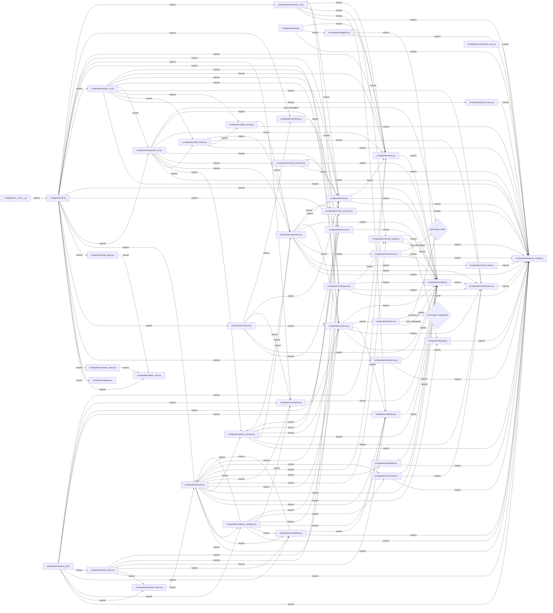

# Repository knowledge graph

> Generated locally by kgmaker. Structural edges come from source text; name-based call edges are heuristic.
> Review semantic conclusions with the repository's Copilot knowledge-graph agent.

- Scope: production; omitted files: 207
- Mode: SOURCE_ONLY; coverage: PARTIAL; no build/test/runtime result is implied.
- Freshness below describes the captured snapshot; use `kgmaker status` to compare current inputs.
- Context: `e6594841640b9c239df02bf7623a2134935705baf1b2d8143a639af3915d9b03`; content: `26878ae5294dffa221ede5e0bfeb8a76526a44e9919578b6d913079ca7de227b`; freshness: CONTENT_VERIFIED
- Files indexed: 52
- Symbols and sections: 528
- Internal imports: 160
- Heuristic cross-file calls: 2308
- PostgreSQL tables/columns: 0/0
- Kafka topics: 0
- API endpoints: 0
- TypeScript frontend routes: 0
- Workbooks/cells: 0/0
- Templates/variables: 0/0
- Semantic concepts: 0
- Implementation episodes: 23
- Inferred/ambiguous relationships: 2308/0

## Architecture diagram

The diagram groups declarations under their source files and shows detected imports and domain relationships. Heuristic call edges are omitted. An editable standalone Mermaid source is available at `.kgmaker/GRAPH.mmd`.

## Files and symbols

### `src/kgmaker/__init__.py`
- No declarations extracted.

### `src/kgmaker/__main__.py`
- No declarations extracted.

### `src/kgmaker/agent_rules.py`
- No declarations extracted.

### `src/kgmaker/agents.py`
- No declarations extracted.

### `src/kgmaker/analysis_agent.py`
- No declarations extracted.

### `src/kgmaker/analysis_model.py`
- **class** `AnalysisError` line 31 — `AnalysisError(ValueError)`
- **function** `__init__` line 34 — `__init__(self, message: str, code: int = 2)`
- **function** `canonical` line 37 — `canonical(value: Any)`
- **function** `digest` line 41 — `digest(value: Any)`
- **function** `file_hash` line 45 — `file_hash(path: Path)`
- **function** `safe_path` line 49 — `safe_path(root: Path, value: str)`
- **function** `analysis_dir` line 67 — `analysis_dir(root: Path, analysis_id: str)`
- **function** `read_json` line 73 — `read_json(path: Path)`
- **function** `reject_constant` line 76 — `reject_constant(value: str)`
- **function** `unique` line 78 — `unique(pairs: list)`
- **function** `atomic_write` line 89 — `atomic_write(path: Path, text: str)`
- **function** `write_json` line 103 — `write_json(path: Path, value: Any)`
- **class** `FeatureAnalysis` line 110 — `FeatureAnalysis` — Serializable envelope. Nested contracts are checked by analysis_validation.
- **function** `from_dict` line 115 — `from_dict(cls, data: Any)`
- **function** `to_dict` line 132 — `to_dict(self)`
- **function** `inventory_candidate` line 135 — `inventory_candidate(packet: dict)`

### `src/kgmaker/analysis_report.py`
- **function** `cell` line 16 — `cell(value)`
- **function** `render_report` line 24 — `render_report(candidate: dict, packet: dict, stale: list[str], applied: bool = True, *, data_audit: dict | None = None)`
- **function** `section` line 34 — `section(index)`
- **function** `objects` line 36 — `objects(items)`

### `src/kgmaker/analysis_validation.py`
- **class** `_Anchors` line 17 — `_Anchors(HTMLParser)`
- **function** `__init__` line 20 — `__init__(self)`
- **function** `handle_starttag` line 23 — `handle_starttag(self, tag, attrs)`
- **function** `_location` line 28 — `_location(root: Path, item: dict, packet: dict)`
- **function** `validate_candidate` line 118 — `validate_candidate(root: Path, packet: dict, data: object)`
- **function** `_validate_candidate` line 125 — `_validate_candidate(root: Path, packet: dict, data: object)`
- **function** `strings` line 203 — `strings(item, key, choices=None, nullable=False)`
- **function** `refs` line 210 — `refs(item, key, targets, required=False)`
- **function** `visit` line 301 — `visit(identity)`

### `src/kgmaker/architecture_model.py`
- **class** `ViewValidationError` line 19 — `ViewValidationError(ValueError)`
- **function** `__init__` line 23 — `__init__(self, errors: list[dict[str, str]])`
- **function** `_canonical` line 27 — `_canonical(value: Any)`
- **class** `ViewNode` line 34 — `ViewNode`
- **function** `to_dict` line 42 — `to_dict(self)`
- **class** `ViewEdge` line 51 — `ViewEdge`
- **function** `to_dict` line 60 — `to_dict(self)`
- **class** `ViewDocument` line 70 — `ViewDocument`
- **function** `to_dict` line 85 — `to_dict(self, *, include_generation_metadata: bool = True)`
- **function** `to_json` line 105 — `to_json(self, *, include_generation_metadata: bool = True)`
- **function** `content_fingerprint` line 110 — `content_fingerprint(self)`
- **function** `from_dict` line 114 — `from_dict(cls, data: Mapping[str, Any])`
- **function** `validate_view_document` line 136 — `validate_view_document(data: Mapping[str, Any])`
- **function** `err` line 141 — `err(code: str, path: str)`

### `src/kgmaker/availability.py`
- **function** `observation_staleness` line 14 — `observation_staleness(candidate: dict)`
- **function** `evaluate_proof` line 35 — `evaluate_proof(root, packet, candidate, item, graph=None)`

### `src/kgmaker/build_maven.py`
- **function** `_tag` line 19 — `_tag(name: str)`
- **function** `_text` line 23 — `_text(parent: ET.Element | None, name: str, default: str | None = None)`
- **function** `_children` line 31 — `_children(parent: ET.Element | None, name: str)`
- **function** `_interpolate` line 35 — `_interpolate(value: str | None, properties: dict[str, str])`
- **function** `_parse` line 41 — `_parse(path: Path, root: Path, properties: dict[str, str])`
- **function** `discover` line 79 — `discover(root: Path)`
- **function** `visit` line 90 — `visit(path: Path, inherited: dict[str, str])`

### `src/kgmaker/build_model.py`
- **function** `validate_manifest` line 15 — `validate_manifest(root: Path, manifest: dict)`
- **function** `import_manifest` line 128 — `import_manifest(root: Path, manifest: dict)`
- **function** `inspection_inputs` line 143 — `inspection_inputs(root: Path, manifest: dict, *, context_id: str | None, scope: str)`
- **function** `absolute` line 155 — `absolute(raw)`

### `src/kgmaker/build_runner.py`
- **function** `snapshot` line 21 — `snapshot(root: Path)`
- **function** `tests_report` line 80 — `tests_report(work: Path, phase: str)`
- **function** `run_plan` line 96 — `run_plan(plan: dict, *, cancel_file: Path | None=None)`

### `src/kgmaker/callgraph.py`
- **function** `adjacency` line 9 — `adjacency(graph: KnowledgeGraph, include_candidates=True)`
- **function** `callees` line 41 — `callees(graph, symbol, *, scope="production", include_candidates=False)`
- **function** `callers` line 50 — `callers(graph, symbol, *, scope="production")`
- **function** `path` line 61 — `path(graph, source, target, *, scope="production", max_depth=30, max_nodes=5000, include_candidates=True)`
- **function** `strongly_connected` line 89 — `strongly_connected(graph: KnowledgeGraph)`

### `src/kgmaker/classification.py`
- **class** `Classification` line 20 — `Classification`
- **class** `Classifier` line 26 — `Classifier`
- **function** `__init__` line 29 — `__init__(self, root: Path, model: dict | None = None, strict: bool = False)`
- **function** `classify` line 59 — `classify(self, path: str)`

### `src/kgmaker/cli.py`
- **function** `_write_if_missing` line 243 — `_write_if_missing(path: Path, text: str, force: bool = False)`
- **function** `init` line 251 — `init(root: Path, force: bool = False)`
- **function** `scan` line 295 — `scan(root: Path, generate_docs: bool = True, confluence_dir: str | None = None, report: str | None = None)`
- **function** `status` line 331 — `status(root: Path)`
- **function** `check` line 365 — `check(root: Path)`
- **function** `docs` line 402 — `docs(root: Path, action: str | None = None, confluence_dir: str | None = None, report: str | None = None)`
- **function** `semantic_prepare` line 426 — `semantic_prepare(root: Path)`
- **function** `semantic_extract` line 440 — `semantic_extract(root: Path, base_ref: str, note_path: str | None = None, token_budget: int | None = None)`
- **function** `semantic_update` line 491 — `semantic_update(root: Path, base_ref: str, note_path: str | None = None, token_budget: int | None = None)`
- **function** `semantic_apply` line 572 — `semantic_apply(root: Path)`
- **function** `semantic_validate` line 592 — `semantic_validate(root: Path)`
- **function** `impact` line 607 — `impact(root: Path, changed_files: list[str])`
- **function** `memory_capture` line 705 — `memory_capture(root: Path, base: str, validation_values: list[str])`
- **function** `memory_recall` line 762 — `memory_recall(root: Path, terms: str, limit: int = 8, token_budget: int = 1_000)`
- **function** `task_add` line 782 — `task_add(root: Path, request: str, title: str | None, max_iterations: int)`
- **function** `task_list` line 793 — `task_list(root: Path, status_filter: str | None)`
- **function** `task_show` line 804 — `task_show(root: Path, task_id_value: str)`
- **function** `task_advance` line 814 — `task_advance(root: Path, task_id_value: str, target: str)`
- **function** `task_stop` line 824 — `task_stop(root: Path, task_id_value: str, reason: str)`
- **function** `task_record` line 834 — `task_record(root: Path, task_id_value: str, role: str, artifact_path: Path)`
- **function** `task_context` line 849 — `task_context(root: Path, task_id_value: str, role: str, token_budget: int)`
- **function** `hook_context` line 859 — `hook_context(root: Path, token_budget: int | None = None)`
- **function** `build_parser` line 879 — `build_parser`
- **function** `main` line 1012 — `main`

### `src/kgmaker/confluence.py`
- **function** `_norm` line 32 — `_norm(value: str)`
- **function** `_safe_rel` line 36 — `_safe_rel(path: str)`
- **function** `_sha` line 40 — `_sha(path: Path)`
- **class** `ConfluenceDocument` line 51 — `ConfluenceDocument`
- **class** `DocumentationAssertion` line 66 — `DocumentationAssertion`
- **class** `_ExportHTMLParser` line 89 — `_ExportHTMLParser(HTMLParser)`
- **function** `__init__` line 95 — `__init__(self)`
- **function** `_attrs` line 114 — `_attrs(self, attrs: list[tuple[str, str | None]])`
- **function** `handle_starttag` line 117 — `handle_starttag(self, tag: str, attrs: list[tuple[str, str | None]])`
- **function** `handle_endtag` line 148 — `handle_endtag(self, tag: str)`
- **function** `handle_data` line 178 — `handle_data(self, data: str)`
- **function** `text` line 192 — `text(self)`
- **function** `_resolve_local_ref` line 196 — `_resolve_local_ref(value: str, current_file: str)`
- **function** `_parse_mermaid` line 203 — `_parse_mermaid(source: str)`
- **function** `_parse_drawio` line 218 — `_parse_drawio(path: Path, source_file: str)`
- **function** `_parse_svg` line 241 — `_parse_svg(path: Path)`
- **function** `_document_from_html` line 252 — `_document_from_html(path: Path, export_root: Path, digest: str)`
- **function** `_load_cache` line 271 — `_load_cache(root: Path)`
- **function** `_write_cache` line 279 — `_write_cache(root: Path, payload: dict[str, Any])`
- **function** `discover_export` line 285 — `discover_export(export_root: Path)`
- **function** `ingest_export` line 289 — `ingest_export(export_root: Path, repository_root: Path)`
- **function** `_assertions_from_document` line 359 — `_assertions_from_document(doc: ConfluenceDocument)`
- **function** `_code_nodes` line 408 — `_code_nodes(graph: KnowledgeGraph)`
- **function** `_missing_category` line 415 — `_missing_category(assertion: DocumentationAssertion)`
- **function** `validate_documents` line 427 — `validate_documents(documents: list[ConfluenceDocument], graph: KnowledgeGraph)`
- **function** `merge_into_graph` line 482 — `merge_into_graph(graph: KnowledgeGraph, documents: list[ConfluenceDocument], attachments: list[dict[str, Any]], assertions: list[DocumentationAssertion])`
- **function** `render_report` line 523 — `render_report(assertions: list[DocumentationAssertion], report_path: Path, export_root: Path, revision: str = "working tree")`
- **function** `persist_validation_index` line 557 — `persist_validation_index(root: Path, assertions: list[DocumentationAssertion])`
- **function** `resolve_confluence_dir` line 568 — `resolve_confluence_dir(root: Path, cli_value: str | None)`
- **function** `documentation_check` line 602 — `documentation_check(root: Path, confluence_dir: str | None = None, report: str | None = None, graph: KnowledgeGraph | None = None)`

### `src/kgmaker/confluence_sync.py`
- **class** `PageSnapshot` line 20 — `PageSnapshot`
- **class** `PublishPackage` line 31 — `PublishPackage`
- **class** `Approval` line 46 — `Approval`
- **class** `PublishAudit` line 58 — `PublishAudit`
- **class** `ConfluenceSyncAdapter` line 69 — `ConfluenceSyncAdapter(Protocol)`
- **function** `pull` line 74 — `pull(self, page_ids: list[str])`
- **function** `_validate_page` line 79 — `_validate_page(page: PageSnapshot)`
- **class** `FakeConfluenceAdapter` line 88 — `FakeConfluenceAdapter`
- **function** `__init__` line 95 — `__init__(self, pages: list[PageSnapshot])`
- **function** `pull` line 103 — `pull(self, page_ids: list[str])`
- **function** `mutate_page` line 126 — `mutate_page(self, page_id: str, content: str)`
- **function** `pull_selected` line 131 — `pull_selected(adapter: ConfluenceSyncAdapter, page_ids: list[str])`
- **function** `save_pull_snapshot` line 139 — `save_pull_snapshot(root: Path, snapshot: dict, name: str = "pull-snapshot.json")`
- **function** `_markers` line 149 — `_markers(section: str)`
- **function** `_replace_section` line 155 — `_replace_section(content: str, section: str, body: str)`
- **function** `prepare_publish` line 170 — `prepare_publish(page: PageSnapshot, managed_section: str, proposed_section: str)`
- **function** `_package_hash` line 189 — `_package_hash(package: PublishPackage)`
- **function** `_package_diff` line 194 — `_package_diff(package: PublishPackage)`
- **function** `_validate_package` line 203 — `_validate_package(package: PublishPackage)`
- **function** `_approval_id` line 210 — `_approval_id(approval: Approval)`
- **function** `approve` line 215 — `approve(package: PublishPackage, decision_id: str)`
- **function** `audit_json` line 250 — `audit_json(audit: PublishAudit)`

### `src/kgmaker/context.py`
- **class** `ContextError` line 28 — `ContextError(ValueError)`
- **function** `_terms` line 32 — `_terms(text: str)`
- **function** `_origin` line 36 — `_origin(kind: str)`
- **function** `_node_payload` line 44 — `_node_payload(node: Any, include_summary: bool = True)`
- **function** `_score_node` line 58 — `_score_node(node: Any, terms: list[str])`
- **function** `_rank_nodes` line 64 — `_rank_nodes(graph: KnowledgeGraph, terms: list[str], limit: int)`
- **function** `_neighbors` line 80 — `_neighbors(graph: KnowledgeGraph, seeds: list[Any], limit: int)`
- **function** `_episode_items` line 104 — `_episode_items(graph: KnowledgeGraph, terms: list[str], limit: int)`
- **function** `_semantic_hits` line 135 — `_semantic_hits(graph: KnowledgeGraph, root: Path, terms: list[str], limit: int)`
- **function** `_impact_items` line 164 — `_impact_items(graph: KnowledgeGraph, seed_paths: list[str], limit: int)`
- **function** `_compact_artifact` line 218 — `_compact_artifact(artifact: dict[str, Any])`
- **function** `_query_terms` line 237 — `_query_terms(task: dict[str, Any])`
- **function** `_token_estimate` line 249 — `_token_estimate(payload: dict[str, Any])`
- **function** `_truncate` line 254 — `_truncate(packet: dict[str, Any], token_budget: int)`
- **function** `_select_prior` line 275 — `_select_prior(task: dict[str, Any], role: str)`
- **function** `_graph_status` line 291 — `_graph_status(root: Path, graph: KnowledgeGraph | None)`
- **function** `_test_nodes` line 303 — `_test_nodes(graph: KnowledgeGraph, terms: list[str], limit: int)`
- **function** `_render_markdown` line 422 — `_render_markdown(packet: dict[str, Any], task: dict[str, Any])`

### `src/kgmaker/control_flow.py`
- **class** `Environment` line 17 — `Environment`
- **class** `Builder` line 23 — `Builder`
- **function** `__init__` line 26 — `__init__(self, method: str, context_id: str, *, max_blocks: int = 3000, max_depth: int = 150)`
- **function** `node` line 34 — `node(self, kind, label, ir, env)`
- **function** `edge` line 46 — `edge(self, source, target, kind="normal", **metadata)`
- **function** `computation` line 52 — `computation(self, ir, destination, env, kind="basic_block", label=None)`
- **function** `abrupt` line 59 — `abrupt(self, destination, env, *, keep=0, reason="return", depth=0)`
- **function** `condition` line 69 — `condition(self, ir, when_true, when_false, env, depth)`
- **function** `emit` line 91 — `emit(self, ir, destination, env, depth=0)`
- **function** `boundary` line 202 — `boundary(self, ir, reason, env)`
- **function** `build` line 206 — `build(self, body: dict)`
- **function** `from_body` line 219 — `from_body(record: dict, **limits)`

### `src/kgmaker/data_agent.py`
- No declarations extracted.

### `src/kgmaker/data_check.py`
- **function** `_object` line 19 — `_object(value, required, optional=())`
- **function** `_array` line 24 — `_array(value, label)`
- **function** `_ids` line 29 — `_ids(value, allowed, label)`
- **function** `data_check` line 35 — `data_check(root: Path, analysis_id: str, specification: dict)`
- **function** `reference_evidence` line 54 — `reference_evidence(reference, identity)`

### `src/kgmaker/dataflow.py`
- **function** `masked` line 32 — `masked(text: str)`
- **function** `closing` line 38 — `closing(text: str, start: int, opening='(', ending=')')`
- **function** `parts` line 50 — `parts(text: str)`
- **class** `Extraction` line 57 — `Extraction`
- **function** `extract_dataflow` line 61 — `extract_dataflow(sources: dict[str, str])`
- **function** `node` line 68 — `node(path, kind, qualified, offset, signature=None, summary=None)`
- **function** `issue` line 78 — `issue(path, offset, reason)`
- **function** `relation` line 81 — `relation(source, target, kind, path, offset, evidence)`
- **function** `walk` line 146 — `walk(value, pointer='')`
- **function** `resolve` line 207 — `resolve(token)`
- **function** `expression` line 218 — `expression(value, destination, statement_offset)`
- **function** `impact_paths` line 283 — `impact_paths(graph: KnowledgeGraph, entity: str, max_depth: int = 20)`

### `src/kgmaker/domain.py`
- **technology** `Kafka`
- **technology** `PostgreSQL`
- **function** `_line` line 65 — `_line(text: str, offset: int)`
- **function** `_unquote_identifier` line 69 — `_unquote_identifier(value: str)`
- **function** `_canon` line 73 — `_canon(value: str)`
- **function** `_node_id` line 77 — `_node_id(kind: str, key: str)`
- **function** `_shared_node` line 81 — `_shared_node(kind: str, key: str, display: str, path: str, line: int | None = None, summary: str | None = None)`
- **function** `_split_sql_items` line 85 — `_split_sql_items(body: str)`
- **function** `_sql_objects` line 108 — `_sql_objects(text: str, path: str, file_id: str)`
- **function** `_entity_edges` line 137 — `_entity_edges(text: str, path: str, symbols: list[Node], tables: dict[str, Node], columns: dict[str, Node])`
- **function** `_string_literals` line 191 — `_string_literals(value: str)`
- **function** `_kafka_references` line 195 — `_kafka_references(text: str, path: str, file_id: str)`
- **function** `add` line 200 — `add(topic: str, offset: int, relation: str, evidence: str)`
- **function** `normalize_api_path` line 230 — `normalize_api_path(path: str)`
- **function** `_api_node` line 241 — `_api_node(method: str, path: str, source: str, line: int | None, operation: str | None = None)`
- **function** `_mapping_path` line 254 — `_mapping_path(args: str)`
- **function** `_openapi_yaml` line 259 — `_openapi_yaml(text: str, path: str, file_id: str)`
- **function** `flush` line 271 — `flush(offset: int)`
- **function** `_openapi_json` line 302 — `_openapi_json(text: str, path: str, file_id: str)`
- **function** `_api_references` line 324 — `_api_references(text: str, path: str, language: str, file_id: str)`
- **function** `add` line 329 — `add(method: str, endpoint_path: str, offset: int, relation: str, evidence: str)`
- **function** `_typescript_routes` line 392 — `_typescript_routes(path: str, text: str, file_id: str)`
- **function** `_technology_nodes` line 426 — `_technology_nodes(text: str, path: str, file_id: str)`
- **function** `extract_domain` line 440 — `extract_domain(path: str, text: str, language: str, file_id: str, symbols: list[Node])`
- **function** `extract_openapi` line 475 — `extract_openapi(path: str, text: str, file_id: str)`
- **function** `connect_persistence` line 484 — `connect_persistence(symbols_by_file: dict[str, list[Node]], text_by_file: dict[str, str], nodes: list[Node])`
- **function** `merge_domain_nodes` line 515 — `merge_domain_nodes(nodes: list[Node])`

### `src/kgmaker/feature.py`
- **function** `_analysis_details` line 23 — `_analysis_details(graph)`
- **function** `source_inventory` line 40 — `source_inventory(root: Path)`
- **function** `current_graph` line 73 — `current_graph(root: Path, workspace: Path | None = None)`
- **function** `attach_schema` line 94 — `attach_schema(graph, schema, root: Path | None = None)`
- **function** `source_path` line 125 — `source_path(root: Path, key: str, packet: dict)`
- **function** `graph_for_packet` line 132 — `graph_for_packet(root: Path, packet: dict)`
- **function** `packet_identity` line 224 — `packet_identity(packet: dict)`
- **function** `load_packet` line 228 — `load_packet(root: Path, analysis_id: str)`
- **function** `freshness` line 237 — `freshness(root: Path, packet: dict)`
- **function** `validate` line 360 — `validate(root: Path, analysis_id: str, candidate: dict)`
- **function** `apply` line 380 — `apply(root: Path, analysis_id: str, candidate: dict)`
- **function** `status` line 398 — `status(root: Path, analysis_id: str)`
- **function** `revise` line 407 — `revise(root: Path, analysis_id: str, answers: dict)`

### `src/kgmaker/feature_cli.py`
- **function** `register` line 11 — `register(subparsers)`
- **function** `run` line 41 — `run(args)`

### `src/kgmaker/flow.py`
- **function** `_label` line 10 — `_label(value)`
- **function** `control_flow` line 14 — `control_flow(graph, entry, *, scope="production", max_nodes=500, representation="SOURCE")`
- **function** `process` line 56 — `process(graph, entry, *, scope="production", max_depth=3, max_nodes=500)`
- **function** `expand` line 76 — `expand(method, depth, ancestry, prefix)`
- **function** `mermaid` line 122 — `mermaid(report)`
- **function** `markdown` line 143 — `markdown(report)`

### `src/kgmaker/flyway.py`
- **function** `version` line 22 — `version(value: str)`
- **function** `configuration` line 31 — `configuration(root: Path, overrides: dict | None = None)`
- **function** `migration_plan` line 148 — `migration_plan(root: Path, overrides: dict | None = None)`

### `src/kgmaker/framework.py`
- **function** `_simple` line 48 — `_simple(value: str)`
- **function** `_line` line 52 — `_line(text: str, offset: int)`
- **function** `_args` line 56 — `_args(annotation: str)`
- **function** `_string_arg` line 61 — `_string_arg(args: str, names: tuple[str, ...] = ("name", "value", "path"))`
- **function** `_named_string_arg` line 70 — `_named_string_arg(args: str, name: str)`
- **function** `_annotation_values` line 75 — `_annotation_values(text: str, line: int)`
- **function** `_imports` line 91 — `_imports(text: str)`
- **function** `_allowed_annotation` line 95 — `_allowed_annotation(name: str, imports: set[str], families: tuple[str, ...])`
- **function** `_annotation_map` line 106 — `_annotation_map(symbol: dict[str, Any], source: str)`
- **function** `_annotation` line 127 — `_annotation(values: list[tuple[str, str]], name: str)`
- **function** `_class_args` line 131 — `_class_args(args: str)`
- **function** `_combined_state` line 137 — `_combined_state(*states: str)`
- **function** `_derived_query` line 141 — `_derived_query(method_name: str)`
- **function** `_path_text` line 172 — `_path_text(root: Path, path: str)`
- **function** `_node_id` line 181 — `_node_id(prefix: str, payload: Any)`
- **function** `augment_framework_graph` line 185 — `augment_framework_graph(root: Path, graph: KnowledgeGraph, context: dict[str, Any])`
- **function** `evidence_for` line 211 — `evidence_for(kind: str, source: str, target: str, relation: str, path: str, line: int | None, detail: str)`
- **function** `symbol_node` line 246 — `symbol_node(item: dict[str, Any])`
- **function** `bean_selection` line 249 — `bean_selection(values: list[tuple[str, str]])`
- **function** `expanded_annotations` line 264 — `expanded_annotations(values: list[tuple[str, str]], imports: set[str])`
- **function** `component_scan_state` line 294 — `component_scan_state(item: dict[str, Any])`
- **function** `condition_state` line 305 — `condition_state(values: list[tuple[str, str]], path: str, line: int | None)`
- **function** `class_for` line 345 — `class_for(item: dict[str, Any])`
- **function** `resolve_query_property` line 565 — `resolve_query_property(model_name: str, property_name: str)`
- **function** `in_schema_realm` line 654 — `in_schema_realm(candidate: Node)`

### `src/kgmaker/graph_provider.py`
- **function** `_compiler_contexts` line 8 — `_compiler_contexts(graph: KnowledgeGraph, *, include_stale: bool = True)`
- **function** `_inspection_command` line 14 — `_inspection_command(context: dict)`
- **function** `_stale_context` line 35 — `_stale_context(context: dict, reason: str)`
- **function** `_selection_key` line 50 — `_selection_key(context: dict)`
- **function** `validate_context_snapshot` line 66 — `validate_context_snapshot(root: Path, context: dict)`
- **function** `validate_compiler_snapshot` line 107 — `validate_compiler_snapshot(root: Path, graph: KnowledgeGraph)`
- **function** `merge_compiler_context` line 178 — `merge_compiler_context(root: Path, fresh: KnowledgeGraph, selected_context: dict)`
- **function** `retain_compiler_layer` line 195 — `retain_compiler_layer(root: Path, syntax: KnowledgeGraph)`

### `src/kgmaker/inspection.py`
- **function** `artifact_hash` line 23 — `artifact_hash(path: Path)`
- **function** `worker_home` line 36 — `worker_home(path: Path | None = None)`
- **function** `_jvm_worker_jar` line 44 — `_jvm_worker_jar(home: Path)`
- **function** `command` line 67 — `command(language: str, home: Path | None = None)`
- **function** `distribution` line 82 — `distribution(language: str, home=None)`
- **function** `sanitize` line 88 — `sanitize(value, *, key="")`
- **function** `validate_response` line 130 — `validate_response(response: dict, selected_context: dict)`
- **function** `proof` line 170 — `proof(fact: dict, kind: str, *, source: str, target: str, relation: str)`
- **function** `relation` line 183 — `relation(source, target, name, fact, kind="SYMBOL_RESOLVED")`

### `src/kgmaker/inspection_cli.py`
- **function** `common` line 11 — `common(parser)`
- **function** `register` line 18 — `register(sub)`
- **function** `indexed` line 69 — `indexed(args)`
- **function** `run` line 99 — `run(args)`

### `src/kgmaker/memory.py`
- **class** `EpisodeValidationError` line 23 — `EpisodeValidationError(ValueError)`
- **class** `CaptureError` line 27 — `CaptureError(ValueError)`
- **function** `_canonical_payload` line 31 — `_canonical_payload(record: dict[str, Any])`
- **function** `episode_id` line 35 — `episode_id(record: dict[str, Any])`
- **function** `_safe_path` line 43 — `_safe_path(value: Any, field: str)`
- **function** `_string_list` line 52 — `_string_list(value: Any, field: str, limit: int = 2_000)`
- **function** `validate_episode` line 62 — `validate_episode(record: Any, index: int | None = None)`
- **function** `episode_freshness` line 130 — `episode_freshness(record: dict[str, Any], current_files: dict[str, str])`
- **function** `project_episode` line 145 — `project_episode(record: dict[str, Any], current_nodes: set[str], current_files: dict[str, str])`
- **function** `_terms` line 158 — `_terms(text: str)`
- **function** `_text_score` line 162 — `_text_score(query: list[str], exact_query: str, fields: list[str])`
- **function** `parse_validations` line 255 — `parse_validations(values: list[str])`
- **function** `_git` line 275 — `_git(root: Path, *args: str)`
- **function** `is_sensitive_path` line 285 — `is_sensitive_path(path: str)`
- **function** `_sensitive_path` line 298 — `_sensitive_path(path: str)`
- **function** `_changed_paths` line 302 — `_changed_paths(root: Path, base_commit: str)`
- **function** `_file_hash` line 332 — `_file_hash(root: Path, path: str)`
- **function** `_node_payload` line 344 — `_node_payload(node: Node)`

### `src/kgmaker/model.py`
- **class** `Node` line 10 — `Node`
- **class** `Edge` line 27 — `Edge`
- **class** `KnowledgeGraph` line 42 — `KnowledgeGraph`
- **function** `migrate_legacy` line 56 — `migrate_legacy(self)`
- **function** `to_dict` line 71 — `to_dict(self)`
- **function** `from_dict` line 90 — `from_dict(cls, data: dict[str, Any])`

### `src/kgmaker/project_cli.py`
- **function** `common` line 13 — `common(parser)`
- **function** `register` line 21 — `register(sub)`
- **function** `run` line 69 — `run(args)`

### `src/kgmaker/runtime_evidence.py`
- **function** `_check_hashes` line 16 — `_check_hashes(root: Path, context: dict[str, Any], manifest: dict[str, Any])`
- **function** `validate_manifest` line 36 — `validate_manifest(graph: KnowledgeGraph, root: Path, manifest: dict[str, Any])`
- **function** `import_manifest` line 69 — `import_manifest(root: Path, manifest: dict[str, Any], *, graph: KnowledgeGraph | None = None)`

### `src/kgmaker/scanner.py`
- **function** `_safe_text` line 84 — `_safe_text(path: Path)`
- **function** `_file_digest` line 93 — `_file_digest(text: str)`
- **function** `_stable_id` line 97 — `_stable_id(kind: str, path: str, name: str, line: int | None = None)`
- **function** `_line_for` line 102 — `_line_for(text: str, offset: int)`
- **function** `_doc_for_line` line 106 — `_doc_for_line(lines: list[str], index: int)`
- **function** `_extract_symbols` line 114 — `_extract_symbols(text: str, path: str, language: str)`
- **function** `_imports` line 170 — `_imports(text: str, language: str)`
- **function** `_candidate_paths` line 188 — `_candidate_paths(root: Path, source: str, import_name: str, known_files: set[str])`
- **function** `_should_skip` line 217 — `_should_skip(path: Path, relative: Path)`
- **function** `_candidate_files` line 228 — `_candidate_files(root: Path, project_model: dict | None = None)`
- **function** `selected_directory` line 235 — `selected_directory(name)`
- **function** `scan_repository` line 251 — `scan_repository(root: Path, *, project_model: dict | None = None, strict: bool = False)`

### `src/kgmaker/schema_replay.py`
- **function** `statements` line 19 — `statements(text: str)`
- **function** `identifier` line 83 — `identifier(token: str)`
- **function** `groups` line 91 — `groups(tokens: list[str])`
- **class** `Replay` line 103 — `Replay`
- **function** `__init__` line 106 — `__init__(self, config: dict)`
- **function** `name` line 111 — `name(self, tokens, offset=0)`
- **function** `key` line 121 — `key(kind, name)`
- **function** `create` line 123 — `create(self, kind, name, **attributes)`
- **function** `get` line 136 — `get(self, kind, name)`
- **function** `change` line 142 — `change(self, item)`
- **function** `drop` line 146 — `drop(self, kind, name, optional=False)`
- **function** `rename` line 156 — `rename(self, kind, name, target)`
- **function** `constraint` line 180 — `constraint(self, table, tokens, fallback)`
- **function** `column` line 206 — `column(self, table, tokens)`
- **function** `apply` line 231 — `apply(self, tokens)`
- **function** `reconstruct` line 394 — `reconstruct(root: Path, config: dict | None = None, *, use_cache: bool = True)`
- **function** `schema_diff` line 463 — `schema_diff(root: Path, config: dict, start: str, end: str)`
- **function** `graph_entities` line 472 — `graph_entities(schema: dict)`
- **function** `schema_mappings` line 510 — `schema_mappings(root: Path, schema: dict, graph)`

### `src/kgmaker/semantic.py`
- **class** `SemanticValidationError` line 33 — `SemanticValidationError(ValueError)`
- **function** `concept_id` line 37 — `concept_id(source_file: str, name: str)`
- **function** `graph_fingerprint` line 43 — `graph_fingerprint(graph: KnowledgeGraph)`
- **function** `build_semantic_input` line 55 — `build_semantic_input(graph: KnowledgeGraph)`
- **function** `_positive_line` line 77 — `_positive_line(value: Any, field: str)`
- **function** `_check_line` line 85 — `_check_line(root: Path, source_file: str, line: int | None, field: str, line_counts: dict[str, int])`
- **function** `validate_semantic_data` line 100 — `validate_semantic_data(data: Any, graph: KnowledgeGraph, root: Path)`
- **function** `_run_git` line 227 — `_run_git(root: Path, *args: str, check: bool = True)`
- **function** `_is_sensitive_path` line 242 — `_is_sensitive_path(path: str)`
- **function** `apply_semantic_patch` line 440 — `apply_semantic_patch(patch: Any, update: Any, graph: KnowledgeGraph, root: Path)`
- **function** `apply_semantic_layer` line 562 — `apply_semantic_layer(graph: KnowledgeGraph, root: Path)`

### `src/kgmaker/store.py`
- **function** `save_graph` line 38 — `save_graph(graph: KnowledgeGraph, root: Path, generate_docs: bool = True)`
- **function** `load_graph` line 55 — `load_graph(root: Path)`
- **function** `render_markdown` line 63 — `render_markdown(graph: KnowledgeGraph, scope: str = "production")`
- **function** `render_mermaid` line 176 — `render_mermaid(graph: KnowledgeGraph, scope: str = "production")`
- **function** `render_context` line 230 — `render_context(graph: KnowledgeGraph, limit: int = 8_000, root: Path | None = None)`
- **function** `render_bootstrap` line 276 — `render_bootstrap(graph: KnowledgeGraph, limit: int = 8_000)`
- **function** `_edge_details` line 305 — `_edge_details(edge)`

### `src/kgmaker/templates.py`
- **function** `_line` line 16 — `_line(text: str, offset: int)`
- **function** `_node_id` line 20 — `_node_id(kind: str, path: str, name: str)`
- **function** `attach_templates` line 24 — `attach_templates(root: Path, graph: KnowledgeGraph)`

### `src/kgmaker/views.py`
- **function** `project` line 41 — `project(graph: KnowledgeGraph, scope: str = "production", *, view: str = "architecture", context_id: str | None = None)`
- **function** `rank` line 107 — `rank(graph: KnowledgeGraph, entry: str | None = None, profile: str = "execution", scope: str = "production")`

### `src/kgmaker/workbooks.py`
- **function** `_identity` line 33 — `_identity(kind: str, path: str, name: str)`
- **function** `_xml` line 37 — `_xml(archive: zipfile.ZipFile, name: str)`
- **function** `_part` line 54 — `_part(target: str)`
- **function** `_cell_value` line 73 — `_cell_value(cell: ET.Element, shared: list[str])`
- **function** `_column_number` line 87 — `_column_number(value: str)`
- **function** `_column_name` line 94 — `_column_name(value: int)`
- **function** `_range_cells` line 102 — `_range_cells(start: str, end: str | None)`
- **function** `_references` line 115 — `_references(expression: str)`
- **function** `extract` line 122 — `extract(path: Path, relative: str, classifier: Classifier)`
- **function** `attach_workbooks` line 282 — `attach_workbooks(root: Path, graph: KnowledgeGraph)`
- **function** `locate_cell` line 323 — `locate_cell(path: Path, sheet: str, cell: str)`

### `src/kgmaker/worker_protocol.py`
- **class** `WorkerError` line 18 — `WorkerError(AnalysisError)`
- **function** `__init__` line 21 — `__init__(self, message: str, status: str, stderr: str = "")`
- **function** `_terminate` line 24 — `_terminate(process)`
- **function** `unique` line 102 — `unique(pairs)`
- **function** `reject_constant` line 109 — `reject_constant(value)`
- **function** `handshake` line 122 — `handshake(argv: list[str], *, cwd: Path, timeout: float = 30)`

### `src/kgmaker/workflow.py`
- **class** `WorkflowError` line 62 — `WorkflowError(ValueError)`
- **function** `_canonical` line 66 — `_canonical(record: dict[str, Any], exclude: set[str])`
- **function** `task_id` line 71 — `task_id(title: str, request: str, max_iterations: int, base_commit: str | None)`
- **function** `artifact_id` line 80 — `artifact_id(record: dict[str, Any])`
- **function** `packet_id` line 85 — `packet_id(record: dict[str, Any])`
- **function** `_safe_path` line 90 — `_safe_path(value: Any, field: str)`
- **function** `_string_list` line 101 — `_string_list(value: Any, field: str, limit: int = 200, item_limit: int = 500)`
- **function** `_bounded_text` line 111 — `_bounded_text(value: Any, field: str, limit: int, allow_empty: bool = False)`
- **function** `_git_head` line 119 — `_git_head(root: Path)`
- **function** `_non_negative_int` line 139 — `_non_negative_int(value: Any, field: str)`
- **function** `_artifact_fields` line 145 — `_artifact_fields(role: str, phase: str)`
- **function** `_validate_plan_steps` line 157 — `_validate_plan_steps(steps: Any, field: str)`
- **function** `_validate_validations` line 177 — `_validate_validations(values: Any, field: str)`
- **function** `_validate_findings` line 197 — `_validate_findings(values: Any, field: str)`
- **function** `validate_artifact` line 220 — `validate_artifact(record: Any, index: int | None = None)`
- **function** `validate_task` line 271 — `validate_task(record: Any)`
- **function** `legal_transitions` line 328 — `legal_transitions(task: dict[str, Any])`
- **function** `normalize_task_id` line 390 — `normalize_task_id(value: str)`
- **function** `task_path` line 404 — `task_path(root: Path, task_id_value: str)`
- **function** `_atomic_write` line 409 — `_atomic_write(path: Path, payload: dict[str, Any])`
- **function** `save_task` line 423 — `save_task(root: Path, task: dict[str, Any])`
- **function** `load_task` line 431 — `load_task(root: Path, task_id_value: str)`
- **function** `list_tasks` line 440 — `list_tasks(root: Path, status: str | None = None)`
- **function** `advance_task` line 473 — `advance_task(root: Path, task_id_value: str, target: str)`
- **function** `stop_task` line 494 — `stop_task(root: Path, task_id_value: str, reason: str)`
- **function** `_merge_paths` line 505 — `_merge_paths(existing: list[str], extra: list[str])`
- **function** `packet_path` line 515 — `packet_path(root: Path, task: dict[str, Any], role: str, iteration: int)`
- **function** `record_artifact` line 521 — `record_artifact(root: Path, task_id_value: str, role: str, payload: dict[str, Any])`

### `src/kgmaker/workspace.py`
- **function** `qualified` line 14 — `qualified(repo: str, identity: str)`
- **function** `split_id` line 18 — `split_id(identity: str)`
- **function** `source_key` line 28 — `source_key(repo: str, path: str)`
- **function** `_qualified_context` line 32 — `_qualified_context(repo: str, value: dict)`
- **function** `_qualified_symbol` line 41 — `_qualified_symbol(repo: str, value: dict)`
- **function** `_qualified_call_site` line 50 — `_qualified_call_site(repo: str, value: dict)`
- **function** `_qualified_cfg` line 64 — `_qualified_cfg(repo: str, value: dict)`
- **function** `_qualified_annotation` line 96 — `_qualified_annotation(repo: str, value: dict)`
- **function** `load_workspace` line 104 — `load_workspace(path: Path)`
- **function** `source_path` line 163 — `source_path(packet: dict, key: str)`
- **function** `snapshot_workspace` line 173 — `snapshot_workspace(manifest: Path, *, cache_root: Path | None = None, persist_cache: bool = False)`

### `src/kgmaker/workspace_cli.py`
- **function** `register_schema` line 6 — `register_schema(subparsers)`
- **function** `schema_command` line 23 — `schema_command(args)`
- **function** `workspace_command` line 54 — `workspace_command(args)`

### `workers/jvm/src/main/java/org/kgmaker/worker/Bytecode.java`
- **data_field** `Bytecode.state` line 15 — `State`
- **data_field** `Bytecode.loader` line 16 — `URLClassLoader`
- **function** `Bytecode` line 21 — `Bytecode(State state)`
- **function** `read` line 26 — `read(String owner)`
- **function** `classMethod` line 34 — `classMethod(String owner,String name,String descriptor,Set<String> visited)`
- **function** `definingOwner` line 41 — `definingOwner(String owner,String name,String descriptor,Set<String> visited)`
- **function** `interfaceMethods` line 56 — `interfaceMethods(String owner,String name,String descriptor,Set<String> visited,Set<String> result)`
- **function** `definingField` line 62 — `definingField(String owner,String name,String descriptor,Set<String> visited)`
- **function** `subtype` line 69 — `subtype(String child,String parent,Set<String> visited)`
- **function** `analyze` line 77 — `analyze(List<?> roots)`
- **function** `load` line 91 — `load(byte[] data,Map<String,Object> realm)`
- **function** `method` line 97 — `method(ClassNode owner,MethodNode method)`
- **function** `target` line 107 — `target(String owner,String name,String descriptor)`
- **function** `inspect` line 112 — `inspect(ClassNode owner,MethodNode method)`
- **function** `cfg` line 159 — `cfg(String caller,MethodNode method,Map<AbstractInsnNode,Integer> positions)`
- **function** `if` line 171 — `if(insns[i] instanceof JumpInsnNode jump)`
- **function** `switchEdges` line 189 — `switchEdges(List<Map<String,Object>> edges,String source,List<LabelNode> labels,LabelNode defaultLabel,Map<AbstractInsnNode,Integer> positions,TreeMap<Integer,String> executable)`
- **function** `flags` line 193 — `flags(int flags)`
- **function** `annotationValue` line 197 — `annotationValue(Object v)`
- **function** `opcode` line 198 — `opcode(int op)`

### `workers/jvm/src/main/java/org/kgmaker/worker/JavaFrontend.java`
- **data_field** `JavaFrontend.state` line 14 — `State`
- **data_field** `JavaFrontend.trees` line 15 — `Trees`
- **data_field** `JavaFrontend.elements` line 16 — `Elements`
- **data_field** `JavaFrontend.types` line 16 — `Types`
- **data_field** `JavaFrontend.unit` line 16 — `CompilationUnitTree`
- **data_field** `JavaFrontend.file` line 17 — `Path`
- **data_field** `JavaFrontend.source` line 17 — `String`
- **function** `JavaFrontend` line 20 — `JavaFrontend(State state)`
- **function** `analyze` line 21 — `analyze(List<Path> sources)`
- **function** `typeDescriptor` line 43 — `typeDescriptor(TypeMirror type)`
- **function** `switch` line 45 — `switch(type.getKind())`
- **function** `descriptor` line 53 — `descriptor(ExecutableElement element)`
- **function** `owner` line 57 — `owner(Element element)`
- **function** `loc` line 62 — `loc(Tree tree)`
- **function** `declarationLocation` line 68 — `declarationLocation(Element element)`
- **function** `label` line 80 — `label(Tree tree)` — Locations retain original conditions; display strings are not payload storage.
- **function** `annotations` line 85 — `annotations(Element element)`
- **function** `annotationValue` line 95 — `annotationValue(Object value)`
- **function** `errorAt` line 102 — `errorAt(Tree tree)`
- **function** `method` line 107 — `method(ExecutableElement element,Map<String,Object> location)`
- **data_field** `Visitor.caller` line 115 — `String`
- **type** `Visitor` line 115 — `Visitor(extends TreePathScanner<Void,Void>)`
- **function** `invocation` line 150 — `invocation(Tree tree,String kind)`
- **function** `reference` line 191 — `reference(Tree tree)`
- **function** `callsIn` line 205 — `callsIn(Tree node)`
- **function** `ir` line 214 — `ir(Tree node)`

### `workers/jvm/src/main/java/org/kgmaker/worker/State.java`
- **data_field** `State.root` line 12 — `Path`
- **function** `State` line 21 — `State(Map<String,Object> request)`
- **function** `map` line 32 — `map(Object... values)`
- **function** `hash` line 37 — `hash(byte[] content)`
- **function** `fileHash` line 41 — `fileHash(Path path)`
- **function** `artifactHash` line 48 — `artifactHash(Path path)`
- **function** `bindRealm` line 49 — `bindRealm(String owner,Map<String,Object> realm)`
- **function** `text` line 50 — `text(Path file)`
- **function** `location` line 54 — `location(Path file,long start,long end,int startLine,int startColumn,int endLine,int endColumn)`
- **function** `realm` line 66 — `realm(String owner,Map<String,Object> loc)`
- **function** `prefix` line 83 — `prefix(Map<String,Object> realm)`
- **function** `method` line 86 — `method(String owner,String name,String descriptor,Map<String,Object> loc,Map<String,Object> metadata)`
- **function** `type` line 96 — `type(String owner,Map<String,Object> loc,Map<String,Object> metadata)`
- **function** `field` line 104 — `field(String owner,String name,String descriptor,Map<String,Object> loc,Map<String,Object> metadata)`
- **function** `site` line 113 — `site(String caller,Map<String,Object> loc,String target,String invocation,String receiver,String reason)`
- **function** `diagnostic` line 122 — `diagnostic(String code,String reason,Map<String,Object> loc)`
- **function** `verifyInputs` line 125 — `verifyInputs`

### `workers/jvm/src/main/kotlin/org/kgmaker/worker/JvmWorker.kt`
- **function** `handshake` line 8 — `handshake`
- **function** `main` line 14 — `main`

### `workers/jvm/src/main/kotlin/org/kgmaker/worker/KotlinFrontend.kt`
- **data_field** `KotlinFrontend.state` line 30 — `State`
- **type** `KotlinFrontend` line 30 — `KotlinFrontend((private val state: State))`
- **function** `loc` line 36 — `loc(element: PsiElement)`
- **function** `line` line 42 — `line(offset: Int)=text.take(offset)`
- **function** `column` line 43 — `column(offset: Int)=offset-(text.lastIndexOf('\n', (offset-1).coerceAtLeast(0)))`
- **function** `owner` line 47 — `owner(descriptor: DeclarationDescriptor)=mapper.mapOwner(descriptor).internalName.replace('/','.')`
- **function** `constant` line 48 — `constant(value: ConstantValue<*>): Any? = when(value)`
- **function** `annotation` line 58 — `annotation(value: org.jetbrains.kotlin.descriptors.annotations.AnnotationDescriptor)`
- **function** `annotations` line 60 — `annotations(descriptor: DeclarationDescriptor)=descriptor.annotations.map(::annotation)`
- **function** `method` line 61 — `method(descriptor: FunctionDescriptor, element: PsiElement? = null)`
- **function** `property` line 70 — `property(descriptor: PropertyDescriptor, element: PsiElement?=null)`
- **function** `analyze` line 76 — `analyze(files: List<Path>)`
- **data_field** `Visitor.caller` line 105 — `String`
- **function** `Visitor` line 105 — `Visitor(private var caller: String): KtTreeVisitorVoid()`
- **function** `processFileInitializers` line 106 — `processFileInitializers(file: KtFile)`
- **function** `visitClassOrObject` line 128 — `visitClassOrObject(declaration: KtClassOrObject)`
- **function** `visitAnonymousInitializer` line 157 — `visitAnonymousInitializer(initializer: KtAnonymousInitializer)` — Already visited once above under the primary constructor caller.
- **function** `visitNamedFunction` line 160 — `visitNamedFunction(function: KtNamedFunction)`
- **function** `visitSecondaryConstructor` line 174 — `visitSecondaryConstructor(constructor: KtSecondaryConstructor)`
- **function** `visitLambdaExpression` line 183 — `visitLambdaExpression(expression: KtLambdaExpression)`
- **function** `visitProperty` line 192 — `visitProperty(declaration: KtProperty)`
- **function** `visitParameter` line 215 — `visitParameter(parameter: KtParameter)`
- **function** `visitCallExpression` line 223 — `visitCallExpression(expression: KtCallExpression)`
- **function** `visitBinaryExpression` line 243 — `visitBinaryExpression(expression: KtBinaryExpression)`
- **function** `visitCallableReferenceExpression` line 258 — `visitCallableReferenceExpression(expression: KtCallableReferenceExpression)`
- **function** `visitSimpleNameExpression` line 265 — `visitSimpleNameExpression(expression: KtSimpleNameExpression)`
- **function** `callsIn` line 286 — `callsIn(element: KtExpression)`
- **function** `visitLambdaExpression` line 289 — `visitLambdaExpression(expression: KtLambdaExpression)`
- **function** `visitNamedFunction` line 290 — `visitNamedFunction(function: KtNamedFunction)`
- **function** `visitCallExpression` line 291 — `visitCallExpression(expression: KtCallExpression) {calls[expression]?.let(result::add);super.visitCallExpression(expression)`
- **function** `label` line 295 — `label(element: PsiElement)=element.text.replace(Regex("\"(?:\\\\.|[^\"\\\\])*\""),"\"…\"").take(300)`
- **function** `ir` line 296 — `ir(expression: KtExpression?)`

## Implementation history

- **Change Agent reads packet.json and candidate-template.json, writes candidate.json., Aktualizace stavu, Aktuální stav a zbývající práce** — removed; files: .github/agents/kgmaker-analyst.agent.md, .github/agents/kgmaker-architect.agent.md, .github/agents/kgmaker-data-auditor.agent.md, .github/agents/kgmaker-extract.agent.md, .github/agents/kgmaker.agent.md; validation: pytest193=passed, kotlin-operator-cfg=passed, jvm-construction-matrix=passed
- **Change Agent reads packet.json and candidate-template.json, writes candidate.json., Aktualizace stavu, Aktuální stav a zbývající práce** — removed; files: .github/agents/kgmaker-analyst.agent.md, .github/agents/kgmaker-architect.agent.md, .github/agents/kgmaker-data-auditor.agent.md, .github/agents/kgmaker-extract.agent.md, .github/agents/kgmaker.agent.md; validation: pytest192=passed, maven-effective-model=passed
- **Change Agent reads packet.json and candidate-template.json, writes candidate.json., Aktualizace stavu, Aktuální stav a zbývající práce** — removed; files: .github/agents/kgmaker-analyst.agent.md, .github/agents/kgmaker-architect.agent.md, .github/agents/kgmaker-data-auditor.agent.md, .github/agents/kgmaker-extract.agent.md, .github/agents/kgmaker.agent.md; validation: pytest191=passed
- **Implement next steps from implementation plan** — removed; files: .github/agents/kgmaker-analyst.agent.md, .github/agents/kgmaker-architect.agent.md, .github/agents/kgmaker-data-auditor.agent.md, .github/agents/kgmaker-extract.agent.md, .github/agents/kgmaker-implementation.agent.md; validation: pytest197=passed, focused53=passed, derived-query-paths=passed, derived-query-intents=passed
- **Implement next steps from implementation plan** — removed; files: .github/agents/kgmaker-analyst.agent.md, .github/agents/kgmaker-architect.agent.md, .github/agents/kgmaker-data-auditor.agent.md, .github/agents/kgmaker-extract.agent.md, .github/agents/kgmaker-implementation.agent.md; validation: pytest197=passed, focused53=passed, jpa-embedded-id=passed, jpa-association-roles=passed, jpa-property-access=passed
- **Change Akceptační kritéria, Atomické work packages pro dokončení T003, Cíl** — changed; files: docs/changes/6_splitRemainingImplementation.md, docs/tasks/README.md, docs/tasks/T003-S03-01-externalToolchainSelection.md, docs/tasks/T003-S03-02-gradleCustomVariants.md, docs/tasks/T003-S03-03-gradleIncludedBuilds.md; validation: task_specs=passed, links=passed, pytest=passed, semantic=passed
- **Change Agent reads packet.json and candidate-template.json, writes candidate.json., Aktualizace stavu, Aktuální stav a zbývající práce** — changed; files: README.md, docs/acceptance-inventory.md, docs/changes/5_preserveCompilerRefresh.md, docs/compiler-inspection.md, docs/feature-analysis.md; validation: pytest190=passed
- **Change Aktualizace stavu, Aktuální stav a zbývající práce, Atomické work packages pro dokončení T003** — removed; files: .codex/agents/README.md, .codex/agents/t003-s03-w01-external-toolchain-selection.toml, .codex/agents/t003-s03-w02-gradle-custom-variants.toml, .codex/agents/t003-s03-w03-gradle-included-builds.toml, .codex/agents/t003-s03-w04-kotlin-compiler-options.toml; validation: agent-profiles=passed, toml=passed, codex-loader=passed, links=passed, pytest197=passed
- **Implement next steps from implementation plan** — removed; files: .github/agents/kgmaker-analyst.agent.md, .github/agents/kgmaker-architect.agent.md, .github/agents/kgmaker-data-auditor.agent.md, .github/agents/kgmaker-extract.agent.md, .github/agents/kgmaker-implementation.agent.md; validation: pytest195=passed, focused51=passed, spring-collection-injection=passed, spring-provider-boundary=passed
- **Change Agent reads packet.json and candidate-template.json, writes candidate.json., Aktualizace stavu, Aktuální stav a zbývající práce** — removed; files: .github/agents/kgmaker-analyst.agent.md, .github/agents/kgmaker-architect.agent.md, .github/agents/kgmaker-data-auditor.agent.md, .github/agents/kgmaker-extract.agent.md, .github/agents/kgmaker.agent.md; validation: pytest195=passed, spring-meta-stereotype=passed, component-scan-scope=passed
- **Change Agent reads packet.json and candidate-template.json, writes candidate.json., Aktualizace stavu, Aktuální stav a zbývající práce** — removed; files: .github/agents/kgmaker-analyst.agent.md, .github/agents/kgmaker-architect.agent.md, .github/agents/kgmaker-data-auditor.agent.md, .github/agents/kgmaker-extract.agent.md, .github/agents/kgmaker.agent.md; validation: pytest194=passed, file-facade-clinit=passed, object-constructor-realm=passed
- **Change Aktualizace stavu, Aktuální stav a zbývající práce, Atomické work packages pro dokončení T003** — removed; files: .codex/agents/README.md, .codex/agents/t003-s03-w01-external-toolchain-selection.toml, .codex/agents/t003-s03-w02-gradle-custom-variants.toml, .codex/agents/t003-s03-w03-gradle-included-builds.toml, .codex/agents/t003-s03-w04-kotlin-compiler-options.toml; validation: agent-profiles=passed, toml=passed, codex-loader=passed, links=passed, pytest197=passed
- **Change Aktualizace stavu, Aktuální stav a zbývající práce, Atomické work packages pro dokončení T003** — removed; files: .codex/agents/README.md, .codex/agents/t003-s03-w01-external-toolchain-selection.toml, .codex/agents/t003-s03-w02-gradle-custom-variants.toml, .codex/agents/t003-s03-w03-gradle-included-builds.toml, .codex/agents/t003-s03-w04-kotlin-compiler-options.toml; validation: agent-profiles=passed, toml=passed, codex-loader=passed, links=passed, pytest197=passed
- **Change Agent reads packet.json and candidate-template.json, writes candidate.json., Aktualizace stavu, Aktuální stav a zbývající práce** — removed; files: .github/agents/kgmaker-analyst.agent.md, .github/agents/kgmaker-architect.agent.md, .github/agents/kgmaker-data-auditor.agent.md, .github/agents/kgmaker-extract.agent.md, .github/agents/kgmaker.agent.md; validation: pytest192=passed, generated-source-e2e=passed, generated-source-tamper=passed
- **Implement next steps from implementation plan** — removed; files: .github/agents/kgmaker-analyst.agent.md, .github/agents/kgmaker-architect.agent.md, .github/agents/kgmaker-data-auditor.agent.md, .github/agents/kgmaker-extract.agent.md, .github/agents/kgmaker-implementation.agent.md; validation: pytest197=passed, focused53=passed, jpql-symbol-query=passed, native-query-table=passed, named-query-reference=passed
- **Change Agent reads packet.json and candidate-template.json, writes candidate.json., Aktualizace stavu, Aktuální stav a zbývající práce** — removed; files: .github/agents/kgmaker-analyst.agent.md, .github/agents/kgmaker-architect.agent.md, .github/agents/kgmaker-data-auditor.agent.md, .github/agents/kgmaker-extract.agent.md, .github/agents/kgmaker.agent.md; validation: pytest193=passed, primary-constructor-cfg=passed, kotlin-init-order=passed
- **Change Agent reads packet.json and candidate-template.json, writes candidate.json., Aktualizace stavu, Aktuální stav a zbývající práce** — removed; files: .github/agents/kgmaker-analyst.agent.md, .github/agents/kgmaker-architect.agent.md, .github/agents/kgmaker-data-auditor.agent.md, .github/agents/kgmaker-extract.agent.md, .github/agents/kgmaker.agent.md; validation: pytest192=passed, ac02-real-worker=passed
- **Implement next steps from implementation plan** — removed; files: .github/agents/kgmaker-analyst.agent.md, .github/agents/kgmaker-architect.agent.md, .github/agents/kgmaker-data-auditor.agent.md, .github/agents/kgmaker-extract.agent.md, .github/agents/kgmaker-implementation.agent.md; validation: pytest=passed, task_specs=passed, semantic=passed, diff_check=passed
- **Change Agent reads packet.json and candidate-template.json, writes candidate.json., Aktualizace stavu, Aktuální stav a zbývající práce** — removed; files: .github/agents/kgmaker-analyst.agent.md, .github/agents/kgmaker-architect.agent.md, .github/agents/kgmaker-data-auditor.agent.md, .github/agents/kgmaker-extract.agent.md, .github/agents/kgmaker.agent.md; validation: pytest195=passed, ac05-spring-matrix=passed, spring-short-name-guard=passed
- **Change Agent reads packet.json and candidate-template.json, writes candidate.json., Aktualizace stavu, Aktuální stav a zbývající práce** — changed; files: README.md, docs/changes/5_preserveCompilerRefresh.md, docs/compiler-inspection.md, docs/feature-analysis.md, docs/production-analysis-progress.md; validation: pytest189=passed
- **Change Agent reads packet.json and candidate-template.json, writes candidate.json., Aktualizace stavu, Aktuální stav a zbývající práce** — removed; files: .github/agents/kgmaker-analyst.agent.md, .github/agents/kgmaker-architect.agent.md, .github/agents/kgmaker-data-auditor.agent.md, .github/agents/kgmaker-extract.agent.md, .github/agents/kgmaker.agent.md; validation: pytest192=passed, maven-effective-model=passed, bom-property-interpolation=passed
- **Implement next steps from implementation plan** — removed; files: .github/agents/kgmaker-analyst.agent.md, .github/agents/kgmaker-architect.agent.md, .github/agents/kgmaker-data-auditor.agent.md, .github/agents/kgmaker-extract.agent.md, .github/agents/kgmaker-implementation.agent.md; validation: pytest195=passed, focused51=passed, spring-configuration-import=passed, framework-rule-invalidation=passed
- **Change Agent reads packet.json and candidate-template.json, writes candidate.json., Aktualizace stavu, Aktuální stav a zbývající práce** — removed; files: .github/agents/kgmaker-analyst.agent.md, .github/agents/kgmaker-architect.agent.md, .github/agents/kgmaker-data-auditor.agent.md, .github/agents/kgmaker-extract.agent.md, .github/agents/kgmaker.agent.md; validation: pytest193=passed, kotlin-accessor-cfg=passed, backing-field-no-recursion=passed

## Internal relationships

- `src/kgmaker/__main__.py` imports `src/kgmaker/cli.py` (.cli)
- `src/kgmaker/analysis_agent.py` imports `src/kgmaker/agent_rules.py` (.agent_rules)
- `src/kgmaker/analysis_report.py` imports `src/kgmaker/feature.py` (.feature)
- `src/kgmaker/analysis_validation.py` imports `src/kgmaker/analysis_model.py` (.analysis_model)
- `src/kgmaker/analysis_validation.py` imports `src/kgmaker/availability.py` (.availability)
- `src/kgmaker/analysis_validation.py` imports `src/kgmaker/dataflow.py` (.dataflow)
- `src/kgmaker/analysis_validation.py` imports `src/kgmaker/feature.py` (.feature)
- `src/kgmaker/analysis_validation.py` imports `src/kgmaker/scanner.py` (.scanner)
- `src/kgmaker/analysis_validation.py` imports `src/kgmaker/semantic.py` (.semantic)
- `src/kgmaker/analysis_validation.py` imports `src/kgmaker/workbooks.py` (.workbooks)
- `src/kgmaker/analysis_validation.py` imports `src/kgmaker/workspace.py` (.workspace)
- `src/kgmaker/availability.py` imports `src/kgmaker/analysis_model.py` (.analysis_model)
- `src/kgmaker/availability.py` imports `src/kgmaker/dataflow.py` (.dataflow)
- `src/kgmaker/availability.py` imports `src/kgmaker/feature.py` (.feature)
- `src/kgmaker/build_maven.py` imports `src/kgmaker/analysis_model.py` (.analysis_model)
- `src/kgmaker/build_model.py` imports `src/kgmaker/analysis_model.py` (.analysis_model)
- `src/kgmaker/build_model.py` imports `src/kgmaker/build_runner.py` (.build_runner)
- `src/kgmaker/build_model.py` imports `src/kgmaker/classification.py` (.classification)
- `src/kgmaker/build_model.py` imports `src/kgmaker/inspection.py` (.inspection)
- `src/kgmaker/build_runner.py` imports `src/kgmaker/analysis_model.py` (.analysis_model)
- `src/kgmaker/build_runner.py` imports `src/kgmaker/inspection.py` (.inspection)
- `src/kgmaker/callgraph.py` imports `src/kgmaker/analysis_model.py` (.analysis_model)
- `src/kgmaker/callgraph.py` imports `src/kgmaker/model.py` (.model)
- `src/kgmaker/callgraph.py` imports `src/kgmaker/views.py` (.views)
- `src/kgmaker/classification.py` imports `src/kgmaker/analysis_model.py` (.analysis_model)
- `src/kgmaker/cli.py` imports `src/kgmaker/agent_rules.py` (.agent_rules)
- `src/kgmaker/cli.py` imports `src/kgmaker/agents.py` (.agents)
- `src/kgmaker/cli.py` imports `src/kgmaker/analysis_agent.py` (.analysis_agent)
- `src/kgmaker/cli.py` imports `src/kgmaker/confluence.py` (.confluence)
- `src/kgmaker/cli.py` imports `src/kgmaker/context.py` (.context)
- `src/kgmaker/cli.py` imports `src/kgmaker/data_agent.py` (.data_agent)
- `src/kgmaker/cli.py` imports `src/kgmaker/feature.py` (.feature)
- `src/kgmaker/cli.py` imports `src/kgmaker/inspection_cli.py` (.inspection_cli)
- `src/kgmaker/cli.py` imports `src/kgmaker/memory.py` (.memory)
- `src/kgmaker/cli.py` imports `src/kgmaker/model.py` (.model)
- `src/kgmaker/cli.py` imports `src/kgmaker/project_cli.py` (.project_cli)
- `src/kgmaker/cli.py` imports `src/kgmaker/scanner.py` (.scanner)
- `src/kgmaker/cli.py` imports `src/kgmaker/semantic.py` (.semantic)
- `src/kgmaker/cli.py` imports `src/kgmaker/store.py` (.store)
- `src/kgmaker/cli.py` imports `src/kgmaker/views.py` (.views)
- `src/kgmaker/cli.py` imports `src/kgmaker/workflow.py` (.workflow)
- `src/kgmaker/cli.py` imports `src/kgmaker/workspace_cli.py` (.workspace_cli)
- `src/kgmaker/confluence.py` imports `src/kgmaker/analysis_model.py` (.analysis_model)
- `src/kgmaker/confluence.py` imports `src/kgmaker/model.py` (.model)
- `src/kgmaker/confluence_sync.py` imports `src/kgmaker/analysis_model.py` (.analysis_model)
- `src/kgmaker/context.py` imports `src/kgmaker/memory.py` (.memory)
- `src/kgmaker/context.py` imports `src/kgmaker/model.py` (.model)
- `src/kgmaker/context.py` imports `src/kgmaker/scanner.py` (.scanner)
- `src/kgmaker/context.py` imports `src/kgmaker/semantic.py` (.semantic)
- `src/kgmaker/context.py` imports `src/kgmaker/store.py` (.store)
- `src/kgmaker/context.py` imports `src/kgmaker/workflow.py` (.workflow)
- `src/kgmaker/control_flow.py` imports `src/kgmaker/analysis_model.py` (.analysis_model)
- `src/kgmaker/data_agent.py` imports `src/kgmaker/agent_rules.py` (.agent_rules)
- `src/kgmaker/data_check.py` imports `src/kgmaker/analysis_model.py` (.analysis_model)
- `src/kgmaker/data_check.py` imports `src/kgmaker/analysis_report.py` (.analysis_report)
- `src/kgmaker/data_check.py` imports `src/kgmaker/availability.py` (.availability)
- `src/kgmaker/data_check.py` imports `src/kgmaker/dataflow.py` (.dataflow)
- `src/kgmaker/data_check.py` imports `src/kgmaker/store.py` (.store)
- `src/kgmaker/data_check.py` imports `src/kgmaker/workspace.py` (.workspace)
- `src/kgmaker/dataflow.py` imports `src/kgmaker/model.py` (.model)
- `src/kgmaker/domain.py` imports `src/kgmaker/model.py` (.model)
- `src/kgmaker/feature.py` imports `src/kgmaker/analysis_model.py` (.analysis_model)
- `src/kgmaker/feature.py` imports `src/kgmaker/analysis_validation.py` (.analysis_validation)
- `src/kgmaker/feature.py` imports `src/kgmaker/availability.py` (.availability)
- `src/kgmaker/feature.py` imports `src/kgmaker/dataflow.py` (.dataflow)
- `src/kgmaker/feature.py` imports `src/kgmaker/flyway.py` (.flyway)
- `src/kgmaker/feature.py` imports `src/kgmaker/graph_provider.py` (.graph_provider)
- `src/kgmaker/feature.py` imports `src/kgmaker/model.py` (.model)
- `src/kgmaker/feature.py` imports `src/kgmaker/scanner.py` (.scanner)
- `src/kgmaker/feature.py` imports `src/kgmaker/schema_replay.py` (.schema_replay)
- `src/kgmaker/feature.py` imports `src/kgmaker/semantic.py` (.semantic)
- `src/kgmaker/feature.py` imports `src/kgmaker/templates.py` (.templates)
- `src/kgmaker/feature.py` imports `src/kgmaker/views.py` (.views)
- `src/kgmaker/feature.py` imports `src/kgmaker/workbooks.py` (.workbooks)
- `src/kgmaker/feature.py` imports `src/kgmaker/workspace.py` (.workspace)
- `src/kgmaker/feature_cli.py` imports `src/kgmaker/analysis_model.py` (.analysis_model)
- `src/kgmaker/feature_cli.py` imports `src/kgmaker/analysis_report.py` (.analysis_report)
- `src/kgmaker/feature_cli.py` imports `src/kgmaker/analysis_validation.py` (.analysis_validation)
- `src/kgmaker/feature_cli.py` imports `src/kgmaker/availability.py` (.availability)
- `src/kgmaker/feature_cli.py` imports `src/kgmaker/data_check.py` (.data_check)
- `src/kgmaker/feature_cli.py` imports `src/kgmaker/dataflow.py` (.dataflow)
- `src/kgmaker/feature_cli.py` imports `src/kgmaker/scanner.py` (.scanner)
- `src/kgmaker/feature_cli.py` imports `src/kgmaker/semantic.py` (.semantic)
- `src/kgmaker/feature_cli.py` imports `src/kgmaker/views.py` (.views)
- `src/kgmaker/flow.py` imports `src/kgmaker/analysis_model.py` (.analysis_model)
- `src/kgmaker/flow.py` imports `src/kgmaker/callgraph.py` (.callgraph)
- `src/kgmaker/flow.py` imports `src/kgmaker/views.py` (.views)
- `src/kgmaker/flyway.py` imports `src/kgmaker/analysis_model.py` (.analysis_model)
- `src/kgmaker/framework.py` imports `src/kgmaker/analysis_model.py` (.analysis_model)
- `src/kgmaker/framework.py` imports `src/kgmaker/model.py` (.model)
- `src/kgmaker/graph_provider.py` imports `src/kgmaker/analysis_model.py` (.analysis_model)
- `src/kgmaker/graph_provider.py` imports `src/kgmaker/classification.py` (.classification)
- `src/kgmaker/graph_provider.py` imports `src/kgmaker/inspection.py` (.inspection)
- `src/kgmaker/graph_provider.py` imports `src/kgmaker/model.py` (.model)
- `src/kgmaker/graph_provider.py` imports `src/kgmaker/scanner.py` (.scanner)
- `src/kgmaker/graph_provider.py` imports `src/kgmaker/store.py` (.store)
- `src/kgmaker/graph_provider.py` imports `src/kgmaker/worker_protocol.py` (.worker_protocol)
- `src/kgmaker/inspection.py` imports `src/kgmaker/analysis_model.py` (.analysis_model)
- `src/kgmaker/inspection.py` imports `src/kgmaker/classification.py` (.classification)
- `src/kgmaker/inspection.py` imports `src/kgmaker/control_flow.py` (.control_flow)
- `src/kgmaker/inspection.py` imports `src/kgmaker/framework.py` (.framework)
- `src/kgmaker/inspection.py` imports `src/kgmaker/graph_provider.py` (.graph_provider)
- `src/kgmaker/inspection.py` imports `src/kgmaker/model.py` (.model)
- `src/kgmaker/inspection.py` imports `src/kgmaker/scanner.py` (.scanner)
- `src/kgmaker/inspection.py` imports `src/kgmaker/store.py` (.store)
- `src/kgmaker/inspection.py` imports `src/kgmaker/worker_protocol.py` (.worker_protocol)
- `src/kgmaker/inspection_cli.py` imports `src/kgmaker/analysis_model.py` (.analysis_model)
- `src/kgmaker/inspection_cli.py` imports `src/kgmaker/build_model.py` (.build_model)
- `src/kgmaker/inspection_cli.py` imports `src/kgmaker/graph_provider.py` (.graph_provider)
- `src/kgmaker/inspection_cli.py` imports `src/kgmaker/inspection.py` (.inspection)
- `src/kgmaker/inspection_cli.py` imports `src/kgmaker/runtime_evidence.py` (.runtime_evidence)
- `src/kgmaker/inspection_cli.py` imports `src/kgmaker/store.py` (.store)
- `src/kgmaker/inspection_cli.py` imports `src/kgmaker/views.py` (.views)
- `src/kgmaker/inspection_cli.py` imports `src/kgmaker/worker_protocol.py` (.worker_protocol)
- `src/kgmaker/memory.py` imports `src/kgmaker/model.py` (.model)
- `src/kgmaker/model.py` imports `src/kgmaker/classification.py` (.classification)
- `src/kgmaker/project_cli.py` imports `src/kgmaker/analysis_model.py` (.analysis_model)
- `src/kgmaker/project_cli.py` imports `src/kgmaker/build_maven.py` (.build_maven)
- `src/kgmaker/project_cli.py` imports `src/kgmaker/build_model.py` (.build_model)
- `src/kgmaker/project_cli.py` imports `src/kgmaker/build_runner.py` (.build_runner)
- `src/kgmaker/project_cli.py` imports `src/kgmaker/classification.py` (.classification)
- `src/kgmaker/project_cli.py` imports `src/kgmaker/inspection_cli.py` (.inspection_cli)
- `src/kgmaker/project_cli.py` imports `src/kgmaker/scanner.py` (.scanner)
- `src/kgmaker/project_cli.py` imports `src/kgmaker/store.py` (.store)
- `src/kgmaker/project_cli.py` imports `src/kgmaker/views.py` (.views)
- `src/kgmaker/project_cli.py` imports `src/kgmaker/workspace.py` (.workspace)
- `src/kgmaker/runtime_evidence.py` imports `src/kgmaker/analysis_model.py` (.analysis_model)
- `src/kgmaker/runtime_evidence.py` imports `src/kgmaker/model.py` (.model)
- `src/kgmaker/runtime_evidence.py` imports `src/kgmaker/store.py` (.store)
- `src/kgmaker/scanner.py` imports `src/kgmaker/analysis_model.py` (.analysis_model)
- `src/kgmaker/scanner.py` imports `src/kgmaker/classification.py` (.classification)
- `src/kgmaker/scanner.py` imports `src/kgmaker/dataflow.py` (.dataflow)
- `src/kgmaker/scanner.py` imports `src/kgmaker/domain.py` (.domain)
- `src/kgmaker/scanner.py` imports `src/kgmaker/model.py` (.model)
- `src/kgmaker/schema_replay.py` imports `src/kgmaker/analysis_model.py` (.analysis_model)
- `src/kgmaker/schema_replay.py` imports `src/kgmaker/flyway.py` (.flyway)
- `src/kgmaker/schema_replay.py` imports `src/kgmaker/model.py` (.model)
- `src/kgmaker/semantic.py` imports `src/kgmaker/memory.py` (.memory)
- `src/kgmaker/semantic.py` imports `src/kgmaker/model.py` (.model)
- `src/kgmaker/store.py` imports `src/kgmaker/analysis_model.py` (.analysis_model)
- `src/kgmaker/store.py` imports `src/kgmaker/model.py` (.model)
- `src/kgmaker/store.py` imports `src/kgmaker/views.py` (.views)
- `src/kgmaker/templates.py` imports `src/kgmaker/analysis_model.py` (.analysis_model)
- `src/kgmaker/templates.py` imports `src/kgmaker/model.py` (.model)
- `src/kgmaker/views.py` imports `src/kgmaker/model.py` (.model)
- `src/kgmaker/workbooks.py` imports `src/kgmaker/analysis_model.py` (.analysis_model)
- `src/kgmaker/workbooks.py` imports `src/kgmaker/classification.py` (.classification)
- `src/kgmaker/workbooks.py` imports `src/kgmaker/model.py` (.model)
- `src/kgmaker/worker_protocol.py` imports `src/kgmaker/analysis_model.py` (.analysis_model)
- `src/kgmaker/workflow.py` imports `src/kgmaker/memory.py` (.memory)
- `src/kgmaker/workspace.py` imports `src/kgmaker/analysis_model.py` (.analysis_model)
- `src/kgmaker/workspace.py` imports `src/kgmaker/classification.py` (.classification)
- `src/kgmaker/workspace.py` imports `src/kgmaker/model.py` (.model)
- `src/kgmaker/workspace.py` imports `src/kgmaker/schema_replay.py` (.schema_replay)
- `src/kgmaker/workspace_cli.py` imports `src/kgmaker/analysis_model.py` (.analysis_model)
- `src/kgmaker/workspace_cli.py` imports `src/kgmaker/dataflow.py` (.dataflow)
- `src/kgmaker/workspace_cli.py` imports `src/kgmaker/schema_replay.py` (.schema_replay)
- `src/kgmaker/workspace_cli.py` imports `src/kgmaker/store.py` (.store)
- `src/kgmaker/workspace_cli.py` imports `src/kgmaker/views.py` (.views)
- `src/kgmaker/workspace_cli.py` imports `src/kgmaker/workspace.py` (.workspace)
- `src/kgmaker/analysis_model.py` may call `207 in `src/kgmaker/dataflow.py`` (name match at line 58; src/kgmaker/analysis_model.py:58; INFERRED 0.85)
- `src/kgmaker/analysis_model.py` may call `207 in `src/kgmaker/dataflow.py`` (name match at line 63; src/kgmaker/analysis_model.py:63; INFERRED 0.85)
- `src/kgmaker/analysis_model.py` may call `207 in `src/kgmaker/dataflow.py`` (name match at line 64; src/kgmaker/analysis_model.py:64; INFERRED 0.85)
- `src/kgmaker/analysis_model.py` may call `271 in `src/kgmaker/domain.py`` (name match at line 97; src/kgmaker/analysis_model.py:97; INFERRED 0.85)
- `src/kgmaker/analysis_model.py` may call `136 in `src/kgmaker/schema_replay.py`` (name match at line 118; src/kgmaker/analysis_model.py:118; INFERRED 0.85)
- `src/kgmaker/analysis_model.py` may call `136 in `src/kgmaker/schema_replay.py`` (name match at line 121; src/kgmaker/analysis_model.py:121; INFERRED 0.85)
- `src/kgmaker/analysis_model.py` may call `136 in `src/kgmaker/schema_replay.py`` (name match at line 123; src/kgmaker/analysis_model.py:123; INFERRED 0.85)
- `src/kgmaker/analysis_model.py` may call `136 in `src/kgmaker/schema_replay.py`` (name match at line 126; src/kgmaker/analysis_model.py:126; INFERRED 0.85)
- `src/kgmaker/analysis_model.py` may call `136 in `src/kgmaker/schema_replay.py`` (name match at line 129; src/kgmaker/analysis_model.py:129; INFERRED 0.85)
- `src/kgmaker/analysis_model.py` may call `96 in `workers/jvm/src/main/java/org/kgmaker/worker/State.java`` (name match at line 118; src/kgmaker/analysis_model.py:118; INFERRED 0.85)
- `src/kgmaker/analysis_model.py` may call `96 in `workers/jvm/src/main/java/org/kgmaker/worker/State.java`` (name match at line 123; src/kgmaker/analysis_model.py:123; INFERRED 0.85)
- `src/kgmaker/analysis_report.py` may call `136 in `src/kgmaker/schema_replay.py`` (name match at line 111; src/kgmaker/analysis_report.py:111; INFERRED 0.85)
- `src/kgmaker/analysis_report.py` may call `136 in `src/kgmaker/schema_replay.py`` (name match at line 118; src/kgmaker/analysis_report.py:118; INFERRED 0.85)
- `src/kgmaker/analysis_report.py` may call `136 in `src/kgmaker/schema_replay.py`` (name match at line 136; src/kgmaker/analysis_report.py:136; INFERRED 0.85)
- `src/kgmaker/analysis_report.py` may call `136 in `src/kgmaker/schema_replay.py`` (name match at line 137; src/kgmaker/analysis_report.py:137; INFERRED 0.85)
- `src/kgmaker/analysis_report.py` may call `136 in `src/kgmaker/schema_replay.py`` (name match at line 138; src/kgmaker/analysis_report.py:138; INFERRED 0.85)
- `src/kgmaker/analysis_report.py` may call `136 in `src/kgmaker/schema_replay.py`` (name match at line 140; src/kgmaker/analysis_report.py:140; INFERRED 0.85)
- `src/kgmaker/analysis_report.py` may call `136 in `src/kgmaker/schema_replay.py`` (name match at line 142; src/kgmaker/analysis_report.py:142; INFERRED 0.85)
- `src/kgmaker/analysis_report.py` may call `136 in `src/kgmaker/schema_replay.py`` (name match at line 144; src/kgmaker/analysis_report.py:144; INFERRED 0.85)
- `src/kgmaker/analysis_report.py` may call `136 in `src/kgmaker/schema_replay.py`` (name match at line 40; src/kgmaker/analysis_report.py:40; INFERRED 0.85)
- `src/kgmaker/analysis_report.py` may call `136 in `src/kgmaker/schema_replay.py`` (name match at line 51; src/kgmaker/analysis_report.py:51; INFERRED 0.85)
- `src/kgmaker/analysis_report.py` may call `136 in `src/kgmaker/schema_replay.py`` (name match at line 54; src/kgmaker/analysis_report.py:54; INFERRED 0.85)
- `src/kgmaker/analysis_report.py` may call `136 in `src/kgmaker/schema_replay.py`` (name match at line 60; src/kgmaker/analysis_report.py:60; INFERRED 0.85)
- `src/kgmaker/analysis_report.py` may call `136 in `src/kgmaker/schema_replay.py`` (name match at line 64; src/kgmaker/analysis_report.py:64; INFERRED 0.85)
- `src/kgmaker/analysis_report.py` may call `136 in `src/kgmaker/schema_replay.py`` (name match at line 66; src/kgmaker/analysis_report.py:66; INFERRED 0.85)
- `src/kgmaker/analysis_report.py` may call `136 in `src/kgmaker/schema_replay.py`` (name match at line 73; src/kgmaker/analysis_report.py:73; INFERRED 0.85)
- `src/kgmaker/analysis_report.py` may call `136 in `src/kgmaker/schema_replay.py`` (name match at line 75; src/kgmaker/analysis_report.py:75; INFERRED 0.85)
- `src/kgmaker/analysis_validation.py` may call `31 in `src/kgmaker/analysis_model.py`` (name match at line 100; src/kgmaker/analysis_validation.py:100; INFERRED 0.85)
- `src/kgmaker/analysis_validation.py` may call `31 in `src/kgmaker/analysis_model.py`` (name match at line 103; src/kgmaker/analysis_validation.py:103; INFERRED 0.85)
- `src/kgmaker/analysis_validation.py` may call `31 in `src/kgmaker/analysis_model.py`` (name match at line 107; src/kgmaker/analysis_validation.py:107; INFERRED 0.85)
- `src/kgmaker/analysis_validation.py` may call `31 in `src/kgmaker/analysis_model.py`` (name match at line 113; src/kgmaker/analysis_validation.py:113; INFERRED 0.85)
- `src/kgmaker/analysis_validation.py` may call `31 in `src/kgmaker/analysis_model.py`` (name match at line 115; src/kgmaker/analysis_validation.py:115; INFERRED 0.85)
- `src/kgmaker/analysis_validation.py` may call `31 in `src/kgmaker/analysis_model.py`` (name match at line 117; src/kgmaker/analysis_validation.py:117; INFERRED 0.85)
- `src/kgmaker/analysis_validation.py` may call `31 in `src/kgmaker/analysis_model.py`` (name match at line 35; src/kgmaker/analysis_validation.py:35; INFERRED 0.85)
- `src/kgmaker/analysis_validation.py` may call `31 in `src/kgmaker/analysis_model.py`` (name match at line 40; src/kgmaker/analysis_validation.py:40; INFERRED 0.85)
- `src/kgmaker/analysis_validation.py` may call `31 in `src/kgmaker/analysis_model.py`` (name match at line 42; src/kgmaker/analysis_validation.py:42; INFERRED 0.85)
- `src/kgmaker/analysis_validation.py` may call `31 in `src/kgmaker/analysis_model.py`` (name match at line 51; src/kgmaker/analysis_validation.py:51; INFERRED 0.85)
- `src/kgmaker/analysis_validation.py` may call `31 in `src/kgmaker/analysis_model.py`` (name match at line 56; src/kgmaker/analysis_validation.py:56; INFERRED 0.85)
- `src/kgmaker/analysis_validation.py` may call `31 in `src/kgmaker/analysis_model.py`` (name match at line 59; src/kgmaker/analysis_validation.py:59; INFERRED 0.85)
- `src/kgmaker/analysis_validation.py` may call `31 in `src/kgmaker/analysis_model.py`` (name match at line 61; src/kgmaker/analysis_validation.py:61; INFERRED 0.85)
- `src/kgmaker/analysis_validation.py` may call `31 in `src/kgmaker/analysis_model.py`` (name match at line 65; src/kgmaker/analysis_validation.py:65; INFERRED 0.85)
- `src/kgmaker/analysis_validation.py` may call `31 in `src/kgmaker/analysis_model.py`` (name match at line 67; src/kgmaker/analysis_validation.py:67; INFERRED 0.85)
- `src/kgmaker/analysis_validation.py` may call `31 in `src/kgmaker/analysis_model.py`` (name match at line 69; src/kgmaker/analysis_validation.py:69; INFERRED 0.85)
- `src/kgmaker/analysis_validation.py` may call `31 in `src/kgmaker/analysis_model.py`` (name match at line 72; src/kgmaker/analysis_validation.py:72; INFERRED 0.85)
- `src/kgmaker/analysis_validation.py` may call `31 in `src/kgmaker/analysis_model.py`` (name match at line 78; src/kgmaker/analysis_validation.py:78; INFERRED 0.85)
- `src/kgmaker/analysis_validation.py` may call `31 in `src/kgmaker/analysis_model.py`` (name match at line 81; src/kgmaker/analysis_validation.py:81; INFERRED 0.85)
- `src/kgmaker/analysis_validation.py` may call `31 in `src/kgmaker/analysis_model.py`` (name match at line 85; src/kgmaker/analysis_validation.py:85; INFERRED 0.85)
- `src/kgmaker/analysis_validation.py` may call `31 in `src/kgmaker/analysis_model.py`` (name match at line 89; src/kgmaker/analysis_validation.py:89; INFERRED 0.85)
- `src/kgmaker/analysis_validation.py` may call `31 in `src/kgmaker/analysis_model.py`` (name match at line 93; src/kgmaker/analysis_validation.py:93; INFERRED 0.85)
- `src/kgmaker/analysis_validation.py` may call `31 in `src/kgmaker/analysis_model.py`` (name match at line 98; src/kgmaker/analysis_validation.py:98; INFERRED 0.85)
- `src/kgmaker/analysis_validation.py` may call `45 in `src/kgmaker/analysis_model.py`` (name match at line 66; src/kgmaker/analysis_validation.py:66; INFERRED 0.85)
- `src/kgmaker/analysis_validation.py` may call `73 in `src/kgmaker/analysis_model.py`` (name match at line 86; src/kgmaker/analysis_validation.py:86; INFERRED 0.85)
- `src/kgmaker/analysis_validation.py` may call `49 in `src/kgmaker/analysis_model.py`` (name match at line 52; src/kgmaker/analysis_validation.py:52; INFERRED 0.85)
- `src/kgmaker/analysis_validation.py` may call `35 in `src/kgmaker/availability.py`` (name match at line 281; src/kgmaker/analysis_validation.py:281; INFERRED 0.85)
- `src/kgmaker/analysis_validation.py` may call `283 in `src/kgmaker/dataflow.py`` (name match at line 351; src/kgmaker/analysis_validation.py:351; INFERRED 0.85)
- `src/kgmaker/analysis_validation.py` may call `132 in `src/kgmaker/feature.py`` (name match at line 341; src/kgmaker/analysis_validation.py:341; INFERRED 0.85)
- `src/kgmaker/analysis_validation.py` may call `136 in `src/kgmaker/schema_replay.py`` (name match at line 105; src/kgmaker/analysis_validation.py:105; INFERRED 0.85)
- `src/kgmaker/analysis_validation.py` may call `136 in `src/kgmaker/schema_replay.py`` (name match at line 106; src/kgmaker/analysis_validation.py:106; INFERRED 0.85)
- `src/kgmaker/analysis_validation.py` may call `136 in `src/kgmaker/schema_replay.py`` (name match at line 112; src/kgmaker/analysis_validation.py:112; INFERRED 0.85)
- `src/kgmaker/analysis_validation.py` may call `136 in `src/kgmaker/schema_replay.py`` (name match at line 164; src/kgmaker/analysis_validation.py:164; INFERRED 0.85)
- `src/kgmaker/analysis_validation.py` may call `136 in `src/kgmaker/schema_replay.py`` (name match at line 174; src/kgmaker/analysis_validation.py:174; INFERRED 0.85)
- `src/kgmaker/analysis_validation.py` may call `136 in `src/kgmaker/schema_replay.py`` (name match at line 180; src/kgmaker/analysis_validation.py:180; INFERRED 0.85)
- `src/kgmaker/analysis_validation.py` may call `136 in `src/kgmaker/schema_replay.py`` (name match at line 187; src/kgmaker/analysis_validation.py:187; INFERRED 0.85)
- `src/kgmaker/analysis_validation.py` may call `136 in `src/kgmaker/schema_replay.py`` (name match at line 190; src/kgmaker/analysis_validation.py:190; INFERRED 0.85)
- `src/kgmaker/analysis_validation.py` may call `136 in `src/kgmaker/schema_replay.py`` (name match at line 198; src/kgmaker/analysis_validation.py:198; INFERRED 0.85)
- `src/kgmaker/analysis_validation.py` may call `136 in `src/kgmaker/schema_replay.py`` (name match at line 201; src/kgmaker/analysis_validation.py:201; INFERRED 0.85)
- `src/kgmaker/analysis_validation.py` may call `136 in `src/kgmaker/schema_replay.py`` (name match at line 202; src/kgmaker/analysis_validation.py:202; INFERRED 0.85)
- `src/kgmaker/analysis_validation.py` may call `136 in `src/kgmaker/schema_replay.py`` (name match at line 205; src/kgmaker/analysis_validation.py:205; INFERRED 0.85)
- `src/kgmaker/analysis_validation.py` may call `136 in `src/kgmaker/schema_replay.py`` (name match at line 209; src/kgmaker/analysis_validation.py:209; INFERRED 0.85)
- `src/kgmaker/analysis_validation.py` may call `136 in `src/kgmaker/schema_replay.py`` (name match at line 212; src/kgmaker/analysis_validation.py:212; INFERRED 0.85)
- `src/kgmaker/analysis_validation.py` may call `136 in `src/kgmaker/schema_replay.py`` (name match at line 214; src/kgmaker/analysis_validation.py:214; INFERRED 0.85)
- `src/kgmaker/analysis_validation.py` may call `136 in `src/kgmaker/schema_replay.py`` (name match at line 217; src/kgmaker/analysis_validation.py:217; INFERRED 0.85)
- `src/kgmaker/analysis_validation.py` may call `136 in `src/kgmaker/schema_replay.py`` (name match at line 219; src/kgmaker/analysis_validation.py:219; INFERRED 0.85)
- `src/kgmaker/analysis_validation.py` may call `136 in `src/kgmaker/schema_replay.py`` (name match at line 229; src/kgmaker/analysis_validation.py:229; INFERRED 0.85)
- `src/kgmaker/analysis_validation.py` may call `136 in `src/kgmaker/schema_replay.py`` (name match at line 230; src/kgmaker/analysis_validation.py:230; INFERRED 0.85)
- `src/kgmaker/analysis_validation.py` may call `136 in `src/kgmaker/schema_replay.py`` (name match at line 234; src/kgmaker/analysis_validation.py:234; INFERRED 0.85)
- `src/kgmaker/analysis_validation.py` may call `136 in `src/kgmaker/schema_replay.py`` (name match at line 242; src/kgmaker/analysis_validation.py:242; INFERRED 0.85)
- `src/kgmaker/analysis_validation.py` may call `136 in `src/kgmaker/schema_replay.py`` (name match at line 244; src/kgmaker/analysis_validation.py:244; INFERRED 0.85)
- `src/kgmaker/analysis_validation.py` may call `136 in `src/kgmaker/schema_replay.py`` (name match at line 250; src/kgmaker/analysis_validation.py:250; INFERRED 0.85)
- `src/kgmaker/analysis_validation.py` may call `136 in `src/kgmaker/schema_replay.py`` (name match at line 252; src/kgmaker/analysis_validation.py:252; INFERRED 0.85)
- `src/kgmaker/analysis_validation.py` may call `136 in `src/kgmaker/schema_replay.py`` (name match at line 269; src/kgmaker/analysis_validation.py:269; INFERRED 0.85)
- `src/kgmaker/analysis_validation.py` may call `136 in `src/kgmaker/schema_replay.py`` (name match at line 271; src/kgmaker/analysis_validation.py:271; INFERRED 0.85)
- `src/kgmaker/analysis_validation.py` may call `136 in `src/kgmaker/schema_replay.py`` (name match at line 275; src/kgmaker/analysis_validation.py:275; INFERRED 0.85)
- `src/kgmaker/analysis_validation.py` may call `136 in `src/kgmaker/schema_replay.py`` (name match at line 276; src/kgmaker/analysis_validation.py:276; INFERRED 0.85)
- `src/kgmaker/analysis_validation.py` may call `136 in `src/kgmaker/schema_replay.py`` (name match at line 282; src/kgmaker/analysis_validation.py:282; INFERRED 0.85)
- `src/kgmaker/analysis_validation.py` may call `136 in `src/kgmaker/schema_replay.py`` (name match at line 284; src/kgmaker/analysis_validation.py:284; INFERRED 0.85)
- `src/kgmaker/analysis_validation.py` may call `136 in `src/kgmaker/schema_replay.py`` (name match at line 286; src/kgmaker/analysis_validation.py:286; INFERRED 0.85)
- `src/kgmaker/analysis_validation.py` may call `136 in `src/kgmaker/schema_replay.py`` (name match at line 289; src/kgmaker/analysis_validation.py:289; INFERRED 0.85)
- `src/kgmaker/analysis_validation.py` may call `136 in `src/kgmaker/schema_replay.py`` (name match at line 293; src/kgmaker/analysis_validation.py:293; INFERRED 0.85)
- `src/kgmaker/analysis_validation.py` may call `136 in `src/kgmaker/schema_replay.py`` (name match at line 295; src/kgmaker/analysis_validation.py:295; INFERRED 0.85)
- `src/kgmaker/analysis_validation.py` may call `136 in `src/kgmaker/schema_replay.py`` (name match at line 298; src/kgmaker/analysis_validation.py:298; INFERRED 0.85)
- `src/kgmaker/analysis_validation.py` may call `136 in `src/kgmaker/schema_replay.py`` (name match at line 299; src/kgmaker/analysis_validation.py:299; INFERRED 0.85)
- `src/kgmaker/analysis_validation.py` may call `136 in `src/kgmaker/schema_replay.py`` (name match at line 308; src/kgmaker/analysis_validation.py:308; INFERRED 0.85)
- `src/kgmaker/analysis_validation.py` may call `136 in `src/kgmaker/schema_replay.py`` (name match at line 31; src/kgmaker/analysis_validation.py:31; INFERRED 0.85)
- `src/kgmaker/analysis_validation.py` may call `136 in `src/kgmaker/schema_replay.py`` (name match at line 323; src/kgmaker/analysis_validation.py:323; INFERRED 0.85)
- `src/kgmaker/analysis_validation.py` may call `136 in `src/kgmaker/schema_replay.py`` (name match at line 325; src/kgmaker/analysis_validation.py:325; INFERRED 0.85)
- `src/kgmaker/analysis_validation.py` may call `136 in `src/kgmaker/schema_replay.py`` (name match at line 328; src/kgmaker/analysis_validation.py:328; INFERRED 0.85)
- `src/kgmaker/analysis_validation.py` may call `136 in `src/kgmaker/schema_replay.py`` (name match at line 33; src/kgmaker/analysis_validation.py:33; INFERRED 0.85)
- `src/kgmaker/analysis_validation.py` may call `136 in `src/kgmaker/schema_replay.py`` (name match at line 34; src/kgmaker/analysis_validation.py:34; INFERRED 0.85)
- `src/kgmaker/analysis_validation.py` may call `136 in `src/kgmaker/schema_replay.py`` (name match at line 352; src/kgmaker/analysis_validation.py:352; INFERRED 0.85)
- `src/kgmaker/analysis_validation.py` may call `136 in `src/kgmaker/schema_replay.py`` (name match at line 357; src/kgmaker/analysis_validation.py:357; INFERRED 0.85)
- `src/kgmaker/analysis_validation.py` may call `136 in `src/kgmaker/schema_replay.py`` (name match at line 358; src/kgmaker/analysis_validation.py:358; INFERRED 0.85)
- `src/kgmaker/analysis_validation.py` may call `136 in `src/kgmaker/schema_replay.py`` (name match at line 379; src/kgmaker/analysis_validation.py:379; INFERRED 0.85)
- `src/kgmaker/analysis_validation.py` may call `136 in `src/kgmaker/schema_replay.py`` (name match at line 38; src/kgmaker/analysis_validation.py:38; INFERRED 0.85)
- `src/kgmaker/analysis_validation.py` may call `136 in `src/kgmaker/schema_replay.py`` (name match at line 380; src/kgmaker/analysis_validation.py:380; INFERRED 0.85)
- `src/kgmaker/analysis_validation.py` may call `136 in `src/kgmaker/schema_replay.py`` (name match at line 382; src/kgmaker/analysis_validation.py:382; INFERRED 0.85)
- `src/kgmaker/analysis_validation.py` may call `136 in `src/kgmaker/schema_replay.py`` (name match at line 384; src/kgmaker/analysis_validation.py:384; INFERRED 0.85)
- `src/kgmaker/analysis_validation.py` may call `136 in `src/kgmaker/schema_replay.py`` (name match at line 389; src/kgmaker/analysis_validation.py:389; INFERRED 0.85)
- `src/kgmaker/analysis_validation.py` may call `136 in `src/kgmaker/schema_replay.py`` (name match at line 392; src/kgmaker/analysis_validation.py:392; INFERRED 0.85)
- `src/kgmaker/analysis_validation.py` may call `136 in `src/kgmaker/schema_replay.py`` (name match at line 393; src/kgmaker/analysis_validation.py:393; INFERRED 0.85)
- `src/kgmaker/analysis_validation.py` may call `136 in `src/kgmaker/schema_replay.py`` (name match at line 395; src/kgmaker/analysis_validation.py:395; INFERRED 0.85)
- `src/kgmaker/analysis_validation.py` may call `136 in `src/kgmaker/schema_replay.py`` (name match at line 397; src/kgmaker/analysis_validation.py:397; INFERRED 0.85)
- `src/kgmaker/analysis_validation.py` may call `136 in `src/kgmaker/schema_replay.py`` (name match at line 398; src/kgmaker/analysis_validation.py:398; INFERRED 0.85)
- `src/kgmaker/analysis_validation.py` may call `136 in `src/kgmaker/schema_replay.py`` (name match at line 399; src/kgmaker/analysis_validation.py:399; INFERRED 0.85)
- `src/kgmaker/analysis_validation.py` may call `136 in `src/kgmaker/schema_replay.py`` (name match at line 41; src/kgmaker/analysis_validation.py:41; INFERRED 0.85)
- `src/kgmaker/analysis_validation.py` may call `136 in `src/kgmaker/schema_replay.py`` (name match at line 44; src/kgmaker/analysis_validation.py:44; INFERRED 0.85)
- `src/kgmaker/analysis_validation.py` may call `136 in `src/kgmaker/schema_replay.py`` (name match at line 47; src/kgmaker/analysis_validation.py:47; INFERRED 0.85)
- `src/kgmaker/analysis_validation.py` may call `136 in `src/kgmaker/schema_replay.py`` (name match at line 49; src/kgmaker/analysis_validation.py:49; INFERRED 0.85)
- `src/kgmaker/analysis_validation.py` may call `136 in `src/kgmaker/schema_replay.py`` (name match at line 54; src/kgmaker/analysis_validation.py:54; INFERRED 0.85)
- `src/kgmaker/analysis_validation.py` may call `136 in `src/kgmaker/schema_replay.py`` (name match at line 57; src/kgmaker/analysis_validation.py:57; INFERRED 0.85)
- `src/kgmaker/analysis_validation.py` may call `136 in `src/kgmaker/schema_replay.py`` (name match at line 58; src/kgmaker/analysis_validation.py:58; INFERRED 0.85)
- `src/kgmaker/analysis_validation.py` may call `136 in `src/kgmaker/schema_replay.py`` (name match at line 60; src/kgmaker/analysis_validation.py:60; INFERRED 0.85)
- `src/kgmaker/analysis_validation.py` may call `136 in `src/kgmaker/schema_replay.py`` (name match at line 63; src/kgmaker/analysis_validation.py:63; INFERRED 0.85)
- `src/kgmaker/analysis_validation.py` may call `136 in `src/kgmaker/schema_replay.py`` (name match at line 66; src/kgmaker/analysis_validation.py:66; INFERRED 0.85)
- `src/kgmaker/analysis_validation.py` may call `136 in `src/kgmaker/schema_replay.py`` (name match at line 70; src/kgmaker/analysis_validation.py:70; INFERRED 0.85)
- `src/kgmaker/analysis_validation.py` may call `136 in `src/kgmaker/schema_replay.py`` (name match at line 73; src/kgmaker/analysis_validation.py:73; INFERRED 0.85)
- `src/kgmaker/analysis_validation.py` may call `136 in `src/kgmaker/schema_replay.py`` (name match at line 76; src/kgmaker/analysis_validation.py:76; INFERRED 0.85)
- `src/kgmaker/analysis_validation.py` may call `136 in `src/kgmaker/schema_replay.py`` (name match at line 79; src/kgmaker/analysis_validation.py:79; INFERRED 0.85)
- `src/kgmaker/analysis_validation.py` may call `136 in `src/kgmaker/schema_replay.py`` (name match at line 83; src/kgmaker/analysis_validation.py:83; INFERRED 0.85)
- `src/kgmaker/analysis_validation.py` may call `323 in `src/kgmaker/workbooks.py`` (name match at line 105; src/kgmaker/analysis_validation.py:105; INFERRED 0.85)
- `src/kgmaker/analysis_validation.py` may call `28 in `src/kgmaker/workspace.py`` (name match at line 357; src/kgmaker/analysis_validation.py:357; INFERRED 0.85)
- `src/kgmaker/analysis_validation.py` may call `28 in `src/kgmaker/workspace.py`` (name match at line 53; src/kgmaker/analysis_validation.py:53; INFERRED 0.85)
- `src/kgmaker/analysis_validation.py` may call `18 in `src/kgmaker/workspace.py`` (name match at line 55; src/kgmaker/analysis_validation.py:55; INFERRED 0.85)
- `src/kgmaker/analysis_validation.py` may call `171 in `workers/jvm/src/main/java/org/kgmaker/worker/Bytecode.java`` (name match at line 398; src/kgmaker/analysis_validation.py:398; INFERRED 0.85)
- `src/kgmaker/analysis_validation.py` may call `96 in `workers/jvm/src/main/java/org/kgmaker/worker/State.java`` (name match at line 229; src/kgmaker/analysis_validation.py:229; INFERRED 0.85)
- `src/kgmaker/analysis_validation.py` may call `96 in `workers/jvm/src/main/java/org/kgmaker/worker/State.java`` (name match at line 250; src/kgmaker/analysis_validation.py:250; INFERRED 0.85)
- `src/kgmaker/analysis_validation.py` may call `96 in `workers/jvm/src/main/java/org/kgmaker/worker/State.java`` (name match at line 274; src/kgmaker/analysis_validation.py:274; INFERRED 0.85)
- `src/kgmaker/analysis_validation.py` may call `96 in `workers/jvm/src/main/java/org/kgmaker/worker/State.java`` (name match at line 77; src/kgmaker/analysis_validation.py:77; INFERRED 0.85)
- `src/kgmaker/architecture_model.py` may call `136 in `src/kgmaker/schema_replay.py`` (name match at line 116; src/kgmaker/architecture_model.py:116; INFERRED 0.85)
- `src/kgmaker/architecture_model.py` may call `136 in `src/kgmaker/schema_replay.py`` (name match at line 123; src/kgmaker/architecture_model.py:123; INFERRED 0.85)
- `src/kgmaker/architecture_model.py` may call `136 in `src/kgmaker/schema_replay.py`` (name match at line 124; src/kgmaker/architecture_model.py:124; INFERRED 0.85)
- `src/kgmaker/architecture_model.py` may call `136 in `src/kgmaker/schema_replay.py`` (name match at line 125; src/kgmaker/architecture_model.py:125; INFERRED 0.85)
- `src/kgmaker/architecture_model.py` may call `136 in `src/kgmaker/schema_replay.py`` (name match at line 127; src/kgmaker/architecture_model.py:127; INFERRED 0.85)
- `src/kgmaker/architecture_model.py` may call `136 in `src/kgmaker/schema_replay.py`` (name match at line 128; src/kgmaker/architecture_model.py:128; INFERRED 0.85)
- `src/kgmaker/architecture_model.py` may call `136 in `src/kgmaker/schema_replay.py`` (name match at line 129; src/kgmaker/architecture_model.py:129; INFERRED 0.85)
- `src/kgmaker/architecture_model.py` may call `136 in `src/kgmaker/schema_replay.py`` (name match at line 130; src/kgmaker/architecture_model.py:130; INFERRED 0.85)
- `src/kgmaker/architecture_model.py` may call `136 in `src/kgmaker/schema_replay.py`` (name match at line 134; src/kgmaker/architecture_model.py:134; INFERRED 0.85)
- `src/kgmaker/architecture_model.py` may call `136 in `src/kgmaker/schema_replay.py`` (name match at line 156; src/kgmaker/architecture_model.py:156; INFERRED 0.85)
- `src/kgmaker/architecture_model.py` may call `136 in `src/kgmaker/schema_replay.py`` (name match at line 159; src/kgmaker/architecture_model.py:159; INFERRED 0.85)
- `src/kgmaker/architecture_model.py` may call `136 in `src/kgmaker/schema_replay.py`` (name match at line 161; src/kgmaker/architecture_model.py:161; INFERRED 0.85)
- `src/kgmaker/architecture_model.py` may call `136 in `src/kgmaker/schema_replay.py`` (name match at line 163; src/kgmaker/architecture_model.py:163; INFERRED 0.85)
- `src/kgmaker/architecture_model.py` may call `136 in `src/kgmaker/schema_replay.py`` (name match at line 166; src/kgmaker/architecture_model.py:166; INFERRED 0.85)
- `src/kgmaker/architecture_model.py` may call `136 in `src/kgmaker/schema_replay.py`` (name match at line 168; src/kgmaker/architecture_model.py:168; INFERRED 0.85)
- `src/kgmaker/architecture_model.py` may call `136 in `src/kgmaker/schema_replay.py`` (name match at line 169; src/kgmaker/architecture_model.py:169; INFERRED 0.85)
- `src/kgmaker/architecture_model.py` may call `136 in `src/kgmaker/schema_replay.py`` (name match at line 170; src/kgmaker/architecture_model.py:170; INFERRED 0.85)
- `src/kgmaker/architecture_model.py` may call `136 in `src/kgmaker/schema_replay.py`` (name match at line 172; src/kgmaker/architecture_model.py:172; INFERRED 0.85)
- `src/kgmaker/architecture_model.py` may call `136 in `src/kgmaker/schema_replay.py`` (name match at line 175; src/kgmaker/architecture_model.py:175; INFERRED 0.85)
- `src/kgmaker/architecture_model.py` may call `136 in `src/kgmaker/schema_replay.py`` (name match at line 177; src/kgmaker/architecture_model.py:177; INFERRED 0.85)
- `src/kgmaker/architecture_model.py` may call `136 in `src/kgmaker/schema_replay.py`` (name match at line 178; src/kgmaker/architecture_model.py:178; INFERRED 0.85)
- `src/kgmaker/architecture_model.py` may call `136 in `src/kgmaker/schema_replay.py`` (name match at line 179; src/kgmaker/architecture_model.py:179; INFERRED 0.85)
- `src/kgmaker/architecture_model.py` may call `136 in `src/kgmaker/schema_replay.py`` (name match at line 188; src/kgmaker/architecture_model.py:188; INFERRED 0.85)
- `src/kgmaker/architecture_model.py` may call `136 in `src/kgmaker/schema_replay.py`` (name match at line 196; src/kgmaker/architecture_model.py:196; INFERRED 0.85)
- `src/kgmaker/architecture_model.py` may call `136 in `src/kgmaker/schema_replay.py`` (name match at line 197; src/kgmaker/architecture_model.py:197; INFERRED 0.85)
- `src/kgmaker/architecture_model.py` may call `136 in `src/kgmaker/schema_replay.py`` (name match at line 200; src/kgmaker/architecture_model.py:200; INFERRED 0.85)
- `src/kgmaker/architecture_model.py` may call `136 in `src/kgmaker/schema_replay.py`` (name match at line 203; src/kgmaker/architecture_model.py:203; INFERRED 0.85)
- `src/kgmaker/architecture_model.py` may call `136 in `src/kgmaker/schema_replay.py`` (name match at line 215; src/kgmaker/architecture_model.py:215; INFERRED 0.85)
- `src/kgmaker/architecture_model.py` may call `136 in `src/kgmaker/schema_replay.py`` (name match at line 220; src/kgmaker/architecture_model.py:220; INFERRED 0.85)
- `src/kgmaker/architecture_model.py` may call `136 in `src/kgmaker/schema_replay.py`` (name match at line 222; src/kgmaker/architecture_model.py:222; INFERRED 0.85)
- `src/kgmaker/architecture_model.py` may call `136 in `src/kgmaker/schema_replay.py`` (name match at line 223; src/kgmaker/architecture_model.py:223; INFERRED 0.85)
- `src/kgmaker/architecture_model.py` may call `136 in `src/kgmaker/schema_replay.py`` (name match at line 225; src/kgmaker/architecture_model.py:225; INFERRED 0.85)
- `src/kgmaker/architecture_model.py` may call `136 in `src/kgmaker/schema_replay.py`` (name match at line 231; src/kgmaker/architecture_model.py:231; INFERRED 0.85)
- `src/kgmaker/architecture_model.py` may call `136 in `src/kgmaker/schema_replay.py`` (name match at line 234; src/kgmaker/architecture_model.py:234; INFERRED 0.85)
- `src/kgmaker/architecture_model.py` may call `136 in `src/kgmaker/schema_replay.py`` (name match at line 236; src/kgmaker/architecture_model.py:236; INFERRED 0.85)
- `src/kgmaker/architecture_model.py` may call `136 in `src/kgmaker/schema_replay.py`` (name match at line 240; src/kgmaker/architecture_model.py:240; INFERRED 0.85)
- `src/kgmaker/architecture_model.py` may call `136 in `src/kgmaker/schema_replay.py`` (name match at line 246; src/kgmaker/architecture_model.py:246; INFERRED 0.85)
- `src/kgmaker/architecture_model.py` may call `136 in `src/kgmaker/schema_replay.py`` (name match at line 254; src/kgmaker/architecture_model.py:254; INFERRED 0.85)
- `src/kgmaker/architecture_model.py` may call `136 in `src/kgmaker/schema_replay.py`` (name match at line 257; src/kgmaker/architecture_model.py:257; INFERRED 0.85)
- `src/kgmaker/architecture_model.py` may call `136 in `src/kgmaker/schema_replay.py`` (name match at line 260; src/kgmaker/architecture_model.py:260; INFERRED 0.85)
- `src/kgmaker/architecture_model.py` may call `171 in `workers/jvm/src/main/java/org/kgmaker/worker/Bytecode.java`` (name match at line 169; src/kgmaker/architecture_model.py:169; INFERRED 0.85)
- `src/kgmaker/architecture_model.py` may call `104 in `workers/jvm/src/main/java/org/kgmaker/worker/State.java`` (name match at line 41; src/kgmaker/architecture_model.py:41; INFERRED 0.85)
- `src/kgmaker/architecture_model.py` may call `104 in `workers/jvm/src/main/java/org/kgmaker/worker/State.java`` (name match at line 59; src/kgmaker/architecture_model.py:59; INFERRED 0.85)
- `src/kgmaker/architecture_model.py` may call `104 in `workers/jvm/src/main/java/org/kgmaker/worker/State.java`` (name match at line 80; src/kgmaker/architecture_model.py:80; INFERRED 0.85)
- `src/kgmaker/architecture_model.py` may call `96 in `workers/jvm/src/main/java/org/kgmaker/worker/State.java`` (name match at line 156; src/kgmaker/architecture_model.py:156; INFERRED 0.85)
- `src/kgmaker/availability.py` may call `31 in `src/kgmaker/analysis_model.py`` (name match at line 102; src/kgmaker/availability.py:102; INFERRED 0.85)
- `src/kgmaker/availability.py` may call `31 in `src/kgmaker/analysis_model.py`` (name match at line 105; src/kgmaker/availability.py:105; INFERRED 0.85)
- `src/kgmaker/availability.py` may call `31 in `src/kgmaker/analysis_model.py`` (name match at line 109; src/kgmaker/availability.py:109; INFERRED 0.85)
- `src/kgmaker/availability.py` may call `31 in `src/kgmaker/analysis_model.py`` (name match at line 117; src/kgmaker/availability.py:117; INFERRED 0.85)
- `src/kgmaker/availability.py` may call `31 in `src/kgmaker/analysis_model.py`` (name match at line 120; src/kgmaker/availability.py:120; INFERRED 0.85)
- `src/kgmaker/availability.py` may call `31 in `src/kgmaker/analysis_model.py`` (name match at line 124; src/kgmaker/availability.py:124; INFERRED 0.85)
- `src/kgmaker/availability.py` may call `31 in `src/kgmaker/analysis_model.py`` (name match at line 127; src/kgmaker/availability.py:127; INFERRED 0.85)
- `src/kgmaker/availability.py` may call `31 in `src/kgmaker/analysis_model.py`` (name match at line 130; src/kgmaker/availability.py:130; INFERRED 0.85)
- `src/kgmaker/availability.py` may call `31 in `src/kgmaker/analysis_model.py`` (name match at line 133; src/kgmaker/availability.py:133; INFERRED 0.85)
- `src/kgmaker/availability.py` may call `31 in `src/kgmaker/analysis_model.py`` (name match at line 143; src/kgmaker/availability.py:143; INFERRED 0.85)
- `src/kgmaker/availability.py` may call `31 in `src/kgmaker/analysis_model.py`` (name match at line 151; src/kgmaker/availability.py:151; INFERRED 0.85)
- `src/kgmaker/availability.py` may call `31 in `src/kgmaker/analysis_model.py`` (name match at line 164; src/kgmaker/availability.py:164; INFERRED 0.85)
- `src/kgmaker/availability.py` may call `31 in `src/kgmaker/analysis_model.py`` (name match at line 166; src/kgmaker/availability.py:166; INFERRED 0.85)
- `src/kgmaker/availability.py` may call `31 in `src/kgmaker/analysis_model.py`` (name match at line 168; src/kgmaker/availability.py:168; INFERRED 0.85)
- `src/kgmaker/availability.py` may call `31 in `src/kgmaker/analysis_model.py`` (name match at line 177; src/kgmaker/availability.py:177; INFERRED 0.85)
- `src/kgmaker/availability.py` may call `31 in `src/kgmaker/analysis_model.py`` (name match at line 40; src/kgmaker/availability.py:40; INFERRED 0.85)
- `src/kgmaker/availability.py` may call `31 in `src/kgmaker/analysis_model.py`` (name match at line 45; src/kgmaker/availability.py:45; INFERRED 0.85)
- `src/kgmaker/availability.py` may call `31 in `src/kgmaker/analysis_model.py`` (name match at line 48; src/kgmaker/availability.py:48; INFERRED 0.85)
- `src/kgmaker/availability.py` may call `31 in `src/kgmaker/analysis_model.py`` (name match at line 52; src/kgmaker/availability.py:52; INFERRED 0.85)
- `src/kgmaker/availability.py` may call `31 in `src/kgmaker/analysis_model.py`` (name match at line 54; src/kgmaker/availability.py:54; INFERRED 0.85)
- `src/kgmaker/availability.py` may call `31 in `src/kgmaker/analysis_model.py`` (name match at line 57; src/kgmaker/availability.py:57; INFERRED 0.85)
- `src/kgmaker/availability.py` may call `31 in `src/kgmaker/analysis_model.py`` (name match at line 61; src/kgmaker/availability.py:61; INFERRED 0.85)
- `src/kgmaker/availability.py` may call `31 in `src/kgmaker/analysis_model.py`` (name match at line 64; src/kgmaker/availability.py:64; INFERRED 0.85)
- `src/kgmaker/availability.py` may call `31 in `src/kgmaker/analysis_model.py`` (name match at line 71; src/kgmaker/availability.py:71; INFERRED 0.85)
- `src/kgmaker/availability.py` may call `31 in `src/kgmaker/analysis_model.py`` (name match at line 75; src/kgmaker/availability.py:75; INFERRED 0.85)
- `src/kgmaker/availability.py` may call `31 in `src/kgmaker/analysis_model.py`` (name match at line 78; src/kgmaker/availability.py:78; INFERRED 0.85)
- `src/kgmaker/availability.py` may call `31 in `src/kgmaker/analysis_model.py`` (name match at line 85; src/kgmaker/availability.py:85; INFERRED 0.85)
- `src/kgmaker/availability.py` may call `31 in `src/kgmaker/analysis_model.py`` (name match at line 89; src/kgmaker/availability.py:89; INFERRED 0.85)
- `src/kgmaker/availability.py` may call `31 in `src/kgmaker/analysis_model.py`` (name match at line 95; src/kgmaker/availability.py:95; INFERRED 0.85)
- `src/kgmaker/availability.py` may call `31 in `src/kgmaker/analysis_model.py`` (name match at line 97; src/kgmaker/availability.py:97; INFERRED 0.85)
- `src/kgmaker/availability.py` may call `31 in `src/kgmaker/analysis_model.py`` (name match at line 99; src/kgmaker/availability.py:99; INFERRED 0.85)
- `src/kgmaker/availability.py` may call `283 in `src/kgmaker/dataflow.py`` (name match at line 82; src/kgmaker/availability.py:82; INFERRED 0.85)
- `src/kgmaker/availability.py` may call `132 in `src/kgmaker/feature.py`` (name match at line 81; src/kgmaker/availability.py:81; INFERRED 0.85)
- `src/kgmaker/availability.py` may call `136 in `src/kgmaker/schema_replay.py`` (name match at line 100; src/kgmaker/availability.py:100; INFERRED 0.85)
- `src/kgmaker/availability.py` may call `136 in `src/kgmaker/schema_replay.py`` (name match at line 108; src/kgmaker/availability.py:108; INFERRED 0.85)
- `src/kgmaker/availability.py` may call `136 in `src/kgmaker/schema_replay.py`` (name match at line 128; src/kgmaker/availability.py:128; INFERRED 0.85)
- `src/kgmaker/availability.py` may call `136 in `src/kgmaker/schema_replay.py`` (name match at line 134; src/kgmaker/availability.py:134; INFERRED 0.85)
- `src/kgmaker/availability.py` may call `136 in `src/kgmaker/schema_replay.py`` (name match at line 140; src/kgmaker/availability.py:140; INFERRED 0.85)
- `src/kgmaker/availability.py` may call `136 in `src/kgmaker/schema_replay.py`` (name match at line 146; src/kgmaker/availability.py:146; INFERRED 0.85)
- `src/kgmaker/availability.py` may call `136 in `src/kgmaker/schema_replay.py`` (name match at line 155; src/kgmaker/availability.py:155; INFERRED 0.85)
- `src/kgmaker/availability.py` may call `136 in `src/kgmaker/schema_replay.py`` (name match at line 156; src/kgmaker/availability.py:156; INFERRED 0.85)
- `src/kgmaker/availability.py` may call `136 in `src/kgmaker/schema_replay.py`` (name match at line 160; src/kgmaker/availability.py:160; INFERRED 0.85)
- `src/kgmaker/availability.py` may call `136 in `src/kgmaker/schema_replay.py`` (name match at line 171; src/kgmaker/availability.py:171; INFERRED 0.85)
- `src/kgmaker/availability.py` may call `136 in `src/kgmaker/schema_replay.py`` (name match at line 175; src/kgmaker/availability.py:175; INFERRED 0.85)
- `src/kgmaker/availability.py` may call `136 in `src/kgmaker/schema_replay.py`` (name match at line 18; src/kgmaker/availability.py:18; INFERRED 0.85)
- `src/kgmaker/availability.py` may call `136 in `src/kgmaker/schema_replay.py`` (name match at line 19; src/kgmaker/availability.py:19; INFERRED 0.85)
- `src/kgmaker/availability.py` may call `136 in `src/kgmaker/schema_replay.py`` (name match at line 20; src/kgmaker/availability.py:20; INFERRED 0.85)
- `src/kgmaker/availability.py` may call `136 in `src/kgmaker/schema_replay.py`` (name match at line 22; src/kgmaker/availability.py:22; INFERRED 0.85)
- `src/kgmaker/availability.py` may call `136 in `src/kgmaker/schema_replay.py`` (name match at line 23; src/kgmaker/availability.py:23; INFERRED 0.85)
- `src/kgmaker/availability.py` may call `136 in `src/kgmaker/schema_replay.py`` (name match at line 25; src/kgmaker/availability.py:25; INFERRED 0.85)
- `src/kgmaker/availability.py` may call `136 in `src/kgmaker/schema_replay.py`` (name match at line 38; src/kgmaker/availability.py:38; INFERRED 0.85)
- `src/kgmaker/availability.py` may call `136 in `src/kgmaker/schema_replay.py`` (name match at line 42; src/kgmaker/availability.py:42; INFERRED 0.85)
- `src/kgmaker/availability.py` may call `136 in `src/kgmaker/schema_replay.py`` (name match at line 55; src/kgmaker/availability.py:55; INFERRED 0.85)
- `src/kgmaker/availability.py` may call `136 in `src/kgmaker/schema_replay.py`` (name match at line 56; src/kgmaker/availability.py:56; INFERRED 0.85)
- `src/kgmaker/availability.py` may call `136 in `src/kgmaker/schema_replay.py`` (name match at line 62; src/kgmaker/availability.py:62; INFERRED 0.85)
- `src/kgmaker/availability.py` may call `136 in `src/kgmaker/schema_replay.py`` (name match at line 65; src/kgmaker/availability.py:65; INFERRED 0.85)
- `src/kgmaker/availability.py` may call `136 in `src/kgmaker/schema_replay.py`` (name match at line 66; src/kgmaker/availability.py:66; INFERRED 0.85)
- `src/kgmaker/availability.py` may call `136 in `src/kgmaker/schema_replay.py`` (name match at line 67; src/kgmaker/availability.py:67; INFERRED 0.85)
- `src/kgmaker/availability.py` may call `136 in `src/kgmaker/schema_replay.py`` (name match at line 68; src/kgmaker/availability.py:68; INFERRED 0.85)
- `src/kgmaker/availability.py` may call `136 in `src/kgmaker/schema_replay.py`` (name match at line 69; src/kgmaker/availability.py:69; INFERRED 0.85)
- `src/kgmaker/availability.py` may call `136 in `src/kgmaker/schema_replay.py`` (name match at line 73; src/kgmaker/availability.py:73; INFERRED 0.85)
- `src/kgmaker/availability.py` may call `136 in `src/kgmaker/schema_replay.py`` (name match at line 87; src/kgmaker/availability.py:87; INFERRED 0.85)
- `src/kgmaker/availability.py` may call `136 in `src/kgmaker/schema_replay.py`` (name match at line 90; src/kgmaker/availability.py:90; INFERRED 0.85)
- `src/kgmaker/availability.py` may call `136 in `src/kgmaker/schema_replay.py`` (name match at line 91; src/kgmaker/availability.py:91; INFERRED 0.85)
- `src/kgmaker/availability.py` may call `136 in `src/kgmaker/schema_replay.py`` (name match at line 92; src/kgmaker/availability.py:92; INFERRED 0.85)
- `src/kgmaker/availability.py` may call `136 in `src/kgmaker/schema_replay.py`` (name match at line 93; src/kgmaker/availability.py:93; INFERRED 0.85)
- `src/kgmaker/availability.py` may call `136 in `src/kgmaker/schema_replay.py`` (name match at line 94; src/kgmaker/availability.py:94; INFERRED 0.85)
- `src/kgmaker/availability.py` may call `136 in `src/kgmaker/schema_replay.py`` (name match at line 96; src/kgmaker/availability.py:96; INFERRED 0.85)
- `src/kgmaker/availability.py` may call `136 in `src/kgmaker/schema_replay.py`` (name match at line 98; src/kgmaker/availability.py:98; INFERRED 0.85)
- `src/kgmaker/availability.py` may call `91 in `src/kgmaker/schema_replay.py`` (name match at line 148; src/kgmaker/availability.py:148; INFERRED 0.85)
- `src/kgmaker/availability.py` may call `91 in `src/kgmaker/schema_replay.py`` (name match at line 149; src/kgmaker/availability.py:149; INFERRED 0.85)
- `src/kgmaker/availability.py` may call `171 in `workers/jvm/src/main/java/org/kgmaker/worker/Bytecode.java`` (name match at line 66; src/kgmaker/availability.py:66; INFERRED 0.85)
- `src/kgmaker/availability.py` may call `171 in `workers/jvm/src/main/java/org/kgmaker/worker/Bytecode.java`` (name match at line 91; src/kgmaker/availability.py:91; INFERRED 0.85)
- `src/kgmaker/availability.py` may call `96 in `workers/jvm/src/main/java/org/kgmaker/worker/State.java`` (name match at line 114; src/kgmaker/availability.py:114; INFERRED 0.85)
- `src/kgmaker/availability.py` may call `96 in `workers/jvm/src/main/java/org/kgmaker/worker/State.java`` (name match at line 163; src/kgmaker/availability.py:163; INFERRED 0.85)
- `src/kgmaker/availability.py` may call `96 in `workers/jvm/src/main/java/org/kgmaker/worker/State.java`` (name match at line 165; src/kgmaker/availability.py:165; INFERRED 0.85)
- `src/kgmaker/availability.py` may call `96 in `workers/jvm/src/main/java/org/kgmaker/worker/State.java`` (name match at line 176; src/kgmaker/availability.py:176; INFERRED 0.85)
- `src/kgmaker/availability.py` may call `96 in `workers/jvm/src/main/java/org/kgmaker/worker/State.java`` (name match at line 30; src/kgmaker/availability.py:30; INFERRED 0.85)
- `src/kgmaker/build_maven.py` may call `31 in `src/kgmaker/analysis_model.py`` (name match at line 47; src/kgmaker/build_maven.py:47; INFERRED 0.85)
- `src/kgmaker/build_maven.py` may call `31 in `src/kgmaker/analysis_model.py`` (name match at line 50; src/kgmaker/build_maven.py:50; INFERRED 0.85)
- `src/kgmaker/build_maven.py` may call `31 in `src/kgmaker/analysis_model.py`` (name match at line 86; src/kgmaker/build_maven.py:86; INFERRED 0.85)
- `src/kgmaker/build_maven.py` may call `31 in `src/kgmaker/analysis_model.py`` (name match at line 99; src/kgmaker/build_maven.py:99; INFERRED 0.85)
- `src/kgmaker/build_maven.py` may call `41 in `src/kgmaker/analysis_model.py`` (name match at line 115; src/kgmaker/build_maven.py:115; INFERRED 0.85)
- `src/kgmaker/build_maven.py` may call `45 in `src/kgmaker/analysis_model.py`` (name match at line 70; src/kgmaker/build_maven.py:70; INFERRED 0.85)
- `src/kgmaker/build_maven.py` may call `207 in `src/kgmaker/dataflow.py`` (name match at line 104; src/kgmaker/build_maven.py:104; INFERRED 0.85)
- `src/kgmaker/build_maven.py` may call `207 in `src/kgmaker/dataflow.py`` (name match at line 83; src/kgmaker/build_maven.py:83; INFERRED 0.85)
- `src/kgmaker/build_maven.py` may call `207 in `src/kgmaker/dataflow.py`` (name match at line 92; src/kgmaker/build_maven.py:92; INFERRED 0.85)
- `src/kgmaker/build_maven.py` may call `136 in `src/kgmaker/schema_replay.py`` (name match at line 40; src/kgmaker/build_maven.py:40; INFERRED 0.85)
- `src/kgmaker/build_model.py` may call `31 in `src/kgmaker/analysis_model.py`` (name match at line 103; src/kgmaker/build_model.py:103; INFERRED 0.85)
- `src/kgmaker/build_model.py` may call `31 in `src/kgmaker/analysis_model.py`` (name match at line 105; src/kgmaker/build_model.py:105; INFERRED 0.85)
- `src/kgmaker/build_model.py` may call `31 in `src/kgmaker/analysis_model.py`` (name match at line 107; src/kgmaker/build_model.py:107; INFERRED 0.85)
- `src/kgmaker/build_model.py` may call `31 in `src/kgmaker/analysis_model.py`` (name match at line 110; src/kgmaker/build_model.py:110; INFERRED 0.85)
- `src/kgmaker/build_model.py` may call `31 in `src/kgmaker/analysis_model.py`` (name match at line 113; src/kgmaker/build_model.py:113; INFERRED 0.85)
- `src/kgmaker/build_model.py` may call `31 in `src/kgmaker/analysis_model.py`` (name match at line 115; src/kgmaker/build_model.py:115; INFERRED 0.85)
- `src/kgmaker/build_model.py` may call `31 in `src/kgmaker/analysis_model.py`` (name match at line 120; src/kgmaker/build_model.py:120; INFERRED 0.85)
- `src/kgmaker/build_model.py` may call `31 in `src/kgmaker/analysis_model.py`` (name match at line 124; src/kgmaker/build_model.py:124; INFERRED 0.85)
- `src/kgmaker/build_model.py` may call `31 in `src/kgmaker/analysis_model.py`` (name match at line 126; src/kgmaker/build_model.py:126; INFERRED 0.85)
- `src/kgmaker/build_model.py` may call `31 in `src/kgmaker/analysis_model.py`` (name match at line 148; src/kgmaker/build_model.py:148; INFERRED 0.85)
- `src/kgmaker/build_model.py` may call `31 in `src/kgmaker/analysis_model.py`` (name match at line 150; src/kgmaker/build_model.py:150; INFERRED 0.85)
- `src/kgmaker/build_model.py` may call `31 in `src/kgmaker/analysis_model.py`` (name match at line 153; src/kgmaker/build_model.py:153; INFERRED 0.85)
- `src/kgmaker/build_model.py` may call `31 in `src/kgmaker/analysis_model.py`` (name match at line 19; src/kgmaker/build_model.py:19; INFERRED 0.85)
- `src/kgmaker/build_model.py` may call `31 in `src/kgmaker/analysis_model.py`` (name match at line 21; src/kgmaker/build_model.py:21; INFERRED 0.85)
- `src/kgmaker/build_model.py` may call `31 in `src/kgmaker/analysis_model.py`` (name match at line 25; src/kgmaker/build_model.py:25; INFERRED 0.85)
- `src/kgmaker/build_model.py` may call `31 in `src/kgmaker/analysis_model.py`` (name match at line 27; src/kgmaker/build_model.py:27; INFERRED 0.85)
- `src/kgmaker/build_model.py` may call `31 in `src/kgmaker/analysis_model.py`` (name match at line 29; src/kgmaker/build_model.py:29; INFERRED 0.85)
- `src/kgmaker/build_model.py` may call `31 in `src/kgmaker/analysis_model.py`` (name match at line 33; src/kgmaker/build_model.py:33; INFERRED 0.85)
- `src/kgmaker/build_model.py` may call `31 in `src/kgmaker/analysis_model.py`` (name match at line 35; src/kgmaker/build_model.py:35; INFERRED 0.85)
- `src/kgmaker/build_model.py` may call `31 in `src/kgmaker/analysis_model.py`` (name match at line 39; src/kgmaker/build_model.py:39; INFERRED 0.85)
- `src/kgmaker/build_model.py` may call `31 in `src/kgmaker/analysis_model.py`` (name match at line 42; src/kgmaker/build_model.py:42; INFERRED 0.85)
- `src/kgmaker/build_model.py` may call `31 in `src/kgmaker/analysis_model.py`` (name match at line 44; src/kgmaker/build_model.py:44; INFERRED 0.85)
- `src/kgmaker/build_model.py` may call `31 in `src/kgmaker/analysis_model.py`` (name match at line 50; src/kgmaker/build_model.py:50; INFERRED 0.85)
- `src/kgmaker/build_model.py` may call `31 in `src/kgmaker/analysis_model.py`` (name match at line 53; src/kgmaker/build_model.py:53; INFERRED 0.85)
- `src/kgmaker/build_model.py` may call `31 in `src/kgmaker/analysis_model.py`` (name match at line 63; src/kgmaker/build_model.py:63; INFERRED 0.85)
- `src/kgmaker/build_model.py` may call `31 in `src/kgmaker/analysis_model.py`` (name match at line 66; src/kgmaker/build_model.py:66; INFERRED 0.85)
- `src/kgmaker/build_model.py` may call `31 in `src/kgmaker/analysis_model.py`` (name match at line 70; src/kgmaker/build_model.py:70; INFERRED 0.85)
- `src/kgmaker/build_model.py` may call `31 in `src/kgmaker/analysis_model.py`` (name match at line 72; src/kgmaker/build_model.py:72; INFERRED 0.85)
- `src/kgmaker/build_model.py` may call `31 in `src/kgmaker/analysis_model.py`` (name match at line 78; src/kgmaker/build_model.py:78; INFERRED 0.85)
- `src/kgmaker/build_model.py` may call `31 in `src/kgmaker/analysis_model.py`` (name match at line 86; src/kgmaker/build_model.py:86; INFERRED 0.85)
- `src/kgmaker/build_model.py` may call `31 in `src/kgmaker/analysis_model.py`` (name match at line 89; src/kgmaker/build_model.py:89; INFERRED 0.85)
- `src/kgmaker/build_model.py` may call `31 in `src/kgmaker/analysis_model.py`` (name match at line 93; src/kgmaker/build_model.py:93; INFERRED 0.85)
- `src/kgmaker/build_model.py` may call `31 in `src/kgmaker/analysis_model.py`` (name match at line 95; src/kgmaker/build_model.py:95; INFERRED 0.85)
- `src/kgmaker/build_model.py` may call `31 in `src/kgmaker/analysis_model.py`` (name match at line 98; src/kgmaker/build_model.py:98; INFERRED 0.85)
- `src/kgmaker/build_model.py` may call `41 in `src/kgmaker/analysis_model.py`` (name match at line 183; src/kgmaker/build_model.py:183; INFERRED 0.85)
- `src/kgmaker/build_model.py` may call `41 in `src/kgmaker/analysis_model.py`` (name match at line 186; src/kgmaker/build_model.py:186; INFERRED 0.85)
- `src/kgmaker/build_model.py` may call `41 in `src/kgmaker/analysis_model.py`` (name match at line 28; src/kgmaker/build_model.py:28; INFERRED 0.85)
- `src/kgmaker/build_model.py` may call `45 in `src/kgmaker/analysis_model.py`` (name match at line 32; src/kgmaker/build_model.py:32; INFERRED 0.85)
- `src/kgmaker/build_model.py` may call `45 in `src/kgmaker/analysis_model.py`` (name match at line 65; src/kgmaker/build_model.py:65; INFERRED 0.85)
- `src/kgmaker/build_model.py` may call `49 in `src/kgmaker/analysis_model.py`` (name match at line 101; src/kgmaker/build_model.py:101; INFERRED 0.85)
- `src/kgmaker/build_model.py` may call `49 in `src/kgmaker/analysis_model.py`` (name match at line 118; src/kgmaker/build_model.py:118; INFERRED 0.85)
- `src/kgmaker/build_model.py` may call `49 in `src/kgmaker/analysis_model.py`` (name match at line 137; src/kgmaker/build_model.py:137; INFERRED 0.85)
- `src/kgmaker/build_model.py` may call `49 in `src/kgmaker/analysis_model.py`` (name match at line 157; src/kgmaker/build_model.py:157; INFERRED 0.85)
- `src/kgmaker/build_model.py` may call `49 in `src/kgmaker/analysis_model.py`` (name match at line 31; src/kgmaker/build_model.py:31; INFERRED 0.85)
- `src/kgmaker/build_model.py` may call `49 in `src/kgmaker/analysis_model.py`` (name match at line 46; src/kgmaker/build_model.py:46; INFERRED 0.85)
- `src/kgmaker/build_model.py` may call `49 in `src/kgmaker/analysis_model.py`` (name match at line 64; src/kgmaker/build_model.py:64; INFERRED 0.85)
- `src/kgmaker/build_model.py` may call `103 in `src/kgmaker/analysis_model.py`` (name match at line 138; src/kgmaker/build_model.py:138; INFERRED 0.85)
- `src/kgmaker/build_model.py` may call `207 in `src/kgmaker/dataflow.py`` (name match at line 157; src/kgmaker/build_model.py:157; INFERRED 0.85)
- `src/kgmaker/build_model.py` may call `23 in `src/kgmaker/inspection.py`` (name match at line 102; src/kgmaker/build_model.py:102; INFERRED 0.85)
- `src/kgmaker/build_model.py` may call `23 in `src/kgmaker/inspection.py`` (name match at line 119; src/kgmaker/build_model.py:119; INFERRED 0.85)
- `src/kgmaker/build_model.py` may call `136 in `src/kgmaker/schema_replay.py`` (name match at line 104; src/kgmaker/build_model.py:104; INFERRED 0.85)
- `src/kgmaker/build_model.py` may call `136 in `src/kgmaker/schema_replay.py`` (name match at line 106; src/kgmaker/build_model.py:106; INFERRED 0.85)
- `src/kgmaker/build_model.py` may call `136 in `src/kgmaker/schema_replay.py`` (name match at line 111; src/kgmaker/build_model.py:111; INFERRED 0.85)
- `src/kgmaker/build_model.py` may call `136 in `src/kgmaker/schema_replay.py`` (name match at line 112; src/kgmaker/build_model.py:112; INFERRED 0.85)
- `src/kgmaker/build_model.py` may call `136 in `src/kgmaker/schema_replay.py`` (name match at line 114; src/kgmaker/build_model.py:114; INFERRED 0.85)
- `src/kgmaker/build_model.py` may call `136 in `src/kgmaker/schema_replay.py`` (name match at line 119; src/kgmaker/build_model.py:119; INFERRED 0.85)
- `src/kgmaker/build_model.py` may call `136 in `src/kgmaker/schema_replay.py`` (name match at line 121; src/kgmaker/build_model.py:121; INFERRED 0.85)
- `src/kgmaker/build_model.py` may call `136 in `src/kgmaker/schema_replay.py`` (name match at line 125; src/kgmaker/build_model.py:125; INFERRED 0.85)
- `src/kgmaker/build_model.py` may call `136 in `src/kgmaker/schema_replay.py`` (name match at line 139; src/kgmaker/build_model.py:139; INFERRED 0.85)
- `src/kgmaker/build_model.py` may call `136 in `src/kgmaker/schema_replay.py`` (name match at line 147; src/kgmaker/build_model.py:147; INFERRED 0.85)
- `src/kgmaker/build_model.py` may call `136 in `src/kgmaker/schema_replay.py`` (name match at line 159; src/kgmaker/build_model.py:159; INFERRED 0.85)
- `src/kgmaker/build_model.py` may call `136 in `src/kgmaker/schema_replay.py`` (name match at line 161; src/kgmaker/build_model.py:161; INFERRED 0.85)
- `src/kgmaker/build_model.py` may call `136 in `src/kgmaker/schema_replay.py`` (name match at line 162; src/kgmaker/build_model.py:162; INFERRED 0.85)
- `src/kgmaker/build_model.py` may call `136 in `src/kgmaker/schema_replay.py`` (name match at line 172; src/kgmaker/build_model.py:172; INFERRED 0.85)
- `src/kgmaker/build_model.py` may call `136 in `src/kgmaker/schema_replay.py`` (name match at line 174; src/kgmaker/build_model.py:174; INFERRED 0.85)
- `src/kgmaker/build_model.py` may call `136 in `src/kgmaker/schema_replay.py`` (name match at line 177; src/kgmaker/build_model.py:177; INFERRED 0.85)
- `src/kgmaker/build_model.py` may call `136 in `src/kgmaker/schema_replay.py`` (name match at line 178; src/kgmaker/build_model.py:178; INFERRED 0.85)
- `src/kgmaker/build_model.py` may call `136 in `src/kgmaker/schema_replay.py`` (name match at line 179; src/kgmaker/build_model.py:179; INFERRED 0.85)
- `src/kgmaker/build_model.py` may call `136 in `src/kgmaker/schema_replay.py`` (name match at line 18; src/kgmaker/build_model.py:18; INFERRED 0.85)
- `src/kgmaker/build_model.py` may call `136 in `src/kgmaker/schema_replay.py`` (name match at line 180; src/kgmaker/build_model.py:180; INFERRED 0.85)
- `src/kgmaker/build_model.py` may call `136 in `src/kgmaker/schema_replay.py`` (name match at line 181; src/kgmaker/build_model.py:181; INFERRED 0.85)
- `src/kgmaker/build_model.py` may call `136 in `src/kgmaker/schema_replay.py`` (name match at line 182; src/kgmaker/build_model.py:182; INFERRED 0.85)
- `src/kgmaker/build_model.py` may call `136 in `src/kgmaker/schema_replay.py`` (name match at line 184; src/kgmaker/build_model.py:184; INFERRED 0.85)
- `src/kgmaker/build_model.py` may call `136 in `src/kgmaker/schema_replay.py`` (name match at line 185; src/kgmaker/build_model.py:185; INFERRED 0.85)
- `src/kgmaker/build_model.py` may call `136 in `src/kgmaker/schema_replay.py`` (name match at line 20; src/kgmaker/build_model.py:20; INFERRED 0.85)
- `src/kgmaker/build_model.py` may call `136 in `src/kgmaker/schema_replay.py`` (name match at line 22; src/kgmaker/build_model.py:22; INFERRED 0.85)
- `src/kgmaker/build_model.py` may call `136 in `src/kgmaker/schema_replay.py`` (name match at line 23; src/kgmaker/build_model.py:23; INFERRED 0.85)
- `src/kgmaker/build_model.py` may call `136 in `src/kgmaker/schema_replay.py`` (name match at line 24; src/kgmaker/build_model.py:24; INFERRED 0.85)
- `src/kgmaker/build_model.py` may call `136 in `src/kgmaker/schema_replay.py`` (name match at line 26; src/kgmaker/build_model.py:26; INFERRED 0.85)
- `src/kgmaker/build_model.py` may call `136 in `src/kgmaker/schema_replay.py`` (name match at line 28; src/kgmaker/build_model.py:28; INFERRED 0.85)
- `src/kgmaker/build_model.py` may call `136 in `src/kgmaker/schema_replay.py`` (name match at line 34; src/kgmaker/build_model.py:34; INFERRED 0.85)
- `src/kgmaker/build_model.py` may call `136 in `src/kgmaker/schema_replay.py`` (name match at line 38; src/kgmaker/build_model.py:38; INFERRED 0.85)
- `src/kgmaker/build_model.py` may call `136 in `src/kgmaker/schema_replay.py`` (name match at line 41; src/kgmaker/build_model.py:41; INFERRED 0.85)
- `src/kgmaker/build_model.py` may call `136 in `src/kgmaker/schema_replay.py`` (name match at line 43; src/kgmaker/build_model.py:43; INFERRED 0.85)
- `src/kgmaker/build_model.py` may call `136 in `src/kgmaker/schema_replay.py`` (name match at line 47; src/kgmaker/build_model.py:47; INFERRED 0.85)
- `src/kgmaker/build_model.py` may call `136 in `src/kgmaker/schema_replay.py`` (name match at line 51; src/kgmaker/build_model.py:51; INFERRED 0.85)
- `src/kgmaker/build_model.py` may call `136 in `src/kgmaker/schema_replay.py`` (name match at line 56; src/kgmaker/build_model.py:56; INFERRED 0.85)
- `src/kgmaker/build_model.py` may call `136 in `src/kgmaker/schema_replay.py`` (name match at line 59; src/kgmaker/build_model.py:59; INFERRED 0.85)
- `src/kgmaker/build_model.py` may call `136 in `src/kgmaker/schema_replay.py`` (name match at line 60; src/kgmaker/build_model.py:60; INFERRED 0.85)
- `src/kgmaker/build_model.py` may call `136 in `src/kgmaker/schema_replay.py`` (name match at line 61; src/kgmaker/build_model.py:61; INFERRED 0.85)
- `src/kgmaker/build_model.py` may call `136 in `src/kgmaker/schema_replay.py`` (name match at line 62; src/kgmaker/build_model.py:62; INFERRED 0.85)
- `src/kgmaker/build_model.py` may call `136 in `src/kgmaker/schema_replay.py`` (name match at line 68; src/kgmaker/build_model.py:68; INFERRED 0.85)
- `src/kgmaker/build_model.py` may call `136 in `src/kgmaker/schema_replay.py`` (name match at line 71; src/kgmaker/build_model.py:71; INFERRED 0.85)
- `src/kgmaker/build_model.py` may call `136 in `src/kgmaker/schema_replay.py`` (name match at line 73; src/kgmaker/build_model.py:73; INFERRED 0.85)
- `src/kgmaker/build_model.py` may call `136 in `src/kgmaker/schema_replay.py`` (name match at line 75; src/kgmaker/build_model.py:75; INFERRED 0.85)
- `src/kgmaker/build_model.py` may call `136 in `src/kgmaker/schema_replay.py`` (name match at line 81; src/kgmaker/build_model.py:81; INFERRED 0.85)
- `src/kgmaker/build_model.py` may call `136 in `src/kgmaker/schema_replay.py`` (name match at line 84; src/kgmaker/build_model.py:84; INFERRED 0.85)
- `src/kgmaker/build_model.py` may call `136 in `src/kgmaker/schema_replay.py`` (name match at line 87; src/kgmaker/build_model.py:87; INFERRED 0.85)
- `src/kgmaker/build_model.py` may call `136 in `src/kgmaker/schema_replay.py`` (name match at line 88; src/kgmaker/build_model.py:88; INFERRED 0.85)
- `src/kgmaker/build_model.py` may call `136 in `src/kgmaker/schema_replay.py`` (name match at line 90; src/kgmaker/build_model.py:90; INFERRED 0.85)
- `src/kgmaker/build_model.py` may call `136 in `src/kgmaker/schema_replay.py`` (name match at line 92; src/kgmaker/build_model.py:92; INFERRED 0.85)
- `src/kgmaker/build_model.py` may call `136 in `src/kgmaker/schema_replay.py`` (name match at line 94; src/kgmaker/build_model.py:94; INFERRED 0.85)
- `src/kgmaker/build_model.py` may call `136 in `src/kgmaker/schema_replay.py`` (name match at line 97; src/kgmaker/build_model.py:97; INFERRED 0.85)
- `src/kgmaker/build_model.py` may call `171 in `workers/jvm/src/main/java/org/kgmaker/worker/Bytecode.java`` (name match at line 112; src/kgmaker/build_model.py:112; INFERRED 0.85)
- `src/kgmaker/build_model.py` may call `171 in `workers/jvm/src/main/java/org/kgmaker/worker/Bytecode.java`` (name match at line 48; src/kgmaker/build_model.py:48; INFERRED 0.85)
- `src/kgmaker/build_model.py` may call `171 in `workers/jvm/src/main/java/org/kgmaker/worker/Bytecode.java`` (name match at line 57; src/kgmaker/build_model.py:57; INFERRED 0.85)
- `src/kgmaker/build_model.py` may call `171 in `workers/jvm/src/main/java/org/kgmaker/worker/Bytecode.java`` (name match at line 82; src/kgmaker/build_model.py:82; INFERRED 0.85)
- `src/kgmaker/build_model.py` may call `96 in `workers/jvm/src/main/java/org/kgmaker/worker/State.java`` (name match at line 18; src/kgmaker/build_model.py:18; INFERRED 0.85)
- `src/kgmaker/build_runner.py` may call `31 in `src/kgmaker/analysis_model.py`` (name match at line 100; src/kgmaker/build_runner.py:100; INFERRED 0.85)
- `src/kgmaker/build_runner.py` may call `31 in `src/kgmaker/analysis_model.py`` (name match at line 101; src/kgmaker/build_runner.py:101; INFERRED 0.85)
- `src/kgmaker/build_runner.py` may call `31 in `src/kgmaker/analysis_model.py`` (name match at line 105; src/kgmaker/build_runner.py:105; INFERRED 0.85)
- `src/kgmaker/build_runner.py` may call `31 in `src/kgmaker/analysis_model.py`` (name match at line 106; src/kgmaker/build_runner.py:106; INFERRED 0.85)
- `src/kgmaker/build_runner.py` may call `31 in `src/kgmaker/analysis_model.py`` (name match at line 108; src/kgmaker/build_runner.py:108; INFERRED 0.85)
- `src/kgmaker/build_runner.py` may call `31 in `src/kgmaker/analysis_model.py`` (name match at line 111; src/kgmaker/build_runner.py:111; INFERRED 0.85)
- `src/kgmaker/build_runner.py` may call `31 in `src/kgmaker/analysis_model.py`` (name match at line 113; src/kgmaker/build_runner.py:113; INFERRED 0.85)
- `src/kgmaker/build_runner.py` may call `31 in `src/kgmaker/analysis_model.py`` (name match at line 117; src/kgmaker/build_runner.py:117; INFERRED 0.85)
- `src/kgmaker/build_runner.py` may call `31 in `src/kgmaker/analysis_model.py`` (name match at line 119; src/kgmaker/build_runner.py:119; INFERRED 0.85)
- `src/kgmaker/build_runner.py` may call `31 in `src/kgmaker/analysis_model.py`` (name match at line 30; src/kgmaker/build_runner.py:30; INFERRED 0.85)
- `src/kgmaker/build_runner.py` may call `31 in `src/kgmaker/analysis_model.py`` (name match at line 33; src/kgmaker/build_runner.py:33; INFERRED 0.85)
- `src/kgmaker/build_runner.py` may call `31 in `src/kgmaker/analysis_model.py`` (name match at line 34; src/kgmaker/build_runner.py:34; INFERRED 0.85)
- `src/kgmaker/build_runner.py` may call `31 in `src/kgmaker/analysis_model.py`` (name match at line 42; src/kgmaker/build_runner.py:42; INFERRED 0.85)
- `src/kgmaker/build_runner.py` may call `31 in `src/kgmaker/analysis_model.py`` (name match at line 43; src/kgmaker/build_runner.py:43; INFERRED 0.85)
- `src/kgmaker/build_runner.py` may call `31 in `src/kgmaker/analysis_model.py`` (name match at line 44; src/kgmaker/build_runner.py:44; INFERRED 0.85)
- `src/kgmaker/build_runner.py` may call `31 in `src/kgmaker/analysis_model.py`` (name match at line 48; src/kgmaker/build_runner.py:48; INFERRED 0.85)
- `src/kgmaker/build_runner.py` may call `31 in `src/kgmaker/analysis_model.py`` (name match at line 50; src/kgmaker/build_runner.py:50; INFERRED 0.85)
- `src/kgmaker/build_runner.py` may call `31 in `src/kgmaker/analysis_model.py`` (name match at line 52; src/kgmaker/build_runner.py:52; INFERRED 0.85)
- `src/kgmaker/build_runner.py` may call `31 in `src/kgmaker/analysis_model.py`` (name match at line 55; src/kgmaker/build_runner.py:55; INFERRED 0.85)
- `src/kgmaker/build_runner.py` may call `31 in `src/kgmaker/analysis_model.py`` (name match at line 58; src/kgmaker/build_runner.py:58; INFERRED 0.85)
- `src/kgmaker/build_runner.py` may call `31 in `src/kgmaker/analysis_model.py`` (name match at line 66; src/kgmaker/build_runner.py:66; INFERRED 0.85)
- `src/kgmaker/build_runner.py` may call `31 in `src/kgmaker/analysis_model.py`` (name match at line 70; src/kgmaker/build_runner.py:70; INFERRED 0.85)
- `src/kgmaker/build_runner.py` may call `41 in `src/kgmaker/analysis_model.py`` (name match at line 100; src/kgmaker/build_runner.py:100; INFERRED 0.85)
- `src/kgmaker/build_runner.py` may call `41 in `src/kgmaker/analysis_model.py`` (name match at line 111; src/kgmaker/build_runner.py:111; INFERRED 0.85)
- `src/kgmaker/build_runner.py` may call `41 in `src/kgmaker/analysis_model.py`` (name match at line 73; src/kgmaker/build_runner.py:73; INFERRED 0.85)
- `src/kgmaker/build_runner.py` may call `41 in `src/kgmaker/analysis_model.py`` (name match at line 76; src/kgmaker/build_runner.py:76; INFERRED 0.85)
- `src/kgmaker/build_runner.py` may call `41 in `src/kgmaker/analysis_model.py`` (name match at line 78; src/kgmaker/build_runner.py:78; INFERRED 0.85)
- `src/kgmaker/build_runner.py` may call `45 in `src/kgmaker/analysis_model.py`` (name match at line 108; src/kgmaker/build_runner.py:108; INFERRED 0.85)
- `src/kgmaker/build_runner.py` may call `45 in `src/kgmaker/analysis_model.py`` (name match at line 117; src/kgmaker/build_runner.py:117; INFERRED 0.85)
- `src/kgmaker/build_runner.py` may call `45 in `src/kgmaker/analysis_model.py`` (name match at line 141; src/kgmaker/build_runner.py:141; INFERRED 0.85)
- `src/kgmaker/build_runner.py` may call `45 in `src/kgmaker/analysis_model.py`` (name match at line 145; src/kgmaker/build_runner.py:145; INFERRED 0.85)
- `src/kgmaker/build_runner.py` may call `45 in `src/kgmaker/analysis_model.py`` (name match at line 178; src/kgmaker/build_runner.py:178; INFERRED 0.85)
- `src/kgmaker/build_runner.py` may call `45 in `src/kgmaker/analysis_model.py`` (name match at line 35; src/kgmaker/build_runner.py:35; INFERRED 0.85)
- `src/kgmaker/build_runner.py` may call `45 in `src/kgmaker/analysis_model.py`` (name match at line 75; src/kgmaker/build_runner.py:75; INFERRED 0.85)
- `src/kgmaker/build_runner.py` may call `73 in `src/kgmaker/analysis_model.py`` (name match at line 137; src/kgmaker/build_runner.py:137; INFERRED 0.85)
- `src/kgmaker/build_runner.py` may call `49 in `src/kgmaker/analysis_model.py`` (name match at line 104; src/kgmaker/build_runner.py:104; INFERRED 0.85)
- `src/kgmaker/build_runner.py` may call `49 in `src/kgmaker/analysis_model.py`` (name match at line 116; src/kgmaker/build_runner.py:116; INFERRED 0.85)
- `src/kgmaker/build_runner.py` may call `49 in `src/kgmaker/analysis_model.py`` (name match at line 145; src/kgmaker/build_runner.py:145; INFERRED 0.85)
- `src/kgmaker/build_runner.py` may call `49 in `src/kgmaker/analysis_model.py`` (name match at line 176; src/kgmaker/build_runner.py:176; INFERRED 0.85)
- `src/kgmaker/build_runner.py` may call `103 in `src/kgmaker/analysis_model.py`` (name match at line 190; src/kgmaker/build_runner.py:190; INFERRED 0.85)
- `src/kgmaker/build_runner.py` may call `207 in `src/kgmaker/dataflow.py`` (name match at line 102; src/kgmaker/build_runner.py:102; INFERRED 0.85)
- `src/kgmaker/build_runner.py` may call `207 in `src/kgmaker/dataflow.py`` (name match at line 148; src/kgmaker/build_runner.py:148; INFERRED 0.85)
- `src/kgmaker/build_runner.py` may call `207 in `src/kgmaker/dataflow.py`` (name match at line 156; src/kgmaker/build_runner.py:156; INFERRED 0.85)
- `src/kgmaker/build_runner.py` may call `207 in `src/kgmaker/dataflow.py`` (name match at line 41; src/kgmaker/build_runner.py:41; INFERRED 0.85)
- `src/kgmaker/build_runner.py` may call `207 in `src/kgmaker/dataflow.py`` (name match at line 53; src/kgmaker/build_runner.py:53; INFERRED 0.85)
- `src/kgmaker/build_runner.py` may call `146 in `src/kgmaker/dataflow.py`` (name match at line 26; src/kgmaker/build_runner.py:26; INFERRED 0.85)
- `src/kgmaker/build_runner.py` may call `23 in `src/kgmaker/inspection.py`` (name match at line 155; src/kgmaker/build_runner.py:155; INFERRED 0.85)
- `src/kgmaker/build_runner.py` may call `23 in `src/kgmaker/inspection.py`` (name match at line 184; src/kgmaker/build_runner.py:184; INFERRED 0.85)
- `src/kgmaker/build_runner.py` may call `36 in `src/kgmaker/inspection.py`` (name match at line 53; src/kgmaker/build_runner.py:53; INFERRED 0.85)
- `src/kgmaker/build_runner.py` may call `136 in `src/kgmaker/schema_replay.py`` (name match at line 100; src/kgmaker/build_runner.py:100; INFERRED 0.85)
- `src/kgmaker/build_runner.py` may call `136 in `src/kgmaker/schema_replay.py`` (name match at line 101; src/kgmaker/build_runner.py:101; INFERRED 0.85)
- `src/kgmaker/build_runner.py` may call `136 in `src/kgmaker/schema_replay.py`` (name match at line 111; src/kgmaker/build_runner.py:111; INFERRED 0.85)
- `src/kgmaker/build_runner.py` may call `136 in `src/kgmaker/schema_replay.py`` (name match at line 140; src/kgmaker/build_runner.py:140; INFERRED 0.85)
- `src/kgmaker/build_runner.py` may call `136 in `src/kgmaker/schema_replay.py`` (name match at line 149; src/kgmaker/build_runner.py:149; INFERRED 0.85)
- `src/kgmaker/build_runner.py` may call `136 in `src/kgmaker/schema_replay.py`` (name match at line 150; src/kgmaker/build_runner.py:150; INFERRED 0.85)
- `src/kgmaker/build_runner.py` may call `136 in `src/kgmaker/schema_replay.py`` (name match at line 159; src/kgmaker/build_runner.py:159; INFERRED 0.85)
- `src/kgmaker/build_runner.py` may call `136 in `src/kgmaker/schema_replay.py`` (name match at line 160; src/kgmaker/build_runner.py:160; INFERRED 0.85)
- `src/kgmaker/build_runner.py` may call `136 in `src/kgmaker/schema_replay.py`` (name match at line 167; src/kgmaker/build_runner.py:167; INFERRED 0.85)
- `src/kgmaker/build_runner.py` may call `136 in `src/kgmaker/schema_replay.py`` (name match at line 169; src/kgmaker/build_runner.py:169; INFERRED 0.85)
- `src/kgmaker/build_runner.py` may call `136 in `src/kgmaker/schema_replay.py`` (name match at line 171; src/kgmaker/build_runner.py:171; INFERRED 0.85)
- `src/kgmaker/build_runner.py` may call `136 in `src/kgmaker/schema_replay.py`` (name match at line 172; src/kgmaker/build_runner.py:172; INFERRED 0.85)
- `src/kgmaker/build_runner.py` may call `136 in `src/kgmaker/schema_replay.py`` (name match at line 187; src/kgmaker/build_runner.py:187; INFERRED 0.85)
- `src/kgmaker/build_runner.py` may call `136 in `src/kgmaker/schema_replay.py`` (name match at line 188; src/kgmaker/build_runner.py:188; INFERRED 0.85)
- `src/kgmaker/build_runner.py` may call `136 in `src/kgmaker/schema_replay.py`` (name match at line 191; src/kgmaker/build_runner.py:191; INFERRED 0.85)
- `src/kgmaker/build_runner.py` may call `136 in `src/kgmaker/schema_replay.py`` (name match at line 76; src/kgmaker/build_runner.py:76; INFERRED 0.85)
- `src/kgmaker/build_runner.py` may call `136 in `src/kgmaker/schema_replay.py`` (name match at line 90; src/kgmaker/build_runner.py:90; INFERRED 0.85)
- `src/kgmaker/build_runner.py` may call `171 in `workers/jvm/src/main/java/org/kgmaker/worker/Bytecode.java`` (name match at line 29; src/kgmaker/build_runner.py:29; INFERRED 0.85)
- `src/kgmaker/build_runner.py` may call `171 in `workers/jvm/src/main/java/org/kgmaker/worker/Bytecode.java`` (name match at line 45; src/kgmaker/build_runner.py:45; INFERRED 0.85)
- `src/kgmaker/callgraph.py` may call `31 in `src/kgmaker/analysis_model.py`` (name match at line 46; src/kgmaker/callgraph.py:46; INFERRED 0.85)
- `src/kgmaker/callgraph.py` may call `31 in `src/kgmaker/analysis_model.py`` (name match at line 55; src/kgmaker/callgraph.py:55; INFERRED 0.85)
- `src/kgmaker/callgraph.py` may call `31 in `src/kgmaker/analysis_model.py`` (name match at line 67; src/kgmaker/callgraph.py:67; INFERRED 0.85)
- `src/kgmaker/callgraph.py` may call `136 in `src/kgmaker/schema_replay.py`` (name match at line 14; src/kgmaker/callgraph.py:14; INFERRED 0.85)
- `src/kgmaker/callgraph.py` may call `136 in `src/kgmaker/schema_replay.py`` (name match at line 16; src/kgmaker/callgraph.py:16; INFERRED 0.85)
- `src/kgmaker/callgraph.py` may call `136 in `src/kgmaker/schema_replay.py`` (name match at line 19; src/kgmaker/callgraph.py:19; INFERRED 0.85)
- `src/kgmaker/callgraph.py` may call `136 in `src/kgmaker/schema_replay.py`` (name match at line 20; src/kgmaker/callgraph.py:20; INFERRED 0.85)
- `src/kgmaker/callgraph.py` may call `136 in `src/kgmaker/schema_replay.py`` (name match at line 22; src/kgmaker/callgraph.py:22; INFERRED 0.85)
- `src/kgmaker/callgraph.py` may call `136 in `src/kgmaker/schema_replay.py`` (name match at line 25; src/kgmaker/callgraph.py:25; INFERRED 0.85)
- `src/kgmaker/callgraph.py` may call `136 in `src/kgmaker/schema_replay.py`` (name match at line 26; src/kgmaker/callgraph.py:26; INFERRED 0.85)
- `src/kgmaker/callgraph.py` may call `41 in `src/kgmaker/views.py`` (name match at line 44; src/kgmaker/callgraph.py:44; INFERRED 0.85)
- `src/kgmaker/callgraph.py` may call `41 in `src/kgmaker/views.py`` (name match at line 53; src/kgmaker/callgraph.py:53; INFERRED 0.85)
- `src/kgmaker/callgraph.py` may call `41 in `src/kgmaker/views.py`` (name match at line 64; src/kgmaker/callgraph.py:64; INFERRED 0.85)
- `src/kgmaker/classification.py` may call `31 in `src/kgmaker/analysis_model.py`` (name match at line 113; src/kgmaker/classification.py:113; INFERRED 0.85)
- `src/kgmaker/classification.py` may call `31 in `src/kgmaker/analysis_model.py`` (name match at line 35; src/kgmaker/classification.py:35; INFERRED 0.85)
- `src/kgmaker/classification.py` may call `31 in `src/kgmaker/analysis_model.py`` (name match at line 37; src/kgmaker/classification.py:37; INFERRED 0.85)
- `src/kgmaker/classification.py` may call `31 in `src/kgmaker/analysis_model.py`` (name match at line 40; src/kgmaker/classification.py:40; INFERRED 0.85)
- `src/kgmaker/classification.py` may call `31 in `src/kgmaker/analysis_model.py`` (name match at line 42; src/kgmaker/classification.py:42; INFERRED 0.85)
- `src/kgmaker/classification.py` may call `31 in `src/kgmaker/analysis_model.py`` (name match at line 46; src/kgmaker/classification.py:46; INFERRED 0.85)
- `src/kgmaker/classification.py` may call `31 in `src/kgmaker/analysis_model.py`` (name match at line 49; src/kgmaker/classification.py:49; INFERRED 0.85)
- `src/kgmaker/classification.py` may call `31 in `src/kgmaker/analysis_model.py`` (name match at line 52; src/kgmaker/classification.py:52; INFERRED 0.85)
- `src/kgmaker/classification.py` may call `31 in `src/kgmaker/analysis_model.py`` (name match at line 55; src/kgmaker/classification.py:55; INFERRED 0.85)
- `src/kgmaker/classification.py` may call `41 in `src/kgmaker/analysis_model.py`` (name match at line 58; src/kgmaker/classification.py:58; INFERRED 0.85)
- `src/kgmaker/classification.py` may call `73 in `src/kgmaker/analysis_model.py`` (name match at line 33; src/kgmaker/classification.py:33; INFERRED 0.85)
- `src/kgmaker/classification.py` may call `49 in `src/kgmaker/analysis_model.py`` (name match at line 32; src/kgmaker/classification.py:32; INFERRED 0.85)
- `src/kgmaker/classification.py` may call `49 in `src/kgmaker/analysis_model.py`` (name match at line 43; src/kgmaker/classification.py:43; INFERRED 0.85)
- `src/kgmaker/classification.py` may call `49 in `src/kgmaker/analysis_model.py`` (name match at line 57; src/kgmaker/classification.py:57; INFERRED 0.85)
- `src/kgmaker/classification.py` may call `136 in `src/kgmaker/schema_replay.py`` (name match at line 110; src/kgmaker/classification.py:110; INFERRED 0.85)
- `src/kgmaker/classification.py` may call `136 in `src/kgmaker/schema_replay.py`` (name match at line 34; src/kgmaker/classification.py:34; INFERRED 0.85)
- `src/kgmaker/classification.py` may call `136 in `src/kgmaker/schema_replay.py`` (name match at line 36; src/kgmaker/classification.py:36; INFERRED 0.85)
- `src/kgmaker/classification.py` may call `136 in `src/kgmaker/schema_replay.py`` (name match at line 41; src/kgmaker/classification.py:41; INFERRED 0.85)
- `src/kgmaker/classification.py` may call `136 in `src/kgmaker/schema_replay.py`` (name match at line 43; src/kgmaker/classification.py:43; INFERRED 0.85)
- `src/kgmaker/classification.py` may call `136 in `src/kgmaker/schema_replay.py`` (name match at line 48; src/kgmaker/classification.py:48; INFERRED 0.85)
- `src/kgmaker/classification.py` may call `136 in `src/kgmaker/schema_replay.py`` (name match at line 51; src/kgmaker/classification.py:51; INFERRED 0.85)
- `src/kgmaker/classification.py` may call `136 in `src/kgmaker/schema_replay.py`` (name match at line 53; src/kgmaker/classification.py:53; INFERRED 0.85)
- `src/kgmaker/classification.py` may call `136 in `src/kgmaker/schema_replay.py`` (name match at line 56; src/kgmaker/classification.py:56; INFERRED 0.85)
- `src/kgmaker/classification.py` may call `136 in `src/kgmaker/schema_replay.py`` (name match at line 69; src/kgmaker/classification.py:69; INFERRED 0.85)
- `src/kgmaker/classification.py` may call `136 in `src/kgmaker/schema_replay.py`` (name match at line 73; src/kgmaker/classification.py:73; INFERRED 0.85)
- `src/kgmaker/classification.py` may call `171 in `workers/jvm/src/main/java/org/kgmaker/worker/Bytecode.java`` (name match at line 53; src/kgmaker/classification.py:53; INFERRED 0.85)
- `src/kgmaker/classification.py` may call `96 in `workers/jvm/src/main/java/org/kgmaker/worker/State.java`` (name match at line 34; src/kgmaker/classification.py:34; INFERRED 0.85)
- `src/kgmaker/classification.py` may call `96 in `workers/jvm/src/main/java/org/kgmaker/worker/State.java`` (name match at line 54; src/kgmaker/classification.py:54; INFERRED 0.85)
- `src/kgmaker/cli.py` may call `27 in `src/kgmaker/memory.py`` (name match at line 712; src/kgmaker/cli.py:712; INFERRED 0.85)
- `src/kgmaker/cli.py` may call `27 in `src/kgmaker/memory.py`` (name match at line 728; src/kgmaker/cli.py:728; INFERRED 0.85)
- `src/kgmaker/cli.py` may call `27 in `src/kgmaker/memory.py`` (name match at line 731; src/kgmaker/cli.py:731; INFERRED 0.85)
- `src/kgmaker/cli.py` may call `27 in `src/kgmaker/memory.py`` (name match at line 735; src/kgmaker/cli.py:735; INFERRED 0.85)
- `src/kgmaker/cli.py` may call `62 in `src/kgmaker/workflow.py`` (name match at line 842; src/kgmaker/cli.py:842; INFERRED 0.85)
- `src/kgmaker/cli.py` may call `602 in `src/kgmaker/confluence.py`` (name match at line 408; src/kgmaker/cli.py:408; INFERRED 0.85)
- `src/kgmaker/cli.py` may call `289 in `src/kgmaker/confluence.py`` (name match at line 302; src/kgmaker/cli.py:302; INFERRED 0.85)
- `src/kgmaker/cli.py` may call `482 in `src/kgmaker/confluence.py`` (name match at line 305; src/kgmaker/cli.py:305; INFERRED 0.85)
- `src/kgmaker/cli.py` may call `557 in `src/kgmaker/confluence.py`` (name match at line 304; src/kgmaker/cli.py:304; INFERRED 0.85)
- `src/kgmaker/cli.py` may call `568 in `src/kgmaker/confluence.py`` (name match at line 300; src/kgmaker/cli.py:300; INFERRED 0.85)
- `src/kgmaker/cli.py` may call `427 in `src/kgmaker/confluence.py`` (name match at line 303; src/kgmaker/cli.py:303; INFERRED 0.85)
- `src/kgmaker/cli.py` may call `207 in `src/kgmaker/dataflow.py`` (name match at line 1017; src/kgmaker/cli.py:1017; INFERRED 0.85)
- `src/kgmaker/cli.py` may call `207 in `src/kgmaker/dataflow.py`` (name match at line 616; src/kgmaker/cli.py:616; INFERRED 0.85)
- `src/kgmaker/cli.py` may call `207 in `src/kgmaker/dataflow.py`` (name match at line 624; src/kgmaker/cli.py:624; INFERRED 0.85)
- `src/kgmaker/cli.py` may call `207 in `src/kgmaker/dataflow.py`` (name match at line 838; src/kgmaker/cli.py:838; INFERRED 0.85)
- `src/kgmaker/cli.py` may call `207 in `src/kgmaker/dataflow.py`` (name match at line 839; src/kgmaker/cli.py:839; INFERRED 0.85)
- `src/kgmaker/cli.py` may call `73 in `src/kgmaker/feature.py`` (name match at line 299; src/kgmaker/cli.py:299; INFERRED 0.85)
- `src/kgmaker/cli.py` may call `73 in `src/kgmaker/feature.py`` (name match at line 339; src/kgmaker/cli.py:339; INFERRED 0.85)
- `src/kgmaker/cli.py` may call `73 in `src/kgmaker/feature.py`` (name match at line 370; src/kgmaker/cli.py:370; INFERRED 0.85)
- `src/kgmaker/cli.py` may call `73 in `src/kgmaker/feature.py`` (name match at line 689; src/kgmaker/cli.py:689; INFERRED 0.85)
- `src/kgmaker/cli.py` may call `73 in `src/kgmaker/feature.py`` (name match at line 867; src/kgmaker/cli.py:867; INFERRED 0.85)
- `src/kgmaker/cli.py` may call `255 in `src/kgmaker/memory.py`` (name match at line 713; src/kgmaker/cli.py:713; INFERRED 0.85)
- `src/kgmaker/cli.py` may call `251 in `src/kgmaker/scanner.py`` (name match at line 407; src/kgmaker/cli.py:407; INFERRED 0.85)
- `src/kgmaker/cli.py` may call `251 in `src/kgmaker/scanner.py`` (name match at line 430; src/kgmaker/cli.py:430; INFERRED 0.85)
- `src/kgmaker/cli.py` may call `251 in `src/kgmaker/scanner.py`` (name match at line 496; src/kgmaker/cli.py:496; INFERRED 0.85)
- `src/kgmaker/cli.py` may call `251 in `src/kgmaker/scanner.py`` (name match at line 579; src/kgmaker/cli.py:579; INFERRED 0.85)
- `src/kgmaker/cli.py` may call `251 in `src/kgmaker/scanner.py`` (name match at line 599; src/kgmaker/cli.py:599; INFERRED 0.85)
- `src/kgmaker/cli.py` may call `251 in `src/kgmaker/scanner.py`` (name match at line 714; src/kgmaker/cli.py:714; INFERRED 0.85)
- `src/kgmaker/cli.py` may call `136 in `src/kgmaker/schema_replay.py`` (name match at line 327; src/kgmaker/cli.py:327; INFERRED 0.85)
- `src/kgmaker/cli.py` may call `136 in `src/kgmaker/schema_replay.py`` (name match at line 328; src/kgmaker/cli.py:328; INFERRED 0.85)
- `src/kgmaker/cli.py` may call `136 in `src/kgmaker/schema_replay.py`` (name match at line 329; src/kgmaker/cli.py:329; INFERRED 0.85)
- `src/kgmaker/cli.py` may call `136 in `src/kgmaker/schema_replay.py`` (name match at line 341; src/kgmaker/cli.py:341; INFERRED 0.85)
- `src/kgmaker/cli.py` may call `136 in `src/kgmaker/schema_replay.py`` (name match at line 343; src/kgmaker/cli.py:343; INFERRED 0.85)
- `src/kgmaker/cli.py` may call `136 in `src/kgmaker/schema_replay.py`` (name match at line 357; src/kgmaker/cli.py:357; INFERRED 0.85)
- `src/kgmaker/cli.py` may call `136 in `src/kgmaker/schema_replay.py`` (name match at line 358; src/kgmaker/cli.py:358; INFERRED 0.85)
- `src/kgmaker/cli.py` may call `136 in `src/kgmaker/schema_replay.py`` (name match at line 359; src/kgmaker/cli.py:359; INFERRED 0.85)
- `src/kgmaker/cli.py` may call `136 in `src/kgmaker/schema_replay.py`` (name match at line 372; src/kgmaker/cli.py:372; INFERRED 0.85)
- `src/kgmaker/cli.py` may call `136 in `src/kgmaker/schema_replay.py`` (name match at line 375; src/kgmaker/cli.py:375; INFERRED 0.85)
- `src/kgmaker/cli.py` may call `136 in `src/kgmaker/schema_replay.py`` (name match at line 376; src/kgmaker/cli.py:376; INFERRED 0.85)
- `src/kgmaker/cli.py` may call `136 in `src/kgmaker/schema_replay.py`` (name match at line 519; src/kgmaker/cli.py:519; INFERRED 0.85)
- `src/kgmaker/cli.py` may call `136 in `src/kgmaker/schema_replay.py`` (name match at line 525; src/kgmaker/cli.py:525; INFERRED 0.85)
- `src/kgmaker/cli.py` may call `136 in `src/kgmaker/schema_replay.py`` (name match at line 533; src/kgmaker/cli.py:533; INFERRED 0.85)
- `src/kgmaker/cli.py` may call `136 in `src/kgmaker/schema_replay.py`` (name match at line 534; src/kgmaker/cli.py:534; INFERRED 0.85)
- `src/kgmaker/cli.py` may call `136 in `src/kgmaker/schema_replay.py`` (name match at line 537; src/kgmaker/cli.py:537; INFERRED 0.85)
- `src/kgmaker/cli.py` may call `136 in `src/kgmaker/schema_replay.py`` (name match at line 539; src/kgmaker/cli.py:539; INFERRED 0.85)
- `src/kgmaker/cli.py` may call `136 in `src/kgmaker/schema_replay.py`` (name match at line 638; src/kgmaker/cli.py:638; INFERRED 0.85)
- `src/kgmaker/cli.py` may call `136 in `src/kgmaker/schema_replay.py`` (name match at line 639; src/kgmaker/cli.py:639; INFERRED 0.85)
- `src/kgmaker/cli.py` may call `136 in `src/kgmaker/schema_replay.py`` (name match at line 642; src/kgmaker/cli.py:642; INFERRED 0.85)
- `src/kgmaker/cli.py` may call `136 in `src/kgmaker/schema_replay.py`` (name match at line 643; src/kgmaker/cli.py:643; INFERRED 0.85)
- `src/kgmaker/cli.py` may call `136 in `src/kgmaker/schema_replay.py`` (name match at line 659; src/kgmaker/cli.py:659; INFERRED 0.85)
- `src/kgmaker/cli.py` may call `136 in `src/kgmaker/schema_replay.py`` (name match at line 673; src/kgmaker/cli.py:673; INFERRED 0.85)
- `src/kgmaker/cli.py` may call `136 in `src/kgmaker/schema_replay.py`` (name match at line 727; src/kgmaker/cli.py:727; INFERRED 0.85)
- `src/kgmaker/cli.py` may call `136 in `src/kgmaker/schema_replay.py`` (name match at line 733; src/kgmaker/cli.py:733; INFERRED 0.85)
- `src/kgmaker/cli.py` may call `136 in `src/kgmaker/schema_replay.py`` (name match at line 738; src/kgmaker/cli.py:738; INFERRED 0.85)
- `src/kgmaker/cli.py` may call `136 in `src/kgmaker/schema_replay.py`` (name match at line 742; src/kgmaker/cli.py:742; INFERRED 0.85)
- `src/kgmaker/cli.py` may call `136 in `src/kgmaker/schema_replay.py`` (name match at line 747; src/kgmaker/cli.py:747; INFERRED 0.85)
- `src/kgmaker/cli.py` may call `136 in `src/kgmaker/schema_replay.py`` (name match at line 748; src/kgmaker/cli.py:748; INFERRED 0.85)
- `src/kgmaker/cli.py` may call `562 in `src/kgmaker/semantic.py`` (name match at line 729; src/kgmaker/cli.py:729; INFERRED 0.85)
- `src/kgmaker/cli.py` may call `440 in `src/kgmaker/semantic.py`` (name match at line 580; src/kgmaker/cli.py:580; INFERRED 0.85)
- `src/kgmaker/cli.py` may call `55 in `src/kgmaker/semantic.py`` (name match at line 431; src/kgmaker/cli.py:431; INFERRED 0.85)
- `src/kgmaker/cli.py` may call `100 in `src/kgmaker/semantic.py`` (name match at line 600; src/kgmaker/cli.py:600; INFERRED 0.85)
- `src/kgmaker/cli.py` may call `100 in `src/kgmaker/semantic.py`` (name match at line 718; src/kgmaker/cli.py:718; INFERRED 0.85)
- `src/kgmaker/cli.py` may call `100 in `src/kgmaker/semantic.py`` (name match at line 751; src/kgmaker/cli.py:751; INFERRED 0.85)
- `src/kgmaker/cli.py` may call `55 in `src/kgmaker/store.py`` (name match at line 334; src/kgmaker/cli.py:334; INFERRED 0.85)
- `src/kgmaker/cli.py` may call `55 in `src/kgmaker/store.py`` (name match at line 407; src/kgmaker/cli.py:407; INFERRED 0.85)
- `src/kgmaker/cli.py` may call `55 in `src/kgmaker/store.py`` (name match at line 414; src/kgmaker/cli.py:414; INFERRED 0.85)
- `src/kgmaker/cli.py` may call `55 in `src/kgmaker/store.py`` (name match at line 495; src/kgmaker/cli.py:495; INFERRED 0.85)
- `src/kgmaker/cli.py` may call `55 in `src/kgmaker/store.py`` (name match at line 611; src/kgmaker/cli.py:611; INFERRED 0.85)
- `src/kgmaker/cli.py` may call `55 in `src/kgmaker/store.py`` (name match at line 683; src/kgmaker/cli.py:683; INFERRED 0.85)
- `src/kgmaker/cli.py` may call `55 in `src/kgmaker/store.py`` (name match at line 710; src/kgmaker/cli.py:710; INFERRED 0.85)
- `src/kgmaker/cli.py` may call `55 in `src/kgmaker/store.py`` (name match at line 767; src/kgmaker/cli.py:767; INFERRED 0.85)
- `src/kgmaker/cli.py` may call `276 in `src/kgmaker/store.py`` (name match at line 872; src/kgmaker/cli.py:872; INFERRED 0.85)
- `src/kgmaker/cli.py` may call `230 in `src/kgmaker/store.py`` (name match at line 775; src/kgmaker/cli.py:775; INFERRED 0.85)
- `src/kgmaker/cli.py` may call `63 in `src/kgmaker/store.py`` (name match at line 382; src/kgmaker/cli.py:382; INFERRED 0.85)
- `src/kgmaker/cli.py` may call `63 in `src/kgmaker/store.py`` (name match at line 420; src/kgmaker/cli.py:420; INFERRED 0.85)
- `src/kgmaker/cli.py` may call `176 in `src/kgmaker/store.py`` (name match at line 384; src/kgmaker/cli.py:384; INFERRED 0.85)
- `src/kgmaker/cli.py` may call `176 in `src/kgmaker/store.py`` (name match at line 422; src/kgmaker/cli.py:422; INFERRED 0.85)
- `src/kgmaker/cli.py` may call `38 in `src/kgmaker/store.py`` (name match at line 312; src/kgmaker/cli.py:312; INFERRED 0.85)
- `src/kgmaker/cli.py` may call `38 in `src/kgmaker/store.py`` (name match at line 870; src/kgmaker/cli.py:870; INFERRED 0.85)
- `src/kgmaker/cli.py` may call `473 in `src/kgmaker/workflow.py`` (name match at line 818; src/kgmaker/cli.py:818; INFERRED 0.85)
- `src/kgmaker/cli.py` may call `440 in `src/kgmaker/workflow.py`` (name match at line 797; src/kgmaker/cli.py:797; INFERRED 0.85)
- `src/kgmaker/cli.py` may call `431 in `src/kgmaker/workflow.py`` (name match at line 808; src/kgmaker/cli.py:808; INFERRED 0.85)
- `src/kgmaker/cli.py` may call `521 in `src/kgmaker/workflow.py`` (name match at line 843; src/kgmaker/cli.py:843; INFERRED 0.85)
- `src/kgmaker/cli.py` may call `494 in `src/kgmaker/workflow.py`` (name match at line 828; src/kgmaker/cli.py:828; INFERRED 0.85)
- `src/kgmaker/cli.py` may call `6 in `src/kgmaker/workspace_cli.py`` (name match at line 1008; src/kgmaker/cli.py:1008; INFERRED 0.85)
- `src/kgmaker/cli.py` may call `23 in `src/kgmaker/workspace_cli.py`` (name match at line 1026; src/kgmaker/cli.py:1026; INFERRED 0.85)
- `src/kgmaker/cli.py` may call `54 in `src/kgmaker/workspace_cli.py`` (name match at line 1029; src/kgmaker/cli.py:1029; INFERRED 0.85)
- `src/kgmaker/confluence.py` may call `31 in `src/kgmaker/analysis_model.py`` (name match at line 320; src/kgmaker/confluence.py:320; INFERRED 0.85)
- `src/kgmaker/confluence.py` may call `31 in `src/kgmaker/analysis_model.py`` (name match at line 327; src/kgmaker/confluence.py:327; INFERRED 0.85)
- `src/kgmaker/confluence.py` may call `31 in `src/kgmaker/analysis_model.py`` (name match at line 332; src/kgmaker/confluence.py:332; INFERRED 0.85)
- `src/kgmaker/confluence.py` may call `31 in `src/kgmaker/analysis_model.py`` (name match at line 336; src/kgmaker/confluence.py:336; INFERRED 0.85)
- `src/kgmaker/confluence.py` may call `31 in `src/kgmaker/analysis_model.py`` (name match at line 340; src/kgmaker/confluence.py:340; INFERRED 0.85)
- `src/kgmaker/confluence.py` may call `31 in `src/kgmaker/analysis_model.py`` (name match at line 406; src/kgmaker/confluence.py:406; INFERRED 0.85)
- `src/kgmaker/confluence.py` may call `27 in `src/kgmaker/model.py`` (name match at line 496; src/kgmaker/confluence.py:496; INFERRED 0.85)
- `src/kgmaker/confluence.py` may call `27 in `src/kgmaker/model.py`` (name match at line 506; src/kgmaker/confluence.py:506; INFERRED 0.85)
- `src/kgmaker/confluence.py` may call `27 in `src/kgmaker/model.py`` (name match at line 513; src/kgmaker/confluence.py:513; INFERRED 0.85)
- `src/kgmaker/confluence.py` may call `27 in `src/kgmaker/model.py`` (name match at line 521; src/kgmaker/confluence.py:521; INFERRED 0.85)
- `src/kgmaker/confluence.py` may call `42 in `src/kgmaker/model.py`` (name match at line 614; src/kgmaker/confluence.py:614; INFERRED 0.85)
- `src/kgmaker/confluence.py` may call `10 in `src/kgmaker/model.py`` (name match at line 490; src/kgmaker/confluence.py:490; INFERRED 0.85)
- `src/kgmaker/confluence.py` may call `10 in `src/kgmaker/model.py`` (name match at line 500; src/kgmaker/confluence.py:500; INFERRED 0.85)
- `src/kgmaker/confluence.py` may call `10 in `src/kgmaker/model.py`` (name match at line 518; src/kgmaker/confluence.py:518; INFERRED 0.85)
- `src/kgmaker/confluence.py` may call `73 in `src/kgmaker/analysis_model.py`` (name match at line 317; src/kgmaker/confluence.py:317; INFERRED 0.85)
- `src/kgmaker/confluence.py` may call `207 in `src/kgmaker/dataflow.py`` (name match at line 293; src/kgmaker/confluence.py:293; INFERRED 0.85)
- `src/kgmaker/confluence.py` may call `207 in `src/kgmaker/dataflow.py`` (name match at line 573; src/kgmaker/confluence.py:573; INFERRED 0.85)
- `src/kgmaker/confluence.py` may call `207 in `src/kgmaker/dataflow.py`` (name match at line 588; src/kgmaker/confluence.py:588; INFERRED 0.85)
- `src/kgmaker/confluence.py` may call `207 in `src/kgmaker/dataflow.py`` (name match at line 600; src/kgmaker/confluence.py:600; INFERRED 0.85)
- `src/kgmaker/confluence.py` may call `136 in `src/kgmaker/schema_replay.py`` (name match at line 122; src/kgmaker/confluence.py:122; INFERRED 0.85)
- `src/kgmaker/confluence.py` may call `136 in `src/kgmaker/schema_replay.py`` (name match at line 126; src/kgmaker/confluence.py:126; INFERRED 0.85)
- `src/kgmaker/confluence.py` may call `136 in `src/kgmaker/schema_replay.py`` (name match at line 132; src/kgmaker/confluence.py:132; INFERRED 0.85)
- `src/kgmaker/confluence.py` may call `136 in `src/kgmaker/schema_replay.py`` (name match at line 147; src/kgmaker/confluence.py:147; INFERRED 0.85)
- `src/kgmaker/confluence.py` may call `136 in `src/kgmaker/schema_replay.py`` (name match at line 173; src/kgmaker/confluence.py:173; INFERRED 0.85)
- `src/kgmaker/confluence.py` may call `136 in `src/kgmaker/schema_replay.py`` (name match at line 194; src/kgmaker/confluence.py:194; INFERRED 0.85)
- `src/kgmaker/confluence.py` may call `136 in `src/kgmaker/schema_replay.py`` (name match at line 230; src/kgmaker/confluence.py:230; INFERRED 0.85)
- `src/kgmaker/confluence.py` may call `136 in `src/kgmaker/schema_replay.py`` (name match at line 231; src/kgmaker/confluence.py:231; INFERRED 0.85)
- `src/kgmaker/confluence.py` may call `136 in `src/kgmaker/schema_replay.py`` (name match at line 235; src/kgmaker/confluence.py:235; INFERRED 0.85)
- `src/kgmaker/confluence.py` may call `136 in `src/kgmaker/schema_replay.py`` (name match at line 237; src/kgmaker/confluence.py:237; INFERRED 0.85)
- `src/kgmaker/confluence.py` may call `136 in `src/kgmaker/schema_replay.py`` (name match at line 297; src/kgmaker/confluence.py:297; INFERRED 0.85)
- `src/kgmaker/confluence.py` may call `136 in `src/kgmaker/schema_replay.py`` (name match at line 303; src/kgmaker/confluence.py:303; INFERRED 0.85)
- `src/kgmaker/confluence.py` may call `136 in `src/kgmaker/schema_replay.py`` (name match at line 304; src/kgmaker/confluence.py:304; INFERRED 0.85)
- `src/kgmaker/confluence.py` may call `136 in `src/kgmaker/schema_replay.py`` (name match at line 305; src/kgmaker/confluence.py:305; INFERRED 0.85)
- `src/kgmaker/confluence.py` may call `136 in `src/kgmaker/schema_replay.py`` (name match at line 318; src/kgmaker/confluence.py:318; INFERRED 0.85)
- `src/kgmaker/confluence.py` may call `136 in `src/kgmaker/schema_replay.py`` (name match at line 319; src/kgmaker/confluence.py:319; INFERRED 0.85)
- `src/kgmaker/confluence.py` may call `136 in `src/kgmaker/schema_replay.py`` (name match at line 325; src/kgmaker/confluence.py:325; INFERRED 0.85)
- `src/kgmaker/confluence.py` may call `136 in `src/kgmaker/schema_replay.py`` (name match at line 329; src/kgmaker/confluence.py:329; INFERRED 0.85)
- `src/kgmaker/confluence.py` may call `136 in `src/kgmaker/schema_replay.py`` (name match at line 330; src/kgmaker/confluence.py:330; INFERRED 0.85)
- `src/kgmaker/confluence.py` may call `136 in `src/kgmaker/schema_replay.py`` (name match at line 331; src/kgmaker/confluence.py:331; INFERRED 0.85)
- `src/kgmaker/confluence.py` may call `136 in `src/kgmaker/schema_replay.py`` (name match at line 333; src/kgmaker/confluence.py:333; INFERRED 0.85)
- `src/kgmaker/confluence.py` may call `136 in `src/kgmaker/schema_replay.py`` (name match at line 334; src/kgmaker/confluence.py:334; INFERRED 0.85)
- `src/kgmaker/confluence.py` may call `136 in `src/kgmaker/schema_replay.py`` (name match at line 335; src/kgmaker/confluence.py:335; INFERRED 0.85)
- `src/kgmaker/confluence.py` may call `136 in `src/kgmaker/schema_replay.py`` (name match at line 337; src/kgmaker/confluence.py:337; INFERRED 0.85)
- `src/kgmaker/confluence.py` may call `136 in `src/kgmaker/schema_replay.py`` (name match at line 338; src/kgmaker/confluence.py:338; INFERRED 0.85)
- `src/kgmaker/confluence.py` may call `136 in `src/kgmaker/schema_replay.py`` (name match at line 368; src/kgmaker/confluence.py:368; INFERRED 0.85)
- `src/kgmaker/confluence.py` may call `136 in `src/kgmaker/schema_replay.py`` (name match at line 373; src/kgmaker/confluence.py:373; INFERRED 0.85)
- `src/kgmaker/confluence.py` may call `136 in `src/kgmaker/schema_replay.py`` (name match at line 376; src/kgmaker/confluence.py:376; INFERRED 0.85)
- `src/kgmaker/confluence.py` may call `136 in `src/kgmaker/schema_replay.py`` (name match at line 378; src/kgmaker/confluence.py:378; INFERRED 0.85)
- `src/kgmaker/confluence.py` may call `136 in `src/kgmaker/schema_replay.py`` (name match at line 384; src/kgmaker/confluence.py:384; INFERRED 0.85)
- `src/kgmaker/confluence.py` may call `136 in `src/kgmaker/schema_replay.py`` (name match at line 442; src/kgmaker/confluence.py:442; INFERRED 0.85)
- `src/kgmaker/confluence.py` may call `136 in `src/kgmaker/schema_replay.py`` (name match at line 443; src/kgmaker/confluence.py:443; INFERRED 0.85)
- `src/kgmaker/confluence.py` may call `136 in `src/kgmaker/schema_replay.py`` (name match at line 454; src/kgmaker/confluence.py:454; INFERRED 0.85)
- `src/kgmaker/confluence.py` may call `136 in `src/kgmaker/schema_replay.py`` (name match at line 460; src/kgmaker/confluence.py:460; INFERRED 0.85)
- `src/kgmaker/confluence.py` may call `136 in `src/kgmaker/schema_replay.py`` (name match at line 465; src/kgmaker/confluence.py:465; INFERRED 0.85)
- `src/kgmaker/confluence.py` may call `136 in `src/kgmaker/schema_replay.py`` (name match at line 510; src/kgmaker/confluence.py:510; INFERRED 0.85)
- `src/kgmaker/confluence.py` may call `136 in `src/kgmaker/schema_replay.py`` (name match at line 515; src/kgmaker/confluence.py:515; INFERRED 0.85)
- `src/kgmaker/confluence.py` may call `136 in `src/kgmaker/schema_replay.py`` (name match at line 585; src/kgmaker/confluence.py:585; INFERRED 0.85)
- `src/kgmaker/confluence.py` may call `136 in `src/kgmaker/schema_replay.py`` (name match at line 586; src/kgmaker/confluence.py:586; INFERRED 0.85)
- `src/kgmaker/confluence.py` may call `171 in `workers/jvm/src/main/java/org/kgmaker/worker/Bytecode.java`` (name match at line 520; src/kgmaker/confluence.py:520; INFERRED 0.85)
- `src/kgmaker/confluence.py` may call `26 in `workers/jvm/src/main/java/org/kgmaker/worker/Bytecode.java`` (name match at line 45; src/kgmaker/confluence.py:45; INFERRED 0.85)
- `src/kgmaker/confluence.py` may call `104 in `workers/jvm/src/main/java/org/kgmaker/worker/State.java`` (name match at line 55; src/kgmaker/confluence.py:55; INFERRED 0.85)
- `src/kgmaker/confluence.py` may call `104 in `workers/jvm/src/main/java/org/kgmaker/worker/State.java`` (name match at line 56; src/kgmaker/confluence.py:56; INFERRED 0.85)
- `src/kgmaker/confluence.py` may call `104 in `workers/jvm/src/main/java/org/kgmaker/worker/State.java`` (name match at line 57; src/kgmaker/confluence.py:57; INFERRED 0.85)
- `src/kgmaker/confluence.py` may call `104 in `workers/jvm/src/main/java/org/kgmaker/worker/State.java`` (name match at line 58; src/kgmaker/confluence.py:58; INFERRED 0.85)
- `src/kgmaker/confluence.py` may call `104 in `workers/jvm/src/main/java/org/kgmaker/worker/State.java`` (name match at line 59; src/kgmaker/confluence.py:59; INFERRED 0.85)
- `src/kgmaker/confluence.py` may call `104 in `workers/jvm/src/main/java/org/kgmaker/worker/State.java`` (name match at line 62; src/kgmaker/confluence.py:62; INFERRED 0.85)
- `src/kgmaker/confluence.py` may call `104 in `workers/jvm/src/main/java/org/kgmaker/worker/State.java`` (name match at line 82; src/kgmaker/confluence.py:82; INFERRED 0.85)
- `src/kgmaker/confluence.py` may call `96 in `workers/jvm/src/main/java/org/kgmaker/worker/State.java`` (name match at line 334; src/kgmaker/confluence.py:334; INFERRED 0.85)
- `src/kgmaker/confluence_sync.py` may call `31 in `src/kgmaker/analysis_model.py`` (name match at line 101; src/kgmaker/confluence_sync.py:101; INFERRED 0.85)
- `src/kgmaker/confluence_sync.py` may call `31 in `src/kgmaker/analysis_model.py`` (name match at line 106; src/kgmaker/confluence_sync.py:106; INFERRED 0.85)
- `src/kgmaker/confluence_sync.py` may call `31 in `src/kgmaker/analysis_model.py`` (name match at line 109; src/kgmaker/confluence_sync.py:109; INFERRED 0.85)
- `src/kgmaker/confluence_sync.py` may call `31 in `src/kgmaker/analysis_model.py`` (name match at line 116; src/kgmaker/confluence_sync.py:116; INFERRED 0.85)
- `src/kgmaker/confluence_sync.py` may call `31 in `src/kgmaker/analysis_model.py`` (name match at line 118; src/kgmaker/confluence_sync.py:118; INFERRED 0.85)
- `src/kgmaker/confluence_sync.py` may call `31 in `src/kgmaker/analysis_model.py`` (name match at line 122; src/kgmaker/confluence_sync.py:122; INFERRED 0.85)
- `src/kgmaker/confluence_sync.py` may call `31 in `src/kgmaker/analysis_model.py`` (name match at line 143; src/kgmaker/confluence_sync.py:143; INFERRED 0.85)
- `src/kgmaker/confluence_sync.py` may call `31 in `src/kgmaker/analysis_model.py`` (name match at line 146; src/kgmaker/confluence_sync.py:146; INFERRED 0.85)
- `src/kgmaker/confluence_sync.py` may call `31 in `src/kgmaker/analysis_model.py`` (name match at line 153; src/kgmaker/confluence_sync.py:153; INFERRED 0.85)
- `src/kgmaker/confluence_sync.py` may call `31 in `src/kgmaker/analysis_model.py`` (name match at line 160; src/kgmaker/confluence_sync.py:160; INFERRED 0.85)
- `src/kgmaker/confluence_sync.py` may call `31 in `src/kgmaker/analysis_model.py`` (name match at line 163; src/kgmaker/confluence_sync.py:163; INFERRED 0.85)
- `src/kgmaker/confluence_sync.py` may call `31 in `src/kgmaker/analysis_model.py`` (name match at line 168; src/kgmaker/confluence_sync.py:168; INFERRED 0.85)
- `src/kgmaker/confluence_sync.py` may call `31 in `src/kgmaker/analysis_model.py`` (name match at line 175; src/kgmaker/confluence_sync.py:175; INFERRED 0.85)
- `src/kgmaker/confluence_sync.py` may call `31 in `src/kgmaker/analysis_model.py`` (name match at line 209; src/kgmaker/confluence_sync.py:209; INFERRED 0.85)
- `src/kgmaker/confluence_sync.py` may call `31 in `src/kgmaker/analysis_model.py`` (name match at line 220; src/kgmaker/confluence_sync.py:220; INFERRED 0.85)
- `src/kgmaker/confluence_sync.py` may call `31 in `src/kgmaker/analysis_model.py`` (name match at line 234; src/kgmaker/confluence_sync.py:234; INFERRED 0.85)
- `src/kgmaker/confluence_sync.py` may call `31 in `src/kgmaker/analysis_model.py`` (name match at line 239; src/kgmaker/confluence_sync.py:239; INFERRED 0.85)
- `src/kgmaker/confluence_sync.py` may call `31 in `src/kgmaker/analysis_model.py`` (name match at line 244; src/kgmaker/confluence_sync.py:244; INFERRED 0.85)
- `src/kgmaker/confluence_sync.py` may call `31 in `src/kgmaker/analysis_model.py`` (name match at line 83; src/kgmaker/confluence_sync.py:83; INFERRED 0.85)
- `src/kgmaker/confluence_sync.py` may call `31 in `src/kgmaker/analysis_model.py`` (name match at line 85; src/kgmaker/confluence_sync.py:85; INFERRED 0.85)
- `src/kgmaker/confluence_sync.py` may call `31 in `src/kgmaker/analysis_model.py`` (name match at line 87; src/kgmaker/confluence_sync.py:87; INFERRED 0.85)
- `src/kgmaker/confluence_sync.py` may call `37 in `src/kgmaker/analysis_model.py`` (name match at line 254; src/kgmaker/confluence_sync.py:254; INFERRED 0.85)
- `src/kgmaker/confluence_sync.py` may call `41 in `src/kgmaker/analysis_model.py`` (name match at line 181; src/kgmaker/confluence_sync.py:181; INFERRED 0.85)
- `src/kgmaker/confluence_sync.py` may call `41 in `src/kgmaker/analysis_model.py`` (name match at line 192; src/kgmaker/confluence_sync.py:192; INFERRED 0.85)
- `src/kgmaker/confluence_sync.py` may call `41 in `src/kgmaker/analysis_model.py`` (name match at line 214; src/kgmaker/confluence_sync.py:214; INFERRED 0.85)
- `src/kgmaker/confluence_sync.py` may call `103 in `src/kgmaker/analysis_model.py`` (name match at line 147; src/kgmaker/confluence_sync.py:147; INFERRED 0.85)
- `src/kgmaker/confluence_sync.py` may call `207 in `src/kgmaker/dataflow.py`` (name match at line 145; src/kgmaker/confluence_sync.py:145; INFERRED 0.85)
- `src/kgmaker/confluence_sync.py` may call `136 in `src/kgmaker/schema_replay.py`` (name match at line 114; src/kgmaker/confluence_sync.py:114; INFERRED 0.85)
- `src/kgmaker/confluence_sync.py` may call `136 in `src/kgmaker/schema_replay.py`` (name match at line 142; src/kgmaker/confluence_sync.py:142; INFERRED 0.85)
- `src/kgmaker/confluence_sync.py` may call `171 in `workers/jvm/src/main/java/org/kgmaker/worker/Bytecode.java`` (name match at line 162; src/kgmaker/confluence_sync.py:162; INFERRED 0.85)
- `src/kgmaker/confluence_sync.py` may call `96 in `workers/jvm/src/main/java/org/kgmaker/worker/State.java`` (name match at line 82; src/kgmaker/confluence_sync.py:82; INFERRED 0.85)
- `src/kgmaker/context.py` may call `285 in `src/kgmaker/memory.py`` (name match at line 128; src/kgmaker/context.py:128; INFERRED 0.85)
- `src/kgmaker/context.py` may call `285 in `src/kgmaker/memory.py`` (name match at line 140; src/kgmaker/context.py:140; INFERRED 0.85)
- `src/kgmaker/context.py` may call `285 in `src/kgmaker/memory.py`` (name match at line 206; src/kgmaker/context.py:206; INFERRED 0.85)
- `src/kgmaker/context.py` may call `285 in `src/kgmaker/memory.py`` (name match at line 309; src/kgmaker/context.py:309; INFERRED 0.85)
- `src/kgmaker/context.py` may call `285 in `src/kgmaker/memory.py`` (name match at line 47; src/kgmaker/context.py:47; INFERRED 0.85)
- `src/kgmaker/context.py` may call `285 in `src/kgmaker/memory.py`` (name match at line 70; src/kgmaker/context.py:70; INFERRED 0.85)
- `src/kgmaker/context.py` may call `285 in `src/kgmaker/memory.py`` (name match at line 92; src/kgmaker/context.py:92; INFERRED 0.85)
- `src/kgmaker/context.py` may call `251 in `src/kgmaker/scanner.py`` (name match at line 297; src/kgmaker/context.py:297; INFERRED 0.85)
- `src/kgmaker/context.py` may call `136 in `src/kgmaker/schema_replay.py`` (name match at line 113; src/kgmaker/context.py:113; INFERRED 0.85)
- `src/kgmaker/context.py` may call `136 in `src/kgmaker/schema_replay.py`` (name match at line 114; src/kgmaker/context.py:114; INFERRED 0.85)
- `src/kgmaker/context.py` may call `136 in `src/kgmaker/schema_replay.py`` (name match at line 118; src/kgmaker/context.py:118; INFERRED 0.85)
- `src/kgmaker/context.py` may call `136 in `src/kgmaker/schema_replay.py`` (name match at line 122; src/kgmaker/context.py:122; INFERRED 0.85)
- `src/kgmaker/context.py` may call `136 in `src/kgmaker/schema_replay.py`` (name match at line 123; src/kgmaker/context.py:123; INFERRED 0.85)
- `src/kgmaker/context.py` may call `136 in `src/kgmaker/schema_replay.py`` (name match at line 158; src/kgmaker/context.py:158; INFERRED 0.85)
- `src/kgmaker/context.py` may call `136 in `src/kgmaker/schema_replay.py`` (name match at line 160; src/kgmaker/context.py:160; INFERRED 0.85)
- `src/kgmaker/context.py` may call `136 in `src/kgmaker/schema_replay.py`` (name match at line 176; src/kgmaker/context.py:176; INFERRED 0.85)
- `src/kgmaker/context.py` may call `136 in `src/kgmaker/schema_replay.py`` (name match at line 177; src/kgmaker/context.py:177; INFERRED 0.85)
- `src/kgmaker/context.py` may call `136 in `src/kgmaker/schema_replay.py`` (name match at line 180; src/kgmaker/context.py:180; INFERRED 0.85)
- `src/kgmaker/context.py` may call `136 in `src/kgmaker/schema_replay.py`` (name match at line 181; src/kgmaker/context.py:181; INFERRED 0.85)
- `src/kgmaker/context.py` may call `136 in `src/kgmaker/schema_replay.py`` (name match at line 196; src/kgmaker/context.py:196; INFERRED 0.85)
- `src/kgmaker/context.py` may call `136 in `src/kgmaker/schema_replay.py`` (name match at line 208; src/kgmaker/context.py:208; INFERRED 0.85)
- `src/kgmaker/context.py` may call `136 in `src/kgmaker/schema_replay.py`` (name match at line 264; src/kgmaker/context.py:264; INFERRED 0.85)
- `src/kgmaker/context.py` may call `136 in `src/kgmaker/schema_replay.py`` (name match at line 278; src/kgmaker/context.py:278; INFERRED 0.85)
- `src/kgmaker/context.py` may call `136 in `src/kgmaker/schema_replay.py`` (name match at line 367; src/kgmaker/context.py:367; INFERRED 0.85)
- `src/kgmaker/context.py` may call `136 in `src/kgmaker/schema_replay.py`` (name match at line 368; src/kgmaker/context.py:368; INFERRED 0.85)
- `src/kgmaker/context.py` may call `136 in `src/kgmaker/schema_replay.py`` (name match at line 369; src/kgmaker/context.py:369; INFERRED 0.85)
- `src/kgmaker/context.py` may call `136 in `src/kgmaker/schema_replay.py`` (name match at line 371; src/kgmaker/context.py:371; INFERRED 0.85)
- `src/kgmaker/context.py` may call `136 in `src/kgmaker/schema_replay.py`` (name match at line 443; src/kgmaker/context.py:443; INFERRED 0.85)
- `src/kgmaker/context.py` may call `136 in `src/kgmaker/schema_replay.py`` (name match at line 77; src/kgmaker/context.py:77; INFERRED 0.85)
- `src/kgmaker/context.py` may call `55 in `src/kgmaker/store.py`` (name match at line 329; src/kgmaker/context.py:329; INFERRED 0.85)
- `src/kgmaker/context.py` may call `328 in `src/kgmaker/workflow.py`` (name match at line 338; src/kgmaker/context.py:338; INFERRED 0.85)
- `src/kgmaker/context.py` may call `431 in `src/kgmaker/workflow.py`` (name match at line 466; src/kgmaker/context.py:466; INFERRED 0.85)
- `src/kgmaker/context.py` may call `85 in `src/kgmaker/workflow.py`` (name match at line 403; src/kgmaker/context.py:403; INFERRED 0.85)
- `src/kgmaker/context.py` may call `515 in `src/kgmaker/workflow.py`` (name match at line 406; src/kgmaker/context.py:406; INFERRED 0.85)
- `src/kgmaker/context.py` may call `271 in `src/kgmaker/workflow.py`` (name match at line 328; src/kgmaker/context.py:328; INFERRED 0.85)
- `src/kgmaker/context.py` may call `171 in `workers/jvm/src/main/java/org/kgmaker/worker/Bytecode.java`` (name match at line 308; src/kgmaker/context.py:308; INFERRED 0.85)
- `src/kgmaker/context.py` may call `171 in `workers/jvm/src/main/java/org/kgmaker/worker/Bytecode.java`` (name match at line 325; src/kgmaker/context.py:325; INFERRED 0.85)
- `src/kgmaker/context.py` may call `171 in `workers/jvm/src/main/java/org/kgmaker/worker/Bytecode.java`` (name match at line 350; src/kgmaker/context.py:350; INFERRED 0.85)
- `src/kgmaker/control_flow.py` may call `31 in `src/kgmaker/analysis_model.py`` (name match at line 37; src/kgmaker/control_flow.py:37; INFERRED 0.85)
- `src/kgmaker/control_flow.py` may call `31 in `src/kgmaker/analysis_model.py`` (name match at line 49; src/kgmaker/control_flow.py:49; INFERRED 0.85)
- `src/kgmaker/control_flow.py` may call `31 in `src/kgmaker/analysis_model.py`` (name match at line 94; src/kgmaker/control_flow.py:94; INFERRED 0.85)
- `src/kgmaker/control_flow.py` may call `31 in `src/kgmaker/analysis_model.py`` (name match at line 96; src/kgmaker/control_flow.py:96; INFERRED 0.85)
- `src/kgmaker/control_flow.py` may call `41 in `src/kgmaker/analysis_model.py`` (name match at line 39; src/kgmaker/control_flow.py:39; INFERRED 0.85)
- `src/kgmaker/control_flow.py` may call `41 in `src/kgmaker/analysis_model.py`` (name match at line 40; src/kgmaker/control_flow.py:40; INFERRED 0.85)
- `src/kgmaker/control_flow.py` may call `41 in `src/kgmaker/analysis_model.py`` (name match at line 66; src/kgmaker/control_flow.py:66; INFERRED 0.85)
- `src/kgmaker/control_flow.py` may call `136 in `src/kgmaker/schema_replay.py`` (name match at line 105; src/kgmaker/control_flow.py:105; INFERRED 0.85)
- `src/kgmaker/control_flow.py` may call `136 in `src/kgmaker/schema_replay.py`` (name match at line 109; src/kgmaker/control_flow.py:109; INFERRED 0.85)
- `src/kgmaker/control_flow.py` may call `136 in `src/kgmaker/schema_replay.py`` (name match at line 110; src/kgmaker/control_flow.py:110; INFERRED 0.85)
- `src/kgmaker/control_flow.py` may call `136 in `src/kgmaker/schema_replay.py`` (name match at line 111; src/kgmaker/control_flow.py:111; INFERRED 0.85)
- `src/kgmaker/control_flow.py` may call `136 in `src/kgmaker/schema_replay.py`` (name match at line 114; src/kgmaker/control_flow.py:114; INFERRED 0.85)
- `src/kgmaker/control_flow.py` may call `136 in `src/kgmaker/schema_replay.py`` (name match at line 116; src/kgmaker/control_flow.py:116; INFERRED 0.85)
- `src/kgmaker/control_flow.py` may call `136 in `src/kgmaker/schema_replay.py`` (name match at line 117; src/kgmaker/control_flow.py:117; INFERRED 0.85)
- `src/kgmaker/control_flow.py` may call `136 in `src/kgmaker/schema_replay.py`` (name match at line 121; src/kgmaker/control_flow.py:121; INFERRED 0.85)
- `src/kgmaker/control_flow.py` may call `136 in `src/kgmaker/schema_replay.py`` (name match at line 123; src/kgmaker/control_flow.py:123; INFERRED 0.85)
- `src/kgmaker/control_flow.py` may call `136 in `src/kgmaker/schema_replay.py`` (name match at line 126; src/kgmaker/control_flow.py:126; INFERRED 0.85)
- `src/kgmaker/control_flow.py` may call `136 in `src/kgmaker/schema_replay.py`` (name match at line 139; src/kgmaker/control_flow.py:139; INFERRED 0.85)
- `src/kgmaker/control_flow.py` may call `136 in `src/kgmaker/schema_replay.py`` (name match at line 141; src/kgmaker/control_flow.py:141; INFERRED 0.85)
- `src/kgmaker/control_flow.py` may call `136 in `src/kgmaker/schema_replay.py`` (name match at line 143; src/kgmaker/control_flow.py:143; INFERRED 0.85)
- `src/kgmaker/control_flow.py` may call `136 in `src/kgmaker/schema_replay.py`` (name match at line 149; src/kgmaker/control_flow.py:149; INFERRED 0.85)
- `src/kgmaker/control_flow.py` may call `136 in `src/kgmaker/schema_replay.py`` (name match at line 151; src/kgmaker/control_flow.py:151; INFERRED 0.85)
- `src/kgmaker/control_flow.py` may call `136 in `src/kgmaker/schema_replay.py`` (name match at line 152; src/kgmaker/control_flow.py:152; INFERRED 0.85)
- `src/kgmaker/control_flow.py` may call `136 in `src/kgmaker/schema_replay.py`` (name match at line 159; src/kgmaker/control_flow.py:159; INFERRED 0.85)
- `src/kgmaker/control_flow.py` may call `136 in `src/kgmaker/schema_replay.py`` (name match at line 164; src/kgmaker/control_flow.py:164; INFERRED 0.85)
- `src/kgmaker/control_flow.py` may call `136 in `src/kgmaker/schema_replay.py`` (name match at line 170; src/kgmaker/control_flow.py:170; INFERRED 0.85)
- `src/kgmaker/control_flow.py` may call `136 in `src/kgmaker/schema_replay.py`` (name match at line 171; src/kgmaker/control_flow.py:171; INFERRED 0.85)
- `src/kgmaker/control_flow.py` may call `136 in `src/kgmaker/schema_replay.py`` (name match at line 174; src/kgmaker/control_flow.py:174; INFERRED 0.85)
- `src/kgmaker/control_flow.py` may call `136 in `src/kgmaker/schema_replay.py`` (name match at line 176; src/kgmaker/control_flow.py:176; INFERRED 0.85)
- `src/kgmaker/control_flow.py` may call `136 in `src/kgmaker/schema_replay.py`` (name match at line 177; src/kgmaker/control_flow.py:177; INFERRED 0.85)
- `src/kgmaker/control_flow.py` may call `136 in `src/kgmaker/schema_replay.py`` (name match at line 187; src/kgmaker/control_flow.py:187; INFERRED 0.85)
- `src/kgmaker/control_flow.py` may call `136 in `src/kgmaker/schema_replay.py`` (name match at line 192; src/kgmaker/control_flow.py:192; INFERRED 0.85)
- `src/kgmaker/control_flow.py` may call `136 in `src/kgmaker/schema_replay.py`` (name match at line 194; src/kgmaker/control_flow.py:194; INFERRED 0.85)
- `src/kgmaker/control_flow.py` may call `136 in `src/kgmaker/schema_replay.py`` (name match at line 196; src/kgmaker/control_flow.py:196; INFERRED 0.85)
- `src/kgmaker/control_flow.py` may call `136 in `src/kgmaker/schema_replay.py`` (name match at line 198; src/kgmaker/control_flow.py:198; INFERRED 0.85)
- `src/kgmaker/control_flow.py` may call `136 in `src/kgmaker/schema_replay.py`` (name match at line 200; src/kgmaker/control_flow.py:200; INFERRED 0.85)
- `src/kgmaker/control_flow.py` may call `136 in `src/kgmaker/schema_replay.py`` (name match at line 204; src/kgmaker/control_flow.py:204; INFERRED 0.85)
- `src/kgmaker/control_flow.py` may call `136 in `src/kgmaker/schema_replay.py`` (name match at line 215; src/kgmaker/control_flow.py:215; INFERRED 0.85)
- `src/kgmaker/control_flow.py` may call `136 in `src/kgmaker/schema_replay.py`` (name match at line 39; src/kgmaker/control_flow.py:39; INFERRED 0.85)
- `src/kgmaker/control_flow.py` may call `136 in `src/kgmaker/schema_replay.py`` (name match at line 42; src/kgmaker/control_flow.py:42; INFERRED 0.85)
- `src/kgmaker/control_flow.py` may call `136 in `src/kgmaker/schema_replay.py`` (name match at line 43; src/kgmaker/control_flow.py:43; INFERRED 0.85)
- `src/kgmaker/control_flow.py` may call `136 in `src/kgmaker/schema_replay.py`` (name match at line 44; src/kgmaker/control_flow.py:44; INFERRED 0.85)
- `src/kgmaker/control_flow.py` may call `136 in `src/kgmaker/schema_replay.py`` (name match at line 50; src/kgmaker/control_flow.py:50; INFERRED 0.85)
- `src/kgmaker/control_flow.py` may call `136 in `src/kgmaker/schema_replay.py`` (name match at line 54; src/kgmaker/control_flow.py:54; INFERRED 0.85)
- `src/kgmaker/control_flow.py` may call `136 in `src/kgmaker/schema_replay.py`` (name match at line 56; src/kgmaker/control_flow.py:56; INFERRED 0.85)
- `src/kgmaker/control_flow.py` may call `136 in `src/kgmaker/schema_replay.py`` (name match at line 71; src/kgmaker/control_flow.py:71; INFERRED 0.85)
- `src/kgmaker/control_flow.py` may call `136 in `src/kgmaker/schema_replay.py`` (name match at line 78; src/kgmaker/control_flow.py:78; INFERRED 0.85)
- `src/kgmaker/control_flow.py` may call `136 in `src/kgmaker/schema_replay.py`` (name match at line 85; src/kgmaker/control_flow.py:85; INFERRED 0.85)
- `src/kgmaker/control_flow.py` may call `136 in `src/kgmaker/schema_replay.py`` (name match at line 88; src/kgmaker/control_flow.py:88; INFERRED 0.85)
- `src/kgmaker/control_flow.py` may call `136 in `src/kgmaker/schema_replay.py`` (name match at line 97; src/kgmaker/control_flow.py:97; INFERRED 0.85)
- `src/kgmaker/control_flow.py` may call `136 in `src/kgmaker/schema_replay.py`` (name match at line 98; src/kgmaker/control_flow.py:98; INFERRED 0.85)
- `src/kgmaker/data_check.py` may call `31 in `src/kgmaker/analysis_model.py`` (name match at line 141; src/kgmaker/data_check.py:141; INFERRED 0.85)
- `src/kgmaker/data_check.py` may call `31 in `src/kgmaker/analysis_model.py`` (name match at line 23; src/kgmaker/data_check.py:23; INFERRED 0.85)
- `src/kgmaker/data_check.py` may call `31 in `src/kgmaker/analysis_model.py`` (name match at line 28; src/kgmaker/data_check.py:28; INFERRED 0.85)
- `src/kgmaker/data_check.py` may call `31 in `src/kgmaker/analysis_model.py`` (name match at line 34; src/kgmaker/data_check.py:34; INFERRED 0.85)
- `src/kgmaker/data_check.py` may call `31 in `src/kgmaker/analysis_model.py`` (name match at line 46; src/kgmaker/data_check.py:46; INFERRED 0.85)
- `src/kgmaker/data_check.py` may call `31 in `src/kgmaker/analysis_model.py`` (name match at line 48; src/kgmaker/data_check.py:48; INFERRED 0.85)
- `src/kgmaker/data_check.py` may call `31 in `src/kgmaker/analysis_model.py`` (name match at line 50; src/kgmaker/data_check.py:50; INFERRED 0.85)
- `src/kgmaker/data_check.py` may call `31 in `src/kgmaker/analysis_model.py`` (name match at line 60; src/kgmaker/data_check.py:60; INFERRED 0.85)
- `src/kgmaker/data_check.py` may call `31 in `src/kgmaker/analysis_model.py`` (name match at line 86; src/kgmaker/data_check.py:86; INFERRED 0.85)
- `src/kgmaker/data_check.py` may call `31 in `src/kgmaker/analysis_model.py`` (name match at line 95; src/kgmaker/data_check.py:95; INFERRED 0.85)
- `src/kgmaker/data_check.py` may call `31 in `src/kgmaker/analysis_model.py`` (name match at line 97; src/kgmaker/data_check.py:97; INFERRED 0.85)
- `src/kgmaker/data_check.py` may call `135 in `src/kgmaker/analysis_model.py`` (name match at line 40; src/kgmaker/data_check.py:40; INFERRED 0.85)
- `src/kgmaker/data_check.py` may call `35 in `src/kgmaker/availability.py`` (name match at line 205; src/kgmaker/data_check.py:205; INFERRED 0.85)
- `src/kgmaker/data_check.py` may call `283 in `src/kgmaker/dataflow.py`` (name match at line 155; src/kgmaker/data_check.py:155; INFERRED 0.85)
- `src/kgmaker/data_check.py` may call `132 in `src/kgmaker/feature.py`` (name match at line 83; src/kgmaker/data_check.py:83; INFERRED 0.85)
- `src/kgmaker/data_check.py` may call `228 in `src/kgmaker/feature.py`` (name match at line 39; src/kgmaker/data_check.py:39; INFERRED 0.85)
- `src/kgmaker/data_check.py` may call `360 in `src/kgmaker/feature.py`` (name match at line 224; src/kgmaker/data_check.py:224; INFERRED 0.85)
- `src/kgmaker/data_check.py` may call `360 in `src/kgmaker/feature.py`` (name match at line 41; src/kgmaker/data_check.py:41; INFERRED 0.85)
- `src/kgmaker/data_check.py` may call `360 in `src/kgmaker/feature.py`` (name match at line 80; src/kgmaker/data_check.py:80; INFERRED 0.85)
- `src/kgmaker/data_check.py` may call `136 in `src/kgmaker/schema_replay.py`` (name match at line 101; src/kgmaker/data_check.py:101; INFERRED 0.85)
- `src/kgmaker/data_check.py` may call `136 in `src/kgmaker/schema_replay.py`` (name match at line 102; src/kgmaker/data_check.py:102; INFERRED 0.85)
- `src/kgmaker/data_check.py` may call `136 in `src/kgmaker/schema_replay.py`` (name match at line 115; src/kgmaker/data_check.py:115; INFERRED 0.85)
- `src/kgmaker/data_check.py` may call `136 in `src/kgmaker/schema_replay.py`` (name match at line 123; src/kgmaker/data_check.py:123; INFERRED 0.85)
- `src/kgmaker/data_check.py` may call `136 in `src/kgmaker/schema_replay.py`` (name match at line 127; src/kgmaker/data_check.py:127; INFERRED 0.85)
- `src/kgmaker/data_check.py` may call `136 in `src/kgmaker/schema_replay.py`` (name match at line 144; src/kgmaker/data_check.py:144; INFERRED 0.85)
- `src/kgmaker/data_check.py` may call `136 in `src/kgmaker/schema_replay.py`` (name match at line 151; src/kgmaker/data_check.py:151; INFERRED 0.85)
- `src/kgmaker/data_check.py` may call `136 in `src/kgmaker/schema_replay.py`` (name match at line 162; src/kgmaker/data_check.py:162; INFERRED 0.85)
- `src/kgmaker/data_check.py` may call `136 in `src/kgmaker/schema_replay.py`` (name match at line 173; src/kgmaker/data_check.py:173; INFERRED 0.85)
- `src/kgmaker/data_check.py` may call `136 in `src/kgmaker/schema_replay.py`` (name match at line 180; src/kgmaker/data_check.py:180; INFERRED 0.85)
- `src/kgmaker/data_check.py` may call `136 in `src/kgmaker/schema_replay.py`` (name match at line 181; src/kgmaker/data_check.py:181; INFERRED 0.85)
- `src/kgmaker/data_check.py` may call `136 in `src/kgmaker/schema_replay.py`` (name match at line 184; src/kgmaker/data_check.py:184; INFERRED 0.85)
- `src/kgmaker/data_check.py` may call `136 in `src/kgmaker/schema_replay.py`` (name match at line 189; src/kgmaker/data_check.py:189; INFERRED 0.85)
- `src/kgmaker/data_check.py` may call `136 in `src/kgmaker/schema_replay.py`` (name match at line 191; src/kgmaker/data_check.py:191; INFERRED 0.85)
- `src/kgmaker/data_check.py` may call `136 in `src/kgmaker/schema_replay.py`` (name match at line 192; src/kgmaker/data_check.py:192; INFERRED 0.85)
- `src/kgmaker/data_check.py` may call `136 in `src/kgmaker/schema_replay.py`` (name match at line 215; src/kgmaker/data_check.py:215; INFERRED 0.85)
- `src/kgmaker/data_check.py` may call `136 in `src/kgmaker/schema_replay.py`` (name match at line 217; src/kgmaker/data_check.py:217; INFERRED 0.85)
- `src/kgmaker/data_check.py` may call `136 in `src/kgmaker/schema_replay.py`` (name match at line 57; src/kgmaker/data_check.py:57; INFERRED 0.85)
- `src/kgmaker/data_check.py` may call `136 in `src/kgmaker/schema_replay.py`` (name match at line 58; src/kgmaker/data_check.py:58; INFERRED 0.85)
- `src/kgmaker/data_check.py` may call `136 in `src/kgmaker/schema_replay.py`` (name match at line 65; src/kgmaker/data_check.py:65; INFERRED 0.85)
- `src/kgmaker/data_check.py` may call `136 in `src/kgmaker/schema_replay.py`` (name match at line 76; src/kgmaker/data_check.py:76; INFERRED 0.85)
- `src/kgmaker/data_check.py` may call `28 in `src/kgmaker/workspace.py`` (name match at line 57; src/kgmaker/data_check.py:57; INFERRED 0.85)
- `src/kgmaker/data_check.py` may call `171 in `workers/jvm/src/main/java/org/kgmaker/worker/Bytecode.java`` (name match at line 32; src/kgmaker/data_check.py:32; INFERRED 0.85)
- `src/kgmaker/data_check.py` may call `96 in `workers/jvm/src/main/java/org/kgmaker/worker/State.java`` (name match at line 45; src/kgmaker/data_check.py:45; INFERRED 0.85)
- `src/kgmaker/dataflow.py` may call `27 in `src/kgmaker/model.py`` (name match at line 83; src/kgmaker/dataflow.py:83; INFERRED 0.85)
- `src/kgmaker/dataflow.py` may call `10 in `src/kgmaker/model.py`` (name match at line 71; src/kgmaker/dataflow.py:71; INFERRED 0.85)
- `src/kgmaker/dataflow.py` may call `136 in `src/kgmaker/schema_replay.py`` (name match at line 148; src/kgmaker/dataflow.py:148; INFERRED 0.85)
- `src/kgmaker/dataflow.py` may call `136 in `src/kgmaker/schema_replay.py`` (name match at line 152; src/kgmaker/dataflow.py:152; INFERRED 0.85)
- `src/kgmaker/dataflow.py` may call `136 in `src/kgmaker/schema_replay.py`` (name match at line 210; src/kgmaker/dataflow.py:210; INFERRED 0.85)
- `src/kgmaker/dataflow.py` may call `136 in `src/kgmaker/schema_replay.py`` (name match at line 212; src/kgmaker/dataflow.py:212; INFERRED 0.85)
- `src/kgmaker/dataflow.py` may call `136 in `src/kgmaker/schema_replay.py`` (name match at line 213; src/kgmaker/dataflow.py:213; INFERRED 0.85)
- `src/kgmaker/dataflow.py` may call `136 in `src/kgmaker/schema_replay.py`` (name match at line 217; src/kgmaker/dataflow.py:217; INFERRED 0.85)
- `src/kgmaker/dataflow.py` may call `136 in `src/kgmaker/schema_replay.py`` (name match at line 223; src/kgmaker/dataflow.py:223; INFERRED 0.85)
- `src/kgmaker/dataflow.py` may call `136 in `src/kgmaker/schema_replay.py`` (name match at line 236; src/kgmaker/dataflow.py:236; INFERRED 0.85)
- `src/kgmaker/dataflow.py` may call `136 in `src/kgmaker/schema_replay.py`` (name match at line 313; src/kgmaker/dataflow.py:313; INFERRED 0.85)
- `src/kgmaker/domain.py` may call `27 in `src/kgmaker/model.py`` (name match at line 118; src/kgmaker/domain.py:118; INFERRED 0.85)
- `src/kgmaker/domain.py` may call `27 in `src/kgmaker/model.py`` (name match at line 135; src/kgmaker/domain.py:135; INFERRED 0.85)
- `src/kgmaker/domain.py` may call `27 in `src/kgmaker/model.py`` (name match at line 155; src/kgmaker/domain.py:155; INFERRED 0.85)
- `src/kgmaker/domain.py` may call `27 in `src/kgmaker/model.py`` (name match at line 179; src/kgmaker/domain.py:179; INFERRED 0.85)
- `src/kgmaker/domain.py` may call `27 in `src/kgmaker/model.py`` (name match at line 189; src/kgmaker/domain.py:189; INFERRED 0.85)
- `src/kgmaker/domain.py` may call `27 in `src/kgmaker/model.py`` (name match at line 206; src/kgmaker/domain.py:206; INFERRED 0.85)
- `src/kgmaker/domain.py` may call `27 in `src/kgmaker/model.py`` (name match at line 276; src/kgmaker/domain.py:276; INFERRED 0.85)
- `src/kgmaker/domain.py` may call `27 in `src/kgmaker/model.py`` (name match at line 322; src/kgmaker/domain.py:322; INFERRED 0.85)
- `src/kgmaker/domain.py` may call `27 in `src/kgmaker/model.py`` (name match at line 335; src/kgmaker/domain.py:335; INFERRED 0.85)
- `src/kgmaker/domain.py` may call `27 in `src/kgmaker/model.py`` (name match at line 380; src/kgmaker/domain.py:380; INFERRED 0.85)
- `src/kgmaker/domain.py` may call `27 in `src/kgmaker/model.py`` (name match at line 417; src/kgmaker/domain.py:417; INFERRED 0.85)
- `src/kgmaker/domain.py` may call `27 in `src/kgmaker/model.py`` (name match at line 424; src/kgmaker/domain.py:424; INFERRED 0.85)
- `src/kgmaker/domain.py` may call `27 in `src/kgmaker/model.py`` (name match at line 434; src/kgmaker/domain.py:434; INFERRED 0.85)
- `src/kgmaker/domain.py` may call `27 in `src/kgmaker/model.py`` (name match at line 438; src/kgmaker/domain.py:438; INFERRED 0.85)
- `src/kgmaker/domain.py` may call `27 in `src/kgmaker/model.py`` (name match at line 509; src/kgmaker/domain.py:509; INFERRED 0.85)
- `src/kgmaker/domain.py` may call `27 in `src/kgmaker/model.py`` (name match at line 513; src/kgmaker/domain.py:513; INFERRED 0.85)
- `src/kgmaker/domain.py` may call `10 in `src/kgmaker/model.py`` (name match at line 126; src/kgmaker/domain.py:126; INFERRED 0.85)
- `src/kgmaker/domain.py` may call `10 in `src/kgmaker/model.py`` (name match at line 246; src/kgmaker/domain.py:246; INFERRED 0.85)
- `src/kgmaker/domain.py` may call `10 in `src/kgmaker/model.py`` (name match at line 415; src/kgmaker/domain.py:415; INFERRED 0.85)
- `src/kgmaker/domain.py` may call `10 in `src/kgmaker/model.py`` (name match at line 84; src/kgmaker/domain.py:84; INFERRED 0.85)
- `src/kgmaker/domain.py` may call `136 in `src/kgmaker/schema_replay.py`` (name match at line 309; src/kgmaker/domain.py:309; INFERRED 0.85)
- `src/kgmaker/domain.py` may call `136 in `src/kgmaker/schema_replay.py`` (name match at line 319; src/kgmaker/domain.py:319; INFERRED 0.85)
- `src/kgmaker/domain.py` may call `91 in `src/kgmaker/schema_replay.py`` (name match at line 150; src/kgmaker/domain.py:150; INFERRED 0.85)
- `src/kgmaker/domain.py` may call `91 in `src/kgmaker/schema_replay.py`` (name match at line 176; src/kgmaker/domain.py:176; INFERRED 0.85)
- `src/kgmaker/domain.py` may call `91 in `src/kgmaker/schema_replay.py`` (name match at line 222; src/kgmaker/domain.py:222; INFERRED 0.85)
- `src/kgmaker/domain.py` may call `91 in `src/kgmaker/schema_replay.py`` (name match at line 258; src/kgmaker/domain.py:258; INFERRED 0.85)
- `src/kgmaker/feature.py` may call `31 in `src/kgmaker/analysis_model.py`` (name match at line 233; src/kgmaker/feature.py:233; INFERRED 0.85)
- `src/kgmaker/feature.py` may call `31 in `src/kgmaker/analysis_model.py`` (name match at line 235; src/kgmaker/feature.py:235; INFERRED 0.85)
- `src/kgmaker/feature.py` may call `31 in `src/kgmaker/analysis_model.py`` (name match at line 273; src/kgmaker/feature.py:273; INFERRED 0.85)
- `src/kgmaker/feature.py` may call `31 in `src/kgmaker/analysis_model.py`` (name match at line 277; src/kgmaker/feature.py:277; INFERRED 0.85)
- `src/kgmaker/feature.py` may call `31 in `src/kgmaker/analysis_model.py`` (name match at line 282; src/kgmaker/feature.py:282; INFERRED 0.85)
- `src/kgmaker/feature.py` may call `31 in `src/kgmaker/analysis_model.py`` (name match at line 295; src/kgmaker/feature.py:295; INFERRED 0.85)
- `src/kgmaker/feature.py` may call `31 in `src/kgmaker/analysis_model.py`` (name match at line 297; src/kgmaker/feature.py:297; INFERRED 0.85)
- `src/kgmaker/feature.py` may call `31 in `src/kgmaker/analysis_model.py`` (name match at line 392; src/kgmaker/feature.py:392; INFERRED 0.85)
- `src/kgmaker/feature.py` may call `31 in `src/kgmaker/analysis_model.py`` (name match at line 414; src/kgmaker/feature.py:414; INFERRED 0.85)
- `src/kgmaker/feature.py` may call `31 in `src/kgmaker/analysis_model.py`` (name match at line 418; src/kgmaker/feature.py:418; INFERRED 0.85)
- `src/kgmaker/feature.py` may call `31 in `src/kgmaker/analysis_model.py`` (name match at line 424; src/kgmaker/feature.py:424; INFERRED 0.85)
- `src/kgmaker/feature.py` may call `31 in `src/kgmaker/analysis_model.py`` (name match at line 426; src/kgmaker/feature.py:426; INFERRED 0.85)
- `src/kgmaker/feature.py` may call `31 in `src/kgmaker/analysis_model.py`` (name match at line 429; src/kgmaker/feature.py:429; INFERRED 0.85)
- `src/kgmaker/feature.py` may call `31 in `src/kgmaker/analysis_model.py`` (name match at line 431; src/kgmaker/feature.py:431; INFERRED 0.85)
- `src/kgmaker/feature.py` may call `31 in `src/kgmaker/analysis_model.py`` (name match at line 434; src/kgmaker/feature.py:434; INFERRED 0.85)
- `src/kgmaker/feature.py` may call `31 in `src/kgmaker/analysis_model.py`` (name match at line 438; src/kgmaker/feature.py:438; INFERRED 0.85)
- `src/kgmaker/feature.py` may call `31 in `src/kgmaker/analysis_model.py`` (name match at line 443; src/kgmaker/feature.py:443; INFERRED 0.85)
- `src/kgmaker/feature.py` may call `27 in `src/kgmaker/model.py`` (name match at line 118; src/kgmaker/feature.py:118; INFERRED 0.85)
- `src/kgmaker/feature.py` may call `67 in `src/kgmaker/analysis_model.py`` (name match at line 231; src/kgmaker/feature.py:231; INFERRED 0.85)
- `src/kgmaker/feature.py` may call `67 in `src/kgmaker/analysis_model.py`` (name match at line 274; src/kgmaker/feature.py:274; INFERRED 0.85)
- `src/kgmaker/feature.py` may call `89 in `src/kgmaker/analysis_model.py`` (name match at line 355; src/kgmaker/feature.py:355; INFERRED 0.85)
- `src/kgmaker/feature.py` may call `37 in `src/kgmaker/analysis_model.py`` (name match at line 319; src/kgmaker/feature.py:319; INFERRED 0.85)
- `src/kgmaker/feature.py` may call `37 in `src/kgmaker/analysis_model.py`` (name match at line 331; src/kgmaker/feature.py:331; INFERRED 0.85)
- `src/kgmaker/feature.py` may call `41 in `src/kgmaker/analysis_model.py`` (name match at line 158; src/kgmaker/feature.py:158; INFERRED 0.85)
- `src/kgmaker/feature.py` may call `41 in `src/kgmaker/analysis_model.py`` (name match at line 178; src/kgmaker/feature.py:178; INFERRED 0.85)
- `src/kgmaker/feature.py` may call `41 in `src/kgmaker/analysis_model.py`` (name match at line 179; src/kgmaker/feature.py:179; INFERRED 0.85)
- `src/kgmaker/feature.py` may call `41 in `src/kgmaker/analysis_model.py`` (name match at line 181; src/kgmaker/feature.py:181; INFERRED 0.85)
- `src/kgmaker/feature.py` may call `41 in `src/kgmaker/analysis_model.py`` (name match at line 227; src/kgmaker/feature.py:227; INFERRED 0.85)
- `src/kgmaker/feature.py` may call `41 in `src/kgmaker/analysis_model.py`` (name match at line 302; src/kgmaker/feature.py:302; INFERRED 0.85)
- `src/kgmaker/feature.py` may call `41 in `src/kgmaker/analysis_model.py`` (name match at line 36; src/kgmaker/feature.py:36; INFERRED 0.85)
- `src/kgmaker/feature.py` may call `41 in `src/kgmaker/analysis_model.py`` (name match at line 395; src/kgmaker/feature.py:395; INFERRED 0.85)
- `src/kgmaker/feature.py` may call `45 in `src/kgmaker/analysis_model.py`` (name match at line 180; src/kgmaker/feature.py:180; INFERRED 0.85)
- `src/kgmaker/feature.py` may call `45 in `src/kgmaker/analysis_model.py`` (name match at line 264; src/kgmaker/feature.py:264; INFERRED 0.85)
- `src/kgmaker/feature.py` may call `45 in `src/kgmaker/analysis_model.py`` (name match at line 296; src/kgmaker/feature.py:296; INFERRED 0.85)
- `src/kgmaker/feature.py` may call `135 in `src/kgmaker/analysis_model.py`` (name match at line 358; src/kgmaker/feature.py:358; INFERRED 0.85)
- `src/kgmaker/feature.py` may call `135 in `src/kgmaker/analysis_model.py`` (name match at line 403; src/kgmaker/feature.py:403; INFERRED 0.85)
- `src/kgmaker/feature.py` may call `73 in `src/kgmaker/analysis_model.py`` (name match at line 204; src/kgmaker/feature.py:204; INFERRED 0.85)
- `src/kgmaker/feature.py` may call `73 in `src/kgmaker/analysis_model.py`` (name match at line 231; src/kgmaker/feature.py:231; INFERRED 0.85)
- `src/kgmaker/feature.py` may call `73 in `src/kgmaker/analysis_model.py`` (name match at line 388; src/kgmaker/feature.py:388; INFERRED 0.85)
- `src/kgmaker/feature.py` may call `73 in `src/kgmaker/analysis_model.py`` (name match at line 403; src/kgmaker/feature.py:403; INFERRED 0.85)
- `src/kgmaker/feature.py` may call `73 in `src/kgmaker/analysis_model.py`` (name match at line 415; src/kgmaker/feature.py:415; INFERRED 0.85)
- `src/kgmaker/feature.py` may call `49 in `src/kgmaker/analysis_model.py`` (name match at line 131; src/kgmaker/feature.py:131; INFERRED 0.85)
- `src/kgmaker/feature.py` may call `49 in `src/kgmaker/analysis_model.py`` (name match at line 177; src/kgmaker/feature.py:177; INFERRED 0.85)
- `src/kgmaker/feature.py` may call `49 in `src/kgmaker/analysis_model.py`` (name match at line 193; src/kgmaker/feature.py:193; INFERRED 0.85)
- `src/kgmaker/feature.py` may call `49 in `src/kgmaker/analysis_model.py`` (name match at line 263; src/kgmaker/feature.py:263; INFERRED 0.85)
- `src/kgmaker/feature.py` may call `49 in `src/kgmaker/analysis_model.py`` (name match at line 275; src/kgmaker/feature.py:275; INFERRED 0.85)
- `src/kgmaker/feature.py` may call `49 in `src/kgmaker/analysis_model.py`` (name match at line 354; src/kgmaker/feature.py:354; INFERRED 0.85)
- `src/kgmaker/feature.py` may call `49 in `src/kgmaker/analysis_model.py`` (name match at line 355; src/kgmaker/feature.py:355; INFERRED 0.85)
- `src/kgmaker/feature.py` may call `49 in `src/kgmaker/analysis_model.py`` (name match at line 356; src/kgmaker/feature.py:356; INFERRED 0.85)
- `src/kgmaker/feature.py` may call `49 in `src/kgmaker/analysis_model.py`` (name match at line 358; src/kgmaker/feature.py:358; INFERRED 0.85)
- `src/kgmaker/feature.py` may call `49 in `src/kgmaker/analysis_model.py`` (name match at line 386; src/kgmaker/feature.py:386; INFERRED 0.85)
- `src/kgmaker/feature.py` may call `49 in `src/kgmaker/analysis_model.py`` (name match at line 393; src/kgmaker/feature.py:393; INFERRED 0.85)
- `src/kgmaker/feature.py` may call `49 in `src/kgmaker/analysis_model.py`` (name match at line 394; src/kgmaker/feature.py:394; INFERRED 0.85)
- `src/kgmaker/feature.py` may call `49 in `src/kgmaker/analysis_model.py`` (name match at line 402; src/kgmaker/feature.py:402; INFERRED 0.85)
- `src/kgmaker/feature.py` may call `49 in `src/kgmaker/analysis_model.py`` (name match at line 412; src/kgmaker/feature.py:412; INFERRED 0.85)
- `src/kgmaker/feature.py` may call `103 in `src/kgmaker/analysis_model.py`` (name match at line 354; src/kgmaker/feature.py:354; INFERRED 0.85)
- `src/kgmaker/feature.py` may call `103 in `src/kgmaker/analysis_model.py`` (name match at line 356; src/kgmaker/feature.py:356; INFERRED 0.85)
- `src/kgmaker/feature.py` may call `103 in `src/kgmaker/analysis_model.py`` (name match at line 358; src/kgmaker/feature.py:358; INFERRED 0.85)
- `src/kgmaker/feature.py` may call `103 in `src/kgmaker/analysis_model.py`` (name match at line 393; src/kgmaker/feature.py:393; INFERRED 0.85)
- `src/kgmaker/feature.py` may call `103 in `src/kgmaker/analysis_model.py`` (name match at line 394; src/kgmaker/feature.py:394; INFERRED 0.85)
- `src/kgmaker/feature.py` may call `103 in `src/kgmaker/analysis_model.py`` (name match at line 396; src/kgmaker/feature.py:396; INFERRED 0.85)
- `src/kgmaker/feature.py` may call `118 in `src/kgmaker/analysis_validation.py`` (name match at line 366; src/kgmaker/feature.py:366; INFERRED 0.85)
- `src/kgmaker/feature.py` may call `14 in `src/kgmaker/availability.py`` (name match at line 372; src/kgmaker/feature.py:372; INFERRED 0.85)
- `src/kgmaker/feature.py` may call `21 in `src/kgmaker/build_runner.py`` (name match at line 145; src/kgmaker/feature.py:145; INFERRED 0.85)
- `src/kgmaker/feature.py` may call `21 in `src/kgmaker/build_runner.py`` (name match at line 246; src/kgmaker/feature.py:246; INFERRED 0.85)
- `src/kgmaker/feature.py` may call `21 in `src/kgmaker/build_runner.py`` (name match at line 248; src/kgmaker/feature.py:248; INFERRED 0.85)
- `src/kgmaker/feature.py` may call `21 in `src/kgmaker/build_runner.py`` (name match at line 291; src/kgmaker/feature.py:291; INFERRED 0.85)
- `src/kgmaker/feature.py` may call `61 in `src/kgmaker/dataflow.py`` (name match at line 193; src/kgmaker/feature.py:193; INFERRED 0.85)
- `src/kgmaker/feature.py` may call `207 in `src/kgmaker/dataflow.py`` (name match at line 130; src/kgmaker/feature.py:130; INFERRED 0.85)
- `src/kgmaker/feature.py` may call `146 in `src/kgmaker/dataflow.py`` (name match at line 45; src/kgmaker/feature.py:45; INFERRED 0.85)
- `src/kgmaker/feature.py` may call `31 in `src/kgmaker/flyway.py`` (name match at line 215; src/kgmaker/feature.py:215; INFERRED 0.85)
- `src/kgmaker/feature.py` may call `31 in `src/kgmaker/flyway.py`` (name match at line 88; src/kgmaker/feature.py:88; INFERRED 0.85)
- `src/kgmaker/feature.py` may call `195 in `src/kgmaker/graph_provider.py`` (name match at line 84; src/kgmaker/feature.py:84; INFERRED 0.85)
- `src/kgmaker/feature.py` may call `251 in `src/kgmaker/scanner.py`` (name match at line 83; src/kgmaker/feature.py:83; INFERRED 0.85)
- `src/kgmaker/feature.py` may call `136 in `src/kgmaker/schema_replay.py`` (name match at line 128; src/kgmaker/feature.py:128; INFERRED 0.85)
- `src/kgmaker/feature.py` may call `136 in `src/kgmaker/schema_replay.py`` (name match at line 135; src/kgmaker/feature.py:135; INFERRED 0.85)
- `src/kgmaker/feature.py` may call `136 in `src/kgmaker/schema_replay.py`` (name match at line 139; src/kgmaker/feature.py:139; INFERRED 0.85)
- `src/kgmaker/feature.py` may call `136 in `src/kgmaker/schema_replay.py`` (name match at line 141; src/kgmaker/feature.py:141; INFERRED 0.85)
- `src/kgmaker/feature.py` may call `136 in `src/kgmaker/schema_replay.py`` (name match at line 204; src/kgmaker/feature.py:204; INFERRED 0.85)
- `src/kgmaker/feature.py` may call `136 in `src/kgmaker/schema_replay.py`` (name match at line 206; src/kgmaker/feature.py:206; INFERRED 0.85)
- `src/kgmaker/feature.py` may call `136 in `src/kgmaker/schema_replay.py`` (name match at line 209; src/kgmaker/feature.py:209; INFERRED 0.85)
- `src/kgmaker/feature.py` may call `136 in `src/kgmaker/schema_replay.py`` (name match at line 210; src/kgmaker/feature.py:210; INFERRED 0.85)
- `src/kgmaker/feature.py` may call `136 in `src/kgmaker/schema_replay.py`` (name match at line 232; src/kgmaker/feature.py:232; INFERRED 0.85)
- `src/kgmaker/feature.py` may call `136 in `src/kgmaker/schema_replay.py`` (name match at line 234; src/kgmaker/feature.py:234; INFERRED 0.85)
- `src/kgmaker/feature.py` may call `136 in `src/kgmaker/schema_replay.py`` (name match at line 240; src/kgmaker/feature.py:240; INFERRED 0.85)
- `src/kgmaker/feature.py` may call `136 in `src/kgmaker/schema_replay.py`` (name match at line 241; src/kgmaker/feature.py:241; INFERRED 0.85)
- `src/kgmaker/feature.py` may call `136 in `src/kgmaker/schema_replay.py`` (name match at line 249; src/kgmaker/feature.py:249; INFERRED 0.85)
- `src/kgmaker/feature.py` may call `136 in `src/kgmaker/schema_replay.py`` (name match at line 257; src/kgmaker/feature.py:257; INFERRED 0.85)
- `src/kgmaker/feature.py` may call `136 in `src/kgmaker/schema_replay.py`` (name match at line 261; src/kgmaker/feature.py:261; INFERRED 0.85)
- `src/kgmaker/feature.py` may call `136 in `src/kgmaker/schema_replay.py`` (name match at line 284; src/kgmaker/feature.py:284; INFERRED 0.85)
- `src/kgmaker/feature.py` may call `136 in `src/kgmaker/schema_replay.py`` (name match at line 287; src/kgmaker/feature.py:287; INFERRED 0.85)
- `src/kgmaker/feature.py` may call `136 in `src/kgmaker/schema_replay.py`` (name match at line 298; src/kgmaker/feature.py:298; INFERRED 0.85)
- `src/kgmaker/feature.py` may call `136 in `src/kgmaker/schema_replay.py`` (name match at line 305; src/kgmaker/feature.py:305; INFERRED 0.85)
- `src/kgmaker/feature.py` may call `136 in `src/kgmaker/schema_replay.py`` (name match at line 339; src/kgmaker/feature.py:339; INFERRED 0.85)
- `src/kgmaker/feature.py` may call `136 in `src/kgmaker/schema_replay.py`` (name match at line 34; src/kgmaker/feature.py:34; INFERRED 0.85)
- `src/kgmaker/feature.py` may call `136 in `src/kgmaker/schema_replay.py`` (name match at line 342; src/kgmaker/feature.py:342; INFERRED 0.85)
- `src/kgmaker/feature.py` may call `136 in `src/kgmaker/schema_replay.py`` (name match at line 374; src/kgmaker/feature.py:374; INFERRED 0.85)
- `src/kgmaker/feature.py` may call `136 in `src/kgmaker/schema_replay.py`` (name match at line 376; src/kgmaker/feature.py:376; INFERRED 0.85)
- `src/kgmaker/feature.py` may call `136 in `src/kgmaker/schema_replay.py`` (name match at line 432; src/kgmaker/feature.py:432; INFERRED 0.85)
- `src/kgmaker/feature.py` may call `136 in `src/kgmaker/schema_replay.py`` (name match at line 442; src/kgmaker/feature.py:442; INFERRED 0.85)
- `src/kgmaker/feature.py` may call `472 in `src/kgmaker/schema_replay.py`` (name match at line 103; src/kgmaker/feature.py:103; INFERRED 0.85)
- `src/kgmaker/feature.py` may call `394 in `src/kgmaker/schema_replay.py`` (name match at line 218; src/kgmaker/feature.py:218; INFERRED 0.85)
- `src/kgmaker/feature.py` may call `394 in `src/kgmaker/schema_replay.py`` (name match at line 91; src/kgmaker/feature.py:91; INFERRED 0.85)
- `src/kgmaker/feature.py` may call `510 in `src/kgmaker/schema_replay.py`` (name match at line 121; src/kgmaker/feature.py:121; INFERRED 0.85)
- `src/kgmaker/feature.py` may call `510 in `src/kgmaker/schema_replay.py`` (name match at line 219; src/kgmaker/feature.py:219; INFERRED 0.85)
- `src/kgmaker/feature.py` may call `562 in `src/kgmaker/semantic.py`` (name match at line 84; src/kgmaker/feature.py:84; INFERRED 0.85)
- `src/kgmaker/feature.py` may call `24 in `src/kgmaker/templates.py`` (name match at line 83; src/kgmaker/feature.py:83; INFERRED 0.85)
- `src/kgmaker/feature.py` may call `41 in `src/kgmaker/views.py`` (name match at line 142; src/kgmaker/feature.py:142; INFERRED 0.85)
- `src/kgmaker/feature.py` may call `41 in `src/kgmaker/views.py`` (name match at line 154; src/kgmaker/feature.py:154; INFERRED 0.85)
- `src/kgmaker/feature.py` may call `41 in `src/kgmaker/views.py`` (name match at line 169; src/kgmaker/feature.py:169; INFERRED 0.85)
- `src/kgmaker/feature.py` may call `282 in `src/kgmaker/workbooks.py`` (name match at line 83; src/kgmaker/feature.py:83; INFERRED 0.85)
- `src/kgmaker/feature.py` may call `173 in `src/kgmaker/workspace.py`` (name match at line 150; src/kgmaker/feature.py:150; INFERRED 0.85)
- `src/kgmaker/feature.py` may call `173 in `src/kgmaker/workspace.py`` (name match at line 79; src/kgmaker/feature.py:79; INFERRED 0.85)
- `src/kgmaker/feature.py` may call `171 in `workers/jvm/src/main/java/org/kgmaker/worker/Bytecode.java`` (name match at line 216; src/kgmaker/feature.py:216; INFERRED 0.85)
- `src/kgmaker/feature.py` may call `171 in `workers/jvm/src/main/java/org/kgmaker/worker/Bytecode.java`` (name match at line 283; src/kgmaker/feature.py:283; INFERRED 0.85)
- `src/kgmaker/feature.py` may call `171 in `workers/jvm/src/main/java/org/kgmaker/worker/Bytecode.java`` (name match at line 90; src/kgmaker/feature.py:90; INFERRED 0.85)
- `src/kgmaker/feature.py` may call `96 in `workers/jvm/src/main/java/org/kgmaker/worker/State.java`` (name match at line 272; src/kgmaker/feature.py:272; INFERRED 0.85)
- `src/kgmaker/feature.py` may call `96 in `workers/jvm/src/main/java/org/kgmaker/worker/State.java`` (name match at line 430; src/kgmaker/feature.py:430; INFERRED 0.85)
- `src/kgmaker/feature_cli.py` may call `31 in `src/kgmaker/analysis_model.py`` (name match at line 103; src/kgmaker/feature_cli.py:103; INFERRED 0.85)
- `src/kgmaker/feature_cli.py` may call `31 in `src/kgmaker/analysis_model.py`` (name match at line 110; src/kgmaker/feature_cli.py:110; INFERRED 0.85)
- `src/kgmaker/feature_cli.py` may call `31 in `src/kgmaker/analysis_model.py`` (name match at line 115; src/kgmaker/feature_cli.py:115; INFERRED 0.85)
- `src/kgmaker/feature_cli.py` may call `31 in `src/kgmaker/analysis_model.py`` (name match at line 50; src/kgmaker/feature_cli.py:50; INFERRED 0.85)
- `src/kgmaker/feature_cli.py` may call `31 in `src/kgmaker/analysis_model.py`` (name match at line 56; src/kgmaker/feature_cli.py:56; INFERRED 0.85)
- `src/kgmaker/feature_cli.py` may call `31 in `src/kgmaker/analysis_model.py`` (name match at line 80; src/kgmaker/feature_cli.py:80; INFERRED 0.85)
- `src/kgmaker/feature_cli.py` may call `31 in `src/kgmaker/analysis_model.py`` (name match at line 94; src/kgmaker/feature_cli.py:94; INFERRED 0.85)
- `src/kgmaker/feature_cli.py` may call `89 in `src/kgmaker/analysis_model.py`` (name match at line 118; src/kgmaker/feature_cli.py:118; INFERRED 0.85)
- `src/kgmaker/feature_cli.py` may call `41 in `src/kgmaker/analysis_model.py`` (name match at line 102; src/kgmaker/feature_cli.py:102; INFERRED 0.85)
- `src/kgmaker/feature_cli.py` may call `135 in `src/kgmaker/analysis_model.py`` (name match at line 62; src/kgmaker/feature_cli.py:62; INFERRED 0.85)
- `src/kgmaker/feature_cli.py` may call `135 in `src/kgmaker/analysis_model.py`` (name match at line 73; src/kgmaker/feature_cli.py:73; INFERRED 0.85)
- `src/kgmaker/feature_cli.py` may call `135 in `src/kgmaker/analysis_model.py`` (name match at line 88; src/kgmaker/feature_cli.py:88; INFERRED 0.85)
- `src/kgmaker/feature_cli.py` may call `73 in `src/kgmaker/analysis_model.py`` (name match at line 101; src/kgmaker/feature_cli.py:101; INFERRED 0.85)
- `src/kgmaker/feature_cli.py` may call `73 in `src/kgmaker/analysis_model.py`` (name match at line 138; src/kgmaker/feature_cli.py:138; INFERRED 0.85)
- `src/kgmaker/feature_cli.py` may call `73 in `src/kgmaker/analysis_model.py`` (name match at line 66; src/kgmaker/feature_cli.py:66; INFERRED 0.85)
- `src/kgmaker/feature_cli.py` may call `73 in `src/kgmaker/analysis_model.py`` (name match at line 68; src/kgmaker/feature_cli.py:68; INFERRED 0.85)
- `src/kgmaker/feature_cli.py` may call `73 in `src/kgmaker/analysis_model.py`` (name match at line 71; src/kgmaker/feature_cli.py:71; INFERRED 0.85)
- `src/kgmaker/feature_cli.py` may call `73 in `src/kgmaker/analysis_model.py`` (name match at line 75; src/kgmaker/feature_cli.py:75; INFERRED 0.85)
- `src/kgmaker/feature_cli.py` may call `73 in `src/kgmaker/analysis_model.py`` (name match at line 88; src/kgmaker/feature_cli.py:88; INFERRED 0.85)
- `src/kgmaker/feature_cli.py` may call `73 in `src/kgmaker/analysis_model.py`` (name match at line 92; src/kgmaker/feature_cli.py:92; INFERRED 0.85)
- `src/kgmaker/feature_cli.py` may call `49 in `src/kgmaker/analysis_model.py`` (name match at line 101; src/kgmaker/feature_cli.py:101; INFERRED 0.85)
- `src/kgmaker/feature_cli.py` may call `49 in `src/kgmaker/analysis_model.py`` (name match at line 116; src/kgmaker/feature_cli.py:116; INFERRED 0.85)
- `src/kgmaker/feature_cli.py` may call `49 in `src/kgmaker/analysis_model.py`` (name match at line 138; src/kgmaker/feature_cli.py:138; INFERRED 0.85)
- `src/kgmaker/feature_cli.py` may call `49 in `src/kgmaker/analysis_model.py`` (name match at line 66; src/kgmaker/feature_cli.py:66; INFERRED 0.85)
- `src/kgmaker/feature_cli.py` may call `49 in `src/kgmaker/analysis_model.py`` (name match at line 68; src/kgmaker/feature_cli.py:68; INFERRED 0.85)
- `src/kgmaker/feature_cli.py` may call `49 in `src/kgmaker/analysis_model.py`` (name match at line 71; src/kgmaker/feature_cli.py:71; INFERRED 0.85)
- `src/kgmaker/feature_cli.py` may call `49 in `src/kgmaker/analysis_model.py`` (name match at line 75; src/kgmaker/feature_cli.py:75; INFERRED 0.85)
- `src/kgmaker/feature_cli.py` may call `49 in `src/kgmaker/analysis_model.py`` (name match at line 87; src/kgmaker/feature_cli.py:87; INFERRED 0.85)
- `src/kgmaker/feature_cli.py` may call `49 in `src/kgmaker/analysis_model.py`` (name match at line 92; src/kgmaker/feature_cli.py:92; INFERRED 0.85)
- `src/kgmaker/feature_cli.py` may call `118 in `src/kgmaker/analysis_validation.py`` (name match at line 108; src/kgmaker/feature_cli.py:108; INFERRED 0.85)
- `src/kgmaker/feature_cli.py` may call `14 in `src/kgmaker/availability.py`` (name match at line 97; src/kgmaker/feature_cli.py:97; INFERRED 0.85)
- `src/kgmaker/feature_cli.py` may call `35 in `src/kgmaker/data_check.py`` (name match at line 66; src/kgmaker/feature_cli.py:66; INFERRED 0.85)
- `src/kgmaker/feature_cli.py` may call `283 in `src/kgmaker/dataflow.py`` (name match at line 171; src/kgmaker/feature_cli.py:171; INFERRED 0.85)
- `src/kgmaker/feature_cli.py` may call `207 in `src/kgmaker/dataflow.py`` (name match at line 44; src/kgmaker/feature_cli.py:44; INFERRED 0.85)
- `src/kgmaker/feature_cli.py` may call `207 in `src/kgmaker/dataflow.py`` (name match at line 49; src/kgmaker/feature_cli.py:49; INFERRED 0.85)
- `src/kgmaker/feature_cli.py` may call `73 in `src/kgmaker/feature.py`` (name match at line 167; src/kgmaker/feature_cli.py:167; INFERRED 0.85)
- `src/kgmaker/feature_cli.py` may call `237 in `src/kgmaker/feature.py`` (name match at line 95; src/kgmaker/feature_cli.py:95; INFERRED 0.85)
- `src/kgmaker/feature_cli.py` may call `132 in `src/kgmaker/feature.py`` (name match at line 141; src/kgmaker/feature_cli.py:141; INFERRED 0.85)
- `src/kgmaker/feature_cli.py` may call `228 in `src/kgmaker/feature.py`` (name match at line 141; src/kgmaker/feature_cli.py:141; INFERRED 0.85)
- `src/kgmaker/feature_cli.py` may call `228 in `src/kgmaker/feature.py`` (name match at line 48; src/kgmaker/feature_cli.py:48; INFERRED 0.85)
- `src/kgmaker/feature_cli.py` may call `228 in `src/kgmaker/feature.py`` (name match at line 52; src/kgmaker/feature_cli.py:52; INFERRED 0.85)
- `src/kgmaker/feature_cli.py` may call `228 in `src/kgmaker/feature.py`` (name match at line 86; src/kgmaker/feature_cli.py:86; INFERRED 0.85)
- `src/kgmaker/feature_cli.py` may call `224 in `src/kgmaker/feature.py`` (name match at line 93; src/kgmaker/feature_cli.py:93; INFERRED 0.85)
- `src/kgmaker/feature_cli.py` may call `407 in `src/kgmaker/feature.py`` (name match at line 71; src/kgmaker/feature_cli.py:71; INFERRED 0.85)
- `src/kgmaker/feature_cli.py` may call `360 in `src/kgmaker/feature.py`` (name match at line 139; src/kgmaker/feature_cli.py:139; INFERRED 0.85)
- `src/kgmaker/feature_cli.py` may call `360 in `src/kgmaker/feature.py`` (name match at line 76; src/kgmaker/feature_cli.py:76; INFERRED 0.85)
- `src/kgmaker/feature_cli.py` may call `136 in `src/kgmaker/schema_replay.py`` (name match at line 120; src/kgmaker/feature_cli.py:120; INFERRED 0.85)
- `src/kgmaker/feature_cli.py` may call `136 in `src/kgmaker/schema_replay.py`` (name match at line 122; src/kgmaker/feature_cli.py:122; INFERRED 0.85)
- `src/kgmaker/feature_cli.py` may call `136 in `src/kgmaker/schema_replay.py`` (name match at line 49; src/kgmaker/feature_cli.py:49; INFERRED 0.85)
- `src/kgmaker/feature_cli.py` may call `136 in `src/kgmaker/schema_replay.py`` (name match at line 53; src/kgmaker/feature_cli.py:53; INFERRED 0.85)
- `src/kgmaker/feature_cli.py` may call `136 in `src/kgmaker/schema_replay.py`` (name match at line 54; src/kgmaker/feature_cli.py:54; INFERRED 0.85)
- `src/kgmaker/feature_cli.py` may call `136 in `src/kgmaker/schema_replay.py`` (name match at line 55; src/kgmaker/feature_cli.py:55; INFERRED 0.85)
- `src/kgmaker/feature_cli.py` may call `136 in `src/kgmaker/schema_replay.py`` (name match at line 91; src/kgmaker/feature_cli.py:91; INFERRED 0.85)
- `src/kgmaker/feature_cli.py` may call `136 in `src/kgmaker/schema_replay.py`` (name match at line 93; src/kgmaker/feature_cli.py:93; INFERRED 0.85)
- `src/kgmaker/feature_cli.py` may call `41 in `src/kgmaker/views.py`` (name match at line 144; src/kgmaker/feature_cli.py:144; INFERRED 0.85)
- `src/kgmaker/feature_cli.py` may call `41 in `src/kgmaker/views.py`` (name match at line 170; src/kgmaker/feature_cli.py:170; INFERRED 0.85)
- `src/kgmaker/flow.py` may call `31 in `src/kgmaker/analysis_model.py`` (name match at line 136; src/kgmaker/flow.py:136; INFERRED 0.85)
- `src/kgmaker/flow.py` may call `31 in `src/kgmaker/analysis_model.py`` (name match at line 18; src/kgmaker/flow.py:18; INFERRED 0.85)
- `src/kgmaker/flow.py` may call `31 in `src/kgmaker/analysis_model.py`` (name match at line 22; src/kgmaker/flow.py:22; INFERRED 0.85)
- `src/kgmaker/flow.py` may call `31 in `src/kgmaker/analysis_model.py`` (name match at line 25; src/kgmaker/flow.py:25; INFERRED 0.85)
- `src/kgmaker/flow.py` may call `31 in `src/kgmaker/analysis_model.py`` (name match at line 65; src/kgmaker/flow.py:65; INFERRED 0.85)
- `src/kgmaker/flow.py` may call `31 in `src/kgmaker/analysis_model.py`` (name match at line 69; src/kgmaker/flow.py:69; INFERRED 0.85)
- `src/kgmaker/flow.py` may call `31 in `src/kgmaker/analysis_model.py`` (name match at line 73; src/kgmaker/flow.py:73; INFERRED 0.85)
- `src/kgmaker/flow.py` may call `41 in `src/kgmaker/analysis_model.py`` (name match at line 127; src/kgmaker/flow.py:127; INFERRED 0.85)
- `src/kgmaker/flow.py` may call `41 in `src/kgmaker/analysis_model.py`` (name match at line 47; src/kgmaker/flow.py:47; INFERRED 0.85)
- `src/kgmaker/flow.py` may call `41 in `src/kgmaker/analysis_model.py`` (name match at line 80; src/kgmaker/flow.py:80; INFERRED 0.85)
- `src/kgmaker/flow.py` may call `41 in `src/kgmaker/analysis_model.py`` (name match at line 84; src/kgmaker/flow.py:84; INFERRED 0.85)
- `src/kgmaker/flow.py` may call `89 in `src/kgmaker/callgraph.py`` (name match at line 119; src/kgmaker/flow.py:119; INFERRED 0.85)
- `src/kgmaker/flow.py` may call `136 in `src/kgmaker/schema_replay.py`` (name match at line 114; src/kgmaker/flow.py:114; INFERRED 0.85)
- `src/kgmaker/flow.py` may call `136 in `src/kgmaker/schema_replay.py`` (name match at line 115; src/kgmaker/flow.py:115; INFERRED 0.85)
- `src/kgmaker/flow.py` may call `136 in `src/kgmaker/schema_replay.py`` (name match at line 129; src/kgmaker/flow.py:129; INFERRED 0.85)
- `src/kgmaker/flow.py` may call `136 in `src/kgmaker/schema_replay.py`` (name match at line 130; src/kgmaker/flow.py:130; INFERRED 0.85)
- `src/kgmaker/flow.py` may call `136 in `src/kgmaker/schema_replay.py`` (name match at line 137; src/kgmaker/flow.py:137; INFERRED 0.85)
- `src/kgmaker/flow.py` may call `136 in `src/kgmaker/schema_replay.py`` (name match at line 140; src/kgmaker/flow.py:140; INFERRED 0.85)
- `src/kgmaker/flow.py` may call `136 in `src/kgmaker/schema_replay.py`` (name match at line 149; src/kgmaker/flow.py:149; INFERRED 0.85)
- `src/kgmaker/flow.py` may call `136 in `src/kgmaker/schema_replay.py`` (name match at line 150; src/kgmaker/flow.py:150; INFERRED 0.85)
- `src/kgmaker/flow.py` may call `136 in `src/kgmaker/schema_replay.py`` (name match at line 151; src/kgmaker/flow.py:151; INFERRED 0.85)
- `src/kgmaker/flow.py` may call `136 in `src/kgmaker/schema_replay.py`` (name match at line 153; src/kgmaker/flow.py:153; INFERRED 0.85)
- `src/kgmaker/flow.py` may call `136 in `src/kgmaker/schema_replay.py`` (name match at line 154; src/kgmaker/flow.py:154; INFERRED 0.85)
- `src/kgmaker/flow.py` may call `136 in `src/kgmaker/schema_replay.py`` (name match at line 155; src/kgmaker/flow.py:155; INFERRED 0.85)
- `src/kgmaker/flow.py` may call `136 in `src/kgmaker/schema_replay.py`` (name match at line 156; src/kgmaker/flow.py:156; INFERRED 0.85)
- `src/kgmaker/flow.py` may call `136 in `src/kgmaker/schema_replay.py`` (name match at line 157; src/kgmaker/flow.py:157; INFERRED 0.85)
- `src/kgmaker/flow.py` may call `136 in `src/kgmaker/schema_replay.py`` (name match at line 158; src/kgmaker/flow.py:158; INFERRED 0.85)
- `src/kgmaker/flow.py` may call `136 in `src/kgmaker/schema_replay.py`` (name match at line 20; src/kgmaker/flow.py:20; INFERRED 0.85)
- `src/kgmaker/flow.py` may call `136 in `src/kgmaker/schema_replay.py`` (name match at line 22; src/kgmaker/flow.py:22; INFERRED 0.85)
- `src/kgmaker/flow.py` may call `136 in `src/kgmaker/schema_replay.py`` (name match at line 53; src/kgmaker/flow.py:53; INFERRED 0.85)
- `src/kgmaker/flow.py` may call `136 in `src/kgmaker/schema_replay.py`` (name match at line 54; src/kgmaker/flow.py:54; INFERRED 0.85)
- `src/kgmaker/flow.py` may call `136 in `src/kgmaker/schema_replay.py`` (name match at line 55; src/kgmaker/flow.py:55; INFERRED 0.85)
- `src/kgmaker/flow.py` may call `136 in `src/kgmaker/schema_replay.py`` (name match at line 67; src/kgmaker/flow.py:67; INFERRED 0.85)
- `src/kgmaker/flow.py` may call `136 in `src/kgmaker/schema_replay.py`` (name match at line 83; src/kgmaker/flow.py:83; INFERRED 0.85)
- `src/kgmaker/flow.py` may call `136 in `src/kgmaker/schema_replay.py`` (name match at line 86; src/kgmaker/flow.py:86; INFERRED 0.85)
- `src/kgmaker/flow.py` may call `136 in `src/kgmaker/schema_replay.py`` (name match at line 89; src/kgmaker/flow.py:89; INFERRED 0.85)
- `src/kgmaker/flow.py` may call `136 in `src/kgmaker/schema_replay.py`` (name match at line 92; src/kgmaker/flow.py:92; INFERRED 0.85)
- `src/kgmaker/flow.py` may call `136 in `src/kgmaker/schema_replay.py`` (name match at line 93; src/kgmaker/flow.py:93; INFERRED 0.85)
- `src/kgmaker/flow.py` may call `136 in `src/kgmaker/schema_replay.py`` (name match at line 94; src/kgmaker/flow.py:94; INFERRED 0.85)
- `src/kgmaker/flow.py` may call `41 in `src/kgmaker/views.py`` (name match at line 19; src/kgmaker/flow.py:19; INFERRED 0.85)
- `src/kgmaker/flow.py` may call `41 in `src/kgmaker/views.py`` (name match at line 66; src/kgmaker/flow.py:66; INFERRED 0.85)
- `src/kgmaker/flyway.py` may call `31 in `src/kgmaker/analysis_model.py`` (name match at line 131; src/kgmaker/flyway.py:131; INFERRED 0.85)
- `src/kgmaker/flyway.py` may call `31 in `src/kgmaker/analysis_model.py`` (name match at line 135; src/kgmaker/flyway.py:135; INFERRED 0.85)
- `src/kgmaker/flyway.py` may call `31 in `src/kgmaker/analysis_model.py`` (name match at line 138; src/kgmaker/flyway.py:138; INFERRED 0.85)
- `src/kgmaker/flyway.py` may call `31 in `src/kgmaker/analysis_model.py`` (name match at line 141; src/kgmaker/flyway.py:141; INFERRED 0.85)
- `src/kgmaker/flyway.py` may call `31 in `src/kgmaker/analysis_model.py`` (name match at line 143; src/kgmaker/flyway.py:143; INFERRED 0.85)
- `src/kgmaker/flyway.py` may call `31 in `src/kgmaker/analysis_model.py`` (name match at line 26; src/kgmaker/flyway.py:26; INFERRED 0.85)
- `src/kgmaker/flyway.py` may call `31 in `src/kgmaker/analysis_model.py`` (name match at line 36; src/kgmaker/flyway.py:36; INFERRED 0.85)
- `src/kgmaker/flyway.py` may call `31 in `src/kgmaker/analysis_model.py`` (name match at line 44; src/kgmaker/flyway.py:44; INFERRED 0.85)
- `src/kgmaker/flyway.py` may call `41 in `src/kgmaker/analysis_model.py`` (name match at line 228; src/kgmaker/flyway.py:228; INFERRED 0.85)
- `src/kgmaker/flyway.py` may call `45 in `src/kgmaker/analysis_model.py`` (name match at line 127; src/kgmaker/flyway.py:127; INFERRED 0.85)
- `src/kgmaker/flyway.py` may call `45 in `src/kgmaker/analysis_model.py`` (name match at line 190; src/kgmaker/flyway.py:190; INFERRED 0.85)
- `src/kgmaker/flyway.py` may call `49 in `src/kgmaker/analysis_model.py`` (name match at line 162; src/kgmaker/flyway.py:162; INFERRED 0.85)
- `src/kgmaker/flyway.py` may call `49 in `src/kgmaker/analysis_model.py`` (name match at line 170; src/kgmaker/flyway.py:170; INFERRED 0.85)
- `src/kgmaker/flyway.py` may call `49 in `src/kgmaker/analysis_model.py`` (name match at line 55; src/kgmaker/flyway.py:55; INFERRED 0.85)
- `src/kgmaker/flyway.py` may call `136 in `src/kgmaker/schema_replay.py`` (name match at line 119; src/kgmaker/flyway.py:119; INFERRED 0.85)
- `src/kgmaker/flyway.py` may call `136 in `src/kgmaker/schema_replay.py`` (name match at line 212; src/kgmaker/flyway.py:212; INFERRED 0.85)
- `src/kgmaker/flyway.py` may call `136 in `src/kgmaker/schema_replay.py`` (name match at line 38; src/kgmaker/flyway.py:38; INFERRED 0.85)
- `src/kgmaker/flyway.py` may call `136 in `src/kgmaker/schema_replay.py`` (name match at line 89; src/kgmaker/flyway.py:89; INFERRED 0.85)
- `src/kgmaker/framework.py` may call `31 in `src/kgmaker/analysis_model.py`` (name match at line 196; src/kgmaker/framework.py:196; INFERRED 0.85)
- `src/kgmaker/framework.py` may call `27 in `src/kgmaker/model.py`` (name match at line 232; src/kgmaker/framework.py:232; INFERRED 0.85)
- `src/kgmaker/framework.py` may call `10 in `src/kgmaker/model.py`` (name match at line 239; src/kgmaker/framework.py:239; INFERRED 0.85)
- `src/kgmaker/framework.py` may call `41 in `src/kgmaker/analysis_model.py`` (name match at line 184; src/kgmaker/framework.py:184; INFERRED 0.85)
- `src/kgmaker/framework.py` may call `41 in `src/kgmaker/analysis_model.py`` (name match at line 216; src/kgmaker/framework.py:216; INFERRED 0.85)
- `src/kgmaker/framework.py` may call `207 in `src/kgmaker/dataflow.py`` (name match at line 177; src/kgmaker/framework.py:177; INFERRED 0.85)
- `src/kgmaker/framework.py` may call `136 in `src/kgmaker/schema_replay.py`` (name match at line 1011; src/kgmaker/framework.py:1011; INFERRED 0.85)
- `src/kgmaker/framework.py` may call `136 in `src/kgmaker/schema_replay.py`` (name match at line 1034; src/kgmaker/framework.py:1034; INFERRED 0.85)
- `src/kgmaker/framework.py` may call `136 in `src/kgmaker/schema_replay.py`` (name match at line 1036; src/kgmaker/framework.py:1036; INFERRED 0.85)
- `src/kgmaker/framework.py` may call `136 in `src/kgmaker/schema_replay.py`` (name match at line 1044; src/kgmaker/framework.py:1044; INFERRED 0.85)
- `src/kgmaker/framework.py` may call `136 in `src/kgmaker/schema_replay.py`` (name match at line 1047; src/kgmaker/framework.py:1047; INFERRED 0.85)
- `src/kgmaker/framework.py` may call `136 in `src/kgmaker/schema_replay.py`` (name match at line 1052; src/kgmaker/framework.py:1052; INFERRED 0.85)
- `src/kgmaker/framework.py` may call `136 in `src/kgmaker/schema_replay.py`` (name match at line 1055; src/kgmaker/framework.py:1055; INFERRED 0.85)
- `src/kgmaker/framework.py` may call `136 in `src/kgmaker/schema_replay.py`` (name match at line 1058; src/kgmaker/framework.py:1058; INFERRED 0.85)
- `src/kgmaker/framework.py` may call `136 in `src/kgmaker/schema_replay.py`` (name match at line 1061; src/kgmaker/framework.py:1061; INFERRED 0.85)
- `src/kgmaker/framework.py` may call `136 in `src/kgmaker/schema_replay.py`` (name match at line 1062; src/kgmaker/framework.py:1062; INFERRED 0.85)
- `src/kgmaker/framework.py` may call `136 in `src/kgmaker/schema_replay.py`` (name match at line 110; src/kgmaker/framework.py:110; INFERRED 0.85)
- `src/kgmaker/framework.py` may call `136 in `src/kgmaker/schema_replay.py`` (name match at line 1106; src/kgmaker/framework.py:1106; INFERRED 0.85)
- `src/kgmaker/framework.py` may call `136 in `src/kgmaker/schema_replay.py`` (name match at line 111; src/kgmaker/framework.py:111; INFERRED 0.85)
- `src/kgmaker/framework.py` may call `136 in `src/kgmaker/schema_replay.py`` (name match at line 112; src/kgmaker/framework.py:112; INFERRED 0.85)
- `src/kgmaker/framework.py` may call `136 in `src/kgmaker/schema_replay.py`` (name match at line 1127; src/kgmaker/framework.py:1127; INFERRED 0.85)
- `src/kgmaker/framework.py` may call `136 in `src/kgmaker/schema_replay.py`` (name match at line 1138; src/kgmaker/framework.py:1138; INFERRED 0.85)
- `src/kgmaker/framework.py` may call `136 in `src/kgmaker/schema_replay.py`` (name match at line 1141; src/kgmaker/framework.py:1141; INFERRED 0.85)
- `src/kgmaker/framework.py` may call `136 in `src/kgmaker/schema_replay.py`` (name match at line 1142; src/kgmaker/framework.py:1142; INFERRED 0.85)
- `src/kgmaker/framework.py` may call `136 in `src/kgmaker/schema_replay.py`` (name match at line 1144; src/kgmaker/framework.py:1144; INFERRED 0.85)
- `src/kgmaker/framework.py` may call `136 in `src/kgmaker/schema_replay.py`` (name match at line 1156; src/kgmaker/framework.py:1156; INFERRED 0.85)
- `src/kgmaker/framework.py` may call `136 in `src/kgmaker/schema_replay.py`` (name match at line 124; src/kgmaker/framework.py:124; INFERRED 0.85)
- `src/kgmaker/framework.py` may call `136 in `src/kgmaker/schema_replay.py`` (name match at line 194; src/kgmaker/framework.py:194; INFERRED 0.85)
- `src/kgmaker/framework.py` may call `136 in `src/kgmaker/schema_replay.py`` (name match at line 198; src/kgmaker/framework.py:198; INFERRED 0.85)
- `src/kgmaker/framework.py` may call `136 in `src/kgmaker/schema_replay.py`` (name match at line 200; src/kgmaker/framework.py:200; INFERRED 0.85)
- `src/kgmaker/framework.py` may call `136 in `src/kgmaker/schema_replay.py`` (name match at line 209; src/kgmaker/framework.py:209; INFERRED 0.85)
- `src/kgmaker/framework.py` may call `136 in `src/kgmaker/schema_replay.py`` (name match at line 210; src/kgmaker/framework.py:210; INFERRED 0.85)
- `src/kgmaker/framework.py` may call `136 in `src/kgmaker/schema_replay.py`` (name match at line 215; src/kgmaker/framework.py:215; INFERRED 0.85)
- `src/kgmaker/framework.py` may call `136 in `src/kgmaker/schema_replay.py`` (name match at line 242; src/kgmaker/framework.py:242; INFERRED 0.85)
- `src/kgmaker/framework.py` may call `136 in `src/kgmaker/schema_replay.py`` (name match at line 248; src/kgmaker/framework.py:248; INFERRED 0.85)
- `src/kgmaker/framework.py` may call `136 in `src/kgmaker/schema_replay.py`` (name match at line 282; src/kgmaker/framework.py:282; INFERRED 0.85)
- `src/kgmaker/framework.py` may call `136 in `src/kgmaker/schema_replay.py`` (name match at line 285; src/kgmaker/framework.py:285; INFERRED 0.85)
- `src/kgmaker/framework.py` may call `136 in `src/kgmaker/schema_replay.py`` (name match at line 286; src/kgmaker/framework.py:286; INFERRED 0.85)
- `src/kgmaker/framework.py` may call `136 in `src/kgmaker/schema_replay.py`` (name match at line 296; src/kgmaker/framework.py:296; INFERRED 0.85)
- `src/kgmaker/framework.py` may call `136 in `src/kgmaker/schema_replay.py`` (name match at line 297; src/kgmaker/framework.py:297; INFERRED 0.85)
- `src/kgmaker/framework.py` may call `136 in `src/kgmaker/schema_replay.py`` (name match at line 309; src/kgmaker/framework.py:309; INFERRED 0.85)
- `src/kgmaker/framework.py` may call `136 in `src/kgmaker/schema_replay.py`` (name match at line 310; src/kgmaker/framework.py:310; INFERRED 0.85)
- `src/kgmaker/framework.py` may call `136 in `src/kgmaker/schema_replay.py`` (name match at line 311; src/kgmaker/framework.py:311; INFERRED 0.85)
- `src/kgmaker/framework.py` may call `136 in `src/kgmaker/schema_replay.py`` (name match at line 314; src/kgmaker/framework.py:314; INFERRED 0.85)
- `src/kgmaker/framework.py` may call `136 in `src/kgmaker/schema_replay.py`` (name match at line 322; src/kgmaker/framework.py:322; INFERRED 0.85)
- `src/kgmaker/framework.py` may call `136 in `src/kgmaker/schema_replay.py`` (name match at line 334; src/kgmaker/framework.py:334; INFERRED 0.85)
- `src/kgmaker/framework.py` may call `136 in `src/kgmaker/schema_replay.py`` (name match at line 341; src/kgmaker/framework.py:341; INFERRED 0.85)
- `src/kgmaker/framework.py` may call `136 in `src/kgmaker/schema_replay.py`` (name match at line 347; src/kgmaker/framework.py:347; INFERRED 0.85)
- `src/kgmaker/framework.py` may call `136 in `src/kgmaker/schema_replay.py`` (name match at line 348; src/kgmaker/framework.py:348; INFERRED 0.85)
- `src/kgmaker/framework.py` may call `136 in `src/kgmaker/schema_replay.py`` (name match at line 350; src/kgmaker/framework.py:350; INFERRED 0.85)
- `src/kgmaker/framework.py` may call `136 in `src/kgmaker/schema_replay.py`` (name match at line 351; src/kgmaker/framework.py:351; INFERRED 0.85)
- `src/kgmaker/framework.py` may call `136 in `src/kgmaker/schema_replay.py`` (name match at line 352; src/kgmaker/framework.py:352; INFERRED 0.85)
- `src/kgmaker/framework.py` may call `136 in `src/kgmaker/schema_replay.py`` (name match at line 358; src/kgmaker/framework.py:358; INFERRED 0.85)
- `src/kgmaker/framework.py` may call `136 in `src/kgmaker/schema_replay.py`` (name match at line 360; src/kgmaker/framework.py:360; INFERRED 0.85)
- `src/kgmaker/framework.py` may call `136 in `src/kgmaker/schema_replay.py`` (name match at line 364; src/kgmaker/framework.py:364; INFERRED 0.85)
- `src/kgmaker/framework.py` may call `136 in `src/kgmaker/schema_replay.py`` (name match at line 368; src/kgmaker/framework.py:368; INFERRED 0.85)
- `src/kgmaker/framework.py` may call `136 in `src/kgmaker/schema_replay.py`` (name match at line 387; src/kgmaker/framework.py:387; INFERRED 0.85)
- `src/kgmaker/framework.py` may call `136 in `src/kgmaker/schema_replay.py`` (name match at line 404; src/kgmaker/framework.py:404; INFERRED 0.85)
- `src/kgmaker/framework.py` may call `136 in `src/kgmaker/schema_replay.py`` (name match at line 405; src/kgmaker/framework.py:405; INFERRED 0.85)
- `src/kgmaker/framework.py` may call `136 in `src/kgmaker/schema_replay.py`` (name match at line 410; src/kgmaker/framework.py:410; INFERRED 0.85)
- `src/kgmaker/framework.py` may call `136 in `src/kgmaker/schema_replay.py`` (name match at line 416; src/kgmaker/framework.py:416; INFERRED 0.85)
- `src/kgmaker/framework.py` may call `136 in `src/kgmaker/schema_replay.py`` (name match at line 419; src/kgmaker/framework.py:419; INFERRED 0.85)
- `src/kgmaker/framework.py` may call `136 in `src/kgmaker/schema_replay.py`` (name match at line 420; src/kgmaker/framework.py:420; INFERRED 0.85)
- `src/kgmaker/framework.py` may call `136 in `src/kgmaker/schema_replay.py`` (name match at line 427; src/kgmaker/framework.py:427; INFERRED 0.85)
- `src/kgmaker/framework.py` may call `136 in `src/kgmaker/schema_replay.py`` (name match at line 434; src/kgmaker/framework.py:434; INFERRED 0.85)
- `src/kgmaker/framework.py` may call `136 in `src/kgmaker/schema_replay.py`` (name match at line 437; src/kgmaker/framework.py:437; INFERRED 0.85)
- `src/kgmaker/framework.py` may call `136 in `src/kgmaker/schema_replay.py`` (name match at line 440; src/kgmaker/framework.py:440; INFERRED 0.85)
- `src/kgmaker/framework.py` may call `136 in `src/kgmaker/schema_replay.py`` (name match at line 447; src/kgmaker/framework.py:447; INFERRED 0.85)
- `src/kgmaker/framework.py` may call `136 in `src/kgmaker/schema_replay.py`` (name match at line 453; src/kgmaker/framework.py:453; INFERRED 0.85)
- `src/kgmaker/framework.py` may call `136 in `src/kgmaker/schema_replay.py`` (name match at line 454; src/kgmaker/framework.py:454; INFERRED 0.85)
- `src/kgmaker/framework.py` may call `136 in `src/kgmaker/schema_replay.py`` (name match at line 455; src/kgmaker/framework.py:455; INFERRED 0.85)
- `src/kgmaker/framework.py` may call `136 in `src/kgmaker/schema_replay.py`` (name match at line 459; src/kgmaker/framework.py:459; INFERRED 0.85)
- `src/kgmaker/framework.py` may call `136 in `src/kgmaker/schema_replay.py`` (name match at line 488; src/kgmaker/framework.py:488; INFERRED 0.85)
- `src/kgmaker/framework.py` may call `136 in `src/kgmaker/schema_replay.py`` (name match at line 489; src/kgmaker/framework.py:489; INFERRED 0.85)
- `src/kgmaker/framework.py` may call `136 in `src/kgmaker/schema_replay.py`` (name match at line 496; src/kgmaker/framework.py:496; INFERRED 0.85)
- `src/kgmaker/framework.py` may call `136 in `src/kgmaker/schema_replay.py`` (name match at line 497; src/kgmaker/framework.py:497; INFERRED 0.85)
- `src/kgmaker/framework.py` may call `136 in `src/kgmaker/schema_replay.py`` (name match at line 498; src/kgmaker/framework.py:498; INFERRED 0.85)
- `src/kgmaker/framework.py` may call `136 in `src/kgmaker/schema_replay.py`` (name match at line 501; src/kgmaker/framework.py:501; INFERRED 0.85)
- `src/kgmaker/framework.py` may call `136 in `src/kgmaker/schema_replay.py`` (name match at line 507; src/kgmaker/framework.py:507; INFERRED 0.85)
- `src/kgmaker/framework.py` may call `136 in `src/kgmaker/schema_replay.py`` (name match at line 510; src/kgmaker/framework.py:510; INFERRED 0.85)
- `src/kgmaker/framework.py` may call `136 in `src/kgmaker/schema_replay.py`` (name match at line 512; src/kgmaker/framework.py:512; INFERRED 0.85)
- `src/kgmaker/framework.py` may call `136 in `src/kgmaker/schema_replay.py`` (name match at line 531; src/kgmaker/framework.py:531; INFERRED 0.85)
- `src/kgmaker/framework.py` may call `136 in `src/kgmaker/schema_replay.py`` (name match at line 532; src/kgmaker/framework.py:532; INFERRED 0.85)
- `src/kgmaker/framework.py` may call `136 in `src/kgmaker/schema_replay.py`` (name match at line 540; src/kgmaker/framework.py:540; INFERRED 0.85)
- `src/kgmaker/framework.py` may call `136 in `src/kgmaker/schema_replay.py`` (name match at line 567; src/kgmaker/framework.py:567; INFERRED 0.85)
- `src/kgmaker/framework.py` may call `136 in `src/kgmaker/schema_replay.py`` (name match at line 570; src/kgmaker/framework.py:570; INFERRED 0.85)
- `src/kgmaker/framework.py` may call `136 in `src/kgmaker/schema_replay.py`` (name match at line 573; src/kgmaker/framework.py:573; INFERRED 0.85)
- `src/kgmaker/framework.py` may call `136 in `src/kgmaker/schema_replay.py`` (name match at line 579; src/kgmaker/framework.py:579; INFERRED 0.85)
- `src/kgmaker/framework.py` may call `136 in `src/kgmaker/schema_replay.py`` (name match at line 580; src/kgmaker/framework.py:580; INFERRED 0.85)
- `src/kgmaker/framework.py` may call `136 in `src/kgmaker/schema_replay.py`` (name match at line 590; src/kgmaker/framework.py:590; INFERRED 0.85)
- `src/kgmaker/framework.py` may call `136 in `src/kgmaker/schema_replay.py`` (name match at line 594; src/kgmaker/framework.py:594; INFERRED 0.85)
- `src/kgmaker/framework.py` may call `136 in `src/kgmaker/schema_replay.py`` (name match at line 614; src/kgmaker/framework.py:614; INFERRED 0.85)
- `src/kgmaker/framework.py` may call `136 in `src/kgmaker/schema_replay.py`` (name match at line 615; src/kgmaker/framework.py:615; INFERRED 0.85)
- `src/kgmaker/framework.py` may call `136 in `src/kgmaker/schema_replay.py`` (name match at line 617; src/kgmaker/framework.py:617; INFERRED 0.85)
- `src/kgmaker/framework.py` may call `136 in `src/kgmaker/schema_replay.py`` (name match at line 618; src/kgmaker/framework.py:618; INFERRED 0.85)
- `src/kgmaker/framework.py` may call `136 in `src/kgmaker/schema_replay.py`` (name match at line 620; src/kgmaker/framework.py:620; INFERRED 0.85)
- `src/kgmaker/framework.py` may call `136 in `src/kgmaker/schema_replay.py`` (name match at line 622; src/kgmaker/framework.py:622; INFERRED 0.85)
- `src/kgmaker/framework.py` may call `136 in `src/kgmaker/schema_replay.py`` (name match at line 626; src/kgmaker/framework.py:626; INFERRED 0.85)
- `src/kgmaker/framework.py` may call `136 in `src/kgmaker/schema_replay.py`` (name match at line 640; src/kgmaker/framework.py:640; INFERRED 0.85)
- `src/kgmaker/framework.py` may call `136 in `src/kgmaker/schema_replay.py`` (name match at line 652; src/kgmaker/framework.py:652; INFERRED 0.85)
- `src/kgmaker/framework.py` may call `136 in `src/kgmaker/schema_replay.py`` (name match at line 663; src/kgmaker/framework.py:663; INFERRED 0.85)
- `src/kgmaker/framework.py` may call `136 in `src/kgmaker/schema_replay.py`` (name match at line 668; src/kgmaker/framework.py:668; INFERRED 0.85)
- `src/kgmaker/framework.py` may call `136 in `src/kgmaker/schema_replay.py`` (name match at line 673; src/kgmaker/framework.py:673; INFERRED 0.85)
- `src/kgmaker/framework.py` may call `136 in `src/kgmaker/schema_replay.py`` (name match at line 676; src/kgmaker/framework.py:676; INFERRED 0.85)
- `src/kgmaker/framework.py` may call `136 in `src/kgmaker/schema_replay.py`` (name match at line 679; src/kgmaker/framework.py:679; INFERRED 0.85)
- `src/kgmaker/framework.py` may call `136 in `src/kgmaker/schema_replay.py`` (name match at line 688; src/kgmaker/framework.py:688; INFERRED 0.85)
- `src/kgmaker/framework.py` may call `136 in `src/kgmaker/schema_replay.py`` (name match at line 711; src/kgmaker/framework.py:711; INFERRED 0.85)
- `src/kgmaker/framework.py` may call `136 in `src/kgmaker/schema_replay.py`` (name match at line 712; src/kgmaker/framework.py:712; INFERRED 0.85)
- `src/kgmaker/framework.py` may call `136 in `src/kgmaker/schema_replay.py`` (name match at line 713; src/kgmaker/framework.py:713; INFERRED 0.85)
- `src/kgmaker/framework.py` may call `136 in `src/kgmaker/schema_replay.py`` (name match at line 714; src/kgmaker/framework.py:714; INFERRED 0.85)
- `src/kgmaker/framework.py` may call `136 in `src/kgmaker/schema_replay.py`` (name match at line 740; src/kgmaker/framework.py:740; INFERRED 0.85)
- `src/kgmaker/framework.py` may call `136 in `src/kgmaker/schema_replay.py`` (name match at line 741; src/kgmaker/framework.py:741; INFERRED 0.85)
- `src/kgmaker/framework.py` may call `136 in `src/kgmaker/schema_replay.py`` (name match at line 766; src/kgmaker/framework.py:766; INFERRED 0.85)
- `src/kgmaker/framework.py` may call `136 in `src/kgmaker/schema_replay.py`` (name match at line 776; src/kgmaker/framework.py:776; INFERRED 0.85)
- `src/kgmaker/framework.py` may call `136 in `src/kgmaker/schema_replay.py`` (name match at line 804; src/kgmaker/framework.py:804; INFERRED 0.85)
- `src/kgmaker/framework.py` may call `136 in `src/kgmaker/schema_replay.py`` (name match at line 821; src/kgmaker/framework.py:821; INFERRED 0.85)
- `src/kgmaker/framework.py` may call `136 in `src/kgmaker/schema_replay.py`` (name match at line 938; src/kgmaker/framework.py:938; INFERRED 0.85)
- `src/kgmaker/framework.py` may call `136 in `src/kgmaker/schema_replay.py`` (name match at line 970; src/kgmaker/framework.py:970; INFERRED 0.85)
- `src/kgmaker/framework.py` may call `171 in `workers/jvm/src/main/java/org/kgmaker/worker/Bytecode.java`` (name match at line 1049; src/kgmaker/framework.py:1049; INFERRED 0.85)
- `src/kgmaker/framework.py` may call `171 in `workers/jvm/src/main/java/org/kgmaker/worker/Bytecode.java`` (name match at line 359; src/kgmaker/framework.py:359; INFERRED 0.85)
- `src/kgmaker/framework.py` may call `171 in `workers/jvm/src/main/java/org/kgmaker/worker/Bytecode.java`` (name match at line 390; src/kgmaker/framework.py:390; INFERRED 0.85)
- `src/kgmaker/graph_provider.py` may call `26 in `src/kgmaker/classification.py`` (name match at line 85; src/kgmaker/graph_provider.py:85; INFERRED 0.85)
- `src/kgmaker/graph_provider.py` may call `18 in `src/kgmaker/worker_protocol.py`` (name match at line 100; src/kgmaker/graph_provider.py:100; INFERRED 0.85)
- `src/kgmaker/graph_provider.py` may call `18 in `src/kgmaker/worker_protocol.py`` (name match at line 104; src/kgmaker/graph_provider.py:104; INFERRED 0.85)
- `src/kgmaker/graph_provider.py` may call `18 in `src/kgmaker/worker_protocol.py`` (name match at line 106; src/kgmaker/graph_provider.py:106; INFERRED 0.85)
- `src/kgmaker/graph_provider.py` may call `18 in `src/kgmaker/worker_protocol.py`` (name match at line 138; src/kgmaker/graph_provider.py:138; INFERRED 0.85)
- `src/kgmaker/graph_provider.py` may call `18 in `src/kgmaker/worker_protocol.py`` (name match at line 71; src/kgmaker/graph_provider.py:71; INFERRED 0.85)
- `src/kgmaker/graph_provider.py` may call `18 in `src/kgmaker/worker_protocol.py`` (name match at line 81; src/kgmaker/graph_provider.py:81; INFERRED 0.85)
- `src/kgmaker/graph_provider.py` may call `18 in `src/kgmaker/worker_protocol.py`` (name match at line 86; src/kgmaker/graph_provider.py:86; INFERRED 0.85)
- `src/kgmaker/graph_provider.py` may call `18 in `src/kgmaker/worker_protocol.py`` (name match at line 96; src/kgmaker/graph_provider.py:96; INFERRED 0.85)
- `src/kgmaker/graph_provider.py` may call `41 in `src/kgmaker/analysis_model.py`` (name match at line 56; src/kgmaker/graph_provider.py:56; INFERRED 0.85)
- `src/kgmaker/graph_provider.py` may call `41 in `src/kgmaker/analysis_model.py`` (name match at line 85; src/kgmaker/graph_provider.py:85; INFERRED 0.85)
- `src/kgmaker/graph_provider.py` may call `45 in `src/kgmaker/analysis_model.py`` (name match at line 80; src/kgmaker/graph_provider.py:80; INFERRED 0.85)
- `src/kgmaker/graph_provider.py` may call `45 in `src/kgmaker/analysis_model.py`` (name match at line 99; src/kgmaker/graph_provider.py:99; INFERRED 0.85)
- `src/kgmaker/graph_provider.py` may call `49 in `src/kgmaker/analysis_model.py`` (name match at line 98; src/kgmaker/graph_provider.py:98; INFERRED 0.85)
- `src/kgmaker/graph_provider.py` may call `23 in `src/kgmaker/inspection.py`` (name match at line 103; src/kgmaker/graph_provider.py:103; INFERRED 0.85)
- `src/kgmaker/graph_provider.py` may call `251 in `src/kgmaker/scanner.py`` (name match at line 89; src/kgmaker/graph_provider.py:89; INFERRED 0.85)
- `src/kgmaker/graph_provider.py` may call `136 in `src/kgmaker/schema_replay.py`` (name match at line 101; src/kgmaker/graph_provider.py:101; INFERRED 0.85)
- `src/kgmaker/graph_provider.py` may call `136 in `src/kgmaker/schema_replay.py`` (name match at line 12; src/kgmaker/graph_provider.py:12; INFERRED 0.85)
- `src/kgmaker/graph_provider.py` may call `136 in `src/kgmaker/schema_replay.py`` (name match at line 127; src/kgmaker/graph_provider.py:127; INFERRED 0.85)
- `src/kgmaker/graph_provider.py` may call `136 in `src/kgmaker/schema_replay.py`` (name match at line 128; src/kgmaker/graph_provider.py:128; INFERRED 0.85)
- `src/kgmaker/graph_provider.py` may call `136 in `src/kgmaker/schema_replay.py`` (name match at line 129; src/kgmaker/graph_provider.py:129; INFERRED 0.85)
- `src/kgmaker/graph_provider.py` may call `136 in `src/kgmaker/schema_replay.py`` (name match at line 13; src/kgmaker/graph_provider.py:13; INFERRED 0.85)
- `src/kgmaker/graph_provider.py` may call `136 in `src/kgmaker/schema_replay.py`` (name match at line 130; src/kgmaker/graph_provider.py:130; INFERRED 0.85)
- `src/kgmaker/graph_provider.py` may call `136 in `src/kgmaker/schema_replay.py`` (name match at line 131; src/kgmaker/graph_provider.py:131; INFERRED 0.85)
- `src/kgmaker/graph_provider.py` may call `136 in `src/kgmaker/schema_replay.py`` (name match at line 135; src/kgmaker/graph_provider.py:135; INFERRED 0.85)
- `src/kgmaker/graph_provider.py` may call `136 in `src/kgmaker/schema_replay.py`` (name match at line 149; src/kgmaker/graph_provider.py:149; INFERRED 0.85)
- `src/kgmaker/graph_provider.py` may call `136 in `src/kgmaker/schema_replay.py`` (name match at line 153; src/kgmaker/graph_provider.py:153; INFERRED 0.85)
- `src/kgmaker/graph_provider.py` may call `136 in `src/kgmaker/schema_replay.py`` (name match at line 155; src/kgmaker/graph_provider.py:155; INFERRED 0.85)
- `src/kgmaker/graph_provider.py` may call `136 in `src/kgmaker/schema_replay.py`` (name match at line 158; src/kgmaker/graph_provider.py:158; INFERRED 0.85)
- `src/kgmaker/graph_provider.py` may call `136 in `src/kgmaker/schema_replay.py`` (name match at line 162; src/kgmaker/graph_provider.py:162; INFERRED 0.85)
- `src/kgmaker/graph_provider.py` may call `136 in `src/kgmaker/schema_replay.py`` (name match at line 165; src/kgmaker/graph_provider.py:165; INFERRED 0.85)
- `src/kgmaker/graph_provider.py` may call `136 in `src/kgmaker/schema_replay.py`` (name match at line 17; src/kgmaker/graph_provider.py:17; INFERRED 0.85)
- `src/kgmaker/graph_provider.py` may call `136 in `src/kgmaker/schema_replay.py`` (name match at line 19; src/kgmaker/graph_provider.py:19; INFERRED 0.85)
- `src/kgmaker/graph_provider.py` may call `136 in `src/kgmaker/schema_replay.py`` (name match at line 190; src/kgmaker/graph_provider.py:190; INFERRED 0.85)
- `src/kgmaker/graph_provider.py` may call `136 in `src/kgmaker/schema_replay.py`` (name match at line 20; src/kgmaker/graph_provider.py:20; INFERRED 0.85)
- `src/kgmaker/graph_provider.py` may call `136 in `src/kgmaker/schema_replay.py`` (name match at line 204; src/kgmaker/graph_provider.py:204; INFERRED 0.85)
- `src/kgmaker/graph_provider.py` may call `136 in `src/kgmaker/schema_replay.py`` (name match at line 209; src/kgmaker/graph_provider.py:209; INFERRED 0.85)
- `src/kgmaker/graph_provider.py` may call `136 in `src/kgmaker/schema_replay.py`` (name match at line 21; src/kgmaker/graph_provider.py:21; INFERRED 0.85)
- `src/kgmaker/graph_provider.py` may call `136 in `src/kgmaker/schema_replay.py`` (name match at line 22; src/kgmaker/graph_provider.py:22; INFERRED 0.85)
- `src/kgmaker/graph_provider.py` may call `136 in `src/kgmaker/schema_replay.py`` (name match at line 24; src/kgmaker/graph_provider.py:24; INFERRED 0.85)
- `src/kgmaker/graph_provider.py` may call `136 in `src/kgmaker/schema_replay.py`` (name match at line 25; src/kgmaker/graph_provider.py:25; INFERRED 0.85)
- `src/kgmaker/graph_provider.py` may call `136 in `src/kgmaker/schema_replay.py`` (name match at line 27; src/kgmaker/graph_provider.py:27; INFERRED 0.85)
- `src/kgmaker/graph_provider.py` may call `136 in `src/kgmaker/schema_replay.py`` (name match at line 29; src/kgmaker/graph_provider.py:29; INFERRED 0.85)
- `src/kgmaker/graph_provider.py` may call `136 in `src/kgmaker/schema_replay.py`` (name match at line 32; src/kgmaker/graph_provider.py:32; INFERRED 0.85)
- `src/kgmaker/graph_provider.py` may call `136 in `src/kgmaker/schema_replay.py`` (name match at line 45; src/kgmaker/graph_provider.py:45; INFERRED 0.85)
- `src/kgmaker/graph_provider.py` may call `136 in `src/kgmaker/schema_replay.py`` (name match at line 46; src/kgmaker/graph_provider.py:46; INFERRED 0.85)
- `src/kgmaker/graph_provider.py` may call `136 in `src/kgmaker/schema_replay.py`` (name match at line 53; src/kgmaker/graph_provider.py:53; INFERRED 0.85)
- `src/kgmaker/graph_provider.py` may call `136 in `src/kgmaker/schema_replay.py`` (name match at line 56; src/kgmaker/graph_provider.py:56; INFERRED 0.85)
- `src/kgmaker/graph_provider.py` may call `136 in `src/kgmaker/schema_replay.py`` (name match at line 70; src/kgmaker/graph_provider.py:70; INFERRED 0.85)
- `src/kgmaker/graph_provider.py` may call `136 in `src/kgmaker/schema_replay.py`` (name match at line 72; src/kgmaker/graph_provider.py:72; INFERRED 0.85)
- `src/kgmaker/graph_provider.py` may call `136 in `src/kgmaker/schema_replay.py`` (name match at line 73; src/kgmaker/graph_provider.py:73; INFERRED 0.85)
- `src/kgmaker/graph_provider.py` may call `136 in `src/kgmaker/schema_replay.py`` (name match at line 79; src/kgmaker/graph_provider.py:79; INFERRED 0.85)
- `src/kgmaker/graph_provider.py` may call `136 in `src/kgmaker/schema_replay.py`` (name match at line 82; src/kgmaker/graph_provider.py:82; INFERRED 0.85)
- `src/kgmaker/graph_provider.py` may call `136 in `src/kgmaker/schema_replay.py`` (name match at line 87; src/kgmaker/graph_provider.py:87; INFERRED 0.85)
- `src/kgmaker/graph_provider.py` may call `136 in `src/kgmaker/schema_replay.py`` (name match at line 89; src/kgmaker/graph_provider.py:89; INFERRED 0.85)
- `src/kgmaker/graph_provider.py` may call `136 in `src/kgmaker/schema_replay.py`` (name match at line 95; src/kgmaker/graph_provider.py:95; INFERRED 0.85)
- `src/kgmaker/graph_provider.py` may call `136 in `src/kgmaker/schema_replay.py`` (name match at line 97; src/kgmaker/graph_provider.py:97; INFERRED 0.85)
- `src/kgmaker/graph_provider.py` may call `55 in `src/kgmaker/store.py`` (name match at line 182; src/kgmaker/graph_provider.py:182; INFERRED 0.85)
- `src/kgmaker/graph_provider.py` may call `55 in `src/kgmaker/store.py`` (name match at line 203; src/kgmaker/graph_provider.py:203; INFERRED 0.85)
- `src/kgmaker/inspection.py` may call `31 in `src/kgmaker/analysis_model.py`` (name match at line 32; src/kgmaker/inspection.py:32; INFERRED 0.85)
- `src/kgmaker/inspection.py` may call `31 in `src/kgmaker/analysis_model.py`` (name match at line 320; src/kgmaker/inspection.py:320; INFERRED 0.85)
- `src/kgmaker/inspection.py` may call `31 in `src/kgmaker/analysis_model.py`` (name match at line 323; src/kgmaker/inspection.py:323; INFERRED 0.85)
- `src/kgmaker/inspection.py` may call `31 in `src/kgmaker/analysis_model.py`` (name match at line 331; src/kgmaker/inspection.py:331; INFERRED 0.85)
- `src/kgmaker/inspection.py` may call `31 in `src/kgmaker/analysis_model.py`` (name match at line 333; src/kgmaker/inspection.py:333; INFERRED 0.85)
- `src/kgmaker/inspection.py` may call `31 in `src/kgmaker/analysis_model.py`` (name match at line 337; src/kgmaker/inspection.py:337; INFERRED 0.85)
- `src/kgmaker/inspection.py` may call `31 in `src/kgmaker/analysis_model.py`` (name match at line 341; src/kgmaker/inspection.py:341; INFERRED 0.85)
- `src/kgmaker/inspection.py` may call `31 in `src/kgmaker/analysis_model.py`` (name match at line 35; src/kgmaker/inspection.py:35; INFERRED 0.85)
- `src/kgmaker/inspection.py` may call `26 in `src/kgmaker/classification.py`` (name match at line 113; src/kgmaker/inspection.py:113; INFERRED 0.85)
- `src/kgmaker/inspection.py` may call `26 in `src/kgmaker/classification.py`` (name match at line 163; src/kgmaker/inspection.py:163; INFERRED 0.85)
- `src/kgmaker/inspection.py` may call `27 in `src/kgmaker/model.py`` (name match at line 187; src/kgmaker/inspection.py:187; INFERRED 0.85)
- `src/kgmaker/inspection.py` may call `42 in `src/kgmaker/model.py`` (name match at line 253; src/kgmaker/inspection.py:253; INFERRED 0.85)
- `src/kgmaker/inspection.py` may call `10 in `src/kgmaker/model.py`` (name match at line 204; src/kgmaker/inspection.py:204; INFERRED 0.85)
- `src/kgmaker/inspection.py` may call `10 in `src/kgmaker/model.py`` (name match at line 216; src/kgmaker/inspection.py:216; INFERRED 0.85)
- `src/kgmaker/inspection.py` may call `10 in `src/kgmaker/model.py`` (name match at line 227; src/kgmaker/inspection.py:227; INFERRED 0.85)
- `src/kgmaker/inspection.py` may call `10 in `src/kgmaker/model.py`` (name match at line 240; src/kgmaker/inspection.py:240; INFERRED 0.85)
- `src/kgmaker/inspection.py` may call `18 in `src/kgmaker/worker_protocol.py`` (name match at line 134; src/kgmaker/inspection.py:134; INFERRED 0.85)
- `src/kgmaker/inspection.py` may call `18 in `src/kgmaker/worker_protocol.py`` (name match at line 137; src/kgmaker/inspection.py:137; INFERRED 0.85)
- `src/kgmaker/inspection.py` may call `18 in `src/kgmaker/worker_protocol.py`` (name match at line 140; src/kgmaker/inspection.py:140; INFERRED 0.85)
- `src/kgmaker/inspection.py` may call `18 in `src/kgmaker/worker_protocol.py`` (name match at line 144; src/kgmaker/inspection.py:144; INFERRED 0.85)
- `src/kgmaker/inspection.py` may call `18 in `src/kgmaker/worker_protocol.py`` (name match at line 147; src/kgmaker/inspection.py:147; INFERRED 0.85)
- `src/kgmaker/inspection.py` may call `18 in `src/kgmaker/worker_protocol.py`` (name match at line 149; src/kgmaker/inspection.py:149; INFERRED 0.85)
- `src/kgmaker/inspection.py` may call `18 in `src/kgmaker/worker_protocol.py`` (name match at line 151; src/kgmaker/inspection.py:151; INFERRED 0.85)
- `src/kgmaker/inspection.py` may call `18 in `src/kgmaker/worker_protocol.py`` (name match at line 154; src/kgmaker/inspection.py:154; INFERRED 0.85)
- `src/kgmaker/inspection.py` may call `18 in `src/kgmaker/worker_protocol.py`` (name match at line 157; src/kgmaker/inspection.py:157; INFERRED 0.85)
- `src/kgmaker/inspection.py` may call `18 in `src/kgmaker/worker_protocol.py`` (name match at line 279; src/kgmaker/inspection.py:279; INFERRED 0.85)
- `src/kgmaker/inspection.py` may call `18 in `src/kgmaker/worker_protocol.py`` (name match at line 281; src/kgmaker/inspection.py:281; INFERRED 0.85)
- `src/kgmaker/inspection.py` may call `18 in `src/kgmaker/worker_protocol.py`` (name match at line 286; src/kgmaker/inspection.py:286; INFERRED 0.85)
- `src/kgmaker/inspection.py` may call `18 in `src/kgmaker/worker_protocol.py`` (name match at line 296; src/kgmaker/inspection.py:296; INFERRED 0.85)
- `src/kgmaker/inspection.py` may call `18 in `src/kgmaker/worker_protocol.py`` (name match at line 299; src/kgmaker/inspection.py:299; INFERRED 0.85)
- `src/kgmaker/inspection.py` may call `18 in `src/kgmaker/worker_protocol.py`` (name match at line 301; src/kgmaker/inspection.py:301; INFERRED 0.85)
- `src/kgmaker/inspection.py` may call `18 in `src/kgmaker/worker_protocol.py`` (name match at line 351; src/kgmaker/inspection.py:351; INFERRED 0.85)
- `src/kgmaker/inspection.py` may call `18 in `src/kgmaker/worker_protocol.py`` (name match at line 365; src/kgmaker/inspection.py:365; INFERRED 0.85)
- `src/kgmaker/inspection.py` may call `18 in `src/kgmaker/worker_protocol.py`` (name match at line 367; src/kgmaker/inspection.py:367; INFERRED 0.85)
- `src/kgmaker/inspection.py` may call `18 in `src/kgmaker/worker_protocol.py`` (name match at line 62; src/kgmaker/inspection.py:62; INFERRED 0.85)
- `src/kgmaker/inspection.py` may call `18 in `src/kgmaker/worker_protocol.py`` (name match at line 74; src/kgmaker/inspection.py:74; INFERRED 0.85)
- `src/kgmaker/inspection.py` may call `18 in `src/kgmaker/worker_protocol.py`` (name match at line 80; src/kgmaker/inspection.py:80; INFERRED 0.85)
- `src/kgmaker/inspection.py` may call `41 in `src/kgmaker/analysis_model.py`` (name match at line 113; src/kgmaker/inspection.py:113; INFERRED 0.85)
- `src/kgmaker/inspection.py` may call `41 in `src/kgmaker/analysis_model.py`` (name match at line 118; src/kgmaker/inspection.py:118; INFERRED 0.85)
- `src/kgmaker/inspection.py` may call `41 in `src/kgmaker/analysis_model.py`` (name match at line 128; src/kgmaker/inspection.py:128; INFERRED 0.85)
- `src/kgmaker/inspection.py` may call `41 in `src/kgmaker/analysis_model.py`` (name match at line 180; src/kgmaker/inspection.py:180; INFERRED 0.85)
- `src/kgmaker/inspection.py` may call `41 in `src/kgmaker/analysis_model.py`` (name match at line 226; src/kgmaker/inspection.py:226; INFERRED 0.85)
- `src/kgmaker/inspection.py` may call `41 in `src/kgmaker/analysis_model.py`` (name match at line 239; src/kgmaker/inspection.py:239; INFERRED 0.85)
- `src/kgmaker/inspection.py` may call `41 in `src/kgmaker/analysis_model.py`` (name match at line 34; src/kgmaker/inspection.py:34; INFERRED 0.85)
- `src/kgmaker/inspection.py` may call `45 in `src/kgmaker/analysis_model.py`` (name match at line 27; src/kgmaker/inspection.py:27; INFERRED 0.85)
- `src/kgmaker/inspection.py` may call `45 in `src/kgmaker/analysis_model.py`` (name match at line 278; src/kgmaker/inspection.py:278; INFERRED 0.85)
- `src/kgmaker/inspection.py` may call `45 in `src/kgmaker/analysis_model.py`` (name match at line 295; src/kgmaker/inspection.py:295; INFERRED 0.85)
- `src/kgmaker/inspection.py` may call `45 in `src/kgmaker/analysis_model.py`` (name match at line 300; src/kgmaker/inspection.py:300; INFERRED 0.85)
- `src/kgmaker/inspection.py` may call `45 in `src/kgmaker/analysis_model.py`` (name match at line 33; src/kgmaker/inspection.py:33; INFERRED 0.85)
- `src/kgmaker/inspection.py` may call `45 in `src/kgmaker/analysis_model.py`` (name match at line 366; src/kgmaker/inspection.py:366; INFERRED 0.85)
- `src/kgmaker/inspection.py` may call `45 in `src/kgmaker/analysis_model.py`` (name match at line 87; src/kgmaker/inspection.py:87; INFERRED 0.85)
- `src/kgmaker/inspection.py` may call `59 in `src/kgmaker/classification.py`` (name match at line 194; src/kgmaker/inspection.py:194; INFERRED 0.85)
- `src/kgmaker/inspection.py` may call `59 in `src/kgmaker/classification.py`` (name match at line 238; src/kgmaker/inspection.py:238; INFERRED 0.85)
- `src/kgmaker/inspection.py` may call `219 in `src/kgmaker/control_flow.py`` (name match at line 242; src/kgmaker/inspection.py:242; INFERRED 0.85)
- `src/kgmaker/inspection.py` may call `207 in `src/kgmaker/dataflow.py`` (name match at line 264; src/kgmaker/inspection.py:264; INFERRED 0.85)
- `src/kgmaker/inspection.py` may call `207 in `src/kgmaker/dataflow.py`` (name match at line 313; src/kgmaker/inspection.py:313; INFERRED 0.85)
- `src/kgmaker/inspection.py` may call `207 in `src/kgmaker/dataflow.py`` (name match at line 327; src/kgmaker/inspection.py:327; INFERRED 0.85)
- `src/kgmaker/inspection.py` may call `207 in `src/kgmaker/dataflow.py`` (name match at line 345; src/kgmaker/inspection.py:345; INFERRED 0.85)
- `src/kgmaker/inspection.py` may call `207 in `src/kgmaker/dataflow.py`` (name match at line 40; src/kgmaker/inspection.py:40; INFERRED 0.85)
- `src/kgmaker/inspection.py` may call `207 in `src/kgmaker/dataflow.py`` (name match at line 42; src/kgmaker/inspection.py:42; INFERRED 0.85)
- `src/kgmaker/inspection.py` may call `207 in `src/kgmaker/dataflow.py`` (name match at line 43; src/kgmaker/inspection.py:43; INFERRED 0.85)
- `src/kgmaker/inspection.py` may call `207 in `src/kgmaker/dataflow.py`` (name match at line 87; src/kgmaker/inspection.py:87; INFERRED 0.85)
- `src/kgmaker/inspection.py` may call `185 in `src/kgmaker/framework.py`` (name match at line 357; src/kgmaker/inspection.py:357; INFERRED 0.85)
- `src/kgmaker/inspection.py` may call `178 in `src/kgmaker/graph_provider.py`` (name match at line 304; src/kgmaker/inspection.py:304; INFERRED 0.85)
- `src/kgmaker/inspection.py` may call `178 in `src/kgmaker/graph_provider.py`` (name match at line 370; src/kgmaker/inspection.py:370; INFERRED 0.85)
- `src/kgmaker/inspection.py` may call `251 in `src/kgmaker/scanner.py`` (name match at line 268; src/kgmaker/inspection.py:268; INFERRED 0.85)
- `src/kgmaker/inspection.py` may call `251 in `src/kgmaker/scanner.py`` (name match at line 284; src/kgmaker/inspection.py:284; INFERRED 0.85)
- `src/kgmaker/inspection.py` may call `251 in `src/kgmaker/scanner.py`` (name match at line 287; src/kgmaker/inspection.py:287; INFERRED 0.85)
- `src/kgmaker/inspection.py` may call `251 in `src/kgmaker/scanner.py`` (name match at line 297; src/kgmaker/inspection.py:297; INFERRED 0.85)
- `src/kgmaker/inspection.py` may call `251 in `src/kgmaker/scanner.py`` (name match at line 317; src/kgmaker/inspection.py:317; INFERRED 0.85)
- `src/kgmaker/inspection.py` may call `251 in `src/kgmaker/scanner.py`` (name match at line 349; src/kgmaker/inspection.py:349; INFERRED 0.85)
- `src/kgmaker/inspection.py` may call `251 in `src/kgmaker/scanner.py`` (name match at line 363; src/kgmaker/inspection.py:363; INFERRED 0.85)
- `src/kgmaker/inspection.py` may call `136 in `src/kgmaker/schema_replay.py`` (name match at line 114; src/kgmaker/inspection.py:114; INFERRED 0.85)
- `src/kgmaker/inspection.py` may call `136 in `src/kgmaker/schema_replay.py`` (name match at line 118; src/kgmaker/inspection.py:118; INFERRED 0.85)
- `src/kgmaker/inspection.py` may call `136 in `src/kgmaker/schema_replay.py`` (name match at line 133; src/kgmaker/inspection.py:133; INFERRED 0.85)
- `src/kgmaker/inspection.py` may call `136 in `src/kgmaker/schema_replay.py`` (name match at line 136; src/kgmaker/inspection.py:136; INFERRED 0.85)
- `src/kgmaker/inspection.py` may call `136 in `src/kgmaker/schema_replay.py`` (name match at line 138; src/kgmaker/inspection.py:138; INFERRED 0.85)
- `src/kgmaker/inspection.py` may call `136 in `src/kgmaker/schema_replay.py`` (name match at line 143; src/kgmaker/inspection.py:143; INFERRED 0.85)
- `src/kgmaker/inspection.py` may call `136 in `src/kgmaker/schema_replay.py`` (name match at line 146; src/kgmaker/inspection.py:146; INFERRED 0.85)
- `src/kgmaker/inspection.py` may call `136 in `src/kgmaker/schema_replay.py`` (name match at line 148; src/kgmaker/inspection.py:148; INFERRED 0.85)
- `src/kgmaker/inspection.py` may call `136 in `src/kgmaker/schema_replay.py`` (name match at line 150; src/kgmaker/inspection.py:150; INFERRED 0.85)
- `src/kgmaker/inspection.py` may call `136 in `src/kgmaker/schema_replay.py`` (name match at line 153; src/kgmaker/inspection.py:153; INFERRED 0.85)
- `src/kgmaker/inspection.py` may call `136 in `src/kgmaker/schema_replay.py`` (name match at line 156; src/kgmaker/inspection.py:156; INFERRED 0.85)
- `src/kgmaker/inspection.py` may call `136 in `src/kgmaker/schema_replay.py`` (name match at line 174; src/kgmaker/inspection.py:174; INFERRED 0.85)
- `src/kgmaker/inspection.py` may call `136 in `src/kgmaker/schema_replay.py`` (name match at line 175; src/kgmaker/inspection.py:175; INFERRED 0.85)
- `src/kgmaker/inspection.py` may call `136 in `src/kgmaker/schema_replay.py`` (name match at line 176; src/kgmaker/inspection.py:176; INFERRED 0.85)
- `src/kgmaker/inspection.py` may call `136 in `src/kgmaker/schema_replay.py`` (name match at line 177; src/kgmaker/inspection.py:177; INFERRED 0.85)
- `src/kgmaker/inspection.py` may call `136 in `src/kgmaker/schema_replay.py`` (name match at line 178; src/kgmaker/inspection.py:178; INFERRED 0.85)
- `src/kgmaker/inspection.py` may call `136 in `src/kgmaker/schema_replay.py`` (name match at line 186; src/kgmaker/inspection.py:186; INFERRED 0.85)
- `src/kgmaker/inspection.py` may call `136 in `src/kgmaker/schema_replay.py`` (name match at line 188; src/kgmaker/inspection.py:188; INFERRED 0.85)
- `src/kgmaker/inspection.py` may call `136 in `src/kgmaker/schema_replay.py`` (name match at line 193; src/kgmaker/inspection.py:193; INFERRED 0.85)
- `src/kgmaker/inspection.py` may call `136 in `src/kgmaker/schema_replay.py`` (name match at line 195; src/kgmaker/inspection.py:195; INFERRED 0.85)
- `src/kgmaker/inspection.py` may call `136 in `src/kgmaker/schema_replay.py`` (name match at line 198; src/kgmaker/inspection.py:198; INFERRED 0.85)
- `src/kgmaker/inspection.py` may call `136 in `src/kgmaker/schema_replay.py`` (name match at line 201; src/kgmaker/inspection.py:201; INFERRED 0.85)
- `src/kgmaker/inspection.py` may call `136 in `src/kgmaker/schema_replay.py`` (name match at line 203; src/kgmaker/inspection.py:203; INFERRED 0.85)
- `src/kgmaker/inspection.py` may call `136 in `src/kgmaker/schema_replay.py`` (name match at line 204; src/kgmaker/inspection.py:204; INFERRED 0.85)
- `src/kgmaker/inspection.py` may call `136 in `src/kgmaker/schema_replay.py`` (name match at line 205; src/kgmaker/inspection.py:205; INFERRED 0.85)
- `src/kgmaker/inspection.py` may call `136 in `src/kgmaker/schema_replay.py`` (name match at line 206; src/kgmaker/inspection.py:206; INFERRED 0.85)
- `src/kgmaker/inspection.py` may call `136 in `src/kgmaker/schema_replay.py`` (name match at line 215; src/kgmaker/inspection.py:215; INFERRED 0.85)
- `src/kgmaker/inspection.py` may call `136 in `src/kgmaker/schema_replay.py`` (name match at line 216; src/kgmaker/inspection.py:216; INFERRED 0.85)
- `src/kgmaker/inspection.py` may call `136 in `src/kgmaker/schema_replay.py`` (name match at line 217; src/kgmaker/inspection.py:217; INFERRED 0.85)
- `src/kgmaker/inspection.py` may call `136 in `src/kgmaker/schema_replay.py`` (name match at line 218; src/kgmaker/inspection.py:218; INFERRED 0.85)
- `src/kgmaker/inspection.py` may call `136 in `src/kgmaker/schema_replay.py`` (name match at line 219; src/kgmaker/inspection.py:219; INFERRED 0.85)
- `src/kgmaker/inspection.py` may call `136 in `src/kgmaker/schema_replay.py`` (name match at line 220; src/kgmaker/inspection.py:220; INFERRED 0.85)
- `src/kgmaker/inspection.py` may call `136 in `src/kgmaker/schema_replay.py`` (name match at line 221; src/kgmaker/inspection.py:221; INFERRED 0.85)
- `src/kgmaker/inspection.py` may call `136 in `src/kgmaker/schema_replay.py`` (name match at line 223; src/kgmaker/inspection.py:223; INFERRED 0.85)
- `src/kgmaker/inspection.py` may call `136 in `src/kgmaker/schema_replay.py`` (name match at line 231; src/kgmaker/inspection.py:231; INFERRED 0.85)
- `src/kgmaker/inspection.py` may call `136 in `src/kgmaker/schema_replay.py`` (name match at line 233; src/kgmaker/inspection.py:233; INFERRED 0.85)
- `src/kgmaker/inspection.py` may call `136 in `src/kgmaker/schema_replay.py`` (name match at line 235; src/kgmaker/inspection.py:235; INFERRED 0.85)
- `src/kgmaker/inspection.py` may call `136 in `src/kgmaker/schema_replay.py`` (name match at line 243; src/kgmaker/inspection.py:243; INFERRED 0.85)
- `src/kgmaker/inspection.py` may call `136 in `src/kgmaker/schema_replay.py`` (name match at line 246; src/kgmaker/inspection.py:246; INFERRED 0.85)
- `src/kgmaker/inspection.py` may call `136 in `src/kgmaker/schema_replay.py`` (name match at line 247; src/kgmaker/inspection.py:247; INFERRED 0.85)
- `src/kgmaker/inspection.py` may call `136 in `src/kgmaker/schema_replay.py`` (name match at line 249; src/kgmaker/inspection.py:249; INFERRED 0.85)
- `src/kgmaker/inspection.py` may call `136 in `src/kgmaker/schema_replay.py`` (name match at line 251; src/kgmaker/inspection.py:251; INFERRED 0.85)
- `src/kgmaker/inspection.py` may call `136 in `src/kgmaker/schema_replay.py`` (name match at line 252; src/kgmaker/inspection.py:252; INFERRED 0.85)
- `src/kgmaker/inspection.py` may call `136 in `src/kgmaker/schema_replay.py`` (name match at line 255; src/kgmaker/inspection.py:255; INFERRED 0.85)
- `src/kgmaker/inspection.py` may call `136 in `src/kgmaker/schema_replay.py`` (name match at line 294; src/kgmaker/inspection.py:294; INFERRED 0.85)
- `src/kgmaker/inspection.py` may call `136 in `src/kgmaker/schema_replay.py`` (name match at line 330; src/kgmaker/inspection.py:330; INFERRED 0.85)
- `src/kgmaker/inspection.py` may call `136 in `src/kgmaker/schema_replay.py`` (name match at line 332; src/kgmaker/inspection.py:332; INFERRED 0.85)
- `src/kgmaker/inspection.py` may call `136 in `src/kgmaker/schema_replay.py`` (name match at line 336; src/kgmaker/inspection.py:336; INFERRED 0.85)
- `src/kgmaker/inspection.py` may call `136 in `src/kgmaker/schema_replay.py`` (name match at line 340; src/kgmaker/inspection.py:340; INFERRED 0.85)
- `src/kgmaker/inspection.py` may call `136 in `src/kgmaker/schema_replay.py`` (name match at line 350; src/kgmaker/inspection.py:350; INFERRED 0.85)
- `src/kgmaker/inspection.py` may call `136 in `src/kgmaker/schema_replay.py`` (name match at line 364; src/kgmaker/inspection.py:364; INFERRED 0.85)
- `src/kgmaker/inspection.py` may call `136 in `src/kgmaker/schema_replay.py`` (name match at line 41; src/kgmaker/inspection.py:41; INFERRED 0.85)
- `src/kgmaker/inspection.py` may call `38 in `src/kgmaker/store.py`` (name match at line 305; src/kgmaker/inspection.py:305; INFERRED 0.85)
- `src/kgmaker/inspection.py` may call `38 in `src/kgmaker/store.py`` (name match at line 371; src/kgmaker/inspection.py:371; INFERRED 0.85)
- `src/kgmaker/inspection.py` may call `96 in `workers/jvm/src/main/java/org/kgmaker/worker/State.java`` (name match at line 322; src/kgmaker/inspection.py:322; INFERRED 0.85)
- `src/kgmaker/inspection_cli.py` may call `31 in `src/kgmaker/analysis_model.py`` (name match at line 112; src/kgmaker/inspection_cli.py:112; INFERRED 0.85)
- `src/kgmaker/inspection_cli.py` may call `31 in `src/kgmaker/analysis_model.py`` (name match at line 179; src/kgmaker/inspection_cli.py:179; INFERRED 0.85)
- `src/kgmaker/inspection_cli.py` may call `31 in `src/kgmaker/analysis_model.py`` (name match at line 75; src/kgmaker/inspection_cli.py:75; INFERRED 0.85)
- `src/kgmaker/inspection_cli.py` may call `31 in `src/kgmaker/analysis_model.py`` (name match at line 77; src/kgmaker/inspection_cli.py:77; INFERRED 0.85)
- `src/kgmaker/inspection_cli.py` may call `31 in `src/kgmaker/analysis_model.py`` (name match at line 86; src/kgmaker/inspection_cli.py:86; INFERRED 0.85)
- `src/kgmaker/inspection_cli.py` may call `31 in `src/kgmaker/analysis_model.py`` (name match at line 90; src/kgmaker/inspection_cli.py:90; INFERRED 0.85)
- `src/kgmaker/inspection_cli.py` may call `31 in `src/kgmaker/analysis_model.py`` (name match at line 94; src/kgmaker/inspection_cli.py:94; INFERRED 0.85)
- `src/kgmaker/inspection_cli.py` may call `31 in `src/kgmaker/analysis_model.py`` (name match at line 96; src/kgmaker/inspection_cli.py:96; INFERRED 0.85)
- `src/kgmaker/inspection_cli.py` may call `73 in `src/kgmaker/analysis_model.py`` (name match at line 105; src/kgmaker/inspection_cli.py:105; INFERRED 0.85)
- `src/kgmaker/inspection_cli.py` may call `73 in `src/kgmaker/analysis_model.py`` (name match at line 115; src/kgmaker/inspection_cli.py:115; INFERRED 0.85)
- `src/kgmaker/inspection_cli.py` may call `73 in `src/kgmaker/analysis_model.py`` (name match at line 128; src/kgmaker/inspection_cli.py:128; INFERRED 0.85)
- `src/kgmaker/inspection_cli.py` may call `49 in `src/kgmaker/analysis_model.py`` (name match at line 125; src/kgmaker/inspection_cli.py:125; INFERRED 0.85)
- `src/kgmaker/inspection_cli.py` may call `143 in `src/kgmaker/build_model.py`` (name match at line 128; src/kgmaker/inspection_cli.py:128; INFERRED 0.85)
- `src/kgmaker/inspection_cli.py` may call `41 in `src/kgmaker/callgraph.py`` (name match at line 139; src/kgmaker/inspection_cli.py:139; INFERRED 0.85)
- `src/kgmaker/inspection_cli.py` may call `50 in `src/kgmaker/callgraph.py`` (name match at line 141; src/kgmaker/inspection_cli.py:141; INFERRED 0.85)
- `src/kgmaker/inspection_cli.py` may call `61 in `src/kgmaker/callgraph.py`` (name match at line 143; src/kgmaker/inspection_cli.py:143; INFERRED 0.85)
- `src/kgmaker/inspection_cli.py` may call `207 in `src/kgmaker/dataflow.py`` (name match at line 105; src/kgmaker/inspection_cli.py:105; INFERRED 0.85)
- `src/kgmaker/inspection_cli.py` may call `207 in `src/kgmaker/dataflow.py`` (name match at line 128; src/kgmaker/inspection_cli.py:128; INFERRED 0.85)
- `src/kgmaker/inspection_cli.py` may call `207 in `src/kgmaker/dataflow.py`` (name match at line 72; src/kgmaker/inspection_cli.py:72; INFERRED 0.85)
- `src/kgmaker/inspection_cli.py` may call `14 in `src/kgmaker/flow.py`` (name match at line 170; src/kgmaker/inspection_cli.py:170; INFERRED 0.85)
- `src/kgmaker/inspection_cli.py` may call `143 in `src/kgmaker/flow.py`` (name match at line 184; src/kgmaker/inspection_cli.py:184; INFERRED 0.85)
- `src/kgmaker/inspection_cli.py` may call `122 in `src/kgmaker/flow.py`` (name match at line 181; src/kgmaker/inspection_cli.py:181; INFERRED 0.85)
- `src/kgmaker/inspection_cli.py` may call `56 in `src/kgmaker/flow.py`` (name match at line 172; src/kgmaker/inspection_cli.py:172; INFERRED 0.85)
- `src/kgmaker/inspection_cli.py` may call `107 in `src/kgmaker/graph_provider.py`` (name match at line 79; src/kgmaker/inspection_cli.py:79; INFERRED 0.85)
- `src/kgmaker/inspection_cli.py` may call `136 in `src/kgmaker/schema_replay.py`` (name match at line 117; src/kgmaker/inspection_cli.py:117; INFERRED 0.85)
- `src/kgmaker/inspection_cli.py` may call `136 in `src/kgmaker/schema_replay.py`` (name match at line 118; src/kgmaker/inspection_cli.py:118; INFERRED 0.85)
- `src/kgmaker/inspection_cli.py` may call `136 in `src/kgmaker/schema_replay.py`` (name match at line 157; src/kgmaker/inspection_cli.py:157; INFERRED 0.85)
- `src/kgmaker/inspection_cli.py` may call `136 in `src/kgmaker/schema_replay.py`` (name match at line 161; src/kgmaker/inspection_cli.py:161; INFERRED 0.85)
- `src/kgmaker/inspection_cli.py` may call `136 in `src/kgmaker/schema_replay.py`` (name match at line 163; src/kgmaker/inspection_cli.py:163; INFERRED 0.85)
- `src/kgmaker/inspection_cli.py` may call `136 in `src/kgmaker/schema_replay.py`` (name match at line 187; src/kgmaker/inspection_cli.py:187; INFERRED 0.85)
- `src/kgmaker/inspection_cli.py` may call `136 in `src/kgmaker/schema_replay.py`` (name match at line 80; src/kgmaker/inspection_cli.py:80; INFERRED 0.85)
- `src/kgmaker/inspection_cli.py` may call `136 in `src/kgmaker/schema_replay.py`` (name match at line 81; src/kgmaker/inspection_cli.py:81; INFERRED 0.85)
- `src/kgmaker/inspection_cli.py` may call `136 in `src/kgmaker/schema_replay.py`` (name match at line 82; src/kgmaker/inspection_cli.py:82; INFERRED 0.85)
- `src/kgmaker/inspection_cli.py` may call `136 in `src/kgmaker/schema_replay.py`` (name match at line 86; src/kgmaker/inspection_cli.py:86; INFERRED 0.85)
- `src/kgmaker/inspection_cli.py` may call `136 in `src/kgmaker/schema_replay.py`` (name match at line 92; src/kgmaker/inspection_cli.py:92; INFERRED 0.85)
- `src/kgmaker/inspection_cli.py` may call `55 in `src/kgmaker/store.py`` (name match at line 73; src/kgmaker/inspection_cli.py:73; INFERRED 0.85)
- `src/kgmaker/inspection_cli.py` may call `41 in `src/kgmaker/views.py`` (name match at line 147; src/kgmaker/inspection_cli.py:147; INFERRED 0.85)
- `src/kgmaker/inspection_cli.py` may call `41 in `src/kgmaker/views.py`` (name match at line 175; src/kgmaker/inspection_cli.py:175; INFERRED 0.85)
- `src/kgmaker/inspection_cli.py` may call `41 in `src/kgmaker/views.py`` (name match at line 98; src/kgmaker/inspection_cli.py:98; INFERRED 0.85)
- `src/kgmaker/inspection_cli.py` may call `171 in `workers/jvm/src/main/java/org/kgmaker/worker/Bytecode.java`` (name match at line 75; src/kgmaker/inspection_cli.py:75; INFERRED 0.85)
- `src/kgmaker/memory.py` may call `27 in `src/kgmaker/model.py`` (name match at line 154; src/kgmaker/memory.py:154; INFERRED 0.85)
- `src/kgmaker/memory.py` may call `10 in `src/kgmaker/model.py`` (name match at line 152; src/kgmaker/memory.py:152; INFERRED 0.85)
- `src/kgmaker/memory.py` may call `207 in `src/kgmaker/dataflow.py`` (name match at line 337; src/kgmaker/memory.py:337; INFERRED 0.85)
- `src/kgmaker/memory.py` may call `207 in `src/kgmaker/dataflow.py`` (name match at line 338; src/kgmaker/memory.py:338; INFERRED 0.85)
- `src/kgmaker/memory.py` may call `136 in `src/kgmaker/schema_replay.py`` (name match at line 137; src/kgmaker/memory.py:137; INFERRED 0.85)
- `src/kgmaker/memory.py` may call `136 in `src/kgmaker/schema_replay.py`` (name match at line 197; src/kgmaker/memory.py:197; INFERRED 0.85)
- `src/kgmaker/memory.py` may call `136 in `src/kgmaker/schema_replay.py`` (name match at line 198; src/kgmaker/memory.py:198; INFERRED 0.85)
- `src/kgmaker/memory.py` may call `136 in `src/kgmaker/schema_replay.py`` (name match at line 199; src/kgmaker/memory.py:199; INFERRED 0.85)
- `src/kgmaker/memory.py` may call `136 in `src/kgmaker/schema_replay.py`` (name match at line 200; src/kgmaker/memory.py:200; INFERRED 0.85)
- `src/kgmaker/memory.py` may call `136 in `src/kgmaker/schema_replay.py`` (name match at line 203; src/kgmaker/memory.py:203; INFERRED 0.85)
- `src/kgmaker/memory.py` may call `136 in `src/kgmaker/schema_replay.py`` (name match at line 212; src/kgmaker/memory.py:212; INFERRED 0.85)
- `src/kgmaker/memory.py` may call `136 in `src/kgmaker/schema_replay.py`` (name match at line 213; src/kgmaker/memory.py:213; INFERRED 0.85)
- `src/kgmaker/memory.py` may call `136 in `src/kgmaker/schema_replay.py`` (name match at line 214; src/kgmaker/memory.py:214; INFERRED 0.85)
- `src/kgmaker/memory.py` may call `136 in `src/kgmaker/schema_replay.py`` (name match at line 215; src/kgmaker/memory.py:215; INFERRED 0.85)
- `src/kgmaker/memory.py` may call `136 in `src/kgmaker/schema_replay.py`` (name match at line 223; src/kgmaker/memory.py:223; INFERRED 0.85)
- `src/kgmaker/memory.py` may call `136 in `src/kgmaker/schema_replay.py`` (name match at line 224; src/kgmaker/memory.py:224; INFERRED 0.85)
- `src/kgmaker/memory.py` may call `171 in `workers/jvm/src/main/java/org/kgmaker/worker/Bytecode.java`` (name match at line 224; src/kgmaker/memory.py:224; INFERRED 0.85)
- `src/kgmaker/memory.py` may call `171 in `workers/jvm/src/main/java/org/kgmaker/worker/Bytecode.java`` (name match at line 265; src/kgmaker/memory.py:265; INFERRED 0.85)
- `src/kgmaker/model.py` may call `136 in `src/kgmaker/schema_replay.py`` (name match at line 109; src/kgmaker/model.py:109; INFERRED 0.85)
- `src/kgmaker/model.py` may call `136 in `src/kgmaker/schema_replay.py`` (name match at line 128; src/kgmaker/model.py:128; INFERRED 0.85)
- `src/kgmaker/model.py` may call `136 in `src/kgmaker/schema_replay.py`` (name match at line 129; src/kgmaker/model.py:129; INFERRED 0.85)
- `src/kgmaker/model.py` may call `136 in `src/kgmaker/schema_replay.py`` (name match at line 132; src/kgmaker/model.py:132; INFERRED 0.85)
- `src/kgmaker/model.py` may call `136 in `src/kgmaker/schema_replay.py`` (name match at line 134; src/kgmaker/model.py:134; INFERRED 0.85)
- `src/kgmaker/model.py` may call `136 in `src/kgmaker/schema_replay.py`` (name match at line 146; src/kgmaker/model.py:146; INFERRED 0.85)
- `src/kgmaker/model.py` may call `136 in `src/kgmaker/schema_replay.py`` (name match at line 152; src/kgmaker/model.py:152; INFERRED 0.85)
- `src/kgmaker/model.py` may call `136 in `src/kgmaker/schema_replay.py`` (name match at line 155; src/kgmaker/model.py:155; INFERRED 0.85)
- `src/kgmaker/model.py` may call `136 in `src/kgmaker/schema_replay.py`` (name match at line 156; src/kgmaker/model.py:156; INFERRED 0.85)
- `src/kgmaker/model.py` may call `136 in `src/kgmaker/schema_replay.py`` (name match at line 160; src/kgmaker/model.py:160; INFERRED 0.85)
- `src/kgmaker/model.py` may call `136 in `src/kgmaker/schema_replay.py`` (name match at line 161; src/kgmaker/model.py:161; INFERRED 0.85)
- `src/kgmaker/model.py` may call `136 in `src/kgmaker/schema_replay.py`` (name match at line 163; src/kgmaker/model.py:163; INFERRED 0.85)
- `src/kgmaker/model.py` may call `136 in `src/kgmaker/schema_replay.py`` (name match at line 165; src/kgmaker/model.py:165; INFERRED 0.85)
- `src/kgmaker/model.py` may call `136 in `src/kgmaker/schema_replay.py`` (name match at line 168; src/kgmaker/model.py:168; INFERRED 0.85)
- `src/kgmaker/model.py` may call `136 in `src/kgmaker/schema_replay.py`` (name match at line 170; src/kgmaker/model.py:170; INFERRED 0.85)
- `src/kgmaker/model.py` may call `136 in `src/kgmaker/schema_replay.py`` (name match at line 172; src/kgmaker/model.py:172; INFERRED 0.85)
- `src/kgmaker/model.py` may call `136 in `src/kgmaker/schema_replay.py`` (name match at line 174; src/kgmaker/model.py:174; INFERRED 0.85)
- `src/kgmaker/model.py` may call `136 in `src/kgmaker/schema_replay.py`` (name match at line 175; src/kgmaker/model.py:175; INFERRED 0.85)
- `src/kgmaker/model.py` may call `136 in `src/kgmaker/schema_replay.py`` (name match at line 177; src/kgmaker/model.py:177; INFERRED 0.85)
- `src/kgmaker/model.py` may call `136 in `src/kgmaker/schema_replay.py`` (name match at line 178; src/kgmaker/model.py:178; INFERRED 0.85)
- `src/kgmaker/model.py` may call `136 in `src/kgmaker/schema_replay.py`` (name match at line 180; src/kgmaker/model.py:180; INFERRED 0.85)
- `src/kgmaker/model.py` may call `136 in `src/kgmaker/schema_replay.py`` (name match at line 182; src/kgmaker/model.py:182; INFERRED 0.85)
- `src/kgmaker/model.py` may call `136 in `src/kgmaker/schema_replay.py`` (name match at line 185; src/kgmaker/model.py:185; INFERRED 0.85)
- `src/kgmaker/model.py` may call `136 in `src/kgmaker/schema_replay.py`` (name match at line 187; src/kgmaker/model.py:187; INFERRED 0.85)
- `src/kgmaker/model.py` may call `136 in `src/kgmaker/schema_replay.py`` (name match at line 191; src/kgmaker/model.py:191; INFERRED 0.85)
- `src/kgmaker/model.py` may call `136 in `src/kgmaker/schema_replay.py`` (name match at line 192; src/kgmaker/model.py:192; INFERRED 0.85)
- `src/kgmaker/model.py` may call `136 in `src/kgmaker/schema_replay.py`` (name match at line 195; src/kgmaker/model.py:195; INFERRED 0.85)
- `src/kgmaker/model.py` may call `136 in `src/kgmaker/schema_replay.py`` (name match at line 196; src/kgmaker/model.py:196; INFERRED 0.85)
- `src/kgmaker/model.py` may call `136 in `src/kgmaker/schema_replay.py`` (name match at line 197; src/kgmaker/model.py:197; INFERRED 0.85)
- `src/kgmaker/model.py` may call `136 in `src/kgmaker/schema_replay.py`` (name match at line 198; src/kgmaker/model.py:198; INFERRED 0.85)
- `src/kgmaker/model.py` may call `136 in `src/kgmaker/schema_replay.py`` (name match at line 199; src/kgmaker/model.py:199; INFERRED 0.85)
- `src/kgmaker/model.py` may call `136 in `src/kgmaker/schema_replay.py`` (name match at line 200; src/kgmaker/model.py:200; INFERRED 0.85)
- `src/kgmaker/model.py` may call `136 in `src/kgmaker/schema_replay.py`` (name match at line 201; src/kgmaker/model.py:201; INFERRED 0.85)
- `src/kgmaker/model.py` may call `136 in `src/kgmaker/schema_replay.py`` (name match at line 202; src/kgmaker/model.py:202; INFERRED 0.85)
- `src/kgmaker/model.py` may call `136 in `src/kgmaker/schema_replay.py`` (name match at line 91; src/kgmaker/model.py:91; INFERRED 0.85)
- `src/kgmaker/model.py` may call `136 in `src/kgmaker/schema_replay.py`` (name match at line 95; src/kgmaker/model.py:95; INFERRED 0.85)
- `src/kgmaker/model.py` may call `104 in `workers/jvm/src/main/java/org/kgmaker/worker/State.java`` (name match at line 49; src/kgmaker/model.py:49; INFERRED 0.85)
- `src/kgmaker/model.py` may call `104 in `workers/jvm/src/main/java/org/kgmaker/worker/State.java`` (name match at line 50; src/kgmaker/model.py:50; INFERRED 0.85)
- `src/kgmaker/model.py` may call `104 in `workers/jvm/src/main/java/org/kgmaker/worker/State.java`` (name match at line 51; src/kgmaker/model.py:51; INFERRED 0.85)
- `src/kgmaker/model.py` may call `104 in `workers/jvm/src/main/java/org/kgmaker/worker/State.java`` (name match at line 52; src/kgmaker/model.py:52; INFERRED 0.85)
- `src/kgmaker/model.py` may call `104 in `workers/jvm/src/main/java/org/kgmaker/worker/State.java`` (name match at line 53; src/kgmaker/model.py:53; INFERRED 0.85)
- `src/kgmaker/model.py` may call `104 in `workers/jvm/src/main/java/org/kgmaker/worker/State.java`` (name match at line 54; src/kgmaker/model.py:54; INFERRED 0.85)
- `src/kgmaker/model.py` may call `104 in `workers/jvm/src/main/java/org/kgmaker/worker/State.java`` (name match at line 55; src/kgmaker/model.py:55; INFERRED 0.85)
- `src/kgmaker/model.py` may call `96 in `workers/jvm/src/main/java/org/kgmaker/worker/State.java`` (name match at line 92; src/kgmaker/model.py:92; INFERRED 0.85)
- `src/kgmaker/project_cli.py` may call `31 in `src/kgmaker/analysis_model.py`` (name match at line 109; src/kgmaker/project_cli.py:109; INFERRED 0.85)
- `src/kgmaker/project_cli.py` may call `31 in `src/kgmaker/analysis_model.py`` (name match at line 79; src/kgmaker/project_cli.py:79; INFERRED 0.85)
- `src/kgmaker/project_cli.py` may call `31 in `src/kgmaker/analysis_model.py`` (name match at line 82; src/kgmaker/project_cli.py:82; INFERRED 0.85)
- `src/kgmaker/project_cli.py` may call `73 in `src/kgmaker/analysis_model.py`` (name match at line 104; src/kgmaker/project_cli.py:104; INFERRED 0.85)
- `src/kgmaker/project_cli.py` may call `73 in `src/kgmaker/analysis_model.py`` (name match at line 85; src/kgmaker/project_cli.py:85; INFERRED 0.85)
- `src/kgmaker/project_cli.py` may call `73 in `src/kgmaker/analysis_model.py`` (name match at line 98; src/kgmaker/project_cli.py:98; INFERRED 0.85)
- `src/kgmaker/project_cli.py` may call `103 in `src/kgmaker/analysis_model.py`` (name match at line 95; src/kgmaker/project_cli.py:95; INFERRED 0.85)
- `src/kgmaker/project_cli.py` may call `79 in `src/kgmaker/build_maven.py`` (name match at line 122; src/kgmaker/project_cli.py:122; INFERRED 0.85)
- `src/kgmaker/project_cli.py` may call `96 in `src/kgmaker/build_runner.py`` (name match at line 98; src/kgmaker/project_cli.py:98; INFERRED 0.85)
- `src/kgmaker/project_cli.py` may call `207 in `src/kgmaker/dataflow.py`` (name match at line 73; src/kgmaker/project_cli.py:73; INFERRED 0.85)
- `src/kgmaker/project_cli.py` may call `69 in `src/kgmaker/inspection_cli.py`` (name match at line 137; src/kgmaker/project_cli.py:137; INFERRED 0.85)
- `src/kgmaker/project_cli.py` may call `56 in `src/kgmaker/model.py`` (name match at line 110; src/kgmaker/project_cli.py:110; INFERRED 0.85)
- `src/kgmaker/project_cli.py` may call `251 in `src/kgmaker/scanner.py`` (name match at line 115; src/kgmaker/project_cli.py:115; INFERRED 0.85)
- `src/kgmaker/project_cli.py` may call `136 in `src/kgmaker/schema_replay.py`` (name match at line 155; src/kgmaker/project_cli.py:155; INFERRED 0.85)
- `src/kgmaker/project_cli.py` may call `136 in `src/kgmaker/schema_replay.py`` (name match at line 156; src/kgmaker/project_cli.py:156; INFERRED 0.85)
- `src/kgmaker/project_cli.py` may call `136 in `src/kgmaker/schema_replay.py`` (name match at line 157; src/kgmaker/project_cli.py:157; INFERRED 0.85)
- `src/kgmaker/project_cli.py` may call `136 in `src/kgmaker/schema_replay.py`` (name match at line 158; src/kgmaker/project_cli.py:158; INFERRED 0.85)
- `src/kgmaker/project_cli.py` may call `136 in `src/kgmaker/schema_replay.py`` (name match at line 159; src/kgmaker/project_cli.py:159; INFERRED 0.85)
- `src/kgmaker/project_cli.py` may call `136 in `src/kgmaker/schema_replay.py`` (name match at line 160; src/kgmaker/project_cli.py:160; INFERRED 0.85)
- `src/kgmaker/project_cli.py` may call `55 in `src/kgmaker/store.py`` (name match at line 107; src/kgmaker/project_cli.py:107; INFERRED 0.85)
- `src/kgmaker/project_cli.py` may call `55 in `src/kgmaker/store.py`` (name match at line 133; src/kgmaker/project_cli.py:133; INFERRED 0.85)
- `src/kgmaker/project_cli.py` may call `38 in `src/kgmaker/store.py`` (name match at line 111; src/kgmaker/project_cli.py:111; INFERRED 0.85)
- `src/kgmaker/project_cli.py` may call `41 in `src/kgmaker/views.py`` (name match at line 143; src/kgmaker/project_cli.py:143; INFERRED 0.85)
- `src/kgmaker/project_cli.py` may call `107 in `src/kgmaker/views.py`` (name match at line 140; src/kgmaker/project_cli.py:140; INFERRED 0.85)
- `src/kgmaker/project_cli.py` may call `104 in `src/kgmaker/workspace.py`` (name match at line 76; src/kgmaker/project_cli.py:76; INFERRED 0.85)
- `src/kgmaker/project_cli.py` may call `171 in `workers/jvm/src/main/java/org/kgmaker/worker/Bytecode.java`` (name match at line 128; src/kgmaker/project_cli.py:128; INFERRED 0.85)
- `src/kgmaker/runtime_evidence.py` may call `31 in `src/kgmaker/analysis_model.py`` (name match at line 22; src/kgmaker/runtime_evidence.py:22; INFERRED 0.85)
- `src/kgmaker/runtime_evidence.py` may call `31 in `src/kgmaker/analysis_model.py`` (name match at line 26; src/kgmaker/runtime_evidence.py:26; INFERRED 0.85)
- `src/kgmaker/runtime_evidence.py` may call `31 in `src/kgmaker/analysis_model.py`` (name match at line 31; src/kgmaker/runtime_evidence.py:31; INFERRED 0.85)
- `src/kgmaker/runtime_evidence.py` may call `31 in `src/kgmaker/analysis_model.py`` (name match at line 35; src/kgmaker/runtime_evidence.py:35; INFERRED 0.85)
- `src/kgmaker/runtime_evidence.py` may call `31 in `src/kgmaker/analysis_model.py`` (name match at line 40; src/kgmaker/runtime_evidence.py:40; INFERRED 0.85)
- `src/kgmaker/runtime_evidence.py` may call `31 in `src/kgmaker/analysis_model.py`` (name match at line 43; src/kgmaker/runtime_evidence.py:43; INFERRED 0.85)
- `src/kgmaker/runtime_evidence.py` may call `31 in `src/kgmaker/analysis_model.py`` (name match at line 46; src/kgmaker/runtime_evidence.py:46; INFERRED 0.85)
- `src/kgmaker/runtime_evidence.py` may call `31 in `src/kgmaker/analysis_model.py`` (name match at line 49; src/kgmaker/runtime_evidence.py:49; INFERRED 0.85)
- `src/kgmaker/runtime_evidence.py` may call `31 in `src/kgmaker/analysis_model.py`` (name match at line 52; src/kgmaker/runtime_evidence.py:52; INFERRED 0.85)
- `src/kgmaker/runtime_evidence.py` may call `31 in `src/kgmaker/analysis_model.py`` (name match at line 54; src/kgmaker/runtime_evidence.py:54; INFERRED 0.85)
- `src/kgmaker/runtime_evidence.py` may call `31 in `src/kgmaker/analysis_model.py`` (name match at line 59; src/kgmaker/runtime_evidence.py:59; INFERRED 0.85)
- `src/kgmaker/runtime_evidence.py` may call `31 in `src/kgmaker/analysis_model.py`` (name match at line 61; src/kgmaker/runtime_evidence.py:61; INFERRED 0.85)
- `src/kgmaker/runtime_evidence.py` may call `31 in `src/kgmaker/analysis_model.py`` (name match at line 63; src/kgmaker/runtime_evidence.py:63; INFERRED 0.85)
- `src/kgmaker/runtime_evidence.py` may call `31 in `src/kgmaker/analysis_model.py`` (name match at line 65; src/kgmaker/runtime_evidence.py:65; INFERRED 0.85)
- `src/kgmaker/runtime_evidence.py` may call `31 in `src/kgmaker/analysis_model.py`` (name match at line 67; src/kgmaker/runtime_evidence.py:67; INFERRED 0.85)
- `src/kgmaker/runtime_evidence.py` may call `31 in `src/kgmaker/analysis_model.py`` (name match at line 77; src/kgmaker/runtime_evidence.py:77; INFERRED 0.85)
- `src/kgmaker/runtime_evidence.py` may call `27 in `src/kgmaker/model.py`` (name match at line 90; src/kgmaker/runtime_evidence.py:90; INFERRED 0.85)
- `src/kgmaker/runtime_evidence.py` may call `41 in `src/kgmaker/analysis_model.py`` (name match at line 88; src/kgmaker/runtime_evidence.py:88; INFERRED 0.85)
- `src/kgmaker/runtime_evidence.py` may call `45 in `src/kgmaker/analysis_model.py`` (name match at line 25; src/kgmaker/runtime_evidence.py:25; INFERRED 0.85)
- `src/kgmaker/runtime_evidence.py` may call `45 in `src/kgmaker/analysis_model.py`` (name match at line 34; src/kgmaker/runtime_evidence.py:34; INFERRED 0.85)
- `src/kgmaker/runtime_evidence.py` may call `49 in `src/kgmaker/analysis_model.py`` (name match at line 24; src/kgmaker/runtime_evidence.py:24; INFERRED 0.85)
- `src/kgmaker/runtime_evidence.py` may call `207 in `src/kgmaker/dataflow.py`` (name match at line 72; src/kgmaker/runtime_evidence.py:72; INFERRED 0.85)
- `src/kgmaker/runtime_evidence.py` may call `136 in `src/kgmaker/schema_replay.py`` (name match at line 19; src/kgmaker/runtime_evidence.py:19; INFERRED 0.85)
- `src/kgmaker/runtime_evidence.py` may call `136 in `src/kgmaker/schema_replay.py`` (name match at line 20; src/kgmaker/runtime_evidence.py:20; INFERRED 0.85)
- `src/kgmaker/runtime_evidence.py` may call `136 in `src/kgmaker/schema_replay.py`` (name match at line 27; src/kgmaker/runtime_evidence.py:27; INFERRED 0.85)
- `src/kgmaker/runtime_evidence.py` may call `136 in `src/kgmaker/schema_replay.py`` (name match at line 28; src/kgmaker/runtime_evidence.py:28; INFERRED 0.85)
- `src/kgmaker/runtime_evidence.py` may call `136 in `src/kgmaker/schema_replay.py`` (name match at line 29; src/kgmaker/runtime_evidence.py:29; INFERRED 0.85)
- `src/kgmaker/runtime_evidence.py` may call `136 in `src/kgmaker/schema_replay.py`` (name match at line 39; src/kgmaker/runtime_evidence.py:39; INFERRED 0.85)
- `src/kgmaker/runtime_evidence.py` may call `136 in `src/kgmaker/schema_replay.py`` (name match at line 42; src/kgmaker/runtime_evidence.py:42; INFERRED 0.85)
- `src/kgmaker/runtime_evidence.py` may call `136 in `src/kgmaker/schema_replay.py`` (name match at line 44; src/kgmaker/runtime_evidence.py:44; INFERRED 0.85)
- `src/kgmaker/runtime_evidence.py` may call `136 in `src/kgmaker/schema_replay.py`` (name match at line 47; src/kgmaker/runtime_evidence.py:47; INFERRED 0.85)
- `src/kgmaker/runtime_evidence.py` may call `136 in `src/kgmaker/schema_replay.py`` (name match at line 51; src/kgmaker/runtime_evidence.py:51; INFERRED 0.85)
- `src/kgmaker/runtime_evidence.py` may call `136 in `src/kgmaker/schema_replay.py`` (name match at line 53; src/kgmaker/runtime_evidence.py:53; INFERRED 0.85)
- `src/kgmaker/runtime_evidence.py` may call `136 in `src/kgmaker/schema_replay.py`` (name match at line 60; src/kgmaker/runtime_evidence.py:60; INFERRED 0.85)
- `src/kgmaker/runtime_evidence.py` may call `136 in `src/kgmaker/schema_replay.py`` (name match at line 64; src/kgmaker/runtime_evidence.py:64; INFERRED 0.85)
- `src/kgmaker/runtime_evidence.py` may call `136 in `src/kgmaker/schema_replay.py`` (name match at line 66; src/kgmaker/runtime_evidence.py:66; INFERRED 0.85)
- `src/kgmaker/runtime_evidence.py` may call `136 in `src/kgmaker/schema_replay.py`` (name match at line 83; src/kgmaker/runtime_evidence.py:83; INFERRED 0.85)
- `src/kgmaker/runtime_evidence.py` may call `136 in `src/kgmaker/schema_replay.py`` (name match at line 86; src/kgmaker/runtime_evidence.py:86; INFERRED 0.85)
- `src/kgmaker/runtime_evidence.py` may call `136 in `src/kgmaker/schema_replay.py`` (name match at line 87; src/kgmaker/runtime_evidence.py:87; INFERRED 0.85)
- `src/kgmaker/runtime_evidence.py` may call `55 in `src/kgmaker/store.py`` (name match at line 75; src/kgmaker/runtime_evidence.py:75; INFERRED 0.85)
- `src/kgmaker/runtime_evidence.py` may call `38 in `src/kgmaker/store.py`` (name match at line 101; src/kgmaker/runtime_evidence.py:101; INFERRED 0.85)
- `src/kgmaker/scanner.py` may call `31 in `src/kgmaker/analysis_model.py`` (name match at line 363; src/kgmaker/scanner.py:363; INFERRED 0.85)
- `src/kgmaker/scanner.py` may call `31 in `src/kgmaker/analysis_model.py`` (name match at line 365; src/kgmaker/scanner.py:365; INFERRED 0.85)
- `src/kgmaker/scanner.py` may call `26 in `src/kgmaker/classification.py`` (name match at line 255; src/kgmaker/scanner.py:255; INFERRED 0.85)
- `src/kgmaker/scanner.py` may call `26 in `src/kgmaker/classification.py`` (name match at line 364; src/kgmaker/scanner.py:364; INFERRED 0.85)
- `src/kgmaker/scanner.py` may call `27 in `src/kgmaker/model.py`` (name match at line 291; src/kgmaker/scanner.py:291; INFERRED 0.85)
- `src/kgmaker/scanner.py` may call `27 in `src/kgmaker/model.py`` (name match at line 305; src/kgmaker/scanner.py:305; INFERRED 0.85)
- `src/kgmaker/scanner.py` may call `27 in `src/kgmaker/model.py`` (name match at line 315; src/kgmaker/scanner.py:315; INFERRED 0.85)
- `src/kgmaker/scanner.py` may call `42 in `src/kgmaker/model.py`` (name match at line 393; src/kgmaker/scanner.py:393; INFERRED 0.85)
- `src/kgmaker/scanner.py` may call `10 in `src/kgmaker/model.py`` (name match at line 130; src/kgmaker/scanner.py:130; INFERRED 0.85)
- `src/kgmaker/scanner.py` may call `10 in `src/kgmaker/model.py`` (name match at line 159; src/kgmaker/scanner.py:159; INFERRED 0.85)
- `src/kgmaker/scanner.py` may call `10 in `src/kgmaker/model.py`` (name match at line 277; src/kgmaker/scanner.py:277; INFERRED 0.85)
- `src/kgmaker/scanner.py` may call `41 in `src/kgmaker/analysis_model.py`` (name match at line 369; src/kgmaker/scanner.py:369; INFERRED 0.85)
- `src/kgmaker/scanner.py` may call `41 in `src/kgmaker/analysis_model.py`` (name match at line 371; src/kgmaker/scanner.py:371; INFERRED 0.85)
- `src/kgmaker/scanner.py` may call `41 in `src/kgmaker/analysis_model.py`` (name match at line 389; src/kgmaker/scanner.py:389; INFERRED 0.85)
- `src/kgmaker/scanner.py` may call `59 in `src/kgmaker/classification.py`` (name match at line 282; src/kgmaker/scanner.py:282; INFERRED 0.85)
- `src/kgmaker/scanner.py` may call `59 in `src/kgmaker/classification.py`` (name match at line 355; src/kgmaker/scanner.py:355; INFERRED 0.85)
- `src/kgmaker/scanner.py` may call `61 in `src/kgmaker/dataflow.py`` (name match at line 345; src/kgmaker/scanner.py:345; INFERRED 0.85)
- `src/kgmaker/scanner.py` may call `207 in `src/kgmaker/dataflow.py`` (name match at line 254; src/kgmaker/scanner.py:254; INFERRED 0.85)
- `src/kgmaker/scanner.py` may call `146 in `src/kgmaker/dataflow.py`` (name match at line 233; src/kgmaker/scanner.py:233; INFERRED 0.85)
- `src/kgmaker/scanner.py` may call `484 in `src/kgmaker/domain.py`` (name match at line 349; src/kgmaker/scanner.py:349; INFERRED 0.85)
- `src/kgmaker/scanner.py` may call `440 in `src/kgmaker/domain.py`` (name match at line 339; src/kgmaker/scanner.py:339; INFERRED 0.85)
- `src/kgmaker/scanner.py` may call `475 in `src/kgmaker/domain.py`` (name match at line 342; src/kgmaker/scanner.py:342; INFERRED 0.85)
- `src/kgmaker/scanner.py` may call `515 in `src/kgmaker/domain.py`` (name match at line 348; src/kgmaker/scanner.py:348; INFERRED 0.85)
- `src/kgmaker/scanner.py` may call `136 in `src/kgmaker/schema_replay.py`` (name match at line 179; src/kgmaker/scanner.py:179; INFERRED 0.85)
- `src/kgmaker/scanner.py` may call `136 in `src/kgmaker/schema_replay.py`` (name match at line 232; src/kgmaker/scanner.py:232; INFERRED 0.85)
- `src/kgmaker/scanner.py` may call `136 in `src/kgmaker/schema_replay.py`` (name match at line 312; src/kgmaker/scanner.py:312; INFERRED 0.85)
- `src/kgmaker/scanner.py` may call `136 in `src/kgmaker/schema_replay.py`` (name match at line 354; src/kgmaker/scanner.py:354; INFERRED 0.85)
- `src/kgmaker/scanner.py` may call `136 in `src/kgmaker/schema_replay.py`` (name match at line 357; src/kgmaker/scanner.py:357; INFERRED 0.85)
- `src/kgmaker/scanner.py` may call `136 in `src/kgmaker/schema_replay.py`` (name match at line 382; src/kgmaker/scanner.py:382; INFERRED 0.85)
- `src/kgmaker/scanner.py` may call `136 in `src/kgmaker/schema_replay.py`` (name match at line 386; src/kgmaker/scanner.py:386; INFERRED 0.85)
- `src/kgmaker/scanner.py` may call `91 in `src/kgmaker/schema_replay.py`` (name match at line 184; src/kgmaker/scanner.py:184; INFERRED 0.85)
- `src/kgmaker/schema_replay.py` may call `31 in `src/kgmaker/analysis_model.py`` (name match at line 117; src/kgmaker/schema_replay.py:117; INFERRED 0.85)
- `src/kgmaker/schema_replay.py` may call `31 in `src/kgmaker/analysis_model.py`` (name match at line 127; src/kgmaker/schema_replay.py:127; INFERRED 0.85)
- `src/kgmaker/schema_replay.py` may call `31 in `src/kgmaker/analysis_model.py`` (name match at line 140; src/kgmaker/schema_replay.py:140; INFERRED 0.85)
- `src/kgmaker/schema_replay.py` may call `31 in `src/kgmaker/analysis_model.py`` (name match at line 152; src/kgmaker/schema_replay.py:152; INFERRED 0.85)
- `src/kgmaker/schema_replay.py` may call `31 in `src/kgmaker/analysis_model.py`` (name match at line 160; src/kgmaker/schema_replay.py:160; INFERRED 0.85)
- `src/kgmaker/schema_replay.py` may call `31 in `src/kgmaker/analysis_model.py`` (name match at line 188; src/kgmaker/schema_replay.py:188; INFERRED 0.85)
- `src/kgmaker/schema_replay.py` may call `31 in `src/kgmaker/analysis_model.py`` (name match at line 211; src/kgmaker/schema_replay.py:211; INFERRED 0.85)
- `src/kgmaker/schema_replay.py` may call `31 in `src/kgmaker/analysis_model.py`` (name match at line 214; src/kgmaker/schema_replay.py:214; INFERRED 0.85)
- `src/kgmaker/schema_replay.py` may call `31 in `src/kgmaker/analysis_model.py`` (name match at line 238; src/kgmaker/schema_replay.py:238; INFERRED 0.85)
- `src/kgmaker/schema_replay.py` may call `31 in `src/kgmaker/analysis_model.py`` (name match at line 254; src/kgmaker/schema_replay.py:254; INFERRED 0.85)
- `src/kgmaker/schema_replay.py` may call `31 in `src/kgmaker/analysis_model.py`` (name match at line 268; src/kgmaker/schema_replay.py:268; INFERRED 0.85)
- `src/kgmaker/schema_replay.py` may call `31 in `src/kgmaker/analysis_model.py`` (name match at line 271; src/kgmaker/schema_replay.py:271; INFERRED 0.85)
- `src/kgmaker/schema_replay.py` may call `31 in `src/kgmaker/analysis_model.py`` (name match at line 284; src/kgmaker/schema_replay.py:284; INFERRED 0.85)
- `src/kgmaker/schema_replay.py` may call `31 in `src/kgmaker/analysis_model.py`` (name match at line 289; src/kgmaker/schema_replay.py:289; INFERRED 0.85)
- `src/kgmaker/schema_replay.py` may call `31 in `src/kgmaker/analysis_model.py`` (name match at line 293; src/kgmaker/schema_replay.py:293; INFERRED 0.85)
- `src/kgmaker/schema_replay.py` may call `31 in `src/kgmaker/analysis_model.py`` (name match at line 301; src/kgmaker/schema_replay.py:301; INFERRED 0.85)
- `src/kgmaker/schema_replay.py` may call `31 in `src/kgmaker/analysis_model.py`` (name match at line 307; src/kgmaker/schema_replay.py:307; INFERRED 0.85)
- `src/kgmaker/schema_replay.py` may call `31 in `src/kgmaker/analysis_model.py`` (name match at line 313; src/kgmaker/schema_replay.py:313; INFERRED 0.85)
- `src/kgmaker/schema_replay.py` may call `31 in `src/kgmaker/analysis_model.py`` (name match at line 319; src/kgmaker/schema_replay.py:319; INFERRED 0.85)
- `src/kgmaker/schema_replay.py` may call `31 in `src/kgmaker/analysis_model.py`` (name match at line 325; src/kgmaker/schema_replay.py:325; INFERRED 0.85)
- `src/kgmaker/schema_replay.py` may call `31 in `src/kgmaker/analysis_model.py`` (name match at line 339; src/kgmaker/schema_replay.py:339; INFERRED 0.85)
- `src/kgmaker/schema_replay.py` may call `31 in `src/kgmaker/analysis_model.py`` (name match at line 365; src/kgmaker/schema_replay.py:365; INFERRED 0.85)
- `src/kgmaker/schema_replay.py` may call `31 in `src/kgmaker/analysis_model.py`` (name match at line 389; src/kgmaker/schema_replay.py:389; INFERRED 0.85)
- `src/kgmaker/schema_replay.py` may call `31 in `src/kgmaker/analysis_model.py`` (name match at line 391; src/kgmaker/schema_replay.py:391; INFERRED 0.85)
- `src/kgmaker/schema_replay.py` may call `31 in `src/kgmaker/analysis_model.py`` (name match at line 393; src/kgmaker/schema_replay.py:393; INFERRED 0.85)
- `src/kgmaker/schema_replay.py` may call `31 in `src/kgmaker/analysis_model.py`` (name match at line 408; src/kgmaker/schema_replay.py:408; INFERRED 0.85)
- `src/kgmaker/schema_replay.py` may call `31 in `src/kgmaker/analysis_model.py`` (name match at line 44; src/kgmaker/schema_replay.py:44; INFERRED 0.85)
- `src/kgmaker/schema_replay.py` may call `31 in `src/kgmaker/analysis_model.py`` (name match at line 58; src/kgmaker/schema_replay.py:58; INFERRED 0.85)
- `src/kgmaker/schema_replay.py` may call `31 in `src/kgmaker/analysis_model.py`` (name match at line 73; src/kgmaker/schema_replay.py:73; INFERRED 0.85)
- `src/kgmaker/schema_replay.py` may call `31 in `src/kgmaker/analysis_model.py`` (name match at line 89; src/kgmaker/schema_replay.py:89; INFERRED 0.85)
- `src/kgmaker/schema_replay.py` may call `27 in `src/kgmaker/model.py`` (name match at line 489; src/kgmaker/schema_replay.py:489; INFERRED 0.85)
- `src/kgmaker/schema_replay.py` may call `27 in `src/kgmaker/model.py`` (name match at line 493; src/kgmaker/schema_replay.py:493; INFERRED 0.85)
- `src/kgmaker/schema_replay.py` may call `27 in `src/kgmaker/model.py`` (name match at line 498; src/kgmaker/schema_replay.py:498; INFERRED 0.85)
- `src/kgmaker/schema_replay.py` may call `27 in `src/kgmaker/model.py`` (name match at line 505; src/kgmaker/schema_replay.py:505; INFERRED 0.85)
- `src/kgmaker/schema_replay.py` may call `27 in `src/kgmaker/model.py`` (name match at line 508; src/kgmaker/schema_replay.py:508; INFERRED 0.85)
- `src/kgmaker/schema_replay.py` may call `27 in `src/kgmaker/model.py`` (name match at line 545; src/kgmaker/schema_replay.py:545; INFERRED 0.85)
- `src/kgmaker/schema_replay.py` may call `10 in `src/kgmaker/model.py`` (name match at line 479; src/kgmaker/schema_replay.py:479; INFERRED 0.85)
- `src/kgmaker/schema_replay.py` may call `10 in `src/kgmaker/model.py`` (name match at line 484; src/kgmaker/schema_replay.py:484; INFERRED 0.85)
- `src/kgmaker/schema_replay.py` may call `10 in `src/kgmaker/model.py`` (name match at line 497; src/kgmaker/schema_replay.py:497; INFERRED 0.85)
- `src/kgmaker/schema_replay.py` may call `10 in `src/kgmaker/model.py`` (name match at line 503; src/kgmaker/schema_replay.py:503; INFERRED 0.85)
- `src/kgmaker/schema_replay.py` may call `10 in `src/kgmaker/model.py`` (name match at line 504; src/kgmaker/schema_replay.py:504; INFERRED 0.85)
- `src/kgmaker/schema_replay.py` may call `41 in `src/kgmaker/analysis_model.py`` (name match at line 130; src/kgmaker/schema_replay.py:130; INFERRED 0.85)
- `src/kgmaker/schema_replay.py` may call `41 in `src/kgmaker/analysis_model.py`` (name match at line 411; src/kgmaker/schema_replay.py:411; INFERRED 0.85)
- `src/kgmaker/schema_replay.py` may call `41 in `src/kgmaker/analysis_model.py`` (name match at line 416; src/kgmaker/schema_replay.py:416; INFERRED 0.85)
- `src/kgmaker/schema_replay.py` may call `45 in `src/kgmaker/analysis_model.py`` (name match at line 410; src/kgmaker/schema_replay.py:410; INFERRED 0.85)
- `src/kgmaker/schema_replay.py` may call `73 in `src/kgmaker/analysis_model.py`` (name match at line 406; src/kgmaker/schema_replay.py:406; INFERRED 0.85)
- `src/kgmaker/schema_replay.py` may call `49 in `src/kgmaker/analysis_model.py`` (name match at line 405; src/kgmaker/schema_replay.py:405; INFERRED 0.85)
- `src/kgmaker/schema_replay.py` may call `49 in `src/kgmaker/analysis_model.py`` (name match at line 424; src/kgmaker/schema_replay.py:424; INFERRED 0.85)
- `src/kgmaker/schema_replay.py` may call `49 in `src/kgmaker/analysis_model.py`` (name match at line 519; src/kgmaker/schema_replay.py:519; INFERRED 0.85)
- `src/kgmaker/schema_replay.py` may call `207 in `src/kgmaker/dataflow.py`` (name match at line 411; src/kgmaker/schema_replay.py:411; INFERRED 0.85)
- `src/kgmaker/schema_replay.py` may call `148 in `src/kgmaker/flyway.py`` (name match at line 397; src/kgmaker/schema_replay.py:397; INFERRED 0.85)
- `src/kgmaker/semantic.py` may call `27 in `src/kgmaker/model.py`` (name match at line 203; src/kgmaker/semantic.py:203; INFERRED 0.85)
- `src/kgmaker/semantic.py` may call `10 in `src/kgmaker/model.py`` (name match at line 153; src/kgmaker/semantic.py:153; INFERRED 0.85)
- `src/kgmaker/semantic.py` may call `207 in `src/kgmaker/dataflow.py`` (name match at line 196; src/kgmaker/semantic.py:196; INFERRED 0.85)
- `src/kgmaker/semantic.py` may call `207 in `src/kgmaker/dataflow.py`` (name match at line 268; src/kgmaker/semantic.py:268; INFERRED 0.85)
- `src/kgmaker/semantic.py` may call `207 in `src/kgmaker/dataflow.py`` (name match at line 269; src/kgmaker/semantic.py:269; INFERRED 0.85)
- `src/kgmaker/semantic.py` may call `207 in `src/kgmaker/dataflow.py`` (name match at line 385; src/kgmaker/semantic.py:385; INFERRED 0.85)
- `src/kgmaker/semantic.py` may call `207 in `src/kgmaker/dataflow.py`` (name match at line 94; src/kgmaker/semantic.py:94; INFERRED 0.85)
- `src/kgmaker/semantic.py` may call `145 in `src/kgmaker/memory.py`` (name match at line 223; src/kgmaker/semantic.py:223; INFERRED 0.85)
- `src/kgmaker/semantic.py` may call `62 in `src/kgmaker/memory.py`` (name match at line 217; src/kgmaker/semantic.py:217; INFERRED 0.85)
- `src/kgmaker/semantic.py` may call `136 in `src/kgmaker/schema_replay.py`` (name match at line 104; src/kgmaker/semantic.py:104; INFERRED 0.85)
- `src/kgmaker/semantic.py` may call `136 in `src/kgmaker/schema_replay.py`` (name match at line 105; src/kgmaker/semantic.py:105; INFERRED 0.85)
- `src/kgmaker/semantic.py` may call `136 in `src/kgmaker/schema_replay.py`` (name match at line 111; src/kgmaker/semantic.py:111; INFERRED 0.85)
- `src/kgmaker/semantic.py` may call `136 in `src/kgmaker/schema_replay.py`` (name match at line 113; src/kgmaker/semantic.py:113; INFERRED 0.85)
- `src/kgmaker/semantic.py` may call `136 in `src/kgmaker/schema_replay.py`` (name match at line 120; src/kgmaker/semantic.py:120; INFERRED 0.85)
- `src/kgmaker/semantic.py` may call `136 in `src/kgmaker/schema_replay.py`` (name match at line 122; src/kgmaker/semantic.py:122; INFERRED 0.85)
- `src/kgmaker/semantic.py` may call `136 in `src/kgmaker/schema_replay.py`` (name match at line 132; src/kgmaker/semantic.py:132; INFERRED 0.85)
- `src/kgmaker/semantic.py` may call `136 in `src/kgmaker/schema_replay.py`` (name match at line 133; src/kgmaker/semantic.py:133; INFERRED 0.85)
- `src/kgmaker/semantic.py` may call `136 in `src/kgmaker/schema_replay.py`` (name match at line 139; src/kgmaker/semantic.py:139; INFERRED 0.85)
- `src/kgmaker/semantic.py` may call `136 in `src/kgmaker/schema_replay.py`` (name match at line 141; src/kgmaker/semantic.py:141; INFERRED 0.85)
- `src/kgmaker/semantic.py` may call `136 in `src/kgmaker/schema_replay.py`` (name match at line 147; src/kgmaker/semantic.py:147; INFERRED 0.85)
- `src/kgmaker/semantic.py` may call `136 in `src/kgmaker/schema_replay.py`` (name match at line 149; src/kgmaker/semantic.py:149; INFERRED 0.85)
- `src/kgmaker/semantic.py` may call `136 in `src/kgmaker/schema_replay.py`` (name match at line 161; src/kgmaker/semantic.py:161; INFERRED 0.85)
- `src/kgmaker/semantic.py` may call `136 in `src/kgmaker/schema_replay.py`` (name match at line 168; src/kgmaker/semantic.py:168; INFERRED 0.85)
- `src/kgmaker/semantic.py` may call `136 in `src/kgmaker/schema_replay.py`` (name match at line 169; src/kgmaker/semantic.py:169; INFERRED 0.85)
- `src/kgmaker/semantic.py` may call `136 in `src/kgmaker/schema_replay.py`` (name match at line 181; src/kgmaker/semantic.py:181; INFERRED 0.85)
- `src/kgmaker/semantic.py` may call `136 in `src/kgmaker/schema_replay.py`` (name match at line 185; src/kgmaker/semantic.py:185; INFERRED 0.85)
- `src/kgmaker/semantic.py` may call `136 in `src/kgmaker/schema_replay.py`` (name match at line 187; src/kgmaker/semantic.py:187; INFERRED 0.85)
- `src/kgmaker/semantic.py` may call `136 in `src/kgmaker/schema_replay.py`` (name match at line 191; src/kgmaker/semantic.py:191; INFERRED 0.85)
- `src/kgmaker/semantic.py` may call `136 in `src/kgmaker/schema_replay.py`` (name match at line 298; src/kgmaker/semantic.py:298; INFERRED 0.85)
- `src/kgmaker/semantic.py` may call `136 in `src/kgmaker/schema_replay.py`` (name match at line 346; src/kgmaker/semantic.py:346; INFERRED 0.85)
- `src/kgmaker/semantic.py` may call `136 in `src/kgmaker/schema_replay.py`` (name match at line 359; src/kgmaker/semantic.py:359; INFERRED 0.85)
- `src/kgmaker/semantic.py` may call `136 in `src/kgmaker/schema_replay.py`` (name match at line 363; src/kgmaker/semantic.py:363; INFERRED 0.85)
- `src/kgmaker/semantic.py` may call `136 in `src/kgmaker/schema_replay.py`` (name match at line 364; src/kgmaker/semantic.py:364; INFERRED 0.85)
- `src/kgmaker/semantic.py` may call `136 in `src/kgmaker/schema_replay.py`` (name match at line 365; src/kgmaker/semantic.py:365; INFERRED 0.85)
- `src/kgmaker/semantic.py` may call `136 in `src/kgmaker/schema_replay.py`` (name match at line 368; src/kgmaker/semantic.py:368; INFERRED 0.85)
- `src/kgmaker/semantic.py` may call `136 in `src/kgmaker/schema_replay.py`` (name match at line 370; src/kgmaker/semantic.py:370; INFERRED 0.85)
- `src/kgmaker/semantic.py` may call `136 in `src/kgmaker/schema_replay.py`` (name match at line 372; src/kgmaker/semantic.py:372; INFERRED 0.85)
- `src/kgmaker/semantic.py` may call `136 in `src/kgmaker/schema_replay.py`` (name match at line 376; src/kgmaker/semantic.py:376; INFERRED 0.85)
- `src/kgmaker/semantic.py` may call `136 in `src/kgmaker/schema_replay.py`` (name match at line 377; src/kgmaker/semantic.py:377; INFERRED 0.85)
- `src/kgmaker/semantic.py` may call `136 in `src/kgmaker/schema_replay.py`` (name match at line 378; src/kgmaker/semantic.py:378; INFERRED 0.85)
- `src/kgmaker/semantic.py` may call `136 in `src/kgmaker/schema_replay.py`` (name match at line 379; src/kgmaker/semantic.py:379; INFERRED 0.85)
- `src/kgmaker/semantic.py` may call `136 in `src/kgmaker/schema_replay.py`` (name match at line 380; src/kgmaker/semantic.py:380; INFERRED 0.85)
- `src/kgmaker/semantic.py` may call `136 in `src/kgmaker/schema_replay.py`` (name match at line 403; src/kgmaker/semantic.py:403; INFERRED 0.85)
- `src/kgmaker/semantic.py` may call `136 in `src/kgmaker/schema_replay.py`` (name match at line 404; src/kgmaker/semantic.py:404; INFERRED 0.85)
- `src/kgmaker/semantic.py` may call `136 in `src/kgmaker/schema_replay.py`` (name match at line 407; src/kgmaker/semantic.py:407; INFERRED 0.85)
- `src/kgmaker/semantic.py` may call `136 in `src/kgmaker/schema_replay.py`` (name match at line 408; src/kgmaker/semantic.py:408; INFERRED 0.85)
- `src/kgmaker/semantic.py` may call `136 in `src/kgmaker/schema_replay.py`` (name match at line 413; src/kgmaker/semantic.py:413; INFERRED 0.85)
- `src/kgmaker/semantic.py` may call `136 in `src/kgmaker/schema_replay.py`` (name match at line 414; src/kgmaker/semantic.py:414; INFERRED 0.85)
- `src/kgmaker/semantic.py` may call `136 in `src/kgmaker/schema_replay.py`` (name match at line 422; src/kgmaker/semantic.py:422; INFERRED 0.85)
- `src/kgmaker/semantic.py` may call `136 in `src/kgmaker/schema_replay.py`` (name match at line 434; src/kgmaker/semantic.py:434; INFERRED 0.85)
- `src/kgmaker/semantic.py` may call `136 in `src/kgmaker/schema_replay.py`` (name match at line 444; src/kgmaker/semantic.py:444; INFERRED 0.85)
- `src/kgmaker/semantic.py` may call `136 in `src/kgmaker/schema_replay.py`` (name match at line 445; src/kgmaker/semantic.py:445; INFERRED 0.85)
- `src/kgmaker/semantic.py` may call `136 in `src/kgmaker/schema_replay.py`` (name match at line 447; src/kgmaker/semantic.py:447; INFERRED 0.85)
- `src/kgmaker/semantic.py` may call `136 in `src/kgmaker/schema_replay.py`` (name match at line 448; src/kgmaker/semantic.py:448; INFERRED 0.85)
- `src/kgmaker/semantic.py` may call `136 in `src/kgmaker/schema_replay.py`` (name match at line 450; src/kgmaker/semantic.py:450; INFERRED 0.85)
- `src/kgmaker/semantic.py` may call `136 in `src/kgmaker/schema_replay.py`` (name match at line 451; src/kgmaker/semantic.py:451; INFERRED 0.85)
- `src/kgmaker/semantic.py` may call `136 in `src/kgmaker/schema_replay.py`` (name match at line 452; src/kgmaker/semantic.py:452; INFERRED 0.85)
- `src/kgmaker/semantic.py` may call `136 in `src/kgmaker/schema_replay.py`` (name match at line 463; src/kgmaker/semantic.py:463; INFERRED 0.85)
- `src/kgmaker/semantic.py` may call `136 in `src/kgmaker/schema_replay.py`` (name match at line 465; src/kgmaker/semantic.py:465; INFERRED 0.85)
- `src/kgmaker/semantic.py` may call `136 in `src/kgmaker/schema_replay.py`` (name match at line 467; src/kgmaker/semantic.py:467; INFERRED 0.85)
- `src/kgmaker/semantic.py` may call `136 in `src/kgmaker/schema_replay.py`` (name match at line 468; src/kgmaker/semantic.py:468; INFERRED 0.85)
- `src/kgmaker/semantic.py` may call `136 in `src/kgmaker/schema_replay.py`` (name match at line 469; src/kgmaker/semantic.py:469; INFERRED 0.85)
- `src/kgmaker/semantic.py` may call `136 in `src/kgmaker/schema_replay.py`` (name match at line 471; src/kgmaker/semantic.py:471; INFERRED 0.85)
- `src/kgmaker/semantic.py` may call `136 in `src/kgmaker/schema_replay.py`` (name match at line 473; src/kgmaker/semantic.py:473; INFERRED 0.85)
- `src/kgmaker/semantic.py` may call `136 in `src/kgmaker/schema_replay.py`` (name match at line 479; src/kgmaker/semantic.py:479; INFERRED 0.85)
- `src/kgmaker/semantic.py` may call `136 in `src/kgmaker/schema_replay.py`` (name match at line 483; src/kgmaker/semantic.py:483; INFERRED 0.85)
- `src/kgmaker/semantic.py` may call `136 in `src/kgmaker/schema_replay.py`` (name match at line 485; src/kgmaker/semantic.py:485; INFERRED 0.85)
- `src/kgmaker/semantic.py` may call `136 in `src/kgmaker/schema_replay.py`` (name match at line 487; src/kgmaker/semantic.py:487; INFERRED 0.85)
- `src/kgmaker/semantic.py` may call `136 in `src/kgmaker/schema_replay.py`` (name match at line 488; src/kgmaker/semantic.py:488; INFERRED 0.85)
- `src/kgmaker/semantic.py` may call `136 in `src/kgmaker/schema_replay.py`` (name match at line 490; src/kgmaker/semantic.py:490; INFERRED 0.85)
- `src/kgmaker/semantic.py` may call `136 in `src/kgmaker/schema_replay.py`` (name match at line 491; src/kgmaker/semantic.py:491; INFERRED 0.85)
- `src/kgmaker/semantic.py` may call `136 in `src/kgmaker/schema_replay.py`` (name match at line 492; src/kgmaker/semantic.py:492; INFERRED 0.85)
- `src/kgmaker/semantic.py` may call `136 in `src/kgmaker/schema_replay.py`` (name match at line 494; src/kgmaker/semantic.py:494; INFERRED 0.85)
- `src/kgmaker/semantic.py` may call `136 in `src/kgmaker/schema_replay.py`` (name match at line 497; src/kgmaker/semantic.py:497; INFERRED 0.85)
- `src/kgmaker/semantic.py` may call `136 in `src/kgmaker/schema_replay.py`` (name match at line 498; src/kgmaker/semantic.py:498; INFERRED 0.85)
- `src/kgmaker/semantic.py` may call `136 in `src/kgmaker/schema_replay.py`` (name match at line 503; src/kgmaker/semantic.py:503; INFERRED 0.85)
- `src/kgmaker/semantic.py` may call `136 in `src/kgmaker/schema_replay.py`` (name match at line 504; src/kgmaker/semantic.py:504; INFERRED 0.85)
- `src/kgmaker/semantic.py` may call `136 in `src/kgmaker/schema_replay.py`` (name match at line 517; src/kgmaker/semantic.py:517; INFERRED 0.85)
- `src/kgmaker/semantic.py` may call `136 in `src/kgmaker/schema_replay.py`` (name match at line 519; src/kgmaker/semantic.py:519; INFERRED 0.85)
- `src/kgmaker/semantic.py` may call `136 in `src/kgmaker/schema_replay.py`` (name match at line 520; src/kgmaker/semantic.py:520; INFERRED 0.85)
- `src/kgmaker/semantic.py` may call `136 in `src/kgmaker/schema_replay.py`` (name match at line 528; src/kgmaker/semantic.py:528; INFERRED 0.85)
- `src/kgmaker/semantic.py` may call `136 in `src/kgmaker/schema_replay.py`` (name match at line 529; src/kgmaker/semantic.py:529; INFERRED 0.85)
- `src/kgmaker/semantic.py` may call `136 in `src/kgmaker/schema_replay.py`` (name match at line 534; src/kgmaker/semantic.py:534; INFERRED 0.85)
- `src/kgmaker/semantic.py` may call `136 in `src/kgmaker/schema_replay.py`` (name match at line 535; src/kgmaker/semantic.py:535; INFERRED 0.85)
- `src/kgmaker/semantic.py` may call `136 in `src/kgmaker/schema_replay.py`` (name match at line 536; src/kgmaker/semantic.py:536; INFERRED 0.85)
- `src/kgmaker/semantic.py` may call `136 in `src/kgmaker/schema_replay.py`` (name match at line 537; src/kgmaker/semantic.py:537; INFERRED 0.85)
- `src/kgmaker/semantic.py` may call `136 in `src/kgmaker/schema_replay.py`` (name match at line 538; src/kgmaker/semantic.py:538; INFERRED 0.85)
- `src/kgmaker/semantic.py` may call `136 in `src/kgmaker/schema_replay.py`` (name match at line 539; src/kgmaker/semantic.py:539; INFERRED 0.85)
- `src/kgmaker/semantic.py` may call `136 in `src/kgmaker/schema_replay.py`` (name match at line 542; src/kgmaker/semantic.py:542; INFERRED 0.85)
- `src/kgmaker/semantic.py` may call `136 in `src/kgmaker/schema_replay.py`` (name match at line 543; src/kgmaker/semantic.py:543; INFERRED 0.85)
- `src/kgmaker/semantic.py` may call `136 in `src/kgmaker/schema_replay.py`` (name match at line 545; src/kgmaker/semantic.py:545; INFERRED 0.85)
- `src/kgmaker/semantic.py` may call `136 in `src/kgmaker/schema_replay.py`` (name match at line 546; src/kgmaker/semantic.py:546; INFERRED 0.85)
- `src/kgmaker/semantic.py` may call `136 in `src/kgmaker/schema_replay.py`` (name match at line 550; src/kgmaker/semantic.py:550; INFERRED 0.85)
- `src/kgmaker/semantic.py` may call `136 in `src/kgmaker/schema_replay.py`` (name match at line 558; src/kgmaker/semantic.py:558; INFERRED 0.85)
- `src/kgmaker/semantic.py` may call `136 in `src/kgmaker/schema_replay.py`` (name match at line 572; src/kgmaker/semantic.py:572; INFERRED 0.85)
- `src/kgmaker/semantic.py` may call `136 in `src/kgmaker/schema_replay.py`` (name match at line 573; src/kgmaker/semantic.py:573; INFERRED 0.85)
- `src/kgmaker/semantic.py` may call `136 in `src/kgmaker/schema_replay.py`` (name match at line 574; src/kgmaker/semantic.py:574; INFERRED 0.85)
- `src/kgmaker/semantic.py` may call `136 in `src/kgmaker/schema_replay.py`` (name match at line 577; src/kgmaker/semantic.py:577; INFERRED 0.85)
- `src/kgmaker/semantic.py` may call `136 in `src/kgmaker/schema_replay.py`` (name match at line 579; src/kgmaker/semantic.py:579; INFERRED 0.85)
- `src/kgmaker/semantic.py` may call `136 in `src/kgmaker/schema_replay.py`` (name match at line 580; src/kgmaker/semantic.py:580; INFERRED 0.85)
- `src/kgmaker/semantic.py` may call `136 in `src/kgmaker/schema_replay.py`` (name match at line 581; src/kgmaker/semantic.py:581; INFERRED 0.85)
- `src/kgmaker/semantic.py` may call `136 in `src/kgmaker/schema_replay.py`` (name match at line 583; src/kgmaker/semantic.py:583; INFERRED 0.85)
- `src/kgmaker/semantic.py` may call `136 in `src/kgmaker/schema_replay.py`` (name match at line 584; src/kgmaker/semantic.py:584; INFERRED 0.85)
- `src/kgmaker/semantic.py` may call `136 in `src/kgmaker/schema_replay.py`` (name match at line 585; src/kgmaker/semantic.py:585; INFERRED 0.85)
- `src/kgmaker/semantic.py` may call `136 in `src/kgmaker/schema_replay.py`` (name match at line 586; src/kgmaker/semantic.py:586; INFERRED 0.85)
- `src/kgmaker/semantic.py` may call `136 in `src/kgmaker/schema_replay.py`` (name match at line 591; src/kgmaker/semantic.py:591; INFERRED 0.85)
- `src/kgmaker/semantic.py` may call `136 in `src/kgmaker/schema_replay.py`` (name match at line 592; src/kgmaker/semantic.py:592; INFERRED 0.85)
- `src/kgmaker/semantic.py` may call `136 in `src/kgmaker/schema_replay.py`` (name match at line 595; src/kgmaker/semantic.py:595; INFERRED 0.85)
- `src/kgmaker/semantic.py` may call `136 in `src/kgmaker/schema_replay.py`` (name match at line 605; src/kgmaker/semantic.py:605; INFERRED 0.85)
- `src/kgmaker/semantic.py` may call `171 in `workers/jvm/src/main/java/org/kgmaker/worker/Bytecode.java`` (name match at line 104; src/kgmaker/semantic.py:104; INFERRED 0.85)
- `src/kgmaker/semantic.py` may call `171 in `workers/jvm/src/main/java/org/kgmaker/worker/Bytecode.java`` (name match at line 206; src/kgmaker/semantic.py:206; INFERRED 0.85)
- `src/kgmaker/semantic.py` may call `171 in `workers/jvm/src/main/java/org/kgmaker/worker/Bytecode.java`` (name match at line 444; src/kgmaker/semantic.py:444; INFERRED 0.85)
- `src/kgmaker/semantic.py` may call `171 in `workers/jvm/src/main/java/org/kgmaker/worker/Bytecode.java`` (name match at line 447; src/kgmaker/semantic.py:447; INFERRED 0.85)
- `src/kgmaker/semantic.py` may call `171 in `workers/jvm/src/main/java/org/kgmaker/worker/Bytecode.java`` (name match at line 467; src/kgmaker/semantic.py:467; INFERRED 0.85)
- `src/kgmaker/semantic.py` may call `171 in `workers/jvm/src/main/java/org/kgmaker/worker/Bytecode.java`` (name match at line 480; src/kgmaker/semantic.py:480; INFERRED 0.85)
- `src/kgmaker/store.py` may call `89 in `src/kgmaker/analysis_model.py`` (name match at line 50; src/kgmaker/store.py:50; INFERRED 0.85)
- `src/kgmaker/store.py` may call `89 in `src/kgmaker/analysis_model.py`` (name match at line 52; src/kgmaker/store.py:52; INFERRED 0.85)
- `src/kgmaker/store.py` may call `89 in `src/kgmaker/analysis_model.py`` (name match at line 53; src/kgmaker/store.py:53; INFERRED 0.85)
- `src/kgmaker/store.py` may call `136 in `src/kgmaker/schema_replay.py`` (name match at line 125; src/kgmaker/store.py:125; INFERRED 0.85)
- `src/kgmaker/store.py` may call `136 in `src/kgmaker/schema_replay.py`` (name match at line 140; src/kgmaker/store.py:140; INFERRED 0.85)
- `src/kgmaker/store.py` may call `136 in `src/kgmaker/schema_replay.py`` (name match at line 141; src/kgmaker/store.py:141; INFERRED 0.85)
- `src/kgmaker/store.py` may call `136 in `src/kgmaker/schema_replay.py`` (name match at line 143; src/kgmaker/store.py:143; INFERRED 0.85)
- `src/kgmaker/store.py` may call `136 in `src/kgmaker/schema_replay.py`` (name match at line 146; src/kgmaker/store.py:146; INFERRED 0.85)
- `src/kgmaker/store.py` may call `136 in `src/kgmaker/schema_replay.py`` (name match at line 147; src/kgmaker/store.py:147; INFERRED 0.85)
- `src/kgmaker/store.py` may call `136 in `src/kgmaker/schema_replay.py`` (name match at line 160; src/kgmaker/store.py:160; INFERRED 0.85)
- `src/kgmaker/store.py` may call `136 in `src/kgmaker/schema_replay.py`` (name match at line 164; src/kgmaker/store.py:164; INFERRED 0.85)
- `src/kgmaker/store.py` may call `136 in `src/kgmaker/schema_replay.py`` (name match at line 166; src/kgmaker/store.py:166; INFERRED 0.85)
- `src/kgmaker/store.py` may call `136 in `src/kgmaker/schema_replay.py`` (name match at line 167; src/kgmaker/store.py:167; INFERRED 0.85)
- `src/kgmaker/store.py` may call `136 in `src/kgmaker/schema_replay.py`` (name match at line 204; src/kgmaker/store.py:204; INFERRED 0.85)
- `src/kgmaker/store.py` may call `136 in `src/kgmaker/schema_replay.py`` (name match at line 205; src/kgmaker/store.py:205; INFERRED 0.85)
- `src/kgmaker/store.py` may call `136 in `src/kgmaker/schema_replay.py`` (name match at line 208; src/kgmaker/store.py:208; INFERRED 0.85)
- `src/kgmaker/store.py` may call `136 in `src/kgmaker/schema_replay.py`` (name match at line 209; src/kgmaker/store.py:209; INFERRED 0.85)
- `src/kgmaker/store.py` may call `136 in `src/kgmaker/schema_replay.py`` (name match at line 243; src/kgmaker/store.py:243; INFERRED 0.85)
- `src/kgmaker/store.py` may call `136 in `src/kgmaker/schema_replay.py`` (name match at line 260; src/kgmaker/store.py:260; INFERRED 0.85)
- `src/kgmaker/store.py` may call `136 in `src/kgmaker/schema_replay.py`` (name match at line 294; src/kgmaker/store.py:294; INFERRED 0.85)
- `src/kgmaker/store.py` may call `136 in `src/kgmaker/schema_replay.py`` (name match at line 297; src/kgmaker/store.py:297; INFERRED 0.85)
- `src/kgmaker/store.py` may call `136 in `src/kgmaker/schema_replay.py`` (name match at line 298; src/kgmaker/store.py:298; INFERRED 0.85)
- `src/kgmaker/store.py` may call `136 in `src/kgmaker/schema_replay.py`` (name match at line 299; src/kgmaker/store.py:299; INFERRED 0.85)
- `src/kgmaker/store.py` may call `136 in `src/kgmaker/schema_replay.py`` (name match at line 34; src/kgmaker/store.py:34; INFERRED 0.85)
- `src/kgmaker/store.py` may call `136 in `src/kgmaker/schema_replay.py`` (name match at line 98; src/kgmaker/store.py:98; INFERRED 0.85)
- `src/kgmaker/store.py` may call `41 in `src/kgmaker/views.py`` (name match at line 181; src/kgmaker/store.py:181; INFERRED 0.85)
- `src/kgmaker/store.py` may call `41 in `src/kgmaker/views.py`` (name match at line 20; src/kgmaker/store.py:20; INFERRED 0.85)
- `src/kgmaker/store.py` may call `41 in `src/kgmaker/views.py`` (name match at line 236; src/kgmaker/store.py:236; INFERRED 0.85)
- `src/kgmaker/store.py` may call `41 in `src/kgmaker/views.py`` (name match at line 68; src/kgmaker/store.py:68; INFERRED 0.85)
- `src/kgmaker/templates.py` may call `27 in `src/kgmaker/model.py`` (name match at line 102; src/kgmaker/templates.py:102; INFERRED 0.85)
- `src/kgmaker/templates.py` may call `27 in `src/kgmaker/model.py`` (name match at line 115; src/kgmaker/templates.py:115; INFERRED 0.85)
- `src/kgmaker/templates.py` may call `27 in `src/kgmaker/model.py`` (name match at line 117; src/kgmaker/templates.py:117; INFERRED 0.85)
- `src/kgmaker/templates.py` may call `27 in `src/kgmaker/model.py`` (name match at line 68; src/kgmaker/templates.py:68; INFERRED 0.85)
- `src/kgmaker/templates.py` may call `27 in `src/kgmaker/model.py`` (name match at line 70; src/kgmaker/templates.py:70; INFERRED 0.85)
- `src/kgmaker/templates.py` may call `27 in `src/kgmaker/model.py`` (name match at line 97; src/kgmaker/templates.py:97; INFERRED 0.85)
- `src/kgmaker/templates.py` may call `10 in `src/kgmaker/model.py`` (name match at line 110; src/kgmaker/templates.py:110; INFERRED 0.85)
- `src/kgmaker/templates.py` may call `10 in `src/kgmaker/model.py`` (name match at line 47; src/kgmaker/templates.py:47; INFERRED 0.85)
- `src/kgmaker/templates.py` may call `10 in `src/kgmaker/model.py`` (name match at line 59; src/kgmaker/templates.py:59; INFERRED 0.85)
- `src/kgmaker/templates.py` may call `41 in `src/kgmaker/analysis_model.py`` (name match at line 127; src/kgmaker/templates.py:127; INFERRED 0.85)
- `src/kgmaker/templates.py` may call `207 in `src/kgmaker/dataflow.py`` (name match at line 28; src/kgmaker/templates.py:28; INFERRED 0.85)
- `src/kgmaker/templates.py` may call `136 in `src/kgmaker/schema_replay.py`` (name match at line 100; src/kgmaker/templates.py:100; INFERRED 0.85)
- `src/kgmaker/templates.py` may call `136 in `src/kgmaker/schema_replay.py`` (name match at line 101; src/kgmaker/templates.py:101; INFERRED 0.85)
- `src/kgmaker/templates.py` may call `136 in `src/kgmaker/schema_replay.py`` (name match at line 106; src/kgmaker/templates.py:106; INFERRED 0.85)
- `src/kgmaker/templates.py` may call `136 in `src/kgmaker/schema_replay.py`` (name match at line 121; src/kgmaker/templates.py:121; INFERRED 0.85)
- `src/kgmaker/templates.py` may call `136 in `src/kgmaker/schema_replay.py`` (name match at line 123; src/kgmaker/templates.py:123; INFERRED 0.85)
- `src/kgmaker/templates.py` may call `136 in `src/kgmaker/schema_replay.py`` (name match at line 30; src/kgmaker/templates.py:30; INFERRED 0.85)
- `src/kgmaker/templates.py` may call `136 in `src/kgmaker/schema_replay.py`` (name match at line 31; src/kgmaker/templates.py:31; INFERRED 0.85)
- `src/kgmaker/templates.py` may call `136 in `src/kgmaker/schema_replay.py`` (name match at line 93; src/kgmaker/templates.py:93; INFERRED 0.85)
- `src/kgmaker/views.py` may call `136 in `src/kgmaker/schema_replay.py`` (name match at line 102; src/kgmaker/views.py:102; INFERRED 0.85)
- `src/kgmaker/views.py` may call `136 in `src/kgmaker/schema_replay.py`` (name match at line 103; src/kgmaker/views.py:103; INFERRED 0.85)
- `src/kgmaker/views.py` may call `136 in `src/kgmaker/schema_replay.py`` (name match at line 104; src/kgmaker/views.py:104; INFERRED 0.85)
- `src/kgmaker/views.py` may call `136 in `src/kgmaker/schema_replay.py`` (name match at line 105; src/kgmaker/views.py:105; INFERRED 0.85)
- `src/kgmaker/views.py` may call `136 in `src/kgmaker/schema_replay.py`` (name match at line 22; src/kgmaker/views.py:22; INFERRED 0.85)
- `src/kgmaker/views.py` may call `136 in `src/kgmaker/schema_replay.py`` (name match at line 24; src/kgmaker/views.py:24; INFERRED 0.85)
- `src/kgmaker/views.py` may call `136 in `src/kgmaker/schema_replay.py`` (name match at line 28; src/kgmaker/views.py:28; INFERRED 0.85)
- `src/kgmaker/views.py` may call `136 in `src/kgmaker/schema_replay.py`` (name match at line 29; src/kgmaker/views.py:29; INFERRED 0.85)
- `src/kgmaker/views.py` may call `136 in `src/kgmaker/schema_replay.py`` (name match at line 30; src/kgmaker/views.py:30; INFERRED 0.85)
- `src/kgmaker/views.py` may call `136 in `src/kgmaker/schema_replay.py`` (name match at line 31; src/kgmaker/views.py:31; INFERRED 0.85)
- `src/kgmaker/views.py` may call `136 in `src/kgmaker/schema_replay.py`` (name match at line 35; src/kgmaker/views.py:35; INFERRED 0.85)
- `src/kgmaker/views.py` may call `136 in `src/kgmaker/schema_replay.py`` (name match at line 36; src/kgmaker/views.py:36; INFERRED 0.85)
- `src/kgmaker/views.py` may call `136 in `src/kgmaker/schema_replay.py`` (name match at line 51; src/kgmaker/views.py:51; INFERRED 0.85)
- `src/kgmaker/views.py` may call `136 in `src/kgmaker/schema_replay.py`` (name match at line 52; src/kgmaker/views.py:52; INFERRED 0.85)
- `src/kgmaker/views.py` may call `136 in `src/kgmaker/schema_replay.py`` (name match at line 53; src/kgmaker/views.py:53; INFERRED 0.85)
- `src/kgmaker/views.py` may call `136 in `src/kgmaker/schema_replay.py`` (name match at line 54; src/kgmaker/views.py:54; INFERRED 0.85)
- `src/kgmaker/views.py` may call `136 in `src/kgmaker/schema_replay.py`` (name match at line 55; src/kgmaker/views.py:55; INFERRED 0.85)
- `src/kgmaker/views.py` may call `136 in `src/kgmaker/schema_replay.py`` (name match at line 60; src/kgmaker/views.py:60; INFERRED 0.85)
- `src/kgmaker/views.py` may call `136 in `src/kgmaker/schema_replay.py`` (name match at line 61; src/kgmaker/views.py:61; INFERRED 0.85)
- `src/kgmaker/views.py` may call `136 in `src/kgmaker/schema_replay.py`` (name match at line 85; src/kgmaker/views.py:85; INFERRED 0.85)
- `src/kgmaker/views.py` may call `136 in `src/kgmaker/schema_replay.py`` (name match at line 87; src/kgmaker/views.py:87; INFERRED 0.85)
- `src/kgmaker/views.py` may call `136 in `src/kgmaker/schema_replay.py`` (name match at line 90; src/kgmaker/views.py:90; INFERRED 0.85)
- `src/kgmaker/views.py` may call `136 in `src/kgmaker/schema_replay.py`` (name match at line 94; src/kgmaker/views.py:94; INFERRED 0.85)
- `src/kgmaker/views.py` may call `136 in `src/kgmaker/schema_replay.py`` (name match at line 97; src/kgmaker/views.py:97; INFERRED 0.85)
- `src/kgmaker/views.py` may call `136 in `src/kgmaker/schema_replay.py`` (name match at line 98; src/kgmaker/views.py:98; INFERRED 0.85)
- `src/kgmaker/views.py` may call `136 in `src/kgmaker/schema_replay.py`` (name match at line 99; src/kgmaker/views.py:99; INFERRED 0.85)
- `src/kgmaker/views.py` may call `171 in `workers/jvm/src/main/java/org/kgmaker/worker/Bytecode.java`` (name match at line 102; src/kgmaker/views.py:102; INFERRED 0.85)
- `src/kgmaker/workbooks.py` may call `31 in `src/kgmaker/analysis_model.py`` (name match at line 127; src/kgmaker/workbooks.py:127; INFERRED 0.85)
- `src/kgmaker/workbooks.py` may call `31 in `src/kgmaker/analysis_model.py`` (name match at line 131; src/kgmaker/workbooks.py:131; INFERRED 0.85)
- `src/kgmaker/workbooks.py` may call `31 in `src/kgmaker/analysis_model.py`` (name match at line 135; src/kgmaker/workbooks.py:135; INFERRED 0.85)
- `src/kgmaker/workbooks.py` may call `31 in `src/kgmaker/analysis_model.py`` (name match at line 137; src/kgmaker/workbooks.py:137; INFERRED 0.85)
- `src/kgmaker/workbooks.py` may call `31 in `src/kgmaker/analysis_model.py`` (name match at line 141; src/kgmaker/workbooks.py:141; INFERRED 0.85)
- `src/kgmaker/workbooks.py` may call `31 in `src/kgmaker/analysis_model.py`` (name match at line 328; src/kgmaker/workbooks.py:328; INFERRED 0.85)
- `src/kgmaker/workbooks.py` may call `31 in `src/kgmaker/analysis_model.py`` (name match at line 331; src/kgmaker/workbooks.py:331; INFERRED 0.85)
- `src/kgmaker/workbooks.py` may call `31 in `src/kgmaker/analysis_model.py`` (name match at line 337; src/kgmaker/workbooks.py:337; INFERRED 0.85)
- `src/kgmaker/workbooks.py` may call `31 in `src/kgmaker/analysis_model.py`` (name match at line 43; src/kgmaker/workbooks.py:43; INFERRED 0.85)
- `src/kgmaker/workbooks.py` may call `31 in `src/kgmaker/analysis_model.py`` (name match at line 45; src/kgmaker/workbooks.py:45; INFERRED 0.85)
- `src/kgmaker/workbooks.py` may call `31 in `src/kgmaker/analysis_model.py`` (name match at line 49; src/kgmaker/workbooks.py:49; INFERRED 0.85)
- `src/kgmaker/workbooks.py` may call `31 in `src/kgmaker/analysis_model.py`` (name match at line 53; src/kgmaker/workbooks.py:53; INFERRED 0.85)
- `src/kgmaker/workbooks.py` may call `31 in `src/kgmaker/analysis_model.py`` (name match at line 65; src/kgmaker/workbooks.py:65; INFERRED 0.85)
- `src/kgmaker/workbooks.py` may call `31 in `src/kgmaker/analysis_model.py`` (name match at line 71; src/kgmaker/workbooks.py:71; INFERRED 0.85)
- `src/kgmaker/workbooks.py` may call `26 in `src/kgmaker/classification.py`` (name match at line 287; src/kgmaker/workbooks.py:287; INFERRED 0.85)
- `src/kgmaker/workbooks.py` may call `26 in `src/kgmaker/classification.py`` (name match at line 332; src/kgmaker/workbooks.py:332; INFERRED 0.85)
- `src/kgmaker/workbooks.py` may call `27 in `src/kgmaker/model.py`` (name match at line 184; src/kgmaker/workbooks.py:184; INFERRED 0.85)
- `src/kgmaker/workbooks.py` may call `27 in `src/kgmaker/model.py`` (name match at line 206; src/kgmaker/workbooks.py:206; INFERRED 0.85)
- `src/kgmaker/workbooks.py` may call `27 in `src/kgmaker/model.py`` (name match at line 234; src/kgmaker/workbooks.py:234; INFERRED 0.85)
- `src/kgmaker/workbooks.py` may call `27 in `src/kgmaker/model.py`` (name match at line 251; src/kgmaker/workbooks.py:251; INFERRED 0.85)
- `src/kgmaker/workbooks.py` may call `27 in `src/kgmaker/model.py`` (name match at line 261; src/kgmaker/workbooks.py:261; INFERRED 0.85)
- `src/kgmaker/workbooks.py` may call `10 in `src/kgmaker/model.py`` (name match at line 161; src/kgmaker/workbooks.py:161; INFERRED 0.85)
- `src/kgmaker/workbooks.py` may call `10 in `src/kgmaker/model.py`` (name match at line 179; src/kgmaker/workbooks.py:179; INFERRED 0.85)
- `src/kgmaker/workbooks.py` may call `10 in `src/kgmaker/model.py`` (name match at line 199; src/kgmaker/workbooks.py:199; INFERRED 0.85)
- `src/kgmaker/workbooks.py` may call `10 in `src/kgmaker/model.py`` (name match at line 246; src/kgmaker/workbooks.py:246; INFERRED 0.85)
- `src/kgmaker/workbooks.py` may call `41 in `src/kgmaker/analysis_model.py`` (name match at line 268; src/kgmaker/workbooks.py:268; INFERRED 0.85)
- `src/kgmaker/workbooks.py` may call `41 in `src/kgmaker/analysis_model.py`` (name match at line 278; src/kgmaker/workbooks.py:278; INFERRED 0.85)
- `src/kgmaker/workbooks.py` may call `45 in `src/kgmaker/analysis_model.py`` (name match at line 267; src/kgmaker/workbooks.py:267; INFERRED 0.85)
- `src/kgmaker/workbooks.py` may call `45 in `src/kgmaker/analysis_model.py`` (name match at line 303; src/kgmaker/workbooks.py:303; INFERRED 0.85)
- `src/kgmaker/workbooks.py` may call `45 in `src/kgmaker/analysis_model.py`` (name match at line 309; src/kgmaker/workbooks.py:309; INFERRED 0.85)
- `src/kgmaker/workbooks.py` may call `45 in `src/kgmaker/analysis_model.py`` (name match at line 316; src/kgmaker/workbooks.py:316; INFERRED 0.85)
- `src/kgmaker/workbooks.py` may call `59 in `src/kgmaker/classification.py`` (name match at line 159; src/kgmaker/workbooks.py:159; INFERRED 0.85)
- `src/kgmaker/workbooks.py` may call `207 in `src/kgmaker/dataflow.py`` (name match at line 286; src/kgmaker/workbooks.py:286; INFERRED 0.85)
- `src/kgmaker/workbooks.py` may call `136 in `src/kgmaker/schema_replay.py`` (name match at line 146; src/kgmaker/workbooks.py:146; INFERRED 0.85)
- `src/kgmaker/workbooks.py` may call `136 in `src/kgmaker/schema_replay.py`` (name match at line 148; src/kgmaker/workbooks.py:148; INFERRED 0.85)
- `src/kgmaker/workbooks.py` may call `136 in `src/kgmaker/schema_replay.py`` (name match at line 152; src/kgmaker/workbooks.py:152; INFERRED 0.85)
- `src/kgmaker/workbooks.py` may call `136 in `src/kgmaker/schema_replay.py`` (name match at line 171; src/kgmaker/workbooks.py:171; INFERRED 0.85)
- `src/kgmaker/workbooks.py` may call `136 in `src/kgmaker/schema_replay.py`` (name match at line 172; src/kgmaker/workbooks.py:172; INFERRED 0.85)
- `src/kgmaker/workbooks.py` may call `136 in `src/kgmaker/schema_replay.py`` (name match at line 187; src/kgmaker/workbooks.py:187; INFERRED 0.85)
- `src/kgmaker/workbooks.py` may call `136 in `src/kgmaker/schema_replay.py`` (name match at line 209; src/kgmaker/workbooks.py:209; INFERRED 0.85)
- `src/kgmaker/workbooks.py` may call `136 in `src/kgmaker/schema_replay.py`` (name match at line 232; src/kgmaker/workbooks.py:232; INFERRED 0.85)
- `src/kgmaker/workbooks.py` may call `136 in `src/kgmaker/schema_replay.py`` (name match at line 242; src/kgmaker/workbooks.py:242; INFERRED 0.85)
- `src/kgmaker/workbooks.py` may call `136 in `src/kgmaker/schema_replay.py`` (name match at line 259; src/kgmaker/workbooks.py:259; INFERRED 0.85)
- `src/kgmaker/workbooks.py` may call `136 in `src/kgmaker/schema_replay.py`` (name match at line 334; src/kgmaker/workbooks.py:334; INFERRED 0.85)
- `src/kgmaker/workbooks.py` may call `136 in `src/kgmaker/schema_replay.py`` (name match at line 335; src/kgmaker/workbooks.py:335; INFERRED 0.85)
- `src/kgmaker/workbooks.py` may call `136 in `src/kgmaker/schema_replay.py`` (name match at line 339; src/kgmaker/workbooks.py:339; INFERRED 0.85)
- `src/kgmaker/workbooks.py` may call `136 in `src/kgmaker/schema_replay.py`` (name match at line 340; src/kgmaker/workbooks.py:340; INFERRED 0.85)
- `src/kgmaker/workbooks.py` may call `136 in `src/kgmaker/schema_replay.py`` (name match at line 76; src/kgmaker/workbooks.py:76; INFERRED 0.85)
- `src/kgmaker/workbooks.py` may call `171 in `workers/jvm/src/main/java/org/kgmaker/worker/Bytecode.java`` (name match at line 111; src/kgmaker/workbooks.py:111; INFERRED 0.85)
- `src/kgmaker/workbooks.py` may call `26 in `workers/jvm/src/main/java/org/kgmaker/worker/Bytecode.java`` (name match at line 46; src/kgmaker/workbooks.py:46; INFERRED 0.85)
- `src/kgmaker/worker_protocol.py` may call `31 in `src/kgmaker/analysis_model.py`` (name match at line 38; src/kgmaker/worker_protocol.py:38; INFERRED 0.85)
- `src/kgmaker/worker_protocol.py` may call `31 in `src/kgmaker/analysis_model.py`` (name match at line 40; src/kgmaker/worker_protocol.py:40; INFERRED 0.85)
- `src/kgmaker/worker_protocol.py` may call `31 in `src/kgmaker/analysis_model.py`` (name match at line 44; src/kgmaker/worker_protocol.py:44; INFERRED 0.85)
- `src/kgmaker/worker_protocol.py` may call `37 in `src/kgmaker/analysis_model.py`` (name match at line 42; src/kgmaker/worker_protocol.py:42; INFERRED 0.85)
- `src/kgmaker/worker_protocol.py` may call `136 in `src/kgmaker/schema_replay.py`` (name match at line 114; src/kgmaker/worker_protocol.py:114; INFERRED 0.85)
- `src/kgmaker/worker_protocol.py` may call `136 in `src/kgmaker/schema_replay.py`` (name match at line 116; src/kgmaker/worker_protocol.py:116; INFERRED 0.85)
- `src/kgmaker/worker_protocol.py` may call `136 in `src/kgmaker/schema_replay.py`` (name match at line 117; src/kgmaker/worker_protocol.py:117; INFERRED 0.85)
- `src/kgmaker/worker_protocol.py` may call `136 in `src/kgmaker/schema_replay.py`` (name match at line 119; src/kgmaker/worker_protocol.py:119; INFERRED 0.85)
- `src/kgmaker/worker_protocol.py` may call `136 in `src/kgmaker/schema_replay.py`` (name match at line 126; src/kgmaker/worker_protocol.py:126; INFERRED 0.85)
- `src/kgmaker/worker_protocol.py` may call `26 in `workers/jvm/src/main/java/org/kgmaker/worker/Bytecode.java`` (name match at line 78; src/kgmaker/worker_protocol.py:78; INFERRED 0.85)
- `src/kgmaker/workflow.py` may call `207 in `src/kgmaker/dataflow.py`` (name match at line 129; src/kgmaker/workflow.py:129; INFERRED 0.85)
- `src/kgmaker/workflow.py` may call `285 in `src/kgmaker/memory.py`` (name match at line 98; src/kgmaker/workflow.py:98; INFERRED 0.85)
- `src/kgmaker/workflow.py` may call `136 in `src/kgmaker/schema_replay.py`` (name match at line 227; src/kgmaker/workflow.py:227; INFERRED 0.85)
- `src/kgmaker/workflow.py` may call `136 in `src/kgmaker/schema_replay.py`` (name match at line 228; src/kgmaker/workflow.py:228; INFERRED 0.85)
- `src/kgmaker/workflow.py` may call `136 in `src/kgmaker/schema_replay.py`` (name match at line 535; src/kgmaker/workflow.py:535; INFERRED 0.85)
- `src/kgmaker/workflow.py` may call `136 in `src/kgmaker/schema_replay.py`` (name match at line 537; src/kgmaker/workflow.py:537; INFERRED 0.85)
- `src/kgmaker/workflow.py` may call `136 in `src/kgmaker/schema_replay.py`` (name match at line 539; src/kgmaker/workflow.py:539; INFERRED 0.85)
- `src/kgmaker/workflow.py` may call `136 in `src/kgmaker/schema_replay.py`` (name match at line 552; src/kgmaker/workflow.py:552; INFERRED 0.85)
- `src/kgmaker/workflow.py` may call `136 in `src/kgmaker/schema_replay.py`` (name match at line 554; src/kgmaker/workflow.py:554; INFERRED 0.85)
- `src/kgmaker/workflow.py` may call `136 in `src/kgmaker/schema_replay.py`` (name match at line 556; src/kgmaker/workflow.py:556; INFERRED 0.85)
- `src/kgmaker/workflow.py` may call `171 in `workers/jvm/src/main/java/org/kgmaker/worker/Bytecode.java`` (name match at line 287; src/kgmaker/workflow.py:287; INFERRED 0.85)
- `src/kgmaker/workflow.py` may call `171 in `workers/jvm/src/main/java/org/kgmaker/worker/Bytecode.java`` (name match at line 368; src/kgmaker/workflow.py:368; INFERRED 0.85)
- `src/kgmaker/workspace.py` may call `31 in `src/kgmaker/analysis_model.py`` (name match at line 112; src/kgmaker/workspace.py:112; INFERRED 0.85)
- `src/kgmaker/workspace.py` may call `31 in `src/kgmaker/analysis_model.py`` (name match at line 114; src/kgmaker/workspace.py:114; INFERRED 0.85)
- `src/kgmaker/workspace.py` may call `31 in `src/kgmaker/analysis_model.py`` (name match at line 118; src/kgmaker/workspace.py:118; INFERRED 0.85)
- `src/kgmaker/workspace.py` may call `31 in `src/kgmaker/analysis_model.py`` (name match at line 121; src/kgmaker/workspace.py:121; INFERRED 0.85)
- `src/kgmaker/workspace.py` may call `31 in `src/kgmaker/analysis_model.py`` (name match at line 123; src/kgmaker/workspace.py:123; INFERRED 0.85)
- `src/kgmaker/workspace.py` may call `31 in `src/kgmaker/analysis_model.py`` (name match at line 126; src/kgmaker/workspace.py:126; INFERRED 0.85)
- `src/kgmaker/workspace.py` may call `31 in `src/kgmaker/analysis_model.py`` (name match at line 129; src/kgmaker/workspace.py:129; INFERRED 0.85)
- `src/kgmaker/workspace.py` may call `31 in `src/kgmaker/analysis_model.py`` (name match at line 132; src/kgmaker/workspace.py:132; INFERRED 0.85)
- `src/kgmaker/workspace.py` may call `31 in `src/kgmaker/analysis_model.py`` (name match at line 137; src/kgmaker/workspace.py:137; INFERRED 0.85)
- `src/kgmaker/workspace.py` may call `31 in `src/kgmaker/analysis_model.py`` (name match at line 141; src/kgmaker/workspace.py:141; INFERRED 0.85)
- `src/kgmaker/workspace.py` may call `31 in `src/kgmaker/analysis_model.py`` (name match at line 145; src/kgmaker/workspace.py:145; INFERRED 0.85)
- `src/kgmaker/workspace.py` may call `31 in `src/kgmaker/analysis_model.py`` (name match at line 147; src/kgmaker/workspace.py:147; INFERRED 0.85)
- `src/kgmaker/workspace.py` may call `31 in `src/kgmaker/analysis_model.py`` (name match at line 151; src/kgmaker/workspace.py:151; INFERRED 0.85)
- `src/kgmaker/workspace.py` may call `31 in `src/kgmaker/analysis_model.py`` (name match at line 154; src/kgmaker/workspace.py:154; INFERRED 0.85)
- `src/kgmaker/workspace.py` may call `31 in `src/kgmaker/analysis_model.py`` (name match at line 159; src/kgmaker/workspace.py:159; INFERRED 0.85)
- `src/kgmaker/workspace.py` may call `31 in `src/kgmaker/analysis_model.py`` (name match at line 168; src/kgmaker/workspace.py:168; INFERRED 0.85)
- `src/kgmaker/workspace.py` may call `31 in `src/kgmaker/analysis_model.py`` (name match at line 171; src/kgmaker/workspace.py:171; INFERRED 0.85)
- `src/kgmaker/workspace.py` may call `31 in `src/kgmaker/analysis_model.py`` (name match at line 208; src/kgmaker/workspace.py:208; INFERRED 0.85)
- `src/kgmaker/workspace.py` may call `31 in `src/kgmaker/analysis_model.py`` (name match at line 226; src/kgmaker/workspace.py:226; INFERRED 0.85)
- `src/kgmaker/workspace.py` may call `31 in `src/kgmaker/analysis_model.py`` (name match at line 23; src/kgmaker/workspace.py:23; INFERRED 0.85)
- `src/kgmaker/workspace.py` may call `31 in `src/kgmaker/analysis_model.py`` (name match at line 26; src/kgmaker/workspace.py:26; INFERRED 0.85)
- `src/kgmaker/workspace.py` may call `31 in `src/kgmaker/analysis_model.py`` (name match at line 264; src/kgmaker/workspace.py:264; INFERRED 0.85)
- `src/kgmaker/workspace.py` may call `31 in `src/kgmaker/analysis_model.py`` (name match at line 266; src/kgmaker/workspace.py:266; INFERRED 0.85)
- `src/kgmaker/workspace.py` may call `31 in `src/kgmaker/analysis_model.py`` (name match at line 268; src/kgmaker/workspace.py:268; INFERRED 0.85)
- `src/kgmaker/workspace.py` may call `26 in `src/kgmaker/classification.py`` (name match at line 194; src/kgmaker/workspace.py:194; INFERRED 0.85)
- `src/kgmaker/workspace.py` may call `42 in `src/kgmaker/model.py`` (name match at line 276; src/kgmaker/workspace.py:276; INFERRED 0.85)
- `src/kgmaker/workspace.py` may call `41 in `src/kgmaker/analysis_model.py`` (name match at line 195; src/kgmaker/workspace.py:195; INFERRED 0.85)
- `src/kgmaker/workspace.py` may call `41 in `src/kgmaker/analysis_model.py`` (name match at line 213; src/kgmaker/workspace.py:213; INFERRED 0.85)
- `src/kgmaker/workspace.py` may call `41 in `src/kgmaker/analysis_model.py`` (name match at line 242; src/kgmaker/workspace.py:242; INFERRED 0.85)
- `src/kgmaker/workspace.py` may call `41 in `src/kgmaker/analysis_model.py`` (name match at line 275; src/kgmaker/workspace.py:275; INFERRED 0.85)
- `src/kgmaker/workspace.py` may call `41 in `src/kgmaker/analysis_model.py`` (name match at line 293; src/kgmaker/workspace.py:293; INFERRED 0.85)
- `src/kgmaker/workspace.py` may call `41 in `src/kgmaker/analysis_model.py`` (name match at line 294; src/kgmaker/workspace.py:294; INFERRED 0.85)
- `src/kgmaker/workspace.py` may call `45 in `src/kgmaker/analysis_model.py`` (name match at line 161; src/kgmaker/workspace.py:161; INFERRED 0.85)
- `src/kgmaker/workspace.py` may call `45 in `src/kgmaker/analysis_model.py`` (name match at line 197; src/kgmaker/workspace.py:197; INFERRED 0.85)
- `src/kgmaker/workspace.py` may call `45 in `src/kgmaker/analysis_model.py`` (name match at line 198; src/kgmaker/workspace.py:198; INFERRED 0.85)
- `src/kgmaker/workspace.py` may call `45 in `src/kgmaker/analysis_model.py`` (name match at line 267; src/kgmaker/workspace.py:267; INFERRED 0.85)
- `src/kgmaker/workspace.py` may call `73 in `src/kgmaker/analysis_model.py`` (name match at line 108; src/kgmaker/workspace.py:108; INFERRED 0.85)
- `src/kgmaker/workspace.py` may call `73 in `src/kgmaker/analysis_model.py`` (name match at line 212; src/kgmaker/workspace.py:212; INFERRED 0.85)
- `src/kgmaker/workspace.py` may call `49 in `src/kgmaker/analysis_model.py`` (name match at line 155; src/kgmaker/workspace.py:155; INFERRED 0.85)
- `src/kgmaker/workspace.py` may call `49 in `src/kgmaker/analysis_model.py`` (name match at line 172; src/kgmaker/workspace.py:172; INFERRED 0.85)
- `src/kgmaker/workspace.py` may call `49 in `src/kgmaker/analysis_model.py`` (name match at line 209; src/kgmaker/workspace.py:209; INFERRED 0.85)
- `src/kgmaker/workspace.py` may call `49 in `src/kgmaker/analysis_model.py`` (name match at line 274; src/kgmaker/workspace.py:274; INFERRED 0.85)
- `src/kgmaker/workspace.py` may call `103 in `src/kgmaker/analysis_model.py`` (name match at line 274; src/kgmaker/workspace.py:274; INFERRED 0.85)
- `src/kgmaker/workspace.py` may call `207 in `src/kgmaker/dataflow.py`` (name match at line 107; src/kgmaker/workspace.py:107; INFERRED 0.85)
- `src/kgmaker/workspace.py` may call `207 in `src/kgmaker/dataflow.py`` (name match at line 130; src/kgmaker/workspace.py:130; INFERRED 0.85)
- `src/kgmaker/workspace.py` may call `207 in `src/kgmaker/dataflow.py`` (name match at line 303; src/kgmaker/workspace.py:303; INFERRED 0.85)
- `src/kgmaker/workspace.py` may call `94 in `src/kgmaker/feature.py`` (name match at line 228; src/kgmaker/workspace.py:228; INFERRED 0.85)
- `src/kgmaker/workspace.py` may call `73 in `src/kgmaker/feature.py`` (name match at line 220; src/kgmaker/workspace.py:220; INFERRED 0.85)
- `src/kgmaker/workspace.py` may call `40 in `src/kgmaker/feature.py`` (name match at line 190; src/kgmaker/workspace.py:190; INFERRED 0.85)
- `src/kgmaker/workspace.py` may call `40 in `src/kgmaker/feature.py`` (name match at line 262; src/kgmaker/workspace.py:262; INFERRED 0.85)
- `src/kgmaker/workspace.py` may call `136 in `src/kgmaker/schema_replay.py`` (name match at line 101; src/kgmaker/workspace.py:101; INFERRED 0.85)
- `src/kgmaker/workspace.py` may call `136 in `src/kgmaker/schema_replay.py`` (name match at line 102; src/kgmaker/workspace.py:102; INFERRED 0.85)
- `src/kgmaker/workspace.py` may call `136 in `src/kgmaker/schema_replay.py`` (name match at line 109; src/kgmaker/workspace.py:109; INFERRED 0.85)
- `src/kgmaker/workspace.py` may call `136 in `src/kgmaker/schema_replay.py`` (name match at line 110; src/kgmaker/workspace.py:110; INFERRED 0.85)
- `src/kgmaker/workspace.py` may call `136 in `src/kgmaker/schema_replay.py`` (name match at line 111; src/kgmaker/workspace.py:111; INFERRED 0.85)
- `src/kgmaker/workspace.py` may call `136 in `src/kgmaker/schema_replay.py`` (name match at line 119; src/kgmaker/workspace.py:119; INFERRED 0.85)
- `src/kgmaker/workspace.py` may call `136 in `src/kgmaker/schema_replay.py`` (name match at line 122; src/kgmaker/workspace.py:122; INFERRED 0.85)
- `src/kgmaker/workspace.py` may call `136 in `src/kgmaker/schema_replay.py`` (name match at line 135; src/kgmaker/workspace.py:135; INFERRED 0.85)
- `src/kgmaker/workspace.py` may call `136 in `src/kgmaker/schema_replay.py`` (name match at line 140; src/kgmaker/workspace.py:140; INFERRED 0.85)
- `src/kgmaker/workspace.py` may call `136 in `src/kgmaker/schema_replay.py`` (name match at line 146; src/kgmaker/workspace.py:146; INFERRED 0.85)
- `src/kgmaker/workspace.py` may call `136 in `src/kgmaker/schema_replay.py`` (name match at line 149; src/kgmaker/workspace.py:149; INFERRED 0.85)
- `src/kgmaker/workspace.py` may call `136 in `src/kgmaker/schema_replay.py`` (name match at line 152; src/kgmaker/workspace.py:152; INFERRED 0.85)
- `src/kgmaker/workspace.py` may call `136 in `src/kgmaker/schema_replay.py`` (name match at line 157; src/kgmaker/workspace.py:157; INFERRED 0.85)
- `src/kgmaker/workspace.py` may call `136 in `src/kgmaker/schema_replay.py`` (name match at line 166; src/kgmaker/workspace.py:166; INFERRED 0.85)
- `src/kgmaker/workspace.py` may call `136 in `src/kgmaker/schema_replay.py`` (name match at line 195; src/kgmaker/workspace.py:195; INFERRED 0.85)
- `src/kgmaker/workspace.py` may call `136 in `src/kgmaker/schema_replay.py`` (name match at line 203; src/kgmaker/workspace.py:203; INFERRED 0.85)
- `src/kgmaker/workspace.py` may call `136 in `src/kgmaker/schema_replay.py`` (name match at line 205; src/kgmaker/workspace.py:205; INFERRED 0.85)
- `src/kgmaker/workspace.py` may call `136 in `src/kgmaker/schema_replay.py`` (name match at line 222; src/kgmaker/workspace.py:222; INFERRED 0.85)
- `src/kgmaker/workspace.py` may call `136 in `src/kgmaker/schema_replay.py`` (name match at line 240; src/kgmaker/workspace.py:240; INFERRED 0.85)
- `src/kgmaker/workspace.py` may call `136 in `src/kgmaker/schema_replay.py`` (name match at line 284; src/kgmaker/workspace.py:284; INFERRED 0.85)
- `src/kgmaker/workspace.py` may call `136 in `src/kgmaker/schema_replay.py`` (name match at line 285; src/kgmaker/workspace.py:285; INFERRED 0.85)
- `src/kgmaker/workspace.py` may call `136 in `src/kgmaker/schema_replay.py`` (name match at line 289; src/kgmaker/workspace.py:289; INFERRED 0.85)
- `src/kgmaker/workspace.py` may call `136 in `src/kgmaker/schema_replay.py`` (name match at line 305; src/kgmaker/workspace.py:305; INFERRED 0.85)
- `src/kgmaker/workspace.py` may call `136 in `src/kgmaker/schema_replay.py`` (name match at line 37; src/kgmaker/workspace.py:37; INFERRED 0.85)
- `src/kgmaker/workspace.py` may call `136 in `src/kgmaker/schema_replay.py`` (name match at line 47; src/kgmaker/workspace.py:47; INFERRED 0.85)
- `src/kgmaker/workspace.py` may call `136 in `src/kgmaker/schema_replay.py`` (name match at line 55; src/kgmaker/workspace.py:55; INFERRED 0.85)
- `src/kgmaker/workspace.py` may call `136 in `src/kgmaker/schema_replay.py`` (name match at line 59; src/kgmaker/workspace.py:59; INFERRED 0.85)
- `src/kgmaker/workspace.py` may call `136 in `src/kgmaker/schema_replay.py`` (name match at line 60; src/kgmaker/workspace.py:60; INFERRED 0.85)
- `src/kgmaker/workspace.py` may call `136 in `src/kgmaker/schema_replay.py`` (name match at line 61; src/kgmaker/workspace.py:61; INFERRED 0.85)
- `src/kgmaker/workspace.py` may call `136 in `src/kgmaker/schema_replay.py`` (name match at line 70; src/kgmaker/workspace.py:70; INFERRED 0.85)
- `src/kgmaker/workspace.py` may call `136 in `src/kgmaker/schema_replay.py`` (name match at line 71; src/kgmaker/workspace.py:71; INFERRED 0.85)
- `src/kgmaker/workspace.py` may call `136 in `src/kgmaker/schema_replay.py`` (name match at line 73; src/kgmaker/workspace.py:73; INFERRED 0.85)
- `src/kgmaker/workspace.py` may call `136 in `src/kgmaker/schema_replay.py`` (name match at line 76; src/kgmaker/workspace.py:76; INFERRED 0.85)
- `src/kgmaker/workspace.py` may call `136 in `src/kgmaker/schema_replay.py`` (name match at line 80; src/kgmaker/workspace.py:80; INFERRED 0.85)
- `src/kgmaker/workspace.py` may call `136 in `src/kgmaker/schema_replay.py`` (name match at line 82; src/kgmaker/workspace.py:82; INFERRED 0.85)
- `src/kgmaker/workspace.py` may call `136 in `src/kgmaker/schema_replay.py`` (name match at line 83; src/kgmaker/workspace.py:83; INFERRED 0.85)
- `src/kgmaker/workspace.py` may call `136 in `src/kgmaker/schema_replay.py`` (name match at line 89; src/kgmaker/workspace.py:89; INFERRED 0.85)
- `src/kgmaker/workspace.py` may call `136 in `src/kgmaker/schema_replay.py`` (name match at line 93; src/kgmaker/workspace.py:93; INFERRED 0.85)
- `src/kgmaker/workspace.py` may call `136 in `src/kgmaker/schema_replay.py`` (name match at line 94; src/kgmaker/workspace.py:94; INFERRED 0.85)
- `src/kgmaker/workspace.py` may call `394 in `src/kgmaker/schema_replay.py`` (name match at line 224; src/kgmaker/workspace.py:224; INFERRED 0.85)
- `src/kgmaker/workspace.py` may call `510 in `src/kgmaker/schema_replay.py`` (name match at line 230; src/kgmaker/workspace.py:230; INFERRED 0.85)
- `src/kgmaker/workspace.py` may call `171 in `workers/jvm/src/main/java/org/kgmaker/worker/Bytecode.java`` (name match at line 109; src/kgmaker/workspace.py:109; INFERRED 0.85)
- `src/kgmaker/workspace.py` may call `171 in `workers/jvm/src/main/java/org/kgmaker/worker/Bytecode.java`` (name match at line 197; src/kgmaker/workspace.py:197; INFERRED 0.85)
- `src/kgmaker/workspace.py` may call `96 in `workers/jvm/src/main/java/org/kgmaker/worker/State.java`` (name match at line 109; src/kgmaker/workspace.py:109; INFERRED 0.85)
- `src/kgmaker/workspace_cli.py` may call `31 in `src/kgmaker/analysis_model.py`` (name match at line 110; src/kgmaker/workspace_cli.py:110; INFERRED 0.85)
- `src/kgmaker/workspace_cli.py` may call `31 in `src/kgmaker/analysis_model.py`` (name match at line 34; src/kgmaker/workspace_cli.py:34; INFERRED 0.85)
- `src/kgmaker/workspace_cli.py` may call `31 in `src/kgmaker/analysis_model.py`` (name match at line 40; src/kgmaker/workspace_cli.py:40; INFERRED 0.85)
- `src/kgmaker/workspace_cli.py` may call `31 in `src/kgmaker/analysis_model.py`` (name match at line 43; src/kgmaker/workspace_cli.py:43; INFERRED 0.85)
- `src/kgmaker/workspace_cli.py` may call `31 in `src/kgmaker/analysis_model.py`` (name match at line 66; src/kgmaker/workspace_cli.py:66; INFERRED 0.85)
- `src/kgmaker/workspace_cli.py` may call `31 in `src/kgmaker/analysis_model.py`` (name match at line 87; src/kgmaker/workspace_cli.py:87; INFERRED 0.85)
- `src/kgmaker/workspace_cli.py` may call `31 in `src/kgmaker/analysis_model.py`` (name match at line 98; src/kgmaker/workspace_cli.py:98; INFERRED 0.85)
- `src/kgmaker/workspace_cli.py` may call `73 in `src/kgmaker/analysis_model.py`` (name match at line 45; src/kgmaker/workspace_cli.py:45; INFERRED 0.85)
- `src/kgmaker/workspace_cli.py` may call `73 in `src/kgmaker/analysis_model.py`` (name match at line 94; src/kgmaker/workspace_cli.py:94; INFERRED 0.85)
- `src/kgmaker/workspace_cli.py` may call `49 in `src/kgmaker/analysis_model.py`` (name match at line 45; src/kgmaker/workspace_cli.py:45; INFERRED 0.85)
- `src/kgmaker/workspace_cli.py` may call `49 in `src/kgmaker/analysis_model.py`` (name match at line 94; src/kgmaker/workspace_cli.py:94; INFERRED 0.85)
- `src/kgmaker/workspace_cli.py` may call `283 in `src/kgmaker/dataflow.py`` (name match at line 90; src/kgmaker/workspace_cli.py:90; INFERRED 0.85)
- `src/kgmaker/workspace_cli.py` may call `207 in `src/kgmaker/dataflow.py`` (name match at line 29; src/kgmaker/workspace_cli.py:29; INFERRED 0.85)
- `src/kgmaker/workspace_cli.py` may call `207 in `src/kgmaker/dataflow.py`` (name match at line 62; src/kgmaker/workspace_cli.py:62; INFERRED 0.85)
- `src/kgmaker/workspace_cli.py` may call `207 in `src/kgmaker/dataflow.py`` (name match at line 67; src/kgmaker/workspace_cli.py:67; INFERRED 0.85)
- `src/kgmaker/workspace_cli.py` may call `207 in `src/kgmaker/dataflow.py`` (name match at line 68; src/kgmaker/workspace_cli.py:68; INFERRED 0.85)
- `src/kgmaker/workspace_cli.py` may call `207 in `src/kgmaker/dataflow.py`` (name match at line 70; src/kgmaker/workspace_cli.py:70; INFERRED 0.85)
- `src/kgmaker/workspace_cli.py` may call `207 in `src/kgmaker/dataflow.py`` (name match at line 94; src/kgmaker/workspace_cli.py:94; INFERRED 0.85)
- `src/kgmaker/workspace_cli.py` may call `207 in `src/kgmaker/dataflow.py`` (name match at line 95; src/kgmaker/workspace_cli.py:95; INFERRED 0.85)
- `src/kgmaker/workspace_cli.py` may call `207 in `src/kgmaker/dataflow.py`` (name match at line 96; src/kgmaker/workspace_cli.py:96; INFERRED 0.85)
- `src/kgmaker/workspace_cli.py` may call `207 in `src/kgmaker/dataflow.py`` (name match at line 97; src/kgmaker/workspace_cli.py:97; INFERRED 0.85)
- `src/kgmaker/workspace_cli.py` may call `228 in `src/kgmaker/feature.py`` (name match at line 96; src/kgmaker/workspace_cli.py:96; INFERRED 0.85)
- `src/kgmaker/workspace_cli.py` may call `360 in `src/kgmaker/feature.py`` (name match at line 95; src/kgmaker/workspace_cli.py:95; INFERRED 0.85)
- `src/kgmaker/workspace_cli.py` may call `136 in `src/kgmaker/schema_replay.py`` (name match at line 36; src/kgmaker/workspace_cli.py:36; INFERRED 0.85)
- `src/kgmaker/workspace_cli.py` may call `136 in `src/kgmaker/schema_replay.py`` (name match at line 38; src/kgmaker/workspace_cli.py:38; INFERRED 0.85)
- `src/kgmaker/workspace_cli.py` may call `136 in `src/kgmaker/schema_replay.py`` (name match at line 46; src/kgmaker/workspace_cli.py:46; INFERRED 0.85)
- `src/kgmaker/workspace_cli.py` may call `136 in `src/kgmaker/schema_replay.py`` (name match at line 49; src/kgmaker/workspace_cli.py:49; INFERRED 0.85)
- `src/kgmaker/workspace_cli.py` may call `136 in `src/kgmaker/schema_replay.py`` (name match at line 75; src/kgmaker/workspace_cli.py:75; INFERRED 0.85)
- `src/kgmaker/workspace_cli.py` may call `136 in `src/kgmaker/schema_replay.py`` (name match at line 78; src/kgmaker/workspace_cli.py:78; INFERRED 0.85)
- `src/kgmaker/workspace_cli.py` may call `136 in `src/kgmaker/schema_replay.py`` (name match at line 97; src/kgmaker/workspace_cli.py:97; INFERRED 0.85)
- `src/kgmaker/workspace_cli.py` may call `394 in `src/kgmaker/schema_replay.py`` (name match at line 47; src/kgmaker/workspace_cli.py:47; INFERRED 0.85)
- `src/kgmaker/workspace_cli.py` may call `463 in `src/kgmaker/schema_replay.py`` (name match at line 47; src/kgmaker/workspace_cli.py:47; INFERRED 0.85)
- `src/kgmaker/workspace_cli.py` may call `55 in `src/kgmaker/store.py`` (name match at line 70; src/kgmaker/workspace_cli.py:70; INFERRED 0.85)
- `src/kgmaker/workspace_cli.py` may call `38 in `src/kgmaker/store.py`` (name match at line 67; src/kgmaker/workspace_cli.py:67; INFERRED 0.85)
- `src/kgmaker/workspace_cli.py` may call `41 in `src/kgmaker/views.py`` (name match at line 90; src/kgmaker/workspace_cli.py:90; INFERRED 0.85)
- `src/kgmaker/workspace_cli.py` may call `104 in `src/kgmaker/workspace.py`` (name match at line 31; src/kgmaker/workspace_cli.py:31; INFERRED 0.85)
- `src/kgmaker/workspace_cli.py` may call `173 in `src/kgmaker/workspace.py`` (name match at line 62; src/kgmaker/workspace_cli.py:62; INFERRED 0.85)
- `workers/jvm/src/main/java/org/kgmaker/worker/Bytecode.java` may call `146 in `src/kgmaker/dataflow.py`` (name match at line 82; workers/jvm/src/main/java/org/kgmaker/worker/Bytecode.java:82; INFERRED 0.85)
- `workers/jvm/src/main/java/org/kgmaker/worker/Bytecode.java` may call `136 in `src/kgmaker/schema_replay.py`` (name match at line 101; workers/jvm/src/main/java/org/kgmaker/worker/Bytecode.java:101; INFERRED 0.85)
- `workers/jvm/src/main/java/org/kgmaker/worker/Bytecode.java` may call `136 in `src/kgmaker/schema_replay.py`` (name match at line 102; workers/jvm/src/main/java/org/kgmaker/worker/Bytecode.java:102; INFERRED 0.85)
- `workers/jvm/src/main/java/org/kgmaker/worker/Bytecode.java` may call `136 in `src/kgmaker/schema_replay.py`` (name match at line 103; workers/jvm/src/main/java/org/kgmaker/worker/Bytecode.java:103; INFERRED 0.85)
- `workers/jvm/src/main/java/org/kgmaker/worker/Bytecode.java` may call `136 in `src/kgmaker/schema_replay.py`` (name match at line 127; workers/jvm/src/main/java/org/kgmaker/worker/Bytecode.java:127; INFERRED 0.85)
- `workers/jvm/src/main/java/org/kgmaker/worker/Bytecode.java` may call `136 in `src/kgmaker/schema_replay.py`` (name match at line 130; workers/jvm/src/main/java/org/kgmaker/worker/Bytecode.java:130; INFERRED 0.85)
- `workers/jvm/src/main/java/org/kgmaker/worker/Bytecode.java` may call `136 in `src/kgmaker/schema_replay.py`` (name match at line 147; workers/jvm/src/main/java/org/kgmaker/worker/Bytecode.java:147; INFERRED 0.85)
- `workers/jvm/src/main/java/org/kgmaker/worker/Bytecode.java` may call `136 in `src/kgmaker/schema_replay.py`` (name match at line 154; workers/jvm/src/main/java/org/kgmaker/worker/Bytecode.java:154; INFERRED 0.85)
- `workers/jvm/src/main/java/org/kgmaker/worker/Bytecode.java` may call `136 in `src/kgmaker/schema_replay.py`` (name match at line 172; workers/jvm/src/main/java/org/kgmaker/worker/Bytecode.java:172; INFERRED 0.85)
- `workers/jvm/src/main/java/org/kgmaker/worker/Bytecode.java` may call `136 in `src/kgmaker/schema_replay.py`` (name match at line 181; workers/jvm/src/main/java/org/kgmaker/worker/Bytecode.java:181; INFERRED 0.85)
- `workers/jvm/src/main/java/org/kgmaker/worker/Bytecode.java` may call `136 in `src/kgmaker/schema_replay.py`` (name match at line 182; workers/jvm/src/main/java/org/kgmaker/worker/Bytecode.java:182; INFERRED 0.85)
- `workers/jvm/src/main/java/org/kgmaker/worker/Bytecode.java` may call `136 in `src/kgmaker/schema_replay.py`` (name match at line 187; workers/jvm/src/main/java/org/kgmaker/worker/Bytecode.java:187; INFERRED 0.85)
- `workers/jvm/src/main/java/org/kgmaker/worker/Bytecode.java` may call `136 in `src/kgmaker/schema_replay.py`` (name match at line 190; workers/jvm/src/main/java/org/kgmaker/worker/Bytecode.java:190; INFERRED 0.85)
- `workers/jvm/src/main/java/org/kgmaker/worker/Bytecode.java` may call `136 in `src/kgmaker/schema_replay.py`` (name match at line 191; workers/jvm/src/main/java/org/kgmaker/worker/Bytecode.java:191; INFERRED 0.85)
- `workers/jvm/src/main/java/org/kgmaker/worker/Bytecode.java` may call `136 in `src/kgmaker/schema_replay.py`` (name match at line 195; workers/jvm/src/main/java/org/kgmaker/worker/Bytecode.java:195; INFERRED 0.85)
- `workers/jvm/src/main/java/org/kgmaker/worker/Bytecode.java` may call `136 in `src/kgmaker/schema_replay.py`` (name match at line 23; workers/jvm/src/main/java/org/kgmaker/worker/Bytecode.java:23; INFERRED 0.85)
- `workers/jvm/src/main/java/org/kgmaker/worker/Bytecode.java` may call `136 in `src/kgmaker/schema_replay.py`` (name match at line 27; workers/jvm/src/main/java/org/kgmaker/worker/Bytecode.java:27; INFERRED 0.85)
- `workers/jvm/src/main/java/org/kgmaker/worker/Bytecode.java` may call `136 in `src/kgmaker/schema_replay.py`` (name match at line 54; workers/jvm/src/main/java/org/kgmaker/worker/Bytecode.java:54; INFERRED 0.85)
- `workers/jvm/src/main/java/org/kgmaker/worker/Bytecode.java` may call `136 in `src/kgmaker/schema_replay.py`` (name match at line 79; workers/jvm/src/main/java/org/kgmaker/worker/Bytecode.java:79; INFERRED 0.85)
- `workers/jvm/src/main/java/org/kgmaker/worker/Bytecode.java` may call `136 in `src/kgmaker/schema_replay.py`` (name match at line 80; workers/jvm/src/main/java/org/kgmaker/worker/Bytecode.java:80; INFERRED 0.85)
- `workers/jvm/src/main/java/org/kgmaker/worker/Bytecode.java` may call `136 in `src/kgmaker/schema_replay.py`` (name match at line 81; workers/jvm/src/main/java/org/kgmaker/worker/Bytecode.java:81; INFERRED 0.85)
- `workers/jvm/src/main/java/org/kgmaker/worker/Bytecode.java` may call `45 in `workers/jvm/src/main/java/org/kgmaker/worker/JavaFrontend.java`` (name match at line 198; workers/jvm/src/main/java/org/kgmaker/worker/Bytecode.java:198; INFERRED 0.85)
- `workers/jvm/src/main/java/org/kgmaker/worker/Bytecode.java` may call `49 in `workers/jvm/src/main/java/org/kgmaker/worker/State.java`` (name match at line 95; workers/jvm/src/main/java/org/kgmaker/worker/Bytecode.java:95; INFERRED 0.85)
- `workers/jvm/src/main/java/org/kgmaker/worker/Bytecode.java` may call `122 in `workers/jvm/src/main/java/org/kgmaker/worker/State.java`` (name match at line 140; workers/jvm/src/main/java/org/kgmaker/worker/Bytecode.java:140; INFERRED 0.85)
- `workers/jvm/src/main/java/org/kgmaker/worker/Bytecode.java` may call `122 in `workers/jvm/src/main/java/org/kgmaker/worker/State.java`` (name match at line 148; workers/jvm/src/main/java/org/kgmaker/worker/Bytecode.java:148; INFERRED 0.85)
- `workers/jvm/src/main/java/org/kgmaker/worker/Bytecode.java` may call `122 in `workers/jvm/src/main/java/org/kgmaker/worker/State.java`` (name match at line 152; workers/jvm/src/main/java/org/kgmaker/worker/Bytecode.java:152; INFERRED 0.85)
- `workers/jvm/src/main/java/org/kgmaker/worker/Bytecode.java` may call `122 in `workers/jvm/src/main/java/org/kgmaker/worker/State.java`` (name match at line 32; workers/jvm/src/main/java/org/kgmaker/worker/Bytecode.java:32; INFERRED 0.85)
- `workers/jvm/src/main/java/org/kgmaker/worker/Bytecode.java` may call `122 in `workers/jvm/src/main/java/org/kgmaker/worker/State.java`` (name match at line 53; workers/jvm/src/main/java/org/kgmaker/worker/Bytecode.java:53; INFERRED 0.85)
- `workers/jvm/src/main/java/org/kgmaker/worker/Bytecode.java` may call `122 in `workers/jvm/src/main/java/org/kgmaker/worker/State.java`` (name match at line 87; workers/jvm/src/main/java/org/kgmaker/worker/Bytecode.java:87; INFERRED 0.85)
- `workers/jvm/src/main/java/org/kgmaker/worker/Bytecode.java` may call `122 in `workers/jvm/src/main/java/org/kgmaker/worker/State.java`` (name match at line 94; workers/jvm/src/main/java/org/kgmaker/worker/Bytecode.java:94; INFERRED 0.85)
- `workers/jvm/src/main/java/org/kgmaker/worker/Bytecode.java` may call `104 in `workers/jvm/src/main/java/org/kgmaker/worker/State.java`` (name match at line 151; workers/jvm/src/main/java/org/kgmaker/worker/Bytecode.java:151; INFERRED 0.85)
- `workers/jvm/src/main/java/org/kgmaker/worker/Bytecode.java` may call `32 in `workers/jvm/src/main/java/org/kgmaker/worker/State.java`` (name match at line 101; workers/jvm/src/main/java/org/kgmaker/worker/Bytecode.java:101; INFERRED 0.85)
- `workers/jvm/src/main/java/org/kgmaker/worker/Bytecode.java` may call `32 in `workers/jvm/src/main/java/org/kgmaker/worker/State.java`` (name match at line 124; workers/jvm/src/main/java/org/kgmaker/worker/Bytecode.java:124; INFERRED 0.85)
- `workers/jvm/src/main/java/org/kgmaker/worker/Bytecode.java` may call `32 in `workers/jvm/src/main/java/org/kgmaker/worker/State.java`` (name match at line 145; workers/jvm/src/main/java/org/kgmaker/worker/Bytecode.java:145; INFERRED 0.85)
- `workers/jvm/src/main/java/org/kgmaker/worker/Bytecode.java` may call `32 in `workers/jvm/src/main/java/org/kgmaker/worker/State.java`` (name match at line 153; workers/jvm/src/main/java/org/kgmaker/worker/Bytecode.java:153; INFERRED 0.85)
- `workers/jvm/src/main/java/org/kgmaker/worker/Bytecode.java` may call `32 in `workers/jvm/src/main/java/org/kgmaker/worker/State.java`` (name match at line 162; workers/jvm/src/main/java/org/kgmaker/worker/Bytecode.java:162; INFERRED 0.85)
- `workers/jvm/src/main/java/org/kgmaker/worker/Bytecode.java` may call `32 in `workers/jvm/src/main/java/org/kgmaker/worker/State.java`` (name match at line 164; workers/jvm/src/main/java/org/kgmaker/worker/Bytecode.java:164; INFERRED 0.85)
- `workers/jvm/src/main/java/org/kgmaker/worker/Bytecode.java` may call `32 in `workers/jvm/src/main/java/org/kgmaker/worker/State.java`` (name match at line 165; workers/jvm/src/main/java/org/kgmaker/worker/Bytecode.java:165; INFERRED 0.85)
- `workers/jvm/src/main/java/org/kgmaker/worker/Bytecode.java` may call `32 in `workers/jvm/src/main/java/org/kgmaker/worker/State.java`` (name match at line 169; workers/jvm/src/main/java/org/kgmaker/worker/Bytecode.java:169; INFERRED 0.85)
- `workers/jvm/src/main/java/org/kgmaker/worker/Bytecode.java` may call `32 in `workers/jvm/src/main/java/org/kgmaker/worker/State.java`` (name match at line 170; workers/jvm/src/main/java/org/kgmaker/worker/Bytecode.java:170; INFERRED 0.85)
- `workers/jvm/src/main/java/org/kgmaker/worker/Bytecode.java` may call `32 in `workers/jvm/src/main/java/org/kgmaker/worker/State.java`` (name match at line 173; workers/jvm/src/main/java/org/kgmaker/worker/Bytecode.java:173; INFERRED 0.85)
- `workers/jvm/src/main/java/org/kgmaker/worker/Bytecode.java` may call `32 in `workers/jvm/src/main/java/org/kgmaker/worker/State.java`` (name match at line 174; workers/jvm/src/main/java/org/kgmaker/worker/Bytecode.java:174; INFERRED 0.85)
- `workers/jvm/src/main/java/org/kgmaker/worker/Bytecode.java` may call `32 in `workers/jvm/src/main/java/org/kgmaker/worker/State.java`` (name match at line 179; workers/jvm/src/main/java/org/kgmaker/worker/Bytecode.java:179; INFERRED 0.85)
- `workers/jvm/src/main/java/org/kgmaker/worker/Bytecode.java` may call `32 in `workers/jvm/src/main/java/org/kgmaker/worker/State.java`` (name match at line 180; workers/jvm/src/main/java/org/kgmaker/worker/Bytecode.java:180; INFERRED 0.85)
- `workers/jvm/src/main/java/org/kgmaker/worker/Bytecode.java` may call `32 in `workers/jvm/src/main/java/org/kgmaker/worker/State.java`` (name match at line 183; workers/jvm/src/main/java/org/kgmaker/worker/Bytecode.java:183; INFERRED 0.85)
- `workers/jvm/src/main/java/org/kgmaker/worker/Bytecode.java` may call `32 in `workers/jvm/src/main/java/org/kgmaker/worker/State.java`` (name match at line 186; workers/jvm/src/main/java/org/kgmaker/worker/Bytecode.java:186; INFERRED 0.85)
- `workers/jvm/src/main/java/org/kgmaker/worker/Bytecode.java` may call `32 in `workers/jvm/src/main/java/org/kgmaker/worker/State.java`` (name match at line 190; workers/jvm/src/main/java/org/kgmaker/worker/Bytecode.java:190; INFERRED 0.85)
- `workers/jvm/src/main/java/org/kgmaker/worker/Bytecode.java` may call `32 in `workers/jvm/src/main/java/org/kgmaker/worker/State.java`` (name match at line 191; workers/jvm/src/main/java/org/kgmaker/worker/Bytecode.java:191; INFERRED 0.85)
- `workers/jvm/src/main/java/org/kgmaker/worker/Bytecode.java` may call `32 in `workers/jvm/src/main/java/org/kgmaker/worker/State.java`` (name match at line 195; workers/jvm/src/main/java/org/kgmaker/worker/Bytecode.java:195; INFERRED 0.85)
- `workers/jvm/src/main/java/org/kgmaker/worker/Bytecode.java` may call `32 in `workers/jvm/src/main/java/org/kgmaker/worker/State.java`` (name match at line 197; workers/jvm/src/main/java/org/kgmaker/worker/Bytecode.java:197; INFERRED 0.85)
- `workers/jvm/src/main/java/org/kgmaker/worker/Bytecode.java` may call `32 in `workers/jvm/src/main/java/org/kgmaker/worker/State.java`` (name match at line 23; workers/jvm/src/main/java/org/kgmaker/worker/Bytecode.java:23; INFERRED 0.85)
- `workers/jvm/src/main/java/org/kgmaker/worker/Bytecode.java` may call `32 in `workers/jvm/src/main/java/org/kgmaker/worker/State.java`` (name match at line 99; workers/jvm/src/main/java/org/kgmaker/worker/Bytecode.java:99; INFERRED 0.85)
- `workers/jvm/src/main/java/org/kgmaker/worker/JavaFrontend.java` may call `295 in `src/kgmaker/cli.py`` (name match at line 208; workers/jvm/src/main/java/org/kgmaker/worker/JavaFrontend.java:208; INFERRED 0.85)
- `workers/jvm/src/main/java/org/kgmaker/worker/JavaFrontend.java` may call `295 in `src/kgmaker/cli.py`` (name match at line 211; workers/jvm/src/main/java/org/kgmaker/worker/JavaFrontend.java:211; INFERRED 0.85)
- `workers/jvm/src/main/java/org/kgmaker/worker/JavaFrontend.java` may call `295 in `src/kgmaker/cli.py`` (name match at line 39; workers/jvm/src/main/java/org/kgmaker/worker/JavaFrontend.java:39; INFERRED 0.85)
- `workers/jvm/src/main/java/org/kgmaker/worker/JavaFrontend.java` may call `136 in `src/kgmaker/schema_replay.py`` (name match at line 132; workers/jvm/src/main/java/org/kgmaker/worker/JavaFrontend.java:132; INFERRED 0.85)
- `workers/jvm/src/main/java/org/kgmaker/worker/JavaFrontend.java` may call `136 in `src/kgmaker/schema_replay.py`` (name match at line 135; workers/jvm/src/main/java/org/kgmaker/worker/JavaFrontend.java:135; INFERRED 0.85)
- `workers/jvm/src/main/java/org/kgmaker/worker/JavaFrontend.java` may call `136 in `src/kgmaker/schema_replay.py`` (name match at line 143; workers/jvm/src/main/java/org/kgmaker/worker/JavaFrontend.java:143; INFERRED 0.85)
- `workers/jvm/src/main/java/org/kgmaker/worker/JavaFrontend.java` may call `136 in `src/kgmaker/schema_replay.py`` (name match at line 144; workers/jvm/src/main/java/org/kgmaker/worker/JavaFrontend.java:144; INFERRED 0.85)
- `workers/jvm/src/main/java/org/kgmaker/worker/JavaFrontend.java` may call `136 in `src/kgmaker/schema_replay.py`` (name match at line 147; workers/jvm/src/main/java/org/kgmaker/worker/JavaFrontend.java:147; INFERRED 0.85)
- `workers/jvm/src/main/java/org/kgmaker/worker/JavaFrontend.java` may call `136 in `src/kgmaker/schema_replay.py`` (name match at line 208; workers/jvm/src/main/java/org/kgmaker/worker/JavaFrontend.java:208; INFERRED 0.85)
- `workers/jvm/src/main/java/org/kgmaker/worker/JavaFrontend.java` may call `136 in `src/kgmaker/schema_replay.py`` (name match at line 219; workers/jvm/src/main/java/org/kgmaker/worker/JavaFrontend.java:219; INFERRED 0.85)
- `workers/jvm/src/main/java/org/kgmaker/worker/JavaFrontend.java` may call `136 in `src/kgmaker/schema_replay.py`` (name match at line 220; workers/jvm/src/main/java/org/kgmaker/worker/JavaFrontend.java:220; INFERRED 0.85)
- `workers/jvm/src/main/java/org/kgmaker/worker/JavaFrontend.java` may call `136 in `src/kgmaker/schema_replay.py`` (name match at line 28; workers/jvm/src/main/java/org/kgmaker/worker/JavaFrontend.java:28; INFERRED 0.85)
- `workers/jvm/src/main/java/org/kgmaker/worker/JavaFrontend.java` may call `136 in `src/kgmaker/schema_replay.py`` (name match at line 30; workers/jvm/src/main/java/org/kgmaker/worker/JavaFrontend.java:30; INFERRED 0.85)
- `workers/jvm/src/main/java/org/kgmaker/worker/JavaFrontend.java` may call `171 in `workers/jvm/src/main/java/org/kgmaker/worker/Bytecode.java`` (name match at line 119; workers/jvm/src/main/java/org/kgmaker/worker/JavaFrontend.java:119; INFERRED 0.85)
- `workers/jvm/src/main/java/org/kgmaker/worker/JavaFrontend.java` may call `171 in `workers/jvm/src/main/java/org/kgmaker/worker/Bytecode.java`` (name match at line 130; workers/jvm/src/main/java/org/kgmaker/worker/JavaFrontend.java:130; INFERRED 0.85)
- `workers/jvm/src/main/java/org/kgmaker/worker/JavaFrontend.java` may call `171 in `workers/jvm/src/main/java/org/kgmaker/worker/Bytecode.java`` (name match at line 132; workers/jvm/src/main/java/org/kgmaker/worker/JavaFrontend.java:132; INFERRED 0.85)
- `workers/jvm/src/main/java/org/kgmaker/worker/JavaFrontend.java` may call `171 in `workers/jvm/src/main/java/org/kgmaker/worker/Bytecode.java`` (name match at line 135; workers/jvm/src/main/java/org/kgmaker/worker/JavaFrontend.java:135; INFERRED 0.85)
- `workers/jvm/src/main/java/org/kgmaker/worker/JavaFrontend.java` may call `171 in `workers/jvm/src/main/java/org/kgmaker/worker/Bytecode.java`` (name match at line 151; workers/jvm/src/main/java/org/kgmaker/worker/JavaFrontend.java:151; INFERRED 0.85)
- `workers/jvm/src/main/java/org/kgmaker/worker/JavaFrontend.java` may call `171 in `workers/jvm/src/main/java/org/kgmaker/worker/Bytecode.java`` (name match at line 154; workers/jvm/src/main/java/org/kgmaker/worker/JavaFrontend.java:154; INFERRED 0.85)
- `workers/jvm/src/main/java/org/kgmaker/worker/JavaFrontend.java` may call `171 in `workers/jvm/src/main/java/org/kgmaker/worker/Bytecode.java`` (name match at line 157; workers/jvm/src/main/java/org/kgmaker/worker/JavaFrontend.java:157; INFERRED 0.85)
- `workers/jvm/src/main/java/org/kgmaker/worker/JavaFrontend.java` may call `171 in `workers/jvm/src/main/java/org/kgmaker/worker/Bytecode.java`` (name match at line 159; workers/jvm/src/main/java/org/kgmaker/worker/JavaFrontend.java:159; INFERRED 0.85)
- `workers/jvm/src/main/java/org/kgmaker/worker/JavaFrontend.java` may call `171 in `workers/jvm/src/main/java/org/kgmaker/worker/Bytecode.java`` (name match at line 160; workers/jvm/src/main/java/org/kgmaker/worker/JavaFrontend.java:160; INFERRED 0.85)
- `workers/jvm/src/main/java/org/kgmaker/worker/JavaFrontend.java` may call `171 in `workers/jvm/src/main/java/org/kgmaker/worker/Bytecode.java`` (name match at line 162; workers/jvm/src/main/java/org/kgmaker/worker/JavaFrontend.java:162; INFERRED 0.85)
- `workers/jvm/src/main/java/org/kgmaker/worker/JavaFrontend.java` may call `171 in `workers/jvm/src/main/java/org/kgmaker/worker/Bytecode.java`` (name match at line 163; workers/jvm/src/main/java/org/kgmaker/worker/JavaFrontend.java:163; INFERRED 0.85)
- `workers/jvm/src/main/java/org/kgmaker/worker/JavaFrontend.java` may call `171 in `workers/jvm/src/main/java/org/kgmaker/worker/Bytecode.java`` (name match at line 164; workers/jvm/src/main/java/org/kgmaker/worker/JavaFrontend.java:164; INFERRED 0.85)
- `workers/jvm/src/main/java/org/kgmaker/worker/JavaFrontend.java` may call `171 in `workers/jvm/src/main/java/org/kgmaker/worker/Bytecode.java`` (name match at line 166; workers/jvm/src/main/java/org/kgmaker/worker/JavaFrontend.java:166; INFERRED 0.85)
- `workers/jvm/src/main/java/org/kgmaker/worker/JavaFrontend.java` may call `171 in `workers/jvm/src/main/java/org/kgmaker/worker/Bytecode.java`` (name match at line 168; workers/jvm/src/main/java/org/kgmaker/worker/JavaFrontend.java:168; INFERRED 0.85)
- `workers/jvm/src/main/java/org/kgmaker/worker/JavaFrontend.java` may call `171 in `workers/jvm/src/main/java/org/kgmaker/worker/Bytecode.java`` (name match at line 169; workers/jvm/src/main/java/org/kgmaker/worker/JavaFrontend.java:169; INFERRED 0.85)
- `workers/jvm/src/main/java/org/kgmaker/worker/JavaFrontend.java` may call `171 in `workers/jvm/src/main/java/org/kgmaker/worker/Bytecode.java`` (name match at line 177; workers/jvm/src/main/java/org/kgmaker/worker/JavaFrontend.java:177; INFERRED 0.85)
- `workers/jvm/src/main/java/org/kgmaker/worker/JavaFrontend.java` may call `171 in `workers/jvm/src/main/java/org/kgmaker/worker/Bytecode.java`` (name match at line 179; workers/jvm/src/main/java/org/kgmaker/worker/JavaFrontend.java:179; INFERRED 0.85)
- `workers/jvm/src/main/java/org/kgmaker/worker/JavaFrontend.java` may call `171 in `workers/jvm/src/main/java/org/kgmaker/worker/Bytecode.java`` (name match at line 181; workers/jvm/src/main/java/org/kgmaker/worker/JavaFrontend.java:181; INFERRED 0.85)
- `workers/jvm/src/main/java/org/kgmaker/worker/JavaFrontend.java` may call `171 in `workers/jvm/src/main/java/org/kgmaker/worker/Bytecode.java`` (name match at line 186; workers/jvm/src/main/java/org/kgmaker/worker/JavaFrontend.java:186; INFERRED 0.85)
- `workers/jvm/src/main/java/org/kgmaker/worker/JavaFrontend.java` may call `171 in `workers/jvm/src/main/java/org/kgmaker/worker/Bytecode.java`` (name match at line 192; workers/jvm/src/main/java/org/kgmaker/worker/JavaFrontend.java:192; INFERRED 0.85)
- `workers/jvm/src/main/java/org/kgmaker/worker/JavaFrontend.java` may call `171 in `workers/jvm/src/main/java/org/kgmaker/worker/Bytecode.java`` (name match at line 194; workers/jvm/src/main/java/org/kgmaker/worker/JavaFrontend.java:194; INFERRED 0.85)
- `workers/jvm/src/main/java/org/kgmaker/worker/JavaFrontend.java` may call `171 in `workers/jvm/src/main/java/org/kgmaker/worker/Bytecode.java`` (name match at line 208; workers/jvm/src/main/java/org/kgmaker/worker/JavaFrontend.java:208; INFERRED 0.85)
- `workers/jvm/src/main/java/org/kgmaker/worker/JavaFrontend.java` may call `171 in `workers/jvm/src/main/java/org/kgmaker/worker/Bytecode.java`` (name match at line 215; workers/jvm/src/main/java/org/kgmaker/worker/JavaFrontend.java:215; INFERRED 0.85)
- `workers/jvm/src/main/java/org/kgmaker/worker/JavaFrontend.java` may call `171 in `workers/jvm/src/main/java/org/kgmaker/worker/Bytecode.java`` (name match at line 218; workers/jvm/src/main/java/org/kgmaker/worker/JavaFrontend.java:218; INFERRED 0.85)
- `workers/jvm/src/main/java/org/kgmaker/worker/JavaFrontend.java` may call `171 in `workers/jvm/src/main/java/org/kgmaker/worker/Bytecode.java`` (name match at line 23; workers/jvm/src/main/java/org/kgmaker/worker/JavaFrontend.java:23; INFERRED 0.85)
- `workers/jvm/src/main/java/org/kgmaker/worker/JavaFrontend.java` may call `171 in `workers/jvm/src/main/java/org/kgmaker/worker/Bytecode.java`` (name match at line 25; workers/jvm/src/main/java/org/kgmaker/worker/JavaFrontend.java:25; INFERRED 0.85)
- `workers/jvm/src/main/java/org/kgmaker/worker/JavaFrontend.java` may call `171 in `workers/jvm/src/main/java/org/kgmaker/worker/Bytecode.java`` (name match at line 30; workers/jvm/src/main/java/org/kgmaker/worker/JavaFrontend.java:30; INFERRED 0.85)
- `workers/jvm/src/main/java/org/kgmaker/worker/JavaFrontend.java` may call `171 in `workers/jvm/src/main/java/org/kgmaker/worker/Bytecode.java`` (name match at line 34; workers/jvm/src/main/java/org/kgmaker/worker/JavaFrontend.java:34; INFERRED 0.85)
- `workers/jvm/src/main/java/org/kgmaker/worker/JavaFrontend.java` may call `171 in `workers/jvm/src/main/java/org/kgmaker/worker/Bytecode.java`` (name match at line 59; workers/jvm/src/main/java/org/kgmaker/worker/JavaFrontend.java:59; INFERRED 0.85)
- `workers/jvm/src/main/java/org/kgmaker/worker/JavaFrontend.java` may call `171 in `workers/jvm/src/main/java/org/kgmaker/worker/Bytecode.java`` (name match at line 69; workers/jvm/src/main/java/org/kgmaker/worker/JavaFrontend.java:69; INFERRED 0.85)
- `workers/jvm/src/main/java/org/kgmaker/worker/JavaFrontend.java` may call `171 in `workers/jvm/src/main/java/org/kgmaker/worker/Bytecode.java`` (name match at line 73; workers/jvm/src/main/java/org/kgmaker/worker/JavaFrontend.java:73; INFERRED 0.85)
- `workers/jvm/src/main/java/org/kgmaker/worker/JavaFrontend.java` may call `171 in `workers/jvm/src/main/java/org/kgmaker/worker/Bytecode.java`` (name match at line 96; workers/jvm/src/main/java/org/kgmaker/worker/JavaFrontend.java:96; INFERRED 0.85)
- `workers/jvm/src/main/java/org/kgmaker/worker/JavaFrontend.java` may call `171 in `workers/jvm/src/main/java/org/kgmaker/worker/Bytecode.java`` (name match at line 97; workers/jvm/src/main/java/org/kgmaker/worker/JavaFrontend.java:97; INFERRED 0.85)
- `workers/jvm/src/main/java/org/kgmaker/worker/JavaFrontend.java` may call `171 in `workers/jvm/src/main/java/org/kgmaker/worker/Bytecode.java`` (name match at line 98; workers/jvm/src/main/java/org/kgmaker/worker/JavaFrontend.java:98; INFERRED 0.85)
- `workers/jvm/src/main/java/org/kgmaker/worker/JavaFrontend.java` may call `171 in `workers/jvm/src/main/java/org/kgmaker/worker/Bytecode.java`` (name match at line 99; workers/jvm/src/main/java/org/kgmaker/worker/JavaFrontend.java:99; INFERRED 0.85)
- `workers/jvm/src/main/java/org/kgmaker/worker/JavaFrontend.java` may call `122 in `workers/jvm/src/main/java/org/kgmaker/worker/State.java`` (name match at line 137; workers/jvm/src/main/java/org/kgmaker/worker/JavaFrontend.java:137; INFERRED 0.85)
- `workers/jvm/src/main/java/org/kgmaker/worker/JavaFrontend.java` may call `122 in `workers/jvm/src/main/java/org/kgmaker/worker/State.java`` (name match at line 168; workers/jvm/src/main/java/org/kgmaker/worker/JavaFrontend.java:168; INFERRED 0.85)
- `workers/jvm/src/main/java/org/kgmaker/worker/JavaFrontend.java` may call `122 in `workers/jvm/src/main/java/org/kgmaker/worker/State.java`` (name match at line 170; workers/jvm/src/main/java/org/kgmaker/worker/JavaFrontend.java:170; INFERRED 0.85)
- `workers/jvm/src/main/java/org/kgmaker/worker/JavaFrontend.java` may call `122 in `workers/jvm/src/main/java/org/kgmaker/worker/State.java`` (name match at line 181; workers/jvm/src/main/java/org/kgmaker/worker/JavaFrontend.java:181; INFERRED 0.85)
- `workers/jvm/src/main/java/org/kgmaker/worker/JavaFrontend.java` may call `122 in `workers/jvm/src/main/java/org/kgmaker/worker/State.java`` (name match at line 182; workers/jvm/src/main/java/org/kgmaker/worker/JavaFrontend.java:182; INFERRED 0.85)
- `workers/jvm/src/main/java/org/kgmaker/worker/JavaFrontend.java` may call `122 in `workers/jvm/src/main/java/org/kgmaker/worker/State.java`` (name match at line 187; workers/jvm/src/main/java/org/kgmaker/worker/JavaFrontend.java:187; INFERRED 0.85)
- `workers/jvm/src/main/java/org/kgmaker/worker/JavaFrontend.java` may call `122 in `workers/jvm/src/main/java/org/kgmaker/worker/State.java`` (name match at line 200; workers/jvm/src/main/java/org/kgmaker/worker/JavaFrontend.java:200; INFERRED 0.85)
- `workers/jvm/src/main/java/org/kgmaker/worker/JavaFrontend.java` may call `122 in `workers/jvm/src/main/java/org/kgmaker/worker/State.java`` (name match at line 238; workers/jvm/src/main/java/org/kgmaker/worker/JavaFrontend.java:238; INFERRED 0.85)
- `workers/jvm/src/main/java/org/kgmaker/worker/JavaFrontend.java` may call `122 in `workers/jvm/src/main/java/org/kgmaker/worker/State.java`` (name match at line 239; workers/jvm/src/main/java/org/kgmaker/worker/JavaFrontend.java:239; INFERRED 0.85)
- `workers/jvm/src/main/java/org/kgmaker/worker/JavaFrontend.java` may call `122 in `workers/jvm/src/main/java/org/kgmaker/worker/State.java`` (name match at line 35; workers/jvm/src/main/java/org/kgmaker/worker/JavaFrontend.java:35; INFERRED 0.85)
- `workers/jvm/src/main/java/org/kgmaker/worker/JavaFrontend.java` may call `104 in `workers/jvm/src/main/java/org/kgmaker/worker/State.java`` (name match at line 180; workers/jvm/src/main/java/org/kgmaker/worker/JavaFrontend.java:180; INFERRED 0.85)
- `workers/jvm/src/main/java/org/kgmaker/worker/JavaFrontend.java` may call `104 in `workers/jvm/src/main/java/org/kgmaker/worker/State.java`` (name match at line 195; workers/jvm/src/main/java/org/kgmaker/worker/JavaFrontend.java:195; INFERRED 0.85)
- `workers/jvm/src/main/java/org/kgmaker/worker/JavaFrontend.java` may call `54 in `workers/jvm/src/main/java/org/kgmaker/worker/State.java`` (name match at line 65; workers/jvm/src/main/java/org/kgmaker/worker/JavaFrontend.java:65; INFERRED 0.85)
- `workers/jvm/src/main/java/org/kgmaker/worker/JavaFrontend.java` may call `54 in `workers/jvm/src/main/java/org/kgmaker/worker/State.java`` (name match at line 77; workers/jvm/src/main/java/org/kgmaker/worker/JavaFrontend.java:77; INFERRED 0.85)
- `workers/jvm/src/main/java/org/kgmaker/worker/JavaFrontend.java` may call `32 in `workers/jvm/src/main/java/org/kgmaker/worker/State.java`` (name match at line 110; workers/jvm/src/main/java/org/kgmaker/worker/JavaFrontend.java:110; INFERRED 0.85)
- `workers/jvm/src/main/java/org/kgmaker/worker/JavaFrontend.java` may call `32 in `workers/jvm/src/main/java/org/kgmaker/worker/State.java`` (name match at line 111; workers/jvm/src/main/java/org/kgmaker/worker/JavaFrontend.java:111; INFERRED 0.85)
- `workers/jvm/src/main/java/org/kgmaker/worker/JavaFrontend.java` may call `32 in `workers/jvm/src/main/java/org/kgmaker/worker/State.java`` (name match at line 112; workers/jvm/src/main/java/org/kgmaker/worker/JavaFrontend.java:112; INFERRED 0.85)
- `workers/jvm/src/main/java/org/kgmaker/worker/JavaFrontend.java` may call `32 in `workers/jvm/src/main/java/org/kgmaker/worker/State.java`` (name match at line 121; workers/jvm/src/main/java/org/kgmaker/worker/JavaFrontend.java:121; INFERRED 0.85)
- `workers/jvm/src/main/java/org/kgmaker/worker/JavaFrontend.java` may call `32 in `workers/jvm/src/main/java/org/kgmaker/worker/State.java`` (name match at line 135; workers/jvm/src/main/java/org/kgmaker/worker/JavaFrontend.java:135; INFERRED 0.85)
- `workers/jvm/src/main/java/org/kgmaker/worker/JavaFrontend.java` may call `32 in `workers/jvm/src/main/java/org/kgmaker/worker/State.java`` (name match at line 144; workers/jvm/src/main/java/org/kgmaker/worker/JavaFrontend.java:144; INFERRED 0.85)
- `workers/jvm/src/main/java/org/kgmaker/worker/JavaFrontend.java` may call `32 in `workers/jvm/src/main/java/org/kgmaker/worker/State.java`` (name match at line 147; workers/jvm/src/main/java/org/kgmaker/worker/JavaFrontend.java:147; INFERRED 0.85)
- `workers/jvm/src/main/java/org/kgmaker/worker/JavaFrontend.java` may call `32 in `workers/jvm/src/main/java/org/kgmaker/worker/State.java`` (name match at line 198; workers/jvm/src/main/java/org/kgmaker/worker/JavaFrontend.java:198; INFERRED 0.85)
- `workers/jvm/src/main/java/org/kgmaker/worker/JavaFrontend.java` may call `32 in `workers/jvm/src/main/java/org/kgmaker/worker/State.java`` (name match at line 215; workers/jvm/src/main/java/org/kgmaker/worker/JavaFrontend.java:215; INFERRED 0.85)
- `workers/jvm/src/main/java/org/kgmaker/worker/JavaFrontend.java` may call `32 in `workers/jvm/src/main/java/org/kgmaker/worker/State.java`` (name match at line 216; workers/jvm/src/main/java/org/kgmaker/worker/JavaFrontend.java:216; INFERRED 0.85)
- `workers/jvm/src/main/java/org/kgmaker/worker/JavaFrontend.java` may call `32 in `workers/jvm/src/main/java/org/kgmaker/worker/State.java`` (name match at line 218; workers/jvm/src/main/java/org/kgmaker/worker/JavaFrontend.java:218; INFERRED 0.85)
- `workers/jvm/src/main/java/org/kgmaker/worker/JavaFrontend.java` may call `32 in `workers/jvm/src/main/java/org/kgmaker/worker/State.java`` (name match at line 219; workers/jvm/src/main/java/org/kgmaker/worker/JavaFrontend.java:219; INFERRED 0.85)
- `workers/jvm/src/main/java/org/kgmaker/worker/JavaFrontend.java` may call `32 in `workers/jvm/src/main/java/org/kgmaker/worker/State.java`` (name match at line 220; workers/jvm/src/main/java/org/kgmaker/worker/JavaFrontend.java:220; INFERRED 0.85)
- `workers/jvm/src/main/java/org/kgmaker/worker/JavaFrontend.java` may call `32 in `workers/jvm/src/main/java/org/kgmaker/worker/State.java`` (name match at line 221; workers/jvm/src/main/java/org/kgmaker/worker/JavaFrontend.java:221; INFERRED 0.85)
- `workers/jvm/src/main/java/org/kgmaker/worker/JavaFrontend.java` may call `32 in `workers/jvm/src/main/java/org/kgmaker/worker/State.java`` (name match at line 222; workers/jvm/src/main/java/org/kgmaker/worker/JavaFrontend.java:222; INFERRED 0.85)
- `workers/jvm/src/main/java/org/kgmaker/worker/JavaFrontend.java` may call `32 in `workers/jvm/src/main/java/org/kgmaker/worker/State.java`` (name match at line 223; workers/jvm/src/main/java/org/kgmaker/worker/JavaFrontend.java:223; INFERRED 0.85)
- `workers/jvm/src/main/java/org/kgmaker/worker/JavaFrontend.java` may call `32 in `workers/jvm/src/main/java/org/kgmaker/worker/State.java`` (name match at line 224; workers/jvm/src/main/java/org/kgmaker/worker/JavaFrontend.java:224; INFERRED 0.85)
- `workers/jvm/src/main/java/org/kgmaker/worker/JavaFrontend.java` may call `32 in `workers/jvm/src/main/java/org/kgmaker/worker/State.java`` (name match at line 225; workers/jvm/src/main/java/org/kgmaker/worker/JavaFrontend.java:225; INFERRED 0.85)
- `workers/jvm/src/main/java/org/kgmaker/worker/JavaFrontend.java` may call `32 in `workers/jvm/src/main/java/org/kgmaker/worker/State.java`` (name match at line 226; workers/jvm/src/main/java/org/kgmaker/worker/JavaFrontend.java:226; INFERRED 0.85)
- `workers/jvm/src/main/java/org/kgmaker/worker/JavaFrontend.java` may call `32 in `workers/jvm/src/main/java/org/kgmaker/worker/State.java`` (name match at line 227; workers/jvm/src/main/java/org/kgmaker/worker/JavaFrontend.java:227; INFERRED 0.85)
- `workers/jvm/src/main/java/org/kgmaker/worker/JavaFrontend.java` may call `32 in `workers/jvm/src/main/java/org/kgmaker/worker/State.java`` (name match at line 228; workers/jvm/src/main/java/org/kgmaker/worker/JavaFrontend.java:228; INFERRED 0.85)
- `workers/jvm/src/main/java/org/kgmaker/worker/JavaFrontend.java` may call `32 in `workers/jvm/src/main/java/org/kgmaker/worker/State.java`` (name match at line 229; workers/jvm/src/main/java/org/kgmaker/worker/JavaFrontend.java:229; INFERRED 0.85)
- `workers/jvm/src/main/java/org/kgmaker/worker/JavaFrontend.java` may call `32 in `workers/jvm/src/main/java/org/kgmaker/worker/State.java`` (name match at line 230; workers/jvm/src/main/java/org/kgmaker/worker/JavaFrontend.java:230; INFERRED 0.85)
- `workers/jvm/src/main/java/org/kgmaker/worker/JavaFrontend.java` may call `32 in `workers/jvm/src/main/java/org/kgmaker/worker/State.java`` (name match at line 231; workers/jvm/src/main/java/org/kgmaker/worker/JavaFrontend.java:231; INFERRED 0.85)
- `workers/jvm/src/main/java/org/kgmaker/worker/JavaFrontend.java` may call `32 in `workers/jvm/src/main/java/org/kgmaker/worker/State.java`` (name match at line 233; workers/jvm/src/main/java/org/kgmaker/worker/JavaFrontend.java:233; INFERRED 0.85)
- `workers/jvm/src/main/java/org/kgmaker/worker/JavaFrontend.java` may call `32 in `workers/jvm/src/main/java/org/kgmaker/worker/State.java`` (name match at line 236; workers/jvm/src/main/java/org/kgmaker/worker/JavaFrontend.java:236; INFERRED 0.85)
- `workers/jvm/src/main/java/org/kgmaker/worker/JavaFrontend.java` may call `32 in `workers/jvm/src/main/java/org/kgmaker/worker/State.java`` (name match at line 237; workers/jvm/src/main/java/org/kgmaker/worker/JavaFrontend.java:237; INFERRED 0.85)
- `workers/jvm/src/main/java/org/kgmaker/worker/JavaFrontend.java` may call `32 in `workers/jvm/src/main/java/org/kgmaker/worker/State.java`` (name match at line 28; workers/jvm/src/main/java/org/kgmaker/worker/JavaFrontend.java:28; INFERRED 0.85)
- `workers/jvm/src/main/java/org/kgmaker/worker/JavaFrontend.java` may call `32 in `workers/jvm/src/main/java/org/kgmaker/worker/State.java`` (name match at line 54; workers/jvm/src/main/java/org/kgmaker/worker/JavaFrontend.java:54; INFERRED 0.85)
- `workers/jvm/src/main/java/org/kgmaker/worker/JavaFrontend.java` may call `32 in `workers/jvm/src/main/java/org/kgmaker/worker/State.java`` (name match at line 91; workers/jvm/src/main/java/org/kgmaker/worker/JavaFrontend.java:91; INFERRED 0.85)
- `workers/jvm/src/main/java/org/kgmaker/worker/JavaFrontend.java` may call `32 in `workers/jvm/src/main/java/org/kgmaker/worker/State.java`` (name match at line 93; workers/jvm/src/main/java/org/kgmaker/worker/JavaFrontend.java:93; INFERRED 0.85)
- `workers/jvm/src/main/java/org/kgmaker/worker/JavaFrontend.java` may call `32 in `workers/jvm/src/main/java/org/kgmaker/worker/State.java`` (name match at line 96; workers/jvm/src/main/java/org/kgmaker/worker/JavaFrontend.java:96; INFERRED 0.85)
- `workers/jvm/src/main/java/org/kgmaker/worker/JavaFrontend.java` may call `113 in `workers/jvm/src/main/java/org/kgmaker/worker/State.java`` (name match at line 167; workers/jvm/src/main/java/org/kgmaker/worker/JavaFrontend.java:167; INFERRED 0.85)
- `workers/jvm/src/main/java/org/kgmaker/worker/JavaFrontend.java` may call `96 in `workers/jvm/src/main/java/org/kgmaker/worker/State.java`` (name match at line 122; workers/jvm/src/main/java/org/kgmaker/worker/JavaFrontend.java:122; INFERRED 0.85)
- `workers/jvm/src/main/java/org/kgmaker/worker/State.java` may call `41 in `src/kgmaker/analysis_model.py`` (name match at line 38; workers/jvm/src/main/java/org/kgmaker/worker/State.java:38; INFERRED 0.85)
- `workers/jvm/src/main/java/org/kgmaker/worker/State.java` may call `41 in `src/kgmaker/analysis_model.py`` (name match at line 45; workers/jvm/src/main/java/org/kgmaker/worker/State.java:45; INFERRED 0.85)
- `workers/jvm/src/main/java/org/kgmaker/worker/State.java` may call `207 in `src/kgmaker/dataflow.py`` (name match at line 72; workers/jvm/src/main/java/org/kgmaker/worker/State.java:72; INFERRED 0.85)
- `workers/jvm/src/main/java/org/kgmaker/worker/State.java` may call `207 in `src/kgmaker/dataflow.py`` (name match at line 76; workers/jvm/src/main/java/org/kgmaker/worker/State.java:76; INFERRED 0.85)
- `workers/jvm/src/main/java/org/kgmaker/worker/State.java` may call `136 in `src/kgmaker/schema_replay.py`` (name match at line 107; workers/jvm/src/main/java/org/kgmaker/worker/State.java:107; INFERRED 0.85)
- `workers/jvm/src/main/java/org/kgmaker/worker/State.java` may call `136 in `src/kgmaker/schema_replay.py`` (name match at line 115; workers/jvm/src/main/java/org/kgmaker/worker/State.java:115; INFERRED 0.85)
- `workers/jvm/src/main/java/org/kgmaker/worker/State.java` may call `136 in `src/kgmaker/schema_replay.py`` (name match at line 116; workers/jvm/src/main/java/org/kgmaker/worker/State.java:116; INFERRED 0.85)
- `workers/jvm/src/main/java/org/kgmaker/worker/State.java` may call `136 in `src/kgmaker/schema_replay.py`` (name match at line 119; workers/jvm/src/main/java/org/kgmaker/worker/State.java:119; INFERRED 0.85)
- `workers/jvm/src/main/java/org/kgmaker/worker/State.java` may call `136 in `src/kgmaker/schema_replay.py`` (name match at line 23; workers/jvm/src/main/java/org/kgmaker/worker/State.java:23; INFERRED 0.85)
- `workers/jvm/src/main/java/org/kgmaker/worker/State.java` may call `136 in `src/kgmaker/schema_replay.py`` (name match at line 24; workers/jvm/src/main/java/org/kgmaker/worker/State.java:24; INFERRED 0.85)
- `workers/jvm/src/main/java/org/kgmaker/worker/State.java` may call `136 in `src/kgmaker/schema_replay.py`` (name match at line 25; workers/jvm/src/main/java/org/kgmaker/worker/State.java:25; INFERRED 0.85)
- `workers/jvm/src/main/java/org/kgmaker/worker/State.java` may call `136 in `src/kgmaker/schema_replay.py`` (name match at line 28; workers/jvm/src/main/java/org/kgmaker/worker/State.java:28; INFERRED 0.85)
- `workers/jvm/src/main/java/org/kgmaker/worker/State.java` may call `136 in `src/kgmaker/schema_replay.py`` (name match at line 62; workers/jvm/src/main/java/org/kgmaker/worker/State.java:62; INFERRED 0.85)
- `workers/jvm/src/main/java/org/kgmaker/worker/State.java` may call `136 in `src/kgmaker/schema_replay.py`` (name match at line 67; workers/jvm/src/main/java/org/kgmaker/worker/State.java:67; INFERRED 0.85)
- `workers/jvm/src/main/java/org/kgmaker/worker/State.java` may call `136 in `src/kgmaker/schema_replay.py`` (name match at line 68; workers/jvm/src/main/java/org/kgmaker/worker/State.java:68; INFERRED 0.85)
- `workers/jvm/src/main/java/org/kgmaker/worker/State.java` may call `136 in `src/kgmaker/schema_replay.py`` (name match at line 71; workers/jvm/src/main/java/org/kgmaker/worker/State.java:71; INFERRED 0.85)
- `workers/jvm/src/main/java/org/kgmaker/worker/State.java` may call `136 in `src/kgmaker/schema_replay.py`` (name match at line 75; workers/jvm/src/main/java/org/kgmaker/worker/State.java:75; INFERRED 0.85)
- `workers/jvm/src/main/java/org/kgmaker/worker/State.java` may call `136 in `src/kgmaker/schema_replay.py`` (name match at line 76; workers/jvm/src/main/java/org/kgmaker/worker/State.java:76; INFERRED 0.85)
- `workers/jvm/src/main/java/org/kgmaker/worker/State.java` may call `136 in `src/kgmaker/schema_replay.py`` (name match at line 80; workers/jvm/src/main/java/org/kgmaker/worker/State.java:80; INFERRED 0.85)
- `workers/jvm/src/main/java/org/kgmaker/worker/State.java` may call `136 in `src/kgmaker/schema_replay.py`` (name match at line 84; workers/jvm/src/main/java/org/kgmaker/worker/State.java:84; INFERRED 0.85)
- `workers/jvm/src/main/java/org/kgmaker/worker/State.java` may call `136 in `src/kgmaker/schema_replay.py`` (name match at line 90; workers/jvm/src/main/java/org/kgmaker/worker/State.java:90; INFERRED 0.85)
- `workers/jvm/src/main/java/org/kgmaker/worker/State.java` may call `136 in `src/kgmaker/schema_replay.py`` (name match at line 99; workers/jvm/src/main/java/org/kgmaker/worker/State.java:99; INFERRED 0.85)
- `workers/jvm/src/main/java/org/kgmaker/worker/State.java` may call `171 in `workers/jvm/src/main/java/org/kgmaker/worker/Bytecode.java`` (name match at line 100; workers/jvm/src/main/java/org/kgmaker/worker/State.java:100; INFERRED 0.85)
- `workers/jvm/src/main/java/org/kgmaker/worker/State.java` may call `171 in `workers/jvm/src/main/java/org/kgmaker/worker/Bytecode.java`` (name match at line 101; workers/jvm/src/main/java/org/kgmaker/worker/State.java:101; INFERRED 0.85)
- `workers/jvm/src/main/java/org/kgmaker/worker/State.java` may call `171 in `workers/jvm/src/main/java/org/kgmaker/worker/Bytecode.java`` (name match at line 108; workers/jvm/src/main/java/org/kgmaker/worker/State.java:108; INFERRED 0.85)
- `workers/jvm/src/main/java/org/kgmaker/worker/State.java` may call `171 in `workers/jvm/src/main/java/org/kgmaker/worker/Bytecode.java`` (name match at line 109; workers/jvm/src/main/java/org/kgmaker/worker/State.java:109; INFERRED 0.85)
- `workers/jvm/src/main/java/org/kgmaker/worker/State.java` may call `171 in `workers/jvm/src/main/java/org/kgmaker/worker/Bytecode.java`` (name match at line 114; workers/jvm/src/main/java/org/kgmaker/worker/State.java:114; INFERRED 0.85)
- `workers/jvm/src/main/java/org/kgmaker/worker/State.java` may call `171 in `workers/jvm/src/main/java/org/kgmaker/worker/Bytecode.java`` (name match at line 123; workers/jvm/src/main/java/org/kgmaker/worker/State.java:123; INFERRED 0.85)
- `workers/jvm/src/main/java/org/kgmaker/worker/State.java` may call `171 in `workers/jvm/src/main/java/org/kgmaker/worker/Bytecode.java`` (name match at line 126; workers/jvm/src/main/java/org/kgmaker/worker/State.java:126; INFERRED 0.85)
- `workers/jvm/src/main/java/org/kgmaker/worker/State.java` may call `171 in `workers/jvm/src/main/java/org/kgmaker/worker/Bytecode.java`` (name match at line 25; workers/jvm/src/main/java/org/kgmaker/worker/State.java:25; INFERRED 0.85)
- `workers/jvm/src/main/java/org/kgmaker/worker/State.java` may call `171 in `workers/jvm/src/main/java/org/kgmaker/worker/Bytecode.java`` (name match at line 56; workers/jvm/src/main/java/org/kgmaker/worker/State.java:56; INFERRED 0.85)
- `workers/jvm/src/main/java/org/kgmaker/worker/State.java` may call `171 in `workers/jvm/src/main/java/org/kgmaker/worker/Bytecode.java`` (name match at line 60; workers/jvm/src/main/java/org/kgmaker/worker/State.java:60; INFERRED 0.85)
- `workers/jvm/src/main/java/org/kgmaker/worker/State.java` may call `171 in `workers/jvm/src/main/java/org/kgmaker/worker/Bytecode.java`` (name match at line 67; workers/jvm/src/main/java/org/kgmaker/worker/State.java:67; INFERRED 0.85)
- `workers/jvm/src/main/java/org/kgmaker/worker/State.java` may call `171 in `workers/jvm/src/main/java/org/kgmaker/worker/Bytecode.java`` (name match at line 68; workers/jvm/src/main/java/org/kgmaker/worker/State.java:68; INFERRED 0.85)
- `workers/jvm/src/main/java/org/kgmaker/worker/State.java` may call `171 in `workers/jvm/src/main/java/org/kgmaker/worker/Bytecode.java`` (name match at line 73; workers/jvm/src/main/java/org/kgmaker/worker/State.java:73; INFERRED 0.85)
- `workers/jvm/src/main/java/org/kgmaker/worker/State.java` may call `171 in `workers/jvm/src/main/java/org/kgmaker/worker/Bytecode.java`` (name match at line 74; workers/jvm/src/main/java/org/kgmaker/worker/State.java:74; INFERRED 0.85)
- `workers/jvm/src/main/java/org/kgmaker/worker/State.java` may call `171 in `workers/jvm/src/main/java/org/kgmaker/worker/Bytecode.java`` (name match at line 91; workers/jvm/src/main/java/org/kgmaker/worker/State.java:91; INFERRED 0.85)
- `workers/jvm/src/main/java/org/kgmaker/worker/State.java` may call `171 in `workers/jvm/src/main/java/org/kgmaker/worker/Bytecode.java`` (name match at line 92; workers/jvm/src/main/java/org/kgmaker/worker/State.java:92; INFERRED 0.85)
- `workers/jvm/src/main/java/org/kgmaker/worker/State.java` may call `171 in `workers/jvm/src/main/java/org/kgmaker/worker/Bytecode.java`` (name match at line 93; workers/jvm/src/main/java/org/kgmaker/worker/State.java:93; INFERRED 0.85)
- `workers/jvm/src/main/java/org/kgmaker/worker/State.java` may call `26 in `workers/jvm/src/main/java/org/kgmaker/worker/Bytecode.java`` (name match at line 44; workers/jvm/src/main/java/org/kgmaker/worker/State.java:44; INFERRED 0.85)
- `workers/jvm/src/main/kotlin/org/kgmaker/worker/JvmWorker.kt` may call `207 in `src/kgmaker/dataflow.py`` (name match at line 29; workers/jvm/src/main/kotlin/org/kgmaker/worker/JvmWorker.kt:29; INFERRED 0.85)
- `workers/jvm/src/main/kotlin/org/kgmaker/worker/JvmWorker.kt` may call `21 in `workers/jvm/src/main/java/org/kgmaker/worker/Bytecode.java`` (name match at line 35; workers/jvm/src/main/kotlin/org/kgmaker/worker/JvmWorker.kt:35; INFERRED 0.85)
- `workers/jvm/src/main/kotlin/org/kgmaker/worker/JvmWorker.kt` may call `171 in `workers/jvm/src/main/java/org/kgmaker/worker/Bytecode.java`` (name match at line 39; workers/jvm/src/main/kotlin/org/kgmaker/worker/JvmWorker.kt:39; INFERRED 0.85)
- `workers/jvm/src/main/kotlin/org/kgmaker/worker/JvmWorker.kt` may call `20 in `workers/jvm/src/main/java/org/kgmaker/worker/JavaFrontend.java`` (name match at line 33; workers/jvm/src/main/kotlin/org/kgmaker/worker/JvmWorker.kt:33; INFERRED 0.85)
- `workers/jvm/src/main/kotlin/org/kgmaker/worker/JvmWorker.kt` may call `21 in `workers/jvm/src/main/java/org/kgmaker/worker/State.java`` (name match at line 26; workers/jvm/src/main/kotlin/org/kgmaker/worker/JvmWorker.kt:26; INFERRED 0.85)
- `workers/jvm/src/main/kotlin/org/kgmaker/worker/JvmWorker.kt` may call `125 in `workers/jvm/src/main/java/org/kgmaker/worker/State.java`` (name match at line 37; workers/jvm/src/main/kotlin/org/kgmaker/worker/JvmWorker.kt:37; INFERRED 0.85)
- `workers/jvm/src/main/kotlin/org/kgmaker/worker/JvmWorker.kt` may call `30 in `workers/jvm/src/main/kotlin/org/kgmaker/worker/KotlinFrontend.kt`` (name match at line 34; workers/jvm/src/main/kotlin/org/kgmaker/worker/JvmWorker.kt:34; INFERRED 0.85)
- `workers/jvm/src/main/kotlin/org/kgmaker/worker/KotlinFrontend.kt` may call `171 in `workers/jvm/src/main/java/org/kgmaker/worker/Bytecode.java`` (name match at line 108; workers/jvm/src/main/kotlin/org/kgmaker/worker/KotlinFrontend.kt:108; INFERRED 0.85)
- `workers/jvm/src/main/kotlin/org/kgmaker/worker/KotlinFrontend.kt` may call `171 in `workers/jvm/src/main/java/org/kgmaker/worker/Bytecode.java`` (name match at line 110; workers/jvm/src/main/kotlin/org/kgmaker/worker/KotlinFrontend.kt:110; INFERRED 0.85)
- `workers/jvm/src/main/kotlin/org/kgmaker/worker/KotlinFrontend.kt` may call `171 in `workers/jvm/src/main/java/org/kgmaker/worker/Bytecode.java`` (name match at line 130; workers/jvm/src/main/kotlin/org/kgmaker/worker/KotlinFrontend.kt:130; INFERRED 0.85)
- `workers/jvm/src/main/kotlin/org/kgmaker/worker/KotlinFrontend.kt` may call `171 in `workers/jvm/src/main/java/org/kgmaker/worker/Bytecode.java`` (name match at line 137; workers/jvm/src/main/kotlin/org/kgmaker/worker/KotlinFrontend.kt:137; INFERRED 0.85)
- `workers/jvm/src/main/kotlin/org/kgmaker/worker/KotlinFrontend.kt` may call `171 in `workers/jvm/src/main/java/org/kgmaker/worker/Bytecode.java`` (name match at line 149; workers/jvm/src/main/kotlin/org/kgmaker/worker/KotlinFrontend.kt:149; INFERRED 0.85)
- `workers/jvm/src/main/kotlin/org/kgmaker/worker/KotlinFrontend.kt` may call `171 in `workers/jvm/src/main/java/org/kgmaker/worker/Bytecode.java`` (name match at line 162; workers/jvm/src/main/kotlin/org/kgmaker/worker/KotlinFrontend.kt:162; INFERRED 0.85)
- `workers/jvm/src/main/kotlin/org/kgmaker/worker/KotlinFrontend.kt` may call `171 in `workers/jvm/src/main/java/org/kgmaker/worker/Bytecode.java`` (name match at line 170; workers/jvm/src/main/kotlin/org/kgmaker/worker/KotlinFrontend.kt:170; INFERRED 0.85)
- `workers/jvm/src/main/kotlin/org/kgmaker/worker/KotlinFrontend.kt` may call `171 in `workers/jvm/src/main/java/org/kgmaker/worker/Bytecode.java`` (name match at line 176; workers/jvm/src/main/kotlin/org/kgmaker/worker/KotlinFrontend.kt:176; INFERRED 0.85)
- `workers/jvm/src/main/kotlin/org/kgmaker/worker/KotlinFrontend.kt` may call `171 in `workers/jvm/src/main/java/org/kgmaker/worker/Bytecode.java`` (name match at line 194; workers/jvm/src/main/kotlin/org/kgmaker/worker/KotlinFrontend.kt:194; INFERRED 0.85)
- `workers/jvm/src/main/kotlin/org/kgmaker/worker/KotlinFrontend.kt` may call `171 in `workers/jvm/src/main/java/org/kgmaker/worker/Bytecode.java`` (name match at line 195; workers/jvm/src/main/kotlin/org/kgmaker/worker/KotlinFrontend.kt:195; INFERRED 0.85)
- `workers/jvm/src/main/kotlin/org/kgmaker/worker/KotlinFrontend.kt` may call `171 in `workers/jvm/src/main/java/org/kgmaker/worker/Bytecode.java`` (name match at line 196; workers/jvm/src/main/kotlin/org/kgmaker/worker/KotlinFrontend.kt:196; INFERRED 0.85)
- `workers/jvm/src/main/kotlin/org/kgmaker/worker/KotlinFrontend.kt` may call `171 in `workers/jvm/src/main/java/org/kgmaker/worker/Bytecode.java`` (name match at line 198; workers/jvm/src/main/kotlin/org/kgmaker/worker/KotlinFrontend.kt:198; INFERRED 0.85)
- `workers/jvm/src/main/kotlin/org/kgmaker/worker/KotlinFrontend.kt` may call `171 in `workers/jvm/src/main/java/org/kgmaker/worker/Bytecode.java`` (name match at line 199; workers/jvm/src/main/kotlin/org/kgmaker/worker/KotlinFrontend.kt:199; INFERRED 0.85)
- `workers/jvm/src/main/kotlin/org/kgmaker/worker/KotlinFrontend.kt` may call `171 in `workers/jvm/src/main/java/org/kgmaker/worker/Bytecode.java`` (name match at line 201; workers/jvm/src/main/kotlin/org/kgmaker/worker/KotlinFrontend.kt:201; INFERRED 0.85)
- `workers/jvm/src/main/kotlin/org/kgmaker/worker/KotlinFrontend.kt` may call `171 in `workers/jvm/src/main/java/org/kgmaker/worker/Bytecode.java`` (name match at line 206; workers/jvm/src/main/kotlin/org/kgmaker/worker/KotlinFrontend.kt:206; INFERRED 0.85)
- `workers/jvm/src/main/kotlin/org/kgmaker/worker/KotlinFrontend.kt` may call `171 in `workers/jvm/src/main/java/org/kgmaker/worker/Bytecode.java`` (name match at line 217; workers/jvm/src/main/kotlin/org/kgmaker/worker/KotlinFrontend.kt:217; INFERRED 0.85)
- `workers/jvm/src/main/kotlin/org/kgmaker/worker/KotlinFrontend.kt` may call `171 in `workers/jvm/src/main/java/org/kgmaker/worker/Bytecode.java`` (name match at line 229; workers/jvm/src/main/kotlin/org/kgmaker/worker/KotlinFrontend.kt:229; INFERRED 0.85)
- `workers/jvm/src/main/kotlin/org/kgmaker/worker/KotlinFrontend.kt` may call `171 in `workers/jvm/src/main/java/org/kgmaker/worker/Bytecode.java`` (name match at line 230; workers/jvm/src/main/kotlin/org/kgmaker/worker/KotlinFrontend.kt:230; INFERRED 0.85)
- `workers/jvm/src/main/kotlin/org/kgmaker/worker/KotlinFrontend.kt` may call `171 in `workers/jvm/src/main/java/org/kgmaker/worker/Bytecode.java`` (name match at line 233; workers/jvm/src/main/kotlin/org/kgmaker/worker/KotlinFrontend.kt:233; INFERRED 0.85)
- `workers/jvm/src/main/kotlin/org/kgmaker/worker/KotlinFrontend.kt` may call `171 in `workers/jvm/src/main/java/org/kgmaker/worker/Bytecode.java`` (name match at line 238; workers/jvm/src/main/kotlin/org/kgmaker/worker/KotlinFrontend.kt:238; INFERRED 0.85)
- `workers/jvm/src/main/kotlin/org/kgmaker/worker/KotlinFrontend.kt` may call `171 in `workers/jvm/src/main/java/org/kgmaker/worker/Bytecode.java`` (name match at line 240; workers/jvm/src/main/kotlin/org/kgmaker/worker/KotlinFrontend.kt:240; INFERRED 0.85)
- `workers/jvm/src/main/kotlin/org/kgmaker/worker/KotlinFrontend.kt` may call `171 in `workers/jvm/src/main/java/org/kgmaker/worker/Bytecode.java`` (name match at line 246; workers/jvm/src/main/kotlin/org/kgmaker/worker/KotlinFrontend.kt:246; INFERRED 0.85)
- `workers/jvm/src/main/kotlin/org/kgmaker/worker/KotlinFrontend.kt` may call `171 in `workers/jvm/src/main/java/org/kgmaker/worker/Bytecode.java`` (name match at line 249; workers/jvm/src/main/kotlin/org/kgmaker/worker/KotlinFrontend.kt:249; INFERRED 0.85)
- `workers/jvm/src/main/kotlin/org/kgmaker/worker/KotlinFrontend.kt` may call `171 in `workers/jvm/src/main/java/org/kgmaker/worker/Bytecode.java`` (name match at line 262; workers/jvm/src/main/kotlin/org/kgmaker/worker/KotlinFrontend.kt:262; INFERRED 0.85)
- `workers/jvm/src/main/kotlin/org/kgmaker/worker/KotlinFrontend.kt` may call `171 in `workers/jvm/src/main/java/org/kgmaker/worker/Bytecode.java`` (name match at line 267; workers/jvm/src/main/kotlin/org/kgmaker/worker/KotlinFrontend.kt:267; INFERRED 0.85)
- `workers/jvm/src/main/kotlin/org/kgmaker/worker/KotlinFrontend.kt` may call `171 in `workers/jvm/src/main/java/org/kgmaker/worker/Bytecode.java`` (name match at line 269; workers/jvm/src/main/kotlin/org/kgmaker/worker/KotlinFrontend.kt:269; INFERRED 0.85)
- `workers/jvm/src/main/kotlin/org/kgmaker/worker/KotlinFrontend.kt` may call `171 in `workers/jvm/src/main/java/org/kgmaker/worker/Bytecode.java`` (name match at line 272; workers/jvm/src/main/kotlin/org/kgmaker/worker/KotlinFrontend.kt:272; INFERRED 0.85)
- `workers/jvm/src/main/kotlin/org/kgmaker/worker/KotlinFrontend.kt` may call `171 in `workers/jvm/src/main/java/org/kgmaker/worker/Bytecode.java`` (name match at line 274; workers/jvm/src/main/kotlin/org/kgmaker/worker/KotlinFrontend.kt:274; INFERRED 0.85)
- `workers/jvm/src/main/kotlin/org/kgmaker/worker/KotlinFrontend.kt` may call `171 in `workers/jvm/src/main/java/org/kgmaker/worker/Bytecode.java`` (name match at line 275; workers/jvm/src/main/kotlin/org/kgmaker/worker/KotlinFrontend.kt:275; INFERRED 0.85)
- `workers/jvm/src/main/kotlin/org/kgmaker/worker/KotlinFrontend.kt` may call `171 in `workers/jvm/src/main/java/org/kgmaker/worker/Bytecode.java`` (name match at line 278; workers/jvm/src/main/kotlin/org/kgmaker/worker/KotlinFrontend.kt:278; INFERRED 0.85)
- `workers/jvm/src/main/kotlin/org/kgmaker/worker/KotlinFrontend.kt` may call `171 in `workers/jvm/src/main/java/org/kgmaker/worker/Bytecode.java`` (name match at line 297; workers/jvm/src/main/kotlin/org/kgmaker/worker/KotlinFrontend.kt:297; INFERRED 0.85)
- `workers/jvm/src/main/kotlin/org/kgmaker/worker/KotlinFrontend.kt` may call `171 in `workers/jvm/src/main/java/org/kgmaker/worker/Bytecode.java`` (name match at line 302; workers/jvm/src/main/kotlin/org/kgmaker/worker/KotlinFrontend.kt:302; INFERRED 0.85)
- `workers/jvm/src/main/kotlin/org/kgmaker/worker/KotlinFrontend.kt` may call `171 in `workers/jvm/src/main/java/org/kgmaker/worker/Bytecode.java`` (name match at line 304; workers/jvm/src/main/kotlin/org/kgmaker/worker/KotlinFrontend.kt:304; INFERRED 0.85)
- `workers/jvm/src/main/kotlin/org/kgmaker/worker/KotlinFrontend.kt` may call `171 in `workers/jvm/src/main/java/org/kgmaker/worker/Bytecode.java`` (name match at line 311; workers/jvm/src/main/kotlin/org/kgmaker/worker/KotlinFrontend.kt:311; INFERRED 0.85)
- `workers/jvm/src/main/kotlin/org/kgmaker/worker/KotlinFrontend.kt` may call `171 in `workers/jvm/src/main/java/org/kgmaker/worker/Bytecode.java`` (name match at line 323; workers/jvm/src/main/kotlin/org/kgmaker/worker/KotlinFrontend.kt:323; INFERRED 0.85)
- `workers/jvm/src/main/kotlin/org/kgmaker/worker/KotlinFrontend.kt` may call `171 in `workers/jvm/src/main/java/org/kgmaker/worker/Bytecode.java`` (name match at line 324; workers/jvm/src/main/kotlin/org/kgmaker/worker/KotlinFrontend.kt:324; INFERRED 0.85)
- `workers/jvm/src/main/kotlin/org/kgmaker/worker/KotlinFrontend.kt` may call `171 in `workers/jvm/src/main/java/org/kgmaker/worker/Bytecode.java`` (name match at line 326; workers/jvm/src/main/kotlin/org/kgmaker/worker/KotlinFrontend.kt:326; INFERRED 0.85)
- `workers/jvm/src/main/kotlin/org/kgmaker/worker/KotlinFrontend.kt` may call `171 in `workers/jvm/src/main/java/org/kgmaker/worker/Bytecode.java`` (name match at line 328; workers/jvm/src/main/kotlin/org/kgmaker/worker/KotlinFrontend.kt:328; INFERRED 0.85)
- `workers/jvm/src/main/kotlin/org/kgmaker/worker/KotlinFrontend.kt` may call `171 in `workers/jvm/src/main/java/org/kgmaker/worker/Bytecode.java`` (name match at line 63; workers/jvm/src/main/kotlin/org/kgmaker/worker/KotlinFrontend.kt:63; INFERRED 0.85)
- `workers/jvm/src/main/kotlin/org/kgmaker/worker/KotlinFrontend.kt` may call `171 in `workers/jvm/src/main/java/org/kgmaker/worker/Bytecode.java`` (name match at line 77; workers/jvm/src/main/kotlin/org/kgmaker/worker/KotlinFrontend.kt:77; INFERRED 0.85)
- `workers/jvm/src/main/kotlin/org/kgmaker/worker/KotlinFrontend.kt` may call `122 in `workers/jvm/src/main/java/org/kgmaker/worker/State.java`` (name match at line 111; workers/jvm/src/main/kotlin/org/kgmaker/worker/KotlinFrontend.kt:111; INFERRED 0.85)
- `workers/jvm/src/main/kotlin/org/kgmaker/worker/KotlinFrontend.kt` may call `122 in `workers/jvm/src/main/java/org/kgmaker/worker/State.java`` (name match at line 125; workers/jvm/src/main/kotlin/org/kgmaker/worker/KotlinFrontend.kt:125; INFERRED 0.85)
- `workers/jvm/src/main/kotlin/org/kgmaker/worker/KotlinFrontend.kt` may call `122 in `workers/jvm/src/main/java/org/kgmaker/worker/State.java`` (name match at line 151; workers/jvm/src/main/kotlin/org/kgmaker/worker/KotlinFrontend.kt:151; INFERRED 0.85)
- `workers/jvm/src/main/kotlin/org/kgmaker/worker/KotlinFrontend.kt` may call `122 in `workers/jvm/src/main/java/org/kgmaker/worker/State.java`` (name match at line 163; workers/jvm/src/main/kotlin/org/kgmaker/worker/KotlinFrontend.kt:163; INFERRED 0.85)
- `workers/jvm/src/main/kotlin/org/kgmaker/worker/KotlinFrontend.kt` may call `122 in `workers/jvm/src/main/java/org/kgmaker/worker/State.java`` (name match at line 171; workers/jvm/src/main/kotlin/org/kgmaker/worker/KotlinFrontend.kt:171; INFERRED 0.85)
- `workers/jvm/src/main/kotlin/org/kgmaker/worker/KotlinFrontend.kt` may call `122 in `workers/jvm/src/main/java/org/kgmaker/worker/State.java`` (name match at line 176; workers/jvm/src/main/kotlin/org/kgmaker/worker/KotlinFrontend.kt:176; INFERRED 0.85)
- `workers/jvm/src/main/kotlin/org/kgmaker/worker/KotlinFrontend.kt` may call `122 in `workers/jvm/src/main/java/org/kgmaker/worker/State.java`` (name match at line 194; workers/jvm/src/main/kotlin/org/kgmaker/worker/KotlinFrontend.kt:194; INFERRED 0.85)
- `workers/jvm/src/main/kotlin/org/kgmaker/worker/KotlinFrontend.kt` may call `122 in `workers/jvm/src/main/java/org/kgmaker/worker/State.java`` (name match at line 197; workers/jvm/src/main/kotlin/org/kgmaker/worker/KotlinFrontend.kt:197; INFERRED 0.85)
- `workers/jvm/src/main/kotlin/org/kgmaker/worker/KotlinFrontend.kt` may call `122 in `workers/jvm/src/main/java/org/kgmaker/worker/State.java`` (name match at line 207; workers/jvm/src/main/kotlin/org/kgmaker/worker/KotlinFrontend.kt:207; INFERRED 0.85)
- `workers/jvm/src/main/kotlin/org/kgmaker/worker/KotlinFrontend.kt` may call `122 in `workers/jvm/src/main/java/org/kgmaker/worker/State.java`` (name match at line 218; workers/jvm/src/main/kotlin/org/kgmaker/worker/KotlinFrontend.kt:218; INFERRED 0.85)
- `workers/jvm/src/main/kotlin/org/kgmaker/worker/KotlinFrontend.kt` may call `122 in `workers/jvm/src/main/java/org/kgmaker/worker/State.java`` (name match at line 240; workers/jvm/src/main/kotlin/org/kgmaker/worker/KotlinFrontend.kt:240; INFERRED 0.85)
- `workers/jvm/src/main/kotlin/org/kgmaker/worker/KotlinFrontend.kt` may call `122 in `workers/jvm/src/main/java/org/kgmaker/worker/State.java`` (name match at line 254; workers/jvm/src/main/kotlin/org/kgmaker/worker/KotlinFrontend.kt:254; INFERRED 0.85)
- `workers/jvm/src/main/kotlin/org/kgmaker/worker/KotlinFrontend.kt` may call `122 in `workers/jvm/src/main/java/org/kgmaker/worker/State.java`` (name match at line 282; workers/jvm/src/main/kotlin/org/kgmaker/worker/KotlinFrontend.kt:282; INFERRED 0.85)
- `workers/jvm/src/main/kotlin/org/kgmaker/worker/KotlinFrontend.kt` may call `122 in `workers/jvm/src/main/java/org/kgmaker/worker/State.java`` (name match at line 338; workers/jvm/src/main/kotlin/org/kgmaker/worker/KotlinFrontend.kt:338; INFERRED 0.85)
- `workers/jvm/src/main/kotlin/org/kgmaker/worker/KotlinFrontend.kt` may call `122 in `workers/jvm/src/main/java/org/kgmaker/worker/State.java`` (name match at line 93; workers/jvm/src/main/kotlin/org/kgmaker/worker/KotlinFrontend.kt:93; INFERRED 0.85)
- `workers/jvm/src/main/kotlin/org/kgmaker/worker/KotlinFrontend.kt` may call `104 in `workers/jvm/src/main/java/org/kgmaker/worker/State.java`` (name match at line 74; workers/jvm/src/main/kotlin/org/kgmaker/worker/KotlinFrontend.kt:74; INFERRED 0.85)
- `workers/jvm/src/main/kotlin/org/kgmaker/worker/KotlinFrontend.kt` may call `54 in `workers/jvm/src/main/java/org/kgmaker/worker/State.java`` (name match at line 45; workers/jvm/src/main/kotlin/org/kgmaker/worker/KotlinFrontend.kt:45; INFERRED 0.85)
- `workers/jvm/src/main/kotlin/org/kgmaker/worker/KotlinFrontend.kt` may call `32 in `workers/jvm/src/main/java/org/kgmaker/worker/State.java`` (name match at line 115; workers/jvm/src/main/kotlin/org/kgmaker/worker/KotlinFrontend.kt:115; INFERRED 0.85)
- `workers/jvm/src/main/kotlin/org/kgmaker/worker/KotlinFrontend.kt` may call `32 in `workers/jvm/src/main/java/org/kgmaker/worker/State.java`` (name match at line 120; workers/jvm/src/main/kotlin/org/kgmaker/worker/KotlinFrontend.kt:120; INFERRED 0.85)
- `workers/jvm/src/main/kotlin/org/kgmaker/worker/KotlinFrontend.kt` may call `32 in `workers/jvm/src/main/java/org/kgmaker/worker/State.java`` (name match at line 123; workers/jvm/src/main/kotlin/org/kgmaker/worker/KotlinFrontend.kt:123; INFERRED 0.85)
- `workers/jvm/src/main/kotlin/org/kgmaker/worker/KotlinFrontend.kt` may call `32 in `workers/jvm/src/main/java/org/kgmaker/worker/State.java`` (name match at line 124; workers/jvm/src/main/kotlin/org/kgmaker/worker/KotlinFrontend.kt:124; INFERRED 0.85)
- `workers/jvm/src/main/kotlin/org/kgmaker/worker/KotlinFrontend.kt` may call `32 in `workers/jvm/src/main/java/org/kgmaker/worker/State.java`` (name match at line 132; workers/jvm/src/main/kotlin/org/kgmaker/worker/KotlinFrontend.kt:132; INFERRED 0.85)
- `workers/jvm/src/main/kotlin/org/kgmaker/worker/KotlinFrontend.kt` may call `32 in `workers/jvm/src/main/java/org/kgmaker/worker/State.java`` (name match at line 144; workers/jvm/src/main/kotlin/org/kgmaker/worker/KotlinFrontend.kt:144; INFERRED 0.85)
- `workers/jvm/src/main/kotlin/org/kgmaker/worker/KotlinFrontend.kt` may call `32 in `workers/jvm/src/main/java/org/kgmaker/worker/State.java`` (name match at line 149; workers/jvm/src/main/kotlin/org/kgmaker/worker/KotlinFrontend.kt:149; INFERRED 0.85)
- `workers/jvm/src/main/kotlin/org/kgmaker/worker/KotlinFrontend.kt` may call `32 in `workers/jvm/src/main/java/org/kgmaker/worker/State.java`` (name match at line 150; workers/jvm/src/main/kotlin/org/kgmaker/worker/KotlinFrontend.kt:150; INFERRED 0.85)
- `workers/jvm/src/main/kotlin/org/kgmaker/worker/KotlinFrontend.kt` may call `32 in `workers/jvm/src/main/java/org/kgmaker/worker/State.java`` (name match at line 169; workers/jvm/src/main/kotlin/org/kgmaker/worker/KotlinFrontend.kt:169; INFERRED 0.85)
- `workers/jvm/src/main/kotlin/org/kgmaker/worker/KotlinFrontend.kt` may call `32 in `workers/jvm/src/main/java/org/kgmaker/worker/State.java`` (name match at line 170; workers/jvm/src/main/kotlin/org/kgmaker/worker/KotlinFrontend.kt:170; INFERRED 0.85)
- `workers/jvm/src/main/kotlin/org/kgmaker/worker/KotlinFrontend.kt` may call `32 in `workers/jvm/src/main/java/org/kgmaker/worker/State.java`` (name match at line 180; workers/jvm/src/main/kotlin/org/kgmaker/worker/KotlinFrontend.kt:180; INFERRED 0.85)
- `workers/jvm/src/main/kotlin/org/kgmaker/worker/KotlinFrontend.kt` may call `32 in `workers/jvm/src/main/java/org/kgmaker/worker/State.java`` (name match at line 186; workers/jvm/src/main/kotlin/org/kgmaker/worker/KotlinFrontend.kt:186; INFERRED 0.85)
- `workers/jvm/src/main/kotlin/org/kgmaker/worker/KotlinFrontend.kt` may call `32 in `workers/jvm/src/main/java/org/kgmaker/worker/State.java`` (name match at line 189; workers/jvm/src/main/kotlin/org/kgmaker/worker/KotlinFrontend.kt:189; INFERRED 0.85)
- `workers/jvm/src/main/kotlin/org/kgmaker/worker/KotlinFrontend.kt` may call `32 in `workers/jvm/src/main/java/org/kgmaker/worker/State.java`` (name match at line 205; workers/jvm/src/main/kotlin/org/kgmaker/worker/KotlinFrontend.kt:205; INFERRED 0.85)
- `workers/jvm/src/main/kotlin/org/kgmaker/worker/KotlinFrontend.kt` may call `32 in `workers/jvm/src/main/java/org/kgmaker/worker/State.java`` (name match at line 206; workers/jvm/src/main/kotlin/org/kgmaker/worker/KotlinFrontend.kt:206; INFERRED 0.85)
- `workers/jvm/src/main/kotlin/org/kgmaker/worker/KotlinFrontend.kt` may call `32 in `workers/jvm/src/main/java/org/kgmaker/worker/State.java`` (name match at line 272; workers/jvm/src/main/kotlin/org/kgmaker/worker/KotlinFrontend.kt:272; INFERRED 0.85)
- `workers/jvm/src/main/kotlin/org/kgmaker/worker/KotlinFrontend.kt` may call `32 in `workers/jvm/src/main/java/org/kgmaker/worker/State.java`` (name match at line 316; workers/jvm/src/main/kotlin/org/kgmaker/worker/KotlinFrontend.kt:316; INFERRED 0.85)
- `workers/jvm/src/main/kotlin/org/kgmaker/worker/KotlinFrontend.kt` may call `32 in `workers/jvm/src/main/java/org/kgmaker/worker/State.java`` (name match at line 49; workers/jvm/src/main/kotlin/org/kgmaker/worker/KotlinFrontend.kt:49; INFERRED 0.85)
- `workers/jvm/src/main/kotlin/org/kgmaker/worker/KotlinFrontend.kt` may call `32 in `workers/jvm/src/main/java/org/kgmaker/worker/State.java`` (name match at line 60; workers/jvm/src/main/kotlin/org/kgmaker/worker/KotlinFrontend.kt:60; INFERRED 0.85)
- `workers/jvm/src/main/kotlin/org/kgmaker/worker/KotlinFrontend.kt` may call `32 in `workers/jvm/src/main/java/org/kgmaker/worker/State.java`` (name match at line 64; workers/jvm/src/main/kotlin/org/kgmaker/worker/KotlinFrontend.kt:64; INFERRED 0.85)
- `workers/jvm/src/main/kotlin/org/kgmaker/worker/KotlinFrontend.kt` may call `32 in `workers/jvm/src/main/java/org/kgmaker/worker/State.java`` (name match at line 71; workers/jvm/src/main/kotlin/org/kgmaker/worker/KotlinFrontend.kt:71; INFERRED 0.85)
- `workers/jvm/src/main/kotlin/org/kgmaker/worker/KotlinFrontend.kt` may call `32 in `workers/jvm/src/main/java/org/kgmaker/worker/State.java`` (name match at line 72; workers/jvm/src/main/kotlin/org/kgmaker/worker/KotlinFrontend.kt:72; INFERRED 0.85)
- `workers/jvm/src/main/kotlin/org/kgmaker/worker/KotlinFrontend.kt` may call `32 in `workers/jvm/src/main/java/org/kgmaker/worker/State.java`` (name match at line 97; workers/jvm/src/main/kotlin/org/kgmaker/worker/KotlinFrontend.kt:97; INFERRED 0.85)
- `workers/jvm/src/main/kotlin/org/kgmaker/worker/KotlinFrontend.kt` may call `83 in `workers/jvm/src/main/java/org/kgmaker/worker/State.java`` (name match at line 96; workers/jvm/src/main/kotlin/org/kgmaker/worker/KotlinFrontend.kt:96; INFERRED 0.85)
- `workers/jvm/src/main/kotlin/org/kgmaker/worker/KotlinFrontend.kt` may call `113 in `workers/jvm/src/main/java/org/kgmaker/worker/State.java`` (name match at line 239; workers/jvm/src/main/kotlin/org/kgmaker/worker/KotlinFrontend.kt:239; INFERRED 0.85)
- `workers/jvm/src/main/kotlin/org/kgmaker/worker/KotlinFrontend.kt` may call `113 in `workers/jvm/src/main/java/org/kgmaker/worker/State.java`` (name match at line 251; workers/jvm/src/main/kotlin/org/kgmaker/worker/KotlinFrontend.kt:251; INFERRED 0.85)
- `workers/jvm/src/main/kotlin/org/kgmaker/worker/KotlinFrontend.kt` may call `113 in `workers/jvm/src/main/java/org/kgmaker/worker/State.java`` (name match at line 261; workers/jvm/src/main/kotlin/org/kgmaker/worker/KotlinFrontend.kt:261; INFERRED 0.85)
- `workers/jvm/src/main/kotlin/org/kgmaker/worker/KotlinFrontend.kt` may call `113 in `workers/jvm/src/main/java/org/kgmaker/worker/State.java`` (name match at line 279; workers/jvm/src/main/kotlin/org/kgmaker/worker/KotlinFrontend.kt:279; INFERRED 0.85)
- `workers/jvm/src/main/kotlin/org/kgmaker/worker/KotlinFrontend.kt` may call `96 in `workers/jvm/src/main/java/org/kgmaker/worker/State.java`` (name match at line 132; workers/jvm/src/main/kotlin/org/kgmaker/worker/KotlinFrontend.kt:132; INFERRED 0.85)
- `src/kgmaker/domain.py` **connects_to** technology `PostgreSQL` in `src/kgmaker/domain.py` — PostgreSQL driver or connection string
- `src/kgmaker/domain.py` **uses_messaging** technology `Kafka` in `src/kgmaker/domain.py` — Kafka import, client, annotation, or configuration
- `src/kgmaker/framework.py` **uses_messaging** technology `Kafka` in `src/kgmaker/domain.py` — Kafka import, client, annotation, or configuration
- `src/kgmaker/inspection_cli.py` **uses_messaging** technology `Kafka` in `src/kgmaker/domain.py` — Kafka import, client, annotation, or configuration

## Reading this graph

File and symbol locations are repository-relative. `contains` edges bind declarations to their files. Domain edges such as `maps_to_table`, `consumes`, and `calls_endpoint` record annotations, SQL definitions, configuration, or literal paths found in source. `calls` edges are conservative name matches and must be verified before relying on them.
