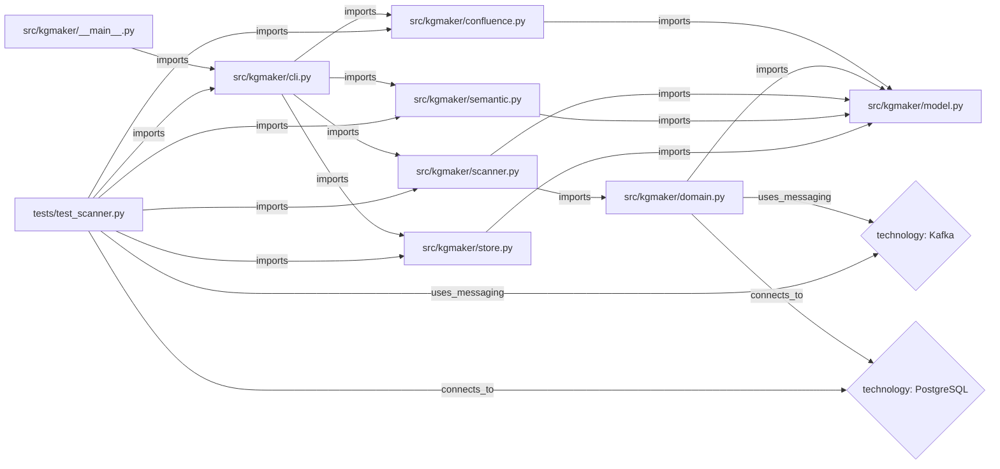

# Repository knowledge graph

> Generated locally by kgmaker. Structural edges come from source text; name-based call edges are heuristic.
> Review semantic conclusions with the repository's Copilot knowledge-graph agent.

- Files indexed: 13
- Symbols and sections: 140
- Internal imports: 16
- Heuristic cross-file calls: 144
- PostgreSQL tables/columns: 0/0
- Kafka topics: 0
- API endpoints: 0
- TypeScript frontend routes: 0
- Semantic concepts: 0
- Inferred/ambiguous relationships: 144/0

## Architecture diagram

The diagram groups declarations under their source files and shows detected imports and domain relationships. Heuristic call edges are omitted. An editable standalone Mermaid source is available at `.kgmaker/GRAPH.mmd`.

## Files and symbols

### `README.md`
- **section** `kgmaker` line 1
- **section** `Requirements` line 7
- **section** `Install` line 12
- **section** `Commands` line 26
- **section** `What gets indexed` line 58
- **section** `Copilot workflow` line 66
- **section** `Development` line 72

### `docs/architecture.md`
- **section** `Architecture` line 1
- **section** `Relationship confidence` line 17
- **section** `Hook lifecycle` line 30
- **section** `Extension points` line 34

### `docs/project-scope.md`
- **section** `Project scope` line 1
- **section** `Goals` line 5
- **section** `Out of scope` line 15
- **section** `Initial implementation` line 23
- **section** `Graph workflows` line 31

### `src/kgmaker/__init__.py`
- No declarations extracted.

### `src/kgmaker/__main__.py`
- No declarations extracted.

### `src/kgmaker/cli.py`
- **function** `_write_if_missing` line 180 — `_write_if_missing(path: Path, text: str, force: bool = False)`
- **function** `init` line 188 — `init(root: Path, force: bool = False)`
- **function** `scan` line 223 — `scan(root: Path, generate_docs: bool = True, confluence_dir: str | None = None, report: str | None = None)`
- **function** `status` line 254 — `status(root: Path)`
- **function** `check` line 277 — `check(root: Path)`
- **function** `docs` line 306 — `docs(root: Path, action: str | None = None, confluence_dir: str | None = None, report: str | None = None)`
- **function** `semantic_prepare` line 330 — `semantic_prepare(root: Path)`
- **function** `semantic_update` line 344 — `semantic_update(root: Path, base_ref: str, note_path: str | None = None, token_budget: int | None = None)`
- **function** `semantic_apply` line 425 — `semantic_apply(root: Path)`
- **function** `semantic_validate` line 445 — `semantic_validate(root: Path)`
- **function** `impact` line 460 — `impact(root: Path, changed_files: list[str])`
- **function** `query` line 532 — `query(root: Path, terms: str, limit: int = 10)`
- **function** `hook_context` line 561 — `hook_context(root: Path, token_budget: int | None = None)`
- **function** `build_parser` line 580 — `build_parser`
- **function** `main` line 643 — `main`

### `src/kgmaker/confluence.py`
- **function** `_norm` line 30 — `_norm(value: str)`
- **function** `_safe_rel` line 34 — `_safe_rel(path: str)`
- **function** `_sha` line 38 — `_sha(path: Path)`
- **class** `ConfluenceDocument` line 49 — `ConfluenceDocument`
- **class** `DocumentationAssertion` line 63 — `DocumentationAssertion`
- **class** `_ExportHTMLParser` line 80 — `_ExportHTMLParser(HTMLParser)`
- **function** `__init__` line 86 — `__init__(self)`
- **function** `_attrs` line 105 — `_attrs(self, attrs: list[tuple[str, str | None]])`
- **function** `handle_starttag` line 108 — `handle_starttag(self, tag: str, attrs: list[tuple[str, str | None]])`
- **function** `handle_endtag` line 139 — `handle_endtag(self, tag: str)`
- **function** `handle_data` line 169 — `handle_data(self, data: str)`
- **function** `text` line 183 — `text(self)`
- **function** `_resolve_local_ref` line 187 — `_resolve_local_ref(value: str, current_file: str)`
- **function** `_parse_mermaid` line 194 — `_parse_mermaid(source: str)`
- **function** `_parse_drawio` line 209 — `_parse_drawio(path: Path, source_file: str)`
- **function** `_parse_svg` line 232 — `_parse_svg(path: Path)`
- **function** `_document_from_html` line 243 — `_document_from_html(path: Path, export_root: Path, digest: str)`
- **function** `_load_cache` line 262 — `_load_cache(root: Path)`
- **function** `_write_cache` line 270 — `_write_cache(root: Path, payload: dict[str, Any])`
- **function** `discover_export` line 276 — `discover_export(export_root: Path)`
- **function** `ingest_export` line 280 — `ingest_export(export_root: Path, repository_root: Path)`
- **function** `_assertions_from_document` line 319 — `_assertions_from_document(doc: ConfluenceDocument)`
- **function** `_code_nodes` line 348 — `_code_nodes(graph: KnowledgeGraph)`
- **function** `_missing_category` line 355 — `_missing_category(assertion: DocumentationAssertion)`
- **function** `validate_documents` line 367 — `validate_documents(documents: list[ConfluenceDocument], graph: KnowledgeGraph)`
- **function** `merge_into_graph` line 415 — `merge_into_graph(graph: KnowledgeGraph, documents: list[ConfluenceDocument], attachments: list[dict[str, Any]], assertions: list[DocumentationAssertion])`
- **function** `render_report` line 456 — `render_report(assertions: list[DocumentationAssertion], report_path: Path, export_root: Path, revision: str = "working tree")`
- **function** `persist_validation_index` line 484 — `persist_validation_index(root: Path, assertions: list[DocumentationAssertion])`
- **function** `resolve_confluence_dir` line 495 — `resolve_confluence_dir(root: Path, cli_value: str | None)`
- **function** `documentation_check` line 529 — `documentation_check(root: Path, confluence_dir: str | None = None, report: str | None = None, graph: KnowledgeGraph | None = None)`

### `src/kgmaker/domain.py`
- **technology** `Kafka`
- **technology** `PostgreSQL`
- **function** `_line` line 65 — `_line(text: str, offset: int)`
- **function** `_unquote_identifier` line 69 — `_unquote_identifier(value: str)`
- **function** `_canon` line 73 — `_canon(value: str)`
- **function** `_node_id` line 77 — `_node_id(kind: str, key: str)`
- **function** `_shared_node` line 81 — `_shared_node(kind: str, key: str, display: str, path: str, line: int | None = None, summary: str | None = None)`
- **function** `_split_sql_items` line 85 — `_split_sql_items(body: str)`
- **function** `_sql_objects` line 108 — `_sql_objects(text: str, path: str, file_id: str)`
- **function** `_entity_edges` line 137 — `_entity_edges(text: str, path: str, symbols: list[Node], tables: dict[str, Node], columns: dict[str, Node])`
- **function** `_string_literals` line 191 — `_string_literals(value: str)`
- **function** `_kafka_references` line 195 — `_kafka_references(text: str, path: str, file_id: str)`
- **function** `add` line 200 — `add(topic: str, offset: int, relation: str, evidence: str)`
- **function** `normalize_api_path` line 230 — `normalize_api_path(path: str)`
- **function** `_api_node` line 241 — `_api_node(method: str, path: str, source: str, line: int | None, operation: str | None = None)`
- **function** `_mapping_path` line 254 — `_mapping_path(args: str)`
- **function** `_openapi_yaml` line 259 — `_openapi_yaml(text: str, path: str, file_id: str)`
- **function** `flush` line 271 — `flush(offset: int)`
- **function** `_openapi_json` line 302 — `_openapi_json(text: str, path: str, file_id: str)`
- **function** `_api_references` line 324 — `_api_references(text: str, path: str, language: str, file_id: str)`
- **function** `add` line 329 — `add(method: str, endpoint_path: str, offset: int, relation: str, evidence: str)`
- **function** `_typescript_routes` line 392 — `_typescript_routes(path: str, text: str, file_id: str)`
- **function** `_technology_nodes` line 426 — `_technology_nodes(text: str, path: str, file_id: str)`
- **function** `extract_domain` line 440 — `extract_domain(path: str, text: str, language: str, file_id: str, symbols: list[Node])`
- **function** `extract_openapi` line 475 — `extract_openapi(path: str, text: str, file_id: str)`
- **function** `connect_persistence` line 484 — `connect_persistence(symbols_by_file: dict[str, list[Node]], text_by_file: dict[str, str], nodes: list[Node])`
- **function** `merge_domain_nodes` line 515 — `merge_domain_nodes(nodes: list[Node])`

### `src/kgmaker/model.py`
- **class** `Node` line 10 — `Node`
- **class** `Edge` line 21 — `Edge`
- **class** `KnowledgeGraph` line 33 — `KnowledgeGraph`
- **function** `to_dict` line 40 — `to_dict(self)`
- **function** `from_dict` line 52 — `from_dict(cls, data: dict[str, Any])`

### `src/kgmaker/scanner.py`
- **function** `_safe_text` line 74 — `_safe_text(path: Path)`
- **function** `_file_digest` line 83 — `_file_digest(text: str)`
- **function** `_stable_id` line 87 — `_stable_id(kind: str, path: str, name: str, line: int | None = None)`
- **function** `_line_for` line 92 — `_line_for(text: str, offset: int)`
- **function** `_doc_for_line` line 96 — `_doc_for_line(lines: list[str], index: int)`
- **function** `_extract_symbols` line 104 — `_extract_symbols(text: str, path: str, language: str)`
- **function** `_imports` line 160 — `_imports(text: str, language: str)`
- **function** `_candidate_paths` line 178 — `_candidate_paths(root: Path, source: str, import_name: str, known_files: set[str])`
- **function** `_should_skip` line 207 — `_should_skip(path: Path, relative: Path)`
- **function** `scan_repository` line 216 — `scan_repository(root: Path)`

### `src/kgmaker/semantic.py`
- **class** `SemanticValidationError` line 30 — `SemanticValidationError(ValueError)`
- **function** `concept_id` line 34 — `concept_id(source_file: str, name: str)`
- **function** `graph_fingerprint` line 40 — `graph_fingerprint(graph: KnowledgeGraph)`
- **function** `build_semantic_input` line 51 — `build_semantic_input(graph: KnowledgeGraph)`
- **function** `_positive_line` line 72 — `_positive_line(value: Any, field: str)`
- **function** `_check_line` line 80 — `_check_line(root: Path, source_file: str, line: int | None, field: str, line_counts: dict[str, int])`
- **function** `validate_semantic_data` line 95 — `validate_semantic_data(data: Any, graph: KnowledgeGraph, root: Path)`
- **function** `_run_git` line 199 — `_run_git(root: Path, *args: str, check: bool = True)`
- **function** `_is_sensitive_path` line 214 — `_is_sensitive_path(path: str)`
- **function** `apply_semantic_patch` line 411 — `apply_semantic_patch(patch: Any, update: Any, graph: KnowledgeGraph, root: Path)`
- **function** `apply_semantic_layer` line 530 — `apply_semantic_layer(graph: KnowledgeGraph, root: Path)`

### `src/kgmaker/store.py`
- **function** `save_graph` line 14 — `save_graph(graph: KnowledgeGraph, root: Path, generate_docs: bool = True)`
- **function** `load_graph` line 27 — `load_graph(root: Path)`
- **function** `render_markdown` line 35 — `render_markdown(graph: KnowledgeGraph)`
- **function** `render_mermaid` line 112 — `render_mermaid(graph: KnowledgeGraph)`
- **function** `render_context` line 163 — `render_context(graph: KnowledgeGraph, limit: int = 8_000, root: Path | None = None)`
- **function** `_edge_details` line 205 — `_edge_details(edge)`

### `tests/test_scanner.py`
- **class** `ScannerTests` line 16 — `ScannerTests(unittest.TestCase)`
- **function** `test_confluence_html_parser_resolves_pages_mermaid_and_drawio` line 19 — `test_confluence_html_parser_resolves_pages_mermaid_and_drawio(self)`
- **function** `test_confluence_code_is_truth_and_report_preserves_stale_documentation` line 36 — `test_confluence_code_is_truth_and_report_preserves_stale_documentation(self)`
- **function** `test_docs_check_accepts_external_export_and_custom_report` line 65 — `test_docs_check_accepts_external_export_and_custom_report(self)`
- **function** `test_extracts_python_symbols_and_internal_imports` line 77 — `test_extracts_python_symbols_and_internal_imports(self)`
- **function** `test_skips_secrets_and_dependency_folders` line 94 — `test_skips_secrets_and_dependency_folders(self)`
- **function** `test_persists_and_loads_graph` line 107 — `test_persists_and_loads_graph(self)`
- **function** `test_scan_no_docs_skips_markdown_and_mermaid_but_keeps_index` line 122 — `test_scan_no_docs_skips_markdown_and_mermaid_but_keeps_index(self)`
- **function** `test_mermaid_visualization_groups_symbols_and_shows_imports` line 140 — `test_mermaid_visualization_groups_symbols_and_shows_imports(self)`
- **function** `test_resolves_python_package_relative_import` line 155 — `test_resolves_python_package_relative_import(self)`
- **function** `test_init_preserves_existing_user_files` line 170 — `test_init_preserves_existing_user_files(self)`
- **function** `test_semantic_layer_uses_stable_ids_and_rejects_stale_or_dangling_edges` line 197 — `test_semantic_layer_uses_stable_ids_and_rejects_stale_or_dangling_edges(self)`
- **function** `test_semantic_update_refreshes_only_affected_entries` line 269 — `test_semantic_update_refreshes_only_affected_entries(self)`
- **function** `test_hook_emits_session_context_json` line 354 — `test_hook_emits_session_context_json(self)`
- **function** `test_impact_reports_exact_transitive_import_dependents` line 375 — `test_impact_reports_exact_transitive_import_dependents(self)`
- **function** `test_check_detects_stale_graph_and_docs_regenerate_markdown` line 394 — `test_check_detects_stale_graph_and_docs_regenerate_markdown(self)`
- **function** `test_check_command_works_without_local_json_index` line 415 — `test_check_command_works_without_local_json_index(self)`
- **function** `test_maps_kotlin_entities_repositories_and_columns_to_postgres_schema` line 428 — `test_maps_kotlin_entities_repositories_and_columns_to_postgres_schema(self)`
- **function** `test_finds_kafka_topics_and_postgres_connection_from_kotlin_and_yaml` line 463 — `test_finds_kafka_topics_and_postgres_connection_from_kotlin_and_yaml(self)`
- **function** `test_links_openapi_server_and_typescript_client_paths` line 495 — `test_links_openapi_server_and_typescript_client_paths(self)`

## Internal relationships

- `src/kgmaker/__main__.py` imports `src/kgmaker/cli.py` (.cli)
- `src/kgmaker/cli.py` imports `src/kgmaker/confluence.py` (.confluence)
- `src/kgmaker/cli.py` imports `src/kgmaker/scanner.py` (.scanner)
- `src/kgmaker/cli.py` imports `src/kgmaker/semantic.py` (.semantic)
- `src/kgmaker/cli.py` imports `src/kgmaker/store.py` (.store)
- `src/kgmaker/confluence.py` imports `src/kgmaker/model.py` (.model)
- `src/kgmaker/domain.py` imports `src/kgmaker/model.py` (.model)
- `src/kgmaker/scanner.py` imports `src/kgmaker/domain.py` (.domain)
- `src/kgmaker/scanner.py` imports `src/kgmaker/model.py` (.model)
- `src/kgmaker/semantic.py` imports `src/kgmaker/model.py` (.model)
- `src/kgmaker/store.py` imports `src/kgmaker/model.py` (.model)
- `tests/test_scanner.py` imports `src/kgmaker/cli.py` (kgmaker.cli)
- `tests/test_scanner.py` imports `src/kgmaker/confluence.py` (kgmaker.confluence)
- `tests/test_scanner.py` imports `src/kgmaker/scanner.py` (kgmaker.scanner)
- `tests/test_scanner.py` imports `src/kgmaker/semantic.py` (kgmaker.semantic)
- `tests/test_scanner.py` imports `src/kgmaker/store.py` (kgmaker.store)
- `src/kgmaker/__main__.py` may call `643 in `src/kgmaker/cli.py`` (name match at line 3; INFERRED 0.85)
- `src/kgmaker/cli.py` may call `529 in `src/kgmaker/confluence.py`` (name match at line 312; INFERRED 0.85)
- `src/kgmaker/cli.py` may call `280 in `src/kgmaker/confluence.py`` (name match at line 229; INFERRED 0.85)
- `src/kgmaker/cli.py` may call `415 in `src/kgmaker/confluence.py`` (name match at line 232; INFERRED 0.85)
- `src/kgmaker/cli.py` may call `484 in `src/kgmaker/confluence.py`` (name match at line 231; INFERRED 0.85)
- `src/kgmaker/cli.py` may call `456 in `src/kgmaker/confluence.py`` (name match at line 236; INFERRED 0.85)
- `src/kgmaker/cli.py` may call `495 in `src/kgmaker/confluence.py`` (name match at line 227; INFERRED 0.85)
- `src/kgmaker/cli.py` may call `367 in `src/kgmaker/confluence.py`` (name match at line 230; INFERRED 0.85)
- `src/kgmaker/cli.py` may call `216 in `src/kgmaker/scanner.py`` (name match at line 226; INFERRED 0.85)
- `src/kgmaker/cli.py` may call `216 in `src/kgmaker/scanner.py`` (name match at line 261; INFERRED 0.85)
- `src/kgmaker/cli.py` may call `216 in `src/kgmaker/scanner.py`` (name match at line 281; INFERRED 0.85)
- `src/kgmaker/cli.py` may call `216 in `src/kgmaker/scanner.py`` (name match at line 311; INFERRED 0.85)
- `src/kgmaker/cli.py` may call `216 in `src/kgmaker/scanner.py`` (name match at line 334; INFERRED 0.85)
- `src/kgmaker/cli.py` may call `216 in `src/kgmaker/scanner.py`` (name match at line 349; INFERRED 0.85)
- `src/kgmaker/cli.py` may call `216 in `src/kgmaker/scanner.py`` (name match at line 432; INFERRED 0.85)
- `src/kgmaker/cli.py` may call `216 in `src/kgmaker/scanner.py`` (name match at line 452; INFERRED 0.85)
- `src/kgmaker/cli.py` may call `216 in `src/kgmaker/scanner.py`` (name match at line 568; INFERRED 0.85)
- `src/kgmaker/cli.py` may call `530 in `src/kgmaker/semantic.py`` (name match at line 226; INFERRED 0.85)
- `src/kgmaker/cli.py` may call `530 in `src/kgmaker/semantic.py`` (name match at line 261; INFERRED 0.85)
- `src/kgmaker/cli.py` may call `530 in `src/kgmaker/semantic.py`` (name match at line 281; INFERRED 0.85)
- `src/kgmaker/cli.py` may call `530 in `src/kgmaker/semantic.py`` (name match at line 568; INFERRED 0.85)
- `src/kgmaker/cli.py` may call `411 in `src/kgmaker/semantic.py`` (name match at line 433; INFERRED 0.85)
- `src/kgmaker/cli.py` may call `51 in `src/kgmaker/semantic.py`` (name match at line 335; INFERRED 0.85)
- `src/kgmaker/cli.py` may call `95 in `src/kgmaker/semantic.py`` (name match at line 453; INFERRED 0.85)
- `src/kgmaker/cli.py` may call `27 in `src/kgmaker/store.py`` (name match at line 257; INFERRED 0.85)
- `src/kgmaker/cli.py` may call `27 in `src/kgmaker/store.py`` (name match at line 311; INFERRED 0.85)
- `src/kgmaker/cli.py` may call `27 in `src/kgmaker/store.py`` (name match at line 318; INFERRED 0.85)
- `src/kgmaker/cli.py` may call `27 in `src/kgmaker/store.py`` (name match at line 348; INFERRED 0.85)
- `src/kgmaker/cli.py` may call `27 in `src/kgmaker/store.py`` (name match at line 464; INFERRED 0.85)
- `src/kgmaker/cli.py` may call `27 in `src/kgmaker/store.py`` (name match at line 535; INFERRED 0.85)
- `src/kgmaker/cli.py` may call `163 in `src/kgmaker/store.py`` (name match at line 573; INFERRED 0.85)
- `src/kgmaker/cli.py` may call `35 in `src/kgmaker/store.py`` (name match at line 286; INFERRED 0.85)
- `src/kgmaker/cli.py` may call `35 in `src/kgmaker/store.py`` (name match at line 324; INFERRED 0.85)
- `src/kgmaker/cli.py` may call `112 in `src/kgmaker/store.py`` (name match at line 288; INFERRED 0.85)
- `src/kgmaker/cli.py` may call `112 in `src/kgmaker/store.py`` (name match at line 326; INFERRED 0.85)
- `src/kgmaker/cli.py` may call `14 in `src/kgmaker/store.py`` (name match at line 239; INFERRED 0.85)
- `src/kgmaker/cli.py` may call `14 in `src/kgmaker/store.py`` (name match at line 571; INFERRED 0.85)
- `src/kgmaker/confluence.py` may call `21 in `src/kgmaker/model.py`` (name match at line 429; INFERRED 0.85)
- `src/kgmaker/confluence.py` may call `21 in `src/kgmaker/model.py`` (name match at line 439; INFERRED 0.85)
- `src/kgmaker/confluence.py` may call `21 in `src/kgmaker/model.py`` (name match at line 446; INFERRED 0.85)
- `src/kgmaker/confluence.py` may call `21 in `src/kgmaker/model.py`` (name match at line 454; INFERRED 0.85)
- `src/kgmaker/confluence.py` may call `33 in `src/kgmaker/model.py`` (name match at line 455; INFERRED 0.85)
- `src/kgmaker/confluence.py` may call `33 in `src/kgmaker/model.py`` (name match at line 541; INFERRED 0.85)
- `src/kgmaker/confluence.py` may call `10 in `src/kgmaker/model.py`` (name match at line 423; INFERRED 0.85)
- `src/kgmaker/confluence.py` may call `10 in `src/kgmaker/model.py`` (name match at line 433; INFERRED 0.85)
- `src/kgmaker/confluence.py` may call `10 in `src/kgmaker/model.py`` (name match at line 451; INFERRED 0.85)
- `src/kgmaker/domain.py` may call `21 in `src/kgmaker/model.py`` (name match at line 118; INFERRED 0.85)
- `src/kgmaker/domain.py` may call `21 in `src/kgmaker/model.py`` (name match at line 135; INFERRED 0.85)
- `src/kgmaker/domain.py` may call `21 in `src/kgmaker/model.py`` (name match at line 155; INFERRED 0.85)
- `src/kgmaker/domain.py` may call `21 in `src/kgmaker/model.py`` (name match at line 179; INFERRED 0.85)
- `src/kgmaker/domain.py` may call `21 in `src/kgmaker/model.py`` (name match at line 189; INFERRED 0.85)
- `src/kgmaker/domain.py` may call `21 in `src/kgmaker/model.py`` (name match at line 206; INFERRED 0.85)
- `src/kgmaker/domain.py` may call `21 in `src/kgmaker/model.py`` (name match at line 276; INFERRED 0.85)
- `src/kgmaker/domain.py` may call `21 in `src/kgmaker/model.py`` (name match at line 322; INFERRED 0.85)
- `src/kgmaker/domain.py` may call `21 in `src/kgmaker/model.py`` (name match at line 335; INFERRED 0.85)
- `src/kgmaker/domain.py` may call `21 in `src/kgmaker/model.py`` (name match at line 380; INFERRED 0.85)
- `src/kgmaker/domain.py` may call `21 in `src/kgmaker/model.py`` (name match at line 417; INFERRED 0.85)
- `src/kgmaker/domain.py` may call `21 in `src/kgmaker/model.py`` (name match at line 424; INFERRED 0.85)
- `src/kgmaker/domain.py` may call `21 in `src/kgmaker/model.py`` (name match at line 434; INFERRED 0.85)
- `src/kgmaker/domain.py` may call `21 in `src/kgmaker/model.py`` (name match at line 438; INFERRED 0.85)
- `src/kgmaker/domain.py` may call `21 in `src/kgmaker/model.py`` (name match at line 509; INFERRED 0.85)
- `src/kgmaker/domain.py` may call `21 in `src/kgmaker/model.py`` (name match at line 513; INFERRED 0.85)
- `src/kgmaker/domain.py` may call `10 in `src/kgmaker/model.py`` (name match at line 126; INFERRED 0.85)
- `src/kgmaker/domain.py` may call `10 in `src/kgmaker/model.py`` (name match at line 246; INFERRED 0.85)
- `src/kgmaker/domain.py` may call `10 in `src/kgmaker/model.py`` (name match at line 415; INFERRED 0.85)
- `src/kgmaker/domain.py` may call `10 in `src/kgmaker/model.py`` (name match at line 84; INFERRED 0.85)
- `src/kgmaker/scanner.py` may call `21 in `src/kgmaker/model.py`` (name match at line 260; INFERRED 0.85)
- `src/kgmaker/scanner.py` may call `21 in `src/kgmaker/model.py`` (name match at line 272; INFERRED 0.85)
- `src/kgmaker/scanner.py` may call `21 in `src/kgmaker/model.py`` (name match at line 282; INFERRED 0.85)
- `src/kgmaker/scanner.py` may call `33 in `src/kgmaker/model.py`` (name match at line 309; INFERRED 0.85)
- `src/kgmaker/scanner.py` may call `10 in `src/kgmaker/model.py`` (name match at line 120; INFERRED 0.85)
- `src/kgmaker/scanner.py` may call `10 in `src/kgmaker/model.py`` (name match at line 149; INFERRED 0.85)
- `src/kgmaker/scanner.py` may call `10 in `src/kgmaker/model.py`` (name match at line 250; INFERRED 0.85)
- `src/kgmaker/scanner.py` may call `484 in `src/kgmaker/domain.py`` (name match at line 304; INFERRED 0.85)
- `src/kgmaker/scanner.py` may call `440 in `src/kgmaker/domain.py`` (name match at line 296; INFERRED 0.85)
- `src/kgmaker/scanner.py` may call `475 in `src/kgmaker/domain.py`` (name match at line 299; INFERRED 0.85)
- `src/kgmaker/scanner.py` may call `515 in `src/kgmaker/domain.py`` (name match at line 303; INFERRED 0.85)
- `src/kgmaker/semantic.py` may call `21 in `src/kgmaker/model.py`` (name match at line 191; INFERRED 0.85)
- `src/kgmaker/semantic.py` may call `10 in `src/kgmaker/model.py`` (name match at line 142; INFERRED 0.85)
- `src/kgmaker/store.py` may call `52 in `src/kgmaker/model.py`` (name match at line 32; INFERRED 0.85)
- `src/kgmaker/store.py` may call `40 in `src/kgmaker/model.py`` (name match at line 22; INFERRED 0.85)
- `tests/test_scanner.py` may call `277 in `src/kgmaker/cli.py`` (name match at line 401; INFERRED 0.85)
- `tests/test_scanner.py` may call `277 in `src/kgmaker/cli.py`` (name match at line 405; INFERRED 0.85)
- `tests/test_scanner.py` may call `277 in `src/kgmaker/cli.py`` (name match at line 408; INFERRED 0.85)
- `tests/test_scanner.py` may call `306 in `src/kgmaker/cli.py`` (name match at line 137; INFERRED 0.85)
- `tests/test_scanner.py` may call `306 in `src/kgmaker/cli.py`` (name match at line 412; INFERRED 0.85)
- `tests/test_scanner.py` may call `561 in `src/kgmaker/cli.py`` (name match at line 364; INFERRED 0.85)
- `tests/test_scanner.py` may call `561 in `src/kgmaker/cli.py`` (name match at line 372; INFERRED 0.85)
- `tests/test_scanner.py` may call `460 in `src/kgmaker/cli.py`` (name match at line 389; INFERRED 0.85)
- `tests/test_scanner.py` may call `188 in `src/kgmaker/cli.py`` (name match at line 178; INFERRED 0.85)
- `tests/test_scanner.py` may call `643 in `src/kgmaker/cli.py`` (name match at line 131; INFERRED 0.85)
- `tests/test_scanner.py` may call `643 in `src/kgmaker/cli.py`` (name match at line 361; INFERRED 0.85)
- `tests/test_scanner.py` may call `643 in `src/kgmaker/cli.py`` (name match at line 426; INFERRED 0.85)
- `tests/test_scanner.py` may call `643 in `src/kgmaker/cli.py`` (name match at line 551; INFERRED 0.85)
- `tests/test_scanner.py` may call `643 in `src/kgmaker/cli.py`` (name match at line 80; INFERRED 0.85)
- `tests/test_scanner.py` may call `425 in `src/kgmaker/cli.py`` (name match at line 344; INFERRED 0.85)
- `tests/test_scanner.py` may call `425 in `src/kgmaker/cli.py`` (name match at line 353; INFERRED 0.85)
- `tests/test_scanner.py` may call `344 in `src/kgmaker/cli.py`` (name match at line 310; INFERRED 0.85)
- `tests/test_scanner.py` may call `344 in `src/kgmaker/cli.py`` (name match at line 325; INFERRED 0.85)
- `tests/test_scanner.py` may call `344 in `src/kgmaker/cli.py`` (name match at line 332; INFERRED 0.85)
- `tests/test_scanner.py` may call `445 in `src/kgmaker/cli.py`` (name match at line 240; INFERRED 0.85)
- `tests/test_scanner.py` may call `445 in `src/kgmaker/cli.py`` (name match at line 349; INFERRED 0.85)
- `tests/test_scanner.py` may call `529 in `src/kgmaker/confluence.py`` (name match at line 73; INFERRED 0.85)
- `tests/test_scanner.py` may call `280 in `src/kgmaker/confluence.py`` (name match at line 27; INFERRED 0.85)
- `tests/test_scanner.py` may call `280 in `src/kgmaker/confluence.py`` (name match at line 50; INFERRED 0.85)
- `tests/test_scanner.py` may call `415 in `src/kgmaker/confluence.py`` (name match at line 57; INFERRED 0.85)
- `tests/test_scanner.py` may call `456 in `src/kgmaker/confluence.py`` (name match at line 59; INFERRED 0.85)
- `tests/test_scanner.py` may call `367 in `src/kgmaker/confluence.py`` (name match at line 51; INFERRED 0.85)
- `tests/test_scanner.py` may call `40 in `src/kgmaker/model.py`` (name match at line 106; INFERRED 0.85)
- `tests/test_scanner.py` may call `216 in `src/kgmaker/scanner.py`` (name match at line 103; INFERRED 0.85)
- `tests/test_scanner.py` may call `216 in `src/kgmaker/scanner.py`` (name match at line 112; INFERRED 0.85)
- `tests/test_scanner.py` may call `216 in `src/kgmaker/scanner.py`` (name match at line 146; INFERRED 0.85)
- `tests/test_scanner.py` may call `216 in `src/kgmaker/scanner.py`` (name match at line 165; INFERRED 0.85)
- `tests/test_scanner.py` may call `216 in `src/kgmaker/scanner.py`` (name match at line 209; INFERRED 0.85)
- `tests/test_scanner.py` may call `216 in `src/kgmaker/scanner.py`` (name match at line 252; INFERRED 0.85)
- `tests/test_scanner.py` may call `216 in `src/kgmaker/scanner.py`` (name match at line 258; INFERRED 0.85)
- `tests/test_scanner.py` may call `216 in `src/kgmaker/scanner.py`` (name match at line 266; INFERRED 0.85)
- `tests/test_scanner.py` may call `216 in `src/kgmaker/scanner.py`` (name match at line 285; INFERRED 0.85)
- `tests/test_scanner.py` may call `216 in `src/kgmaker/scanner.py`` (name match at line 306; INFERRED 0.85)
- `tests/test_scanner.py` may call `216 in `src/kgmaker/scanner.py`` (name match at line 385; INFERRED 0.85)
- `tests/test_scanner.py` may call `216 in `src/kgmaker/scanner.py`` (name match at line 400; INFERRED 0.85)
- `tests/test_scanner.py` may call `216 in `src/kgmaker/scanner.py`` (name match at line 422; INFERRED 0.85)
- `tests/test_scanner.py` may call `216 in `src/kgmaker/scanner.py`` (name match at line 454; INFERRED 0.85)
- `tests/test_scanner.py` may call `216 in `src/kgmaker/scanner.py`` (name match at line 487; INFERRED 0.85)
- `tests/test_scanner.py` may call `216 in `src/kgmaker/scanner.py`` (name match at line 49; INFERRED 0.85)
- `tests/test_scanner.py` may call `216 in `src/kgmaker/scanner.py`` (name match at line 535; INFERRED 0.85)
- `tests/test_scanner.py` may call `216 in `src/kgmaker/scanner.py`` (name match at line 73; INFERRED 0.85)
- `tests/test_scanner.py` may call `216 in `src/kgmaker/scanner.py`` (name match at line 83; INFERRED 0.85)
- `tests/test_scanner.py` may call `530 in `src/kgmaker/semantic.py`` (name match at line 241; INFERRED 0.85)
- `tests/test_scanner.py` may call `530 in `src/kgmaker/semantic.py`` (name match at line 252; INFERRED 0.85)
- `tests/test_scanner.py` may call `530 in `src/kgmaker/semantic.py`` (name match at line 258; INFERRED 0.85)
- `tests/test_scanner.py` may call `530 in `src/kgmaker/semantic.py`` (name match at line 266; INFERRED 0.85)
- `tests/test_scanner.py` may call `51 in `src/kgmaker/semantic.py`` (name match at line 210; INFERRED 0.85)
- `tests/test_scanner.py` may call `34 in `src/kgmaker/semantic.py`` (name match at line 215; INFERRED 0.85)
- `tests/test_scanner.py` may call `34 in `src/kgmaker/semantic.py`` (name match at line 290; INFERRED 0.85)
- `tests/test_scanner.py` may call `27 in `src/kgmaker/store.py`` (name match at line 115; INFERRED 0.85)
- `tests/test_scanner.py` may call `163 in `src/kgmaker/store.py`` (name match at line 248; INFERRED 0.85)
- `tests/test_scanner.py` may call `35 in `src/kgmaker/store.py`` (name match at line 247; INFERRED 0.85)
- `tests/test_scanner.py` may call `112 in `src/kgmaker/store.py`` (name match at line 148; INFERRED 0.85)
- `tests/test_scanner.py` may call `14 in `src/kgmaker/store.py`` (name match at line 113; INFERRED 0.85)
- `tests/test_scanner.py` may call `14 in `src/kgmaker/store.py`` (name match at line 286; INFERRED 0.85)
- `tests/test_scanner.py` may call `14 in `src/kgmaker/store.py`` (name match at line 385; INFERRED 0.85)
- `tests/test_scanner.py` may call `14 in `src/kgmaker/store.py`` (name match at line 400; INFERRED 0.85)
- `tests/test_scanner.py` may call `14 in `src/kgmaker/store.py`` (name match at line 422; INFERRED 0.85)
- `src/kgmaker/domain.py` **connects_to** technology `PostgreSQL` in `src/kgmaker/domain.py` — PostgreSQL driver or connection string
- `src/kgmaker/domain.py` **uses_messaging** technology `Kafka` in `src/kgmaker/domain.py` — Kafka import, client, annotation, or configuration
- `tests/test_scanner.py` **connects_to** technology `PostgreSQL` in `src/kgmaker/domain.py` — PostgreSQL driver or connection string
- `tests/test_scanner.py` **uses_messaging** technology `Kafka` in `src/kgmaker/domain.py` — Kafka import, client, annotation, or configuration

## Reading this graph

File and symbol locations are repository-relative. `contains` edges bind declarations to their files. Domain edges such as `maps_to_table`, `consumes`, and `calls_endpoint` record annotations, SQL definitions, configuration, or literal paths found in source. `calls` edges are conservative name matches and must be verified before relying on them.
