# Repository knowledge graph

> Generated locally by kgmaker. Structural edges come from source text; name-based call edges are heuristic.
> Review semantic conclusions with the repository's Copilot knowledge-graph agent.

- Scope: production; omitted files: 553
- Mode: SOURCE_ONLY; coverage: PARTIAL; no build/test/runtime result is implied.
- Freshness below describes the captured snapshot; use `kgmaker status` to compare current inputs.
- Context: `2c3b012df1a5b97a23dcc82ddc86f61d68be2e93feefaac340c54126764f1fbb`; content: `9f24db9b9188dcea4a44aa8c490694f12d908d4d22106465cccdad00e42e0620`; freshness: CONTENT_VERIFIED
- Files indexed: 106
- Symbols and sections: 1495
- Internal imports: 457
- Heuristic cross-file calls: 8453
- PostgreSQL tables/columns: 0/0
- Kafka topics: 0
- API endpoints: 0
- TypeScript frontend routes: 0
- Workbooks/cells: 0/0
- Templates/fragments/variables/conditions: 0/0/0/0
- Semantic concepts: 0
- Implementation episodes: 347
- Inferred/ambiguous relationships: 8453/0

## Architecture diagram

The diagram groups declarations under their source files and shows detected imports and domain relationships. Heuristic call edges are omitted. An editable standalone Mermaid source is available at `.kgmaker/GRAPH.mmd`.

```mermaid
flowchart LR
  n0["src/kgmaker/__main__.py"]
  n1["src/kgmaker/_windows_job.py"]
  n2["src/kgmaker/agent_rules.py"]
  n3["src/kgmaker/agents.py"]
  n4["src/kgmaker/analysis_agent.py"]
  n5["src/kgmaker/analysis_model.py"]
  n6["src/kgmaker/analysis_report.py"]
  n7["src/kgmaker/analysis_validation.py"]
  n8["src/kgmaker/architecture_cli.py"]
  n9["src/kgmaker/architecture_model.py"]
  n10["src/kgmaker/architecture_render.py"]
  n11["src/kgmaker/architecture_render_common.py"]
  n12["src/kgmaker/artifact_templates.py"]
  n13["src/kgmaker/availability.py"]
  n14["src/kgmaker/build_maven.py"]
  n15["src/kgmaker/build_model.py"]
  n16["src/kgmaker/build_runner.py"]
  n17["src/kgmaker/business_process.py"]
  n18["src/kgmaker/callgraph.py"]
  n19["src/kgmaker/classification.py"]
  n20["src/kgmaker/cli.py"]
  n21["src/kgmaker/completion.py"]
  n22["src/kgmaker/completion_handoff.py"]
  n23["src/kgmaker/completion_review.py"]
  n24["src/kgmaker/confluence.py"]
  n25["src/kgmaker/confluence_sync.py"]
  n26["src/kgmaker/confluence_sync_config.py"]
  n27["src/kgmaker/context.py"]
  n28["src/kgmaker/context_roles.py"]
  n29["src/kgmaker/contract_inputs.py"]
  n30["src/kgmaker/control_flow.py"]
  n31["src/kgmaker/criteria_queries.py"]
  n32["src/kgmaker/data_agent.py"]
  n33["src/kgmaker/data_check.py"]
  n34["src/kgmaker/data_resources.py"]
  n35["src/kgmaker/dataflow.py"]
  n36["src/kgmaker/delivery_cli.py"]
  n37["src/kgmaker/delivery_instructions.py"]
  n38["src/kgmaker/domain.py"]
  n39["src/kgmaker/extraction_cache.py"]
  n40["src/kgmaker/feature.py"]
  n41["src/kgmaker/feature_cli.py"]
  n42["src/kgmaker/field_flow.py"]
  n43["src/kgmaker/flow.py"]
  n44["src/kgmaker/flow_report.py"]
  n45["src/kgmaker/flyway.py"]
  n46["src/kgmaker/framework.py"]
  n47["src/kgmaker/frontend_flow.py"]
  n48["src/kgmaker/graph_provider.py"]
  n49["src/kgmaker/http_execution.py"]
  n50["src/kgmaker/inspection.py"]
  n51["src/kgmaker/inspection_cli.py"]
  n52["src/kgmaker/interfaces.py"]
  n53["src/kgmaker/kafka_bindings.py"]
  n54["src/kgmaker/kafka_code.py"]
  n55["src/kgmaker/kafka_retry.py"]
  n56["src/kgmaker/local_operations.py"]
  n57["src/kgmaker/memory.py"]
  n58["src/kgmaker/model.py"]
  n59["src/kgmaker/named_queries.py"]
  n60["src/kgmaker/process_catalog.py"]
  n61["src/kgmaker/process_model.py"]
  n62["src/kgmaker/process_paths.py"]
  n63["src/kgmaker/process_semantics.py"]
  n64["src/kgmaker/process_store.py"]
  n65["src/kgmaker/process_triggers.py"]
  n66["src/kgmaker/project_cli.py"]
  n67["src/kgmaker/provenance.py"]
  n68["src/kgmaker/remote_interfaces.py"]
  n69["src/kgmaker/remote_mapping.py"]
  n70["src/kgmaker/report_projection.py"]
  n71["src/kgmaker/report_publication.py"]
  n72["src/kgmaker/return_flow.py"]
  n73["src/kgmaker/runtime_evidence.py"]
  n74["src/kgmaker/scanner.py"]
  n75["src/kgmaker/schema_replay.py"]
  n76["src/kgmaker/semantic.py"]
  n77["src/kgmaker/service_topology.py"]
  n78["src/kgmaker/skills.py"]
  n79["src/kgmaker/spring_beans.py"]
  n80["src/kgmaker/spring_conditions.py"]
  n81["src/kgmaker/spring_imports.py"]
  n82["src/kgmaker/store.py"]
  n83["src/kgmaker/templates.py"]
  n84["src/kgmaker/testgen.py"]
  n85["src/kgmaker/topology_filter.py"]
  n86["src/kgmaker/typescript_snapshot.py"]
  n87["src/kgmaker/view_cache.py"]
  n88["src/kgmaker/view_explanation.py"]
  n89["src/kgmaker/views.py"]
  n90["src/kgmaker/workbooks.py"]
  n91["src/kgmaker/worker_protocol.py"]
  n92["src/kgmaker/workflow.py"]
  n93["src/kgmaker/workflow_profiles.py"]
  n94["src/kgmaker/workspace.py"]
  n95["src/kgmaker/workspace_cli.py"]
  n96{"technology: Kafka"}
  n97{"technology: PostgreSQL"}
  n0 -->|imports| n20
  n3 -->|imports| n37
  n4 -->|imports| n2
  n4 -->|imports| n37
  n6 -->|imports| n40
  n6 -->|imports| n70
  n6 -->|uses| n70
  n7 -->|imports| n5
  n7 -->|imports| n13
  n7 -->|imports| n35
  n7 -->|imports| n40
  n7 -->|imports| n74
  n7 -->|imports| n76
  n7 -->|imports| n90
  n7 -->|imports| n94
  n8 -->|imports| n5
  n8 -->|imports| n9
  n8 -->|imports| n10
  n8 -->|uses| n10
  n8 -->|imports| n50
  n8 -->|imports| n58
  n8 -->|imports| n69
  n8 -->|imports| n77
  n8 -->|imports| n82
  n8 -->|imports| n85
  n8 -->|imports| n87
  n8 -->|imports| n88
  n8 -->|imports| n94
  n10 -->|imports| n5
  n10 -->|imports| n8
  n10 -->|imports| n9
  n10 -->|imports| n11
  n10 -->|imports| n68
  n10 -->|imports| n85
  n10 -->|imports| n88
  n11 -->|imports| n9
  n11 -->|imports| n88
  n12 -->|imports| n5
  n13 -->|imports| n5
  n13 -->|imports| n35
  n13 -->|imports| n40
  n14 -->|imports| n5
  n15 -->|imports| n5
  n15 -->|imports| n16
  n15 -->|imports| n19
  n15 -->|imports| n50
  n15 -->|imports| n75
  n16 -->|imports| n5
  n16 -->|imports| n50
  n17 -->|imports| n5
  n17 -->|imports| n9
  n17 -->|imports| n55
  n17 -->|imports| n56
  n17 -->|imports| n58
  n17 -->|imports| n61
  n17 -->|imports| n62
  n17 -->|imports| n68
  n17 -->|imports| n89
  n18 -->|imports| n5
  n18 -->|imports| n58
  n18 -->|imports| n89
  n19 -->|imports| n5
  n20 -->|imports| n2
  n20 -->|imports| n3
  n20 -->|imports| n4
  n20 -->|imports| n5
  n20 -->|imports| n8
  n20 -->|imports| n12
  n20 -->|imports| n21
  n20 -->|imports| n24
  n20 -->|imports| n26
  n20 -->|imports| n27
  n20 -->|imports| n32
  n20 -->|imports| n36
  n20 -->|imports| n37
  n20 -->|imports| n40
  n20 -->|imports| n51
  n20 -->|imports| n57
  n20 -->|imports| n58
  n20 -->|imports| n66
  n20 -->|imports| n74
  n20 -->|imports| n76
  n20 -->|imports| n78
  n20 -->|imports| n82
  n20 -->|imports| n89
  n20 -->|imports| n92
  n20 -->|imports| n93
  n20 -->|imports| n95
  n21 -->|imports| n22
  n21 -->|imports| n23
  n22 -->|imports| n5
  n22 -->|imports| n23
  n22 -->|imports| n27
  n22 -->|imports| n67
  n22 -->|imports| n92
  n22 -->|uses| n92
  n22 -->|imports| n93
  n23 -->|imports| n5
  n23 -->|uses| n67
  n23 -->|imports| n92
  n24 -->|imports| n5
  n24 -->|imports| n58
  n25 -->|imports| n5
  n26 -->|imports| n5
  n27 -->|imports| n5
  n27 -->|imports| n57
  n27 -->|imports| n58
  n27 -->|imports| n67
  n27 -->|imports| n74
  n27 -->|imports| n76
  n27 -->|imports| n82
  n27 -->|imports| n92
  n28 -->|imports| n5
  n28 -->|imports| n53
  n28 -->|imports| n94
  n29 -->|imports| n5
  n29 -->|imports| n74
  n30 -->|imports| n5
  n31 -->|imports| n5
  n31 -->|imports| n72
  n32 -->|imports| n2
  n33 -->|imports| n5
  n33 -->|imports| n6
  n33 -->|imports| n13
  n33 -->|imports| n35
  n33 -->|imports| n82
  n33 -->|imports| n94
  n34 -->|imports| n5
  n34 -->|imports| n9
  n34 -->|imports| n46
  n34 -->|imports| n58
  n34 -->|imports| n75
  n34 -->|imports| n89
  n34 -->|imports| n94
  n35 -->|imports| n42
  n35 -->|imports| n58
  n35 -->|imports| n69
  n35 -->|imports| n72
  n36 -->|imports| n5
  n36 -->|imports| n92
  n38 -->|imports| n49
  n38 -->|imports| n58
  n38 -->|uses_messaging| n96
  n38 -->|connects_to| n97
  n39 -->|imports| n5
  n39 -->|imports| n91
  n40 -->|imports| n5
  n40 -->|imports| n7
  n40 -->|imports| n13
  n40 -->|imports| n24
  n40 -->|imports| n35
  n40 -->|imports| n45
  n40 -->|imports| n48
  n40 -->|imports| n58
  n40 -->|imports| n74
  n40 -->|imports| n75
  n40 -->|imports| n76
  n40 -->|imports| n83
  n40 -->|imports| n89
  n40 -->|imports| n90
  n40 -->|imports| n94
  n41 -->|imports| n5
  n41 -->|imports| n6
  n41 -->|imports| n7
  n41 -->|imports| n13
  n41 -->|imports| n33
  n41 -->|imports| n35
  n41 -->|imports| n71
  n41 -->|imports| n74
  n41 -->|imports| n76
  n41 -->|imports| n89
  n42 -->|imports| n5
  n42 -->|imports| n58
  n42 -->|imports| n72
  n43 -->|imports| n5
  n43 -->|imports| n18
  n43 -->|imports| n35
  n43 -->|imports| n44
  n43 -->|imports| n55
  n43 -->|imports| n58
  n43 -->|imports| n72
  n43 -->|imports| n89
  n44 -->|imports| n5
  n44 -->|imports| n19
  n44 -->|imports| n48
  n44 -->|imports| n74
  n44 -->|imports| n82
  n44 -->|imports| n87
  n44 -->|imports| n89
  n44 -->|imports| n90
  n44 -->|imports| n91
  n45 -->|imports| n5
  n46 -->|imports| n5
  n46 -->|imports| n31
  n46 -->|imports| n58
  n46 -->|imports| n59
  n46 -->|imports| n75
  n46 -->|imports| n79
  n46 -->|imports| n80
  n46 -->|imports| n81
  n46 -->|uses_messaging| n96
  n47 -->|imports| n5
  n47 -->|imports| n29
  n47 -->|imports| n48
  n47 -->|imports| n56
  n47 -->|imports| n58
  n47 -->|imports| n91
  n47 -->|imports| n94
  n48 -->|imports| n5
  n48 -->|imports| n15
  n48 -->|imports| n19
  n48 -->|imports| n39
  n48 -->|imports| n42
  n48 -->|imports| n46
  n48 -->|imports| n49
  n48 -->|imports| n50
  n48 -->|imports| n54
  n48 -->|imports| n55
  n48 -->|imports| n56
  n48 -->|imports| n58
  n48 -->|imports| n72
  n48 -->|imports| n74
  n48 -->|imports| n75
  n48 -->|imports| n80
  n48 -->|imports| n82
  n48 -->|imports| n86
  n48 -->|imports| n91
  n49 -->|imports| n5
  n49 -->|imports| n58
  n50 -->|imports| n5
  n50 -->|imports| n19
  n50 -->|imports| n30
  n50 -->|imports| n31
  n50 -->|imports| n35
  n50 -->|imports| n39
  n50 -->|imports| n42
  n50 -->|imports| n46
  n50 -->|imports| n47
  n50 -->|imports| n48
  n50 -->|imports| n49
  n50 -->|imports| n54
  n50 -->|imports| n55
  n50 -->|imports| n56
  n50 -->|imports| n58
  n50 -->|imports| n72
  n50 -->|imports| n74
  n50 -->|imports| n75
  n50 -->|imports| n80
  n50 -->|imports| n82
  n50 -->|imports| n86
  n50 -->|imports| n91
  n50 -->|uses_messaging| n96
  n51 -->|imports| n5
  n51 -->|imports| n15
  n51 -->|imports| n44
  n51 -->|imports| n48
  n51 -->|imports| n50
  n51 -->|imports| n58
  n51 -->|imports| n73
  n51 -->|imports| n82
  n51 -->|imports| n89
  n51 -->|imports| n91
  n51 -->|uses_messaging| n96
  n52 -->|imports| n5
  n52 -->|imports| n9
  n52 -->|imports| n28
  n52 -->|imports| n29
  n52 -->|imports| n38
  n52 -->|imports| n46
  n52 -->|imports| n49
  n52 -->|imports| n53
  n52 -->|imports| n54
  n52 -->|imports| n58
  n52 -->|imports| n82
  n52 -->|imports| n89
  n52 -->|imports| n94
  n53 -->|imports| n5
  n53 -->|imports| n19
  n53 -->|imports| n48
  n53 -->|imports| n50
  n53 -->|imports| n54
  n53 -->|imports| n58
  n53 -->|imports| n74
  n53 -->|imports| n80
  n53 -->|imports| n91
  n53 -->|imports| n94
  n54 -->|imports| n5
  n54 -->|imports| n48
  n54 -->|imports| n53
  n54 -->|imports| n58
  n54 -->|imports| n74
  n54 -->|imports| n91
  n54 -->|uses_messaging| n96
  n55 -->|imports| n5
  n55 -->|imports| n54
  n55 -->|imports| n58
  n55 -->|imports| n91
  n55 -->|imports| n94
  n55 -->|uses_messaging| n96
  n56 -->|imports| n5
  n56 -->|imports| n62
  n56 -->|imports| n65
  n56 -->|imports| n94
  n57 -->|imports| n58
  n58 -->|imports| n19
  n58 -->|imports| n39
  n60 -->|imports| n5
  n60 -->|imports| n9
  n60 -->|imports| n61
  n60 -->|imports| n63
  n60 -->|imports| n64
  n60 -->|imports| n65
  n61 -->|imports| n9
  n62 -->|imports| n5
  n62 -->|imports| n9
  n62 -->|imports| n30
  n62 -->|imports| n43
  n62 -->|imports| n56
  n62 -->|imports| n58
  n62 -->|imports| n61
  n62 -->|imports| n65
  n62 -->|imports| n89
  n62 -->|imports| n94
  n63 -->|imports| n5
  n63 -->|imports| n9
  n63 -->|imports| n61
  n64 -->|imports| n5
  n64 -->|imports| n63
  n64 -->|uses| n63
  n65 -->|imports| n5
  n65 -->|imports| n9
  n65 -->|imports| n30
  n65 -->|imports| n89
  n65 -->|imports| n94
  n65 -->|uses_messaging| n96
  n66 -->|imports| n5
  n66 -->|imports| n6
  n66 -->|imports| n14
  n66 -->|imports| n15
  n66 -->|imports| n16
  n66 -->|imports| n19
  n66 -->|imports| n51
  n66 -->|imports| n74
  n66 -->|imports| n82
  n66 -->|imports| n89
  n66 -->|imports| n94
  n67 -->|imports| n5
  n67 -->|imports| n40
  n67 -->|imports| n57
  n67 -->|imports| n92
  n68 -->|imports| n5
  n68 -->|imports| n9
  n68 -->|imports| n69
  n69 -->|imports| n5
  n69 -->|imports| n9
  n69 -->|imports| n29
  n69 -->|imports| n52
  n69 -->|imports| n58
  n71 -->|imports| n5
  n71 -->|imports| n87
  n72 -->|imports| n5
  n72 -->|imports| n18
  n72 -->|imports| n58
  n73 -->|imports| n5
  n73 -->|imports| n48
  n73 -->|imports| n58
  n73 -->|imports| n82
  n73 -->|imports| n91
  n74 -->|imports| n5
  n74 -->|imports| n19
  n74 -->|imports| n35
  n74 -->|imports| n38
  n74 -->|imports| n49
  n74 -->|imports| n58
  n75 -->|imports| n5
  n75 -->|imports| n45
  n75 -->|imports| n46
  n75 -->|imports| n58
  n75 -->|imports| n65
  n75 -->|imports| n94
  n76 -->|imports| n57
  n76 -->|imports| n58
  n77 -->|imports| n9
  n77 -->|imports| n34
  n77 -->|imports| n68
  n77 -->|imports| n69
  n77 -->|imports| n87
  n77 -->|imports| n94
  n78 -->|imports| n5
  n79 -->|imports| n5
  n81 -->|imports| n5
  n81 -->|imports| n79
  n82 -->|imports| n5
  n82 -->|imports| n58
  n82 -->|imports| n89
  n83 -->|imports| n5
  n83 -->|imports| n58
  n84 -->|imports| n5
  n84 -->|imports| n12
  n84 -->|imports| n57
  n84 -->|imports| n67
  n84 -->|imports| n82
  n84 -->|imports| n89
  n84 -->|imports| n94
  n85 -->|imports| n5
  n85 -->|imports| n9
  n85 -->|imports| n68
  n85 -->|imports| n69
  n85 -->|imports| n77
  n86 -->|imports| n5
  n86 -->|imports| n91
  n87 -->|imports| n5
  n87 -->|imports| n9
  n87 -->|imports| n48
  n87 -->|imports| n58
  n87 -->|imports| n69
  n88 -->|imports| n5
  n88 -->|imports| n9
  n88 -->|imports| n58
  n88 -->|imports| n65
  n88 -->|imports| n68
  n88 -->|imports| n69
  n88 -->|imports| n77
  n88 -->|imports| n85
  n88 -->|imports| n94
  n89 -->|imports| n5
  n89 -->|imports| n9
  n89 -->|imports| n15
  n89 -->|imports| n28
  n89 -->|imports| n35
  n89 -->|imports| n48
  n89 -->|imports| n50
  n89 -->|imports| n58
  n89 -->|imports| n94
  n90 -->|imports| n5
  n90 -->|imports| n19
  n90 -->|imports| n58
  n91 -->|imports| n1
  n91 -->|imports| n5
  n92 -->|imports| n5
  n92 -->|imports| n40
  n92 -->|imports| n57
  n92 -->|imports| n67
  n92 -->|imports| n93
  n93 -->|imports| n5
  n93 -->|imports| n40
  n93 -->|imports| n92
  n94 -->|imports| n5
  n94 -->|imports| n15
  n94 -->|imports| n19
  n94 -->|imports| n38
  n94 -->|imports| n45
  n94 -->|imports| n46
  n94 -->|imports| n47
  n94 -->|imports| n48
  n94 -->|imports| n53
  n94 -->|imports| n55
  n94 -->|imports| n58
  n94 -->|imports| n69
  n94 -->|imports| n75
  n94 -->|imports| n82
  n94 -->|imports| n91
  n95 -->|imports| n5
  n95 -->|imports| n35
  n95 -->|imports| n40
  n95 -->|imports| n46
  n95 -->|imports| n75
  n95 -->|imports| n82
  n95 -->|imports| n89
  n95 -->|imports| n94
```

## Files and symbols

### `src/kgmaker/__init__.py`
- No declarations extracted.

### `src/kgmaker/__main__.py`
- No declarations extracted.

### `src/kgmaker/_windows_job.py`
- **class** `Job` line 4 — `Job`
- **function** `__init__` line 7 — `__init__(self)`
- **class** `Basic` line 26 — `Basic(ctypes.Structure)`
- **class** `Extended` line 32 — `Extended(ctypes.Structure)`
- **function** `attach_and_resume` line 47 — `attach_and_resume(self, process)`
- **class** `ThreadEntry` line 59 — `ThreadEntry(ctypes.Structure)`
- **function** `terminate` line 85 — `terminate(self)`
- **function** `close` line 89 — `close(self)`

### `src/kgmaker/agent_rules.py`
- No declarations extracted.

### `src/kgmaker/agents.py`
- No declarations extracted.

### `src/kgmaker/analysis_agent.py`
- No declarations extracted.

### `src/kgmaker/analysis_model.py`
- **class** `AnalysisError` line 31 — `AnalysisError(ValueError)`
- **function** `__init__` line 34 — `__init__(self, message: str, code: int = 2)`
- **function** `canonical` line 37 — `canonical(value: Any)`
- **function** `digest` line 41 — `digest(value: Any)`
- **function** `file_hash` line 45 — `file_hash(path: Path)`
- **function** `safe_path` line 49 — `safe_path(root: Path, value: str)`
- **function** `analysis_dir` line 67 — `analysis_dir(root: Path, analysis_id: str)`
- **function** `read_json` line 73 — `read_json(path: Path)`
- **function** `reject_constant` line 76 — `reject_constant(value: str)`
- **function** `unique` line 78 — `unique(pairs: list)`
- **function** `atomic_write` line 89 — `atomic_write(path: Path, text: str, *, before_replace=None)`
- **function** `write_json` line 105 — `write_json(path: Path, value: Any)`
- **class** `FeatureAnalysis` line 112 — `FeatureAnalysis` — Serializable envelope. Nested contracts are checked by analysis_validation.
- **function** `from_dict` line 117 — `from_dict(cls, data: Any)`
- **function** `to_dict` line 134 — `to_dict(self)`
- **function** `inventory_candidate` line 137 — `inventory_candidate(packet: dict)`

### `src/kgmaker/analysis_report.py`
- **function** `cell` line 17 — `cell(value)`
- **function** `render_report` line 25 — `render_report(candidate: dict, packet: dict, stale: list[str], applied: bool = True, *, data_audit: dict | None = None)`
- **function** `section` line 36 — `section(index)`
- **function** `objects` line 38 — `objects(items)`
- **function** `render_ranking_report` line 167 — `render_ranking_report(result: dict)`

### `src/kgmaker/analysis_validation.py`
- **class** `_Anchors` line 17 — `_Anchors(HTMLParser)`
- **function** `__init__` line 20 — `__init__(self)`
- **function** `handle_starttag` line 23 — `handle_starttag(self, tag, attrs)`
- **function** `_location` line 28 — `_location(root: Path, item: dict, packet: dict)`
- **function** `validate_candidate` line 118 — `validate_candidate(root: Path, packet: dict, data: object)`
- **function** `_validate_candidate` line 125 — `_validate_candidate(root: Path, packet: dict, data: object)`
- **function** `strings` line 203 — `strings(item, key, choices=None, nullable=False)`
- **function** `refs` line 210 — `refs(item, key, targets, required=False)`
- **function** `visit` line 303 — `visit(identity)`

### `src/kgmaker/architecture_cli.py`
- **class** `ArchitectureCLIError` line 22 — `ArchitectureCLIError(ValueError)`
- **function** `__init__` line 25 — `__init__(self,code,exit_code=2)`
- **class** `SafeParser` line 28 — `SafeParser(argparse.ArgumentParser)`
- **function** `error` line 31 — `error(self,message)`
- **function** `_fail` line 33 — `_fail(code,exit_code=2)`
- **function** `_configure` line 37 — `_configure(parser)`
- **function** `register` line 77 — `register(subparsers)`
- **function** `_path` line 81 — `_path(args,value)`
- **function** `_read` line 87 — `_read(args,value)`
- **function** `pairs` line 107 — `pairs(values)`
- **function** `constant` line 113 — `constant(value):_fail('INVALID_JSON')`
- **function** `_selectors` line 118 — `_selectors(args)`
- **function** `_assert_selection` line 134 — `_assert_selection(args,scope,rows,selected)`
- **function** `_cancel` line 140 — `_cancel(args)`
- **function** `_readonly_git` line 147 — `_readonly_git`
- **function** `_preflight` line 153 — `_preflight(args)`
- **function** `_interfaces` line 169 — `_interfaces(args,selected)`
- **function** `_cache_target` line 205 — `_cache_target(args, workspace=None)`
- **function** `_topology` line 224 — `_topology(args,selected)`
- **function** `_explain` line 253 — `_explain(args,selected)`
- **function** `_incomplete` line 276 — `_incomplete(value)`
- **function** `_safe_output` line 286 — `_safe_output(value)`
- **function** `_diagnostic` line 297 — `_diagnostic(code,exit_code)`
- **function** `run` line 306 — `run(argv)`

### `src/kgmaker/architecture_model.py`
- **class** `ViewValidationError` line 24 — `ViewValidationError(ValueError)`
- **function** `__init__` line 28 — `__init__(self, errors: list[dict[str, str]])`
- **function** `_reference_buckets` line 32 — `_reference_buckets(refs: Sequence[str], supporting: Sequence[str] = ()`
- **function** `_canonical_freshness` line 41 — `_canonical_freshness(value: Any)`
- **function** `raw_contexts_for_claim` line 250 — `raw_contexts_for_claim(edge: ViewEdge)`
- **function** `_canonical` line 255 — `_canonical(value: Any)`
- **class** `ViewNode` line 262 — `ViewNode`
- **function** `to_dict` line 276 — `to_dict(self)`
- **class** `ViewEdge` line 294 — `ViewEdge`
- **function** `to_dict` line 308 — `to_dict(self)`
- **class** `ViewDocument` line 326 — `ViewDocument`
- **function** `to_dict` line 341 — `to_dict(self, *, include_generation_metadata: bool = True)`
- **function** `to_json` line 362 — `to_json(self, *, include_generation_metadata: bool = True)`
- **function** `content_fingerprint` line 367 — `content_fingerprint(self)`
- **function** `from_dict` line 371 — `from_dict(cls, data: Mapping[str, Any])`
- **function** `ref_buckets` line 375 — `ref_buckets(item: Mapping[str, Any])`
- **function** `validate_view_document` line 419 — `validate_view_document(data: Mapping[str, Any])`
- **function** `err` line 424 — `err(code: str, path: str)`

### `src/kgmaker/architecture_render.py`
- **function** `_text` line 16 — `_text(value)`
- **function** `_values` line 40 — `_values(value)`
- **function** `_anchor` line 46 — `_anchor(identity,role='item')`
- **function** `_protocol` line 53 — `_protocol(node)`
- **function** `_service` line 57 — `_service(node)`
- **function** `_sort` line 61 — `_sort(node)`
- **function** `render_interface_markdown` line 65 — `render_interface_markdown(document)`
- **class** `TopologyMermaidError` line 72 — `TopologyMermaidError(ValueError)`
- **function** `__init__` line 76 — `__init__(self, code='INVALID_TOPOLOGY_MERMAID')`
- **function** `_topology_fail` line 80 — `_topology_fail(code='INVALID_TOPOLOGY_MERMAID')`
- **function** `_mermaid_text` line 84 — `_mermaid_text(value)`
- **function** `_mermaid_json` line 103 — `_mermaid_json(value)`
- **function** `_topology_node_identity` line 111 — `_topology_node_identity(node,scope)`
- **function** `_topology_relation` line 123 — `_topology_relation(edge)`
- **function** `render_topology_mermaid` line 143 — `render_topology_mermaid(value)`
- **function** `_render` line 248 — `_render(document)`
- **function** `add` line 281 — `add(line='')`
- **function** `table` line 286 — `table(headers,rows)`
- **function** `pair` line 290 — `pair(name,value):add('- '+name+': '+_text(value))`
- **function** `link` line 291 — `link(identity,role='item'):return '[Evidence](#'+_anchor(identity,role)+')`
- **function** `contexts` line 297 — `contexts(value,path=())`
- **function** `node_row` line 319 — `node_row(node)`
- **function** `evidence` line 369 — `evidence(identity,role='item')`

### `src/kgmaker/architecture_render_common.py`
- **class** `InterfaceMarkdownError` line 11 — `InterfaceMarkdownError(ValueError)`
- **function** `__init__` line 14 — `__init__(self,code='INVALID_INTERFACE_MARKDOWN')`
- **function** `_fail` line 21 — `_fail(code='INVALID_INTERFACE_MARKDOWN')`
- **function** `_bounded` line 24 — `_bounded(value)`
- **function** `_identity` line 55 — `_identity(value)`

### `src/kgmaker/artifact_templates.py`
- **function** `render` line 21 — `render(root: Path, kind: str, variables: dict[str, str], template_id: str | None = None)`
- **function** `defaults` line 76 — `defaults(kind)`
- **function** `install` line 85 — `install(root)`
- **function** `_validate_filename` line 174 — `_validate_filename(value)`
- **function** `_validate_export_path` line 183 — `_validate_export_path(value)`
- **function** `render_snapshot` line 199 — `render_snapshot(snapshot, variables)`

### `src/kgmaker/availability.py`
- **function** `observation_staleness` line 14 — `observation_staleness(candidate: dict)`
- **function** `evaluate_proof` line 35 — `evaluate_proof(root, packet, candidate, item, graph=None)`

### `src/kgmaker/build_maven.py`
- **function** `_tag` line 19 — `_tag(name: str)`
- **function** `_text` line 23 — `_text(parent: ET.Element | None, name: str, default: str | None = None)`
- **function** `_children` line 31 — `_children(parent: ET.Element | None, name: str)`
- **function** `_interpolate` line 35 — `_interpolate(value: str | None, properties: dict[str, str])`
- **function** `_parse` line 41 — `_parse(path: Path, root: Path, properties: dict[str, str])`
- **function** `discover` line 79 — `discover(root: Path)`
- **function** `visit` line 90 — `visit(path: Path, inherited: dict[str, str])`

### `src/kgmaker/build_model.py`
- **function** `_validate_toolchain_selection` line 15 — `_validate_toolchain_selection(value: object)`
- **function** `validate_kotlin_options` line 40 — `validate_kotlin_options(options: dict)`
- **function** `validate_manifest` line 77 — `validate_manifest(root: Path, manifest: dict)`
- **function** `import_manifest` line 266 — `import_manifest(root: Path, manifest: dict)`
- **function** `inspection_inputs` line 281 — `inspection_inputs(root: Path, manifest: dict, *, context_id: str | None, scope: str)`
- **function** `absolute` line 293 — `absolute(raw)`

### `src/kgmaker/build_runner.py`
- **function** `exporter_contract` line 22 — `exporter_contract(home: Path, build_system: str, adapter: Path, *, required=False)`
- **function** `snapshot` line 56 — `snapshot(root: Path)`
- **function** `_jdk_executable` line 72 — `_jdk_executable(java_home: Path, name: str)`
- **function** `_select_java_home` line 81 — `_select_java_home(java_home: Path | None)`
- **function** `build_output_realms` line 97 — `build_output_realms(contexts: list[dict])`
- **function** `register` line 102 — `register(path, realm)`
- **function** `tests_report` line 176 — `tests_report(work: Path, phase: str)`
- **function** `run_plan` line 192 — `run_plan(plan: dict, *, cancel_file: Path | None=None)`

### `src/kgmaker/business_process.py`
- **class** `BusinessProcessError` line 19 — `BusinessProcessError(ValueError)`
- **function** `__init__` line 22 — `__init__(self, code, message)`
- **function** `_fail` line 25 — `_fail(message)`
- **function** `_bounded` line 29 — `_bounded(value)`
- **function** `_document` line 61 — `_document(value)`
- **function** `_cyclic` line 70 — `_cyclic(nodes, edges)`
- **function** `_operation` line 98 — `_operation(node, provenance)`
- **function** `_collapse` line 153 — `_collapse(doc)`
- **function** `normal` line 167 — `normal(edge)`
- **function** `_expand_impl` line 214 — `_expand_impl(doc, expected_document)`
- **function** `_public` line 260 — `_public(value, expand)`
- **function** `_expand_checked` line 279 — `_expand_checked(doc)`
- **function** `collapse_business_steps` line 285 — `collapse_business_steps(process)`
- **function** `expand_business_steps` line 290 — `expand_business_steps(process)`
- **function** `project_http_process_boundary` line 295 — `project_http_process_boundary(local_process, remote_interfaces, *, target_processes=())`
- **function** `selection_matches` line 332 — `selection_matches(selection, service, context, *, required=False)`
- **function** `add_proof` line 344 — `add_proof(proof)`
- **function** `_kafka_membership` line 695 — `_kafka_membership(source, edge, binding, target, proofs, source_context, scope)`
- **function** `endpoint_proofs_valid` line 699 — `endpoint_proofs_valid(node)` — UNKNOWN is canonical for T012's mixed framework evidence. It is
- **function** `declaration_proofs_valid` line 709 — `declaration_proofs_valid(node, expected_contexts, mapping_ids)`
- **function** `current_interface` line 722 — `current_interface(node, direction)`
- **function** `_imported_kafka_membership` line 791 — `_imported_kafka_membership(subscription, link, trigger, records, view)`
- **function** `project_async_process_boundary` line 852 — `project_async_process_boundary(local_process, remote_interfaces, *, target_processes=()`
- **function** `service` line 898 — `service(node)`
- **function** `selected` line 927 — `selected(doc, owner, context)`
- **function** `put_proof` line 938 — `put_proof(proof)`
- **function** `put` line 946 — `put(collection, item)`
- **function** `derived` line 951 — `derived(identity, role, originals, refs, context_ids, attrs)`
- **function** `transition` line 978 — `transition(source, target, witness, role)`
- **function** `retained_remote_refs` line 988 — `retained_remote_refs(refs, projection_contexts)`
- **function** `membership` line 1021 — `membership(source, edge, binding, source_context)`
- **function** `expand` line 1025 — `expand(doc, id_map, depth, ancestry)`
- **function** `project_process_failures` line 1184 — `project_process_failures(process, graph=None, *, compensation_proposals=(), max_policies=128)`
- **function** `retained` line 1260 — `retained(records, cids)`
- **function** `boundary` line 1271 — `boundary(identity, role, originals, cids, refs, attrs, owner=None)`
- **function** `transition` line 1284 — `transition(source, target, role, node)`
- **function** `selected_anchor` line 1294 — `selected_anchor(node, cids)`
- **function** `kafka_occurrence` line 1303 — `kafka_occurrence(exit_node, origin, cfg, cids, expected)` — T025's root CFG path is (entry method,). Ordinary local calls use

### `src/kgmaker/callgraph.py`
- **function** `adjacency` line 9 — `adjacency(graph: KnowledgeGraph, include_candidates=True)`
- **function** `callees` line 42 — `callees(graph, symbol, *, scope="production", include_candidates=False)`
- **function** `callers` line 51 — `callers(graph, symbol, *, scope="production")`
- **function** `path` line 62 — `path(graph, source, target, *, scope="production", max_depth=30, max_nodes=5000, include_candidates=True)`
- **function** `strongly_connected` line 90 — `strongly_connected(graph: KnowledgeGraph)`

### `src/kgmaker/classification.py`
- **class** `Classification` line 20 — `Classification`
- **class** `Classifier` line 26 — `Classifier`
- **function** `__init__` line 29 — `__init__(self, root: Path, model: dict | None = None, strict: bool = False)`
- **function** `classify` line 59 — `classify(self, path: str)`

### `src/kgmaker/cli.py`
- **function** `_write_if_missing` line 252 — `_write_if_missing(path: Path, text: str, force: bool = False)`
- **function** `init` line 260 — `init(root: Path, force: bool = False)`
- **function** `scan` line 316 — `scan(root: Path, generate_docs: bool = True, confluence_dir: str | None = None, report: str | None = None)`
- **function** `status` line 369 — `status(root: Path)`
- **function** `check` line 403 — `check(root: Path)`
- **function** `docs` line 440 — `docs(root: Path, action: str | None = None, confluence_dir: str | None = None, report: str | None = None)`
- **function** `semantic_prepare` line 464 — `semantic_prepare(root: Path)`
- **function** `semantic_extract` line 478 — `semantic_extract(root: Path, base_ref: str, note_path: str | None = None, token_budget: int | None = None)`
- **function** `semantic_update` line 529 — `semantic_update(root: Path, base_ref: str, note_path: str | None = None, token_budget: int | None = None)`
- **function** `semantic_apply` line 610 — `semantic_apply(root: Path)`
- **function** `semantic_validate` line 630 — `semantic_validate(root: Path)`
- **function** `impact` line 645 — `impact(root: Path, changed_files: list[str])`
- **function** `memory_capture` line 743 — `memory_capture(root: Path, base: str, validation_values: list[str])`
- **function** `memory_recall` line 800 — `memory_recall(root: Path, terms: str, limit: int = 8, token_budget: int = 1_000)`
- **function** `task_list` line 832 — `task_list(root: Path, status_filter: str | None)`
- **function** `task_show` line 843 — `task_show(root: Path, task_id_value: str)`
- **function** `task_advance` line 853 — `task_advance(root: Path, task_id_value: str, target: str)`
- **function** `task_stop` line 863 — `task_stop(root: Path, task_id_value: str, reason: str)`
- **function** `task_record` line 873 — `task_record(root: Path, task_id_value: str, role: str, artifact_path: Path)`
- **function** `task_context` line 888 — `task_context(root: Path, task_id_value: str, role: str, token_budget: int)`
- **function** `hook_context` line 898 — `hook_context(root: Path, token_budget: int | None = None)`
- **function** `build_parser` line 919 — `build_parser`
- **function** `main` line 1064 — `main`

### `src/kgmaker/completion.py`
- **class** `Item` line 25 — `Item`
- **function** `_dependency_text` line 35 — `_dependency_text(source: str, item_id: str)`
- **function** `_dependencies` line 56 — `_dependencies(text: str, ids: set[str], current: str)`
- **function** `expand` line 59 — `expand(match: re.Match[str])`
- **function** `_read_items` line 78 — `_read_items(root: Path, inventory: str)`
- **function** `_action` line 135 — `_action(item: Item)`
- **function** `_indirect_failures` line 150 — `_indirect_failures(item_id: str, items: dict[str, Item])`
- **function** `plan` line 169 — `plan(root: Path, jobs: int = 1)`
- **function** `register` line 212 — `register(sub)`
- **function** `run` line 225 — `run(args)`

### `src/kgmaker/completion_handoff.py`
- **function** `_artifact` line 20 — `_artifact(task, phase, iteration)`
- **function** `_feedback` line 26 — `_feedback(item)`
- **function** `_fresh` line 33 — `_fresh(root, task, item)`
- **function** `_blocked_review` line 38 — `_blocked_review(item)`
- **function** `_changes_review` line 42 — `_changes_review(item)`
- **function** `_review_findings` line 48 — `_review_findings(reviews)`
- **function** `_prior_failure` line 58 — `_prior_failure(journal, task, iteration)`
- **function** `_next` line 68 — `_next(root, task, review_state, journal)`
- **function** `_review_packet` line 121 — `_review_packet(root, task, reviews)`
- **function** `handoff` line 129 — `handoff(root: Path, task_id: str, *, apply: bool = False, token_budget: int | None = None)`
- **function** `_run` line 178 — `_run(args)`
- **function** `register` line 182 — `register(commands)`

### `src/kgmaker/completion_review.py`
- **function** `current_artifacts` line 11 — `current_artifacts(task, phase, binding, *, iteration=None)`
- **function** `_actors` line 19 — `_actors(journal, task)`
- **function** `_implementers` line 31 — `_implementers(task, actors, iteration)`
- **function** `eligible_reviews` line 37 — `eligible_reviews(journal, task, binding, *, iteration)`
- **function** `review_packet` line 61 — `review_packet(root, task, binding)`
- **function** `attribute` line 80 — `attribute(root: Path, task_id: str, artifact_id: str, actor: str)`
- **function** `_run` line 133 — `_run(args)`
- **function** `register` line 137 — `register(commands)`

### `src/kgmaker/confluence.py`
- **function** `_norm` line 32 — `_norm(value: str)`
- **function** `_safe_rel` line 36 — `_safe_rel(path: str)`
- **function** `_sha` line 40 — `_sha(path: Path)`
- **class** `ConfluenceDocument` line 51 — `ConfluenceDocument`
- **class** `DocumentationAssertion` line 66 — `DocumentationAssertion`
- **class** `_ExportHTMLParser` line 89 — `_ExportHTMLParser(HTMLParser)`
- **function** `__init__` line 95 — `__init__(self)`
- **function** `_attrs` line 114 — `_attrs(self, attrs: list[tuple[str, str | None]])`
- **function** `handle_starttag` line 117 — `handle_starttag(self, tag: str, attrs: list[tuple[str, str | None]])`
- **function** `handle_endtag` line 148 — `handle_endtag(self, tag: str)`
- **function** `handle_data` line 178 — `handle_data(self, data: str)`
- **function** `text` line 192 — `text(self)`
- **function** `_resolve_local_ref` line 196 — `_resolve_local_ref(value: str, current_file: str)`
- **function** `_parse_mermaid` line 203 — `_parse_mermaid(source: str)`
- **function** `_parse_drawio` line 218 — `_parse_drawio(path: Path, source_file: str)`
- **function** `_parse_svg` line 241 — `_parse_svg(path: Path)`
- **function** `_document_from_html` line 252 — `_document_from_html(path: Path, export_root: Path, digest: str)`
- **function** `_load_cache` line 271 — `_load_cache(root: Path)`
- **function** `_cache_text` line 279 — `_cache_text(payload: dict[str, Any])`
- **function** `_write_cache` line 283 — `_write_cache(root: Path, payload: dict[str, Any])`
- **function** `discover_export` line 287 — `discover_export(export_root: Path)`
- **function** `ingest_export` line 291 — `ingest_export(export_root: Path, repository_root: Path, *, persist_cache: bool = True)`
- **function** `current_documentation_assertions` line 371 — `current_documentation_assertions(cache: dict[str, Any])`
- **function** `_assertions_from_document` line 391 — `_assertions_from_document(doc: ConfluenceDocument)`
- **function** `_code_nodes` line 440 — `_code_nodes(graph: KnowledgeGraph)`
- **function** `_missing_category` line 447 — `_missing_category(assertion: DocumentationAssertion)`
- **function** `validate_documents` line 459 — `validate_documents(documents: list[ConfluenceDocument], graph: KnowledgeGraph)`
- **function** `merge_into_graph` line 514 — `merge_into_graph(graph: KnowledgeGraph, documents: list[ConfluenceDocument], attachments: list[dict[str, Any]], assertions: list[DocumentationAssertion])`
- **function** `report_text` line 555 — `report_text(assertions: list[DocumentationAssertion], export_root: Path, revision: str = "working tree")`
- **function** `render_report` line 587 — `render_report(assertions: list[DocumentationAssertion], report_path: Path, export_root: Path, revision: str = "working tree")`
- **function** `validation_index_text` line 593 — `validation_index_text(assertions: list[DocumentationAssertion], cache: dict[str, Any])`
- **function** `persist_validation_index` line 604 — `persist_validation_index(root: Path, assertions: list[DocumentationAssertion], *, cache: dict[str, Any] | None = None)`
- **function** `resolve_confluence_dir` line 610 — `resolve_confluence_dir(root: Path, cli_value: str | None)`
- **function** `documentation_check` line 644 — `documentation_check(root: Path, confluence_dir: str | None = None, report: str | None = None, graph: KnowledgeGraph | None = None)`

### `src/kgmaker/confluence_sync.py`
- **class** `PageSnapshot` line 20 — `PageSnapshot`
- **class** `PublishPackage` line 31 — `PublishPackage`
- **class** `Approval` line 46 — `Approval`
- **class** `PublishAudit` line 58 — `PublishAudit`
- **class** `ConfluenceSyncAdapter` line 69 — `ConfluenceSyncAdapter(Protocol)`
- **function** `pull` line 74 — `pull(self, page_ids: list[str])`
- **function** `_validate_page` line 79 — `_validate_page(page: PageSnapshot)`
- **class** `FakeConfluenceAdapter` line 88 — `FakeConfluenceAdapter`
- **function** `__init__` line 95 — `__init__(self, pages: list[PageSnapshot])`
- **function** `pull` line 103 — `pull(self, page_ids: list[str])`
- **function** `mutate_page` line 126 — `mutate_page(self, page_id: str, content: str)`
- **function** `pull_selected` line 131 — `pull_selected(adapter: ConfluenceSyncAdapter, page_ids: list[str])`
- **function** `save_pull_snapshot` line 139 — `save_pull_snapshot(root: Path, snapshot: dict, name: str = "pull-snapshot.json")`
- **function** `_markers` line 149 — `_markers(section: str)`
- **function** `_replace_section` line 155 — `_replace_section(content: str, section: str, body: str)`
- **function** `prepare_publish` line 170 — `prepare_publish(page: PageSnapshot, managed_section: str, proposed_section: str)`
- **function** `_package_hash` line 189 — `_package_hash(package: PublishPackage)`
- **function** `_package_diff` line 194 — `_package_diff(package: PublishPackage)`
- **function** `_validate_package` line 203 — `_validate_package(package: PublishPackage)`
- **function** `_approval_id` line 210 — `_approval_id(approval: Approval)`
- **function** `approve` line 215 — `approve(package: PublishPackage, decision_id: str)`
- **function** `audit_json` line 250 — `audit_json(audit: PublishAudit)`

### `src/kgmaker/confluence_sync_config.py`
- **class** `ConfluenceConnectionConfiguration` line 20 — `ConfluenceConnectionConfiguration`
- **function** `_unique_object` line 28 — `_unique_object(pairs)`
- **function** `_reject_constant` line 37 — `_reject_constant(_value)`
- **function** `_environment_name` line 41 — `_environment_name(value, field)`
- **function** `_connection` line 47 — `_connection(value)`
- **function** `load_connection_configuration` line 94 — `load_connection_configuration(root: Path, config_file: Path | None = None)`
- **function** `register` line 146 — `register(sub)`
- **function** `run` line 154 — `run(args)`

### `src/kgmaker/context.py`
- **class** `ContextError` line 28 — `ContextError(ValueError)`
- **function** `_terms` line 32 — `_terms(text: str)`
- **function** `_origin` line 36 — `_origin(kind: str)`
- **function** `_node_payload` line 44 — `_node_payload(node: Any, include_summary: bool = True)`
- **function** `_score_node` line 58 — `_score_node(node: Any, terms: list[str])`
- **function** `_rank_nodes` line 64 — `_rank_nodes(graph: KnowledgeGraph, terms: list[str], limit: int)`
- **function** `_neighbors` line 80 — `_neighbors(graph: KnowledgeGraph, seeds: list[Any], limit: int)`
- **function** `_episode_items` line 104 — `_episode_items(graph: KnowledgeGraph, terms: list[str], limit: int)`
- **function** `_semantic_hits` line 135 — `_semantic_hits(graph: KnowledgeGraph, root: Path, terms: list[str], limit: int)`
- **function** `_impact_items` line 164 — `_impact_items(graph: KnowledgeGraph, seed_paths: list[str], limit: int)`
- **function** `_compact_artifact` line 218 — `_compact_artifact(artifact: dict[str, Any])`
- **function** `_query_terms` line 237 — `_query_terms(task: dict[str, Any])`
- **function** `_token_estimate` line 249 — `_token_estimate(payload: dict[str, Any])`
- **function** `_truncate` line 254 — `_truncate(packet: dict[str, Any], token_budget: int)`
- **function** `_select_prior` line 275 — `_select_prior(task: dict[str, Any], role: str)`
- **function** `_graph_status` line 291 — `_graph_status(root: Path, graph: KnowledgeGraph | None)`
- **function** `_test_nodes` line 303 — `_test_nodes(graph: KnowledgeGraph, terms: list[str], limit: int)`
- **function** `_render_markdown` line 454 — `_render_markdown(packet: dict[str, Any], task: dict[str, Any])`

### `src/kgmaker/context_roles.py`
- **function** `derived_context_claim` line 6 — `derived_context_claim(context)`
- **function** `classify_context_role` line 12 — `classify_context_role(context, *, workspace=None, contexts=None)`

### `src/kgmaker/contract_inputs.py`
- **function** `capture_file` line 10 — `capture_file(root: Path, path: str, *, json_document=False)`
- **function** `pairs` line 27 — `pairs(items)`
- **function** `generation_origin` line 37 — `generation_origin(metadata, expected, generated_path)`

### `src/kgmaker/control_flow.py`
- **class** `Environment` line 17 — `Environment`
- **class** `Builder` line 23 — `Builder`
- **function** `__init__` line 26 — `__init__(self, method: str, context_id: str, *, max_blocks: int = 3000, max_depth: int = 150)`
- **function** `node` line 34 — `node(self, kind, label, ir, env)`
- **function** `edge` line 50 — `edge(self, source, target, kind="normal", **metadata)`
- **function** `computation` line 56 — `computation(self, ir, destination, env, kind="basic_block", label=None)`
- **function** `abrupt` line 63 — `abrupt(self, destination, env, *, keep=0, reason="return", depth=0)`
- **function** `condition` line 73 — `condition(self, ir, when_true, when_false, env, depth)`
- **function** `emit` line 95 — `emit(self, ir, destination, env, depth=0)`
- **function** `boundary` line 213 — `boundary(self, ir, reason, env)`
- **function** `build` line 217 — `build(self, body: dict)`
- **function** `from_body` line 230 — `from_body(record: dict, **limits)`

### `src/kgmaker/criteria_queries.py`
- **function** `_walk` line 20 — `_walk(node)`
- **function** `_generic` line 28 — `_generic(value, outer)`
- **function** `_dependency` line 33 — `_dependency(symbol, context)`
- **function** `_source` line 40 — `_source(value, context)`
- **function** `_spec_override` line 46 — `_spec_override(symbol, symbols, context)`
- **function** `validate_query_ir` line 57 — `validate_query_ir(response, context)`
- **class** `_Value` line 155 — `_Value`
- **class** `_Capture` line 165 — `_Capture`
- **function** `__init__` line 168 — `__init__(self, graph, bodies, context)`
- **function** `witness` line 175 — `witness(self, node, site=None)`
- **function** `type_entity` line 180 — `type_entity(self, name, outer)`
- **function** `combine` line 187 — `combine(self, kind, values, witness)`
- **function** `evaluate` line 193 — `evaluate(self, node)`
- **function** `call` line 260 — `call(self, node)`
- **function** `snapshot` line 342 — `snapshot(self, family, query, node)`
- **function** `query_clause` line 350 — `query_clause(self, query, args, name, witness, *, replace_filters=False)`
- **function** `finish` line 372 — `finish(self)`
- **function** `capture_query_facts` line 423 — `capture_query_facts(graph, bodies, context)`
- **function** `current` line 435 — `current(proof)`
- **function** `valid` line 450 — `valid(record, symbol)`
- **function** `fragment` line 491 — `fragment(symbol, entity)`

### `src/kgmaker/data_agent.py`
- No declarations extracted.

### `src/kgmaker/data_check.py`
- **function** `_object` line 19 — `_object(value, required, optional=())`
- **function** `_array` line 24 — `_array(value, label)`
- **function** `_ids` line 29 — `_ids(value, allowed, label)`
- **function** `data_check` line 35 — `data_check(root: Path, analysis_id: str, specification: dict)`
- **function** `reference_evidence` line 54 — `reference_evidence(reference, identity)`

### `src/kgmaker/data_resources.py`
- **class** `DataResourceError` line 21 — `DataResourceError(ValueError)`
- **function** `issue` line 58 — `issue(code, **fields)`
- **function** `local_path` line 63 — `local_path(path)`
- **function** `current` line 74 — `current(path, checksum)`
- **function** `owners` line 84 — `owners(repo, path, context=None)`
- **function** `realm` line 104 — `realm(database, stream)`
- **function** `resource` line 107 — `resource(repo, selected_realm, boundary)`
- **function** `source_proof` line 118 — `source_proof(source_id, *, kind='SOURCE_ONLY', checksum=None, derivation=None)`
- **function** `endpoint_matches` line 244 — `endpoint_matches(node, context)`
- **function** `edge_reference` line 260 — `edge_reference(edge)`
- **function** `proofs_for` line 266 — `proofs_for(edge, context)`

### `src/kgmaker/dataflow.py`
- **function** `masked` line 34 — `masked(text: str)`
- **function** `closing` line 40 — `closing(text: str, start: int, opening='(', ending=')')`
- **function** `parts` line 52 — `parts(text: str)`
- **class** `Extraction` line 59 — `Extraction`
- **function** `extract_dataflow` line 63 — `extract_dataflow(sources: dict[str, str])`
- **function** `node` line 70 — `node(path, kind, qualified, offset, signature=None, summary=None)`
- **function** `issue` line 80 — `issue(path, offset, reason)`
- **function** `relation` line 83 — `relation(source, target, kind, path, offset, evidence)`
- **function** `walk` line 148 — `walk(value, pointer='')`
- **function** `resolve` line 209 — `resolve(token)`
- **function** `expression` line 220 — `expression(value, destination, statement_offset)`
- **function** `impact_paths` line 285 — `impact_paths(graph: KnowledgeGraph, entity: str, max_depth: int = 20)`
- **function** `validate_argument_bindings` line 344 — `validate_argument_bindings(response: dict)`
- **function** `argument_parameter_bindings` line 409 — `argument_parameter_bindings(graph: KnowledgeGraph, call_site: str)`
- **function** `http_request_inventory` line 433 — `http_request_inventory(graph, *, callers=None)`
- **function** `remote_contract_bindings` line 453 — `remote_contract_bindings(workspace, graph, interfaces, *, captured, scope="production", selected_contexts=None)`
- **function** `field_mapping_bindings` line 460 — `field_mapping_bindings(graph: KnowledgeGraph)`

### `src/kgmaker/delivery_cli.py`
- **function** `register` line 10 — `register(sub)`
- **function** `_test_markdown` line 66 — `_test_markdown(report)`
- **function** `run` line 79 — `run(args)`

### `src/kgmaker/delivery_instructions.py`
- No declarations extracted.

### `src/kgmaker/domain.py`
- **technology** `Kafka`
- **technology** `PostgreSQL`
- **function** `_line` line 67 — `_line(text: str, offset: int)`
- **function** `_unquote_identifier` line 71 — `_unquote_identifier(value: str)`
- **function** `_canon` line 75 — `_canon(value: str)`
- **function** `_node_id` line 79 — `_node_id(kind: str, key: str)`
- **function** `_shared_node` line 83 — `_shared_node(kind: str, key: str, display: str, path: str, line: int | None = None, summary: str | None = None)`
- **function** `_split_sql_items` line 87 — `_split_sql_items(body: str)`
- **function** `_sql_objects` line 110 — `_sql_objects(text: str, path: str, file_id: str)`
- **function** `_entity_edges` line 139 — `_entity_edges(text: str, path: str, symbols: list[Node], tables: dict[str, Node], columns: dict[str, Node])`
- **function** `_string_literals` line 193 — `_string_literals(value: str)`
- **function** `_kafka_references` line 197 — `_kafka_references(text: str, path: str, file_id: str)`
- **function** `boundary` line 202 — `boundary(offset)`
- **function** `add` line 209 — `add(topic: str, offset: int, relation: str, evidence: str)`
- **function** `normalize_api_path` line 262 — `normalize_api_path(path: str)`
- **function** `_api_node` line 273 — `_api_node(method: str, path: str, source: str, line: int | None, operation: str | None = None)`
- **function** `safe_path` line 301 — `safe_path(value)`
- **function** `_merge_api_node` line 343 — `_merge_api_node(first: Node, second: Node)`
- **function** `_keep_api` line 351 — `_keep_api(nodes: dict[str, Node], node: Node)`
- **function** `_mapping_path` line 355 — `_mapping_path(args: str)`
- **function** `_openapi_yaml` line 360 — `_openapi_yaml(text: str, path: str, file_id: str, *, source_sha256: str | None = None)`
- **function** `flush` line 372 — `flush(offset: int)`
- **function** `_openapi_json` line 405 — `_openapi_json(text: str, path: str, file_id: str, *, source_sha256: str | None = None)`
- **function** `_api_references` line 429 — `_api_references(text: str, path: str, language: str, file_id: str, *, source_sha256: str | None = None)`
- **function** `_typescript_routes` line 516 — `_typescript_routes(path: str, text: str, file_id: str)`
- **function** `_technology_nodes` line 550 — `_technology_nodes(text: str, path: str, file_id: str)`
- **function** `extract_domain` line 564 — `extract_domain(path: str, text: str, language: str, file_id: str, symbols: list[Node], *, source_sha256: str | None = None)`
- **function** `extract_openapi` line 599 — `extract_openapi(path: str, text: str, file_id: str, *, source_sha256: str | None = None)`
- **function** `connect_persistence` line 608 — `connect_persistence(symbols_by_file: dict[str, list[Node]], text_by_file: dict[str, str], nodes: list[Node])`
- **function** `merge_domain_nodes` line 639 — `merge_domain_nodes(nodes: list[Node])`

### `src/kgmaker/extraction_cache.py`
- **function** `_sha` line 21 — `_sha(value)`
- **function** `_key_shape` line 25 — `_key_shape(key)`
- **function** `_bounded` line 47 — `_bounded(value)`
- **function** `decode` line 73 — `decode(value)`
- **function** `graph_payload` line 97 — `graph_payload(graph)`
- **function** `engine_fingerprint` line 104 — `engine_fingerprint`
- **function** `launch_inputs` line 111 — `launch_inputs(argv)`
- **function** `retain` line 133 — `retain(metadata, context_ids)`
- **class** `InspectionStages` line 140 — `InspectionStages`
- **function** `__init__` line 144 — `__init__(self, root, selected, argv, *, timeout, cancel_file)`
- **function** `guard` line 162 — `guard(self)`
- **function** `run` line 170 — `run(self, stage, builder, validator, *, base=None, upstream=None)`
- **function** `attach` line 193 — `attach(self, graph)`
- **function** `report` line 199 — `report(self)`

### `src/kgmaker/feature.py`
- **function** `_analysis_details` line 23 — `_analysis_details(graph)`
- **function** `source_inventory` line 40 — `source_inventory(root: Path)`
- **function** `current_graph` line 79 — `current_graph(root: Path, workspace: Path | None = None)`
- **function** `attach_schema` line 100 — `attach_schema(graph, schema, root: Path | None = None)`
- **function** `same_or_unqualified` line 109 — `same_or_unqualified(node)`
- **function** `source_path` line 139 — `source_path(root: Path, key: str, packet: dict)`
- **function** `graph_for_packet` line 146 — `graph_for_packet(root: Path, packet: dict)`
- **function** `packet_identity` line 250 — `packet_identity(packet: dict)`
- **function** `load_packet` line 254 — `load_packet(root: Path, analysis_id: str)`
- **function** `freshness` line 263 — `freshness(root: Path, packet: dict)`
- **function** `validate` line 404 — `validate(root: Path, analysis_id: str, candidate: dict)`
- **function** `apply` line 424 — `apply(root: Path, analysis_id: str, candidate: dict)`
- **function** `status` line 442 — `status(root: Path, analysis_id: str)`
- **function** `revise` line 451 — `revise(root: Path, analysis_id: str, answers: dict)`

### `src/kgmaker/feature_cli.py`
- **function** `register` line 11 — `register(subparsers)`
- **function** `run` line 41 — `run(args)`
- **function** `verify_report` line 122 — `verify_report`

### `src/kgmaker/field_flow.py`
- **class** `_Value` line 19 — `_Value`
- **class** `_Fields` line 22 — `_Fields`
- **function** `__init__` line 25 — `__init__(self, graph, bodies, context)`
- **function** `locator` line 45 — `locator(self, node, method, call_site=None)`
- **function** `issue` line 49 — `issue(self, reason, node, method)`
- **function** `supported` line 56 — `supported(self, method)`
- **function** `direct` line 64 — `direct(self, site)`
- **function** `proof` line 74 — `proof(self, source, target, relation, loc, method, provenance, guards=(), **extra)`
- **function** `access` line 92 — `access(self, field, kind, loc, method, guards=(), provenance=None)`
- **function** `transfer` line 107 — `transfer(self, target, value, loc, method, guards, provenance)`
- **function** `substitute` line 118 — `substitute(self, value, arguments, parameters, bindings)`
- **function** `expression` line 127 — `expression(self, node, env, method, stack=(), *, emit=False, guards=())`
- **function** `summary` line 177 — `summary(self, method, stack)`
- **function** `walk` line 211 — `walk(self, node, env, method, guards=(), depth=0)`
- **function** `relevant_methods` line 253 — `relevant_methods(self)`
- **function** `finish` line 276 — `finish(self)`
- **function** `augment_field_flow` line 285 — `augment_field_flow(graph: KnowledgeGraph, bodies: list[dict], context: dict)`
- **function** `field_mapping_bindings` line 290 — `field_mapping_bindings(graph: KnowledgeGraph)`

### `src/kgmaker/flow.py`
- **function** `_control_flow` line 11 — `_control_flow(graph, entry, *, scope="production", max_nodes=500, representation="SOURCE")`
- **function** `_process` line 57 — `_process(graph, entry, *, scope="production", max_depth=3, max_nodes=500, context_id=None)`
- **function** `expand` line 104 — `expand(method, depth, ancestry, prefix)`
- **function** `_source_span` line 233 — `_source_span(value)`
- **function** `_cfg_admission` line 238 — `_cfg_admission(graph, cfg)`
- **function** `_site_occurrence` line 268 — `_site_occurrence(graph, site, cfg, block)`
- **function** `_site_admission` line 291 — `_site_admission(graph, site)`
- **function** `control_flow` line 370 — `control_flow(graph, entry, *, scope='production', max_nodes=500, representation='SOURCE')`
- **function** `process` line 374 — `process(graph, entry, *, scope='production', max_depth=3, max_nodes=500, context_id=None)`

### `src/kgmaker/flow_report.py`
- **function** `ordered_cfg` line 15 — `ordered_cfg(cfg)`
- **function** `visit` line 37 — `visit(first)`
- **function** `finalize` line 58 — `finalize(report, graph=None)`
- **function** `gap` line 71 — `gap(code, reason, **refs)`
- **function** `_label` line 128 — `_label(value)`
- **function** `mermaid` line 132 — `mermaid(report)`
- **function** `markdown` line 153 — `markdown(report)`
- **function** `render` line 180 — `render(report, format='json')`
- **class** `RenderBudget` line 188 — `RenderBudget`
- **function** `__init__` line 192 — `__init__(self, timeout=30.0, cancel_file=None)`
- **function** `check` line 198 — `check(self)`
- **function** `publish` line 204 — `publish(report, format, output=None, *, budget=None, before_replace=None)`
- **function** `check` line 224 — `check`
- **function** `output_path` line 235 — `output_path(root, output, graph, cancel_file=None)`
- **class** `PublicationSnapshot` line 255 — `PublicationSnapshot`
- **function** `__init__` line 259 — `__init__(self, root, index_bytes, graph)`
- **function** `_stale` line 282 — `_stale(reason)`
- **function** `_sources` line 285 — `_sources(self)`
- **function** `paths` line 290 — `paths`
- **function** `check` line 307 — `check(self)`

### `src/kgmaker/flyway.py`
- **function** `version` line 22 — `version(value: str)`
- **function** `configuration` line 31 — `configuration(root: Path, overrides: dict | None = None)`
- **function** `migration_plan` line 148 — `migration_plan(root: Path, overrides: dict | None = None)`

### `src/kgmaker/framework.py`
- **function** `_jpql_locator` line 111 — `_jpql_locator(text: str, offset: int, token: str, reason: str)`
- **function** `_parse_jpql_hql` line 117 — `_parse_jpql_hql(text: str)`
- **class** `InvalidQuery` line 223 — `InvalidQuery(Exception)`
- **class** `UnsupportedQuery` line 226 — `UnsupportedQuery(Exception)`
- **class** `Grammar` line 229 — `Grammar`
- **function** `token` line 234 — `token(self)`
- **function** `at` line 238 — `at(self, *values)`
- **function** `accept` line 241 — `accept(self, value)`
- **function** `fail` line 247 — `fail(self, reason)`
- **function** `outside` line 252 — `outside(self, reason)`
- **function** `expect` line 257 — `expect(self, value)`
- **function** `identifier` line 261 — `identifier(self, qualified=False)`
- **function** `path` line 270 — `path(self, entity=False)`
- **function** `reference` line 277 — `reference(self, token, parts, role=None)`
- **function** `alias` line 284 — `alias(self)`
- **function** `expression` line 297 — `expression(self, minimum=0)`
- **function** `scalar` line 411 — `scalar(self, minimum=0)`
- **function** `predicate` line 415 — `predicate(self)`
- **function** `root` line 419 — `root(self, action)`
- **function** `query` line 426 — `query(self, subquery=False)`
- **function** `_simple` line 537 — `_simple(value: str)`
- **function** `_jpa_name_arg` line 541 — `_jpa_name_arg(args: str, names=("name", "value"))`
- **function** `_sql_identifier` line 555 — `_sql_identifier(value: str | None)`
- **function** `_line` line 568 — `_line(text: str, offset: int)`
- **function** `_args` line 572 — `_args(annotation: str)`
- **function** `_string_arg` line 577 — `_string_arg(args: str, names: tuple[str, ...] = ("name", "value", "path"))`
- **function** `_named_string_arg` line 588 — `_named_string_arg(args: str, name: str)`
- **function** `_annotation_values` line 593 — `_annotation_values(text: str, line: int)`
- **function** `_imports` line 609 — `_imports(text: str)`
- **function** `_allowed_annotation` line 613 — `_allowed_annotation(name: str, imports: set[str], families: tuple[str, ...])`
- **function** `_allowed_jpa_annotation` line 624 — `_allowed_jpa_annotation(name: str, imports: set[str])`
- **function** `_xml_local` line 641 — `_xml_local(element: ET.Element)`
- **function** `_xml_bool` line 649 — `_xml_bool(value: str | None)`
- **function** `_safe_jpa_xml` line 659 — `_safe_jpa_xml(root: Path, relative: str)`
- **function** `reject_doctype` line 685 — `reject_doctype(*_args)`
- **function** `_jpa_xml_model` line 702 — `_jpa_xml_model(root: Path, context: dict[str, Any])`
- **function** `_annotation_map` line 1054 — `_annotation_map(symbol: dict[str, Any], source: str)`
- **function** `render_value` line 1057 — `render_value(value: Any)`
- **function** `_format_annotation_value` line 1097 — `_format_annotation_value(value: Any)`
- **function** `_annotation` line 1111 — `_annotation(values: list[tuple[str, str]], name: str)`
- **function** `_class_args` line 1115 — `_class_args(args: str)`
- **function** `_combined_state` line 1121 — `_combined_state(*states: str)`
- **function** `_derived_query` line 1125 — `_derived_query(method_name: str)`
- **function** `_path_text` line 1156 — `_path_text(root: Path, path: str)`
- **function** `_node_id` line 1165 — `_node_id(prefix: str, payload: Any)`
- **function** `augment_framework_graph` line 1169 — `augment_framework_graph(root: Path, graph: KnowledgeGraph, context: dict[str, Any])`
- **function** `bind_persistent_attribute` line 1285 — `bind_persistent_attribute(attribute: str, owner: str, name: str, path: str, *, access="FIELD", relation="projects_persistent_attribute")`
- **function** `symbol_node` line 1299 — `symbol_node(item: dict[str, Any])`
- **function** `bean_selection` line 1302 — `bean_selection(values: list[tuple[str, str]])`
- **function** `expanded_annotations` line 1318 — `expanded_annotations(values: list[tuple[str, str]], imports: set[str])`
- **function** `component_scan_state` line 1348 — `component_scan_state(item: dict[str, Any])`
- **function** `condition_state` line 1359 — `condition_state(values: list[tuple[str, str]], path: str, line: int | None)`
- **function** `class_for` line 1375 — `class_for(item: dict[str, Any])`
- **function** `processor` line 1417 — `processor(exact: str)`
- **function** `import_state` line 1422 — `import_state(exact: str, state: str, reason: str)`
- **function** `registration_types` line 1793 — `registration_types(declared_type)`
- **function** `resolve_query_property` line 1905 — `resolve_query_property(model_owner: str, property_name: str)`
- **function** `repository_entity_owner` line 1928 — `repository_entity_owner(repository_symbol: dict[str, Any] | None)`
- **function** `in_schema_realm` line 2070 — `in_schema_realm(candidate: Node, declared_schema: str | None = None)`
- **function** `schema_table_matches` line 2094 — `schema_table_matches(candidate: Node, table_name, table_schema)`
- **function** `schema_column_matches` line 2098 — `schema_column_matches(candidate: Node, table_name, table_schema, column_name)`
- **function** `entity_index_key` line 2212 — `entity_index_key(declaration: dict[str, Any])`
- **function** `java_mapped_fields` line 2227 — `java_mapped_fields(declaration: dict[str, Any])`
- **function** `inherited_mapped_access` line 2250 — `inherited_mapped_access(symbol: dict[str, Any])`
- **function** `visit` line 2255 — `visit(owner: str)`
- **function** `property_site_annotations` line 2395 — `property_site_annotations(candidate: dict[str, Any])`
- **function** `mapped_ancestors` line 2676 — `mapped_ancestors(owner: str, seen: set[str] | None = None)`
- **function** `entity_ancestors` line 2700 — `entity_ancestors(owner: str, seen: set[str] | None = None)`
- **function** `mapped_ancestors_for_entity` line 2720 — `mapped_ancestors_for_entity(owner: str, seen: set[str] | None = None)`
- **function** `descriptor_return_owner` line 3230 — `descriptor_return_owner(descriptor: Any)`
- **function** `invalidate_query` line 3375 — `invalidate_query`
- **function** `bind_alias` line 3387 — `bind_alias(scope: int, alias: str, owner: str)`
- **function** `lookup_alias` line 3401 — `lookup_alias(scope: int, alias: str)`
- **function** `unresolved_proxy` line 3539 — `unresolved_proxy(site: dict[str, Any], target: Node, reason: str, code: str)`
- **function** `remove_attribute_columns` line 3673 — `remove_attribute_columns(attribute_id: str)`
- **function** `remove_entity_tables` line 3693 — `remove_entity_tables(entity_id: str)`
- **function** `entity_attribute_targets` line 3707 — `entity_attribute_targets(owner: str, attribute_name: str, class_kind: str)`
- **function** `xml_unknown` line 3730 — `xml_unknown(owner: str, record: dict[str, Any] | None, reason: str)`

### `src/kgmaker/frontend_flow.py`
- **function** `validate_frontend_values` line 8 — `validate_frontend_values(response, context)`
- **function** `fail` line 15 — `fail`
- **function** `workspace_value_links` line 97 — `workspace_value_links(workspace, graphs, sources)`
- **function** `gap` line 125 — `gap(code, repo, path)`
- **function** `link` line 127 — `link(source, target, kind, repo, path, sha, contexts, details)`

### `src/kgmaker/graph_provider.py`
- **function** `_compiler_contexts` line 8 — `_compiler_contexts(graph: KnowledgeGraph, *, include_stale: bool = True)`
- **function** `view_context_fingerprint` line 14 — `view_context_fingerprint(graph: KnowledgeGraph | dict)`
- **function** `_inspection_command` line 31 — `_inspection_command(context: dict)`
- **function** `_stale_context` line 54 — `_stale_context(context: dict, reason: str)`
- **function** `_selection_key` line 69 — `_selection_key(context: dict)`
- **function** `validate_context_snapshot` line 103 — `validate_context_snapshot(root: Path, context: dict)`
- **function** `validate_compiler_snapshot` line 248 — `validate_compiler_snapshot(root: Path, graph: KnowledgeGraph)`
- **function** `resolve_context_classpath_artifact` line 254 — `resolve_context_classpath_artifact(root: Path, context: dict, sha256: str)`
- **function** `merge_compiler_context` line 362 — `merge_compiler_context(root: Path, fresh: KnowledgeGraph, selected_context: dict)`
- **function** `retain_compiler_layer` line 379 — `retain_compiler_layer(root: Path, syntax: KnowledgeGraph)`

### `src/kgmaker/http_execution.py`
- **function** `uri_parts` line 24 — `uri_parts(value)`
- **function** `redact_uri_text` line 54 — `redact_uri_text(value: str, *, relative=True)`
- **function** `clean_uri` line 58 — `clean_uri(uri)` — Privacy applies even when this scheme is unsupported by HTTP analysis.
- **function** `_redact_tree` line 78 — `_redact_tree(value, *, relative=False)`
- **function** `prepare_context` line 87 — `prepare_context(root: Path, context: dict)`
- **function** `invalidate` line 117 — `invalidate(status)`
- **class** `_Value` line 158 — `_Value`
- **function** `_merge` line 166 — `_merge(left, right)`
- **class** `_Projection` line 172 — `_Projection`
- **function** `__init__` line 175 — `__init__(self, graph, context)`
- **function** `issue` line 185 — `issue(self, code, site=None)`
- **function** `target` line 192 — `target(self, site)`
- **function** `external` line 195 — `external(self, site, family)`
- **function** `escape` line 201 — `escape(self, origins, reason)`
- **function** `property_value` line 206 — `property_value(self, text)`
- **function** `reference` line 219 — `reference(self, record, aliases)`
- **function** `new` line 232 — `new(self, site, family, method, receiver, caller, conditional)`
- **function** `publisher` line 244 — `publisher(self, receiver, site)`
- **function** `update_uri` line 258 — `update_uri(self, origins, value, node)`
- **function** `call` line 289 — `call(self, node, aliases, caller, conditional)`
- **function** `trigger` line 360 — `trigger(self, receiver, site, conditional)`
- **function** `eval` line 373 — `eval(self, node, aliases, caller, conditional=False)`
- **function** `_eval` line 382 — `_eval(self, node, aliases, caller, conditional=False)`
- **function** `execute` line 430 — `execute(self, node, aliases, caller, conditional=False, depth=0)`
- **function** `feign` line 476 — `feign(self)`
- **function** `parents` line 479 — `parents(owner, seen)`
- **function** `finish` line 555 — `finish(self, bodies)`
- **function** `augment_http_graph` line 605 — `augment_http_graph(graph: KnowledgeGraph, bodies: list[dict], context: dict)`

### `src/kgmaker/inspection.py`
- **function** `artifact_hash` line 26 — `artifact_hash(path: Path)`
- **function** `worker_home` line 39 — `worker_home(path: Path | None = None)`
- **function** `_jvm_worker_jar` line 56 — `_jvm_worker_jar(home: Path, *, kotlin_backend="k1")`
- **function** `command` line 79 — `command(language: str, home: Path | None = None, *, kotlin_backend="k1")`
- **function** `distribution` line 128 — `distribution(language: str, home=None, *, kotlin_backend="k1")`
- **function** `sanitize` line 148 — `sanitize(value, *, key="", semantic=False)`
- **function** `source_snapshot` line 167 — `source_snapshot(root: Path, graph: KnowledgeGraph, selected: dict)`
- **function** `jpa_xml_input_snapshot` line 203 — `jpa_xml_input_snapshot(root: Path, selected: dict)`
- **function** `validate_response` line 297 — `validate_response(response: dict, selected_context: dict)`
- **function** `proof` line 405 — `proof(fact: dict, kind: str, *, source: str, target: str, relation: str)`
- **function** `relation` line 443 — `relation(source, target, name, fact, kind="SYMBOL_RESOLVED")`
- **function** `_stage_response` line 543 — `_stage_response(response, selected)`
- **function** `_stage_graph` line 556 — `_stage_graph(payload, base, selected, response)`
- **function** `input_closure` line 600 — `input_closure(project: dict)`
- **function** `final_guard` line 681 — `final_guard`
- **function** `augment` line 781 — `augment`
- **function** `final_guard` line 810 — `final_guard`

### `src/kgmaker/inspection_cli.py`
- **function** `common` line 11 — `common(parser)`
- **function** `register` line 18 — `register(sub)`
- **function** `indexed` line 86 — `indexed(args)`
- **function** `run` line 136 — `run(args)`
- **function** `publication_check` line 224 — `publication_check`

### `src/kgmaker/interfaces.py`
- **class** `InterfaceProjectionError` line 25 — `InterfaceProjectionError(ValueError)`
- **function** `__init__` line 28 — `__init__(self, code, message)`
- **function** `_fail` line 31 — `_fail(code, message)`
- **function** `_registration` line 35 — `_registration(record, graph, path)`
- **function** `_mirror_mapping` line 75 — `_mirror_mapping(symbol, *, class_level=False)`
- **function** `strings` line 113 — `strings(key)`
- **function** `_canonical_owner` line 127 — `_canonical_owner(value)`
- **function** `_compiler_source_binding` line 131 — `_compiler_source_binding(symbol, node, context, graph)`
- **function** `_framework_edge_binding` line 166 — `_framework_edge_binding(edge, handler, endpoint, context, evidence, checksum)`
- **function** `_compiler_registrations` line 185 — `_compiler_registrations(handler, endpoint, symbols, graph, context, by_id)`
- **function** `component` line 240 — `component(value)`
- **function** `_coalesce_provider_variants` line 266 — `_coalesce_provider_variants(nodes, edges, diagnostics)`
- **function** `project_http_providers` line 307 — `project_http_providers(workspace, graph, *, scope='production', selected_contexts=None, source_coverage=None)`
- **function** `emit` line 344 — `emit(record, source, endpoint, edge, context_id, repo, *, evidence_kind='SYNTAX_CANDIDATE', handler_ids=(), class_id=None)`
- **function** `project_http_consumers` line 574 — `project_http_consumers(workspace, graph, *, scope='production', selected_contexts=None, source_coverage=None)`
- **function** `fail` line 612 — `fail(message)`
- **function** `local` line 615 — `local(identity, repo)`
- **function** `text` line 624 — `text(value)`
- **function** `strings` line 627 — `strings(value)`
- **function** `position` line 631 — `position(value)`
- **function** `declaration` line 639 — `declaration(identity, context)`
- **function** `site` line 645 — `site(identity, context, expected_caller=None)`
- **function** `binding` line 666 — `binding(request, source, locator, call_id, relation, context)`
- **function** `project_kafka_interfaces` line 845 — `project_kafka_interfaces(workspace, graph, *, scope='production', selected_contexts=None, source_coverage=None)`
- **function** `fail` line 862 — `fail(message)`
- **function** `local_graph` line 871 — `local_graph(repo)`
- **function** `check_proof` line 952 — `check_proof(expected)`
- **function** `qualified_edge` line 965 — `qualified_edge(repo, edge)`
- **function** `check_original_node` line 1000 — `check_original_node(identity)`
- **function** `emit` line 1073 — `emit(identity,service,attributes,originals,refs,resolved)`
- **function** `capture_interface_contracts` line 1143 — `capture_interface_contracts(workspace, graph)`
- **function** `add` line 1154 — `add(repo,path,json_document)`
- **function** `attach_interface_contracts` line 1186 — `attach_interface_contracts(workspace, graph, interfaces, *, captured)`
- **function** `current` line 1220 — `current(record)`
- **function** `explicit_file` line 1230 — `explicit_file(contract)`
- **function** `source_context` line 1279 — `source_context(c)`
- **function** `schemas` line 1293 — `schemas(document,operation,pointer)`
- **function** `binding` line 1312 — `binding(service,contract,role,*,method=None,route=None,release=None,generated_record=None,kafka=False)`
- **function** `source_state` line 1358 — `source_state(node,attrs,service)`
- **function** `kafka_state` line 1409 — `kafka_state(node,attrs,service)`
- **function** `payload_type_status` line 1440 — `payload_type_status(identity,attrs,service)`

### `src/kgmaker/kafka_bindings.py`
- **function** `_identifier` line 17 — `_identifier(value)`
- **function** `_path` line 21 — `_path(root, relative)`
- **function** `validate` line 36 — `validate(workspace)`
- **function** `_snapshot` line 126 — `_snapshot(root, path)`
- **function** `_properties` line 138 — `_properties(content)`
- **function** `sensitive_property` line 161 — `sensitive_property(key)`
- **function** `project_captured_context` line 168 — `project_captured_context(context)`
- **function** `_resolve` line 185 — `_resolve(key, properties, *, trace=None)`
- **function** `_context` line 205 — `_context(binding, graph, root)`
- **function** `_group` line 231 — `_group(prefix, properties, inputs, selected)`
- **function** `_code_reference` line 246 — `_code_reference(binding, graph, selected, root, topic, group)`
- **function** `_workspace_context` line 278 — `_workspace_context(workspace, binding, inputs, selected_id)`
- **function** `build_links` line 290 — `build_links(workspace, graphs)`
- **function** `validate_snapshot` line 478 — `validate_snapshot(workspace, report)`

### `src/kgmaker/kafka_code.py`
- **function** `declaration_witness` line 18 — `declaration_witness(symbol: dict)`
- **function** `call_witness` line 23 — `call_witness(site: dict, target: dict)`
- **function** `analysis_stamp` line 31 — `analysis_stamp(context: dict)`
- **function** `validate_analysis` line 35 — `validate_analysis(root: Path, context: dict)`
- **function** `_string` line 52 — `_string(value, limit=4096)`
- **function** `_range` line 56 — `_range(value)`
- **function** `_property` line 66 — `_property(value, context, fingerprint=None)`
- **class** `_Capture` line 84 — `_Capture`
- **function** `__init__` line 87 — `__init__(self, root, graph, context)`
- **function** `issue` line 116 — `issue(self, reason, symbol=None)`
- **function** `source` line 124 — `source(self, symbol)`
- **function** `add` line 188 — `add(self, kind, symbol, source_node, metadata, *, origin_id=None, location=None, logical_extra=None, compiler_refs=())`
- **function** `listener` line 226 — `listener(self, symbol)`
- **function** `compiler_refs` line 299 — `compiler_refs(self, source, target, relation, symbol, location, extra=None)`
- **function** `token` line 317 — `token(self, symbol, where)`
- **function** `send` line 340 — `send(self, site, record, call)`
- **function** `producers` line 433 — `producers(self, bodies)`
- **function** `finish` line 465 — `finish(self, bodies)`
- **function** `augment_kafka_graph` line 484 — `augment_kafka_graph(root: Path, graph: KnowledgeGraph, bodies: list[dict], context: dict)`
- **function** `validate_code_fact` line 492 — `validate_code_fact(root: Path, graph: KnowledgeGraph, context: dict, fact: Node)`

### `src/kgmaker/kafka_retry.py`
- **function** `analysis_stamp` line 32 — `analysis_stamp(context)`
- **function** `_hash` line 36 — `_hash(path)`
- **function** `api_witness` line 43 — `api_witness(context,graph)`
- **function** `_annotations` line 82 — `_annotations(symbol,name)`
- **function** `_policy_values` line 87 — `_policy_values(symbol, witness)`
- **function** `suffix` line 102 — `suffix(value):return isinstance(value,str) and bool(re.fullmatch('[A-Za-z0-9._-]{1,128}',value))`
- **function** `augment_retry_graph` line 124 — `augment_retry_graph(root,graph,context)`
- **function** `proven` line 135 — `proven(symbol)`
- **function** `validate_analysis` line 198 — `validate_analysis(context)`
- **function** `qualified_metadata` line 204 — `qualified_metadata(repo, metadata)`
- **function** `_original_metadata` line 215 — `_original_metadata(metadata, identity)`
- **function** `_original_evidence` line 230 — `_original_evidence(record, repo)`
- **function** `raw` line 239 — `raw(value)`
- **function** `_proof_identity` line 256 — `_proof_identity(record,repo)`
- **function** `_declaration` line 265 — `_declaration(graph,identity,context,repo)`
- **function** `_listener_anchor` line 306 — `_listener_anchor(graph,fact,method,raw_method,context,repo,refs)`
- **function** `_validated_edges` line 363 — `_validated_edges(graph,n)`
- **function** `policy_boundaries` line 438 — `policy_boundaries(graph, methods)`

### `src/kgmaker/local_operations.py`
- **function** `_fail` line 21 — `_fail(message)`
- **function** `_range` line 25 — `_range(value)`
- **function** `_walk` line 35 — `_walk(root)`
- **function** `_checksum` line 50 — `_checksum(context, path)`
- **function** `_ir_digest` line 58 — `_ir_digest(value)`
- **function** `_literal` line 65 — `_literal(value)`
- **function** `_assignable` line 94 — `_assignable(literal, target)`
- **function** `_validate_operations` line 109 — `_validate_operations(response, context)`
- **function** `validate_operations` line 202 — `validate_operations(response, context)`
- **function** `annotated_bodies` line 209 — `annotated_bodies(response, context)`
- **function** `materialize_operations` line 221 — `materialize_operations(graph, records, context)`
- **function** `_original_proof` line 270 — `_original_proof(proof, context)`
- **function** `original` line 281 — `original(value)`
- **function** `validated_cfg_operations` line 301 — `validated_cfg_operations(graph, context)`

### `src/kgmaker/memory.py`
- **class** `EpisodeValidationError` line 23 — `EpisodeValidationError(ValueError)`
- **class** `CaptureError` line 27 — `CaptureError(ValueError)`
- **function** `_canonical_payload` line 31 — `_canonical_payload(record: dict[str, Any])`
- **function** `episode_id` line 35 — `episode_id(record: dict[str, Any])`
- **function** `_safe_path` line 43 — `_safe_path(value: Any, field: str)`
- **function** `_string_list` line 52 — `_string_list(value: Any, field: str, limit: int = 2_000)`
- **function** `validate_episode` line 62 — `validate_episode(record: Any, index: int | None = None)`
- **function** `episode_freshness` line 130 — `episode_freshness(record: dict[str, Any], current_files: dict[str, str])`
- **function** `project_episode` line 145 — `project_episode(record: dict[str, Any], current_nodes: set[str], current_files: dict[str, str])`
- **function** `_terms` line 158 — `_terms(text: str)`
- **function** `_text_score` line 162 — `_text_score(query: list[str], exact_query: str, fields: list[str])`
- **function** `parse_validations` line 255 — `parse_validations(values: list[str])`
- **function** `_git` line 275 — `_git(root: Path, *args: str)`
- **function** `is_sensitive_path` line 285 — `is_sensitive_path(path: str)`
- **function** `_sensitive_path` line 298 — `_sensitive_path(path: str)`
- **function** `_changed_paths` line 302 — `_changed_paths(root: Path, base_commit: str)`
- **function** `_file_hash` line 332 — `_file_hash(root: Path, path: str)`
- **function** `_node_payload` line 344 — `_node_payload(node: Node)`

### `src/kgmaker/model.py`
- **class** `Node` line 10 — `Node`
- **class** `Edge` line 27 — `Edge`
- **class** `KnowledgeGraph` line 42 — `KnowledgeGraph`
- **function** `migrate_legacy` line 57 — `migrate_legacy(self)`
- **function** `to_dict` line 72 — `to_dict(self, *, include_cache: bool = False)`
- **function** `from_dict` line 98 — `from_dict(cls, data: dict[str, Any])`

### `src/kgmaker/named_queries.py`
- **function** `_members` line 15 — `_members(text: str)`
- **function** `declarations` line 59 — `declarations(annotations: list[dict])`
- **function** `mask_query_noncode` line 93 — `mask_query_noncode(query: str)`
- **function** `parameters` line 147 — `parameters(query: str)`

### `src/kgmaker/process_catalog.py`
- **class** `ProcessCatalogError` line 19 — `ProcessCatalogError(ValueError)`
- **function** `__init__` line 23 — `__init__(self,code)`
- **function** `_fail` line 26 — `_fail(code)`
- **function** `_id` line 30 — `_id(value)`
- **function** `_ids` line 35 — `_ids(values)`
- **function** `_snapshot` line 40 — `_snapshot(value)`
- **function** `_inventory` line 54 — `_inventory(value)`
- **function** `_trigger` line 68 — `_trigger(node,identity)`
- **function** `_captures` line 98 — `_captures(rows,identities)`
- **function** `_aliases` line 109 — `_aliases(rows,snapshots)`
- **function** `_review` line 127 — `_review(root,model,captures,historical)`
- **function** `_record` line 134 — `_record(root,model,identity,triggers,captures,designation)`
- **function** `catalog_business_processes` line 178 — `catalog_business_processes(root,trigger_inventory,*,current_processes=(),historical_processes=()`

### `src/kgmaker/process_model.py`
- **function** `_canonical` line 32 — `_canonical(value)`
- **function** `_fingerprint` line 36 — `_fingerprint(value)`
- **class** `_Validation` line 40 — `_Validation`
- **function** `__init__` line 43 — `__init__(self)`
- **function** `error` line 45 — `error(self, code, path)`
- **function** `object` line 50 — `object(self, value, allowed, required, path)`
- **function** `strings` line 60 — `strings(self, value, path, *, nonempty=False)`
- **function** `json` line 70 — `json(self, value)`
- **function** `finish` line 76 — `finish(self)`
- **function** `_definition` line 80 — `_definition(data, check, prefix='definition')`
- **function** `validate_process_definition` line 99 — `validate_process_definition(data)`
- **function** `_canonical_definition` line 108 — `_canonical_definition(data)`
- **function** `validate_process_view` line 115 — `validate_process_view(data)`
- **function** `scope_context` line 173 — `scope_context(item, path)`
- **class** `ProcessDefinition` line 307 — `ProcessDefinition` — Declared process identity and revision; approval here is supplied metadata.
- **function** `__post_init__` line 310 — `__post_init__(self)`
- **function** `from_dict` line 316 — `from_dict(cls, data)`
- **function** `to_dict` line 318 — `to_dict(self)`
- **function** `to_json` line 321 — `to_json(self)`
- **function** `content_fingerprint` line 326 — `content_fingerprint(self)`
- **function** `process_id` line 330 — `process_id(self)`
- **function** `revision` line 332 — `revision(self)`
- **function** `scope` line 334 — `scope(self)`
- **function** `semantic_review_status` line 336 — `semantic_review_status(self)`
- **function** `trigger_ids` line 338 — `trigger_ids(self): return tuple(self._document['trigger_ids'])`
- **class** `ProcessView` line 342 — `ProcessView` — Technical view plus a strictly separate, non-executable semantic overlay.
- **function** `__post_init__` line 345 — `__post_init__(self)`
- **function** `from_dict` line 351 — `from_dict(cls, data)`
- **function** `to_dict` line 353 — `to_dict(self, *, include_generation_metadata=True)`
- **function** `to_json` line 365 — `to_json(self, *, include_generation_metadata=True)`
- **function** `content_fingerprint` line 370 — `content_fingerprint(self)`
- **function** `technical_fingerprint` line 374 — `technical_fingerprint(self)`
- **function** `definition` line 376 — `definition(self): return ProcessDefinition.from_dict(self._document['definition'])`
- **function** `technical_view` line 378 — `technical_view(self): return ViewDocument.from_dict(self._document['technical_view'])`
- **function** `steps` line 380 — `steps(self)`
- **function** `transitions` line 382 — `transitions(self)`
- **function** `outcome_ids` line 384 — `outcome_ids(self): return tuple(sorted(self._document['outcome_ids']))`
- **function** `technical_status` line 386 — `technical_status(self)`

### `src/kgmaker/process_paths.py`
- **class** `ProcessPathError` line 23 — `ProcessPathError(ValueError)`
- **function** `__init__` line 26 — `__init__(self, code, message)`
- **function** `_fail` line 29 — `_fail(code, message)`
- **function** `_source_checksum` line 33 — `_source_checksum(graph, context, path)`
- **function** `_selected_trigger` line 42 — `_selected_trigger(graph, inventory, trigger_id)`
- **function** `_cfg_proofs` line 123 — `_cfg_proofs(graph, context, nodes, symbols)`
- **function** `_proved_sites` line 173 — `_proved_sites(graph, context, nodes, symbols)`
- **function** `canonical` line 177 — `canonical(value, expected)`
- **function** `proof` line 204 — `proof(p, source, target, relation)`
- **function** `boundary` line 262 — `boundary(reason)`

### `src/kgmaker/process_semantics.py`
- **class** `ProcessLabelPacketError` line 29 — `ProcessLabelPacketError(ValueError)`
- **function** `__init__` line 33 — `__init__(self, code)`
- **function** `_fail` line 36 — `_fail(code)`
- **function** `_bounded` line 40 — `_bounded(value)`
- **function** `_identifier` line 75 — `_identifier(value)`
- **function** `_identifiers` line 84 — `_identifiers(values)`
- **function** `_context_selection` line 89 — `_context_selection(value, scope, contexts, *, replay=False)`
- **function** `row` line 103 — `row(item)`
- **function** `service` line 134 — `service(item)`
- **function** `_document_provenance` line 150 — `_document_provenance(value, ref, known_sources, contexts)`
- **function** `_cost` line 164 — `_cost(result)`
- **function** `_budget_status` line 168 — `_budget_status(budget, overflow)`
- **function** `_settle` line 179 — `_settle(result, mandatory=None, *, enforce_hard=True)`
- **function** `_omission` line 197 — `_omission(category, identity, field, value)`
- **function** `_documents` line 202 — `_documents(documents, scope, context_ids, known_sources)`
- **function** `prepare_process_label_packet` line 238 — `prepare_process_label_packet(process, *, documents=(), conflicts=(), token_budget=8000, char_budget=32000)`
- **function** `_proposal_text` line 377 — `_proposal_text(value, limit, *, description=False)`
- **function** `_proposal_refs` line 388 — `_proposal_refs(value, allowed, *, grouping=False)`
- **function** `_proposed_annotations` line 398 — `_proposed_annotations(packet, candidate)`
- **function** `_annotation_validation_report` line 434 — `_annotation_validation_report(packet=None, annotations=(), code=None)`
- **function** `validate_process_annotations` line 471 — `validate_process_annotations(process, packet, candidate, *, documents=(), conflicts=())`

### `src/kgmaker/process_store.py`
- **class** `ProcessReviewError` line 30 — `ProcessReviewError(ValueError)`
- **function** `__init__` line 34 — `__init__(self, code)`
- **function** `_fail` line 37 — `_fail(code)`
- **function** `_hash` line 41 — `_hash(value)`
- **function** `_id` line 47 — `_id(value)`
- **function** `prepare_process_review` line 54 — `prepare_process_review(process, packet, candidate, *, documents=(), conflicts=())`
- **function** `_paths` line 72 — `_paths(root, identity)`
- **function** `_json` line 85 — `_json(raw)`
- **function** `unique` line 88 — `unique(pairs)`
- **function** `constant` line 94 — `constant(value): _fail('INVALID_STORE')`
- **function** `_validate_prepared` line 101 — `_validate_prepared(p)`
- **function** `_operation` line 170 — `_operation(entry)`
- **function** `_validate_store` line 175 — `_validate_store(value, identity)`
- **function** `_read` line 199 — `_read(path,identity)`
- **function** `_locked` line 214 — `_locked(directory,lock)`
- **function** `_cancel` line 230 — `_cancel(cancelled)`
- **function** `_receipt` line 234 — `_receipt(entry,current,*,idempotent=False,status='COMMITTED')`
- **function** `_publish` line 240 — `_publish(path,raw,cancelled)`
- **function** `read_process_reviews` line 308 — `read_process_reviews(root,process,*,documents=(),conflicts=())`

### `src/kgmaker/process_triggers.py`
- **class** `TriggerInventoryError` line 24 — `TriggerInventoryError(ValueError)`
- **function** `__init__` line 28 — `__init__(self, code, message)`
- **function** `_annotations` line 31 — `_annotations(symbol)`
- **function** `_same_line` line 36 — `_same_line(value, canonical)`
- **function** `_canonical_symbol` line 40 — `_canonical_symbol(symbol, node, context)`
- **function** `discover_process_triggers` line 81 — `discover_process_triggers(workspace, graph, *, source_coverage, scope='production', selected_contexts=None)`
- **function** `issue` line 126 — `issue(code, source_id=None, **fields)`
- **function** `local_path` line 131 — `local_path(path, repo)`
- **function** `current` line 139 — `current(path, checksum, repo)`
- **function** `endpoint_valid` line 150 — `endpoint_valid(node, context)`
- **function** `body_status` line 164 — `body_status(method, context)`

### `src/kgmaker/project_cli.py`
- **function** `common` line 13 — `common(parser, *, formats=("json",))`
- **function** `register` line 21 — `register(sub)`
- **function** `run` line 71 — `run(args)`

### `src/kgmaker/provenance.py`
- **function** `empty` line 22 — `empty`
- **function** `reference` line 27 — `reference(kind, identifier, revision, payload, *, repo_id='local', locator=None)`
- **function** `_validate_data` line 40 — `_validate_data(data)`
- **function** `_load` line 77 — `_load(root)`
- **function** `transaction` line 90 — `transaction(root: Path, expected_revision=None)` — Serialize writers and replace one journal atomically; errors leave it intact.
- **function** `put` line 124 — `put(data, ref)`
- **function** `connect` line 133 — `connect(data, source, target, relation)`
- **function** `event` line 143 — `event(data, subject, action, reason, *, actor=None)`
- **function** `approved` line 162 — `approved(data, key)`
- **function** `register_file` line 167 — `register_file(root, kind, identifier, revision, path, *, repo_id='local', expected_revision=None)`
- **function** `task_references` line 181 — `task_references(task)`
- **function** `sync_task` line 199 — `sync_task(data, task)`
- **function** `enforce_gate` line 208 — `enforce_gate(root, task, target)`
- **function** `trace` line 237 — `trace(root, selector=None)`
- **function** `markdown` line 299 — `markdown(report)`
- **function** `sync_analysis` line 318 — `sync_analysis(root, analysis_id, *, expected_revision=None)`
- **function** `sync_testgen` line 338 — `sync_testgen(root,suite, *, expected_revision=None)`
- **function** `capture_change` line 365 — `capture_change(root,task_id,base,head=None, *, expected_revision=None)`
- **function** `git` line 370 — `git(*args)`
- **function** `load` line 394 — `load(root)`

### `src/kgmaker/remote_interfaces.py`
- **function** `_fail` line 11 — `_fail(code)`
- **function** `_ref` line 15 — `_ref(value)`
- **function** `_refs` line 21 — `_refs(values)`
- **function** `_node` line 26 — `_node(value, scope)`
- **function** `_proof` line 55 — `_proof(value)`
- **function** `add_node` line 100 — `add_node(node)`
- **function** `declaration` line 103 — `declaration(identity, contexts, mapping_ids)`

### `src/kgmaker/remote_mapping.py`
- **class** `RemoteMappingError` line 27 — `RemoteMappingError(ValueError)`
- **function** `__init__` line 30 — `__init__(self, code)`
- **function** `_fail` line 33 — `_fail(code)`
- **function** `digest` line 37 — `digest(value)`
- **function** `_bounded` line 46 — `_bounded(value)`
- **function** `_text` line 72 — `_text(value)`
- **function** `_object` line 78 — `_object(value, fields)`
- **function** `validate_remote_declarations` line 82 — `validate_remote_declarations(workspace)`
- **function** `_workspace` line 137 — `_workspace(workspace)`
- **function** `_graph` line 143 — `_graph(graph)`
- **function** `_selection` line 148 — `_selection(scope, selected_contexts)`
- **function** `_views` line 159 — `_views(values)`
- **function** `_pointer_inventory` line 171 — `_pointer_inventory(document)`
- **function** `capture_remote_mapping_inputs` line 184 — `capture_remote_mapping_inputs(workspace,graph,*,scope='production',selected_contexts=None,source_coverage=None)`
- **function** `_context` line 223 — `_context(node,by_id)`
- **function** `resolve_remote_mappings` line 233 — `resolve_remote_mappings(workspace,graph,interfaces,*,captured,scope,selected_contexts=None)`
- **function** `authority` line 262 — `authority(release,transport,source)`

### `src/kgmaker/report_projection.py`
- **function** `report_projection` line 12 — `report_projection(candidate: dict, packet: dict, stale: list[str], *, data_audit: dict | None = None)`
- **function** `cited_source` line 17 — `cited_source(identity, evidence_ids)`

### `src/kgmaker/report_publication.py`
- **class** `ReportGuard` line 7 — `ReportGuard`
- **function** `__init__` line 10 — `__init__(self, root: Path)`
- **function** `watch` line 13 — `watch(self, path: Path)`
- **function** `read` line 18 — `read(self, path: Path, loader=None)`
- **function** `check_artifacts` line 30 — `check_artifacts(self)`
- **function** `bind_sources` line 35 — `bind_sources(self, packet: dict)`
- **function** `current_sources` line 43 — `current_sources(self)`
- **function** `verify` line 52 — `verify(self)`
- **function** `report_output_path` line 58 — `report_output_path(root: Path, output: str)`
- **function** `publish_report` line 72 — `publish_report(target: Path, text: str, writer, *, before_replace)`

### `src/kgmaker/return_flow.py`
- **function** `_range` line 17 — `_range(value)`
- **function** `_info` line 27 — `_info(value)`
- **function** `_enum` line 33 — `_enum(value,allowed)`
- **function** `_children` line 37 — `_children(node)`
- **function** `_child_shapes` line 52 — `_child_shapes(node)`
- **function** `validate_return_ir` line 67 — `validate_return_ir(response,context=None)`
- **function** `index` line 81 — `index(values)`
- **function** `enclosing_owners` line 86 — `enclosing_owners(value)`
- **function** `location` line 97 — `location(value,owner=None)`
- **class** `_Projection` line 203 — `_Projection`
- **function** `__init__` line 206 — `__init__(self,graph,bodies,context)`
- **function** `issue` line 215 — `issue(self,reason,node=None)`
- **function** `node` line 220 — `node(self,identity,role,loc,info,**extra)`
- **function** `edge` line 235 — `edge(self,source,target,loc,kind,*,site=None,condition=None,guards=(),transformation='DIRECT',**extra)`
- **function** `direct` line 253 — `direct(self,site)`
- **function** `status` line 262 — `status(self,site,status,reason)`
- **function** `expression` line 265 — `expression(self,node,env,guards=(),condition=None,depth=0)`
- **function** `execute` line 349 — `execute(self,node,env,guards=(),depth=0)`
- **function** `finish` line 382 — `finish(self)`
- **function** `augment_return_flow` line 449 — `augment_return_flow(graph:KnowledgeGraph,bodies:list[dict],context:dict)`
- **function** `return_consumer_bindings` line 453 — `return_consumer_bindings(graph:KnowledgeGraph,call_site:str|None=None)`

### `src/kgmaker/runtime_evidence.py`
- **function** `_label` line 31 — `_label(value: Any, field: str)`
- **function** `_context_for` line 36 — `_context_for(graph: KnowledgeGraph, context_id: str)`
- **function** `_validate_capture` line 46 — `_validate_capture(graph: KnowledgeGraph, context: dict, capture: dict)`
- **function** `symbol` line 67 — `symbol(value, kinds)`
- **function** `_output_path` line 102 — `_output_path(root: Path, output: Path | None, context: dict)`
- **function** `_run_capture` line 129 — `_run_capture(root: Path, command: list[str], timeout: float, cancel_file: Path | None)`
- **function** `abort` line 137 — `abort`
- **function** `unique` line 164 — `unique(pairs)`
- **function** `finite` line 172 — `finite(value)`
- **function** `_check_hashes` line 237 — `_check_hashes(root: Path, context: dict[str, Any], manifest: dict[str, Any])`
- **function** `validate_manifest` line 256 — `validate_manifest(graph: KnowledgeGraph, root: Path, manifest: dict[str, Any])`
- **function** `import_manifest` line 316 — `import_manifest(root: Path, manifest: dict[str, Any], *, graph: KnowledgeGraph | None = None)`

### `src/kgmaker/scanner.py`
- **function** `_safe_source` line 84 — `_safe_source(path: Path)`
- **function** `_safe_text` line 99 — `_safe_text(path: Path)`
- **function** `_file_digest` line 103 — `_file_digest(text: str)`
- **function** `_public_source_text` line 107 — `_public_source_text(value: str)`
- **function** `_stable_id` line 114 — `_stable_id(kind: str, path: str, name: str, line: int | None = None)`
- **function** `_line_for` line 119 — `_line_for(text: str, offset: int)`
- **function** `_doc_for_line` line 123 — `_doc_for_line(lines: list[str], index: int)`
- **function** `_extract_symbols` line 131 — `_extract_symbols(text: str, path: str, language: str)`
- **function** `_imports` line 187 — `_imports(text: str, language: str)`
- **function** `_candidate_paths` line 205 — `_candidate_paths(root: Path, source: str, import_name: str, known_files: set[str])`
- **function** `_should_skip` line 234 — `_should_skip(path: Path, relative: Path)`
- **function** `_candidate_files` line 245 — `_candidate_files(root: Path, project_model: dict | None = None)`
- **function** `selected_directory` line 252 — `selected_directory(name)`
- **function** `scan_repository` line 268 — `scan_repository(root: Path, *, project_model: dict | None = None, strict: bool = False)`

### `src/kgmaker/schema_replay.py`
- **function** `persistence_pair` line 19 — `persistence_pair(database_id, stream_id)`
- **function** `persistence_selection` line 26 — `persistence_selection(context)`
- **function** `realm_prefix` line 36 — `realm_prefix(config)`
- **function** `schema_realm` line 43 — `schema_realm(schema, *, schema_name=None)`
- **function** `schema_node_realm` line 55 — `schema_node_realm(node)`
- **function** `statements` line 113 — `statements(text: str)`
- **function** `identifier` line 177 — `identifier(token: str)`
- **function** `groups` line 185 — `groups(tokens: list[str])`
- **class** `Replay` line 197 — `Replay`
- **function** `__init__` line 200 — `__init__(self, config: dict)`
- **function** `name` line 205 — `name(self, tokens, offset=0)`
- **function** `key` line 215 — `key(kind, name)`
- **function** `create` line 217 — `create(self, kind, name, **attributes)`
- **function** `get` line 236 — `get(self, kind, name)`
- **function** `change` line 242 — `change(self, item)`
- **function** `drop` line 246 — `drop(self, kind, name, optional=False)`
- **function** `rename` line 265 — `rename(self, kind, name, target)`
- **function** `constraint` line 299 — `constraint(self, table, tokens, fallback)`
- **function** `column` line 339 — `column(self, table, tokens)`
- **function** `apply` line 372 — `apply(self, tokens)`
- **function** `reconstruct` line 537 — `reconstruct(root: Path, config: dict | None = None, *, use_cache: bool = True)`
- **function** `schema_diff` line 606 — `schema_diff(root: Path, config: dict, start: str, end: str)`
- **function** `graph_entities` line 615 — `graph_entities(schema: dict)`
- **function** `schema_mappings` line 659 — `schema_mappings(root: Path, schema: dict, graph)`
- **function** `schema_snapshot_fingerprint` line 683 — `schema_snapshot_fingerprint(schema)`
- **function** `_verified_mapping_annotations` line 689 — `_verified_mapping_annotations(symbol, canonical)`
- **function** `selected` line 700 — `selected(annotations)`
- **function** `schema_compatibility` line 738 — `schema_compatibility(schema, graph, *, context_id=None)`
- **function** `replay_sources_current` line 766 — `replay_sources_current(repo=None)`
- **function** `result` line 790 — `result(status, reason)`
- **function** `local_id` line 793 — `local_id(identity)`
- **function** `local_path` line 796 — `local_path(path)`
- **function** `proof_id` line 799 — `proof_id(identity, proof)`
- **function** `current_source` line 806 — `current_source(path, context, checksum=None)`
- **function** `proven` line 811 — `proven(edge, context, physical=False)`
- **function** `physical_object` line 847 — `physical_object(node, kind)`
- **function** `edges_from` line 868 — `edges_from(identity, kind, context)`
- **function** `mapping_namespace` line 871 — `mapping_namespace(owner,context,scope)`
- **function** `association_fk` line 895 — `association_fk(item, attr, fact, context, witness, official, declared)`
- **function** `unknown` line 897 — `unknown(reason)`
- **function** `class_symbol` line 919 — `class_symbol(node)`
- **function** `table_for` line 946 — `table_for(class_node)`
- **function** `qualified_object` line 964 — `qualified_object(identity)`
- **function** `column` line 966 — `column(table,name)`
- **function** `source_proved` line 981 — `source_proved(obj)`
- **function** `key_proof` line 987 — `key_proof(table,column_name)`

### `src/kgmaker/semantic.py`
- **class** `SemanticValidationError` line 33 — `SemanticValidationError(ValueError)`
- **function** `concept_id` line 37 — `concept_id(source_file: str, name: str)`
- **function** `graph_fingerprint` line 43 — `graph_fingerprint(graph: KnowledgeGraph)`
- **function** `build_semantic_input` line 55 — `build_semantic_input(graph: KnowledgeGraph)`
- **function** `_positive_line` line 77 — `_positive_line(value: Any, field: str)`
- **function** `_check_line` line 85 — `_check_line(root: Path, source_file: str, line: int | None, field: str, line_counts: dict[str, int])`
- **function** `validate_semantic_data` line 100 — `validate_semantic_data(data: Any, graph: KnowledgeGraph, root: Path)`
- **function** `_run_git` line 227 — `_run_git(root: Path, *args: str, check: bool = True)`
- **function** `_is_sensitive_path` line 242 — `_is_sensitive_path(path: str)`
- **function** `apply_semantic_patch` line 440 — `apply_semantic_patch(patch: Any, update: Any, graph: KnowledgeGraph, root: Path)`
- **function** `apply_semantic_layer` line 562 — `apply_semantic_layer(graph: KnowledgeGraph, root: Path)`

### `src/kgmaker/service_topology.py`
- **class** `ServiceTopologyError` line 17 — `ServiceTopologyError(ValueError)`
- **function** `__init__` line 20 — `__init__(self, code)`
- **function** `_fail` line 23 — `_fail(code)`
- **function** `_closure` line 27 — `_closure(workspace, graph, coverage, scope, selected)`
- **function** `capture_topology_inputs` line 34 — `capture_topology_inputs(manifest, *, scope='production', selected_contexts=None)`
- **function** `_validated` line 83 — `_validated(captured)`
- **function** `aggregate_service_topology` line 140 — `aggregate_service_topology(captured)`
- **function** `prepare_service_topology_cache` line 148 — `prepare_service_topology_cache(captured, cache_path, *, annotations=())`
- **function** `aggregate_service_topology_cached` line 172 — `aggregate_service_topology_cached(captured, cache_path, *, annotations=())`
- **function** `_aggregate` line 178 — `_aggregate(captured)`
- **function** `add_boundary` line 208 — `add_boundary(identity,originals,attrs)`
- **function** `append` line 213 — `append(key,source,target,relation,edge,attrs)`
- **function** `catalog_owner` line 231 — `catalog_owner(endpoint, release)` — T012 uses plain service IDs; HTTP uses catalog IDs. The selected

### `src/kgmaker/skills.py`
- **function** `_skill` line 24 — `_skill(name: str, description: str, body: str)`
- **function** `planned_skill_files` line 348 — `planned_skill_files(root: Path)`

### `src/kgmaker/spring_beans.py`
- **function** `_schema` line 6 — `_schema(value, fields, label)`
- **function** `_name` line 12 — `_name(value)`
- **function** `_method` line 16 — `_method(symbols, owner, name, context_id, descriptor=None)`
- **function** `registrar_info` line 23 — `registrar_info(symbol, symbols, context_id, reasons=())`
- **function** `factory_info` line 64 — `factory_info(symbol, symbols, context_id)`
- **function** `registration_assignability` line 160 — `registration_assignability(declared_type, field_type, injection_kind, types)`

### `src/kgmaker/spring_conditions.py`
- **class** `AnnotationArguments` line 16 — `AnnotationArguments(str)`
- **function** `__new__` line 20 — `__new__(cls, text, members, resolved=True)`
- **function** `__getnewargs__` line 26 — `__getnewargs__(self)`
- **function** `condition_inputs` line 29 — `condition_inputs(context)`
- **function** `_ignore_case` line 33 — `_ignore_case(actual, expected)`
- **function** `_strings` line 43 — `_strings(value)`
- **function** `_profile` line 50 — `_profile(expression, active)`
- **function** `group` line 59 — `group(depth=0)`
- **function** `atom` line 64 — `atom`
- **function** `_evaluate` line 101 — `_evaluate(name, members, context)`
- **function** `evaluate_conditions` line 157 — `evaluate_conditions(values, context)`

### `src/kgmaker/spring_imports.py`
- **function** `selector_info` line 14 — `selector_info(record: dict, types: dict, symbols: dict, context_id: str)`
- **function** `legacy_supertypes` line 32 — `legacy_supertypes(item)`

### `src/kgmaker/store.py`
- **class** `GraphPublicationConflict` line 21 — `GraphPublicationConflict(AnalysisError)`
- **function** `__init__` line 27 — `__init__(self, message)`
- **function** `_file_target` line 54 — `_file_target(path)`
- **function** `_graph_target` line 62 — `_graph_target(root, relative)`
- **function** `_file_state` line 66 — `_file_state(path)`
- **function** `graph_revision` line 72 — `graph_revision(root: Path)`
- **function** `_create_parents` line 82 — `_create_parents(directory, created)`
- **function** `_publication_lock` line 98 — `_publication_lock(root: Path)` — The lock lives in the existing ignored workflow area and is shared by
- **function** `_save_graph` line 149 — `_save_graph(graph, root, generate_docs, before_replace, side_outputs)`
- **function** `target_for` line 162 — `target_for(path)`
- **function** `guard` line 179 — `guard`
- **function** `temporary` line 187 — `temporary(parent, data, mode)`
- **function** `load_graph` line 234 — `load_graph(root: Path)`
- **function** `render_markdown` line 242 — `render_markdown(graph: KnowledgeGraph, scope: str = "production")`
- **function** `render_mermaid` line 355 — `render_mermaid(graph: KnowledgeGraph, scope: str = "production")`
- **function** `render_context` line 410 — `render_context(graph: KnowledgeGraph, limit: int = 8_000, root: Path | None = None)`
- **function** `render_bootstrap` line 456 — `render_bootstrap(graph: KnowledgeGraph, limit: int = 8_000)`
- **function** `_edge_details` line 485 — `_edge_details(edge)`

### `src/kgmaker/templates.py`
- **function** `_line` line 25 — `_line(text: str, offset: int)`
- **function** `_node_id` line 29 — `_node_id(kind: str, path: str, name: str)`
- **function** `_template_root` line 33 — `_template_root(path: str)`
- **function** `_expressions` line 41 — `_expressions(value: str)`
- **function** `_parse_fragment_declaration` line 70 — `_parse_fragment_declaration(value: str)`
- **function** `_split_arguments` line 85 — `_split_arguments(raw: str)`
- **function** `_parse_fragment_reference` line 95 — `_parse_fragment_reference(value: str)`
- **class** `_Fragment` line 116 — `_Fragment`
- **class** `_TemplateFacts` line 124 — `_TemplateFacts`
- **class** `_TemplateParser` line 131 — `_TemplateParser(HTMLParser)`
- **function** `__init__` line 134 — `__init__(self, path: str, source: str, file_node: Node, facts: _TemplateFacts)`
- **function** `_owner` line 144 — `_owner(self)`
- **function** `_variable_scope_blocked` line 153 — `_variable_scope_blocked(self)`
- **function** `_diagnostic` line 156 — `_diagnostic(self, code: str, reason: str, line: int, *, expression: str | None = None)`
- **function** `_variable` line 163 — `_variable(self, expression: str, line: int, usage: str)`
- **function** `_condition` line 194 — `_condition(self, attribute: str, value: str, line: int)`
- **function** `_attribute_expressions` line 231 — `_attribute_expressions(self, name: str, value: str, line: int)`
- **function** `handle_starttag` line 245 — `handle_starttag(self, tag, attrs)`
- **function** `handle_startendtag` line 360 — `handle_startendtag(self, tag, attrs)`
- **function** `handle_endtag` line 364 — `handle_endtag(self, tag)`
- **function** `handle_data` line 370 — `handle_data(self, data)`
- **function** `attach_templates` line 384 — `attach_templates(root: Path, graph: KnowledgeGraph)`

### `src/kgmaker/testgen.py`
- **function** `directory` line 30 — `directory(root, suite)`
- **function** `locked` line 39 — `locked(root, suite)`
- **function** `_state` line 52 — `_state(root, suite)`
- **function** `_save` line 71 — `_save(folder, state)`
- **function** `_snapshot` line 75 — `_snapshot(root, workspace, scope, context)`
- **function** `_source` line 86 — `_source(root, key, packet)`
- **function** `_frameworks` line 93 — `_frameworks(root, sources, workspace)`
- **function** `load_packet` line 230 — `load_packet(root,suite)`
- **function** `freshness` line 237 — `freshness(root,packet)`
- **function** `_citation` line 251 — `_citation(root,packet,citation)`
- **function** `_json_equal` line 272 — `_json_equal(left, right)`
- **function** `_output_path` line 289 — `_output_path(root, value)`
- **function** `_schema_kind` line 301 — `_schema_kind(schema, *, label='Dataset schema')`
- **function** `_schema_property_paths` line 310 — `_schema_property_paths(path, precise, name, *, quote_keys)`
- **function** `schema_errors` line 318 — `schema_errors(value,schema,path='$')`
- **function** `_schema_errors` line 323 — `_schema_errors(value, schema, path, precise, *, quote_keys)`
- **function** `_ids` line 381 — `_ids(items,label)`
- **function** `_validate` line 390 — `_validate(root,suite,candidate)`
- **function** `apply` line 492 — `apply(root,suite,candidate)`
- **function** `report` line 508 — `report(root,suite)`
- **function** `export` line 519 — `export(root,suite,*,data_dir='tests/fixtures/kgmaker',data_format='json')`
- **function** `candidate_template` line 576 — `candidate_template(packet)`
- **function** `validate` line 588 — `validate(root, suite, candidate)`

### `src/kgmaker/topology_filter.py`
- **class** `TopologyFilterError` line 15 — `TopologyFilterError(ValueError)`
- **function** `__init__` line 18 — `__init__(self, code)`
- **function** `_fail` line 21 — `_fail(code)`
- **function** `_contexts` line 25 — `_contexts(item)`
- **function** `_inventory` line 29 — `_inventory(items)`
- **function** `_filter` line 63 — `_filter(topology, focus, direction, hops, budget, relations, scope, contexts)`
- **function** `context_matches` line 116 — `context_matches(item)`

### `src/kgmaker/typescript_snapshot.py`
- **function** `_invalid` line 13 — `_invalid`
- **function** `_absolute` line 17 — `_absolute(value)`
- **function** `validate_capture` line 23 — `validate_capture(project)`
- **function** `canonical_path` line 56 — `canonical_path(value)`
- **function** `captured_sources` line 85 — `captured_sources(root: Path, project: dict)`
- **function** `_entries` line 97 — `_entries(root: Path, directory: Path)`
- **function** `replay` line 114 — `replay(root: Path, project: dict)`

### `src/kgmaker/view_cache.py`
- **class** `ViewCacheError` line 21 — `ViewCacheError(ValueError)`
- **function** `_public_workspace` line 25 — `_public_workspace(workspace: Mapping[str, Any])`
- **function** `_public_graph` line 39 — `_public_graph(graph: Any)`
- **function** `_context_fingerprint` line 96 — `_context_fingerprint(graph: Mapping[str, Any])`
- **function** `_cache_value` line 104 — `_cache_value(path: Path)`
- **function** `_safe_cache_target` line 127 — `_safe_cache_target(path: Path)`
- **function** `_unique_object` line 145 — `_unique_object(pairs)`
- **function** `_reject_constant` line 154 — `_reject_constant(value)`
- **function** `_read_hit` line 158 — `_read_hit(path: Path, binding: dict, scope: str, selection: dict)`
- **class** `PreparedView` line 175 — `PreparedView` — Validated cache candidate; preparation never writes the target.
- **function** `publish` line 185 — `publish(self)`
- **function** `_publish_atomic` line 189 — `_publish_atomic(target: Path, raw: str)`
- **function** `assert_current` line 226 — `assert_current`
- **function** `commit` line 260 — `commit`

### `src/kgmaker/view_explanation.py`
- **class** `ViewExplanationError` line 29 — `ViewExplanationError(ValueError)`
- **function** `__init__` line 32 — `__init__(self, code)`
- **function** `_fail` line 35 — `_fail(code)`
- **function** `_ref` line 39 — `_ref(value)`
- **function** `_refs` line 66 — `_refs(values)`
- **function** `_sha` line 71 — `_sha(value)`
- **function** `_original` line 76 — `_original(captured, graph=None)`
- **function** `_view` line 85 — `_view(view,captured,filtering)`
- **function** `_selected` line 103 — `_selected(captured)`
- **function** `_path` line 112 — `_path(value,repo)`
- **function** `_range` line 123 — `_range(value)`
- **function** `_graph_index` line 137 — `_graph_index(graph,captured)`
- **function** `_locator` line 149 — `_locator(graph,captured,ref,index=None)`
- **function** `_record_refs` line 213 — `_record_refs(value)`
- **function** `_statuses` line 232 — `_statuses(source_status,graph,captured)`
- **function** `explain_view_element` line 266 — `explain_view_element(view,element_id,*,captured,graph=None,filtering=None,source_status=None)`
- **function** `_explain` line 273 — `_explain(view,element_id,captured,graph,filtering,source_status)`
- **function** `_finish` line 375 — `_finish(report)`
- **function** `_read_hash` line 381 — `_read_hash(root,relative,budget)`
- **function** `capture_explanation_source_status` line 412 — `capture_explanation_source_status(workspace,graph,*,captured,reference_ids)`

### `src/kgmaker/views.py`
- **function** `_compiler_authority` line 24 — `_compiler_authority(context: Mapping[str, Any], files: Mapping[str, str])`
- **function** `checksum` line 36 — `checksum(value)`
- **function** `_canonical_kind` line 53 — `_canonical_kind(value: Any)`
- **function** `_canonical_polarity` line 58 — `_canonical_polarity(value: Any)`
- **function** `_canonical_freshness` line 62 — `_canonical_freshness(value: Any)`
- **function** `_summarize_view_evidence` line 66 — `_summarize_view_evidence(refs, provenance)`
- **class** `ContextSelectionError` line 81 — `ContextSelectionError(ValueError)`
- **function** `__init__` line 85 — `__init__(self, diagnostic: dict)`
- **class** `ServiceInventoryError` line 89 — `ServiceInventoryError(ValueError)`
- **function** `__init__` line 93 — `__init__(self, diagnostic: dict)`
- **function** `fail` line 120 — `fail(code: str, message: str)`
- **function** `project` line 907 — `project(graph: KnowledgeGraph, scope: str = "production", *, view: str = "architecture", context_id: str | None = None)`
- **function** `isolated_proof` line 919 — `isolated_proof(identity)`
- **function** `isolated_edge` line 930 — `isolated_edge(edge)`
- **function** `is_execution_entity` line 1057 — `is_execution_entity(node)`
- **function** `is_execution_callsite` line 1062 — `is_execution_callsite(site: Mapping[str, Any])`
- **function** `evidence_freshness_gaps` line 1073 — `evidence_freshness_gaps(proofs, evidence_ids)`
- **function** `execution_authority_gaps` line 1092 — `execution_authority_gaps(contexts, files, proofs, context_ids, evidence_ids, site=None)`
- **function** `rank` line 1121 — `rank(graph: KnowledgeGraph, entry: str | None = None, profile: str = "execution", scope: str = "production")`
- **function** `runnable` line 1147 — `runnable(identity)`
- **function** `gap` line 1150 — `gap(identity, code, reason, penalty, **refs)`
- **function** `proof_gaps` line 1152 — `proof_gaps(evidence_ids)`
- **function** `context_gaps` line 1154 — `context_gaps(identity, ids)`

### `src/kgmaker/workbooks.py`
- **function** `binary_format` line 37 — `binary_format(header: bytes)`
- **function** `workbook_hash` line 52 — `workbook_hash(path: Path)`
- **function** `unsupported_binary` line 58 — `unsupported_binary(path: Path, relative: str)`
- **function** `_identity` line 72 — `_identity(kind: str, path: str, name: str)`
- **function** `_xml` line 76 — `_xml(archive: zipfile.ZipFile, name: str)`
- **function** `_part` line 93 — `_part(target: str)`
- **function** `_cell_value` line 112 — `_cell_value(cell: ET.Element, shared: list[str])`
- **function** `_column_number` line 126 — `_column_number(value: str)`
- **function** `_column_name` line 133 — `_column_name(value: int)`
- **function** `_range_cells` line 141 — `_range_cells(start: str, end: str | None)`
- **function** `_formula_syntax` line 154 — `_formula_syntax(expression: str)`
- **function** `_formula_calls` line 160 — `_formula_calls(syntax: str)`
- **function** `_reference_matches` line 165 — `_reference_matches(syntax: str)`
- **function** `_unsupported_reference_form` line 174 — `_unsupported_reference_form(syntax: str)`
- **function** `_references` line 189 — `_references(expression: str)`
- **function** `extract` line 197 — `extract(path: Path, relative: str, classifier: Classifier)`
- **function** `workbook_paths` line 377 — `workbook_paths(root: Path)`
- **function** `attach_workbooks` line 386 — `attach_workbooks(root: Path, graph: KnowledgeGraph)`
- **function** `locate_cell` line 427 — `locate_cell(path: Path, sheet: str, cell: str)`

### `src/kgmaker/worker_protocol.py`
- **class** `WorkerError` line 20 — `WorkerError(AnalysisError)`
- **function** `__init__` line 23 — `__init__(self, message: str, status: str, stderr: str = "")`
- **function** `_terminate` line 26 — `_terminate(process, job=None)`
- **function** `_exchange` line 47 — `_exchange(process, payload, *, deadline, cancel_file, max_response, job=None, abort)`
- **function** `send` line 58 — `send(name, value)`
- **function** `read` line 66 — `read(stream, name)`
- **function** `write` line 85 — `write`
- **function** `abort` line 179 — `abort`
- **function** `unique` line 215 — `unique(pairs)`
- **function** `reject_constant` line 222 — `reject_constant(value)`
- **function** `handshake` line 235 — `handshake(argv: list[str], *, cwd: Path, timeout: float = 30)`

### `src/kgmaker/workflow.py`
- **class** `WorkflowError` line 62 — `WorkflowError(ValueError)`
- **function** `_canonical` line 66 — `_canonical(record: dict[str, Any], exclude: set[str])`
- **function** `artifact_id` line 83 — `artifact_id(record: dict[str, Any])`
- **function** `packet_id` line 88 — `packet_id(record: dict[str, Any])`
- **function** `_safe_path` line 93 — `_safe_path(value: Any, field: str)`
- **function** `_string_list` line 104 — `_string_list(value: Any, field: str, limit: int = 200, item_limit: int = 500)`
- **function** `_bounded_text` line 114 — `_bounded_text(value: Any, field: str, limit: int, allow_empty: bool = False)`
- **function** `_git_head` line 122 — `_git_head(root: Path)`
- **function** `_non_negative_int` line 142 — `_non_negative_int(value: Any, field: str)`
- **function** `_artifact_fields` line 148 — `_artifact_fields(role: str, phase: str)`
- **function** `_validate_plan_steps` line 160 — `_validate_plan_steps(steps: Any, field: str)`
- **function** `_validate_validations` line 180 — `_validate_validations(values: Any, field: str)`
- **function** `_validate_findings` line 200 — `_validate_findings(values: Any, field: str)`
- **function** `validate_artifact` line 223 — `validate_artifact(record: Any, index: int | None = None)`
- **function** `validate_task` line 274 — `validate_task(record: Any)`
- **function** `legal_transitions` line 347 — `legal_transitions(task: dict[str, Any])`
- **function** `normalize_task_id` line 417 — `normalize_task_id(value: str)`
- **function** `task_path` line 431 — `task_path(root: Path, task_id_value: str)`
- **function** `_atomic_write` line 436 — `_atomic_write(path: Path, payload: dict[str, Any])`
- **function** `_persist_task_locked` line 450 — `_persist_task_locked(root, validated, path, existing, expected_revision)`
- **function** `source_binding` line 528 — `source_binding(root: Path)`
- **function** `load_task` line 553 — `load_task(root: Path, task_id_value: str)`
- **function** `list_tasks` line 562 — `list_tasks(root: Path, status: str | None = None)`
- **function** `stop_task` line 631 — `stop_task(root: Path, task_id_value: str, reason: str)`
- **function** `_merge_paths` line 644 — `_merge_paths(existing: list[str], extra: list[str])`
- **function** `packet_path` line 654 — `packet_path(root: Path, task: dict[str, Any], role: str, iteration: int)`
- **function** `record_artifact` line 660 — `record_artifact(root: Path, task_id_value: str, role: str, payload: dict[str, Any])`

### `src/kgmaker/workflow_profiles.py`
- **function** `_builtin` line 26 — `_builtin(description, analysis)`
- **function** `_text` line 43 — `_text(value, field, limit)`
- **function** `validate_profile` line 48 — `validate_profile(profile)`
- **function** `catalog` line 78 — `catalog(root)`
- **function** `select_profile` line 117 — `select_profile(root, name=None)`
- **function** `validate_snapshot` line 128 — `validate_snapshot(snapshot)`
- **function** `_latest` line 140 — `_latest(task, phase)`
- **function** `enforce_handoff` line 150 — `enforce_handoff(root, previous, task)`
- **function** `register` line 181 — `register(sub)`
- **function** `run` line 191 — `run(args)`

### `src/kgmaker/workspace.py`
- **function** `qualified` line 19 — `qualified(repo: str, identity: str)`
- **function** `split_id` line 23 — `split_id(identity: str)`
- **function** `source_key` line 33 — `source_key(repo: str, path: str)`
- **function** `_qualified_http_metadata` line 37 — `_qualified_http_metadata(repo: str, value: dict)`
- **function** `_qualified_retry_metadata` line 53 — `_qualified_retry_metadata(repo: str, value: dict)`
- **function** `_qualified_kafka_metadata` line 58 — `_qualified_kafka_metadata(repo: str, value: dict)`
- **function** `_qualified_node` line 72 — `_qualified_node(repo: str, node)`
- **function** `_qualified_context` line 83 — `_qualified_context(repo: str, value: dict, *, redact_kafka_properties=False)`
- **function** `validate_projected_context` line 96 — `validate_projected_context(root: Path, repo: str, public_context: dict)`
- **function** `stale` line 103 — `stale`
- **function** `_qualified_symbol` line 131 — `_qualified_symbol(repo: str, value: dict)`
- **function** `_qualified_evidence` line 153 — `_qualified_evidence(repo: str, value: dict)`
- **function** `_qualified_call_site` line 185 — `_qualified_call_site(repo: str, value: dict)`
- **function** `_qualified_cfg` line 199 — `_qualified_cfg(repo: str, value: dict)`
- **function** `_qualified_annotation` line 234 — `_qualified_annotation(repo: str, value: dict)`
- **function** `_validate_release_mapping` line 242 — `_validate_release_mapping(data: dict, repo_ids: set[str])`
- **function** `load_workspace` line 278 — `load_workspace(path: Path)`
- **function** `resolve_service_ownership` line 399 — `resolve_service_ownership(symbol: dict, declaration: dict | None, *, context_id: str)`
- **function** `_release_artifact_links` line 456 — `_release_artifact_links(workspace: dict, graphs: dict[str, KnowledgeGraph])`
- **function** `_regular_file_hash` line 553 — `_regular_file_hash(path: Path)`
- **function** `_validate_release_artifact_snapshot` line 579 — `_validate_release_artifact_snapshot(workspace: dict, report: dict | None)`
- **function** `source_path` line 608 — `source_path(packet: dict, key: str)`
- **function** `snapshot_workspace` line 618 — `snapshot_workspace(manifest: Path, *, cache_root: Path | None = None, persist_cache: bool = False)`

### `src/kgmaker/workspace_cli.py`
- **function** `register_schema` line 6 — `register_schema(subparsers)`
- **function** `schema_command` line 26 — `schema_command(args)`
- **function** `workspace_command` line 74 — `workspace_command(args)`

### `workers/jvm/src/main/java/org/kgmaker/worker/Bytecode.java`
- **data_field** `Bytecode.state` line 14 — `State`
- **data_field** `Bytecode.hierarchy` line 15 — `DependencyHierarchy`
- **data_field** `Bytecode.sourceHierarchyView` line 21 — `boolean`
- **data_field** `Bytecode.targetFailureReason` line 22 — `String`
- **data_field** `Bytecode.sourceConflictReason` line 23 — `String`
- **function** `Bytecode` line 31 — `Bytecode(State state)`
- **function** `read` line 36 — `read(String owner)`
- **function** `hasDeclaredMethod` line 50 — `hasDeclaredMethod(String owner,String name,String descriptor)`
- **function** `classMethod` line 54 — `classMethod(String owner,String name,String descriptor,Set<String> visited)`
- **function** `definingOwner` line 62 — `definingOwner(String owner,String name,String descriptor,Set<String> visited)`
- **function** `interfaceMethods` line 77 — `interfaceMethods(String owner,String name,String descriptor,Set<String> visited,Set<String> result)`
- **function** `definingField` line 84 — `definingField(String owner,String name,String descriptor,Set<String> visited)`
- **function** `subtype` line 92 — `subtype(String child,String parent,Set<String> visited)`
- **function** `analyze` line 101 — `analyze(List<?> roots)` — A source backend without a type-hierarchy proof must not reuse stale
- **function** `load` line 145 — `load(byte[] data,Map<String,Object> realm)`
- **function** `sourceAbiConflict` line 153 — `sourceAbiConflict(String owner,String name,String descriptor,boolean physicalStatic)`
- **function** `method` line 166 — `method(ClassNode owner,MethodNode method)`
- **function** `target` line 182 — `target(String owner,String name,String descriptor)`
- **function** `inspect` line 191 — `inspect(ClassNode owner,MethodNode method)`
- **function** `sourceFlags` line 234 — `sourceFlags(Map<String,Object> symbol)`
- **function** `authoritativeMethod` line 242 — `authoritativeMethod(String owner,String name,String descriptor)`
- **function** `hierarchyDepth` line 250 — `hierarchyDepth`
- **function** `completeHierarchy` line 256 — `completeHierarchy(String owner,Set<String> visited)`
- **function** `dispatch` line 266 — `dispatch(Map<String,Object> site,String receiver,String name,String descriptor)`
- **function** `copySourceMapping` line 322 — `copySourceMapping(String caller,Map<String,Object> site)`
- **function** `cfg` line 334 — `cfg(String caller,MethodNode method,Map<AbstractInsnNode,Integer> positions)`
- **function** `if` line 346 — `if(insns[i] instanceof JumpInsnNode jump)`
- **function** `switchEdges` line 364 — `switchEdges(List<Map<String,Object>> edges,String source,List<LabelNode> labels,LabelNode defaultLabel,Map<AbstractInsnNode,Integer> positions,TreeMap<Integer,String> executable)`
- **function** `flags` line 368 — `flags(int flags)`
- **function** `annotationValue` line 372 — `annotationValue(Object v)`
- **function** `opcode` line 373 — `opcode(int op)`

### `workers/jvm/src/main/java/org/kgmaker/worker/DependencyHierarchy.java`
- **data_field** `DependencyHierarchy.MAX_CLASSES` line 11 — `int`
- **data_field** `DependencyHierarchy.state` line 15 — `State`
- **data_field** `DependencyHierarchy.entries` line 16 — `int`
- **data_field** `DependencyHierarchy.bytesRead` line 17 — `long`
- **function** `effectiveName` line 69 — `effectiveName(String name,boolean multiRelease)`
- **function** `budget` line 80 — `budget`
- **function** `select` line 86 — `select(String resource,Path path)`
- **function** `add` line 94 — `add(String resource,InputStream stream,Path path,Map<String,ClassNode> artifact)`
- **function** `selected` line 110 — `selected(String owner)`
- **function** `candidateUnsupported` line 111 — `candidateUnsupported(String owner)`
- **function** `problem` line 112 — `problem(String code,String detail)`

### `workers/jvm/src/main/java/org/kgmaker/worker/JavaFrontend.java`
- **data_field** `JavaFrontend.state` line 14 — `State`
- **data_field** `JavaFrontend.trees` line 15 — `Trees`
- **data_field** `JavaFrontend.elements` line 16 — `Elements`
- **data_field** `JavaFrontend.selectorFacts` line 16 — `SelectorFacts`
- **data_field** `JavaFrontend.types` line 16 — `Types`
- **data_field** `JavaFrontend.registrationFacts` line 18 — `RegistrationFacts`
- **data_field** `JavaFrontend.unit` line 19 — `CompilationUnitTree`
- **data_field** `JavaFrontend.file` line 20 — `Path`
- **data_field** `JavaFrontend.source` line 20 — `String`
- **function** `JavaFrontend` line 24 — `JavaFrontend(State state)`
- **function** `analyze` line 25 — `analyze(List<Path> sources)`
- **function** `typeDescriptor` line 49 — `typeDescriptor(TypeMirror type)`
- **function** `switch` line 51 — `switch(type.getKind())`
- **function** `descriptor` line 59 — `descriptor(ExecutableElement element)`
- **function** `owner` line 63 — `owner(Element element)`
- **function** `loc` line 68 — `loc(Tree tree)`
- **function** `declarationLocation` line 74 — `declarationLocation(Element element)`
- **function** `label` line 86 — `label(Tree tree)` — Locations retain original conditions; display strings are not payload storage.
- **function** `annotations` line 91 — `annotations(Element element)`
- **function** `annotationValue` line 101 — `annotationValue(Object value)`
- **function** `errorAt` line 108 — `errorAt(Tree tree)`
- **function** `method` line 113 — `method(ExecutableElement element,Map<String,Object> location)`
- **data_field** `Visitor.caller` line 122 — `String`
- **type** `Visitor` line 122 — `Visitor(extends TreePathScanner<Void,Void>)`
- **function** `queryParameter` line 192 — `queryParameter(VariableTree tree)`
- **function** `invocation` line 196 — `invocation(Tree tree,String kind)`
- **function** `reference` line 308 — `reference(Tree tree)`
- **function** `callsIn` line 322 — `callsIn(Tree node)`
- **function** `fieldMetadata` line 332 — `fieldMetadata(VariableElement variable)`
- **function** `valueInfo` line 354 — `valueInfo(TypeMirror type)`
- **function** `valueInfo` line 368 — `valueInfo(Tree tree)`
- **function** `valueBinding` line 372 — `valueBinding(Tree tree)`
- **function** `binding` line 395 — `binding(Tree node)`
- **function** `referencedBindings` line 414 — `referencedBindings(Tree node)`
- **function** `add` line 418 — `add(Tree tree)`
- **function** `localOperation` line 424 — `localOperation(Tree node)`
- **function** `if` line 435 — `if(node instanceof AssignmentTree assignment)`
- **function** `ir` line 442 — `ir(Tree node)`

### `workers/jvm/src/main/java/org/kgmaker/worker/RegistrationFacts.java`
- **data_field** `RegistrationFacts.FACTORY` line 12 — `String`
- **data_field** `RegistrationFacts.REGISTRAR` line 13 — `String`
- **data_field** `RegistrationFacts.REGISTRY` line 14 — `String`
- **data_field** `RegistrationFacts.trees` line 15 — `Trees`
- **data_field** `RegistrationFacts.elements` line 16 — `Elements`
- **data_field** `RegistrationFacts.types` line 16 — `Types`
- **function** `name` line 18 — `name(TypeMirror type)`
- **function** `ancestor` line 22 — `ancestor(TypeMirror type,String wanted)`
- **function** `callable` line 32 — `callable(ExecutableElement method,String wanted,int count)`
- **function** `methods` line 36 — `methods(TypeElement type,String wanted,int count)`
- **function** `owner` line 40 — `owner(List<ExecutableElement> methods)`
- **function** `factory` line 43 — `factory(TypeMirror type)`
- **function** `describe` line 57 — `describe(TypeElement type)`
- **function** `registrarMethod` line 67 — `registrarMethod(ExecutableElement method)`
- **function** `literalClass` line 73 — `literalClass(TreePath path,ExpressionTree expression)`
- **function** `method` line 78 — `method(ExecutableElement method,MethodTree tree,TreePath path,boolean erroneous)`

### `workers/jvm/src/main/java/org/kgmaker/worker/SelectorFacts.java`
- **data_field** `SelectorFacts.SELECTOR` line 11 — `String`
- **data_field** `SelectorFacts.DEFERRED` line 12 — `String`
- **data_field** `SelectorFacts.REGISTRAR` line 13 — `String`
- **data_field** `SelectorFacts.LIMIT` line 14 — `int`
- **data_field** `SelectorFacts.types` line 15 — `Types`
- **data_field** `SelectorFacts.elements` line 16 — `Elements`
- **function** `name` line 20 — `name(TypeMirror type)`
- **function** `selectMethod` line 25 — `selectMethod(ExecutableElement method)`
- **function** `describe` line 35 — `describe(TypeElement owner)`
- **function** `literalReturn` line 64 — `literalReturn(ExecutableElement method,MethodTree tree,boolean erroneous)`

### `workers/jvm/src/main/java/org/kgmaker/worker/SourceMapping.java`
- **data_field** `SourceMapping.state` line 9 — `State`
- **data_field** `SourceMapping.abiFailure` line 12 — `String`
- **function** `sameRealm` line 17 — `sameRealm(Map<String,Object> left,Map<String,Object> right)`
- **function** `source` line 25 — `source(String owner,String name,String descriptor,boolean expectedStatic)` — Source declarations belong to the selected request context. Scope is
- **function** `metadata` line 37 — `metadata(ClassNode owner,int kind)`
- **function** `defaultImpl` line 45 — `defaultImpl(ClassNode owner,MethodNode method)`
- **function** `bridge` line 65 — `bridge(ClassNode owner,MethodNode method)`
- **function** `coroutine` line 88 — `coroutine(ClassNode owner,MethodNode method)` — Only a compiler continuation's re-entry method. Suspend lambdas and
- **function** `mapMethod` line 124 — `mapMethod(ClassNode owner,MethodNode method,String bytecodeId)`

### `workers/jvm/src/main/java/org/kgmaker/worker/State.java`
- **data_field** `State.root` line 12 — `Path`
- **function** `State` line 22 — `State(Map<String,Object> request)`
- **function** `map` line 33 — `map(Object... values)`
- **function** `hash` line 38 — `hash(byte[] content)`
- **function** `fileHash` line 42 — `fileHash(Path path)`
- **function** `artifactHash` line 49 — `artifactHash(Path path)`
- **function** `bindRealm` line 50 — `bindRealm(String owner,Map<String,Object> realm)`
- **function** `text` line 51 — `text(Path file)`
- **function** `location` line 55 — `location(Path file,long start,long end,int startLine,int startColumn,int endLine,int endColumn)`
- **function** `platformResource` line 67 — `platformResource(String owner)`
- **function** `toolchainRealm` line 73 — `toolchainRealm(String owner)`
- **function** `realm` line 78 — `realm(String owner,Map<String,Object> loc)`
- **function** `prefix` line 95 — `prefix(Map<String,Object> realm)`
- **function** `methodIdentity` line 98 — `methodIdentity(String owner,String name,String descriptor,Map<String,Object> loc)`
- **function** `method` line 101 — `method(String owner,String name,String descriptor,Map<String,Object> loc,Map<String,Object> metadata)`
- **function** `type` line 111 — `type(String owner,Map<String,Object> loc,Map<String,Object> metadata)`
- **function** `field` line 119 — `field(String owner,String name,String descriptor,Map<String,Object> loc,Map<String,Object> metadata)`
- **function** `site` line 128 — `site(String caller,Map<String,Object> loc,String target,String invocation,String receiver,String reason)`
- **function** `bindingStatus` line 139 — `bindingStatus(String siteId,boolean proven,String reason)`
- **function** `argumentBinding` line 145 — `argumentBinding(String siteId,String methodId,int argumentIndex,int parameterIndex,String parameterName,
                                String transformation,Map<String,Object> location)`
- **function** `omittedArgument` line 167 — `omittedArgument(String siteId,int parameterIndex,String parameterName,String reason)`
- **function** `diagnostic` line 172 — `diagnostic(String code,String reason,Map<String,Object> loc)`
- **function** `verifyInputs` line 175 — `verifyInputs`

### `workers/jvm/src/main/kotlin/org/kgmaker/worker/JvmWorker.kt`
- **function** `handshake` line 8 — `handshake`
- **function** `main` line 15 — `main`

### `workers/jvm/src/main/kotlin/org/kgmaker/worker/KotlinFrontend.kt`
- **data_field** `KotlinFrontend.state` line 36 — `State`
- **type** `KotlinFrontend` line 36 — `KotlinFrontend((private val state: State))`
- **function** `loc` line 48 — `loc(element: PsiElement)`
- **function** `line` line 54 — `line(offset: Int)=text.take(offset)`
- **function** `column` line 55 — `column(offset: Int)=offset-(text.lastIndexOf('\n', (offset-1).coerceAtLeast(0)))`
- **function** `owner` line 59 — `owner(descriptor: DeclarationDescriptor)=mapper.mapOwner(descriptor).internalName.replace('/','.')`
- **function** `constant` line 60 — `constant(value: ConstantValue<*>): Any? = when(value)`
- **function** `annotation` line 70 — `annotation(value: org.jetbrains.kotlin.descriptors.annotations.AnnotationDescriptor)`
- **function** `annotations` line 72 — `annotations(descriptor: DeclarationDescriptor)=descriptor.annotations.map(::annotation)`
- **function** `staticAbi` line 73 — `staticAbi(descriptor: FunctionDescriptor)`
- **function** `method` line 89 — `method(descriptor: FunctionDescriptor, element: PsiElement? = null)`
- **function** `property` line 102 — `property(descriptor: PropertyDescriptor, element: PsiElement?=null)`
- **function** `analyze` line 108 — `analyze(files: List<Path>)`
- **data_field** `Visitor.caller` line 137 — `String`
- **function** `Visitor` line 137 — `Visitor(private var caller: String): KtTreeVisitorVoid()`
- **function** `processFileInitializers` line 138 — `processFileInitializers(file: KtFile)`
- **function** `visitClassOrObject` line 160 — `visitClassOrObject(declaration: KtClassOrObject)`
- **function** `visitAnonymousInitializer` line 193 — `visitAnonymousInitializer(initializer: KtAnonymousInitializer)` — Already visited once above under the primary constructor caller.
- **function** `visitNamedFunction` line 196 — `visitNamedFunction(function: KtNamedFunction)`
- **function** `visitSecondaryConstructor` line 211 — `visitSecondaryConstructor(constructor: KtSecondaryConstructor)`
- **function** `visitLambdaExpression` line 220 — `visitLambdaExpression(expression: KtLambdaExpression)`
- **function** `visitProperty` line 229 — `visitProperty(declaration: KtProperty)`
- **function** `visitParameter` line 252 — `visitParameter(parameter: KtParameter)`
- **function** `visitCallExpression` line 260 — `visitCallExpression(expression: KtCallExpression)`
- **function** `visitBinaryExpression` line 347 — `visitBinaryExpression(expression: KtBinaryExpression)`
- **function** `visitCallableReferenceExpression` line 362 — `visitCallableReferenceExpression(expression: KtCallableReferenceExpression)`
- **function** `visitSimpleNameExpression` line 369 — `visitSimpleNameExpression(expression: KtSimpleNameExpression)`
- **function** `callsIn` line 390 — `callsIn(element: KtExpression)`
- **function** `visitLambdaExpression` line 393 — `visitLambdaExpression(expression: KtLambdaExpression)`
- **function** `visitNamedFunction` line 394 — `visitNamedFunction(function: KtNamedFunction)`
- **function** `visitCallExpression` line 395 — `visitCallExpression(expression: KtCallExpression) {calls[expression]?.let(result::add);super.visitCallExpression(expression)`
- **function** `label` line 399 — `label(element: PsiElement)=element.text.replace(Regex("\"(?:\\\\.|[^\"\\\\])*\""),"\"…\"").take(300)`
- **function** `valueInfo` line 400 — `valueInfo(type: KotlinType?)`
- **function** `expressionInfo` line 410 — `expressionInfo(expression: KtExpression): Map<String,Any?> = valueInfo(binding[BindingContext.EXPRESSION_TYPE_INFO,expression]?.type)`
- **function** `valueBinding` line 411 — `valueBinding(element: KtElement?)`
- **function** `destructure` line 430 — `destructure(expression: KtDestructuringDeclaration)`
- **function** `ir` line 441 — `ir(expression: KtExpression?)`

## Implementation history

- **feat: map bounded coroutine source boundaries and continuations** — removed; files: .github/workflows/test.yml, README.md, docs/acceptance-inventory.md, docs/changes/51_mapCoroutineSourceBoundaries.md, docs/compiler-inspection.md; validation: combined_build_focus=unknown, combined_full=unknown
- **feat(t033): catalog explicit current and historical process snapshots** — changed; files: README.md, docs/acceptance-inventory.md, docs/changes/96_catalogBusinessProcesses.md, docs/process-catalog.md, docs/production-analysis-progress.md; validation: pure306=passed, compiler94=unknown, source_review=unknown, strict_full=unknown
- **Change Aktualizace stavu, Aktuální audit dodání — 2026-11-14, Aktuální oddělený T020 checkpoint — 2026-11-06** — changed; files: README.md, docs/acceptance-inventory.md, docs/changes/148_resumeCompletionPacketBudget.md, docs/completion-orchestrator.md, docs/production-analysis-progress.md; validation: none
- **Integrate Windows main with bounded Spring imports** — removed; files: .github/workflows/test.yml, README.md, docs/acceptance-inventory.md, docs/changes/42_resolveBoundedSpringImports.md, docs/compiler-inspection.md; validation: integration38=passed, actualSpring24=passed, sourceIdentity=passed, semantic=passed, graphCheck=passed
- **Change Agent reads packet.json and candidate-template.json, writes candidate.json., Aktualizace stavu, Aktuální stav a zbývající práce** — removed; files: .github/agents/kgmaker-analyst.agent.md, .github/agents/kgmaker-architect.agent.md, .github/agents/kgmaker-data-auditor.agent.md, .github/agents/kgmaker-extract.agent.md, .github/agents/kgmaker.agent.md; validation: pytest193=passed, kotlin-operator-cfg=passed, jvm-construction-matrix=passed
- **Change Aktualizace stavu, Aktuální audit dodání — 2026-11-14, Aktuální oddělený T020 checkpoint — 2026-11-06** — changed; files: README.md, docs/acceptance-inventory.md, docs/changes/147_replayNormalizedProcessContext.md, docs/process-label-packets.md, docs/process-review-store.md; validation: t032-scoped=passed, javac-captured-review=passed, full-suite=unknown
- **merge verified T016 main into T017 bounded topology filtering** — changed; files: README.md, docs/acceptance-inventory.md, docs/changes/97_filterTopologyScope.md, docs/production-analysis-progress.md, docs/tasks/README.md; validation: accepted2dfOwn33=passed, current2504IDSourceTransfer=passed, newCurrentHeadFull=unknown, architectFinalPairReview=unknown, secondIndependentFinalReview=unknown
- **Integrate current TypeScript selectors with bounded Spring imports** — removed; files: .github/workflows/test.yml, README.md, docs/acceptance-inventory.md, docs/changes/42_resolveBoundedSpringImports.md, docs/compiler-inspection.md; validation: combinedIntegration54=passed, currentMainTsContext2=passed, sourceIdentity=passed, semantic=passed, graphCheck=passed
- **Merge main after PR105 into backend frontend value flow** — removed; files: README.md, docs/acceptance-inventory.md, docs/backend-frontend-value-flow.md, docs/changes/125_backendFrontendValueFlow.md, docs/compiler-inspection.md; validation: integration-targeted=passed, typescript-compatibility=passed, final-value-flow-and-install=passed, full-suite=unknown
- **feat(t010): catalog scoped HTTP provider declarations** — removed; files: .github/workflows/test.yml, README.md, docs/acceptance-inventory.md, docs/architecture.md, docs/changes/67_catalogHttpProviders.md; validation: strict-source-full=passed, integrated=passed, compiler=passed, source-closure=passed, remote-ci=unknown
- **merge current W01 and dependency dispatch into corrected inherited JPA projection** — changed; files: README.md, docs/acceptance-inventory.md, docs/changes/49_projectJpaInheritedAttributes.md, docs/compiler-inspection.md, docs/production-analysis-progress.md; validation: actual-compiler=passed, pure-integration=passed
- **Merge remote-tracking branch 'origin/main' into feat/t003-s04-01-k2-analysis-api-backend** — removed; files: .github/workflows/test.yml, .gitignore, README.md, docs/acceptance-inventory.md, docs/changes/35_addK2AnalysisBackend.md; validation: k2_30=passed, full321=passed, execution7=skipped, installed_k2=passed
- **feat(t010): catalog scoped HTTP provider declarations** — removed; files: .github/workflows/test.yml, README.md, docs/acceptance-inventory.md, docs/architecture.md, docs/changes/67_catalogHttpProviders.md; validation: resumed-pure=passed, historical-raw-receipts=unknown
- **Change 2 passed, 364 passed, 24 skipped, Aktualizace stavu** — changed; files: README.md, docs/acceptance-inventory.md, docs/changes/43_kotlinJpaUseSiteAccess.md, docs/compiler-inspection.md, docs/production-analysis-progress.md; validation: focused_k2_jpa=passed, framework_java_regression=passed, full_pytest_364_pass_24_skip=passed, explicit_k2_build=passed
- **Change Agent reads packet.json and candidate-template.json, writes candidate.json., Aktualizace stavu, Aktuální stav a zbývající práce** — removed; files: .github/agents/kgmaker-analyst.agent.md, .github/agents/kgmaker-architect.agent.md, .github/agents/kgmaker-data-auditor.agent.md, .github/agents/kgmaker-extract.agent.md, .github/agents/kgmaker.agent.md; validation: pytest192=passed, maven-effective-model=passed
- **Change Aktualizace stavu, Aktuální audit dodání — 2026-11-14, Aktuální oddělený T020 checkpoint — 2026-11-06** — changed; files: docs/acceptance-inventory.md, docs/changes/143_recordCompilerIntegrationMerge.md, docs/production-analysis-progress.md; validation: completion-plan-and-tests=passed
- **Integrate current governance and preserve T046 step history (S06)** — removed; files: .github/agents/kgmaker-analyst.agent.md, .github/agents/kgmaker-implementation.agent.md, .github/agents/kgmaker-orchestrator.agent.md, .github/agents/kgmaker-review.agent.md, .github/agents/kgmaker-test-expert.agent.md; validation: targeted-tests=passed
- **Change Aktualizace stavu, Aktuální audit dodání — 2026-11-14, Aktuální oddělený T020 checkpoint — 2026-11-06** — removed; files: README.md, docs/acceptance-inventory.md, docs/changes/155_scopeWindowsWorkerSmoke.md, docs/production-analysis-progress.md, docs/windows-install.md; validation: windows-scope-linux=passed, powershell-ast=passed, native-windows=unknown
- **Import explicit Gradle custom source-set scopes** — removed; files: README.md, docs/acceptance-inventory.md, docs/changes/13_importGradleSourceSetScopes.md, docs/compiler-inspection.md, docs/production-analysis-progress.md; validation: mandatory206=passed, gradle813=passed, semantic=passed
- **Project explicit datasource resources from scoped upstream evidence** — changed; files: README.md, docs/acceptance-inventory.md, docs/architecture.md, docs/changes/68_projectDataResources.md, docs/compiler-inspection.md; validation: focused115=passed, target_scope_guard=passed, strict_full=unknown, semantic=passed
- **Change 2 passed, 36 passed, 364 passed, 24 skipped** — changed; files: README.md, docs/acceptance-inventory.md, docs/changes/43_kotlinJpaUseSiteAccess.md, docs/compiler-inspection.md, docs/production-analysis-progress.md; validation: Full pytest=passed, Actual Javac AC06 and K2=passed, Focused Java and K2 JPA=passed, Semantic validate=passed, kgmaker check=passed
- **merge Kafka main before corrected consumer acceptance** — removed; files: .github/workflows/test.yml, README.md, docs/acceptance-inventory.md, docs/changes/76_catalogHttpConsumers.md, docs/http-consumers.md; validation: strict-full=passed, compiler-focus=passed
- **docs: record current Return parent retry focus and reanchor evidence** — removed; files: .github/workflows/test.yml, README.md, docs/acceptance-inventory.md, docs/changes/87_captureKafkaRetryDlt.md, docs/compiler-inspection.md; validation: current-parent-focus470=passed, input1620freeze=passed, semantic-check=passed, required-full=unknown, github-ci=unknown
- **fix(t006): validate workspace context bindings** — changed; files: README.md, docs/acceptance-inventory.md, docs/architecture.md, docs/changes/32_selectServiceContexts.md, docs/production-analysis-progress.md; validation: focused=passed, full=passed, worker=skipped
- **Change Akceptační kritéria a způsob ověření, Aktualizace stavu, Aktuální audit dodání — 2026-11-12** — changed; files: README.md, docs/acceptance-inventory.md, docs/changes/112_specifyTargetAgentIsolation.md, docs/changes/56_addDeliveryReferences.md, docs/changes/57_addArtifactTemplates.md; validation: targeted_pytest_309_passed_10_skipped_67_subtests=passed, full_pytest_1635_passed_1055_skipped_76_subtests=passed
- **Change Aktualizace stavu, Aktuální audit dodání — 2026-11-14, Aktuální oddělený T020 checkpoint — 2026-11-06** — changed; files: README.md, docs/acceptance-inventory.md, docs/changes/123_crossHttpProcessBoundary.md, docs/process-paths.md, docs/production-analysis-progress.md; validation: t027-review-repros=passed, semantic-preservation=passed, diff-check=passed, full-suite=skipped
- **Change Aktualizace stavu, Aktuální stav a zbývající práce, Alternativa s vlastní kompletní distribucí, bez fallbacku:** — changed; files: README.md, docs/acceptance-inventory.md, docs/changes/69_versionReactUiEvents.md, docs/compiler-inspection.md, docs/production-analysis-progress.md; validation: ui_matrix43=passed, full624_pass10_skip=passed, semantic=passed, candidate_remote_ci_not_run=unknown
- **Record verified current-parent Kafka acceptance and full evidence** — removed; files: .github/workflows/test.yml, README.md, docs/acceptance-inventory.md, docs/changes/77_scopeKafkaCodeBindings.md, docs/compiler-inspection.md; validation: historical-full19b=passed, parent-pure43=passed, available-case-equivalence=passed, new-parent-full=unknown
- **Change Aktualizace stavu, Aktuální audit dodání — 2026-11-14, Aktuální oddělený T020 checkpoint — 2026-11-06** — changed; files: README.md, docs/acceptance-inventory.md, docs/changes/146_recordTopologyMerge.md, docs/production-analysis-progress.md; validation: planner=passed, semantic=passed
- **Change Acceptance a ověření, Aktualizace stavu, Aktuální stav a zbývající práce** — removed; files: README.md, docs/acceptance-inventory.md, docs/architecture.md, docs/changes/58_propagateViewEvidence.md, docs/production-analysis-progress.md; validation: focused=passed, full_suite=unknown, semantic_validate=passed, scan=passed, kgmaker_check=passed
- **Change Agent reads packet.json and candidate-template.json, writes candidate.json., Aktualizace stavu, Aktuální stav a zbývající práce** — removed; files: .github/agents/kgmaker-analyst.agent.md, .github/agents/kgmaker-architect.agent.md, .github/agents/kgmaker-data-auditor.agent.md, .github/agents/kgmaker-extract.agent.md, .github/agents/kgmaker.agent.md; validation: pytest191=passed
- **Change Advanced, Advanced.consume(value: String), Advanced.consume(value: String):value** — removed; files: .github/workflows/test.yml, README.md, docs/acceptance-inventory.md, docs/changes/57_verifyJvmGoldenCorpus.md, docs/compiler-inspection.md; validation: corpus_21_in_full=passed, full_setup_disk_failure=failed, installed_repair_9=passed, semantic=passed, remote_ci=unknown
- **fix(t006): bind external cache classpath evidence** — changed; files: README.md, docs/acceptance-inventory.md, docs/architecture.md, docs/changes/32_selectServiceContexts.md, docs/production-analysis-progress.md; validation: focused=passed, exporter_negative=passed, live_exporter_builds=skipped
- **Configure deferred Confluence connection without live execution** — changed; files: README.md, docs/acceptance-inventory.md, docs/changes/38_configureDeferredConfluence.md, docs/feature-analysis.md, docs/production-analysis-progress.md; validation: full297=passed, configuration28=passed, live=skipped
- **Change Acceptance criteria, Aktualizace stavu, Aktuální stav a zbývající práce** — removed; files: .github/workflows/test.yml, README.md, docs/acceptance-inventory.md, docs/changes/79_certifyLocalOperations.md, docs/process-paths.md; validation: protocol11=passed, legacy120=passed, baseline_actual_red=failed, complete_workers=unknown
- **Implement next steps from implementation plan** — removed; files: .github/agents/kgmaker-analyst.agent.md, .github/agents/kgmaker-architect.agent.md, .github/agents/kgmaker-data-auditor.agent.md, .github/agents/kgmaker-extract.agent.md, .github/agents/kgmaker-implementation.agent.md; validation: pytest197=passed, focused53=passed, derived-query-paths=passed, derived-query-intents=passed
- **merge: integrate verified main into data resource projection** — removed; files: .github/workflows/test.yml, README.md, docs/acceptance-inventory.md, docs/architecture.md, docs/changes/68_projectDataResources.md; validation: pure_integration=passed, prior_actual_k1_k2=passed, prior_source_full=passed
- **Merge approved process model parent before combined worker validation** — removed; files: .github/workflows/test.yml, README.md, docs/acceptance-inventory.md, docs/changes/47_declareSpringRegistrations.md, docs/compiler-inspection.md; validation: integration=passed
- **Merge commit '84f94d4462437fe1228f07d0ba8f51071224952e' into feat/t003-s10-01-stage-content-cache** — changed; files: README.md, docs/acceptance-inventory.md, docs/changes/133_stageContentCache.md, docs/compiler-inspection.md, docs/production-analysis-progress.md; validation: w01_integrated_102=passed, full_suite=unknown
- **merge Factory and current main into typed Spring conditions** — removed; files: .github/workflows/test.yml, README.md, docs/acceptance-inventory.md, docs/changes/50_expandSpringConditions.md, docs/compiler-inspection.md; validation: integrated-actual=passed, integrated-pure=passed, required-prerequisites=passed
- **Record Kafka privacy and context compatibility validation** — changed; files: README.md, docs/acceptance-inventory.md, docs/changes/54_scopeKafkaBindingIdentity.md, docs/compiler-inspection.md, docs/production-analysis-progress.md; validation: privacy-t006-full-656=passed, actual-k1k2-2=passed, offline-114=passed, optional-10=skipped
- **Refresh operation-proof graph on final HTTP catalogue parent** — removed; files: .github/workflows/test.yml, README.md, docs/acceptance-inventory.md, docs/changes/79_certifyLocalOperations.md, docs/process-paths.md; validation: actual-focus-341=passed, descendant-superset-full-1566=passed, external-prerequisites-10=skipped
- **Replay normalized process review context with exact bindings** — changed; files: README.md, docs/acceptance-inventory.md, docs/changes/147_replayNormalizedProcessContext.md, docs/process-label-packets.md, docs/process-review-store.md; validation: t032-scoped=passed, javac-captured-review=passed, full-suite=unknown
- **Integrate current governance and preserve T046 step history (S04)** — changed; files: README.md, docs/acceptance-inventory.md, docs/changes/56_addDeliveryReferences.md, docs/changes/57_addArtifactTemplates.md, docs/changes/58_addExistingFunctionTests.md; validation: targeted-tests=passed
- **Merge commit 'ec333966e657896382f310ef018835e3d696513e' into feat/t003-s07-01-argument-parameter-flow** — removed; files: .github/workflows/test.yml, README.md, docs/acceptance-inventory.md, docs/changes/52_bindArgumentParameterFlow.md, docs/compiler-inspection.md; validation: combined_focused=passed, combined_strict_full=passed, optional_toolchain_gates=skipped
- **Change Aktualizace stavu, Aktuální stav a zbývající práce, Architecture** — changed; files: README.md, docs/acceptance-inventory.md, docs/architecture.md, docs/changes/33_defineServiceOwnership.md, docs/production-analysis-progress.md; validation: focused-tests=passed, full-pytest=passed, toolchain-gates=skipped, semantic-validation=passed, docs-check=passed
- **fix(t007): validate repo-qualified ownership context** — changed; files: README.md, docs/acceptance-inventory.md, docs/architecture.md, docs/changes/33_defineServiceOwnership.md, docs/production-analysis-progress.md; validation: focused-tests=passed, full-pytest=unknown, toolchain-gates=skipped, semantic-validation=passed, binary-integration=passed
- **fix(worker): retain descendant lifetime during bounded pipe cleanup** — removed; files: .github/workflows/test.yml, README.md, docs/acceptance-inventory.md, docs/changes/40_supportWindowsUserInstall.md, docs/compiler-inspection.md; validation: harness-python-yaml-powershell-syntax=passed, linux-focused=passed, actual-windows-smoke=skipped
- **Merge remote-tracking branch 'origin/main' into feat/t003-s07-09-unified-flow-views** — removed; files: README.md, docs/acceptance-inventory.md, docs/changes/128_unifiedFlowViews.md, docs/compiler-inspection.md, docs/production-analysis-progress.md; validation: integrated-293=passed, mermaid-parser=passed, full=skipped
- **Change Aktualizace stavu, Aktuální audit dodání — 2026-11-14, Aktuální oddělený T020 checkpoint — 2026-11-06** — changed; files: README.md, docs/acceptance-inventory.md, docs/changes/126_evidenceRanking.md, docs/evidence-ranking.md, docs/production-analysis-progress.md; validation: targeted-96=passed, review-repros-2=passed, full=skipped
- **merge verified T014 main into T016 common-capture topology** — changed; files: README.md, docs/acceptance-inventory.md, docs/changes/95_aggregateServiceTopology.md, docs/production-analysis-progress.md, docs/service-topology.md; validation: accepted2dfOwn46=passed, current2471IDSourceTransfer=passed, original806RootSourceReview=passed, newCurrentHeadFull=unknown, independentCurrentPairReview=unknown
- **Change AC a kompatibilita, Aktualizace stavu, Aktuální stav a zbývající práce** — removed; files: .github/workflows/test.yml, README.md, docs/acceptance-inventory.md, docs/changes/40_supportWindowsUserInstall.md, docs/compiler-inspection.md; validation: linux-strict=passed, linux-installed-workers=passed, powershell-parser-linux=passed, windows-actual-smoke=skipped
- **merge mandatory worker CI main into S06 JPA** — changed; files: README.md, docs/acceptance-inventory.md, docs/changes/43_kotlinJpaUseSiteAccess.md, docs/compiler-inspection.md, docs/production-analysis-progress.md; validation: K1-worker-build=passed, K2-worker-build=passed, actual-K2-JPA=passed, same-realm-static-ABI-K1K2-debug-nondebug=passed, mandatory-worker-CI-15=passed
- **merge: preserve return proofs alongside verified Kafka capture** — removed; files: .github/workflows/test.yml, README.md, docs/acceptance-inventory.md, docs/changes/66_bindReturnConsumerFlow.md, docs/compiler-inspection.md; validation: strict_full_079=passed, current_parent_3532_cross153=passed, gh_ci=unknown
- **merge current coroutine main into validated XML and Spring evidence composition** — changed; files: README.md, docs/acceptance-inventory.md, docs/changes/65_ormXmlOverrides.md, docs/compiler-inspection.md, docs/production-analysis-progress.md; validation: combined-actual=passed, parent-pure=passed, semantic=passed
- **Change --target přijímá přesné existující entity ID, soubor nebo jednoznačný textový výběr., Acceptance a ověření, Agent reads packet.json and candidate-template.json, writes candidate.json.** — removed; files: .github/agents/kgmaker-analyst.agent.md, .github/agents/kgmaker-implementation.agent.md, .github/agents/kgmaker-orchestrator.agent.md, .github/agents/kgmaker-review.agent.md, .github/agents/kgmaker-test-expert.agent.md; validation: focused52=passed, available-pytest=passed, unavailable-toolchains=skipped
- **merge current main 5430388 into S06 JPA W01** — changed; files: README.md, docs/acceptance-inventory.md, docs/changes/43_kotlinJpaUseSiteAccess.md, docs/compiler-inspection.md, docs/production-analysis-progress.md; validation: parent_only_integration79=passed, unchanged_JPA_source_actual35=passed, current_remote_ci=unknown
- **Change Aktualizace stavu, Aktuální audit dodání — 2026-11-14, Aktuální oddělený T020 checkpoint — 2026-11-06** — changed; files: docs/acceptance-inventory.md, docs/changes/116_parseExtendedJpqlHql.md, docs/production-analysis-progress.md; validation: publication=passed, runtime-unchanged=passed, full-pytest=failed
- **Change Aktualizace stavu, Aktuální audit dodání — 2026-11-14, Aktuální oddělený T020 checkpoint — 2026-11-06** — removed; files: .github/workflows/pr-review.yml, README.md, docs/acceptance-inventory.md, docs/changes/154_fixPrReviewPythonAndCoverage.md, docs/production-analysis-progress.md; validation: immutable-git-evidence=passed, coverage-smoke=passed, scoped-64=passed, hosted-review=unknown
- **fix(data-resources): validate actual framework query provenance** — removed; files: .github/workflows/test.yml, README.md, docs/acceptance-inventory.md, docs/architecture.md, docs/changes/68_projectDataResources.md; validation: actual_focused=passed, strict_full=passed, toolchain_gates=skipped
- **merge: integrate current Criteria main into complete report** — changed; files: README.md, docs/acceptance-inventory.md, docs/changes/131_completeAnalysisReport.md, docs/complete-analysis-report.md, docs/feature-analysis.md; validation: scoped-report-integration=passed, actual-javac-typescript=passed, full-suite=unknown
- **Implement next steps from implementation plan** — removed; files: .github/agents/kgmaker-analyst.agent.md, .github/agents/kgmaker-architect.agent.md, .github/agents/kgmaker-data-auditor.agent.md, .github/agents/kgmaker-extract.agent.md, .github/agents/kgmaker-implementation.agent.md; validation: pytest197=passed, focused53=passed, jpa-embedded-id=passed, jpa-association-roles=passed, jpa-property-access=passed
- **test(T003-S06-W04): include real realm acceptance in compiler validation** — removed; files: .github/workflows/test.yml, README.md, docs/acceptance-inventory.md, docs/changes/74_isolatePersistenceRealms.md, docs/compiler-inspection.md; validation: strict_full_1348_pass_10_skip=passed, frozen_623_inputs=passed, actual_current_closure_13=passed
- **Change --target přijímá přesné existující entity ID, soubor nebo jednoznačný textový výběr., Acceptance a ověření, Agent reads packet.json and candidate-template.json, writes candidate.json.** — removed; files: .github/agents/kgmaker-analyst.agent.md, .github/agents/kgmaker-implementation.agent.md, .github/agents/kgmaker-orchestrator.agent.md, .github/agents/kgmaker-review.agent.md, .github/agents/kgmaker-test-expert.agent.md; validation: full1577=passed, focus229=passed, independent229=passed, optional-toolchains=skipped
- **merge typed Spring conditions and preserve XML snapshot evidence** — changed; files: README.md, docs/acceptance-inventory.md, docs/changes/65_ormXmlOverrides.md, docs/compiler-inspection.md, docs/production-analysis-progress.md; validation: combined-actual=passed, current-pure=passed, semantic=passed
- **Change --target přijímá přesné existující entity ID, soubor nebo jednoznačný textový výběr., Acceptance a ověření, Agent reads packet.json and candidate-template.json, writes candidate.json.** — removed; files: .github/agents/kgmaker-analyst.agent.md, .github/agents/kgmaker-implementation.agent.md, .github/agents/kgmaker-orchestrator.agent.md, .github/agents/kgmaker-review.agent.md, .github/agents/kgmaker-test-expert.agent.md; validation: full1577=passed, focus251=passed, cumulative-history21=passed, optional-toolchains=skipped
- **Change Akceptační kritéria, Atomické work packages pro dokončení T003, Cíl** — changed; files: docs/changes/6_splitRemainingImplementation.md, docs/tasks/README.md, docs/tasks/T003-S03-01-externalToolchainSelection.md, docs/tasks/T003-S03-02-gradleCustomVariants.md, docs/tasks/T003-S03-03-gradleIncludedBuilds.md; validation: task_specs=passed, links=passed, pytest=passed, semantic=passed
- **Reconcile methodology integration with merged view model** — changed; files: README.md, docs/acceptance-inventory.md, docs/changes/9_bindMethodologyApproval.md, docs/feature-analysis.md, docs/production-analysis-progress.md; validation: integration_tests=passed, compiler_acceptance=passed, optional_toolchains=skipped, semantic=passed
- **fix(ui): guard mutable bindings and integrate current projections** — removed; files: .github/workflows/test.yml, README.md, docs/acceptance-inventory.md, docs/changes/69_versionReactUiEvents.md, docs/compiler-inspection.md; validation: strict_full727_pass10_skip=passed, actual_ui_binding36=passed, immutable_source201=passed, semantic_scan_check=passed
- **test: bind default body replay to actual captured source snapshot** — removed; files: .github/workflows/test.yml, README.md, docs/acceptance-inventory.md, docs/changes/66_bindReturnConsumerFlow.md, docs/compiler-inspection.md; validation: source_review=passed, syntax=passed, current_build=unknown, current_focus=unknown
- **Change Acceptance a ověření, Kompatibilita a omezení, Následné nezávislé review — aktuální source checkpoint** — removed; files: docs/changes/64_propagateViewEvidence.md, tests/windows/no_admin_smoke.ps1; validation: windows_dependency_focus=passed, actual_windows=unknown, remote_ci=unknown
- **merge current main mandatory CI and JVM source mapping** — removed; files: .github/workflows/test.yml, README.md, docs/acceptance-inventory.md, docs/changes/45_scopeTypeScriptConfigFreshness.md, docs/compiler-inspection.md; validation: focused70=passed, full=unknown, ci=unknown
- **Change Agent reads packet.json and candidate-template.json, writes candidate.json., Aktualizace stavu, Aktuální stav a zbývající práce** — changed; files: README.md, docs/acceptance-inventory.md, docs/changes/5_preserveCompilerRefresh.md, docs/compiler-inspection.md, docs/feature-analysis.md; validation: pytest190=passed
- **chore(T005): include refreshed semantic index** — changed; files: README.md, docs/acceptance-inventory.md, docs/architecture.md, docs/changes/11_addViewModel.md, docs/production-analysis-progress.md; validation: t005=passed, pytest242=passed, toolchain21=skipped
- **merge: integrate current Criteria main into complete report** — changed; files: README.md, docs/acceptance-inventory.md, docs/changes/131_completeAnalysisReport.md, docs/complete-analysis-report.md, docs/feature-analysis.md; validation: scoped-report-integration=passed, actual-javac-typescript=passed, full-suite=unknown
- **fix(T003-S06-W02): require proven query return owner** — changed; files: README.md, docs/acceptance-inventory.md, docs/changes/43_kotlinJpaUseSiteAccess.md, docs/changes/49_projectJpaInheritedAttributes.md, docs/compiler-inspection.md; validation: jpa-focused=passed, t009-parent=passed, semantic=passed, source-identities=passed
- **Change Agent reads packet.json and candidate-template.json, writes candidate.json., Aktualizace stavu, Aktuální stav a zbývající práce** — changed; files: README.md, docs/acceptance-inventory.md, docs/changes/9_bindMethodologyApproval.md, docs/feature-analysis.md, docs/production-analysis-progress.md; validation: pytest203=passed, methodology27=passed, semantic=passed
- **Change Aktualizace stavu, Aktuální audit dodání — 2026-11-07, Aktuální oddělený T020 checkpoint — 2026-11-06** — changed; files: docs/acceptance-inventory.md, docs/changes/59_verifySyntheticTestData.md, docs/production-analysis-progress.md, tests/test_delivery.py, tests/test_synthetic_data.py; validation: targeted-tests=passed, full-tests=passed, csv-acceptance=passed
- **Change Aktualizace stavu, Aktuální stav a zbývající práce, Alternativa s vlastní kompletní distribucí, bez fallbacku:** — changed; files: README.md, docs/acceptance-inventory.md, docs/changes/49_projectJpaInheritedAttributes.md, docs/compiler-inspection.md, docs/production-analysis-progress.md; validation: focused=passed, full=passed, semantic=passed, toolchain=passed
- **Change Acceptance a ověření, Doplnění T003-S11-W01 (2026-10-26), Inventář acceptance T001 a T002** — changed; files: docs/acceptance-inventory.md, docs/changes/64_propagateViewEvidence.md, src/kgmaker/architecture_model.py, tests/test_t009_propagate_view_evidence.py; validation: focused=passed, full_suite=passed, compiler_prerequisites=skipped, semantic_validate=passed
- **Change Aktualizace stavu, Aktuální audit dodání — 2026-11-14, Aktuální oddělený T020 checkpoint — 2026-11-06** — changed; files: README.md, docs/acceptance-inventory.md, docs/changes/127_crossAsyncProcessBoundary.md, docs/process-paths.md, docs/production-analysis-progress.md; validation: targeted=passed, final-bounds=passed, full-suite=skipped
- **Reject frontend compiler input membership changes before publication** — removed; files: .github/workflows/test.yml, README.md, docs/acceptance-inventory.md, docs/changes/36_resolveTypeScriptProjectReferences.md, docs/compiler-inspection.md; validation: strict-full=passed, actual-TS-closure-and-legacy-selection=passed, unavailable-build-fixtures=skipped
- **feat(t007): define service ownership** — changed; files: README.md, docs/acceptance-inventory.md, docs/architecture.md, docs/changes/33_defineServiceOwnership.md, docs/production-analysis-progress.md; validation: focused-tests=passed, full-pytest=passed, toolchain-gates=skipped, semantic-validation=passed, docs-check=passed
- **Change Acceptance a skutečné kontroly, Acceptance criteria, Aktualizace stavu** — changed; files: README.md, docs/acceptance-inventory.md, docs/changes/90_prepareProcessLabelPacket.md, docs/process-label-packets.md, docs/production-analysis-progress.md; validation: public_red=failed, coalesced_pure_149=passed, strict_full=unknown
- **docs: record verified Kafka retry focus and blocked full gate** — removed; files: .github/workflows/test.yml, README.md, docs/acceptance-inventory.md, docs/changes/87_captureKafkaRetryDlt.md, docs/compiler-inspection.md; validation: coalesced361=passed, prerequisite43=passed, independent-source-focus=passed, frozen-full-capacity=unknown, github-ci=unknown
- **Change Aktualizace stavu, Aktuální stav a zbývající práce, Atomické work packages pro dokončení T003** — removed; files: .codex/agents/README.md, .codex/agents/t003-s03-w01-external-toolchain-selection.toml, .codex/agents/t003-s03-w02-gradle-custom-variants.toml, .codex/agents/t003-s03-w03-gradle-included-builds.toml, .codex/agents/t003-s03-w04-kotlin-compiler-options.toml; validation: agent-profiles=passed, toml=passed, codex-loader=passed, links=passed, pytest197=passed
- **Merge remote-tracking branch 'origin/feat/t003-s05-03-spring-condition-matrix' into feat/t003-s09-03-template-dialect-expansion** — changed; files: README.md, docs/acceptance-inventory.md, docs/architecture.md, docs/changes/55_expandThymeleafFragments.md, docs/compiler-inspection.md; validation: focused-regressions=passed, full-core=passed, optional-worker-matrix=skipped
- **Change Akceptace a ověření, Aktualizace stavu, Aktuální stav a zbývající práce** — removed; files: .codex/agents/README.md, .codex/agents/code-review.toml, AGENTS.md, README.md, docs/changes/26_addCodeReviewAgent.md; validation: profile197=passed, conflict=passed
- **Change Aktualizace stavu, Aktuální audit dodání — 2026-11-14, Aktuální oddělený T020 checkpoint — 2026-11-06** — removed; files: .github/workflows/pr-review.yml, README.md, docs/acceptance-inventory.md, docs/changes/153_classifyLoopedJpaXmlInputs.md, docs/changes/154_fixPrReviewPythonAndCoverage.md; validation: source-and-note-blobs=passed, semantic-validate=passed, preliminary-real-worker-suite=passed, preliminary-workflow-harness=passed, preliminary-powershell-parser=passed
- **merge verified T009 main into S06 JPA W01** — changed; files: README.md, docs/acceptance-inventory.md, docs/changes/43_kotlinJpaUseSiteAccess.md, docs/compiler-inspection.md, docs/production-analysis-progress.md; validation: k2-jpa=passed, javac-ac06=passed, tsconfig-freshness=passed, semantic=passed
- **fix(ci): use native-verified user default ACL for restricted Windows smoke** — removed; files: .github/workflows/test.yml, README.md, docs/acceptance-inventory.md, docs/changes/40_supportWindowsUserInstall.md, docs/compiler-inspection.md; validation: actual-windows-installed-space=passed, actual-windows-nonadmin-protocol-cleanup=passed, all-seven-ci-on-d311=passed
- **Integrate T045 code-review agent with feat/impl** — removed; files: .codex/agents/README.md, .codex/agents/code-review.toml, AGENTS.md, README.md, docs/changes/26_addCodeReviewAgent.md; validation: full221=passed, graph=passed, toml=passed
- **Change Aktualizace stavu, Aktuální audit dodání — 2026-11-07, Aktuální oddělený T020 checkpoint — 2026-11-06** — changed; files: docs/acceptance-inventory.md, docs/changes/57_addArtifactTemplates.md, docs/production-analysis-progress.md, src/kgmaker/artifact_templates.py, tests/test_artifact_templates.py; validation: targeted-tests=passed, full-tests=passed, adversarial-paths=passed, transactional-install=passed, rollback-injection=passed
- **merge: compose argument binding with factory and HTTP main** — removed; files: .github/workflows/test.yml, README.md, docs/acceptance-inventory.md, docs/changes/52_bindArgumentParameterFlow.md, docs/compiler-inspection.md; validation: parent-pure=passed, current-worker=unknown
- **Change Aktualizace stavu, Aktuální audit dodání — 2026-11-14, Aktuální oddělený T020 checkpoint — 2026-11-06** — changed; files: README.md, docs/acceptance-inventory.md, docs/architecture-json-cli.md, docs/architecture.md, docs/changes/121_invalidateDerivedViews.md; validation: targeted-pytest=passed, diff-check=passed, full-suite=skipped, runtime-toolchain=skipped
- **Change --target přijímá přesné existující entity ID, soubor nebo jednoznačný textový výběr., Acceptance a ověření, Agent reads packet.json and candidate-template.json, writes candidate.json.** — removed; files: .github/agents/kgmaker-analyst.agent.md, .github/agents/kgmaker-implementation.agent.md, .github/agents/kgmaker-orchestrator.agent.md, .github/agents/kgmaker-review.agent.md, .github/agents/kgmaker-test-expert.agent.md; validation: focused179=passed, available-pytest1231=passed, independent195=passed, optional-toolchains=skipped
- **Integrate verified Return parent with immutable episode prefix** — changed; files: README.md, docs/acceptance-inventory.md, docs/architecture.md, docs/changes/88_preserveAmbiguousHttpProviders.md, docs/production-analysis-progress.md; validation: strict_full493_1605PASS_10SKIP=passed, current_e740_284PASS_0SKIP=passed, actual149_0SKIP=passed, semantic_validation=passed, optional_prerequisite_gates=skipped
- **Change Aktualizace stavu, Aktuální stav a zbývající práce, Alternativa s vlastní kompletní distribucí, bez fallbacku:** — changed; files: README.md, docs/acceptance-inventory.md, docs/changes/49_projectJpaInheritedAttributes.md, docs/compiler-inspection.md, docs/production-analysis-progress.md; validation: focused=passed, full=passed, semantic=passed
- **fix(worker): own initialization cleanup including unassigned Windows children** — removed; files: .github/workflows/test.yml, README.md, docs/acceptance-inventory.md, docs/changes/40_supportWindowsUserInstall.md, docs/compiler-inspection.md; validation: linux-transport-prerequisites=passed, native-corrected-startup=skipped
- **Correct T046 inventory attribution to the tested increment** — changed; files: README.md, docs/acceptance-inventory.md, docs/changes/56_addDeliveryReferences.md, docs/delivery-workflow.md, docs/production-analysis-progress.md; validation: targeted-tests=passed
- **Change BuildInputs, Distribuce Maven/Gradle exporterů s ověřením obsahu, Finální ověření integrovaného worktree** — current; files: docs/changes/37_packageBuildExporters.md, tests/test_exporter_distribution.py; validation: exporter-prerequisites=passed, exporter-runtime-unchanged=passed
- **Change Aktualizace stavu, Aktuální audit dodání — 2026-11-14, Aktuální oddělený T020 checkpoint — 2026-11-06** — changed; files: README.md, docs/acceptance-inventory.md, docs/changes/127_crossAsyncProcessBoundary.md, docs/process-paths.md, docs/production-analysis-progress.md; validation: targeted=passed, semantic-preservation=passed, full-suite=skipped
- **fix: preserve unknown HTTP control and configuration boundaries** — changed; files: README.md, docs/acceptance-inventory.md, docs/changes/63_classifyHttpClientExecution.md, docs/compiler-inspection.md, docs/production-analysis-progress.md; validation: focused_121=passed, full_654_skip10=passed, unchanged_k1_k2_runtime=passed, semantic=passed, remote_ci=unknown
- **fix: preserve compiler dispatch proof and physical ABI boundaries** — removed; files: .github/workflows/test.yml, README.md, docs/acceptance-inventory.md, docs/changes/44_addDependencyDispatchHierarchy.md, docs/compiler-inspection.md; validation: full-current-source=passed, focus-realm-abi=passed, protocol-ci=passed, jvm-k1=passed, jvm-k2=passed
- **feat(t025): certify bounded compiler local operations without resolving CFG order** — removed; files: .github/workflows/test.yml, README.md, docs/acceptance-inventory.md, docs/changes/79_certifyLocalOperations.md, docs/process-paths.md; validation: protocol32=passed, legacy120=passed, current_native=unknown
- **fix(T046-S01): keep journal CAS revisions monotonic** — changed; files: README.md, docs/acceptance-inventory.md, docs/changes/56_addDeliveryReferences.md, docs/delivery-workflow.md, docs/production-analysis-progress.md; validation: targeted-tests=passed, full-tests=passed
- **ci(data-resources): explicitly prepare pinned persistence APIs** — removed; files: .github/workflows/test.yml, README.md, docs/acceptance-inventory.md, docs/architecture.md, docs/changes/68_projectDataResources.md; validation: cold_api_bootstrap=passed, actual_k1_k2=passed, integration_focused=passed, inherited_strict_full=passed
- **merge: compose return consumers with current argument HTTP and React evidence** — removed; files: .github/workflows/test.yml, README.md, docs/acceptance-inventory.md, docs/changes/66_bindReturnConsumerFlow.md, docs/compiler-inspection.md; validation: source_review=passed, native_jar_reuse=passed, current_parent_focus=unknown, final_full=unknown
- **docs: preserve scoped freshness evidence and pending full validation** — removed; files: .github/workflows/test.yml, README.md, docs/acceptance-inventory.md, docs/changes/45_scopeTypeScriptConfigFreshness.md, docs/compiler-inspection.md; validation: focused70=passed, full567=passed, ci=unknown
- **docs: reconcile T046 aggregate delivery counts** — changed; files: README.md, docs/acceptance-inventory.md, docs/changes/113_reconcileT046DeliverySummary.md, docs/changes/61_integrateDeliveryWorkflow.md, docs/production-analysis-progress.md; validation: t046_delivery_summary_reconciled=passed
- **Change Actual Criteria / Specification / QueryDSL fixture, Aktualizace stavu, Aktuální audit dodání — 2026-11-14** — changed; files: README.md, docs/acceptance-inventory.md, docs/changes/129_criteriaSpecificationQuerydsl.md, docs/compiler-inspection.md, docs/production-analysis-progress.md; validation: targeted=passed, worker_build=passed
- **Correct T046 inventory attribution to the tested increment** — changed; files: README.md, docs/acceptance-inventory.md, docs/changes/56_addDeliveryReferences.md, docs/delivery-workflow.md, docs/production-analysis-progress.md; validation: targeted-tests=passed
- **feat(t027): preserve verified HTTP process boundaries** — changed; files: README.md, docs/acceptance-inventory.md, docs/changes/123_crossHttpProcessBoundary.md, docs/process-paths.md, docs/production-analysis-progress.md; validation: t027-integration200=passed, semantic-preservation=passed, source-identity=passed, full-suite=skipped
- **Record scoped Spring condition evidence and explicit PR32 dependency** — removed; files: .github/workflows/test.yml, README.md, docs/acceptance-inventory.md, docs/changes/50_expandSpringConditions.md, docs/compiler-inspection.md; validation: conditions-full573=passed, focused40=passed, github-actions=skipped
- **merge: compose coroutine boundaries with selected-classpath dispatch** — removed; files: .github/workflows/test.yml, README.md, docs/acceptance-inventory.md, docs/changes/51_mapCoroutineSourceBoundaries.md, docs/compiler-inspection.md; validation: member_extension_regression=unknown, fresh_build_focus=unknown, fresh_full=unknown
- **Change Aktualizace stavu, Aktuální audit dodání — 2026-11-14, Aktuální oddělený T020 checkpoint — 2026-11-06** — removed; files: .github/workflows/pr-review.yml, docs/acceptance-inventory.md, docs/changes/154_fixPrReviewPythonAndCoverage.md, docs/production-analysis-progress.md; validation: hosted-collection=failed, schema-test-22=passed, review-smoke=passed, updated-hosted-review=unknown
- **Merge approved argument and template parent into Kafka bindings** — removed; files: .github/workflows/test.yml, README.md, docs/acceptance-inventory.md, docs/changes/54_scopeKafkaBindingIdentity.md, docs/compiler-inspection.md; validation: kafka_arg_actual205=passed, disjoint_t025_pure117=passed
- **fix(ci): launch Windows smoke with an explicit restricted token** — removed; files: .github/workflows/test.yml, README.md, docs/acceptance-inventory.md, docs/changes/40_supportWindowsUserInstall.md, docs/compiler-inspection.md; validation: linux-strict-final=passed, cleanup-init-regressions=passed, actual-corrected-windows=skipped
- **Implement next steps from implementation plan** — removed; files: .github/agents/kgmaker-analyst.agent.md, .github/agents/kgmaker-architect.agent.md, .github/agents/kgmaker-data-auditor.agent.md, .github/agents/kgmaker-extract.agent.md, .github/agents/kgmaker-implementation.agent.md; validation: pytest195=passed, focused51=passed, spring-collection-injection=passed, spring-provider-boundary=passed
- **Change Aktualizace stavu, Aktuální stav a zbývající práce, Alternativa s vlastní kompletní distribucí, bez fallbacku:** — removed; files: .github/workflows/test.yml, README.md, docs/acceptance-inventory.md, docs/changes/46_mapDefaultBodySources.md, docs/compiler-inspection.md; validation: focused16=passed, full410=passed, actualK1K2=passed, optional9=skipped, semantic=passed
- **docs: record accepted remote mapping source and descendant evidence** — removed; files: .github/workflows/test.yml, README.md, docs/acceptance-inventory.md, docs/changes/91_planRemoteContractMapping.md, docs/compiler-inspection.md; validation: source_cohort_334=passed, descendant_2df_parent_1963pass_10skip=passed
- **Label historical process review checkpoints precisely** — current; files: README.md, docs/acceptance-inventory.md, docs/changes/147_replayNormalizedProcessContext.md, docs/changes/152_recordNormalizedProcessReviewMerge.md, docs/process-review-store.md; validation: t032_targeted_pass=passed, completion_plan=passed
- **fix(t029): bind retry policy to the Kafka entry occurrence** — changed; files: README.md, docs/acceptance-inventory.md, docs/changes/130_projectProcessFailures.md, docs/process-paths.md, docs/production-analysis-progress.md; validation: targeted-integration=passed, semantic-union=passed, full-suite=skipped
- **Merge remote-tracking branch 'origin/main' into feat/t003-s08-01-typescript-project-references** — removed; files: .github/workflows/test.yml, README.md, docs/acceptance-inventory.md, docs/changes/36_addTypeScriptProjectReferences.md, docs/changes/36_resolveTypeScriptProjectReferences.md; validation: integration=passed, semantic=passed
- **Integrate final T009 metadata and bind persistence access to both endpoint snapshots** — removed; files: .github/workflows/test.yml, README.md, docs/acceptance-inventory.md, docs/architecture.md, docs/changes/68_projectDataResources.md; validation: actual_focused=passed, pure_focused=passed, strict_full=unknown
- **fix(T003-S09-W01): preserve qualified sheet and spaced range boundaries** — changed; files: README.md, docs/acceptance-inventory.md, docs/changes/39_boundXlsxFormulaReferences.md, docs/feature-analysis.md, docs/production-analysis-progress.md; validation: focused161=passed, full350=passed, toolchain25=skipped, semantic=passed
- **Change Aktualizace stavu, Aktuální stav a zbývající práce, Alternativa s vlastní kompletní distribucí, bez fallbacku:** — changed; files: README.md, docs/acceptance-inventory.md, docs/architecture.md, docs/changes/68_projectDataResources.md, docs/compiler-inspection.md; validation: focused110=passed, strict_full=unknown, semantic=passed
- **Integrate merged TypeScript callback prerequisite baseline** — removed; files: .github/workflows/test.yml, README.md, docs/acceptance-inventory.md, docs/changes/44_addDependencyDispatchHierarchy.md, docs/compiler-inspection.md; validation: pure_parent_integration=passed, prior_actual_dispatch=passed, prior_source_full=passed
- **Change Aktualizace stavu, Aktuální audit dodání — 2026-11-07, Aktuální oddělený T020 checkpoint — 2026-11-06** — changed; files: docs/acceptance-inventory.md, docs/changes/58_addExistingFunctionTests.md, docs/production-analysis-progress.md, src/kgmaker/testgen.py, tests/test_delivery.py; validation: targeted-tests=passed, full-tests=passed, review-fixes=passed
- **merge refreshed W01 current-main evidence into S06 W02** — changed; files: README.md, docs/acceptance-inventory.md, docs/changes/49_projectJpaInheritedAttributes.md, docs/compiler-inspection.md, docs/production-analysis-progress.md; validation: actual-compiler=passed, pure-integration=passed
- **Document stacked Gradle PR validation** — removed; files: README.md, docs/acceptance-inventory.md, docs/changes/17_exportGradleIncludedBuilds.md, docs/compiler-inspection.md, docs/production-analysis-progress.md; validation: full221=passed, gradle=passed, integration=passed
- **Change Aktualizace stavu, Aktuální stav a zbývající práce, Co lze nyní použít** — removed; files: README.md, docs/acceptance-inventory.md, docs/changes/12_mapCrossRepoArtifacts.md, docs/flyway-workspace-proofs.md, docs/production-analysis-progress.md; validation: focused5=passed, workspace-provider=passed, real-maven-jdk21-jdk22=passed, mandatory-workers-full205=passed, semantic=passed
- **merge refreshed W01 T009 parent into S06 W02** — changed; files: README.md, docs/acceptance-inventory.md, docs/changes/43_kotlinJpaUseSiteAccess.md, docs/changes/49_projectJpaInheritedAttributes.md, docs/compiler-inspection.md; validation: jpa-focused=passed, semantic=passed, current-main=passed
- **Change Agent reads packet.json and candidate-template.json, writes candidate.json., Aktualizace stavu, Aktuální stav a zbývající práce** — removed; files: .github/agents/kgmaker-analyst.agent.md, .github/agents/kgmaker-architect.agent.md, .github/agents/kgmaker-data-auditor.agent.md, .github/agents/kgmaker-extract.agent.md, .github/agents/kgmaker.agent.md; validation: pytest195=passed, spring-meta-stereotype=passed, component-scan-scope=passed
- **feat(t020): render bounded interface Markdown with original evidence links** — removed; files: .github/workflows/test.yml, README.md, docs/acceptance-inventory.md, docs/architecture-json-cli.md, docs/changes/100_renderInterfaceMarkdown.md; validation: expanded_pure176=passed, final_renderer47=passed, strict_full=unknown
- **Freeze reviewed Kafka code guard acceptance metadata** — removed; files: .github/workflows/test.yml, README.md, docs/acceptance-inventory.md, docs/changes/77_scopeKafkaCodeBindings.md, docs/compiler-inspection.md; validation: native-source-artifact-provenance=passed, semantic=passed, current-parent-focus=unknown, current-parent-full=unknown
- **Change Aktualizace stavu, Aktuální stav a zbývající práce, Architecture** — changed; files: README.md, docs/acceptance-inventory.md, docs/architecture.md, docs/changes/33_defineServiceOwnership.md, docs/production-analysis-progress.md; validation: focused-tests=passed, full-pytest=passed, toolchain-gates=skipped, semantic-validation=passed, docs-check=passed
- **Change Aktualizace stavu, Aktuální stav a zbývající práce, Audit-boundary repair (2026-10-27)** — changed; files: docs/acceptance-inventory.md, docs/changes/65_ormXmlOverrides.md, docs/production-analysis-progress.md, src/kgmaker/framework.py, src/kgmaker/graph_provider.py; validation: strict-full=passed, immutable-source=passed
- **Integrate prerequisite-only main before frozen context-role full** — changed; files: README.md, docs/acceptance-inventory.md, docs/architecture.md, docs/changes/84_classifyWorkspaceContextRoles.md, docs/production-analysis-progress.md; validation: native-source-artifacts=passed, composition-focus=unknown, strict-full=unknown
- **Change Aktualizace stavu, Aktuální audit dodání — 2026-11-07, Aktuální oddělený T020 checkpoint — 2026-11-06** — changed; files: docs/acceptance-inventory.md, docs/changes/57_addArtifactTemplates.md, docs/production-analysis-progress.md, src/kgmaker/artifact_templates.py, tests/test_artifact_templates.py; validation: targeted-tests=passed, full-tests=passed, adversarial-paths=passed, transactional-install=passed
- **fix(t003-s08-w05): invalidate aliased values and validate all occurrence claims** — changed; files: README.md, docs/acceptance-inventory.md, docs/architecture.md, docs/backend-frontend-value-flow.md, docs/changes/125_backendFrontendValueFlow.md; validation: alias-protocol-and-install235=passed, integrated265=passed, cache-recovery=passed, full-suite=unknown
- **Draft shared context-role boundary after public mixed snapshot RED** — changed; files: README.md, docs/acceptance-inventory.md, docs/architecture.md, docs/changes/84_classifyWorkspaceContextRoles.md, docs/production-analysis-progress.md; validation: pure294=passed, actual-captured-projection=passed, source-review=unknown, full=unknown
- **feat(t023): define revision-bound business process documents** — changed; files: README.md, docs/acceptance-inventory.md, docs/architecture.md, docs/changes/70_defineBusinessProcessModel.md, docs/process-model.md; validation: focused130=passed, full729=passed, optional10=skipped, source-freeze=passed, semantic=passed
- **Change Agent reads packet.json and candidate-template.json, writes candidate.json., Aktualizace stavu, Aktuální stav a zbývající práce** — removed; files: .github/agents/kgmaker-analyst.agent.md, .github/agents/kgmaker-architect.agent.md, .github/agents/kgmaker-data-auditor.agent.md, .github/agents/kgmaker-extract.agent.md, .github/agents/kgmaker.agent.md; validation: pytest194=passed, file-facade-clinit=passed, object-constructor-realm=passed
- **Bind methodology approval to current offline export content** — changed; files: README.md, docs/acceptance-inventory.md, docs/changes/9_bindMethodologyApproval.md, docs/feature-analysis.md, docs/production-analysis-progress.md; validation: focused_tests=passed, full_suite=passed, missing_toolchains=skipped, semantic=passed
- **merge verified T017 main into T018 source explanation** — changed; files: README.md, docs/acceptance-inventory.md, docs/changes/98_explainViewElements.md, docs/production-analysis-progress.md, docs/tasks/README.md; validation: accepted2dfOwn59=passed, current2563IDSourceTransfer=passed, original299RootSourceReview=passed, newCurrentHeadFull=unknown, independentCurrentPairReview=unknown
- **Change Aktualizace stavu, Aktuální audit dodání — 2026-11-14, Aktuální oddělený T020 checkpoint — 2026-11-06** — changed; files: README.md, docs/acceptance-inventory.md, docs/architecture-json-cli.md, docs/architecture.md, docs/changes/132_renderTopologyMermaid.md; validation: t021-focused-194=passed, t021-semantic=passed
- **Change Actual Criteria / Specification / QueryDSL fixture, Aktualizace stavu, Aktuální audit dodání — 2026-11-14** — changed; files: README.md, docs/acceptance-inventory.md, docs/changes/129_criteriaSpecificationQuerydsl.md, docs/compiler-inspection.md, docs/production-analysis-progress.md; validation: targeted=passed, worker_build=passed
- **fix(t020): retain validated content identity in Markdown snapshot header** — removed; files: .github/workflows/test.yml, README.md, docs/acceptance-inventory.md, docs/architecture-json-cli.md, docs/changes/100_renderInterfaceMarkdown.md; validation: corrected_renderer49=passed, historical_expanded176=passed, root_source_review=passed, strict_full_not_run=unknown
- **Change Aktualizace stavu, Aktuální stav a zbývající práce, Atomické work packages pro dokončení T003** — removed; files: .codex/agents/README.md, .codex/agents/t003-s03-w01-external-toolchain-selection.toml, .codex/agents/t003-s03-w02-gradle-custom-variants.toml, .codex/agents/t003-s03-w03-gradle-included-builds.toml, .codex/agents/t003-s03-w04-kotlin-compiler-options.toml; validation: agent-profiles=passed, toml=passed, codex-loader=passed, links=passed, pytest197=passed
- **Change Aktualizace stavu, Aktuální stav a zbývající práce, Atomické work packages pro dokončení T003** — removed; files: .codex/agents/README.md, .codex/agents/t003-s03-w01-external-toolchain-selection.toml, .codex/agents/t003-s03-w02-gradle-custom-variants.toml, .codex/agents/t003-s03-w03-gradle-included-builds.toml, .codex/agents/t003-s03-w04-kotlin-compiler-options.toml; validation: agent-profiles=passed, toml=passed, codex-loader=passed, links=passed, pytest197=passed
- **Draft canonical Kafka code and explicit group provenance** — removed; files: .github/workflows/test.yml, README.md, docs/acceptance-inventory.md, docs/changes/77_scopeKafkaCodeBindings.md, docs/compiler-inspection.md; validation: actual-kafka-code9=passed, legacy-kafka81=passed, strict-full=unknown
- **Change Acceptance a ověření, Kompatibilita a omezení, Následné nezávislé review — aktuální source checkpoint** — removed; files: .github/workflows/test.yml, docs/changes/64_propagateViewEvidence.md; validation: ci_dependency_focus=passed, remote_ci=unknown, semantic_validate=passed
- **Integrate merged data resource baseline into Spring registrations** — removed; files: .github/workflows/test.yml, README.md, docs/acceptance-inventory.md, docs/changes/47_declareSpringRegistrations.md, docs/compiler-inspection.md; validation: combined_projection_integration124=passed, combined_JVM_compiler_CI=unknown
- **feat(t003-s04-w02): map proven default and bridge declarations** — removed; files: .github/workflows/test.yml, README.md, docs/acceptance-inventory.md, docs/changes/46_mapDefaultBodySources.md, docs/compiler-inspection.md; validation: abi8=passed, full425=passed, actualK1K2=passed, optional10=skipped, semantic=passed
- **Change Agent reads packet.json and candidate-template.json, writes candidate.json., Aktualizace stavu, Aktuální stav a zbývající práce** — removed; files: .github/agents/kgmaker-analyst.agent.md, .github/agents/kgmaker-architect.agent.md, .github/agents/kgmaker-data-auditor.agent.md, .github/agents/kgmaker-extract.agent.md, .github/agents/kgmaker.agent.md; validation: pytest192=passed, generated-source-e2e=passed, generated-source-tamper=passed
- **docs: record combined argument flow strict validation** — removed; files: .github/workflows/test.yml, README.md, docs/acceptance-inventory.md, docs/changes/52_bindArgumentParameterFlow.md, docs/compiler-inspection.md; validation: parent-composition=passed, combined-k2=unknown
- **Change Aktualizace stavu, Aktuální stav a zbývající práce, Alternativa s vlastní kompletní distribucí, bez fallbacku:** — changed; files: README.md, docs/acceptance-inventory.md, docs/changes/44_addDependencyDispatchHierarchy.md, docs/compiler-inspection.md, docs/production-analysis-progress.md; validation: focused=passed, full-pytest=passed, jvm-k1=passed, jvm-k2=passed, semantic=passed
- **Change Aktualizace stavu, Aktuální oddělený T020 checkpoint — 2026-11-06, Aktuální pracovní inventář T048-S01 — 2026-11-07** — changed; files: docs/changes/61_integrateDeliveryWorkflow.md, docs/production-analysis-progress.md; validation: review_status_summary_fix=passed
- **Harden release artifact snapshot validation** — changed; files: README.md, docs/acceptance-inventory.md, docs/changes/29_mapCrossRepoArtifacts.md, docs/flyway-workspace-proofs.md, docs/production-analysis-progress.md; validation: focused45=passed, strict242=passed, semantic=passed, gradle=passed
- **merge verified W02 local validation metadata into stacked callbacks** — removed; files: .github/workflows/test.yml, README.md, docs/acceptance-inventory.md, docs/changes/53_resolveBoundedTypeScriptCallbacks.md, docs/compiler-inspection.md; validation: actual15=passed, regression34=passed, full=unknown, ci=unknown
- **Record Spring selector validation and semantic evidence** — changed; files: docs/changes/42_resolveBoundedSpringImports.md; validation: semantic=passed, graphCheck=passed, diffCheck=passed, full402=passed, optionalBuilds9=skipped
- **merge: preserve Spring selector facts with source mapping ABI guards** — removed; files: .github/workflows/test.yml, README.md, docs/acceptance-inventory.md, docs/changes/46_mapDefaultBodySources.md, docs/compiler-inspection.md; validation: spring_mapping_34_pass=passed, views_integration=passed, windows=skipped, semantic=passed
- **Merge remote-tracking branch 'origin/main' into feat/t003-s07-09-unified-flow-views** — removed; files: README.md, docs/acceptance-inventory.md, docs/changes/128_unifiedFlowViews.md, docs/compiler-inspection.md, docs/production-analysis-progress.md; validation: publication-84=passed, integrated-293-checkpoint=passed, full=skipped
- **Change Aktualizace stavu, Aktuální audit dodání — 2026-11-14, Aktuální oddělený T020 checkpoint — 2026-11-06** — changed; files: README.md, docs/acceptance-inventory.md, docs/changes/135_bindCachedCompilerEvidence.md, docs/changes/136_preserveMalformedCfgEvidence.md, docs/changes/139_validateCanonicalInjectionFixture.md; validation: two-jdk-preflight=passed, exact-full=unknown
- **Integrate explicit PR32 compiler-facts dependency for Kotlin conditions** — removed; files: .github/workflows/test.yml, README.md, docs/acceptance-inventory.md, docs/changes/50_expandSpringConditions.md, docs/compiler-inspection.md; validation: conditions-focused40=passed, variants=passed, full=unknown, github-actions=skipped
- **Verify owner-bound project reference targets and fail-closed redirect limits** — removed; files: .github/workflows/test.yml, README.md, docs/acceptance-inventory.md, docs/changes/36_resolveTypeScriptProjectReferences.md, docs/compiler-inspection.md; validation: integration10=passed, ts-runtime-byte-identical=passed, readme-evidence=passed, prior-strict302=passed
- **fix(worker): bound inherited-pipe cleanup and integrate service contexts** — removed; files: .github/workflows/test.yml, README.md, docs/acceptance-inventory.md, docs/changes/40_supportWindowsUserInstall.md, docs/compiler-inspection.md; validation: linux-strict=passed, inherited-pipe-regression=passed, windows-actual-smoke=skipped
- **docs: delimit overload signature and body navigation evidence** — removed; files: .github/workflows/test.yml, README.md, docs/acceptance-inventory.md, docs/changes/53_resolveBoundedTypeScriptCallbacks.md, docs/compiler-inspection.md; validation: actual15=passed, full582=passed, ci=unknown
- **Synthetic PR16 diff against feat/impl for local integration** — removed; files: README.md, docs/acceptance-inventory.md, docs/changes/28_captureKotlinCompilerOptions.md, docs/compiler-inspection.md, docs/production-analysis-progress.md; validation: focused34=passed, full234=passed, gradle=passed
- **Implement next steps from implementation plan** — removed; files: .github/agents/kgmaker-analyst.agent.md, .github/agents/kgmaker-architect.agent.md, .github/agents/kgmaker-data-auditor.agent.md, .github/agents/kgmaker-extract.agent.md, .github/agents/kgmaker-implementation.agent.md; validation: pytest197=passed, focused53=passed, jpql-symbol-query=passed, native-query-table=passed, named-query-reference=passed
- **Change Agent reads packet.json and candidate-template.json, writes candidate.json., Aktualizace stavu, Aktuální stav a zbývající práce** — removed; files: .github/agents/kgmaker-analyst.agent.md, .github/agents/kgmaker-architect.agent.md, .github/agents/kgmaker-data-auditor.agent.md, .github/agents/kgmaker-extract.agent.md, .github/agents/kgmaker.agent.md; validation: pytest193=passed, primary-constructor-cfg=passed, kotlin-init-order=passed
- **Integrate current main into bounded dependency dispatch** — removed; files: .github/workflows/test.yml, README.md, docs/acceptance-inventory.md, docs/changes/44_addDependencyDispatchHierarchy.md, docs/compiler-inspection.md; validation: parent_only_integration79=passed, unchanged_JVM_dispatch_source120=passed, current_remote_ci=unknown
- **merge: integrate current main and preserve exact dispatch realm proof** — removed; files: .github/workflows/test.yml, README.md, docs/acceptance-inventory.md, docs/changes/44_addDependencyDispatchHierarchy.md, docs/compiler-inspection.md; validation: dispatch_and_view_integration120=passed, prior_unchanged_source_full575pass10skip=passed, current_remote_ci=unknown
- **Change Aktualizace stavu, Aktuální stav a zbývající práce, Co lze nyní použít** — removed; files: README.md, docs/acceptance-inventory.md, docs/changes/12_mapCrossRepoArtifacts.md, docs/flyway-workspace-proofs.md, docs/production-analysis-progress.md; validation: cr_directory_regression_6=passed, full_pytest_206=passed
- **Change Acceptance a skutečné důkazy, Acceptance criteria, Aktualizace stavu** — changed; files: README.md, docs/acceptance-inventory.md, docs/changes/92_validateProcessAnnotations.md, docs/process-annotations.md, docs/production-analysis-progress.md; validation: public_red=failed, coalesced_pure_229=passed, strict_full=unknown
- **feat: classify HTTP request definitions and static terminal intent** — removed; files: .github/workflows/test.yml, README.md, docs/acceptance-inventory.md, docs/architecture.md, docs/changes/56_classifyHttpClientExecution.md; validation: focused_108=passed, full_641_skip10=passed, k1_k2_build=passed, semantic=passed, remote_ci=unknown
- **docs(t024): include CLI-generated graph diagram** — removed; files: .github/workflows/test.yml, README.md, docs/acceptance-inventory.md, docs/changes/71_discoverProcessTriggers.md, docs/process-triggers.md; validation: full812=passed, optional10=skipped, focus199=passed, frozen206=passed
- **merge T008 main and guard optional K2 JPA CI fixture** — changed; files: README.md, docs/acceptance-inventory.md, docs/changes/43_kotlinJpaUseSiteAccess.md, docs/compiler-inspection.md, docs/production-analysis-progress.md; validation: mandatory-worker-ci-15=passed, t008-inventory-workspace=passed, spring-typescript-context=passed, pure-integration-29=passed, semantic-validate=passed
- **Change Aktualizace stavu, Aktuální audit dodání — 2026-11-14, Aktuální oddělený T020 checkpoint — 2026-11-06** — changed; files: README.md, docs/acceptance-inventory.md, docs/architecture-json-cli.md, docs/architecture.md, docs/changes/121_invalidateDerivedViews.md; validation: targeted-pytest=passed, diff-check=passed, full-suite=skipped, runtime-toolchain=skipped
- **Change Aktualizace stavu, Aktuální stav a zbývající práce, Alternativa s vlastní kompletní distribucí, bez fallbacku:** — changed; files: README.md, docs/acceptance-inventory.md, docs/changes/49_projectJpaInheritedAttributes.md, docs/compiler-inspection.md, docs/production-analysis-progress.md; validation: focused=passed, full=passed, semantic=passed, prerequisites=passed
- **merge: integrate source-only views and validate final W02 composition** — removed; files: .github/workflows/test.yml, README.md, docs/acceptance-inventory.md, docs/changes/46_mapDefaultBodySources.md, docs/compiler-inspection.md; validation: mandatory_core_36_pass=passed, semantic=passed
- **fix(t020): keep supplied URLs and domains outside autolink syntax** — removed; files: .github/workflows/test.yml, README.md, docs/acceptance-inventory.md, docs/architecture-json-cli.md, docs/changes/100_renderInterfaceMarkdown.md; validation: current_renderer48=passed, historical_expanded176=passed, strict_full_not_run=unknown
- **fix(remote): keep the first pure projection free of lazy import I/O** — changed; files: README.md, docs/acceptance-inventory.md, docs/changes/108_fixColdRemoteProjection.md, docs/production-analysis-progress.md, docs/remote-contract-mapping.md; validation: cold_process_regression=passed, original_path_guard=passed, t014_pure25=passed, independent_source_reviews=passed, affected_w07_cases=unknown
- **Change Agent reads packet.json and candidate-template.json, writes candidate.json., Aktualizace stavu, Aktuální stav a zbývající práce** — removed; files: .github/agents/kgmaker-analyst.agent.md, .github/agents/kgmaker-architect.agent.md, .github/agents/kgmaker-data-auditor.agent.md, .github/agents/kgmaker-extract.agent.md, .github/agents/kgmaker.agent.md; validation: pytest192=passed, ac02-real-worker=passed
- **Change Actual manual and generated field mappings, Aktualizace stavu, Aktuální audit dodání — 2026-11-14** — changed; files: README.md, docs/acceptance-inventory.md, docs/changes/124_fieldAndMappingFlow.md, docs/compiler-inspection.md, docs/field-mapping.md; validation: targeted163=passed, full-suite=skipped, github-ci=unknown
- **Merge current UI parent and record verified T025 full gate** — removed; files: .github/workflows/test.yml, README.md, docs/acceptance-inventory.md, docs/changes/73_buildLocalProcessPath.md, docs/process-paths.md; validation: corrected_full_1104=passed, optional_10=skipped, argument_parent_actual_125=passed, current_frozen_272=passed
- **Record mandatory Kafka binding full validation** — removed; files: .github/workflows/test.yml, README.md, docs/acceptance-inventory.md, docs/changes/54_scopeKafkaBindingIdentity.md, docs/compiler-inspection.md; validation: strict-full-613=passed, actual-focused-51=passed, default-profile-54=passed, optional-10=skipped
- **Change Aktualizace stavu, Aktuální stav a zbývající práce, Alternativa s vlastní kompletní distribucí, bez fallbacku:** — removed; files: .github/workflows/test.yml, README.md, docs/acceptance-inventory.md, docs/changes/51_mapCoroutineSourceBoundaries.md, docs/compiler-inspection.md; validation: full_584_pass=passed, await_focus_2_pass=passed, semantic=passed, windows=skipped
- **Integrate current governance and preserve T046 step history (S05)** — changed; files: README.md, docs/acceptance-inventory.md, docs/changes/56_addDeliveryReferences.md, docs/changes/57_addArtifactTemplates.md, docs/changes/58_addExistingFunctionTests.md; validation: targeted-tests=passed
- **docs: record verified bounded TypeScript callback full validation** — removed; files: .github/workflows/test.yml, README.md, docs/acceptance-inventory.md, docs/changes/53_resolveBoundedTypeScriptCallbacks.md, docs/compiler-inspection.md; validation: actual_callbacks=passed, view_evidence_integration=passed, prior_source_full=passed
- **Record final registrar and factory namespace validation** — removed; files: .github/workflows/test.yml, README.md, docs/acceptance-inventory.md, docs/changes/47_declareSpringRegistrations.md, docs/compiler-inspection.md; validation: strict-full-558-final=passed, actual-focused-59=passed, optional-10=skipped
- **docs(coroutines): refresh current scanner semantic citations** — removed; files: .github/workflows/test.yml, README.md, docs/acceptance-inventory.md, docs/changes/51_mapCoroutineSourceBoundaries.md, docs/compiler-inspection.md; validation: frozen-full=passed, combined-actual=passed, pure-integration=passed
- **Implement next steps from implementation plan** — removed; files: .github/agents/kgmaker-analyst.agent.md, .github/agents/kgmaker-architect.agent.md, .github/agents/kgmaker-data-auditor.agent.md, .github/agents/kgmaker-extract.agent.md, .github/agents/kgmaker-implementation.agent.md; validation: pytest=passed, task_specs=passed, semantic=passed, diff_check=passed
- **Change Aktualizace stavu, Aktuální stav a zbývající práce, Architecture** — changed; files: README.md, docs/acceptance-inventory.md, docs/architecture.md, docs/changes/33_defineServiceOwnership.md, docs/production-analysis-progress.md; validation: focused-tests=passed, full-pytest=passed, toolchain-gates=skipped, semantic-validation=passed, docs-check=passed
- **Merge remote-tracking branch 'origin/main' into feat/t003-s07-09-unified-flow-views** — removed; files: README.md, docs/acceptance-inventory.md, docs/changes/128_unifiedFlowViews.md, docs/compiler-inspection.md, docs/production-analysis-progress.md; validation: integrated-288=passed, full=skipped
- **Change Aktualizace stavu, Aktuální audit dodání — 2026-11-14, Aktuální oddělený T020 checkpoint — 2026-11-06** — changed; files: README.md, docs/acceptance-inventory.md, docs/architecture-json-cli.md, docs/architecture.md, docs/changes/121_invalidateDerivedViews.md; validation: targeted-pytest=passed, diff-check=passed, full-suite=skipped, runtime-toolchain=skipped
- **Change Aktualizace stavu, Aktuální stav a zbývající práce, Architecture** — changed; files: README.md, docs/acceptance-inventory.md, docs/architecture.md, docs/changes/32_selectServiceContexts.md, docs/production-analysis-progress.md; validation: t006-focused=passed, t005-workspace-regressions=passed, full-pytest=passed, full-suite-toolchain-gates=skipped, semantic-validate=passed
- **merge: integrate current Criteria main into complete report** — changed; files: README.md, docs/acceptance-inventory.md, docs/changes/131_completeAnalysisReport.md, docs/complete-analysis-report.md, docs/feature-analysis.md; validation: scoped-report-integration=passed, actual-javac-typescript=passed, full-suite=unknown
- **Integrate dependency dispatch with Spring registration hooks** — removed; files: .github/workflows/test.yml, README.md, docs/acceptance-inventory.md, docs/changes/47_declareSpringRegistrations.md, docs/compiler-inspection.md; validation: pure=passed
- **Integrate deferred connection settings with verified exporter distribution** — changed; files: README.md, docs/acceptance-inventory.md, docs/changes/38_configureDeferredConfluence.md, docs/feature-analysis.md, docs/production-analysis-progress.md; validation: configuration28=passed, full331=passed, live=skipped
- **Change Akceptační kritéria, Aktualizace stavu, Aktuální stav a zbývající práce** — changed; files: README.md, docs/acceptance-inventory.md, docs/changes/10_selectExternalToolchain.md, docs/compiler-inspection.md, docs/production-analysis-progress.md; validation: toolchain-acceptance=passed
- **merge verified T018 main into T019 read-only architecture JSON CLI** — changed; files: README.md, docs/acceptance-inventory.md, docs/architecture-json-cli.md, docs/changes/99_addArchitectureJsonCli.md, docs/production-analysis-progress.md; validation: accepted2df2587PASS10SKIP=passed, all2597IDExactSet=passed, all302SourceBytesExact=passed, originalAbadRootSourceReview=passed, newCurrentHeadFull=unknown
- **Change Agent reads packet.json and candidate-template.json, writes candidate.json., Aktualizace stavu, Aktuální stav a zbývající práce** — changed; files: README.md, docs/acceptance-inventory.md, docs/changes/9_bindMethodologyApproval.md, docs/feature-analysis.md, docs/production-analysis-progress.md; validation: pytest=passed, methodology=passed
- **Change Agent reads packet.json and candidate-template.json, writes candidate.json., Aktualizace stavu, Aktuální stav a zbývající práce** — removed; files: .github/agents/kgmaker-analyst.agent.md, .github/agents/kgmaker-architect.agent.md, .github/agents/kgmaker-data-auditor.agent.md, .github/agents/kgmaker-extract.agent.md, .github/agents/kgmaker.agent.md; validation: pytest195=passed, ac05-spring-matrix=passed, spring-short-name-guard=passed
- **Change Agent reads packet.json and candidate-template.json, writes candidate.json., Aktualizace stavu, Aktuální stav a zbývající práce** — changed; files: README.md, docs/acceptance-inventory.md, docs/changes/55_expandThymeleafFragments.md, docs/compiler-inspection.md, docs/feature-analysis.md; validation: templates=passed, focused-core=passed, full-core=passed, optional-prerequisites=skipped, semantic=passed
- **Change Aktualizace stavu, Aktuální audit dodání — 2026-11-14, Aktuální oddělený T020 checkpoint — 2026-11-06** — removed; files: README.md, docs/acceptance-inventory.md, docs/changes/116_parseExtendedJpqlHql.md, docs/compiler-inspection.md, docs/production-analysis-progress.md; validation: full-pytest=passed, actual-spring-http=passed, actual-k2=passed, actual-exporters=passed, licensed-install=passed
- **Merge remote-tracking branch 'origin/main' into feat/t003-s07-09-unified-flow-views** — removed; files: README.md, docs/acceptance-inventory.md, docs/changes/128_unifiedFlowViews.md, docs/compiler-inspection.md, docs/production-analysis-progress.md; validation: integrated-285=passed, earlier-targeted-349=passed, full=skipped
- **fix(T003-S06-W05): preserve contextual entity identifiers** — changed; files: README.md, docs/acceptance-inventory.md, docs/changes/116_parseExtendedJpqlHql.md, docs/compiler-inspection.md, docs/production-analysis-progress.md; validation: bounded-jpql=passed, actual-javac=passed, full-pytest=failed
- **Merge verified main and preserve Kafka code proof guards** — removed; files: .github/workflows/test.yml, README.md, docs/acceptance-inventory.md, docs/changes/77_scopeKafkaCodeBindings.md, docs/compiler-inspection.md; validation: current-parent-focus102=passed, strict-full1576=passed, optional-toolchains10=skipped, source-composition-review=passed
- **Bind methodology approval to current offline export content** — changed; files: README.md, docs/acceptance-inventory.md, docs/changes/9_bindMethodologyApproval.md, docs/feature-analysis.md, docs/production-analysis-progress.md; validation: focused_tests=passed, full_suite=passed, missing_toolchains=skipped, strict_workers=failed, semantic=passed
- **test(ci): diagnose restricted Windows native startup across tokens and object ACLs** — removed; files: .github/workflows/test.yml, README.md, docs/acceptance-inventory.md, docs/changes/40_supportWindowsUserInstall.md, docs/compiler-inspection.md; validation: native-acl-comparison=passed, linux-focused=passed, full-windows-install=skipped
- **Change Agent reads packet.json and candidate-template.json, writes candidate.json., Aktualizace stavu, Aktuální stav a zbývající práce** — changed; files: README.md, docs/changes/5_preserveCompilerRefresh.md, docs/compiler-inspection.md, docs/feature-analysis.md, docs/production-analysis-progress.md; validation: pytest189=passed
- **merge: compose argument binding with JPA and process main** — removed; files: .github/workflows/test.yml, README.md, docs/acceptance-inventory.md, docs/changes/52_bindArgumentParameterFlow.md, docs/compiler-inspection.md; validation: pure-parent=passed, combined-worker=unknown
- **Integrate current governance and preserve T046 step history (S03)** — changed; files: README.md, docs/acceptance-inventory.md, docs/changes/56_addDeliveryReferences.md, docs/changes/57_addArtifactTemplates.md, docs/changes/58_addExistingFunctionTests.md; validation: targeted-tests=passed
- **Change Aktualizace stavu, Aktuální audit dodání — 2026-11-14, Aktuální oddělený T020 checkpoint — 2026-11-06** — changed; files: README.md, docs/acceptance-inventory.md, docs/changes/153_classifyLoopedJpaXmlInputs.md, docs/compiler-inspection.md, docs/production-analysis-progress.md; validation: py312-46=passed, py313-46=passed, semantic=passed
- **Compose Return proof parent with validated schema compatibility** — removed; files: .github/workflows/test.yml, README.md, docs/acceptance-inventory.md, docs/changes/78_compareSchemaCompatibility.md, docs/compiler-inspection.md; validation: strict-full-ced-1591pass10skip=passed, return67-174pass0skip=passed, current-parent-pure4=passed, p1p2-review-closed=passed
- **Change Acceptance a ověření, Aktualizace stavu, Aktuální stav a zbývající práce** — changed; files: docs/acceptance-inventory.md, docs/changes/58_propagateViewEvidence.md, docs/changes/64_propagateViewEvidence.md, docs/production-analysis-progress.md, src/kgmaker/architecture_model.py; validation: focused=passed, full_suite=passed, compiler_prerequisites=skipped, semantic_validate=passed
- **Change Aktualizace stavu, Aktuální stav a zbývající práce, Alternativa s vlastní kompletní distribucí, bez fallbacku:** — changed; files: docs/acceptance-inventory.md, docs/changes/62_verifyJvmGoldenCorpus.md, docs/compiler-inspection.md, docs/production-analysis-progress.md; validation: prepared_full646_pass10_skip=passed, corpus21=passed, remote_ci=unknown
- **Change Aktualizace stavu, Aktuální audit dodání — 2026-11-14, Aktuální oddělený T020 checkpoint — 2026-11-06** — removed; files: .codex/agents/README.md, .codex/agents/code-review.toml, docs/acceptance-inventory.md, docs/changes/116_parseExtendedJpqlHql.md, docs/changes/119_reconcileJpqlDelivery.md; validation: base2b_full2318_481=passed, runtime_inputs_unchanged=passed, review_profile_toml_prompt_registry=passed, docs_links_atomic119=passed, gh_ci=unknown
- **Change Aktualizace stavu, Aktuální audit dodání — 2026-11-07, Aktuální oddělený T020 checkpoint — 2026-11-06** — changed; files: README.md, docs/acceptance-inventory.md, docs/changes/56_addDeliveryReferences.md, docs/changes/57_addArtifactTemplates.md, docs/changes/58_addExistingFunctionTests.md; validation: targeted-tests=passed, full-tests=passed
- **merge verified W02 source mapping into S06 JPA** — changed; files: README.md, docs/acceptance-inventory.md, docs/changes/43_kotlinJpaUseSiteAccess.md, docs/compiler-inspection.md, docs/production-analysis-progress.md; validation: jpa-focused=passed, t005=passed, t008=passed, t009=passed, semantic=passed
- **feat(T003-S11-W02): package verified Maven and Gradle exporters** — removed; files: .github/workflows/test.yml, README.md, docs/acceptance-inventory.md, docs/changes/37_packageBuildExporters.md, docs/compiler-inspection.md; validation: integration106=passed, exporter-runtime-unchanged=passed
- **feat(t006): select service contexts** — changed; files: README.md, docs/acceptance-inventory.md, docs/architecture.md, docs/changes/32_selectServiceContexts.md, docs/production-analysis-progress.md; validation: t006-workspace-integration=passed, t006-negative-mappings=passed, full-pytest=passed, full-suite-toolchain-gates=skipped, semantic-validate=passed
- **docs(T003-S08-W01): preserve main episode order through K2 integration** — removed; files: .github/workflows/test.yml, README.md, docs/acceptance-inventory.md, docs/changes/36_resolveTypeScriptProjectReferences.md, docs/compiler-inspection.md; validation: actual-ts-critical-regressions=passed, context-owner-provider-integration=passed, reviewed-source-byte-identity=passed, native-windows-local=skipped
- **Change Aktualizace stavu, Aktuální audit dodání — 2026-11-14, Aktuální oddělený T020 checkpoint — 2026-11-06** — changed; files: README.md, docs/acceptance-inventory.md, docs/changes/125_backendFrontendValueFlow.md, docs/changes/127_crossAsyncProcessBoundary.md, docs/process-paths.md; validation: integration193=passed, source-identity=passed, semantic-preservation=passed, full-suite=unknown
- **Change Acceptance a ověření, Doplnění T003-S11-W01 (2026-10-26), Inventář acceptance T001 a T002** — changed; files: docs/acceptance-inventory.md, docs/changes/64_propagateViewEvidence.md; validation: focused=passed, full_suite=passed, compiler_prerequisites=skipped, semantic_validate=passed
- **Change --target přijímá přesné existující entity ID, soubor nebo jednoznačný textový výběr., Acceptance a ověření, Aktualizace stavu** — changed; files: README.md, docs/acceptance-inventory.md, docs/changes/56_addDeliveryReferences.md, docs/changes/57_addArtifactTemplates.md, docs/changes/58_addExistingFunctionTests.md; validation: review-regressions=passed, stdlib-209=passed, pytest-local=unknown, independent-local-review=passed
- **feat: trace bounded compiler field and mapper transfers** — changed; files: README.md, docs/acceptance-inventory.md, docs/changes/124_fieldAndMappingFlow.md, docs/compiler-inspection.md, docs/field-mapping.md; validation: w03-integration166=passed, semantic-preservation=passed, source-identity=passed, full-suite=skipped
- **Merge current main worker distribution into methodology integration** — changed; files: README.md, docs/acceptance-inventory.md, docs/changes/9_bindMethodologyApproval.md, docs/feature-analysis.md, docs/production-analysis-progress.md; validation: strict274=passed, packet_freshness=passed
- **Record strict registrar validation and corrected producer boundaries** — removed; files: .github/workflows/test.yml, README.md, docs/acceptance-inventory.md, docs/changes/47_declareSpringRegistrations.md, docs/compiler-inspection.md; validation: strict-full-558=passed, actual-focused-57=passed, optional-10=skipped
- **Integrate merged callback main into Kotlin JPA access** — changed; files: README.md, docs/acceptance-inventory.md, docs/changes/43_kotlinJpaUseSiteAccess.md, docs/compiler-inspection.md, docs/production-analysis-progress.md; validation: parent_T015_integration124=passed, unchanged_JPA_source_actual35=passed, current_remote_ci=unknown
- **Change 2 passed, 36 passed, 364 passed, 24 skipped** — changed; files: README.md, docs/acceptance-inventory.md, docs/changes/43_kotlinJpaUseSiteAccess.md, docs/compiler-inspection.md, docs/production-analysis-progress.md; validation: Final K2 and Javac JPA tests=passed, K2 and build-aware scoped suites=passed, Full pytest baseline=passed, Semantic validate=passed
- **feat(t007): define service ownership** — changed; files: README.md, docs/acceptance-inventory.md, docs/architecture.md, docs/changes/33_defineServiceOwnership.md, docs/production-analysis-progress.md; validation: focused-tests=passed, reviewer-full-suite=passed, toolchain-gates=skipped, semantic-validation=passed, docs-check=passed
- **feat(t026): reversibly group certified local process operations** — changed; files: README.md, docs/acceptance-inventory.md, docs/changes/82_collapseBusinessSteps.md, docs/process-paths.md, docs/production-analysis-progress.md; validation: strict-full1566-pass10-skip=passed, historical-focus265-unlocked=passed, immutable2091-input-receipt=passed, independent-source-review=passed
- **capture W03 ORM XML integration evidence** — changed; files: README.md, docs/acceptance-inventory.md, docs/changes/65_ormXmlOverrides.md, docs/compiler-inspection.md, docs/production-analysis-progress.md; validation: xml-actual-javac=passed, w02-repository-owner=passed, k2-mapped-superclass=passed, full-suite=passed, semantic=passed
- **Change Acceptance a ověření, Aktualizace stavu, Aktuální stav a zbývající práce** — removed; files: README.md, docs/acceptance-inventory.md, docs/architecture.md, docs/changes/58_propagateViewEvidence.md, docs/production-analysis-progress.md; validation: focused=passed, full_suite=passed, semantic_validate=passed, scan=passed, kgmaker_check=passed
- **merge: integrate verified Windows main into TypeScript project references** — removed; files: .github/workflows/test.yml, README.md, docs/acceptance-inventory.md, docs/changes/36_resolveTypeScriptProjectReferences.md, docs/compiler-inspection.md; validation: actual-ts-critical-six=passed, workspace-workbook-xlsx-cache=passed, reviewed-runtime-byte-identity=passed
- **merge: retarget golden corpus onto merged coroutine main** — removed; files: .github/workflows/test.yml, README.md, docs/acceptance-inventory.md, docs/changes/62_verifyJvmGoldenCorpus.md, docs/compiler-inspection.md; validation: actual-corpus=passed, parent-pure=passed, donor-provenance=passed
- **Merge remote-tracking branch 'origin/main' into fix/t010-ambiguous-provider-routes** — changed; files: README.md, docs/acceptance-inventory.md, docs/architecture.md, docs/changes/88_preserveAmbiguousHttpProviders.md, docs/production-analysis-progress.md; validation: actual-focus-149=passed, current-parent-pure-59=passed, full-acceptance-pending=unknown
- **merge: integrate K2 main with portable Windows installation candidate** — removed; files: .github/workflows/test.yml, README.md, docs/acceptance-inventory.md, docs/changes/40_supportWindowsUserInstall.md, docs/compiler-inspection.md; validation: linux-focused=passed, diagnostic-syntax=passed, native-diagnostic-matrix=skipped
- **Change Aktualizace stavu, Aktuální audit dodání — 2026-11-14, Aktuální oddělený T020 checkpoint — 2026-11-06** — changed; files: README.md, docs/acceptance-inventory.md, docs/architecture-json-cli.md, docs/architecture.md, docs/changes/121_invalidateDerivedViews.md; validation: targeted-pytest=passed, diff-check=passed, full-suite=skipped, runtime-toolchain=skipped
- **fix: preserve mixed formal identities and unknown source locators** — removed; files: .github/workflows/test.yml, README.md, docs/acceptance-inventory.md, docs/changes/52_bindArgumentParameterFlow.md, docs/compiler-inspection.md; validation: full-current-source=passed, focused=passed, compiler-regression=passed, jvm-k1=passed, jvm-k2=passed
- **Change Aktualizace stavu, Aktuální stav a zbývající práce, Alternativa s vlastní kompletní distribucí, bez fallbacku:** — changed; files: README.md, docs/acceptance-inventory.md, docs/changes/49_projectJpaInheritedAttributes.md, docs/compiler-inspection.md, docs/production-analysis-progress.md; validation: full_pytest=passed, focused_k2_javac=passed, actual_javac_compat=passed, semantic_validate=passed, graph_check=passed
- **Change Agent reads packet.json and candidate-template.json, writes candidate.json., Aktualizace stavu, Aktuální stav a zbývající práce** — removed; files: .github/agents/kgmaker-analyst.agent.md, .github/agents/kgmaker-architect.agent.md, .github/agents/kgmaker-data-auditor.agent.md, .github/agents/kgmaker-extract.agent.md, .github/agents/kgmaker.agent.md; validation: pytest192=passed, maven-effective-model=passed, bom-property-interpolation=passed
- **Change Acceptance a ověření, Agent reads packet.json and candidate-template.json, writes candidate.json., Akceptační kritéria** — changed; files: README.md, docs/acceptance-inventory.md, docs/changes/38_configureDeferredConfluence.md, docs/feature-analysis.md, docs/production-analysis-progress.md; validation: configuration28=passed, full281=passed, live=skipped
- **merge: refresh T030 on verified Common main parent** — changed; files: README.md, docs/acceptance-inventory.md, docs/changes/90_prepareProcessLabelPacket.md, docs/process-label-packets.md, docs/production-analysis-progress.md; validation: descendant2df55_full=passed, own47_actual=passed, standalone_parent_full=unknown, final_pair_review=unknown
- **Change Aktualizace stavu, Aktuální stav a zbývající práce, Alternativa s vlastní kompletní distribucí, bez fallbacku:** — removed; files: .github/workflows/test.yml, README.md, docs/acceptance-inventory.md, docs/changes/37_packageBuildExporters.md, docs/compiler-inspection.md; validation: installed-exporters=passed, strict-full=passed, schema=passed
- **Merge remote-tracking branch 'origin/main' into feat/t003-s08-01-typescript-project-references** — removed; files: .github/workflows/test.yml, README.md, docs/acceptance-inventory.md, docs/changes/36_resolveTypeScriptProjectReferences.md, docs/compiler-inspection.md; validation: contexts-ownership-workspace52=passed, ts-runtime-byte-identical=passed, actual-citations=passed, prior-strict302=passed
- **Change --target přijímá přesné existující entity ID, soubor nebo jednoznačný textový výběr., Acceptance a ověření, Agent reads packet.json and candidate-template.json, writes candidate.json.** — removed; files: .github/agents/kgmaker-analyst.agent.md, .github/agents/kgmaker-implementation.agent.md, .github/agents/kgmaker-orchestrator.agent.md, .github/agents/kgmaker-review.agent.md, .github/agents/kgmaker-test-expert.agent.md; validation: delivery-tests=passed, stdlib-regression=passed, pytest=unknown, worker-prerequisites=skipped
- **Change Acceptance a ověření, Doplnění T003-S11-W01 (2026-10-26), Inventář acceptance T001 a T002** — changed; files: docs/acceptance-inventory.md, docs/changes/64_propagateViewEvidence.md, src/kgmaker/architecture_model.py, tests/test_t009_propagate_view_evidence.py; validation: focused=passed, full_suite=unknown, compiler_prerequisites=skipped, semantic_validate=passed
- **fix(T003-S06-W03): bind safe ORM XML overlays to current input snapshots** — changed; files: README.md, docs/acceptance-inventory.md, docs/changes/65_ormXmlOverrides.md, docs/compiler-inspection.md, docs/production-analysis-progress.md; validation: actual-xml-dispatch=passed, provider-freshness=passed
- **Validate argument call-site reference shape before lookup** — removed; files: .github/workflows/test.yml, README.md, docs/acceptance-inventory.md, docs/changes/52_bindArgumentParameterFlow.md, docs/compiler-inspection.md; validation: combined_callback_repro=passed, combined_focused=unknown, combined_full=unknown
- **fix(t029): require exact retained Kafka membership declarations** — changed; files: README.md, docs/acceptance-inventory.md, docs/changes/130_projectProcessFailures.md, docs/process-paths.md, docs/production-analysis-progress.md; validation: membership-integration=passed, semantic-union=passed, full-suite=skipped
- **Merge current HTTP Spring XML guards with React rule4 selection** — removed; files: .github/workflows/test.yml, README.md, docs/acceptance-inventory.md, docs/changes/69_versionReactUiEvents.md, docs/compiler-inspection.md; validation: rule4_full=passed, current_focus=passed
- **feat(t032): persist explicit bounded process review with POSIX CAS** — changed; files: README.md, docs/acceptance-inventory.md, docs/changes/94_persistProcessReview.md, docs/process-review-store.md, docs/production-analysis-progress.md; validation: pure269=passed, compiler94=unknown, independent_review=unknown, strict_full=unknown
- **merge: compose verified provider parent before retry full validation** — removed; files: .github/workflows/test.yml, README.md, docs/acceptance-inventory.md, docs/changes/87_captureKafkaRetryDlt.md, docs/compiler-inspection.md; validation: strict_full_647_1908pass_10skip=passed, schema_parent_23pass_6deselected=passed
- **Change Aktualizace stavu, Aktuální audit dodání — 2026-11-14, Aktuální oddělený T020 checkpoint — 2026-11-06** — changed; files: README.md, docs/acceptance-inventory.md, docs/changes/147_replayNormalizedProcessContext.md, docs/changes/152_recordNormalizedProcessReviewMerge.md, docs/process-review-store.md; validation: t032-merge-docs=passed, completion-plan=passed, docs-full=unknown
- **Change Actual manual and generated field mappings, Aktualizace stavu, Aktuální audit dodání — 2026-11-14** — changed; files: README.md, docs/acceptance-inventory.md, docs/changes/124_fieldAndMappingFlow.md, docs/compiler-inspection.md, docs/field-mapping.md; validation: targeted163=passed, full-suite=skipped, github-ci=unknown
- **Change Aktualizace stavu, Aktuální stav a zbývající práce, Co lze nyní použít** — removed; files: README.md, docs/acceptance-inventory.md, docs/changes/11_captureKotlinCompilerOptions.md, docs/compiler-inspection.md, docs/production-analysis-progress.md; validation: focused=passed, full=passed, real_maven=passed
- **Change Aktualizace stavu, Aktuální audit dodání — 2026-11-14, Aktuální oddělený T020 checkpoint — 2026-11-06** — changed; files: README.md, docs/acceptance-inventory.md, docs/architecture.md, docs/changes/126_evidenceRanking.md, docs/changes/127_crossAsyncProcessBoundary.md; validation: integration-targeted=passed, union-preservation=passed, full-suite=skipped
- **Implement next steps from implementation plan** — removed; files: .github/agents/kgmaker-analyst.agent.md, .github/agents/kgmaker-architect.agent.md, .github/agents/kgmaker-data-auditor.agent.md, .github/agents/kgmaker-extract.agent.md, .github/agents/kgmaker-implementation.agent.md; validation: pytest195=passed, focused51=passed, spring-configuration-import=passed, framework-rule-invalidation=passed
- **fix(T003-S09-W01): bound XLSX formula reference tokens** — changed; files: README.md, docs/acceptance-inventory.md, docs/changes/39_boundXlsxFormulaReferences.md, docs/feature-analysis.md, docs/production-analysis-progress.md; validation: focused133=passed, full298=passed, toolchain23=skipped, semantic=passed, diff-check=passed
- **Change Aktualizace stavu, Aktuální stav a zbývající práce, Alternativa s vlastní kompletní distribucí, bez fallbacku:** — removed; files: .github/workflows/test.yml, README.md, docs/acceptance-inventory.md, docs/changes/69_versionReactUiEvents.md, docs/compiler-inspection.md; validation: renderer20=passed, preceding_guard_broad63=passed, final_ui_contract_guard6=passed, full_queued=unknown, remote_ci_paused=unknown
- **Change Acceptance a skutečné kontroly, Aktualizace stavu, Aktuální stav a zbývající práce** — changed; files: docs/acceptance-inventory.md, docs/changes/90_prepareProcessLabelPacket.md, docs/process-label-packets.md, docs/production-analysis-progress.md, src/kgmaker/process_semantics.py; validation: credential_red=failed, coalesced_pure_153=passed, strict_full=unknown
- **Change Aktualizace stavu, Aktuální stav a zbývající práce, Architecture** — changed; files: README.md, docs/acceptance-inventory.md, docs/architecture.md, docs/changes/32_selectServiceContexts.md, docs/production-analysis-progress.md; validation: t006-focused=passed, t005-workspace-regressions=passed, full-pytest-on-07ad865=passed, full-suite-toolchain-gates=skipped, rebase-focused=passed
- **fix(t003): validate full JDK before installed worker smoke** — changed; files: docs/changes/83_classifyOptionalCompilerPrerequisites.md, tests/test_coroutine_mapping.py, tests/test_optional_compiler_prerequisites.py, tests/test_orm_xml_overrides.py, tests/test_worker_install.py; validation: optional-full-957=passed, strict-matrix-123-coverage=passed, optional-prerequisites-644=skipped
- **Change Aktualizace stavu, Aktuální stav a zbývající práce, Architecture** — changed; files: README.md, docs/acceptance-inventory.md, docs/architecture.md, docs/changes/32_selectServiceContexts.md, docs/production-analysis-progress.md; validation: t006-focused=passed, t005-workspace-regressions=passed, full-pytest=passed, full-suite-toolchain-gates=skipped, semantic-validate=passed
- **Merge remote-tracking branch 'origin/main' into feat/t003-s08-01-typescript-project-references** — changed; files: README.md, docs/acceptance-inventory.md, docs/changes/36_resolveTypeScriptProjectReferences.md, docs/compiler-inspection.md, docs/production-analysis-progress.md; validation: strict284=passed, ts-project-references=passed, fingerprint=passed, methodology12=passed
- **merge W02 canonical owner indexes into ORM XML mapping** — changed; files: README.md, docs/acceptance-inventory.md, docs/changes/65_ormXmlOverrides.md, docs/compiler-inspection.md, docs/production-analysis-progress.md; validation: jpa-xml-focused=passed, w02-jpql-owner=passed, k2-mapped-superclass=passed, semantic=passed, scan-check=passed
- **refresh common context roles onto current schema and retry parent** — changed; files: README.md, docs/acceptance-inventory.md, docs/architecture.md, docs/changes/84_classifyWorkspaceContextRoles.md, docs/production-analysis-progress.md; validation: combined-descendant-2df55-full-2587pass10optional=passed, common-parent-1966ids-covered=passed, own-actual-focus-217pass=passed
- **Merge HTTP catalog parent and preserve factory acceptance workflow** — removed; files: .github/workflows/test.yml, README.md, docs/acceptance-inventory.md, docs/changes/47_declareSpringRegistrations.md, docs/compiler-inspection.md; validation: integration=passed
- **Change 2 passed, 36 passed, 379 passed, 9 skipped in 144.12s (final suite after canonical JPA package guard)** — changed; files: README.md, docs/acceptance-inventory.md, docs/changes/43_kotlinJpaUseSiteAccess.md, docs/compiler-inspection.md, docs/production-analysis-progress.md; validation: Full pytest 379 pass 9 skip=passed, Actual Javac AC06 and K2 JPA=passed, Semantic validate=passed, kgmaker check=passed, review_registry=passed
- **fix: redact credentials in unsupported URI inputs** — removed; files: .github/workflows/test.yml, README.md, docs/acceptance-inventory.md, docs/architecture.md, docs/changes/56_classifyHttpClientExecution.md; validation: focused_113=passed, full_646_skip10=passed, k1_k2_build=passed, uri_privacy=passed, semantic=passed
- **Change Aktualizace stavu, Aktuální audit dodání — 2026-11-14, Aktuální oddělený T020 checkpoint — 2026-11-06** — changed; files: README.md, docs/acceptance-inventory.md, docs/changes/156_restorePinnedK2Download.md, docs/compiler-inspection.md, docs/production-analysis-progress.md; validation: clean-k2-fetch=passed, pinned-k2-build=passed, k2-test-scope=passed, github-actions=unknown, full-suite=unknown
- **fix(T003-S06-W05): preserve contextual entity identifiers** — changed; files: README.md, docs/acceptance-inventory.md, docs/changes/116_parseExtendedJpqlHql.md, docs/compiler-inspection.md, docs/production-analysis-progress.md; validation: bounded-jpql=passed, actual-javac=passed, full-pytest=failed
- **Add bounded compiler-derived Spring import selections** — removed; files: .github/workflows/test.yml, README.md, docs/acceptance-inventory.md, docs/changes/42_resolveBoundedSpringImports.md, docs/compiler-inspection.md; validation: full402=passed, actualSpringK1K2=passed, apiGuards=passed, tsContextCompatibility=passed, optionalBuilds9=skipped
- **merge: integrate reviewed Criteria main into T029 membership fix** — changed; files: README.md, docs/acceptance-inventory.md, docs/changes/130_projectProcessFailures.md, docs/process-paths.md, docs/production-analysis-progress.md; validation: report-main-integration=passed, semantic-union=passed, full-suite=skipped
- **Change Acceptance a ověření, Aktualizace stavu, Aktuální stav a zbývající práce** — removed; files: .github/workflows/test.yml, README.md, docs/acceptance-inventory.md, docs/architecture.md, docs/changes/45_scopeTypeScriptConfigFreshness.md; validation: integration_view_core=passed, actual_ts_freshness=passed, semantic_validate=passed, remote_ci=unknown
- **docs: document clean-install test prerequisites and CI evidence** — removed; files: .github/workflows/test.yml, README.md, docs/acceptance-inventory.md, docs/changes/30_packageWorkerResources.md, docs/compiler-inspection.md; validation: strict242=passed, actual_maven_fixture=passed
- **Change Agent reads packet.json and candidate-template.json, writes candidate.json., Aktualizace stavu, Aktuální stav a zbývající práce** — changed; files: docs/acceptance-inventory.md, docs/changes/34_diagnoseBinaryXls.md, docs/feature-analysis.md, docs/production-analysis-progress.md, src/kgmaker/feature.py; validation: focused100=passed, full274=passed, toolchain23=skipped
- **Change Aktualizace stavu, Aktuální audit dodání — 2026-11-14, Aktuální oddělený T020 checkpoint — 2026-11-06** — changed; files: README.md, docs/acceptance-inventory.md, docs/changes/130_projectProcessFailures.md, docs/process-paths.md, docs/production-analysis-progress.md; validation: targeted=passed, semantic-preservation=passed, full-suite=skipped
- **fix(t008): retain root-owned source inventory** — changed; files: README.md, docs/acceptance-inventory.md, docs/architecture.md, docs/changes/41_projectServiceInventory.md, docs/production-analysis-progress.md; validation: focused=passed, full=passed, toolchain_skips=skipped, semantic=passed, scan=passed
- **feat(t008): project explicit service inventory** — changed; files: README.md, docs/acceptance-inventory.md, docs/architecture.md, docs/changes/41_projectServiceInventory.md, docs/production-analysis-progress.md; validation: focused=passed, full=passed, toolchain_skips=skipped, semantic=passed, scan=passed
- **fix(ci): isolate restricted Windows smoke desktop access** — removed; files: .github/workflows/test.yml, README.md, docs/acceptance-inventory.md, docs/changes/40_supportWindowsUserInstall.md, docs/compiler-inspection.md; validation: integration-focused=passed, actual-offline-k1-build=passed, actual-installed-space-smoke=passed, actual-windows-startup=skipped
- **Change Aktualizace stavu, Aktuální audit dodání — 2026-11-14, Aktuální oddělený T020 checkpoint — 2026-11-06** — changed; files: README.md, docs/acceptance-inventory.md, docs/architecture-json-cli.md, docs/architecture.md, docs/changes/121_invalidateDerivedViews.md; validation: targeted-pytest=passed, diff-check=passed, full-suite=skipped, runtime-toolchain=skipped
- **Merge remote-tracking branch 'origin/main' into feat/t003-s08-01-typescript-project-references** — removed; files: .github/workflows/test.yml, README.md, docs/acceptance-inventory.md, docs/changes/36_resolveTypeScriptProjectReferences.md, docs/compiler-inspection.md; validation: strict302=passed, owner-checker=passed, redirect-disabled=passed, real-ts-workers=passed
- **Change Aktualizace stavu, Aktuální stav a zbývající práce, Co lze nyní použít** — changed; files: README.md, docs/acceptance-inventory.md, docs/changes/13_importGradleSourceSetScopes.md, docs/compiler-inspection.md, docs/production-analysis-progress.md; validation: focused25=passed, full215=passed, negative9=passed
- **Export snapshot-bound Gradle included build identities and realms** — removed; files: README.md, docs/acceptance-inventory.md, docs/changes/17_exportGradleIncludedBuilds.md, docs/compiler-inspection.md, docs/production-analysis-progress.md; validation: focused=passed, full=passed, gradle=passed
- **Capture Kotlin compiler options in build manifests** — removed; files: README.md, docs/acceptance-inventory.md, docs/changes/11_captureKotlinCompilerOptions.md, docs/compiler-inspection.md, docs/production-analysis-progress.md; validation: focused=passed, full-workers=passed, real-gradle=passed, semantic=passed, diff-check=passed
- **Merge remote-tracking branch 'origin/main' into feat/t003-s11-04-mandatory-worker-ci** — removed; files: .github/workflows/test.yml, README.md, docs/acceptance-inventory.md, docs/changes/48_enforceMandatoryWorkerCi.md, docs/compiler-inspection.md; validation: mandatory-prerequisites=passed, full498=passed, optional-toolchains=skipped
- **Record scoped Spring condition evidence and explicit PR32 dependency** — removed; files: .github/workflows/test.yml, README.md, docs/acceptance-inventory.md, docs/changes/50_expandSpringConditions.md, docs/compiler-inspection.md; validation: conditions-full573=passed, focused40=passed, github-actions=skipped
- **Change AC → konkrétní test, Aktualizace stavu, Aktuální stav a zbývající práce** — removed; files: .github/workflows/test.yml, README.md, docs/acceptance-inventory.md, docs/architecture.md, docs/changes/67_catalogHttpProviders.md; validation: focused=passed, full=passed, compiler=passed, source-closure=passed
- **Bind Kafka code mirrors to original compiler declarations and API calls** — changed; files: docs/changes/77_scopeKafkaCodeBindings.md, src/kgmaker/inspection.py, src/kgmaker/kafka_code.py, tests/test_kafka_code_bindings.py; validation: actual-kafka-code10=passed, independent-source-closure=passed, strict-full=unknown
- **feat(t006): select service contexts** — changed; files: README.md, docs/acceptance-inventory.md, docs/architecture.md, docs/changes/32_selectServiceContexts.md, docs/production-analysis-progress.md; validation: t006-workspace-integration=passed, t006-negative-mappings=passed, full-pytest=passed, full-suite-toolchain-gates=skipped, semantic-validate=passed
- **Change --target přijímá přesné existující entity ID, soubor nebo jednoznačný textový výběr., Acceptance a ověření, Agent reads packet.json and candidate-template.json, writes candidate.json.** — removed; files: .github/agents/kgmaker-analyst.agent.md, .github/agents/kgmaker-implementation.agent.md, .github/agents/kgmaker-orchestrator.agent.md, .github/agents/kgmaker-review.agent.md, .github/agents/kgmaker-test-expert.agent.md; validation: delivery-tests=passed, stdlib-regression=passed, pytest=unknown, worker-prerequisites=skipped
- **Change Aktualizace stavu, Aktuální audit dodání — 2026-11-14, Aktuální oddělený T020 checkpoint — 2026-11-06** — changed; files: README.md, docs/acceptance-inventory.md, docs/changes/130_projectProcessFailures.md, docs/process-paths.md, docs/production-analysis-progress.md; validation: targeted=passed, semantic-preservation=passed, full-suite=skipped
- **Change Acceptance a ověření, Aktualizace stavu, Aktuální stav a zbývající práce** — removed; files: README.md, docs/acceptance-inventory.md, docs/architecture.md, docs/changes/58_propagateViewEvidence.md, docs/production-analysis-progress.md; validation: focused=passed, full_suite=passed, semantic_validate=passed, kgmaker_check=passed, diff_check=passed
- **fix(T046-S01): preserve append-only audit event history** — changed; files: README.md, docs/acceptance-inventory.md, docs/changes/56_addDeliveryReferences.md, docs/delivery-workflow.md, docs/production-analysis-progress.md; validation: targeted-tests=passed, full-tests=passed
- **Merge reviewed TypeScript callbacks main into Spring factories** — removed; files: .github/workflows/test.yml, README.md, docs/acceptance-inventory.md, docs/changes/47_declareSpringRegistrations.md, docs/compiler-inspection.md; validation: parent_T015_integration124=passed, unchanged_Factory_source_actual38=passed, current_remote_ci=unknown
- **Change Aktualizace stavu, Aktuální audit dodání — 2026-11-14, Aktuální oddělený T020 checkpoint — 2026-11-06** — removed; files: README.md, docs/acceptance-inventory.md, docs/changes/116_parseExtendedJpqlHql.md, docs/compiler-inspection.md, docs/production-analysis-progress.md; validation: full-pytest=passed, actual-spring-http=passed, actual-k2=passed, actual-exporters=passed, licensed-install=passed
- **fix(T003-S06-W06): guard native SQL lexical boundaries** — removed; files: README.md, docs/acceptance-inventory.md, docs/changes/120_namedQueryContainers.md, docs/compiler-inspection.md, docs/production-analysis-progress.md; validation: integration-targeted=passed, semantic-preservation=passed, full-suite=skipped
- **Integrate current governance and preserve T046 step history (S01)** — changed; files: README.md, docs/acceptance-inventory.md, docs/changes/56_addDeliveryReferences.md, docs/delivery-workflow.md, docs/production-analysis-progress.md; validation: targeted-tests=passed
- **fix: preserve compiler dispatch proof and physical ABI boundaries** — removed; files: .github/workflows/test.yml, README.md, docs/acceptance-inventory.md, docs/changes/44_addDependencyDispatchHierarchy.md, docs/compiler-inspection.md; validation: composition=passed, dispatch-proof=passed, jvm-k1=passed, jvm-k2=passed, semantic=passed
- **Record integrated TypeScript reference acceptance and preserved semantic history** — removed; files: .github/workflows/test.yml, README.md, docs/acceptance-inventory.md, docs/changes/36_resolveTypeScriptProjectReferences.md, docs/compiler-inspection.md; validation: strict284=passed, ts-project-references=passed, fingerprint=passed, methodology12=passed
- **Change 1 expected setup error: mandatory K2/JDK is unavailable, 1 skipped: blocked: explicit K2 worker build and JDK required, 2 passed** — removed; files: .github/workflows/test.yml, README.md, docs/acceptance-inventory.md, docs/changes/43_kotlinJpaUseSiteAccess.md, docs/changes/49_projectJpaInheritedAttributes.md; validation: jpa-focused=passed, semantic-scan-check=passed, full-suite=skipped
- **Change Akceptace a ověření, Aktualizace stavu, Aktuální stav a zbývající práce** — removed; files: .codex/agents/README.md, .codex/agents/code-review.toml, AGENTS.md, README.md, docs/changes/72_makeGithubCiOptional.md; validation: profiles=passed, links=passed
- **Change Aktuální audit dodání — 2026-11-12, Aktuální oddělený T020 checkpoint — 2026-11-06, Aktuální stage ověření — 2026-11-06** — changed; files: docs/acceptance-inventory.md, docs/changes/60_enforceOptionalLocalApprovals.md; validation: review_documentation_fix=passed
- **Change Aktualizace stavu, Aktuální audit dodání — 2026-11-14, Aktuální oddělený T020 checkpoint — 2026-11-06** — changed; files: README.md, docs/acceptance-inventory.md, docs/architecture-json-cli.md, docs/architecture.md, docs/changes/121_invalidateDerivedViews.md; validation: targeted-pytest=passed, diff-check=passed, full-suite=skipped, runtime-toolchain=skipped
- **Integrate dependency dispatch with Kotlin JPA metadata** — changed; files: README.md, docs/acceptance-inventory.md, docs/changes/43_kotlinJpaUseSiteAccess.md, docs/compiler-inspection.md, docs/production-analysis-progress.md; validation: pure-integration=passed, actual-compiler-receipt=passed
- **fix(queries): preserve snapshots and compiler contract authority** — changed; files: README.md, docs/acceptance-inventory.md, docs/changes/129_criteriaSpecificationQuerydsl.md, docs/compiler-inspection.md, docs/production-analysis-progress.md; validation: integration=passed, worker_source_identity=passed
- **Integrate Windows main into approved XLSX boundaries** — changed; files: README.md, docs/acceptance-inventory.md, docs/changes/39_boundXlsxFormulaReferences.md, docs/feature-analysis.md, docs/production-analysis-progress.md; validation: integration198=passed, sourceIdentity=passed, semantic=passed, graphCheck=passed, diffCheck=passed
- **merge: refresh TypeScript references against bounded XLSX main** — removed; files: .github/workflows/test.yml, README.md, docs/acceptance-inventory.md, docs/changes/36_resolveTypeScriptProjectReferences.md, docs/compiler-inspection.md; validation: protocol=passed, semantic=passed
- **Merge remote-tracking branch 'origin/main' into feat/t003-s06-01-kotlin-jpa-access** — changed; files: README.md, docs/acceptance-inventory.md, docs/changes/43_kotlinJpaUseSiteAccess.md, docs/compiler-inspection.md, docs/production-analysis-progress.md; validation: K2-JPA-actual=passed, K2-missing-toolchain-optional-skip=passed, K2-missing-toolchain-mandatory-fail=passed, JPA-Spring-T008-focused-38=passed, semantic-validate=passed
- **merge verified current main into T014 remote interface projection** — changed; files: README.md, docs/acceptance-inventory.md, docs/changes/93_projectRemoteInterfaceBindings.md, docs/production-analysis-progress.md, docs/remote-interfaces.md; validation: accepted2dfOwn24=passed, current2425IDSourceTransfer=passed, original09dRootSourceReview=passed, newCurrentHeadFull=unknown, independentCurrentPairReview=unknown
- **Change Aktualizace stavu, Aktuální audit dodání — 2026-11-07, Aktuální oddělený T020 checkpoint — 2026-11-06** — changed; files: README.md, docs/acceptance-inventory.md, docs/architecture-json-cli.md, docs/changes/111_reconcileDeliveryStatus.md, docs/interface-contracts.md; validation: delivery-inventory=passed, cli-help=passed, diff-check=passed
- **Change Aktualizace stavu, Aktuální audit dodání — 2026-11-14, Aktuální oddělený T020 checkpoint — 2026-11-06** — removed; files: .github/workflows/pr-review.yml, README.md, docs/acceptance-inventory.md, docs/changes/154_fixPrReviewPythonAndCoverage.md, docs/production-analysis-progress.md; validation: embedded-python=passed, coverage-smoke=passed, scoped-64=passed, hosted-review=unknown
- **Change Aktualizace stavu, Aktuální stav a zbývající práce, Architecture** — changed; files: README.md, docs/acceptance-inventory.md, docs/architecture.md, docs/changes/41_projectServiceInventory.md, docs/production-analysis-progress.md; validation: focused=passed, full=passed, toolchain_skips=skipped, semantic=passed, scan=passed
- **stack authoritative schema Retry and JPQL parent into contracts** — changed; files: README.md, docs/acceptance-inventory.md, docs/changes/85_attachInterfaceContracts.md, docs/interface-contracts.md, docs/production-analysis-progress.md; validation: combined-descendant2df-full2587pass10optional=passed, t013-parent2116-and-own45pass=passed, actual-currentcomposition444pass=passed
- **Change Acceptance a ověření, Aktualizace stavu, Aktuální stav a zbývající práce** — removed; files: README.md, docs/acceptance-inventory.md, docs/architecture.md, docs/changes/58_propagateViewEvidence.md, docs/production-analysis-progress.md; validation: focused=passed
- **Change Akceptační kritéria a způsob ověření, Aktualizace stavu, Aktuální audit dodání — 2026-11-07** — changed; files: README.md, docs/acceptance-inventory.md, docs/changes/112_specifyTargetAgentIsolation.md, docs/changes/56_addDeliveryReferences.md, docs/changes/57_addArtifactTemplates.md; validation: targeted-tests=passed, full-tests=passed
- **Change Aktualizace stavu, Aktuální audit dodání — 2026-11-14, Aktuální oddělený T020 checkpoint — 2026-11-06** — changed; files: README.md, docs/acceptance-inventory.md, docs/changes/130_projectProcessFailures.md, docs/process-paths.md, docs/production-analysis-progress.md; validation: membership-targeted=passed, semantic-preservation=passed, full-suite=skipped
- **Change Aktualizace stavu, Aktuální stav a zbývající práce, Alternativa s vlastní kompletní distribucí, bez fallbacku:** — removed; files: .github/workflows/test.yml, README.md, docs/acceptance-inventory.md, docs/changes/30_packageWorkerResources.md, docs/compiler-inspection.md; validation: wheel7=passed, pytest244=passed, toolchain5=skipped
- **Change Aktualizace stavu, Aktuální audit dodání — 2026-11-14, Aktuální oddělený T020 checkpoint — 2026-11-06** — changed; files: README.md, docs/acceptance-inventory.md, docs/changes/144_serializeGraphPublication.md, docs/compiler-inspection.md, docs/production-analysis-progress.md; validation: same-source-patch=passed, semantic=passed
- **Change Agent reads packet.json and candidate-template.json, writes candidate.json., Aktualizace stavu, Aktuální stav a zbývající práce** — removed; files: .github/agents/kgmaker-analyst.agent.md, .github/agents/kgmaker-architect.agent.md, .github/agents/kgmaker-data-auditor.agent.md, .github/agents/kgmaker-extract.agent.md, .github/agents/kgmaker.agent.md; validation: pytest193=passed, kotlin-accessor-cfg=passed, backing-field-no-recursion=passed
- **Change Aktualizace stavu, Aktuální audit dodání — 2026-11-14, Aktuální oddělený T020 checkpoint — 2026-11-06** — changed; files: README.md, docs/acceptance-inventory.md, docs/changes/126_evidenceRanking.md, docs/evidence-ranking.md, docs/production-analysis-progress.md; validation: targeted-173=passed, context-31=passed, review-repros-4=passed, full=skipped
- **Change Aktualizace stavu, Aktuální audit dodání — 2026-11-14, Aktuální oddělený T020 checkpoint — 2026-11-06** — changed; files: README.md, docs/acceptance-inventory.md, docs/changes/127_crossAsyncProcessBoundary.md, docs/process-paths.md, docs/production-analysis-progress.md; validation: targeted=passed, review-repros=passed, full-suite=skipped
- **merge main into T007 ownership branch** — changed; files: README.md, docs/acceptance-inventory.md, docs/architecture.md, docs/changes/33_defineServiceOwnership.md, docs/production-analysis-progress.md; validation: ownership-tests=passed, exporter-negative-tests=passed, toolchain-gates=skipped, semantic-validation=passed, full-pytest=unknown
- **Change Aktualizace stavu, Aktuální audit dodání — 2026-11-14, Aktuální oddělený T020 checkpoint — 2026-11-06** — changed; files: README.md, docs/acceptance-inventory.md, docs/architecture.md, docs/changes/126_evidenceRanking.md, docs/evidence-ranking.md; validation: targeted-72=passed, full=skipped
- **Change Akceptační kritéria a způsob ověření, Aktualizace stavu, Aktuální audit dodání — 2026-11-07** — changed; files: README.md, docs/acceptance-inventory.md, docs/changes/112_specifyTargetAgentIsolation.md, docs/changes/56_addDeliveryReferences.md, docs/changes/57_addArtifactTemplates.md; validation: targeted_pytest_114_tests_49_subtests=passed, full_pytest_1633_tests_1055_skipped_71_subtests=passed
- **merge exporters main into T007 branch** — changed; files: README.md, docs/acceptance-inventory.md, docs/architecture.md, docs/changes/33_defineServiceOwnership.md, docs/production-analysis-progress.md; validation: focused-tests=passed, t006-context-tests=passed, semantic-validation=passed, full-pytest=unknown
- **refresh Kafka stack and preserve Retry Node qualification** — changed; files: README.md, docs/acceptance-inventory.md, docs/changes/81_catalogKafkaInterfaces.md, docs/kafka-interfaces.md, docs/production-analysis-progress.md; validation: combined-descendant-2df55-full2587pass10optional=passed, t012-parent2071ids-and-own105pass=passed, actual-selection10pass=passed
- **Change Aktualizace stavu, Aktuální audit dodání — 2026-11-14, Aktuální oddělený T020 checkpoint — 2026-11-06** — changed; files: README.md, docs/acceptance-inventory.md, docs/changes/126_evidenceRanking.md, docs/evidence-ranking.md, docs/production-analysis-progress.md; validation: targeted-86=passed, review-repros-2=passed, full=skipped
- **fix(t037): preserve cache transactions and semantic evidence** — changed; files: README.md, docs/acceptance-inventory.md, docs/architecture-json-cli.md, docs/architecture.md, docs/changes/120_namedQueryContainers.md; validation: t037-targeted=passed, semantic-preservation=passed, source-identity=passed, full-suite=skipped
- **merge pure trigger-model main into validated ORM XML projection** — changed; files: README.md, docs/acceptance-inventory.md, docs/changes/65_ormXmlOverrides.md, docs/compiler-inspection.md, docs/production-analysis-progress.md; validation: parent-source-equality=passed, semantic=passed
- **Change Aktualizace stavu, Aktuální stav a zbývající práce, Alternativa s vlastní kompletní distribucí, bez fallbacku:** — removed; files: .github/workflows/test.yml, README.md, docs/acceptance-inventory.md, docs/changes/44_addDependencyDispatchHierarchy.md, docs/compiler-inspection.md; validation: focused=passed, full-pytest=passed, jvm-k1=passed, jvm-k2=passed, semantic=passed
- **merge coroutine main before first HTTP integration build** — removed; files: .github/workflows/test.yml, README.md, docs/acceptance-inventory.md, docs/architecture.md, docs/changes/44_addDependencyDispatchHierarchy.md; validation: own-build-k1-k2=passed, source-c1-actual153=passed, current355-actual3=passed, current355-pure84=passed
- **feat(T003-S09-W02): preserve unsupported binary XLS diagnostics** — changed; files: README.md, docs/acceptance-inventory.md, docs/changes/34_diagnoseBinaryXls.md, docs/feature-analysis.md, docs/production-analysis-progress.md; validation: focused97=passed, full271=passed, toolchain23=skipped
- **Change Kompatibilita a příklad, Neprovedené kontroly, Obsahové mapování cross-repo artefaktů** — removed; files: docs/changes/12_mapCrossRepoArtifacts.md, src/kgmaker/workspace.py, tests/test_cross_repo_artifacts.py; validation: focused=passed, full=passed, semantic=passed
- **Integrate merged data resource baseline into Kotlin JPA access** — changed; files: README.md, docs/acceptance-inventory.md, docs/changes/43_kotlinJpaUseSiteAccess.md, docs/compiler-inspection.md, docs/production-analysis-progress.md; validation: combined_projection_integration124=passed, combined_K2_JPA_dispatch_CI=unknown
- **merge: preserve argument and React evidence on current main** — removed; files: .github/workflows/test.yml, README.md, docs/acceptance-inventory.md, docs/changes/52_bindArgumentParameterFlow.md, docs/compiler-inspection.md; validation: current_combined_actual=passed, template_parent_pure=passed
- **Change Actual Criteria / Specification / QueryDSL fixture, Aktualizace stavu, Aktuální audit dodání — 2026-11-14** — changed; files: README.md, docs/acceptance-inventory.md, docs/changes/129_criteriaSpecificationQuerydsl.md, docs/compiler-inspection.md, docs/production-analysis-progress.md; validation: targeted=passed, worker_build=passed
- **docs(flow): record PR109 and final scoped verification** — removed; files: README.md, docs/acceptance-inventory.md, docs/changes/128_unifiedFlowViews.md, docs/compiler-inspection.md, docs/production-analysis-progress.md; validation: review-fix-429=passed, binding-38=passed, t028-59=passed, full=skipped
- **fix(ci): isolate restricted Windows smoke desktop access** — removed; files: .github/workflows/test.yml, README.md, docs/acceptance-inventory.md, docs/changes/40_supportWindowsUserInstall.md, docs/compiler-inspection.md; validation: integration-focused=passed, actual-offline-k1-build=passed, actual-windows-startup=skipped
- **merge: preserve HTTP intent and finally-safe process path boundaries** — removed; files: .github/workflows/test.yml, README.md, docs/acceptance-inventory.md, docs/changes/73_buildLocalProcessPath.md, docs/process-paths.md; validation: corrected_full_1104=passed, optional_10=skipped, frozen_246=passed, http_focus_127=passed, ui_parent_pure_130=passed
- **Record verified process review replay merge** — changed; files: README.md, docs/acceptance-inventory.md, docs/changes/147_replayNormalizedProcessContext.md, docs/changes/152_recordNormalizedProcessReviewMerge.md, docs/process-review-store.md; validation: t032-merge-docs=passed, completion-plan=passed, docs-full=unknown
- **Integrate current parent and validate shared context-role boundary** — removed; files: .github/workflows/test.yml, README.md, docs/acceptance-inventory.md, docs/architecture.md, docs/changes/77_scopeKafkaCodeBindings.md; validation: pure295=passed, current-parent-pure43=passed, source-review49d=passed, strict-full=unknown

## Internal relationships

- `src/kgmaker/__main__.py` imports `src/kgmaker/cli.py` (.cli)
- `src/kgmaker/agents.py` imports `src/kgmaker/delivery_instructions.py` (.delivery_instructions)
- `src/kgmaker/analysis_agent.py` imports `src/kgmaker/agent_rules.py` (.agent_rules)
- `src/kgmaker/analysis_agent.py` imports `src/kgmaker/delivery_instructions.py` (.delivery_instructions)
- `src/kgmaker/analysis_report.py` imports `src/kgmaker/feature.py` (.feature)
- `src/kgmaker/analysis_report.py` imports `src/kgmaker/report_projection.py` (.report_projection)
- `src/kgmaker/analysis_validation.py` imports `src/kgmaker/analysis_model.py` (.analysis_model)
- `src/kgmaker/analysis_validation.py` imports `src/kgmaker/availability.py` (.availability)
- `src/kgmaker/analysis_validation.py` imports `src/kgmaker/dataflow.py` (.dataflow)
- `src/kgmaker/analysis_validation.py` imports `src/kgmaker/feature.py` (.feature)
- `src/kgmaker/analysis_validation.py` imports `src/kgmaker/scanner.py` (.scanner)
- `src/kgmaker/analysis_validation.py` imports `src/kgmaker/semantic.py` (.semantic)
- `src/kgmaker/analysis_validation.py` imports `src/kgmaker/workbooks.py` (.workbooks)
- `src/kgmaker/analysis_validation.py` imports `src/kgmaker/workspace.py` (.workspace)
- `src/kgmaker/architecture_cli.py` imports `src/kgmaker/analysis_model.py` (.analysis_model)
- `src/kgmaker/architecture_cli.py` imports `src/kgmaker/architecture_model.py` (.architecture_model)
- `src/kgmaker/architecture_cli.py` imports `src/kgmaker/architecture_render.py` (.architecture_render)
- `src/kgmaker/architecture_cli.py` imports `src/kgmaker/inspection.py` (.inspection)
- `src/kgmaker/architecture_cli.py` imports `src/kgmaker/model.py` (.model)
- `src/kgmaker/architecture_cli.py` imports `src/kgmaker/remote_mapping.py` (.remote_mapping)
- `src/kgmaker/architecture_cli.py` imports `src/kgmaker/service_topology.py` (.service_topology)
- `src/kgmaker/architecture_cli.py` imports `src/kgmaker/store.py` (.store)
- `src/kgmaker/architecture_cli.py` imports `src/kgmaker/topology_filter.py` (.topology_filter)
- `src/kgmaker/architecture_cli.py` imports `src/kgmaker/view_cache.py` (.view_cache)
- `src/kgmaker/architecture_cli.py` imports `src/kgmaker/view_explanation.py` (.view_explanation)
- `src/kgmaker/architecture_cli.py` imports `src/kgmaker/workspace.py` (.workspace)
- `src/kgmaker/architecture_render.py` imports `src/kgmaker/analysis_model.py` (.analysis_model)
- `src/kgmaker/architecture_render.py` imports `src/kgmaker/architecture_cli.py` (.architecture_cli)
- `src/kgmaker/architecture_render.py` imports `src/kgmaker/architecture_model.py` (.architecture_model)
- `src/kgmaker/architecture_render.py` imports `src/kgmaker/architecture_render_common.py` (.architecture_render_common)
- `src/kgmaker/architecture_render.py` imports `src/kgmaker/remote_interfaces.py` (.remote_interfaces)
- `src/kgmaker/architecture_render.py` imports `src/kgmaker/topology_filter.py` (.topology_filter)
- `src/kgmaker/architecture_render.py` imports `src/kgmaker/view_explanation.py` (.view_explanation)
- `src/kgmaker/architecture_render_common.py` imports `src/kgmaker/architecture_model.py` (.architecture_model)
- `src/kgmaker/architecture_render_common.py` imports `src/kgmaker/view_explanation.py` (.view_explanation)
- `src/kgmaker/artifact_templates.py` imports `src/kgmaker/analysis_model.py` (.analysis_model)
- `src/kgmaker/availability.py` imports `src/kgmaker/analysis_model.py` (.analysis_model)
- `src/kgmaker/availability.py` imports `src/kgmaker/dataflow.py` (.dataflow)
- `src/kgmaker/availability.py` imports `src/kgmaker/feature.py` (.feature)
- `src/kgmaker/build_maven.py` imports `src/kgmaker/analysis_model.py` (.analysis_model)
- `src/kgmaker/build_model.py` imports `src/kgmaker/analysis_model.py` (.analysis_model)
- `src/kgmaker/build_model.py` imports `src/kgmaker/build_runner.py` (.build_runner)
- `src/kgmaker/build_model.py` imports `src/kgmaker/classification.py` (.classification)
- `src/kgmaker/build_model.py` imports `src/kgmaker/inspection.py` (.inspection)
- `src/kgmaker/build_model.py` imports `src/kgmaker/schema_replay.py` (.schema_replay)
- `src/kgmaker/build_runner.py` imports `src/kgmaker/analysis_model.py` (.analysis_model)
- `src/kgmaker/build_runner.py` imports `src/kgmaker/inspection.py` (.inspection)
- `src/kgmaker/business_process.py` imports `src/kgmaker/analysis_model.py` (.analysis_model)
- `src/kgmaker/business_process.py` imports `src/kgmaker/architecture_model.py` (.architecture_model)
- `src/kgmaker/business_process.py` imports `src/kgmaker/kafka_retry.py` (.kafka_retry)
- `src/kgmaker/business_process.py` imports `src/kgmaker/local_operations.py` (.local_operations)
- `src/kgmaker/business_process.py` imports `src/kgmaker/model.py` (.model)
- `src/kgmaker/business_process.py` imports `src/kgmaker/process_model.py` (.process_model)
- `src/kgmaker/business_process.py` imports `src/kgmaker/process_paths.py` (.process_paths)
- `src/kgmaker/business_process.py` imports `src/kgmaker/remote_interfaces.py` (.remote_interfaces)
- `src/kgmaker/business_process.py` imports `src/kgmaker/views.py` (.views)
- `src/kgmaker/callgraph.py` imports `src/kgmaker/analysis_model.py` (.analysis_model)
- `src/kgmaker/callgraph.py` imports `src/kgmaker/model.py` (.model)
- `src/kgmaker/callgraph.py` imports `src/kgmaker/views.py` (.views)
- `src/kgmaker/classification.py` imports `src/kgmaker/analysis_model.py` (.analysis_model)
- `src/kgmaker/cli.py` imports `src/kgmaker/agent_rules.py` (.agent_rules)
- `src/kgmaker/cli.py` imports `src/kgmaker/agents.py` (.agents)
- `src/kgmaker/cli.py` imports `src/kgmaker/analysis_agent.py` (.analysis_agent)
- `src/kgmaker/cli.py` imports `src/kgmaker/analysis_model.py` (.analysis_model)
- `src/kgmaker/cli.py` imports `src/kgmaker/architecture_cli.py` (.architecture_cli)
- `src/kgmaker/cli.py` imports `src/kgmaker/artifact_templates.py` (.artifact_templates)
- `src/kgmaker/cli.py` imports `src/kgmaker/completion.py` (.completion)
- `src/kgmaker/cli.py` imports `src/kgmaker/confluence.py` (.confluence)
- `src/kgmaker/cli.py` imports `src/kgmaker/confluence_sync_config.py` (.confluence_sync_config)
- `src/kgmaker/cli.py` imports `src/kgmaker/context.py` (.context)
- `src/kgmaker/cli.py` imports `src/kgmaker/data_agent.py` (.data_agent)
- `src/kgmaker/cli.py` imports `src/kgmaker/delivery_cli.py` (.delivery_cli)
- `src/kgmaker/cli.py` imports `src/kgmaker/delivery_instructions.py` (.delivery_instructions)
- `src/kgmaker/cli.py` imports `src/kgmaker/feature.py` (.feature)
- `src/kgmaker/cli.py` imports `src/kgmaker/inspection_cli.py` (.inspection_cli)
- `src/kgmaker/cli.py` imports `src/kgmaker/memory.py` (.memory)
- `src/kgmaker/cli.py` imports `src/kgmaker/model.py` (.model)
- `src/kgmaker/cli.py` imports `src/kgmaker/project_cli.py` (.project_cli)
- `src/kgmaker/cli.py` imports `src/kgmaker/scanner.py` (.scanner)
- `src/kgmaker/cli.py` imports `src/kgmaker/semantic.py` (.semantic)
- `src/kgmaker/cli.py` imports `src/kgmaker/skills.py` (.skills)
- `src/kgmaker/cli.py` imports `src/kgmaker/store.py` (.store)
- `src/kgmaker/cli.py` imports `src/kgmaker/views.py` (.views)
- `src/kgmaker/cli.py` imports `src/kgmaker/workflow.py` (.workflow)
- `src/kgmaker/cli.py` imports `src/kgmaker/workflow_profiles.py` (.workflow_profiles)
- `src/kgmaker/cli.py` imports `src/kgmaker/workspace_cli.py` (.workspace_cli)
- `src/kgmaker/completion.py` imports `src/kgmaker/completion_handoff.py` (.completion_handoff)
- `src/kgmaker/completion.py` imports `src/kgmaker/completion_review.py` (.completion_review)
- `src/kgmaker/completion_handoff.py` imports `src/kgmaker/analysis_model.py` (.analysis_model)
- `src/kgmaker/completion_handoff.py` imports `src/kgmaker/completion_review.py` (.completion_review)
- `src/kgmaker/completion_handoff.py` imports `src/kgmaker/context.py` (.context)
- `src/kgmaker/completion_handoff.py` imports `src/kgmaker/provenance.py` (.provenance)
- `src/kgmaker/completion_handoff.py` imports `src/kgmaker/workflow.py` (.workflow)
- `src/kgmaker/completion_handoff.py` imports `src/kgmaker/workflow_profiles.py` (.workflow_profiles)
- `src/kgmaker/completion_review.py` imports `src/kgmaker/analysis_model.py` (.analysis_model)
- `src/kgmaker/completion_review.py` imports `src/kgmaker/workflow.py` (.workflow)
- `src/kgmaker/confluence.py` imports `src/kgmaker/analysis_model.py` (.analysis_model)
- `src/kgmaker/confluence.py` imports `src/kgmaker/model.py` (.model)
- `src/kgmaker/confluence_sync.py` imports `src/kgmaker/analysis_model.py` (.analysis_model)
- `src/kgmaker/confluence_sync_config.py` imports `src/kgmaker/analysis_model.py` (.analysis_model)
- `src/kgmaker/context.py` imports `src/kgmaker/analysis_model.py` (.analysis_model)
- `src/kgmaker/context.py` imports `src/kgmaker/memory.py` (.memory)
- `src/kgmaker/context.py` imports `src/kgmaker/model.py` (.model)
- `src/kgmaker/context.py` imports `src/kgmaker/provenance.py` (.provenance)
- `src/kgmaker/context.py` imports `src/kgmaker/scanner.py` (.scanner)
- `src/kgmaker/context.py` imports `src/kgmaker/semantic.py` (.semantic)
- `src/kgmaker/context.py` imports `src/kgmaker/store.py` (.store)
- `src/kgmaker/context.py` imports `src/kgmaker/workflow.py` (.workflow)
- `src/kgmaker/context_roles.py` imports `src/kgmaker/analysis_model.py` (.analysis_model)
- `src/kgmaker/context_roles.py` imports `src/kgmaker/kafka_bindings.py` (.kafka_bindings)
- `src/kgmaker/context_roles.py` imports `src/kgmaker/workspace.py` (.workspace)
- `src/kgmaker/contract_inputs.py` imports `src/kgmaker/analysis_model.py` (.analysis_model)
- `src/kgmaker/contract_inputs.py` imports `src/kgmaker/scanner.py` (.scanner)
- `src/kgmaker/control_flow.py` imports `src/kgmaker/analysis_model.py` (.analysis_model)
- `src/kgmaker/criteria_queries.py` imports `src/kgmaker/analysis_model.py` (.analysis_model)
- `src/kgmaker/criteria_queries.py` imports `src/kgmaker/return_flow.py` (.return_flow)
- `src/kgmaker/data_agent.py` imports `src/kgmaker/agent_rules.py` (.agent_rules)
- `src/kgmaker/data_check.py` imports `src/kgmaker/analysis_model.py` (.analysis_model)
- `src/kgmaker/data_check.py` imports `src/kgmaker/analysis_report.py` (.analysis_report)
- `src/kgmaker/data_check.py` imports `src/kgmaker/availability.py` (.availability)
- `src/kgmaker/data_check.py` imports `src/kgmaker/dataflow.py` (.dataflow)
- `src/kgmaker/data_check.py` imports `src/kgmaker/store.py` (.store)
- `src/kgmaker/data_check.py` imports `src/kgmaker/workspace.py` (.workspace)
- `src/kgmaker/data_resources.py` imports `src/kgmaker/analysis_model.py` (.analysis_model)
- `src/kgmaker/data_resources.py` imports `src/kgmaker/architecture_model.py` (.architecture_model)
- `src/kgmaker/data_resources.py` imports `src/kgmaker/framework.py` (.framework)
- `src/kgmaker/data_resources.py` imports `src/kgmaker/model.py` (.model)
- `src/kgmaker/data_resources.py` imports `src/kgmaker/schema_replay.py` (.schema_replay)
- `src/kgmaker/data_resources.py` imports `src/kgmaker/views.py` (.views)
- `src/kgmaker/data_resources.py` imports `src/kgmaker/workspace.py` (.workspace)
- `src/kgmaker/dataflow.py` imports `src/kgmaker/field_flow.py` (.field_flow)
- `src/kgmaker/dataflow.py` imports `src/kgmaker/model.py` (.model)
- `src/kgmaker/dataflow.py` imports `src/kgmaker/remote_mapping.py` (.remote_mapping)
- `src/kgmaker/dataflow.py` imports `src/kgmaker/return_flow.py` (.return_flow)
- `src/kgmaker/delivery_cli.py` imports `src/kgmaker/analysis_model.py` (.analysis_model)
- `src/kgmaker/delivery_cli.py` imports `src/kgmaker/workflow.py` (.workflow)
- `src/kgmaker/domain.py` imports `src/kgmaker/http_execution.py` (.http_execution)
- `src/kgmaker/domain.py` imports `src/kgmaker/model.py` (.model)
- `src/kgmaker/extraction_cache.py` imports `src/kgmaker/analysis_model.py` (.analysis_model)
- `src/kgmaker/extraction_cache.py` imports `src/kgmaker/worker_protocol.py` (.worker_protocol)
- `src/kgmaker/feature.py` imports `src/kgmaker/analysis_model.py` (.analysis_model)
- `src/kgmaker/feature.py` imports `src/kgmaker/analysis_validation.py` (.analysis_validation)
- `src/kgmaker/feature.py` imports `src/kgmaker/availability.py` (.availability)
- `src/kgmaker/feature.py` imports `src/kgmaker/confluence.py` (.confluence)
- `src/kgmaker/feature.py` imports `src/kgmaker/dataflow.py` (.dataflow)
- `src/kgmaker/feature.py` imports `src/kgmaker/flyway.py` (.flyway)
- `src/kgmaker/feature.py` imports `src/kgmaker/graph_provider.py` (.graph_provider)
- `src/kgmaker/feature.py` imports `src/kgmaker/model.py` (.model)
- `src/kgmaker/feature.py` imports `src/kgmaker/scanner.py` (.scanner)
- `src/kgmaker/feature.py` imports `src/kgmaker/schema_replay.py` (.schema_replay)
- `src/kgmaker/feature.py` imports `src/kgmaker/semantic.py` (.semantic)
- `src/kgmaker/feature.py` imports `src/kgmaker/templates.py` (.templates)
- `src/kgmaker/feature.py` imports `src/kgmaker/views.py` (.views)
- `src/kgmaker/feature.py` imports `src/kgmaker/workbooks.py` (.workbooks)
- `src/kgmaker/feature.py` imports `src/kgmaker/workspace.py` (.workspace)
- `src/kgmaker/feature_cli.py` imports `src/kgmaker/analysis_model.py` (.analysis_model)
- `src/kgmaker/feature_cli.py` imports `src/kgmaker/analysis_report.py` (.analysis_report)
- `src/kgmaker/feature_cli.py` imports `src/kgmaker/analysis_validation.py` (.analysis_validation)
- `src/kgmaker/feature_cli.py` imports `src/kgmaker/availability.py` (.availability)
- `src/kgmaker/feature_cli.py` imports `src/kgmaker/data_check.py` (.data_check)
- `src/kgmaker/feature_cli.py` imports `src/kgmaker/dataflow.py` (.dataflow)
- `src/kgmaker/feature_cli.py` imports `src/kgmaker/report_publication.py` (.report_publication)
- `src/kgmaker/feature_cli.py` imports `src/kgmaker/scanner.py` (.scanner)
- `src/kgmaker/feature_cli.py` imports `src/kgmaker/semantic.py` (.semantic)
- `src/kgmaker/feature_cli.py` imports `src/kgmaker/views.py` (.views)
- `src/kgmaker/field_flow.py` imports `src/kgmaker/analysis_model.py` (.analysis_model)
- `src/kgmaker/field_flow.py` imports `src/kgmaker/model.py` (.model)
- `src/kgmaker/field_flow.py` imports `src/kgmaker/return_flow.py` (.return_flow)
- `src/kgmaker/flow.py` imports `src/kgmaker/analysis_model.py` (.analysis_model)
- `src/kgmaker/flow.py` imports `src/kgmaker/callgraph.py` (.callgraph)
- `src/kgmaker/flow.py` imports `src/kgmaker/dataflow.py` (.dataflow)
- `src/kgmaker/flow.py` imports `src/kgmaker/flow_report.py` (.flow_report)
- `src/kgmaker/flow.py` imports `src/kgmaker/kafka_retry.py` (.kafka_retry)
- `src/kgmaker/flow.py` imports `src/kgmaker/model.py` (.model)
- `src/kgmaker/flow.py` imports `src/kgmaker/return_flow.py` (.return_flow)
- `src/kgmaker/flow.py` imports `src/kgmaker/views.py` (.views)
- `src/kgmaker/flow_report.py` imports `src/kgmaker/analysis_model.py` (.analysis_model)
- `src/kgmaker/flow_report.py` imports `src/kgmaker/classification.py` (.classification)
- `src/kgmaker/flow_report.py` imports `src/kgmaker/graph_provider.py` (.graph_provider)
- `src/kgmaker/flow_report.py` imports `src/kgmaker/scanner.py` (.scanner)
- `src/kgmaker/flow_report.py` imports `src/kgmaker/store.py` (.store)
- `src/kgmaker/flow_report.py` imports `src/kgmaker/view_cache.py` (.view_cache)
- `src/kgmaker/flow_report.py` imports `src/kgmaker/views.py` (.views)
- `src/kgmaker/flow_report.py` imports `src/kgmaker/workbooks.py` (.workbooks)
- `src/kgmaker/flow_report.py` imports `src/kgmaker/worker_protocol.py` (.worker_protocol)
- `src/kgmaker/flyway.py` imports `src/kgmaker/analysis_model.py` (.analysis_model)
- `src/kgmaker/framework.py` imports `src/kgmaker/analysis_model.py` (.analysis_model)
- `src/kgmaker/framework.py` imports `src/kgmaker/criteria_queries.py` (.criteria_queries)
- `src/kgmaker/framework.py` imports `src/kgmaker/model.py` (.model)
- `src/kgmaker/framework.py` imports `src/kgmaker/named_queries.py` (.named_queries)
- `src/kgmaker/framework.py` imports `src/kgmaker/schema_replay.py` (.schema_replay)
- `src/kgmaker/framework.py` imports `src/kgmaker/spring_beans.py` (.spring_beans)
- `src/kgmaker/framework.py` imports `src/kgmaker/spring_conditions.py` (.spring_conditions)
- `src/kgmaker/framework.py` imports `src/kgmaker/spring_imports.py` (.spring_imports)
- `src/kgmaker/frontend_flow.py` imports `src/kgmaker/analysis_model.py` (.analysis_model)
- `src/kgmaker/frontend_flow.py` imports `src/kgmaker/contract_inputs.py` (.contract_inputs)
- `src/kgmaker/frontend_flow.py` imports `src/kgmaker/graph_provider.py` (.graph_provider)
- `src/kgmaker/frontend_flow.py` imports `src/kgmaker/local_operations.py` (.local_operations)
- `src/kgmaker/frontend_flow.py` imports `src/kgmaker/model.py` (.model)
- `src/kgmaker/frontend_flow.py` imports `src/kgmaker/worker_protocol.py` (.worker_protocol)
- `src/kgmaker/frontend_flow.py` imports `src/kgmaker/workspace.py` (.workspace)
- `src/kgmaker/graph_provider.py` imports `src/kgmaker/analysis_model.py` (.analysis_model)
- `src/kgmaker/graph_provider.py` imports `src/kgmaker/build_model.py` (.build_model)
- `src/kgmaker/graph_provider.py` imports `src/kgmaker/classification.py` (.classification)
- `src/kgmaker/graph_provider.py` imports `src/kgmaker/extraction_cache.py` (.extraction_cache)
- `src/kgmaker/graph_provider.py` imports `src/kgmaker/field_flow.py` (.field_flow)
- `src/kgmaker/graph_provider.py` imports `src/kgmaker/framework.py` (.framework)
- `src/kgmaker/graph_provider.py` imports `src/kgmaker/http_execution.py` (.http_execution)
- `src/kgmaker/graph_provider.py` imports `src/kgmaker/inspection.py` (.inspection)
- `src/kgmaker/graph_provider.py` imports `src/kgmaker/kafka_code.py` (.kafka_code)
- `src/kgmaker/graph_provider.py` imports `src/kgmaker/kafka_retry.py` (.kafka_retry)
- `src/kgmaker/graph_provider.py` imports `src/kgmaker/local_operations.py` (.local_operations)
- `src/kgmaker/graph_provider.py` imports `src/kgmaker/model.py` (.model)
- `src/kgmaker/graph_provider.py` imports `src/kgmaker/return_flow.py` (.return_flow)
- `src/kgmaker/graph_provider.py` imports `src/kgmaker/scanner.py` (.scanner)
- `src/kgmaker/graph_provider.py` imports `src/kgmaker/schema_replay.py` (.schema_replay)
- `src/kgmaker/graph_provider.py` imports `src/kgmaker/spring_conditions.py` (.spring_conditions)
- `src/kgmaker/graph_provider.py` imports `src/kgmaker/store.py` (.store)
- `src/kgmaker/graph_provider.py` imports `src/kgmaker/typescript_snapshot.py` (.typescript_snapshot)
- `src/kgmaker/graph_provider.py` imports `src/kgmaker/worker_protocol.py` (.worker_protocol)
- `src/kgmaker/http_execution.py` imports `src/kgmaker/analysis_model.py` (.analysis_model)
- `src/kgmaker/http_execution.py` imports `src/kgmaker/model.py` (.model)
- `src/kgmaker/inspection.py` imports `src/kgmaker/analysis_model.py` (.analysis_model)
- `src/kgmaker/inspection.py` imports `src/kgmaker/classification.py` (.classification)
- `src/kgmaker/inspection.py` imports `src/kgmaker/control_flow.py` (.control_flow)
- `src/kgmaker/inspection.py` imports `src/kgmaker/criteria_queries.py` (.criteria_queries)
- `src/kgmaker/inspection.py` imports `src/kgmaker/dataflow.py` (.dataflow)
- `src/kgmaker/inspection.py` imports `src/kgmaker/extraction_cache.py` (.extraction_cache)
- `src/kgmaker/inspection.py` imports `src/kgmaker/field_flow.py` (.field_flow)
- `src/kgmaker/inspection.py` imports `src/kgmaker/framework.py` (.framework)
- `src/kgmaker/inspection.py` imports `src/kgmaker/frontend_flow.py` (.frontend_flow)
- `src/kgmaker/inspection.py` imports `src/kgmaker/graph_provider.py` (.graph_provider)
- `src/kgmaker/inspection.py` imports `src/kgmaker/http_execution.py` (.http_execution)
- `src/kgmaker/inspection.py` imports `src/kgmaker/kafka_code.py` (.kafka_code)
- `src/kgmaker/inspection.py` imports `src/kgmaker/kafka_retry.py` (.kafka_retry)
- `src/kgmaker/inspection.py` imports `src/kgmaker/local_operations.py` (.local_operations)
- `src/kgmaker/inspection.py` imports `src/kgmaker/model.py` (.model)
- `src/kgmaker/inspection.py` imports `src/kgmaker/return_flow.py` (.return_flow)
- `src/kgmaker/inspection.py` imports `src/kgmaker/scanner.py` (.scanner)
- `src/kgmaker/inspection.py` imports `src/kgmaker/schema_replay.py` (.schema_replay)
- `src/kgmaker/inspection.py` imports `src/kgmaker/spring_conditions.py` (.spring_conditions)
- `src/kgmaker/inspection.py` imports `src/kgmaker/store.py` (.store)
- `src/kgmaker/inspection.py` imports `src/kgmaker/typescript_snapshot.py` (.typescript_snapshot)
- `src/kgmaker/inspection.py` imports `src/kgmaker/worker_protocol.py` (.worker_protocol)
- `src/kgmaker/inspection_cli.py` imports `src/kgmaker/analysis_model.py` (.analysis_model)
- `src/kgmaker/inspection_cli.py` imports `src/kgmaker/build_model.py` (.build_model)
- `src/kgmaker/inspection_cli.py` imports `src/kgmaker/flow_report.py` (.flow_report)
- `src/kgmaker/inspection_cli.py` imports `src/kgmaker/graph_provider.py` (.graph_provider)
- `src/kgmaker/inspection_cli.py` imports `src/kgmaker/inspection.py` (.inspection)
- `src/kgmaker/inspection_cli.py` imports `src/kgmaker/model.py` (.model)
- `src/kgmaker/inspection_cli.py` imports `src/kgmaker/runtime_evidence.py` (.runtime_evidence)
- `src/kgmaker/inspection_cli.py` imports `src/kgmaker/store.py` (.store)
- `src/kgmaker/inspection_cli.py` imports `src/kgmaker/views.py` (.views)
- `src/kgmaker/inspection_cli.py` imports `src/kgmaker/worker_protocol.py` (.worker_protocol)
- `src/kgmaker/interfaces.py` imports `src/kgmaker/analysis_model.py` (.analysis_model)
- `src/kgmaker/interfaces.py` imports `src/kgmaker/architecture_model.py` (.architecture_model)
- `src/kgmaker/interfaces.py` imports `src/kgmaker/context_roles.py` (.context_roles)
- `src/kgmaker/interfaces.py` imports `src/kgmaker/contract_inputs.py` (.contract_inputs)
- `src/kgmaker/interfaces.py` imports `src/kgmaker/domain.py` (.domain)
- `src/kgmaker/interfaces.py` imports `src/kgmaker/framework.py` (.framework)
- `src/kgmaker/interfaces.py` imports `src/kgmaker/http_execution.py` (.http_execution)
- `src/kgmaker/interfaces.py` imports `src/kgmaker/kafka_bindings.py` (.kafka_bindings)
- `src/kgmaker/interfaces.py` imports `src/kgmaker/kafka_code.py` (.kafka_code)
- `src/kgmaker/interfaces.py` imports `src/kgmaker/model.py` (.model)
- `src/kgmaker/interfaces.py` imports `src/kgmaker/store.py` (.store)
- `src/kgmaker/interfaces.py` imports `src/kgmaker/views.py` (.views)
- `src/kgmaker/interfaces.py` imports `src/kgmaker/workspace.py` (.workspace)
- `src/kgmaker/kafka_bindings.py` imports `src/kgmaker/analysis_model.py` (.analysis_model)
- `src/kgmaker/kafka_bindings.py` imports `src/kgmaker/classification.py` (.classification)
- `src/kgmaker/kafka_bindings.py` imports `src/kgmaker/graph_provider.py` (.graph_provider)
- `src/kgmaker/kafka_bindings.py` imports `src/kgmaker/inspection.py` (.inspection)
- `src/kgmaker/kafka_bindings.py` imports `src/kgmaker/kafka_code.py` (.kafka_code)
- `src/kgmaker/kafka_bindings.py` imports `src/kgmaker/model.py` (.model)
- `src/kgmaker/kafka_bindings.py` imports `src/kgmaker/scanner.py` (.scanner)
- `src/kgmaker/kafka_bindings.py` imports `src/kgmaker/spring_conditions.py` (.spring_conditions)
- `src/kgmaker/kafka_bindings.py` imports `src/kgmaker/worker_protocol.py` (.worker_protocol)
- `src/kgmaker/kafka_bindings.py` imports `src/kgmaker/workspace.py` (.workspace)
- `src/kgmaker/kafka_code.py` imports `src/kgmaker/analysis_model.py` (.analysis_model)
- `src/kgmaker/kafka_code.py` imports `src/kgmaker/graph_provider.py` (.graph_provider)
- `src/kgmaker/kafka_code.py` imports `src/kgmaker/kafka_bindings.py` (.kafka_bindings)
- `src/kgmaker/kafka_code.py` imports `src/kgmaker/model.py` (.model)
- `src/kgmaker/kafka_code.py` imports `src/kgmaker/scanner.py` (.scanner)
- `src/kgmaker/kafka_code.py` imports `src/kgmaker/worker_protocol.py` (.worker_protocol)
- `src/kgmaker/kafka_retry.py` imports `src/kgmaker/analysis_model.py` (.analysis_model)
- `src/kgmaker/kafka_retry.py` imports `src/kgmaker/kafka_code.py` (.kafka_code)
- `src/kgmaker/kafka_retry.py` imports `src/kgmaker/model.py` (.model)
- `src/kgmaker/kafka_retry.py` imports `src/kgmaker/worker_protocol.py` (.worker_protocol)
- `src/kgmaker/kafka_retry.py` imports `src/kgmaker/workspace.py` (.workspace)
- `src/kgmaker/local_operations.py` imports `src/kgmaker/analysis_model.py` (.analysis_model)
- `src/kgmaker/local_operations.py` imports `src/kgmaker/process_paths.py` (.process_paths)
- `src/kgmaker/local_operations.py` imports `src/kgmaker/process_triggers.py` (.process_triggers)
- `src/kgmaker/local_operations.py` imports `src/kgmaker/workspace.py` (.workspace)
- `src/kgmaker/memory.py` imports `src/kgmaker/model.py` (.model)
- `src/kgmaker/model.py` imports `src/kgmaker/classification.py` (.classification)
- `src/kgmaker/model.py` imports `src/kgmaker/extraction_cache.py` (.extraction_cache)
- `src/kgmaker/process_catalog.py` imports `src/kgmaker/analysis_model.py` (.analysis_model)
- `src/kgmaker/process_catalog.py` imports `src/kgmaker/architecture_model.py` (.architecture_model)
- `src/kgmaker/process_catalog.py` imports `src/kgmaker/process_model.py` (.process_model)
- `src/kgmaker/process_catalog.py` imports `src/kgmaker/process_semantics.py` (.process_semantics)
- `src/kgmaker/process_catalog.py` imports `src/kgmaker/process_store.py` (.process_store)
- `src/kgmaker/process_catalog.py` imports `src/kgmaker/process_triggers.py` (.process_triggers)
- `src/kgmaker/process_model.py` imports `src/kgmaker/architecture_model.py` (.architecture_model)
- `src/kgmaker/process_paths.py` imports `src/kgmaker/analysis_model.py` (.analysis_model)
- `src/kgmaker/process_paths.py` imports `src/kgmaker/architecture_model.py` (.architecture_model)
- `src/kgmaker/process_paths.py` imports `src/kgmaker/control_flow.py` (.control_flow)
- `src/kgmaker/process_paths.py` imports `src/kgmaker/flow.py` (.flow)
- `src/kgmaker/process_paths.py` imports `src/kgmaker/local_operations.py` (.local_operations)
- `src/kgmaker/process_paths.py` imports `src/kgmaker/model.py` (.model)
- `src/kgmaker/process_paths.py` imports `src/kgmaker/process_model.py` (.process_model)
- `src/kgmaker/process_paths.py` imports `src/kgmaker/process_triggers.py` (.process_triggers)
- `src/kgmaker/process_paths.py` imports `src/kgmaker/views.py` (.views)
- `src/kgmaker/process_paths.py` imports `src/kgmaker/workspace.py` (.workspace)
- `src/kgmaker/process_semantics.py` imports `src/kgmaker/analysis_model.py` (.analysis_model)
- `src/kgmaker/process_semantics.py` imports `src/kgmaker/architecture_model.py` (.architecture_model)
- `src/kgmaker/process_semantics.py` imports `src/kgmaker/process_model.py` (.process_model)
- `src/kgmaker/process_store.py` imports `src/kgmaker/analysis_model.py` (.analysis_model)
- `src/kgmaker/process_store.py` imports `src/kgmaker/process_semantics.py` (.process_semantics)
- `src/kgmaker/process_triggers.py` imports `src/kgmaker/analysis_model.py` (.analysis_model)
- `src/kgmaker/process_triggers.py` imports `src/kgmaker/architecture_model.py` (.architecture_model)
- `src/kgmaker/process_triggers.py` imports `src/kgmaker/control_flow.py` (.control_flow)
- `src/kgmaker/process_triggers.py` imports `src/kgmaker/views.py` (.views)
- `src/kgmaker/process_triggers.py` imports `src/kgmaker/workspace.py` (.workspace)
- `src/kgmaker/project_cli.py` imports `src/kgmaker/analysis_model.py` (.analysis_model)
- `src/kgmaker/project_cli.py` imports `src/kgmaker/analysis_report.py` (.analysis_report)
- `src/kgmaker/project_cli.py` imports `src/kgmaker/build_maven.py` (.build_maven)
- `src/kgmaker/project_cli.py` imports `src/kgmaker/build_model.py` (.build_model)
- `src/kgmaker/project_cli.py` imports `src/kgmaker/build_runner.py` (.build_runner)
- `src/kgmaker/project_cli.py` imports `src/kgmaker/classification.py` (.classification)
- `src/kgmaker/project_cli.py` imports `src/kgmaker/inspection_cli.py` (.inspection_cli)
- `src/kgmaker/project_cli.py` imports `src/kgmaker/scanner.py` (.scanner)
- `src/kgmaker/project_cli.py` imports `src/kgmaker/store.py` (.store)
- `src/kgmaker/project_cli.py` imports `src/kgmaker/views.py` (.views)
- `src/kgmaker/project_cli.py` imports `src/kgmaker/workspace.py` (.workspace)
- `src/kgmaker/provenance.py` imports `src/kgmaker/analysis_model.py` (.analysis_model)
- `src/kgmaker/provenance.py` imports `src/kgmaker/feature.py` (.feature)
- `src/kgmaker/provenance.py` imports `src/kgmaker/memory.py` (.memory)
- `src/kgmaker/provenance.py` imports `src/kgmaker/workflow.py` (.workflow)
- `src/kgmaker/remote_interfaces.py` imports `src/kgmaker/analysis_model.py` (.analysis_model)
- `src/kgmaker/remote_interfaces.py` imports `src/kgmaker/architecture_model.py` (.architecture_model)
- `src/kgmaker/remote_interfaces.py` imports `src/kgmaker/remote_mapping.py` (.remote_mapping)
- `src/kgmaker/remote_mapping.py` imports `src/kgmaker/analysis_model.py` (.analysis_model)
- `src/kgmaker/remote_mapping.py` imports `src/kgmaker/architecture_model.py` (.architecture_model)
- `src/kgmaker/remote_mapping.py` imports `src/kgmaker/contract_inputs.py` (.contract_inputs)
- `src/kgmaker/remote_mapping.py` imports `src/kgmaker/interfaces.py` (.interfaces)
- `src/kgmaker/remote_mapping.py` imports `src/kgmaker/model.py` (.model)
- `src/kgmaker/report_publication.py` imports `src/kgmaker/analysis_model.py` (.analysis_model)
- `src/kgmaker/report_publication.py` imports `src/kgmaker/view_cache.py` (.view_cache)
- `src/kgmaker/return_flow.py` imports `src/kgmaker/analysis_model.py` (.analysis_model)
- `src/kgmaker/return_flow.py` imports `src/kgmaker/callgraph.py` (.callgraph)
- `src/kgmaker/return_flow.py` imports `src/kgmaker/model.py` (.model)
- `src/kgmaker/runtime_evidence.py` imports `src/kgmaker/analysis_model.py` (.analysis_model)
- `src/kgmaker/runtime_evidence.py` imports `src/kgmaker/graph_provider.py` (.graph_provider)
- `src/kgmaker/runtime_evidence.py` imports `src/kgmaker/model.py` (.model)
- `src/kgmaker/runtime_evidence.py` imports `src/kgmaker/store.py` (.store)
- `src/kgmaker/runtime_evidence.py` imports `src/kgmaker/worker_protocol.py` (.worker_protocol)
- `src/kgmaker/scanner.py` imports `src/kgmaker/analysis_model.py` (.analysis_model)
- `src/kgmaker/scanner.py` imports `src/kgmaker/classification.py` (.classification)
- `src/kgmaker/scanner.py` imports `src/kgmaker/dataflow.py` (.dataflow)
- `src/kgmaker/scanner.py` imports `src/kgmaker/domain.py` (.domain)
- `src/kgmaker/scanner.py` imports `src/kgmaker/http_execution.py` (.http_execution)
- `src/kgmaker/scanner.py` imports `src/kgmaker/model.py` (.model)
- `src/kgmaker/schema_replay.py` imports `src/kgmaker/analysis_model.py` (.analysis_model)
- `src/kgmaker/schema_replay.py` imports `src/kgmaker/flyway.py` (.flyway)
- `src/kgmaker/schema_replay.py` imports `src/kgmaker/framework.py` (.framework)
- `src/kgmaker/schema_replay.py` imports `src/kgmaker/model.py` (.model)
- `src/kgmaker/schema_replay.py` imports `src/kgmaker/process_triggers.py` (.process_triggers)
- `src/kgmaker/schema_replay.py` imports `src/kgmaker/workspace.py` (.workspace)
- `src/kgmaker/semantic.py` imports `src/kgmaker/memory.py` (.memory)
- `src/kgmaker/semantic.py` imports `src/kgmaker/model.py` (.model)
- `src/kgmaker/service_topology.py` imports `src/kgmaker/architecture_model.py` (.architecture_model)
- `src/kgmaker/service_topology.py` imports `src/kgmaker/data_resources.py` (.data_resources)
- `src/kgmaker/service_topology.py` imports `src/kgmaker/remote_interfaces.py` (.remote_interfaces)
- `src/kgmaker/service_topology.py` imports `src/kgmaker/remote_mapping.py` (.remote_mapping)
- `src/kgmaker/service_topology.py` imports `src/kgmaker/view_cache.py` (.view_cache)
- `src/kgmaker/service_topology.py` imports `src/kgmaker/workspace.py` (.workspace)
- `src/kgmaker/skills.py` imports `src/kgmaker/analysis_model.py` (.analysis_model)
- `src/kgmaker/spring_beans.py` imports `src/kgmaker/analysis_model.py` (.analysis_model)
- `src/kgmaker/spring_imports.py` imports `src/kgmaker/analysis_model.py` (.analysis_model)
- `src/kgmaker/spring_imports.py` imports `src/kgmaker/spring_beans.py` (.spring_beans)
- `src/kgmaker/store.py` imports `src/kgmaker/analysis_model.py` (.analysis_model)
- `src/kgmaker/store.py` imports `src/kgmaker/model.py` (.model)
- `src/kgmaker/store.py` imports `src/kgmaker/views.py` (.views)
- `src/kgmaker/templates.py` imports `src/kgmaker/analysis_model.py` (.analysis_model)
- `src/kgmaker/templates.py` imports `src/kgmaker/model.py` (.model)
- `src/kgmaker/testgen.py` imports `src/kgmaker/analysis_model.py` (.analysis_model)
- `src/kgmaker/testgen.py` imports `src/kgmaker/artifact_templates.py` (.artifact_templates)
- `src/kgmaker/testgen.py` imports `src/kgmaker/memory.py` (.memory)
- `src/kgmaker/testgen.py` imports `src/kgmaker/provenance.py` (.provenance)
- `src/kgmaker/testgen.py` imports `src/kgmaker/store.py` (.store)
- `src/kgmaker/testgen.py` imports `src/kgmaker/views.py` (.views)
- `src/kgmaker/testgen.py` imports `src/kgmaker/workspace.py` (.workspace)
- `src/kgmaker/topology_filter.py` imports `src/kgmaker/analysis_model.py` (.analysis_model)
- `src/kgmaker/topology_filter.py` imports `src/kgmaker/architecture_model.py` (.architecture_model)
- `src/kgmaker/topology_filter.py` imports `src/kgmaker/remote_interfaces.py` (.remote_interfaces)
- `src/kgmaker/topology_filter.py` imports `src/kgmaker/remote_mapping.py` (.remote_mapping)
- `src/kgmaker/topology_filter.py` imports `src/kgmaker/service_topology.py` (.service_topology)
- `src/kgmaker/typescript_snapshot.py` imports `src/kgmaker/analysis_model.py` (.analysis_model)
- `src/kgmaker/typescript_snapshot.py` imports `src/kgmaker/worker_protocol.py` (.worker_protocol)
- `src/kgmaker/view_cache.py` imports `src/kgmaker/analysis_model.py` (.analysis_model)
- `src/kgmaker/view_cache.py` imports `src/kgmaker/architecture_model.py` (.architecture_model)
- `src/kgmaker/view_cache.py` imports `src/kgmaker/graph_provider.py` (.graph_provider)
- `src/kgmaker/view_cache.py` imports `src/kgmaker/model.py` (.model)
- `src/kgmaker/view_cache.py` imports `src/kgmaker/remote_mapping.py` (.remote_mapping)
- `src/kgmaker/view_explanation.py` imports `src/kgmaker/analysis_model.py` (.analysis_model)
- `src/kgmaker/view_explanation.py` imports `src/kgmaker/architecture_model.py` (.architecture_model)
- `src/kgmaker/view_explanation.py` imports `src/kgmaker/model.py` (.model)
- `src/kgmaker/view_explanation.py` imports `src/kgmaker/process_triggers.py` (.process_triggers)
- `src/kgmaker/view_explanation.py` imports `src/kgmaker/remote_interfaces.py` (.remote_interfaces)
- `src/kgmaker/view_explanation.py` imports `src/kgmaker/remote_mapping.py` (.remote_mapping)
- `src/kgmaker/view_explanation.py` imports `src/kgmaker/service_topology.py` (.service_topology)
- `src/kgmaker/view_explanation.py` imports `src/kgmaker/topology_filter.py` (.topology_filter)
- `src/kgmaker/view_explanation.py` imports `src/kgmaker/workspace.py` (.workspace)
- `src/kgmaker/views.py` imports `src/kgmaker/analysis_model.py` (.analysis_model)
- `src/kgmaker/views.py` imports `src/kgmaker/architecture_model.py` (.architecture_model)
- `src/kgmaker/views.py` imports `src/kgmaker/build_model.py` (.build_model)
- `src/kgmaker/views.py` imports `src/kgmaker/context_roles.py` (.context_roles)
- `src/kgmaker/views.py` imports `src/kgmaker/dataflow.py` (.dataflow)
- `src/kgmaker/views.py` imports `src/kgmaker/graph_provider.py` (.graph_provider)
- `src/kgmaker/views.py` imports `src/kgmaker/inspection.py` (.inspection)
- `src/kgmaker/views.py` imports `src/kgmaker/model.py` (.model)
- `src/kgmaker/views.py` imports `src/kgmaker/workspace.py` (.workspace)
- `src/kgmaker/workbooks.py` imports `src/kgmaker/analysis_model.py` (.analysis_model)
- `src/kgmaker/workbooks.py` imports `src/kgmaker/classification.py` (.classification)
- `src/kgmaker/workbooks.py` imports `src/kgmaker/model.py` (.model)
- `src/kgmaker/worker_protocol.py` imports `src/kgmaker/_windows_job.py` (._windows_job)
- `src/kgmaker/worker_protocol.py` imports `src/kgmaker/analysis_model.py` (.analysis_model)
- `src/kgmaker/workflow.py` imports `src/kgmaker/analysis_model.py` (.analysis_model)
- `src/kgmaker/workflow.py` imports `src/kgmaker/feature.py` (.feature)
- `src/kgmaker/workflow.py` imports `src/kgmaker/memory.py` (.memory)
- `src/kgmaker/workflow.py` imports `src/kgmaker/provenance.py` (.provenance)
- `src/kgmaker/workflow.py` imports `src/kgmaker/workflow_profiles.py` (.workflow_profiles)
- `src/kgmaker/workflow_profiles.py` imports `src/kgmaker/analysis_model.py` (.analysis_model)
- `src/kgmaker/workflow_profiles.py` imports `src/kgmaker/feature.py` (.feature)
- `src/kgmaker/workflow_profiles.py` imports `src/kgmaker/workflow.py` (.workflow)
- `src/kgmaker/workspace.py` imports `src/kgmaker/analysis_model.py` (.analysis_model)
- `src/kgmaker/workspace.py` imports `src/kgmaker/build_model.py` (.build_model)
- `src/kgmaker/workspace.py` imports `src/kgmaker/classification.py` (.classification)
- `src/kgmaker/workspace.py` imports `src/kgmaker/domain.py` (.domain)
- `src/kgmaker/workspace.py` imports `src/kgmaker/flyway.py` (.flyway)
- `src/kgmaker/workspace.py` imports `src/kgmaker/framework.py` (.framework)
- `src/kgmaker/workspace.py` imports `src/kgmaker/frontend_flow.py` (.frontend_flow)
- `src/kgmaker/workspace.py` imports `src/kgmaker/graph_provider.py` (.graph_provider)
- `src/kgmaker/workspace.py` imports `src/kgmaker/kafka_bindings.py` (.kafka_bindings)
- `src/kgmaker/workspace.py` imports `src/kgmaker/kafka_retry.py` (.kafka_retry)
- `src/kgmaker/workspace.py` imports `src/kgmaker/model.py` (.model)
- `src/kgmaker/workspace.py` imports `src/kgmaker/remote_mapping.py` (.remote_mapping)
- `src/kgmaker/workspace.py` imports `src/kgmaker/schema_replay.py` (.schema_replay)
- `src/kgmaker/workspace.py` imports `src/kgmaker/store.py` (.store)
- `src/kgmaker/workspace.py` imports `src/kgmaker/worker_protocol.py` (.worker_protocol)
- `src/kgmaker/workspace_cli.py` imports `src/kgmaker/analysis_model.py` (.analysis_model)
- `src/kgmaker/workspace_cli.py` imports `src/kgmaker/dataflow.py` (.dataflow)
- `src/kgmaker/workspace_cli.py` imports `src/kgmaker/feature.py` (.feature)
- `src/kgmaker/workspace_cli.py` imports `src/kgmaker/framework.py` (.framework)
- `src/kgmaker/workspace_cli.py` imports `src/kgmaker/schema_replay.py` (.schema_replay)
- `src/kgmaker/workspace_cli.py` imports `src/kgmaker/store.py` (.store)
- `src/kgmaker/workspace_cli.py` imports `src/kgmaker/views.py` (.views)
- `src/kgmaker/workspace_cli.py` imports `src/kgmaker/workspace.py` (.workspace)
- `src/kgmaker/analysis_model.py` may call `209 in `src/kgmaker/dataflow.py`` (name match at line 58; src/kgmaker/analysis_model.py:58; INFERRED 0.85)
- `src/kgmaker/analysis_model.py` may call `209 in `src/kgmaker/dataflow.py`` (name match at line 63; src/kgmaker/analysis_model.py:63; INFERRED 0.85)
- `src/kgmaker/analysis_model.py` may call `209 in `src/kgmaker/dataflow.py`` (name match at line 64; src/kgmaker/analysis_model.py:64; INFERRED 0.85)
- `src/kgmaker/analysis_model.py` may call `372 in `src/kgmaker/domain.py`` (name match at line 97; src/kgmaker/analysis_model.py:97; INFERRED 0.85)
- `src/kgmaker/analysis_model.py` may call `236 in `src/kgmaker/schema_replay.py`` (name match at line 120; src/kgmaker/analysis_model.py:120; INFERRED 0.85)
- `src/kgmaker/analysis_model.py` may call `236 in `src/kgmaker/schema_replay.py`` (name match at line 123; src/kgmaker/analysis_model.py:123; INFERRED 0.85)
- `src/kgmaker/analysis_model.py` may call `236 in `src/kgmaker/schema_replay.py`` (name match at line 125; src/kgmaker/analysis_model.py:125; INFERRED 0.85)
- `src/kgmaker/analysis_model.py` may call `236 in `src/kgmaker/schema_replay.py`` (name match at line 128; src/kgmaker/analysis_model.py:128; INFERRED 0.85)
- `src/kgmaker/analysis_model.py` may call `236 in `src/kgmaker/schema_replay.py`` (name match at line 131; src/kgmaker/analysis_model.py:131; INFERRED 0.85)
- `src/kgmaker/analysis_model.py` may call `85 in `src/kgmaker/worker_protocol.py`` (name match at line 96; src/kgmaker/analysis_model.py:96; INFERRED 0.85)
- `src/kgmaker/analysis_model.py` may call `111 in `workers/jvm/src/main/java/org/kgmaker/worker/State.java`` (name match at line 120; src/kgmaker/analysis_model.py:120; INFERRED 0.85)
- `src/kgmaker/analysis_model.py` may call `111 in `workers/jvm/src/main/java/org/kgmaker/worker/State.java`` (name match at line 125; src/kgmaker/analysis_model.py:125; INFERRED 0.85)
- `src/kgmaker/analysis_report.py` may call `12 in `src/kgmaker/report_projection.py`` (name match at line 28; src/kgmaker/analysis_report.py:28; INFERRED 0.85)
- `src/kgmaker/analysis_report.py` may call `236 in `src/kgmaker/schema_replay.py`` (name match at line 122; src/kgmaker/analysis_report.py:122; INFERRED 0.85)
- `src/kgmaker/analysis_report.py` may call `236 in `src/kgmaker/schema_replay.py`` (name match at line 131; src/kgmaker/analysis_report.py:131; INFERRED 0.85)
- `src/kgmaker/analysis_report.py` may call `236 in `src/kgmaker/schema_replay.py`` (name match at line 156; src/kgmaker/analysis_report.py:156; INFERRED 0.85)
- `src/kgmaker/analysis_report.py` may call `236 in `src/kgmaker/schema_replay.py`` (name match at line 157; src/kgmaker/analysis_report.py:157; INFERRED 0.85)
- `src/kgmaker/analysis_report.py` may call `236 in `src/kgmaker/schema_replay.py`` (name match at line 158; src/kgmaker/analysis_report.py:158; INFERRED 0.85)
- `src/kgmaker/analysis_report.py` may call `236 in `src/kgmaker/schema_replay.py`` (name match at line 160; src/kgmaker/analysis_report.py:160; INFERRED 0.85)
- `src/kgmaker/analysis_report.py` may call `236 in `src/kgmaker/schema_replay.py`` (name match at line 162; src/kgmaker/analysis_report.py:162; INFERRED 0.85)
- `src/kgmaker/analysis_report.py` may call `236 in `src/kgmaker/schema_replay.py`` (name match at line 164; src/kgmaker/analysis_report.py:164; INFERRED 0.85)
- `src/kgmaker/analysis_report.py` may call `236 in `src/kgmaker/schema_replay.py`` (name match at line 42; src/kgmaker/analysis_report.py:42; INFERRED 0.85)
- `src/kgmaker/analysis_report.py` may call `236 in `src/kgmaker/schema_replay.py`` (name match at line 53; src/kgmaker/analysis_report.py:53; INFERRED 0.85)
- `src/kgmaker/analysis_report.py` may call `236 in `src/kgmaker/schema_replay.py`` (name match at line 56; src/kgmaker/analysis_report.py:56; INFERRED 0.85)
- `src/kgmaker/analysis_report.py` may call `236 in `src/kgmaker/schema_replay.py`` (name match at line 62; src/kgmaker/analysis_report.py:62; INFERRED 0.85)
- `src/kgmaker/analysis_report.py` may call `236 in `src/kgmaker/schema_replay.py`` (name match at line 66; src/kgmaker/analysis_report.py:66; INFERRED 0.85)
- `src/kgmaker/analysis_report.py` may call `236 in `src/kgmaker/schema_replay.py`` (name match at line 68; src/kgmaker/analysis_report.py:68; INFERRED 0.85)
- `src/kgmaker/analysis_report.py` may call `236 in `src/kgmaker/schema_replay.py`` (name match at line 75; src/kgmaker/analysis_report.py:75; INFERRED 0.85)
- `src/kgmaker/analysis_report.py` may call `236 in `src/kgmaker/schema_replay.py`` (name match at line 77; src/kgmaker/analysis_report.py:77; INFERRED 0.85)
- `src/kgmaker/analysis_report.py` may call `236 in `src/kgmaker/schema_replay.py`` (name match at line 78; src/kgmaker/analysis_report.py:78; INFERRED 0.85)
- `src/kgmaker/analysis_report.py` may call `213 in `src/kgmaker/service_topology.py`` (name match at line 176; src/kgmaker/analysis_report.py:176; INFERRED 0.85)
- `src/kgmaker/analysis_report.py` may call `213 in `src/kgmaker/service_topology.py`` (name match at line 182; src/kgmaker/analysis_report.py:182; INFERRED 0.85)
- `src/kgmaker/analysis_validation.py` may call `31 in `src/kgmaker/analysis_model.py`` (name match at line 100; src/kgmaker/analysis_validation.py:100; INFERRED 0.85)
- `src/kgmaker/analysis_validation.py` may call `31 in `src/kgmaker/analysis_model.py`` (name match at line 103; src/kgmaker/analysis_validation.py:103; INFERRED 0.85)
- `src/kgmaker/analysis_validation.py` may call `31 in `src/kgmaker/analysis_model.py`` (name match at line 107; src/kgmaker/analysis_validation.py:107; INFERRED 0.85)
- `src/kgmaker/analysis_validation.py` may call `31 in `src/kgmaker/analysis_model.py`` (name match at line 113; src/kgmaker/analysis_validation.py:113; INFERRED 0.85)
- `src/kgmaker/analysis_validation.py` may call `31 in `src/kgmaker/analysis_model.py`` (name match at line 115; src/kgmaker/analysis_validation.py:115; INFERRED 0.85)
- `src/kgmaker/analysis_validation.py` may call `31 in `src/kgmaker/analysis_model.py`` (name match at line 117; src/kgmaker/analysis_validation.py:117; INFERRED 0.85)
- `src/kgmaker/analysis_validation.py` may call `31 in `src/kgmaker/analysis_model.py`` (name match at line 35; src/kgmaker/analysis_validation.py:35; INFERRED 0.85)
- `src/kgmaker/analysis_validation.py` may call `31 in `src/kgmaker/analysis_model.py`` (name match at line 40; src/kgmaker/analysis_validation.py:40; INFERRED 0.85)
- `src/kgmaker/analysis_validation.py` may call `31 in `src/kgmaker/analysis_model.py`` (name match at line 42; src/kgmaker/analysis_validation.py:42; INFERRED 0.85)
- `src/kgmaker/analysis_validation.py` may call `31 in `src/kgmaker/analysis_model.py`` (name match at line 51; src/kgmaker/analysis_validation.py:51; INFERRED 0.85)
- `src/kgmaker/analysis_validation.py` may call `31 in `src/kgmaker/analysis_model.py`` (name match at line 56; src/kgmaker/analysis_validation.py:56; INFERRED 0.85)
- `src/kgmaker/analysis_validation.py` may call `31 in `src/kgmaker/analysis_model.py`` (name match at line 59; src/kgmaker/analysis_validation.py:59; INFERRED 0.85)
- `src/kgmaker/analysis_validation.py` may call `31 in `src/kgmaker/analysis_model.py`` (name match at line 61; src/kgmaker/analysis_validation.py:61; INFERRED 0.85)
- `src/kgmaker/analysis_validation.py` may call `31 in `src/kgmaker/analysis_model.py`` (name match at line 65; src/kgmaker/analysis_validation.py:65; INFERRED 0.85)
- `src/kgmaker/analysis_validation.py` may call `31 in `src/kgmaker/analysis_model.py`` (name match at line 67; src/kgmaker/analysis_validation.py:67; INFERRED 0.85)
- `src/kgmaker/analysis_validation.py` may call `31 in `src/kgmaker/analysis_model.py`` (name match at line 69; src/kgmaker/analysis_validation.py:69; INFERRED 0.85)
- `src/kgmaker/analysis_validation.py` may call `31 in `src/kgmaker/analysis_model.py`` (name match at line 72; src/kgmaker/analysis_validation.py:72; INFERRED 0.85)
- `src/kgmaker/analysis_validation.py` may call `31 in `src/kgmaker/analysis_model.py`` (name match at line 78; src/kgmaker/analysis_validation.py:78; INFERRED 0.85)
- `src/kgmaker/analysis_validation.py` may call `31 in `src/kgmaker/analysis_model.py`` (name match at line 81; src/kgmaker/analysis_validation.py:81; INFERRED 0.85)
- `src/kgmaker/analysis_validation.py` may call `31 in `src/kgmaker/analysis_model.py`` (name match at line 85; src/kgmaker/analysis_validation.py:85; INFERRED 0.85)
- `src/kgmaker/analysis_validation.py` may call `31 in `src/kgmaker/analysis_model.py`` (name match at line 89; src/kgmaker/analysis_validation.py:89; INFERRED 0.85)
- `src/kgmaker/analysis_validation.py` may call `31 in `src/kgmaker/analysis_model.py`` (name match at line 93; src/kgmaker/analysis_validation.py:93; INFERRED 0.85)
- `src/kgmaker/analysis_validation.py` may call `31 in `src/kgmaker/analysis_model.py`` (name match at line 98; src/kgmaker/analysis_validation.py:98; INFERRED 0.85)
- `src/kgmaker/analysis_validation.py` may call `45 in `src/kgmaker/analysis_model.py`` (name match at line 66; src/kgmaker/analysis_validation.py:66; INFERRED 0.85)
- `src/kgmaker/analysis_validation.py` may call `73 in `src/kgmaker/analysis_model.py`` (name match at line 86; src/kgmaker/analysis_validation.py:86; INFERRED 0.85)
- `src/kgmaker/analysis_validation.py` may call `35 in `src/kgmaker/availability.py`` (name match at line 283; src/kgmaker/analysis_validation.py:283; INFERRED 0.85)
- `src/kgmaker/analysis_validation.py` may call `285 in `src/kgmaker/dataflow.py`` (name match at line 353; src/kgmaker/analysis_validation.py:353; INFERRED 0.85)
- `src/kgmaker/analysis_validation.py` may call `146 in `src/kgmaker/feature.py`` (name match at line 343; src/kgmaker/analysis_validation.py:343; INFERRED 0.85)
- `src/kgmaker/analysis_validation.py` may call `236 in `src/kgmaker/schema_replay.py`` (name match at line 105; src/kgmaker/analysis_validation.py:105; INFERRED 0.85)
- `src/kgmaker/analysis_validation.py` may call `236 in `src/kgmaker/schema_replay.py`` (name match at line 106; src/kgmaker/analysis_validation.py:106; INFERRED 0.85)
- `src/kgmaker/analysis_validation.py` may call `236 in `src/kgmaker/schema_replay.py`` (name match at line 112; src/kgmaker/analysis_validation.py:112; INFERRED 0.85)
- `src/kgmaker/analysis_validation.py` may call `236 in `src/kgmaker/schema_replay.py`` (name match at line 164; src/kgmaker/analysis_validation.py:164; INFERRED 0.85)
- `src/kgmaker/analysis_validation.py` may call `236 in `src/kgmaker/schema_replay.py`` (name match at line 174; src/kgmaker/analysis_validation.py:174; INFERRED 0.85)
- `src/kgmaker/analysis_validation.py` may call `236 in `src/kgmaker/schema_replay.py`` (name match at line 180; src/kgmaker/analysis_validation.py:180; INFERRED 0.85)
- `src/kgmaker/analysis_validation.py` may call `236 in `src/kgmaker/schema_replay.py`` (name match at line 187; src/kgmaker/analysis_validation.py:187; INFERRED 0.85)
- `src/kgmaker/analysis_validation.py` may call `236 in `src/kgmaker/schema_replay.py`` (name match at line 190; src/kgmaker/analysis_validation.py:190; INFERRED 0.85)
- `src/kgmaker/analysis_validation.py` may call `236 in `src/kgmaker/schema_replay.py`` (name match at line 198; src/kgmaker/analysis_validation.py:198; INFERRED 0.85)
- `src/kgmaker/analysis_validation.py` may call `236 in `src/kgmaker/schema_replay.py`` (name match at line 201; src/kgmaker/analysis_validation.py:201; INFERRED 0.85)
- `src/kgmaker/analysis_validation.py` may call `236 in `src/kgmaker/schema_replay.py`` (name match at line 202; src/kgmaker/analysis_validation.py:202; INFERRED 0.85)
- `src/kgmaker/analysis_validation.py` may call `236 in `src/kgmaker/schema_replay.py`` (name match at line 205; src/kgmaker/analysis_validation.py:205; INFERRED 0.85)
- `src/kgmaker/analysis_validation.py` may call `236 in `src/kgmaker/schema_replay.py`` (name match at line 209; src/kgmaker/analysis_validation.py:209; INFERRED 0.85)
- `src/kgmaker/analysis_validation.py` may call `236 in `src/kgmaker/schema_replay.py`` (name match at line 212; src/kgmaker/analysis_validation.py:212; INFERRED 0.85)
- `src/kgmaker/analysis_validation.py` may call `236 in `src/kgmaker/schema_replay.py`` (name match at line 214; src/kgmaker/analysis_validation.py:214; INFERRED 0.85)
- `src/kgmaker/analysis_validation.py` may call `236 in `src/kgmaker/schema_replay.py`` (name match at line 217; src/kgmaker/analysis_validation.py:217; INFERRED 0.85)
- `src/kgmaker/analysis_validation.py` may call `236 in `src/kgmaker/schema_replay.py`` (name match at line 219; src/kgmaker/analysis_validation.py:219; INFERRED 0.85)
- `src/kgmaker/analysis_validation.py` may call `236 in `src/kgmaker/schema_replay.py`` (name match at line 229; src/kgmaker/analysis_validation.py:229; INFERRED 0.85)
- `src/kgmaker/analysis_validation.py` may call `236 in `src/kgmaker/schema_replay.py`` (name match at line 230; src/kgmaker/analysis_validation.py:230; INFERRED 0.85)
- `src/kgmaker/analysis_validation.py` may call `236 in `src/kgmaker/schema_replay.py`` (name match at line 234; src/kgmaker/analysis_validation.py:234; INFERRED 0.85)
- `src/kgmaker/analysis_validation.py` may call `236 in `src/kgmaker/schema_replay.py`` (name match at line 242; src/kgmaker/analysis_validation.py:242; INFERRED 0.85)
- `src/kgmaker/analysis_validation.py` may call `236 in `src/kgmaker/schema_replay.py`` (name match at line 244; src/kgmaker/analysis_validation.py:244; INFERRED 0.85)
- `src/kgmaker/analysis_validation.py` may call `236 in `src/kgmaker/schema_replay.py`` (name match at line 252; src/kgmaker/analysis_validation.py:252; INFERRED 0.85)
- `src/kgmaker/analysis_validation.py` may call `236 in `src/kgmaker/schema_replay.py`` (name match at line 254; src/kgmaker/analysis_validation.py:254; INFERRED 0.85)
- `src/kgmaker/analysis_validation.py` may call `236 in `src/kgmaker/schema_replay.py`` (name match at line 271; src/kgmaker/analysis_validation.py:271; INFERRED 0.85)
- `src/kgmaker/analysis_validation.py` may call `236 in `src/kgmaker/schema_replay.py`` (name match at line 273; src/kgmaker/analysis_validation.py:273; INFERRED 0.85)
- `src/kgmaker/analysis_validation.py` may call `236 in `src/kgmaker/schema_replay.py`` (name match at line 277; src/kgmaker/analysis_validation.py:277; INFERRED 0.85)
- `src/kgmaker/analysis_validation.py` may call `236 in `src/kgmaker/schema_replay.py`` (name match at line 278; src/kgmaker/analysis_validation.py:278; INFERRED 0.85)
- `src/kgmaker/analysis_validation.py` may call `236 in `src/kgmaker/schema_replay.py`` (name match at line 284; src/kgmaker/analysis_validation.py:284; INFERRED 0.85)
- `src/kgmaker/analysis_validation.py` may call `236 in `src/kgmaker/schema_replay.py`` (name match at line 286; src/kgmaker/analysis_validation.py:286; INFERRED 0.85)
- `src/kgmaker/analysis_validation.py` may call `236 in `src/kgmaker/schema_replay.py`` (name match at line 288; src/kgmaker/analysis_validation.py:288; INFERRED 0.85)
- `src/kgmaker/analysis_validation.py` may call `236 in `src/kgmaker/schema_replay.py`` (name match at line 291; src/kgmaker/analysis_validation.py:291; INFERRED 0.85)
- `src/kgmaker/analysis_validation.py` may call `236 in `src/kgmaker/schema_replay.py`` (name match at line 295; src/kgmaker/analysis_validation.py:295; INFERRED 0.85)
- `src/kgmaker/analysis_validation.py` may call `236 in `src/kgmaker/schema_replay.py`` (name match at line 297; src/kgmaker/analysis_validation.py:297; INFERRED 0.85)
- `src/kgmaker/analysis_validation.py` may call `236 in `src/kgmaker/schema_replay.py`` (name match at line 300; src/kgmaker/analysis_validation.py:300; INFERRED 0.85)
- `src/kgmaker/analysis_validation.py` may call `236 in `src/kgmaker/schema_replay.py`` (name match at line 301; src/kgmaker/analysis_validation.py:301; INFERRED 0.85)
- `src/kgmaker/analysis_validation.py` may call `236 in `src/kgmaker/schema_replay.py`` (name match at line 31; src/kgmaker/analysis_validation.py:31; INFERRED 0.85)
- `src/kgmaker/analysis_validation.py` may call `236 in `src/kgmaker/schema_replay.py`` (name match at line 310; src/kgmaker/analysis_validation.py:310; INFERRED 0.85)
- `src/kgmaker/analysis_validation.py` may call `236 in `src/kgmaker/schema_replay.py`` (name match at line 325; src/kgmaker/analysis_validation.py:325; INFERRED 0.85)
- `src/kgmaker/analysis_validation.py` may call `236 in `src/kgmaker/schema_replay.py`` (name match at line 327; src/kgmaker/analysis_validation.py:327; INFERRED 0.85)
- `src/kgmaker/analysis_validation.py` may call `236 in `src/kgmaker/schema_replay.py`` (name match at line 33; src/kgmaker/analysis_validation.py:33; INFERRED 0.85)
- `src/kgmaker/analysis_validation.py` may call `236 in `src/kgmaker/schema_replay.py`` (name match at line 330; src/kgmaker/analysis_validation.py:330; INFERRED 0.85)
- `src/kgmaker/analysis_validation.py` may call `236 in `src/kgmaker/schema_replay.py`` (name match at line 34; src/kgmaker/analysis_validation.py:34; INFERRED 0.85)
- `src/kgmaker/analysis_validation.py` may call `236 in `src/kgmaker/schema_replay.py`` (name match at line 354; src/kgmaker/analysis_validation.py:354; INFERRED 0.85)
- `src/kgmaker/analysis_validation.py` may call `236 in `src/kgmaker/schema_replay.py`` (name match at line 359; src/kgmaker/analysis_validation.py:359; INFERRED 0.85)
- `src/kgmaker/analysis_validation.py` may call `236 in `src/kgmaker/schema_replay.py`` (name match at line 360; src/kgmaker/analysis_validation.py:360; INFERRED 0.85)
- `src/kgmaker/analysis_validation.py` may call `236 in `src/kgmaker/schema_replay.py`` (name match at line 38; src/kgmaker/analysis_validation.py:38; INFERRED 0.85)
- `src/kgmaker/analysis_validation.py` may call `236 in `src/kgmaker/schema_replay.py`` (name match at line 381; src/kgmaker/analysis_validation.py:381; INFERRED 0.85)
- `src/kgmaker/analysis_validation.py` may call `236 in `src/kgmaker/schema_replay.py`` (name match at line 382; src/kgmaker/analysis_validation.py:382; INFERRED 0.85)
- `src/kgmaker/analysis_validation.py` may call `236 in `src/kgmaker/schema_replay.py`` (name match at line 384; src/kgmaker/analysis_validation.py:384; INFERRED 0.85)
- `src/kgmaker/analysis_validation.py` may call `236 in `src/kgmaker/schema_replay.py`` (name match at line 386; src/kgmaker/analysis_validation.py:386; INFERRED 0.85)
- `src/kgmaker/analysis_validation.py` may call `236 in `src/kgmaker/schema_replay.py`` (name match at line 391; src/kgmaker/analysis_validation.py:391; INFERRED 0.85)
- `src/kgmaker/analysis_validation.py` may call `236 in `src/kgmaker/schema_replay.py`` (name match at line 394; src/kgmaker/analysis_validation.py:394; INFERRED 0.85)
- `src/kgmaker/analysis_validation.py` may call `236 in `src/kgmaker/schema_replay.py`` (name match at line 395; src/kgmaker/analysis_validation.py:395; INFERRED 0.85)
- `src/kgmaker/analysis_validation.py` may call `236 in `src/kgmaker/schema_replay.py`` (name match at line 397; src/kgmaker/analysis_validation.py:397; INFERRED 0.85)
- `src/kgmaker/analysis_validation.py` may call `236 in `src/kgmaker/schema_replay.py`` (name match at line 399; src/kgmaker/analysis_validation.py:399; INFERRED 0.85)
- `src/kgmaker/analysis_validation.py` may call `236 in `src/kgmaker/schema_replay.py`` (name match at line 400; src/kgmaker/analysis_validation.py:400; INFERRED 0.85)
- `src/kgmaker/analysis_validation.py` may call `236 in `src/kgmaker/schema_replay.py`` (name match at line 401; src/kgmaker/analysis_validation.py:401; INFERRED 0.85)
- `src/kgmaker/analysis_validation.py` may call `236 in `src/kgmaker/schema_replay.py`` (name match at line 41; src/kgmaker/analysis_validation.py:41; INFERRED 0.85)
- `src/kgmaker/analysis_validation.py` may call `236 in `src/kgmaker/schema_replay.py`` (name match at line 44; src/kgmaker/analysis_validation.py:44; INFERRED 0.85)
- `src/kgmaker/analysis_validation.py` may call `236 in `src/kgmaker/schema_replay.py`` (name match at line 47; src/kgmaker/analysis_validation.py:47; INFERRED 0.85)
- `src/kgmaker/analysis_validation.py` may call `236 in `src/kgmaker/schema_replay.py`` (name match at line 49; src/kgmaker/analysis_validation.py:49; INFERRED 0.85)
- `src/kgmaker/analysis_validation.py` may call `236 in `src/kgmaker/schema_replay.py`` (name match at line 54; src/kgmaker/analysis_validation.py:54; INFERRED 0.85)
- `src/kgmaker/analysis_validation.py` may call `236 in `src/kgmaker/schema_replay.py`` (name match at line 57; src/kgmaker/analysis_validation.py:57; INFERRED 0.85)
- `src/kgmaker/analysis_validation.py` may call `236 in `src/kgmaker/schema_replay.py`` (name match at line 58; src/kgmaker/analysis_validation.py:58; INFERRED 0.85)
- `src/kgmaker/analysis_validation.py` may call `236 in `src/kgmaker/schema_replay.py`` (name match at line 60; src/kgmaker/analysis_validation.py:60; INFERRED 0.85)
- `src/kgmaker/analysis_validation.py` may call `236 in `src/kgmaker/schema_replay.py`` (name match at line 63; src/kgmaker/analysis_validation.py:63; INFERRED 0.85)
- `src/kgmaker/analysis_validation.py` may call `236 in `src/kgmaker/schema_replay.py`` (name match at line 66; src/kgmaker/analysis_validation.py:66; INFERRED 0.85)
- `src/kgmaker/analysis_validation.py` may call `236 in `src/kgmaker/schema_replay.py`` (name match at line 70; src/kgmaker/analysis_validation.py:70; INFERRED 0.85)
- `src/kgmaker/analysis_validation.py` may call `236 in `src/kgmaker/schema_replay.py`` (name match at line 73; src/kgmaker/analysis_validation.py:73; INFERRED 0.85)
- `src/kgmaker/analysis_validation.py` may call `236 in `src/kgmaker/schema_replay.py`` (name match at line 76; src/kgmaker/analysis_validation.py:76; INFERRED 0.85)
- `src/kgmaker/analysis_validation.py` may call `236 in `src/kgmaker/schema_replay.py`` (name match at line 79; src/kgmaker/analysis_validation.py:79; INFERRED 0.85)
- `src/kgmaker/analysis_validation.py` may call `236 in `src/kgmaker/schema_replay.py`` (name match at line 83; src/kgmaker/analysis_validation.py:83; INFERRED 0.85)
- `src/kgmaker/analysis_validation.py` may call `213 in `src/kgmaker/service_topology.py`` (name match at line 136; src/kgmaker/analysis_validation.py:136; INFERRED 0.85)
- `src/kgmaker/analysis_validation.py` may call `213 in `src/kgmaker/service_topology.py`` (name match at line 138; src/kgmaker/analysis_validation.py:138; INFERRED 0.85)
- `src/kgmaker/analysis_validation.py` may call `213 in `src/kgmaker/service_topology.py`` (name match at line 140; src/kgmaker/analysis_validation.py:140; INFERRED 0.85)
- `src/kgmaker/analysis_validation.py` may call `213 in `src/kgmaker/service_topology.py`` (name match at line 143; src/kgmaker/analysis_validation.py:143; INFERRED 0.85)
- `src/kgmaker/analysis_validation.py` may call `213 in `src/kgmaker/service_topology.py`` (name match at line 163; src/kgmaker/analysis_validation.py:163; INFERRED 0.85)
- `src/kgmaker/analysis_validation.py` may call `213 in `src/kgmaker/service_topology.py`` (name match at line 166; src/kgmaker/analysis_validation.py:166; INFERRED 0.85)
- `src/kgmaker/analysis_validation.py` may call `213 in `src/kgmaker/service_topology.py`` (name match at line 169; src/kgmaker/analysis_validation.py:169; INFERRED 0.85)
- `src/kgmaker/analysis_validation.py` may call `213 in `src/kgmaker/service_topology.py`` (name match at line 178; src/kgmaker/analysis_validation.py:178; INFERRED 0.85)
- `src/kgmaker/analysis_validation.py` may call `213 in `src/kgmaker/service_topology.py`` (name match at line 182; src/kgmaker/analysis_validation.py:182; INFERRED 0.85)
- `src/kgmaker/analysis_validation.py` may call `213 in `src/kgmaker/service_topology.py`` (name match at line 186; src/kgmaker/analysis_validation.py:186; INFERRED 0.85)
- `src/kgmaker/analysis_validation.py` may call `213 in `src/kgmaker/service_topology.py`` (name match at line 188; src/kgmaker/analysis_validation.py:188; INFERRED 0.85)
- `src/kgmaker/analysis_validation.py` may call `213 in `src/kgmaker/service_topology.py`` (name match at line 191; src/kgmaker/analysis_validation.py:191; INFERRED 0.85)
- `src/kgmaker/analysis_validation.py` may call `213 in `src/kgmaker/service_topology.py`` (name match at line 194; src/kgmaker/analysis_validation.py:194; INFERRED 0.85)
- `src/kgmaker/analysis_validation.py` may call `213 in `src/kgmaker/service_topology.py`` (name match at line 197; src/kgmaker/analysis_validation.py:197; INFERRED 0.85)
- `src/kgmaker/analysis_validation.py` may call `213 in `src/kgmaker/service_topology.py`` (name match at line 199; src/kgmaker/analysis_validation.py:199; INFERRED 0.85)
- `src/kgmaker/analysis_validation.py` may call `213 in `src/kgmaker/service_topology.py`` (name match at line 202; src/kgmaker/analysis_validation.py:202; INFERRED 0.85)
- `src/kgmaker/analysis_validation.py` may call `213 in `src/kgmaker/service_topology.py`` (name match at line 209; src/kgmaker/analysis_validation.py:209; INFERRED 0.85)
- `src/kgmaker/analysis_validation.py` may call `213 in `src/kgmaker/service_topology.py`` (name match at line 214; src/kgmaker/analysis_validation.py:214; INFERRED 0.85)
- `src/kgmaker/analysis_validation.py` may call `213 in `src/kgmaker/service_topology.py`` (name match at line 217; src/kgmaker/analysis_validation.py:217; INFERRED 0.85)
- `src/kgmaker/analysis_validation.py` may call `213 in `src/kgmaker/service_topology.py`` (name match at line 219; src/kgmaker/analysis_validation.py:219; INFERRED 0.85)
- `src/kgmaker/analysis_validation.py` may call `213 in `src/kgmaker/service_topology.py`` (name match at line 230; src/kgmaker/analysis_validation.py:230; INFERRED 0.85)
- `src/kgmaker/analysis_validation.py` may call `213 in `src/kgmaker/service_topology.py`` (name match at line 234; src/kgmaker/analysis_validation.py:234; INFERRED 0.85)
- `src/kgmaker/analysis_validation.py` may call `213 in `src/kgmaker/service_topology.py`` (name match at line 237; src/kgmaker/analysis_validation.py:237; INFERRED 0.85)
- `src/kgmaker/analysis_validation.py` may call `213 in `src/kgmaker/service_topology.py`` (name match at line 244; src/kgmaker/analysis_validation.py:244; INFERRED 0.85)
- `src/kgmaker/analysis_validation.py` may call `213 in `src/kgmaker/service_topology.py`` (name match at line 253; src/kgmaker/analysis_validation.py:253; INFERRED 0.85)
- `src/kgmaker/analysis_validation.py` may call `213 in `src/kgmaker/service_topology.py`` (name match at line 255; src/kgmaker/analysis_validation.py:255; INFERRED 0.85)
- `src/kgmaker/analysis_validation.py` may call `213 in `src/kgmaker/service_topology.py`` (name match at line 273; src/kgmaker/analysis_validation.py:273; INFERRED 0.85)
- `src/kgmaker/analysis_validation.py` may call `213 in `src/kgmaker/service_topology.py`` (name match at line 277; src/kgmaker/analysis_validation.py:277; INFERRED 0.85)
- `src/kgmaker/analysis_validation.py` may call `213 in `src/kgmaker/service_topology.py`` (name match at line 285; src/kgmaker/analysis_validation.py:285; INFERRED 0.85)
- `src/kgmaker/analysis_validation.py` may call `213 in `src/kgmaker/service_topology.py`` (name match at line 287; src/kgmaker/analysis_validation.py:287; INFERRED 0.85)
- `src/kgmaker/analysis_validation.py` may call `213 in `src/kgmaker/service_topology.py`` (name match at line 289; src/kgmaker/analysis_validation.py:289; INFERRED 0.85)
- `src/kgmaker/analysis_validation.py` may call `213 in `src/kgmaker/service_topology.py`` (name match at line 291; src/kgmaker/analysis_validation.py:291; INFERRED 0.85)
- `src/kgmaker/analysis_validation.py` may call `213 in `src/kgmaker/service_topology.py`` (name match at line 294; src/kgmaker/analysis_validation.py:294; INFERRED 0.85)
- `src/kgmaker/analysis_validation.py` may call `213 in `src/kgmaker/service_topology.py`` (name match at line 296; src/kgmaker/analysis_validation.py:296; INFERRED 0.85)
- `src/kgmaker/analysis_validation.py` may call `213 in `src/kgmaker/service_topology.py`` (name match at line 298; src/kgmaker/analysis_validation.py:298; INFERRED 0.85)
- `src/kgmaker/analysis_validation.py` may call `213 in `src/kgmaker/service_topology.py`` (name match at line 305; src/kgmaker/analysis_validation.py:305; INFERRED 0.85)
- `src/kgmaker/analysis_validation.py` may call `213 in `src/kgmaker/service_topology.py`` (name match at line 326; src/kgmaker/analysis_validation.py:326; INFERRED 0.85)
- `src/kgmaker/analysis_validation.py` may call `213 in `src/kgmaker/service_topology.py`` (name match at line 328; src/kgmaker/analysis_validation.py:328; INFERRED 0.85)
- `src/kgmaker/analysis_validation.py` may call `213 in `src/kgmaker/service_topology.py`` (name match at line 331; src/kgmaker/analysis_validation.py:331; INFERRED 0.85)
- `src/kgmaker/analysis_validation.py` may call `213 in `src/kgmaker/service_topology.py`` (name match at line 349; src/kgmaker/analysis_validation.py:349; INFERRED 0.85)
- `src/kgmaker/analysis_validation.py` may call `213 in `src/kgmaker/service_topology.py`` (name match at line 356; src/kgmaker/analysis_validation.py:356; INFERRED 0.85)
- `src/kgmaker/analysis_validation.py` may call `213 in `src/kgmaker/service_topology.py`` (name match at line 363; src/kgmaker/analysis_validation.py:363; INFERRED 0.85)
- `src/kgmaker/analysis_validation.py` may call `213 in `src/kgmaker/service_topology.py`` (name match at line 385; src/kgmaker/analysis_validation.py:385; INFERRED 0.85)
- `src/kgmaker/analysis_validation.py` may call `213 in `src/kgmaker/service_topology.py`` (name match at line 387; src/kgmaker/analysis_validation.py:387; INFERRED 0.85)
- `src/kgmaker/analysis_validation.py` may call `213 in `src/kgmaker/service_topology.py`` (name match at line 393; src/kgmaker/analysis_validation.py:393; INFERRED 0.85)
- `src/kgmaker/analysis_validation.py` may call `213 in `src/kgmaker/service_topology.py`` (name match at line 396; src/kgmaker/analysis_validation.py:396; INFERRED 0.85)
- `src/kgmaker/analysis_validation.py` may call `213 in `src/kgmaker/service_topology.py`` (name match at line 398; src/kgmaker/analysis_validation.py:398; INFERRED 0.85)
- `src/kgmaker/analysis_validation.py` may call `213 in `src/kgmaker/service_topology.py`` (name match at line 402; src/kgmaker/analysis_validation.py:402; INFERRED 0.85)
- `src/kgmaker/analysis_validation.py` may call `427 in `src/kgmaker/workbooks.py`` (name match at line 105; src/kgmaker/analysis_validation.py:105; INFERRED 0.85)
- `src/kgmaker/analysis_validation.py` may call `33 in `src/kgmaker/workspace.py`` (name match at line 359; src/kgmaker/analysis_validation.py:359; INFERRED 0.85)
- `src/kgmaker/analysis_validation.py` may call `33 in `src/kgmaker/workspace.py`` (name match at line 53; src/kgmaker/analysis_validation.py:53; INFERRED 0.85)
- `src/kgmaker/analysis_validation.py` may call `23 in `src/kgmaker/workspace.py`` (name match at line 55; src/kgmaker/analysis_validation.py:55; INFERRED 0.85)
- `src/kgmaker/analysis_validation.py` may call `111 in `workers/jvm/src/main/java/org/kgmaker/worker/State.java`` (name match at line 229; src/kgmaker/analysis_validation.py:229; INFERRED 0.85)
- `src/kgmaker/analysis_validation.py` may call `111 in `workers/jvm/src/main/java/org/kgmaker/worker/State.java`` (name match at line 252; src/kgmaker/analysis_validation.py:252; INFERRED 0.85)
- `src/kgmaker/analysis_validation.py` may call `111 in `workers/jvm/src/main/java/org/kgmaker/worker/State.java`` (name match at line 276; src/kgmaker/analysis_validation.py:276; INFERRED 0.85)
- `src/kgmaker/analysis_validation.py` may call `111 in `workers/jvm/src/main/java/org/kgmaker/worker/State.java`` (name match at line 77; src/kgmaker/analysis_validation.py:77; INFERRED 0.85)
- `src/kgmaker/architecture_cli.py` may call `89 in `src/kgmaker/_windows_job.py`` (name match at line 106; src/kgmaker/architecture_cli.py:106; INFERRED 0.85)
- `src/kgmaker/architecture_cli.py` may call `89 in `src/kgmaker/_windows_job.py`` (name match at line 342; src/kgmaker/architecture_cli.py:342; INFERRED 0.85)
- `src/kgmaker/architecture_cli.py` may call `65 in `src/kgmaker/architecture_render.py`` (name match at line 321; src/kgmaker/architecture_cli.py:321; INFERRED 0.85)
- `src/kgmaker/architecture_cli.py` may call `143 in `src/kgmaker/architecture_render.py`` (name match at line 324; src/kgmaker/architecture_cli.py:324; INFERRED 0.85)
- `src/kgmaker/architecture_cli.py` may call `293 in `src/kgmaker/build_model.py`` (name match at line 85; src/kgmaker/architecture_cli.py:85; INFERRED 0.85)
- `src/kgmaker/architecture_cli.py` may call `209 in `src/kgmaker/dataflow.py`` (name match at line 220; src/kgmaker/architecture_cli.py:220; INFERRED 0.85)
- `src/kgmaker/architecture_cli.py` may call `209 in `src/kgmaker/dataflow.py`` (name match at line 311; src/kgmaker/architecture_cli.py:311; INFERRED 0.85)
- `src/kgmaker/architecture_cli.py` may call `372 in `src/kgmaker/domain.py`` (name match at line 328; src/kgmaker/architecture_cli.py:328; INFERRED 0.85)
- `src/kgmaker/architecture_cli.py` may call `73 in `src/kgmaker/extraction_cache.py`` (name match at line 114; src/kgmaker/architecture_cli.py:114; INFERRED 0.85)
- `src/kgmaker/architecture_cli.py` may call `148 in `src/kgmaker/inspection.py`` (name match at line 289; src/kgmaker/architecture_cli.py:289; INFERRED 0.85)
- `src/kgmaker/architecture_cli.py` may call `148 in `src/kgmaker/remote_mapping.py`` (name match at line 132; src/kgmaker/architecture_cli.py:132; INFERRED 0.85)
- `src/kgmaker/architecture_cli.py` may call `148 in `src/kgmaker/remote_mapping.py`` (name match at line 138; src/kgmaker/architecture_cli.py:138; INFERRED 0.85)
- `src/kgmaker/architecture_cli.py` may call `137 in `src/kgmaker/remote_mapping.py`` (name match at line 180; src/kgmaker/architecture_cli.py:180; INFERRED 0.85)
- `src/kgmaker/architecture_cli.py` may call `184 in `src/kgmaker/remote_mapping.py`` (name match at line 178; src/kgmaker/architecture_cli.py:178; INFERRED 0.85)
- `src/kgmaker/architecture_cli.py` may call `233 in `src/kgmaker/remote_mapping.py`` (name match at line 198; src/kgmaker/architecture_cli.py:198; INFERRED 0.85)
- `src/kgmaker/architecture_cli.py` may call `236 in `src/kgmaker/schema_replay.py`` (name match at line 148; src/kgmaker/architecture_cli.py:148; INFERRED 0.85)
- `src/kgmaker/architecture_cli.py` may call `236 in `src/kgmaker/schema_replay.py`` (name match at line 190; src/kgmaker/architecture_cli.py:190; INFERRED 0.85)
- `src/kgmaker/architecture_cli.py` may call `236 in `src/kgmaker/schema_replay.py`` (name match at line 264; src/kgmaker/architecture_cli.py:264; INFERRED 0.85)
- `src/kgmaker/architecture_cli.py` may call `236 in `src/kgmaker/schema_replay.py`` (name match at line 281; src/kgmaker/architecture_cli.py:281; INFERRED 0.85)
- `src/kgmaker/architecture_cli.py` may call `236 in `src/kgmaker/schema_replay.py`` (name match at line 346; src/kgmaker/architecture_cli.py:346; INFERRED 0.85)
- `src/kgmaker/architecture_cli.py` may call `140 in `src/kgmaker/service_topology.py`` (name match at line 248; src/kgmaker/architecture_cli.py:248; INFERRED 0.85)
- `src/kgmaker/architecture_cli.py` may call `213 in `src/kgmaker/service_topology.py`` (name match at line 101; src/kgmaker/architecture_cli.py:101; INFERRED 0.85)
- `src/kgmaker/architecture_cli.py` may call `34 in `src/kgmaker/service_topology.py`` (name match at line 240; src/kgmaker/architecture_cli.py:240; INFERRED 0.85)
- `src/kgmaker/architecture_cli.py` may call `148 in `src/kgmaker/service_topology.py`` (name match at line 246; src/kgmaker/architecture_cli.py:246; INFERRED 0.85)
- `src/kgmaker/architecture_cli.py` may call `127 in `src/kgmaker/view_cache.py`` (name match at line 211; src/kgmaker/architecture_cli.py:211; INFERRED 0.85)
- `src/kgmaker/architecture_cli.py` may call `412 in `src/kgmaker/view_explanation.py`` (name match at line 272; src/kgmaker/architecture_cli.py:272; INFERRED 0.85)
- `src/kgmaker/architecture_cli.py` may call `266 in `src/kgmaker/view_explanation.py`` (name match at line 268; src/kgmaker/architecture_cli.py:268; INFERRED 0.85)
- `src/kgmaker/architecture_cli.py` may call `266 in `src/kgmaker/view_explanation.py`` (name match at line 274; src/kgmaker/architecture_cli.py:274; INFERRED 0.85)
- `src/kgmaker/architecture_cli.py` may call `85 in `src/kgmaker/worker_protocol.py`` (name match at line 304; src/kgmaker/architecture_cli.py:304; INFERRED 0.85)
- `src/kgmaker/architecture_cli.py` may call `85 in `src/kgmaker/worker_protocol.py`` (name match at line 328; src/kgmaker/architecture_cli.py:328; INFERRED 0.85)
- `src/kgmaker/architecture_cli.py` may call `278 in `src/kgmaker/workspace.py`` (name match at line 161; src/kgmaker/architecture_cli.py:161; INFERRED 0.85)
- `src/kgmaker/architecture_cli.py` may call `278 in `src/kgmaker/workspace.py`` (name match at line 271; src/kgmaker/architecture_cli.py:271; INFERRED 0.85)
- `src/kgmaker/architecture_cli.py` may call `618 in `src/kgmaker/workspace.py`` (name match at line 177; src/kgmaker/architecture_cli.py:177; INFERRED 0.85)
- `src/kgmaker/architecture_cli.py` may call `111 in `workers/jvm/src/main/java/org/kgmaker/worker/State.java`` (name match at line 124; src/kgmaker/architecture_cli.py:124; INFERRED 0.85)
- `src/kgmaker/architecture_cli.py` may call `111 in `workers/jvm/src/main/java/org/kgmaker/worker/State.java`` (name match at line 186; src/kgmaker/architecture_cli.py:186; INFERRED 0.85)
- `src/kgmaker/architecture_cli.py` may call `111 in `workers/jvm/src/main/java/org/kgmaker/worker/State.java`` (name match at line 347; src/kgmaker/architecture_cli.py:347; INFERRED 0.85)
- `src/kgmaker/architecture_model.py` may call `236 in `src/kgmaker/schema_replay.py`` (name match at line 100; src/kgmaker/architecture_model.py:100; INFERRED 0.85)
- `src/kgmaker/architecture_model.py` may call `236 in `src/kgmaker/schema_replay.py`` (name match at line 103; src/kgmaker/architecture_model.py:103; INFERRED 0.85)
- `src/kgmaker/architecture_model.py` may call `236 in `src/kgmaker/schema_replay.py`` (name match at line 130; src/kgmaker/architecture_model.py:130; INFERRED 0.85)
- `src/kgmaker/architecture_model.py` may call `236 in `src/kgmaker/schema_replay.py`` (name match at line 131; src/kgmaker/architecture_model.py:131; INFERRED 0.85)
- `src/kgmaker/architecture_model.py` may call `236 in `src/kgmaker/schema_replay.py`` (name match at line 132; src/kgmaker/architecture_model.py:132; INFERRED 0.85)
- `src/kgmaker/architecture_model.py` may call `236 in `src/kgmaker/schema_replay.py`` (name match at line 159; src/kgmaker/architecture_model.py:159; INFERRED 0.85)
- `src/kgmaker/architecture_model.py` may call `236 in `src/kgmaker/schema_replay.py`` (name match at line 160; src/kgmaker/architecture_model.py:160; INFERRED 0.85)
- `src/kgmaker/architecture_model.py` may call `236 in `src/kgmaker/schema_replay.py`` (name match at line 165; src/kgmaker/architecture_model.py:165; INFERRED 0.85)
- `src/kgmaker/architecture_model.py` may call `236 in `src/kgmaker/schema_replay.py`` (name match at line 180; src/kgmaker/architecture_model.py:180; INFERRED 0.85)
- `src/kgmaker/architecture_model.py` may call `236 in `src/kgmaker/schema_replay.py`` (name match at line 231; src/kgmaker/architecture_model.py:231; INFERRED 0.85)
- `src/kgmaker/architecture_model.py` may call `236 in `src/kgmaker/schema_replay.py`` (name match at line 253; src/kgmaker/architecture_model.py:253; INFERRED 0.85)
- `src/kgmaker/architecture_model.py` may call `236 in `src/kgmaker/schema_replay.py`` (name match at line 373; src/kgmaker/architecture_model.py:373; INFERRED 0.85)
- `src/kgmaker/architecture_model.py` may call `236 in `src/kgmaker/schema_replay.py`` (name match at line 377; src/kgmaker/architecture_model.py:377; INFERRED 0.85)
- `src/kgmaker/architecture_model.py` may call `236 in `src/kgmaker/schema_replay.py`` (name match at line 378; src/kgmaker/architecture_model.py:378; INFERRED 0.85)
- `src/kgmaker/architecture_model.py` may call `236 in `src/kgmaker/schema_replay.py`` (name match at line 379; src/kgmaker/architecture_model.py:379; INFERRED 0.85)
- `src/kgmaker/architecture_model.py` may call `236 in `src/kgmaker/schema_replay.py`` (name match at line 382; src/kgmaker/architecture_model.py:382; INFERRED 0.85)
- `src/kgmaker/architecture_model.py` may call `236 in `src/kgmaker/schema_replay.py`` (name match at line 385; src/kgmaker/architecture_model.py:385; INFERRED 0.85)
- `src/kgmaker/architecture_model.py` may call `236 in `src/kgmaker/schema_replay.py`` (name match at line 394; src/kgmaker/architecture_model.py:394; INFERRED 0.85)
- `src/kgmaker/architecture_model.py` may call `236 in `src/kgmaker/schema_replay.py`` (name match at line 395; src/kgmaker/architecture_model.py:395; INFERRED 0.85)
- `src/kgmaker/architecture_model.py` may call `236 in `src/kgmaker/schema_replay.py`` (name match at line 396; src/kgmaker/architecture_model.py:396; INFERRED 0.85)
- `src/kgmaker/architecture_model.py` may call `236 in `src/kgmaker/schema_replay.py`` (name match at line 397; src/kgmaker/architecture_model.py:397; INFERRED 0.85)
- `src/kgmaker/architecture_model.py` may call `236 in `src/kgmaker/schema_replay.py`` (name match at line 398; src/kgmaker/architecture_model.py:398; INFERRED 0.85)
- `src/kgmaker/architecture_model.py` may call `236 in `src/kgmaker/schema_replay.py`` (name match at line 399; src/kgmaker/architecture_model.py:399; INFERRED 0.85)
- `src/kgmaker/architecture_model.py` may call `236 in `src/kgmaker/schema_replay.py`` (name match at line 404; src/kgmaker/architecture_model.py:404; INFERRED 0.85)
- `src/kgmaker/architecture_model.py` may call `236 in `src/kgmaker/schema_replay.py`` (name match at line 405; src/kgmaker/architecture_model.py:405; INFERRED 0.85)
- `src/kgmaker/architecture_model.py` may call `236 in `src/kgmaker/schema_replay.py`` (name match at line 406; src/kgmaker/architecture_model.py:406; INFERRED 0.85)
- `src/kgmaker/architecture_model.py` may call `236 in `src/kgmaker/schema_replay.py`` (name match at line 407; src/kgmaker/architecture_model.py:407; INFERRED 0.85)
- `src/kgmaker/architecture_model.py` may call `236 in `src/kgmaker/schema_replay.py`` (name match at line 408; src/kgmaker/architecture_model.py:408; INFERRED 0.85)
- `src/kgmaker/architecture_model.py` may call `236 in `src/kgmaker/schema_replay.py`` (name match at line 409; src/kgmaker/architecture_model.py:409; INFERRED 0.85)
- `src/kgmaker/architecture_model.py` may call `236 in `src/kgmaker/schema_replay.py`` (name match at line 417; src/kgmaker/architecture_model.py:417; INFERRED 0.85)
- `src/kgmaker/architecture_model.py` may call `236 in `src/kgmaker/schema_replay.py`` (name match at line 439; src/kgmaker/architecture_model.py:439; INFERRED 0.85)
- `src/kgmaker/architecture_model.py` may call `236 in `src/kgmaker/schema_replay.py`` (name match at line 442; src/kgmaker/architecture_model.py:442; INFERRED 0.85)
- `src/kgmaker/architecture_model.py` may call `236 in `src/kgmaker/schema_replay.py`` (name match at line 444; src/kgmaker/architecture_model.py:444; INFERRED 0.85)
- `src/kgmaker/architecture_model.py` may call `236 in `src/kgmaker/schema_replay.py`` (name match at line 446; src/kgmaker/architecture_model.py:446; INFERRED 0.85)
- `src/kgmaker/architecture_model.py` may call `236 in `src/kgmaker/schema_replay.py`` (name match at line 449; src/kgmaker/architecture_model.py:449; INFERRED 0.85)
- `src/kgmaker/architecture_model.py` may call `236 in `src/kgmaker/schema_replay.py`` (name match at line 451; src/kgmaker/architecture_model.py:451; INFERRED 0.85)
- `src/kgmaker/architecture_model.py` may call `236 in `src/kgmaker/schema_replay.py`` (name match at line 452; src/kgmaker/architecture_model.py:452; INFERRED 0.85)
- `src/kgmaker/architecture_model.py` may call `236 in `src/kgmaker/schema_replay.py`` (name match at line 453; src/kgmaker/architecture_model.py:453; INFERRED 0.85)
- `src/kgmaker/architecture_model.py` may call `236 in `src/kgmaker/schema_replay.py`` (name match at line 456; src/kgmaker/architecture_model.py:456; INFERRED 0.85)
- `src/kgmaker/architecture_model.py` may call `236 in `src/kgmaker/schema_replay.py`` (name match at line 459; src/kgmaker/architecture_model.py:459; INFERRED 0.85)
- `src/kgmaker/architecture_model.py` may call `236 in `src/kgmaker/schema_replay.py`` (name match at line 460; src/kgmaker/architecture_model.py:460; INFERRED 0.85)
- `src/kgmaker/architecture_model.py` may call `236 in `src/kgmaker/schema_replay.py`` (name match at line 461; src/kgmaker/architecture_model.py:461; INFERRED 0.85)
- `src/kgmaker/architecture_model.py` may call `236 in `src/kgmaker/schema_replay.py`` (name match at line 464; src/kgmaker/architecture_model.py:464; INFERRED 0.85)
- `src/kgmaker/architecture_model.py` may call `236 in `src/kgmaker/schema_replay.py`` (name match at line 470; src/kgmaker/architecture_model.py:470; INFERRED 0.85)
- `src/kgmaker/architecture_model.py` may call `236 in `src/kgmaker/schema_replay.py`` (name match at line 472; src/kgmaker/architecture_model.py:472; INFERRED 0.85)
- `src/kgmaker/architecture_model.py` may call `236 in `src/kgmaker/schema_replay.py`` (name match at line 473; src/kgmaker/architecture_model.py:473; INFERRED 0.85)
- `src/kgmaker/architecture_model.py` may call `236 in `src/kgmaker/schema_replay.py`` (name match at line 474; src/kgmaker/architecture_model.py:474; INFERRED 0.85)
- `src/kgmaker/architecture_model.py` may call `236 in `src/kgmaker/schema_replay.py`` (name match at line 485; src/kgmaker/architecture_model.py:485; INFERRED 0.85)
- `src/kgmaker/architecture_model.py` may call `236 in `src/kgmaker/schema_replay.py`` (name match at line 493; src/kgmaker/architecture_model.py:493; INFERRED 0.85)
- `src/kgmaker/architecture_model.py` may call `236 in `src/kgmaker/schema_replay.py`` (name match at line 494; src/kgmaker/architecture_model.py:494; INFERRED 0.85)
- `src/kgmaker/architecture_model.py` may call `236 in `src/kgmaker/schema_replay.py`` (name match at line 498; src/kgmaker/architecture_model.py:498; INFERRED 0.85)
- `src/kgmaker/architecture_model.py` may call `236 in `src/kgmaker/schema_replay.py`` (name match at line 501; src/kgmaker/architecture_model.py:501; INFERRED 0.85)
- `src/kgmaker/architecture_model.py` may call `236 in `src/kgmaker/schema_replay.py`` (name match at line 505; src/kgmaker/architecture_model.py:505; INFERRED 0.85)
- `src/kgmaker/architecture_model.py` may call `236 in `src/kgmaker/schema_replay.py`` (name match at line 508; src/kgmaker/architecture_model.py:508; INFERRED 0.85)
- `src/kgmaker/architecture_model.py` may call `236 in `src/kgmaker/schema_replay.py`` (name match at line 511; src/kgmaker/architecture_model.py:511; INFERRED 0.85)
- `src/kgmaker/architecture_model.py` may call `236 in `src/kgmaker/schema_replay.py`` (name match at line 512; src/kgmaker/architecture_model.py:512; INFERRED 0.85)
- `src/kgmaker/architecture_model.py` may call `236 in `src/kgmaker/schema_replay.py`` (name match at line 513; src/kgmaker/architecture_model.py:513; INFERRED 0.85)
- `src/kgmaker/architecture_model.py` may call `236 in `src/kgmaker/schema_replay.py`` (name match at line 517; src/kgmaker/architecture_model.py:517; INFERRED 0.85)
- `src/kgmaker/architecture_model.py` may call `236 in `src/kgmaker/schema_replay.py`` (name match at line 518; src/kgmaker/architecture_model.py:518; INFERRED 0.85)
- `src/kgmaker/architecture_model.py` may call `236 in `src/kgmaker/schema_replay.py`` (name match at line 522; src/kgmaker/architecture_model.py:522; INFERRED 0.85)
- `src/kgmaker/architecture_model.py` may call `236 in `src/kgmaker/schema_replay.py`` (name match at line 535; src/kgmaker/architecture_model.py:535; INFERRED 0.85)
- `src/kgmaker/architecture_model.py` may call `236 in `src/kgmaker/schema_replay.py`` (name match at line 540; src/kgmaker/architecture_model.py:540; INFERRED 0.85)
- `src/kgmaker/architecture_model.py` may call `236 in `src/kgmaker/schema_replay.py`` (name match at line 542; src/kgmaker/architecture_model.py:542; INFERRED 0.85)
- `src/kgmaker/architecture_model.py` may call `236 in `src/kgmaker/schema_replay.py`` (name match at line 543; src/kgmaker/architecture_model.py:543; INFERRED 0.85)
- `src/kgmaker/architecture_model.py` may call `236 in `src/kgmaker/schema_replay.py`` (name match at line 545; src/kgmaker/architecture_model.py:545; INFERRED 0.85)
- `src/kgmaker/architecture_model.py` may call `236 in `src/kgmaker/schema_replay.py`` (name match at line 552; src/kgmaker/architecture_model.py:552; INFERRED 0.85)
- `src/kgmaker/architecture_model.py` may call `236 in `src/kgmaker/schema_replay.py`` (name match at line 555; src/kgmaker/architecture_model.py:555; INFERRED 0.85)
- `src/kgmaker/architecture_model.py` may call `236 in `src/kgmaker/schema_replay.py`` (name match at line 559; src/kgmaker/architecture_model.py:559; INFERRED 0.85)
- `src/kgmaker/architecture_model.py` may call `236 in `src/kgmaker/schema_replay.py`` (name match at line 562; src/kgmaker/architecture_model.py:562; INFERRED 0.85)
- `src/kgmaker/architecture_model.py` may call `236 in `src/kgmaker/schema_replay.py`` (name match at line 563; src/kgmaker/architecture_model.py:563; INFERRED 0.85)
- `src/kgmaker/architecture_model.py` may call `236 in `src/kgmaker/schema_replay.py`` (name match at line 564; src/kgmaker/architecture_model.py:564; INFERRED 0.85)
- `src/kgmaker/architecture_model.py` may call `236 in `src/kgmaker/schema_replay.py`` (name match at line 568; src/kgmaker/architecture_model.py:568; INFERRED 0.85)
- `src/kgmaker/architecture_model.py` may call `236 in `src/kgmaker/schema_replay.py`` (name match at line 569; src/kgmaker/architecture_model.py:569; INFERRED 0.85)
- `src/kgmaker/architecture_model.py` may call `236 in `src/kgmaker/schema_replay.py`` (name match at line 573; src/kgmaker/architecture_model.py:573; INFERRED 0.85)
- `src/kgmaker/architecture_model.py` may call `236 in `src/kgmaker/schema_replay.py`` (name match at line 575; src/kgmaker/architecture_model.py:575; INFERRED 0.85)
- `src/kgmaker/architecture_model.py` may call `236 in `src/kgmaker/schema_replay.py`` (name match at line 579; src/kgmaker/architecture_model.py:579; INFERRED 0.85)
- `src/kgmaker/architecture_model.py` may call `236 in `src/kgmaker/schema_replay.py`` (name match at line 586; src/kgmaker/architecture_model.py:586; INFERRED 0.85)
- `src/kgmaker/architecture_model.py` may call `236 in `src/kgmaker/schema_replay.py`` (name match at line 594; src/kgmaker/architecture_model.py:594; INFERRED 0.85)
- `src/kgmaker/architecture_model.py` may call `236 in `src/kgmaker/schema_replay.py`` (name match at line 597; src/kgmaker/architecture_model.py:597; INFERRED 0.85)
- `src/kgmaker/architecture_model.py` may call `236 in `src/kgmaker/schema_replay.py`` (name match at line 600; src/kgmaker/architecture_model.py:600; INFERRED 0.85)
- `src/kgmaker/architecture_model.py` may call `236 in `src/kgmaker/schema_replay.py`` (name match at line 603; src/kgmaker/architecture_model.py:603; INFERRED 0.85)
- `src/kgmaker/architecture_model.py` may call `236 in `src/kgmaker/schema_replay.py`` (name match at line 609; src/kgmaker/architecture_model.py:609; INFERRED 0.85)
- `src/kgmaker/architecture_model.py` may call `236 in `src/kgmaker/schema_replay.py`` (name match at line 612; src/kgmaker/architecture_model.py:612; INFERRED 0.85)
- `src/kgmaker/architecture_model.py` may call `236 in `src/kgmaker/schema_replay.py`` (name match at line 619; src/kgmaker/architecture_model.py:619; INFERRED 0.85)
- `src/kgmaker/architecture_model.py` may call `236 in `src/kgmaker/schema_replay.py`` (name match at line 621; src/kgmaker/architecture_model.py:621; INFERRED 0.85)
- `src/kgmaker/architecture_model.py` may call `236 in `src/kgmaker/schema_replay.py`` (name match at line 622; src/kgmaker/architecture_model.py:622; INFERRED 0.85)
- `src/kgmaker/architecture_model.py` may call `236 in `src/kgmaker/schema_replay.py`` (name match at line 634; src/kgmaker/architecture_model.py:634; INFERRED 0.85)
- `src/kgmaker/architecture_model.py` may call `236 in `src/kgmaker/schema_replay.py`` (name match at line 635; src/kgmaker/architecture_model.py:635; INFERRED 0.85)
- `src/kgmaker/architecture_model.py` may call `236 in `src/kgmaker/schema_replay.py`` (name match at line 638; src/kgmaker/architecture_model.py:638; INFERRED 0.85)
- `src/kgmaker/architecture_model.py` may call `236 in `src/kgmaker/schema_replay.py`` (name match at line 639; src/kgmaker/architecture_model.py:639; INFERRED 0.85)
- `src/kgmaker/architecture_model.py` may call `236 in `src/kgmaker/schema_replay.py`` (name match at line 66; src/kgmaker/architecture_model.py:66; INFERRED 0.85)
- `src/kgmaker/architecture_model.py` may call `236 in `src/kgmaker/schema_replay.py`` (name match at line 67; src/kgmaker/architecture_model.py:67; INFERRED 0.85)
- `src/kgmaker/architecture_model.py` may call `213 in `src/kgmaker/service_topology.py`` (name match at line 115; src/kgmaker/architecture_model.py:115; INFERRED 0.85)
- `src/kgmaker/architecture_model.py` may call `213 in `src/kgmaker/service_topology.py`` (name match at line 146; src/kgmaker/architecture_model.py:146; INFERRED 0.85)
- `src/kgmaker/architecture_model.py` may call `213 in `src/kgmaker/service_topology.py`` (name match at line 148; src/kgmaker/architecture_model.py:148; INFERRED 0.85)
- `src/kgmaker/architecture_model.py` may call `213 in `src/kgmaker/service_topology.py`` (name match at line 153; src/kgmaker/architecture_model.py:153; INFERRED 0.85)
- `src/kgmaker/architecture_model.py` may call `213 in `src/kgmaker/service_topology.py`` (name match at line 163; src/kgmaker/architecture_model.py:163; INFERRED 0.85)
- `src/kgmaker/architecture_model.py` may call `213 in `src/kgmaker/service_topology.py`` (name match at line 177; src/kgmaker/architecture_model.py:177; INFERRED 0.85)
- `src/kgmaker/architecture_model.py` may call `213 in `src/kgmaker/service_topology.py`` (name match at line 181; src/kgmaker/architecture_model.py:181; INFERRED 0.85)
- `src/kgmaker/architecture_model.py` may call `213 in `src/kgmaker/service_topology.py`` (name match at line 184; src/kgmaker/architecture_model.py:184; INFERRED 0.85)
- `src/kgmaker/architecture_model.py` may call `213 in `src/kgmaker/service_topology.py`` (name match at line 187; src/kgmaker/architecture_model.py:187; INFERRED 0.85)
- `src/kgmaker/architecture_model.py` may call `213 in `src/kgmaker/service_topology.py`` (name match at line 189; src/kgmaker/architecture_model.py:189; INFERRED 0.85)
- `src/kgmaker/architecture_model.py` may call `213 in `src/kgmaker/service_topology.py`` (name match at line 207; src/kgmaker/architecture_model.py:207; INFERRED 0.85)
- `src/kgmaker/architecture_model.py` may call `213 in `src/kgmaker/service_topology.py`` (name match at line 212; src/kgmaker/architecture_model.py:212; INFERRED 0.85)
- `src/kgmaker/architecture_model.py` may call `213 in `src/kgmaker/service_topology.py`` (name match at line 218; src/kgmaker/architecture_model.py:218; INFERRED 0.85)
- `src/kgmaker/architecture_model.py` may call `213 in `src/kgmaker/service_topology.py`` (name match at line 234; src/kgmaker/architecture_model.py:234; INFERRED 0.85)
- `src/kgmaker/architecture_model.py` may call `213 in `src/kgmaker/service_topology.py`` (name match at line 236; src/kgmaker/architecture_model.py:236; INFERRED 0.85)
- `src/kgmaker/architecture_model.py` may call `213 in `src/kgmaker/service_topology.py`` (name match at line 426; src/kgmaker/architecture_model.py:426; INFERRED 0.85)
- `src/kgmaker/architecture_model.py` may call `119 in `workers/jvm/src/main/java/org/kgmaker/worker/State.java`` (name match at line 269; src/kgmaker/architecture_model.py:269; INFERRED 0.85)
- `src/kgmaker/architecture_model.py` may call `119 in `workers/jvm/src/main/java/org/kgmaker/worker/State.java`` (name match at line 302; src/kgmaker/architecture_model.py:302; INFERRED 0.85)
- `src/kgmaker/architecture_model.py` may call `119 in `workers/jvm/src/main/java/org/kgmaker/worker/State.java`` (name match at line 336; src/kgmaker/architecture_model.py:336; INFERRED 0.85)
- `src/kgmaker/architecture_model.py` may call `111 in `workers/jvm/src/main/java/org/kgmaker/worker/State.java`` (name match at line 439; src/kgmaker/architecture_model.py:439; INFERRED 0.85)
- `src/kgmaker/architecture_model.py` may call `111 in `workers/jvm/src/main/java/org/kgmaker/worker/State.java`` (name match at line 459; src/kgmaker/architecture_model.py:459; INFERRED 0.85)
- `src/kgmaker/architecture_model.py` may call `111 in `workers/jvm/src/main/java/org/kgmaker/worker/State.java`` (name match at line 460; src/kgmaker/architecture_model.py:460; INFERRED 0.85)
- `src/kgmaker/architecture_model.py` may call `111 in `workers/jvm/src/main/java/org/kgmaker/worker/State.java`` (name match at line 461; src/kgmaker/architecture_model.py:461; INFERRED 0.85)
- `src/kgmaker/architecture_render.py` may call `286 in `src/kgmaker/architecture_cli.py`` (name match at line 202; src/kgmaker/architecture_render.py:202; INFERRED 0.85)
- `src/kgmaker/architecture_render.py` may call `286 in `src/kgmaker/architecture_cli.py`` (name match at line 257; src/kgmaker/architecture_render.py:257; INFERRED 0.85)
- `src/kgmaker/architecture_render.py` may call `236 in `src/kgmaker/schema_replay.py`` (name match at line 114; src/kgmaker/architecture_render.py:114; INFERRED 0.85)
- `src/kgmaker/architecture_render.py` may call `236 in `src/kgmaker/schema_replay.py`` (name match at line 118; src/kgmaker/architecture_render.py:118; INFERRED 0.85)
- `src/kgmaker/architecture_render.py` may call `236 in `src/kgmaker/schema_replay.py`` (name match at line 120; src/kgmaker/architecture_render.py:120; INFERRED 0.85)
- `src/kgmaker/architecture_render.py` may call `236 in `src/kgmaker/schema_replay.py`` (name match at line 135; src/kgmaker/architecture_render.py:135; INFERRED 0.85)
- `src/kgmaker/architecture_render.py` may call `236 in `src/kgmaker/schema_replay.py`` (name match at line 137; src/kgmaker/architecture_render.py:137; INFERRED 0.85)
- `src/kgmaker/architecture_render.py` may call `236 in `src/kgmaker/schema_replay.py`` (name match at line 138; src/kgmaker/architecture_render.py:138; INFERRED 0.85)
- `src/kgmaker/architecture_render.py` may call `236 in `src/kgmaker/schema_replay.py`` (name match at line 178; src/kgmaker/architecture_render.py:178; INFERRED 0.85)
- `src/kgmaker/architecture_render.py` may call `236 in `src/kgmaker/schema_replay.py`` (name match at line 181; src/kgmaker/architecture_render.py:181; INFERRED 0.85)
- `src/kgmaker/architecture_render.py` may call `236 in `src/kgmaker/schema_replay.py`` (name match at line 183; src/kgmaker/architecture_render.py:183; INFERRED 0.85)
- `src/kgmaker/architecture_render.py` may call `236 in `src/kgmaker/schema_replay.py`` (name match at line 187; src/kgmaker/architecture_render.py:187; INFERRED 0.85)
- `src/kgmaker/architecture_render.py` may call `236 in `src/kgmaker/schema_replay.py`` (name match at line 196; src/kgmaker/architecture_render.py:196; INFERRED 0.85)
- `src/kgmaker/architecture_render.py` may call `236 in `src/kgmaker/schema_replay.py`` (name match at line 198; src/kgmaker/architecture_render.py:198; INFERRED 0.85)
- `src/kgmaker/architecture_render.py` may call `236 in `src/kgmaker/schema_replay.py`` (name match at line 209; src/kgmaker/architecture_render.py:209; INFERRED 0.85)
- `src/kgmaker/architecture_render.py` may call `236 in `src/kgmaker/schema_replay.py`` (name match at line 210; src/kgmaker/architecture_render.py:210; INFERRED 0.85)
- `src/kgmaker/architecture_render.py` may call `236 in `src/kgmaker/schema_replay.py`` (name match at line 211; src/kgmaker/architecture_render.py:211; INFERRED 0.85)
- `src/kgmaker/architecture_render.py` may call `236 in `src/kgmaker/schema_replay.py`` (name match at line 229; src/kgmaker/architecture_render.py:229; INFERRED 0.85)
- `src/kgmaker/architecture_render.py` may call `236 in `src/kgmaker/schema_replay.py`` (name match at line 262; src/kgmaker/architecture_render.py:262; INFERRED 0.85)
- `src/kgmaker/architecture_render.py` may call `236 in `src/kgmaker/schema_replay.py`` (name match at line 270; src/kgmaker/architecture_render.py:270; INFERRED 0.85)
- `src/kgmaker/architecture_render.py` may call `236 in `src/kgmaker/schema_replay.py`` (name match at line 322; src/kgmaker/architecture_render.py:322; INFERRED 0.85)
- `src/kgmaker/architecture_render.py` may call `236 in `src/kgmaker/schema_replay.py`` (name match at line 323; src/kgmaker/architecture_render.py:323; INFERRED 0.85)
- `src/kgmaker/architecture_render.py` may call `236 in `src/kgmaker/schema_replay.py`` (name match at line 324; src/kgmaker/architecture_render.py:324; INFERRED 0.85)
- `src/kgmaker/architecture_render.py` may call `236 in `src/kgmaker/schema_replay.py`` (name match at line 325; src/kgmaker/architecture_render.py:325; INFERRED 0.85)
- `src/kgmaker/architecture_render.py` may call `236 in `src/kgmaker/schema_replay.py`` (name match at line 326; src/kgmaker/architecture_render.py:326; INFERRED 0.85)
- `src/kgmaker/architecture_render.py` may call `236 in `src/kgmaker/schema_replay.py`` (name match at line 328; src/kgmaker/architecture_render.py:328; INFERRED 0.85)
- `src/kgmaker/architecture_render.py` may call `236 in `src/kgmaker/schema_replay.py`` (name match at line 329; src/kgmaker/architecture_render.py:329; INFERRED 0.85)
- `src/kgmaker/architecture_render.py` may call `236 in `src/kgmaker/schema_replay.py`` (name match at line 333; src/kgmaker/architecture_render.py:333; INFERRED 0.85)
- `src/kgmaker/architecture_render.py` may call `236 in `src/kgmaker/schema_replay.py`` (name match at line 339; src/kgmaker/architecture_render.py:339; INFERRED 0.85)
- `src/kgmaker/architecture_render.py` may call `236 in `src/kgmaker/schema_replay.py`` (name match at line 343; src/kgmaker/architecture_render.py:343; INFERRED 0.85)
- `src/kgmaker/architecture_render.py` may call `236 in `src/kgmaker/schema_replay.py`` (name match at line 346; src/kgmaker/architecture_render.py:346; INFERRED 0.85)
- `src/kgmaker/architecture_render.py` may call `236 in `src/kgmaker/schema_replay.py`` (name match at line 351; src/kgmaker/architecture_render.py:351; INFERRED 0.85)
- `src/kgmaker/architecture_render.py` may call `236 in `src/kgmaker/schema_replay.py`` (name match at line 352; src/kgmaker/architecture_render.py:352; INFERRED 0.85)
- `src/kgmaker/architecture_render.py` may call `236 in `src/kgmaker/schema_replay.py`` (name match at line 353; src/kgmaker/architecture_render.py:353; INFERRED 0.85)
- `src/kgmaker/architecture_render.py` may call `236 in `src/kgmaker/schema_replay.py`` (name match at line 354; src/kgmaker/architecture_render.py:354; INFERRED 0.85)
- `src/kgmaker/architecture_render.py` may call `236 in `src/kgmaker/schema_replay.py`` (name match at line 355; src/kgmaker/architecture_render.py:355; INFERRED 0.85)
- `src/kgmaker/architecture_render.py` may call `236 in `src/kgmaker/schema_replay.py`` (name match at line 356; src/kgmaker/architecture_render.py:356; INFERRED 0.85)
- `src/kgmaker/architecture_render.py` may call `236 in `src/kgmaker/schema_replay.py`` (name match at line 408; src/kgmaker/architecture_render.py:408; INFERRED 0.85)
- `src/kgmaker/architecture_render.py` may call `236 in `src/kgmaker/schema_replay.py`` (name match at line 409; src/kgmaker/architecture_render.py:409; INFERRED 0.85)
- `src/kgmaker/architecture_render.py` may call `236 in `src/kgmaker/schema_replay.py`` (name match at line 417; src/kgmaker/architecture_render.py:417; INFERRED 0.85)
- `src/kgmaker/architecture_render.py` may call `236 in `src/kgmaker/schema_replay.py`` (name match at line 56; src/kgmaker/architecture_render.py:56; INFERRED 0.85)
- `src/kgmaker/architecture_render.py` may call `236 in `src/kgmaker/schema_replay.py`` (name match at line 60; src/kgmaker/architecture_render.py:60; INFERRED 0.85)
- `src/kgmaker/architecture_render.py` may call `236 in `src/kgmaker/schema_replay.py`` (name match at line 64; src/kgmaker/architecture_render.py:64; INFERRED 0.85)
- `src/kgmaker/architecture_render.py` may call `213 in `src/kgmaker/service_topology.py`` (name match at line 100; src/kgmaker/architecture_render.py:100; INFERRED 0.85)
- `src/kgmaker/architecture_render.py` may call `213 in `src/kgmaker/service_topology.py`` (name match at line 101; src/kgmaker/architecture_render.py:101; INFERRED 0.85)
- `src/kgmaker/architecture_render.py` may call `213 in `src/kgmaker/service_topology.py`` (name match at line 233; src/kgmaker/architecture_render.py:233; INFERRED 0.85)
- `src/kgmaker/architecture_render.py` may call `213 in `src/kgmaker/service_topology.py`` (name match at line 234; src/kgmaker/architecture_render.py:234; INFERRED 0.85)
- `src/kgmaker/architecture_render.py` may call `213 in `src/kgmaker/service_topology.py`` (name match at line 239; src/kgmaker/architecture_render.py:239; INFERRED 0.85)
- `src/kgmaker/architecture_render.py` may call `213 in `src/kgmaker/service_topology.py`` (name match at line 241; src/kgmaker/architecture_render.py:241; INFERRED 0.85)
- `src/kgmaker/architecture_render.py` may call `213 in `src/kgmaker/service_topology.py`` (name match at line 285; src/kgmaker/architecture_render.py:285; INFERRED 0.85)
- `src/kgmaker/architecture_render.py` may call `213 in `src/kgmaker/service_topology.py`` (name match at line 304; src/kgmaker/architecture_render.py:304; INFERRED 0.85)
- `src/kgmaker/architecture_render.py` may call `213 in `src/kgmaker/service_topology.py`` (name match at line 31; src/kgmaker/architecture_render.py:31; INFERRED 0.85)
- `src/kgmaker/architecture_render.py` may call `213 in `src/kgmaker/service_topology.py`` (name match at line 32; src/kgmaker/architecture_render.py:32; INFERRED 0.85)
- `src/kgmaker/architecture_render.py` may call `213 in `src/kgmaker/service_topology.py`` (name match at line 33; src/kgmaker/architecture_render.py:33; INFERRED 0.85)
- `src/kgmaker/architecture_render.py` may call `213 in `src/kgmaker/service_topology.py`` (name match at line 34; src/kgmaker/architecture_render.py:34; INFERRED 0.85)
- `src/kgmaker/architecture_render.py` may call `213 in `src/kgmaker/service_topology.py`` (name match at line 35; src/kgmaker/architecture_render.py:35; INFERRED 0.85)
- `src/kgmaker/architecture_render.py` may call `213 in `src/kgmaker/service_topology.py`` (name match at line 351; src/kgmaker/architecture_render.py:351; INFERRED 0.85)
- `src/kgmaker/architecture_render.py` may call `213 in `src/kgmaker/service_topology.py`` (name match at line 352; src/kgmaker/architecture_render.py:352; INFERRED 0.85)
- `src/kgmaker/architecture_render.py` may call `213 in `src/kgmaker/service_topology.py`` (name match at line 36; src/kgmaker/architecture_render.py:36; INFERRED 0.85)
- `src/kgmaker/architecture_render.py` may call `213 in `src/kgmaker/service_topology.py`` (name match at line 37; src/kgmaker/architecture_render.py:37; INFERRED 0.85)
- `src/kgmaker/architecture_render.py` may call `213 in `src/kgmaker/service_topology.py`` (name match at line 38; src/kgmaker/architecture_render.py:38; INFERRED 0.85)
- `src/kgmaker/architecture_render.py` may call `213 in `src/kgmaker/service_topology.py`` (name match at line 93; src/kgmaker/architecture_render.py:93; INFERRED 0.85)
- `src/kgmaker/architecture_render.py` may call `213 in `src/kgmaker/service_topology.py`` (name match at line 94; src/kgmaker/architecture_render.py:94; INFERRED 0.85)
- `src/kgmaker/architecture_render.py` may call `213 in `src/kgmaker/service_topology.py`` (name match at line 95; src/kgmaker/architecture_render.py:95; INFERRED 0.85)
- `src/kgmaker/architecture_render.py` may call `213 in `src/kgmaker/service_topology.py`` (name match at line 96; src/kgmaker/architecture_render.py:96; INFERRED 0.85)
- `src/kgmaker/architecture_render.py` may call `213 in `src/kgmaker/service_topology.py`` (name match at line 97; src/kgmaker/architecture_render.py:97; INFERRED 0.85)
- `src/kgmaker/architecture_render.py` may call `213 in `src/kgmaker/service_topology.py`` (name match at line 98; src/kgmaker/architecture_render.py:98; INFERRED 0.85)
- `src/kgmaker/architecture_render.py` may call `213 in `src/kgmaker/service_topology.py`` (name match at line 99; src/kgmaker/architecture_render.py:99; INFERRED 0.85)
- `src/kgmaker/architecture_render.py` may call `25 in `src/kgmaker/topology_filter.py`` (name match at line 189; src/kgmaker/architecture_render.py:189; INFERRED 0.85)
- `src/kgmaker/architecture_render.py` may call `111 in `workers/jvm/src/main/java/org/kgmaker/worker/State.java`` (name match at line 115; src/kgmaker/architecture_render.py:115; INFERRED 0.85)
- `src/kgmaker/architecture_render.py` may call `111 in `workers/jvm/src/main/java/org/kgmaker/worker/State.java`` (name match at line 154; src/kgmaker/architecture_render.py:154; INFERRED 0.85)
- `src/kgmaker/architecture_render.py` may call `111 in `workers/jvm/src/main/java/org/kgmaker/worker/State.java`` (name match at line 156; src/kgmaker/architecture_render.py:156; INFERRED 0.85)
- `src/kgmaker/architecture_render.py` may call `111 in `workers/jvm/src/main/java/org/kgmaker/worker/State.java`` (name match at line 169; src/kgmaker/architecture_render.py:169; INFERRED 0.85)
- `src/kgmaker/architecture_render.py` may call `111 in `workers/jvm/src/main/java/org/kgmaker/worker/State.java`` (name match at line 251; src/kgmaker/architecture_render.py:251; INFERRED 0.85)
- `src/kgmaker/architecture_render.py` may call `111 in `workers/jvm/src/main/java/org/kgmaker/worker/State.java`` (name match at line 253; src/kgmaker/architecture_render.py:253; INFERRED 0.85)
- `src/kgmaker/architecture_render.py` may call `111 in `workers/jvm/src/main/java/org/kgmaker/worker/State.java`` (name match at line 26; src/kgmaker/architecture_render.py:26; INFERRED 0.85)
- `src/kgmaker/architecture_render.py` may call `111 in `workers/jvm/src/main/java/org/kgmaker/worker/State.java`` (name match at line 27; src/kgmaker/architecture_render.py:27; INFERRED 0.85)
- `src/kgmaker/architecture_render.py` may call `111 in `workers/jvm/src/main/java/org/kgmaker/worker/State.java`` (name match at line 314; src/kgmaker/architecture_render.py:314; INFERRED 0.85)
- `src/kgmaker/architecture_render.py` may call `111 in `workers/jvm/src/main/java/org/kgmaker/worker/State.java`` (name match at line 88; src/kgmaker/architecture_render.py:88; INFERRED 0.85)
- `src/kgmaker/architecture_render.py` may call `111 in `workers/jvm/src/main/java/org/kgmaker/worker/State.java`` (name match at line 89; src/kgmaker/architecture_render.py:89; INFERRED 0.85)
- `src/kgmaker/architecture_render_common.py` may call `213 in `src/kgmaker/service_topology.py`` (name match at line 46; src/kgmaker/architecture_render_common.py:46; INFERRED 0.85)
- `src/kgmaker/architecture_render_common.py` may call `111 in `workers/jvm/src/main/java/org/kgmaker/worker/State.java`` (name match at line 34; src/kgmaker/architecture_render_common.py:34; INFERRED 0.85)
- `src/kgmaker/architecture_render_common.py` may call `111 in `workers/jvm/src/main/java/org/kgmaker/worker/State.java`` (name match at line 49; src/kgmaker/architecture_render_common.py:49; INFERRED 0.85)
- `src/kgmaker/architecture_render_common.py` may call `111 in `workers/jvm/src/main/java/org/kgmaker/worker/State.java`` (name match at line 51; src/kgmaker/architecture_render_common.py:51; INFERRED 0.85)
- `src/kgmaker/artifact_templates.py` may call `31 in `src/kgmaker/analysis_model.py`` (name match at line 140; src/kgmaker/artifact_templates.py:140; INFERRED 0.85)
- `src/kgmaker/artifact_templates.py` may call `31 in `src/kgmaker/analysis_model.py`` (name match at line 147; src/kgmaker/artifact_templates.py:147; INFERRED 0.85)
- `src/kgmaker/artifact_templates.py` may call `31 in `src/kgmaker/analysis_model.py`` (name match at line 182; src/kgmaker/artifact_templates.py:182; INFERRED 0.85)
- `src/kgmaker/artifact_templates.py` may call `31 in `src/kgmaker/analysis_model.py`` (name match at line 188; src/kgmaker/artifact_templates.py:188; INFERRED 0.85)
- `src/kgmaker/artifact_templates.py` may call `31 in `src/kgmaker/analysis_model.py`` (name match at line 193; src/kgmaker/artifact_templates.py:193; INFERRED 0.85)
- `src/kgmaker/artifact_templates.py` may call `31 in `src/kgmaker/analysis_model.py`` (name match at line 197; src/kgmaker/artifact_templates.py:197; INFERRED 0.85)
- `src/kgmaker/artifact_templates.py` may call `31 in `src/kgmaker/analysis_model.py`` (name match at line 206; src/kgmaker/artifact_templates.py:206; INFERRED 0.85)
- `src/kgmaker/artifact_templates.py` may call `31 in `src/kgmaker/analysis_model.py`` (name match at line 209; src/kgmaker/artifact_templates.py:209; INFERRED 0.85)
- `src/kgmaker/artifact_templates.py` may call `31 in `src/kgmaker/analysis_model.py`` (name match at line 26; src/kgmaker/artifact_templates.py:26; INFERRED 0.85)
- `src/kgmaker/artifact_templates.py` may call `31 in `src/kgmaker/analysis_model.py`` (name match at line 32; src/kgmaker/artifact_templates.py:32; INFERRED 0.85)
- `src/kgmaker/artifact_templates.py` may call `31 in `src/kgmaker/analysis_model.py`` (name match at line 35; src/kgmaker/artifact_templates.py:35; INFERRED 0.85)
- `src/kgmaker/artifact_templates.py` may call `31 in `src/kgmaker/analysis_model.py`` (name match at line 37; src/kgmaker/artifact_templates.py:37; INFERRED 0.85)
- `src/kgmaker/artifact_templates.py` may call `31 in `src/kgmaker/analysis_model.py`` (name match at line 44; src/kgmaker/artifact_templates.py:44; INFERRED 0.85)
- `src/kgmaker/artifact_templates.py` may call `31 in `src/kgmaker/analysis_model.py`` (name match at line 48; src/kgmaker/artifact_templates.py:48; INFERRED 0.85)
- `src/kgmaker/artifact_templates.py` may call `31 in `src/kgmaker/analysis_model.py`` (name match at line 52; src/kgmaker/artifact_templates.py:52; INFERRED 0.85)
- `src/kgmaker/artifact_templates.py` may call `31 in `src/kgmaker/analysis_model.py`` (name match at line 55; src/kgmaker/artifact_templates.py:55; INFERRED 0.85)
- `src/kgmaker/artifact_templates.py` may call `31 in `src/kgmaker/analysis_model.py`` (name match at line 58; src/kgmaker/artifact_templates.py:58; INFERRED 0.85)
- `src/kgmaker/artifact_templates.py` may call `31 in `src/kgmaker/analysis_model.py`` (name match at line 66; src/kgmaker/artifact_templates.py:66; INFERRED 0.85)
- `src/kgmaker/artifact_templates.py` may call `31 in `src/kgmaker/analysis_model.py`` (name match at line 68; src/kgmaker/artifact_templates.py:68; INFERRED 0.85)
- `src/kgmaker/artifact_templates.py` may call `31 in `src/kgmaker/analysis_model.py`` (name match at line 80; src/kgmaker/artifact_templates.py:80; INFERRED 0.85)
- `src/kgmaker/artifact_templates.py` may call `45 in `src/kgmaker/analysis_model.py`` (name match at line 158; src/kgmaker/artifact_templates.py:158; INFERRED 0.85)
- `src/kgmaker/artifact_templates.py` may call `45 in `src/kgmaker/analysis_model.py`` (name match at line 163; src/kgmaker/artifact_templates.py:163; INFERRED 0.85)
- `src/kgmaker/artifact_templates.py` may call `73 in `src/kgmaker/analysis_model.py`` (name match at line 30; src/kgmaker/artifact_templates.py:30; INFERRED 0.85)
- `src/kgmaker/artifact_templates.py` may call `73 in `src/kgmaker/analysis_model.py`` (name match at line 41; src/kgmaker/artifact_templates.py:41; INFERRED 0.85)
- `src/kgmaker/artifact_templates.py` may call `209 in `src/kgmaker/dataflow.py`` (name match at line 106; src/kgmaker/artifact_templates.py:106; INFERRED 0.85)
- `src/kgmaker/artifact_templates.py` may call `372 in `src/kgmaker/domain.py`` (name match at line 118; src/kgmaker/artifact_templates.py:118; INFERRED 0.85)
- `src/kgmaker/artifact_templates.py` may call `118 in `src/kgmaker/field_flow.py`` (name match at line 210; src/kgmaker/artifact_templates.py:210; INFERRED 0.85)
- `src/kgmaker/artifact_templates.py` may call `118 in `src/kgmaker/field_flow.py`` (name match at line 69; src/kgmaker/artifact_templates.py:69; INFERRED 0.85)
- `src/kgmaker/artifact_templates.py` may call `90 in `src/kgmaker/provenance.py`` (name match at line 153; src/kgmaker/artifact_templates.py:153; INFERRED 0.85)
- `src/kgmaker/artifact_templates.py` may call `236 in `src/kgmaker/schema_replay.py`` (name match at line 208; src/kgmaker/artifact_templates.py:208; INFERRED 0.85)
- `src/kgmaker/artifact_templates.py` may call `236 in `src/kgmaker/schema_replay.py`` (name match at line 33; src/kgmaker/artifact_templates.py:33; INFERRED 0.85)
- `src/kgmaker/artifact_templates.py` may call `236 in `src/kgmaker/schema_replay.py`` (name match at line 67; src/kgmaker/artifact_templates.py:67; INFERRED 0.85)
- `src/kgmaker/artifact_templates.py` may call `213 in `src/kgmaker/service_topology.py`` (name match at line 108; src/kgmaker/artifact_templates.py:108; INFERRED 0.85)
- `src/kgmaker/artifact_templates.py` may call `213 in `src/kgmaker/service_topology.py`` (name match at line 115; src/kgmaker/artifact_templates.py:115; INFERRED 0.85)
- `src/kgmaker/artifact_templates.py` may call `85 in `src/kgmaker/worker_protocol.py`` (name match at line 117; src/kgmaker/artifact_templates.py:117; INFERRED 0.85)
- `src/kgmaker/artifact_templates.py` may call `85 in `src/kgmaker/worker_protocol.py`` (name match at line 157; src/kgmaker/artifact_templates.py:157; INFERRED 0.85)
- `src/kgmaker/artifact_templates.py` may call `111 in `workers/jvm/src/main/java/org/kgmaker/worker/State.java`` (name match at line 46; src/kgmaker/artifact_templates.py:46; INFERRED 0.85)
- `src/kgmaker/availability.py` may call `31 in `src/kgmaker/analysis_model.py`` (name match at line 102; src/kgmaker/availability.py:102; INFERRED 0.85)
- `src/kgmaker/availability.py` may call `31 in `src/kgmaker/analysis_model.py`` (name match at line 105; src/kgmaker/availability.py:105; INFERRED 0.85)
- `src/kgmaker/availability.py` may call `31 in `src/kgmaker/analysis_model.py`` (name match at line 109; src/kgmaker/availability.py:109; INFERRED 0.85)
- `src/kgmaker/availability.py` may call `31 in `src/kgmaker/analysis_model.py`` (name match at line 117; src/kgmaker/availability.py:117; INFERRED 0.85)
- `src/kgmaker/availability.py` may call `31 in `src/kgmaker/analysis_model.py`` (name match at line 120; src/kgmaker/availability.py:120; INFERRED 0.85)
- `src/kgmaker/availability.py` may call `31 in `src/kgmaker/analysis_model.py`` (name match at line 124; src/kgmaker/availability.py:124; INFERRED 0.85)
- `src/kgmaker/availability.py` may call `31 in `src/kgmaker/analysis_model.py`` (name match at line 127; src/kgmaker/availability.py:127; INFERRED 0.85)
- `src/kgmaker/availability.py` may call `31 in `src/kgmaker/analysis_model.py`` (name match at line 130; src/kgmaker/availability.py:130; INFERRED 0.85)
- `src/kgmaker/availability.py` may call `31 in `src/kgmaker/analysis_model.py`` (name match at line 133; src/kgmaker/availability.py:133; INFERRED 0.85)
- `src/kgmaker/availability.py` may call `31 in `src/kgmaker/analysis_model.py`` (name match at line 143; src/kgmaker/availability.py:143; INFERRED 0.85)
- `src/kgmaker/availability.py` may call `31 in `src/kgmaker/analysis_model.py`` (name match at line 151; src/kgmaker/availability.py:151; INFERRED 0.85)
- `src/kgmaker/availability.py` may call `31 in `src/kgmaker/analysis_model.py`` (name match at line 164; src/kgmaker/availability.py:164; INFERRED 0.85)
- `src/kgmaker/availability.py` may call `31 in `src/kgmaker/analysis_model.py`` (name match at line 166; src/kgmaker/availability.py:166; INFERRED 0.85)
- `src/kgmaker/availability.py` may call `31 in `src/kgmaker/analysis_model.py`` (name match at line 168; src/kgmaker/availability.py:168; INFERRED 0.85)
- `src/kgmaker/availability.py` may call `31 in `src/kgmaker/analysis_model.py`` (name match at line 177; src/kgmaker/availability.py:177; INFERRED 0.85)
- `src/kgmaker/availability.py` may call `31 in `src/kgmaker/analysis_model.py`` (name match at line 40; src/kgmaker/availability.py:40; INFERRED 0.85)
- `src/kgmaker/availability.py` may call `31 in `src/kgmaker/analysis_model.py`` (name match at line 45; src/kgmaker/availability.py:45; INFERRED 0.85)
- `src/kgmaker/availability.py` may call `31 in `src/kgmaker/analysis_model.py`` (name match at line 48; src/kgmaker/availability.py:48; INFERRED 0.85)
- `src/kgmaker/availability.py` may call `31 in `src/kgmaker/analysis_model.py`` (name match at line 52; src/kgmaker/availability.py:52; INFERRED 0.85)
- `src/kgmaker/availability.py` may call `31 in `src/kgmaker/analysis_model.py`` (name match at line 54; src/kgmaker/availability.py:54; INFERRED 0.85)
- `src/kgmaker/availability.py` may call `31 in `src/kgmaker/analysis_model.py`` (name match at line 57; src/kgmaker/availability.py:57; INFERRED 0.85)
- `src/kgmaker/availability.py` may call `31 in `src/kgmaker/analysis_model.py`` (name match at line 61; src/kgmaker/availability.py:61; INFERRED 0.85)
- `src/kgmaker/availability.py` may call `31 in `src/kgmaker/analysis_model.py`` (name match at line 64; src/kgmaker/availability.py:64; INFERRED 0.85)
- `src/kgmaker/availability.py` may call `31 in `src/kgmaker/analysis_model.py`` (name match at line 71; src/kgmaker/availability.py:71; INFERRED 0.85)
- `src/kgmaker/availability.py` may call `31 in `src/kgmaker/analysis_model.py`` (name match at line 75; src/kgmaker/availability.py:75; INFERRED 0.85)
- `src/kgmaker/availability.py` may call `31 in `src/kgmaker/analysis_model.py`` (name match at line 78; src/kgmaker/availability.py:78; INFERRED 0.85)
- `src/kgmaker/availability.py` may call `31 in `src/kgmaker/analysis_model.py`` (name match at line 85; src/kgmaker/availability.py:85; INFERRED 0.85)
- `src/kgmaker/availability.py` may call `31 in `src/kgmaker/analysis_model.py`` (name match at line 89; src/kgmaker/availability.py:89; INFERRED 0.85)
- `src/kgmaker/availability.py` may call `31 in `src/kgmaker/analysis_model.py`` (name match at line 95; src/kgmaker/availability.py:95; INFERRED 0.85)
- `src/kgmaker/availability.py` may call `31 in `src/kgmaker/analysis_model.py`` (name match at line 97; src/kgmaker/availability.py:97; INFERRED 0.85)
- `src/kgmaker/availability.py` may call `31 in `src/kgmaker/analysis_model.py`` (name match at line 99; src/kgmaker/availability.py:99; INFERRED 0.85)
- `src/kgmaker/availability.py` may call `285 in `src/kgmaker/dataflow.py`` (name match at line 82; src/kgmaker/availability.py:82; INFERRED 0.85)
- `src/kgmaker/availability.py` may call `146 in `src/kgmaker/feature.py`` (name match at line 81; src/kgmaker/availability.py:81; INFERRED 0.85)
- `src/kgmaker/availability.py` may call `236 in `src/kgmaker/schema_replay.py`` (name match at line 100; src/kgmaker/availability.py:100; INFERRED 0.85)
- `src/kgmaker/availability.py` may call `236 in `src/kgmaker/schema_replay.py`` (name match at line 108; src/kgmaker/availability.py:108; INFERRED 0.85)
- `src/kgmaker/availability.py` may call `236 in `src/kgmaker/schema_replay.py`` (name match at line 128; src/kgmaker/availability.py:128; INFERRED 0.85)
- `src/kgmaker/availability.py` may call `236 in `src/kgmaker/schema_replay.py`` (name match at line 134; src/kgmaker/availability.py:134; INFERRED 0.85)
- `src/kgmaker/availability.py` may call `236 in `src/kgmaker/schema_replay.py`` (name match at line 140; src/kgmaker/availability.py:140; INFERRED 0.85)
- `src/kgmaker/availability.py` may call `236 in `src/kgmaker/schema_replay.py`` (name match at line 146; src/kgmaker/availability.py:146; INFERRED 0.85)
- `src/kgmaker/availability.py` may call `236 in `src/kgmaker/schema_replay.py`` (name match at line 155; src/kgmaker/availability.py:155; INFERRED 0.85)
- `src/kgmaker/availability.py` may call `236 in `src/kgmaker/schema_replay.py`` (name match at line 156; src/kgmaker/availability.py:156; INFERRED 0.85)
- `src/kgmaker/availability.py` may call `236 in `src/kgmaker/schema_replay.py`` (name match at line 160; src/kgmaker/availability.py:160; INFERRED 0.85)
- `src/kgmaker/availability.py` may call `236 in `src/kgmaker/schema_replay.py`` (name match at line 171; src/kgmaker/availability.py:171; INFERRED 0.85)
- `src/kgmaker/availability.py` may call `236 in `src/kgmaker/schema_replay.py`` (name match at line 175; src/kgmaker/availability.py:175; INFERRED 0.85)
- `src/kgmaker/availability.py` may call `236 in `src/kgmaker/schema_replay.py`` (name match at line 18; src/kgmaker/availability.py:18; INFERRED 0.85)
- `src/kgmaker/availability.py` may call `236 in `src/kgmaker/schema_replay.py`` (name match at line 19; src/kgmaker/availability.py:19; INFERRED 0.85)
- `src/kgmaker/availability.py` may call `236 in `src/kgmaker/schema_replay.py`` (name match at line 20; src/kgmaker/availability.py:20; INFERRED 0.85)
- `src/kgmaker/availability.py` may call `236 in `src/kgmaker/schema_replay.py`` (name match at line 22; src/kgmaker/availability.py:22; INFERRED 0.85)
- `src/kgmaker/availability.py` may call `236 in `src/kgmaker/schema_replay.py`` (name match at line 23; src/kgmaker/availability.py:23; INFERRED 0.85)
- `src/kgmaker/availability.py` may call `236 in `src/kgmaker/schema_replay.py`` (name match at line 25; src/kgmaker/availability.py:25; INFERRED 0.85)
- `src/kgmaker/availability.py` may call `236 in `src/kgmaker/schema_replay.py`` (name match at line 38; src/kgmaker/availability.py:38; INFERRED 0.85)
- `src/kgmaker/availability.py` may call `236 in `src/kgmaker/schema_replay.py`` (name match at line 42; src/kgmaker/availability.py:42; INFERRED 0.85)
- `src/kgmaker/availability.py` may call `236 in `src/kgmaker/schema_replay.py`` (name match at line 55; src/kgmaker/availability.py:55; INFERRED 0.85)
- `src/kgmaker/availability.py` may call `236 in `src/kgmaker/schema_replay.py`` (name match at line 56; src/kgmaker/availability.py:56; INFERRED 0.85)
- `src/kgmaker/availability.py` may call `236 in `src/kgmaker/schema_replay.py`` (name match at line 62; src/kgmaker/availability.py:62; INFERRED 0.85)
- `src/kgmaker/availability.py` may call `236 in `src/kgmaker/schema_replay.py`` (name match at line 65; src/kgmaker/availability.py:65; INFERRED 0.85)
- `src/kgmaker/availability.py` may call `236 in `src/kgmaker/schema_replay.py`` (name match at line 66; src/kgmaker/availability.py:66; INFERRED 0.85)
- `src/kgmaker/availability.py` may call `236 in `src/kgmaker/schema_replay.py`` (name match at line 67; src/kgmaker/availability.py:67; INFERRED 0.85)
- `src/kgmaker/availability.py` may call `236 in `src/kgmaker/schema_replay.py`` (name match at line 68; src/kgmaker/availability.py:68; INFERRED 0.85)
- `src/kgmaker/availability.py` may call `236 in `src/kgmaker/schema_replay.py`` (name match at line 69; src/kgmaker/availability.py:69; INFERRED 0.85)
- `src/kgmaker/availability.py` may call `236 in `src/kgmaker/schema_replay.py`` (name match at line 73; src/kgmaker/availability.py:73; INFERRED 0.85)
- `src/kgmaker/availability.py` may call `236 in `src/kgmaker/schema_replay.py`` (name match at line 87; src/kgmaker/availability.py:87; INFERRED 0.85)
- `src/kgmaker/availability.py` may call `236 in `src/kgmaker/schema_replay.py`` (name match at line 90; src/kgmaker/availability.py:90; INFERRED 0.85)
- `src/kgmaker/availability.py` may call `236 in `src/kgmaker/schema_replay.py`` (name match at line 91; src/kgmaker/availability.py:91; INFERRED 0.85)
- `src/kgmaker/availability.py` may call `236 in `src/kgmaker/schema_replay.py`` (name match at line 92; src/kgmaker/availability.py:92; INFERRED 0.85)
- `src/kgmaker/availability.py` may call `236 in `src/kgmaker/schema_replay.py`` (name match at line 93; src/kgmaker/availability.py:93; INFERRED 0.85)
- `src/kgmaker/availability.py` may call `236 in `src/kgmaker/schema_replay.py`` (name match at line 94; src/kgmaker/availability.py:94; INFERRED 0.85)
- `src/kgmaker/availability.py` may call `236 in `src/kgmaker/schema_replay.py`` (name match at line 96; src/kgmaker/availability.py:96; INFERRED 0.85)
- `src/kgmaker/availability.py` may call `236 in `src/kgmaker/schema_replay.py`` (name match at line 98; src/kgmaker/availability.py:98; INFERRED 0.85)
- `src/kgmaker/availability.py` may call `185 in `src/kgmaker/schema_replay.py`` (name match at line 148; src/kgmaker/availability.py:148; INFERRED 0.85)
- `src/kgmaker/availability.py` may call `185 in `src/kgmaker/schema_replay.py`` (name match at line 149; src/kgmaker/availability.py:149; INFERRED 0.85)
- `src/kgmaker/availability.py` may call `213 in `src/kgmaker/service_topology.py`` (name match at line 31; src/kgmaker/availability.py:31; INFERRED 0.85)
- `src/kgmaker/availability.py` may call `111 in `workers/jvm/src/main/java/org/kgmaker/worker/State.java`` (name match at line 114; src/kgmaker/availability.py:114; INFERRED 0.85)
- `src/kgmaker/availability.py` may call `111 in `workers/jvm/src/main/java/org/kgmaker/worker/State.java`` (name match at line 163; src/kgmaker/availability.py:163; INFERRED 0.85)
- `src/kgmaker/availability.py` may call `111 in `workers/jvm/src/main/java/org/kgmaker/worker/State.java`` (name match at line 165; src/kgmaker/availability.py:165; INFERRED 0.85)
- `src/kgmaker/availability.py` may call `111 in `workers/jvm/src/main/java/org/kgmaker/worker/State.java`` (name match at line 176; src/kgmaker/availability.py:176; INFERRED 0.85)
- `src/kgmaker/availability.py` may call `111 in `workers/jvm/src/main/java/org/kgmaker/worker/State.java`` (name match at line 30; src/kgmaker/availability.py:30; INFERRED 0.85)
- `src/kgmaker/build_maven.py` may call `31 in `src/kgmaker/analysis_model.py`` (name match at line 47; src/kgmaker/build_maven.py:47; INFERRED 0.85)
- `src/kgmaker/build_maven.py` may call `31 in `src/kgmaker/analysis_model.py`` (name match at line 50; src/kgmaker/build_maven.py:50; INFERRED 0.85)
- `src/kgmaker/build_maven.py` may call `31 in `src/kgmaker/analysis_model.py`` (name match at line 86; src/kgmaker/build_maven.py:86; INFERRED 0.85)
- `src/kgmaker/build_maven.py` may call `31 in `src/kgmaker/analysis_model.py`` (name match at line 99; src/kgmaker/build_maven.py:99; INFERRED 0.85)
- `src/kgmaker/build_maven.py` may call `45 in `src/kgmaker/analysis_model.py`` (name match at line 70; src/kgmaker/build_maven.py:70; INFERRED 0.85)
- `src/kgmaker/build_maven.py` may call `209 in `src/kgmaker/dataflow.py`` (name match at line 104; src/kgmaker/build_maven.py:104; INFERRED 0.85)
- `src/kgmaker/build_maven.py` may call `209 in `src/kgmaker/dataflow.py`` (name match at line 83; src/kgmaker/build_maven.py:83; INFERRED 0.85)
- `src/kgmaker/build_maven.py` may call `209 in `src/kgmaker/dataflow.py`` (name match at line 92; src/kgmaker/build_maven.py:92; INFERRED 0.85)
- `src/kgmaker/build_maven.py` may call `236 in `src/kgmaker/schema_replay.py`` (name match at line 40; src/kgmaker/build_maven.py:40; INFERRED 0.85)
- `src/kgmaker/build_maven.py` may call `213 in `src/kgmaker/service_topology.py`` (name match at line 102; src/kgmaker/build_maven.py:102; INFERRED 0.85)
- `src/kgmaker/build_maven.py` may call `213 in `src/kgmaker/service_topology.py`` (name match at line 106; src/kgmaker/build_maven.py:106; INFERRED 0.85)
- `src/kgmaker/build_maven.py` may call `213 in `src/kgmaker/service_topology.py`` (name match at line 61; src/kgmaker/build_maven.py:61; INFERRED 0.85)
- `src/kgmaker/build_maven.py` may call `213 in `src/kgmaker/service_topology.py`` (name match at line 66; src/kgmaker/build_maven.py:66; INFERRED 0.85)
- `src/kgmaker/build_maven.py` may call `213 in `src/kgmaker/service_topology.py`` (name match at line 94; src/kgmaker/build_maven.py:94; INFERRED 0.85)
- `src/kgmaker/build_maven.py` may call `59 in `src/kgmaker/spring_conditions.py`` (name match at line 40; src/kgmaker/build_maven.py:40; INFERRED 0.85)
- `src/kgmaker/build_model.py` may call `31 in `src/kgmaker/analysis_model.py`` (name match at line 104; src/kgmaker/build_model.py:104; INFERRED 0.85)
- `src/kgmaker/build_model.py` may call `31 in `src/kgmaker/analysis_model.py`` (name match at line 109; src/kgmaker/build_model.py:109; INFERRED 0.85)
- `src/kgmaker/build_model.py` may call `31 in `src/kgmaker/analysis_model.py`` (name match at line 113; src/kgmaker/build_model.py:113; INFERRED 0.85)
- `src/kgmaker/build_model.py` may call `31 in `src/kgmaker/analysis_model.py`` (name match at line 117; src/kgmaker/build_model.py:117; INFERRED 0.85)
- `src/kgmaker/build_model.py` may call `31 in `src/kgmaker/analysis_model.py`` (name match at line 124; src/kgmaker/build_model.py:124; INFERRED 0.85)
- `src/kgmaker/build_model.py` may call `31 in `src/kgmaker/analysis_model.py`` (name match at line 126; src/kgmaker/build_model.py:126; INFERRED 0.85)
- `src/kgmaker/build_model.py` may call `31 in `src/kgmaker/analysis_model.py`` (name match at line 132; src/kgmaker/build_model.py:132; INFERRED 0.85)
- `src/kgmaker/build_model.py` may call `31 in `src/kgmaker/analysis_model.py`` (name match at line 135; src/kgmaker/build_model.py:135; INFERRED 0.85)
- `src/kgmaker/build_model.py` may call `31 in `src/kgmaker/analysis_model.py`` (name match at line 145; src/kgmaker/build_model.py:145; INFERRED 0.85)
- `src/kgmaker/build_model.py` may call `31 in `src/kgmaker/analysis_model.py`` (name match at line 148; src/kgmaker/build_model.py:148; INFERRED 0.85)
- `src/kgmaker/build_model.py` may call `31 in `src/kgmaker/analysis_model.py`` (name match at line 152; src/kgmaker/build_model.py:152; INFERRED 0.85)
- `src/kgmaker/build_model.py` may call `31 in `src/kgmaker/analysis_model.py`` (name match at line 154; src/kgmaker/build_model.py:154; INFERRED 0.85)
- `src/kgmaker/build_model.py` may call `31 in `src/kgmaker/analysis_model.py`` (name match at line 162; src/kgmaker/build_model.py:162; INFERRED 0.85)
- `src/kgmaker/build_model.py` may call `31 in `src/kgmaker/analysis_model.py`` (name match at line 165; src/kgmaker/build_model.py:165; INFERRED 0.85)
- `src/kgmaker/build_model.py` may call `31 in `src/kgmaker/analysis_model.py`` (name match at line 173; src/kgmaker/build_model.py:173; INFERRED 0.85)
- `src/kgmaker/build_model.py` may call `31 in `src/kgmaker/analysis_model.py`` (name match at line 176; src/kgmaker/build_model.py:176; INFERRED 0.85)
- `src/kgmaker/build_model.py` may call `31 in `src/kgmaker/analysis_model.py`` (name match at line 180; src/kgmaker/build_model.py:180; INFERRED 0.85)
- `src/kgmaker/build_model.py` may call `31 in `src/kgmaker/analysis_model.py`` (name match at line 182; src/kgmaker/build_model.py:182; INFERRED 0.85)
- `src/kgmaker/build_model.py` may call `31 in `src/kgmaker/analysis_model.py`` (name match at line 185; src/kgmaker/build_model.py:185; INFERRED 0.85)
- `src/kgmaker/build_model.py` may call `31 in `src/kgmaker/analysis_model.py`` (name match at line 190; src/kgmaker/build_model.py:190; INFERRED 0.85)
- `src/kgmaker/build_model.py` may call `31 in `src/kgmaker/analysis_model.py`` (name match at line 192; src/kgmaker/build_model.py:192; INFERRED 0.85)
- `src/kgmaker/build_model.py` may call `31 in `src/kgmaker/analysis_model.py`` (name match at line 194; src/kgmaker/build_model.py:194; INFERRED 0.85)
- `src/kgmaker/build_model.py` may call `31 in `src/kgmaker/analysis_model.py`` (name match at line 197; src/kgmaker/build_model.py:197; INFERRED 0.85)
- `src/kgmaker/build_model.py` may call `31 in `src/kgmaker/analysis_model.py`` (name match at line 200; src/kgmaker/build_model.py:200; INFERRED 0.85)
- `src/kgmaker/build_model.py` may call `31 in `src/kgmaker/analysis_model.py`` (name match at line 202; src/kgmaker/build_model.py:202; INFERRED 0.85)
- `src/kgmaker/build_model.py` may call `31 in `src/kgmaker/analysis_model.py`` (name match at line 207; src/kgmaker/build_model.py:207; INFERRED 0.85)
- `src/kgmaker/build_model.py` may call `31 in `src/kgmaker/analysis_model.py`` (name match at line 21; src/kgmaker/build_model.py:21; INFERRED 0.85)
- `src/kgmaker/build_model.py` may call `31 in `src/kgmaker/analysis_model.py`` (name match at line 219; src/kgmaker/build_model.py:219; INFERRED 0.85)
- `src/kgmaker/build_model.py` may call `31 in `src/kgmaker/analysis_model.py`` (name match at line 225; src/kgmaker/build_model.py:225; INFERRED 0.85)
- `src/kgmaker/build_model.py` may call `31 in `src/kgmaker/analysis_model.py`` (name match at line 229; src/kgmaker/build_model.py:229; INFERRED 0.85)
- `src/kgmaker/build_model.py` may call `31 in `src/kgmaker/analysis_model.py`` (name match at line 231; src/kgmaker/build_model.py:231; INFERRED 0.85)
- `src/kgmaker/build_model.py` may call `31 in `src/kgmaker/analysis_model.py`` (name match at line 244; src/kgmaker/build_model.py:244; INFERRED 0.85)
- `src/kgmaker/build_model.py` may call `31 in `src/kgmaker/analysis_model.py`` (name match at line 248; src/kgmaker/build_model.py:248; INFERRED 0.85)
- `src/kgmaker/build_model.py` may call `31 in `src/kgmaker/analysis_model.py`` (name match at line 25; src/kgmaker/build_model.py:25; INFERRED 0.85)
- `src/kgmaker/build_model.py` may call `31 in `src/kgmaker/analysis_model.py`` (name match at line 250; src/kgmaker/build_model.py:250; INFERRED 0.85)
- `src/kgmaker/build_model.py` may call `31 in `src/kgmaker/analysis_model.py`` (name match at line 256; src/kgmaker/build_model.py:256; INFERRED 0.85)
- `src/kgmaker/build_model.py` may call `31 in `src/kgmaker/analysis_model.py`` (name match at line 258; src/kgmaker/build_model.py:258; INFERRED 0.85)
- `src/kgmaker/build_model.py` may call `31 in `src/kgmaker/analysis_model.py`` (name match at line 264; src/kgmaker/build_model.py:264; INFERRED 0.85)
- `src/kgmaker/build_model.py` may call `31 in `src/kgmaker/analysis_model.py`` (name match at line 286; src/kgmaker/build_model.py:286; INFERRED 0.85)
- `src/kgmaker/build_model.py` may call `31 in `src/kgmaker/analysis_model.py`` (name match at line 288; src/kgmaker/build_model.py:288; INFERRED 0.85)
- `src/kgmaker/build_model.py` may call `31 in `src/kgmaker/analysis_model.py`` (name match at line 291; src/kgmaker/build_model.py:291; INFERRED 0.85)
- `src/kgmaker/build_model.py` may call `31 in `src/kgmaker/analysis_model.py`` (name match at line 30; src/kgmaker/build_model.py:30; INFERRED 0.85)
- `src/kgmaker/build_model.py` may call `31 in `src/kgmaker/analysis_model.py`` (name match at line 33; src/kgmaker/build_model.py:33; INFERRED 0.85)
- `src/kgmaker/build_model.py` may call `31 in `src/kgmaker/analysis_model.py`` (name match at line 38; src/kgmaker/build_model.py:38; INFERRED 0.85)
- `src/kgmaker/build_model.py` may call `31 in `src/kgmaker/analysis_model.py`` (name match at line 45; src/kgmaker/build_model.py:45; INFERRED 0.85)
- `src/kgmaker/build_model.py` may call `31 in `src/kgmaker/analysis_model.py`` (name match at line 47; src/kgmaker/build_model.py:47; INFERRED 0.85)
- `src/kgmaker/build_model.py` may call `31 in `src/kgmaker/analysis_model.py`` (name match at line 51; src/kgmaker/build_model.py:51; INFERRED 0.85)
- `src/kgmaker/build_model.py` may call `31 in `src/kgmaker/analysis_model.py`` (name match at line 55; src/kgmaker/build_model.py:55; INFERRED 0.85)
- `src/kgmaker/build_model.py` may call `31 in `src/kgmaker/analysis_model.py`` (name match at line 60; src/kgmaker/build_model.py:60; INFERRED 0.85)
- `src/kgmaker/build_model.py` may call `31 in `src/kgmaker/analysis_model.py`` (name match at line 69; src/kgmaker/build_model.py:69; INFERRED 0.85)
- `src/kgmaker/build_model.py` may call `31 in `src/kgmaker/analysis_model.py`` (name match at line 73; src/kgmaker/build_model.py:73; INFERRED 0.85)
- `src/kgmaker/build_model.py` may call `31 in `src/kgmaker/analysis_model.py`` (name match at line 76; src/kgmaker/build_model.py:76; INFERRED 0.85)
- `src/kgmaker/build_model.py` may call `31 in `src/kgmaker/analysis_model.py`` (name match at line 81; src/kgmaker/build_model.py:81; INFERRED 0.85)
- `src/kgmaker/build_model.py` may call `31 in `src/kgmaker/analysis_model.py`` (name match at line 83; src/kgmaker/build_model.py:83; INFERRED 0.85)
- `src/kgmaker/build_model.py` may call `31 in `src/kgmaker/analysis_model.py`` (name match at line 87; src/kgmaker/build_model.py:87; INFERRED 0.85)
- `src/kgmaker/build_model.py` may call `31 in `src/kgmaker/analysis_model.py`` (name match at line 89; src/kgmaker/build_model.py:89; INFERRED 0.85)
- `src/kgmaker/build_model.py` may call `31 in `src/kgmaker/analysis_model.py`` (name match at line 91; src/kgmaker/build_model.py:91; INFERRED 0.85)
- `src/kgmaker/build_model.py` may call `31 in `src/kgmaker/analysis_model.py`` (name match at line 95; src/kgmaker/build_model.py:95; INFERRED 0.85)
- `src/kgmaker/build_model.py` may call `31 in `src/kgmaker/analysis_model.py`` (name match at line 97; src/kgmaker/build_model.py:97; INFERRED 0.85)
- `src/kgmaker/build_model.py` may call `45 in `src/kgmaker/analysis_model.py`` (name match at line 147; src/kgmaker/build_model.py:147; INFERRED 0.85)
- `src/kgmaker/build_model.py` may call `45 in `src/kgmaker/analysis_model.py`` (name match at line 37; src/kgmaker/build_model.py:37; INFERRED 0.85)
- `src/kgmaker/build_model.py` may call `45 in `src/kgmaker/analysis_model.py`` (name match at line 72; src/kgmaker/build_model.py:72; INFERRED 0.85)
- `src/kgmaker/build_model.py` may call `45 in `src/kgmaker/analysis_model.py`` (name match at line 94; src/kgmaker/build_model.py:94; INFERRED 0.85)
- `src/kgmaker/build_model.py` may call `105 in `src/kgmaker/analysis_model.py`` (name match at line 276; src/kgmaker/build_model.py:276; INFERRED 0.85)
- `src/kgmaker/build_model.py` may call `209 in `src/kgmaker/dataflow.py`` (name match at line 164; src/kgmaker/build_model.py:164; INFERRED 0.85)
- `src/kgmaker/build_model.py` may call `209 in `src/kgmaker/dataflow.py`` (name match at line 210; src/kgmaker/build_model.py:210; INFERRED 0.85)
- `src/kgmaker/build_model.py` may call `209 in `src/kgmaker/dataflow.py`` (name match at line 223; src/kgmaker/build_model.py:223; INFERRED 0.85)
- `src/kgmaker/build_model.py` may call `209 in `src/kgmaker/dataflow.py`` (name match at line 295; src/kgmaker/build_model.py:295; INFERRED 0.85)
- `src/kgmaker/build_model.py` may call `26 in `src/kgmaker/inspection.py`` (name match at line 189; src/kgmaker/build_model.py:189; INFERRED 0.85)
- `src/kgmaker/build_model.py` may call `26 in `src/kgmaker/inspection.py`` (name match at line 206; src/kgmaker/build_model.py:206; INFERRED 0.85)
- `src/kgmaker/build_model.py` may call `236 in `src/kgmaker/schema_replay.py`` (name match at line 103; src/kgmaker/build_model.py:103; INFERRED 0.85)
- `src/kgmaker/build_model.py` may call `236 in `src/kgmaker/schema_replay.py`` (name match at line 108; src/kgmaker/build_model.py:108; INFERRED 0.85)
- `src/kgmaker/build_model.py` may call `236 in `src/kgmaker/schema_replay.py`` (name match at line 110; src/kgmaker/build_model.py:110; INFERRED 0.85)
- `src/kgmaker/build_model.py` may call `236 in `src/kgmaker/schema_replay.py`` (name match at line 119; src/kgmaker/build_model.py:119; INFERRED 0.85)
- `src/kgmaker/build_model.py` may call `236 in `src/kgmaker/schema_replay.py`` (name match at line 123; src/kgmaker/build_model.py:123; INFERRED 0.85)
- `src/kgmaker/build_model.py` may call `236 in `src/kgmaker/schema_replay.py`` (name match at line 125; src/kgmaker/build_model.py:125; INFERRED 0.85)
- `src/kgmaker/build_model.py` may call `236 in `src/kgmaker/schema_replay.py`` (name match at line 129; src/kgmaker/build_model.py:129; INFERRED 0.85)
- `src/kgmaker/build_model.py` may call `236 in `src/kgmaker/schema_replay.py`` (name match at line 133; src/kgmaker/build_model.py:133; INFERRED 0.85)
- `src/kgmaker/build_model.py` may call `236 in `src/kgmaker/schema_replay.py`` (name match at line 138; src/kgmaker/build_model.py:138; INFERRED 0.85)
- `src/kgmaker/build_model.py` may call `236 in `src/kgmaker/schema_replay.py`` (name match at line 141; src/kgmaker/build_model.py:141; INFERRED 0.85)
- `src/kgmaker/build_model.py` may call `236 in `src/kgmaker/schema_replay.py`` (name match at line 142; src/kgmaker/build_model.py:142; INFERRED 0.85)
- `src/kgmaker/build_model.py` may call `236 in `src/kgmaker/schema_replay.py`` (name match at line 143; src/kgmaker/build_model.py:143; INFERRED 0.85)
- `src/kgmaker/build_model.py` may call `236 in `src/kgmaker/schema_replay.py`` (name match at line 144; src/kgmaker/build_model.py:144; INFERRED 0.85)
- `src/kgmaker/build_model.py` may call `236 in `src/kgmaker/schema_replay.py`` (name match at line 150; src/kgmaker/build_model.py:150; INFERRED 0.85)
- `src/kgmaker/build_model.py` may call `236 in `src/kgmaker/schema_replay.py`` (name match at line 153; src/kgmaker/build_model.py:153; INFERRED 0.85)
- `src/kgmaker/build_model.py` may call `236 in `src/kgmaker/schema_replay.py`` (name match at line 155; src/kgmaker/build_model.py:155; INFERRED 0.85)
- `src/kgmaker/build_model.py` may call `236 in `src/kgmaker/schema_replay.py`` (name match at line 157; src/kgmaker/build_model.py:157; INFERRED 0.85)
- `src/kgmaker/build_model.py` may call `236 in `src/kgmaker/schema_replay.py`` (name match at line 159; src/kgmaker/build_model.py:159; INFERRED 0.85)
- `src/kgmaker/build_model.py` may call `236 in `src/kgmaker/schema_replay.py`` (name match at line 164; src/kgmaker/build_model.py:164; INFERRED 0.85)
- `src/kgmaker/build_model.py` may call `236 in `src/kgmaker/schema_replay.py`` (name match at line 168; src/kgmaker/build_model.py:168; INFERRED 0.85)
- `src/kgmaker/build_model.py` may call `236 in `src/kgmaker/schema_replay.py`` (name match at line 171; src/kgmaker/build_model.py:171; INFERRED 0.85)
- `src/kgmaker/build_model.py` may call `236 in `src/kgmaker/schema_replay.py`` (name match at line 174; src/kgmaker/build_model.py:174; INFERRED 0.85)
- `src/kgmaker/build_model.py` may call `236 in `src/kgmaker/schema_replay.py`` (name match at line 175; src/kgmaker/build_model.py:175; INFERRED 0.85)
- `src/kgmaker/build_model.py` may call `236 in `src/kgmaker/schema_replay.py`` (name match at line 177; src/kgmaker/build_model.py:177; INFERRED 0.85)
- `src/kgmaker/build_model.py` may call `236 in `src/kgmaker/schema_replay.py`` (name match at line 179; src/kgmaker/build_model.py:179; INFERRED 0.85)
- `src/kgmaker/build_model.py` may call `236 in `src/kgmaker/schema_replay.py`` (name match at line 181; src/kgmaker/build_model.py:181; INFERRED 0.85)
- `src/kgmaker/build_model.py` may call `236 in `src/kgmaker/schema_replay.py`` (name match at line 184; src/kgmaker/build_model.py:184; INFERRED 0.85)
- `src/kgmaker/build_model.py` may call `236 in `src/kgmaker/schema_replay.py`` (name match at line 191; src/kgmaker/build_model.py:191; INFERRED 0.85)
- `src/kgmaker/build_model.py` may call `236 in `src/kgmaker/schema_replay.py`` (name match at line 193; src/kgmaker/build_model.py:193; INFERRED 0.85)
- `src/kgmaker/build_model.py` may call `236 in `src/kgmaker/schema_replay.py`` (name match at line 198; src/kgmaker/build_model.py:198; INFERRED 0.85)
- `src/kgmaker/build_model.py` may call `236 in `src/kgmaker/schema_replay.py`` (name match at line 199; src/kgmaker/build_model.py:199; INFERRED 0.85)
- `src/kgmaker/build_model.py` may call `236 in `src/kgmaker/schema_replay.py`` (name match at line 20; src/kgmaker/build_model.py:20; INFERRED 0.85)
- `src/kgmaker/build_model.py` may call `236 in `src/kgmaker/schema_replay.py`` (name match at line 201; src/kgmaker/build_model.py:201; INFERRED 0.85)
- `src/kgmaker/build_model.py` may call `236 in `src/kgmaker/schema_replay.py`` (name match at line 206; src/kgmaker/build_model.py:206; INFERRED 0.85)
- `src/kgmaker/build_model.py` may call `236 in `src/kgmaker/schema_replay.py`` (name match at line 208; src/kgmaker/build_model.py:208; INFERRED 0.85)
- `src/kgmaker/build_model.py` may call `236 in `src/kgmaker/schema_replay.py`` (name match at line 213; src/kgmaker/build_model.py:213; INFERRED 0.85)
- `src/kgmaker/build_model.py` may call `236 in `src/kgmaker/schema_replay.py`` (name match at line 22; src/kgmaker/build_model.py:22; INFERRED 0.85)
- `src/kgmaker/build_model.py` may call `236 in `src/kgmaker/schema_replay.py`` (name match at line 223; src/kgmaker/build_model.py:223; INFERRED 0.85)
- `src/kgmaker/build_model.py` may call `236 in `src/kgmaker/schema_replay.py`` (name match at line 226; src/kgmaker/build_model.py:226; INFERRED 0.85)
- `src/kgmaker/build_model.py` may call `236 in `src/kgmaker/schema_replay.py`` (name match at line 23; src/kgmaker/build_model.py:23; INFERRED 0.85)
- `src/kgmaker/build_model.py` may call `236 in `src/kgmaker/schema_replay.py`` (name match at line 230; src/kgmaker/build_model.py:230; INFERRED 0.85)
- `src/kgmaker/build_model.py` may call `236 in `src/kgmaker/schema_replay.py`` (name match at line 252; src/kgmaker/build_model.py:252; INFERRED 0.85)
- `src/kgmaker/build_model.py` may call `236 in `src/kgmaker/schema_replay.py`` (name match at line 253; src/kgmaker/build_model.py:253; INFERRED 0.85)
- `src/kgmaker/build_model.py` may call `236 in `src/kgmaker/schema_replay.py`` (name match at line 27; src/kgmaker/build_model.py:27; INFERRED 0.85)
- `src/kgmaker/build_model.py` may call `236 in `src/kgmaker/schema_replay.py`` (name match at line 277; src/kgmaker/build_model.py:277; INFERRED 0.85)
- `src/kgmaker/build_model.py` may call `236 in `src/kgmaker/schema_replay.py`` (name match at line 28; src/kgmaker/build_model.py:28; INFERRED 0.85)
- `src/kgmaker/build_model.py` may call `236 in `src/kgmaker/schema_replay.py`` (name match at line 285; src/kgmaker/build_model.py:285; INFERRED 0.85)
- `src/kgmaker/build_model.py` may call `236 in `src/kgmaker/schema_replay.py`` (name match at line 29; src/kgmaker/build_model.py:29; INFERRED 0.85)
- `src/kgmaker/build_model.py` may call `236 in `src/kgmaker/schema_replay.py`` (name match at line 297; src/kgmaker/build_model.py:297; INFERRED 0.85)
- `src/kgmaker/build_model.py` may call `236 in `src/kgmaker/schema_replay.py`` (name match at line 299; src/kgmaker/build_model.py:299; INFERRED 0.85)
- `src/kgmaker/build_model.py` may call `236 in `src/kgmaker/schema_replay.py`` (name match at line 300; src/kgmaker/build_model.py:300; INFERRED 0.85)
- `src/kgmaker/build_model.py` may call `236 in `src/kgmaker/schema_replay.py`` (name match at line 304; src/kgmaker/build_model.py:304; INFERRED 0.85)
- `src/kgmaker/build_model.py` may call `236 in `src/kgmaker/schema_replay.py`` (name match at line 310; src/kgmaker/build_model.py:310; INFERRED 0.85)
- `src/kgmaker/build_model.py` may call `236 in `src/kgmaker/schema_replay.py`` (name match at line 312; src/kgmaker/build_model.py:312; INFERRED 0.85)
- `src/kgmaker/build_model.py` may call `236 in `src/kgmaker/schema_replay.py`` (name match at line 315; src/kgmaker/build_model.py:315; INFERRED 0.85)
- `src/kgmaker/build_model.py` may call `236 in `src/kgmaker/schema_replay.py`` (name match at line 316; src/kgmaker/build_model.py:316; INFERRED 0.85)
- `src/kgmaker/build_model.py` may call `236 in `src/kgmaker/schema_replay.py`` (name match at line 317; src/kgmaker/build_model.py:317; INFERRED 0.85)
- `src/kgmaker/build_model.py` may call `236 in `src/kgmaker/schema_replay.py`` (name match at line 318; src/kgmaker/build_model.py:318; INFERRED 0.85)
- `src/kgmaker/build_model.py` may call `236 in `src/kgmaker/schema_replay.py`` (name match at line 319; src/kgmaker/build_model.py:319; INFERRED 0.85)
- `src/kgmaker/build_model.py` may call `236 in `src/kgmaker/schema_replay.py`` (name match at line 32; src/kgmaker/build_model.py:32; INFERRED 0.85)
- `src/kgmaker/build_model.py` may call `236 in `src/kgmaker/schema_replay.py`` (name match at line 320; src/kgmaker/build_model.py:320; INFERRED 0.85)
- `src/kgmaker/build_model.py` may call `236 in `src/kgmaker/schema_replay.py`` (name match at line 322; src/kgmaker/build_model.py:322; INFERRED 0.85)
- `src/kgmaker/build_model.py` may call `236 in `src/kgmaker/schema_replay.py`` (name match at line 323; src/kgmaker/build_model.py:323; INFERRED 0.85)
- `src/kgmaker/build_model.py` may call `236 in `src/kgmaker/schema_replay.py`` (name match at line 324; src/kgmaker/build_model.py:324; INFERRED 0.85)
- `src/kgmaker/build_model.py` may call `236 in `src/kgmaker/schema_replay.py`` (name match at line 44; src/kgmaker/build_model.py:44; INFERRED 0.85)
- `src/kgmaker/build_model.py` may call `236 in `src/kgmaker/schema_replay.py`` (name match at line 46; src/kgmaker/build_model.py:46; INFERRED 0.85)
- `src/kgmaker/build_model.py` may call `236 in `src/kgmaker/schema_replay.py`` (name match at line 49; src/kgmaker/build_model.py:49; INFERRED 0.85)
- `src/kgmaker/build_model.py` may call `236 in `src/kgmaker/schema_replay.py`` (name match at line 53; src/kgmaker/build_model.py:53; INFERRED 0.85)
- `src/kgmaker/build_model.py` may call `236 in `src/kgmaker/schema_replay.py`` (name match at line 56; src/kgmaker/build_model.py:56; INFERRED 0.85)
- `src/kgmaker/build_model.py` may call `236 in `src/kgmaker/schema_replay.py`` (name match at line 59; src/kgmaker/build_model.py:59; INFERRED 0.85)
- `src/kgmaker/build_model.py` may call `236 in `src/kgmaker/schema_replay.py`` (name match at line 65; src/kgmaker/build_model.py:65; INFERRED 0.85)
- `src/kgmaker/build_model.py` may call `236 in `src/kgmaker/schema_replay.py`` (name match at line 66; src/kgmaker/build_model.py:66; INFERRED 0.85)
- `src/kgmaker/build_model.py` may call `236 in `src/kgmaker/schema_replay.py`` (name match at line 67; src/kgmaker/build_model.py:67; INFERRED 0.85)
- `src/kgmaker/build_model.py` may call `236 in `src/kgmaker/schema_replay.py`` (name match at line 80; src/kgmaker/build_model.py:80; INFERRED 0.85)
- `src/kgmaker/build_model.py` may call `236 in `src/kgmaker/schema_replay.py`` (name match at line 82; src/kgmaker/build_model.py:82; INFERRED 0.85)
- `src/kgmaker/build_model.py` may call `236 in `src/kgmaker/schema_replay.py`` (name match at line 84; src/kgmaker/build_model.py:84; INFERRED 0.85)
- `src/kgmaker/build_model.py` may call `236 in `src/kgmaker/schema_replay.py`` (name match at line 85; src/kgmaker/build_model.py:85; INFERRED 0.85)
- `src/kgmaker/build_model.py` may call `236 in `src/kgmaker/schema_replay.py`` (name match at line 86; src/kgmaker/build_model.py:86; INFERRED 0.85)
- `src/kgmaker/build_model.py` may call `236 in `src/kgmaker/schema_replay.py`` (name match at line 88; src/kgmaker/build_model.py:88; INFERRED 0.85)
- `src/kgmaker/build_model.py` may call `236 in `src/kgmaker/schema_replay.py`` (name match at line 90; src/kgmaker/build_model.py:90; INFERRED 0.85)
- `src/kgmaker/build_model.py` may call `236 in `src/kgmaker/schema_replay.py`` (name match at line 96; src/kgmaker/build_model.py:96; INFERRED 0.85)
- `src/kgmaker/build_model.py` may call `236 in `src/kgmaker/schema_replay.py`` (name match at line 98; src/kgmaker/build_model.py:98; INFERRED 0.85)
- `src/kgmaker/build_model.py` may call `26 in `src/kgmaker/schema_replay.py`` (name match at line 107; src/kgmaker/build_model.py:107; INFERRED 0.85)
- `src/kgmaker/build_model.py` may call `213 in `src/kgmaker/service_topology.py`` (name match at line 210; src/kgmaker/build_model.py:210; INFERRED 0.85)
- `src/kgmaker/build_model.py` may call `213 in `src/kgmaker/service_topology.py`` (name match at line 306; src/kgmaker/build_model.py:306; INFERRED 0.85)
- `src/kgmaker/build_model.py` may call `111 in `workers/jvm/src/main/java/org/kgmaker/worker/State.java`` (name match at line 44; src/kgmaker/build_model.py:44; INFERRED 0.85)
- `src/kgmaker/build_model.py` may call `111 in `workers/jvm/src/main/java/org/kgmaker/worker/State.java`` (name match at line 75; src/kgmaker/build_model.py:75; INFERRED 0.85)
- `src/kgmaker/build_model.py` may call `111 in `workers/jvm/src/main/java/org/kgmaker/worker/State.java`` (name match at line 80; src/kgmaker/build_model.py:80; INFERRED 0.85)
- `src/kgmaker/build_runner.py` may call `31 in `src/kgmaker/analysis_model.py`` (name match at line 128; src/kgmaker/build_runner.py:128; INFERRED 0.85)
- `src/kgmaker/build_runner.py` may call `31 in `src/kgmaker/analysis_model.py`` (name match at line 130; src/kgmaker/build_runner.py:130; INFERRED 0.85)
- `src/kgmaker/build_runner.py` may call `31 in `src/kgmaker/analysis_model.py`` (name match at line 131; src/kgmaker/build_runner.py:131; INFERRED 0.85)
- `src/kgmaker/build_runner.py` may call `31 in `src/kgmaker/analysis_model.py`` (name match at line 132; src/kgmaker/build_runner.py:132; INFERRED 0.85)
- `src/kgmaker/build_runner.py` may call `31 in `src/kgmaker/analysis_model.py`` (name match at line 136; src/kgmaker/build_runner.py:136; INFERRED 0.85)
- `src/kgmaker/build_runner.py` may call `31 in `src/kgmaker/analysis_model.py`` (name match at line 138; src/kgmaker/build_runner.py:138; INFERRED 0.85)
- `src/kgmaker/build_runner.py` may call `31 in `src/kgmaker/analysis_model.py`` (name match at line 140; src/kgmaker/build_runner.py:140; INFERRED 0.85)
- `src/kgmaker/build_runner.py` may call `31 in `src/kgmaker/analysis_model.py`` (name match at line 145; src/kgmaker/build_runner.py:145; INFERRED 0.85)
- `src/kgmaker/build_runner.py` may call `31 in `src/kgmaker/analysis_model.py`` (name match at line 149; src/kgmaker/build_runner.py:149; INFERRED 0.85)
- `src/kgmaker/build_runner.py` may call `31 in `src/kgmaker/analysis_model.py`` (name match at line 158; src/kgmaker/build_runner.py:158; INFERRED 0.85)
- `src/kgmaker/build_runner.py` may call `31 in `src/kgmaker/analysis_model.py`` (name match at line 162; src/kgmaker/build_runner.py:162; INFERRED 0.85)
- `src/kgmaker/build_runner.py` may call `31 in `src/kgmaker/analysis_model.py`` (name match at line 196; src/kgmaker/build_runner.py:196; INFERRED 0.85)
- `src/kgmaker/build_runner.py` may call `31 in `src/kgmaker/analysis_model.py`` (name match at line 198; src/kgmaker/build_runner.py:198; INFERRED 0.85)
- `src/kgmaker/build_runner.py` may call `31 in `src/kgmaker/analysis_model.py`` (name match at line 199; src/kgmaker/build_runner.py:199; INFERRED 0.85)
- `src/kgmaker/build_runner.py` may call `31 in `src/kgmaker/analysis_model.py`` (name match at line 203; src/kgmaker/build_runner.py:203; INFERRED 0.85)
- `src/kgmaker/build_runner.py` may call `31 in `src/kgmaker/analysis_model.py`` (name match at line 204; src/kgmaker/build_runner.py:204; INFERRED 0.85)
- `src/kgmaker/build_runner.py` may call `31 in `src/kgmaker/analysis_model.py`` (name match at line 206; src/kgmaker/build_runner.py:206; INFERRED 0.85)
- `src/kgmaker/build_runner.py` may call `31 in `src/kgmaker/analysis_model.py`` (name match at line 210; src/kgmaker/build_runner.py:210; INFERRED 0.85)
- `src/kgmaker/build_runner.py` may call `31 in `src/kgmaker/analysis_model.py`` (name match at line 214; src/kgmaker/build_runner.py:214; INFERRED 0.85)
- `src/kgmaker/build_runner.py` may call `31 in `src/kgmaker/analysis_model.py`` (name match at line 217; src/kgmaker/build_runner.py:217; INFERRED 0.85)
- `src/kgmaker/build_runner.py` may call `31 in `src/kgmaker/analysis_model.py`` (name match at line 220; src/kgmaker/build_runner.py:220; INFERRED 0.85)
- `src/kgmaker/build_runner.py` may call `31 in `src/kgmaker/analysis_model.py`` (name match at line 227; src/kgmaker/build_runner.py:227; INFERRED 0.85)
- `src/kgmaker/build_runner.py` may call `31 in `src/kgmaker/analysis_model.py`` (name match at line 232; src/kgmaker/build_runner.py:232; INFERRED 0.85)
- `src/kgmaker/build_runner.py` may call `31 in `src/kgmaker/analysis_model.py`` (name match at line 235; src/kgmaker/build_runner.py:235; INFERRED 0.85)
- `src/kgmaker/build_runner.py` may call `31 in `src/kgmaker/analysis_model.py`` (name match at line 239; src/kgmaker/build_runner.py:239; INFERRED 0.85)
- `src/kgmaker/build_runner.py` may call `31 in `src/kgmaker/analysis_model.py`` (name match at line 248; src/kgmaker/build_runner.py:248; INFERRED 0.85)
- `src/kgmaker/build_runner.py` may call `31 in `src/kgmaker/analysis_model.py`` (name match at line 252; src/kgmaker/build_runner.py:252; INFERRED 0.85)
- `src/kgmaker/build_runner.py` may call `31 in `src/kgmaker/analysis_model.py`` (name match at line 254; src/kgmaker/build_runner.py:254; INFERRED 0.85)
- `src/kgmaker/build_runner.py` may call `31 in `src/kgmaker/analysis_model.py`` (name match at line 277; src/kgmaker/build_runner.py:277; INFERRED 0.85)
- `src/kgmaker/build_runner.py` may call `31 in `src/kgmaker/analysis_model.py`` (name match at line 34; src/kgmaker/build_runner.py:34; INFERRED 0.85)
- `src/kgmaker/build_runner.py` may call `31 in `src/kgmaker/analysis_model.py`` (name match at line 40; src/kgmaker/build_runner.py:40; INFERRED 0.85)
- `src/kgmaker/build_runner.py` may call `31 in `src/kgmaker/analysis_model.py`` (name match at line 44; src/kgmaker/build_runner.py:44; INFERRED 0.85)
- `src/kgmaker/build_runner.py` may call `31 in `src/kgmaker/analysis_model.py`` (name match at line 46; src/kgmaker/build_runner.py:46; INFERRED 0.85)
- `src/kgmaker/build_runner.py` may call `31 in `src/kgmaker/analysis_model.py`` (name match at line 50; src/kgmaker/build_runner.py:50; INFERRED 0.85)
- `src/kgmaker/build_runner.py` may call `31 in `src/kgmaker/analysis_model.py`` (name match at line 52; src/kgmaker/build_runner.py:52; INFERRED 0.85)
- `src/kgmaker/build_runner.py` may call `31 in `src/kgmaker/analysis_model.py`` (name match at line 65; src/kgmaker/build_runner.py:65; INFERRED 0.85)
- `src/kgmaker/build_runner.py` may call `31 in `src/kgmaker/analysis_model.py`` (name match at line 68; src/kgmaker/build_runner.py:68; INFERRED 0.85)
- `src/kgmaker/build_runner.py` may call `31 in `src/kgmaker/analysis_model.py`` (name match at line 69; src/kgmaker/build_runner.py:69; INFERRED 0.85)
- `src/kgmaker/build_runner.py` may call `31 in `src/kgmaker/analysis_model.py`` (name match at line 80; src/kgmaker/build_runner.py:80; INFERRED 0.85)
- `src/kgmaker/build_runner.py` may call `31 in `src/kgmaker/analysis_model.py`` (name match at line 88; src/kgmaker/build_runner.py:88; INFERRED 0.85)
- `src/kgmaker/build_runner.py` may call `45 in `src/kgmaker/analysis_model.py`` (name match at line 168; src/kgmaker/build_runner.py:168; INFERRED 0.85)
- `src/kgmaker/build_runner.py` may call `45 in `src/kgmaker/analysis_model.py`` (name match at line 206; src/kgmaker/build_runner.py:206; INFERRED 0.85)
- `src/kgmaker/build_runner.py` may call `45 in `src/kgmaker/analysis_model.py`` (name match at line 216; src/kgmaker/build_runner.py:216; INFERRED 0.85)
- `src/kgmaker/build_runner.py` may call `45 in `src/kgmaker/analysis_model.py`` (name match at line 234; src/kgmaker/build_runner.py:234; INFERRED 0.85)
- `src/kgmaker/build_runner.py` may call `45 in `src/kgmaker/analysis_model.py`` (name match at line 252; src/kgmaker/build_runner.py:252; INFERRED 0.85)
- `src/kgmaker/build_runner.py` may call `45 in `src/kgmaker/analysis_model.py`` (name match at line 294; src/kgmaker/build_runner.py:294; INFERRED 0.85)
- `src/kgmaker/build_runner.py` may call `45 in `src/kgmaker/analysis_model.py`` (name match at line 298; src/kgmaker/build_runner.py:298; INFERRED 0.85)
- `src/kgmaker/build_runner.py` may call `45 in `src/kgmaker/analysis_model.py`` (name match at line 331; src/kgmaker/build_runner.py:331; INFERRED 0.85)
- `src/kgmaker/build_runner.py` may call `45 in `src/kgmaker/analysis_model.py`` (name match at line 49; src/kgmaker/build_runner.py:49; INFERRED 0.85)
- `src/kgmaker/build_runner.py` may call `45 in `src/kgmaker/analysis_model.py`` (name match at line 54; src/kgmaker/build_runner.py:54; INFERRED 0.85)
- `src/kgmaker/build_runner.py` may call `45 in `src/kgmaker/analysis_model.py`` (name match at line 55; src/kgmaker/build_runner.py:55; INFERRED 0.85)
- `src/kgmaker/build_runner.py` may call `45 in `src/kgmaker/analysis_model.py`` (name match at line 70; src/kgmaker/build_runner.py:70; INFERRED 0.85)
- `src/kgmaker/build_runner.py` may call `45 in `src/kgmaker/analysis_model.py`` (name match at line 92; src/kgmaker/build_runner.py:92; INFERRED 0.85)
- `src/kgmaker/build_runner.py` may call `73 in `src/kgmaker/analysis_model.py`` (name match at line 272; src/kgmaker/build_runner.py:272; INFERRED 0.85)
- `src/kgmaker/build_runner.py` may call `73 in `src/kgmaker/analysis_model.py`` (name match at line 36; src/kgmaker/build_runner.py:36; INFERRED 0.85)
- `src/kgmaker/build_runner.py` may call `105 in `src/kgmaker/analysis_model.py`` (name match at line 344; src/kgmaker/build_runner.py:344; INFERRED 0.85)
- `src/kgmaker/build_runner.py` may call `209 in `src/kgmaker/dataflow.py`` (name match at line 103; src/kgmaker/build_runner.py:103; INFERRED 0.85)
- `src/kgmaker/build_runner.py` may call `209 in `src/kgmaker/dataflow.py`` (name match at line 115; src/kgmaker/build_runner.py:115; INFERRED 0.85)
- `src/kgmaker/build_runner.py` may call `209 in `src/kgmaker/dataflow.py`` (name match at line 118; src/kgmaker/build_runner.py:118; INFERRED 0.85)
- `src/kgmaker/build_runner.py` may call `209 in `src/kgmaker/dataflow.py`` (name match at line 129; src/kgmaker/build_runner.py:129; INFERRED 0.85)
- `src/kgmaker/build_runner.py` may call `209 in `src/kgmaker/dataflow.py`` (name match at line 141; src/kgmaker/build_runner.py:141; INFERRED 0.85)
- `src/kgmaker/build_runner.py` may call `209 in `src/kgmaker/dataflow.py`` (name match at line 200; src/kgmaker/build_runner.py:200; INFERRED 0.85)
- `src/kgmaker/build_runner.py` may call `209 in `src/kgmaker/dataflow.py`` (name match at line 281; src/kgmaker/build_runner.py:281; INFERRED 0.85)
- `src/kgmaker/build_runner.py` may call `209 in `src/kgmaker/dataflow.py`` (name match at line 285; src/kgmaker/build_runner.py:285; INFERRED 0.85)
- `src/kgmaker/build_runner.py` may call `209 in `src/kgmaker/dataflow.py`` (name match at line 309; src/kgmaker/build_runner.py:309; INFERRED 0.85)
- `src/kgmaker/build_runner.py` may call `209 in `src/kgmaker/dataflow.py`` (name match at line 49; src/kgmaker/build_runner.py:49; INFERRED 0.85)
- `src/kgmaker/build_runner.py` may call `209 in `src/kgmaker/dataflow.py`` (name match at line 79; src/kgmaker/build_runner.py:79; INFERRED 0.85)
- `src/kgmaker/build_runner.py` may call `209 in `src/kgmaker/dataflow.py`` (name match at line 86; src/kgmaker/build_runner.py:86; INFERRED 0.85)
- `src/kgmaker/build_runner.py` may call `26 in `src/kgmaker/inspection.py`` (name match at line 308; src/kgmaker/build_runner.py:308; INFERRED 0.85)
- `src/kgmaker/build_runner.py` may call `26 in `src/kgmaker/inspection.py`` (name match at line 337; src/kgmaker/build_runner.py:337; INFERRED 0.85)
- `src/kgmaker/build_runner.py` may call `39 in `src/kgmaker/inspection.py`` (name match at line 143; src/kgmaker/build_runner.py:143; INFERRED 0.85)
- `src/kgmaker/build_runner.py` may call `236 in `src/kgmaker/schema_replay.py`` (name match at line 111; src/kgmaker/build_runner.py:111; INFERRED 0.85)
- `src/kgmaker/build_runner.py` may call `236 in `src/kgmaker/schema_replay.py`` (name match at line 113; src/kgmaker/build_runner.py:113; INFERRED 0.85)
- `src/kgmaker/build_runner.py` may call `236 in `src/kgmaker/schema_replay.py`` (name match at line 115; src/kgmaker/build_runner.py:115; INFERRED 0.85)
- `src/kgmaker/build_runner.py` may call `236 in `src/kgmaker/schema_replay.py`` (name match at line 116; src/kgmaker/build_runner.py:116; INFERRED 0.85)
- `src/kgmaker/build_runner.py` may call `236 in `src/kgmaker/schema_replay.py`` (name match at line 142; src/kgmaker/build_runner.py:142; INFERRED 0.85)
- `src/kgmaker/build_runner.py` may call `236 in `src/kgmaker/schema_replay.py`` (name match at line 169; src/kgmaker/build_runner.py:169; INFERRED 0.85)
- `src/kgmaker/build_runner.py` may call `236 in `src/kgmaker/schema_replay.py`` (name match at line 186; src/kgmaker/build_runner.py:186; INFERRED 0.85)
- `src/kgmaker/build_runner.py` may call `236 in `src/kgmaker/schema_replay.py`` (name match at line 198; src/kgmaker/build_runner.py:198; INFERRED 0.85)
- `src/kgmaker/build_runner.py` may call `236 in `src/kgmaker/schema_replay.py`` (name match at line 199; src/kgmaker/build_runner.py:199; INFERRED 0.85)
- `src/kgmaker/build_runner.py` may call `236 in `src/kgmaker/schema_replay.py`` (name match at line 207; src/kgmaker/build_runner.py:207; INFERRED 0.85)
- `src/kgmaker/build_runner.py` may call `236 in `src/kgmaker/schema_replay.py`` (name match at line 209; src/kgmaker/build_runner.py:209; INFERRED 0.85)
- `src/kgmaker/build_runner.py` may call `236 in `src/kgmaker/schema_replay.py`` (name match at line 212; src/kgmaker/build_runner.py:212; INFERRED 0.85)
- `src/kgmaker/build_runner.py` may call `236 in `src/kgmaker/schema_replay.py`` (name match at line 213; src/kgmaker/build_runner.py:213; INFERRED 0.85)
- `src/kgmaker/build_runner.py` may call `236 in `src/kgmaker/schema_replay.py`` (name match at line 216; src/kgmaker/build_runner.py:216; INFERRED 0.85)
- `src/kgmaker/build_runner.py` may call `236 in `src/kgmaker/schema_replay.py`` (name match at line 218; src/kgmaker/build_runner.py:218; INFERRED 0.85)
- `src/kgmaker/build_runner.py` may call `236 in `src/kgmaker/schema_replay.py`` (name match at line 221; src/kgmaker/build_runner.py:221; INFERRED 0.85)
- `src/kgmaker/build_runner.py` may call `236 in `src/kgmaker/schema_replay.py`` (name match at line 223; src/kgmaker/build_runner.py:223; INFERRED 0.85)
- `src/kgmaker/build_runner.py` may call `236 in `src/kgmaker/schema_replay.py`` (name match at line 224; src/kgmaker/build_runner.py:224; INFERRED 0.85)
- `src/kgmaker/build_runner.py` may call `236 in `src/kgmaker/schema_replay.py`` (name match at line 225; src/kgmaker/build_runner.py:225; INFERRED 0.85)
- `src/kgmaker/build_runner.py` may call `236 in `src/kgmaker/schema_replay.py`` (name match at line 226; src/kgmaker/build_runner.py:226; INFERRED 0.85)
- `src/kgmaker/build_runner.py` may call `236 in `src/kgmaker/schema_replay.py`` (name match at line 229; src/kgmaker/build_runner.py:229; INFERRED 0.85)
- `src/kgmaker/build_runner.py` may call `236 in `src/kgmaker/schema_replay.py`` (name match at line 230; src/kgmaker/build_runner.py:230; INFERRED 0.85)
- `src/kgmaker/build_runner.py` may call `236 in `src/kgmaker/schema_replay.py`` (name match at line 231; src/kgmaker/build_runner.py:231; INFERRED 0.85)
- `src/kgmaker/build_runner.py` may call `236 in `src/kgmaker/schema_replay.py`` (name match at line 238; src/kgmaker/build_runner.py:238; INFERRED 0.85)
- `src/kgmaker/build_runner.py` may call `236 in `src/kgmaker/schema_replay.py`` (name match at line 243; src/kgmaker/build_runner.py:243; INFERRED 0.85)
- `src/kgmaker/build_runner.py` may call `236 in `src/kgmaker/schema_replay.py`` (name match at line 274; src/kgmaker/build_runner.py:274; INFERRED 0.85)
- `src/kgmaker/build_runner.py` may call `236 in `src/kgmaker/schema_replay.py`` (name match at line 276; src/kgmaker/build_runner.py:276; INFERRED 0.85)
- `src/kgmaker/build_runner.py` may call `236 in `src/kgmaker/schema_replay.py`` (name match at line 279; src/kgmaker/build_runner.py:279; INFERRED 0.85)
- `src/kgmaker/build_runner.py` may call `236 in `src/kgmaker/schema_replay.py`` (name match at line 283; src/kgmaker/build_runner.py:283; INFERRED 0.85)
- `src/kgmaker/build_runner.py` may call `236 in `src/kgmaker/schema_replay.py`` (name match at line 284; src/kgmaker/build_runner.py:284; INFERRED 0.85)
- `src/kgmaker/build_runner.py` may call `236 in `src/kgmaker/schema_replay.py`` (name match at line 286; src/kgmaker/build_runner.py:286; INFERRED 0.85)
- `src/kgmaker/build_runner.py` may call `236 in `src/kgmaker/schema_replay.py`` (name match at line 293; src/kgmaker/build_runner.py:293; INFERRED 0.85)
- `src/kgmaker/build_runner.py` may call `236 in `src/kgmaker/schema_replay.py`` (name match at line 301; src/kgmaker/build_runner.py:301; INFERRED 0.85)
- `src/kgmaker/build_runner.py` may call `236 in `src/kgmaker/schema_replay.py`` (name match at line 303; src/kgmaker/build_runner.py:303; INFERRED 0.85)
- `src/kgmaker/build_runner.py` may call `236 in `src/kgmaker/schema_replay.py`` (name match at line 304; src/kgmaker/build_runner.py:304; INFERRED 0.85)
- `src/kgmaker/build_runner.py` may call `236 in `src/kgmaker/schema_replay.py`` (name match at line 312; src/kgmaker/build_runner.py:312; INFERRED 0.85)
- `src/kgmaker/build_runner.py` may call `236 in `src/kgmaker/schema_replay.py`` (name match at line 313; src/kgmaker/build_runner.py:313; INFERRED 0.85)
- `src/kgmaker/build_runner.py` may call `236 in `src/kgmaker/schema_replay.py`` (name match at line 320; src/kgmaker/build_runner.py:320; INFERRED 0.85)
- `src/kgmaker/build_runner.py` may call `236 in `src/kgmaker/schema_replay.py`` (name match at line 322; src/kgmaker/build_runner.py:322; INFERRED 0.85)
- `src/kgmaker/build_runner.py` may call `236 in `src/kgmaker/schema_replay.py`` (name match at line 324; src/kgmaker/build_runner.py:324; INFERRED 0.85)
- `src/kgmaker/build_runner.py` may call `236 in `src/kgmaker/schema_replay.py`` (name match at line 325; src/kgmaker/build_runner.py:325; INFERRED 0.85)
- `src/kgmaker/build_runner.py` may call `236 in `src/kgmaker/schema_replay.py`` (name match at line 342; src/kgmaker/build_runner.py:342; INFERRED 0.85)
- `src/kgmaker/build_runner.py` may call `236 in `src/kgmaker/schema_replay.py`` (name match at line 345; src/kgmaker/build_runner.py:345; INFERRED 0.85)
- `src/kgmaker/build_runner.py` may call `236 in `src/kgmaker/schema_replay.py`` (name match at line 37; src/kgmaker/build_runner.py:37; INFERRED 0.85)
- `src/kgmaker/build_runner.py` may call `236 in `src/kgmaker/schema_replay.py`` (name match at line 38; src/kgmaker/build_runner.py:38; INFERRED 0.85)
- `src/kgmaker/build_runner.py` may call `236 in `src/kgmaker/schema_replay.py`` (name match at line 41; src/kgmaker/build_runner.py:41; INFERRED 0.85)
- `src/kgmaker/build_runner.py` may call `236 in `src/kgmaker/schema_replay.py`` (name match at line 42; src/kgmaker/build_runner.py:42; INFERRED 0.85)
- `src/kgmaker/build_runner.py` may call `213 in `src/kgmaker/service_topology.py`` (name match at line 187; src/kgmaker/build_runner.py:187; INFERRED 0.85)
- `src/kgmaker/build_runner.py` may call `213 in `src/kgmaker/service_topology.py`` (name match at line 188; src/kgmaker/build_runner.py:188; INFERRED 0.85)
- `src/kgmaker/build_runner.py` may call `213 in `src/kgmaker/service_topology.py`` (name match at line 286; src/kgmaker/build_runner.py:286; INFERRED 0.85)
- `src/kgmaker/build_runner.py` may call `213 in `src/kgmaker/service_topology.py`` (name match at line 290; src/kgmaker/build_runner.py:290; INFERRED 0.85)
- `src/kgmaker/build_runner.py` may call `213 in `src/kgmaker/service_topology.py`` (name match at line 310; src/kgmaker/build_runner.py:310; INFERRED 0.85)
- `src/kgmaker/build_runner.py` may call `213 in `src/kgmaker/service_topology.py`` (name match at line 311; src/kgmaker/build_runner.py:311; INFERRED 0.85)
- `src/kgmaker/build_runner.py` may call `213 in `src/kgmaker/service_topology.py`` (name match at line 331; src/kgmaker/build_runner.py:331; INFERRED 0.85)
- `src/kgmaker/build_runner.py` may call `213 in `src/kgmaker/service_topology.py`` (name match at line 337; src/kgmaker/build_runner.py:337; INFERRED 0.85)
- `src/kgmaker/build_runner.py` may call `213 in `src/kgmaker/service_topology.py`` (name match at line 338; src/kgmaker/build_runner.py:338; INFERRED 0.85)
- `src/kgmaker/build_runner.py` may call `213 in `src/kgmaker/service_topology.py`` (name match at line 343; src/kgmaker/build_runner.py:343; INFERRED 0.85)
- `src/kgmaker/build_runner.py` may call `111 in `workers/jvm/src/main/java/org/kgmaker/worker/State.java`` (name match at line 274; src/kgmaker/build_runner.py:274; INFERRED 0.85)
- `src/kgmaker/build_runner.py` may call `111 in `workers/jvm/src/main/java/org/kgmaker/worker/State.java`` (name match at line 37; src/kgmaker/build_runner.py:37; INFERRED 0.85)
- `src/kgmaker/build_runner.py` may call `111 in `workers/jvm/src/main/java/org/kgmaker/worker/State.java`` (name match at line 38; src/kgmaker/build_runner.py:38; INFERRED 0.85)
- `src/kgmaker/business_process.py` may call `294 in `src/kgmaker/architecture_model.py`` (name match at line 1288; src/kgmaker/business_process.py:1288; INFERRED 0.85)
- `src/kgmaker/business_process.py` may call `294 in `src/kgmaker/architecture_model.py`` (name match at line 411; src/kgmaker/business_process.py:411; INFERRED 0.85)
- `src/kgmaker/business_process.py` may call `294 in `src/kgmaker/architecture_model.py`` (name match at line 514; src/kgmaker/business_process.py:514; INFERRED 0.85)
- `src/kgmaker/business_process.py` may call `294 in `src/kgmaker/architecture_model.py`` (name match at line 554; src/kgmaker/business_process.py:554; INFERRED 0.85)
- `src/kgmaker/business_process.py` may call `294 in `src/kgmaker/architecture_model.py`` (name match at line 583; src/kgmaker/business_process.py:583; INFERRED 0.85)
- `src/kgmaker/business_process.py` may call `294 in `src/kgmaker/architecture_model.py`` (name match at line 646; src/kgmaker/business_process.py:646; INFERRED 0.85)
- `src/kgmaker/business_process.py` may call `294 in `src/kgmaker/architecture_model.py`` (name match at line 981; src/kgmaker/business_process.py:981; INFERRED 0.85)
- `src/kgmaker/business_process.py` may call `262 in `src/kgmaker/architecture_model.py`` (name match at line 1275; src/kgmaker/business_process.py:1275; INFERRED 0.85)
- `src/kgmaker/business_process.py` may call `262 in `src/kgmaker/architecture_model.py`` (name match at line 399; src/kgmaker/business_process.py:399; INFERRED 0.85)
- `src/kgmaker/business_process.py` may call `262 in `src/kgmaker/architecture_model.py`` (name match at line 492; src/kgmaker/business_process.py:492; INFERRED 0.85)
- `src/kgmaker/business_process.py` may call `262 in `src/kgmaker/architecture_model.py`` (name match at line 630; src/kgmaker/business_process.py:630; INFERRED 0.85)
- `src/kgmaker/business_process.py` may call `262 in `src/kgmaker/architecture_model.py`` (name match at line 971; src/kgmaker/business_process.py:971; INFERRED 0.85)
- `src/kgmaker/business_process.py` may call `438 in `src/kgmaker/kafka_retry.py`` (name match at line 1245; src/kgmaker/business_process.py:1245; INFERRED 0.85)
- `src/kgmaker/business_process.py` may call `270 in `src/kgmaker/local_operations.py`` (name match at line 112; src/kgmaker/business_process.py:112; INFERRED 0.85)
- `src/kgmaker/business_process.py` may call `123 in `src/kgmaker/process_paths.py`` (name match at line 1243; src/kgmaker/business_process.py:1243; INFERRED 0.85)
- `src/kgmaker/business_process.py` may call `42 in `src/kgmaker/process_paths.py`` (name match at line 1373; src/kgmaker/business_process.py:1373; INFERRED 0.85)
- `src/kgmaker/business_process.py` may call `236 in `src/kgmaker/schema_replay.py`` (name match at line 1002; src/kgmaker/business_process.py:1002; INFERRED 0.85)
- `src/kgmaker/business_process.py` may call `236 in `src/kgmaker/schema_replay.py`` (name match at line 1003; src/kgmaker/business_process.py:1003; INFERRED 0.85)
- `src/kgmaker/business_process.py` may call `236 in `src/kgmaker/schema_replay.py`` (name match at line 1009; src/kgmaker/business_process.py:1009; INFERRED 0.85)
- `src/kgmaker/business_process.py` may call `236 in `src/kgmaker/schema_replay.py`` (name match at line 101; src/kgmaker/business_process.py:101; INFERRED 0.85)
- `src/kgmaker/business_process.py` may call `236 in `src/kgmaker/schema_replay.py`` (name match at line 1015; src/kgmaker/business_process.py:1015; INFERRED 0.85)
- `src/kgmaker/business_process.py` may call `236 in `src/kgmaker/schema_replay.py`` (name match at line 1016; src/kgmaker/business_process.py:1016; INFERRED 0.85)
- `src/kgmaker/business_process.py` may call `236 in `src/kgmaker/schema_replay.py`` (name match at line 1017; src/kgmaker/business_process.py:1017; INFERRED 0.85)
- `src/kgmaker/business_process.py` may call `236 in `src/kgmaker/schema_replay.py`` (name match at line 1024; src/kgmaker/business_process.py:1024; INFERRED 0.85)
- `src/kgmaker/business_process.py` may call `236 in `src/kgmaker/schema_replay.py`` (name match at line 1029; src/kgmaker/business_process.py:1029; INFERRED 0.85)
- `src/kgmaker/business_process.py` may call `236 in `src/kgmaker/schema_replay.py`` (name match at line 1036; src/kgmaker/business_process.py:1036; INFERRED 0.85)
- `src/kgmaker/business_process.py` may call `236 in `src/kgmaker/schema_replay.py`` (name match at line 1037; src/kgmaker/business_process.py:1037; INFERRED 0.85)
- `src/kgmaker/business_process.py` may call `236 in `src/kgmaker/schema_replay.py`` (name match at line 1039; src/kgmaker/business_process.py:1039; INFERRED 0.85)
- `src/kgmaker/business_process.py` may call `236 in `src/kgmaker/schema_replay.py`` (name match at line 1042; src/kgmaker/business_process.py:1042; INFERRED 0.85)
- `src/kgmaker/business_process.py` may call `236 in `src/kgmaker/schema_replay.py`` (name match at line 1054; src/kgmaker/business_process.py:1054; INFERRED 0.85)
- `src/kgmaker/business_process.py` may call `236 in `src/kgmaker/schema_replay.py`` (name match at line 1057; src/kgmaker/business_process.py:1057; INFERRED 0.85)
- `src/kgmaker/business_process.py` may call `236 in `src/kgmaker/schema_replay.py`` (name match at line 1060; src/kgmaker/business_process.py:1060; INFERRED 0.85)
- `src/kgmaker/business_process.py` may call `236 in `src/kgmaker/schema_replay.py`` (name match at line 1061; src/kgmaker/business_process.py:1061; INFERRED 0.85)
- `src/kgmaker/business_process.py` may call `236 in `src/kgmaker/schema_replay.py`` (name match at line 1067; src/kgmaker/business_process.py:1067; INFERRED 0.85)
- `src/kgmaker/business_process.py` may call `236 in `src/kgmaker/schema_replay.py`` (name match at line 1069; src/kgmaker/business_process.py:1069; INFERRED 0.85)
- `src/kgmaker/business_process.py` may call `236 in `src/kgmaker/schema_replay.py`` (name match at line 1085; src/kgmaker/business_process.py:1085; INFERRED 0.85)
- `src/kgmaker/business_process.py` may call `236 in `src/kgmaker/schema_replay.py`` (name match at line 1086; src/kgmaker/business_process.py:1086; INFERRED 0.85)
- `src/kgmaker/business_process.py` may call `236 in `src/kgmaker/schema_replay.py`` (name match at line 1088; src/kgmaker/business_process.py:1088; INFERRED 0.85)
- `src/kgmaker/business_process.py` may call `236 in `src/kgmaker/schema_replay.py`` (name match at line 1089; src/kgmaker/business_process.py:1089; INFERRED 0.85)
- `src/kgmaker/business_process.py` may call `236 in `src/kgmaker/schema_replay.py`` (name match at line 109; src/kgmaker/business_process.py:109; INFERRED 0.85)
- `src/kgmaker/business_process.py` may call `236 in `src/kgmaker/schema_replay.py`` (name match at line 1101; src/kgmaker/business_process.py:1101; INFERRED 0.85)
- `src/kgmaker/business_process.py` may call `236 in `src/kgmaker/schema_replay.py`` (name match at line 1113; src/kgmaker/business_process.py:1113; INFERRED 0.85)
- `src/kgmaker/business_process.py` may call `236 in `src/kgmaker/schema_replay.py`` (name match at line 1115; src/kgmaker/business_process.py:1115; INFERRED 0.85)
- `src/kgmaker/business_process.py` may call `236 in `src/kgmaker/schema_replay.py`` (name match at line 1116; src/kgmaker/business_process.py:1116; INFERRED 0.85)
- `src/kgmaker/business_process.py` may call `236 in `src/kgmaker/schema_replay.py`` (name match at line 1117; src/kgmaker/business_process.py:1117; INFERRED 0.85)
- `src/kgmaker/business_process.py` may call `236 in `src/kgmaker/schema_replay.py`` (name match at line 112; src/kgmaker/business_process.py:112; INFERRED 0.85)
- `src/kgmaker/business_process.py` may call `236 in `src/kgmaker/schema_replay.py`` (name match at line 1124; src/kgmaker/business_process.py:1124; INFERRED 0.85)
- `src/kgmaker/business_process.py` may call `236 in `src/kgmaker/schema_replay.py`` (name match at line 1141; src/kgmaker/business_process.py:1141; INFERRED 0.85)
- `src/kgmaker/business_process.py` may call `236 in `src/kgmaker/schema_replay.py`` (name match at line 1212; src/kgmaker/business_process.py:1212; INFERRED 0.85)
- `src/kgmaker/business_process.py` may call `236 in `src/kgmaker/schema_replay.py`` (name match at line 1213; src/kgmaker/business_process.py:1213; INFERRED 0.85)
- `src/kgmaker/business_process.py` may call `236 in `src/kgmaker/schema_replay.py`` (name match at line 1215; src/kgmaker/business_process.py:1215; INFERRED 0.85)
- `src/kgmaker/business_process.py` may call `236 in `src/kgmaker/schema_replay.py`` (name match at line 1224; src/kgmaker/business_process.py:1224; INFERRED 0.85)
- `src/kgmaker/business_process.py` may call `236 in `src/kgmaker/schema_replay.py`` (name match at line 1227; src/kgmaker/business_process.py:1227; INFERRED 0.85)
- `src/kgmaker/business_process.py` may call `236 in `src/kgmaker/schema_replay.py`` (name match at line 1242; src/kgmaker/business_process.py:1242; INFERRED 0.85)
- `src/kgmaker/business_process.py` may call `236 in `src/kgmaker/schema_replay.py`` (name match at line 1246; src/kgmaker/business_process.py:1246; INFERRED 0.85)
- `src/kgmaker/business_process.py` may call `236 in `src/kgmaker/schema_replay.py`` (name match at line 1247; src/kgmaker/business_process.py:1247; INFERRED 0.85)
- `src/kgmaker/business_process.py` may call `236 in `src/kgmaker/schema_replay.py`` (name match at line 1248; src/kgmaker/business_process.py:1248; INFERRED 0.85)
- `src/kgmaker/business_process.py` may call `236 in `src/kgmaker/schema_replay.py`` (name match at line 1249; src/kgmaker/business_process.py:1249; INFERRED 0.85)
- `src/kgmaker/business_process.py` may call `236 in `src/kgmaker/schema_replay.py`` (name match at line 1251; src/kgmaker/business_process.py:1251; INFERRED 0.85)
- `src/kgmaker/business_process.py` may call `236 in `src/kgmaker/schema_replay.py`` (name match at line 1265; src/kgmaker/business_process.py:1265; INFERRED 0.85)
- `src/kgmaker/business_process.py` may call `236 in `src/kgmaker/schema_replay.py`` (name match at line 1296; src/kgmaker/business_process.py:1296; INFERRED 0.85)
- `src/kgmaker/business_process.py` may call `236 in `src/kgmaker/schema_replay.py`` (name match at line 1297; src/kgmaker/business_process.py:1297; INFERRED 0.85)
- `src/kgmaker/business_process.py` may call `236 in `src/kgmaker/schema_replay.py`` (name match at line 1298; src/kgmaker/business_process.py:1298; INFERRED 0.85)
- `src/kgmaker/business_process.py` may call `236 in `src/kgmaker/schema_replay.py`` (name match at line 1299; src/kgmaker/business_process.py:1299; INFERRED 0.85)
- `src/kgmaker/business_process.py` may call `236 in `src/kgmaker/schema_replay.py`` (name match at line 1300; src/kgmaker/business_process.py:1300; INFERRED 0.85)
- `src/kgmaker/business_process.py` may call `236 in `src/kgmaker/schema_replay.py`` (name match at line 1301; src/kgmaker/business_process.py:1301; INFERRED 0.85)
- `src/kgmaker/business_process.py` may call `236 in `src/kgmaker/schema_replay.py`` (name match at line 1311; src/kgmaker/business_process.py:1311; INFERRED 0.85)
- `src/kgmaker/business_process.py` may call `236 in `src/kgmaker/schema_replay.py`` (name match at line 1312; src/kgmaker/business_process.py:1312; INFERRED 0.85)
- `src/kgmaker/business_process.py` may call `236 in `src/kgmaker/schema_replay.py`` (name match at line 1316; src/kgmaker/business_process.py:1316; INFERRED 0.85)
- `src/kgmaker/business_process.py` may call `236 in `src/kgmaker/schema_replay.py`` (name match at line 1320; src/kgmaker/business_process.py:1320; INFERRED 0.85)
- `src/kgmaker/business_process.py` may call `236 in `src/kgmaker/schema_replay.py`` (name match at line 1325; src/kgmaker/business_process.py:1325; INFERRED 0.85)
- `src/kgmaker/business_process.py` may call `236 in `src/kgmaker/schema_replay.py`` (name match at line 1326; src/kgmaker/business_process.py:1326; INFERRED 0.85)
- `src/kgmaker/business_process.py` may call `236 in `src/kgmaker/schema_replay.py`` (name match at line 1327; src/kgmaker/business_process.py:1327; INFERRED 0.85)
- `src/kgmaker/business_process.py` may call `236 in `src/kgmaker/schema_replay.py`` (name match at line 1332; src/kgmaker/business_process.py:1332; INFERRED 0.85)
- `src/kgmaker/business_process.py` may call `236 in `src/kgmaker/schema_replay.py`` (name match at line 1333; src/kgmaker/business_process.py:1333; INFERRED 0.85)
- `src/kgmaker/business_process.py` may call `236 in `src/kgmaker/schema_replay.py`` (name match at line 1343; src/kgmaker/business_process.py:1343; INFERRED 0.85)
- `src/kgmaker/business_process.py` may call `236 in `src/kgmaker/schema_replay.py`` (name match at line 1345; src/kgmaker/business_process.py:1345; INFERRED 0.85)
- `src/kgmaker/business_process.py` may call `236 in `src/kgmaker/schema_replay.py`` (name match at line 1348; src/kgmaker/business_process.py:1348; INFERRED 0.85)
- `src/kgmaker/business_process.py` may call `236 in `src/kgmaker/schema_replay.py`` (name match at line 1349; src/kgmaker/business_process.py:1349; INFERRED 0.85)
- `src/kgmaker/business_process.py` may call `236 in `src/kgmaker/schema_replay.py`` (name match at line 1351; src/kgmaker/business_process.py:1351; INFERRED 0.85)
- `src/kgmaker/business_process.py` may call `236 in `src/kgmaker/schema_replay.py`` (name match at line 1355; src/kgmaker/business_process.py:1355; INFERRED 0.85)
- `src/kgmaker/business_process.py` may call `236 in `src/kgmaker/schema_replay.py`` (name match at line 1356; src/kgmaker/business_process.py:1356; INFERRED 0.85)
- `src/kgmaker/business_process.py` may call `236 in `src/kgmaker/schema_replay.py`` (name match at line 1357; src/kgmaker/business_process.py:1357; INFERRED 0.85)
- `src/kgmaker/business_process.py` may call `236 in `src/kgmaker/schema_replay.py`` (name match at line 1361; src/kgmaker/business_process.py:1361; INFERRED 0.85)
- `src/kgmaker/business_process.py` may call `236 in `src/kgmaker/schema_replay.py`` (name match at line 1362; src/kgmaker/business_process.py:1362; INFERRED 0.85)
- `src/kgmaker/business_process.py` may call `236 in `src/kgmaker/schema_replay.py`` (name match at line 1363; src/kgmaker/business_process.py:1363; INFERRED 0.85)
- `src/kgmaker/business_process.py` may call `236 in `src/kgmaker/schema_replay.py`` (name match at line 1380; src/kgmaker/business_process.py:1380; INFERRED 0.85)
- `src/kgmaker/business_process.py` may call `236 in `src/kgmaker/schema_replay.py`` (name match at line 1382; src/kgmaker/business_process.py:1382; INFERRED 0.85)
- `src/kgmaker/business_process.py` may call `236 in `src/kgmaker/schema_replay.py`` (name match at line 1384; src/kgmaker/business_process.py:1384; INFERRED 0.85)
- `src/kgmaker/business_process.py` may call `236 in `src/kgmaker/schema_replay.py`` (name match at line 1385; src/kgmaker/business_process.py:1385; INFERRED 0.85)
- `src/kgmaker/business_process.py` may call `236 in `src/kgmaker/schema_replay.py`` (name match at line 1387; src/kgmaker/business_process.py:1387; INFERRED 0.85)
- `src/kgmaker/business_process.py` may call `236 in `src/kgmaker/schema_replay.py`` (name match at line 1393; src/kgmaker/business_process.py:1393; INFERRED 0.85)
- `src/kgmaker/business_process.py` may call `236 in `src/kgmaker/schema_replay.py`` (name match at line 1397; src/kgmaker/business_process.py:1397; INFERRED 0.85)
- `src/kgmaker/business_process.py` may call `236 in `src/kgmaker/schema_replay.py`` (name match at line 1398; src/kgmaker/business_process.py:1398; INFERRED 0.85)
- `src/kgmaker/business_process.py` may call `236 in `src/kgmaker/schema_replay.py`` (name match at line 1400; src/kgmaker/business_process.py:1400; INFERRED 0.85)
- `src/kgmaker/business_process.py` may call `236 in `src/kgmaker/schema_replay.py`` (name match at line 1401; src/kgmaker/business_process.py:1401; INFERRED 0.85)
- `src/kgmaker/business_process.py` may call `236 in `src/kgmaker/schema_replay.py`` (name match at line 1402; src/kgmaker/business_process.py:1402; INFERRED 0.85)
- `src/kgmaker/business_process.py` may call `236 in `src/kgmaker/schema_replay.py`` (name match at line 1405; src/kgmaker/business_process.py:1405; INFERRED 0.85)
- `src/kgmaker/business_process.py` may call `236 in `src/kgmaker/schema_replay.py`` (name match at line 1406; src/kgmaker/business_process.py:1406; INFERRED 0.85)
- `src/kgmaker/business_process.py` may call `236 in `src/kgmaker/schema_replay.py`` (name match at line 141; src/kgmaker/business_process.py:141; INFERRED 0.85)
- `src/kgmaker/business_process.py` may call `236 in `src/kgmaker/schema_replay.py`` (name match at line 1410; src/kgmaker/business_process.py:1410; INFERRED 0.85)
- `src/kgmaker/business_process.py` may call `236 in `src/kgmaker/schema_replay.py`` (name match at line 1424; src/kgmaker/business_process.py:1424; INFERRED 0.85)
- `src/kgmaker/business_process.py` may call `236 in `src/kgmaker/schema_replay.py`` (name match at line 1425; src/kgmaker/business_process.py:1425; INFERRED 0.85)
- `src/kgmaker/business_process.py` may call `236 in `src/kgmaker/schema_replay.py`` (name match at line 1426; src/kgmaker/business_process.py:1426; INFERRED 0.85)
- `src/kgmaker/business_process.py` may call `236 in `src/kgmaker/schema_replay.py`` (name match at line 1431; src/kgmaker/business_process.py:1431; INFERRED 0.85)
- `src/kgmaker/business_process.py` may call `236 in `src/kgmaker/schema_replay.py`` (name match at line 1440; src/kgmaker/business_process.py:1440; INFERRED 0.85)
- `src/kgmaker/business_process.py` may call `236 in `src/kgmaker/schema_replay.py`` (name match at line 151; src/kgmaker/business_process.py:151; INFERRED 0.85)
- `src/kgmaker/business_process.py` may call `236 in `src/kgmaker/schema_replay.py`` (name match at line 160; src/kgmaker/business_process.py:160; INFERRED 0.85)
- `src/kgmaker/business_process.py` may call `236 in `src/kgmaker/schema_replay.py`` (name match at line 170; src/kgmaker/business_process.py:170; INFERRED 0.85)
- `src/kgmaker/business_process.py` may call `236 in `src/kgmaker/schema_replay.py`` (name match at line 180; src/kgmaker/business_process.py:180; INFERRED 0.85)
- `src/kgmaker/business_process.py` may call `236 in `src/kgmaker/schema_replay.py`` (name match at line 211; src/kgmaker/business_process.py:211; INFERRED 0.85)
- `src/kgmaker/business_process.py` may call `236 in `src/kgmaker/schema_replay.py`` (name match at line 212; src/kgmaker/business_process.py:212; INFERRED 0.85)
- `src/kgmaker/business_process.py` may call `236 in `src/kgmaker/schema_replay.py`` (name match at line 229; src/kgmaker/business_process.py:229; INFERRED 0.85)
- `src/kgmaker/business_process.py` may call `236 in `src/kgmaker/schema_replay.py`` (name match at line 231; src/kgmaker/business_process.py:231; INFERRED 0.85)
- `src/kgmaker/business_process.py` may call `236 in `src/kgmaker/schema_replay.py`` (name match at line 235; src/kgmaker/business_process.py:235; INFERRED 0.85)
- `src/kgmaker/business_process.py` may call `236 in `src/kgmaker/schema_replay.py`` (name match at line 236; src/kgmaker/business_process.py:236; INFERRED 0.85)
- `src/kgmaker/business_process.py` may call `236 in `src/kgmaker/schema_replay.py`` (name match at line 245; src/kgmaker/business_process.py:245; INFERRED 0.85)
- `src/kgmaker/business_process.py` may call `236 in `src/kgmaker/schema_replay.py`` (name match at line 246; src/kgmaker/business_process.py:246; INFERRED 0.85)
- `src/kgmaker/business_process.py` may call `236 in `src/kgmaker/schema_replay.py`` (name match at line 324; src/kgmaker/business_process.py:324; INFERRED 0.85)
- `src/kgmaker/business_process.py` may call `236 in `src/kgmaker/schema_replay.py`` (name match at line 329; src/kgmaker/business_process.py:329; INFERRED 0.85)
- `src/kgmaker/business_process.py` may call `236 in `src/kgmaker/schema_replay.py`` (name match at line 334; src/kgmaker/business_process.py:334; INFERRED 0.85)
- `src/kgmaker/business_process.py` may call `236 in `src/kgmaker/schema_replay.py`` (name match at line 336; src/kgmaker/business_process.py:336; INFERRED 0.85)
- `src/kgmaker/business_process.py` may call `236 in `src/kgmaker/schema_replay.py`` (name match at line 339; src/kgmaker/business_process.py:339; INFERRED 0.85)
- `src/kgmaker/business_process.py` may call `236 in `src/kgmaker/schema_replay.py`` (name match at line 340; src/kgmaker/business_process.py:340; INFERRED 0.85)
- `src/kgmaker/business_process.py` may call `236 in `src/kgmaker/schema_replay.py`` (name match at line 341; src/kgmaker/business_process.py:341; INFERRED 0.85)
- `src/kgmaker/business_process.py` may call `236 in `src/kgmaker/schema_replay.py`` (name match at line 342; src/kgmaker/business_process.py:342; INFERRED 0.85)
- `src/kgmaker/business_process.py` may call `236 in `src/kgmaker/schema_replay.py`` (name match at line 343; src/kgmaker/business_process.py:343; INFERRED 0.85)
- `src/kgmaker/business_process.py` may call `236 in `src/kgmaker/schema_replay.py`` (name match at line 346; src/kgmaker/business_process.py:346; INFERRED 0.85)
- `src/kgmaker/business_process.py` may call `236 in `src/kgmaker/schema_replay.py`` (name match at line 354; src/kgmaker/business_process.py:354; INFERRED 0.85)
- `src/kgmaker/business_process.py` may call `236 in `src/kgmaker/schema_replay.py`` (name match at line 355; src/kgmaker/business_process.py:355; INFERRED 0.85)
- `src/kgmaker/business_process.py` may call `236 in `src/kgmaker/schema_replay.py`` (name match at line 358; src/kgmaker/business_process.py:358; INFERRED 0.85)
- `src/kgmaker/business_process.py` may call `236 in `src/kgmaker/schema_replay.py`` (name match at line 359; src/kgmaker/business_process.py:359; INFERRED 0.85)
- `src/kgmaker/business_process.py` may call `236 in `src/kgmaker/schema_replay.py`` (name match at line 361; src/kgmaker/business_process.py:361; INFERRED 0.85)
- `src/kgmaker/business_process.py` may call `236 in `src/kgmaker/schema_replay.py`` (name match at line 362; src/kgmaker/business_process.py:362; INFERRED 0.85)
- `src/kgmaker/business_process.py` may call `236 in `src/kgmaker/schema_replay.py`` (name match at line 365; src/kgmaker/business_process.py:365; INFERRED 0.85)
- `src/kgmaker/business_process.py` may call `236 in `src/kgmaker/schema_replay.py`` (name match at line 366; src/kgmaker/business_process.py:366; INFERRED 0.85)
- `src/kgmaker/business_process.py` may call `236 in `src/kgmaker/schema_replay.py`` (name match at line 368; src/kgmaker/business_process.py:368; INFERRED 0.85)
- `src/kgmaker/business_process.py` may call `236 in `src/kgmaker/schema_replay.py`` (name match at line 373; src/kgmaker/business_process.py:373; INFERRED 0.85)
- `src/kgmaker/business_process.py` may call `236 in `src/kgmaker/schema_replay.py`` (name match at line 374; src/kgmaker/business_process.py:374; INFERRED 0.85)
- `src/kgmaker/business_process.py` may call `236 in `src/kgmaker/schema_replay.py`` (name match at line 375; src/kgmaker/business_process.py:375; INFERRED 0.85)
- `src/kgmaker/business_process.py` may call `236 in `src/kgmaker/schema_replay.py`` (name match at line 382; src/kgmaker/business_process.py:382; INFERRED 0.85)
- `src/kgmaker/business_process.py` may call `236 in `src/kgmaker/schema_replay.py`` (name match at line 390; src/kgmaker/business_process.py:390; INFERRED 0.85)
- `src/kgmaker/business_process.py` may call `236 in `src/kgmaker/schema_replay.py`` (name match at line 393; src/kgmaker/business_process.py:393; INFERRED 0.85)
- `src/kgmaker/business_process.py` may call `236 in `src/kgmaker/schema_replay.py`` (name match at line 394; src/kgmaker/business_process.py:394; INFERRED 0.85)
- `src/kgmaker/business_process.py` may call `236 in `src/kgmaker/schema_replay.py`` (name match at line 395; src/kgmaker/business_process.py:395; INFERRED 0.85)
- `src/kgmaker/business_process.py` may call `236 in `src/kgmaker/schema_replay.py`` (name match at line 396; src/kgmaker/business_process.py:396; INFERRED 0.85)
- `src/kgmaker/business_process.py` may call `236 in `src/kgmaker/schema_replay.py`` (name match at line 402; src/kgmaker/business_process.py:402; INFERRED 0.85)
- `src/kgmaker/business_process.py` may call `236 in `src/kgmaker/schema_replay.py`` (name match at line 429; src/kgmaker/business_process.py:429; INFERRED 0.85)
- `src/kgmaker/business_process.py` may call `236 in `src/kgmaker/schema_replay.py`` (name match at line 430; src/kgmaker/business_process.py:430; INFERRED 0.85)
- `src/kgmaker/business_process.py` may call `236 in `src/kgmaker/schema_replay.py`` (name match at line 434; src/kgmaker/business_process.py:434; INFERRED 0.85)
- `src/kgmaker/business_process.py` may call `236 in `src/kgmaker/schema_replay.py`` (name match at line 435; src/kgmaker/business_process.py:435; INFERRED 0.85)
- `src/kgmaker/business_process.py` may call `236 in `src/kgmaker/schema_replay.py`` (name match at line 437; src/kgmaker/business_process.py:437; INFERRED 0.85)
- `src/kgmaker/business_process.py` may call `236 in `src/kgmaker/schema_replay.py`` (name match at line 438; src/kgmaker/business_process.py:438; INFERRED 0.85)
- `src/kgmaker/business_process.py` may call `236 in `src/kgmaker/schema_replay.py`` (name match at line 439; src/kgmaker/business_process.py:439; INFERRED 0.85)
- `src/kgmaker/business_process.py` may call `236 in `src/kgmaker/schema_replay.py`` (name match at line 441; src/kgmaker/business_process.py:441; INFERRED 0.85)
- `src/kgmaker/business_process.py` may call `236 in `src/kgmaker/schema_replay.py`` (name match at line 442; src/kgmaker/business_process.py:442; INFERRED 0.85)
- `src/kgmaker/business_process.py` may call `236 in `src/kgmaker/schema_replay.py`` (name match at line 444; src/kgmaker/business_process.py:444; INFERRED 0.85)
- `src/kgmaker/business_process.py` may call `236 in `src/kgmaker/schema_replay.py`` (name match at line 449; src/kgmaker/business_process.py:449; INFERRED 0.85)
- `src/kgmaker/business_process.py` may call `236 in `src/kgmaker/schema_replay.py`` (name match at line 453; src/kgmaker/business_process.py:453; INFERRED 0.85)
- `src/kgmaker/business_process.py` may call `236 in `src/kgmaker/schema_replay.py`` (name match at line 456; src/kgmaker/business_process.py:456; INFERRED 0.85)
- `src/kgmaker/business_process.py` may call `236 in `src/kgmaker/schema_replay.py`` (name match at line 457; src/kgmaker/business_process.py:457; INFERRED 0.85)
- `src/kgmaker/business_process.py` may call `236 in `src/kgmaker/schema_replay.py`` (name match at line 463; src/kgmaker/business_process.py:463; INFERRED 0.85)
- `src/kgmaker/business_process.py` may call `236 in `src/kgmaker/schema_replay.py`` (name match at line 467; src/kgmaker/business_process.py:467; INFERRED 0.85)
- `src/kgmaker/business_process.py` may call `236 in `src/kgmaker/schema_replay.py`` (name match at line 477; src/kgmaker/business_process.py:477; INFERRED 0.85)
- `src/kgmaker/business_process.py` may call `236 in `src/kgmaker/schema_replay.py`` (name match at line 478; src/kgmaker/business_process.py:478; INFERRED 0.85)
- `src/kgmaker/business_process.py` may call `236 in `src/kgmaker/schema_replay.py`` (name match at line 496; src/kgmaker/business_process.py:496; INFERRED 0.85)
- `src/kgmaker/business_process.py` may call `236 in `src/kgmaker/schema_replay.py`` (name match at line 499; src/kgmaker/business_process.py:499; INFERRED 0.85)
- `src/kgmaker/business_process.py` may call `236 in `src/kgmaker/schema_replay.py`` (name match at line 518; src/kgmaker/business_process.py:518; INFERRED 0.85)
- `src/kgmaker/business_process.py` may call `236 in `src/kgmaker/schema_replay.py`` (name match at line 532; src/kgmaker/business_process.py:532; INFERRED 0.85)
- `src/kgmaker/business_process.py` may call `236 in `src/kgmaker/schema_replay.py`` (name match at line 544; src/kgmaker/business_process.py:544; INFERRED 0.85)
- `src/kgmaker/business_process.py` may call `236 in `src/kgmaker/schema_replay.py`` (name match at line 553; src/kgmaker/business_process.py:553; INFERRED 0.85)
- `src/kgmaker/business_process.py` may call `236 in `src/kgmaker/schema_replay.py`` (name match at line 558; src/kgmaker/business_process.py:558; INFERRED 0.85)
- `src/kgmaker/business_process.py` may call `236 in `src/kgmaker/schema_replay.py`` (name match at line 576; src/kgmaker/business_process.py:576; INFERRED 0.85)
- `src/kgmaker/business_process.py` may call `236 in `src/kgmaker/schema_replay.py`` (name match at line 587; src/kgmaker/business_process.py:587; INFERRED 0.85)
- `src/kgmaker/business_process.py` may call `236 in `src/kgmaker/schema_replay.py`` (name match at line 594; src/kgmaker/business_process.py:594; INFERRED 0.85)
- `src/kgmaker/business_process.py` may call `236 in `src/kgmaker/schema_replay.py`` (name match at line 604; src/kgmaker/business_process.py:604; INFERRED 0.85)
- `src/kgmaker/business_process.py` may call `236 in `src/kgmaker/schema_replay.py`` (name match at line 605; src/kgmaker/business_process.py:605; INFERRED 0.85)
- `src/kgmaker/business_process.py` may call `236 in `src/kgmaker/schema_replay.py`` (name match at line 608; src/kgmaker/business_process.py:608; INFERRED 0.85)
- `src/kgmaker/business_process.py` may call `236 in `src/kgmaker/schema_replay.py`` (name match at line 609; src/kgmaker/business_process.py:609; INFERRED 0.85)
- `src/kgmaker/business_process.py` may call `236 in `src/kgmaker/schema_replay.py`` (name match at line 612; src/kgmaker/business_process.py:612; INFERRED 0.85)
- `src/kgmaker/business_process.py` may call `236 in `src/kgmaker/schema_replay.py`` (name match at line 613; src/kgmaker/business_process.py:613; INFERRED 0.85)
- `src/kgmaker/business_process.py` may call `236 in `src/kgmaker/schema_replay.py`` (name match at line 614; src/kgmaker/business_process.py:614; INFERRED 0.85)
- `src/kgmaker/business_process.py` may call `236 in `src/kgmaker/schema_replay.py`` (name match at line 615; src/kgmaker/business_process.py:615; INFERRED 0.85)
- `src/kgmaker/business_process.py` may call `236 in `src/kgmaker/schema_replay.py`` (name match at line 619; src/kgmaker/business_process.py:619; INFERRED 0.85)
- `src/kgmaker/business_process.py` may call `236 in `src/kgmaker/schema_replay.py`` (name match at line 620; src/kgmaker/business_process.py:620; INFERRED 0.85)
- `src/kgmaker/business_process.py` may call `236 in `src/kgmaker/schema_replay.py`` (name match at line 633; src/kgmaker/business_process.py:633; INFERRED 0.85)
- `src/kgmaker/business_process.py` may call `236 in `src/kgmaker/schema_replay.py`` (name match at line 634; src/kgmaker/business_process.py:634; INFERRED 0.85)
- `src/kgmaker/business_process.py` may call `236 in `src/kgmaker/schema_replay.py`` (name match at line 636; src/kgmaker/business_process.py:636; INFERRED 0.85)
- `src/kgmaker/business_process.py` may call `236 in `src/kgmaker/schema_replay.py`` (name match at line 653; src/kgmaker/business_process.py:653; INFERRED 0.85)
- `src/kgmaker/business_process.py` may call `236 in `src/kgmaker/schema_replay.py`` (name match at line 654; src/kgmaker/business_process.py:654; INFERRED 0.85)
- `src/kgmaker/business_process.py` may call `236 in `src/kgmaker/schema_replay.py`` (name match at line 703; src/kgmaker/business_process.py:703; INFERRED 0.85)
- `src/kgmaker/business_process.py` may call `236 in `src/kgmaker/schema_replay.py`` (name match at line 704; src/kgmaker/business_process.py:704; INFERRED 0.85)
- `src/kgmaker/business_process.py` may call `236 in `src/kgmaker/schema_replay.py`` (name match at line 705; src/kgmaker/business_process.py:705; INFERRED 0.85)
- `src/kgmaker/business_process.py` may call `236 in `src/kgmaker/schema_replay.py`` (name match at line 706; src/kgmaker/business_process.py:706; INFERRED 0.85)
- `src/kgmaker/business_process.py` may call `236 in `src/kgmaker/schema_replay.py`` (name match at line 712; src/kgmaker/business_process.py:712; INFERRED 0.85)
- `src/kgmaker/business_process.py` may call `236 in `src/kgmaker/schema_replay.py`` (name match at line 713; src/kgmaker/business_process.py:713; INFERRED 0.85)
- `src/kgmaker/business_process.py` may call `236 in `src/kgmaker/schema_replay.py`` (name match at line 714; src/kgmaker/business_process.py:714; INFERRED 0.85)
- `src/kgmaker/business_process.py` may call `236 in `src/kgmaker/schema_replay.py`` (name match at line 715; src/kgmaker/business_process.py:715; INFERRED 0.85)
- `src/kgmaker/business_process.py` may call `236 in `src/kgmaker/schema_replay.py`` (name match at line 716; src/kgmaker/business_process.py:716; INFERRED 0.85)
- `src/kgmaker/business_process.py` may call `236 in `src/kgmaker/schema_replay.py`` (name match at line 717; src/kgmaker/business_process.py:717; INFERRED 0.85)
- `src/kgmaker/business_process.py` may call `236 in `src/kgmaker/schema_replay.py`` (name match at line 718; src/kgmaker/business_process.py:718; INFERRED 0.85)
- `src/kgmaker/business_process.py` may call `236 in `src/kgmaker/schema_replay.py`` (name match at line 725; src/kgmaker/business_process.py:725; INFERRED 0.85)
- `src/kgmaker/business_process.py` may call `236 in `src/kgmaker/schema_replay.py`` (name match at line 726; src/kgmaker/business_process.py:726; INFERRED 0.85)
- `src/kgmaker/business_process.py` may call `236 in `src/kgmaker/schema_replay.py`` (name match at line 729; src/kgmaker/business_process.py:729; INFERRED 0.85)
- `src/kgmaker/business_process.py` may call `236 in `src/kgmaker/schema_replay.py`` (name match at line 731; src/kgmaker/business_process.py:731; INFERRED 0.85)
- `src/kgmaker/business_process.py` may call `236 in `src/kgmaker/schema_replay.py`` (name match at line 738; src/kgmaker/business_process.py:738; INFERRED 0.85)
- `src/kgmaker/business_process.py` may call `236 in `src/kgmaker/schema_replay.py`` (name match at line 739; src/kgmaker/business_process.py:739; INFERRED 0.85)
- `src/kgmaker/business_process.py` may call `236 in `src/kgmaker/schema_replay.py`` (name match at line 742; src/kgmaker/business_process.py:742; INFERRED 0.85)
- `src/kgmaker/business_process.py` may call `236 in `src/kgmaker/schema_replay.py`` (name match at line 743; src/kgmaker/business_process.py:743; INFERRED 0.85)
- `src/kgmaker/business_process.py` may call `236 in `src/kgmaker/schema_replay.py`` (name match at line 745; src/kgmaker/business_process.py:745; INFERRED 0.85)
- `src/kgmaker/business_process.py` may call `236 in `src/kgmaker/schema_replay.py`` (name match at line 746; src/kgmaker/business_process.py:746; INFERRED 0.85)
- `src/kgmaker/business_process.py` may call `236 in `src/kgmaker/schema_replay.py`` (name match at line 749; src/kgmaker/business_process.py:749; INFERRED 0.85)
- `src/kgmaker/business_process.py` may call `236 in `src/kgmaker/schema_replay.py`` (name match at line 750; src/kgmaker/business_process.py:750; INFERRED 0.85)
- `src/kgmaker/business_process.py` may call `236 in `src/kgmaker/schema_replay.py`` (name match at line 751; src/kgmaker/business_process.py:751; INFERRED 0.85)
- `src/kgmaker/business_process.py` may call `236 in `src/kgmaker/schema_replay.py`` (name match at line 755; src/kgmaker/business_process.py:755; INFERRED 0.85)
- `src/kgmaker/business_process.py` may call `236 in `src/kgmaker/schema_replay.py`` (name match at line 756; src/kgmaker/business_process.py:756; INFERRED 0.85)
- `src/kgmaker/business_process.py` may call `236 in `src/kgmaker/schema_replay.py`` (name match at line 757; src/kgmaker/business_process.py:757; INFERRED 0.85)
- `src/kgmaker/business_process.py` may call `236 in `src/kgmaker/schema_replay.py`` (name match at line 758; src/kgmaker/business_process.py:758; INFERRED 0.85)
- `src/kgmaker/business_process.py` may call `236 in `src/kgmaker/schema_replay.py`` (name match at line 759; src/kgmaker/business_process.py:759; INFERRED 0.85)
- `src/kgmaker/business_process.py` may call `236 in `src/kgmaker/schema_replay.py`` (name match at line 760; src/kgmaker/business_process.py:760; INFERRED 0.85)
- `src/kgmaker/business_process.py` may call `236 in `src/kgmaker/schema_replay.py`` (name match at line 761; src/kgmaker/business_process.py:761; INFERRED 0.85)
- `src/kgmaker/business_process.py` may call `236 in `src/kgmaker/schema_replay.py`` (name match at line 762; src/kgmaker/business_process.py:762; INFERRED 0.85)
- `src/kgmaker/business_process.py` may call `236 in `src/kgmaker/schema_replay.py`` (name match at line 763; src/kgmaker/business_process.py:763; INFERRED 0.85)
- `src/kgmaker/business_process.py` may call `236 in `src/kgmaker/schema_replay.py`` (name match at line 764; src/kgmaker/business_process.py:764; INFERRED 0.85)
- `src/kgmaker/business_process.py` may call `236 in `src/kgmaker/schema_replay.py`` (name match at line 765; src/kgmaker/business_process.py:765; INFERRED 0.85)
- `src/kgmaker/business_process.py` may call `236 in `src/kgmaker/schema_replay.py`` (name match at line 766; src/kgmaker/business_process.py:766; INFERRED 0.85)
- `src/kgmaker/business_process.py` may call `236 in `src/kgmaker/schema_replay.py`` (name match at line 768; src/kgmaker/business_process.py:768; INFERRED 0.85)
- `src/kgmaker/business_process.py` may call `236 in `src/kgmaker/schema_replay.py`` (name match at line 769; src/kgmaker/business_process.py:769; INFERRED 0.85)
- `src/kgmaker/business_process.py` may call `236 in `src/kgmaker/schema_replay.py`` (name match at line 770; src/kgmaker/business_process.py:770; INFERRED 0.85)
- `src/kgmaker/business_process.py` may call `236 in `src/kgmaker/schema_replay.py`` (name match at line 771; src/kgmaker/business_process.py:771; INFERRED 0.85)
- `src/kgmaker/business_process.py` may call `236 in `src/kgmaker/schema_replay.py`` (name match at line 773; src/kgmaker/business_process.py:773; INFERRED 0.85)
- `src/kgmaker/business_process.py` may call `236 in `src/kgmaker/schema_replay.py`` (name match at line 774; src/kgmaker/business_process.py:774; INFERRED 0.85)
- `src/kgmaker/business_process.py` may call `236 in `src/kgmaker/schema_replay.py`` (name match at line 775; src/kgmaker/business_process.py:775; INFERRED 0.85)
- `src/kgmaker/business_process.py` may call `236 in `src/kgmaker/schema_replay.py`` (name match at line 776; src/kgmaker/business_process.py:776; INFERRED 0.85)
- `src/kgmaker/business_process.py` may call `236 in `src/kgmaker/schema_replay.py`` (name match at line 779; src/kgmaker/business_process.py:779; INFERRED 0.85)
- `src/kgmaker/business_process.py` may call `236 in `src/kgmaker/schema_replay.py`` (name match at line 781; src/kgmaker/business_process.py:781; INFERRED 0.85)
- `src/kgmaker/business_process.py` may call `236 in `src/kgmaker/schema_replay.py`` (name match at line 782; src/kgmaker/business_process.py:782; INFERRED 0.85)
- `src/kgmaker/business_process.py` may call `236 in `src/kgmaker/schema_replay.py`` (name match at line 787; src/kgmaker/business_process.py:787; INFERRED 0.85)
- `src/kgmaker/business_process.py` may call `236 in `src/kgmaker/schema_replay.py`` (name match at line 788; src/kgmaker/business_process.py:788; INFERRED 0.85)
- `src/kgmaker/business_process.py` may call `236 in `src/kgmaker/schema_replay.py`` (name match at line 800; src/kgmaker/business_process.py:800; INFERRED 0.85)
- `src/kgmaker/business_process.py` may call `236 in `src/kgmaker/schema_replay.py`` (name match at line 804; src/kgmaker/business_process.py:804; INFERRED 0.85)
- `src/kgmaker/business_process.py` may call `236 in `src/kgmaker/schema_replay.py`` (name match at line 824; src/kgmaker/business_process.py:824; INFERRED 0.85)
- `src/kgmaker/business_process.py` may call `236 in `src/kgmaker/schema_replay.py`` (name match at line 825; src/kgmaker/business_process.py:825; INFERRED 0.85)
- `src/kgmaker/business_process.py` may call `236 in `src/kgmaker/schema_replay.py`` (name match at line 826; src/kgmaker/business_process.py:826; INFERRED 0.85)
- `src/kgmaker/business_process.py` may call `236 in `src/kgmaker/schema_replay.py`` (name match at line 827; src/kgmaker/business_process.py:827; INFERRED 0.85)
- `src/kgmaker/business_process.py` may call `236 in `src/kgmaker/schema_replay.py`` (name match at line 828; src/kgmaker/business_process.py:828; INFERRED 0.85)
- `src/kgmaker/business_process.py` may call `236 in `src/kgmaker/schema_replay.py`` (name match at line 829; src/kgmaker/business_process.py:829; INFERRED 0.85)
- `src/kgmaker/business_process.py` may call `236 in `src/kgmaker/schema_replay.py`` (name match at line 832; src/kgmaker/business_process.py:832; INFERRED 0.85)
- `src/kgmaker/business_process.py` may call `236 in `src/kgmaker/schema_replay.py`` (name match at line 833; src/kgmaker/business_process.py:833; INFERRED 0.85)
- `src/kgmaker/business_process.py` may call `236 in `src/kgmaker/schema_replay.py`` (name match at line 834; src/kgmaker/business_process.py:834; INFERRED 0.85)
- `src/kgmaker/business_process.py` may call `236 in `src/kgmaker/schema_replay.py`` (name match at line 835; src/kgmaker/business_process.py:835; INFERRED 0.85)
- `src/kgmaker/business_process.py` may call `236 in `src/kgmaker/schema_replay.py`` (name match at line 836; src/kgmaker/business_process.py:836; INFERRED 0.85)
- `src/kgmaker/business_process.py` may call `236 in `src/kgmaker/schema_replay.py`` (name match at line 837; src/kgmaker/business_process.py:837; INFERRED 0.85)
- `src/kgmaker/business_process.py` may call `236 in `src/kgmaker/schema_replay.py`` (name match at line 838; src/kgmaker/business_process.py:838; INFERRED 0.85)
- `src/kgmaker/business_process.py` may call `236 in `src/kgmaker/schema_replay.py`` (name match at line 839; src/kgmaker/business_process.py:839; INFERRED 0.85)
- `src/kgmaker/business_process.py` may call `236 in `src/kgmaker/schema_replay.py`` (name match at line 841; src/kgmaker/business_process.py:841; INFERRED 0.85)
- `src/kgmaker/business_process.py` may call `236 in `src/kgmaker/schema_replay.py`` (name match at line 842; src/kgmaker/business_process.py:842; INFERRED 0.85)
- `src/kgmaker/business_process.py` may call `236 in `src/kgmaker/schema_replay.py`` (name match at line 843; src/kgmaker/business_process.py:843; INFERRED 0.85)
- `src/kgmaker/business_process.py` may call `236 in `src/kgmaker/schema_replay.py`` (name match at line 892; src/kgmaker/business_process.py:892; INFERRED 0.85)
- `src/kgmaker/business_process.py` may call `236 in `src/kgmaker/schema_replay.py`` (name match at line 893; src/kgmaker/business_process.py:893; INFERRED 0.85)
- `src/kgmaker/business_process.py` may call `236 in `src/kgmaker/schema_replay.py`` (name match at line 900; src/kgmaker/business_process.py:900; INFERRED 0.85)
- `src/kgmaker/business_process.py` may call `236 in `src/kgmaker/schema_replay.py`` (name match at line 909; src/kgmaker/business_process.py:909; INFERRED 0.85)
- `src/kgmaker/business_process.py` may call `236 in `src/kgmaker/schema_replay.py`` (name match at line 912; src/kgmaker/business_process.py:912; INFERRED 0.85)
- `src/kgmaker/business_process.py` may call `236 in `src/kgmaker/schema_replay.py`` (name match at line 913; src/kgmaker/business_process.py:913; INFERRED 0.85)
- `src/kgmaker/business_process.py` may call `236 in `src/kgmaker/schema_replay.py`` (name match at line 914; src/kgmaker/business_process.py:914; INFERRED 0.85)
- `src/kgmaker/business_process.py` may call `236 in `src/kgmaker/schema_replay.py`` (name match at line 921; src/kgmaker/business_process.py:921; INFERRED 0.85)
- `src/kgmaker/business_process.py` may call `236 in `src/kgmaker/schema_replay.py`` (name match at line 923; src/kgmaker/business_process.py:923; INFERRED 0.85)
- `src/kgmaker/business_process.py` may call `236 in `src/kgmaker/schema_replay.py`` (name match at line 924; src/kgmaker/business_process.py:924; INFERRED 0.85)
- `src/kgmaker/business_process.py` may call `236 in `src/kgmaker/schema_replay.py`` (name match at line 925; src/kgmaker/business_process.py:925; INFERRED 0.85)
- `src/kgmaker/business_process.py` may call `236 in `src/kgmaker/schema_replay.py`` (name match at line 931; src/kgmaker/business_process.py:931; INFERRED 0.85)
- `src/kgmaker/business_process.py` may call `236 in `src/kgmaker/schema_replay.py`` (name match at line 933; src/kgmaker/business_process.py:933; INFERRED 0.85)
- `src/kgmaker/business_process.py` may call `236 in `src/kgmaker/schema_replay.py`` (name match at line 934; src/kgmaker/business_process.py:934; INFERRED 0.85)
- `src/kgmaker/business_process.py` may call `236 in `src/kgmaker/schema_replay.py`` (name match at line 935; src/kgmaker/business_process.py:935; INFERRED 0.85)
- `src/kgmaker/business_process.py` may call `236 in `src/kgmaker/schema_replay.py`` (name match at line 936; src/kgmaker/business_process.py:936; INFERRED 0.85)
- `src/kgmaker/business_process.py` may call `236 in `src/kgmaker/schema_replay.py`` (name match at line 937; src/kgmaker/business_process.py:937; INFERRED 0.85)
- `src/kgmaker/business_process.py` may call `236 in `src/kgmaker/schema_replay.py`` (name match at line 940; src/kgmaker/business_process.py:940; INFERRED 0.85)
- `src/kgmaker/business_process.py` may call `236 in `src/kgmaker/schema_replay.py`` (name match at line 945; src/kgmaker/business_process.py:945; INFERRED 0.85)
- `src/kgmaker/business_process.py` may call `236 in `src/kgmaker/schema_replay.py`` (name match at line 960; src/kgmaker/business_process.py:960; INFERRED 0.85)
- `src/kgmaker/business_process.py` may call `236 in `src/kgmaker/schema_replay.py`` (name match at line 967; src/kgmaker/business_process.py:967; INFERRED 0.85)
- `src/kgmaker/business_process.py` may call `236 in `src/kgmaker/schema_replay.py`` (name match at line 968; src/kgmaker/business_process.py:968; INFERRED 0.85)
- `src/kgmaker/business_process.py` may call `236 in `src/kgmaker/schema_replay.py`` (name match at line 973; src/kgmaker/business_process.py:973; INFERRED 0.85)
- `src/kgmaker/business_process.py` may call `213 in `src/kgmaker/service_topology.py`` (name match at line 1013; src/kgmaker/business_process.py:1013; INFERRED 0.85)
- `src/kgmaker/business_process.py` may call `213 in `src/kgmaker/service_topology.py`` (name match at line 1019; src/kgmaker/business_process.py:1019; INFERRED 0.85)
- `src/kgmaker/business_process.py` may call `213 in `src/kgmaker/service_topology.py`` (name match at line 1044; src/kgmaker/business_process.py:1044; INFERRED 0.85)
- `src/kgmaker/business_process.py` may call `213 in `src/kgmaker/service_topology.py`` (name match at line 1056; src/kgmaker/business_process.py:1056; INFERRED 0.85)
- `src/kgmaker/business_process.py` may call `213 in `src/kgmaker/service_topology.py`` (name match at line 1062; src/kgmaker/business_process.py:1062; INFERRED 0.85)
- `src/kgmaker/business_process.py` may call `213 in `src/kgmaker/service_topology.py`` (name match at line 1091; src/kgmaker/business_process.py:1091; INFERRED 0.85)
- `src/kgmaker/business_process.py` may call `213 in `src/kgmaker/service_topology.py`` (name match at line 1102; src/kgmaker/business_process.py:1102; INFERRED 0.85)
- `src/kgmaker/business_process.py` may call `213 in `src/kgmaker/service_topology.py`` (name match at line 1133; src/kgmaker/business_process.py:1133; INFERRED 0.85)
- `src/kgmaker/business_process.py` may call `213 in `src/kgmaker/service_topology.py`` (name match at line 1220; src/kgmaker/business_process.py:1220; INFERRED 0.85)
- `src/kgmaker/business_process.py` may call `213 in `src/kgmaker/service_topology.py`` (name match at line 1226; src/kgmaker/business_process.py:1226; INFERRED 0.85)
- `src/kgmaker/business_process.py` may call `213 in `src/kgmaker/service_topology.py`` (name match at line 1227; src/kgmaker/business_process.py:1227; INFERRED 0.85)
- `src/kgmaker/business_process.py` may call `213 in `src/kgmaker/service_topology.py`` (name match at line 1234; src/kgmaker/business_process.py:1234; INFERRED 0.85)
- `src/kgmaker/business_process.py` may call `213 in `src/kgmaker/service_topology.py`` (name match at line 1253; src/kgmaker/business_process.py:1253; INFERRED 0.85)
- `src/kgmaker/business_process.py` may call `213 in `src/kgmaker/service_topology.py`` (name match at line 1255; src/kgmaker/business_process.py:1255; INFERRED 0.85)
- `src/kgmaker/business_process.py` may call `213 in `src/kgmaker/service_topology.py`` (name match at line 1258; src/kgmaker/business_process.py:1258; INFERRED 0.85)
- `src/kgmaker/business_process.py` may call `213 in `src/kgmaker/service_topology.py`` (name match at line 1269; src/kgmaker/business_process.py:1269; INFERRED 0.85)
- `src/kgmaker/business_process.py` may call `213 in `src/kgmaker/service_topology.py`` (name match at line 1283; src/kgmaker/business_process.py:1283; INFERRED 0.85)
- `src/kgmaker/business_process.py` may call `213 in `src/kgmaker/service_topology.py`` (name match at line 1288; src/kgmaker/business_process.py:1288; INFERRED 0.85)
- `src/kgmaker/business_process.py` may call `213 in `src/kgmaker/service_topology.py`` (name match at line 1376; src/kgmaker/business_process.py:1376; INFERRED 0.85)
- `src/kgmaker/business_process.py` may call `213 in `src/kgmaker/service_topology.py`` (name match at line 1394; src/kgmaker/business_process.py:1394; INFERRED 0.85)
- `src/kgmaker/business_process.py` may call `213 in `src/kgmaker/service_topology.py`` (name match at line 1433; src/kgmaker/business_process.py:1433; INFERRED 0.85)
- `src/kgmaker/business_process.py` may call `213 in `src/kgmaker/service_topology.py`` (name match at line 165; src/kgmaker/business_process.py:165; INFERRED 0.85)
- `src/kgmaker/business_process.py` may call `213 in `src/kgmaker/service_topology.py`` (name match at line 186; src/kgmaker/business_process.py:186; INFERRED 0.85)
- `src/kgmaker/business_process.py` may call `213 in `src/kgmaker/service_topology.py`` (name match at line 187; src/kgmaker/business_process.py:187; INFERRED 0.85)
- `src/kgmaker/business_process.py` may call `213 in `src/kgmaker/service_topology.py`` (name match at line 208; src/kgmaker/business_process.py:208; INFERRED 0.85)
- `src/kgmaker/business_process.py` may call `213 in `src/kgmaker/service_topology.py`` (name match at line 248; src/kgmaker/business_process.py:248; INFERRED 0.85)
- `src/kgmaker/business_process.py` may call `213 in `src/kgmaker/service_topology.py`` (name match at line 251; src/kgmaker/business_process.py:251; INFERRED 0.85)
- `src/kgmaker/business_process.py` may call `213 in `src/kgmaker/service_topology.py`` (name match at line 392; src/kgmaker/business_process.py:392; INFERRED 0.85)
- `src/kgmaker/business_process.py` may call `213 in `src/kgmaker/service_topology.py`` (name match at line 425; src/kgmaker/business_process.py:425; INFERRED 0.85)
- `src/kgmaker/business_process.py` may call `213 in `src/kgmaker/service_topology.py`` (name match at line 469; src/kgmaker/business_process.py:469; INFERRED 0.85)
- `src/kgmaker/business_process.py` may call `213 in `src/kgmaker/service_topology.py`` (name match at line 52; src/kgmaker/business_process.py:52; INFERRED 0.85)
- `src/kgmaker/business_process.py` may call `213 in `src/kgmaker/service_topology.py`` (name match at line 523; src/kgmaker/business_process.py:523; INFERRED 0.85)
- `src/kgmaker/business_process.py` may call `213 in `src/kgmaker/service_topology.py`` (name match at line 533; src/kgmaker/business_process.py:533; INFERRED 0.85)
- `src/kgmaker/business_process.py` may call `213 in `src/kgmaker/service_topology.py`` (name match at line 569; src/kgmaker/business_process.py:569; INFERRED 0.85)
- `src/kgmaker/business_process.py` may call `213 in `src/kgmaker/service_topology.py`` (name match at line 60; src/kgmaker/business_process.py:60; INFERRED 0.85)
- `src/kgmaker/business_process.py` may call `213 in `src/kgmaker/service_topology.py`` (name match at line 662; src/kgmaker/business_process.py:662; INFERRED 0.85)
- `src/kgmaker/business_process.py` may call `213 in `src/kgmaker/service_topology.py`` (name match at line 76; src/kgmaker/business_process.py:76; INFERRED 0.85)
- `src/kgmaker/business_process.py` may call `213 in `src/kgmaker/service_topology.py`` (name match at line 84; src/kgmaker/business_process.py:84; INFERRED 0.85)
- `src/kgmaker/business_process.py` may call `213 in `src/kgmaker/service_topology.py`` (name match at line 86; src/kgmaker/business_process.py:86; INFERRED 0.85)
- `src/kgmaker/business_process.py` may call `213 in `src/kgmaker/service_topology.py`` (name match at line 915; src/kgmaker/business_process.py:915; INFERRED 0.85)
- `src/kgmaker/business_process.py` may call `213 in `src/kgmaker/service_topology.py`` (name match at line 922; src/kgmaker/business_process.py:922; INFERRED 0.85)
- `src/kgmaker/business_process.py` may call `213 in `src/kgmaker/service_topology.py`` (name match at line 93; src/kgmaker/business_process.py:93; INFERRED 0.85)
- `src/kgmaker/business_process.py` may call `213 in `src/kgmaker/service_topology.py`` (name match at line 95; src/kgmaker/business_process.py:95; INFERRED 0.85)
- `src/kgmaker/business_process.py` may call `66 in `src/kgmaker/views.py`` (name match at line 1273; src/kgmaker/business_process.py:1273; INFERRED 0.85)
- `src/kgmaker/business_process.py` may call `66 in `src/kgmaker/views.py`` (name match at line 1287; src/kgmaker/business_process.py:1287; INFERRED 0.85)
- `src/kgmaker/business_process.py` may call `66 in `src/kgmaker/views.py`` (name match at line 200; src/kgmaker/business_process.py:200; INFERRED 0.85)
- `src/kgmaker/business_process.py` may call `111 in `workers/jvm/src/main/java/org/kgmaker/worker/State.java`` (name match at line 117; src/kgmaker/business_process.py:117; INFERRED 0.85)
- `src/kgmaker/business_process.py` may call `111 in `workers/jvm/src/main/java/org/kgmaker/worker/State.java`` (name match at line 118; src/kgmaker/business_process.py:118; INFERRED 0.85)
- `src/kgmaker/business_process.py` may call `111 in `workers/jvm/src/main/java/org/kgmaker/worker/State.java`` (name match at line 1198; src/kgmaker/business_process.py:1198; INFERRED 0.85)
- `src/kgmaker/business_process.py` may call `111 in `workers/jvm/src/main/java/org/kgmaker/worker/State.java`` (name match at line 1356; src/kgmaker/business_process.py:1356; INFERRED 0.85)
- `src/kgmaker/business_process.py` may call `111 in `workers/jvm/src/main/java/org/kgmaker/worker/State.java`` (name match at line 143; src/kgmaker/business_process.py:143; INFERRED 0.85)
- `src/kgmaker/business_process.py` may call `111 in `workers/jvm/src/main/java/org/kgmaker/worker/State.java`` (name match at line 802; src/kgmaker/business_process.py:802; INFERRED 0.85)
- `src/kgmaker/business_process.py` may call `111 in `workers/jvm/src/main/java/org/kgmaker/worker/State.java`` (name match at line 864; src/kgmaker/business_process.py:864; INFERRED 0.85)
- `src/kgmaker/business_process.py` may call `111 in `workers/jvm/src/main/java/org/kgmaker/worker/State.java`` (name match at line 865; src/kgmaker/business_process.py:865; INFERRED 0.85)
- `src/kgmaker/callgraph.py` may call `31 in `src/kgmaker/analysis_model.py`` (name match at line 47; src/kgmaker/callgraph.py:47; INFERRED 0.85)
- `src/kgmaker/callgraph.py` may call `31 in `src/kgmaker/analysis_model.py`` (name match at line 56; src/kgmaker/callgraph.py:56; INFERRED 0.85)
- `src/kgmaker/callgraph.py` may call `31 in `src/kgmaker/analysis_model.py`` (name match at line 68; src/kgmaker/callgraph.py:68; INFERRED 0.85)
- `src/kgmaker/callgraph.py` may call `236 in `src/kgmaker/schema_replay.py`` (name match at line 16; src/kgmaker/callgraph.py:16; INFERRED 0.85)
- `src/kgmaker/callgraph.py` may call `236 in `src/kgmaker/schema_replay.py`` (name match at line 19; src/kgmaker/callgraph.py:19; INFERRED 0.85)
- `src/kgmaker/callgraph.py` may call `236 in `src/kgmaker/schema_replay.py`` (name match at line 20; src/kgmaker/callgraph.py:20; INFERRED 0.85)
- `src/kgmaker/callgraph.py` may call `236 in `src/kgmaker/schema_replay.py`` (name match at line 22; src/kgmaker/callgraph.py:22; INFERRED 0.85)
- `src/kgmaker/callgraph.py` may call `236 in `src/kgmaker/schema_replay.py`` (name match at line 25; src/kgmaker/callgraph.py:25; INFERRED 0.85)
- `src/kgmaker/callgraph.py` may call `236 in `src/kgmaker/schema_replay.py`` (name match at line 26; src/kgmaker/callgraph.py:26; INFERRED 0.85)
- `src/kgmaker/callgraph.py` may call `213 in `src/kgmaker/service_topology.py`` (name match at line 106; src/kgmaker/callgraph.py:106; INFERRED 0.85)
- `src/kgmaker/callgraph.py` may call `213 in `src/kgmaker/service_topology.py`` (name match at line 111; src/kgmaker/callgraph.py:111; INFERRED 0.85)
- `src/kgmaker/callgraph.py` may call `213 in `src/kgmaker/service_topology.py`` (name match at line 122; src/kgmaker/callgraph.py:122; INFERRED 0.85)
- `src/kgmaker/callgraph.py` may call `213 in `src/kgmaker/service_topology.py`` (name match at line 125; src/kgmaker/callgraph.py:125; INFERRED 0.85)
- `src/kgmaker/callgraph.py` may call `213 in `src/kgmaker/service_topology.py`` (name match at line 18; src/kgmaker/callgraph.py:18; INFERRED 0.85)
- `src/kgmaker/callgraph.py` may call `213 in `src/kgmaker/service_topology.py`` (name match at line 24; src/kgmaker/callgraph.py:24; INFERRED 0.85)
- `src/kgmaker/callgraph.py` may call `213 in `src/kgmaker/service_topology.py`` (name match at line 33; src/kgmaker/callgraph.py:33; INFERRED 0.85)
- `src/kgmaker/callgraph.py` may call `213 in `src/kgmaker/service_topology.py`` (name match at line 86; src/kgmaker/callgraph.py:86; INFERRED 0.85)
- `src/kgmaker/callgraph.py` may call `1062 in `src/kgmaker/views.py`` (name match at line 14; src/kgmaker/callgraph.py:14; INFERRED 0.85)
- `src/kgmaker/callgraph.py` may call `907 in `src/kgmaker/views.py`` (name match at line 45; src/kgmaker/callgraph.py:45; INFERRED 0.85)
- `src/kgmaker/callgraph.py` may call `907 in `src/kgmaker/views.py`` (name match at line 54; src/kgmaker/callgraph.py:54; INFERRED 0.85)
- `src/kgmaker/callgraph.py` may call `907 in `src/kgmaker/views.py`` (name match at line 65; src/kgmaker/callgraph.py:65; INFERRED 0.85)
- `src/kgmaker/classification.py` may call `31 in `src/kgmaker/analysis_model.py`` (name match at line 113; src/kgmaker/classification.py:113; INFERRED 0.85)
- `src/kgmaker/classification.py` may call `31 in `src/kgmaker/analysis_model.py`` (name match at line 35; src/kgmaker/classification.py:35; INFERRED 0.85)
- `src/kgmaker/classification.py` may call `31 in `src/kgmaker/analysis_model.py`` (name match at line 37; src/kgmaker/classification.py:37; INFERRED 0.85)
- `src/kgmaker/classification.py` may call `31 in `src/kgmaker/analysis_model.py`` (name match at line 40; src/kgmaker/classification.py:40; INFERRED 0.85)
- `src/kgmaker/classification.py` may call `31 in `src/kgmaker/analysis_model.py`` (name match at line 42; src/kgmaker/classification.py:42; INFERRED 0.85)
- `src/kgmaker/classification.py` may call `31 in `src/kgmaker/analysis_model.py`` (name match at line 46; src/kgmaker/classification.py:46; INFERRED 0.85)
- `src/kgmaker/classification.py` may call `31 in `src/kgmaker/analysis_model.py`` (name match at line 49; src/kgmaker/classification.py:49; INFERRED 0.85)
- `src/kgmaker/classification.py` may call `31 in `src/kgmaker/analysis_model.py`` (name match at line 52; src/kgmaker/classification.py:52; INFERRED 0.85)
- `src/kgmaker/classification.py` may call `31 in `src/kgmaker/analysis_model.py`` (name match at line 55; src/kgmaker/classification.py:55; INFERRED 0.85)
- `src/kgmaker/classification.py` may call `73 in `src/kgmaker/analysis_model.py`` (name match at line 33; src/kgmaker/classification.py:33; INFERRED 0.85)
- `src/kgmaker/classification.py` may call `236 in `src/kgmaker/schema_replay.py`` (name match at line 110; src/kgmaker/classification.py:110; INFERRED 0.85)
- `src/kgmaker/classification.py` may call `236 in `src/kgmaker/schema_replay.py`` (name match at line 34; src/kgmaker/classification.py:34; INFERRED 0.85)
- `src/kgmaker/classification.py` may call `236 in `src/kgmaker/schema_replay.py`` (name match at line 36; src/kgmaker/classification.py:36; INFERRED 0.85)
- `src/kgmaker/classification.py` may call `236 in `src/kgmaker/schema_replay.py`` (name match at line 41; src/kgmaker/classification.py:41; INFERRED 0.85)
- `src/kgmaker/classification.py` may call `236 in `src/kgmaker/schema_replay.py`` (name match at line 43; src/kgmaker/classification.py:43; INFERRED 0.85)
- `src/kgmaker/classification.py` may call `236 in `src/kgmaker/schema_replay.py`` (name match at line 48; src/kgmaker/classification.py:48; INFERRED 0.85)
- `src/kgmaker/classification.py` may call `236 in `src/kgmaker/schema_replay.py`` (name match at line 51; src/kgmaker/classification.py:51; INFERRED 0.85)
- `src/kgmaker/classification.py` may call `236 in `src/kgmaker/schema_replay.py`` (name match at line 53; src/kgmaker/classification.py:53; INFERRED 0.85)
- `src/kgmaker/classification.py` may call `236 in `src/kgmaker/schema_replay.py`` (name match at line 56; src/kgmaker/classification.py:56; INFERRED 0.85)
- `src/kgmaker/classification.py` may call `236 in `src/kgmaker/schema_replay.py`` (name match at line 69; src/kgmaker/classification.py:69; INFERRED 0.85)
- `src/kgmaker/classification.py` may call `236 in `src/kgmaker/schema_replay.py`` (name match at line 73; src/kgmaker/classification.py:73; INFERRED 0.85)
- `src/kgmaker/classification.py` may call `213 in `src/kgmaker/service_topology.py`` (name match at line 101; src/kgmaker/classification.py:101; INFERRED 0.85)
- `src/kgmaker/classification.py` may call `213 in `src/kgmaker/service_topology.py`` (name match at line 109; src/kgmaker/classification.py:109; INFERRED 0.85)
- `src/kgmaker/classification.py` may call `213 in `src/kgmaker/service_topology.py`` (name match at line 111; src/kgmaker/classification.py:111; INFERRED 0.85)
- `src/kgmaker/classification.py` may call `213 in `src/kgmaker/service_topology.py`` (name match at line 70; src/kgmaker/classification.py:70; INFERRED 0.85)
- `src/kgmaker/classification.py` may call `213 in `src/kgmaker/service_topology.py`` (name match at line 72; src/kgmaker/classification.py:72; INFERRED 0.85)
- `src/kgmaker/classification.py` may call `111 in `workers/jvm/src/main/java/org/kgmaker/worker/State.java`` (name match at line 34; src/kgmaker/classification.py:34; INFERRED 0.85)
- `src/kgmaker/classification.py` may call `111 in `workers/jvm/src/main/java/org/kgmaker/worker/State.java`` (name match at line 54; src/kgmaker/classification.py:54; INFERRED 0.85)
- `src/kgmaker/cli.py` may call `27 in `src/kgmaker/memory.py`` (name match at line 750; src/kgmaker/cli.py:750; INFERRED 0.85)
- `src/kgmaker/cli.py` may call `27 in `src/kgmaker/memory.py`` (name match at line 766; src/kgmaker/cli.py:766; INFERRED 0.85)
- `src/kgmaker/cli.py` may call `27 in `src/kgmaker/memory.py`` (name match at line 769; src/kgmaker/cli.py:769; INFERRED 0.85)
- `src/kgmaker/cli.py` may call `27 in `src/kgmaker/memory.py`` (name match at line 773; src/kgmaker/cli.py:773; INFERRED 0.85)
- `src/kgmaker/cli.py` may call `62 in `src/kgmaker/workflow.py`` (name match at line 881; src/kgmaker/cli.py:881; INFERRED 0.85)
- `src/kgmaker/cli.py` may call `85 in `src/kgmaker/artifact_templates.py`` (name match at line 293; src/kgmaker/cli.py:293; INFERRED 0.85)
- `src/kgmaker/cli.py` may call `293 in `src/kgmaker/build_model.py`` (name match at line 338; src/kgmaker/cli.py:338; INFERRED 0.85)
- `src/kgmaker/cli.py` may call `644 in `src/kgmaker/confluence.py`` (name match at line 446; src/kgmaker/cli.py:446; INFERRED 0.85)
- `src/kgmaker/cli.py` may call `291 in `src/kgmaker/confluence.py`` (name match at line 334; src/kgmaker/cli.py:334; INFERRED 0.85)
- `src/kgmaker/cli.py` may call `514 in `src/kgmaker/confluence.py`` (name match at line 336; src/kgmaker/cli.py:336; INFERRED 0.85)
- `src/kgmaker/cli.py` may call `555 in `src/kgmaker/confluence.py`` (name match at line 338; src/kgmaker/cli.py:338; INFERRED 0.85)
- `src/kgmaker/cli.py` may call `610 in `src/kgmaker/confluence.py`` (name match at line 322; src/kgmaker/cli.py:322; INFERRED 0.85)
- `src/kgmaker/cli.py` may call `459 in `src/kgmaker/confluence.py`` (name match at line 335; src/kgmaker/cli.py:335; INFERRED 0.85)
- `src/kgmaker/cli.py` may call `593 in `src/kgmaker/confluence.py`` (name match at line 339; src/kgmaker/cli.py:339; INFERRED 0.85)
- `src/kgmaker/cli.py` may call `209 in `src/kgmaker/dataflow.py`` (name match at line 1072; src/kgmaker/cli.py:1072; INFERRED 0.85)
- `src/kgmaker/cli.py` may call `209 in `src/kgmaker/dataflow.py`` (name match at line 329; src/kgmaker/cli.py:329; INFERRED 0.85)
- `src/kgmaker/cli.py` may call `209 in `src/kgmaker/dataflow.py`` (name match at line 331; src/kgmaker/cli.py:331; INFERRED 0.85)
- `src/kgmaker/cli.py` may call `209 in `src/kgmaker/dataflow.py`` (name match at line 654; src/kgmaker/cli.py:654; INFERRED 0.85)
- `src/kgmaker/cli.py` may call `209 in `src/kgmaker/dataflow.py`` (name match at line 662; src/kgmaker/cli.py:662; INFERRED 0.85)
- `src/kgmaker/cli.py` may call `209 in `src/kgmaker/dataflow.py`` (name match at line 877; src/kgmaker/cli.py:877; INFERRED 0.85)
- `src/kgmaker/cli.py` may call `209 in `src/kgmaker/dataflow.py`` (name match at line 878; src/kgmaker/cli.py:878; INFERRED 0.85)
- `src/kgmaker/cli.py` may call `79 in `src/kgmaker/feature.py`` (name match at line 321; src/kgmaker/cli.py:321; INFERRED 0.85)
- `src/kgmaker/cli.py` may call `79 in `src/kgmaker/feature.py`` (name match at line 377; src/kgmaker/cli.py:377; INFERRED 0.85)
- `src/kgmaker/cli.py` may call `79 in `src/kgmaker/feature.py`` (name match at line 408; src/kgmaker/cli.py:408; INFERRED 0.85)
- `src/kgmaker/cli.py` may call `79 in `src/kgmaker/feature.py`` (name match at line 727; src/kgmaker/cli.py:727; INFERRED 0.85)
- `src/kgmaker/cli.py` may call `79 in `src/kgmaker/feature.py`` (name match at line 907; src/kgmaker/cli.py:907; INFERRED 0.85)
- `src/kgmaker/cli.py` may call `426 in `src/kgmaker/framework.py`` (name match at line 1147; src/kgmaker/cli.py:1147; INFERRED 0.85)
- `src/kgmaker/cli.py` may call `426 in `src/kgmaker/framework.py`` (name match at line 719; src/kgmaker/cli.py:719; INFERRED 0.85)
- `src/kgmaker/cli.py` may call `255 in `src/kgmaker/memory.py`` (name match at line 751; src/kgmaker/cli.py:751; INFERRED 0.85)
- `src/kgmaker/cli.py` may call `268 in `src/kgmaker/scanner.py`` (name match at line 445; src/kgmaker/cli.py:445; INFERRED 0.85)
- `src/kgmaker/cli.py` may call `268 in `src/kgmaker/scanner.py`` (name match at line 468; src/kgmaker/cli.py:468; INFERRED 0.85)
- `src/kgmaker/cli.py` may call `268 in `src/kgmaker/scanner.py`` (name match at line 534; src/kgmaker/cli.py:534; INFERRED 0.85)
- `src/kgmaker/cli.py` may call `268 in `src/kgmaker/scanner.py`` (name match at line 617; src/kgmaker/cli.py:617; INFERRED 0.85)
- `src/kgmaker/cli.py` may call `268 in `src/kgmaker/scanner.py`` (name match at line 637; src/kgmaker/cli.py:637; INFERRED 0.85)
- `src/kgmaker/cli.py` may call `268 in `src/kgmaker/scanner.py`` (name match at line 752; src/kgmaker/cli.py:752; INFERRED 0.85)
- `src/kgmaker/cli.py` may call `236 in `src/kgmaker/schema_replay.py`` (name match at line 365; src/kgmaker/cli.py:365; INFERRED 0.85)
- `src/kgmaker/cli.py` may call `236 in `src/kgmaker/schema_replay.py`` (name match at line 366; src/kgmaker/cli.py:366; INFERRED 0.85)
- `src/kgmaker/cli.py` may call `236 in `src/kgmaker/schema_replay.py`` (name match at line 367; src/kgmaker/cli.py:367; INFERRED 0.85)
- `src/kgmaker/cli.py` may call `236 in `src/kgmaker/schema_replay.py`` (name match at line 379; src/kgmaker/cli.py:379; INFERRED 0.85)
- `src/kgmaker/cli.py` may call `236 in `src/kgmaker/schema_replay.py`` (name match at line 381; src/kgmaker/cli.py:381; INFERRED 0.85)
- `src/kgmaker/cli.py` may call `236 in `src/kgmaker/schema_replay.py`` (name match at line 395; src/kgmaker/cli.py:395; INFERRED 0.85)
- `src/kgmaker/cli.py` may call `236 in `src/kgmaker/schema_replay.py`` (name match at line 396; src/kgmaker/cli.py:396; INFERRED 0.85)
- `src/kgmaker/cli.py` may call `236 in `src/kgmaker/schema_replay.py`` (name match at line 397; src/kgmaker/cli.py:397; INFERRED 0.85)
- `src/kgmaker/cli.py` may call `236 in `src/kgmaker/schema_replay.py`` (name match at line 410; src/kgmaker/cli.py:410; INFERRED 0.85)
- `src/kgmaker/cli.py` may call `236 in `src/kgmaker/schema_replay.py`` (name match at line 413; src/kgmaker/cli.py:413; INFERRED 0.85)
- `src/kgmaker/cli.py` may call `236 in `src/kgmaker/schema_replay.py`` (name match at line 414; src/kgmaker/cli.py:414; INFERRED 0.85)
- `src/kgmaker/cli.py` may call `236 in `src/kgmaker/schema_replay.py`` (name match at line 557; src/kgmaker/cli.py:557; INFERRED 0.85)
- `src/kgmaker/cli.py` may call `236 in `src/kgmaker/schema_replay.py`` (name match at line 563; src/kgmaker/cli.py:563; INFERRED 0.85)
- `src/kgmaker/cli.py` may call `236 in `src/kgmaker/schema_replay.py`` (name match at line 571; src/kgmaker/cli.py:571; INFERRED 0.85)
- `src/kgmaker/cli.py` may call `236 in `src/kgmaker/schema_replay.py`` (name match at line 572; src/kgmaker/cli.py:572; INFERRED 0.85)
- `src/kgmaker/cli.py` may call `236 in `src/kgmaker/schema_replay.py`` (name match at line 575; src/kgmaker/cli.py:575; INFERRED 0.85)
- `src/kgmaker/cli.py` may call `236 in `src/kgmaker/schema_replay.py`` (name match at line 577; src/kgmaker/cli.py:577; INFERRED 0.85)
- `src/kgmaker/cli.py` may call `236 in `src/kgmaker/schema_replay.py`` (name match at line 676; src/kgmaker/cli.py:676; INFERRED 0.85)
- `src/kgmaker/cli.py` may call `236 in `src/kgmaker/schema_replay.py`` (name match at line 677; src/kgmaker/cli.py:677; INFERRED 0.85)
- `src/kgmaker/cli.py` may call `236 in `src/kgmaker/schema_replay.py`` (name match at line 680; src/kgmaker/cli.py:680; INFERRED 0.85)
- `src/kgmaker/cli.py` may call `236 in `src/kgmaker/schema_replay.py`` (name match at line 681; src/kgmaker/cli.py:681; INFERRED 0.85)
- `src/kgmaker/cli.py` may call `236 in `src/kgmaker/schema_replay.py`` (name match at line 697; src/kgmaker/cli.py:697; INFERRED 0.85)
- `src/kgmaker/cli.py` may call `236 in `src/kgmaker/schema_replay.py`` (name match at line 711; src/kgmaker/cli.py:711; INFERRED 0.85)
- `src/kgmaker/cli.py` may call `236 in `src/kgmaker/schema_replay.py`` (name match at line 765; src/kgmaker/cli.py:765; INFERRED 0.85)
- `src/kgmaker/cli.py` may call `236 in `src/kgmaker/schema_replay.py`` (name match at line 771; src/kgmaker/cli.py:771; INFERRED 0.85)
- `src/kgmaker/cli.py` may call `236 in `src/kgmaker/schema_replay.py`` (name match at line 776; src/kgmaker/cli.py:776; INFERRED 0.85)
- `src/kgmaker/cli.py` may call `236 in `src/kgmaker/schema_replay.py`` (name match at line 780; src/kgmaker/cli.py:780; INFERRED 0.85)
- `src/kgmaker/cli.py` may call `236 in `src/kgmaker/schema_replay.py`` (name match at line 785; src/kgmaker/cli.py:785; INFERRED 0.85)
- `src/kgmaker/cli.py` may call `236 in `src/kgmaker/schema_replay.py`` (name match at line 786; src/kgmaker/cli.py:786; INFERRED 0.85)
- `src/kgmaker/cli.py` may call `562 in `src/kgmaker/semantic.py`` (name match at line 767; src/kgmaker/cli.py:767; INFERRED 0.85)
- `src/kgmaker/cli.py` may call `440 in `src/kgmaker/semantic.py`` (name match at line 618; src/kgmaker/cli.py:618; INFERRED 0.85)
- `src/kgmaker/cli.py` may call `55 in `src/kgmaker/semantic.py`` (name match at line 469; src/kgmaker/cli.py:469; INFERRED 0.85)
- `src/kgmaker/cli.py` may call `100 in `src/kgmaker/semantic.py`` (name match at line 638; src/kgmaker/cli.py:638; INFERRED 0.85)
- `src/kgmaker/cli.py` may call `100 in `src/kgmaker/semantic.py`` (name match at line 756; src/kgmaker/cli.py:756; INFERRED 0.85)
- `src/kgmaker/cli.py` may call `100 in `src/kgmaker/semantic.py`` (name match at line 789; src/kgmaker/cli.py:789; INFERRED 0.85)
- `src/kgmaker/cli.py` may call `213 in `src/kgmaker/service_topology.py`` (name match at line 290; src/kgmaker/cli.py:290; INFERRED 0.85)
- `src/kgmaker/cli.py` may call `213 in `src/kgmaker/service_topology.py`` (name match at line 304; src/kgmaker/cli.py:304; INFERRED 0.85)
- `src/kgmaker/cli.py` may call `213 in `src/kgmaker/service_topology.py`` (name match at line 310; src/kgmaker/cli.py:310; INFERRED 0.85)
- `src/kgmaker/cli.py` may call `213 in `src/kgmaker/service_topology.py`` (name match at line 573; src/kgmaker/cli.py:573; INFERRED 0.85)
- `src/kgmaker/cli.py` may call `213 in `src/kgmaker/service_topology.py`` (name match at line 703; src/kgmaker/cli.py:703; INFERRED 0.85)
- `src/kgmaker/cli.py` may call `348 in `src/kgmaker/skills.py`` (name match at line 267; src/kgmaker/cli.py:267; INFERRED 0.85)
- `src/kgmaker/cli.py` may call `72 in `src/kgmaker/store.py`` (name match at line 320; src/kgmaker/cli.py:320; INFERRED 0.85)
- `src/kgmaker/cli.py` may call `72 in `src/kgmaker/store.py`` (name match at line 906; src/kgmaker/cli.py:906; INFERRED 0.85)
- `src/kgmaker/cli.py` may call `234 in `src/kgmaker/store.py`` (name match at line 372; src/kgmaker/cli.py:372; INFERRED 0.85)
- `src/kgmaker/cli.py` may call `234 in `src/kgmaker/store.py`` (name match at line 445; src/kgmaker/cli.py:445; INFERRED 0.85)
- `src/kgmaker/cli.py` may call `234 in `src/kgmaker/store.py`` (name match at line 452; src/kgmaker/cli.py:452; INFERRED 0.85)
- `src/kgmaker/cli.py` may call `234 in `src/kgmaker/store.py`` (name match at line 533; src/kgmaker/cli.py:533; INFERRED 0.85)
- `src/kgmaker/cli.py` may call `234 in `src/kgmaker/store.py`` (name match at line 649; src/kgmaker/cli.py:649; INFERRED 0.85)
- `src/kgmaker/cli.py` may call `234 in `src/kgmaker/store.py`` (name match at line 721; src/kgmaker/cli.py:721; INFERRED 0.85)
- `src/kgmaker/cli.py` may call `234 in `src/kgmaker/store.py`` (name match at line 748; src/kgmaker/cli.py:748; INFERRED 0.85)
- `src/kgmaker/cli.py` may call `234 in `src/kgmaker/store.py`` (name match at line 805; src/kgmaker/cli.py:805; INFERRED 0.85)
- `src/kgmaker/cli.py` may call `456 in `src/kgmaker/store.py`` (name match at line 912; src/kgmaker/cli.py:912; INFERRED 0.85)
- `src/kgmaker/cli.py` may call `410 in `src/kgmaker/store.py`` (name match at line 813; src/kgmaker/cli.py:813; INFERRED 0.85)
- `src/kgmaker/cli.py` may call `242 in `src/kgmaker/store.py`` (name match at line 420; src/kgmaker/cli.py:420; INFERRED 0.85)
- `src/kgmaker/cli.py` may call `242 in `src/kgmaker/store.py`` (name match at line 458; src/kgmaker/cli.py:458; INFERRED 0.85)
- `src/kgmaker/cli.py` may call `355 in `src/kgmaker/store.py`` (name match at line 422; src/kgmaker/cli.py:422; INFERRED 0.85)
- `src/kgmaker/cli.py` may call `355 in `src/kgmaker/store.py`` (name match at line 460; src/kgmaker/cli.py:460; INFERRED 0.85)
- `src/kgmaker/cli.py` may call `85 in `src/kgmaker/worker_protocol.py`` (name match at line 913; src/kgmaker/cli.py:913; INFERRED 0.85)
- `src/kgmaker/cli.py` may call `85 in `src/kgmaker/worker_protocol.py`` (name match at line 917; src/kgmaker/cli.py:917; INFERRED 0.85)
- `src/kgmaker/cli.py` may call `562 in `src/kgmaker/workflow.py`` (name match at line 836; src/kgmaker/cli.py:836; INFERRED 0.85)
- `src/kgmaker/cli.py` may call `553 in `src/kgmaker/workflow.py`` (name match at line 847; src/kgmaker/cli.py:847; INFERRED 0.85)
- `src/kgmaker/cli.py` may call `660 in `src/kgmaker/workflow.py`` (name match at line 882; src/kgmaker/cli.py:882; INFERRED 0.85)
- `src/kgmaker/cli.py` may call `631 in `src/kgmaker/workflow.py`` (name match at line 867; src/kgmaker/cli.py:867; INFERRED 0.85)
- `src/kgmaker/cli.py` may call `6 in `src/kgmaker/workspace_cli.py`` (name match at line 1060; src/kgmaker/cli.py:1060; INFERRED 0.85)
- `src/kgmaker/cli.py` may call `26 in `src/kgmaker/workspace_cli.py`` (name match at line 1084; src/kgmaker/cli.py:1084; INFERRED 0.85)
- `src/kgmaker/cli.py` may call `74 in `src/kgmaker/workspace_cli.py`` (name match at line 1087; src/kgmaker/cli.py:1087; INFERRED 0.85)
- `src/kgmaker/cli.py` may call `80 in `workers/jvm/src/main/java/org/kgmaker/worker/DependencyHierarchy.java`` (name match at line 586; src/kgmaker/cli.py:586; INFERRED 0.85)
- `src/kgmaker/completion.py` may call `209 in `src/kgmaker/dataflow.py`` (name match at line 102; src/kgmaker/completion.py:102; INFERRED 0.85)
- `src/kgmaker/completion.py` may call `209 in `src/kgmaker/dataflow.py`` (name match at line 106; src/kgmaker/completion.py:106; INFERRED 0.85)
- `src/kgmaker/completion.py` may call `73 in `src/kgmaker/extraction_cache.py`` (name match at line 111; src/kgmaker/completion.py:111; INFERRED 0.85)
- `src/kgmaker/completion.py` may call `73 in `src/kgmaker/extraction_cache.py`` (name match at line 175; src/kgmaker/completion.py:175; INFERRED 0.85)
- `src/kgmaker/completion.py` may call `236 in `src/kgmaker/schema_replay.py`` (name match at line 198; src/kgmaker/completion.py:198; INFERRED 0.85)
- `src/kgmaker/completion.py` may call `185 in `src/kgmaker/schema_replay.py`` (name match at line 60; src/kgmaker/completion.py:60; INFERRED 0.85)
- `src/kgmaker/completion.py` may call `185 in `src/kgmaker/schema_replay.py`` (name match at line 88; src/kgmaker/completion.py:88; INFERRED 0.85)
- `src/kgmaker/completion.py` may call `213 in `src/kgmaker/service_topology.py`` (name match at line 193; src/kgmaker/completion.py:193; INFERRED 0.85)
- `src/kgmaker/completion.py` may call `213 in `src/kgmaker/service_topology.py`` (name match at line 196; src/kgmaker/completion.py:196; INFERRED 0.85)
- `src/kgmaker/completion.py` may call `213 in `src/kgmaker/service_topology.py`` (name match at line 200; src/kgmaker/completion.py:200; INFERRED 0.85)
- `src/kgmaker/completion.py` may call `213 in `src/kgmaker/service_topology.py`` (name match at line 202; src/kgmaker/completion.py:202; INFERRED 0.85)
- `src/kgmaker/completion.py` may call `213 in `src/kgmaker/service_topology.py`` (name match at line 206; src/kgmaker/completion.py:206; INFERRED 0.85)
- `src/kgmaker/completion.py` may call `33 in `workers/jvm/src/main/java/org/kgmaker/worker/State.java`` (name match at line 129; src/kgmaker/completion.py:129; INFERRED 0.85)
- `src/kgmaker/completion.py` may call `111 in `workers/jvm/src/main/java/org/kgmaker/worker/State.java`` (name match at line 172; src/kgmaker/completion.py:172; INFERRED 0.85)
- `src/kgmaker/completion_handoff.py` may call `62 in `src/kgmaker/workflow.py`` (name match at line 127; src/kgmaker/completion_handoff.py:127; INFERRED 0.85)
- `src/kgmaker/completion_handoff.py` may call `62 in `src/kgmaker/workflow.py`` (name match at line 135; src/kgmaker/completion_handoff.py:135; INFERRED 0.85)
- `src/kgmaker/completion_handoff.py` may call `62 in `src/kgmaker/workflow.py`` (name match at line 167; src/kgmaker/completion_handoff.py:167; INFERRED 0.85)
- `src/kgmaker/completion_handoff.py` may call `37 in `src/kgmaker/completion_review.py`` (name match at line 65; src/kgmaker/completion_handoff.py:65; INFERRED 0.85)
- `src/kgmaker/completion_handoff.py` may call `37 in `src/kgmaker/completion_review.py`` (name match at line 83; src/kgmaker/completion_handoff.py:83; INFERRED 0.85)
- `src/kgmaker/completion_handoff.py` may call `61 in `src/kgmaker/completion_review.py`` (name match at line 124; src/kgmaker/completion_handoff.py:124; INFERRED 0.85)
- `src/kgmaker/completion_handoff.py` may call `208 in `src/kgmaker/provenance.py`` (name match at line 149; src/kgmaker/completion_handoff.py:149; INFERRED 0.85)
- `src/kgmaker/completion_handoff.py` may call `208 in `src/kgmaker/provenance.py`` (name match at line 169; src/kgmaker/completion_handoff.py:169; INFERRED 0.85)
- `src/kgmaker/completion_handoff.py` may call `90 in `src/kgmaker/provenance.py`` (name match at line 165; src/kgmaker/completion_handoff.py:165; INFERRED 0.85)
- `src/kgmaker/completion_handoff.py` may call `236 in `src/kgmaker/schema_replay.py`` (name match at line 141; src/kgmaker/completion_handoff.py:141; INFERRED 0.85)
- `src/kgmaker/completion_handoff.py` may call `236 in `src/kgmaker/schema_replay.py`` (name match at line 36; src/kgmaker/completion_handoff.py:36; INFERRED 0.85)
- `src/kgmaker/completion_handoff.py` may call `236 in `src/kgmaker/schema_replay.py`` (name match at line 64; src/kgmaker/completion_handoff.py:64; INFERRED 0.85)
- `src/kgmaker/completion_handoff.py` may call `236 in `src/kgmaker/schema_replay.py`` (name match at line 80; src/kgmaker/completion_handoff.py:80; INFERRED 0.85)
- `src/kgmaker/completion_handoff.py` may call `213 in `src/kgmaker/service_topology.py`` (name match at line 54; src/kgmaker/completion_handoff.py:54; INFERRED 0.85)
- `src/kgmaker/completion_handoff.py` may call `213 in `src/kgmaker/service_topology.py`` (name match at line 56; src/kgmaker/completion_handoff.py:56; INFERRED 0.85)
- `src/kgmaker/completion_handoff.py` may call `347 in `src/kgmaker/workflow.py`` (name match at line 113; src/kgmaker/completion_handoff.py:113; INFERRED 0.85)
- `src/kgmaker/completion_handoff.py` may call `347 in `src/kgmaker/workflow.py`` (name match at line 89; src/kgmaker/completion_handoff.py:89; INFERRED 0.85)
- `src/kgmaker/completion_handoff.py` may call `553 in `src/kgmaker/workflow.py`` (name match at line 133; src/kgmaker/completion_handoff.py:133; INFERRED 0.85)
- `src/kgmaker/completion_handoff.py` may call `553 in `src/kgmaker/workflow.py`` (name match at line 166; src/kgmaker/completion_handoff.py:166; INFERRED 0.85)
- `src/kgmaker/completion_handoff.py` may call `528 in `src/kgmaker/workflow.py`` (name match at line 124; src/kgmaker/completion_handoff.py:124; INFERRED 0.85)
- `src/kgmaker/completion_handoff.py` may call `528 in `src/kgmaker/workflow.py`` (name match at line 37; src/kgmaker/completion_handoff.py:37; INFERRED 0.85)
- `src/kgmaker/completion_handoff.py` may call `528 in `src/kgmaker/workflow.py`` (name match at line 79; src/kgmaker/completion_handoff.py:79; INFERRED 0.85)
- `src/kgmaker/completion_handoff.py` may call `150 in `src/kgmaker/workflow_profiles.py`` (name match at line 147; src/kgmaker/completion_handoff.py:147; INFERRED 0.85)
- `src/kgmaker/completion_review.py` may call `62 in `src/kgmaker/workflow.py`` (name match at line 100; src/kgmaker/completion_review.py:100; INFERRED 0.85)
- `src/kgmaker/completion_review.py` may call `62 in `src/kgmaker/workflow.py`` (name match at line 104; src/kgmaker/completion_review.py:104; INFERRED 0.85)
- `src/kgmaker/completion_review.py` may call `62 in `src/kgmaker/workflow.py`` (name match at line 108; src/kgmaker/completion_review.py:108; INFERRED 0.85)
- `src/kgmaker/completion_review.py` may call `62 in `src/kgmaker/workflow.py`` (name match at line 113; src/kgmaker/completion_review.py:113; INFERRED 0.85)
- `src/kgmaker/completion_review.py` may call `62 in `src/kgmaker/workflow.py`` (name match at line 115; src/kgmaker/completion_review.py:115; INFERRED 0.85)
- `src/kgmaker/completion_review.py` may call `62 in `src/kgmaker/workflow.py`` (name match at line 117; src/kgmaker/completion_review.py:117; INFERRED 0.85)
- `src/kgmaker/completion_review.py` may call `62 in `src/kgmaker/workflow.py`` (name match at line 119; src/kgmaker/completion_review.py:119; INFERRED 0.85)
- `src/kgmaker/completion_review.py` may call `62 in `src/kgmaker/workflow.py`` (name match at line 124; src/kgmaker/completion_review.py:124; INFERRED 0.85)
- `src/kgmaker/completion_review.py` may call `62 in `src/kgmaker/workflow.py`` (name match at line 128; src/kgmaker/completion_review.py:128; INFERRED 0.85)
- `src/kgmaker/completion_review.py` may call `62 in `src/kgmaker/workflow.py`` (name match at line 71; src/kgmaker/completion_review.py:71; INFERRED 0.85)
- `src/kgmaker/completion_review.py` may call `62 in `src/kgmaker/workflow.py`` (name match at line 78; src/kgmaker/completion_review.py:78; INFERRED 0.85)
- `src/kgmaker/completion_review.py` may call `62 in `src/kgmaker/workflow.py`` (name match at line 85; src/kgmaker/completion_review.py:85; INFERRED 0.85)
- `src/kgmaker/completion_review.py` may call `62 in `src/kgmaker/workflow.py`` (name match at line 88; src/kgmaker/completion_review.py:88; INFERRED 0.85)
- `src/kgmaker/completion_review.py` may call `62 in `src/kgmaker/workflow.py`` (name match at line 92; src/kgmaker/completion_review.py:92; INFERRED 0.85)
- `src/kgmaker/completion_review.py` may call `62 in `src/kgmaker/workflow.py`` (name match at line 98; src/kgmaker/completion_review.py:98; INFERRED 0.85)
- `src/kgmaker/completion_review.py` may call `73 in `src/kgmaker/analysis_model.py`` (name match at line 69; src/kgmaker/completion_review.py:69; INFERRED 0.85)
- `src/kgmaker/completion_review.py` may call `143 in `src/kgmaker/provenance.py`` (name match at line 129; src/kgmaker/completion_review.py:129; INFERRED 0.85)
- `src/kgmaker/completion_review.py` may call `199 in `src/kgmaker/provenance.py`` (name match at line 125; src/kgmaker/completion_review.py:125; INFERRED 0.85)
- `src/kgmaker/completion_review.py` may call `181 in `src/kgmaker/provenance.py`` (name match at line 22; src/kgmaker/completion_review.py:22; INFERRED 0.85)
- `src/kgmaker/completion_review.py` may call `90 in `src/kgmaker/provenance.py`` (name match at line 89; src/kgmaker/completion_review.py:89; INFERRED 0.85)
- `src/kgmaker/completion_review.py` may call `236 in `src/kgmaker/schema_replay.py`` (name match at line 102; src/kgmaker/completion_review.py:102; INFERRED 0.85)
- `src/kgmaker/completion_review.py` may call `236 in `src/kgmaker/schema_replay.py`` (name match at line 18; src/kgmaker/completion_review.py:18; INFERRED 0.85)
- `src/kgmaker/completion_review.py` may call `236 in `src/kgmaker/schema_replay.py`` (name match at line 26; src/kgmaker/completion_review.py:26; INFERRED 0.85)
- `src/kgmaker/completion_review.py` may call `236 in `src/kgmaker/schema_replay.py`` (name match at line 36; src/kgmaker/completion_review.py:36; INFERRED 0.85)
- `src/kgmaker/completion_review.py` may call `236 in `src/kgmaker/schema_replay.py`` (name match at line 43; src/kgmaker/completion_review.py:43; INFERRED 0.85)
- `src/kgmaker/completion_review.py` may call `236 in `src/kgmaker/schema_replay.py`` (name match at line 72; src/kgmaker/completion_review.py:72; INFERRED 0.85)
- `src/kgmaker/completion_review.py` may call `236 in `src/kgmaker/schema_replay.py`` (name match at line 74; src/kgmaker/completion_review.py:74; INFERRED 0.85)
- `src/kgmaker/completion_review.py` may call `236 in `src/kgmaker/schema_replay.py`` (name match at line 75; src/kgmaker/completion_review.py:75; INFERRED 0.85)
- `src/kgmaker/completion_review.py` may call `236 in `src/kgmaker/schema_replay.py`` (name match at line 76; src/kgmaker/completion_review.py:76; INFERRED 0.85)
- `src/kgmaker/completion_review.py` may call `236 in `src/kgmaker/schema_replay.py`` (name match at line 77; src/kgmaker/completion_review.py:77; INFERRED 0.85)
- `src/kgmaker/completion_review.py` may call `236 in `src/kgmaker/schema_replay.py`` (name match at line 79; src/kgmaker/completion_review.py:79; INFERRED 0.85)
- `src/kgmaker/completion_review.py` may call `553 in `src/kgmaker/workflow.py`` (name match at line 86; src/kgmaker/completion_review.py:86; INFERRED 0.85)
- `src/kgmaker/completion_review.py` may call `553 in `src/kgmaker/workflow.py`` (name match at line 90; src/kgmaker/completion_review.py:90; INFERRED 0.85)
- `src/kgmaker/completion_review.py` may call `88 in `src/kgmaker/workflow.py`` (name match at line 74; src/kgmaker/completion_review.py:74; INFERRED 0.85)
- `src/kgmaker/completion_review.py` may call `654 in `src/kgmaker/workflow.py`` (name match at line 65; src/kgmaker/completion_review.py:65; INFERRED 0.85)
- `src/kgmaker/completion_review.py` may call `528 in `src/kgmaker/workflow.py`` (name match at line 127; src/kgmaker/completion_review.py:127; INFERRED 0.85)
- `src/kgmaker/completion_review.py` may call `528 in `src/kgmaker/workflow.py`` (name match at line 93; src/kgmaker/completion_review.py:93; INFERRED 0.85)
- `src/kgmaker/confluence.py` may call `31 in `src/kgmaker/analysis_model.py`` (name match at line 322; src/kgmaker/confluence.py:322; INFERRED 0.85)
- `src/kgmaker/confluence.py` may call `31 in `src/kgmaker/analysis_model.py`` (name match at line 330; src/kgmaker/confluence.py:330; INFERRED 0.85)
- `src/kgmaker/confluence.py` may call `31 in `src/kgmaker/analysis_model.py`` (name match at line 335; src/kgmaker/confluence.py:335; INFERRED 0.85)
- `src/kgmaker/confluence.py` may call `31 in `src/kgmaker/analysis_model.py`` (name match at line 339; src/kgmaker/confluence.py:339; INFERRED 0.85)
- `src/kgmaker/confluence.py` may call `31 in `src/kgmaker/analysis_model.py`` (name match at line 343; src/kgmaker/confluence.py:343; INFERRED 0.85)
- `src/kgmaker/confluence.py` may call `31 in `src/kgmaker/analysis_model.py`` (name match at line 346; src/kgmaker/confluence.py:346; INFERRED 0.85)
- `src/kgmaker/confluence.py` may call `31 in `src/kgmaker/analysis_model.py`` (name match at line 377; src/kgmaker/confluence.py:377; INFERRED 0.85)
- `src/kgmaker/confluence.py` may call `31 in `src/kgmaker/analysis_model.py`` (name match at line 381; src/kgmaker/confluence.py:381; INFERRED 0.85)
- `src/kgmaker/confluence.py` may call `31 in `src/kgmaker/analysis_model.py`` (name match at line 385; src/kgmaker/confluence.py:385; INFERRED 0.85)
- `src/kgmaker/confluence.py` may call `31 in `src/kgmaker/analysis_model.py`` (name match at line 389; src/kgmaker/confluence.py:389; INFERRED 0.85)
- `src/kgmaker/confluence.py` may call `31 in `src/kgmaker/analysis_model.py`` (name match at line 438; src/kgmaker/confluence.py:438; INFERRED 0.85)
- `src/kgmaker/confluence.py` may call `27 in `src/kgmaker/model.py`` (name match at line 528; src/kgmaker/confluence.py:528; INFERRED 0.85)
- `src/kgmaker/confluence.py` may call `27 in `src/kgmaker/model.py`` (name match at line 538; src/kgmaker/confluence.py:538; INFERRED 0.85)
- `src/kgmaker/confluence.py` may call `27 in `src/kgmaker/model.py`` (name match at line 545; src/kgmaker/confluence.py:545; INFERRED 0.85)
- `src/kgmaker/confluence.py` may call `27 in `src/kgmaker/model.py`` (name match at line 553; src/kgmaker/confluence.py:553; INFERRED 0.85)
- `src/kgmaker/confluence.py` may call `42 in `src/kgmaker/model.py`` (name match at line 656; src/kgmaker/confluence.py:656; INFERRED 0.85)
- `src/kgmaker/confluence.py` may call `10 in `src/kgmaker/model.py`` (name match at line 522; src/kgmaker/confluence.py:522; INFERRED 0.85)
- `src/kgmaker/confluence.py` may call `10 in `src/kgmaker/model.py`` (name match at line 532; src/kgmaker/confluence.py:532; INFERRED 0.85)
- `src/kgmaker/confluence.py` may call `10 in `src/kgmaker/model.py`` (name match at line 550; src/kgmaker/confluence.py:550; INFERRED 0.85)
- `src/kgmaker/confluence.py` may call `89 in `src/kgmaker/analysis_model.py`` (name match at line 286; src/kgmaker/confluence.py:286; INFERRED 0.85)
- `src/kgmaker/confluence.py` may call `89 in `src/kgmaker/analysis_model.py`` (name match at line 609; src/kgmaker/confluence.py:609; INFERRED 0.85)
- `src/kgmaker/confluence.py` may call `73 in `src/kgmaker/analysis_model.py`` (name match at line 319; src/kgmaker/confluence.py:319; INFERRED 0.85)
- `src/kgmaker/confluence.py` may call `209 in `src/kgmaker/dataflow.py`` (name match at line 295; src/kgmaker/confluence.py:295; INFERRED 0.85)
- `src/kgmaker/confluence.py` may call `209 in `src/kgmaker/dataflow.py`` (name match at line 615; src/kgmaker/confluence.py:615; INFERRED 0.85)
- `src/kgmaker/confluence.py` may call `209 in `src/kgmaker/dataflow.py`` (name match at line 630; src/kgmaker/confluence.py:630; INFERRED 0.85)
- `src/kgmaker/confluence.py` may call `209 in `src/kgmaker/dataflow.py`` (name match at line 642; src/kgmaker/confluence.py:642; INFERRED 0.85)
- `src/kgmaker/confluence.py` may call `236 in `src/kgmaker/schema_replay.py`` (name match at line 122; src/kgmaker/confluence.py:122; INFERRED 0.85)
- `src/kgmaker/confluence.py` may call `236 in `src/kgmaker/schema_replay.py`` (name match at line 126; src/kgmaker/confluence.py:126; INFERRED 0.85)
- `src/kgmaker/confluence.py` may call `236 in `src/kgmaker/schema_replay.py`` (name match at line 132; src/kgmaker/confluence.py:132; INFERRED 0.85)
- `src/kgmaker/confluence.py` may call `236 in `src/kgmaker/schema_replay.py`` (name match at line 147; src/kgmaker/confluence.py:147; INFERRED 0.85)
- `src/kgmaker/confluence.py` may call `236 in `src/kgmaker/schema_replay.py`` (name match at line 173; src/kgmaker/confluence.py:173; INFERRED 0.85)
- `src/kgmaker/confluence.py` may call `236 in `src/kgmaker/schema_replay.py`` (name match at line 194; src/kgmaker/confluence.py:194; INFERRED 0.85)
- `src/kgmaker/confluence.py` may call `236 in `src/kgmaker/schema_replay.py`` (name match at line 230; src/kgmaker/confluence.py:230; INFERRED 0.85)
- `src/kgmaker/confluence.py` may call `236 in `src/kgmaker/schema_replay.py`` (name match at line 231; src/kgmaker/confluence.py:231; INFERRED 0.85)
- `src/kgmaker/confluence.py` may call `236 in `src/kgmaker/schema_replay.py`` (name match at line 235; src/kgmaker/confluence.py:235; INFERRED 0.85)
- `src/kgmaker/confluence.py` may call `236 in `src/kgmaker/schema_replay.py`` (name match at line 237; src/kgmaker/confluence.py:237; INFERRED 0.85)
- `src/kgmaker/confluence.py` may call `236 in `src/kgmaker/schema_replay.py`` (name match at line 299; src/kgmaker/confluence.py:299; INFERRED 0.85)
- `src/kgmaker/confluence.py` may call `236 in `src/kgmaker/schema_replay.py`` (name match at line 305; src/kgmaker/confluence.py:305; INFERRED 0.85)
- `src/kgmaker/confluence.py` may call `236 in `src/kgmaker/schema_replay.py`` (name match at line 306; src/kgmaker/confluence.py:306; INFERRED 0.85)
- `src/kgmaker/confluence.py` may call `236 in `src/kgmaker/schema_replay.py`` (name match at line 307; src/kgmaker/confluence.py:307; INFERRED 0.85)
- `src/kgmaker/confluence.py` may call `236 in `src/kgmaker/schema_replay.py`` (name match at line 320; src/kgmaker/confluence.py:320; INFERRED 0.85)
- `src/kgmaker/confluence.py` may call `236 in `src/kgmaker/schema_replay.py`` (name match at line 321; src/kgmaker/confluence.py:321; INFERRED 0.85)
- `src/kgmaker/confluence.py` may call `236 in `src/kgmaker/schema_replay.py`` (name match at line 328; src/kgmaker/confluence.py:328; INFERRED 0.85)
- `src/kgmaker/confluence.py` may call `236 in `src/kgmaker/schema_replay.py`` (name match at line 332; src/kgmaker/confluence.py:332; INFERRED 0.85)
- `src/kgmaker/confluence.py` may call `236 in `src/kgmaker/schema_replay.py`` (name match at line 333; src/kgmaker/confluence.py:333; INFERRED 0.85)
- `src/kgmaker/confluence.py` may call `236 in `src/kgmaker/schema_replay.py`` (name match at line 334; src/kgmaker/confluence.py:334; INFERRED 0.85)
- `src/kgmaker/confluence.py` may call `236 in `src/kgmaker/schema_replay.py`` (name match at line 336; src/kgmaker/confluence.py:336; INFERRED 0.85)
- `src/kgmaker/confluence.py` may call `236 in `src/kgmaker/schema_replay.py`` (name match at line 337; src/kgmaker/confluence.py:337; INFERRED 0.85)
- `src/kgmaker/confluence.py` may call `236 in `src/kgmaker/schema_replay.py`` (name match at line 338; src/kgmaker/confluence.py:338; INFERRED 0.85)
- `src/kgmaker/confluence.py` may call `236 in `src/kgmaker/schema_replay.py`` (name match at line 340; src/kgmaker/confluence.py:340; INFERRED 0.85)
- `src/kgmaker/confluence.py` may call `236 in `src/kgmaker/schema_replay.py`` (name match at line 341; src/kgmaker/confluence.py:341; INFERRED 0.85)
- `src/kgmaker/confluence.py` may call `236 in `src/kgmaker/schema_replay.py`` (name match at line 382; src/kgmaker/confluence.py:382; INFERRED 0.85)
- `src/kgmaker/confluence.py` may call `236 in `src/kgmaker/schema_replay.py`` (name match at line 384; src/kgmaker/confluence.py:384; INFERRED 0.85)
- `src/kgmaker/confluence.py` may call `236 in `src/kgmaker/schema_replay.py`` (name match at line 386; src/kgmaker/confluence.py:386; INFERRED 0.85)
- `src/kgmaker/confluence.py` may call `236 in `src/kgmaker/schema_replay.py`` (name match at line 388; src/kgmaker/confluence.py:388; INFERRED 0.85)
- `src/kgmaker/confluence.py` may call `236 in `src/kgmaker/schema_replay.py`` (name match at line 390; src/kgmaker/confluence.py:390; INFERRED 0.85)
- `src/kgmaker/confluence.py` may call `236 in `src/kgmaker/schema_replay.py`` (name match at line 400; src/kgmaker/confluence.py:400; INFERRED 0.85)
- `src/kgmaker/confluence.py` may call `236 in `src/kgmaker/schema_replay.py`` (name match at line 405; src/kgmaker/confluence.py:405; INFERRED 0.85)
- `src/kgmaker/confluence.py` may call `236 in `src/kgmaker/schema_replay.py`` (name match at line 408; src/kgmaker/confluence.py:408; INFERRED 0.85)
- `src/kgmaker/confluence.py` may call `236 in `src/kgmaker/schema_replay.py`` (name match at line 410; src/kgmaker/confluence.py:410; INFERRED 0.85)
- `src/kgmaker/confluence.py` may call `236 in `src/kgmaker/schema_replay.py`` (name match at line 416; src/kgmaker/confluence.py:416; INFERRED 0.85)
- `src/kgmaker/confluence.py` may call `236 in `src/kgmaker/schema_replay.py`` (name match at line 474; src/kgmaker/confluence.py:474; INFERRED 0.85)
- `src/kgmaker/confluence.py` may call `236 in `src/kgmaker/schema_replay.py`` (name match at line 475; src/kgmaker/confluence.py:475; INFERRED 0.85)
- `src/kgmaker/confluence.py` may call `236 in `src/kgmaker/schema_replay.py`` (name match at line 486; src/kgmaker/confluence.py:486; INFERRED 0.85)
- `src/kgmaker/confluence.py` may call `236 in `src/kgmaker/schema_replay.py`` (name match at line 492; src/kgmaker/confluence.py:492; INFERRED 0.85)
- `src/kgmaker/confluence.py` may call `236 in `src/kgmaker/schema_replay.py`` (name match at line 497; src/kgmaker/confluence.py:497; INFERRED 0.85)
- `src/kgmaker/confluence.py` may call `236 in `src/kgmaker/schema_replay.py`` (name match at line 542; src/kgmaker/confluence.py:542; INFERRED 0.85)
- `src/kgmaker/confluence.py` may call `236 in `src/kgmaker/schema_replay.py`` (name match at line 547; src/kgmaker/confluence.py:547; INFERRED 0.85)
- `src/kgmaker/confluence.py` may call `236 in `src/kgmaker/schema_replay.py`` (name match at line 627; src/kgmaker/confluence.py:627; INFERRED 0.85)
- `src/kgmaker/confluence.py` may call `236 in `src/kgmaker/schema_replay.py`` (name match at line 628; src/kgmaker/confluence.py:628; INFERRED 0.85)
- `src/kgmaker/confluence.py` may call `213 in `src/kgmaker/service_topology.py`` (name match at line 121; src/kgmaker/confluence.py:121; INFERRED 0.85)
- `src/kgmaker/confluence.py` may call `213 in `src/kgmaker/service_topology.py`` (name match at line 128; src/kgmaker/confluence.py:128; INFERRED 0.85)
- `src/kgmaker/confluence.py` may call `213 in `src/kgmaker/service_topology.py`` (name match at line 130; src/kgmaker/confluence.py:130; INFERRED 0.85)
- `src/kgmaker/confluence.py` may call `213 in `src/kgmaker/service_topology.py`` (name match at line 134; src/kgmaker/confluence.py:134; INFERRED 0.85)
- `src/kgmaker/confluence.py` may call `213 in `src/kgmaker/service_topology.py`` (name match at line 136; src/kgmaker/confluence.py:136; INFERRED 0.85)
- `src/kgmaker/confluence.py` may call `213 in `src/kgmaker/service_topology.py`` (name match at line 138; src/kgmaker/confluence.py:138; INFERRED 0.85)
- `src/kgmaker/confluence.py` may call `213 in `src/kgmaker/service_topology.py`` (name match at line 162; src/kgmaker/confluence.py:162; INFERRED 0.85)
- `src/kgmaker/confluence.py` may call `213 in `src/kgmaker/service_topology.py`` (name match at line 163; src/kgmaker/confluence.py:163; INFERRED 0.85)
- `src/kgmaker/confluence.py` may call `213 in `src/kgmaker/service_topology.py`` (name match at line 168; src/kgmaker/confluence.py:168; INFERRED 0.85)
- `src/kgmaker/confluence.py` may call `213 in `src/kgmaker/service_topology.py`` (name match at line 175; src/kgmaker/confluence.py:175; INFERRED 0.85)
- `src/kgmaker/confluence.py` may call `213 in `src/kgmaker/service_topology.py`` (name match at line 183; src/kgmaker/confluence.py:183; INFERRED 0.85)
- `src/kgmaker/confluence.py` may call `213 in `src/kgmaker/service_topology.py`` (name match at line 185; src/kgmaker/confluence.py:185; INFERRED 0.85)
- `src/kgmaker/confluence.py` may call `213 in `src/kgmaker/service_topology.py`` (name match at line 187; src/kgmaker/confluence.py:187; INFERRED 0.85)
- `src/kgmaker/confluence.py` may call `213 in `src/kgmaker/service_topology.py`` (name match at line 189; src/kgmaker/confluence.py:189; INFERRED 0.85)
- `src/kgmaker/confluence.py` may call `213 in `src/kgmaker/service_topology.py`` (name match at line 216; src/kgmaker/confluence.py:216; INFERRED 0.85)
- `src/kgmaker/confluence.py` may call `213 in `src/kgmaker/service_topology.py`` (name match at line 239; src/kgmaker/confluence.py:239; INFERRED 0.85)
- `src/kgmaker/confluence.py` may call `213 in `src/kgmaker/service_topology.py`` (name match at line 265; src/kgmaker/confluence.py:265; INFERRED 0.85)
- `src/kgmaker/confluence.py` may call `213 in `src/kgmaker/service_topology.py`` (name match at line 307; src/kgmaker/confluence.py:307; INFERRED 0.85)
- `src/kgmaker/confluence.py` may call `213 in `src/kgmaker/service_topology.py`` (name match at line 313; src/kgmaker/confluence.py:313; INFERRED 0.85)
- `src/kgmaker/confluence.py` may call `213 in `src/kgmaker/service_topology.py`` (name match at line 348; src/kgmaker/confluence.py:348; INFERRED 0.85)
- `src/kgmaker/confluence.py` may call `213 in `src/kgmaker/service_topology.py`` (name match at line 359; src/kgmaker/confluence.py:359; INFERRED 0.85)
- `src/kgmaker/confluence.py` may call `213 in `src/kgmaker/service_topology.py`` (name match at line 398; src/kgmaker/confluence.py:398; INFERRED 0.85)
- `src/kgmaker/confluence.py` may call `213 in `src/kgmaker/service_topology.py`` (name match at line 406; src/kgmaker/confluence.py:406; INFERRED 0.85)
- `src/kgmaker/confluence.py` may call `213 in `src/kgmaker/service_topology.py`` (name match at line 414; src/kgmaker/confluence.py:414; INFERRED 0.85)
- `src/kgmaker/confluence.py` may call `213 in `src/kgmaker/service_topology.py`` (name match at line 445; src/kgmaker/confluence.py:445; INFERRED 0.85)
- `src/kgmaker/confluence.py` may call `213 in `src/kgmaker/service_topology.py`` (name match at line 466; src/kgmaker/confluence.py:466; INFERRED 0.85)
- `src/kgmaker/confluence.py` may call `213 in `src/kgmaker/service_topology.py`` (name match at line 524; src/kgmaker/confluence.py:524; INFERRED 0.85)
- `src/kgmaker/confluence.py` may call `213 in `src/kgmaker/service_topology.py`` (name match at line 528; src/kgmaker/confluence.py:528; INFERRED 0.85)
- `src/kgmaker/confluence.py` may call `213 in `src/kgmaker/service_topology.py`` (name match at line 532; src/kgmaker/confluence.py:532; INFERRED 0.85)
- `src/kgmaker/confluence.py` may call `213 in `src/kgmaker/service_topology.py`` (name match at line 538; src/kgmaker/confluence.py:538; INFERRED 0.85)
- `src/kgmaker/confluence.py` may call `213 in `src/kgmaker/service_topology.py`` (name match at line 545; src/kgmaker/confluence.py:545; INFERRED 0.85)
- `src/kgmaker/confluence.py` may call `213 in `src/kgmaker/service_topology.py`` (name match at line 550; src/kgmaker/confluence.py:550; INFERRED 0.85)
- `src/kgmaker/confluence.py` may call `213 in `src/kgmaker/service_topology.py`` (name match at line 553; src/kgmaker/confluence.py:553; INFERRED 0.85)
- `src/kgmaker/confluence.py` may call `213 in `src/kgmaker/service_topology.py`` (name match at line 562; src/kgmaker/confluence.py:562; INFERRED 0.85)
- `src/kgmaker/confluence.py` may call `213 in `src/kgmaker/service_topology.py`` (name match at line 565; src/kgmaker/confluence.py:565; INFERRED 0.85)
- `src/kgmaker/confluence.py` may call `213 in `src/kgmaker/service_topology.py`` (name match at line 571; src/kgmaker/confluence.py:571; INFERRED 0.85)
- `src/kgmaker/confluence.py` may call `213 in `src/kgmaker/service_topology.py`` (name match at line 572; src/kgmaker/confluence.py:572; INFERRED 0.85)
- `src/kgmaker/confluence.py` may call `213 in `src/kgmaker/service_topology.py`` (name match at line 574; src/kgmaker/confluence.py:574; INFERRED 0.85)
- `src/kgmaker/confluence.py` may call `213 in `src/kgmaker/service_topology.py`` (name match at line 576; src/kgmaker/confluence.py:576; INFERRED 0.85)
- `src/kgmaker/confluence.py` may call `213 in `src/kgmaker/service_topology.py`` (name match at line 578; src/kgmaker/confluence.py:578; INFERRED 0.85)
- `src/kgmaker/confluence.py` may call `213 in `src/kgmaker/service_topology.py`` (name match at line 580; src/kgmaker/confluence.py:580; INFERRED 0.85)
- `src/kgmaker/confluence.py` may call `213 in `src/kgmaker/service_topology.py`` (name match at line 583; src/kgmaker/confluence.py:583; INFERRED 0.85)
- `src/kgmaker/confluence.py` may call `59 in `src/kgmaker/spring_conditions.py`` (name match at line 213; src/kgmaker/confluence.py:213; INFERRED 0.85)
- `src/kgmaker/confluence.py` may call `59 in `src/kgmaker/spring_conditions.py`` (name match at line 214; src/kgmaker/confluence.py:214; INFERRED 0.85)
- `src/kgmaker/confluence.py` may call `59 in `src/kgmaker/spring_conditions.py`` (name match at line 396; src/kgmaker/confluence.py:396; INFERRED 0.85)
- `src/kgmaker/confluence.py` may call `59 in `src/kgmaker/spring_conditions.py`` (name match at line 400; src/kgmaker/confluence.py:400; INFERRED 0.85)
- `src/kgmaker/confluence.py` may call `59 in `src/kgmaker/spring_conditions.py`` (name match at line 401; src/kgmaker/confluence.py:401; INFERRED 0.85)
- `src/kgmaker/confluence.py` may call `119 in `workers/jvm/src/main/java/org/kgmaker/worker/State.java`` (name match at line 55; src/kgmaker/confluence.py:55; INFERRED 0.85)
- `src/kgmaker/confluence.py` may call `119 in `workers/jvm/src/main/java/org/kgmaker/worker/State.java`` (name match at line 56; src/kgmaker/confluence.py:56; INFERRED 0.85)
- `src/kgmaker/confluence.py` may call `119 in `workers/jvm/src/main/java/org/kgmaker/worker/State.java`` (name match at line 57; src/kgmaker/confluence.py:57; INFERRED 0.85)
- `src/kgmaker/confluence.py` may call `119 in `workers/jvm/src/main/java/org/kgmaker/worker/State.java`` (name match at line 58; src/kgmaker/confluence.py:58; INFERRED 0.85)
- `src/kgmaker/confluence.py` may call `119 in `workers/jvm/src/main/java/org/kgmaker/worker/State.java`` (name match at line 59; src/kgmaker/confluence.py:59; INFERRED 0.85)
- `src/kgmaker/confluence.py` may call `119 in `workers/jvm/src/main/java/org/kgmaker/worker/State.java`` (name match at line 62; src/kgmaker/confluence.py:62; INFERRED 0.85)
- `src/kgmaker/confluence.py` may call `119 in `workers/jvm/src/main/java/org/kgmaker/worker/State.java`` (name match at line 82; src/kgmaker/confluence.py:82; INFERRED 0.85)
- `src/kgmaker/confluence.py` may call `111 in `workers/jvm/src/main/java/org/kgmaker/worker/State.java`` (name match at line 337; src/kgmaker/confluence.py:337; INFERRED 0.85)
- `src/kgmaker/confluence_sync.py` may call `31 in `src/kgmaker/analysis_model.py`` (name match at line 101; src/kgmaker/confluence_sync.py:101; INFERRED 0.85)
- `src/kgmaker/confluence_sync.py` may call `31 in `src/kgmaker/analysis_model.py`` (name match at line 106; src/kgmaker/confluence_sync.py:106; INFERRED 0.85)
- `src/kgmaker/confluence_sync.py` may call `31 in `src/kgmaker/analysis_model.py`` (name match at line 109; src/kgmaker/confluence_sync.py:109; INFERRED 0.85)
- `src/kgmaker/confluence_sync.py` may call `31 in `src/kgmaker/analysis_model.py`` (name match at line 116; src/kgmaker/confluence_sync.py:116; INFERRED 0.85)
- `src/kgmaker/confluence_sync.py` may call `31 in `src/kgmaker/analysis_model.py`` (name match at line 118; src/kgmaker/confluence_sync.py:118; INFERRED 0.85)
- `src/kgmaker/confluence_sync.py` may call `31 in `src/kgmaker/analysis_model.py`` (name match at line 122; src/kgmaker/confluence_sync.py:122; INFERRED 0.85)
- `src/kgmaker/confluence_sync.py` may call `31 in `src/kgmaker/analysis_model.py`` (name match at line 143; src/kgmaker/confluence_sync.py:143; INFERRED 0.85)
- `src/kgmaker/confluence_sync.py` may call `31 in `src/kgmaker/analysis_model.py`` (name match at line 146; src/kgmaker/confluence_sync.py:146; INFERRED 0.85)
- `src/kgmaker/confluence_sync.py` may call `31 in `src/kgmaker/analysis_model.py`` (name match at line 153; src/kgmaker/confluence_sync.py:153; INFERRED 0.85)
- `src/kgmaker/confluence_sync.py` may call `31 in `src/kgmaker/analysis_model.py`` (name match at line 160; src/kgmaker/confluence_sync.py:160; INFERRED 0.85)
- `src/kgmaker/confluence_sync.py` may call `31 in `src/kgmaker/analysis_model.py`` (name match at line 163; src/kgmaker/confluence_sync.py:163; INFERRED 0.85)
- `src/kgmaker/confluence_sync.py` may call `31 in `src/kgmaker/analysis_model.py`` (name match at line 168; src/kgmaker/confluence_sync.py:168; INFERRED 0.85)
- `src/kgmaker/confluence_sync.py` may call `31 in `src/kgmaker/analysis_model.py`` (name match at line 175; src/kgmaker/confluence_sync.py:175; INFERRED 0.85)
- `src/kgmaker/confluence_sync.py` may call `31 in `src/kgmaker/analysis_model.py`` (name match at line 209; src/kgmaker/confluence_sync.py:209; INFERRED 0.85)
- `src/kgmaker/confluence_sync.py` may call `31 in `src/kgmaker/analysis_model.py`` (name match at line 220; src/kgmaker/confluence_sync.py:220; INFERRED 0.85)
- `src/kgmaker/confluence_sync.py` may call `31 in `src/kgmaker/analysis_model.py`` (name match at line 234; src/kgmaker/confluence_sync.py:234; INFERRED 0.85)
- `src/kgmaker/confluence_sync.py` may call `31 in `src/kgmaker/analysis_model.py`` (name match at line 239; src/kgmaker/confluence_sync.py:239; INFERRED 0.85)
- `src/kgmaker/confluence_sync.py` may call `31 in `src/kgmaker/analysis_model.py`` (name match at line 244; src/kgmaker/confluence_sync.py:244; INFERRED 0.85)
- `src/kgmaker/confluence_sync.py` may call `31 in `src/kgmaker/analysis_model.py`` (name match at line 83; src/kgmaker/confluence_sync.py:83; INFERRED 0.85)
- `src/kgmaker/confluence_sync.py` may call `31 in `src/kgmaker/analysis_model.py`` (name match at line 85; src/kgmaker/confluence_sync.py:85; INFERRED 0.85)
- `src/kgmaker/confluence_sync.py` may call `31 in `src/kgmaker/analysis_model.py`` (name match at line 87; src/kgmaker/confluence_sync.py:87; INFERRED 0.85)
- `src/kgmaker/confluence_sync.py` may call `105 in `src/kgmaker/analysis_model.py`` (name match at line 147; src/kgmaker/confluence_sync.py:147; INFERRED 0.85)
- `src/kgmaker/confluence_sync.py` may call `209 in `src/kgmaker/dataflow.py`` (name match at line 145; src/kgmaker/confluence_sync.py:145; INFERRED 0.85)
- `src/kgmaker/confluence_sync.py` may call `236 in `src/kgmaker/schema_replay.py`` (name match at line 114; src/kgmaker/confluence_sync.py:114; INFERRED 0.85)
- `src/kgmaker/confluence_sync.py` may call `236 in `src/kgmaker/schema_replay.py`` (name match at line 142; src/kgmaker/confluence_sync.py:142; INFERRED 0.85)
- `src/kgmaker/confluence_sync.py` may call `111 in `workers/jvm/src/main/java/org/kgmaker/worker/State.java`` (name match at line 82; src/kgmaker/confluence_sync.py:82; INFERRED 0.85)
- `src/kgmaker/confluence_sync_config.py` may call `31 in `src/kgmaker/analysis_model.py`` (name match at line 111; src/kgmaker/confluence_sync_config.py:111; INFERRED 0.85)
- `src/kgmaker/confluence_sync_config.py` may call `31 in `src/kgmaker/analysis_model.py`` (name match at line 113; src/kgmaker/confluence_sync_config.py:113; INFERRED 0.85)
- `src/kgmaker/confluence_sync_config.py` may call `31 in `src/kgmaker/analysis_model.py`` (name match at line 120; src/kgmaker/confluence_sync_config.py:120; INFERRED 0.85)
- `src/kgmaker/confluence_sync_config.py` may call `31 in `src/kgmaker/analysis_model.py`` (name match at line 122; src/kgmaker/confluence_sync_config.py:122; INFERRED 0.85)
- `src/kgmaker/confluence_sync_config.py` may call `31 in `src/kgmaker/analysis_model.py`` (name match at line 127; src/kgmaker/confluence_sync_config.py:127; INFERRED 0.85)
- `src/kgmaker/confluence_sync_config.py` may call `31 in `src/kgmaker/analysis_model.py`` (name match at line 34; src/kgmaker/confluence_sync_config.py:34; INFERRED 0.85)
- `src/kgmaker/confluence_sync_config.py` may call `31 in `src/kgmaker/analysis_model.py`` (name match at line 40; src/kgmaker/confluence_sync_config.py:40; INFERRED 0.85)
- `src/kgmaker/confluence_sync_config.py` may call `31 in `src/kgmaker/analysis_model.py`` (name match at line 45; src/kgmaker/confluence_sync_config.py:45; INFERRED 0.85)
- `src/kgmaker/confluence_sync_config.py` may call `31 in `src/kgmaker/analysis_model.py`` (name match at line 51; src/kgmaker/confluence_sync_config.py:51; INFERRED 0.85)
- `src/kgmaker/confluence_sync_config.py` may call `31 in `src/kgmaker/analysis_model.py`` (name match at line 53; src/kgmaker/confluence_sync_config.py:53; INFERRED 0.85)
- `src/kgmaker/confluence_sync_config.py` may call `31 in `src/kgmaker/analysis_model.py`` (name match at line 56; src/kgmaker/confluence_sync_config.py:56; INFERRED 0.85)
- `src/kgmaker/confluence_sync_config.py` may call `31 in `src/kgmaker/analysis_model.py`` (name match at line 61; src/kgmaker/confluence_sync_config.py:61; INFERRED 0.85)
- `src/kgmaker/confluence_sync_config.py` may call `31 in `src/kgmaker/analysis_model.py`` (name match at line 70; src/kgmaker/confluence_sync_config.py:70; INFERRED 0.85)
- `src/kgmaker/confluence_sync_config.py` may call `31 in `src/kgmaker/analysis_model.py`` (name match at line 73; src/kgmaker/confluence_sync_config.py:73; INFERRED 0.85)
- `src/kgmaker/confluence_sync_config.py` may call `31 in `src/kgmaker/analysis_model.py`` (name match at line 77; src/kgmaker/confluence_sync_config.py:77; INFERRED 0.85)
- `src/kgmaker/confluence_sync_config.py` may call `31 in `src/kgmaker/analysis_model.py`` (name match at line 82; src/kgmaker/confluence_sync_config.py:82; INFERRED 0.85)
- `src/kgmaker/confluence_sync_config.py` may call `31 in `src/kgmaker/analysis_model.py`` (name match at line 85; src/kgmaker/confluence_sync_config.py:85; INFERRED 0.85)
- `src/kgmaker/confluence_sync_config.py` may call `31 in `src/kgmaker/analysis_model.py`` (name match at line 90; src/kgmaker/confluence_sync_config.py:90; INFERRED 0.85)
- `src/kgmaker/confluence_sync_config.py` may call `31 in `src/kgmaker/analysis_model.py`` (name match at line 92; src/kgmaker/confluence_sync_config.py:92; INFERRED 0.85)
- `src/kgmaker/confluence_sync_config.py` may call `209 in `src/kgmaker/dataflow.py`` (name match at line 159; src/kgmaker/confluence_sync_config.py:159; INFERRED 0.85)
- `src/kgmaker/confluence_sync_config.py` may call `73 in `src/kgmaker/extraction_cache.py`` (name match at line 115; src/kgmaker/confluence_sync_config.py:115; INFERRED 0.85)
- `src/kgmaker/confluence_sync_config.py` may call `236 in `src/kgmaker/schema_replay.py`` (name match at line 125; src/kgmaker/confluence_sync_config.py:125; INFERRED 0.85)
- `src/kgmaker/confluence_sync_config.py` may call `236 in `src/kgmaker/schema_replay.py`` (name match at line 138; src/kgmaker/confluence_sync_config.py:138; INFERRED 0.85)
- `src/kgmaker/confluence_sync_config.py` may call `236 in `src/kgmaker/schema_replay.py`` (name match at line 140; src/kgmaker/confluence_sync_config.py:140; INFERRED 0.85)
- `src/kgmaker/confluence_sync_config.py` may call `236 in `src/kgmaker/schema_replay.py`` (name match at line 54; src/kgmaker/confluence_sync_config.py:54; INFERRED 0.85)
- `src/kgmaker/confluence_sync_config.py` may call `236 in `src/kgmaker/schema_replay.py`` (name match at line 57; src/kgmaker/confluence_sync_config.py:57; INFERRED 0.85)
- `src/kgmaker/confluence_sync_config.py` may call `236 in `src/kgmaker/schema_replay.py`` (name match at line 71; src/kgmaker/confluence_sync_config.py:71; INFERRED 0.85)
- `src/kgmaker/confluence_sync_config.py` may call `236 in `src/kgmaker/schema_replay.py`` (name match at line 74; src/kgmaker/confluence_sync_config.py:74; INFERRED 0.85)
- `src/kgmaker/confluence_sync_config.py` may call `236 in `src/kgmaker/schema_replay.py`` (name match at line 78; src/kgmaker/confluence_sync_config.py:78; INFERRED 0.85)
- `src/kgmaker/confluence_sync_config.py` may call `236 in `src/kgmaker/schema_replay.py`` (name match at line 83; src/kgmaker/confluence_sync_config.py:83; INFERRED 0.85)
- `src/kgmaker/confluence_sync_config.py` may call `236 in `src/kgmaker/schema_replay.py`` (name match at line 86; src/kgmaker/confluence_sync_config.py:86; INFERRED 0.85)
- `src/kgmaker/confluence_sync_config.py` may call `236 in `src/kgmaker/schema_replay.py`` (name match at line 88; src/kgmaker/confluence_sync_config.py:88; INFERRED 0.85)
- `src/kgmaker/confluence_sync_config.py` may call `111 in `workers/jvm/src/main/java/org/kgmaker/worker/State.java`` (name match at line 55; src/kgmaker/confluence_sync_config.py:55; INFERRED 0.85)
- `src/kgmaker/context.py` may call `285 in `src/kgmaker/memory.py`` (name match at line 128; src/kgmaker/context.py:128; INFERRED 0.85)
- `src/kgmaker/context.py` may call `285 in `src/kgmaker/memory.py`` (name match at line 140; src/kgmaker/context.py:140; INFERRED 0.85)
- `src/kgmaker/context.py` may call `285 in `src/kgmaker/memory.py`` (name match at line 206; src/kgmaker/context.py:206; INFERRED 0.85)
- `src/kgmaker/context.py` may call `285 in `src/kgmaker/memory.py`` (name match at line 309; src/kgmaker/context.py:309; INFERRED 0.85)
- `src/kgmaker/context.py` may call `285 in `src/kgmaker/memory.py`` (name match at line 47; src/kgmaker/context.py:47; INFERRED 0.85)
- `src/kgmaker/context.py` may call `285 in `src/kgmaker/memory.py`` (name match at line 70; src/kgmaker/context.py:70; INFERRED 0.85)
- `src/kgmaker/context.py` may call `285 in `src/kgmaker/memory.py`` (name match at line 92; src/kgmaker/context.py:92; INFERRED 0.85)
- `src/kgmaker/context.py` may call `237 in `src/kgmaker/provenance.py`` (name match at line 391; src/kgmaker/context.py:391; INFERRED 0.85)
- `src/kgmaker/context.py` may call `268 in `src/kgmaker/scanner.py`` (name match at line 297; src/kgmaker/context.py:297; INFERRED 0.85)
- `src/kgmaker/context.py` may call `236 in `src/kgmaker/schema_replay.py`` (name match at line 113; src/kgmaker/context.py:113; INFERRED 0.85)
- `src/kgmaker/context.py` may call `236 in `src/kgmaker/schema_replay.py`` (name match at line 114; src/kgmaker/context.py:114; INFERRED 0.85)
- `src/kgmaker/context.py` may call `236 in `src/kgmaker/schema_replay.py`` (name match at line 118; src/kgmaker/context.py:118; INFERRED 0.85)
- `src/kgmaker/context.py` may call `236 in `src/kgmaker/schema_replay.py`` (name match at line 122; src/kgmaker/context.py:122; INFERRED 0.85)
- `src/kgmaker/context.py` may call `236 in `src/kgmaker/schema_replay.py`` (name match at line 123; src/kgmaker/context.py:123; INFERRED 0.85)
- `src/kgmaker/context.py` may call `236 in `src/kgmaker/schema_replay.py`` (name match at line 158; src/kgmaker/context.py:158; INFERRED 0.85)
- `src/kgmaker/context.py` may call `236 in `src/kgmaker/schema_replay.py`` (name match at line 160; src/kgmaker/context.py:160; INFERRED 0.85)
- `src/kgmaker/context.py` may call `236 in `src/kgmaker/schema_replay.py`` (name match at line 176; src/kgmaker/context.py:176; INFERRED 0.85)
- `src/kgmaker/context.py` may call `236 in `src/kgmaker/schema_replay.py`` (name match at line 177; src/kgmaker/context.py:177; INFERRED 0.85)
- `src/kgmaker/context.py` may call `236 in `src/kgmaker/schema_replay.py`` (name match at line 180; src/kgmaker/context.py:180; INFERRED 0.85)
- `src/kgmaker/context.py` may call `236 in `src/kgmaker/schema_replay.py`` (name match at line 181; src/kgmaker/context.py:181; INFERRED 0.85)
- `src/kgmaker/context.py` may call `236 in `src/kgmaker/schema_replay.py`` (name match at line 196; src/kgmaker/context.py:196; INFERRED 0.85)
- `src/kgmaker/context.py` may call `236 in `src/kgmaker/schema_replay.py`` (name match at line 208; src/kgmaker/context.py:208; INFERRED 0.85)
- `src/kgmaker/context.py` may call `236 in `src/kgmaker/schema_replay.py`` (name match at line 264; src/kgmaker/context.py:264; INFERRED 0.85)
- `src/kgmaker/context.py` may call `236 in `src/kgmaker/schema_replay.py`` (name match at line 278; src/kgmaker/context.py:278; INFERRED 0.85)
- `src/kgmaker/context.py` may call `236 in `src/kgmaker/schema_replay.py`` (name match at line 325; src/kgmaker/context.py:325; INFERRED 0.85)
- `src/kgmaker/context.py` may call `236 in `src/kgmaker/schema_replay.py`` (name match at line 369; src/kgmaker/context.py:369; INFERRED 0.85)
- `src/kgmaker/context.py` may call `236 in `src/kgmaker/schema_replay.py`` (name match at line 370; src/kgmaker/context.py:370; INFERRED 0.85)
- `src/kgmaker/context.py` may call `236 in `src/kgmaker/schema_replay.py`` (name match at line 371; src/kgmaker/context.py:371; INFERRED 0.85)
- `src/kgmaker/context.py` may call `236 in `src/kgmaker/schema_replay.py`` (name match at line 373; src/kgmaker/context.py:373; INFERRED 0.85)
- `src/kgmaker/context.py` may call `236 in `src/kgmaker/schema_replay.py`` (name match at line 478; src/kgmaker/context.py:478; INFERRED 0.85)
- `src/kgmaker/context.py` may call `236 in `src/kgmaker/schema_replay.py`` (name match at line 77; src/kgmaker/context.py:77; INFERRED 0.85)
- `src/kgmaker/context.py` may call `213 in `src/kgmaker/service_topology.py`` (name match at line 100; src/kgmaker/context.py:100; INFERRED 0.85)
- `src/kgmaker/context.py` may call `213 in `src/kgmaker/service_topology.py`` (name match at line 120; src/kgmaker/context.py:120; INFERRED 0.85)
- `src/kgmaker/context.py` may call `213 in `src/kgmaker/service_topology.py`` (name match at line 125; src/kgmaker/context.py:125; INFERRED 0.85)
- `src/kgmaker/context.py` may call `213 in `src/kgmaker/service_topology.py`` (name match at line 145; src/kgmaker/context.py:145; INFERRED 0.85)
- `src/kgmaker/context.py` may call `213 in `src/kgmaker/service_topology.py`` (name match at line 202; src/kgmaker/context.py:202; INFERRED 0.85)
- `src/kgmaker/context.py` may call `213 in `src/kgmaker/service_topology.py`` (name match at line 210; src/kgmaker/context.py:210; INFERRED 0.85)
- `src/kgmaker/context.py` may call `213 in `src/kgmaker/service_topology.py`` (name match at line 246; src/kgmaker/context.py:246; INFERRED 0.85)
- `src/kgmaker/context.py` may call `213 in `src/kgmaker/service_topology.py`` (name match at line 333; src/kgmaker/context.py:333; INFERRED 0.85)
- `src/kgmaker/context.py` may call `213 in `src/kgmaker/service_topology.py`` (name match at line 353; src/kgmaker/context.py:353; INFERRED 0.85)
- `src/kgmaker/context.py` may call `213 in `src/kgmaker/service_topology.py`` (name match at line 362; src/kgmaker/context.py:362; INFERRED 0.85)
- `src/kgmaker/context.py` may call `213 in `src/kgmaker/service_topology.py`` (name match at line 374; src/kgmaker/context.py:374; INFERRED 0.85)
- `src/kgmaker/context.py` may call `213 in `src/kgmaker/service_topology.py`` (name match at line 381; src/kgmaker/context.py:381; INFERRED 0.85)
- `src/kgmaker/context.py` may call `213 in `src/kgmaker/service_topology.py`` (name match at line 397; src/kgmaker/context.py:397; INFERRED 0.85)
- `src/kgmaker/context.py` may call `213 in `src/kgmaker/service_topology.py`` (name match at line 471; src/kgmaker/context.py:471; INFERRED 0.85)
- `src/kgmaker/context.py` may call `213 in `src/kgmaker/service_topology.py`` (name match at line 479; src/kgmaker/context.py:479; INFERRED 0.85)
- `src/kgmaker/context.py` may call `213 in `src/kgmaker/service_topology.py`` (name match at line 481; src/kgmaker/context.py:481; INFERRED 0.85)
- `src/kgmaker/context.py` may call `213 in `src/kgmaker/service_topology.py`` (name match at line 485; src/kgmaker/context.py:485; INFERRED 0.85)
- `src/kgmaker/context.py` may call `213 in `src/kgmaker/service_topology.py`` (name match at line 487; src/kgmaker/context.py:487; INFERRED 0.85)
- `src/kgmaker/context.py` may call `213 in `src/kgmaker/service_topology.py`` (name match at line 488; src/kgmaker/context.py:488; INFERRED 0.85)
- `src/kgmaker/context.py` may call `234 in `src/kgmaker/store.py`` (name match at line 331; src/kgmaker/context.py:331; INFERRED 0.85)
- `src/kgmaker/context.py` may call `347 in `src/kgmaker/workflow.py`` (name match at line 340; src/kgmaker/context.py:340; INFERRED 0.85)
- `src/kgmaker/context.py` may call `553 in `src/kgmaker/workflow.py`` (name match at line 501; src/kgmaker/context.py:501; INFERRED 0.85)
- `src/kgmaker/context.py` may call `88 in `src/kgmaker/workflow.py`` (name match at line 435; src/kgmaker/context.py:435; INFERRED 0.85)
- `src/kgmaker/context.py` may call `654 in `src/kgmaker/workflow.py`` (name match at line 438; src/kgmaker/context.py:438; INFERRED 0.85)
- `src/kgmaker/context.py` may call `528 in `src/kgmaker/workflow.py`` (name match at line 421; src/kgmaker/context.py:421; INFERRED 0.85)
- `src/kgmaker/context.py` may call `274 in `src/kgmaker/workflow.py`` (name match at line 323; src/kgmaker/context.py:323; INFERRED 0.85)
- `src/kgmaker/context_roles.py` may call `278 in `src/kgmaker/kafka_bindings.py`` (name match at line 76; src/kgmaker/context_roles.py:76; INFERRED 0.85)
- `src/kgmaker/context_roles.py` may call `236 in `src/kgmaker/schema_replay.py`` (name match at line 10; src/kgmaker/context_roles.py:10; INFERRED 0.85)
- `src/kgmaker/context_roles.py` may call `236 in `src/kgmaker/schema_replay.py`` (name match at line 23; src/kgmaker/context_roles.py:23; INFERRED 0.85)
- `src/kgmaker/context_roles.py` may call `236 in `src/kgmaker/schema_replay.py`` (name match at line 27; src/kgmaker/context_roles.py:27; INFERRED 0.85)
- `src/kgmaker/context_roles.py` may call `236 in `src/kgmaker/schema_replay.py`` (name match at line 31; src/kgmaker/context_roles.py:31; INFERRED 0.85)
- `src/kgmaker/context_roles.py` may call `236 in `src/kgmaker/schema_replay.py`` (name match at line 33; src/kgmaker/context_roles.py:33; INFERRED 0.85)
- `src/kgmaker/context_roles.py` may call `236 in `src/kgmaker/schema_replay.py`` (name match at line 39; src/kgmaker/context_roles.py:39; INFERRED 0.85)
- `src/kgmaker/context_roles.py` may call `236 in `src/kgmaker/schema_replay.py`` (name match at line 46; src/kgmaker/context_roles.py:46; INFERRED 0.85)
- `src/kgmaker/context_roles.py` may call `236 in `src/kgmaker/schema_replay.py`` (name match at line 47; src/kgmaker/context_roles.py:47; INFERRED 0.85)
- `src/kgmaker/context_roles.py` may call `236 in `src/kgmaker/schema_replay.py`` (name match at line 51; src/kgmaker/context_roles.py:51; INFERRED 0.85)
- `src/kgmaker/context_roles.py` may call `236 in `src/kgmaker/schema_replay.py`` (name match at line 56; src/kgmaker/context_roles.py:56; INFERRED 0.85)
- `src/kgmaker/context_roles.py` may call `236 in `src/kgmaker/schema_replay.py`` (name match at line 65; src/kgmaker/context_roles.py:65; INFERRED 0.85)
- `src/kgmaker/context_roles.py` may call `236 in `src/kgmaker/schema_replay.py`` (name match at line 67; src/kgmaker/context_roles.py:67; INFERRED 0.85)
- `src/kgmaker/context_roles.py` may call `236 in `src/kgmaker/schema_replay.py`` (name match at line 68; src/kgmaker/context_roles.py:68; INFERRED 0.85)
- `src/kgmaker/context_roles.py` may call `236 in `src/kgmaker/schema_replay.py`` (name match at line 69; src/kgmaker/context_roles.py:69; INFERRED 0.85)
- `src/kgmaker/context_roles.py` may call `236 in `src/kgmaker/schema_replay.py`` (name match at line 70; src/kgmaker/context_roles.py:70; INFERRED 0.85)
- `src/kgmaker/context_roles.py` may call `236 in `src/kgmaker/schema_replay.py`` (name match at line 71; src/kgmaker/context_roles.py:71; INFERRED 0.85)
- `src/kgmaker/context_roles.py` may call `236 in `src/kgmaker/schema_replay.py`` (name match at line 73; src/kgmaker/context_roles.py:73; INFERRED 0.85)
- `src/kgmaker/context_roles.py` may call `213 in `src/kgmaker/service_topology.py`` (name match at line 80; src/kgmaker/context_roles.py:80; INFERRED 0.85)
- `src/kgmaker/context_roles.py` may call `33 in `src/kgmaker/workspace.py`` (name match at line 49; src/kgmaker/context_roles.py:49; INFERRED 0.85)
- `src/kgmaker/context_roles.py` may call `33 in `src/kgmaker/workspace.py`` (name match at line 50; src/kgmaker/context_roles.py:50; INFERRED 0.85)
- `src/kgmaker/context_roles.py` may call `33 in `src/kgmaker/workspace.py`` (name match at line 53; src/kgmaker/context_roles.py:53; INFERRED 0.85)
- `src/kgmaker/context_roles.py` may call `23 in `src/kgmaker/workspace.py`` (name match at line 62; src/kgmaker/context_roles.py:62; INFERRED 0.85)
- `src/kgmaker/contract_inputs.py` may call `73 in `src/kgmaker/extraction_cache.py`` (name match at line 23; src/kgmaker/contract_inputs.py:23; INFERRED 0.85)
- `src/kgmaker/contract_inputs.py` may call `236 in `src/kgmaker/schema_replay.py`` (name match at line 41; src/kgmaker/contract_inputs.py:41; INFERRED 0.85)
- `src/kgmaker/contract_inputs.py` may call `236 in `src/kgmaker/schema_replay.py`` (name match at line 43; src/kgmaker/contract_inputs.py:43; INFERRED 0.85)
- `src/kgmaker/contract_inputs.py` may call `236 in `src/kgmaker/schema_replay.py`` (name match at line 49; src/kgmaker/contract_inputs.py:49; INFERRED 0.85)
- `src/kgmaker/contract_inputs.py` may call `236 in `src/kgmaker/schema_replay.py`` (name match at line 50; src/kgmaker/contract_inputs.py:50; INFERRED 0.85)
- `src/kgmaker/control_flow.py` may call `31 in `src/kgmaker/analysis_model.py`` (name match at line 100; src/kgmaker/control_flow.py:100; INFERRED 0.85)
- `src/kgmaker/control_flow.py` may call `31 in `src/kgmaker/analysis_model.py`` (name match at line 37; src/kgmaker/control_flow.py:37; INFERRED 0.85)
- `src/kgmaker/control_flow.py` may call `31 in `src/kgmaker/analysis_model.py`` (name match at line 53; src/kgmaker/control_flow.py:53; INFERRED 0.85)
- `src/kgmaker/control_flow.py` may call `31 in `src/kgmaker/analysis_model.py`` (name match at line 98; src/kgmaker/control_flow.py:98; INFERRED 0.85)
- `src/kgmaker/control_flow.py` may call `236 in `src/kgmaker/schema_replay.py`` (name match at line 101; src/kgmaker/control_flow.py:101; INFERRED 0.85)
- `src/kgmaker/control_flow.py` may call `236 in `src/kgmaker/schema_replay.py`` (name match at line 102; src/kgmaker/control_flow.py:102; INFERRED 0.85)
- `src/kgmaker/control_flow.py` may call `236 in `src/kgmaker/schema_replay.py`` (name match at line 109; src/kgmaker/control_flow.py:109; INFERRED 0.85)
- `src/kgmaker/control_flow.py` may call `236 in `src/kgmaker/schema_replay.py`` (name match at line 113; src/kgmaker/control_flow.py:113; INFERRED 0.85)
- `src/kgmaker/control_flow.py` may call `236 in `src/kgmaker/schema_replay.py`` (name match at line 114; src/kgmaker/control_flow.py:114; INFERRED 0.85)
- `src/kgmaker/control_flow.py` may call `236 in `src/kgmaker/schema_replay.py`` (name match at line 115; src/kgmaker/control_flow.py:115; INFERRED 0.85)
- `src/kgmaker/control_flow.py` may call `236 in `src/kgmaker/schema_replay.py`` (name match at line 118; src/kgmaker/control_flow.py:118; INFERRED 0.85)
- `src/kgmaker/control_flow.py` may call `236 in `src/kgmaker/schema_replay.py`` (name match at line 120; src/kgmaker/control_flow.py:120; INFERRED 0.85)
- `src/kgmaker/control_flow.py` may call `236 in `src/kgmaker/schema_replay.py`` (name match at line 121; src/kgmaker/control_flow.py:121; INFERRED 0.85)
- `src/kgmaker/control_flow.py` may call `236 in `src/kgmaker/schema_replay.py`` (name match at line 125; src/kgmaker/control_flow.py:125; INFERRED 0.85)
- `src/kgmaker/control_flow.py` may call `236 in `src/kgmaker/schema_replay.py`` (name match at line 127; src/kgmaker/control_flow.py:127; INFERRED 0.85)
- `src/kgmaker/control_flow.py` may call `236 in `src/kgmaker/schema_replay.py`` (name match at line 130; src/kgmaker/control_flow.py:130; INFERRED 0.85)
- `src/kgmaker/control_flow.py` may call `236 in `src/kgmaker/schema_replay.py`` (name match at line 143; src/kgmaker/control_flow.py:143; INFERRED 0.85)
- `src/kgmaker/control_flow.py` may call `236 in `src/kgmaker/schema_replay.py`` (name match at line 145; src/kgmaker/control_flow.py:145; INFERRED 0.85)
- `src/kgmaker/control_flow.py` may call `236 in `src/kgmaker/schema_replay.py`` (name match at line 147; src/kgmaker/control_flow.py:147; INFERRED 0.85)
- `src/kgmaker/control_flow.py` may call `236 in `src/kgmaker/schema_replay.py`` (name match at line 153; src/kgmaker/control_flow.py:153; INFERRED 0.85)
- `src/kgmaker/control_flow.py` may call `236 in `src/kgmaker/schema_replay.py`` (name match at line 155; src/kgmaker/control_flow.py:155; INFERRED 0.85)
- `src/kgmaker/control_flow.py` may call `236 in `src/kgmaker/schema_replay.py`` (name match at line 156; src/kgmaker/control_flow.py:156; INFERRED 0.85)
- `src/kgmaker/control_flow.py` may call `236 in `src/kgmaker/schema_replay.py`` (name match at line 163; src/kgmaker/control_flow.py:163; INFERRED 0.85)
- `src/kgmaker/control_flow.py` may call `236 in `src/kgmaker/schema_replay.py`` (name match at line 168; src/kgmaker/control_flow.py:168; INFERRED 0.85)
- `src/kgmaker/control_flow.py` may call `236 in `src/kgmaker/schema_replay.py`` (name match at line 174; src/kgmaker/control_flow.py:174; INFERRED 0.85)
- `src/kgmaker/control_flow.py` may call `236 in `src/kgmaker/schema_replay.py`` (name match at line 175; src/kgmaker/control_flow.py:175; INFERRED 0.85)
- `src/kgmaker/control_flow.py` may call `236 in `src/kgmaker/schema_replay.py`` (name match at line 178; src/kgmaker/control_flow.py:178; INFERRED 0.85)
- `src/kgmaker/control_flow.py` may call `236 in `src/kgmaker/schema_replay.py`` (name match at line 180; src/kgmaker/control_flow.py:180; INFERRED 0.85)
- `src/kgmaker/control_flow.py` may call `236 in `src/kgmaker/schema_replay.py`` (name match at line 181; src/kgmaker/control_flow.py:181; INFERRED 0.85)
- `src/kgmaker/control_flow.py` may call `236 in `src/kgmaker/schema_replay.py`` (name match at line 191; src/kgmaker/control_flow.py:191; INFERRED 0.85)
- `src/kgmaker/control_flow.py` may call `236 in `src/kgmaker/schema_replay.py`` (name match at line 196; src/kgmaker/control_flow.py:196; INFERRED 0.85)
- `src/kgmaker/control_flow.py` may call `236 in `src/kgmaker/schema_replay.py`` (name match at line 198; src/kgmaker/control_flow.py:198; INFERRED 0.85)
- `src/kgmaker/control_flow.py` may call `236 in `src/kgmaker/schema_replay.py`` (name match at line 205; src/kgmaker/control_flow.py:205; INFERRED 0.85)
- `src/kgmaker/control_flow.py` may call `236 in `src/kgmaker/schema_replay.py`` (name match at line 207; src/kgmaker/control_flow.py:207; INFERRED 0.85)
- `src/kgmaker/control_flow.py` may call `236 in `src/kgmaker/schema_replay.py`` (name match at line 209; src/kgmaker/control_flow.py:209; INFERRED 0.85)
- `src/kgmaker/control_flow.py` may call `236 in `src/kgmaker/schema_replay.py`` (name match at line 211; src/kgmaker/control_flow.py:211; INFERRED 0.85)
- `src/kgmaker/control_flow.py` may call `236 in `src/kgmaker/schema_replay.py`` (name match at line 215; src/kgmaker/control_flow.py:215; INFERRED 0.85)
- `src/kgmaker/control_flow.py` may call `236 in `src/kgmaker/schema_replay.py`` (name match at line 226; src/kgmaker/control_flow.py:226; INFERRED 0.85)
- `src/kgmaker/control_flow.py` may call `236 in `src/kgmaker/schema_replay.py`` (name match at line 39; src/kgmaker/control_flow.py:39; INFERRED 0.85)
- `src/kgmaker/control_flow.py` may call `236 in `src/kgmaker/schema_replay.py`` (name match at line 42; src/kgmaker/control_flow.py:42; INFERRED 0.85)
- `src/kgmaker/control_flow.py` may call `236 in `src/kgmaker/schema_replay.py`` (name match at line 43; src/kgmaker/control_flow.py:43; INFERRED 0.85)
- `src/kgmaker/control_flow.py` may call `236 in `src/kgmaker/schema_replay.py`` (name match at line 44; src/kgmaker/control_flow.py:44; INFERRED 0.85)
- `src/kgmaker/control_flow.py` may call `236 in `src/kgmaker/schema_replay.py`` (name match at line 45; src/kgmaker/control_flow.py:45; INFERRED 0.85)
- `src/kgmaker/control_flow.py` may call `236 in `src/kgmaker/schema_replay.py`` (name match at line 47; src/kgmaker/control_flow.py:47; INFERRED 0.85)
- `src/kgmaker/control_flow.py` may call `236 in `src/kgmaker/schema_replay.py`` (name match at line 54; src/kgmaker/control_flow.py:54; INFERRED 0.85)
- `src/kgmaker/control_flow.py` may call `236 in `src/kgmaker/schema_replay.py`` (name match at line 58; src/kgmaker/control_flow.py:58; INFERRED 0.85)
- `src/kgmaker/control_flow.py` may call `236 in `src/kgmaker/schema_replay.py`` (name match at line 60; src/kgmaker/control_flow.py:60; INFERRED 0.85)
- `src/kgmaker/control_flow.py` may call `236 in `src/kgmaker/schema_replay.py`` (name match at line 75; src/kgmaker/control_flow.py:75; INFERRED 0.85)
- `src/kgmaker/control_flow.py` may call `236 in `src/kgmaker/schema_replay.py`` (name match at line 82; src/kgmaker/control_flow.py:82; INFERRED 0.85)
- `src/kgmaker/control_flow.py` may call `236 in `src/kgmaker/schema_replay.py`` (name match at line 89; src/kgmaker/control_flow.py:89; INFERRED 0.85)
- `src/kgmaker/control_flow.py` may call `236 in `src/kgmaker/schema_replay.py`` (name match at line 92; src/kgmaker/control_flow.py:92; INFERRED 0.85)
- `src/kgmaker/control_flow.py` may call `213 in `src/kgmaker/service_topology.py`` (name match at line 169; src/kgmaker/control_flow.py:169; INFERRED 0.85)
- `src/kgmaker/control_flow.py` may call `213 in `src/kgmaker/service_topology.py`` (name match at line 215; src/kgmaker/control_flow.py:215; INFERRED 0.85)
- `src/kgmaker/control_flow.py` may call `213 in `src/kgmaker/service_topology.py`` (name match at line 55; src/kgmaker/control_flow.py:55; INFERRED 0.85)
- `src/kgmaker/criteria_queries.py` may call `209 in `src/kgmaker/dataflow.py`` (name match at line 444; src/kgmaker/criteria_queries.py:444; INFERRED 0.85)
- `src/kgmaker/criteria_queries.py` may call `209 in `src/kgmaker/dataflow.py`` (name match at line 445; src/kgmaker/criteria_queries.py:445; INFERRED 0.85)
- `src/kgmaker/criteria_queries.py` may call `201 in `src/kgmaker/http_execution.py`` (name match at line 31; src/kgmaker/criteria_queries.py:31; INFERRED 0.85)
- `src/kgmaker/criteria_queries.py` may call `100 in `src/kgmaker/remote_interfaces.py`` (name match at line 566; src/kgmaker/criteria_queries.py:566; INFERRED 0.85)
- `src/kgmaker/criteria_queries.py` may call `236 in `src/kgmaker/schema_replay.py`` (name match at line 105; src/kgmaker/criteria_queries.py:105; INFERRED 0.85)
- `src/kgmaker/criteria_queries.py` may call `236 in `src/kgmaker/schema_replay.py`` (name match at line 106; src/kgmaker/criteria_queries.py:106; INFERRED 0.85)
- `src/kgmaker/criteria_queries.py` may call `236 in `src/kgmaker/schema_replay.py`` (name match at line 107; src/kgmaker/criteria_queries.py:107; INFERRED 0.85)
- `src/kgmaker/criteria_queries.py` may call `236 in `src/kgmaker/schema_replay.py`` (name match at line 108; src/kgmaker/criteria_queries.py:108; INFERRED 0.85)
- `src/kgmaker/criteria_queries.py` may call `236 in `src/kgmaker/schema_replay.py`` (name match at line 114; src/kgmaker/criteria_queries.py:114; INFERRED 0.85)
- `src/kgmaker/criteria_queries.py` may call `236 in `src/kgmaker/schema_replay.py`` (name match at line 115; src/kgmaker/criteria_queries.py:115; INFERRED 0.85)
- `src/kgmaker/criteria_queries.py` may call `236 in `src/kgmaker/schema_replay.py`` (name match at line 117; src/kgmaker/criteria_queries.py:117; INFERRED 0.85)
- `src/kgmaker/criteria_queries.py` may call `236 in `src/kgmaker/schema_replay.py`` (name match at line 122; src/kgmaker/criteria_queries.py:122; INFERRED 0.85)
- `src/kgmaker/criteria_queries.py` may call `236 in `src/kgmaker/schema_replay.py`` (name match at line 124; src/kgmaker/criteria_queries.py:124; INFERRED 0.85)
- `src/kgmaker/criteria_queries.py` may call `236 in `src/kgmaker/schema_replay.py`` (name match at line 125; src/kgmaker/criteria_queries.py:125; INFERRED 0.85)
- `src/kgmaker/criteria_queries.py` may call `236 in `src/kgmaker/schema_replay.py`` (name match at line 126; src/kgmaker/criteria_queries.py:126; INFERRED 0.85)
- `src/kgmaker/criteria_queries.py` may call `236 in `src/kgmaker/schema_replay.py`` (name match at line 134; src/kgmaker/criteria_queries.py:134; INFERRED 0.85)
- `src/kgmaker/criteria_queries.py` may call `236 in `src/kgmaker/schema_replay.py`` (name match at line 135; src/kgmaker/criteria_queries.py:135; INFERRED 0.85)
- `src/kgmaker/criteria_queries.py` may call `236 in `src/kgmaker/schema_replay.py`` (name match at line 136; src/kgmaker/criteria_queries.py:136; INFERRED 0.85)
- `src/kgmaker/criteria_queries.py` may call `236 in `src/kgmaker/schema_replay.py`` (name match at line 137; src/kgmaker/criteria_queries.py:137; INFERRED 0.85)
- `src/kgmaker/criteria_queries.py` may call `236 in `src/kgmaker/schema_replay.py`` (name match at line 139; src/kgmaker/criteria_queries.py:139; INFERRED 0.85)
- `src/kgmaker/criteria_queries.py` may call `236 in `src/kgmaker/schema_replay.py`` (name match at line 144; src/kgmaker/criteria_queries.py:144; INFERRED 0.85)
- `src/kgmaker/criteria_queries.py` may call `236 in `src/kgmaker/schema_replay.py`` (name match at line 145; src/kgmaker/criteria_queries.py:145; INFERRED 0.85)
- `src/kgmaker/criteria_queries.py` may call `236 in `src/kgmaker/schema_replay.py`` (name match at line 148; src/kgmaker/criteria_queries.py:148; INFERRED 0.85)
- `src/kgmaker/criteria_queries.py` may call `236 in `src/kgmaker/schema_replay.py`` (name match at line 149; src/kgmaker/criteria_queries.py:149; INFERRED 0.85)
- `src/kgmaker/criteria_queries.py` may call `236 in `src/kgmaker/schema_replay.py`` (name match at line 150; src/kgmaker/criteria_queries.py:150; INFERRED 0.85)
- `src/kgmaker/criteria_queries.py` may call `236 in `src/kgmaker/schema_replay.py`` (name match at line 173; src/kgmaker/criteria_queries.py:173; INFERRED 0.85)
- `src/kgmaker/criteria_queries.py` may call `236 in `src/kgmaker/schema_replay.py`` (name match at line 177; src/kgmaker/criteria_queries.py:177; INFERRED 0.85)
- `src/kgmaker/criteria_queries.py` may call `236 in `src/kgmaker/schema_replay.py`` (name match at line 178; src/kgmaker/criteria_queries.py:178; INFERRED 0.85)
- `src/kgmaker/criteria_queries.py` may call `236 in `src/kgmaker/schema_replay.py`` (name match at line 179; src/kgmaker/criteria_queries.py:179; INFERRED 0.85)
- `src/kgmaker/criteria_queries.py` may call `236 in `src/kgmaker/schema_replay.py`` (name match at line 182; src/kgmaker/criteria_queries.py:182; INFERRED 0.85)
- `src/kgmaker/criteria_queries.py` may call `236 in `src/kgmaker/schema_replay.py`` (name match at line 183; src/kgmaker/criteria_queries.py:183; INFERRED 0.85)
- `src/kgmaker/criteria_queries.py` may call `236 in `src/kgmaker/schema_replay.py`` (name match at line 184; src/kgmaker/criteria_queries.py:184; INFERRED 0.85)
- `src/kgmaker/criteria_queries.py` may call `236 in `src/kgmaker/schema_replay.py`` (name match at line 185; src/kgmaker/criteria_queries.py:185; INFERRED 0.85)
- `src/kgmaker/criteria_queries.py` may call `236 in `src/kgmaker/schema_replay.py`` (name match at line 197; src/kgmaker/criteria_queries.py:197; INFERRED 0.85)
- `src/kgmaker/criteria_queries.py` may call `236 in `src/kgmaker/schema_replay.py`` (name match at line 198; src/kgmaker/criteria_queries.py:198; INFERRED 0.85)
- `src/kgmaker/criteria_queries.py` may call `236 in `src/kgmaker/schema_replay.py`` (name match at line 199; src/kgmaker/criteria_queries.py:199; INFERRED 0.85)
- `src/kgmaker/criteria_queries.py` may call `236 in `src/kgmaker/schema_replay.py`` (name match at line 204; src/kgmaker/criteria_queries.py:204; INFERRED 0.85)
- `src/kgmaker/criteria_queries.py` may call `236 in `src/kgmaker/schema_replay.py`` (name match at line 208; src/kgmaker/criteria_queries.py:208; INFERRED 0.85)
- `src/kgmaker/criteria_queries.py` may call `236 in `src/kgmaker/schema_replay.py`` (name match at line 212; src/kgmaker/criteria_queries.py:212; INFERRED 0.85)
- `src/kgmaker/criteria_queries.py` may call `236 in `src/kgmaker/schema_replay.py`` (name match at line 213; src/kgmaker/criteria_queries.py:213; INFERRED 0.85)
- `src/kgmaker/criteria_queries.py` may call `236 in `src/kgmaker/schema_replay.py`` (name match at line 214; src/kgmaker/criteria_queries.py:214; INFERRED 0.85)
- `src/kgmaker/criteria_queries.py` may call `236 in `src/kgmaker/schema_replay.py`` (name match at line 229; src/kgmaker/criteria_queries.py:229; INFERRED 0.85)
- `src/kgmaker/criteria_queries.py` may call `236 in `src/kgmaker/schema_replay.py`` (name match at line 231; src/kgmaker/criteria_queries.py:231; INFERRED 0.85)
- `src/kgmaker/criteria_queries.py` may call `236 in `src/kgmaker/schema_replay.py`` (name match at line 233; src/kgmaker/criteria_queries.py:233; INFERRED 0.85)
- `src/kgmaker/criteria_queries.py` may call `236 in `src/kgmaker/schema_replay.py`` (name match at line 234; src/kgmaker/criteria_queries.py:234; INFERRED 0.85)
- `src/kgmaker/criteria_queries.py` may call `236 in `src/kgmaker/schema_replay.py`` (name match at line 235; src/kgmaker/criteria_queries.py:235; INFERRED 0.85)
- `src/kgmaker/criteria_queries.py` may call `236 in `src/kgmaker/schema_replay.py`` (name match at line 237; src/kgmaker/criteria_queries.py:237; INFERRED 0.85)
- `src/kgmaker/criteria_queries.py` may call `236 in `src/kgmaker/schema_replay.py`` (name match at line 238; src/kgmaker/criteria_queries.py:238; INFERRED 0.85)
- `src/kgmaker/criteria_queries.py` may call `236 in `src/kgmaker/schema_replay.py`` (name match at line 240; src/kgmaker/criteria_queries.py:240; INFERRED 0.85)
- `src/kgmaker/criteria_queries.py` may call `236 in `src/kgmaker/schema_replay.py`` (name match at line 242; src/kgmaker/criteria_queries.py:242; INFERRED 0.85)
- `src/kgmaker/criteria_queries.py` may call `236 in `src/kgmaker/schema_replay.py`` (name match at line 249; src/kgmaker/criteria_queries.py:249; INFERRED 0.85)
- `src/kgmaker/criteria_queries.py` may call `236 in `src/kgmaker/schema_replay.py`` (name match at line 250; src/kgmaker/criteria_queries.py:250; INFERRED 0.85)
- `src/kgmaker/criteria_queries.py` may call `236 in `src/kgmaker/schema_replay.py`` (name match at line 251; src/kgmaker/criteria_queries.py:251; INFERRED 0.85)
- `src/kgmaker/criteria_queries.py` may call `236 in `src/kgmaker/schema_replay.py`` (name match at line 252; src/kgmaker/criteria_queries.py:252; INFERRED 0.85)
- `src/kgmaker/criteria_queries.py` may call `236 in `src/kgmaker/schema_replay.py`` (name match at line 253; src/kgmaker/criteria_queries.py:253; INFERRED 0.85)
- `src/kgmaker/criteria_queries.py` may call `236 in `src/kgmaker/schema_replay.py`` (name match at line 26; src/kgmaker/criteria_queries.py:26; INFERRED 0.85)
- `src/kgmaker/criteria_queries.py` may call `236 in `src/kgmaker/schema_replay.py`` (name match at line 262; src/kgmaker/criteria_queries.py:262; INFERRED 0.85)
- `src/kgmaker/criteria_queries.py` may call `236 in `src/kgmaker/schema_replay.py`` (name match at line 263; src/kgmaker/criteria_queries.py:263; INFERRED 0.85)
- `src/kgmaker/criteria_queries.py` may call `236 in `src/kgmaker/schema_replay.py`` (name match at line 264; src/kgmaker/criteria_queries.py:264; INFERRED 0.85)
- `src/kgmaker/criteria_queries.py` may call `236 in `src/kgmaker/schema_replay.py`` (name match at line 265; src/kgmaker/criteria_queries.py:265; INFERRED 0.85)
- `src/kgmaker/criteria_queries.py` may call `236 in `src/kgmaker/schema_replay.py`` (name match at line 267; src/kgmaker/criteria_queries.py:267; INFERRED 0.85)
- `src/kgmaker/criteria_queries.py` may call `236 in `src/kgmaker/schema_replay.py`` (name match at line 268; src/kgmaker/criteria_queries.py:268; INFERRED 0.85)
- `src/kgmaker/criteria_queries.py` may call `236 in `src/kgmaker/schema_replay.py`` (name match at line 36; src/kgmaker/criteria_queries.py:36; INFERRED 0.85)
- `src/kgmaker/criteria_queries.py` may call `236 in `src/kgmaker/schema_replay.py`` (name match at line 37; src/kgmaker/criteria_queries.py:37; INFERRED 0.85)
- `src/kgmaker/criteria_queries.py` may call `236 in `src/kgmaker/schema_replay.py`` (name match at line 377; src/kgmaker/criteria_queries.py:377; INFERRED 0.85)
- `src/kgmaker/criteria_queries.py` may call `236 in `src/kgmaker/schema_replay.py`` (name match at line 38; src/kgmaker/criteria_queries.py:38; INFERRED 0.85)
- `src/kgmaker/criteria_queries.py` may call `236 in `src/kgmaker/schema_replay.py`` (name match at line 380; src/kgmaker/criteria_queries.py:380; INFERRED 0.85)
- `src/kgmaker/criteria_queries.py` may call `236 in `src/kgmaker/schema_replay.py`` (name match at line 383; src/kgmaker/criteria_queries.py:383; INFERRED 0.85)
- `src/kgmaker/criteria_queries.py` may call `236 in `src/kgmaker/schema_replay.py`` (name match at line 384; src/kgmaker/criteria_queries.py:384; INFERRED 0.85)
- `src/kgmaker/criteria_queries.py` may call `236 in `src/kgmaker/schema_replay.py`` (name match at line 385; src/kgmaker/criteria_queries.py:385; INFERRED 0.85)
- `src/kgmaker/criteria_queries.py` may call `236 in `src/kgmaker/schema_replay.py`` (name match at line 387; src/kgmaker/criteria_queries.py:387; INFERRED 0.85)
- `src/kgmaker/criteria_queries.py` may call `236 in `src/kgmaker/schema_replay.py`` (name match at line 389; src/kgmaker/criteria_queries.py:389; INFERRED 0.85)
- `src/kgmaker/criteria_queries.py` may call `236 in `src/kgmaker/schema_replay.py`` (name match at line 39; src/kgmaker/criteria_queries.py:39; INFERRED 0.85)
- `src/kgmaker/criteria_queries.py` may call `236 in `src/kgmaker/schema_replay.py`` (name match at line 391; src/kgmaker/criteria_queries.py:391; INFERRED 0.85)
- `src/kgmaker/criteria_queries.py` may call `236 in `src/kgmaker/schema_replay.py`` (name match at line 417; src/kgmaker/criteria_queries.py:417; INFERRED 0.85)
- `src/kgmaker/criteria_queries.py` may call `236 in `src/kgmaker/schema_replay.py`` (name match at line 43; src/kgmaker/criteria_queries.py:43; INFERRED 0.85)
- `src/kgmaker/criteria_queries.py` may call `236 in `src/kgmaker/schema_replay.py`` (name match at line 432; src/kgmaker/criteria_queries.py:432; INFERRED 0.85)
- `src/kgmaker/criteria_queries.py` may call `236 in `src/kgmaker/schema_replay.py`` (name match at line 433; src/kgmaker/criteria_queries.py:433; INFERRED 0.85)
- `src/kgmaker/criteria_queries.py` may call `236 in `src/kgmaker/schema_replay.py`` (name match at line 439; src/kgmaker/criteria_queries.py:439; INFERRED 0.85)
- `src/kgmaker/criteria_queries.py` may call `236 in `src/kgmaker/schema_replay.py`` (name match at line 44; src/kgmaker/criteria_queries.py:44; INFERRED 0.85)
- `src/kgmaker/criteria_queries.py` may call `236 in `src/kgmaker/schema_replay.py`` (name match at line 440; src/kgmaker/criteria_queries.py:440; INFERRED 0.85)
- `src/kgmaker/criteria_queries.py` may call `236 in `src/kgmaker/schema_replay.py`` (name match at line 45; src/kgmaker/criteria_queries.py:45; INFERRED 0.85)
- `src/kgmaker/criteria_queries.py` may call `236 in `src/kgmaker/schema_replay.py`` (name match at line 452; src/kgmaker/criteria_queries.py:452; INFERRED 0.85)
- `src/kgmaker/criteria_queries.py` may call `236 in `src/kgmaker/schema_replay.py`` (name match at line 453; src/kgmaker/criteria_queries.py:453; INFERRED 0.85)
- `src/kgmaker/criteria_queries.py` may call `236 in `src/kgmaker/schema_replay.py`` (name match at line 454; src/kgmaker/criteria_queries.py:454; INFERRED 0.85)
- `src/kgmaker/criteria_queries.py` may call `236 in `src/kgmaker/schema_replay.py`` (name match at line 455; src/kgmaker/criteria_queries.py:455; INFERRED 0.85)
- `src/kgmaker/criteria_queries.py` may call `236 in `src/kgmaker/schema_replay.py`` (name match at line 456; src/kgmaker/criteria_queries.py:456; INFERRED 0.85)
- `src/kgmaker/criteria_queries.py` may call `236 in `src/kgmaker/schema_replay.py`` (name match at line 457; src/kgmaker/criteria_queries.py:457; INFERRED 0.85)
- `src/kgmaker/criteria_queries.py` may call `236 in `src/kgmaker/schema_replay.py`` (name match at line 458; src/kgmaker/criteria_queries.py:458; INFERRED 0.85)
- `src/kgmaker/criteria_queries.py` may call `236 in `src/kgmaker/schema_replay.py`` (name match at line 459; src/kgmaker/criteria_queries.py:459; INFERRED 0.85)
- `src/kgmaker/criteria_queries.py` may call `236 in `src/kgmaker/schema_replay.py`` (name match at line 460; src/kgmaker/criteria_queries.py:460; INFERRED 0.85)
- `src/kgmaker/criteria_queries.py` may call `236 in `src/kgmaker/schema_replay.py`` (name match at line 461; src/kgmaker/criteria_queries.py:461; INFERRED 0.85)
- `src/kgmaker/criteria_queries.py` may call `236 in `src/kgmaker/schema_replay.py`` (name match at line 462; src/kgmaker/criteria_queries.py:462; INFERRED 0.85)
- `src/kgmaker/criteria_queries.py` may call `236 in `src/kgmaker/schema_replay.py`` (name match at line 463; src/kgmaker/criteria_queries.py:463; INFERRED 0.85)
- `src/kgmaker/criteria_queries.py` may call `236 in `src/kgmaker/schema_replay.py`` (name match at line 468; src/kgmaker/criteria_queries.py:468; INFERRED 0.85)
- `src/kgmaker/criteria_queries.py` may call `236 in `src/kgmaker/schema_replay.py`` (name match at line 471; src/kgmaker/criteria_queries.py:471; INFERRED 0.85)
- `src/kgmaker/criteria_queries.py` may call `236 in `src/kgmaker/schema_replay.py`` (name match at line 472; src/kgmaker/criteria_queries.py:472; INFERRED 0.85)
- `src/kgmaker/criteria_queries.py` may call `236 in `src/kgmaker/schema_replay.py`` (name match at line 473; src/kgmaker/criteria_queries.py:473; INFERRED 0.85)
- `src/kgmaker/criteria_queries.py` may call `236 in `src/kgmaker/schema_replay.py`` (name match at line 474; src/kgmaker/criteria_queries.py:474; INFERRED 0.85)
- `src/kgmaker/criteria_queries.py` may call `236 in `src/kgmaker/schema_replay.py`` (name match at line 475; src/kgmaker/criteria_queries.py:475; INFERRED 0.85)
- `src/kgmaker/criteria_queries.py` may call `236 in `src/kgmaker/schema_replay.py`` (name match at line 476; src/kgmaker/criteria_queries.py:476; INFERRED 0.85)
- `src/kgmaker/criteria_queries.py` may call `236 in `src/kgmaker/schema_replay.py`` (name match at line 478; src/kgmaker/criteria_queries.py:478; INFERRED 0.85)
- `src/kgmaker/criteria_queries.py` may call `236 in `src/kgmaker/schema_replay.py`` (name match at line 480; src/kgmaker/criteria_queries.py:480; INFERRED 0.85)
- `src/kgmaker/criteria_queries.py` may call `236 in `src/kgmaker/schema_replay.py`` (name match at line 484; src/kgmaker/criteria_queries.py:484; INFERRED 0.85)
- `src/kgmaker/criteria_queries.py` may call `236 in `src/kgmaker/schema_replay.py`` (name match at line 485; src/kgmaker/criteria_queries.py:485; INFERRED 0.85)
- `src/kgmaker/criteria_queries.py` may call `236 in `src/kgmaker/schema_replay.py`` (name match at line 486; src/kgmaker/criteria_queries.py:486; INFERRED 0.85)
- `src/kgmaker/criteria_queries.py` may call `236 in `src/kgmaker/schema_replay.py`` (name match at line 487; src/kgmaker/criteria_queries.py:487; INFERRED 0.85)
- `src/kgmaker/criteria_queries.py` may call `236 in `src/kgmaker/schema_replay.py`` (name match at line 488; src/kgmaker/criteria_queries.py:488; INFERRED 0.85)
- `src/kgmaker/criteria_queries.py` may call `236 in `src/kgmaker/schema_replay.py`` (name match at line 49; src/kgmaker/criteria_queries.py:49; INFERRED 0.85)
- `src/kgmaker/criteria_queries.py` may call `236 in `src/kgmaker/schema_replay.py`` (name match at line 493; src/kgmaker/criteria_queries.py:493; INFERRED 0.85)
- `src/kgmaker/criteria_queries.py` may call `236 in `src/kgmaker/schema_replay.py`` (name match at line 494; src/kgmaker/criteria_queries.py:494; INFERRED 0.85)
- `src/kgmaker/criteria_queries.py` may call `236 in `src/kgmaker/schema_replay.py`` (name match at line 499; src/kgmaker/criteria_queries.py:499; INFERRED 0.85)
- `src/kgmaker/criteria_queries.py` may call `236 in `src/kgmaker/schema_replay.py`` (name match at line 500; src/kgmaker/criteria_queries.py:500; INFERRED 0.85)
- `src/kgmaker/criteria_queries.py` may call `236 in `src/kgmaker/schema_replay.py`` (name match at line 501; src/kgmaker/criteria_queries.py:501; INFERRED 0.85)
- `src/kgmaker/criteria_queries.py` may call `236 in `src/kgmaker/schema_replay.py`` (name match at line 506; src/kgmaker/criteria_queries.py:506; INFERRED 0.85)
- `src/kgmaker/criteria_queries.py` may call `236 in `src/kgmaker/schema_replay.py`` (name match at line 508; src/kgmaker/criteria_queries.py:508; INFERRED 0.85)
- `src/kgmaker/criteria_queries.py` may call `236 in `src/kgmaker/schema_replay.py`` (name match at line 509; src/kgmaker/criteria_queries.py:509; INFERRED 0.85)
- `src/kgmaker/criteria_queries.py` may call `236 in `src/kgmaker/schema_replay.py`` (name match at line 51; src/kgmaker/criteria_queries.py:51; INFERRED 0.85)
- `src/kgmaker/criteria_queries.py` may call `236 in `src/kgmaker/schema_replay.py`` (name match at line 510; src/kgmaker/criteria_queries.py:510; INFERRED 0.85)
- `src/kgmaker/criteria_queries.py` may call `236 in `src/kgmaker/schema_replay.py`` (name match at line 511; src/kgmaker/criteria_queries.py:511; INFERRED 0.85)
- `src/kgmaker/criteria_queries.py` may call `236 in `src/kgmaker/schema_replay.py`` (name match at line 512; src/kgmaker/criteria_queries.py:512; INFERRED 0.85)
- `src/kgmaker/criteria_queries.py` may call `236 in `src/kgmaker/schema_replay.py`` (name match at line 513; src/kgmaker/criteria_queries.py:513; INFERRED 0.85)
- `src/kgmaker/criteria_queries.py` may call `236 in `src/kgmaker/schema_replay.py`` (name match at line 514; src/kgmaker/criteria_queries.py:514; INFERRED 0.85)
- `src/kgmaker/criteria_queries.py` may call `236 in `src/kgmaker/schema_replay.py`` (name match at line 515; src/kgmaker/criteria_queries.py:515; INFERRED 0.85)
- `src/kgmaker/criteria_queries.py` may call `236 in `src/kgmaker/schema_replay.py`` (name match at line 516; src/kgmaker/criteria_queries.py:516; INFERRED 0.85)
- `src/kgmaker/criteria_queries.py` may call `236 in `src/kgmaker/schema_replay.py`` (name match at line 518; src/kgmaker/criteria_queries.py:518; INFERRED 0.85)
- `src/kgmaker/criteria_queries.py` may call `236 in `src/kgmaker/schema_replay.py`` (name match at line 52; src/kgmaker/criteria_queries.py:52; INFERRED 0.85)
- `src/kgmaker/criteria_queries.py` may call `236 in `src/kgmaker/schema_replay.py`` (name match at line 526; src/kgmaker/criteria_queries.py:526; INFERRED 0.85)
- `src/kgmaker/criteria_queries.py` may call `236 in `src/kgmaker/schema_replay.py`` (name match at line 53; src/kgmaker/criteria_queries.py:53; INFERRED 0.85)
- `src/kgmaker/criteria_queries.py` may call `236 in `src/kgmaker/schema_replay.py`` (name match at line 533; src/kgmaker/criteria_queries.py:533; INFERRED 0.85)
- `src/kgmaker/criteria_queries.py` may call `236 in `src/kgmaker/schema_replay.py`` (name match at line 535; src/kgmaker/criteria_queries.py:535; INFERRED 0.85)
- `src/kgmaker/criteria_queries.py` may call `236 in `src/kgmaker/schema_replay.py`` (name match at line 536; src/kgmaker/criteria_queries.py:536; INFERRED 0.85)
- `src/kgmaker/criteria_queries.py` may call `236 in `src/kgmaker/schema_replay.py`` (name match at line 54; src/kgmaker/criteria_queries.py:54; INFERRED 0.85)
- `src/kgmaker/criteria_queries.py` may call `236 in `src/kgmaker/schema_replay.py`` (name match at line 544; src/kgmaker/criteria_queries.py:544; INFERRED 0.85)
- `src/kgmaker/criteria_queries.py` may call `236 in `src/kgmaker/schema_replay.py`` (name match at line 545; src/kgmaker/criteria_queries.py:545; INFERRED 0.85)
- `src/kgmaker/criteria_queries.py` may call `236 in `src/kgmaker/schema_replay.py`` (name match at line 546; src/kgmaker/criteria_queries.py:546; INFERRED 0.85)
- `src/kgmaker/criteria_queries.py` may call `236 in `src/kgmaker/schema_replay.py`` (name match at line 547; src/kgmaker/criteria_queries.py:547; INFERRED 0.85)
- `src/kgmaker/criteria_queries.py` may call `236 in `src/kgmaker/schema_replay.py`` (name match at line 548; src/kgmaker/criteria_queries.py:548; INFERRED 0.85)
- `src/kgmaker/criteria_queries.py` may call `236 in `src/kgmaker/schema_replay.py`` (name match at line 549; src/kgmaker/criteria_queries.py:549; INFERRED 0.85)
- `src/kgmaker/criteria_queries.py` may call `236 in `src/kgmaker/schema_replay.py`` (name match at line 55; src/kgmaker/criteria_queries.py:55; INFERRED 0.85)
- `src/kgmaker/criteria_queries.py` may call `236 in `src/kgmaker/schema_replay.py`` (name match at line 56; src/kgmaker/criteria_queries.py:56; INFERRED 0.85)
- `src/kgmaker/criteria_queries.py` may call `236 in `src/kgmaker/schema_replay.py`` (name match at line 565; src/kgmaker/criteria_queries.py:565; INFERRED 0.85)
- `src/kgmaker/criteria_queries.py` may call `236 in `src/kgmaker/schema_replay.py`` (name match at line 65; src/kgmaker/criteria_queries.py:65; INFERRED 0.85)
- `src/kgmaker/criteria_queries.py` may call `236 in `src/kgmaker/schema_replay.py`` (name match at line 71; src/kgmaker/criteria_queries.py:71; INFERRED 0.85)
- `src/kgmaker/criteria_queries.py` may call `236 in `src/kgmaker/schema_replay.py`` (name match at line 72; src/kgmaker/criteria_queries.py:72; INFERRED 0.85)
- `src/kgmaker/criteria_queries.py` may call `236 in `src/kgmaker/schema_replay.py`` (name match at line 73; src/kgmaker/criteria_queries.py:73; INFERRED 0.85)
- `src/kgmaker/criteria_queries.py` may call `236 in `src/kgmaker/schema_replay.py`` (name match at line 78; src/kgmaker/criteria_queries.py:78; INFERRED 0.85)
- `src/kgmaker/criteria_queries.py` may call `236 in `src/kgmaker/schema_replay.py`` (name match at line 79; src/kgmaker/criteria_queries.py:79; INFERRED 0.85)
- `src/kgmaker/criteria_queries.py` may call `236 in `src/kgmaker/schema_replay.py`` (name match at line 80; src/kgmaker/criteria_queries.py:80; INFERRED 0.85)
- `src/kgmaker/criteria_queries.py` may call `236 in `src/kgmaker/schema_replay.py`` (name match at line 81; src/kgmaker/criteria_queries.py:81; INFERRED 0.85)
- `src/kgmaker/criteria_queries.py` may call `236 in `src/kgmaker/schema_replay.py`` (name match at line 89; src/kgmaker/criteria_queries.py:89; INFERRED 0.85)
- `src/kgmaker/criteria_queries.py` may call `236 in `src/kgmaker/schema_replay.py`` (name match at line 90; src/kgmaker/criteria_queries.py:90; INFERRED 0.85)
- `src/kgmaker/criteria_queries.py` may call `236 in `src/kgmaker/schema_replay.py`` (name match at line 94; src/kgmaker/criteria_queries.py:94; INFERRED 0.85)
- `src/kgmaker/criteria_queries.py` may call `236 in `src/kgmaker/schema_replay.py`` (name match at line 95; src/kgmaker/criteria_queries.py:95; INFERRED 0.85)
- `src/kgmaker/criteria_queries.py` may call `236 in `src/kgmaker/schema_replay.py`` (name match at line 97; src/kgmaker/criteria_queries.py:97; INFERRED 0.85)
- `src/kgmaker/criteria_queries.py` may call `213 in `src/kgmaker/service_topology.py`` (name match at line 201; src/kgmaker/criteria_queries.py:201; INFERRED 0.85)
- `src/kgmaker/criteria_queries.py` may call `213 in `src/kgmaker/service_topology.py`` (name match at line 209; src/kgmaker/criteria_queries.py:209; INFERRED 0.85)
- `src/kgmaker/criteria_queries.py` may call `213 in `src/kgmaker/service_topology.py`` (name match at line 216; src/kgmaker/criteria_queries.py:216; INFERRED 0.85)
- `src/kgmaker/criteria_queries.py` may call `213 in `src/kgmaker/service_topology.py`` (name match at line 219; src/kgmaker/criteria_queries.py:219; INFERRED 0.85)
- `src/kgmaker/criteria_queries.py` may call `213 in `src/kgmaker/service_topology.py`` (name match at line 223; src/kgmaker/criteria_queries.py:223; INFERRED 0.85)
- `src/kgmaker/criteria_queries.py` may call `213 in `src/kgmaker/service_topology.py`` (name match at line 271; src/kgmaker/criteria_queries.py:271; INFERRED 0.85)
- `src/kgmaker/criteria_queries.py` may call `213 in `src/kgmaker/service_topology.py`` (name match at line 278; src/kgmaker/criteria_queries.py:278; INFERRED 0.85)
- `src/kgmaker/criteria_queries.py` may call `213 in `src/kgmaker/service_topology.py`` (name match at line 283; src/kgmaker/criteria_queries.py:283; INFERRED 0.85)
- `src/kgmaker/criteria_queries.py` may call `213 in `src/kgmaker/service_topology.py`` (name match at line 287; src/kgmaker/criteria_queries.py:287; INFERRED 0.85)
- `src/kgmaker/criteria_queries.py` may call `213 in `src/kgmaker/service_topology.py`` (name match at line 297; src/kgmaker/criteria_queries.py:297; INFERRED 0.85)
- `src/kgmaker/criteria_queries.py` may call `213 in `src/kgmaker/service_topology.py`` (name match at line 299; src/kgmaker/criteria_queries.py:299; INFERRED 0.85)
- `src/kgmaker/criteria_queries.py` may call `213 in `src/kgmaker/service_topology.py`` (name match at line 305; src/kgmaker/criteria_queries.py:305; INFERRED 0.85)
- `src/kgmaker/criteria_queries.py` may call `213 in `src/kgmaker/service_topology.py`` (name match at line 308; src/kgmaker/criteria_queries.py:308; INFERRED 0.85)
- `src/kgmaker/criteria_queries.py` may call `213 in `src/kgmaker/service_topology.py`` (name match at line 309; src/kgmaker/criteria_queries.py:309; INFERRED 0.85)
- `src/kgmaker/criteria_queries.py` may call `213 in `src/kgmaker/service_topology.py`` (name match at line 316; src/kgmaker/criteria_queries.py:316; INFERRED 0.85)
- `src/kgmaker/criteria_queries.py` may call `213 in `src/kgmaker/service_topology.py`` (name match at line 317; src/kgmaker/criteria_queries.py:317; INFERRED 0.85)
- `src/kgmaker/criteria_queries.py` may call `213 in `src/kgmaker/service_topology.py`` (name match at line 321; src/kgmaker/criteria_queries.py:321; INFERRED 0.85)
- `src/kgmaker/criteria_queries.py` may call `213 in `src/kgmaker/service_topology.py`` (name match at line 323; src/kgmaker/criteria_queries.py:323; INFERRED 0.85)
- `src/kgmaker/criteria_queries.py` may call `213 in `src/kgmaker/service_topology.py`` (name match at line 329; src/kgmaker/criteria_queries.py:329; INFERRED 0.85)
- `src/kgmaker/criteria_queries.py` may call `213 in `src/kgmaker/service_topology.py`` (name match at line 330; src/kgmaker/criteria_queries.py:330; INFERRED 0.85)
- `src/kgmaker/criteria_queries.py` may call `213 in `src/kgmaker/service_topology.py`` (name match at line 336; src/kgmaker/criteria_queries.py:336; INFERRED 0.85)
- `src/kgmaker/criteria_queries.py` may call `213 in `src/kgmaker/service_topology.py`` (name match at line 339; src/kgmaker/criteria_queries.py:339; INFERRED 0.85)
- `src/kgmaker/criteria_queries.py` may call `213 in `src/kgmaker/service_topology.py`` (name match at line 348; src/kgmaker/criteria_queries.py:348; INFERRED 0.85)
- `src/kgmaker/criteria_queries.py` may call `213 in `src/kgmaker/service_topology.py`` (name match at line 352; src/kgmaker/criteria_queries.py:352; INFERRED 0.85)
- `src/kgmaker/criteria_queries.py` may call `213 in `src/kgmaker/service_topology.py`` (name match at line 355; src/kgmaker/criteria_queries.py:355; INFERRED 0.85)
- `src/kgmaker/criteria_queries.py` may call `213 in `src/kgmaker/service_topology.py`` (name match at line 363; src/kgmaker/criteria_queries.py:363; INFERRED 0.85)
- `src/kgmaker/criteria_queries.py` may call `213 in `src/kgmaker/service_topology.py`` (name match at line 367; src/kgmaker/criteria_queries.py:367; INFERRED 0.85)
- `src/kgmaker/criteria_queries.py` may call `213 in `src/kgmaker/service_topology.py`` (name match at line 369; src/kgmaker/criteria_queries.py:369; INFERRED 0.85)
- `src/kgmaker/criteria_queries.py` may call `213 in `src/kgmaker/service_topology.py`` (name match at line 370; src/kgmaker/criteria_queries.py:370; INFERRED 0.85)
- `src/kgmaker/criteria_queries.py` may call `213 in `src/kgmaker/service_topology.py`` (name match at line 381; src/kgmaker/criteria_queries.py:381; INFERRED 0.85)
- `src/kgmaker/criteria_queries.py` may call `213 in `src/kgmaker/service_topology.py`` (name match at line 401; src/kgmaker/criteria_queries.py:401; INFERRED 0.85)
- `src/kgmaker/criteria_queries.py` may call `213 in `src/kgmaker/service_topology.py`` (name match at line 404; src/kgmaker/criteria_queries.py:404; INFERRED 0.85)
- `src/kgmaker/criteria_queries.py` may call `213 in `src/kgmaker/service_topology.py`` (name match at line 411; src/kgmaker/criteria_queries.py:411; INFERRED 0.85)
- `src/kgmaker/criteria_queries.py` may call `213 in `src/kgmaker/service_topology.py`` (name match at line 419; src/kgmaker/criteria_queries.py:419; INFERRED 0.85)
- `src/kgmaker/criteria_queries.py` may call `213 in `src/kgmaker/service_topology.py`` (name match at line 517; src/kgmaker/criteria_queries.py:517; INFERRED 0.85)
- `src/kgmaker/criteria_queries.py` may call `213 in `src/kgmaker/service_topology.py`` (name match at line 528; src/kgmaker/criteria_queries.py:528; INFERRED 0.85)
- `src/kgmaker/criteria_queries.py` may call `213 in `src/kgmaker/service_topology.py`` (name match at line 532; src/kgmaker/criteria_queries.py:532; INFERRED 0.85)
- `src/kgmaker/criteria_queries.py` may call `213 in `src/kgmaker/service_topology.py`` (name match at line 541; src/kgmaker/criteria_queries.py:541; INFERRED 0.85)
- `src/kgmaker/criteria_queries.py` may call `213 in `src/kgmaker/service_topology.py`` (name match at line 550; src/kgmaker/criteria_queries.py:550; INFERRED 0.85)
- `src/kgmaker/criteria_queries.py` may call `213 in `src/kgmaker/service_topology.py`` (name match at line 552; src/kgmaker/criteria_queries.py:552; INFERRED 0.85)
- `src/kgmaker/criteria_queries.py` may call `213 in `src/kgmaker/service_topology.py`` (name match at line 555; src/kgmaker/criteria_queries.py:555; INFERRED 0.85)
- `src/kgmaker/criteria_queries.py` may call `213 in `src/kgmaker/service_topology.py`` (name match at line 588; src/kgmaker/criteria_queries.py:588; INFERRED 0.85)
- `src/kgmaker/criteria_queries.py` may call `119 in `workers/jvm/src/main/java/org/kgmaker/worker/State.java`` (name match at line 159; src/kgmaker/criteria_queries.py:159; INFERRED 0.85)
- `src/kgmaker/criteria_queries.py` may call `119 in `workers/jvm/src/main/java/org/kgmaker/worker/State.java`` (name match at line 160; src/kgmaker/criteria_queries.py:160; INFERRED 0.85)
- `src/kgmaker/criteria_queries.py` may call `119 in `workers/jvm/src/main/java/org/kgmaker/worker/State.java`` (name match at line 161; src/kgmaker/criteria_queries.py:161; INFERRED 0.85)
- `src/kgmaker/criteria_queries.py` may call `119 in `workers/jvm/src/main/java/org/kgmaker/worker/State.java`` (name match at line 162; src/kgmaker/criteria_queries.py:162; INFERRED 0.85)
- `src/kgmaker/criteria_queries.py` may call `119 in `workers/jvm/src/main/java/org/kgmaker/worker/State.java`` (name match at line 164; src/kgmaker/criteria_queries.py:164; INFERRED 0.85)
- `src/kgmaker/criteria_queries.py` may call `111 in `workers/jvm/src/main/java/org/kgmaker/worker/State.java`` (name match at line 134; src/kgmaker/criteria_queries.py:134; INFERRED 0.85)
- `src/kgmaker/criteria_queries.py` may call `111 in `workers/jvm/src/main/java/org/kgmaker/worker/State.java`` (name match at line 452; src/kgmaker/criteria_queries.py:452; INFERRED 0.85)
- `src/kgmaker/criteria_queries.py` may call `111 in `workers/jvm/src/main/java/org/kgmaker/worker/State.java`` (name match at line 456; src/kgmaker/criteria_queries.py:456; INFERRED 0.85)
- `src/kgmaker/criteria_queries.py` may call `111 in `workers/jvm/src/main/java/org/kgmaker/worker/State.java`` (name match at line 71; src/kgmaker/criteria_queries.py:71; INFERRED 0.85)
- `src/kgmaker/data_check.py` may call `31 in `src/kgmaker/analysis_model.py`` (name match at line 141; src/kgmaker/data_check.py:141; INFERRED 0.85)
- `src/kgmaker/data_check.py` may call `31 in `src/kgmaker/analysis_model.py`` (name match at line 23; src/kgmaker/data_check.py:23; INFERRED 0.85)
- `src/kgmaker/data_check.py` may call `31 in `src/kgmaker/analysis_model.py`` (name match at line 28; src/kgmaker/data_check.py:28; INFERRED 0.85)
- `src/kgmaker/data_check.py` may call `31 in `src/kgmaker/analysis_model.py`` (name match at line 34; src/kgmaker/data_check.py:34; INFERRED 0.85)
- `src/kgmaker/data_check.py` may call `31 in `src/kgmaker/analysis_model.py`` (name match at line 46; src/kgmaker/data_check.py:46; INFERRED 0.85)
- `src/kgmaker/data_check.py` may call `31 in `src/kgmaker/analysis_model.py`` (name match at line 48; src/kgmaker/data_check.py:48; INFERRED 0.85)
- `src/kgmaker/data_check.py` may call `31 in `src/kgmaker/analysis_model.py`` (name match at line 50; src/kgmaker/data_check.py:50; INFERRED 0.85)
- `src/kgmaker/data_check.py` may call `31 in `src/kgmaker/analysis_model.py`` (name match at line 60; src/kgmaker/data_check.py:60; INFERRED 0.85)
- `src/kgmaker/data_check.py` may call `31 in `src/kgmaker/analysis_model.py`` (name match at line 86; src/kgmaker/data_check.py:86; INFERRED 0.85)
- `src/kgmaker/data_check.py` may call `31 in `src/kgmaker/analysis_model.py`` (name match at line 95; src/kgmaker/data_check.py:95; INFERRED 0.85)
- `src/kgmaker/data_check.py` may call `31 in `src/kgmaker/analysis_model.py`` (name match at line 97; src/kgmaker/data_check.py:97; INFERRED 0.85)
- `src/kgmaker/data_check.py` may call `137 in `src/kgmaker/analysis_model.py`` (name match at line 40; src/kgmaker/data_check.py:40; INFERRED 0.85)
- `src/kgmaker/data_check.py` may call `35 in `src/kgmaker/availability.py`` (name match at line 205; src/kgmaker/data_check.py:205; INFERRED 0.85)
- `src/kgmaker/data_check.py` may call `285 in `src/kgmaker/dataflow.py`` (name match at line 155; src/kgmaker/data_check.py:155; INFERRED 0.85)
- `src/kgmaker/data_check.py` may call `146 in `src/kgmaker/feature.py`` (name match at line 83; src/kgmaker/data_check.py:83; INFERRED 0.85)
- `src/kgmaker/data_check.py` may call `236 in `src/kgmaker/schema_replay.py`` (name match at line 101; src/kgmaker/data_check.py:101; INFERRED 0.85)
- `src/kgmaker/data_check.py` may call `236 in `src/kgmaker/schema_replay.py`` (name match at line 102; src/kgmaker/data_check.py:102; INFERRED 0.85)
- `src/kgmaker/data_check.py` may call `236 in `src/kgmaker/schema_replay.py`` (name match at line 115; src/kgmaker/data_check.py:115; INFERRED 0.85)
- `src/kgmaker/data_check.py` may call `236 in `src/kgmaker/schema_replay.py`` (name match at line 123; src/kgmaker/data_check.py:123; INFERRED 0.85)
- `src/kgmaker/data_check.py` may call `236 in `src/kgmaker/schema_replay.py`` (name match at line 127; src/kgmaker/data_check.py:127; INFERRED 0.85)
- `src/kgmaker/data_check.py` may call `236 in `src/kgmaker/schema_replay.py`` (name match at line 144; src/kgmaker/data_check.py:144; INFERRED 0.85)
- `src/kgmaker/data_check.py` may call `236 in `src/kgmaker/schema_replay.py`` (name match at line 151; src/kgmaker/data_check.py:151; INFERRED 0.85)
- `src/kgmaker/data_check.py` may call `236 in `src/kgmaker/schema_replay.py`` (name match at line 162; src/kgmaker/data_check.py:162; INFERRED 0.85)
- `src/kgmaker/data_check.py` may call `236 in `src/kgmaker/schema_replay.py`` (name match at line 173; src/kgmaker/data_check.py:173; INFERRED 0.85)
- `src/kgmaker/data_check.py` may call `236 in `src/kgmaker/schema_replay.py`` (name match at line 180; src/kgmaker/data_check.py:180; INFERRED 0.85)
- `src/kgmaker/data_check.py` may call `236 in `src/kgmaker/schema_replay.py`` (name match at line 181; src/kgmaker/data_check.py:181; INFERRED 0.85)
- `src/kgmaker/data_check.py` may call `236 in `src/kgmaker/schema_replay.py`` (name match at line 184; src/kgmaker/data_check.py:184; INFERRED 0.85)
- `src/kgmaker/data_check.py` may call `236 in `src/kgmaker/schema_replay.py`` (name match at line 189; src/kgmaker/data_check.py:189; INFERRED 0.85)
- `src/kgmaker/data_check.py` may call `236 in `src/kgmaker/schema_replay.py`` (name match at line 191; src/kgmaker/data_check.py:191; INFERRED 0.85)
- `src/kgmaker/data_check.py` may call `236 in `src/kgmaker/schema_replay.py`` (name match at line 192; src/kgmaker/data_check.py:192; INFERRED 0.85)
- `src/kgmaker/data_check.py` may call `236 in `src/kgmaker/schema_replay.py`` (name match at line 215; src/kgmaker/data_check.py:215; INFERRED 0.85)
- `src/kgmaker/data_check.py` may call `236 in `src/kgmaker/schema_replay.py`` (name match at line 217; src/kgmaker/data_check.py:217; INFERRED 0.85)
- `src/kgmaker/data_check.py` may call `236 in `src/kgmaker/schema_replay.py`` (name match at line 57; src/kgmaker/data_check.py:57; INFERRED 0.85)
- `src/kgmaker/data_check.py` may call `236 in `src/kgmaker/schema_replay.py`` (name match at line 58; src/kgmaker/data_check.py:58; INFERRED 0.85)
- `src/kgmaker/data_check.py` may call `236 in `src/kgmaker/schema_replay.py`` (name match at line 65; src/kgmaker/data_check.py:65; INFERRED 0.85)
- `src/kgmaker/data_check.py` may call `236 in `src/kgmaker/schema_replay.py`` (name match at line 76; src/kgmaker/data_check.py:76; INFERRED 0.85)
- `src/kgmaker/data_check.py` may call `213 in `src/kgmaker/service_topology.py`` (name match at line 111; src/kgmaker/data_check.py:111; INFERRED 0.85)
- `src/kgmaker/data_check.py` may call `213 in `src/kgmaker/service_topology.py`` (name match at line 117; src/kgmaker/data_check.py:117; INFERRED 0.85)
- `src/kgmaker/data_check.py` may call `213 in `src/kgmaker/service_topology.py`` (name match at line 121; src/kgmaker/data_check.py:121; INFERRED 0.85)
- `src/kgmaker/data_check.py` may call `213 in `src/kgmaker/service_topology.py`` (name match at line 135; src/kgmaker/data_check.py:135; INFERRED 0.85)
- `src/kgmaker/data_check.py` may call `213 in `src/kgmaker/service_topology.py`` (name match at line 150; src/kgmaker/data_check.py:150; INFERRED 0.85)
- `src/kgmaker/data_check.py` may call `213 in `src/kgmaker/service_topology.py`` (name match at line 153; src/kgmaker/data_check.py:153; INFERRED 0.85)
- `src/kgmaker/data_check.py` may call `213 in `src/kgmaker/service_topology.py`` (name match at line 160; src/kgmaker/data_check.py:160; INFERRED 0.85)
- `src/kgmaker/data_check.py` may call `213 in `src/kgmaker/service_topology.py`` (name match at line 162; src/kgmaker/data_check.py:162; INFERRED 0.85)
- `src/kgmaker/data_check.py` may call `213 in `src/kgmaker/service_topology.py`` (name match at line 164; src/kgmaker/data_check.py:164; INFERRED 0.85)
- `src/kgmaker/data_check.py` may call `213 in `src/kgmaker/service_topology.py`` (name match at line 167; src/kgmaker/data_check.py:167; INFERRED 0.85)
- `src/kgmaker/data_check.py` may call `213 in `src/kgmaker/service_topology.py`` (name match at line 174; src/kgmaker/data_check.py:174; INFERRED 0.85)
- `src/kgmaker/data_check.py` may call `213 in `src/kgmaker/service_topology.py`` (name match at line 190; src/kgmaker/data_check.py:190; INFERRED 0.85)
- `src/kgmaker/data_check.py` may call `213 in `src/kgmaker/service_topology.py`` (name match at line 194; src/kgmaker/data_check.py:194; INFERRED 0.85)
- `src/kgmaker/data_check.py` may call `213 in `src/kgmaker/service_topology.py`` (name match at line 197; src/kgmaker/data_check.py:197; INFERRED 0.85)
- `src/kgmaker/data_check.py` may call `213 in `src/kgmaker/service_topology.py`` (name match at line 199; src/kgmaker/data_check.py:199; INFERRED 0.85)
- `src/kgmaker/data_check.py` may call `213 in `src/kgmaker/service_topology.py`` (name match at line 210; src/kgmaker/data_check.py:210; INFERRED 0.85)
- `src/kgmaker/data_check.py` may call `213 in `src/kgmaker/service_topology.py`` (name match at line 213; src/kgmaker/data_check.py:213; INFERRED 0.85)
- `src/kgmaker/data_check.py` may call `213 in `src/kgmaker/service_topology.py`` (name match at line 216; src/kgmaker/data_check.py:216; INFERRED 0.85)
- `src/kgmaker/data_check.py` may call `213 in `src/kgmaker/service_topology.py`` (name match at line 69; src/kgmaker/data_check.py:69; INFERRED 0.85)
- `src/kgmaker/data_check.py` may call `213 in `src/kgmaker/service_topology.py`` (name match at line 73; src/kgmaker/data_check.py:73; INFERRED 0.85)
- `src/kgmaker/data_check.py` may call `213 in `src/kgmaker/service_topology.py`` (name match at line 78; src/kgmaker/data_check.py:78; INFERRED 0.85)
- `src/kgmaker/data_check.py` may call `33 in `src/kgmaker/workspace.py`` (name match at line 57; src/kgmaker/data_check.py:57; INFERRED 0.85)
- `src/kgmaker/data_check.py` may call `111 in `workers/jvm/src/main/java/org/kgmaker/worker/State.java`` (name match at line 45; src/kgmaker/data_check.py:45; INFERRED 0.85)
- `src/kgmaker/data_resources.py` may call `326 in `src/kgmaker/architecture_model.py`` (name match at line 435; src/kgmaker/data_resources.py:435; INFERRED 0.85)
- `src/kgmaker/data_resources.py` may call `294 in `src/kgmaker/architecture_model.py`` (name match at line 393; src/kgmaker/data_resources.py:393; INFERRED 0.85)
- `src/kgmaker/data_resources.py` may call `294 in `src/kgmaker/architecture_model.py`` (name match at line 426; src/kgmaker/data_resources.py:426; INFERRED 0.85)
- `src/kgmaker/data_resources.py` may call `262 in `src/kgmaker/architecture_model.py`` (name match at line 415; src/kgmaker/data_resources.py:415; INFERRED 0.85)
- `src/kgmaker/data_resources.py` may call `45 in `src/kgmaker/analysis_model.py`` (name match at line 79; src/kgmaker/data_resources.py:79; INFERRED 0.85)
- `src/kgmaker/data_resources.py` may call `236 in `src/kgmaker/schema_replay.py`` (name match at line 130; src/kgmaker/data_resources.py:130; INFERRED 0.85)
- `src/kgmaker/data_resources.py` may call `236 in `src/kgmaker/schema_replay.py`` (name match at line 135; src/kgmaker/data_resources.py:135; INFERRED 0.85)
- `src/kgmaker/data_resources.py` may call `236 in `src/kgmaker/schema_replay.py`` (name match at line 136; src/kgmaker/data_resources.py:136; INFERRED 0.85)
- `src/kgmaker/data_resources.py` may call `236 in `src/kgmaker/schema_replay.py`` (name match at line 137; src/kgmaker/data_resources.py:137; INFERRED 0.85)
- `src/kgmaker/data_resources.py` may call `236 in `src/kgmaker/schema_replay.py`` (name match at line 140; src/kgmaker/data_resources.py:140; INFERRED 0.85)
- `src/kgmaker/data_resources.py` may call `236 in `src/kgmaker/schema_replay.py`` (name match at line 143; src/kgmaker/data_resources.py:143; INFERRED 0.85)
- `src/kgmaker/data_resources.py` may call `236 in `src/kgmaker/schema_replay.py`` (name match at line 145; src/kgmaker/data_resources.py:145; INFERRED 0.85)
- `src/kgmaker/data_resources.py` may call `236 in `src/kgmaker/schema_replay.py`` (name match at line 147; src/kgmaker/data_resources.py:147; INFERRED 0.85)
- `src/kgmaker/data_resources.py` may call `236 in `src/kgmaker/schema_replay.py`` (name match at line 150; src/kgmaker/data_resources.py:150; INFERRED 0.85)
- `src/kgmaker/data_resources.py` may call `236 in `src/kgmaker/schema_replay.py`` (name match at line 152; src/kgmaker/data_resources.py:152; INFERRED 0.85)
- `src/kgmaker/data_resources.py` may call `236 in `src/kgmaker/schema_replay.py`` (name match at line 155; src/kgmaker/data_resources.py:155; INFERRED 0.85)
- `src/kgmaker/data_resources.py` may call `236 in `src/kgmaker/schema_replay.py`` (name match at line 156; src/kgmaker/data_resources.py:156; INFERRED 0.85)
- `src/kgmaker/data_resources.py` may call `236 in `src/kgmaker/schema_replay.py`` (name match at line 159; src/kgmaker/data_resources.py:159; INFERRED 0.85)
- `src/kgmaker/data_resources.py` may call `236 in `src/kgmaker/schema_replay.py`` (name match at line 166; src/kgmaker/data_resources.py:166; INFERRED 0.85)
- `src/kgmaker/data_resources.py` may call `236 in `src/kgmaker/schema_replay.py`` (name match at line 167; src/kgmaker/data_resources.py:167; INFERRED 0.85)
- `src/kgmaker/data_resources.py` may call `236 in `src/kgmaker/schema_replay.py`` (name match at line 168; src/kgmaker/data_resources.py:168; INFERRED 0.85)
- `src/kgmaker/data_resources.py` may call `236 in `src/kgmaker/schema_replay.py`` (name match at line 169; src/kgmaker/data_resources.py:169; INFERRED 0.85)
- `src/kgmaker/data_resources.py` may call `236 in `src/kgmaker/schema_replay.py`` (name match at line 182; src/kgmaker/data_resources.py:182; INFERRED 0.85)
- `src/kgmaker/data_resources.py` may call `236 in `src/kgmaker/schema_replay.py`` (name match at line 188; src/kgmaker/data_resources.py:188; INFERRED 0.85)
- `src/kgmaker/data_resources.py` may call `236 in `src/kgmaker/schema_replay.py`` (name match at line 190; src/kgmaker/data_resources.py:190; INFERRED 0.85)
- `src/kgmaker/data_resources.py` may call `236 in `src/kgmaker/schema_replay.py`` (name match at line 196; src/kgmaker/data_resources.py:196; INFERRED 0.85)
- `src/kgmaker/data_resources.py` may call `236 in `src/kgmaker/schema_replay.py`` (name match at line 199; src/kgmaker/data_resources.py:199; INFERRED 0.85)
- `src/kgmaker/data_resources.py` may call `236 in `src/kgmaker/schema_replay.py`` (name match at line 202; src/kgmaker/data_resources.py:202; INFERRED 0.85)
- `src/kgmaker/data_resources.py` may call `236 in `src/kgmaker/schema_replay.py`` (name match at line 204; src/kgmaker/data_resources.py:204; INFERRED 0.85)
- `src/kgmaker/data_resources.py` may call `236 in `src/kgmaker/schema_replay.py`` (name match at line 210; src/kgmaker/data_resources.py:210; INFERRED 0.85)
- `src/kgmaker/data_resources.py` may call `236 in `src/kgmaker/schema_replay.py`` (name match at line 227; src/kgmaker/data_resources.py:227; INFERRED 0.85)
- `src/kgmaker/data_resources.py` may call `236 in `src/kgmaker/schema_replay.py`` (name match at line 228; src/kgmaker/data_resources.py:228; INFERRED 0.85)
- `src/kgmaker/data_resources.py` may call `236 in `src/kgmaker/schema_replay.py`` (name match at line 229; src/kgmaker/data_resources.py:229; INFERRED 0.85)
- `src/kgmaker/data_resources.py` may call `236 in `src/kgmaker/schema_replay.py`` (name match at line 236; src/kgmaker/data_resources.py:236; INFERRED 0.85)
- `src/kgmaker/data_resources.py` may call `236 in `src/kgmaker/schema_replay.py`` (name match at line 242; src/kgmaker/data_resources.py:242; INFERRED 0.85)
- `src/kgmaker/data_resources.py` may call `236 in `src/kgmaker/schema_replay.py`` (name match at line 246; src/kgmaker/data_resources.py:246; INFERRED 0.85)
- `src/kgmaker/data_resources.py` may call `236 in `src/kgmaker/schema_replay.py`` (name match at line 250; src/kgmaker/data_resources.py:250; INFERRED 0.85)
- `src/kgmaker/data_resources.py` may call `236 in `src/kgmaker/schema_replay.py`` (name match at line 258; src/kgmaker/data_resources.py:258; INFERRED 0.85)
- `src/kgmaker/data_resources.py` may call `236 in `src/kgmaker/schema_replay.py`` (name match at line 259; src/kgmaker/data_resources.py:259; INFERRED 0.85)
- `src/kgmaker/data_resources.py` may call `236 in `src/kgmaker/schema_replay.py`` (name match at line 279; src/kgmaker/data_resources.py:279; INFERRED 0.85)
- `src/kgmaker/data_resources.py` may call `236 in `src/kgmaker/schema_replay.py`` (name match at line 280; src/kgmaker/data_resources.py:280; INFERRED 0.85)
- `src/kgmaker/data_resources.py` may call `236 in `src/kgmaker/schema_replay.py`` (name match at line 281; src/kgmaker/data_resources.py:281; INFERRED 0.85)
- `src/kgmaker/data_resources.py` may call `236 in `src/kgmaker/schema_replay.py`` (name match at line 282; src/kgmaker/data_resources.py:282; INFERRED 0.85)
- `src/kgmaker/data_resources.py` may call `236 in `src/kgmaker/schema_replay.py`` (name match at line 284; src/kgmaker/data_resources.py:284; INFERRED 0.85)
- `src/kgmaker/data_resources.py` may call `236 in `src/kgmaker/schema_replay.py`` (name match at line 287; src/kgmaker/data_resources.py:287; INFERRED 0.85)
- `src/kgmaker/data_resources.py` may call `236 in `src/kgmaker/schema_replay.py`` (name match at line 299; src/kgmaker/data_resources.py:299; INFERRED 0.85)
- `src/kgmaker/data_resources.py` may call `236 in `src/kgmaker/schema_replay.py`` (name match at line 323; src/kgmaker/data_resources.py:323; INFERRED 0.85)
- `src/kgmaker/data_resources.py` may call `236 in `src/kgmaker/schema_replay.py`` (name match at line 324; src/kgmaker/data_resources.py:324; INFERRED 0.85)
- `src/kgmaker/data_resources.py` may call `236 in `src/kgmaker/schema_replay.py`` (name match at line 325; src/kgmaker/data_resources.py:325; INFERRED 0.85)
- `src/kgmaker/data_resources.py` may call `236 in `src/kgmaker/schema_replay.py`` (name match at line 330; src/kgmaker/data_resources.py:330; INFERRED 0.85)
- `src/kgmaker/data_resources.py` may call `236 in `src/kgmaker/schema_replay.py`` (name match at line 332; src/kgmaker/data_resources.py:332; INFERRED 0.85)
- `src/kgmaker/data_resources.py` may call `236 in `src/kgmaker/schema_replay.py`` (name match at line 333; src/kgmaker/data_resources.py:333; INFERRED 0.85)
- `src/kgmaker/data_resources.py` may call `236 in `src/kgmaker/schema_replay.py`` (name match at line 335; src/kgmaker/data_resources.py:335; INFERRED 0.85)
- `src/kgmaker/data_resources.py` may call `236 in `src/kgmaker/schema_replay.py`` (name match at line 336; src/kgmaker/data_resources.py:336; INFERRED 0.85)
- `src/kgmaker/data_resources.py` may call `236 in `src/kgmaker/schema_replay.py`` (name match at line 339; src/kgmaker/data_resources.py:339; INFERRED 0.85)
- `src/kgmaker/data_resources.py` may call `236 in `src/kgmaker/schema_replay.py`` (name match at line 340; src/kgmaker/data_resources.py:340; INFERRED 0.85)
- `src/kgmaker/data_resources.py` may call `236 in `src/kgmaker/schema_replay.py`` (name match at line 36; src/kgmaker/data_resources.py:36; INFERRED 0.85)
- `src/kgmaker/data_resources.py` may call `236 in `src/kgmaker/schema_replay.py`` (name match at line 361; src/kgmaker/data_resources.py:361; INFERRED 0.85)
- `src/kgmaker/data_resources.py` may call `236 in `src/kgmaker/schema_replay.py`` (name match at line 367; src/kgmaker/data_resources.py:367; INFERRED 0.85)
- `src/kgmaker/data_resources.py` may call `236 in `src/kgmaker/schema_replay.py`` (name match at line 368; src/kgmaker/data_resources.py:368; INFERRED 0.85)
- `src/kgmaker/data_resources.py` may call `236 in `src/kgmaker/schema_replay.py`` (name match at line 370; src/kgmaker/data_resources.py:370; INFERRED 0.85)
- `src/kgmaker/data_resources.py` may call `236 in `src/kgmaker/schema_replay.py`` (name match at line 437; src/kgmaker/data_resources.py:437; INFERRED 0.85)
- `src/kgmaker/data_resources.py` may call `236 in `src/kgmaker/schema_replay.py`` (name match at line 56; src/kgmaker/data_resources.py:56; INFERRED 0.85)
- `src/kgmaker/data_resources.py` may call `236 in `src/kgmaker/schema_replay.py`` (name match at line 78; src/kgmaker/data_resources.py:78; INFERRED 0.85)
- `src/kgmaker/data_resources.py` may call `236 in `src/kgmaker/schema_replay.py`` (name match at line 86; src/kgmaker/data_resources.py:86; INFERRED 0.85)
- `src/kgmaker/data_resources.py` may call `236 in `src/kgmaker/schema_replay.py`` (name match at line 89; src/kgmaker/data_resources.py:89; INFERRED 0.85)
- `src/kgmaker/data_resources.py` may call `236 in `src/kgmaker/schema_replay.py`` (name match at line 90; src/kgmaker/data_resources.py:90; INFERRED 0.85)
- `src/kgmaker/data_resources.py` may call `236 in `src/kgmaker/schema_replay.py`` (name match at line 91; src/kgmaker/data_resources.py:91; INFERRED 0.85)
- `src/kgmaker/data_resources.py` may call `236 in `src/kgmaker/schema_replay.py`` (name match at line 95; src/kgmaker/data_resources.py:95; INFERRED 0.85)
- `src/kgmaker/data_resources.py` may call `236 in `src/kgmaker/schema_replay.py`` (name match at line 96; src/kgmaker/data_resources.py:96; INFERRED 0.85)
- `src/kgmaker/data_resources.py` may call `19 in `src/kgmaker/schema_replay.py`` (name match at line 106; src/kgmaker/data_resources.py:106; INFERRED 0.85)
- `src/kgmaker/data_resources.py` may call `36 in `src/kgmaker/schema_replay.py`` (name match at line 183; src/kgmaker/data_resources.py:183; INFERRED 0.85)
- `src/kgmaker/data_resources.py` may call `36 in `src/kgmaker/schema_replay.py`` (name match at line 192; src/kgmaker/data_resources.py:192; INFERRED 0.85)
- `src/kgmaker/data_resources.py` may call `43 in `src/kgmaker/schema_replay.py`` (name match at line 207; src/kgmaker/data_resources.py:207; INFERRED 0.85)
- `src/kgmaker/data_resources.py` may call `213 in `src/kgmaker/service_topology.py`` (name match at line 160; src/kgmaker/data_resources.py:160; INFERRED 0.85)
- `src/kgmaker/data_resources.py` may call `213 in `src/kgmaker/service_topology.py`` (name match at line 309; src/kgmaker/data_resources.py:309; INFERRED 0.85)
- `src/kgmaker/data_resources.py` may call `213 in `src/kgmaker/service_topology.py`` (name match at line 322; src/kgmaker/data_resources.py:322; INFERRED 0.85)
- `src/kgmaker/data_resources.py` may call `213 in `src/kgmaker/service_topology.py`` (name match at line 393; src/kgmaker/data_resources.py:393; INFERRED 0.85)
- `src/kgmaker/data_resources.py` may call `213 in `src/kgmaker/service_topology.py`` (name match at line 415; src/kgmaker/data_resources.py:415; INFERRED 0.85)
- `src/kgmaker/data_resources.py` may call `213 in `src/kgmaker/service_topology.py`` (name match at line 426; src/kgmaker/data_resources.py:426; INFERRED 0.85)
- `src/kgmaker/data_resources.py` may call `213 in `src/kgmaker/service_topology.py`` (name match at line 62; src/kgmaker/data_resources.py:62; INFERRED 0.85)
- `src/kgmaker/data_resources.py` may call `66 in `src/kgmaker/views.py`` (name match at line 392; src/kgmaker/data_resources.py:392; INFERRED 0.85)
- `src/kgmaker/data_resources.py` may call `66 in `src/kgmaker/views.py`` (name match at line 408; src/kgmaker/data_resources.py:408; INFERRED 0.85)
- `src/kgmaker/data_resources.py` may call `278 in `src/kgmaker/workspace.py`` (name match at line 43; src/kgmaker/data_resources.py:43; INFERRED 0.85)
- `src/kgmaker/data_resources.py` may call `19 in `src/kgmaker/workspace.py`` (name match at line 181; src/kgmaker/data_resources.py:181; INFERRED 0.85)
- `src/kgmaker/data_resources.py` may call `19 in `src/kgmaker/workspace.py`` (name match at line 183; src/kgmaker/data_resources.py:183; INFERRED 0.85)
- `src/kgmaker/data_resources.py` may call `19 in `src/kgmaker/workspace.py`` (name match at line 195; src/kgmaker/data_resources.py:195; INFERRED 0.85)
- `src/kgmaker/data_resources.py` may call `19 in `src/kgmaker/workspace.py`` (name match at line 232; src/kgmaker/data_resources.py:232; INFERRED 0.85)
- `src/kgmaker/data_resources.py` may call `19 in `src/kgmaker/workspace.py`` (name match at line 255; src/kgmaker/data_resources.py:255; INFERRED 0.85)
- `src/kgmaker/data_resources.py` may call `399 in `src/kgmaker/workspace.py`` (name match at line 94; src/kgmaker/data_resources.py:94; INFERRED 0.85)
- `src/kgmaker/dataflow.py` may call `27 in `src/kgmaker/model.py`` (name match at line 85; src/kgmaker/dataflow.py:85; INFERRED 0.85)
- `src/kgmaker/dataflow.py` may call `10 in `src/kgmaker/model.py`` (name match at line 73; src/kgmaker/dataflow.py:73; INFERRED 0.85)
- `src/kgmaker/dataflow.py` may call `233 in `src/kgmaker/remote_mapping.py`` (name match at line 458; src/kgmaker/dataflow.py:458; INFERRED 0.85)
- `src/kgmaker/dataflow.py` may call `81 in `src/kgmaker/return_flow.py`` (name match at line 116; src/kgmaker/dataflow.py:116; INFERRED 0.85)
- `src/kgmaker/dataflow.py` may call `81 in `src/kgmaker/return_flow.py`` (name match at line 172; src/kgmaker/dataflow.py:172; INFERRED 0.85)
- `src/kgmaker/dataflow.py` may call `81 in `src/kgmaker/return_flow.py`` (name match at line 94; src/kgmaker/dataflow.py:94; INFERRED 0.85)
- `src/kgmaker/dataflow.py` may call `453 in `src/kgmaker/return_flow.py`` (name match at line 338; src/kgmaker/dataflow.py:338; INFERRED 0.85)
- `src/kgmaker/dataflow.py` may call `236 in `src/kgmaker/schema_replay.py`` (name match at line 150; src/kgmaker/dataflow.py:150; INFERRED 0.85)
- `src/kgmaker/dataflow.py` may call `236 in `src/kgmaker/schema_replay.py`` (name match at line 154; src/kgmaker/dataflow.py:154; INFERRED 0.85)
- `src/kgmaker/dataflow.py` may call `236 in `src/kgmaker/schema_replay.py`` (name match at line 212; src/kgmaker/dataflow.py:212; INFERRED 0.85)
- `src/kgmaker/dataflow.py` may call `236 in `src/kgmaker/schema_replay.py`` (name match at line 214; src/kgmaker/dataflow.py:214; INFERRED 0.85)
- `src/kgmaker/dataflow.py` may call `236 in `src/kgmaker/schema_replay.py`` (name match at line 215; src/kgmaker/dataflow.py:215; INFERRED 0.85)
- `src/kgmaker/dataflow.py` may call `236 in `src/kgmaker/schema_replay.py`` (name match at line 219; src/kgmaker/dataflow.py:219; INFERRED 0.85)
- `src/kgmaker/dataflow.py` may call `236 in `src/kgmaker/schema_replay.py`` (name match at line 225; src/kgmaker/dataflow.py:225; INFERRED 0.85)
- `src/kgmaker/dataflow.py` may call `236 in `src/kgmaker/schema_replay.py`` (name match at line 238; src/kgmaker/dataflow.py:238; INFERRED 0.85)
- `src/kgmaker/dataflow.py` may call `236 in `src/kgmaker/schema_replay.py`` (name match at line 294; src/kgmaker/dataflow.py:294; INFERRED 0.85)
- `src/kgmaker/dataflow.py` may call `236 in `src/kgmaker/schema_replay.py`` (name match at line 295; src/kgmaker/dataflow.py:295; INFERRED 0.85)
- `src/kgmaker/dataflow.py` may call `236 in `src/kgmaker/schema_replay.py`` (name match at line 323; src/kgmaker/dataflow.py:323; INFERRED 0.85)
- `src/kgmaker/dataflow.py` may call `236 in `src/kgmaker/schema_replay.py`` (name match at line 332; src/kgmaker/dataflow.py:332; INFERRED 0.85)
- `src/kgmaker/dataflow.py` may call `236 in `src/kgmaker/schema_replay.py`` (name match at line 340; src/kgmaker/dataflow.py:340; INFERRED 0.85)
- `src/kgmaker/dataflow.py` may call `236 in `src/kgmaker/schema_replay.py`` (name match at line 341; src/kgmaker/dataflow.py:341; INFERRED 0.85)
- `src/kgmaker/dataflow.py` may call `236 in `src/kgmaker/schema_replay.py`` (name match at line 358; src/kgmaker/dataflow.py:358; INFERRED 0.85)
- `src/kgmaker/dataflow.py` may call `236 in `src/kgmaker/schema_replay.py`` (name match at line 359; src/kgmaker/dataflow.py:359; INFERRED 0.85)
- `src/kgmaker/dataflow.py` may call `236 in `src/kgmaker/schema_replay.py`` (name match at line 360; src/kgmaker/dataflow.py:360; INFERRED 0.85)
- `src/kgmaker/dataflow.py` may call `236 in `src/kgmaker/schema_replay.py`` (name match at line 369; src/kgmaker/dataflow.py:369; INFERRED 0.85)
- `src/kgmaker/dataflow.py` may call `236 in `src/kgmaker/schema_replay.py`` (name match at line 371; src/kgmaker/dataflow.py:371; INFERRED 0.85)
- `src/kgmaker/dataflow.py` may call `236 in `src/kgmaker/schema_replay.py`` (name match at line 372; src/kgmaker/dataflow.py:372; INFERRED 0.85)
- `src/kgmaker/dataflow.py` may call `236 in `src/kgmaker/schema_replay.py`` (name match at line 376; src/kgmaker/dataflow.py:376; INFERRED 0.85)
- `src/kgmaker/dataflow.py` may call `236 in `src/kgmaker/schema_replay.py`` (name match at line 380; src/kgmaker/dataflow.py:380; INFERRED 0.85)
- `src/kgmaker/dataflow.py` may call `236 in `src/kgmaker/schema_replay.py`` (name match at line 382; src/kgmaker/dataflow.py:382; INFERRED 0.85)
- `src/kgmaker/dataflow.py` may call `236 in `src/kgmaker/schema_replay.py`` (name match at line 383; src/kgmaker/dataflow.py:383; INFERRED 0.85)
- `src/kgmaker/dataflow.py` may call `236 in `src/kgmaker/schema_replay.py`` (name match at line 384; src/kgmaker/dataflow.py:384; INFERRED 0.85)
- `src/kgmaker/dataflow.py` may call `236 in `src/kgmaker/schema_replay.py`` (name match at line 385; src/kgmaker/dataflow.py:385; INFERRED 0.85)
- `src/kgmaker/dataflow.py` may call `236 in `src/kgmaker/schema_replay.py`` (name match at line 386; src/kgmaker/dataflow.py:386; INFERRED 0.85)
- `src/kgmaker/dataflow.py` may call `236 in `src/kgmaker/schema_replay.py`` (name match at line 387; src/kgmaker/dataflow.py:387; INFERRED 0.85)
- `src/kgmaker/dataflow.py` may call `236 in `src/kgmaker/schema_replay.py`` (name match at line 388; src/kgmaker/dataflow.py:388; INFERRED 0.85)
- `src/kgmaker/dataflow.py` may call `236 in `src/kgmaker/schema_replay.py`` (name match at line 389; src/kgmaker/dataflow.py:389; INFERRED 0.85)
- `src/kgmaker/dataflow.py` may call `236 in `src/kgmaker/schema_replay.py`` (name match at line 390; src/kgmaker/dataflow.py:390; INFERRED 0.85)
- `src/kgmaker/dataflow.py` may call `236 in `src/kgmaker/schema_replay.py`` (name match at line 391; src/kgmaker/dataflow.py:391; INFERRED 0.85)
- `src/kgmaker/dataflow.py` may call `236 in `src/kgmaker/schema_replay.py`` (name match at line 393; src/kgmaker/dataflow.py:393; INFERRED 0.85)
- `src/kgmaker/dataflow.py` may call `236 in `src/kgmaker/schema_replay.py`` (name match at line 394; src/kgmaker/dataflow.py:394; INFERRED 0.85)
- `src/kgmaker/dataflow.py` may call `236 in `src/kgmaker/schema_replay.py`` (name match at line 395; src/kgmaker/dataflow.py:395; INFERRED 0.85)
- `src/kgmaker/dataflow.py` may call `236 in `src/kgmaker/schema_replay.py`` (name match at line 396; src/kgmaker/dataflow.py:396; INFERRED 0.85)
- `src/kgmaker/dataflow.py` may call `236 in `src/kgmaker/schema_replay.py`` (name match at line 397; src/kgmaker/dataflow.py:397; INFERRED 0.85)
- `src/kgmaker/dataflow.py` may call `236 in `src/kgmaker/schema_replay.py`` (name match at line 398; src/kgmaker/dataflow.py:398; INFERRED 0.85)
- `src/kgmaker/dataflow.py` may call `236 in `src/kgmaker/schema_replay.py`` (name match at line 399; src/kgmaker/dataflow.py:399; INFERRED 0.85)
- `src/kgmaker/dataflow.py` may call `236 in `src/kgmaker/schema_replay.py`` (name match at line 402; src/kgmaker/dataflow.py:402; INFERRED 0.85)
- `src/kgmaker/dataflow.py` may call `236 in `src/kgmaker/schema_replay.py`` (name match at line 403; src/kgmaker/dataflow.py:403; INFERRED 0.85)
- `src/kgmaker/dataflow.py` may call `236 in `src/kgmaker/schema_replay.py`` (name match at line 419; src/kgmaker/dataflow.py:419; INFERRED 0.85)
- `src/kgmaker/dataflow.py` may call `236 in `src/kgmaker/schema_replay.py`` (name match at line 420; src/kgmaker/dataflow.py:420; INFERRED 0.85)
- `src/kgmaker/dataflow.py` may call `236 in `src/kgmaker/schema_replay.py`` (name match at line 442; src/kgmaker/dataflow.py:442; INFERRED 0.85)
- `src/kgmaker/dataflow.py` may call `236 in `src/kgmaker/schema_replay.py`` (name match at line 445; src/kgmaker/dataflow.py:445; INFERRED 0.85)
- `src/kgmaker/dataflow.py` may call `236 in `src/kgmaker/schema_replay.py`` (name match at line 446; src/kgmaker/dataflow.py:446; INFERRED 0.85)
- `src/kgmaker/dataflow.py` may call `236 in `src/kgmaker/schema_replay.py`` (name match at line 449; src/kgmaker/dataflow.py:449; INFERRED 0.85)
- `src/kgmaker/dataflow.py` may call `213 in `src/kgmaker/service_topology.py`` (name match at line 104; src/kgmaker/dataflow.py:104; INFERRED 0.85)
- `src/kgmaker/dataflow.py` may call `213 in `src/kgmaker/service_topology.py`` (name match at line 105; src/kgmaker/dataflow.py:105; INFERRED 0.85)
- `src/kgmaker/dataflow.py` may call `213 in `src/kgmaker/service_topology.py`` (name match at line 112; src/kgmaker/dataflow.py:112; INFERRED 0.85)
- `src/kgmaker/dataflow.py` may call `213 in `src/kgmaker/service_topology.py`` (name match at line 113; src/kgmaker/dataflow.py:113; INFERRED 0.85)
- `src/kgmaker/dataflow.py` may call `213 in `src/kgmaker/service_topology.py`` (name match at line 126; src/kgmaker/dataflow.py:126; INFERRED 0.85)
- `src/kgmaker/dataflow.py` may call `213 in `src/kgmaker/service_topology.py`` (name match at line 131; src/kgmaker/dataflow.py:131; INFERRED 0.85)
- `src/kgmaker/dataflow.py` may call `213 in `src/kgmaker/service_topology.py`` (name match at line 132; src/kgmaker/dataflow.py:132; INFERRED 0.85)
- `src/kgmaker/dataflow.py` may call `213 in `src/kgmaker/service_topology.py`` (name match at line 140; src/kgmaker/dataflow.py:140; INFERRED 0.85)
- `src/kgmaker/dataflow.py` may call `213 in `src/kgmaker/service_topology.py`` (name match at line 141; src/kgmaker/dataflow.py:141; INFERRED 0.85)
- `src/kgmaker/dataflow.py` may call `213 in `src/kgmaker/service_topology.py`` (name match at line 175; src/kgmaker/dataflow.py:175; INFERRED 0.85)
- `src/kgmaker/dataflow.py` may call `213 in `src/kgmaker/service_topology.py`` (name match at line 245; src/kgmaker/dataflow.py:245; INFERRED 0.85)
- `src/kgmaker/dataflow.py` may call `213 in `src/kgmaker/service_topology.py`` (name match at line 303; src/kgmaker/dataflow.py:303; INFERRED 0.85)
- `src/kgmaker/dataflow.py` may call `213 in `src/kgmaker/service_topology.py`` (name match at line 305; src/kgmaker/dataflow.py:305; INFERRED 0.85)
- `src/kgmaker/dataflow.py` may call `213 in `src/kgmaker/service_topology.py`` (name match at line 326; src/kgmaker/dataflow.py:326; INFERRED 0.85)
- `src/kgmaker/dataflow.py` may call `213 in `src/kgmaker/service_topology.py`` (name match at line 329; src/kgmaker/dataflow.py:329; INFERRED 0.85)
- `src/kgmaker/dataflow.py` may call `213 in `src/kgmaker/service_topology.py`` (name match at line 422; src/kgmaker/dataflow.py:422; INFERRED 0.85)
- `src/kgmaker/dataflow.py` may call `213 in `src/kgmaker/service_topology.py`` (name match at line 448; src/kgmaker/dataflow.py:448; INFERRED 0.85)
- `src/kgmaker/dataflow.py` may call `213 in `src/kgmaker/service_topology.py`` (name match at line 77; src/kgmaker/dataflow.py:77; INFERRED 0.85)
- `src/kgmaker/dataflow.py` may call `213 in `src/kgmaker/service_topology.py`` (name match at line 82; src/kgmaker/dataflow.py:82; INFERRED 0.85)
- `src/kgmaker/dataflow.py` may call `59 in `src/kgmaker/spring_conditions.py`` (name match at line 39; src/kgmaker/dataflow.py:39; INFERRED 0.85)
- `src/kgmaker/dataflow.py` may call `111 in `workers/jvm/src/main/java/org/kgmaker/worker/State.java`` (name match at line 356; src/kgmaker/dataflow.py:356; INFERRED 0.85)
- `src/kgmaker/dataflow.py` may call `111 in `workers/jvm/src/main/java/org/kgmaker/worker/State.java`` (name match at line 369; src/kgmaker/dataflow.py:369; INFERRED 0.85)
- `src/kgmaker/dataflow.py` may call `111 in `workers/jvm/src/main/java/org/kgmaker/worker/State.java`` (name match at line 378; src/kgmaker/dataflow.py:378; INFERRED 0.85)
- `src/kgmaker/dataflow.py` may call `111 in `workers/jvm/src/main/java/org/kgmaker/worker/State.java`` (name match at line 392; src/kgmaker/dataflow.py:392; INFERRED 0.85)
- `src/kgmaker/dataflow.py` may call `111 in `workers/jvm/src/main/java/org/kgmaker/worker/State.java`` (name match at line 396; src/kgmaker/dataflow.py:396; INFERRED 0.85)
- `src/kgmaker/dataflow.py` may call `111 in `workers/jvm/src/main/java/org/kgmaker/worker/State.java`` (name match at line 400; src/kgmaker/dataflow.py:400; INFERRED 0.85)
- `src/kgmaker/delivery_cli.py` may call `31 in `src/kgmaker/analysis_model.py`` (name match at line 126; src/kgmaker/delivery_cli.py:126; INFERRED 0.85)
- `src/kgmaker/delivery_cli.py` may call `31 in `src/kgmaker/analysis_model.py`` (name match at line 138; src/kgmaker/delivery_cli.py:138; INFERRED 0.85)
- `src/kgmaker/delivery_cli.py` may call `73 in `src/kgmaker/analysis_model.py`` (name match at line 103; src/kgmaker/delivery_cli.py:103; INFERRED 0.85)
- `src/kgmaker/delivery_cli.py` may call `73 in `src/kgmaker/analysis_model.py`` (name match at line 91; src/kgmaker/delivery_cli.py:91; INFERRED 0.85)
- `src/kgmaker/delivery_cli.py` may call `73 in `src/kgmaker/analysis_model.py`` (name match at line 93; src/kgmaker/delivery_cli.py:93; INFERRED 0.85)
- `src/kgmaker/delivery_cli.py` may call `85 in `src/kgmaker/artifact_templates.py`` (name match at line 85; src/kgmaker/delivery_cli.py:85; INFERRED 0.85)
- `src/kgmaker/delivery_cli.py` may call `209 in `src/kgmaker/dataflow.py`` (name match at line 82; src/kgmaker/delivery_cli.py:82; INFERRED 0.85)
- `src/kgmaker/delivery_cli.py` may call `365 in `src/kgmaker/provenance.py`` (name match at line 115; src/kgmaker/delivery_cli.py:115; INFERRED 0.85)
- `src/kgmaker/delivery_cli.py` may call `133 in `src/kgmaker/provenance.py`` (name match at line 133; src/kgmaker/delivery_cli.py:133; INFERRED 0.85)
- `src/kgmaker/delivery_cli.py` may call `143 in `src/kgmaker/provenance.py`` (name match at line 134; src/kgmaker/delivery_cli.py:134; INFERRED 0.85)
- `src/kgmaker/delivery_cli.py` may call `167 in `src/kgmaker/provenance.py`` (name match at line 111; src/kgmaker/delivery_cli.py:111; INFERRED 0.85)
- `src/kgmaker/delivery_cli.py` may call `318 in `src/kgmaker/provenance.py`` (name match at line 113; src/kgmaker/delivery_cli.py:113; INFERRED 0.85)
- `src/kgmaker/delivery_cli.py` may call `199 in `src/kgmaker/provenance.py`` (name match at line 137; src/kgmaker/delivery_cli.py:137; INFERRED 0.85)
- `src/kgmaker/delivery_cli.py` may call `338 in `src/kgmaker/provenance.py`` (name match at line 114; src/kgmaker/delivery_cli.py:114; INFERRED 0.85)
- `src/kgmaker/delivery_cli.py` may call `237 in `src/kgmaker/provenance.py`` (name match at line 117; src/kgmaker/delivery_cli.py:117; INFERRED 0.85)
- `src/kgmaker/delivery_cli.py` may call `90 in `src/kgmaker/provenance.py`` (name match at line 124; src/kgmaker/delivery_cli.py:124; INFERRED 0.85)
- `src/kgmaker/delivery_cli.py` may call `576 in `src/kgmaker/testgen.py`` (name match at line 101; src/kgmaker/delivery_cli.py:101; INFERRED 0.85)
- `src/kgmaker/delivery_cli.py` may call `519 in `src/kgmaker/testgen.py`` (name match at line 104; src/kgmaker/delivery_cli.py:104; INFERRED 0.85)
- `src/kgmaker/delivery_cli.py` may call `553 in `src/kgmaker/workflow.py`` (name match at line 137; src/kgmaker/delivery_cli.py:137; INFERRED 0.85)
- `src/kgmaker/domain.py` may call `27 in `src/kgmaker/model.py`` (name match at line 120; src/kgmaker/domain.py:120; INFERRED 0.85)
- `src/kgmaker/domain.py` may call `27 in `src/kgmaker/model.py`` (name match at line 137; src/kgmaker/domain.py:137; INFERRED 0.85)
- `src/kgmaker/domain.py` may call `27 in `src/kgmaker/model.py`` (name match at line 157; src/kgmaker/domain.py:157; INFERRED 0.85)
- `src/kgmaker/domain.py` may call `27 in `src/kgmaker/model.py`` (name match at line 181; src/kgmaker/domain.py:181; INFERRED 0.85)
- `src/kgmaker/domain.py` may call `27 in `src/kgmaker/model.py`` (name match at line 191; src/kgmaker/domain.py:191; INFERRED 0.85)
- `src/kgmaker/domain.py` may call `27 in `src/kgmaker/model.py`` (name match at line 208; src/kgmaker/domain.py:208; INFERRED 0.85)
- `src/kgmaker/domain.py` may call `27 in `src/kgmaker/model.py`` (name match at line 216; src/kgmaker/domain.py:216; INFERRED 0.85)
- `src/kgmaker/domain.py` may call `27 in `src/kgmaker/model.py`` (name match at line 378; src/kgmaker/domain.py:378; INFERRED 0.85)
- `src/kgmaker/domain.py` may call `27 in `src/kgmaker/model.py`` (name match at line 426; src/kgmaker/domain.py:426; INFERRED 0.85)
- `src/kgmaker/domain.py` may call `27 in `src/kgmaker/model.py`` (name match at line 442; src/kgmaker/domain.py:442; INFERRED 0.85)
- `src/kgmaker/domain.py` may call `27 in `src/kgmaker/model.py`` (name match at line 451; src/kgmaker/domain.py:451; INFERRED 0.85)
- `src/kgmaker/domain.py` may call `27 in `src/kgmaker/model.py`` (name match at line 504; src/kgmaker/domain.py:504; INFERRED 0.85)
- `src/kgmaker/domain.py` may call `27 in `src/kgmaker/model.py`` (name match at line 541; src/kgmaker/domain.py:541; INFERRED 0.85)
- `src/kgmaker/domain.py` may call `27 in `src/kgmaker/model.py`` (name match at line 548; src/kgmaker/domain.py:548; INFERRED 0.85)
- `src/kgmaker/domain.py` may call `27 in `src/kgmaker/model.py`` (name match at line 558; src/kgmaker/domain.py:558; INFERRED 0.85)
- `src/kgmaker/domain.py` may call `27 in `src/kgmaker/model.py`` (name match at line 562; src/kgmaker/domain.py:562; INFERRED 0.85)
- `src/kgmaker/domain.py` may call `27 in `src/kgmaker/model.py`` (name match at line 633; src/kgmaker/domain.py:633; INFERRED 0.85)
- `src/kgmaker/domain.py` may call `27 in `src/kgmaker/model.py`` (name match at line 637; src/kgmaker/domain.py:637; INFERRED 0.85)
- `src/kgmaker/domain.py` may call `10 in `src/kgmaker/model.py`` (name match at line 128; src/kgmaker/domain.py:128; INFERRED 0.85)
- `src/kgmaker/domain.py` may call `10 in `src/kgmaker/model.py`` (name match at line 205; src/kgmaker/domain.py:205; INFERRED 0.85)
- `src/kgmaker/domain.py` may call `10 in `src/kgmaker/model.py`` (name match at line 278; src/kgmaker/domain.py:278; INFERRED 0.85)
- `src/kgmaker/domain.py` may call `10 in `src/kgmaker/model.py`` (name match at line 340; src/kgmaker/domain.py:340; INFERRED 0.85)
- `src/kgmaker/domain.py` may call `10 in `src/kgmaker/model.py`` (name match at line 539; src/kgmaker/domain.py:539; INFERRED 0.85)
- `src/kgmaker/domain.py` may call `10 in `src/kgmaker/model.py`` (name match at line 86; src/kgmaker/domain.py:86; INFERRED 0.85)
- `src/kgmaker/domain.py` may call `54 in `src/kgmaker/http_execution.py`` (name match at line 332; src/kgmaker/domain.py:332; INFERRED 0.85)
- `src/kgmaker/domain.py` may call `54 in `src/kgmaker/http_execution.py`` (name match at line 446; src/kgmaker/domain.py:446; INFERRED 0.85)
- `src/kgmaker/domain.py` may call `54 in `src/kgmaker/http_execution.py`` (name match at line 500; src/kgmaker/domain.py:500; INFERRED 0.85)
- `src/kgmaker/domain.py` may call `81 in `src/kgmaker/return_flow.py`` (name match at line 526; src/kgmaker/domain.py:526; INFERRED 0.85)
- `src/kgmaker/domain.py` may call `236 in `src/kgmaker/schema_replay.py`` (name match at line 346; src/kgmaker/domain.py:346; INFERRED 0.85)
- `src/kgmaker/domain.py` may call `236 in `src/kgmaker/schema_replay.py`` (name match at line 347; src/kgmaker/domain.py:347; INFERRED 0.85)
- `src/kgmaker/domain.py` may call `236 in `src/kgmaker/schema_replay.py`` (name match at line 412; src/kgmaker/domain.py:412; INFERRED 0.85)
- `src/kgmaker/domain.py` may call `236 in `src/kgmaker/schema_replay.py`` (name match at line 422; src/kgmaker/domain.py:422; INFERRED 0.85)
- `src/kgmaker/domain.py` may call `185 in `src/kgmaker/schema_replay.py`` (name match at line 152; src/kgmaker/domain.py:152; INFERRED 0.85)
- `src/kgmaker/domain.py` may call `185 in `src/kgmaker/schema_replay.py`` (name match at line 178; src/kgmaker/domain.py:178; INFERRED 0.85)
- `src/kgmaker/domain.py` may call `185 in `src/kgmaker/schema_replay.py`` (name match at line 241; src/kgmaker/domain.py:241; INFERRED 0.85)
- `src/kgmaker/domain.py` may call `185 in `src/kgmaker/schema_replay.py`` (name match at line 359; src/kgmaker/domain.py:359; INFERRED 0.85)
- `src/kgmaker/domain.py` may call `213 in `src/kgmaker/service_topology.py`` (name match at line 104; src/kgmaker/domain.py:104; INFERRED 0.85)
- `src/kgmaker/domain.py` may call `213 in `src/kgmaker/service_topology.py`` (name match at line 108; src/kgmaker/domain.py:108; INFERRED 0.85)
- `src/kgmaker/domain.py` may call `213 in `src/kgmaker/service_topology.py`` (name match at line 119; src/kgmaker/domain.py:119; INFERRED 0.85)
- `src/kgmaker/domain.py` may call `213 in `src/kgmaker/service_topology.py`` (name match at line 120; src/kgmaker/domain.py:120; INFERRED 0.85)
- `src/kgmaker/domain.py` may call `213 in `src/kgmaker/service_topology.py`` (name match at line 136; src/kgmaker/domain.py:136; INFERRED 0.85)
- `src/kgmaker/domain.py` may call `213 in `src/kgmaker/service_topology.py`` (name match at line 137; src/kgmaker/domain.py:137; INFERRED 0.85)
- `src/kgmaker/domain.py` may call `213 in `src/kgmaker/service_topology.py`` (name match at line 157; src/kgmaker/domain.py:157; INFERRED 0.85)
- `src/kgmaker/domain.py` may call `213 in `src/kgmaker/service_topology.py`` (name match at line 181; src/kgmaker/domain.py:181; INFERRED 0.85)
- `src/kgmaker/domain.py` may call `213 in `src/kgmaker/service_topology.py`` (name match at line 191; src/kgmaker/domain.py:191; INFERRED 0.85)
- `src/kgmaker/domain.py` may call `213 in `src/kgmaker/service_topology.py`` (name match at line 208; src/kgmaker/domain.py:208; INFERRED 0.85)
- `src/kgmaker/domain.py` may call `213 in `src/kgmaker/service_topology.py`` (name match at line 216; src/kgmaker/domain.py:216; INFERRED 0.85)
- `src/kgmaker/domain.py` may call `213 in `src/kgmaker/service_topology.py`` (name match at line 306; src/kgmaker/domain.py:306; INFERRED 0.85)
- `src/kgmaker/domain.py` may call `213 in `src/kgmaker/service_topology.py`` (name match at line 309; src/kgmaker/domain.py:309; INFERRED 0.85)
- `src/kgmaker/domain.py` may call `213 in `src/kgmaker/service_topology.py`` (name match at line 314; src/kgmaker/domain.py:314; INFERRED 0.85)
- `src/kgmaker/domain.py` may call `213 in `src/kgmaker/service_topology.py`` (name match at line 316; src/kgmaker/domain.py:316; INFERRED 0.85)
- `src/kgmaker/domain.py` may call `213 in `src/kgmaker/service_topology.py`` (name match at line 318; src/kgmaker/domain.py:318; INFERRED 0.85)
- `src/kgmaker/domain.py` may call `213 in `src/kgmaker/service_topology.py`` (name match at line 378; src/kgmaker/domain.py:378; INFERRED 0.85)
- `src/kgmaker/domain.py` may call `213 in `src/kgmaker/service_topology.py`` (name match at line 426; src/kgmaker/domain.py:426; INFERRED 0.85)
- `src/kgmaker/domain.py` may call `213 in `src/kgmaker/service_topology.py`` (name match at line 442; src/kgmaker/domain.py:442; INFERRED 0.85)
- `src/kgmaker/domain.py` may call `213 in `src/kgmaker/service_topology.py`` (name match at line 451; src/kgmaker/domain.py:451; INFERRED 0.85)
- `src/kgmaker/domain.py` may call `213 in `src/kgmaker/service_topology.py`` (name match at line 504; src/kgmaker/domain.py:504; INFERRED 0.85)
- `src/kgmaker/domain.py` may call `213 in `src/kgmaker/service_topology.py`` (name match at line 540; src/kgmaker/domain.py:540; INFERRED 0.85)
- `src/kgmaker/domain.py` may call `213 in `src/kgmaker/service_topology.py`` (name match at line 541; src/kgmaker/domain.py:541; INFERRED 0.85)
- `src/kgmaker/domain.py` may call `213 in `src/kgmaker/service_topology.py`` (name match at line 547; src/kgmaker/domain.py:547; INFERRED 0.85)
- `src/kgmaker/domain.py` may call `213 in `src/kgmaker/service_topology.py`` (name match at line 548; src/kgmaker/domain.py:548; INFERRED 0.85)
- `src/kgmaker/domain.py` may call `213 in `src/kgmaker/service_topology.py`` (name match at line 557; src/kgmaker/domain.py:557; INFERRED 0.85)
- `src/kgmaker/domain.py` may call `213 in `src/kgmaker/service_topology.py`` (name match at line 558; src/kgmaker/domain.py:558; INFERRED 0.85)
- `src/kgmaker/domain.py` may call `213 in `src/kgmaker/service_topology.py`` (name match at line 561; src/kgmaker/domain.py:561; INFERRED 0.85)
- `src/kgmaker/domain.py` may call `213 in `src/kgmaker/service_topology.py`` (name match at line 562; src/kgmaker/domain.py:562; INFERRED 0.85)
- `src/kgmaker/domain.py` may call `213 in `src/kgmaker/service_topology.py`` (name match at line 633; src/kgmaker/domain.py:633; INFERRED 0.85)
- `src/kgmaker/domain.py` may call `213 in `src/kgmaker/service_topology.py`` (name match at line 637; src/kgmaker/domain.py:637; INFERRED 0.85)
- `src/kgmaker/domain.py` may call `59 in `src/kgmaker/spring_conditions.py`` (name match at line 116; src/kgmaker/domain.py:116; INFERRED 0.85)
- `src/kgmaker/domain.py` may call `59 in `src/kgmaker/spring_conditions.py`` (name match at line 121; src/kgmaker/domain.py:121; INFERRED 0.85)
- `src/kgmaker/domain.py` may call `59 in `src/kgmaker/spring_conditions.py`` (name match at line 125; src/kgmaker/domain.py:125; INFERRED 0.85)
- `src/kgmaker/domain.py` may call `59 in `src/kgmaker/spring_conditions.py`` (name match at line 133; src/kgmaker/domain.py:133; INFERRED 0.85)
- `src/kgmaker/domain.py` may call `59 in `src/kgmaker/spring_conditions.py`` (name match at line 134; src/kgmaker/domain.py:134; INFERRED 0.85)
- `src/kgmaker/domain.py` may call `59 in `src/kgmaker/spring_conditions.py`` (name match at line 137; src/kgmaker/domain.py:137; INFERRED 0.85)
- `src/kgmaker/domain.py` may call `59 in `src/kgmaker/spring_conditions.py`` (name match at line 154; src/kgmaker/domain.py:154; INFERRED 0.85)
- `src/kgmaker/domain.py` may call `59 in `src/kgmaker/spring_conditions.py`` (name match at line 171; src/kgmaker/domain.py:171; INFERRED 0.85)
- `src/kgmaker/domain.py` may call `59 in `src/kgmaker/spring_conditions.py`` (name match at line 174; src/kgmaker/domain.py:174; INFERRED 0.85)
- `src/kgmaker/domain.py` may call `59 in `src/kgmaker/spring_conditions.py`` (name match at line 184; src/kgmaker/domain.py:184; INFERRED 0.85)
- `src/kgmaker/domain.py` may call `59 in `src/kgmaker/spring_conditions.py`` (name match at line 219; src/kgmaker/domain.py:219; INFERRED 0.85)
- `src/kgmaker/domain.py` may call `59 in `src/kgmaker/spring_conditions.py`` (name match at line 221; src/kgmaker/domain.py:221; INFERRED 0.85)
- `src/kgmaker/domain.py` may call `59 in `src/kgmaker/spring_conditions.py`` (name match at line 231; src/kgmaker/domain.py:231; INFERRED 0.85)
- `src/kgmaker/domain.py` may call `59 in `src/kgmaker/spring_conditions.py`` (name match at line 243; src/kgmaker/domain.py:243; INFERRED 0.85)
- `src/kgmaker/domain.py` may call `59 in `src/kgmaker/spring_conditions.py`` (name match at line 252; src/kgmaker/domain.py:252; INFERRED 0.85)
- `src/kgmaker/domain.py` may call `59 in `src/kgmaker/spring_conditions.py`` (name match at line 255; src/kgmaker/domain.py:255; INFERRED 0.85)
- `src/kgmaker/domain.py` may call `59 in `src/kgmaker/spring_conditions.py`` (name match at line 260; src/kgmaker/domain.py:260; INFERRED 0.85)
- `src/kgmaker/domain.py` may call `59 in `src/kgmaker/spring_conditions.py`` (name match at line 389; src/kgmaker/domain.py:389; INFERRED 0.85)
- `src/kgmaker/domain.py` may call `59 in `src/kgmaker/spring_conditions.py`` (name match at line 396; src/kgmaker/domain.py:396; INFERRED 0.85)
- `src/kgmaker/domain.py` may call `59 in `src/kgmaker/spring_conditions.py`` (name match at line 402; src/kgmaker/domain.py:402; INFERRED 0.85)
- `src/kgmaker/domain.py` may call `59 in `src/kgmaker/spring_conditions.py`` (name match at line 456; src/kgmaker/domain.py:456; INFERRED 0.85)
- `src/kgmaker/domain.py` may call `59 in `src/kgmaker/spring_conditions.py`` (name match at line 458; src/kgmaker/domain.py:458; INFERRED 0.85)
- `src/kgmaker/domain.py` may call `59 in `src/kgmaker/spring_conditions.py`` (name match at line 465; src/kgmaker/domain.py:465; INFERRED 0.85)
- `src/kgmaker/domain.py` may call `59 in `src/kgmaker/spring_conditions.py`` (name match at line 477; src/kgmaker/domain.py:477; INFERRED 0.85)
- `src/kgmaker/domain.py` may call `59 in `src/kgmaker/spring_conditions.py`` (name match at line 480; src/kgmaker/domain.py:480; INFERRED 0.85)
- `src/kgmaker/domain.py` may call `59 in `src/kgmaker/spring_conditions.py`` (name match at line 486; src/kgmaker/domain.py:486; INFERRED 0.85)
- `src/kgmaker/domain.py` may call `59 in `src/kgmaker/spring_conditions.py`` (name match at line 487; src/kgmaker/domain.py:487; INFERRED 0.85)
- `src/kgmaker/domain.py` may call `59 in `src/kgmaker/spring_conditions.py`` (name match at line 491; src/kgmaker/domain.py:491; INFERRED 0.85)
- `src/kgmaker/domain.py` may call `59 in `src/kgmaker/spring_conditions.py`` (name match at line 492; src/kgmaker/domain.py:492; INFERRED 0.85)
- `src/kgmaker/domain.py` may call `59 in `src/kgmaker/spring_conditions.py`` (name match at line 494; src/kgmaker/domain.py:494; INFERRED 0.85)
- `src/kgmaker/domain.py` may call `59 in `src/kgmaker/spring_conditions.py`` (name match at line 496; src/kgmaker/domain.py:496; INFERRED 0.85)
- `src/kgmaker/domain.py` may call `59 in `src/kgmaker/spring_conditions.py`` (name match at line 497; src/kgmaker/domain.py:497; INFERRED 0.85)
- `src/kgmaker/domain.py` may call `59 in `src/kgmaker/spring_conditions.py`` (name match at line 498; src/kgmaker/domain.py:498; INFERRED 0.85)
- `src/kgmaker/domain.py` may call `59 in `src/kgmaker/spring_conditions.py`` (name match at line 510; src/kgmaker/domain.py:510; INFERRED 0.85)
- `src/kgmaker/domain.py` may call `59 in `src/kgmaker/spring_conditions.py`` (name match at line 511; src/kgmaker/domain.py:511; INFERRED 0.85)
- `src/kgmaker/domain.py` may call `59 in `src/kgmaker/spring_conditions.py`` (name match at line 513; src/kgmaker/domain.py:513; INFERRED 0.85)
- `src/kgmaker/domain.py` may call `59 in `src/kgmaker/spring_conditions.py`` (name match at line 544; src/kgmaker/domain.py:544; INFERRED 0.85)
- `src/kgmaker/domain.py` may call `59 in `src/kgmaker/spring_conditions.py`` (name match at line 625; src/kgmaker/domain.py:625; INFERRED 0.85)
- `src/kgmaker/domain.py` may call `59 in `src/kgmaker/spring_conditions.py`` (name match at line 629; src/kgmaker/domain.py:629; INFERRED 0.85)
- `src/kgmaker/extraction_cache.py` may call `20 in `src/kgmaker/worker_protocol.py`` (name match at line 165; src/kgmaker/extraction_cache.py:165; INFERRED 0.85)
- `src/kgmaker/extraction_cache.py` may call `20 in `src/kgmaker/worker_protocol.py`` (name match at line 167; src/kgmaker/extraction_cache.py:167; INFERRED 0.85)
- `src/kgmaker/extraction_cache.py` may call `20 in `src/kgmaker/worker_protocol.py`` (name match at line 169; src/kgmaker/extraction_cache.py:169; INFERRED 0.85)
- `src/kgmaker/extraction_cache.py` may call `45 in `src/kgmaker/analysis_model.py`` (name match at line 110; src/kgmaker/extraction_cache.py:110; INFERRED 0.85)
- `src/kgmaker/extraction_cache.py` may call `45 in `src/kgmaker/analysis_model.py`` (name match at line 117; src/kgmaker/extraction_cache.py:117; INFERRED 0.85)
- `src/kgmaker/extraction_cache.py` may call `45 in `src/kgmaker/analysis_model.py`` (name match at line 124; src/kgmaker/extraction_cache.py:124; INFERRED 0.85)
- `src/kgmaker/extraction_cache.py` may call `209 in `src/kgmaker/dataflow.py`` (name match at line 116; src/kgmaker/extraction_cache.py:116; INFERRED 0.85)
- `src/kgmaker/extraction_cache.py` may call `209 in `src/kgmaker/dataflow.py`` (name match at line 174; src/kgmaker/extraction_cache.py:174; INFERRED 0.85)
- `src/kgmaker/extraction_cache.py` may call `236 in `src/kgmaker/schema_replay.py`` (name match at line 125; src/kgmaker/extraction_cache.py:125; INFERRED 0.85)
- `src/kgmaker/extraction_cache.py` may call `236 in `src/kgmaker/schema_replay.py`` (name match at line 137; src/kgmaker/extraction_cache.py:137; INFERRED 0.85)
- `src/kgmaker/extraction_cache.py` may call `236 in `src/kgmaker/schema_replay.py`` (name match at line 152; src/kgmaker/extraction_cache.py:152; INFERRED 0.85)
- `src/kgmaker/extraction_cache.py` may call `236 in `src/kgmaker/schema_replay.py`` (name match at line 153; src/kgmaker/extraction_cache.py:153; INFERRED 0.85)
- `src/kgmaker/extraction_cache.py` may call `236 in `src/kgmaker/schema_replay.py`` (name match at line 154; src/kgmaker/extraction_cache.py:154; INFERRED 0.85)
- `src/kgmaker/extraction_cache.py` may call `236 in `src/kgmaker/schema_replay.py`` (name match at line 155; src/kgmaker/extraction_cache.py:155; INFERRED 0.85)
- `src/kgmaker/extraction_cache.py` may call `236 in `src/kgmaker/schema_replay.py`` (name match at line 156; src/kgmaker/extraction_cache.py:156; INFERRED 0.85)
- `src/kgmaker/extraction_cache.py` may call `236 in `src/kgmaker/schema_replay.py`` (name match at line 157; src/kgmaker/extraction_cache.py:157; INFERRED 0.85)
- `src/kgmaker/extraction_cache.py` may call `236 in `src/kgmaker/schema_replay.py`` (name match at line 158; src/kgmaker/extraction_cache.py:158; INFERRED 0.85)
- `src/kgmaker/extraction_cache.py` may call `236 in `src/kgmaker/schema_replay.py`` (name match at line 35; src/kgmaker/extraction_cache.py:35; INFERRED 0.85)
- `src/kgmaker/extraction_cache.py` may call `236 in `src/kgmaker/schema_replay.py`` (name match at line 37; src/kgmaker/extraction_cache.py:37; INFERRED 0.85)
- `src/kgmaker/extraction_cache.py` may call `236 in `src/kgmaker/schema_replay.py`` (name match at line 38; src/kgmaker/extraction_cache.py:38; INFERRED 0.85)
- `src/kgmaker/extraction_cache.py` may call `213 in `src/kgmaker/service_topology.py`` (name match at line 188; src/kgmaker/extraction_cache.py:188; INFERRED 0.85)
- `src/kgmaker/extraction_cache.py` may call `213 in `src/kgmaker/service_topology.py`` (name match at line 191; src/kgmaker/extraction_cache.py:191; INFERRED 0.85)
- `src/kgmaker/extraction_cache.py` may call `111 in `workers/jvm/src/main/java/org/kgmaker/worker/State.java`` (name match at line 28; src/kgmaker/extraction_cache.py:28; INFERRED 0.85)
- `src/kgmaker/extraction_cache.py` may call `111 in `workers/jvm/src/main/java/org/kgmaker/worker/State.java`` (name match at line 32; src/kgmaker/extraction_cache.py:32; INFERRED 0.85)
- `src/kgmaker/extraction_cache.py` may call `111 in `workers/jvm/src/main/java/org/kgmaker/worker/State.java`` (name match at line 33; src/kgmaker/extraction_cache.py:33; INFERRED 0.85)
- `src/kgmaker/extraction_cache.py` may call `111 in `workers/jvm/src/main/java/org/kgmaker/worker/State.java`` (name match at line 37; src/kgmaker/extraction_cache.py:37; INFERRED 0.85)
- `src/kgmaker/extraction_cache.py` may call `111 in `workers/jvm/src/main/java/org/kgmaker/worker/State.java`` (name match at line 38; src/kgmaker/extraction_cache.py:38; INFERRED 0.85)
- `src/kgmaker/extraction_cache.py` may call `111 in `workers/jvm/src/main/java/org/kgmaker/worker/State.java`` (name match at line 40; src/kgmaker/extraction_cache.py:40; INFERRED 0.85)
- `src/kgmaker/extraction_cache.py` may call `111 in `workers/jvm/src/main/java/org/kgmaker/worker/State.java`` (name match at line 42; src/kgmaker/extraction_cache.py:42; INFERRED 0.85)
- `src/kgmaker/extraction_cache.py` may call `111 in `workers/jvm/src/main/java/org/kgmaker/worker/State.java`` (name match at line 57; src/kgmaker/extraction_cache.py:57; INFERRED 0.85)
- `src/kgmaker/extraction_cache.py` may call `111 in `workers/jvm/src/main/java/org/kgmaker/worker/State.java`` (name match at line 58; src/kgmaker/extraction_cache.py:58; INFERRED 0.85)
- `src/kgmaker/extraction_cache.py` may call `111 in `workers/jvm/src/main/java/org/kgmaker/worker/State.java`` (name match at line 61; src/kgmaker/extraction_cache.py:61; INFERRED 0.85)
- `src/kgmaker/extraction_cache.py` may call `111 in `workers/jvm/src/main/java/org/kgmaker/worker/State.java`` (name match at line 64; src/kgmaker/extraction_cache.py:64; INFERRED 0.85)
- `src/kgmaker/extraction_cache.py` may call `111 in `workers/jvm/src/main/java/org/kgmaker/worker/State.java`` (name match at line 66; src/kgmaker/extraction_cache.py:66; INFERRED 0.85)
- `src/kgmaker/extraction_cache.py` may call `111 in `workers/jvm/src/main/java/org/kgmaker/worker/State.java`` (name match at line 78; src/kgmaker/extraction_cache.py:78; INFERRED 0.85)
- `src/kgmaker/extraction_cache.py` may call `111 in `workers/jvm/src/main/java/org/kgmaker/worker/State.java`` (name match at line 79; src/kgmaker/extraction_cache.py:79; INFERRED 0.85)
- `src/kgmaker/extraction_cache.py` may call `111 in `workers/jvm/src/main/java/org/kgmaker/worker/State.java`` (name match at line 80; src/kgmaker/extraction_cache.py:80; INFERRED 0.85)
- `src/kgmaker/extraction_cache.py` may call `111 in `workers/jvm/src/main/java/org/kgmaker/worker/State.java`` (name match at line 85; src/kgmaker/extraction_cache.py:85; INFERRED 0.85)
- `src/kgmaker/extraction_cache.py` may call `111 in `workers/jvm/src/main/java/org/kgmaker/worker/State.java`` (name match at line 90; src/kgmaker/extraction_cache.py:90; INFERRED 0.85)
- `src/kgmaker/feature.py` may call `31 in `src/kgmaker/analysis_model.py`` (name match at line 259; src/kgmaker/feature.py:259; INFERRED 0.85)
- `src/kgmaker/feature.py` may call `31 in `src/kgmaker/analysis_model.py`` (name match at line 261; src/kgmaker/feature.py:261; INFERRED 0.85)
- `src/kgmaker/feature.py` may call `31 in `src/kgmaker/analysis_model.py`` (name match at line 317; src/kgmaker/feature.py:317; INFERRED 0.85)
- `src/kgmaker/feature.py` may call `31 in `src/kgmaker/analysis_model.py`` (name match at line 321; src/kgmaker/feature.py:321; INFERRED 0.85)
- `src/kgmaker/feature.py` may call `31 in `src/kgmaker/analysis_model.py`` (name match at line 326; src/kgmaker/feature.py:326; INFERRED 0.85)
- `src/kgmaker/feature.py` may call `31 in `src/kgmaker/analysis_model.py`` (name match at line 339; src/kgmaker/feature.py:339; INFERRED 0.85)
- `src/kgmaker/feature.py` may call `31 in `src/kgmaker/analysis_model.py`` (name match at line 341; src/kgmaker/feature.py:341; INFERRED 0.85)
- `src/kgmaker/feature.py` may call `31 in `src/kgmaker/analysis_model.py`` (name match at line 436; src/kgmaker/feature.py:436; INFERRED 0.85)
- `src/kgmaker/feature.py` may call `31 in `src/kgmaker/analysis_model.py`` (name match at line 458; src/kgmaker/feature.py:458; INFERRED 0.85)
- `src/kgmaker/feature.py` may call `31 in `src/kgmaker/analysis_model.py`` (name match at line 462; src/kgmaker/feature.py:462; INFERRED 0.85)
- `src/kgmaker/feature.py` may call `31 in `src/kgmaker/analysis_model.py`` (name match at line 468; src/kgmaker/feature.py:468; INFERRED 0.85)
- `src/kgmaker/feature.py` may call `31 in `src/kgmaker/analysis_model.py`` (name match at line 470; src/kgmaker/feature.py:470; INFERRED 0.85)
- `src/kgmaker/feature.py` may call `31 in `src/kgmaker/analysis_model.py`` (name match at line 473; src/kgmaker/feature.py:473; INFERRED 0.85)
- `src/kgmaker/feature.py` may call `31 in `src/kgmaker/analysis_model.py`` (name match at line 475; src/kgmaker/feature.py:475; INFERRED 0.85)
- `src/kgmaker/feature.py` may call `31 in `src/kgmaker/analysis_model.py`` (name match at line 478; src/kgmaker/feature.py:478; INFERRED 0.85)
- `src/kgmaker/feature.py` may call `31 in `src/kgmaker/analysis_model.py`` (name match at line 482; src/kgmaker/feature.py:482; INFERRED 0.85)
- `src/kgmaker/feature.py` may call `31 in `src/kgmaker/analysis_model.py`` (name match at line 487; src/kgmaker/feature.py:487; INFERRED 0.85)
- `src/kgmaker/feature.py` may call `67 in `src/kgmaker/analysis_model.py`` (name match at line 257; src/kgmaker/feature.py:257; INFERRED 0.85)
- `src/kgmaker/feature.py` may call `67 in `src/kgmaker/analysis_model.py`` (name match at line 318; src/kgmaker/feature.py:318; INFERRED 0.85)
- `src/kgmaker/feature.py` may call `89 in `src/kgmaker/analysis_model.py`` (name match at line 399; src/kgmaker/feature.py:399; INFERRED 0.85)
- `src/kgmaker/feature.py` may call `45 in `src/kgmaker/analysis_model.py`` (name match at line 202; src/kgmaker/feature.py:202; INFERRED 0.85)
- `src/kgmaker/feature.py` may call `45 in `src/kgmaker/analysis_model.py`` (name match at line 308; src/kgmaker/feature.py:308; INFERRED 0.85)
- `src/kgmaker/feature.py` may call `45 in `src/kgmaker/analysis_model.py`` (name match at line 340; src/kgmaker/feature.py:340; INFERRED 0.85)
- `src/kgmaker/feature.py` may call `137 in `src/kgmaker/analysis_model.py`` (name match at line 402; src/kgmaker/feature.py:402; INFERRED 0.85)
- `src/kgmaker/feature.py` may call `137 in `src/kgmaker/analysis_model.py`` (name match at line 447; src/kgmaker/feature.py:447; INFERRED 0.85)
- `src/kgmaker/feature.py` may call `73 in `src/kgmaker/analysis_model.py`` (name match at line 229; src/kgmaker/feature.py:229; INFERRED 0.85)
- `src/kgmaker/feature.py` may call `73 in `src/kgmaker/analysis_model.py`` (name match at line 257; src/kgmaker/feature.py:257; INFERRED 0.85)
- `src/kgmaker/feature.py` may call `73 in `src/kgmaker/analysis_model.py`` (name match at line 432; src/kgmaker/feature.py:432; INFERRED 0.85)
- `src/kgmaker/feature.py` may call `73 in `src/kgmaker/analysis_model.py`` (name match at line 447; src/kgmaker/feature.py:447; INFERRED 0.85)
- `src/kgmaker/feature.py` may call `73 in `src/kgmaker/analysis_model.py`` (name match at line 459; src/kgmaker/feature.py:459; INFERRED 0.85)
- `src/kgmaker/feature.py` may call `105 in `src/kgmaker/analysis_model.py`` (name match at line 398; src/kgmaker/feature.py:398; INFERRED 0.85)
- `src/kgmaker/feature.py` may call `105 in `src/kgmaker/analysis_model.py`` (name match at line 400; src/kgmaker/feature.py:400; INFERRED 0.85)
- `src/kgmaker/feature.py` may call `105 in `src/kgmaker/analysis_model.py`` (name match at line 402; src/kgmaker/feature.py:402; INFERRED 0.85)
- `src/kgmaker/feature.py` may call `105 in `src/kgmaker/analysis_model.py`` (name match at line 437; src/kgmaker/feature.py:437; INFERRED 0.85)
- `src/kgmaker/feature.py` may call `105 in `src/kgmaker/analysis_model.py`` (name match at line 438; src/kgmaker/feature.py:438; INFERRED 0.85)
- `src/kgmaker/feature.py` may call `105 in `src/kgmaker/analysis_model.py`` (name match at line 440; src/kgmaker/feature.py:440; INFERRED 0.85)
- `src/kgmaker/feature.py` may call `118 in `src/kgmaker/analysis_validation.py`` (name match at line 410; src/kgmaker/feature.py:410; INFERRED 0.85)
- `src/kgmaker/feature.py` may call `14 in `src/kgmaker/availability.py`` (name match at line 416; src/kgmaker/feature.py:416; INFERRED 0.85)
- `src/kgmaker/feature.py` may call `371 in `src/kgmaker/confluence.py`` (name match at line 229; src/kgmaker/feature.py:229; INFERRED 0.85)
- `src/kgmaker/feature.py` may call `63 in `src/kgmaker/dataflow.py`` (name match at line 215; src/kgmaker/feature.py:215; INFERRED 0.85)
- `src/kgmaker/feature.py` may call `209 in `src/kgmaker/dataflow.py`` (name match at line 144; src/kgmaker/feature.py:144; INFERRED 0.85)
- `src/kgmaker/feature.py` may call `73 in `src/kgmaker/extraction_cache.py`` (name match at line 323; src/kgmaker/feature.py:323; INFERRED 0.85)
- `src/kgmaker/feature.py` may call `31 in `src/kgmaker/flyway.py`` (name match at line 240; src/kgmaker/feature.py:240; INFERRED 0.85)
- `src/kgmaker/feature.py` may call `31 in `src/kgmaker/flyway.py`` (name match at line 94; src/kgmaker/feature.py:94; INFERRED 0.85)
- `src/kgmaker/feature.py` may call `379 in `src/kgmaker/graph_provider.py`` (name match at line 90; src/kgmaker/feature.py:90; INFERRED 0.85)
- `src/kgmaker/feature.py` may call `268 in `src/kgmaker/scanner.py`` (name match at line 89; src/kgmaker/feature.py:89; INFERRED 0.85)
- `src/kgmaker/feature.py` may call `236 in `src/kgmaker/schema_replay.py`` (name match at line 110; src/kgmaker/feature.py:110; INFERRED 0.85)
- `src/kgmaker/feature.py` may call `236 in `src/kgmaker/schema_replay.py`` (name match at line 112; src/kgmaker/feature.py:112; INFERRED 0.85)
- `src/kgmaker/feature.py` may call `236 in `src/kgmaker/schema_replay.py`` (name match at line 126; src/kgmaker/feature.py:126; INFERRED 0.85)
- `src/kgmaker/feature.py` may call `236 in `src/kgmaker/schema_replay.py`` (name match at line 129; src/kgmaker/feature.py:129; INFERRED 0.85)
- `src/kgmaker/feature.py` may call `236 in `src/kgmaker/schema_replay.py`` (name match at line 130; src/kgmaker/feature.py:130; INFERRED 0.85)
- `src/kgmaker/feature.py` may call `236 in `src/kgmaker/schema_replay.py`` (name match at line 132; src/kgmaker/feature.py:132; INFERRED 0.85)
- `src/kgmaker/feature.py` may call `236 in `src/kgmaker/schema_replay.py`` (name match at line 142; src/kgmaker/feature.py:142; INFERRED 0.85)
- `src/kgmaker/feature.py` may call `236 in `src/kgmaker/schema_replay.py`` (name match at line 149; src/kgmaker/feature.py:149; INFERRED 0.85)
- `src/kgmaker/feature.py` may call `236 in `src/kgmaker/schema_replay.py`` (name match at line 153; src/kgmaker/feature.py:153; INFERRED 0.85)
- `src/kgmaker/feature.py` may call `236 in `src/kgmaker/schema_replay.py`` (name match at line 155; src/kgmaker/feature.py:155; INFERRED 0.85)
- `src/kgmaker/feature.py` may call `236 in `src/kgmaker/schema_replay.py`` (name match at line 170; src/kgmaker/feature.py:170; INFERRED 0.85)
- `src/kgmaker/feature.py` may call `236 in `src/kgmaker/schema_replay.py`` (name match at line 171; src/kgmaker/feature.py:171; INFERRED 0.85)
- `src/kgmaker/feature.py` may call `236 in `src/kgmaker/schema_replay.py`` (name match at line 186; src/kgmaker/feature.py:186; INFERRED 0.85)
- `src/kgmaker/feature.py` may call `236 in `src/kgmaker/schema_replay.py`` (name match at line 187; src/kgmaker/feature.py:187; INFERRED 0.85)
- `src/kgmaker/feature.py` may call `236 in `src/kgmaker/schema_replay.py`` (name match at line 231; src/kgmaker/feature.py:231; INFERRED 0.85)
- `src/kgmaker/feature.py` may call `236 in `src/kgmaker/schema_replay.py`` (name match at line 234; src/kgmaker/feature.py:234; INFERRED 0.85)
- `src/kgmaker/feature.py` may call `236 in `src/kgmaker/schema_replay.py`` (name match at line 235; src/kgmaker/feature.py:235; INFERRED 0.85)
- `src/kgmaker/feature.py` may call `236 in `src/kgmaker/schema_replay.py`` (name match at line 258; src/kgmaker/feature.py:258; INFERRED 0.85)
- `src/kgmaker/feature.py` may call `236 in `src/kgmaker/schema_replay.py`` (name match at line 260; src/kgmaker/feature.py:260; INFERRED 0.85)
- `src/kgmaker/feature.py` may call `236 in `src/kgmaker/schema_replay.py`` (name match at line 266; src/kgmaker/feature.py:266; INFERRED 0.85)
- `src/kgmaker/feature.py` may call `236 in `src/kgmaker/schema_replay.py`` (name match at line 267; src/kgmaker/feature.py:267; INFERRED 0.85)
- `src/kgmaker/feature.py` may call `236 in `src/kgmaker/schema_replay.py`` (name match at line 275; src/kgmaker/feature.py:275; INFERRED 0.85)
- `src/kgmaker/feature.py` may call `236 in `src/kgmaker/schema_replay.py`` (name match at line 279; src/kgmaker/feature.py:279; INFERRED 0.85)
- `src/kgmaker/feature.py` may call `236 in `src/kgmaker/schema_replay.py`` (name match at line 283; src/kgmaker/feature.py:283; INFERRED 0.85)
- `src/kgmaker/feature.py` may call `236 in `src/kgmaker/schema_replay.py`` (name match at line 292; src/kgmaker/feature.py:292; INFERRED 0.85)
- `src/kgmaker/feature.py` may call `236 in `src/kgmaker/schema_replay.py`` (name match at line 295; src/kgmaker/feature.py:295; INFERRED 0.85)
- `src/kgmaker/feature.py` may call `236 in `src/kgmaker/schema_replay.py`` (name match at line 301; src/kgmaker/feature.py:301; INFERRED 0.85)
- `src/kgmaker/feature.py` may call `236 in `src/kgmaker/schema_replay.py`` (name match at line 305; src/kgmaker/feature.py:305; INFERRED 0.85)
- `src/kgmaker/feature.py` may call `236 in `src/kgmaker/schema_replay.py`` (name match at line 328; src/kgmaker/feature.py:328; INFERRED 0.85)
- `src/kgmaker/feature.py` may call `236 in `src/kgmaker/schema_replay.py`` (name match at line 331; src/kgmaker/feature.py:331; INFERRED 0.85)
- `src/kgmaker/feature.py` may call `236 in `src/kgmaker/schema_replay.py`` (name match at line 34; src/kgmaker/feature.py:34; INFERRED 0.85)
- `src/kgmaker/feature.py` may call `236 in `src/kgmaker/schema_replay.py`` (name match at line 342; src/kgmaker/feature.py:342; INFERRED 0.85)
- `src/kgmaker/feature.py` may call `236 in `src/kgmaker/schema_replay.py`` (name match at line 349; src/kgmaker/feature.py:349; INFERRED 0.85)
- `src/kgmaker/feature.py` may call `236 in `src/kgmaker/schema_replay.py`` (name match at line 383; src/kgmaker/feature.py:383; INFERRED 0.85)
- `src/kgmaker/feature.py` may call `236 in `src/kgmaker/schema_replay.py`` (name match at line 386; src/kgmaker/feature.py:386; INFERRED 0.85)
- `src/kgmaker/feature.py` may call `236 in `src/kgmaker/schema_replay.py`` (name match at line 418; src/kgmaker/feature.py:418; INFERRED 0.85)
- `src/kgmaker/feature.py` may call `236 in `src/kgmaker/schema_replay.py`` (name match at line 420; src/kgmaker/feature.py:420; INFERRED 0.85)
- `src/kgmaker/feature.py` may call `236 in `src/kgmaker/schema_replay.py`` (name match at line 476; src/kgmaker/feature.py:476; INFERRED 0.85)
- `src/kgmaker/feature.py` may call `236 in `src/kgmaker/schema_replay.py`` (name match at line 486; src/kgmaker/feature.py:486; INFERRED 0.85)
- `src/kgmaker/feature.py` may call `615 in `src/kgmaker/schema_replay.py`` (name match at line 115; src/kgmaker/feature.py:115; INFERRED 0.85)
- `src/kgmaker/feature.py` may call `19 in `src/kgmaker/schema_replay.py`` (name match at line 108; src/kgmaker/feature.py:108; INFERRED 0.85)
- `src/kgmaker/feature.py` may call `19 in `src/kgmaker/schema_replay.py`` (name match at line 112; src/kgmaker/feature.py:112; INFERRED 0.85)
- `src/kgmaker/feature.py` may call `537 in `src/kgmaker/schema_replay.py`` (name match at line 243; src/kgmaker/feature.py:243; INFERRED 0.85)
- `src/kgmaker/feature.py` may call `537 in `src/kgmaker/schema_replay.py`` (name match at line 97; src/kgmaker/feature.py:97; INFERRED 0.85)
- `src/kgmaker/feature.py` may call `738 in `src/kgmaker/schema_replay.py`` (name match at line 245; src/kgmaker/feature.py:245; INFERRED 0.85)
- `src/kgmaker/feature.py` may call `659 in `src/kgmaker/schema_replay.py`` (name match at line 135; src/kgmaker/feature.py:135; INFERRED 0.85)
- `src/kgmaker/feature.py` may call `659 in `src/kgmaker/schema_replay.py`` (name match at line 244; src/kgmaker/feature.py:244; INFERRED 0.85)
- `src/kgmaker/feature.py` may call `562 in `src/kgmaker/semantic.py`` (name match at line 90; src/kgmaker/feature.py:90; INFERRED 0.85)
- `src/kgmaker/feature.py` may call `213 in `src/kgmaker/service_topology.py`` (name match at line 133; src/kgmaker/feature.py:133; INFERRED 0.85)
- `src/kgmaker/feature.py` may call `213 in `src/kgmaker/service_topology.py`` (name match at line 214; src/kgmaker/feature.py:214; INFERRED 0.85)
- `src/kgmaker/feature.py` may call `213 in `src/kgmaker/service_topology.py`` (name match at line 238; src/kgmaker/feature.py:238; INFERRED 0.85)
- `src/kgmaker/feature.py` may call `213 in `src/kgmaker/service_topology.py`` (name match at line 280; src/kgmaker/feature.py:280; INFERRED 0.85)
- `src/kgmaker/feature.py` may call `213 in `src/kgmaker/service_topology.py`` (name match at line 290; src/kgmaker/feature.py:290; INFERRED 0.85)
- `src/kgmaker/feature.py` may call `213 in `src/kgmaker/service_topology.py`` (name match at line 292; src/kgmaker/feature.py:292; INFERRED 0.85)
- `src/kgmaker/feature.py` may call `213 in `src/kgmaker/service_topology.py`` (name match at line 296; src/kgmaker/feature.py:296; INFERRED 0.85)
- `src/kgmaker/feature.py` may call `213 in `src/kgmaker/service_topology.py`` (name match at line 300; src/kgmaker/feature.py:300; INFERRED 0.85)
- `src/kgmaker/feature.py` may call `213 in `src/kgmaker/service_topology.py`` (name match at line 302; src/kgmaker/feature.py:302; INFERRED 0.85)
- `src/kgmaker/feature.py` may call `213 in `src/kgmaker/service_topology.py`` (name match at line 306; src/kgmaker/feature.py:306; INFERRED 0.85)
- `src/kgmaker/feature.py` may call `213 in `src/kgmaker/service_topology.py`` (name match at line 309; src/kgmaker/feature.py:309; INFERRED 0.85)
- `src/kgmaker/feature.py` may call `213 in `src/kgmaker/service_topology.py`` (name match at line 377; src/kgmaker/feature.py:377; INFERRED 0.85)
- `src/kgmaker/feature.py` may call `213 in `src/kgmaker/service_topology.py`` (name match at line 379; src/kgmaker/feature.py:379; INFERRED 0.85)
- `src/kgmaker/feature.py` may call `213 in `src/kgmaker/service_topology.py`` (name match at line 419; src/kgmaker/feature.py:419; INFERRED 0.85)
- `src/kgmaker/feature.py` may call `213 in `src/kgmaker/service_topology.py`` (name match at line 51; src/kgmaker/feature.py:51; INFERRED 0.85)
- `src/kgmaker/feature.py` may call `213 in `src/kgmaker/service_topology.py`` (name match at line 56; src/kgmaker/feature.py:56; INFERRED 0.85)
- `src/kgmaker/feature.py` may call `213 in `src/kgmaker/service_topology.py`` (name match at line 61; src/kgmaker/feature.py:61; INFERRED 0.85)
- `src/kgmaker/feature.py` may call `384 in `src/kgmaker/templates.py`` (name match at line 89; src/kgmaker/feature.py:89; INFERRED 0.85)
- `src/kgmaker/feature.py` may call `907 in `src/kgmaker/views.py`` (name match at line 156; src/kgmaker/feature.py:156; INFERRED 0.85)
- `src/kgmaker/feature.py` may call `907 in `src/kgmaker/views.py`` (name match at line 168; src/kgmaker/feature.py:168; INFERRED 0.85)
- `src/kgmaker/feature.py` may call `907 in `src/kgmaker/views.py`` (name match at line 191; src/kgmaker/feature.py:191; INFERRED 0.85)
- `src/kgmaker/feature.py` may call `386 in `src/kgmaker/workbooks.py`` (name match at line 89; src/kgmaker/feature.py:89; INFERRED 0.85)
- `src/kgmaker/feature.py` may call `37 in `src/kgmaker/workbooks.py`` (name match at line 77; src/kgmaker/feature.py:77; INFERRED 0.85)
- `src/kgmaker/feature.py` may call `52 in `src/kgmaker/workbooks.py`` (name match at line 289; src/kgmaker/feature.py:289; INFERRED 0.85)
- `src/kgmaker/feature.py` may call `52 in `src/kgmaker/workbooks.py`` (name match at line 65; src/kgmaker/feature.py:65; INFERRED 0.85)
- `src/kgmaker/feature.py` may call `618 in `src/kgmaker/workspace.py`` (name match at line 164; src/kgmaker/feature.py:164; INFERRED 0.85)
- `src/kgmaker/feature.py` may call `618 in `src/kgmaker/workspace.py`` (name match at line 85; src/kgmaker/feature.py:85; INFERRED 0.85)
- `src/kgmaker/feature.py` may call `111 in `workers/jvm/src/main/java/org/kgmaker/worker/State.java`` (name match at line 316; src/kgmaker/feature.py:316; INFERRED 0.85)
- `src/kgmaker/feature.py` may call `111 in `workers/jvm/src/main/java/org/kgmaker/worker/State.java`` (name match at line 474; src/kgmaker/feature.py:474; INFERRED 0.85)
- `src/kgmaker/feature_cli.py` may call `31 in `src/kgmaker/analysis_model.py`` (name match at line 110; src/kgmaker/feature_cli.py:110; INFERRED 0.85)
- `src/kgmaker/feature_cli.py` may call `31 in `src/kgmaker/analysis_model.py`` (name match at line 117; src/kgmaker/feature_cli.py:117; INFERRED 0.85)
- `src/kgmaker/feature_cli.py` may call `31 in `src/kgmaker/analysis_model.py`` (name match at line 124; src/kgmaker/feature_cli.py:124; INFERRED 0.85)
- `src/kgmaker/feature_cli.py` may call `31 in `src/kgmaker/analysis_model.py`` (name match at line 127; src/kgmaker/feature_cli.py:127; INFERRED 0.85)
- `src/kgmaker/feature_cli.py` may call `31 in `src/kgmaker/analysis_model.py`` (name match at line 50; src/kgmaker/feature_cli.py:50; INFERRED 0.85)
- `src/kgmaker/feature_cli.py` may call `31 in `src/kgmaker/analysis_model.py`` (name match at line 56; src/kgmaker/feature_cli.py:56; INFERRED 0.85)
- `src/kgmaker/feature_cli.py` may call `31 in `src/kgmaker/analysis_model.py`` (name match at line 80; src/kgmaker/feature_cli.py:80; INFERRED 0.85)
- `src/kgmaker/feature_cli.py` may call `31 in `src/kgmaker/analysis_model.py`` (name match at line 99; src/kgmaker/feature_cli.py:99; INFERRED 0.85)
- `src/kgmaker/feature_cli.py` may call `7 in `src/kgmaker/report_publication.py`` (name match at line 87; src/kgmaker/feature_cli.py:87; INFERRED 0.85)
- `src/kgmaker/feature_cli.py` may call `137 in `src/kgmaker/analysis_model.py`` (name match at line 62; src/kgmaker/feature_cli.py:62; INFERRED 0.85)
- `src/kgmaker/feature_cli.py` may call `137 in `src/kgmaker/analysis_model.py`` (name match at line 73; src/kgmaker/feature_cli.py:73; INFERRED 0.85)
- `src/kgmaker/feature_cli.py` may call `137 in `src/kgmaker/analysis_model.py`` (name match at line 93; src/kgmaker/feature_cli.py:93; INFERRED 0.85)
- `src/kgmaker/feature_cli.py` may call `73 in `src/kgmaker/analysis_model.py`` (name match at line 148; src/kgmaker/feature_cli.py:148; INFERRED 0.85)
- `src/kgmaker/feature_cli.py` may call `73 in `src/kgmaker/analysis_model.py`` (name match at line 66; src/kgmaker/feature_cli.py:66; INFERRED 0.85)
- `src/kgmaker/feature_cli.py` may call `73 in `src/kgmaker/analysis_model.py`` (name match at line 68; src/kgmaker/feature_cli.py:68; INFERRED 0.85)
- `src/kgmaker/feature_cli.py` may call `73 in `src/kgmaker/analysis_model.py`` (name match at line 71; src/kgmaker/feature_cli.py:71; INFERRED 0.85)
- `src/kgmaker/feature_cli.py` may call `73 in `src/kgmaker/analysis_model.py`` (name match at line 75; src/kgmaker/feature_cli.py:75; INFERRED 0.85)
- `src/kgmaker/feature_cli.py` may call `118 in `src/kgmaker/analysis_validation.py`` (name match at line 115; src/kgmaker/feature_cli.py:115; INFERRED 0.85)
- `src/kgmaker/feature_cli.py` may call `14 in `src/kgmaker/availability.py`` (name match at line 103; src/kgmaker/feature_cli.py:103; INFERRED 0.85)
- `src/kgmaker/feature_cli.py` may call `14 in `src/kgmaker/availability.py`` (name match at line 126; src/kgmaker/feature_cli.py:126; INFERRED 0.85)
- `src/kgmaker/feature_cli.py` may call `35 in `src/kgmaker/data_check.py`` (name match at line 66; src/kgmaker/feature_cli.py:66; INFERRED 0.85)
- `src/kgmaker/feature_cli.py` may call `285 in `src/kgmaker/dataflow.py`` (name match at line 181; src/kgmaker/feature_cli.py:181; INFERRED 0.85)
- `src/kgmaker/feature_cli.py` may call `209 in `src/kgmaker/dataflow.py`` (name match at line 44; src/kgmaker/feature_cli.py:44; INFERRED 0.85)
- `src/kgmaker/feature_cli.py` may call `209 in `src/kgmaker/dataflow.py`` (name match at line 49; src/kgmaker/feature_cli.py:49; INFERRED 0.85)
- `src/kgmaker/feature_cli.py` may call `79 in `src/kgmaker/feature.py`` (name match at line 177; src/kgmaker/feature_cli.py:177; INFERRED 0.85)
- `src/kgmaker/feature_cli.py` may call `146 in `src/kgmaker/feature.py`` (name match at line 151; src/kgmaker/feature_cli.py:151; INFERRED 0.85)
- `src/kgmaker/feature_cli.py` may call `250 in `src/kgmaker/feature.py`` (name match at line 98; src/kgmaker/feature_cli.py:98; INFERRED 0.85)
- `src/kgmaker/feature_cli.py` may call `451 in `src/kgmaker/feature.py`` (name match at line 71; src/kgmaker/feature_cli.py:71; INFERRED 0.85)
- `src/kgmaker/feature_cli.py` may call `12 in `src/kgmaker/report_projection.py`` (name match at line 118; src/kgmaker/feature_cli.py:118; INFERRED 0.85)
- `src/kgmaker/feature_cli.py` may call `35 in `src/kgmaker/report_publication.py`` (name match at line 100; src/kgmaker/feature_cli.py:100; INFERRED 0.85)
- `src/kgmaker/feature_cli.py` may call `72 in `src/kgmaker/report_publication.py`` (name match at line 128; src/kgmaker/feature_cli.py:128; INFERRED 0.85)
- `src/kgmaker/feature_cli.py` may call `58 in `src/kgmaker/report_publication.py`` (name match at line 120; src/kgmaker/feature_cli.py:120; INFERRED 0.85)
- `src/kgmaker/feature_cli.py` may call `58 in `src/kgmaker/report_publication.py`` (name match at line 123; src/kgmaker/feature_cli.py:123; INFERRED 0.85)
- `src/kgmaker/feature_cli.py` may call `52 in `src/kgmaker/report_publication.py`` (name match at line 125; src/kgmaker/feature_cli.py:125; INFERRED 0.85)
- `src/kgmaker/feature_cli.py` may call `13 in `src/kgmaker/report_publication.py`` (name match at line 91; src/kgmaker/feature_cli.py:91; INFERRED 0.85)
- `src/kgmaker/feature_cli.py` may call `236 in `src/kgmaker/schema_replay.py`` (name match at line 130; src/kgmaker/feature_cli.py:130; INFERRED 0.85)
- `src/kgmaker/feature_cli.py` may call `236 in `src/kgmaker/schema_replay.py`` (name match at line 132; src/kgmaker/feature_cli.py:132; INFERRED 0.85)
- `src/kgmaker/feature_cli.py` may call `236 in `src/kgmaker/schema_replay.py`` (name match at line 49; src/kgmaker/feature_cli.py:49; INFERRED 0.85)
- `src/kgmaker/feature_cli.py` may call `236 in `src/kgmaker/schema_replay.py`` (name match at line 53; src/kgmaker/feature_cli.py:53; INFERRED 0.85)
- `src/kgmaker/feature_cli.py` may call `236 in `src/kgmaker/schema_replay.py`` (name match at line 54; src/kgmaker/feature_cli.py:54; INFERRED 0.85)
- `src/kgmaker/feature_cli.py` may call `236 in `src/kgmaker/schema_replay.py`` (name match at line 55; src/kgmaker/feature_cli.py:55; INFERRED 0.85)
- `src/kgmaker/feature_cli.py` may call `236 in `src/kgmaker/schema_replay.py`` (name match at line 96; src/kgmaker/feature_cli.py:96; INFERRED 0.85)
- `src/kgmaker/feature_cli.py` may call `236 in `src/kgmaker/schema_replay.py`` (name match at line 98; src/kgmaker/feature_cli.py:98; INFERRED 0.85)
- `src/kgmaker/feature_cli.py` may call `213 in `src/kgmaker/service_topology.py`` (name match at line 106; src/kgmaker/feature_cli.py:106; INFERRED 0.85)
- `src/kgmaker/feature_cli.py` may call `907 in `src/kgmaker/views.py`` (name match at line 154; src/kgmaker/feature_cli.py:154; INFERRED 0.85)
- `src/kgmaker/feature_cli.py` may call `907 in `src/kgmaker/views.py`` (name match at line 180; src/kgmaker/feature_cli.py:180; INFERRED 0.85)
- `src/kgmaker/field_flow.py` may call `27 in `src/kgmaker/model.py`` (name match at line 89; src/kgmaker/field_flow.py:89; INFERRED 0.85)
- `src/kgmaker/field_flow.py` may call `10 in `src/kgmaker/model.py`` (name match at line 102; src/kgmaker/field_flow.py:102; INFERRED 0.85)
- `src/kgmaker/field_flow.py` may call `236 in `src/kgmaker/schema_replay.py`` (name match at line 103; src/kgmaker/field_flow.py:103; INFERRED 0.85)
- `src/kgmaker/field_flow.py` may call `236 in `src/kgmaker/schema_replay.py`` (name match at line 113; src/kgmaker/field_flow.py:113; INFERRED 0.85)
- `src/kgmaker/field_flow.py` may call `236 in `src/kgmaker/schema_replay.py`` (name match at line 123; src/kgmaker/field_flow.py:123; INFERRED 0.85)
- `src/kgmaker/field_flow.py` may call `236 in `src/kgmaker/schema_replay.py`` (name match at line 133; src/kgmaker/field_flow.py:133; INFERRED 0.85)
- `src/kgmaker/field_flow.py` may call `236 in `src/kgmaker/schema_replay.py`` (name match at line 134; src/kgmaker/field_flow.py:134; INFERRED 0.85)
- `src/kgmaker/field_flow.py` may call `236 in `src/kgmaker/schema_replay.py`` (name match at line 139; src/kgmaker/field_flow.py:139; INFERRED 0.85)
- `src/kgmaker/field_flow.py` may call `236 in `src/kgmaker/schema_replay.py`` (name match at line 140; src/kgmaker/field_flow.py:140; INFERRED 0.85)
- `src/kgmaker/field_flow.py` may call `236 in `src/kgmaker/schema_replay.py`` (name match at line 141; src/kgmaker/field_flow.py:141; INFERRED 0.85)
- `src/kgmaker/field_flow.py` may call `236 in `src/kgmaker/schema_replay.py`` (name match at line 142; src/kgmaker/field_flow.py:142; INFERRED 0.85)
- `src/kgmaker/field_flow.py` may call `236 in `src/kgmaker/schema_replay.py`` (name match at line 146; src/kgmaker/field_flow.py:146; INFERRED 0.85)
- `src/kgmaker/field_flow.py` may call `236 in `src/kgmaker/schema_replay.py`` (name match at line 147; src/kgmaker/field_flow.py:147; INFERRED 0.85)
- `src/kgmaker/field_flow.py` may call `236 in `src/kgmaker/schema_replay.py`` (name match at line 148; src/kgmaker/field_flow.py:148; INFERRED 0.85)
- `src/kgmaker/field_flow.py` may call `236 in `src/kgmaker/schema_replay.py`` (name match at line 149; src/kgmaker/field_flow.py:149; INFERRED 0.85)
- `src/kgmaker/field_flow.py` may call `236 in `src/kgmaker/schema_replay.py`` (name match at line 152; src/kgmaker/field_flow.py:152; INFERRED 0.85)
- `src/kgmaker/field_flow.py` may call `236 in `src/kgmaker/schema_replay.py`` (name match at line 157; src/kgmaker/field_flow.py:157; INFERRED 0.85)
- `src/kgmaker/field_flow.py` may call `236 in `src/kgmaker/schema_replay.py`` (name match at line 172; src/kgmaker/field_flow.py:172; INFERRED 0.85)
- `src/kgmaker/field_flow.py` may call `236 in `src/kgmaker/schema_replay.py`` (name match at line 186; src/kgmaker/field_flow.py:186; INFERRED 0.85)
- `src/kgmaker/field_flow.py` may call `236 in `src/kgmaker/schema_replay.py`` (name match at line 188; src/kgmaker/field_flow.py:188; INFERRED 0.85)
- `src/kgmaker/field_flow.py` may call `236 in `src/kgmaker/schema_replay.py`` (name match at line 190; src/kgmaker/field_flow.py:190; INFERRED 0.85)
- `src/kgmaker/field_flow.py` may call `236 in `src/kgmaker/schema_replay.py`` (name match at line 191; src/kgmaker/field_flow.py:191; INFERRED 0.85)
- `src/kgmaker/field_flow.py` may call `236 in `src/kgmaker/schema_replay.py`` (name match at line 197; src/kgmaker/field_flow.py:197; INFERRED 0.85)
- `src/kgmaker/field_flow.py` may call `236 in `src/kgmaker/schema_replay.py`` (name match at line 198; src/kgmaker/field_flow.py:198; INFERRED 0.85)
- `src/kgmaker/field_flow.py` may call `236 in `src/kgmaker/schema_replay.py`` (name match at line 200; src/kgmaker/field_flow.py:200; INFERRED 0.85)
- `src/kgmaker/field_flow.py` may call `236 in `src/kgmaker/schema_replay.py`` (name match at line 217; src/kgmaker/field_flow.py:217; INFERRED 0.85)
- `src/kgmaker/field_flow.py` may call `236 in `src/kgmaker/schema_replay.py`` (name match at line 219; src/kgmaker/field_flow.py:219; INFERRED 0.85)
- `src/kgmaker/field_flow.py` may call `236 in `src/kgmaker/schema_replay.py`` (name match at line 222; src/kgmaker/field_flow.py:222; INFERRED 0.85)
- `src/kgmaker/field_flow.py` may call `236 in `src/kgmaker/schema_replay.py`` (name match at line 224; src/kgmaker/field_flow.py:224; INFERRED 0.85)
- `src/kgmaker/field_flow.py` may call `236 in `src/kgmaker/schema_replay.py`` (name match at line 225; src/kgmaker/field_flow.py:225; INFERRED 0.85)
- `src/kgmaker/field_flow.py` may call `236 in `src/kgmaker/schema_replay.py`` (name match at line 226; src/kgmaker/field_flow.py:226; INFERRED 0.85)
- `src/kgmaker/field_flow.py` may call `236 in `src/kgmaker/schema_replay.py`` (name match at line 227; src/kgmaker/field_flow.py:227; INFERRED 0.85)
- `src/kgmaker/field_flow.py` may call `236 in `src/kgmaker/schema_replay.py`` (name match at line 232; src/kgmaker/field_flow.py:232; INFERRED 0.85)
- `src/kgmaker/field_flow.py` may call `236 in `src/kgmaker/schema_replay.py`` (name match at line 234; src/kgmaker/field_flow.py:234; INFERRED 0.85)
- `src/kgmaker/field_flow.py` may call `236 in `src/kgmaker/schema_replay.py`` (name match at line 235; src/kgmaker/field_flow.py:235; INFERRED 0.85)
- `src/kgmaker/field_flow.py` may call `236 in `src/kgmaker/schema_replay.py`` (name match at line 236; src/kgmaker/field_flow.py:236; INFERRED 0.85)
- `src/kgmaker/field_flow.py` may call `236 in `src/kgmaker/schema_replay.py`` (name match at line 238; src/kgmaker/field_flow.py:238; INFERRED 0.85)
- `src/kgmaker/field_flow.py` may call `236 in `src/kgmaker/schema_replay.py`` (name match at line 244; src/kgmaker/field_flow.py:244; INFERRED 0.85)
- `src/kgmaker/field_flow.py` may call `236 in `src/kgmaker/schema_replay.py`` (name match at line 259; src/kgmaker/field_flow.py:259; INFERRED 0.85)
- `src/kgmaker/field_flow.py` may call `236 in `src/kgmaker/schema_replay.py`` (name match at line 262; src/kgmaker/field_flow.py:262; INFERRED 0.85)
- `src/kgmaker/field_flow.py` may call `236 in `src/kgmaker/schema_replay.py`` (name match at line 263; src/kgmaker/field_flow.py:263; INFERRED 0.85)
- `src/kgmaker/field_flow.py` may call `236 in `src/kgmaker/schema_replay.py`` (name match at line 269; src/kgmaker/field_flow.py:269; INFERRED 0.85)
- `src/kgmaker/field_flow.py` may call `236 in `src/kgmaker/schema_replay.py`` (name match at line 272; src/kgmaker/field_flow.py:272; INFERRED 0.85)
- `src/kgmaker/field_flow.py` may call `236 in `src/kgmaker/schema_replay.py`` (name match at line 293; src/kgmaker/field_flow.py:293; INFERRED 0.85)
- `src/kgmaker/field_flow.py` may call `236 in `src/kgmaker/schema_replay.py`` (name match at line 299; src/kgmaker/field_flow.py:299; INFERRED 0.85)
- `src/kgmaker/field_flow.py` may call `236 in `src/kgmaker/schema_replay.py`` (name match at line 30; src/kgmaker/field_flow.py:30; INFERRED 0.85)
- `src/kgmaker/field_flow.py` may call `236 in `src/kgmaker/schema_replay.py`` (name match at line 35; src/kgmaker/field_flow.py:35; INFERRED 0.85)
- `src/kgmaker/field_flow.py` may call `236 in `src/kgmaker/schema_replay.py`` (name match at line 36; src/kgmaker/field_flow.py:36; INFERRED 0.85)
- `src/kgmaker/field_flow.py` may call `236 in `src/kgmaker/schema_replay.py`` (name match at line 38; src/kgmaker/field_flow.py:38; INFERRED 0.85)
- `src/kgmaker/field_flow.py` may call `236 in `src/kgmaker/schema_replay.py`` (name match at line 41; src/kgmaker/field_flow.py:41; INFERRED 0.85)
- `src/kgmaker/field_flow.py` may call `236 in `src/kgmaker/schema_replay.py`` (name match at line 42; src/kgmaker/field_flow.py:42; INFERRED 0.85)
- `src/kgmaker/field_flow.py` may call `236 in `src/kgmaker/schema_replay.py`` (name match at line 43; src/kgmaker/field_flow.py:43; INFERRED 0.85)
- `src/kgmaker/field_flow.py` may call `236 in `src/kgmaker/schema_replay.py`` (name match at line 47; src/kgmaker/field_flow.py:47; INFERRED 0.85)
- `src/kgmaker/field_flow.py` may call `236 in `src/kgmaker/schema_replay.py`` (name match at line 48; src/kgmaker/field_flow.py:48; INFERRED 0.85)
- `src/kgmaker/field_flow.py` may call `236 in `src/kgmaker/schema_replay.py`` (name match at line 53; src/kgmaker/field_flow.py:53; INFERRED 0.85)
- `src/kgmaker/field_flow.py` may call `236 in `src/kgmaker/schema_replay.py`` (name match at line 58; src/kgmaker/field_flow.py:58; INFERRED 0.85)
- `src/kgmaker/field_flow.py` may call `236 in `src/kgmaker/schema_replay.py`` (name match at line 59; src/kgmaker/field_flow.py:59; INFERRED 0.85)
- `src/kgmaker/field_flow.py` may call `236 in `src/kgmaker/schema_replay.py`` (name match at line 60; src/kgmaker/field_flow.py:60; INFERRED 0.85)
- `src/kgmaker/field_flow.py` may call `236 in `src/kgmaker/schema_replay.py`` (name match at line 61; src/kgmaker/field_flow.py:61; INFERRED 0.85)
- `src/kgmaker/field_flow.py` may call `236 in `src/kgmaker/schema_replay.py`` (name match at line 62; src/kgmaker/field_flow.py:62; INFERRED 0.85)
- `src/kgmaker/field_flow.py` may call `236 in `src/kgmaker/schema_replay.py`` (name match at line 63; src/kgmaker/field_flow.py:63; INFERRED 0.85)
- `src/kgmaker/field_flow.py` may call `236 in `src/kgmaker/schema_replay.py`` (name match at line 66; src/kgmaker/field_flow.py:66; INFERRED 0.85)
- `src/kgmaker/field_flow.py` may call `236 in `src/kgmaker/schema_replay.py`` (name match at line 67; src/kgmaker/field_flow.py:67; INFERRED 0.85)
- `src/kgmaker/field_flow.py` may call `236 in `src/kgmaker/schema_replay.py`` (name match at line 68; src/kgmaker/field_flow.py:68; INFERRED 0.85)
- `src/kgmaker/field_flow.py` may call `236 in `src/kgmaker/schema_replay.py`` (name match at line 69; src/kgmaker/field_flow.py:69; INFERRED 0.85)
- `src/kgmaker/field_flow.py` may call `236 in `src/kgmaker/schema_replay.py`` (name match at line 70; src/kgmaker/field_flow.py:70; INFERRED 0.85)
- `src/kgmaker/field_flow.py` may call `236 in `src/kgmaker/schema_replay.py`` (name match at line 71; src/kgmaker/field_flow.py:71; INFERRED 0.85)
- `src/kgmaker/field_flow.py` may call `236 in `src/kgmaker/schema_replay.py`` (name match at line 72; src/kgmaker/field_flow.py:72; INFERRED 0.85)
- `src/kgmaker/field_flow.py` may call `236 in `src/kgmaker/schema_replay.py`` (name match at line 73; src/kgmaker/field_flow.py:73; INFERRED 0.85)
- `src/kgmaker/field_flow.py` may call `236 in `src/kgmaker/schema_replay.py`` (name match at line 80; src/kgmaker/field_flow.py:80; INFERRED 0.85)
- `src/kgmaker/field_flow.py` may call `236 in `src/kgmaker/schema_replay.py`` (name match at line 81; src/kgmaker/field_flow.py:81; INFERRED 0.85)
- `src/kgmaker/field_flow.py` may call `236 in `src/kgmaker/schema_replay.py`` (name match at line 91; src/kgmaker/field_flow.py:91; INFERRED 0.85)
- `src/kgmaker/field_flow.py` may call `236 in `src/kgmaker/schema_replay.py`` (name match at line 94; src/kgmaker/field_flow.py:94; INFERRED 0.85)
- `src/kgmaker/field_flow.py` may call `236 in `src/kgmaker/schema_replay.py`` (name match at line 96; src/kgmaker/field_flow.py:96; INFERRED 0.85)
- `src/kgmaker/field_flow.py` may call `236 in `src/kgmaker/schema_replay.py`` (name match at line 97; src/kgmaker/field_flow.py:97; INFERRED 0.85)
- `src/kgmaker/field_flow.py` may call `213 in `src/kgmaker/service_topology.py`` (name match at line 168; src/kgmaker/field_flow.py:168; INFERRED 0.85)
- `src/kgmaker/field_flow.py` may call `213 in `src/kgmaker/service_topology.py`` (name match at line 199; src/kgmaker/field_flow.py:199; INFERRED 0.85)
- `src/kgmaker/field_flow.py` may call `213 in `src/kgmaker/service_topology.py`` (name match at line 274; src/kgmaker/field_flow.py:274; INFERRED 0.85)
- `src/kgmaker/field_flow.py` may call `213 in `src/kgmaker/service_topology.py`` (name match at line 301; src/kgmaker/field_flow.py:301; INFERRED 0.85)
- `src/kgmaker/field_flow.py` may call `213 in `src/kgmaker/service_topology.py`` (name match at line 36; src/kgmaker/field_flow.py:36; INFERRED 0.85)
- `src/kgmaker/field_flow.py` may call `213 in `src/kgmaker/service_topology.py`` (name match at line 55; src/kgmaker/field_flow.py:55; INFERRED 0.85)
- `src/kgmaker/field_flow.py` may call `213 in `src/kgmaker/service_topology.py`` (name match at line 89; src/kgmaker/field_flow.py:89; INFERRED 0.85)
- `src/kgmaker/field_flow.py` may call `111 in `workers/jvm/src/main/java/org/kgmaker/worker/State.java`` (name match at line 124; src/kgmaker/field_flow.py:124; INFERRED 0.85)
- `src/kgmaker/flow.py` may call `31 in `src/kgmaker/analysis_model.py`` (name match at line 15; src/kgmaker/flow.py:15; INFERRED 0.85)
- `src/kgmaker/flow.py` may call `31 in `src/kgmaker/analysis_model.py`` (name match at line 19; src/kgmaker/flow.py:19; INFERRED 0.85)
- `src/kgmaker/flow.py` may call `31 in `src/kgmaker/analysis_model.py`` (name match at line 22; src/kgmaker/flow.py:22; INFERRED 0.85)
- `src/kgmaker/flow.py` may call `31 in `src/kgmaker/analysis_model.py`` (name match at line 325; src/kgmaker/flow.py:325; INFERRED 0.85)
- `src/kgmaker/flow.py` may call `31 in `src/kgmaker/analysis_model.py`` (name match at line 327; src/kgmaker/flow.py:327; INFERRED 0.85)
- `src/kgmaker/flow.py` may call `31 in `src/kgmaker/analysis_model.py`` (name match at line 329; src/kgmaker/flow.py:329; INFERRED 0.85)
- `src/kgmaker/flow.py` may call `31 in `src/kgmaker/analysis_model.py`` (name match at line 337; src/kgmaker/flow.py:337; INFERRED 0.85)
- `src/kgmaker/flow.py` may call `31 in `src/kgmaker/analysis_model.py`` (name match at line 66; src/kgmaker/flow.py:66; INFERRED 0.85)
- `src/kgmaker/flow.py` may call `31 in `src/kgmaker/analysis_model.py`` (name match at line 71; src/kgmaker/flow.py:71; INFERRED 0.85)
- `src/kgmaker/flow.py` may call `31 in `src/kgmaker/analysis_model.py`` (name match at line 75; src/kgmaker/flow.py:75; INFERRED 0.85)
- `src/kgmaker/flow.py` may call `90 in `src/kgmaker/callgraph.py`` (name match at line 226; src/kgmaker/flow.py:226; INFERRED 0.85)
- `src/kgmaker/flow.py` may call `409 in `src/kgmaker/dataflow.py`` (name match at line 168; src/kgmaker/flow.py:168; INFERRED 0.85)
- `src/kgmaker/flow.py` may call `433 in `src/kgmaker/dataflow.py`` (name match at line 215; src/kgmaker/flow.py:215; INFERRED 0.85)
- `src/kgmaker/flow.py` may call `433 in `src/kgmaker/dataflow.py`` (name match at line 362; src/kgmaker/flow.py:362; INFERRED 0.85)
- `src/kgmaker/flow.py` may call `58 in `src/kgmaker/flow_report.py`` (name match at line 367; src/kgmaker/flow.py:367; INFERRED 0.85)
- `src/kgmaker/flow.py` may call `15 in `src/kgmaker/flow_report.py`` (name match at line 114; src/kgmaker/flow.py:114; INFERRED 0.85)
- `src/kgmaker/flow.py` may call `15 in `src/kgmaker/flow_report.py`` (name match at line 26; src/kgmaker/flow.py:26; INFERRED 0.85)
- `src/kgmaker/flow.py` may call `438 in `src/kgmaker/kafka_retry.py`` (name match at line 217; src/kgmaker/flow.py:217; INFERRED 0.85)
- `src/kgmaker/flow.py` may call `453 in `src/kgmaker/return_flow.py`` (name match at line 170; src/kgmaker/flow.py:170; INFERRED 0.85)
- `src/kgmaker/flow.py` may call `453 in `src/kgmaker/return_flow.py`` (name match at line 364; src/kgmaker/flow.py:364; INFERRED 0.85)
- `src/kgmaker/flow.py` may call `236 in `src/kgmaker/schema_replay.py`` (name match at line 112; src/kgmaker/flow.py:112; INFERRED 0.85)
- `src/kgmaker/flow.py` may call `236 in `src/kgmaker/schema_replay.py`` (name match at line 113; src/kgmaker/flow.py:113; INFERRED 0.85)
- `src/kgmaker/flow.py` may call `236 in `src/kgmaker/schema_replay.py`` (name match at line 115; src/kgmaker/flow.py:115; INFERRED 0.85)
- `src/kgmaker/flow.py` may call `236 in `src/kgmaker/schema_replay.py`` (name match at line 118; src/kgmaker/flow.py:118; INFERRED 0.85)
- `src/kgmaker/flow.py` may call `236 in `src/kgmaker/schema_replay.py`` (name match at line 124; src/kgmaker/flow.py:124; INFERRED 0.85)
- `src/kgmaker/flow.py` may call `236 in `src/kgmaker/schema_replay.py`` (name match at line 125; src/kgmaker/flow.py:125; INFERRED 0.85)
- `src/kgmaker/flow.py` may call `236 in `src/kgmaker/schema_replay.py`` (name match at line 126; src/kgmaker/flow.py:126; INFERRED 0.85)
- `src/kgmaker/flow.py` may call `236 in `src/kgmaker/schema_replay.py`` (name match at line 127; src/kgmaker/flow.py:127; INFERRED 0.85)
- `src/kgmaker/flow.py` may call `236 in `src/kgmaker/schema_replay.py`` (name match at line 128; src/kgmaker/flow.py:128; INFERRED 0.85)
- `src/kgmaker/flow.py` may call `236 in `src/kgmaker/schema_replay.py`` (name match at line 130; src/kgmaker/flow.py:130; INFERRED 0.85)
- `src/kgmaker/flow.py` may call `236 in `src/kgmaker/schema_replay.py`` (name match at line 132; src/kgmaker/flow.py:132; INFERRED 0.85)
- `src/kgmaker/flow.py` may call `236 in `src/kgmaker/schema_replay.py`` (name match at line 136; src/kgmaker/flow.py:136; INFERRED 0.85)
- `src/kgmaker/flow.py` may call `236 in `src/kgmaker/schema_replay.py`` (name match at line 138; src/kgmaker/flow.py:138; INFERRED 0.85)
- `src/kgmaker/flow.py` may call `236 in `src/kgmaker/schema_replay.py`` (name match at line 139; src/kgmaker/flow.py:139; INFERRED 0.85)
- `src/kgmaker/flow.py` may call `236 in `src/kgmaker/schema_replay.py`` (name match at line 143; src/kgmaker/flow.py:143; INFERRED 0.85)
- `src/kgmaker/flow.py` may call `236 in `src/kgmaker/schema_replay.py`` (name match at line 144; src/kgmaker/flow.py:144; INFERRED 0.85)
- `src/kgmaker/flow.py` may call `236 in `src/kgmaker/schema_replay.py`` (name match at line 17; src/kgmaker/flow.py:17; INFERRED 0.85)
- `src/kgmaker/flow.py` may call `236 in `src/kgmaker/schema_replay.py`` (name match at line 172; src/kgmaker/flow.py:172; INFERRED 0.85)
- `src/kgmaker/flow.py` may call `236 in `src/kgmaker/schema_replay.py`` (name match at line 173; src/kgmaker/flow.py:173; INFERRED 0.85)
- `src/kgmaker/flow.py` may call `236 in `src/kgmaker/schema_replay.py`` (name match at line 174; src/kgmaker/flow.py:174; INFERRED 0.85)
- `src/kgmaker/flow.py` may call `236 in `src/kgmaker/schema_replay.py`` (name match at line 177; src/kgmaker/flow.py:177; INFERRED 0.85)
- `src/kgmaker/flow.py` may call `236 in `src/kgmaker/schema_replay.py`` (name match at line 178; src/kgmaker/flow.py:178; INFERRED 0.85)
- `src/kgmaker/flow.py` may call `236 in `src/kgmaker/schema_replay.py`` (name match at line 179; src/kgmaker/flow.py:179; INFERRED 0.85)
- `src/kgmaker/flow.py` may call `236 in `src/kgmaker/schema_replay.py`` (name match at line 19; src/kgmaker/flow.py:19; INFERRED 0.85)
- `src/kgmaker/flow.py` may call `236 in `src/kgmaker/schema_replay.py`` (name match at line 202; src/kgmaker/flow.py:202; INFERRED 0.85)
- `src/kgmaker/flow.py` may call `236 in `src/kgmaker/schema_replay.py`` (name match at line 206; src/kgmaker/flow.py:206; INFERRED 0.85)
- `src/kgmaker/flow.py` may call `236 in `src/kgmaker/schema_replay.py`` (name match at line 209; src/kgmaker/flow.py:209; INFERRED 0.85)
- `src/kgmaker/flow.py` may call `236 in `src/kgmaker/schema_replay.py`` (name match at line 221; src/kgmaker/flow.py:221; INFERRED 0.85)
- `src/kgmaker/flow.py` may call `236 in `src/kgmaker/schema_replay.py`` (name match at line 222; src/kgmaker/flow.py:222; INFERRED 0.85)
- `src/kgmaker/flow.py` may call `236 in `src/kgmaker/schema_replay.py`` (name match at line 236; src/kgmaker/flow.py:236; INFERRED 0.85)
- `src/kgmaker/flow.py` may call `236 in `src/kgmaker/schema_replay.py`` (name match at line 237; src/kgmaker/flow.py:237; INFERRED 0.85)
- `src/kgmaker/flow.py` may call `236 in `src/kgmaker/schema_replay.py`` (name match at line 245; src/kgmaker/flow.py:245; INFERRED 0.85)
- `src/kgmaker/flow.py` may call `236 in `src/kgmaker/schema_replay.py`` (name match at line 246; src/kgmaker/flow.py:246; INFERRED 0.85)
- `src/kgmaker/flow.py` may call `236 in `src/kgmaker/schema_replay.py`` (name match at line 247; src/kgmaker/flow.py:247; INFERRED 0.85)
- `src/kgmaker/flow.py` may call `236 in `src/kgmaker/schema_replay.py`` (name match at line 248; src/kgmaker/flow.py:248; INFERRED 0.85)
- `src/kgmaker/flow.py` may call `236 in `src/kgmaker/schema_replay.py`` (name match at line 251; src/kgmaker/flow.py:251; INFERRED 0.85)
- `src/kgmaker/flow.py` may call `236 in `src/kgmaker/schema_replay.py`` (name match at line 253; src/kgmaker/flow.py:253; INFERRED 0.85)
- `src/kgmaker/flow.py` may call `236 in `src/kgmaker/schema_replay.py`` (name match at line 257; src/kgmaker/flow.py:257; INFERRED 0.85)
- `src/kgmaker/flow.py` may call `236 in `src/kgmaker/schema_replay.py`` (name match at line 258; src/kgmaker/flow.py:258; INFERRED 0.85)
- `src/kgmaker/flow.py` may call `236 in `src/kgmaker/schema_replay.py`` (name match at line 259; src/kgmaker/flow.py:259; INFERRED 0.85)
- `src/kgmaker/flow.py` may call `236 in `src/kgmaker/schema_replay.py`` (name match at line 260; src/kgmaker/flow.py:260; INFERRED 0.85)
- `src/kgmaker/flow.py` may call `236 in `src/kgmaker/schema_replay.py`` (name match at line 261; src/kgmaker/flow.py:261; INFERRED 0.85)
- `src/kgmaker/flow.py` may call `236 in `src/kgmaker/schema_replay.py`` (name match at line 262; src/kgmaker/flow.py:262; INFERRED 0.85)
- `src/kgmaker/flow.py` may call `236 in `src/kgmaker/schema_replay.py`` (name match at line 263; src/kgmaker/flow.py:263; INFERRED 0.85)
- `src/kgmaker/flow.py` may call `236 in `src/kgmaker/schema_replay.py`` (name match at line 264; src/kgmaker/flow.py:264; INFERRED 0.85)
- `src/kgmaker/flow.py` may call `236 in `src/kgmaker/schema_replay.py`` (name match at line 265; src/kgmaker/flow.py:265; INFERRED 0.85)
- `src/kgmaker/flow.py` may call `236 in `src/kgmaker/schema_replay.py`` (name match at line 273; src/kgmaker/flow.py:273; INFERRED 0.85)
- `src/kgmaker/flow.py` may call `236 in `src/kgmaker/schema_replay.py`` (name match at line 275; src/kgmaker/flow.py:275; INFERRED 0.85)
- `src/kgmaker/flow.py` may call `236 in `src/kgmaker/schema_replay.py`` (name match at line 277; src/kgmaker/flow.py:277; INFERRED 0.85)
- `src/kgmaker/flow.py` may call `236 in `src/kgmaker/schema_replay.py`` (name match at line 278; src/kgmaker/flow.py:278; INFERRED 0.85)
- `src/kgmaker/flow.py` may call `236 in `src/kgmaker/schema_replay.py`` (name match at line 279; src/kgmaker/flow.py:279; INFERRED 0.85)
- `src/kgmaker/flow.py` may call `236 in `src/kgmaker/schema_replay.py`` (name match at line 280; src/kgmaker/flow.py:280; INFERRED 0.85)
- `src/kgmaker/flow.py` may call `236 in `src/kgmaker/schema_replay.py`` (name match at line 281; src/kgmaker/flow.py:281; INFERRED 0.85)
- `src/kgmaker/flow.py` may call `236 in `src/kgmaker/schema_replay.py`` (name match at line 282; src/kgmaker/flow.py:282; INFERRED 0.85)
- `src/kgmaker/flow.py` may call `236 in `src/kgmaker/schema_replay.py`` (name match at line 286; src/kgmaker/flow.py:286; INFERRED 0.85)
- `src/kgmaker/flow.py` may call `236 in `src/kgmaker/schema_replay.py`` (name match at line 287; src/kgmaker/flow.py:287; INFERRED 0.85)
- `src/kgmaker/flow.py` may call `236 in `src/kgmaker/schema_replay.py`` (name match at line 296; src/kgmaker/flow.py:296; INFERRED 0.85)
- `src/kgmaker/flow.py` may call `236 in `src/kgmaker/schema_replay.py`` (name match at line 304; src/kgmaker/flow.py:304; INFERRED 0.85)
- `src/kgmaker/flow.py` may call `236 in `src/kgmaker/schema_replay.py`` (name match at line 307; src/kgmaker/flow.py:307; INFERRED 0.85)
- `src/kgmaker/flow.py` may call `236 in `src/kgmaker/schema_replay.py`` (name match at line 308; src/kgmaker/flow.py:308; INFERRED 0.85)
- `src/kgmaker/flow.py` may call `236 in `src/kgmaker/schema_replay.py`` (name match at line 310; src/kgmaker/flow.py:310; INFERRED 0.85)
- `src/kgmaker/flow.py` may call `236 in `src/kgmaker/schema_replay.py`` (name match at line 340; src/kgmaker/flow.py:340; INFERRED 0.85)
- `src/kgmaker/flow.py` may call `236 in `src/kgmaker/schema_replay.py`` (name match at line 366; src/kgmaker/flow.py:366; INFERRED 0.85)
- `src/kgmaker/flow.py` may call `236 in `src/kgmaker/schema_replay.py`` (name match at line 51; src/kgmaker/flow.py:51; INFERRED 0.85)
- `src/kgmaker/flow.py` may call `236 in `src/kgmaker/schema_replay.py`` (name match at line 52; src/kgmaker/flow.py:52; INFERRED 0.85)
- `src/kgmaker/flow.py` may call `236 in `src/kgmaker/schema_replay.py`` (name match at line 54; src/kgmaker/flow.py:54; INFERRED 0.85)
- `src/kgmaker/flow.py` may call `236 in `src/kgmaker/schema_replay.py`` (name match at line 55; src/kgmaker/flow.py:55; INFERRED 0.85)
- `src/kgmaker/flow.py` may call `236 in `src/kgmaker/schema_replay.py`` (name match at line 56; src/kgmaker/flow.py:56; INFERRED 0.85)
- `src/kgmaker/flow.py` may call `236 in `src/kgmaker/schema_replay.py`` (name match at line 69; src/kgmaker/flow.py:69; INFERRED 0.85)
- `src/kgmaker/flow.py` may call `236 in `src/kgmaker/schema_replay.py`` (name match at line 84; src/kgmaker/flow.py:84; INFERRED 0.85)
- `src/kgmaker/flow.py` may call `213 in `src/kgmaker/service_topology.py`` (name match at line 103; src/kgmaker/flow.py:103; INFERRED 0.85)
- `src/kgmaker/flow.py` may call `213 in `src/kgmaker/service_topology.py`` (name match at line 121; src/kgmaker/flow.py:121; INFERRED 0.85)
- `src/kgmaker/flow.py` may call `213 in `src/kgmaker/service_topology.py`` (name match at line 122; src/kgmaker/flow.py:122; INFERRED 0.85)
- `src/kgmaker/flow.py` may call `213 in `src/kgmaker/service_topology.py`` (name match at line 157; src/kgmaker/flow.py:157; INFERRED 0.85)
- `src/kgmaker/flow.py` may call `213 in `src/kgmaker/service_topology.py`` (name match at line 190; src/kgmaker/flow.py:190; INFERRED 0.85)
- `src/kgmaker/flow.py` may call `213 in `src/kgmaker/service_topology.py`` (name match at line 200; src/kgmaker/flow.py:200; INFERRED 0.85)
- `src/kgmaker/flow.py` may call `213 in `src/kgmaker/service_topology.py`` (name match at line 36; src/kgmaker/flow.py:36; INFERRED 0.85)
- `src/kgmaker/flow.py` may call `213 in `src/kgmaker/service_topology.py`` (name match at line 41; src/kgmaker/flow.py:41; INFERRED 0.85)
- `src/kgmaker/flow.py` may call `1073 in `src/kgmaker/views.py`` (name match at line 254; src/kgmaker/flow.py:254; INFERRED 0.85)
- `src/kgmaker/flow.py` may call `1073 in `src/kgmaker/views.py`` (name match at line 308; src/kgmaker/flow.py:308; INFERRED 0.85)
- `src/kgmaker/flow.py` may call `1073 in `src/kgmaker/views.py`` (name match at line 315; src/kgmaker/flow.py:315; INFERRED 0.85)
- `src/kgmaker/flow.py` may call `1092 in `src/kgmaker/views.py`` (name match at line 253; src/kgmaker/flow.py:253; INFERRED 0.85)
- `src/kgmaker/flow.py` may call `1092 in `src/kgmaker/views.py`` (name match at line 308; src/kgmaker/flow.py:308; INFERRED 0.85)
- `src/kgmaker/flow.py` may call `1092 in `src/kgmaker/views.py`` (name match at line 314; src/kgmaker/flow.py:314; INFERRED 0.85)
- `src/kgmaker/flow.py` may call `1062 in `src/kgmaker/views.py`` (name match at line 302; src/kgmaker/flow.py:302; INFERRED 0.85)
- `src/kgmaker/flow.py` may call `1057 in `src/kgmaker/views.py`` (name match at line 247; src/kgmaker/flow.py:247; INFERRED 0.85)
- `src/kgmaker/flow.py` may call `1057 in `src/kgmaker/views.py`` (name match at line 297; src/kgmaker/flow.py:297; INFERRED 0.85)
- `src/kgmaker/flow.py` may call `907 in `src/kgmaker/views.py`` (name match at line 16; src/kgmaker/flow.py:16; INFERRED 0.85)
- `src/kgmaker/flow.py` may call `907 in `src/kgmaker/views.py`` (name match at line 335; src/kgmaker/flow.py:335; INFERRED 0.85)
- `src/kgmaker/flow.py` may call `907 in `src/kgmaker/views.py`` (name match at line 353; src/kgmaker/flow.py:353; INFERRED 0.85)
- `src/kgmaker/flow.py` may call `907 in `src/kgmaker/views.py`` (name match at line 68; src/kgmaker/flow.py:68; INFERRED 0.85)
- `src/kgmaker/flow.py` may call `111 in `workers/jvm/src/main/java/org/kgmaker/worker/State.java`` (name match at line 236; src/kgmaker/flow.py:236; INFERRED 0.85)
- `src/kgmaker/flow.py` may call `111 in `workers/jvm/src/main/java/org/kgmaker/worker/State.java`` (name match at line 237; src/kgmaker/flow.py:237; INFERRED 0.85)
- `src/kgmaker/flow.py` may call `111 in `workers/jvm/src/main/java/org/kgmaker/worker/State.java`` (name match at line 328; src/kgmaker/flow.py:328; INFERRED 0.85)
- `src/kgmaker/flow.py` may call `111 in `workers/jvm/src/main/java/org/kgmaker/worker/State.java`` (name match at line 65; src/kgmaker/flow.py:65; INFERRED 0.85)
- `src/kgmaker/flow_report.py` may call `31 in `src/kgmaker/analysis_model.py`` (name match at line 187; src/kgmaker/flow_report.py:187; INFERRED 0.85)
- `src/kgmaker/flow_report.py` may call `31 in `src/kgmaker/analysis_model.py`` (name match at line 194; src/kgmaker/flow_report.py:194; INFERRED 0.85)
- `src/kgmaker/flow_report.py` may call `31 in `src/kgmaker/analysis_model.py`` (name match at line 201; src/kgmaker/flow_report.py:201; INFERRED 0.85)
- `src/kgmaker/flow_report.py` may call `31 in `src/kgmaker/analysis_model.py`` (name match at line 203; src/kgmaker/flow_report.py:203; INFERRED 0.85)
- `src/kgmaker/flow_report.py` may call `31 in `src/kgmaker/analysis_model.py`` (name match at line 21; src/kgmaker/flow_report.py:21; INFERRED 0.85)
- `src/kgmaker/flow_report.py` may call `31 in `src/kgmaker/analysis_model.py`` (name match at line 24; src/kgmaker/flow_report.py:24; INFERRED 0.85)
- `src/kgmaker/flow_report.py` may call `31 in `src/kgmaker/analysis_model.py`` (name match at line 245; src/kgmaker/flow_report.py:245; INFERRED 0.85)
- `src/kgmaker/flow_report.py` may call `31 in `src/kgmaker/analysis_model.py`` (name match at line 247; src/kgmaker/flow_report.py:247; INFERRED 0.85)
- `src/kgmaker/flow_report.py` may call `31 in `src/kgmaker/analysis_model.py`` (name match at line 253; src/kgmaker/flow_report.py:253; INFERRED 0.85)
- `src/kgmaker/flow_report.py` may call `31 in `src/kgmaker/analysis_model.py`` (name match at line 28; src/kgmaker/flow_report.py:28; INFERRED 0.85)
- `src/kgmaker/flow_report.py` may call `31 in `src/kgmaker/analysis_model.py`` (name match at line 31; src/kgmaker/flow_report.py:31; INFERRED 0.85)
- `src/kgmaker/flow_report.py` may call `31 in `src/kgmaker/analysis_model.py`` (name match at line 53; src/kgmaker/flow_report.py:53; INFERRED 0.85)
- `src/kgmaker/flow_report.py` may call `26 in `src/kgmaker/classification.py`` (name match at line 277; src/kgmaker/flow_report.py:277; INFERRED 0.85)
- `src/kgmaker/flow_report.py` may call `20 in `src/kgmaker/worker_protocol.py`` (name match at line 284; src/kgmaker/flow_report.py:284; INFERRED 0.85)
- `src/kgmaker/flow_report.py` may call `89 in `src/kgmaker/analysis_model.py`` (name match at line 228; src/kgmaker/flow_report.py:228; INFERRED 0.85)
- `src/kgmaker/flow_report.py` may call `293 in `src/kgmaker/build_model.py`` (name match at line 251; src/kgmaker/flow_report.py:251; INFERRED 0.85)
- `src/kgmaker/flow_report.py` may call `293 in `src/kgmaker/build_model.py`` (name match at line 252; src/kgmaker/flow_report.py:252; INFERRED 0.85)
- `src/kgmaker/flow_report.py` may call `209 in `src/kgmaker/dataflow.py`` (name match at line 241; src/kgmaker/flow_report.py:241; INFERRED 0.85)
- `src/kgmaker/flow_report.py` may call `209 in `src/kgmaker/dataflow.py`` (name match at line 261; src/kgmaker/flow_report.py:261; INFERRED 0.85)
- `src/kgmaker/flow_report.py` may call `248 in `src/kgmaker/graph_provider.py`` (name match at line 316; src/kgmaker/flow_report.py:316; INFERRED 0.85)
- `src/kgmaker/flow_report.py` may call `201 in `src/kgmaker/http_execution.py`` (name match at line 131; src/kgmaker/flow_report.py:131; INFERRED 0.85)
- `src/kgmaker/flow_report.py` may call `245 in `src/kgmaker/scanner.py`` (name match at line 292; src/kgmaker/flow_report.py:292; INFERRED 0.85)
- `src/kgmaker/flow_report.py` may call `103 in `src/kgmaker/scanner.py`` (name match at line 304; src/kgmaker/flow_report.py:304; INFERRED 0.85)
- `src/kgmaker/flow_report.py` may call `84 in `src/kgmaker/scanner.py`` (name match at line 303; src/kgmaker/flow_report.py:303; INFERRED 0.85)
- `src/kgmaker/flow_report.py` may call `236 in `src/kgmaker/schema_replay.py`` (name match at line 105; src/kgmaker/flow_report.py:105; INFERRED 0.85)
- `src/kgmaker/flow_report.py` may call `236 in `src/kgmaker/schema_replay.py`` (name match at line 106; src/kgmaker/flow_report.py:106; INFERRED 0.85)
- `src/kgmaker/flow_report.py` may call `236 in `src/kgmaker/schema_replay.py`` (name match at line 107; src/kgmaker/flow_report.py:107; INFERRED 0.85)
- `src/kgmaker/flow_report.py` may call `236 in `src/kgmaker/schema_replay.py`` (name match at line 108; src/kgmaker/flow_report.py:108; INFERRED 0.85)
- `src/kgmaker/flow_report.py` may call `236 in `src/kgmaker/schema_replay.py`` (name match at line 109; src/kgmaker/flow_report.py:109; INFERRED 0.85)
- `src/kgmaker/flow_report.py` may call `236 in `src/kgmaker/schema_replay.py`` (name match at line 112; src/kgmaker/flow_report.py:112; INFERRED 0.85)
- `src/kgmaker/flow_report.py` may call `236 in `src/kgmaker/schema_replay.py`` (name match at line 113; src/kgmaker/flow_report.py:113; INFERRED 0.85)
- `src/kgmaker/flow_report.py` may call `236 in `src/kgmaker/schema_replay.py`` (name match at line 114; src/kgmaker/flow_report.py:114; INFERRED 0.85)
- `src/kgmaker/flow_report.py` may call `236 in `src/kgmaker/schema_replay.py`` (name match at line 115; src/kgmaker/flow_report.py:115; INFERRED 0.85)
- `src/kgmaker/flow_report.py` may call `236 in `src/kgmaker/schema_replay.py`` (name match at line 118; src/kgmaker/flow_report.py:118; INFERRED 0.85)
- `src/kgmaker/flow_report.py` may call `236 in `src/kgmaker/schema_replay.py`` (name match at line 121; src/kgmaker/flow_report.py:121; INFERRED 0.85)
- `src/kgmaker/flow_report.py` may call `236 in `src/kgmaker/schema_replay.py`` (name match at line 122; src/kgmaker/flow_report.py:122; INFERRED 0.85)
- `src/kgmaker/flow_report.py` may call `236 in `src/kgmaker/schema_replay.py`` (name match at line 123; src/kgmaker/flow_report.py:123; INFERRED 0.85)
- `src/kgmaker/flow_report.py` may call `236 in `src/kgmaker/schema_replay.py`` (name match at line 125; src/kgmaker/flow_report.py:125; INFERRED 0.85)
- `src/kgmaker/flow_report.py` may call `236 in `src/kgmaker/schema_replay.py`` (name match at line 126; src/kgmaker/flow_report.py:126; INFERRED 0.85)
- `src/kgmaker/flow_report.py` may call `236 in `src/kgmaker/schema_replay.py`` (name match at line 136; src/kgmaker/flow_report.py:136; INFERRED 0.85)
- `src/kgmaker/flow_report.py` may call `236 in `src/kgmaker/schema_replay.py`` (name match at line 137; src/kgmaker/flow_report.py:137; INFERRED 0.85)
- `src/kgmaker/flow_report.py` may call `236 in `src/kgmaker/schema_replay.py`` (name match at line 142; src/kgmaker/flow_report.py:142; INFERRED 0.85)
- `src/kgmaker/flow_report.py` may call `236 in `src/kgmaker/schema_replay.py`` (name match at line 143; src/kgmaker/flow_report.py:143; INFERRED 0.85)
- `src/kgmaker/flow_report.py` may call `236 in `src/kgmaker/schema_replay.py`` (name match at line 144; src/kgmaker/flow_report.py:144; INFERRED 0.85)
- `src/kgmaker/flow_report.py` may call `236 in `src/kgmaker/schema_replay.py`` (name match at line 146; src/kgmaker/flow_report.py:146; INFERRED 0.85)
- `src/kgmaker/flow_report.py` may call `236 in `src/kgmaker/schema_replay.py`` (name match at line 151; src/kgmaker/flow_report.py:151; INFERRED 0.85)
- `src/kgmaker/flow_report.py` may call `236 in `src/kgmaker/schema_replay.py`` (name match at line 157; src/kgmaker/flow_report.py:157; INFERRED 0.85)
- `src/kgmaker/flow_report.py` may call `236 in `src/kgmaker/schema_replay.py`` (name match at line 158; src/kgmaker/flow_report.py:158; INFERRED 0.85)
- `src/kgmaker/flow_report.py` may call `236 in `src/kgmaker/schema_replay.py`` (name match at line 159; src/kgmaker/flow_report.py:159; INFERRED 0.85)
- `src/kgmaker/flow_report.py` may call `236 in `src/kgmaker/schema_replay.py`` (name match at line 164; src/kgmaker/flow_report.py:164; INFERRED 0.85)
- `src/kgmaker/flow_report.py` may call `236 in `src/kgmaker/schema_replay.py`` (name match at line 166; src/kgmaker/flow_report.py:166; INFERRED 0.85)
- `src/kgmaker/flow_report.py` may call `236 in `src/kgmaker/schema_replay.py`` (name match at line 169; src/kgmaker/flow_report.py:169; INFERRED 0.85)
- `src/kgmaker/flow_report.py` may call `236 in `src/kgmaker/schema_replay.py`` (name match at line 176; src/kgmaker/flow_report.py:176; INFERRED 0.85)
- `src/kgmaker/flow_report.py` may call `236 in `src/kgmaker/schema_replay.py`` (name match at line 178; src/kgmaker/flow_report.py:178; INFERRED 0.85)
- `src/kgmaker/flow_report.py` may call `236 in `src/kgmaker/schema_replay.py`` (name match at line 19; src/kgmaker/flow_report.py:19; INFERRED 0.85)
- `src/kgmaker/flow_report.py` may call `236 in `src/kgmaker/schema_replay.py`` (name match at line 22; src/kgmaker/flow_report.py:22; INFERRED 0.85)
- `src/kgmaker/flow_report.py` may call `236 in `src/kgmaker/schema_replay.py`` (name match at line 264; src/kgmaker/flow_report.py:264; INFERRED 0.85)
- `src/kgmaker/flow_report.py` may call `236 in `src/kgmaker/schema_replay.py`` (name match at line 27; src/kgmaker/flow_report.py:27; INFERRED 0.85)
- `src/kgmaker/flow_report.py` may call `236 in `src/kgmaker/schema_replay.py`` (name match at line 275; src/kgmaker/flow_report.py:275; INFERRED 0.85)
- `src/kgmaker/flow_report.py` may call `236 in `src/kgmaker/schema_replay.py`` (name match at line 276; src/kgmaker/flow_report.py:276; INFERRED 0.85)
- `src/kgmaker/flow_report.py` may call `236 in `src/kgmaker/schema_replay.py`` (name match at line 29; src/kgmaker/flow_report.py:29; INFERRED 0.85)
- `src/kgmaker/flow_report.py` may call `236 in `src/kgmaker/schema_replay.py`` (name match at line 45; src/kgmaker/flow_report.py:45; INFERRED 0.85)
- `src/kgmaker/flow_report.py` may call `236 in `src/kgmaker/schema_replay.py`` (name match at line 52; src/kgmaker/flow_report.py:52; INFERRED 0.85)
- `src/kgmaker/flow_report.py` may call `236 in `src/kgmaker/schema_replay.py`` (name match at line 56; src/kgmaker/flow_report.py:56; INFERRED 0.85)
- `src/kgmaker/flow_report.py` may call `236 in `src/kgmaker/schema_replay.py`` (name match at line 65; src/kgmaker/flow_report.py:65; INFERRED 0.85)
- `src/kgmaker/flow_report.py` may call `236 in `src/kgmaker/schema_replay.py`` (name match at line 70; src/kgmaker/flow_report.py:70; INFERRED 0.85)
- `src/kgmaker/flow_report.py` may call `236 in `src/kgmaker/schema_replay.py`` (name match at line 74; src/kgmaker/flow_report.py:74; INFERRED 0.85)
- `src/kgmaker/flow_report.py` may call `236 in `src/kgmaker/schema_replay.py`` (name match at line 75; src/kgmaker/flow_report.py:75; INFERRED 0.85)
- `src/kgmaker/flow_report.py` may call `236 in `src/kgmaker/schema_replay.py`` (name match at line 80; src/kgmaker/flow_report.py:80; INFERRED 0.85)
- `src/kgmaker/flow_report.py` may call `236 in `src/kgmaker/schema_replay.py`` (name match at line 83; src/kgmaker/flow_report.py:83; INFERRED 0.85)
- `src/kgmaker/flow_report.py` may call `236 in `src/kgmaker/schema_replay.py`` (name match at line 84; src/kgmaker/flow_report.py:84; INFERRED 0.85)
- `src/kgmaker/flow_report.py` may call `236 in `src/kgmaker/schema_replay.py`` (name match at line 86; src/kgmaker/flow_report.py:86; INFERRED 0.85)
- `src/kgmaker/flow_report.py` may call `236 in `src/kgmaker/schema_replay.py`` (name match at line 87; src/kgmaker/flow_report.py:87; INFERRED 0.85)
- `src/kgmaker/flow_report.py` may call `236 in `src/kgmaker/schema_replay.py`` (name match at line 88; src/kgmaker/flow_report.py:88; INFERRED 0.85)
- `src/kgmaker/flow_report.py` may call `236 in `src/kgmaker/schema_replay.py`` (name match at line 91; src/kgmaker/flow_report.py:91; INFERRED 0.85)
- `src/kgmaker/flow_report.py` may call `236 in `src/kgmaker/schema_replay.py`` (name match at line 92; src/kgmaker/flow_report.py:92; INFERRED 0.85)
- `src/kgmaker/flow_report.py` may call `236 in `src/kgmaker/schema_replay.py`` (name match at line 96; src/kgmaker/flow_report.py:96; INFERRED 0.85)
- `src/kgmaker/flow_report.py` may call `236 in `src/kgmaker/schema_replay.py`` (name match at line 97; src/kgmaker/flow_report.py:97; INFERRED 0.85)
- `src/kgmaker/flow_report.py` may call `236 in `src/kgmaker/schema_replay.py`` (name match at line 98; src/kgmaker/flow_report.py:98; INFERRED 0.85)
- `src/kgmaker/flow_report.py` may call `236 in `src/kgmaker/schema_replay.py`` (name match at line 99; src/kgmaker/flow_report.py:99; INFERRED 0.85)
- `src/kgmaker/flow_report.py` may call `213 in `src/kgmaker/service_topology.py`` (name match at line 141; src/kgmaker/flow_report.py:141; INFERRED 0.85)
- `src/kgmaker/flow_report.py` may call `213 in `src/kgmaker/service_topology.py`` (name match at line 147; src/kgmaker/flow_report.py:147; INFERRED 0.85)
- `src/kgmaker/flow_report.py` may call `213 in `src/kgmaker/service_topology.py`` (name match at line 149; src/kgmaker/flow_report.py:149; INFERRED 0.85)
- `src/kgmaker/flow_report.py` may call `213 in `src/kgmaker/service_topology.py`` (name match at line 151; src/kgmaker/flow_report.py:151; INFERRED 0.85)
- `src/kgmaker/flow_report.py` may call `213 in `src/kgmaker/service_topology.py`` (name match at line 164; src/kgmaker/flow_report.py:164; INFERRED 0.85)
- `src/kgmaker/flow_report.py` may call `213 in `src/kgmaker/service_topology.py`` (name match at line 166; src/kgmaker/flow_report.py:166; INFERRED 0.85)
- `src/kgmaker/flow_report.py` may call `213 in `src/kgmaker/service_topology.py`` (name match at line 173; src/kgmaker/flow_report.py:173; INFERRED 0.85)
- `src/kgmaker/flow_report.py` may call `213 in `src/kgmaker/service_topology.py`` (name match at line 215; src/kgmaker/flow_report.py:215; INFERRED 0.85)
- `src/kgmaker/flow_report.py` may call `213 in `src/kgmaker/service_topology.py`` (name match at line 221; src/kgmaker/flow_report.py:221; INFERRED 0.85)
- `src/kgmaker/flow_report.py` may call `213 in `src/kgmaker/service_topology.py`` (name match at line 250; src/kgmaker/flow_report.py:250; INFERRED 0.85)
- `src/kgmaker/flow_report.py` may call `213 in `src/kgmaker/service_topology.py`` (name match at line 251; src/kgmaker/flow_report.py:251; INFERRED 0.85)
- `src/kgmaker/flow_report.py` may call `213 in `src/kgmaker/service_topology.py`` (name match at line 35; src/kgmaker/flow_report.py:35; INFERRED 0.85)
- `src/kgmaker/flow_report.py` may call `213 in `src/kgmaker/service_topology.py`` (name match at line 43; src/kgmaker/flow_report.py:43; INFERRED 0.85)
- `src/kgmaker/flow_report.py` may call `213 in `src/kgmaker/service_topology.py`` (name match at line 72; src/kgmaker/flow_report.py:72; INFERRED 0.85)
- `src/kgmaker/flow_report.py` may call `127 in `src/kgmaker/view_cache.py`` (name match at line 248; src/kgmaker/flow_report.py:248; INFERRED 0.85)
- `src/kgmaker/flow_report.py` may call `1073 in `src/kgmaker/views.py`` (name match at line 103; src/kgmaker/flow_report.py:103; INFERRED 0.85)
- `src/kgmaker/flow_report.py` may call `1092 in `src/kgmaker/views.py`` (name match at line 102; src/kgmaker/flow_report.py:102; INFERRED 0.85)
- `src/kgmaker/flow_report.py` may call `52 in `src/kgmaker/workbooks.py`` (name match at line 300; src/kgmaker/flow_report.py:300; INFERRED 0.85)
- `src/kgmaker/flow_report.py` may call `377 in `src/kgmaker/workbooks.py`` (name match at line 293; src/kgmaker/flow_report.py:293; INFERRED 0.85)
- `src/kgmaker/flyway.py` may call `31 in `src/kgmaker/analysis_model.py`` (name match at line 131; src/kgmaker/flyway.py:131; INFERRED 0.85)
- `src/kgmaker/flyway.py` may call `31 in `src/kgmaker/analysis_model.py`` (name match at line 135; src/kgmaker/flyway.py:135; INFERRED 0.85)
- `src/kgmaker/flyway.py` may call `31 in `src/kgmaker/analysis_model.py`` (name match at line 138; src/kgmaker/flyway.py:138; INFERRED 0.85)
- `src/kgmaker/flyway.py` may call `31 in `src/kgmaker/analysis_model.py`` (name match at line 141; src/kgmaker/flyway.py:141; INFERRED 0.85)
- `src/kgmaker/flyway.py` may call `31 in `src/kgmaker/analysis_model.py`` (name match at line 143; src/kgmaker/flyway.py:143; INFERRED 0.85)
- `src/kgmaker/flyway.py` may call `31 in `src/kgmaker/analysis_model.py`` (name match at line 26; src/kgmaker/flyway.py:26; INFERRED 0.85)
- `src/kgmaker/flyway.py` may call `31 in `src/kgmaker/analysis_model.py`` (name match at line 36; src/kgmaker/flyway.py:36; INFERRED 0.85)
- `src/kgmaker/flyway.py` may call `31 in `src/kgmaker/analysis_model.py`` (name match at line 44; src/kgmaker/flyway.py:44; INFERRED 0.85)
- `src/kgmaker/flyway.py` may call `45 in `src/kgmaker/analysis_model.py`` (name match at line 127; src/kgmaker/flyway.py:127; INFERRED 0.85)
- `src/kgmaker/flyway.py` may call `45 in `src/kgmaker/analysis_model.py`` (name match at line 190; src/kgmaker/flyway.py:190; INFERRED 0.85)
- `src/kgmaker/flyway.py` may call `201 in `src/kgmaker/http_execution.py`` (name match at line 175; src/kgmaker/flyway.py:175; INFERRED 0.85)
- `src/kgmaker/flyway.py` may call `201 in `src/kgmaker/http_execution.py`` (name match at line 177; src/kgmaker/flyway.py:177; INFERRED 0.85)
- `src/kgmaker/flyway.py` may call `236 in `src/kgmaker/schema_replay.py`` (name match at line 119; src/kgmaker/flyway.py:119; INFERRED 0.85)
- `src/kgmaker/flyway.py` may call `236 in `src/kgmaker/schema_replay.py`` (name match at line 212; src/kgmaker/flyway.py:212; INFERRED 0.85)
- `src/kgmaker/flyway.py` may call `236 in `src/kgmaker/schema_replay.py`` (name match at line 38; src/kgmaker/flyway.py:38; INFERRED 0.85)
- `src/kgmaker/flyway.py` may call `236 in `src/kgmaker/schema_replay.py`` (name match at line 89; src/kgmaker/flyway.py:89; INFERRED 0.85)
- `src/kgmaker/flyway.py` may call `213 in `src/kgmaker/service_topology.py`` (name match at line 114; src/kgmaker/flyway.py:114; INFERRED 0.85)
- `src/kgmaker/flyway.py` may call `213 in `src/kgmaker/service_topology.py`` (name match at line 121; src/kgmaker/flyway.py:121; INFERRED 0.85)
- `src/kgmaker/flyway.py` may call `213 in `src/kgmaker/service_topology.py`` (name match at line 125; src/kgmaker/flyway.py:125; INFERRED 0.85)
- `src/kgmaker/flyway.py` may call `213 in `src/kgmaker/service_topology.py`` (name match at line 127; src/kgmaker/flyway.py:127; INFERRED 0.85)
- `src/kgmaker/flyway.py` may call `213 in `src/kgmaker/service_topology.py`` (name match at line 133; src/kgmaker/flyway.py:133; INFERRED 0.85)
- `src/kgmaker/flyway.py` may call `213 in `src/kgmaker/service_topology.py`` (name match at line 145; src/kgmaker/flyway.py:145; INFERRED 0.85)
- `src/kgmaker/flyway.py` may call `213 in `src/kgmaker/service_topology.py`` (name match at line 160; src/kgmaker/flyway.py:160; INFERRED 0.85)
- `src/kgmaker/flyway.py` may call `213 in `src/kgmaker/service_topology.py`` (name match at line 164; src/kgmaker/flyway.py:164; INFERRED 0.85)
- `src/kgmaker/flyway.py` may call `213 in `src/kgmaker/service_topology.py`` (name match at line 190; src/kgmaker/flyway.py:190; INFERRED 0.85)
- `src/kgmaker/flyway.py` may call `213 in `src/kgmaker/service_topology.py`` (name match at line 197; src/kgmaker/flyway.py:197; INFERRED 0.85)
- `src/kgmaker/flyway.py` may call `213 in `src/kgmaker/service_topology.py`` (name match at line 200; src/kgmaker/flyway.py:200; INFERRED 0.85)
- `src/kgmaker/flyway.py` may call `213 in `src/kgmaker/service_topology.py`` (name match at line 210; src/kgmaker/flyway.py:210; INFERRED 0.85)
- `src/kgmaker/flyway.py` may call `213 in `src/kgmaker/service_topology.py`` (name match at line 213; src/kgmaker/flyway.py:213; INFERRED 0.85)
- `src/kgmaker/flyway.py` may call `213 in `src/kgmaker/service_topology.py`` (name match at line 217; src/kgmaker/flyway.py:217; INFERRED 0.85)
- `src/kgmaker/flyway.py` may call `213 in `src/kgmaker/service_topology.py`` (name match at line 221; src/kgmaker/flyway.py:221; INFERRED 0.85)
- `src/kgmaker/flyway.py` may call `213 in `src/kgmaker/service_topology.py`` (name match at line 74; src/kgmaker/flyway.py:74; INFERRED 0.85)
- `src/kgmaker/flyway.py` may call `213 in `src/kgmaker/service_topology.py`` (name match at line 86; src/kgmaker/flyway.py:86; INFERRED 0.85)
- `src/kgmaker/flyway.py` may call `213 in `src/kgmaker/service_topology.py`` (name match at line 91; src/kgmaker/flyway.py:91; INFERRED 0.85)
- `src/kgmaker/framework.py` may call `31 in `src/kgmaker/analysis_model.py`` (name match at line 1180; src/kgmaker/framework.py:1180; INFERRED 0.85)
- `src/kgmaker/framework.py` may call `27 in `src/kgmaker/model.py`` (name match at line 1266; src/kgmaker/framework.py:1266; INFERRED 0.85)
- `src/kgmaker/framework.py` may call `10 in `src/kgmaker/model.py`` (name match at line 1278; src/kgmaker/framework.py:1278; INFERRED 0.85)
- `src/kgmaker/framework.py` may call `16 in `src/kgmaker/spring_conditions.py`` (name match at line 1092; src/kgmaker/framework.py:1092; INFERRED 0.85)
- `src/kgmaker/framework.py` may call `209 in `src/kgmaker/dataflow.py`` (name match at line 1161; src/kgmaker/framework.py:1161; INFERRED 0.85)
- `src/kgmaker/framework.py` may call `209 in `src/kgmaker/dataflow.py`` (name match at line 663; src/kgmaker/framework.py:663; INFERRED 0.85)
- `src/kgmaker/framework.py` may call `209 in `src/kgmaker/dataflow.py`` (name match at line 665; src/kgmaker/framework.py:665; INFERRED 0.85)
- `src/kgmaker/framework.py` may call `201 in `src/kgmaker/http_execution.py`` (name match at line 2010; src/kgmaker/framework.py:2010; INFERRED 0.85)
- `src/kgmaker/framework.py` may call `201 in `src/kgmaker/http_execution.py`` (name match at line 547; src/kgmaker/framework.py:547; INFERRED 0.85)
- `src/kgmaker/framework.py` may call `93 in `src/kgmaker/named_queries.py`` (name match at line 4154; src/kgmaker/framework.py:4154; INFERRED 0.85)
- `src/kgmaker/framework.py` may call `100 in `src/kgmaker/remote_interfaces.py`` (name match at line 1269; src/kgmaker/framework.py:1269; INFERRED 0.85)
- `src/kgmaker/framework.py` may call `100 in `src/kgmaker/remote_interfaces.py`` (name match at line 1470; src/kgmaker/framework.py:1470; INFERRED 0.85)
- `src/kgmaker/framework.py` may call `100 in `src/kgmaker/remote_interfaces.py`` (name match at line 1492; src/kgmaker/framework.py:1492; INFERRED 0.85)
- `src/kgmaker/framework.py` may call `100 in `src/kgmaker/remote_interfaces.py`` (name match at line 1562; src/kgmaker/framework.py:1562; INFERRED 0.85)
- `src/kgmaker/framework.py` may call `100 in `src/kgmaker/remote_interfaces.py`` (name match at line 1666; src/kgmaker/framework.py:1666; INFERRED 0.85)
- `src/kgmaker/framework.py` may call `100 in `src/kgmaker/remote_interfaces.py`` (name match at line 1699; src/kgmaker/framework.py:1699; INFERRED 0.85)
- `src/kgmaker/framework.py` may call `100 in `src/kgmaker/remote_interfaces.py`` (name match at line 1705; src/kgmaker/framework.py:1705; INFERRED 0.85)
- `src/kgmaker/framework.py` may call `100 in `src/kgmaker/remote_interfaces.py`` (name match at line 1709; src/kgmaker/framework.py:1709; INFERRED 0.85)
- `src/kgmaker/framework.py` may call `100 in `src/kgmaker/remote_interfaces.py`` (name match at line 1716; src/kgmaker/framework.py:1716; INFERRED 0.85)
- `src/kgmaker/framework.py` may call `100 in `src/kgmaker/remote_interfaces.py`` (name match at line 1724; src/kgmaker/framework.py:1724; INFERRED 0.85)
- `src/kgmaker/framework.py` may call `100 in `src/kgmaker/remote_interfaces.py`` (name match at line 1734; src/kgmaker/framework.py:1734; INFERRED 0.85)
- `src/kgmaker/framework.py` may call `100 in `src/kgmaker/remote_interfaces.py`` (name match at line 1775; src/kgmaker/framework.py:1775; INFERRED 0.85)
- `src/kgmaker/framework.py` may call `100 in `src/kgmaker/remote_interfaces.py`` (name match at line 1825; src/kgmaker/framework.py:1825; INFERRED 0.85)
- `src/kgmaker/framework.py` may call `100 in `src/kgmaker/remote_interfaces.py`` (name match at line 1849; src/kgmaker/framework.py:1849; INFERRED 0.85)
- `src/kgmaker/framework.py` may call `100 in `src/kgmaker/remote_interfaces.py`` (name match at line 1867; src/kgmaker/framework.py:1867; INFERRED 0.85)
- `src/kgmaker/framework.py` may call `100 in `src/kgmaker/remote_interfaces.py`` (name match at line 2031; src/kgmaker/framework.py:2031; INFERRED 0.85)
- `src/kgmaker/framework.py` may call `100 in `src/kgmaker/remote_interfaces.py`` (name match at line 2108; src/kgmaker/framework.py:2108; INFERRED 0.85)
- `src/kgmaker/framework.py` may call `100 in `src/kgmaker/remote_interfaces.py`` (name match at line 2158; src/kgmaker/framework.py:2158; INFERRED 0.85)
- `src/kgmaker/framework.py` may call `100 in `src/kgmaker/remote_interfaces.py`` (name match at line 2173; src/kgmaker/framework.py:2173; INFERRED 0.85)
- `src/kgmaker/framework.py` may call `100 in `src/kgmaker/remote_interfaces.py`` (name match at line 2325; src/kgmaker/framework.py:2325; INFERRED 0.85)
- `src/kgmaker/framework.py` may call `100 in `src/kgmaker/remote_interfaces.py`` (name match at line 2491; src/kgmaker/framework.py:2491; INFERRED 0.85)
- `src/kgmaker/framework.py` may call `100 in `src/kgmaker/remote_interfaces.py`` (name match at line 2524; src/kgmaker/framework.py:2524; INFERRED 0.85)
- `src/kgmaker/framework.py` may call `100 in `src/kgmaker/remote_interfaces.py`` (name match at line 2538; src/kgmaker/framework.py:2538; INFERRED 0.85)
- `src/kgmaker/framework.py` may call `100 in `src/kgmaker/remote_interfaces.py`` (name match at line 2549; src/kgmaker/framework.py:2549; INFERRED 0.85)
- `src/kgmaker/framework.py` may call `100 in `src/kgmaker/remote_interfaces.py`` (name match at line 2562; src/kgmaker/framework.py:2562; INFERRED 0.85)
- `src/kgmaker/framework.py` may call `100 in `src/kgmaker/remote_interfaces.py`` (name match at line 2578; src/kgmaker/framework.py:2578; INFERRED 0.85)
- `src/kgmaker/framework.py` may call `100 in `src/kgmaker/remote_interfaces.py`` (name match at line 2624; src/kgmaker/framework.py:2624; INFERRED 0.85)
- `src/kgmaker/framework.py` may call `100 in `src/kgmaker/remote_interfaces.py`` (name match at line 2649; src/kgmaker/framework.py:2649; INFERRED 0.85)
- `src/kgmaker/framework.py` may call `100 in `src/kgmaker/remote_interfaces.py`` (name match at line 2668; src/kgmaker/framework.py:2668; INFERRED 0.85)
- `src/kgmaker/framework.py` may call `100 in `src/kgmaker/remote_interfaces.py`` (name match at line 2962; src/kgmaker/framework.py:2962; INFERRED 0.85)
- `src/kgmaker/framework.py` may call `100 in `src/kgmaker/remote_interfaces.py`` (name match at line 2968; src/kgmaker/framework.py:2968; INFERRED 0.85)
- `src/kgmaker/framework.py` may call `100 in `src/kgmaker/remote_interfaces.py`` (name match at line 3013; src/kgmaker/framework.py:3013; INFERRED 0.85)
- `src/kgmaker/framework.py` may call `100 in `src/kgmaker/remote_interfaces.py`` (name match at line 3027; src/kgmaker/framework.py:3027; INFERRED 0.85)
- `src/kgmaker/framework.py` may call `100 in `src/kgmaker/remote_interfaces.py`` (name match at line 3034; src/kgmaker/framework.py:3034; INFERRED 0.85)
- `src/kgmaker/framework.py` may call `100 in `src/kgmaker/remote_interfaces.py`` (name match at line 3146; src/kgmaker/framework.py:3146; INFERRED 0.85)
- `src/kgmaker/framework.py` may call `100 in `src/kgmaker/remote_interfaces.py`` (name match at line 3210; src/kgmaker/framework.py:3210; INFERRED 0.85)
- `src/kgmaker/framework.py` may call `100 in `src/kgmaker/remote_interfaces.py`` (name match at line 3287; src/kgmaker/framework.py:3287; INFERRED 0.85)
- `src/kgmaker/framework.py` may call `100 in `src/kgmaker/remote_interfaces.py`` (name match at line 3297; src/kgmaker/framework.py:3297; INFERRED 0.85)
- `src/kgmaker/framework.py` may call `100 in `src/kgmaker/remote_interfaces.py`` (name match at line 3541; src/kgmaker/framework.py:3541; INFERRED 0.85)
- `src/kgmaker/framework.py` may call `100 in `src/kgmaker/remote_interfaces.py`` (name match at line 3571; src/kgmaker/framework.py:3571; INFERRED 0.85)
- `src/kgmaker/framework.py` may call `100 in `src/kgmaker/remote_interfaces.py`` (name match at line 3647; src/kgmaker/framework.py:3647; INFERRED 0.85)
- `src/kgmaker/framework.py` may call `100 in `src/kgmaker/remote_interfaces.py`` (name match at line 3815; src/kgmaker/framework.py:3815; INFERRED 0.85)
- `src/kgmaker/framework.py` may call `100 in `src/kgmaker/remote_interfaces.py`` (name match at line 3914; src/kgmaker/framework.py:3914; INFERRED 0.85)
- `src/kgmaker/framework.py` may call `100 in `src/kgmaker/remote_interfaces.py`` (name match at line 4034; src/kgmaker/framework.py:4034; INFERRED 0.85)
- `src/kgmaker/framework.py` may call `81 in `src/kgmaker/return_flow.py`` (name match at line 526; src/kgmaker/framework.py:526; INFERRED 0.85)
- `src/kgmaker/framework.py` may call `236 in `src/kgmaker/schema_replay.py`` (name match at line 1001; src/kgmaker/framework.py:1001; INFERRED 0.85)
- `src/kgmaker/framework.py` may call `236 in `src/kgmaker/schema_replay.py`` (name match at line 1006; src/kgmaker/framework.py:1006; INFERRED 0.85)
- `src/kgmaker/framework.py` may call `236 in `src/kgmaker/schema_replay.py`` (name match at line 1008; src/kgmaker/framework.py:1008; INFERRED 0.85)
- `src/kgmaker/framework.py` may call `236 in `src/kgmaker/schema_replay.py`` (name match at line 1009; src/kgmaker/framework.py:1009; INFERRED 0.85)
- `src/kgmaker/framework.py` may call `236 in `src/kgmaker/schema_replay.py`` (name match at line 1014; src/kgmaker/framework.py:1014; INFERRED 0.85)
- `src/kgmaker/framework.py` may call `236 in `src/kgmaker/schema_replay.py`` (name match at line 1016; src/kgmaker/framework.py:1016; INFERRED 0.85)
- `src/kgmaker/framework.py` may call `236 in `src/kgmaker/schema_replay.py`` (name match at line 1023; src/kgmaker/framework.py:1023; INFERRED 0.85)
- `src/kgmaker/framework.py` may call `236 in `src/kgmaker/schema_replay.py`` (name match at line 1024; src/kgmaker/framework.py:1024; INFERRED 0.85)
- `src/kgmaker/framework.py` may call `236 in `src/kgmaker/schema_replay.py`` (name match at line 1029; src/kgmaker/framework.py:1029; INFERRED 0.85)
- `src/kgmaker/framework.py` may call `236 in `src/kgmaker/schema_replay.py`` (name match at line 1058; src/kgmaker/framework.py:1058; INFERRED 0.85)
- `src/kgmaker/framework.py` may call `236 in `src/kgmaker/schema_replay.py`` (name match at line 1059; src/kgmaker/framework.py:1059; INFERRED 0.85)
- `src/kgmaker/framework.py` may call `236 in `src/kgmaker/schema_replay.py`` (name match at line 1071; src/kgmaker/framework.py:1071; INFERRED 0.85)
- `src/kgmaker/framework.py` may call `236 in `src/kgmaker/schema_replay.py`` (name match at line 1072; src/kgmaker/framework.py:1072; INFERRED 0.85)
- `src/kgmaker/framework.py` may call `236 in `src/kgmaker/schema_replay.py`` (name match at line 1073; src/kgmaker/framework.py:1073; INFERRED 0.85)
- `src/kgmaker/framework.py` may call `236 in `src/kgmaker/schema_replay.py`` (name match at line 1074; src/kgmaker/framework.py:1074; INFERRED 0.85)
- `src/kgmaker/framework.py` may call `236 in `src/kgmaker/schema_replay.py`` (name match at line 1093; src/kgmaker/framework.py:1093; INFERRED 0.85)
- `src/kgmaker/framework.py` may call `236 in `src/kgmaker/schema_replay.py`` (name match at line 1094; src/kgmaker/framework.py:1094; INFERRED 0.85)
- `src/kgmaker/framework.py` may call `236 in `src/kgmaker/schema_replay.py`` (name match at line 1100; src/kgmaker/framework.py:1100; INFERRED 0.85)
- `src/kgmaker/framework.py` may call `236 in `src/kgmaker/schema_replay.py`` (name match at line 1101; src/kgmaker/framework.py:1101; INFERRED 0.85)
- `src/kgmaker/framework.py` may call `236 in `src/kgmaker/schema_replay.py`` (name match at line 1178; src/kgmaker/framework.py:1178; INFERRED 0.85)
- `src/kgmaker/framework.py` may call `236 in `src/kgmaker/schema_replay.py`` (name match at line 1183; src/kgmaker/framework.py:1183; INFERRED 0.85)
- `src/kgmaker/framework.py` may call `236 in `src/kgmaker/schema_replay.py`` (name match at line 1184; src/kgmaker/framework.py:1184; INFERRED 0.85)
- `src/kgmaker/framework.py` may call `236 in `src/kgmaker/schema_replay.py`` (name match at line 1185; src/kgmaker/framework.py:1185; INFERRED 0.85)
- `src/kgmaker/framework.py` may call `236 in `src/kgmaker/schema_replay.py`` (name match at line 1193; src/kgmaker/framework.py:1193; INFERRED 0.85)
- `src/kgmaker/framework.py` may call `236 in `src/kgmaker/schema_replay.py`` (name match at line 1195; src/kgmaker/framework.py:1195; INFERRED 0.85)
- `src/kgmaker/framework.py` may call `236 in `src/kgmaker/schema_replay.py`` (name match at line 1196; src/kgmaker/framework.py:1196; INFERRED 0.85)
- `src/kgmaker/framework.py` may call `236 in `src/kgmaker/schema_replay.py`` (name match at line 1197; src/kgmaker/framework.py:1197; INFERRED 0.85)
- `src/kgmaker/framework.py` may call `236 in `src/kgmaker/schema_replay.py`` (name match at line 1198; src/kgmaker/framework.py:1198; INFERRED 0.85)
- `src/kgmaker/framework.py` may call `236 in `src/kgmaker/schema_replay.py`` (name match at line 1199; src/kgmaker/framework.py:1199; INFERRED 0.85)
- `src/kgmaker/framework.py` may call `236 in `src/kgmaker/schema_replay.py`` (name match at line 1202; src/kgmaker/framework.py:1202; INFERRED 0.85)
- `src/kgmaker/framework.py` may call `236 in `src/kgmaker/schema_replay.py`` (name match at line 1204; src/kgmaker/framework.py:1204; INFERRED 0.85)
- `src/kgmaker/framework.py` may call `236 in `src/kgmaker/schema_replay.py`` (name match at line 1206; src/kgmaker/framework.py:1206; INFERRED 0.85)
- `src/kgmaker/framework.py` may call `236 in `src/kgmaker/schema_replay.py`` (name match at line 1217; src/kgmaker/framework.py:1217; INFERRED 0.85)
- `src/kgmaker/framework.py` may call `236 in `src/kgmaker/schema_replay.py`` (name match at line 1218; src/kgmaker/framework.py:1218; INFERRED 0.85)
- `src/kgmaker/framework.py` may call `236 in `src/kgmaker/schema_replay.py`` (name match at line 1224; src/kgmaker/framework.py:1224; INFERRED 0.85)
- `src/kgmaker/framework.py` may call `236 in `src/kgmaker/schema_replay.py`` (name match at line 1226; src/kgmaker/framework.py:1226; INFERRED 0.85)
- `src/kgmaker/framework.py` may call `236 in `src/kgmaker/schema_replay.py`` (name match at line 1228; src/kgmaker/framework.py:1228; INFERRED 0.85)
- `src/kgmaker/framework.py` may call `236 in `src/kgmaker/schema_replay.py`` (name match at line 1229; src/kgmaker/framework.py:1229; INFERRED 0.85)
- `src/kgmaker/framework.py` may call `236 in `src/kgmaker/schema_replay.py`` (name match at line 1235; src/kgmaker/framework.py:1235; INFERRED 0.85)
- `src/kgmaker/framework.py` may call `236 in `src/kgmaker/schema_replay.py`` (name match at line 1237; src/kgmaker/framework.py:1237; INFERRED 0.85)
- `src/kgmaker/framework.py` may call `236 in `src/kgmaker/schema_replay.py`` (name match at line 1240; src/kgmaker/framework.py:1240; INFERRED 0.85)
- `src/kgmaker/framework.py` may call `236 in `src/kgmaker/schema_replay.py`` (name match at line 1241; src/kgmaker/framework.py:1241; INFERRED 0.85)
- `src/kgmaker/framework.py` may call `236 in `src/kgmaker/schema_replay.py`` (name match at line 1245; src/kgmaker/framework.py:1245; INFERRED 0.85)
- `src/kgmaker/framework.py` may call `236 in `src/kgmaker/schema_replay.py`` (name match at line 1246; src/kgmaker/framework.py:1246; INFERRED 0.85)
- `src/kgmaker/framework.py` may call `236 in `src/kgmaker/schema_replay.py`` (name match at line 1281; src/kgmaker/framework.py:1281; INFERRED 0.85)
- `src/kgmaker/framework.py` may call `236 in `src/kgmaker/schema_replay.py`` (name match at line 1289; src/kgmaker/framework.py:1289; INFERRED 0.85)
- `src/kgmaker/framework.py` may call `236 in `src/kgmaker/schema_replay.py`` (name match at line 1290; src/kgmaker/framework.py:1290; INFERRED 0.85)
- `src/kgmaker/framework.py` may call `236 in `src/kgmaker/schema_replay.py`` (name match at line 1291; src/kgmaker/framework.py:1291; INFERRED 0.85)
- `src/kgmaker/framework.py` may call `236 in `src/kgmaker/schema_replay.py`` (name match at line 1292; src/kgmaker/framework.py:1292; INFERRED 0.85)
- `src/kgmaker/framework.py` may call `236 in `src/kgmaker/schema_replay.py`` (name match at line 1296; src/kgmaker/framework.py:1296; INFERRED 0.85)
- `src/kgmaker/framework.py` may call `236 in `src/kgmaker/schema_replay.py`` (name match at line 1301; src/kgmaker/framework.py:1301; INFERRED 0.85)
- `src/kgmaker/framework.py` may call `236 in `src/kgmaker/schema_replay.py`` (name match at line 1315; src/kgmaker/framework.py:1315; INFERRED 0.85)
- `src/kgmaker/framework.py` may call `236 in `src/kgmaker/schema_replay.py`` (name match at line 1336; src/kgmaker/framework.py:1336; INFERRED 0.85)
- `src/kgmaker/framework.py` may call `236 in `src/kgmaker/schema_replay.py`` (name match at line 1339; src/kgmaker/framework.py:1339; INFERRED 0.85)
- `src/kgmaker/framework.py` may call `236 in `src/kgmaker/schema_replay.py`` (name match at line 1340; src/kgmaker/framework.py:1340; INFERRED 0.85)
- `src/kgmaker/framework.py` may call `236 in `src/kgmaker/schema_replay.py`` (name match at line 1350; src/kgmaker/framework.py:1350; INFERRED 0.85)
- `src/kgmaker/framework.py` may call `236 in `src/kgmaker/schema_replay.py`` (name match at line 1351; src/kgmaker/framework.py:1351; INFERRED 0.85)
- `src/kgmaker/framework.py` may call `236 in `src/kgmaker/schema_replay.py`` (name match at line 1361; src/kgmaker/framework.py:1361; INFERRED 0.85)
- `src/kgmaker/framework.py` may call `236 in `src/kgmaker/schema_replay.py`` (name match at line 1377; src/kgmaker/framework.py:1377; INFERRED 0.85)
- `src/kgmaker/framework.py` may call `236 in `src/kgmaker/schema_replay.py`` (name match at line 1378; src/kgmaker/framework.py:1378; INFERRED 0.85)
- `src/kgmaker/framework.py` may call `236 in `src/kgmaker/schema_replay.py`` (name match at line 1380; src/kgmaker/framework.py:1380; INFERRED 0.85)
- `src/kgmaker/framework.py` may call `236 in `src/kgmaker/schema_replay.py`` (name match at line 1381; src/kgmaker/framework.py:1381; INFERRED 0.85)
- `src/kgmaker/framework.py` may call `236 in `src/kgmaker/schema_replay.py`` (name match at line 1382; src/kgmaker/framework.py:1382; INFERRED 0.85)
- `src/kgmaker/framework.py` may call `236 in `src/kgmaker/schema_replay.py`` (name match at line 1388; src/kgmaker/framework.py:1388; INFERRED 0.85)
- `src/kgmaker/framework.py` may call `236 in `src/kgmaker/schema_replay.py`` (name match at line 1390; src/kgmaker/framework.py:1390; INFERRED 0.85)
- `src/kgmaker/framework.py` may call `236 in `src/kgmaker/schema_replay.py`` (name match at line 1394; src/kgmaker/framework.py:1394; INFERRED 0.85)
- `src/kgmaker/framework.py` may call `236 in `src/kgmaker/schema_replay.py`` (name match at line 1398; src/kgmaker/framework.py:1398; INFERRED 0.85)
- `src/kgmaker/framework.py` may call `236 in `src/kgmaker/schema_replay.py`` (name match at line 1424; src/kgmaker/framework.py:1424; INFERRED 0.85)
- `src/kgmaker/framework.py` may call `236 in `src/kgmaker/schema_replay.py`` (name match at line 1436; src/kgmaker/framework.py:1436; INFERRED 0.85)
- `src/kgmaker/framework.py` may call `236 in `src/kgmaker/schema_replay.py`` (name match at line 1453; src/kgmaker/framework.py:1453; INFERRED 0.85)
- `src/kgmaker/framework.py` may call `236 in `src/kgmaker/schema_replay.py`` (name match at line 1454; src/kgmaker/framework.py:1454; INFERRED 0.85)
- `src/kgmaker/framework.py` may call `236 in `src/kgmaker/schema_replay.py`` (name match at line 1464; src/kgmaker/framework.py:1464; INFERRED 0.85)
- `src/kgmaker/framework.py` may call `236 in `src/kgmaker/schema_replay.py`` (name match at line 1471; src/kgmaker/framework.py:1471; INFERRED 0.85)
- `src/kgmaker/framework.py` may call `236 in `src/kgmaker/schema_replay.py`` (name match at line 1475; src/kgmaker/framework.py:1475; INFERRED 0.85)
- `src/kgmaker/framework.py` may call `236 in `src/kgmaker/schema_replay.py`` (name match at line 1493; src/kgmaker/framework.py:1493; INFERRED 0.85)
- `src/kgmaker/framework.py` may call `236 in `src/kgmaker/schema_replay.py`` (name match at line 1497; src/kgmaker/framework.py:1497; INFERRED 0.85)
- `src/kgmaker/framework.py` may call `236 in `src/kgmaker/schema_replay.py`` (name match at line 1499; src/kgmaker/framework.py:1499; INFERRED 0.85)
- `src/kgmaker/framework.py` may call `236 in `src/kgmaker/schema_replay.py`` (name match at line 1502; src/kgmaker/framework.py:1502; INFERRED 0.85)
- `src/kgmaker/framework.py` may call `236 in `src/kgmaker/schema_replay.py`` (name match at line 1503; src/kgmaker/framework.py:1503; INFERRED 0.85)
- `src/kgmaker/framework.py` may call `236 in `src/kgmaker/schema_replay.py`` (name match at line 1514; src/kgmaker/framework.py:1514; INFERRED 0.85)
- `src/kgmaker/framework.py` may call `236 in `src/kgmaker/schema_replay.py`` (name match at line 1521; src/kgmaker/framework.py:1521; INFERRED 0.85)
- `src/kgmaker/framework.py` may call `236 in `src/kgmaker/schema_replay.py`` (name match at line 1527; src/kgmaker/framework.py:1527; INFERRED 0.85)
- `src/kgmaker/framework.py` may call `236 in `src/kgmaker/schema_replay.py`` (name match at line 1528; src/kgmaker/framework.py:1528; INFERRED 0.85)
- `src/kgmaker/framework.py` may call `236 in `src/kgmaker/schema_replay.py`` (name match at line 1529; src/kgmaker/framework.py:1529; INFERRED 0.85)
- `src/kgmaker/framework.py` may call `236 in `src/kgmaker/schema_replay.py`` (name match at line 1532; src/kgmaker/framework.py:1532; INFERRED 0.85)
- `src/kgmaker/framework.py` may call `236 in `src/kgmaker/schema_replay.py`` (name match at line 1533; src/kgmaker/framework.py:1533; INFERRED 0.85)
- `src/kgmaker/framework.py` may call `236 in `src/kgmaker/schema_replay.py`` (name match at line 1536; src/kgmaker/framework.py:1536; INFERRED 0.85)
- `src/kgmaker/framework.py` may call `236 in `src/kgmaker/schema_replay.py`` (name match at line 1539; src/kgmaker/framework.py:1539; INFERRED 0.85)
- `src/kgmaker/framework.py` may call `236 in `src/kgmaker/schema_replay.py`` (name match at line 1542; src/kgmaker/framework.py:1542; INFERRED 0.85)
- `src/kgmaker/framework.py` may call `236 in `src/kgmaker/schema_replay.py`` (name match at line 1549; src/kgmaker/framework.py:1549; INFERRED 0.85)
- `src/kgmaker/framework.py` may call `236 in `src/kgmaker/schema_replay.py`` (name match at line 1555; src/kgmaker/framework.py:1555; INFERRED 0.85)
- `src/kgmaker/framework.py` may call `236 in `src/kgmaker/schema_replay.py`` (name match at line 1556; src/kgmaker/framework.py:1556; INFERRED 0.85)
- `src/kgmaker/framework.py` may call `236 in `src/kgmaker/schema_replay.py`` (name match at line 1557; src/kgmaker/framework.py:1557; INFERRED 0.85)
- `src/kgmaker/framework.py` may call `236 in `src/kgmaker/schema_replay.py`` (name match at line 1561; src/kgmaker/framework.py:1561; INFERRED 0.85)
- `src/kgmaker/framework.py` may call `236 in `src/kgmaker/schema_replay.py`` (name match at line 1593; src/kgmaker/framework.py:1593; INFERRED 0.85)
- `src/kgmaker/framework.py` may call `236 in `src/kgmaker/schema_replay.py`` (name match at line 1596; src/kgmaker/framework.py:1596; INFERRED 0.85)
- `src/kgmaker/framework.py` may call `236 in `src/kgmaker/schema_replay.py`` (name match at line 1604; src/kgmaker/framework.py:1604; INFERRED 0.85)
- `src/kgmaker/framework.py` may call `236 in `src/kgmaker/schema_replay.py`` (name match at line 1606; src/kgmaker/framework.py:1606; INFERRED 0.85)
- `src/kgmaker/framework.py` may call `236 in `src/kgmaker/schema_replay.py`` (name match at line 1608; src/kgmaker/framework.py:1608; INFERRED 0.85)
- `src/kgmaker/framework.py` may call `236 in `src/kgmaker/schema_replay.py`` (name match at line 1616; src/kgmaker/framework.py:1616; INFERRED 0.85)
- `src/kgmaker/framework.py` may call `236 in `src/kgmaker/schema_replay.py`` (name match at line 1620; src/kgmaker/framework.py:1620; INFERRED 0.85)
- `src/kgmaker/framework.py` may call `236 in `src/kgmaker/schema_replay.py`` (name match at line 1630; src/kgmaker/framework.py:1630; INFERRED 0.85)
- `src/kgmaker/framework.py` may call `236 in `src/kgmaker/schema_replay.py`` (name match at line 1638; src/kgmaker/framework.py:1638; INFERRED 0.85)
- `src/kgmaker/framework.py` may call `236 in `src/kgmaker/schema_replay.py`` (name match at line 1639; src/kgmaker/framework.py:1639; INFERRED 0.85)
- `src/kgmaker/framework.py` may call `236 in `src/kgmaker/schema_replay.py`` (name match at line 1646; src/kgmaker/framework.py:1646; INFERRED 0.85)
- `src/kgmaker/framework.py` may call `236 in `src/kgmaker/schema_replay.py`` (name match at line 1647; src/kgmaker/framework.py:1647; INFERRED 0.85)
- `src/kgmaker/framework.py` may call `236 in `src/kgmaker/schema_replay.py`` (name match at line 1648; src/kgmaker/framework.py:1648; INFERRED 0.85)
- `src/kgmaker/framework.py` may call `236 in `src/kgmaker/schema_replay.py`` (name match at line 1651; src/kgmaker/framework.py:1651; INFERRED 0.85)
- `src/kgmaker/framework.py` may call `236 in `src/kgmaker/schema_replay.py`` (name match at line 1657; src/kgmaker/framework.py:1657; INFERRED 0.85)
- `src/kgmaker/framework.py` may call `236 in `src/kgmaker/schema_replay.py`` (name match at line 1660; src/kgmaker/framework.py:1660; INFERRED 0.85)
- `src/kgmaker/framework.py` may call `236 in `src/kgmaker/schema_replay.py`` (name match at line 1662; src/kgmaker/framework.py:1662; INFERRED 0.85)
- `src/kgmaker/framework.py` may call `236 in `src/kgmaker/schema_replay.py`` (name match at line 1681; src/kgmaker/framework.py:1681; INFERRED 0.85)
- `src/kgmaker/framework.py` may call `236 in `src/kgmaker/schema_replay.py`` (name match at line 1682; src/kgmaker/framework.py:1682; INFERRED 0.85)
- `src/kgmaker/framework.py` may call `236 in `src/kgmaker/schema_replay.py`` (name match at line 1690; src/kgmaker/framework.py:1690; INFERRED 0.85)
- `src/kgmaker/framework.py` may call `236 in `src/kgmaker/schema_replay.py`` (name match at line 1729; src/kgmaker/framework.py:1729; INFERRED 0.85)
- `src/kgmaker/framework.py` may call `236 in `src/kgmaker/schema_replay.py`` (name match at line 1730; src/kgmaker/framework.py:1730; INFERRED 0.85)
- `src/kgmaker/framework.py` may call `236 in `src/kgmaker/schema_replay.py`` (name match at line 1731; src/kgmaker/framework.py:1731; INFERRED 0.85)
- `src/kgmaker/framework.py` may call `236 in `src/kgmaker/schema_replay.py`` (name match at line 1747; src/kgmaker/framework.py:1747; INFERRED 0.85)
- `src/kgmaker/framework.py` may call `236 in `src/kgmaker/schema_replay.py`` (name match at line 1757; src/kgmaker/framework.py:1757; INFERRED 0.85)
- `src/kgmaker/framework.py` may call `236 in `src/kgmaker/schema_replay.py`` (name match at line 1758; src/kgmaker/framework.py:1758; INFERRED 0.85)
- `src/kgmaker/framework.py` may call `236 in `src/kgmaker/schema_replay.py`` (name match at line 1771; src/kgmaker/framework.py:1771; INFERRED 0.85)
- `src/kgmaker/framework.py` may call `236 in `src/kgmaker/schema_replay.py`` (name match at line 1774; src/kgmaker/framework.py:1774; INFERRED 0.85)
- `src/kgmaker/framework.py` may call `236 in `src/kgmaker/schema_replay.py`` (name match at line 1778; src/kgmaker/framework.py:1778; INFERRED 0.85)
- `src/kgmaker/framework.py` may call `236 in `src/kgmaker/schema_replay.py`` (name match at line 1796; src/kgmaker/framework.py:1796; INFERRED 0.85)
- `src/kgmaker/framework.py` may call `236 in `src/kgmaker/schema_replay.py`` (name match at line 1797; src/kgmaker/framework.py:1797; INFERRED 0.85)
- `src/kgmaker/framework.py` may call `236 in `src/kgmaker/schema_replay.py`` (name match at line 1806; src/kgmaker/framework.py:1806; INFERRED 0.85)
- `src/kgmaker/framework.py` may call `236 in `src/kgmaker/schema_replay.py`` (name match at line 1811; src/kgmaker/framework.py:1811; INFERRED 0.85)
- `src/kgmaker/framework.py` may call `236 in `src/kgmaker/schema_replay.py`` (name match at line 1814; src/kgmaker/framework.py:1814; INFERRED 0.85)
- `src/kgmaker/framework.py` may call `236 in `src/kgmaker/schema_replay.py`` (name match at line 1815; src/kgmaker/framework.py:1815; INFERRED 0.85)
- `src/kgmaker/framework.py` may call `236 in `src/kgmaker/schema_replay.py`` (name match at line 1820; src/kgmaker/framework.py:1820; INFERRED 0.85)
- `src/kgmaker/framework.py` may call `236 in `src/kgmaker/schema_replay.py`` (name match at line 1824; src/kgmaker/framework.py:1824; INFERRED 0.85)
- `src/kgmaker/framework.py` may call `236 in `src/kgmaker/schema_replay.py`` (name match at line 1839; src/kgmaker/framework.py:1839; INFERRED 0.85)
- `src/kgmaker/framework.py` may call `236 in `src/kgmaker/schema_replay.py`` (name match at line 1845; src/kgmaker/framework.py:1845; INFERRED 0.85)
- `src/kgmaker/framework.py` may call `236 in `src/kgmaker/schema_replay.py`` (name match at line 1846; src/kgmaker/framework.py:1846; INFERRED 0.85)
- `src/kgmaker/framework.py` may call `236 in `src/kgmaker/schema_replay.py`` (name match at line 1847; src/kgmaker/framework.py:1847; INFERRED 0.85)
- `src/kgmaker/framework.py` may call `236 in `src/kgmaker/schema_replay.py`` (name match at line 1872; src/kgmaker/framework.py:1872; INFERRED 0.85)
- `src/kgmaker/framework.py` may call `236 in `src/kgmaker/schema_replay.py`` (name match at line 1873; src/kgmaker/framework.py:1873; INFERRED 0.85)
- `src/kgmaker/framework.py` may call `236 in `src/kgmaker/schema_replay.py`` (name match at line 1878; src/kgmaker/framework.py:1878; INFERRED 0.85)
- `src/kgmaker/framework.py` may call `236 in `src/kgmaker/schema_replay.py`` (name match at line 1892; src/kgmaker/framework.py:1892; INFERRED 0.85)
- `src/kgmaker/framework.py` may call `236 in `src/kgmaker/schema_replay.py`` (name match at line 1898; src/kgmaker/framework.py:1898; INFERRED 0.85)
- `src/kgmaker/framework.py` may call `236 in `src/kgmaker/schema_replay.py`` (name match at line 1907; src/kgmaker/framework.py:1907; INFERRED 0.85)
- `src/kgmaker/framework.py` may call `236 in `src/kgmaker/schema_replay.py`` (name match at line 1910; src/kgmaker/framework.py:1910; INFERRED 0.85)
- `src/kgmaker/framework.py` may call `236 in `src/kgmaker/schema_replay.py`` (name match at line 1913; src/kgmaker/framework.py:1913; INFERRED 0.85)
- `src/kgmaker/framework.py` may call `236 in `src/kgmaker/schema_replay.py`` (name match at line 1919; src/kgmaker/framework.py:1919; INFERRED 0.85)
- `src/kgmaker/framework.py` may call `236 in `src/kgmaker/schema_replay.py`` (name match at line 1920; src/kgmaker/framework.py:1920; INFERRED 0.85)
- `src/kgmaker/framework.py` may call `236 in `src/kgmaker/schema_replay.py`` (name match at line 1921; src/kgmaker/framework.py:1921; INFERRED 0.85)
- `src/kgmaker/framework.py` may call `236 in `src/kgmaker/schema_replay.py`` (name match at line 1934; src/kgmaker/framework.py:1934; INFERRED 0.85)
- `src/kgmaker/framework.py` may call `236 in `src/kgmaker/schema_replay.py`` (name match at line 1953; src/kgmaker/framework.py:1953; INFERRED 0.85)
- `src/kgmaker/framework.py` may call `236 in `src/kgmaker/schema_replay.py`` (name match at line 1957; src/kgmaker/framework.py:1957; INFERRED 0.85)
- `src/kgmaker/framework.py` may call `236 in `src/kgmaker/schema_replay.py`` (name match at line 1983; src/kgmaker/framework.py:1983; INFERRED 0.85)
- `src/kgmaker/framework.py` may call `236 in `src/kgmaker/schema_replay.py`` (name match at line 1986; src/kgmaker/framework.py:1986; INFERRED 0.85)
- `src/kgmaker/framework.py` may call `236 in `src/kgmaker/schema_replay.py`` (name match at line 1987; src/kgmaker/framework.py:1987; INFERRED 0.85)
- `src/kgmaker/framework.py` may call `236 in `src/kgmaker/schema_replay.py`` (name match at line 1988; src/kgmaker/framework.py:1988; INFERRED 0.85)
- `src/kgmaker/framework.py` may call `236 in `src/kgmaker/schema_replay.py`` (name match at line 1989; src/kgmaker/framework.py:1989; INFERRED 0.85)
- `src/kgmaker/framework.py` may call `236 in `src/kgmaker/schema_replay.py`` (name match at line 1990; src/kgmaker/framework.py:1990; INFERRED 0.85)
- `src/kgmaker/framework.py` may call `236 in `src/kgmaker/schema_replay.py`` (name match at line 1994; src/kgmaker/framework.py:1994; INFERRED 0.85)
- `src/kgmaker/framework.py` may call `236 in `src/kgmaker/schema_replay.py`` (name match at line 1995; src/kgmaker/framework.py:1995; INFERRED 0.85)
- `src/kgmaker/framework.py` may call `236 in `src/kgmaker/schema_replay.py`` (name match at line 1997; src/kgmaker/framework.py:1997; INFERRED 0.85)
- `src/kgmaker/framework.py` may call `236 in `src/kgmaker/schema_replay.py`` (name match at line 2006; src/kgmaker/framework.py:2006; INFERRED 0.85)
- `src/kgmaker/framework.py` may call `236 in `src/kgmaker/schema_replay.py`` (name match at line 2008; src/kgmaker/framework.py:2008; INFERRED 0.85)
- `src/kgmaker/framework.py` may call `236 in `src/kgmaker/schema_replay.py`` (name match at line 2009; src/kgmaker/framework.py:2009; INFERRED 0.85)
- `src/kgmaker/framework.py` may call `236 in `src/kgmaker/schema_replay.py`` (name match at line 2012; src/kgmaker/framework.py:2012; INFERRED 0.85)
- `src/kgmaker/framework.py` may call `236 in `src/kgmaker/schema_replay.py`` (name match at line 2018; src/kgmaker/framework.py:2018; INFERRED 0.85)
- `src/kgmaker/framework.py` may call `236 in `src/kgmaker/schema_replay.py`` (name match at line 2020; src/kgmaker/framework.py:2020; INFERRED 0.85)
- `src/kgmaker/framework.py` may call `236 in `src/kgmaker/schema_replay.py`` (name match at line 2024; src/kgmaker/framework.py:2024; INFERRED 0.85)
- `src/kgmaker/framework.py` may call `236 in `src/kgmaker/schema_replay.py`` (name match at line 2034; src/kgmaker/framework.py:2034; INFERRED 0.85)
- `src/kgmaker/framework.py` may call `236 in `src/kgmaker/schema_replay.py`` (name match at line 2035; src/kgmaker/framework.py:2035; INFERRED 0.85)
- `src/kgmaker/framework.py` may call `236 in `src/kgmaker/schema_replay.py`` (name match at line 2040; src/kgmaker/framework.py:2040; INFERRED 0.85)
- `src/kgmaker/framework.py` may call `236 in `src/kgmaker/schema_replay.py`` (name match at line 2052; src/kgmaker/framework.py:2052; INFERRED 0.85)
- `src/kgmaker/framework.py` may call `236 in `src/kgmaker/schema_replay.py`` (name match at line 2053; src/kgmaker/framework.py:2053; INFERRED 0.85)
- `src/kgmaker/framework.py` may call `236 in `src/kgmaker/schema_replay.py`` (name match at line 2054; src/kgmaker/framework.py:2054; INFERRED 0.85)
- `src/kgmaker/framework.py` may call `236 in `src/kgmaker/schema_replay.py`` (name match at line 2057; src/kgmaker/framework.py:2057; INFERRED 0.85)
- `src/kgmaker/framework.py` may call `236 in `src/kgmaker/schema_replay.py`` (name match at line 2062; src/kgmaker/framework.py:2062; INFERRED 0.85)
- `src/kgmaker/framework.py` may call `236 in `src/kgmaker/schema_replay.py`` (name match at line 2063; src/kgmaker/framework.py:2063; INFERRED 0.85)
- `src/kgmaker/framework.py` may call `236 in `src/kgmaker/schema_replay.py`` (name match at line 2075; src/kgmaker/framework.py:2075; INFERRED 0.85)
- `src/kgmaker/framework.py` may call `236 in `src/kgmaker/schema_replay.py`` (name match at line 2077; src/kgmaker/framework.py:2077; INFERRED 0.85)
- `src/kgmaker/framework.py` may call `236 in `src/kgmaker/schema_replay.py`` (name match at line 2079; src/kgmaker/framework.py:2079; INFERRED 0.85)
- `src/kgmaker/framework.py` may call `236 in `src/kgmaker/schema_replay.py`` (name match at line 2093; src/kgmaker/framework.py:2093; INFERRED 0.85)
- `src/kgmaker/framework.py` may call `236 in `src/kgmaker/schema_replay.py`` (name match at line 2109; src/kgmaker/framework.py:2109; INFERRED 0.85)
- `src/kgmaker/framework.py` may call `236 in `src/kgmaker/schema_replay.py`` (name match at line 2114; src/kgmaker/framework.py:2114; INFERRED 0.85)
- `src/kgmaker/framework.py` may call `236 in `src/kgmaker/schema_replay.py`` (name match at line 2123; src/kgmaker/framework.py:2123; INFERRED 0.85)
- `src/kgmaker/framework.py` may call `236 in `src/kgmaker/schema_replay.py`` (name match at line 2132; src/kgmaker/framework.py:2132; INFERRED 0.85)
- `src/kgmaker/framework.py` may call `236 in `src/kgmaker/schema_replay.py`` (name match at line 2133; src/kgmaker/framework.py:2133; INFERRED 0.85)
- `src/kgmaker/framework.py` may call `236 in `src/kgmaker/schema_replay.py`` (name match at line 2139; src/kgmaker/framework.py:2139; INFERRED 0.85)
- `src/kgmaker/framework.py` may call `236 in `src/kgmaker/schema_replay.py`` (name match at line 2145; src/kgmaker/framework.py:2145; INFERRED 0.85)
- `src/kgmaker/framework.py` may call `236 in `src/kgmaker/schema_replay.py`` (name match at line 2149; src/kgmaker/framework.py:2149; INFERRED 0.85)
- `src/kgmaker/framework.py` may call `236 in `src/kgmaker/schema_replay.py`` (name match at line 2160; src/kgmaker/framework.py:2160; INFERRED 0.85)
- `src/kgmaker/framework.py` may call `236 in `src/kgmaker/schema_replay.py`` (name match at line 2172; src/kgmaker/framework.py:2172; INFERRED 0.85)
- `src/kgmaker/framework.py` may call `236 in `src/kgmaker/schema_replay.py`` (name match at line 2184; src/kgmaker/framework.py:2184; INFERRED 0.85)
- `src/kgmaker/framework.py` may call `236 in `src/kgmaker/schema_replay.py`` (name match at line 2190; src/kgmaker/framework.py:2190; INFERRED 0.85)
- `src/kgmaker/framework.py` may call `236 in `src/kgmaker/schema_replay.py`` (name match at line 2191; src/kgmaker/framework.py:2191; INFERRED 0.85)
- `src/kgmaker/framework.py` may call `236 in `src/kgmaker/schema_replay.py`` (name match at line 2201; src/kgmaker/framework.py:2201; INFERRED 0.85)
- `src/kgmaker/framework.py` may call `236 in `src/kgmaker/schema_replay.py`` (name match at line 2202; src/kgmaker/framework.py:2202; INFERRED 0.85)
- `src/kgmaker/framework.py` may call `236 in `src/kgmaker/schema_replay.py`` (name match at line 2204; src/kgmaker/framework.py:2204; INFERRED 0.85)
- `src/kgmaker/framework.py` may call `236 in `src/kgmaker/schema_replay.py`` (name match at line 2206; src/kgmaker/framework.py:2206; INFERRED 0.85)
- `src/kgmaker/framework.py` may call `236 in `src/kgmaker/schema_replay.py`` (name match at line 2207; src/kgmaker/framework.py:2207; INFERRED 0.85)
- `src/kgmaker/framework.py` may call `236 in `src/kgmaker/schema_replay.py`` (name match at line 2214; src/kgmaker/framework.py:2214; INFERRED 0.85)
- `src/kgmaker/framework.py` may call `236 in `src/kgmaker/schema_replay.py`` (name match at line 2233; src/kgmaker/framework.py:2233; INFERRED 0.85)
- `src/kgmaker/framework.py` may call `236 in `src/kgmaker/schema_replay.py`` (name match at line 2260; src/kgmaker/framework.py:2260; INFERRED 0.85)
- `src/kgmaker/framework.py` may call `236 in `src/kgmaker/schema_replay.py`` (name match at line 2262; src/kgmaker/framework.py:2262; INFERRED 0.85)
- `src/kgmaker/framework.py` may call `236 in `src/kgmaker/schema_replay.py`` (name match at line 2265; src/kgmaker/framework.py:2265; INFERRED 0.85)
- `src/kgmaker/framework.py` may call `236 in `src/kgmaker/schema_replay.py`` (name match at line 2267; src/kgmaker/framework.py:2267; INFERRED 0.85)
- `src/kgmaker/framework.py` may call `236 in `src/kgmaker/schema_replay.py`` (name match at line 2276; src/kgmaker/framework.py:2276; INFERRED 0.85)
- `src/kgmaker/framework.py` may call `236 in `src/kgmaker/schema_replay.py`` (name match at line 2278; src/kgmaker/framework.py:2278; INFERRED 0.85)
- `src/kgmaker/framework.py` may call `236 in `src/kgmaker/schema_replay.py`` (name match at line 2279; src/kgmaker/framework.py:2279; INFERRED 0.85)
- `src/kgmaker/framework.py` may call `236 in `src/kgmaker/schema_replay.py`` (name match at line 2284; src/kgmaker/framework.py:2284; INFERRED 0.85)
- `src/kgmaker/framework.py` may call `236 in `src/kgmaker/schema_replay.py`` (name match at line 2294; src/kgmaker/framework.py:2294; INFERRED 0.85)
- `src/kgmaker/framework.py` may call `236 in `src/kgmaker/schema_replay.py`` (name match at line 2296; src/kgmaker/framework.py:2296; INFERRED 0.85)
- `src/kgmaker/framework.py` may call `236 in `src/kgmaker/schema_replay.py`` (name match at line 2302; src/kgmaker/framework.py:2302; INFERRED 0.85)
- `src/kgmaker/framework.py` may call `236 in `src/kgmaker/schema_replay.py`` (name match at line 2305; src/kgmaker/framework.py:2305; INFERRED 0.85)
- `src/kgmaker/framework.py` may call `236 in `src/kgmaker/schema_replay.py`` (name match at line 2328; src/kgmaker/framework.py:2328; INFERRED 0.85)
- `src/kgmaker/framework.py` may call `236 in `src/kgmaker/schema_replay.py`` (name match at line 2329; src/kgmaker/framework.py:2329; INFERRED 0.85)
- `src/kgmaker/framework.py` may call `236 in `src/kgmaker/schema_replay.py`` (name match at line 2330; src/kgmaker/framework.py:2330; INFERRED 0.85)
- `src/kgmaker/framework.py` may call `236 in `src/kgmaker/schema_replay.py`` (name match at line 2331; src/kgmaker/framework.py:2331; INFERRED 0.85)
- `src/kgmaker/framework.py` may call `236 in `src/kgmaker/schema_replay.py`` (name match at line 2333; src/kgmaker/framework.py:2333; INFERRED 0.85)
- `src/kgmaker/framework.py` may call `236 in `src/kgmaker/schema_replay.py`` (name match at line 2341; src/kgmaker/framework.py:2341; INFERRED 0.85)
- `src/kgmaker/framework.py` may call `236 in `src/kgmaker/schema_replay.py`` (name match at line 2344; src/kgmaker/framework.py:2344; INFERRED 0.85)
- `src/kgmaker/framework.py` may call `236 in `src/kgmaker/schema_replay.py`` (name match at line 2347; src/kgmaker/framework.py:2347; INFERRED 0.85)
- `src/kgmaker/framework.py` may call `236 in `src/kgmaker/schema_replay.py`` (name match at line 2356; src/kgmaker/framework.py:2356; INFERRED 0.85)
- `src/kgmaker/framework.py` may call `236 in `src/kgmaker/schema_replay.py`` (name match at line 2381; src/kgmaker/framework.py:2381; INFERRED 0.85)
- `src/kgmaker/framework.py` may call `236 in `src/kgmaker/schema_replay.py`` (name match at line 2393; src/kgmaker/framework.py:2393; INFERRED 0.85)
- `src/kgmaker/framework.py` may call `236 in `src/kgmaker/schema_replay.py`` (name match at line 2394; src/kgmaker/framework.py:2394; INFERRED 0.85)
- `src/kgmaker/framework.py` may call `236 in `src/kgmaker/schema_replay.py`` (name match at line 2397; src/kgmaker/framework.py:2397; INFERRED 0.85)
- `src/kgmaker/framework.py` may call `236 in `src/kgmaker/schema_replay.py`` (name match at line 2398; src/kgmaker/framework.py:2398; INFERRED 0.85)
- `src/kgmaker/framework.py` may call `236 in `src/kgmaker/schema_replay.py`` (name match at line 2402; src/kgmaker/framework.py:2402; INFERRED 0.85)
- `src/kgmaker/framework.py` may call `236 in `src/kgmaker/schema_replay.py`` (name match at line 2403; src/kgmaker/framework.py:2403; INFERRED 0.85)
- `src/kgmaker/framework.py` may call `236 in `src/kgmaker/schema_replay.py`` (name match at line 2404; src/kgmaker/framework.py:2404; INFERRED 0.85)
- `src/kgmaker/framework.py` may call `236 in `src/kgmaker/schema_replay.py`` (name match at line 2460; src/kgmaker/framework.py:2460; INFERRED 0.85)
- `src/kgmaker/framework.py` may call `236 in `src/kgmaker/schema_replay.py`` (name match at line 2469; src/kgmaker/framework.py:2469; INFERRED 0.85)
- `src/kgmaker/framework.py` may call `236 in `src/kgmaker/schema_replay.py`` (name match at line 2471; src/kgmaker/framework.py:2471; INFERRED 0.85)
- `src/kgmaker/framework.py` may call `236 in `src/kgmaker/schema_replay.py`` (name match at line 2493; src/kgmaker/framework.py:2493; INFERRED 0.85)
- `src/kgmaker/framework.py` may call `236 in `src/kgmaker/schema_replay.py`` (name match at line 2494; src/kgmaker/framework.py:2494; INFERRED 0.85)
- `src/kgmaker/framework.py` may call `236 in `src/kgmaker/schema_replay.py`` (name match at line 2505; src/kgmaker/framework.py:2505; INFERRED 0.85)
- `src/kgmaker/framework.py` may call `236 in `src/kgmaker/schema_replay.py`` (name match at line 2529; src/kgmaker/framework.py:2529; INFERRED 0.85)
- `src/kgmaker/framework.py` may call `236 in `src/kgmaker/schema_replay.py`` (name match at line 2552; src/kgmaker/framework.py:2552; INFERRED 0.85)
- `src/kgmaker/framework.py` may call `236 in `src/kgmaker/schema_replay.py`` (name match at line 2593; src/kgmaker/framework.py:2593; INFERRED 0.85)
- `src/kgmaker/framework.py` may call `236 in `src/kgmaker/schema_replay.py`` (name match at line 2595; src/kgmaker/framework.py:2595; INFERRED 0.85)
- `src/kgmaker/framework.py` may call `236 in `src/kgmaker/schema_replay.py`` (name match at line 2617; src/kgmaker/framework.py:2617; INFERRED 0.85)
- `src/kgmaker/framework.py` may call `236 in `src/kgmaker/schema_replay.py`` (name match at line 2626; src/kgmaker/framework.py:2626; INFERRED 0.85)
- `src/kgmaker/framework.py` may call `236 in `src/kgmaker/schema_replay.py`` (name match at line 2627; src/kgmaker/framework.py:2627; INFERRED 0.85)
- `src/kgmaker/framework.py` may call `236 in `src/kgmaker/schema_replay.py`` (name match at line 2681; src/kgmaker/framework.py:2681; INFERRED 0.85)
- `src/kgmaker/framework.py` may call `236 in `src/kgmaker/schema_replay.py`` (name match at line 2685; src/kgmaker/framework.py:2685; INFERRED 0.85)
- `src/kgmaker/framework.py` may call `236 in `src/kgmaker/schema_replay.py`` (name match at line 2687; src/kgmaker/framework.py:2687; INFERRED 0.85)
- `src/kgmaker/framework.py` may call `236 in `src/kgmaker/schema_replay.py`` (name match at line 2689; src/kgmaker/framework.py:2689; INFERRED 0.85)
- `src/kgmaker/framework.py` may call `236 in `src/kgmaker/schema_replay.py`` (name match at line 2694; src/kgmaker/framework.py:2694; INFERRED 0.85)
- `src/kgmaker/framework.py` may call `236 in `src/kgmaker/schema_replay.py`` (name match at line 2706; src/kgmaker/framework.py:2706; INFERRED 0.85)
- `src/kgmaker/framework.py` may call `236 in `src/kgmaker/schema_replay.py`` (name match at line 2710; src/kgmaker/framework.py:2710; INFERRED 0.85)
- `src/kgmaker/framework.py` may call `236 in `src/kgmaker/schema_replay.py`` (name match at line 2726; src/kgmaker/framework.py:2726; INFERRED 0.85)
- `src/kgmaker/framework.py` may call `236 in `src/kgmaker/schema_replay.py`` (name match at line 2730; src/kgmaker/framework.py:2730; INFERRED 0.85)
- `src/kgmaker/framework.py` may call `236 in `src/kgmaker/schema_replay.py`` (name match at line 2732; src/kgmaker/framework.py:2732; INFERRED 0.85)
- `src/kgmaker/framework.py` may call `236 in `src/kgmaker/schema_replay.py`` (name match at line 2734; src/kgmaker/framework.py:2734; INFERRED 0.85)
- `src/kgmaker/framework.py` may call `236 in `src/kgmaker/schema_replay.py`` (name match at line 2747; src/kgmaker/framework.py:2747; INFERRED 0.85)
- `src/kgmaker/framework.py` may call `236 in `src/kgmaker/schema_replay.py`` (name match at line 2756; src/kgmaker/framework.py:2756; INFERRED 0.85)
- `src/kgmaker/framework.py` may call `236 in `src/kgmaker/schema_replay.py`` (name match at line 2758; src/kgmaker/framework.py:2758; INFERRED 0.85)
- `src/kgmaker/framework.py` may call `236 in `src/kgmaker/schema_replay.py`` (name match at line 2760; src/kgmaker/framework.py:2760; INFERRED 0.85)
- `src/kgmaker/framework.py` may call `236 in `src/kgmaker/schema_replay.py`` (name match at line 2765; src/kgmaker/framework.py:2765; INFERRED 0.85)
- `src/kgmaker/framework.py` may call `236 in `src/kgmaker/schema_replay.py`` (name match at line 2770; src/kgmaker/framework.py:2770; INFERRED 0.85)
- `src/kgmaker/framework.py` may call `236 in `src/kgmaker/schema_replay.py`` (name match at line 2789; src/kgmaker/framework.py:2789; INFERRED 0.85)
- `src/kgmaker/framework.py` may call `236 in `src/kgmaker/schema_replay.py`` (name match at line 2790; src/kgmaker/framework.py:2790; INFERRED 0.85)
- `src/kgmaker/framework.py` may call `236 in `src/kgmaker/schema_replay.py`` (name match at line 2791; src/kgmaker/framework.py:2791; INFERRED 0.85)
- `src/kgmaker/framework.py` may call `236 in `src/kgmaker/schema_replay.py`` (name match at line 2805; src/kgmaker/framework.py:2805; INFERRED 0.85)
- `src/kgmaker/framework.py` may call `236 in `src/kgmaker/schema_replay.py`` (name match at line 2806; src/kgmaker/framework.py:2806; INFERRED 0.85)
- `src/kgmaker/framework.py` may call `236 in `src/kgmaker/schema_replay.py`` (name match at line 2807; src/kgmaker/framework.py:2807; INFERRED 0.85)
- `src/kgmaker/framework.py` may call `236 in `src/kgmaker/schema_replay.py`` (name match at line 2808; src/kgmaker/framework.py:2808; INFERRED 0.85)
- `src/kgmaker/framework.py` may call `236 in `src/kgmaker/schema_replay.py`` (name match at line 2821; src/kgmaker/framework.py:2821; INFERRED 0.85)
- `src/kgmaker/framework.py` may call `236 in `src/kgmaker/schema_replay.py`` (name match at line 2827; src/kgmaker/framework.py:2827; INFERRED 0.85)
- `src/kgmaker/framework.py` may call `236 in `src/kgmaker/schema_replay.py`` (name match at line 2829; src/kgmaker/framework.py:2829; INFERRED 0.85)
- `src/kgmaker/framework.py` may call `236 in `src/kgmaker/schema_replay.py`` (name match at line 2837; src/kgmaker/framework.py:2837; INFERRED 0.85)
- `src/kgmaker/framework.py` may call `236 in `src/kgmaker/schema_replay.py`` (name match at line 2839; src/kgmaker/framework.py:2839; INFERRED 0.85)
- `src/kgmaker/framework.py` may call `236 in `src/kgmaker/schema_replay.py`` (name match at line 2843; src/kgmaker/framework.py:2843; INFERRED 0.85)
- `src/kgmaker/framework.py` may call `236 in `src/kgmaker/schema_replay.py`` (name match at line 2845; src/kgmaker/framework.py:2845; INFERRED 0.85)
- `src/kgmaker/framework.py` may call `236 in `src/kgmaker/schema_replay.py`` (name match at line 2848; src/kgmaker/framework.py:2848; INFERRED 0.85)
- `src/kgmaker/framework.py` may call `236 in `src/kgmaker/schema_replay.py`` (name match at line 2852; src/kgmaker/framework.py:2852; INFERRED 0.85)
- `src/kgmaker/framework.py` may call `236 in `src/kgmaker/schema_replay.py`` (name match at line 2854; src/kgmaker/framework.py:2854; INFERRED 0.85)
- `src/kgmaker/framework.py` may call `236 in `src/kgmaker/schema_replay.py`` (name match at line 2861; src/kgmaker/framework.py:2861; INFERRED 0.85)
- `src/kgmaker/framework.py` may call `236 in `src/kgmaker/schema_replay.py`` (name match at line 2866; src/kgmaker/framework.py:2866; INFERRED 0.85)
- `src/kgmaker/framework.py` may call `236 in `src/kgmaker/schema_replay.py`` (name match at line 2871; src/kgmaker/framework.py:2871; INFERRED 0.85)
- `src/kgmaker/framework.py` may call `236 in `src/kgmaker/schema_replay.py`` (name match at line 2873; src/kgmaker/framework.py:2873; INFERRED 0.85)
- `src/kgmaker/framework.py` may call `236 in `src/kgmaker/schema_replay.py`` (name match at line 2874; src/kgmaker/framework.py:2874; INFERRED 0.85)
- `src/kgmaker/framework.py` may call `236 in `src/kgmaker/schema_replay.py`` (name match at line 2879; src/kgmaker/framework.py:2879; INFERRED 0.85)
- `src/kgmaker/framework.py` may call `236 in `src/kgmaker/schema_replay.py`` (name match at line 2880; src/kgmaker/framework.py:2880; INFERRED 0.85)
- `src/kgmaker/framework.py` may call `236 in `src/kgmaker/schema_replay.py`` (name match at line 2881; src/kgmaker/framework.py:2881; INFERRED 0.85)
- `src/kgmaker/framework.py` may call `236 in `src/kgmaker/schema_replay.py`` (name match at line 2884; src/kgmaker/framework.py:2884; INFERRED 0.85)
- `src/kgmaker/framework.py` may call `236 in `src/kgmaker/schema_replay.py`` (name match at line 2886; src/kgmaker/framework.py:2886; INFERRED 0.85)
- `src/kgmaker/framework.py` may call `236 in `src/kgmaker/schema_replay.py`` (name match at line 2888; src/kgmaker/framework.py:2888; INFERRED 0.85)
- `src/kgmaker/framework.py` may call `236 in `src/kgmaker/schema_replay.py`` (name match at line 2889; src/kgmaker/framework.py:2889; INFERRED 0.85)
- `src/kgmaker/framework.py` may call `236 in `src/kgmaker/schema_replay.py`` (name match at line 2892; src/kgmaker/framework.py:2892; INFERRED 0.85)
- `src/kgmaker/framework.py` may call `236 in `src/kgmaker/schema_replay.py`` (name match at line 2894; src/kgmaker/framework.py:2894; INFERRED 0.85)
- `src/kgmaker/framework.py` may call `236 in `src/kgmaker/schema_replay.py`` (name match at line 2900; src/kgmaker/framework.py:2900; INFERRED 0.85)
- `src/kgmaker/framework.py` may call `236 in `src/kgmaker/schema_replay.py`` (name match at line 2933; src/kgmaker/framework.py:2933; INFERRED 0.85)
- `src/kgmaker/framework.py` may call `236 in `src/kgmaker/schema_replay.py`` (name match at line 2964; src/kgmaker/framework.py:2964; INFERRED 0.85)
- `src/kgmaker/framework.py` may call `236 in `src/kgmaker/schema_replay.py`` (name match at line 2970; src/kgmaker/framework.py:2970; INFERRED 0.85)
- `src/kgmaker/framework.py` may call `236 in `src/kgmaker/schema_replay.py`` (name match at line 2973; src/kgmaker/framework.py:2973; INFERRED 0.85)
- `src/kgmaker/framework.py` may call `236 in `src/kgmaker/schema_replay.py`` (name match at line 2980; src/kgmaker/framework.py:2980; INFERRED 0.85)
- `src/kgmaker/framework.py` may call `236 in `src/kgmaker/schema_replay.py`` (name match at line 2995; src/kgmaker/framework.py:2995; INFERRED 0.85)
- `src/kgmaker/framework.py` may call `236 in `src/kgmaker/schema_replay.py`` (name match at line 2997; src/kgmaker/framework.py:2997; INFERRED 0.85)
- `src/kgmaker/framework.py` may call `236 in `src/kgmaker/schema_replay.py`` (name match at line 3005; src/kgmaker/framework.py:3005; INFERRED 0.85)
- `src/kgmaker/framework.py` may call `236 in `src/kgmaker/schema_replay.py`` (name match at line 3010; src/kgmaker/framework.py:3010; INFERRED 0.85)
- `src/kgmaker/framework.py` may call `236 in `src/kgmaker/schema_replay.py`` (name match at line 3046; src/kgmaker/framework.py:3046; INFERRED 0.85)
- `src/kgmaker/framework.py` may call `236 in `src/kgmaker/schema_replay.py`` (name match at line 3048; src/kgmaker/framework.py:3048; INFERRED 0.85)
- `src/kgmaker/framework.py` may call `236 in `src/kgmaker/schema_replay.py`` (name match at line 3060; src/kgmaker/framework.py:3060; INFERRED 0.85)
- `src/kgmaker/framework.py` may call `236 in `src/kgmaker/schema_replay.py`` (name match at line 3071; src/kgmaker/framework.py:3071; INFERRED 0.85)
- `src/kgmaker/framework.py` may call `236 in `src/kgmaker/schema_replay.py`` (name match at line 3100; src/kgmaker/framework.py:3100; INFERRED 0.85)
- `src/kgmaker/framework.py` may call `236 in `src/kgmaker/schema_replay.py`` (name match at line 3104; src/kgmaker/framework.py:3104; INFERRED 0.85)
- `src/kgmaker/framework.py` may call `236 in `src/kgmaker/schema_replay.py`` (name match at line 3108; src/kgmaker/framework.py:3108; INFERRED 0.85)
- `src/kgmaker/framework.py` may call `236 in `src/kgmaker/schema_replay.py`` (name match at line 3153; src/kgmaker/framework.py:3153; INFERRED 0.85)
- `src/kgmaker/framework.py` may call `236 in `src/kgmaker/schema_replay.py`` (name match at line 3176; src/kgmaker/framework.py:3176; INFERRED 0.85)
- `src/kgmaker/framework.py` may call `236 in `src/kgmaker/schema_replay.py`` (name match at line 3177; src/kgmaker/framework.py:3177; INFERRED 0.85)
- `src/kgmaker/framework.py` may call `236 in `src/kgmaker/schema_replay.py`` (name match at line 3178; src/kgmaker/framework.py:3178; INFERRED 0.85)
- `src/kgmaker/framework.py` may call `236 in `src/kgmaker/schema_replay.py`` (name match at line 3179; src/kgmaker/framework.py:3179; INFERRED 0.85)
- `src/kgmaker/framework.py` may call `236 in `src/kgmaker/schema_replay.py`` (name match at line 3180; src/kgmaker/framework.py:3180; INFERRED 0.85)
- `src/kgmaker/framework.py` may call `236 in `src/kgmaker/schema_replay.py`` (name match at line 3182; src/kgmaker/framework.py:3182; INFERRED 0.85)
- `src/kgmaker/framework.py` may call `236 in `src/kgmaker/schema_replay.py`` (name match at line 3191; src/kgmaker/framework.py:3191; INFERRED 0.85)
- `src/kgmaker/framework.py` may call `236 in `src/kgmaker/schema_replay.py`` (name match at line 3193; src/kgmaker/framework.py:3193; INFERRED 0.85)
- `src/kgmaker/framework.py` may call `236 in `src/kgmaker/schema_replay.py`` (name match at line 3195; src/kgmaker/framework.py:3195; INFERRED 0.85)
- `src/kgmaker/framework.py` may call `236 in `src/kgmaker/schema_replay.py`` (name match at line 3200; src/kgmaker/framework.py:3200; INFERRED 0.85)
- `src/kgmaker/framework.py` may call `236 in `src/kgmaker/schema_replay.py`` (name match at line 3201; src/kgmaker/framework.py:3201; INFERRED 0.85)
- `src/kgmaker/framework.py` may call `236 in `src/kgmaker/schema_replay.py`` (name match at line 3209; src/kgmaker/framework.py:3209; INFERRED 0.85)
- `src/kgmaker/framework.py` may call `236 in `src/kgmaker/schema_replay.py`` (name match at line 3214; src/kgmaker/framework.py:3214; INFERRED 0.85)
- `src/kgmaker/framework.py` may call `236 in `src/kgmaker/schema_replay.py`` (name match at line 3224; src/kgmaker/framework.py:3224; INFERRED 0.85)
- `src/kgmaker/framework.py` may call `236 in `src/kgmaker/schema_replay.py`` (name match at line 3225; src/kgmaker/framework.py:3225; INFERRED 0.85)
- `src/kgmaker/framework.py` may call `236 in `src/kgmaker/schema_replay.py`` (name match at line 3243; src/kgmaker/framework.py:3243; INFERRED 0.85)
- `src/kgmaker/framework.py` may call `236 in `src/kgmaker/schema_replay.py`` (name match at line 3245; src/kgmaker/framework.py:3245; INFERRED 0.85)
- `src/kgmaker/framework.py` may call `236 in `src/kgmaker/schema_replay.py`` (name match at line 3253; src/kgmaker/framework.py:3253; INFERRED 0.85)
- `src/kgmaker/framework.py` may call `236 in `src/kgmaker/schema_replay.py`` (name match at line 3256; src/kgmaker/framework.py:3256; INFERRED 0.85)
- `src/kgmaker/framework.py` may call `236 in `src/kgmaker/schema_replay.py`` (name match at line 3261; src/kgmaker/framework.py:3261; INFERRED 0.85)
- `src/kgmaker/framework.py` may call `236 in `src/kgmaker/schema_replay.py`` (name match at line 3265; src/kgmaker/framework.py:3265; INFERRED 0.85)
- `src/kgmaker/framework.py` may call `236 in `src/kgmaker/schema_replay.py`` (name match at line 3270; src/kgmaker/framework.py:3270; INFERRED 0.85)
- `src/kgmaker/framework.py` may call `236 in `src/kgmaker/schema_replay.py`` (name match at line 3274; src/kgmaker/framework.py:3274; INFERRED 0.85)
- `src/kgmaker/framework.py` may call `236 in `src/kgmaker/schema_replay.py`` (name match at line 3275; src/kgmaker/framework.py:3275; INFERRED 0.85)
- `src/kgmaker/framework.py` may call `236 in `src/kgmaker/schema_replay.py`` (name match at line 3283; src/kgmaker/framework.py:3283; INFERRED 0.85)
- `src/kgmaker/framework.py` may call `236 in `src/kgmaker/schema_replay.py`` (name match at line 3284; src/kgmaker/framework.py:3284; INFERRED 0.85)
- `src/kgmaker/framework.py` may call `236 in `src/kgmaker/schema_replay.py`` (name match at line 3308; src/kgmaker/framework.py:3308; INFERRED 0.85)
- `src/kgmaker/framework.py` may call `236 in `src/kgmaker/schema_replay.py`` (name match at line 3318; src/kgmaker/framework.py:3318; INFERRED 0.85)
- `src/kgmaker/framework.py` may call `236 in `src/kgmaker/schema_replay.py`` (name match at line 3327; src/kgmaker/framework.py:3327; INFERRED 0.85)
- `src/kgmaker/framework.py` may call `236 in `src/kgmaker/schema_replay.py`` (name match at line 3349; src/kgmaker/framework.py:3349; INFERRED 0.85)
- `src/kgmaker/framework.py` may call `236 in `src/kgmaker/schema_replay.py`` (name match at line 3354; src/kgmaker/framework.py:3354; INFERRED 0.85)
- `src/kgmaker/framework.py` may call `236 in `src/kgmaker/schema_replay.py`` (name match at line 3356; src/kgmaker/framework.py:3356; INFERRED 0.85)
- `src/kgmaker/framework.py` may call `236 in `src/kgmaker/schema_replay.py`` (name match at line 3361; src/kgmaker/framework.py:3361; INFERRED 0.85)
- `src/kgmaker/framework.py` may call `236 in `src/kgmaker/schema_replay.py`` (name match at line 3367; src/kgmaker/framework.py:3367; INFERRED 0.85)
- `src/kgmaker/framework.py` may call `236 in `src/kgmaker/schema_replay.py`` (name match at line 3377; src/kgmaker/framework.py:3377; INFERRED 0.85)
- `src/kgmaker/framework.py` may call `236 in `src/kgmaker/schema_replay.py`` (name match at line 3379; src/kgmaker/framework.py:3379; INFERRED 0.85)
- `src/kgmaker/framework.py` may call `236 in `src/kgmaker/schema_replay.py`` (name match at line 3386; src/kgmaker/framework.py:3386; INFERRED 0.85)
- `src/kgmaker/framework.py` may call `236 in `src/kgmaker/schema_replay.py`` (name match at line 3407; src/kgmaker/framework.py:3407; INFERRED 0.85)
- `src/kgmaker/framework.py` may call `236 in `src/kgmaker/schema_replay.py`` (name match at line 3409; src/kgmaker/framework.py:3409; INFERRED 0.85)
- `src/kgmaker/framework.py` may call `236 in `src/kgmaker/schema_replay.py`` (name match at line 3412; src/kgmaker/framework.py:3412; INFERRED 0.85)
- `src/kgmaker/framework.py` may call `236 in `src/kgmaker/schema_replay.py`` (name match at line 3420; src/kgmaker/framework.py:3420; INFERRED 0.85)
- `src/kgmaker/framework.py` may call `236 in `src/kgmaker/schema_replay.py`` (name match at line 3422; src/kgmaker/framework.py:3422; INFERRED 0.85)
- `src/kgmaker/framework.py` may call `236 in `src/kgmaker/schema_replay.py`` (name match at line 3432; src/kgmaker/framework.py:3432; INFERRED 0.85)
- `src/kgmaker/framework.py` may call `236 in `src/kgmaker/schema_replay.py`` (name match at line 3434; src/kgmaker/framework.py:3434; INFERRED 0.85)
- `src/kgmaker/framework.py` may call `236 in `src/kgmaker/schema_replay.py`` (name match at line 3437; src/kgmaker/framework.py:3437; INFERRED 0.85)
- `src/kgmaker/framework.py` may call `236 in `src/kgmaker/schema_replay.py`` (name match at line 3443; src/kgmaker/framework.py:3443; INFERRED 0.85)
- `src/kgmaker/framework.py` may call `236 in `src/kgmaker/schema_replay.py`` (name match at line 3444; src/kgmaker/framework.py:3444; INFERRED 0.85)
- `src/kgmaker/framework.py` may call `236 in `src/kgmaker/schema_replay.py`` (name match at line 3456; src/kgmaker/framework.py:3456; INFERRED 0.85)
- `src/kgmaker/framework.py` may call `236 in `src/kgmaker/schema_replay.py`` (name match at line 3460; src/kgmaker/framework.py:3460; INFERRED 0.85)
- `src/kgmaker/framework.py` may call `236 in `src/kgmaker/schema_replay.py`` (name match at line 3462; src/kgmaker/framework.py:3462; INFERRED 0.85)
- `src/kgmaker/framework.py` may call `236 in `src/kgmaker/schema_replay.py`` (name match at line 3477; src/kgmaker/framework.py:3477; INFERRED 0.85)
- `src/kgmaker/framework.py` may call `236 in `src/kgmaker/schema_replay.py`` (name match at line 3481; src/kgmaker/framework.py:3481; INFERRED 0.85)
- `src/kgmaker/framework.py` may call `236 in `src/kgmaker/schema_replay.py`` (name match at line 3485; src/kgmaker/framework.py:3485; INFERRED 0.85)
- `src/kgmaker/framework.py` may call `236 in `src/kgmaker/schema_replay.py`` (name match at line 3491; src/kgmaker/framework.py:3491; INFERRED 0.85)
- `src/kgmaker/framework.py` may call `236 in `src/kgmaker/schema_replay.py`` (name match at line 3492; src/kgmaker/framework.py:3492; INFERRED 0.85)
- `src/kgmaker/framework.py` may call `236 in `src/kgmaker/schema_replay.py`` (name match at line 3498; src/kgmaker/framework.py:3498; INFERRED 0.85)
- `src/kgmaker/framework.py` may call `236 in `src/kgmaker/schema_replay.py`` (name match at line 3512; src/kgmaker/framework.py:3512; INFERRED 0.85)
- `src/kgmaker/framework.py` may call `236 in `src/kgmaker/schema_replay.py`` (name match at line 3526; src/kgmaker/framework.py:3526; INFERRED 0.85)
- `src/kgmaker/framework.py` may call `236 in `src/kgmaker/schema_replay.py`` (name match at line 3532; src/kgmaker/framework.py:3532; INFERRED 0.85)
- `src/kgmaker/framework.py` may call `236 in `src/kgmaker/schema_replay.py`` (name match at line 3538; src/kgmaker/framework.py:3538; INFERRED 0.85)
- `src/kgmaker/framework.py` may call `236 in `src/kgmaker/schema_replay.py`` (name match at line 3542; src/kgmaker/framework.py:3542; INFERRED 0.85)
- `src/kgmaker/framework.py` may call `236 in `src/kgmaker/schema_replay.py`` (name match at line 3545; src/kgmaker/framework.py:3545; INFERRED 0.85)
- `src/kgmaker/framework.py` may call `236 in `src/kgmaker/schema_replay.py`` (name match at line 3548; src/kgmaker/framework.py:3548; INFERRED 0.85)
- `src/kgmaker/framework.py` may call `236 in `src/kgmaker/schema_replay.py`` (name match at line 3551; src/kgmaker/framework.py:3551; INFERRED 0.85)
- `src/kgmaker/framework.py` may call `236 in `src/kgmaker/schema_replay.py`` (name match at line 3552; src/kgmaker/framework.py:3552; INFERRED 0.85)
- `src/kgmaker/framework.py` may call `236 in `src/kgmaker/schema_replay.py`` (name match at line 3554; src/kgmaker/framework.py:3554; INFERRED 0.85)
- `src/kgmaker/framework.py` may call `236 in `src/kgmaker/schema_replay.py`` (name match at line 3559; src/kgmaker/framework.py:3559; INFERRED 0.85)
- `src/kgmaker/framework.py` may call `236 in `src/kgmaker/schema_replay.py`` (name match at line 3563; src/kgmaker/framework.py:3563; INFERRED 0.85)
- `src/kgmaker/framework.py` may call `236 in `src/kgmaker/schema_replay.py`` (name match at line 3564; src/kgmaker/framework.py:3564; INFERRED 0.85)
- `src/kgmaker/framework.py` may call `236 in `src/kgmaker/schema_replay.py`` (name match at line 3567; src/kgmaker/framework.py:3567; INFERRED 0.85)
- `src/kgmaker/framework.py` may call `236 in `src/kgmaker/schema_replay.py`` (name match at line 3568; src/kgmaker/framework.py:3568; INFERRED 0.85)
- `src/kgmaker/framework.py` may call `236 in `src/kgmaker/schema_replay.py`` (name match at line 3569; src/kgmaker/framework.py:3569; INFERRED 0.85)
- `src/kgmaker/framework.py` may call `236 in `src/kgmaker/schema_replay.py`` (name match at line 3572; src/kgmaker/framework.py:3572; INFERRED 0.85)
- `src/kgmaker/framework.py` may call `236 in `src/kgmaker/schema_replay.py`` (name match at line 3585; src/kgmaker/framework.py:3585; INFERRED 0.85)
- `src/kgmaker/framework.py` may call `236 in `src/kgmaker/schema_replay.py`` (name match at line 3586; src/kgmaker/framework.py:3586; INFERRED 0.85)
- `src/kgmaker/framework.py` may call `236 in `src/kgmaker/schema_replay.py`` (name match at line 3587; src/kgmaker/framework.py:3587; INFERRED 0.85)
- `src/kgmaker/framework.py` may call `236 in `src/kgmaker/schema_replay.py`` (name match at line 3591; src/kgmaker/framework.py:3591; INFERRED 0.85)
- `src/kgmaker/framework.py` may call `236 in `src/kgmaker/schema_replay.py`` (name match at line 3592; src/kgmaker/framework.py:3592; INFERRED 0.85)
- `src/kgmaker/framework.py` may call `236 in `src/kgmaker/schema_replay.py`` (name match at line 3595; src/kgmaker/framework.py:3595; INFERRED 0.85)
- `src/kgmaker/framework.py` may call `236 in `src/kgmaker/schema_replay.py`` (name match at line 3597; src/kgmaker/framework.py:3597; INFERRED 0.85)
- `src/kgmaker/framework.py` may call `236 in `src/kgmaker/schema_replay.py`` (name match at line 3598; src/kgmaker/framework.py:3598; INFERRED 0.85)
- `src/kgmaker/framework.py` may call `236 in `src/kgmaker/schema_replay.py`` (name match at line 3599; src/kgmaker/framework.py:3599; INFERRED 0.85)
- `src/kgmaker/framework.py` may call `236 in `src/kgmaker/schema_replay.py`` (name match at line 3600; src/kgmaker/framework.py:3600; INFERRED 0.85)
- `src/kgmaker/framework.py` may call `236 in `src/kgmaker/schema_replay.py`` (name match at line 3609; src/kgmaker/framework.py:3609; INFERRED 0.85)
- `src/kgmaker/framework.py` may call `236 in `src/kgmaker/schema_replay.py`` (name match at line 3610; src/kgmaker/framework.py:3610; INFERRED 0.85)
- `src/kgmaker/framework.py` may call `236 in `src/kgmaker/schema_replay.py`` (name match at line 3614; src/kgmaker/framework.py:3614; INFERRED 0.85)
- `src/kgmaker/framework.py` may call `236 in `src/kgmaker/schema_replay.py`` (name match at line 3615; src/kgmaker/framework.py:3615; INFERRED 0.85)
- `src/kgmaker/framework.py` may call `236 in `src/kgmaker/schema_replay.py`` (name match at line 3629; src/kgmaker/framework.py:3629; INFERRED 0.85)
- `src/kgmaker/framework.py` may call `236 in `src/kgmaker/schema_replay.py`` (name match at line 3630; src/kgmaker/framework.py:3630; INFERRED 0.85)
- `src/kgmaker/framework.py` may call `236 in `src/kgmaker/schema_replay.py`` (name match at line 3631; src/kgmaker/framework.py:3631; INFERRED 0.85)
- `src/kgmaker/framework.py` may call `236 in `src/kgmaker/schema_replay.py`` (name match at line 3634; src/kgmaker/framework.py:3634; INFERRED 0.85)
- `src/kgmaker/framework.py` may call `236 in `src/kgmaker/schema_replay.py`` (name match at line 3635; src/kgmaker/framework.py:3635; INFERRED 0.85)
- `src/kgmaker/framework.py` may call `236 in `src/kgmaker/schema_replay.py`` (name match at line 3636; src/kgmaker/framework.py:3636; INFERRED 0.85)
- `src/kgmaker/framework.py` may call `236 in `src/kgmaker/schema_replay.py`` (name match at line 3709; src/kgmaker/framework.py:3709; INFERRED 0.85)
- `src/kgmaker/framework.py` may call `236 in `src/kgmaker/schema_replay.py`` (name match at line 3711; src/kgmaker/framework.py:3711; INFERRED 0.85)
- `src/kgmaker/framework.py` may call `236 in `src/kgmaker/schema_replay.py`` (name match at line 3712; src/kgmaker/framework.py:3712; INFERRED 0.85)
- `src/kgmaker/framework.py` may call `236 in `src/kgmaker/schema_replay.py`` (name match at line 3715; src/kgmaker/framework.py:3715; INFERRED 0.85)
- `src/kgmaker/framework.py` may call `236 in `src/kgmaker/schema_replay.py`` (name match at line 3716; src/kgmaker/framework.py:3716; INFERRED 0.85)
- `src/kgmaker/framework.py` may call `236 in `src/kgmaker/schema_replay.py`` (name match at line 3720; src/kgmaker/framework.py:3720; INFERRED 0.85)
- `src/kgmaker/framework.py` may call `236 in `src/kgmaker/schema_replay.py`` (name match at line 3721; src/kgmaker/framework.py:3721; INFERRED 0.85)
- `src/kgmaker/framework.py` may call `236 in `src/kgmaker/schema_replay.py`` (name match at line 3725; src/kgmaker/framework.py:3725; INFERRED 0.85)
- `src/kgmaker/framework.py` may call `236 in `src/kgmaker/schema_replay.py`` (name match at line 3727; src/kgmaker/framework.py:3727; INFERRED 0.85)
- `src/kgmaker/framework.py` may call `236 in `src/kgmaker/schema_replay.py`` (name match at line 373; src/kgmaker/framework.py:373; INFERRED 0.85)
- `src/kgmaker/framework.py` may call `236 in `src/kgmaker/schema_replay.py`` (name match at line 3732; src/kgmaker/framework.py:3732; INFERRED 0.85)
- `src/kgmaker/framework.py` may call `236 in `src/kgmaker/schema_replay.py`` (name match at line 3739; src/kgmaker/framework.py:3739; INFERRED 0.85)
- `src/kgmaker/framework.py` may call `236 in `src/kgmaker/schema_replay.py`` (name match at line 3742; src/kgmaker/framework.py:3742; INFERRED 0.85)
- `src/kgmaker/framework.py` may call `236 in `src/kgmaker/schema_replay.py`` (name match at line 3743; src/kgmaker/framework.py:3743; INFERRED 0.85)
- `src/kgmaker/framework.py` may call `236 in `src/kgmaker/schema_replay.py`` (name match at line 3744; src/kgmaker/framework.py:3744; INFERRED 0.85)
- `src/kgmaker/framework.py` may call `236 in `src/kgmaker/schema_replay.py`` (name match at line 3746; src/kgmaker/framework.py:3746; INFERRED 0.85)
- `src/kgmaker/framework.py` may call `236 in `src/kgmaker/schema_replay.py`` (name match at line 3753; src/kgmaker/framework.py:3753; INFERRED 0.85)
- `src/kgmaker/framework.py` may call `236 in `src/kgmaker/schema_replay.py`` (name match at line 3760; src/kgmaker/framework.py:3760; INFERRED 0.85)
- `src/kgmaker/framework.py` may call `236 in `src/kgmaker/schema_replay.py`` (name match at line 3772; src/kgmaker/framework.py:3772; INFERRED 0.85)
- `src/kgmaker/framework.py` may call `236 in `src/kgmaker/schema_replay.py`` (name match at line 3777; src/kgmaker/framework.py:3777; INFERRED 0.85)
- `src/kgmaker/framework.py` may call `236 in `src/kgmaker/schema_replay.py`` (name match at line 3778; src/kgmaker/framework.py:3778; INFERRED 0.85)
- `src/kgmaker/framework.py` may call `236 in `src/kgmaker/schema_replay.py`` (name match at line 3781; src/kgmaker/framework.py:3781; INFERRED 0.85)
- `src/kgmaker/framework.py` may call `236 in `src/kgmaker/schema_replay.py`` (name match at line 3786; src/kgmaker/framework.py:3786; INFERRED 0.85)
- `src/kgmaker/framework.py` may call `236 in `src/kgmaker/schema_replay.py`` (name match at line 3790; src/kgmaker/framework.py:3790; INFERRED 0.85)
- `src/kgmaker/framework.py` may call `236 in `src/kgmaker/schema_replay.py`` (name match at line 3795; src/kgmaker/framework.py:3795; INFERRED 0.85)
- `src/kgmaker/framework.py` may call `236 in `src/kgmaker/schema_replay.py`` (name match at line 3799; src/kgmaker/framework.py:3799; INFERRED 0.85)
- `src/kgmaker/framework.py` may call `236 in `src/kgmaker/schema_replay.py`` (name match at line 3805; src/kgmaker/framework.py:3805; INFERRED 0.85)
- `src/kgmaker/framework.py` may call `236 in `src/kgmaker/schema_replay.py`` (name match at line 3813; src/kgmaker/framework.py:3813; INFERRED 0.85)
- `src/kgmaker/framework.py` may call `236 in `src/kgmaker/schema_replay.py`` (name match at line 3817; src/kgmaker/framework.py:3817; INFERRED 0.85)
- `src/kgmaker/framework.py` may call `236 in `src/kgmaker/schema_replay.py`` (name match at line 3826; src/kgmaker/framework.py:3826; INFERRED 0.85)
- `src/kgmaker/framework.py` may call `236 in `src/kgmaker/schema_replay.py`` (name match at line 3829; src/kgmaker/framework.py:3829; INFERRED 0.85)
- `src/kgmaker/framework.py` may call `236 in `src/kgmaker/schema_replay.py`` (name match at line 3832; src/kgmaker/framework.py:3832; INFERRED 0.85)
- `src/kgmaker/framework.py` may call `236 in `src/kgmaker/schema_replay.py`` (name match at line 3833; src/kgmaker/framework.py:3833; INFERRED 0.85)
- `src/kgmaker/framework.py` may call `236 in `src/kgmaker/schema_replay.py`` (name match at line 3837; src/kgmaker/framework.py:3837; INFERRED 0.85)
- `src/kgmaker/framework.py` may call `236 in `src/kgmaker/schema_replay.py`` (name match at line 3840; src/kgmaker/framework.py:3840; INFERRED 0.85)
- `src/kgmaker/framework.py` may call `236 in `src/kgmaker/schema_replay.py`` (name match at line 3841; src/kgmaker/framework.py:3841; INFERRED 0.85)
- `src/kgmaker/framework.py` may call `236 in `src/kgmaker/schema_replay.py`` (name match at line 3850; src/kgmaker/framework.py:3850; INFERRED 0.85)
- `src/kgmaker/framework.py` may call `236 in `src/kgmaker/schema_replay.py`` (name match at line 3858; src/kgmaker/framework.py:3858; INFERRED 0.85)
- `src/kgmaker/framework.py` may call `236 in `src/kgmaker/schema_replay.py`` (name match at line 3864; src/kgmaker/framework.py:3864; INFERRED 0.85)
- `src/kgmaker/framework.py` may call `236 in `src/kgmaker/schema_replay.py`` (name match at line 3865; src/kgmaker/framework.py:3865; INFERRED 0.85)
- `src/kgmaker/framework.py` may call `236 in `src/kgmaker/schema_replay.py`` (name match at line 3870; src/kgmaker/framework.py:3870; INFERRED 0.85)
- `src/kgmaker/framework.py` may call `236 in `src/kgmaker/schema_replay.py`` (name match at line 3873; src/kgmaker/framework.py:3873; INFERRED 0.85)
- `src/kgmaker/framework.py` may call `236 in `src/kgmaker/schema_replay.py`` (name match at line 3877; src/kgmaker/framework.py:3877; INFERRED 0.85)
- `src/kgmaker/framework.py` may call `236 in `src/kgmaker/schema_replay.py`` (name match at line 3881; src/kgmaker/framework.py:3881; INFERRED 0.85)
- `src/kgmaker/framework.py` may call `236 in `src/kgmaker/schema_replay.py`` (name match at line 3885; src/kgmaker/framework.py:3885; INFERRED 0.85)
- `src/kgmaker/framework.py` may call `236 in `src/kgmaker/schema_replay.py`` (name match at line 3886; src/kgmaker/framework.py:3886; INFERRED 0.85)
- `src/kgmaker/framework.py` may call `236 in `src/kgmaker/schema_replay.py`` (name match at line 3888; src/kgmaker/framework.py:3888; INFERRED 0.85)
- `src/kgmaker/framework.py` may call `236 in `src/kgmaker/schema_replay.py`` (name match at line 3891; src/kgmaker/framework.py:3891; INFERRED 0.85)
- `src/kgmaker/framework.py` may call `236 in `src/kgmaker/schema_replay.py`` (name match at line 3897; src/kgmaker/framework.py:3897; INFERRED 0.85)
- `src/kgmaker/framework.py` may call `236 in `src/kgmaker/schema_replay.py`` (name match at line 3898; src/kgmaker/framework.py:3898; INFERRED 0.85)
- `src/kgmaker/framework.py` may call `236 in `src/kgmaker/schema_replay.py`` (name match at line 3900; src/kgmaker/framework.py:3900; INFERRED 0.85)
- `src/kgmaker/framework.py` may call `236 in `src/kgmaker/schema_replay.py`` (name match at line 3901; src/kgmaker/framework.py:3901; INFERRED 0.85)
- `src/kgmaker/framework.py` may call `236 in `src/kgmaker/schema_replay.py`` (name match at line 3902; src/kgmaker/framework.py:3902; INFERRED 0.85)
- `src/kgmaker/framework.py` may call `236 in `src/kgmaker/schema_replay.py`` (name match at line 3903; src/kgmaker/framework.py:3903; INFERRED 0.85)
- `src/kgmaker/framework.py` may call `236 in `src/kgmaker/schema_replay.py`` (name match at line 3905; src/kgmaker/framework.py:3905; INFERRED 0.85)
- `src/kgmaker/framework.py` may call `236 in `src/kgmaker/schema_replay.py`` (name match at line 3918; src/kgmaker/framework.py:3918; INFERRED 0.85)
- `src/kgmaker/framework.py` may call `236 in `src/kgmaker/schema_replay.py`` (name match at line 3919; src/kgmaker/framework.py:3919; INFERRED 0.85)
- `src/kgmaker/framework.py` may call `236 in `src/kgmaker/schema_replay.py`` (name match at line 3920; src/kgmaker/framework.py:3920; INFERRED 0.85)
- `src/kgmaker/framework.py` may call `236 in `src/kgmaker/schema_replay.py`` (name match at line 3921; src/kgmaker/framework.py:3921; INFERRED 0.85)
- `src/kgmaker/framework.py` may call `236 in `src/kgmaker/schema_replay.py`` (name match at line 3922; src/kgmaker/framework.py:3922; INFERRED 0.85)
- `src/kgmaker/framework.py` may call `236 in `src/kgmaker/schema_replay.py`` (name match at line 3923; src/kgmaker/framework.py:3923; INFERRED 0.85)
- `src/kgmaker/framework.py` may call `236 in `src/kgmaker/schema_replay.py`` (name match at line 3924; src/kgmaker/framework.py:3924; INFERRED 0.85)
- `src/kgmaker/framework.py` may call `236 in `src/kgmaker/schema_replay.py`` (name match at line 3925; src/kgmaker/framework.py:3925; INFERRED 0.85)
- `src/kgmaker/framework.py` may call `236 in `src/kgmaker/schema_replay.py`` (name match at line 3958; src/kgmaker/framework.py:3958; INFERRED 0.85)
- `src/kgmaker/framework.py` may call `236 in `src/kgmaker/schema_replay.py`` (name match at line 3960; src/kgmaker/framework.py:3960; INFERRED 0.85)
- `src/kgmaker/framework.py` may call `236 in `src/kgmaker/schema_replay.py`` (name match at line 3967; src/kgmaker/framework.py:3967; INFERRED 0.85)
- `src/kgmaker/framework.py` may call `236 in `src/kgmaker/schema_replay.py`` (name match at line 3968; src/kgmaker/framework.py:3968; INFERRED 0.85)
- `src/kgmaker/framework.py` may call `236 in `src/kgmaker/schema_replay.py`` (name match at line 3970; src/kgmaker/framework.py:3970; INFERRED 0.85)
- `src/kgmaker/framework.py` may call `236 in `src/kgmaker/schema_replay.py`` (name match at line 3971; src/kgmaker/framework.py:3971; INFERRED 0.85)
- `src/kgmaker/framework.py` may call `236 in `src/kgmaker/schema_replay.py`` (name match at line 3974; src/kgmaker/framework.py:3974; INFERRED 0.85)
- `src/kgmaker/framework.py` may call `236 in `src/kgmaker/schema_replay.py`` (name match at line 3975; src/kgmaker/framework.py:3975; INFERRED 0.85)
- `src/kgmaker/framework.py` may call `236 in `src/kgmaker/schema_replay.py`` (name match at line 3976; src/kgmaker/framework.py:3976; INFERRED 0.85)
- `src/kgmaker/framework.py` may call `236 in `src/kgmaker/schema_replay.py`` (name match at line 3978; src/kgmaker/framework.py:3978; INFERRED 0.85)
- `src/kgmaker/framework.py` may call `236 in `src/kgmaker/schema_replay.py`` (name match at line 3981; src/kgmaker/framework.py:3981; INFERRED 0.85)
- `src/kgmaker/framework.py` may call `236 in `src/kgmaker/schema_replay.py`` (name match at line 3986; src/kgmaker/framework.py:3986; INFERRED 0.85)
- `src/kgmaker/framework.py` may call `236 in `src/kgmaker/schema_replay.py`` (name match at line 3988; src/kgmaker/framework.py:3988; INFERRED 0.85)
- `src/kgmaker/framework.py` may call `236 in `src/kgmaker/schema_replay.py`` (name match at line 3992; src/kgmaker/framework.py:3992; INFERRED 0.85)
- `src/kgmaker/framework.py` may call `236 in `src/kgmaker/schema_replay.py`` (name match at line 3997; src/kgmaker/framework.py:3997; INFERRED 0.85)
- `src/kgmaker/framework.py` may call `236 in `src/kgmaker/schema_replay.py`` (name match at line 4000; src/kgmaker/framework.py:4000; INFERRED 0.85)
- `src/kgmaker/framework.py` may call `236 in `src/kgmaker/schema_replay.py`` (name match at line 4001; src/kgmaker/framework.py:4001; INFERRED 0.85)
- `src/kgmaker/framework.py` may call `236 in `src/kgmaker/schema_replay.py`` (name match at line 4008; src/kgmaker/framework.py:4008; INFERRED 0.85)
- `src/kgmaker/framework.py` may call `236 in `src/kgmaker/schema_replay.py`` (name match at line 4009; src/kgmaker/framework.py:4009; INFERRED 0.85)
- `src/kgmaker/framework.py` may call `236 in `src/kgmaker/schema_replay.py`` (name match at line 4010; src/kgmaker/framework.py:4010; INFERRED 0.85)
- `src/kgmaker/framework.py` may call `236 in `src/kgmaker/schema_replay.py`` (name match at line 4011; src/kgmaker/framework.py:4011; INFERRED 0.85)
- `src/kgmaker/framework.py` may call `236 in `src/kgmaker/schema_replay.py`` (name match at line 4012; src/kgmaker/framework.py:4012; INFERRED 0.85)
- `src/kgmaker/framework.py` may call `236 in `src/kgmaker/schema_replay.py`` (name match at line 4013; src/kgmaker/framework.py:4013; INFERRED 0.85)
- `src/kgmaker/framework.py` may call `236 in `src/kgmaker/schema_replay.py`` (name match at line 4014; src/kgmaker/framework.py:4014; INFERRED 0.85)
- `src/kgmaker/framework.py` may call `236 in `src/kgmaker/schema_replay.py`` (name match at line 4015; src/kgmaker/framework.py:4015; INFERRED 0.85)
- `src/kgmaker/framework.py` may call `236 in `src/kgmaker/schema_replay.py`` (name match at line 4017; src/kgmaker/framework.py:4017; INFERRED 0.85)
- `src/kgmaker/framework.py` may call `236 in `src/kgmaker/schema_replay.py`` (name match at line 4021; src/kgmaker/framework.py:4021; INFERRED 0.85)
- `src/kgmaker/framework.py` may call `236 in `src/kgmaker/schema_replay.py`` (name match at line 4025; src/kgmaker/framework.py:4025; INFERRED 0.85)
- `src/kgmaker/framework.py` may call `236 in `src/kgmaker/schema_replay.py`` (name match at line 4028; src/kgmaker/framework.py:4028; INFERRED 0.85)
- `src/kgmaker/framework.py` may call `236 in `src/kgmaker/schema_replay.py`` (name match at line 4033; src/kgmaker/framework.py:4033; INFERRED 0.85)
- `src/kgmaker/framework.py` may call `236 in `src/kgmaker/schema_replay.py`` (name match at line 4035; src/kgmaker/framework.py:4035; INFERRED 0.85)
- `src/kgmaker/framework.py` may call `236 in `src/kgmaker/schema_replay.py`` (name match at line 4037; src/kgmaker/framework.py:4037; INFERRED 0.85)
- `src/kgmaker/framework.py` may call `236 in `src/kgmaker/schema_replay.py`` (name match at line 4039; src/kgmaker/framework.py:4039; INFERRED 0.85)
- `src/kgmaker/framework.py` may call `236 in `src/kgmaker/schema_replay.py`` (name match at line 4042; src/kgmaker/framework.py:4042; INFERRED 0.85)
- `src/kgmaker/framework.py` may call `236 in `src/kgmaker/schema_replay.py`` (name match at line 4046; src/kgmaker/framework.py:4046; INFERRED 0.85)
- `src/kgmaker/framework.py` may call `236 in `src/kgmaker/schema_replay.py`` (name match at line 4054; src/kgmaker/framework.py:4054; INFERRED 0.85)
- `src/kgmaker/framework.py` may call `236 in `src/kgmaker/schema_replay.py`` (name match at line 4060; src/kgmaker/framework.py:4060; INFERRED 0.85)
- `src/kgmaker/framework.py` may call `236 in `src/kgmaker/schema_replay.py`` (name match at line 4071; src/kgmaker/framework.py:4071; INFERRED 0.85)
- `src/kgmaker/framework.py` may call `236 in `src/kgmaker/schema_replay.py`` (name match at line 4077; src/kgmaker/framework.py:4077; INFERRED 0.85)
- `src/kgmaker/framework.py` may call `236 in `src/kgmaker/schema_replay.py`` (name match at line 4083; src/kgmaker/framework.py:4083; INFERRED 0.85)
- `src/kgmaker/framework.py` may call `236 in `src/kgmaker/schema_replay.py`` (name match at line 4094; src/kgmaker/framework.py:4094; INFERRED 0.85)
- `src/kgmaker/framework.py` may call `236 in `src/kgmaker/schema_replay.py`` (name match at line 4100; src/kgmaker/framework.py:4100; INFERRED 0.85)
- `src/kgmaker/framework.py` may call `236 in `src/kgmaker/schema_replay.py`` (name match at line 4110; src/kgmaker/framework.py:4110; INFERRED 0.85)
- `src/kgmaker/framework.py` may call `236 in `src/kgmaker/schema_replay.py`` (name match at line 4111; src/kgmaker/framework.py:4111; INFERRED 0.85)
- `src/kgmaker/framework.py` may call `236 in `src/kgmaker/schema_replay.py`` (name match at line 4112; src/kgmaker/framework.py:4112; INFERRED 0.85)
- `src/kgmaker/framework.py` may call `236 in `src/kgmaker/schema_replay.py`` (name match at line 4113; src/kgmaker/framework.py:4113; INFERRED 0.85)
- `src/kgmaker/framework.py` may call `236 in `src/kgmaker/schema_replay.py`` (name match at line 4117; src/kgmaker/framework.py:4117; INFERRED 0.85)
- `src/kgmaker/framework.py` may call `236 in `src/kgmaker/schema_replay.py`` (name match at line 4122; src/kgmaker/framework.py:4122; INFERRED 0.85)
- `src/kgmaker/framework.py` may call `236 in `src/kgmaker/schema_replay.py`` (name match at line 4123; src/kgmaker/framework.py:4123; INFERRED 0.85)
- `src/kgmaker/framework.py` may call `236 in `src/kgmaker/schema_replay.py`` (name match at line 4124; src/kgmaker/framework.py:4124; INFERRED 0.85)
- `src/kgmaker/framework.py` may call `236 in `src/kgmaker/schema_replay.py`` (name match at line 4131; src/kgmaker/framework.py:4131; INFERRED 0.85)
- `src/kgmaker/framework.py` may call `236 in `src/kgmaker/schema_replay.py`` (name match at line 4145; src/kgmaker/framework.py:4145; INFERRED 0.85)
- `src/kgmaker/framework.py` may call `236 in `src/kgmaker/schema_replay.py`` (name match at line 4157; src/kgmaker/framework.py:4157; INFERRED 0.85)
- `src/kgmaker/framework.py` may call `236 in `src/kgmaker/schema_replay.py`` (name match at line 4172; src/kgmaker/framework.py:4172; INFERRED 0.85)
- `src/kgmaker/framework.py` may call `236 in `src/kgmaker/schema_replay.py`` (name match at line 4174; src/kgmaker/framework.py:4174; INFERRED 0.85)
- `src/kgmaker/framework.py` may call `236 in `src/kgmaker/schema_replay.py`` (name match at line 4175; src/kgmaker/framework.py:4175; INFERRED 0.85)
- `src/kgmaker/framework.py` may call `236 in `src/kgmaker/schema_replay.py`` (name match at line 4194; src/kgmaker/framework.py:4194; INFERRED 0.85)
- `src/kgmaker/framework.py` may call `236 in `src/kgmaker/schema_replay.py`` (name match at line 4195; src/kgmaker/framework.py:4195; INFERRED 0.85)
- `src/kgmaker/framework.py` may call `236 in `src/kgmaker/schema_replay.py`` (name match at line 4197; src/kgmaker/framework.py:4197; INFERRED 0.85)
- `src/kgmaker/framework.py` may call `236 in `src/kgmaker/schema_replay.py`` (name match at line 4202; src/kgmaker/framework.py:4202; INFERRED 0.85)
- `src/kgmaker/framework.py` may call `236 in `src/kgmaker/schema_replay.py`` (name match at line 4204; src/kgmaker/framework.py:4204; INFERRED 0.85)
- `src/kgmaker/framework.py` may call `236 in `src/kgmaker/schema_replay.py`` (name match at line 4206; src/kgmaker/framework.py:4206; INFERRED 0.85)
- `src/kgmaker/framework.py` may call `236 in `src/kgmaker/schema_replay.py`` (name match at line 4209; src/kgmaker/framework.py:4209; INFERRED 0.85)
- `src/kgmaker/framework.py` may call `236 in `src/kgmaker/schema_replay.py`` (name match at line 4221; src/kgmaker/framework.py:4221; INFERRED 0.85)
- `src/kgmaker/framework.py` may call `236 in `src/kgmaker/schema_replay.py`` (name match at line 523; src/kgmaker/framework.py:523; INFERRED 0.85)
- `src/kgmaker/framework.py` may call `236 in `src/kgmaker/schema_replay.py`` (name match at line 709; src/kgmaker/framework.py:709; INFERRED 0.85)
- `src/kgmaker/framework.py` may call `236 in `src/kgmaker/schema_replay.py`` (name match at line 727; src/kgmaker/framework.py:727; INFERRED 0.85)
- `src/kgmaker/framework.py` may call `236 in `src/kgmaker/schema_replay.py`` (name match at line 730; src/kgmaker/framework.py:730; INFERRED 0.85)
- `src/kgmaker/framework.py` may call `236 in `src/kgmaker/schema_replay.py`` (name match at line 743; src/kgmaker/framework.py:743; INFERRED 0.85)
- `src/kgmaker/framework.py` may call `236 in `src/kgmaker/schema_replay.py`` (name match at line 744; src/kgmaker/framework.py:744; INFERRED 0.85)
- `src/kgmaker/framework.py` may call `236 in `src/kgmaker/schema_replay.py`` (name match at line 756; src/kgmaker/framework.py:756; INFERRED 0.85)
- `src/kgmaker/framework.py` may call `236 in `src/kgmaker/schema_replay.py`` (name match at line 824; src/kgmaker/framework.py:824; INFERRED 0.85)
- `src/kgmaker/framework.py` may call `236 in `src/kgmaker/schema_replay.py`` (name match at line 826; src/kgmaker/framework.py:826; INFERRED 0.85)
- `src/kgmaker/framework.py` may call `236 in `src/kgmaker/schema_replay.py`` (name match at line 842; src/kgmaker/framework.py:842; INFERRED 0.85)
- `src/kgmaker/framework.py` may call `236 in `src/kgmaker/schema_replay.py`` (name match at line 852; src/kgmaker/framework.py:852; INFERRED 0.85)
- `src/kgmaker/framework.py` may call `236 in `src/kgmaker/schema_replay.py`` (name match at line 872; src/kgmaker/framework.py:872; INFERRED 0.85)
- `src/kgmaker/framework.py` may call `236 in `src/kgmaker/schema_replay.py`` (name match at line 873; src/kgmaker/framework.py:873; INFERRED 0.85)
- `src/kgmaker/framework.py` may call `236 in `src/kgmaker/schema_replay.py`` (name match at line 874; src/kgmaker/framework.py:874; INFERRED 0.85)
- `src/kgmaker/framework.py` may call `236 in `src/kgmaker/schema_replay.py`` (name match at line 875; src/kgmaker/framework.py:875; INFERRED 0.85)
- `src/kgmaker/framework.py` may call `236 in `src/kgmaker/schema_replay.py`` (name match at line 881; src/kgmaker/framework.py:881; INFERRED 0.85)
- `src/kgmaker/framework.py` may call `236 in `src/kgmaker/schema_replay.py`` (name match at line 932; src/kgmaker/framework.py:932; INFERRED 0.85)
- `src/kgmaker/framework.py` may call `236 in `src/kgmaker/schema_replay.py`` (name match at line 947; src/kgmaker/framework.py:947; INFERRED 0.85)
- `src/kgmaker/framework.py` may call `236 in `src/kgmaker/schema_replay.py`` (name match at line 952; src/kgmaker/framework.py:952; INFERRED 0.85)
- `src/kgmaker/framework.py` may call `236 in `src/kgmaker/schema_replay.py`` (name match at line 965; src/kgmaker/framework.py:965; INFERRED 0.85)
- `src/kgmaker/framework.py` may call `236 in `src/kgmaker/schema_replay.py`` (name match at line 976; src/kgmaker/framework.py:976; INFERRED 0.85)
- `src/kgmaker/framework.py` may call `236 in `src/kgmaker/schema_replay.py`` (name match at line 977; src/kgmaker/framework.py:977; INFERRED 0.85)
- `src/kgmaker/framework.py` may call `236 in `src/kgmaker/schema_replay.py`` (name match at line 989; src/kgmaker/framework.py:989; INFERRED 0.85)
- `src/kgmaker/framework.py` may call `19 in `src/kgmaker/schema_replay.py`` (name match at line 2052; src/kgmaker/framework.py:2052; INFERRED 0.85)
- `src/kgmaker/framework.py` may call `19 in `src/kgmaker/schema_replay.py`` (name match at line 2075; src/kgmaker/framework.py:2075; INFERRED 0.85)
- `src/kgmaker/framework.py` may call `26 in `src/kgmaker/schema_replay.py`` (name match at line 2059; src/kgmaker/framework.py:2059; INFERRED 0.85)
- `src/kgmaker/framework.py` may call `26 in `src/kgmaker/schema_replay.py`` (name match at line 2061; src/kgmaker/framework.py:2061; INFERRED 0.85)
- `src/kgmaker/framework.py` may call `55 in `src/kgmaker/schema_replay.py`` (name match at line 2072; src/kgmaker/framework.py:2072; INFERRED 0.85)
- `src/kgmaker/framework.py` may call `113 in `src/kgmaker/schema_replay.py`` (name match at line 562; src/kgmaker/framework.py:562; INFERRED 0.85)
- `src/kgmaker/framework.py` may call `213 in `src/kgmaker/service_topology.py`` (name match at line 1003; src/kgmaker/framework.py:1003; INFERRED 0.85)
- `src/kgmaker/framework.py` may call `213 in `src/kgmaker/service_topology.py`` (name match at line 1020; src/kgmaker/framework.py:1020; INFERRED 0.85)
- `src/kgmaker/framework.py` may call `213 in `src/kgmaker/service_topology.py`` (name match at line 1032; src/kgmaker/framework.py:1032; INFERRED 0.85)
- `src/kgmaker/framework.py` may call `213 in `src/kgmaker/service_topology.py`` (name match at line 1039; src/kgmaker/framework.py:1039; INFERRED 0.85)
- `src/kgmaker/framework.py` may call `213 in `src/kgmaker/service_topology.py`` (name match at line 1046; src/kgmaker/framework.py:1046; INFERRED 0.85)
- `src/kgmaker/framework.py` may call `213 in `src/kgmaker/service_topology.py`` (name match at line 1051; src/kgmaker/framework.py:1051; INFERRED 0.85)
- `src/kgmaker/framework.py` may call `213 in `src/kgmaker/service_topology.py`` (name match at line 1084; src/kgmaker/framework.py:1084; INFERRED 0.85)
- `src/kgmaker/framework.py` may call `213 in `src/kgmaker/service_topology.py`` (name match at line 1086; src/kgmaker/framework.py:1086; INFERRED 0.85)
- `src/kgmaker/framework.py` may call `213 in `src/kgmaker/service_topology.py`` (name match at line 1092; src/kgmaker/framework.py:1092; INFERRED 0.85)
- `src/kgmaker/framework.py` may call `213 in `src/kgmaker/service_topology.py`` (name match at line 1144; src/kgmaker/framework.py:1144; INFERRED 0.85)
- `src/kgmaker/framework.py` may call `213 in `src/kgmaker/service_topology.py`` (name match at line 1150; src/kgmaker/framework.py:1150; INFERRED 0.85)
- `src/kgmaker/framework.py` may call `213 in `src/kgmaker/service_topology.py`` (name match at line 1152; src/kgmaker/framework.py:1152; INFERRED 0.85)
- `src/kgmaker/framework.py` may call `213 in `src/kgmaker/service_topology.py`` (name match at line 1311; src/kgmaker/framework.py:1311; INFERRED 0.85)
- `src/kgmaker/framework.py` may call `213 in `src/kgmaker/service_topology.py`` (name match at line 1343; src/kgmaker/framework.py:1343; INFERRED 0.85)
- `src/kgmaker/framework.py` may call `213 in `src/kgmaker/service_topology.py`` (name match at line 1373; src/kgmaker/framework.py:1373; INFERRED 0.85)
- `src/kgmaker/framework.py` may call `213 in `src/kgmaker/service_topology.py`` (name match at line 142; src/kgmaker/framework.py:142; INFERRED 0.85)
- `src/kgmaker/framework.py` may call `213 in `src/kgmaker/service_topology.py`` (name match at line 1453; src/kgmaker/framework.py:1453; INFERRED 0.85)
- `src/kgmaker/framework.py` may call `213 in `src/kgmaker/service_topology.py`` (name match at line 1478; src/kgmaker/framework.py:1478; INFERRED 0.85)
- `src/kgmaker/framework.py` may call `213 in `src/kgmaker/service_topology.py`` (name match at line 1484; src/kgmaker/framework.py:1484; INFERRED 0.85)
- `src/kgmaker/framework.py` may call `213 in `src/kgmaker/service_topology.py`` (name match at line 1486; src/kgmaker/framework.py:1486; INFERRED 0.85)
- `src/kgmaker/framework.py` may call `213 in `src/kgmaker/service_topology.py`` (name match at line 1488; src/kgmaker/framework.py:1488; INFERRED 0.85)
- `src/kgmaker/framework.py` may call `213 in `src/kgmaker/service_topology.py`` (name match at line 1502; src/kgmaker/framework.py:1502; INFERRED 0.85)
- `src/kgmaker/framework.py` may call `213 in `src/kgmaker/service_topology.py`` (name match at line 1531; src/kgmaker/framework.py:1531; INFERRED 0.85)
- `src/kgmaker/framework.py` may call `213 in `src/kgmaker/service_topology.py`` (name match at line 1539; src/kgmaker/framework.py:1539; INFERRED 0.85)
- `src/kgmaker/framework.py` may call `213 in `src/kgmaker/service_topology.py`` (name match at line 1568; src/kgmaker/framework.py:1568; INFERRED 0.85)
- `src/kgmaker/framework.py` may call `213 in `src/kgmaker/service_topology.py`` (name match at line 1574; src/kgmaker/framework.py:1574; INFERRED 0.85)
- `src/kgmaker/framework.py` may call `213 in `src/kgmaker/service_topology.py`` (name match at line 1581; src/kgmaker/framework.py:1581; INFERRED 0.85)
- `src/kgmaker/framework.py` may call `213 in `src/kgmaker/service_topology.py`` (name match at line 1583; src/kgmaker/framework.py:1583; INFERRED 0.85)
- `src/kgmaker/framework.py` may call `213 in `src/kgmaker/service_topology.py`` (name match at line 1585; src/kgmaker/framework.py:1585; INFERRED 0.85)
- `src/kgmaker/framework.py` may call `213 in `src/kgmaker/service_topology.py`` (name match at line 159; src/kgmaker/framework.py:159; INFERRED 0.85)
- `src/kgmaker/framework.py` may call `213 in `src/kgmaker/service_topology.py`` (name match at line 1595; src/kgmaker/framework.py:1595; INFERRED 0.85)
- `src/kgmaker/framework.py` may call `213 in `src/kgmaker/service_topology.py`` (name match at line 160; src/kgmaker/framework.py:160; INFERRED 0.85)
- `src/kgmaker/framework.py` may call `213 in `src/kgmaker/service_topology.py`` (name match at line 1607; src/kgmaker/framework.py:1607; INFERRED 0.85)
- `src/kgmaker/framework.py` may call `213 in `src/kgmaker/service_topology.py`` (name match at line 1619; src/kgmaker/framework.py:1619; INFERRED 0.85)
- `src/kgmaker/framework.py` may call `213 in `src/kgmaker/service_topology.py`` (name match at line 1633; src/kgmaker/framework.py:1633; INFERRED 0.85)
- `src/kgmaker/framework.py` may call `213 in `src/kgmaker/service_topology.py`` (name match at line 1650; src/kgmaker/framework.py:1650; INFERRED 0.85)
- `src/kgmaker/framework.py` may call `213 in `src/kgmaker/service_topology.py`` (name match at line 166; src/kgmaker/framework.py:166; INFERRED 0.85)
- `src/kgmaker/framework.py` may call `213 in `src/kgmaker/service_topology.py`` (name match at line 1670; src/kgmaker/framework.py:1670; INFERRED 0.85)
- `src/kgmaker/framework.py` may call `213 in `src/kgmaker/service_topology.py`` (name match at line 1676; src/kgmaker/framework.py:1676; INFERRED 0.85)
- `src/kgmaker/framework.py` may call `213 in `src/kgmaker/service_topology.py`` (name match at line 173; src/kgmaker/framework.py:173; INFERRED 0.85)
- `src/kgmaker/framework.py` may call `213 in `src/kgmaker/service_topology.py`` (name match at line 1782; src/kgmaker/framework.py:1782; INFERRED 0.85)
- `src/kgmaker/framework.py` may call `213 in `src/kgmaker/service_topology.py`` (name match at line 1787; src/kgmaker/framework.py:1787; INFERRED 0.85)
- `src/kgmaker/framework.py` may call `213 in `src/kgmaker/service_topology.py`` (name match at line 180; src/kgmaker/framework.py:180; INFERRED 0.85)
- `src/kgmaker/framework.py` may call `213 in `src/kgmaker/service_topology.py`` (name match at line 1816; src/kgmaker/framework.py:1816; INFERRED 0.85)
- `src/kgmaker/framework.py` may call `213 in `src/kgmaker/service_topology.py`` (name match at line 1832; src/kgmaker/framework.py:1832; INFERRED 0.85)
- `src/kgmaker/framework.py` may call `213 in `src/kgmaker/service_topology.py`` (name match at line 186; src/kgmaker/framework.py:186; INFERRED 0.85)
- `src/kgmaker/framework.py` may call `213 in `src/kgmaker/service_topology.py`` (name match at line 1863; src/kgmaker/framework.py:1863; INFERRED 0.85)
- `src/kgmaker/framework.py` may call `213 in `src/kgmaker/service_topology.py`` (name match at line 1876; src/kgmaker/framework.py:1876; INFERRED 0.85)
- `src/kgmaker/framework.py` may call `213 in `src/kgmaker/service_topology.py`` (name match at line 1880; src/kgmaker/framework.py:1880; INFERRED 0.85)
- `src/kgmaker/framework.py` may call `213 in `src/kgmaker/service_topology.py`` (name match at line 1889; src/kgmaker/framework.py:1889; INFERRED 0.85)
- `src/kgmaker/framework.py` may call `213 in `src/kgmaker/service_topology.py`` (name match at line 1899; src/kgmaker/framework.py:1899; INFERRED 0.85)
- `src/kgmaker/framework.py` may call `213 in `src/kgmaker/service_topology.py`` (name match at line 191; src/kgmaker/framework.py:191; INFERRED 0.85)
- `src/kgmaker/framework.py` may call `213 in `src/kgmaker/service_topology.py`` (name match at line 195; src/kgmaker/framework.py:195; INFERRED 0.85)
- `src/kgmaker/framework.py` may call `213 in `src/kgmaker/service_topology.py`` (name match at line 2002; src/kgmaker/framework.py:2002; INFERRED 0.85)
- `src/kgmaker/framework.py` may call `213 in `src/kgmaker/service_topology.py`` (name match at line 2004; src/kgmaker/framework.py:2004; INFERRED 0.85)
- `src/kgmaker/framework.py` may call `213 in `src/kgmaker/service_topology.py`` (name match at line 2016; src/kgmaker/framework.py:2016; INFERRED 0.85)
- `src/kgmaker/framework.py` may call `213 in `src/kgmaker/service_topology.py`` (name match at line 2028; src/kgmaker/framework.py:2028; INFERRED 0.85)
- `src/kgmaker/framework.py` may call `213 in `src/kgmaker/service_topology.py`` (name match at line 203; src/kgmaker/framework.py:203; INFERRED 0.85)
- `src/kgmaker/framework.py` may call `213 in `src/kgmaker/service_topology.py`` (name match at line 2037; src/kgmaker/framework.py:2037; INFERRED 0.85)
- `src/kgmaker/framework.py` may call `213 in `src/kgmaker/service_topology.py`` (name match at line 2068; src/kgmaker/framework.py:2068; INFERRED 0.85)
- `src/kgmaker/framework.py` may call `213 in `src/kgmaker/service_topology.py`` (name match at line 209; src/kgmaker/framework.py:209; INFERRED 0.85)
- `src/kgmaker/framework.py` may call `213 in `src/kgmaker/service_topology.py`` (name match at line 2151; src/kgmaker/framework.py:2151; INFERRED 0.85)
- `src/kgmaker/framework.py` may call `213 in `src/kgmaker/service_topology.py`` (name match at line 2155; src/kgmaker/framework.py:2155; INFERRED 0.85)
- `src/kgmaker/framework.py` may call `213 in `src/kgmaker/service_topology.py`` (name match at line 2178; src/kgmaker/framework.py:2178; INFERRED 0.85)
- `src/kgmaker/framework.py` may call `213 in `src/kgmaker/service_topology.py`` (name match at line 2188; src/kgmaker/framework.py:2188; INFERRED 0.85)
- `src/kgmaker/framework.py` may call `213 in `src/kgmaker/service_topology.py`` (name match at line 2211; src/kgmaker/framework.py:2211; INFERRED 0.85)
- `src/kgmaker/framework.py` may call `213 in `src/kgmaker/service_topology.py`` (name match at line 2246; src/kgmaker/framework.py:2246; INFERRED 0.85)
- `src/kgmaker/framework.py` may call `213 in `src/kgmaker/service_topology.py`` (name match at line 2338; src/kgmaker/framework.py:2338; INFERRED 0.85)
- `src/kgmaker/framework.py` may call `213 in `src/kgmaker/service_topology.py`` (name match at line 2353; src/kgmaker/framework.py:2353; INFERRED 0.85)
- `src/kgmaker/framework.py` may call `213 in `src/kgmaker/service_topology.py`` (name match at line 2360; src/kgmaker/framework.py:2360; INFERRED 0.85)
- `src/kgmaker/framework.py` may call `213 in `src/kgmaker/service_topology.py`` (name match at line 2365; src/kgmaker/framework.py:2365; INFERRED 0.85)
- `src/kgmaker/framework.py` may call `213 in `src/kgmaker/service_topology.py`` (name match at line 2371; src/kgmaker/framework.py:2371; INFERRED 0.85)
- `src/kgmaker/framework.py` may call `213 in `src/kgmaker/service_topology.py`` (name match at line 2375; src/kgmaker/framework.py:2375; INFERRED 0.85)
- `src/kgmaker/framework.py` may call `213 in `src/kgmaker/service_topology.py`` (name match at line 2410; src/kgmaker/framework.py:2410; INFERRED 0.85)
- `src/kgmaker/framework.py` may call `213 in `src/kgmaker/service_topology.py`` (name match at line 2412; src/kgmaker/framework.py:2412; INFERRED 0.85)
- `src/kgmaker/framework.py` may call `213 in `src/kgmaker/service_topology.py`` (name match at line 2420; src/kgmaker/framework.py:2420; INFERRED 0.85)
- `src/kgmaker/framework.py` may call `213 in `src/kgmaker/service_topology.py`` (name match at line 2433; src/kgmaker/framework.py:2433; INFERRED 0.85)
- `src/kgmaker/framework.py` may call `213 in `src/kgmaker/service_topology.py`` (name match at line 2439; src/kgmaker/framework.py:2439; INFERRED 0.85)
- `src/kgmaker/framework.py` may call `213 in `src/kgmaker/service_topology.py`` (name match at line 2443; src/kgmaker/framework.py:2443; INFERRED 0.85)
- `src/kgmaker/framework.py` may call `213 in `src/kgmaker/service_topology.py`` (name match at line 2456; src/kgmaker/framework.py:2456; INFERRED 0.85)
- `src/kgmaker/framework.py` may call `213 in `src/kgmaker/service_topology.py`` (name match at line 2469; src/kgmaker/framework.py:2469; INFERRED 0.85)
- `src/kgmaker/framework.py` may call `213 in `src/kgmaker/service_topology.py`` (name match at line 250; src/kgmaker/framework.py:250; INFERRED 0.85)
- `src/kgmaker/framework.py` may call `213 in `src/kgmaker/service_topology.py`` (name match at line 2510; src/kgmaker/framework.py:2510; INFERRED 0.85)
- `src/kgmaker/framework.py` may call `213 in `src/kgmaker/service_topology.py`` (name match at line 2514; src/kgmaker/framework.py:2514; INFERRED 0.85)
- `src/kgmaker/framework.py` may call `213 in `src/kgmaker/service_topology.py`` (name match at line 2534; src/kgmaker/framework.py:2534; INFERRED 0.85)
- `src/kgmaker/framework.py` may call `213 in `src/kgmaker/service_topology.py`` (name match at line 255; src/kgmaker/framework.py:255; INFERRED 0.85)
- `src/kgmaker/framework.py` may call `213 in `src/kgmaker/service_topology.py`` (name match at line 2555; src/kgmaker/framework.py:2555; INFERRED 0.85)
- `src/kgmaker/framework.py` may call `213 in `src/kgmaker/service_topology.py`` (name match at line 2571; src/kgmaker/framework.py:2571; INFERRED 0.85)
- `src/kgmaker/framework.py` may call `213 in `src/kgmaker/service_topology.py`` (name match at line 2587; src/kgmaker/framework.py:2587; INFERRED 0.85)
- `src/kgmaker/framework.py` may call `213 in `src/kgmaker/service_topology.py`` (name match at line 2608; src/kgmaker/framework.py:2608; INFERRED 0.85)
- `src/kgmaker/framework.py` may call `213 in `src/kgmaker/service_topology.py`` (name match at line 2655; src/kgmaker/framework.py:2655; INFERRED 0.85)
- `src/kgmaker/framework.py` may call `213 in `src/kgmaker/service_topology.py`` (name match at line 2661; src/kgmaker/framework.py:2661; INFERRED 0.85)
- `src/kgmaker/framework.py` may call `213 in `src/kgmaker/service_topology.py`` (name match at line 2698; src/kgmaker/framework.py:2698; INFERRED 0.85)
- `src/kgmaker/framework.py` may call `213 in `src/kgmaker/service_topology.py`` (name match at line 2718; src/kgmaker/framework.py:2718; INFERRED 0.85)
- `src/kgmaker/framework.py` may call `213 in `src/kgmaker/service_topology.py`` (name match at line 2749; src/kgmaker/framework.py:2749; INFERRED 0.85)
- `src/kgmaker/framework.py` may call `213 in `src/kgmaker/service_topology.py`` (name match at line 275; src/kgmaker/framework.py:275; INFERRED 0.85)
- `src/kgmaker/framework.py` may call `213 in `src/kgmaker/service_topology.py`` (name match at line 2763; src/kgmaker/framework.py:2763; INFERRED 0.85)
- `src/kgmaker/framework.py` may call `213 in `src/kgmaker/service_topology.py`` (name match at line 2773; src/kgmaker/framework.py:2773; INFERRED 0.85)
- `src/kgmaker/framework.py` may call `213 in `src/kgmaker/service_topology.py`` (name match at line 2782; src/kgmaker/framework.py:2782; INFERRED 0.85)
- `src/kgmaker/framework.py` may call `213 in `src/kgmaker/service_topology.py`` (name match at line 279; src/kgmaker/framework.py:279; INFERRED 0.85)
- `src/kgmaker/framework.py` may call `213 in `src/kgmaker/service_topology.py`` (name match at line 2793; src/kgmaker/framework.py:2793; INFERRED 0.85)
- `src/kgmaker/framework.py` may call `213 in `src/kgmaker/service_topology.py`` (name match at line 2801; src/kgmaker/framework.py:2801; INFERRED 0.85)
- `src/kgmaker/framework.py` may call `213 in `src/kgmaker/service_topology.py`` (name match at line 281; src/kgmaker/framework.py:281; INFERRED 0.85)
- `src/kgmaker/framework.py` may call `213 in `src/kgmaker/service_topology.py`` (name match at line 2815; src/kgmaker/framework.py:2815; INFERRED 0.85)
- `src/kgmaker/framework.py` may call `213 in `src/kgmaker/service_topology.py`` (name match at line 2836; src/kgmaker/framework.py:2836; INFERRED 0.85)
- `src/kgmaker/framework.py` may call `213 in `src/kgmaker/service_topology.py`` (name match at line 2852; src/kgmaker/framework.py:2852; INFERRED 0.85)
- `src/kgmaker/framework.py` may call `213 in `src/kgmaker/service_topology.py`` (name match at line 2863; src/kgmaker/framework.py:2863; INFERRED 0.85)
- `src/kgmaker/framework.py` may call `213 in `src/kgmaker/service_topology.py`` (name match at line 2897; src/kgmaker/framework.py:2897; INFERRED 0.85)
- `src/kgmaker/framework.py` may call `213 in `src/kgmaker/service_topology.py`` (name match at line 2914; src/kgmaker/framework.py:2914; INFERRED 0.85)
- `src/kgmaker/framework.py` may call `213 in `src/kgmaker/service_topology.py`` (name match at line 2938; src/kgmaker/framework.py:2938; INFERRED 0.85)
- `src/kgmaker/framework.py` may call `213 in `src/kgmaker/service_topology.py`` (name match at line 2945; src/kgmaker/framework.py:2945; INFERRED 0.85)
- `src/kgmaker/framework.py` may call `213 in `src/kgmaker/service_topology.py`` (name match at line 2952; src/kgmaker/framework.py:2952; INFERRED 0.85)
- `src/kgmaker/framework.py` may call `213 in `src/kgmaker/service_topology.py`` (name match at line 2958; src/kgmaker/framework.py:2958; INFERRED 0.85)
- `src/kgmaker/framework.py` may call `213 in `src/kgmaker/service_topology.py`` (name match at line 3003; src/kgmaker/framework.py:3003; INFERRED 0.85)
- `src/kgmaker/framework.py` may call `213 in `src/kgmaker/service_topology.py`` (name match at line 3019; src/kgmaker/framework.py:3019; INFERRED 0.85)
- `src/kgmaker/framework.py` may call `213 in `src/kgmaker/service_topology.py`` (name match at line 3040; src/kgmaker/framework.py:3040; INFERRED 0.85)
- `src/kgmaker/framework.py` may call `213 in `src/kgmaker/service_topology.py`` (name match at line 3066; src/kgmaker/framework.py:3066; INFERRED 0.85)
- `src/kgmaker/framework.py` may call `213 in `src/kgmaker/service_topology.py`` (name match at line 3076; src/kgmaker/framework.py:3076; INFERRED 0.85)
- `src/kgmaker/framework.py` may call `213 in `src/kgmaker/service_topology.py`` (name match at line 3086; src/kgmaker/framework.py:3086; INFERRED 0.85)
- `src/kgmaker/framework.py` may call `213 in `src/kgmaker/service_topology.py`` (name match at line 3114; src/kgmaker/framework.py:3114; INFERRED 0.85)
- `src/kgmaker/framework.py` may call `213 in `src/kgmaker/service_topology.py`` (name match at line 3137; src/kgmaker/framework.py:3137; INFERRED 0.85)
- `src/kgmaker/framework.py` may call `213 in `src/kgmaker/service_topology.py`` (name match at line 3139; src/kgmaker/framework.py:3139; INFERRED 0.85)
- `src/kgmaker/framework.py` may call `213 in `src/kgmaker/service_topology.py`` (name match at line 3143; src/kgmaker/framework.py:3143; INFERRED 0.85)
- `src/kgmaker/framework.py` may call `213 in `src/kgmaker/service_topology.py`` (name match at line 3145; src/kgmaker/framework.py:3145; INFERRED 0.85)
- `src/kgmaker/framework.py` may call `213 in `src/kgmaker/service_topology.py`` (name match at line 3167; src/kgmaker/framework.py:3167; INFERRED 0.85)
- `src/kgmaker/framework.py` may call `213 in `src/kgmaker/service_topology.py`` (name match at line 3186; src/kgmaker/framework.py:3186; INFERRED 0.85)
- `src/kgmaker/framework.py` may call `213 in `src/kgmaker/service_topology.py`` (name match at line 3190; src/kgmaker/framework.py:3190; INFERRED 0.85)
- `src/kgmaker/framework.py` may call `213 in `src/kgmaker/service_topology.py`` (name match at line 3197; src/kgmaker/framework.py:3197; INFERRED 0.85)
- `src/kgmaker/framework.py` may call `213 in `src/kgmaker/service_topology.py`` (name match at line 3202; src/kgmaker/framework.py:3202; INFERRED 0.85)
- `src/kgmaker/framework.py` may call `213 in `src/kgmaker/service_topology.py`` (name match at line 327; src/kgmaker/framework.py:327; INFERRED 0.85)
- `src/kgmaker/framework.py` may call `213 in `src/kgmaker/service_topology.py`` (name match at line 3294; src/kgmaker/framework.py:3294; INFERRED 0.85)
- `src/kgmaker/framework.py` may call `213 in `src/kgmaker/service_topology.py`` (name match at line 3310; src/kgmaker/framework.py:3310; INFERRED 0.85)
- `src/kgmaker/framework.py` may call `213 in `src/kgmaker/service_topology.py`` (name match at line 3314; src/kgmaker/framework.py:3314; INFERRED 0.85)
- `src/kgmaker/framework.py` may call `213 in `src/kgmaker/service_topology.py`` (name match at line 3330; src/kgmaker/framework.py:3330; INFERRED 0.85)
- `src/kgmaker/framework.py` may call `213 in `src/kgmaker/service_topology.py`` (name match at line 3334; src/kgmaker/framework.py:3334; INFERRED 0.85)
- `src/kgmaker/framework.py` may call `213 in `src/kgmaker/service_topology.py`` (name match at line 3347; src/kgmaker/framework.py:3347; INFERRED 0.85)
- `src/kgmaker/framework.py` may call `213 in `src/kgmaker/service_topology.py`` (name match at line 3363; src/kgmaker/framework.py:3363; INFERRED 0.85)
- `src/kgmaker/framework.py` may call `213 in `src/kgmaker/service_topology.py`` (name match at line 3368; src/kgmaker/framework.py:3368; INFERRED 0.85)
- `src/kgmaker/framework.py` may call `213 in `src/kgmaker/service_topology.py`` (name match at line 3395; src/kgmaker/framework.py:3395; INFERRED 0.85)
- `src/kgmaker/framework.py` may call `213 in `src/kgmaker/service_topology.py`` (name match at line 3427; src/kgmaker/framework.py:3427; INFERRED 0.85)
- `src/kgmaker/framework.py` may call `213 in `src/kgmaker/service_topology.py`` (name match at line 3464; src/kgmaker/framework.py:3464; INFERRED 0.85)
- `src/kgmaker/framework.py` may call `213 in `src/kgmaker/service_topology.py`` (name match at line 3503; src/kgmaker/framework.py:3503; INFERRED 0.85)
- `src/kgmaker/framework.py` may call `213 in `src/kgmaker/service_topology.py`` (name match at line 3517; src/kgmaker/framework.py:3517; INFERRED 0.85)
- `src/kgmaker/framework.py` may call `213 in `src/kgmaker/service_topology.py`` (name match at line 3524; src/kgmaker/framework.py:3524; INFERRED 0.85)
- `src/kgmaker/framework.py` may call `213 in `src/kgmaker/service_topology.py`` (name match at line 3535; src/kgmaker/framework.py:3535; INFERRED 0.85)
- `src/kgmaker/framework.py` may call `213 in `src/kgmaker/service_topology.py`` (name match at line 3547; src/kgmaker/framework.py:3547; INFERRED 0.85)
- `src/kgmaker/framework.py` may call `213 in `src/kgmaker/service_topology.py`` (name match at line 3579; src/kgmaker/framework.py:3579; INFERRED 0.85)
- `src/kgmaker/framework.py` may call `213 in `src/kgmaker/service_topology.py`` (name match at line 3602; src/kgmaker/framework.py:3602; INFERRED 0.85)
- `src/kgmaker/framework.py` may call `213 in `src/kgmaker/service_topology.py`` (name match at line 3617; src/kgmaker/framework.py:3617; INFERRED 0.85)
- `src/kgmaker/framework.py` may call `213 in `src/kgmaker/service_topology.py`` (name match at line 3698; src/kgmaker/framework.py:3698; INFERRED 0.85)
- `src/kgmaker/framework.py` may call `213 in `src/kgmaker/service_topology.py`` (name match at line 3723; src/kgmaker/framework.py:3723; INFERRED 0.85)
- `src/kgmaker/framework.py` may call `213 in `src/kgmaker/service_topology.py`` (name match at line 3726; src/kgmaker/framework.py:3726; INFERRED 0.85)
- `src/kgmaker/framework.py` may call `213 in `src/kgmaker/service_topology.py`` (name match at line 3728; src/kgmaker/framework.py:3728; INFERRED 0.85)
- `src/kgmaker/framework.py` may call `213 in `src/kgmaker/service_topology.py`` (name match at line 3771; src/kgmaker/framework.py:3771; INFERRED 0.85)
- `src/kgmaker/framework.py` may call `213 in `src/kgmaker/service_topology.py`` (name match at line 3786; src/kgmaker/framework.py:3786; INFERRED 0.85)
- `src/kgmaker/framework.py` may call `213 in `src/kgmaker/service_topology.py`` (name match at line 3795; src/kgmaker/framework.py:3795; INFERRED 0.85)
- `src/kgmaker/framework.py` may call `213 in `src/kgmaker/service_topology.py`` (name match at line 3805; src/kgmaker/framework.py:3805; INFERRED 0.85)
- `src/kgmaker/framework.py` may call `213 in `src/kgmaker/service_topology.py`` (name match at line 3857; src/kgmaker/framework.py:3857; INFERRED 0.85)
- `src/kgmaker/framework.py` may call `213 in `src/kgmaker/service_topology.py`` (name match at line 3872; src/kgmaker/framework.py:3872; INFERRED 0.85)
- `src/kgmaker/framework.py` may call `213 in `src/kgmaker/service_topology.py`` (name match at line 3890; src/kgmaker/framework.py:3890; INFERRED 0.85)
- `src/kgmaker/framework.py` may call `213 in `src/kgmaker/service_topology.py`` (name match at line 3941; src/kgmaker/framework.py:3941; INFERRED 0.85)
- `src/kgmaker/framework.py` may call `213 in `src/kgmaker/service_topology.py`` (name match at line 3951; src/kgmaker/framework.py:3951; INFERRED 0.85)
- `src/kgmaker/framework.py` may call `213 in `src/kgmaker/service_topology.py`` (name match at line 3987; src/kgmaker/framework.py:3987; INFERRED 0.85)
- `src/kgmaker/framework.py` may call `213 in `src/kgmaker/service_topology.py`` (name match at line 3999; src/kgmaker/framework.py:3999; INFERRED 0.85)
- `src/kgmaker/framework.py` may call `213 in `src/kgmaker/service_topology.py`` (name match at line 4027; src/kgmaker/framework.py:4027; INFERRED 0.85)
- `src/kgmaker/framework.py` may call `213 in `src/kgmaker/service_topology.py`` (name match at line 4059; src/kgmaker/framework.py:4059; INFERRED 0.85)
- `src/kgmaker/framework.py` may call `213 in `src/kgmaker/service_topology.py`` (name match at line 4070; src/kgmaker/framework.py:4070; INFERRED 0.85)
- `src/kgmaker/framework.py` may call `213 in `src/kgmaker/service_topology.py`` (name match at line 4082; src/kgmaker/framework.py:4082; INFERRED 0.85)
- `src/kgmaker/framework.py` may call `213 in `src/kgmaker/service_topology.py`` (name match at line 4093; src/kgmaker/framework.py:4093; INFERRED 0.85)
- `src/kgmaker/framework.py` may call `213 in `src/kgmaker/service_topology.py`` (name match at line 4136; src/kgmaker/framework.py:4136; INFERRED 0.85)
- `src/kgmaker/framework.py` may call `213 in `src/kgmaker/service_topology.py`` (name match at line 4164; src/kgmaker/framework.py:4164; INFERRED 0.85)
- `src/kgmaker/framework.py` may call `213 in `src/kgmaker/service_topology.py`` (name match at line 4184; src/kgmaker/framework.py:4184; INFERRED 0.85)
- `src/kgmaker/framework.py` may call `213 in `src/kgmaker/service_topology.py`` (name match at line 423; src/kgmaker/framework.py:423; INFERRED 0.85)
- `src/kgmaker/framework.py` may call `213 in `src/kgmaker/service_topology.py`` (name match at line 455; src/kgmaker/framework.py:455; INFERRED 0.85)
- `src/kgmaker/framework.py` may call `213 in `src/kgmaker/service_topology.py`` (name match at line 456; src/kgmaker/framework.py:456; INFERRED 0.85)
- `src/kgmaker/framework.py` may call `213 in `src/kgmaker/service_topology.py`` (name match at line 462; src/kgmaker/framework.py:462; INFERRED 0.85)
- `src/kgmaker/framework.py` may call `213 in `src/kgmaker/service_topology.py`` (name match at line 532; src/kgmaker/framework.py:532; INFERRED 0.85)
- `src/kgmaker/framework.py` may call `213 in `src/kgmaker/service_topology.py`` (name match at line 607; src/kgmaker/framework.py:607; INFERRED 0.85)
- `src/kgmaker/framework.py` may call `213 in `src/kgmaker/service_topology.py`` (name match at line 717; src/kgmaker/framework.py:717; INFERRED 0.85)
- `src/kgmaker/framework.py` may call `213 in `src/kgmaker/service_topology.py`` (name match at line 722; src/kgmaker/framework.py:722; INFERRED 0.85)
- `src/kgmaker/framework.py` may call `213 in `src/kgmaker/service_topology.py`` (name match at line 728; src/kgmaker/framework.py:728; INFERRED 0.85)
- `src/kgmaker/framework.py` may call `213 in `src/kgmaker/service_topology.py`` (name match at line 735; src/kgmaker/framework.py:735; INFERRED 0.85)
- `src/kgmaker/framework.py` may call `213 in `src/kgmaker/service_topology.py`` (name match at line 747; src/kgmaker/framework.py:747; INFERRED 0.85)
- `src/kgmaker/framework.py` may call `213 in `src/kgmaker/service_topology.py`` (name match at line 758; src/kgmaker/framework.py:758; INFERRED 0.85)
- `src/kgmaker/framework.py` may call `213 in `src/kgmaker/service_topology.py`` (name match at line 771; src/kgmaker/framework.py:771; INFERRED 0.85)
- `src/kgmaker/framework.py` may call `213 in `src/kgmaker/service_topology.py`` (name match at line 780; src/kgmaker/framework.py:780; INFERRED 0.85)
- `src/kgmaker/framework.py` may call `213 in `src/kgmaker/service_topology.py`` (name match at line 793; src/kgmaker/framework.py:793; INFERRED 0.85)
- `src/kgmaker/framework.py` may call `213 in `src/kgmaker/service_topology.py`` (name match at line 798; src/kgmaker/framework.py:798; INFERRED 0.85)
- `src/kgmaker/framework.py` may call `213 in `src/kgmaker/service_topology.py`` (name match at line 815; src/kgmaker/framework.py:815; INFERRED 0.85)
- `src/kgmaker/framework.py` may call `213 in `src/kgmaker/service_topology.py`` (name match at line 820; src/kgmaker/framework.py:820; INFERRED 0.85)
- `src/kgmaker/framework.py` may call `213 in `src/kgmaker/service_topology.py`` (name match at line 825; src/kgmaker/framework.py:825; INFERRED 0.85)
- `src/kgmaker/framework.py` may call `213 in `src/kgmaker/service_topology.py`` (name match at line 831; src/kgmaker/framework.py:831; INFERRED 0.85)
- `src/kgmaker/framework.py` may call `213 in `src/kgmaker/service_topology.py`` (name match at line 864; src/kgmaker/framework.py:864; INFERRED 0.85)
- `src/kgmaker/framework.py` may call `213 in `src/kgmaker/service_topology.py`` (name match at line 865; src/kgmaker/framework.py:865; INFERRED 0.85)
- `src/kgmaker/framework.py` may call `213 in `src/kgmaker/service_topology.py`` (name match at line 870; src/kgmaker/framework.py:870; INFERRED 0.85)
- `src/kgmaker/framework.py` may call `213 in `src/kgmaker/service_topology.py`` (name match at line 877; src/kgmaker/framework.py:877; INFERRED 0.85)
- `src/kgmaker/framework.py` may call `213 in `src/kgmaker/service_topology.py`` (name match at line 883; src/kgmaker/framework.py:883; INFERRED 0.85)
- `src/kgmaker/framework.py` may call `213 in `src/kgmaker/service_topology.py`` (name match at line 889; src/kgmaker/framework.py:889; INFERRED 0.85)
- `src/kgmaker/framework.py` may call `213 in `src/kgmaker/service_topology.py`` (name match at line 900; src/kgmaker/framework.py:900; INFERRED 0.85)
- `src/kgmaker/framework.py` may call `213 in `src/kgmaker/service_topology.py`` (name match at line 902; src/kgmaker/framework.py:902; INFERRED 0.85)
- `src/kgmaker/framework.py` may call `213 in `src/kgmaker/service_topology.py`` (name match at line 912; src/kgmaker/framework.py:912; INFERRED 0.85)
- `src/kgmaker/framework.py` may call `213 in `src/kgmaker/service_topology.py`` (name match at line 922; src/kgmaker/framework.py:922; INFERRED 0.85)
- `src/kgmaker/framework.py` may call `213 in `src/kgmaker/service_topology.py`` (name match at line 935; src/kgmaker/framework.py:935; INFERRED 0.85)
- `src/kgmaker/framework.py` may call `213 in `src/kgmaker/service_topology.py`` (name match at line 943; src/kgmaker/framework.py:943; INFERRED 0.85)
- `src/kgmaker/framework.py` may call `213 in `src/kgmaker/service_topology.py`` (name match at line 949; src/kgmaker/framework.py:949; INFERRED 0.85)
- `src/kgmaker/framework.py` may call `213 in `src/kgmaker/service_topology.py`` (name match at line 954; src/kgmaker/framework.py:954; INFERRED 0.85)
- `src/kgmaker/framework.py` may call `213 in `src/kgmaker/service_topology.py`` (name match at line 972; src/kgmaker/framework.py:972; INFERRED 0.85)
- `src/kgmaker/framework.py` may call `213 in `src/kgmaker/service_topology.py`` (name match at line 985; src/kgmaker/framework.py:985; INFERRED 0.85)
- `src/kgmaker/framework.py` may call `213 in `src/kgmaker/service_topology.py`` (name match at line 992; src/kgmaker/framework.py:992; INFERRED 0.85)
- `src/kgmaker/framework.py` may call `213 in `src/kgmaker/service_topology.py`` (name match at line 998; src/kgmaker/framework.py:998; INFERRED 0.85)
- `src/kgmaker/framework.py` may call `64 in `src/kgmaker/spring_beans.py`` (name match at line 1813; src/kgmaker/framework.py:1813; INFERRED 0.85)
- `src/kgmaker/framework.py` may call `64 in `src/kgmaker/spring_beans.py`` (name match at line 1840; src/kgmaker/framework.py:1840; INFERRED 0.85)
- `src/kgmaker/framework.py` may call `160 in `src/kgmaker/spring_beans.py`` (name match at line 1997; src/kgmaker/framework.py:1997; INFERRED 0.85)
- `src/kgmaker/framework.py` may call `157 in `src/kgmaker/spring_conditions.py`` (name match at line 1374; src/kgmaker/framework.py:1374; INFERRED 0.85)
- `src/kgmaker/framework.py` may call `59 in `src/kgmaker/spring_conditions.py`` (name match at line 1133; src/kgmaker/framework.py:1133; INFERRED 0.85)
- `src/kgmaker/framework.py` may call `59 in `src/kgmaker/spring_conditions.py`` (name match at line 1152; src/kgmaker/framework.py:1152; INFERRED 0.85)
- `src/kgmaker/framework.py` may call `59 in `src/kgmaker/spring_conditions.py`` (name match at line 1153; src/kgmaker/framework.py:1153; INFERRED 0.85)
- `src/kgmaker/framework.py` may call `59 in `src/kgmaker/spring_conditions.py`` (name match at line 1155; src/kgmaker/framework.py:1155; INFERRED 0.85)
- `src/kgmaker/framework.py` may call `59 in `src/kgmaker/spring_conditions.py`` (name match at line 165; src/kgmaker/framework.py:165; INFERRED 0.85)
- `src/kgmaker/framework.py` may call `59 in `src/kgmaker/spring_conditions.py`` (name match at line 1663; src/kgmaker/framework.py:1663; INFERRED 0.85)
- `src/kgmaker/framework.py` may call `59 in `src/kgmaker/spring_conditions.py`` (name match at line 1697; src/kgmaker/framework.py:1697; INFERRED 0.85)
- `src/kgmaker/framework.py` may call `59 in `src/kgmaker/spring_conditions.py`` (name match at line 172; src/kgmaker/framework.py:172; INFERRED 0.85)
- `src/kgmaker/framework.py` may call `59 in `src/kgmaker/spring_conditions.py`` (name match at line 179; src/kgmaker/framework.py:179; INFERRED 0.85)
- `src/kgmaker/framework.py` may call `59 in `src/kgmaker/spring_conditions.py`` (name match at line 1938; src/kgmaker/framework.py:1938; INFERRED 0.85)
- `src/kgmaker/framework.py` may call `59 in `src/kgmaker/spring_conditions.py`` (name match at line 1942; src/kgmaker/framework.py:1942; INFERRED 0.85)
- `src/kgmaker/framework.py` may call `59 in `src/kgmaker/spring_conditions.py`` (name match at line 1960; src/kgmaker/framework.py:1960; INFERRED 0.85)
- `src/kgmaker/framework.py` may call `59 in `src/kgmaker/spring_conditions.py`` (name match at line 1974; src/kgmaker/framework.py:1974; INFERRED 0.85)
- `src/kgmaker/framework.py` may call `59 in `src/kgmaker/spring_conditions.py`` (name match at line 1975; src/kgmaker/framework.py:1975; INFERRED 0.85)
- `src/kgmaker/framework.py` may call `59 in `src/kgmaker/spring_conditions.py`` (name match at line 1989; src/kgmaker/framework.py:1989; INFERRED 0.85)
- `src/kgmaker/framework.py` may call `59 in `src/kgmaker/spring_conditions.py`` (name match at line 2012; src/kgmaker/framework.py:2012; INFERRED 0.85)
- `src/kgmaker/framework.py` may call `59 in `src/kgmaker/spring_conditions.py`` (name match at line 2031; src/kgmaker/framework.py:2031; INFERRED 0.85)
- `src/kgmaker/framework.py` may call `59 in `src/kgmaker/spring_conditions.py`` (name match at line 2034; src/kgmaker/framework.py:2034; INFERRED 0.85)
- `src/kgmaker/framework.py` may call `59 in `src/kgmaker/spring_conditions.py`` (name match at line 2244; src/kgmaker/framework.py:2244; INFERRED 0.85)
- `src/kgmaker/framework.py` may call `59 in `src/kgmaker/spring_conditions.py`` (name match at line 2246; src/kgmaker/framework.py:2246; INFERRED 0.85)
- `src/kgmaker/framework.py` may call `59 in `src/kgmaker/spring_conditions.py`` (name match at line 2387; src/kgmaker/framework.py:2387; INFERRED 0.85)
- `src/kgmaker/framework.py` may call `59 in `src/kgmaker/spring_conditions.py`` (name match at line 2473; src/kgmaker/framework.py:2473; INFERRED 0.85)
- `src/kgmaker/framework.py` may call `59 in `src/kgmaker/spring_conditions.py`` (name match at line 2474; src/kgmaker/framework.py:2474; INFERRED 0.85)
- `src/kgmaker/framework.py` may call `59 in `src/kgmaker/spring_conditions.py`` (name match at line 2523; src/kgmaker/framework.py:2523; INFERRED 0.85)
- `src/kgmaker/framework.py` may call `59 in `src/kgmaker/spring_conditions.py`` (name match at line 2604; src/kgmaker/framework.py:2604; INFERRED 0.85)
- `src/kgmaker/framework.py` may call `59 in `src/kgmaker/spring_conditions.py`` (name match at line 2608; src/kgmaker/framework.py:2608; INFERRED 0.85)
- `src/kgmaker/framework.py` may call `59 in `src/kgmaker/spring_conditions.py`` (name match at line 2609; src/kgmaker/framework.py:2609; INFERRED 0.85)
- `src/kgmaker/framework.py` may call `59 in `src/kgmaker/spring_conditions.py`` (name match at line 3094; src/kgmaker/framework.py:3094; INFERRED 0.85)
- `src/kgmaker/framework.py` may call `59 in `src/kgmaker/spring_conditions.py`` (name match at line 3097; src/kgmaker/framework.py:3097; INFERRED 0.85)
- `src/kgmaker/framework.py` may call `59 in `src/kgmaker/spring_conditions.py`` (name match at line 3124; src/kgmaker/framework.py:3124; INFERRED 0.85)
- `src/kgmaker/framework.py` may call `59 in `src/kgmaker/spring_conditions.py`` (name match at line 3235; src/kgmaker/framework.py:3235; INFERRED 0.85)
- `src/kgmaker/framework.py` may call `59 in `src/kgmaker/spring_conditions.py`` (name match at line 576; src/kgmaker/framework.py:576; INFERRED 0.85)
- `src/kgmaker/framework.py` may call `59 in `src/kgmaker/spring_conditions.py`` (name match at line 583; src/kgmaker/framework.py:583; INFERRED 0.85)
- `src/kgmaker/framework.py` may call `59 in `src/kgmaker/spring_conditions.py`` (name match at line 587; src/kgmaker/framework.py:587; INFERRED 0.85)
- `src/kgmaker/framework.py` may call `59 in `src/kgmaker/spring_conditions.py`` (name match at line 592; src/kgmaker/framework.py:592; INFERRED 0.85)
- `src/kgmaker/framework.py` may call `59 in `src/kgmaker/spring_conditions.py`` (name match at line 607; src/kgmaker/framework.py:607; INFERRED 0.85)
- `src/kgmaker/framework.py` may call `14 in `src/kgmaker/spring_imports.py`` (name match at line 1420; src/kgmaker/framework.py:1420; INFERRED 0.85)
- `src/kgmaker/framework.py` may call `111 in `workers/jvm/src/main/java/org/kgmaker/worker/State.java`` (name match at line 1759; src/kgmaker/framework.py:1759; INFERRED 0.85)
- `src/kgmaker/frontend_flow.py` may call `27 in `src/kgmaker/model.py`` (name match at line 134; src/kgmaker/frontend_flow.py:134; INFERRED 0.85)
- `src/kgmaker/frontend_flow.py` may call `20 in `src/kgmaker/worker_protocol.py`` (name match at line 16; src/kgmaker/frontend_flow.py:16; INFERRED 0.85)
- `src/kgmaker/frontend_flow.py` may call `10 in `src/kgmaker/contract_inputs.py`` (name match at line 178; src/kgmaker/frontend_flow.py:178; INFERRED 0.85)
- `src/kgmaker/frontend_flow.py` may call `10 in `src/kgmaker/contract_inputs.py`` (name match at line 215; src/kgmaker/frontend_flow.py:215; INFERRED 0.85)
- `src/kgmaker/frontend_flow.py` may call `10 in `src/kgmaker/contract_inputs.py`` (name match at line 218; src/kgmaker/frontend_flow.py:218; INFERRED 0.85)
- `src/kgmaker/frontend_flow.py` may call `37 in `src/kgmaker/contract_inputs.py`` (name match at line 221; src/kgmaker/frontend_flow.py:221; INFERRED 0.85)
- `src/kgmaker/frontend_flow.py` may call `103 in `src/kgmaker/graph_provider.py`` (name match at line 120; src/kgmaker/frontend_flow.py:120; INFERRED 0.85)
- `src/kgmaker/frontend_flow.py` may call `236 in `src/kgmaker/schema_replay.py`` (name match at line 110; src/kgmaker/frontend_flow.py:110; INFERRED 0.85)
- `src/kgmaker/frontend_flow.py` may call `236 in `src/kgmaker/schema_replay.py`` (name match at line 111; src/kgmaker/frontend_flow.py:111; INFERRED 0.85)
- `src/kgmaker/frontend_flow.py` may call `236 in `src/kgmaker/schema_replay.py`` (name match at line 112; src/kgmaker/frontend_flow.py:112; INFERRED 0.85)
- `src/kgmaker/frontend_flow.py` may call `236 in `src/kgmaker/schema_replay.py`` (name match at line 117; src/kgmaker/frontend_flow.py:117; INFERRED 0.85)
- `src/kgmaker/frontend_flow.py` may call `236 in `src/kgmaker/schema_replay.py`` (name match at line 140; src/kgmaker/frontend_flow.py:140; INFERRED 0.85)
- `src/kgmaker/frontend_flow.py` may call `236 in `src/kgmaker/schema_replay.py`` (name match at line 144; src/kgmaker/frontend_flow.py:144; INFERRED 0.85)
- `src/kgmaker/frontend_flow.py` may call `236 in `src/kgmaker/schema_replay.py`` (name match at line 148; src/kgmaker/frontend_flow.py:148; INFERRED 0.85)
- `src/kgmaker/frontend_flow.py` may call `236 in `src/kgmaker/schema_replay.py`` (name match at line 154; src/kgmaker/frontend_flow.py:154; INFERRED 0.85)
- `src/kgmaker/frontend_flow.py` may call `236 in `src/kgmaker/schema_replay.py`` (name match at line 155; src/kgmaker/frontend_flow.py:155; INFERRED 0.85)
- `src/kgmaker/frontend_flow.py` may call `236 in `src/kgmaker/schema_replay.py`` (name match at line 160; src/kgmaker/frontend_flow.py:160; INFERRED 0.85)
- `src/kgmaker/frontend_flow.py` may call `236 in `src/kgmaker/schema_replay.py`` (name match at line 163; src/kgmaker/frontend_flow.py:163; INFERRED 0.85)
- `src/kgmaker/frontend_flow.py` may call `236 in `src/kgmaker/schema_replay.py`` (name match at line 166; src/kgmaker/frontend_flow.py:166; INFERRED 0.85)
- `src/kgmaker/frontend_flow.py` may call `236 in `src/kgmaker/schema_replay.py`` (name match at line 167; src/kgmaker/frontend_flow.py:167; INFERRED 0.85)
- `src/kgmaker/frontend_flow.py` may call `236 in `src/kgmaker/schema_replay.py`` (name match at line 169; src/kgmaker/frontend_flow.py:169; INFERRED 0.85)
- `src/kgmaker/frontend_flow.py` may call `236 in `src/kgmaker/schema_replay.py`` (name match at line 173; src/kgmaker/frontend_flow.py:173; INFERRED 0.85)
- `src/kgmaker/frontend_flow.py` may call `236 in `src/kgmaker/schema_replay.py`` (name match at line 182; src/kgmaker/frontend_flow.py:182; INFERRED 0.85)
- `src/kgmaker/frontend_flow.py` may call `236 in `src/kgmaker/schema_replay.py`` (name match at line 183; src/kgmaker/frontend_flow.py:183; INFERRED 0.85)
- `src/kgmaker/frontend_flow.py` may call `236 in `src/kgmaker/schema_replay.py`` (name match at line 184; src/kgmaker/frontend_flow.py:184; INFERRED 0.85)
- `src/kgmaker/frontend_flow.py` may call `236 in `src/kgmaker/schema_replay.py`` (name match at line 191; src/kgmaker/frontend_flow.py:191; INFERRED 0.85)
- `src/kgmaker/frontend_flow.py` may call `236 in `src/kgmaker/schema_replay.py`` (name match at line 198; src/kgmaker/frontend_flow.py:198; INFERRED 0.85)
- `src/kgmaker/frontend_flow.py` may call `236 in `src/kgmaker/schema_replay.py`` (name match at line 199; src/kgmaker/frontend_flow.py:199; INFERRED 0.85)
- `src/kgmaker/frontend_flow.py` may call `236 in `src/kgmaker/schema_replay.py`` (name match at line 20; src/kgmaker/frontend_flow.py:20; INFERRED 0.85)
- `src/kgmaker/frontend_flow.py` may call `236 in `src/kgmaker/schema_replay.py`` (name match at line 203; src/kgmaker/frontend_flow.py:203; INFERRED 0.85)
- `src/kgmaker/frontend_flow.py` may call `236 in `src/kgmaker/schema_replay.py`` (name match at line 204; src/kgmaker/frontend_flow.py:204; INFERRED 0.85)
- `src/kgmaker/frontend_flow.py` may call `236 in `src/kgmaker/schema_replay.py`` (name match at line 205; src/kgmaker/frontend_flow.py:205; INFERRED 0.85)
- `src/kgmaker/frontend_flow.py` may call `236 in `src/kgmaker/schema_replay.py`` (name match at line 206; src/kgmaker/frontend_flow.py:206; INFERRED 0.85)
- `src/kgmaker/frontend_flow.py` may call `236 in `src/kgmaker/schema_replay.py`` (name match at line 207; src/kgmaker/frontend_flow.py:207; INFERRED 0.85)
- `src/kgmaker/frontend_flow.py` may call `236 in `src/kgmaker/schema_replay.py`` (name match at line 210; src/kgmaker/frontend_flow.py:210; INFERRED 0.85)
- `src/kgmaker/frontend_flow.py` may call `236 in `src/kgmaker/schema_replay.py`` (name match at line 211; src/kgmaker/frontend_flow.py:211; INFERRED 0.85)
- `src/kgmaker/frontend_flow.py` may call `236 in `src/kgmaker/schema_replay.py`` (name match at line 219; src/kgmaker/frontend_flow.py:219; INFERRED 0.85)
- `src/kgmaker/frontend_flow.py` may call `236 in `src/kgmaker/schema_replay.py`` (name match at line 22; src/kgmaker/frontend_flow.py:22; INFERRED 0.85)
- `src/kgmaker/frontend_flow.py` may call `236 in `src/kgmaker/schema_replay.py`` (name match at line 220; src/kgmaker/frontend_flow.py:220; INFERRED 0.85)
- `src/kgmaker/frontend_flow.py` may call `236 in `src/kgmaker/schema_replay.py`` (name match at line 222; src/kgmaker/frontend_flow.py:222; INFERRED 0.85)
- `src/kgmaker/frontend_flow.py` may call `236 in `src/kgmaker/schema_replay.py`` (name match at line 223; src/kgmaker/frontend_flow.py:223; INFERRED 0.85)
- `src/kgmaker/frontend_flow.py` may call `236 in `src/kgmaker/schema_replay.py`` (name match at line 224; src/kgmaker/frontend_flow.py:224; INFERRED 0.85)
- `src/kgmaker/frontend_flow.py` may call `236 in `src/kgmaker/schema_replay.py`` (name match at line 225; src/kgmaker/frontend_flow.py:225; INFERRED 0.85)
- `src/kgmaker/frontend_flow.py` may call `236 in `src/kgmaker/schema_replay.py`` (name match at line 226; src/kgmaker/frontend_flow.py:226; INFERRED 0.85)
- `src/kgmaker/frontend_flow.py` may call `236 in `src/kgmaker/schema_replay.py`` (name match at line 227; src/kgmaker/frontend_flow.py:227; INFERRED 0.85)
- `src/kgmaker/frontend_flow.py` may call `236 in `src/kgmaker/schema_replay.py`` (name match at line 25; src/kgmaker/frontend_flow.py:25; INFERRED 0.85)
- `src/kgmaker/frontend_flow.py` may call `236 in `src/kgmaker/schema_replay.py`` (name match at line 27; src/kgmaker/frontend_flow.py:27; INFERRED 0.85)
- `src/kgmaker/frontend_flow.py` may call `236 in `src/kgmaker/schema_replay.py`` (name match at line 28; src/kgmaker/frontend_flow.py:28; INFERRED 0.85)
- `src/kgmaker/frontend_flow.py` may call `236 in `src/kgmaker/schema_replay.py`` (name match at line 29; src/kgmaker/frontend_flow.py:29; INFERRED 0.85)
- `src/kgmaker/frontend_flow.py` may call `236 in `src/kgmaker/schema_replay.py`` (name match at line 30; src/kgmaker/frontend_flow.py:30; INFERRED 0.85)
- `src/kgmaker/frontend_flow.py` may call `236 in `src/kgmaker/schema_replay.py`` (name match at line 31; src/kgmaker/frontend_flow.py:31; INFERRED 0.85)
- `src/kgmaker/frontend_flow.py` may call `236 in `src/kgmaker/schema_replay.py`` (name match at line 34; src/kgmaker/frontend_flow.py:34; INFERRED 0.85)
- `src/kgmaker/frontend_flow.py` may call `236 in `src/kgmaker/schema_replay.py`` (name match at line 35; src/kgmaker/frontend_flow.py:35; INFERRED 0.85)
- `src/kgmaker/frontend_flow.py` may call `236 in `src/kgmaker/schema_replay.py`` (name match at line 37; src/kgmaker/frontend_flow.py:37; INFERRED 0.85)
- `src/kgmaker/frontend_flow.py` may call `236 in `src/kgmaker/schema_replay.py`` (name match at line 40; src/kgmaker/frontend_flow.py:40; INFERRED 0.85)
- `src/kgmaker/frontend_flow.py` may call `236 in `src/kgmaker/schema_replay.py`` (name match at line 41; src/kgmaker/frontend_flow.py:41; INFERRED 0.85)
- `src/kgmaker/frontend_flow.py` may call `236 in `src/kgmaker/schema_replay.py`` (name match at line 44; src/kgmaker/frontend_flow.py:44; INFERRED 0.85)
- `src/kgmaker/frontend_flow.py` may call `236 in `src/kgmaker/schema_replay.py`` (name match at line 45; src/kgmaker/frontend_flow.py:45; INFERRED 0.85)
- `src/kgmaker/frontend_flow.py` may call `236 in `src/kgmaker/schema_replay.py`` (name match at line 46; src/kgmaker/frontend_flow.py:46; INFERRED 0.85)
- `src/kgmaker/frontend_flow.py` may call `236 in `src/kgmaker/schema_replay.py`` (name match at line 47; src/kgmaker/frontend_flow.py:47; INFERRED 0.85)
- `src/kgmaker/frontend_flow.py` may call `236 in `src/kgmaker/schema_replay.py`` (name match at line 49; src/kgmaker/frontend_flow.py:49; INFERRED 0.85)
- `src/kgmaker/frontend_flow.py` may call `236 in `src/kgmaker/schema_replay.py`` (name match at line 52; src/kgmaker/frontend_flow.py:52; INFERRED 0.85)
- `src/kgmaker/frontend_flow.py` may call `236 in `src/kgmaker/schema_replay.py`` (name match at line 54; src/kgmaker/frontend_flow.py:54; INFERRED 0.85)
- `src/kgmaker/frontend_flow.py` may call `236 in `src/kgmaker/schema_replay.py`` (name match at line 57; src/kgmaker/frontend_flow.py:57; INFERRED 0.85)
- `src/kgmaker/frontend_flow.py` may call `236 in `src/kgmaker/schema_replay.py`` (name match at line 64; src/kgmaker/frontend_flow.py:64; INFERRED 0.85)
- `src/kgmaker/frontend_flow.py` may call `236 in `src/kgmaker/schema_replay.py`` (name match at line 65; src/kgmaker/frontend_flow.py:65; INFERRED 0.85)
- `src/kgmaker/frontend_flow.py` may call `236 in `src/kgmaker/schema_replay.py`` (name match at line 66; src/kgmaker/frontend_flow.py:66; INFERRED 0.85)
- `src/kgmaker/frontend_flow.py` may call `236 in `src/kgmaker/schema_replay.py`` (name match at line 68; src/kgmaker/frontend_flow.py:68; INFERRED 0.85)
- `src/kgmaker/frontend_flow.py` may call `236 in `src/kgmaker/schema_replay.py`` (name match at line 69; src/kgmaker/frontend_flow.py:69; INFERRED 0.85)
- `src/kgmaker/frontend_flow.py` may call `236 in `src/kgmaker/schema_replay.py`` (name match at line 70; src/kgmaker/frontend_flow.py:70; INFERRED 0.85)
- `src/kgmaker/frontend_flow.py` may call `236 in `src/kgmaker/schema_replay.py`` (name match at line 74; src/kgmaker/frontend_flow.py:74; INFERRED 0.85)
- `src/kgmaker/frontend_flow.py` may call `236 in `src/kgmaker/schema_replay.py`` (name match at line 76; src/kgmaker/frontend_flow.py:76; INFERRED 0.85)
- `src/kgmaker/frontend_flow.py` may call `236 in `src/kgmaker/schema_replay.py`` (name match at line 77; src/kgmaker/frontend_flow.py:77; INFERRED 0.85)
- `src/kgmaker/frontend_flow.py` may call `236 in `src/kgmaker/schema_replay.py`` (name match at line 80; src/kgmaker/frontend_flow.py:80; INFERRED 0.85)
- `src/kgmaker/frontend_flow.py` may call `236 in `src/kgmaker/schema_replay.py`` (name match at line 82; src/kgmaker/frontend_flow.py:82; INFERRED 0.85)
- `src/kgmaker/frontend_flow.py` may call `236 in `src/kgmaker/schema_replay.py`` (name match at line 84; src/kgmaker/frontend_flow.py:84; INFERRED 0.85)
- `src/kgmaker/frontend_flow.py` may call `236 in `src/kgmaker/schema_replay.py`` (name match at line 85; src/kgmaker/frontend_flow.py:85; INFERRED 0.85)
- `src/kgmaker/frontend_flow.py` may call `236 in `src/kgmaker/schema_replay.py`` (name match at line 86; src/kgmaker/frontend_flow.py:86; INFERRED 0.85)
- `src/kgmaker/frontend_flow.py` may call `236 in `src/kgmaker/schema_replay.py`` (name match at line 87; src/kgmaker/frontend_flow.py:87; INFERRED 0.85)
- `src/kgmaker/frontend_flow.py` may call `236 in `src/kgmaker/schema_replay.py`` (name match at line 89; src/kgmaker/frontend_flow.py:89; INFERRED 0.85)
- `src/kgmaker/frontend_flow.py` may call `236 in `src/kgmaker/schema_replay.py`` (name match at line 91; src/kgmaker/frontend_flow.py:91; INFERRED 0.85)
- `src/kgmaker/frontend_flow.py` may call `236 in `src/kgmaker/schema_replay.py`` (name match at line 92; src/kgmaker/frontend_flow.py:92; INFERRED 0.85)
- `src/kgmaker/frontend_flow.py` may call `236 in `src/kgmaker/schema_replay.py`` (name match at line 93; src/kgmaker/frontend_flow.py:93; INFERRED 0.85)
- `src/kgmaker/frontend_flow.py` may call `236 in `src/kgmaker/schema_replay.py`` (name match at line 94; src/kgmaker/frontend_flow.py:94; INFERRED 0.85)
- `src/kgmaker/frontend_flow.py` may call `236 in `src/kgmaker/schema_replay.py`` (name match at line 95; src/kgmaker/frontend_flow.py:95; INFERRED 0.85)
- `src/kgmaker/frontend_flow.py` may call `213 in `src/kgmaker/service_topology.py`` (name match at line 124; src/kgmaker/frontend_flow.py:124; INFERRED 0.85)
- `src/kgmaker/frontend_flow.py` may call `213 in `src/kgmaker/service_topology.py`` (name match at line 126; src/kgmaker/frontend_flow.py:126; INFERRED 0.85)
- `src/kgmaker/frontend_flow.py` may call `213 in `src/kgmaker/service_topology.py`` (name match at line 133; src/kgmaker/frontend_flow.py:133; INFERRED 0.85)
- `src/kgmaker/frontend_flow.py` may call `213 in `src/kgmaker/service_topology.py`` (name match at line 134; src/kgmaker/frontend_flow.py:134; INFERRED 0.85)
- `src/kgmaker/frontend_flow.py` may call `213 in `src/kgmaker/service_topology.py`` (name match at line 147; src/kgmaker/frontend_flow.py:147; INFERRED 0.85)
- `src/kgmaker/frontend_flow.py` may call `213 in `src/kgmaker/service_topology.py`` (name match at line 186; src/kgmaker/frontend_flow.py:186; INFERRED 0.85)
- `src/kgmaker/frontend_flow.py` may call `213 in `src/kgmaker/service_topology.py`` (name match at line 200; src/kgmaker/frontend_flow.py:200; INFERRED 0.85)
- `src/kgmaker/frontend_flow.py` may call `213 in `src/kgmaker/service_topology.py`` (name match at line 228; src/kgmaker/frontend_flow.py:228; INFERRED 0.85)
- `src/kgmaker/frontend_flow.py` may call `19 in `src/kgmaker/workspace.py`` (name match at line 237; src/kgmaker/frontend_flow.py:237; INFERRED 0.85)
- `src/kgmaker/frontend_flow.py` may call `19 in `src/kgmaker/workspace.py`` (name match at line 239; src/kgmaker/frontend_flow.py:239; INFERRED 0.85)
- `src/kgmaker/frontend_flow.py` may call `19 in `src/kgmaker/workspace.py`` (name match at line 240; src/kgmaker/frontend_flow.py:240; INFERRED 0.85)
- `src/kgmaker/frontend_flow.py` may call `19 in `src/kgmaker/workspace.py`` (name match at line 241; src/kgmaker/frontend_flow.py:241; INFERRED 0.85)
- `src/kgmaker/frontend_flow.py` may call `19 in `src/kgmaker/workspace.py`` (name match at line 242; src/kgmaker/frontend_flow.py:242; INFERRED 0.85)
- `src/kgmaker/frontend_flow.py` may call `33 in `src/kgmaker/workspace.py`` (name match at line 129; src/kgmaker/frontend_flow.py:129; INFERRED 0.85)
- `src/kgmaker/frontend_flow.py` may call `33 in `src/kgmaker/workspace.py`` (name match at line 135; src/kgmaker/frontend_flow.py:135; INFERRED 0.85)
- `src/kgmaker/frontend_flow.py` may call `33 in `src/kgmaker/workspace.py`` (name match at line 163; src/kgmaker/frontend_flow.py:163; INFERRED 0.85)
- `src/kgmaker/frontend_flow.py` may call `33 in `src/kgmaker/workspace.py`` (name match at line 228; src/kgmaker/frontend_flow.py:228; INFERRED 0.85)
- `src/kgmaker/frontend_flow.py` may call `33 in `src/kgmaker/workspace.py`` (name match at line 229; src/kgmaker/frontend_flow.py:229; INFERRED 0.85)
- `src/kgmaker/frontend_flow.py` may call `111 in `workers/jvm/src/main/java/org/kgmaker/worker/State.java`` (name match at line 28; src/kgmaker/frontend_flow.py:28; INFERRED 0.85)
- `src/kgmaker/frontend_flow.py` may call `111 in `workers/jvm/src/main/java/org/kgmaker/worker/State.java`` (name match at line 41; src/kgmaker/frontend_flow.py:41; INFERRED 0.85)
- `src/kgmaker/graph_provider.py` may call `31 in `src/kgmaker/analysis_model.py`` (name match at line 261; src/kgmaker/graph_provider.py:261; INFERRED 0.85)
- `src/kgmaker/graph_provider.py` may call `31 in `src/kgmaker/analysis_model.py`` (name match at line 263; src/kgmaker/graph_provider.py:263; INFERRED 0.85)
- `src/kgmaker/graph_provider.py` may call `31 in `src/kgmaker/analysis_model.py`` (name match at line 268; src/kgmaker/graph_provider.py:268; INFERRED 0.85)
- `src/kgmaker/graph_provider.py` may call `31 in `src/kgmaker/analysis_model.py`` (name match at line 270; src/kgmaker/graph_provider.py:270; INFERRED 0.85)
- `src/kgmaker/graph_provider.py` may call `31 in `src/kgmaker/analysis_model.py`` (name match at line 277; src/kgmaker/graph_provider.py:277; INFERRED 0.85)
- `src/kgmaker/graph_provider.py` may call `26 in `src/kgmaker/classification.py`` (name match at line 229; src/kgmaker/graph_provider.py:229; INFERRED 0.85)
- `src/kgmaker/graph_provider.py` may call `20 in `src/kgmaker/worker_protocol.py`` (name match at line 108; src/kgmaker/graph_provider.py:108; INFERRED 0.85)
- `src/kgmaker/graph_provider.py` may call `20 in `src/kgmaker/worker_protocol.py`` (name match at line 119; src/kgmaker/graph_provider.py:119; INFERRED 0.85)
- `src/kgmaker/graph_provider.py` may call `20 in `src/kgmaker/worker_protocol.py`` (name match at line 124; src/kgmaker/graph_provider.py:124; INFERRED 0.85)
- `src/kgmaker/graph_provider.py` may call `20 in `src/kgmaker/worker_protocol.py`` (name match at line 129; src/kgmaker/graph_provider.py:129; INFERRED 0.85)
- `src/kgmaker/graph_provider.py` may call `20 in `src/kgmaker/worker_protocol.py`` (name match at line 134; src/kgmaker/graph_provider.py:134; INFERRED 0.85)
- `src/kgmaker/graph_provider.py` may call `20 in `src/kgmaker/worker_protocol.py`` (name match at line 140; src/kgmaker/graph_provider.py:140; INFERRED 0.85)
- `src/kgmaker/graph_provider.py` may call `20 in `src/kgmaker/worker_protocol.py`` (name match at line 146; src/kgmaker/graph_provider.py:146; INFERRED 0.85)
- `src/kgmaker/graph_provider.py` may call `20 in `src/kgmaker/worker_protocol.py`` (name match at line 152; src/kgmaker/graph_provider.py:152; INFERRED 0.85)
- `src/kgmaker/graph_provider.py` may call `20 in `src/kgmaker/worker_protocol.py`` (name match at line 158; src/kgmaker/graph_provider.py:158; INFERRED 0.85)
- `src/kgmaker/graph_provider.py` may call `20 in `src/kgmaker/worker_protocol.py`` (name match at line 164; src/kgmaker/graph_provider.py:164; INFERRED 0.85)
- `src/kgmaker/graph_provider.py` may call `20 in `src/kgmaker/worker_protocol.py`` (name match at line 170; src/kgmaker/graph_provider.py:170; INFERRED 0.85)
- `src/kgmaker/graph_provider.py` may call `20 in `src/kgmaker/worker_protocol.py`` (name match at line 178; src/kgmaker/graph_provider.py:178; INFERRED 0.85)
- `src/kgmaker/graph_provider.py` may call `20 in `src/kgmaker/worker_protocol.py`` (name match at line 186; src/kgmaker/graph_provider.py:186; INFERRED 0.85)
- `src/kgmaker/graph_provider.py` may call `20 in `src/kgmaker/worker_protocol.py`` (name match at line 189; src/kgmaker/graph_provider.py:189; INFERRED 0.85)
- `src/kgmaker/graph_provider.py` may call `20 in `src/kgmaker/worker_protocol.py`` (name match at line 195; src/kgmaker/graph_provider.py:195; INFERRED 0.85)
- `src/kgmaker/graph_provider.py` may call `20 in `src/kgmaker/worker_protocol.py`` (name match at line 198; src/kgmaker/graph_provider.py:198; INFERRED 0.85)
- `src/kgmaker/graph_provider.py` may call `20 in `src/kgmaker/worker_protocol.py`` (name match at line 202; src/kgmaker/graph_provider.py:202; INFERRED 0.85)
- `src/kgmaker/graph_provider.py` may call `20 in `src/kgmaker/worker_protocol.py`` (name match at line 209; src/kgmaker/graph_provider.py:209; INFERRED 0.85)
- `src/kgmaker/graph_provider.py` may call `20 in `src/kgmaker/worker_protocol.py`` (name match at line 214; src/kgmaker/graph_provider.py:214; INFERRED 0.85)
- `src/kgmaker/graph_provider.py` may call `20 in `src/kgmaker/worker_protocol.py`` (name match at line 217; src/kgmaker/graph_provider.py:217; INFERRED 0.85)
- `src/kgmaker/graph_provider.py` may call `20 in `src/kgmaker/worker_protocol.py`` (name match at line 221; src/kgmaker/graph_provider.py:221; INFERRED 0.85)
- `src/kgmaker/graph_provider.py` may call `20 in `src/kgmaker/worker_protocol.py`` (name match at line 225; src/kgmaker/graph_provider.py:225; INFERRED 0.85)
- `src/kgmaker/graph_provider.py` may call `20 in `src/kgmaker/worker_protocol.py`` (name match at line 230; src/kgmaker/graph_provider.py:230; INFERRED 0.85)
- `src/kgmaker/graph_provider.py` may call `20 in `src/kgmaker/worker_protocol.py`` (name match at line 237; src/kgmaker/graph_provider.py:237; INFERRED 0.85)
- `src/kgmaker/graph_provider.py` may call `20 in `src/kgmaker/worker_protocol.py`` (name match at line 241; src/kgmaker/graph_provider.py:241; INFERRED 0.85)
- `src/kgmaker/graph_provider.py` may call `20 in `src/kgmaker/worker_protocol.py`` (name match at line 245; src/kgmaker/graph_provider.py:245; INFERRED 0.85)
- `src/kgmaker/graph_provider.py` may call `20 in `src/kgmaker/worker_protocol.py`` (name match at line 247; src/kgmaker/graph_provider.py:247; INFERRED 0.85)
- `src/kgmaker/graph_provider.py` may call `20 in `src/kgmaker/worker_protocol.py`` (name match at line 304; src/kgmaker/graph_provider.py:304; INFERRED 0.85)
- `src/kgmaker/graph_provider.py` may call `45 in `src/kgmaker/analysis_model.py`` (name match at line 224; src/kgmaker/graph_provider.py:224; INFERRED 0.85)
- `src/kgmaker/graph_provider.py` may call `45 in `src/kgmaker/analysis_model.py`` (name match at line 240; src/kgmaker/graph_provider.py:240; INFERRED 0.85)
- `src/kgmaker/graph_provider.py` may call `40 in `src/kgmaker/build_model.py`` (name match at line 184; src/kgmaker/graph_provider.py:184; INFERRED 0.85)
- `src/kgmaker/graph_provider.py` may call `73 in `src/kgmaker/extraction_cache.py`` (name match at line 357; src/kgmaker/graph_provider.py:357; INFERRED 0.85)
- `src/kgmaker/graph_provider.py` may call `133 in `src/kgmaker/extraction_cache.py`` (name match at line 352; src/kgmaker/graph_provider.py:352; INFERRED 0.85)
- `src/kgmaker/graph_provider.py` may call `133 in `src/kgmaker/extraction_cache.py`` (name match at line 353; src/kgmaker/graph_provider.py:353; INFERRED 0.85)
- `src/kgmaker/graph_provider.py` may call `26 in `src/kgmaker/inspection.py`` (name match at line 244; src/kgmaker/graph_provider.py:244; INFERRED 0.85)
- `src/kgmaker/graph_provider.py` may call `203 in `src/kgmaker/inspection.py`` (name match at line 201; src/kgmaker/graph_provider.py:201; INFERRED 0.85)
- `src/kgmaker/graph_provider.py` may call `203 in `src/kgmaker/inspection.py`` (name match at line 207; src/kgmaker/graph_provider.py:207; INFERRED 0.85)
- `src/kgmaker/graph_provider.py` may call `203 in `src/kgmaker/inspection.py`` (name match at line 212; src/kgmaker/graph_provider.py:212; INFERRED 0.85)
- `src/kgmaker/graph_provider.py` may call `167 in `src/kgmaker/inspection.py`` (name match at line 235; src/kgmaker/graph_provider.py:235; INFERRED 0.85)
- `src/kgmaker/graph_provider.py` may call `268 in `src/kgmaker/scanner.py`` (name match at line 233; src/kgmaker/graph_provider.py:233; INFERRED 0.85)
- `src/kgmaker/graph_provider.py` may call `236 in `src/kgmaker/schema_replay.py`` (name match at line 107; src/kgmaker/graph_provider.py:107; INFERRED 0.85)
- `src/kgmaker/graph_provider.py` may call `236 in `src/kgmaker/schema_replay.py`` (name match at line 109; src/kgmaker/graph_provider.py:109; INFERRED 0.85)
- `src/kgmaker/graph_provider.py` may call `236 in `src/kgmaker/schema_replay.py`` (name match at line 110; src/kgmaker/graph_provider.py:110; INFERRED 0.85)
- `src/kgmaker/graph_provider.py` may call `236 in `src/kgmaker/schema_replay.py`` (name match at line 12; src/kgmaker/graph_provider.py:12; INFERRED 0.85)
- `src/kgmaker/graph_provider.py` may call `236 in `src/kgmaker/schema_replay.py`` (name match at line 13; src/kgmaker/graph_provider.py:13; INFERRED 0.85)
- `src/kgmaker/graph_provider.py` may call `236 in `src/kgmaker/schema_replay.py`` (name match at line 130; src/kgmaker/graph_provider.py:130; INFERRED 0.85)
- `src/kgmaker/graph_provider.py` may call `236 in `src/kgmaker/schema_replay.py`` (name match at line 132; src/kgmaker/graph_provider.py:132; INFERRED 0.85)
- `src/kgmaker/graph_provider.py` may call `236 in `src/kgmaker/schema_replay.py`` (name match at line 133; src/kgmaker/graph_provider.py:133; INFERRED 0.85)
- `src/kgmaker/graph_provider.py` may call `236 in `src/kgmaker/schema_replay.py`` (name match at line 135; src/kgmaker/graph_provider.py:135; INFERRED 0.85)
- `src/kgmaker/graph_provider.py` may call `236 in `src/kgmaker/schema_replay.py`` (name match at line 138; src/kgmaker/graph_provider.py:138; INFERRED 0.85)
- `src/kgmaker/graph_provider.py` may call `236 in `src/kgmaker/schema_replay.py`` (name match at line 141; src/kgmaker/graph_provider.py:141; INFERRED 0.85)
- `src/kgmaker/graph_provider.py` may call `236 in `src/kgmaker/schema_replay.py`` (name match at line 144; src/kgmaker/graph_provider.py:144; INFERRED 0.85)
- `src/kgmaker/graph_provider.py` may call `236 in `src/kgmaker/schema_replay.py`` (name match at line 145; src/kgmaker/graph_provider.py:145; INFERRED 0.85)
- `src/kgmaker/graph_provider.py` may call `236 in `src/kgmaker/schema_replay.py`` (name match at line 147; src/kgmaker/graph_provider.py:147; INFERRED 0.85)
- `src/kgmaker/graph_provider.py` may call `236 in `src/kgmaker/schema_replay.py`` (name match at line 154; src/kgmaker/graph_provider.py:154; INFERRED 0.85)
- `src/kgmaker/graph_provider.py` may call `236 in `src/kgmaker/schema_replay.py`` (name match at line 159; src/kgmaker/graph_provider.py:159; INFERRED 0.85)
- `src/kgmaker/graph_provider.py` may call `236 in `src/kgmaker/schema_replay.py`` (name match at line 166; src/kgmaker/graph_provider.py:166; INFERRED 0.85)
- `src/kgmaker/graph_provider.py` may call `236 in `src/kgmaker/schema_replay.py`` (name match at line 172; src/kgmaker/graph_provider.py:172; INFERRED 0.85)
- `src/kgmaker/graph_provider.py` may call `236 in `src/kgmaker/schema_replay.py`` (name match at line 175; src/kgmaker/graph_provider.py:175; INFERRED 0.85)
- `src/kgmaker/graph_provider.py` may call `236 in `src/kgmaker/schema_replay.py`` (name match at line 176; src/kgmaker/graph_provider.py:176; INFERRED 0.85)
- `src/kgmaker/graph_provider.py` may call `236 in `src/kgmaker/schema_replay.py`` (name match at line 177; src/kgmaker/graph_provider.py:177; INFERRED 0.85)
- `src/kgmaker/graph_provider.py` may call `236 in `src/kgmaker/schema_replay.py`` (name match at line 179; src/kgmaker/graph_provider.py:179; INFERRED 0.85)
- `src/kgmaker/graph_provider.py` may call `236 in `src/kgmaker/schema_replay.py`` (name match at line 187; src/kgmaker/graph_provider.py:187; INFERRED 0.85)
- `src/kgmaker/graph_provider.py` may call `236 in `src/kgmaker/schema_replay.py`` (name match at line 190; src/kgmaker/graph_provider.py:190; INFERRED 0.85)
- `src/kgmaker/graph_provider.py` may call `236 in `src/kgmaker/schema_replay.py`` (name match at line 191; src/kgmaker/graph_provider.py:191; INFERRED 0.85)
- `src/kgmaker/graph_provider.py` may call `236 in `src/kgmaker/schema_replay.py`` (name match at line 192; src/kgmaker/graph_provider.py:192; INFERRED 0.85)
- `src/kgmaker/graph_provider.py` may call `236 in `src/kgmaker/schema_replay.py`` (name match at line 197; src/kgmaker/graph_provider.py:197; INFERRED 0.85)
- `src/kgmaker/graph_provider.py` may call `236 in `src/kgmaker/schema_replay.py`` (name match at line 199; src/kgmaker/graph_provider.py:199; INFERRED 0.85)
- `src/kgmaker/graph_provider.py` may call `236 in `src/kgmaker/schema_replay.py`` (name match at line 201; src/kgmaker/graph_provider.py:201; INFERRED 0.85)
- `src/kgmaker/graph_provider.py` may call `236 in `src/kgmaker/schema_replay.py`` (name match at line 203; src/kgmaker/graph_provider.py:203; INFERRED 0.85)
- `src/kgmaker/graph_provider.py` may call `236 in `src/kgmaker/schema_replay.py`` (name match at line 208; src/kgmaker/graph_provider.py:208; INFERRED 0.85)
- `src/kgmaker/graph_provider.py` may call `236 in `src/kgmaker/schema_replay.py`` (name match at line 210; src/kgmaker/graph_provider.py:210; INFERRED 0.85)
- `src/kgmaker/graph_provider.py` may call `236 in `src/kgmaker/schema_replay.py`` (name match at line 213; src/kgmaker/graph_provider.py:213; INFERRED 0.85)
- `src/kgmaker/graph_provider.py` may call `236 in `src/kgmaker/schema_replay.py`` (name match at line 216; src/kgmaker/graph_provider.py:216; INFERRED 0.85)
- `src/kgmaker/graph_provider.py` may call `236 in `src/kgmaker/schema_replay.py`` (name match at line 219; src/kgmaker/graph_provider.py:219; INFERRED 0.85)
- `src/kgmaker/graph_provider.py` may call `236 in `src/kgmaker/schema_replay.py`` (name match at line 220; src/kgmaker/graph_provider.py:220; INFERRED 0.85)
- `src/kgmaker/graph_provider.py` may call `236 in `src/kgmaker/schema_replay.py`` (name match at line 222; src/kgmaker/graph_provider.py:222; INFERRED 0.85)
- `src/kgmaker/graph_provider.py` may call `236 in `src/kgmaker/schema_replay.py`` (name match at line 223; src/kgmaker/graph_provider.py:223; INFERRED 0.85)
- `src/kgmaker/graph_provider.py` may call `236 in `src/kgmaker/schema_replay.py`` (name match at line 226; src/kgmaker/graph_provider.py:226; INFERRED 0.85)
- `src/kgmaker/graph_provider.py` may call `236 in `src/kgmaker/schema_replay.py`` (name match at line 231; src/kgmaker/graph_provider.py:231; INFERRED 0.85)
- `src/kgmaker/graph_provider.py` may call `236 in `src/kgmaker/schema_replay.py`` (name match at line 233; src/kgmaker/graph_provider.py:233; INFERRED 0.85)
- `src/kgmaker/graph_provider.py` may call `236 in `src/kgmaker/schema_replay.py`` (name match at line 236; src/kgmaker/graph_provider.py:236; INFERRED 0.85)
- `src/kgmaker/graph_provider.py` may call `236 in `src/kgmaker/schema_replay.py`` (name match at line 238; src/kgmaker/graph_provider.py:238; INFERRED 0.85)
- `src/kgmaker/graph_provider.py` may call `236 in `src/kgmaker/schema_replay.py`` (name match at line 242; src/kgmaker/graph_provider.py:242; INFERRED 0.85)
- `src/kgmaker/graph_provider.py` may call `236 in `src/kgmaker/schema_replay.py`` (name match at line 25; src/kgmaker/graph_provider.py:25; INFERRED 0.85)
- `src/kgmaker/graph_provider.py` may call `236 in `src/kgmaker/schema_replay.py`` (name match at line 260; src/kgmaker/graph_provider.py:260; INFERRED 0.85)
- `src/kgmaker/graph_provider.py` may call `236 in `src/kgmaker/schema_replay.py`` (name match at line 265; src/kgmaker/graph_provider.py:265; INFERRED 0.85)
- `src/kgmaker/graph_provider.py` may call `236 in `src/kgmaker/schema_replay.py`` (name match at line 266; src/kgmaker/graph_provider.py:266; INFERRED 0.85)
- `src/kgmaker/graph_provider.py` may call `236 in `src/kgmaker/schema_replay.py`` (name match at line 27; src/kgmaker/graph_provider.py:27; INFERRED 0.85)
- `src/kgmaker/graph_provider.py` may call `236 in `src/kgmaker/schema_replay.py`` (name match at line 293; src/kgmaker/graph_provider.py:293; INFERRED 0.85)
- `src/kgmaker/graph_provider.py` may call `236 in `src/kgmaker/schema_replay.py`` (name match at line 294; src/kgmaker/graph_provider.py:294; INFERRED 0.85)
- `src/kgmaker/graph_provider.py` may call `236 in `src/kgmaker/schema_replay.py`` (name match at line 295; src/kgmaker/graph_provider.py:295; INFERRED 0.85)
- `src/kgmaker/graph_provider.py` may call `236 in `src/kgmaker/schema_replay.py`` (name match at line 296; src/kgmaker/graph_provider.py:296; INFERRED 0.85)
- `src/kgmaker/graph_provider.py` may call `236 in `src/kgmaker/schema_replay.py`` (name match at line 297; src/kgmaker/graph_provider.py:297; INFERRED 0.85)
- `src/kgmaker/graph_provider.py` may call `236 in `src/kgmaker/schema_replay.py`` (name match at line 301; src/kgmaker/graph_provider.py:301; INFERRED 0.85)
- `src/kgmaker/graph_provider.py` may call `236 in `src/kgmaker/schema_replay.py`` (name match at line 315; src/kgmaker/graph_provider.py:315; INFERRED 0.85)
- `src/kgmaker/graph_provider.py` may call `236 in `src/kgmaker/schema_replay.py`` (name match at line 317; src/kgmaker/graph_provider.py:317; INFERRED 0.85)
- `src/kgmaker/graph_provider.py` may call `236 in `src/kgmaker/schema_replay.py`` (name match at line 318; src/kgmaker/graph_provider.py:318; INFERRED 0.85)
- `src/kgmaker/graph_provider.py` may call `236 in `src/kgmaker/schema_replay.py`` (name match at line 319; src/kgmaker/graph_provider.py:319; INFERRED 0.85)
- `src/kgmaker/graph_provider.py` may call `236 in `src/kgmaker/schema_replay.py`` (name match at line 325; src/kgmaker/graph_provider.py:325; INFERRED 0.85)
- `src/kgmaker/graph_provider.py` may call `236 in `src/kgmaker/schema_replay.py`` (name match at line 327; src/kgmaker/graph_provider.py:327; INFERRED 0.85)
- `src/kgmaker/graph_provider.py` may call `236 in `src/kgmaker/schema_replay.py`` (name match at line 330; src/kgmaker/graph_provider.py:330; INFERRED 0.85)
- `src/kgmaker/graph_provider.py` may call `236 in `src/kgmaker/schema_replay.py`` (name match at line 334; src/kgmaker/graph_provider.py:334; INFERRED 0.85)
- `src/kgmaker/graph_provider.py` may call `236 in `src/kgmaker/schema_replay.py`` (name match at line 337; src/kgmaker/graph_provider.py:337; INFERRED 0.85)
- `src/kgmaker/graph_provider.py` may call `236 in `src/kgmaker/schema_replay.py`` (name match at line 34; src/kgmaker/graph_provider.py:34; INFERRED 0.85)
- `src/kgmaker/graph_provider.py` may call `236 in `src/kgmaker/schema_replay.py`` (name match at line 351; src/kgmaker/graph_provider.py:351; INFERRED 0.85)
- `src/kgmaker/graph_provider.py` may call `236 in `src/kgmaker/schema_replay.py`` (name match at line 352; src/kgmaker/graph_provider.py:352; INFERRED 0.85)
- `src/kgmaker/graph_provider.py` may call `236 in `src/kgmaker/schema_replay.py`` (name match at line 353; src/kgmaker/graph_provider.py:353; INFERRED 0.85)
- `src/kgmaker/graph_provider.py` may call `236 in `src/kgmaker/schema_replay.py`` (name match at line 36; src/kgmaker/graph_provider.py:36; INFERRED 0.85)
- `src/kgmaker/graph_provider.py` may call `236 in `src/kgmaker/schema_replay.py`` (name match at line 37; src/kgmaker/graph_provider.py:37; INFERRED 0.85)
- `src/kgmaker/graph_provider.py` may call `236 in `src/kgmaker/schema_replay.py`` (name match at line 374; src/kgmaker/graph_provider.py:374; INFERRED 0.85)
- `src/kgmaker/graph_provider.py` may call `236 in `src/kgmaker/schema_replay.py`` (name match at line 38; src/kgmaker/graph_provider.py:38; INFERRED 0.85)
- `src/kgmaker/graph_provider.py` may call `236 in `src/kgmaker/schema_replay.py`` (name match at line 388; src/kgmaker/graph_provider.py:388; INFERRED 0.85)
- `src/kgmaker/graph_provider.py` may call `236 in `src/kgmaker/schema_replay.py`` (name match at line 39; src/kgmaker/graph_provider.py:39; INFERRED 0.85)
- `src/kgmaker/graph_provider.py` may call `236 in `src/kgmaker/schema_replay.py`` (name match at line 393; src/kgmaker/graph_provider.py:393; INFERRED 0.85)
- `src/kgmaker/graph_provider.py` may call `236 in `src/kgmaker/schema_replay.py`` (name match at line 41; src/kgmaker/graph_provider.py:41; INFERRED 0.85)
- `src/kgmaker/graph_provider.py` may call `236 in `src/kgmaker/schema_replay.py`` (name match at line 42; src/kgmaker/graph_provider.py:42; INFERRED 0.85)
- `src/kgmaker/graph_provider.py` may call `236 in `src/kgmaker/schema_replay.py`` (name match at line 44; src/kgmaker/graph_provider.py:44; INFERRED 0.85)
- `src/kgmaker/graph_provider.py` may call `236 in `src/kgmaker/schema_replay.py`` (name match at line 46; src/kgmaker/graph_provider.py:46; INFERRED 0.85)
- `src/kgmaker/graph_provider.py` may call `236 in `src/kgmaker/schema_replay.py`` (name match at line 49; src/kgmaker/graph_provider.py:49; INFERRED 0.85)
- `src/kgmaker/graph_provider.py` may call `236 in `src/kgmaker/schema_replay.py`` (name match at line 51; src/kgmaker/graph_provider.py:51; INFERRED 0.85)
- `src/kgmaker/graph_provider.py` may call `236 in `src/kgmaker/schema_replay.py`` (name match at line 52; src/kgmaker/graph_provider.py:52; INFERRED 0.85)
- `src/kgmaker/graph_provider.py` may call `236 in `src/kgmaker/schema_replay.py`` (name match at line 64; src/kgmaker/graph_provider.py:64; INFERRED 0.85)
- `src/kgmaker/graph_provider.py` may call `236 in `src/kgmaker/schema_replay.py`` (name match at line 65; src/kgmaker/graph_provider.py:65; INFERRED 0.85)
- `src/kgmaker/graph_provider.py` may call `236 in `src/kgmaker/schema_replay.py`` (name match at line 72; src/kgmaker/graph_provider.py:72; INFERRED 0.85)
- `src/kgmaker/graph_provider.py` may call `236 in `src/kgmaker/schema_replay.py`` (name match at line 73; src/kgmaker/graph_provider.py:73; INFERRED 0.85)
- `src/kgmaker/graph_provider.py` may call `236 in `src/kgmaker/schema_replay.py`` (name match at line 76; src/kgmaker/graph_provider.py:76; INFERRED 0.85)
- `src/kgmaker/graph_provider.py` may call `236 in `src/kgmaker/schema_replay.py`` (name match at line 86; src/kgmaker/graph_provider.py:86; INFERRED 0.85)
- `src/kgmaker/graph_provider.py` may call `236 in `src/kgmaker/schema_replay.py`` (name match at line 88; src/kgmaker/graph_provider.py:88; INFERRED 0.85)
- `src/kgmaker/graph_provider.py` may call `236 in `src/kgmaker/schema_replay.py`` (name match at line 92; src/kgmaker/graph_provider.py:92; INFERRED 0.85)
- `src/kgmaker/graph_provider.py` may call `236 in `src/kgmaker/schema_replay.py`` (name match at line 93; src/kgmaker/graph_provider.py:93; INFERRED 0.85)
- `src/kgmaker/graph_provider.py` may call `236 in `src/kgmaker/schema_replay.py`` (name match at line 94; src/kgmaker/graph_provider.py:94; INFERRED 0.85)
- `src/kgmaker/graph_provider.py` may call `236 in `src/kgmaker/schema_replay.py`` (name match at line 95; src/kgmaker/graph_provider.py:95; INFERRED 0.85)
- `src/kgmaker/graph_provider.py` may call `26 in `src/kgmaker/schema_replay.py`` (name match at line 166; src/kgmaker/graph_provider.py:166; INFERRED 0.85)
- `src/kgmaker/graph_provider.py` may call `213 in `src/kgmaker/service_topology.py`` (name match at line 292; src/kgmaker/graph_provider.py:292; INFERRED 0.85)
- `src/kgmaker/graph_provider.py` may call `213 in `src/kgmaker/service_topology.py`` (name match at line 326; src/kgmaker/graph_provider.py:326; INFERRED 0.85)
- `src/kgmaker/graph_provider.py` may call `213 in `src/kgmaker/service_topology.py`` (name match at line 332; src/kgmaker/graph_provider.py:332; INFERRED 0.85)
- `src/kgmaker/graph_provider.py` may call `213 in `src/kgmaker/service_topology.py`` (name match at line 394; src/kgmaker/graph_provider.py:394; INFERRED 0.85)
- `src/kgmaker/graph_provider.py` may call `213 in `src/kgmaker/service_topology.py`` (name match at line 399; src/kgmaker/graph_provider.py:399; INFERRED 0.85)
- `src/kgmaker/graph_provider.py` may call `213 in `src/kgmaker/service_topology.py`` (name match at line 401; src/kgmaker/graph_provider.py:401; INFERRED 0.85)
- `src/kgmaker/graph_provider.py` may call `29 in `src/kgmaker/spring_conditions.py`` (name match at line 154; src/kgmaker/graph_provider.py:154; INFERRED 0.85)
- `src/kgmaker/graph_provider.py` may call `234 in `src/kgmaker/store.py`` (name match at line 366; src/kgmaker/graph_provider.py:366; INFERRED 0.85)
- `src/kgmaker/graph_provider.py` may call `234 in `src/kgmaker/store.py`` (name match at line 387; src/kgmaker/graph_provider.py:387; INFERRED 0.85)
- `src/kgmaker/graph_provider.py` may call `114 in `src/kgmaker/typescript_snapshot.py`` (name match at line 219; src/kgmaker/graph_provider.py:219; INFERRED 0.85)
- `src/kgmaker/graph_provider.py` may call `111 in `workers/jvm/src/main/java/org/kgmaker/worker/State.java`` (name match at line 318; src/kgmaker/graph_provider.py:318; INFERRED 0.85)
- `src/kgmaker/http_execution.py` may call `27 in `src/kgmaker/model.py`` (name match at line 602; src/kgmaker/http_execution.py:602; INFERRED 0.85)
- `src/kgmaker/http_execution.py` may call `10 in `src/kgmaker/model.py`` (name match at line 591; src/kgmaker/http_execution.py:591; INFERRED 0.85)
- `src/kgmaker/http_execution.py` may call `45 in `src/kgmaker/analysis_model.py`` (name match at line 122; src/kgmaker/http_execution.py:122; INFERRED 0.85)
- `src/kgmaker/http_execution.py` may call `236 in `src/kgmaker/schema_replay.py`` (name match at line 110; src/kgmaker/http_execution.py:110; INFERRED 0.85)
- `src/kgmaker/http_execution.py` may call `236 in `src/kgmaker/schema_replay.py`` (name match at line 111; src/kgmaker/http_execution.py:111; INFERRED 0.85)
- `src/kgmaker/http_execution.py` may call `236 in `src/kgmaker/schema_replay.py`` (name match at line 113; src/kgmaker/http_execution.py:113; INFERRED 0.85)
- `src/kgmaker/http_execution.py` may call `236 in `src/kgmaker/schema_replay.py`` (name match at line 152; src/kgmaker/http_execution.py:152; INFERRED 0.85)
- `src/kgmaker/http_execution.py` may call `236 in `src/kgmaker/schema_replay.py`` (name match at line 153; src/kgmaker/http_execution.py:153; INFERRED 0.85)
- `src/kgmaker/http_execution.py` may call `236 in `src/kgmaker/schema_replay.py`` (name match at line 178; src/kgmaker/http_execution.py:178; INFERRED 0.85)
- `src/kgmaker/http_execution.py` may call `236 in `src/kgmaker/schema_replay.py`` (name match at line 183; src/kgmaker/http_execution.py:183; INFERRED 0.85)
- `src/kgmaker/http_execution.py` may call `236 in `src/kgmaker/schema_replay.py`` (name match at line 189; src/kgmaker/http_execution.py:189; INFERRED 0.85)
- `src/kgmaker/http_execution.py` may call `236 in `src/kgmaker/schema_replay.py`` (name match at line 194; src/kgmaker/http_execution.py:194; INFERRED 0.85)
- `src/kgmaker/http_execution.py` may call `236 in `src/kgmaker/schema_replay.py`` (name match at line 198; src/kgmaker/http_execution.py:198; INFERRED 0.85)
- `src/kgmaker/http_execution.py` may call `236 in `src/kgmaker/schema_replay.py`` (name match at line 199; src/kgmaker/http_execution.py:199; INFERRED 0.85)
- `src/kgmaker/http_execution.py` may call `236 in `src/kgmaker/schema_replay.py`` (name match at line 212; src/kgmaker/http_execution.py:212; INFERRED 0.85)
- `src/kgmaker/http_execution.py` may call `236 in `src/kgmaker/schema_replay.py`` (name match at line 213; src/kgmaker/http_execution.py:213; INFERRED 0.85)
- `src/kgmaker/http_execution.py` may call `236 in `src/kgmaker/schema_replay.py`` (name match at line 214; src/kgmaker/http_execution.py:214; INFERRED 0.85)
- `src/kgmaker/http_execution.py` may call `236 in `src/kgmaker/schema_replay.py`` (name match at line 215; src/kgmaker/http_execution.py:215; INFERRED 0.85)
- `src/kgmaker/http_execution.py` may call `236 in `src/kgmaker/schema_replay.py`` (name match at line 223; src/kgmaker/http_execution.py:223; INFERRED 0.85)
- `src/kgmaker/http_execution.py` may call `236 in `src/kgmaker/schema_replay.py`` (name match at line 225; src/kgmaker/http_execution.py:225; INFERRED 0.85)
- `src/kgmaker/http_execution.py` may call `236 in `src/kgmaker/schema_replay.py`` (name match at line 226; src/kgmaker/http_execution.py:226; INFERRED 0.85)
- `src/kgmaker/http_execution.py` may call `236 in `src/kgmaker/schema_replay.py`` (name match at line 227; src/kgmaker/http_execution.py:227; INFERRED 0.85)
- `src/kgmaker/http_execution.py` may call `236 in `src/kgmaker/schema_replay.py`` (name match at line 228; src/kgmaker/http_execution.py:228; INFERRED 0.85)
- `src/kgmaker/http_execution.py` may call `236 in `src/kgmaker/schema_replay.py`` (name match at line 262; src/kgmaker/http_execution.py:262; INFERRED 0.85)
- `src/kgmaker/http_execution.py` may call `236 in `src/kgmaker/schema_replay.py`` (name match at line 266; src/kgmaker/http_execution.py:266; INFERRED 0.85)
- `src/kgmaker/http_execution.py` may call `236 in `src/kgmaker/schema_replay.py`` (name match at line 269; src/kgmaker/http_execution.py:269; INFERRED 0.85)
- `src/kgmaker/http_execution.py` may call `236 in `src/kgmaker/schema_replay.py`` (name match at line 272; src/kgmaker/http_execution.py:272; INFERRED 0.85)
- `src/kgmaker/http_execution.py` may call `236 in `src/kgmaker/schema_replay.py`` (name match at line 276; src/kgmaker/http_execution.py:276; INFERRED 0.85)
- `src/kgmaker/http_execution.py` may call `236 in `src/kgmaker/schema_replay.py`` (name match at line 284; src/kgmaker/http_execution.py:284; INFERRED 0.85)
- `src/kgmaker/http_execution.py` may call `236 in `src/kgmaker/schema_replay.py`` (name match at line 291; src/kgmaker/http_execution.py:291; INFERRED 0.85)
- `src/kgmaker/http_execution.py` may call `236 in `src/kgmaker/schema_replay.py`` (name match at line 292; src/kgmaker/http_execution.py:292; INFERRED 0.85)
- `src/kgmaker/http_execution.py` may call `236 in `src/kgmaker/schema_replay.py`` (name match at line 293; src/kgmaker/http_execution.py:293; INFERRED 0.85)
- `src/kgmaker/http_execution.py` may call `236 in `src/kgmaker/schema_replay.py`` (name match at line 294; src/kgmaker/http_execution.py:294; INFERRED 0.85)
- `src/kgmaker/http_execution.py` may call `236 in `src/kgmaker/schema_replay.py`` (name match at line 296; src/kgmaker/http_execution.py:296; INFERRED 0.85)
- `src/kgmaker/http_execution.py` may call `236 in `src/kgmaker/schema_replay.py`` (name match at line 299; src/kgmaker/http_execution.py:299; INFERRED 0.85)
- `src/kgmaker/http_execution.py` may call `236 in `src/kgmaker/schema_replay.py`` (name match at line 303; src/kgmaker/http_execution.py:303; INFERRED 0.85)
- `src/kgmaker/http_execution.py` may call `236 in `src/kgmaker/schema_replay.py`` (name match at line 313; src/kgmaker/http_execution.py:313; INFERRED 0.85)
- `src/kgmaker/http_execution.py` may call `236 in `src/kgmaker/schema_replay.py`` (name match at line 318; src/kgmaker/http_execution.py:318; INFERRED 0.85)
- `src/kgmaker/http_execution.py` may call `236 in `src/kgmaker/schema_replay.py`` (name match at line 324; src/kgmaker/http_execution.py:324; INFERRED 0.85)
- `src/kgmaker/http_execution.py` may call `236 in `src/kgmaker/schema_replay.py`` (name match at line 325; src/kgmaker/http_execution.py:325; INFERRED 0.85)
- `src/kgmaker/http_execution.py` may call `236 in `src/kgmaker/schema_replay.py`` (name match at line 326; src/kgmaker/http_execution.py:326; INFERRED 0.85)
- `src/kgmaker/http_execution.py` may call `236 in `src/kgmaker/schema_replay.py`` (name match at line 350; src/kgmaker/http_execution.py:350; INFERRED 0.85)
- `src/kgmaker/http_execution.py` may call `236 in `src/kgmaker/schema_replay.py`` (name match at line 356; src/kgmaker/http_execution.py:356; INFERRED 0.85)
- `src/kgmaker/http_execution.py` may call `236 in `src/kgmaker/schema_replay.py`` (name match at line 370; src/kgmaker/http_execution.py:370; INFERRED 0.85)
- `src/kgmaker/http_execution.py` may call `236 in `src/kgmaker/schema_replay.py`` (name match at line 389; src/kgmaker/http_execution.py:389; INFERRED 0.85)
- `src/kgmaker/http_execution.py` may call `236 in `src/kgmaker/schema_replay.py`` (name match at line 393; src/kgmaker/http_execution.py:393; INFERRED 0.85)
- `src/kgmaker/http_execution.py` may call `236 in `src/kgmaker/schema_replay.py`` (name match at line 394; src/kgmaker/http_execution.py:394; INFERRED 0.85)
- `src/kgmaker/http_execution.py` may call `236 in `src/kgmaker/schema_replay.py`` (name match at line 396; src/kgmaker/http_execution.py:396; INFERRED 0.85)
- `src/kgmaker/http_execution.py` may call `236 in `src/kgmaker/schema_replay.py`` (name match at line 399; src/kgmaker/http_execution.py:399; INFERRED 0.85)
- `src/kgmaker/http_execution.py` may call `236 in `src/kgmaker/schema_replay.py`` (name match at line 400; src/kgmaker/http_execution.py:400; INFERRED 0.85)
- `src/kgmaker/http_execution.py` may call `236 in `src/kgmaker/schema_replay.py`` (name match at line 402; src/kgmaker/http_execution.py:402; INFERRED 0.85)
- `src/kgmaker/http_execution.py` may call `236 in `src/kgmaker/schema_replay.py`` (name match at line 403; src/kgmaker/http_execution.py:403; INFERRED 0.85)
- `src/kgmaker/http_execution.py` may call `236 in `src/kgmaker/schema_replay.py`` (name match at line 406; src/kgmaker/http_execution.py:406; INFERRED 0.85)
- `src/kgmaker/http_execution.py` may call `236 in `src/kgmaker/schema_replay.py`` (name match at line 407; src/kgmaker/http_execution.py:407; INFERRED 0.85)
- `src/kgmaker/http_execution.py` may call `236 in `src/kgmaker/schema_replay.py`` (name match at line 408; src/kgmaker/http_execution.py:408; INFERRED 0.85)
- `src/kgmaker/http_execution.py` may call `236 in `src/kgmaker/schema_replay.py`` (name match at line 417; src/kgmaker/http_execution.py:417; INFERRED 0.85)
- `src/kgmaker/http_execution.py` may call `236 in `src/kgmaker/schema_replay.py`` (name match at line 419; src/kgmaker/http_execution.py:419; INFERRED 0.85)
- `src/kgmaker/http_execution.py` may call `236 in `src/kgmaker/schema_replay.py`` (name match at line 420; src/kgmaker/http_execution.py:420; INFERRED 0.85)
- `src/kgmaker/http_execution.py` may call `236 in `src/kgmaker/schema_replay.py`` (name match at line 422; src/kgmaker/http_execution.py:422; INFERRED 0.85)
- `src/kgmaker/http_execution.py` may call `236 in `src/kgmaker/schema_replay.py`` (name match at line 424; src/kgmaker/http_execution.py:424; INFERRED 0.85)
- `src/kgmaker/http_execution.py` may call `236 in `src/kgmaker/schema_replay.py`` (name match at line 427; src/kgmaker/http_execution.py:427; INFERRED 0.85)
- `src/kgmaker/http_execution.py` may call `236 in `src/kgmaker/schema_replay.py`` (name match at line 434; src/kgmaker/http_execution.py:434; INFERRED 0.85)
- `src/kgmaker/http_execution.py` may call `236 in `src/kgmaker/schema_replay.py`` (name match at line 436; src/kgmaker/http_execution.py:436; INFERRED 0.85)
- `src/kgmaker/http_execution.py` may call `236 in `src/kgmaker/schema_replay.py`` (name match at line 439; src/kgmaker/http_execution.py:439; INFERRED 0.85)
- `src/kgmaker/http_execution.py` may call `236 in `src/kgmaker/schema_replay.py`` (name match at line 442; src/kgmaker/http_execution.py:442; INFERRED 0.85)
- `src/kgmaker/http_execution.py` may call `236 in `src/kgmaker/schema_replay.py`` (name match at line 444; src/kgmaker/http_execution.py:444; INFERRED 0.85)
- `src/kgmaker/http_execution.py` may call `236 in `src/kgmaker/schema_replay.py`` (name match at line 445; src/kgmaker/http_execution.py:445; INFERRED 0.85)
- `src/kgmaker/http_execution.py` may call `236 in `src/kgmaker/schema_replay.py`` (name match at line 447; src/kgmaker/http_execution.py:447; INFERRED 0.85)
- `src/kgmaker/http_execution.py` may call `236 in `src/kgmaker/schema_replay.py`` (name match at line 456; src/kgmaker/http_execution.py:456; INFERRED 0.85)
- `src/kgmaker/http_execution.py` may call `236 in `src/kgmaker/schema_replay.py`` (name match at line 459; src/kgmaker/http_execution.py:459; INFERRED 0.85)
- `src/kgmaker/http_execution.py` may call `236 in `src/kgmaker/schema_replay.py`` (name match at line 461; src/kgmaker/http_execution.py:461; INFERRED 0.85)
- `src/kgmaker/http_execution.py` may call `236 in `src/kgmaker/schema_replay.py`` (name match at line 462; src/kgmaker/http_execution.py:462; INFERRED 0.85)
- `src/kgmaker/http_execution.py` may call `236 in `src/kgmaker/schema_replay.py`` (name match at line 468; src/kgmaker/http_execution.py:468; INFERRED 0.85)
- `src/kgmaker/http_execution.py` may call `236 in `src/kgmaker/schema_replay.py`` (name match at line 471; src/kgmaker/http_execution.py:471; INFERRED 0.85)
- `src/kgmaker/http_execution.py` may call `236 in `src/kgmaker/schema_replay.py`` (name match at line 478; src/kgmaker/http_execution.py:478; INFERRED 0.85)
- `src/kgmaker/http_execution.py` may call `236 in `src/kgmaker/schema_replay.py`` (name match at line 483; src/kgmaker/http_execution.py:483; INFERRED 0.85)
- `src/kgmaker/http_execution.py` may call `236 in `src/kgmaker/schema_replay.py`` (name match at line 485; src/kgmaker/http_execution.py:485; INFERRED 0.85)
- `src/kgmaker/http_execution.py` may call `236 in `src/kgmaker/schema_replay.py`` (name match at line 491; src/kgmaker/http_execution.py:491; INFERRED 0.85)
- `src/kgmaker/http_execution.py` may call `236 in `src/kgmaker/schema_replay.py`` (name match at line 492; src/kgmaker/http_execution.py:492; INFERRED 0.85)
- `src/kgmaker/http_execution.py` may call `236 in `src/kgmaker/schema_replay.py`` (name match at line 494; src/kgmaker/http_execution.py:494; INFERRED 0.85)
- `src/kgmaker/http_execution.py` may call `236 in `src/kgmaker/schema_replay.py`` (name match at line 495; src/kgmaker/http_execution.py:495; INFERRED 0.85)
- `src/kgmaker/http_execution.py` may call `236 in `src/kgmaker/schema_replay.py`` (name match at line 497; src/kgmaker/http_execution.py:497; INFERRED 0.85)
- `src/kgmaker/http_execution.py` may call `236 in `src/kgmaker/schema_replay.py`` (name match at line 499; src/kgmaker/http_execution.py:499; INFERRED 0.85)
- `src/kgmaker/http_execution.py` may call `236 in `src/kgmaker/schema_replay.py`` (name match at line 500; src/kgmaker/http_execution.py:500; INFERRED 0.85)
- `src/kgmaker/http_execution.py` may call `236 in `src/kgmaker/schema_replay.py`` (name match at line 506; src/kgmaker/http_execution.py:506; INFERRED 0.85)
- `src/kgmaker/http_execution.py` may call `236 in `src/kgmaker/schema_replay.py`` (name match at line 508; src/kgmaker/http_execution.py:508; INFERRED 0.85)
- `src/kgmaker/http_execution.py` may call `236 in `src/kgmaker/schema_replay.py`` (name match at line 513; src/kgmaker/http_execution.py:513; INFERRED 0.85)
- `src/kgmaker/http_execution.py` may call `236 in `src/kgmaker/schema_replay.py`` (name match at line 514; src/kgmaker/http_execution.py:514; INFERRED 0.85)
- `src/kgmaker/http_execution.py` may call `236 in `src/kgmaker/schema_replay.py`` (name match at line 518; src/kgmaker/http_execution.py:518; INFERRED 0.85)
- `src/kgmaker/http_execution.py` may call `236 in `src/kgmaker/schema_replay.py`` (name match at line 519; src/kgmaker/http_execution.py:519; INFERRED 0.85)
- `src/kgmaker/http_execution.py` may call `236 in `src/kgmaker/schema_replay.py`` (name match at line 521; src/kgmaker/http_execution.py:521; INFERRED 0.85)
- `src/kgmaker/http_execution.py` may call `236 in `src/kgmaker/schema_replay.py`` (name match at line 525; src/kgmaker/http_execution.py:525; INFERRED 0.85)
- `src/kgmaker/http_execution.py` may call `236 in `src/kgmaker/schema_replay.py`` (name match at line 535; src/kgmaker/http_execution.py:535; INFERRED 0.85)
- `src/kgmaker/http_execution.py` may call `236 in `src/kgmaker/schema_replay.py`` (name match at line 536; src/kgmaker/http_execution.py:536; INFERRED 0.85)
- `src/kgmaker/http_execution.py` may call `236 in `src/kgmaker/schema_replay.py`` (name match at line 537; src/kgmaker/http_execution.py:537; INFERRED 0.85)
- `src/kgmaker/http_execution.py` may call `236 in `src/kgmaker/schema_replay.py`` (name match at line 546; src/kgmaker/http_execution.py:546; INFERRED 0.85)
- `src/kgmaker/http_execution.py` may call `236 in `src/kgmaker/schema_replay.py`` (name match at line 548; src/kgmaker/http_execution.py:548; INFERRED 0.85)
- `src/kgmaker/http_execution.py` may call `236 in `src/kgmaker/schema_replay.py`` (name match at line 549; src/kgmaker/http_execution.py:549; INFERRED 0.85)
- `src/kgmaker/http_execution.py` may call `236 in `src/kgmaker/schema_replay.py`` (name match at line 559; src/kgmaker/http_execution.py:559; INFERRED 0.85)
- `src/kgmaker/http_execution.py` may call `236 in `src/kgmaker/schema_replay.py`` (name match at line 560; src/kgmaker/http_execution.py:560; INFERRED 0.85)
- `src/kgmaker/http_execution.py` may call `236 in `src/kgmaker/schema_replay.py`` (name match at line 561; src/kgmaker/http_execution.py:561; INFERRED 0.85)
- `src/kgmaker/http_execution.py` may call `236 in `src/kgmaker/schema_replay.py`` (name match at line 562; src/kgmaker/http_execution.py:562; INFERRED 0.85)
- `src/kgmaker/http_execution.py` may call `236 in `src/kgmaker/schema_replay.py`` (name match at line 563; src/kgmaker/http_execution.py:563; INFERRED 0.85)
- `src/kgmaker/http_execution.py` may call `236 in `src/kgmaker/schema_replay.py`` (name match at line 568; src/kgmaker/http_execution.py:568; INFERRED 0.85)
- `src/kgmaker/http_execution.py` may call `236 in `src/kgmaker/schema_replay.py`` (name match at line 575; src/kgmaker/http_execution.py:575; INFERRED 0.85)
- `src/kgmaker/http_execution.py` may call `236 in `src/kgmaker/schema_replay.py`` (name match at line 577; src/kgmaker/http_execution.py:577; INFERRED 0.85)
- `src/kgmaker/http_execution.py` may call `236 in `src/kgmaker/schema_replay.py`` (name match at line 578; src/kgmaker/http_execution.py:578; INFERRED 0.85)
- `src/kgmaker/http_execution.py` may call `236 in `src/kgmaker/schema_replay.py`` (name match at line 587; src/kgmaker/http_execution.py:587; INFERRED 0.85)
- `src/kgmaker/http_execution.py` may call `236 in `src/kgmaker/schema_replay.py`` (name match at line 588; src/kgmaker/http_execution.py:588; INFERRED 0.85)
- `src/kgmaker/http_execution.py` may call `236 in `src/kgmaker/schema_replay.py`` (name match at line 592; src/kgmaker/http_execution.py:592; INFERRED 0.85)
- `src/kgmaker/http_execution.py` may call `236 in `src/kgmaker/schema_replay.py`` (name match at line 595; src/kgmaker/http_execution.py:595; INFERRED 0.85)
- `src/kgmaker/http_execution.py` may call `236 in `src/kgmaker/schema_replay.py`` (name match at line 598; src/kgmaker/http_execution.py:598; INFERRED 0.85)
- `src/kgmaker/http_execution.py` may call `236 in `src/kgmaker/schema_replay.py`` (name match at line 603; src/kgmaker/http_execution.py:603; INFERRED 0.85)
- `src/kgmaker/http_execution.py` may call `236 in `src/kgmaker/schema_replay.py`` (name match at line 92; src/kgmaker/http_execution.py:92; INFERRED 0.85)
- `src/kgmaker/http_execution.py` may call `185 in `src/kgmaker/schema_replay.py`` (name match at line 140; src/kgmaker/http_execution.py:140; INFERRED 0.85)
- `src/kgmaker/http_execution.py` may call `213 in `src/kgmaker/service_topology.py`` (name match at line 119; src/kgmaker/http_execution.py:119; INFERRED 0.85)
- `src/kgmaker/http_execution.py` may call `213 in `src/kgmaker/service_topology.py`` (name match at line 140; src/kgmaker/http_execution.py:140; INFERRED 0.85)
- `src/kgmaker/http_execution.py` may call `213 in `src/kgmaker/service_topology.py`` (name match at line 146; src/kgmaker/http_execution.py:146; INFERRED 0.85)
- `src/kgmaker/http_execution.py` may call `213 in `src/kgmaker/service_topology.py`` (name match at line 149; src/kgmaker/http_execution.py:149; INFERRED 0.85)
- `src/kgmaker/http_execution.py` may call `213 in `src/kgmaker/service_topology.py`` (name match at line 191; src/kgmaker/http_execution.py:191; INFERRED 0.85)
- `src/kgmaker/http_execution.py` may call `213 in `src/kgmaker/service_topology.py`` (name match at line 372; src/kgmaker/http_execution.py:372; INFERRED 0.85)
- `src/kgmaker/http_execution.py` may call `213 in `src/kgmaker/service_topology.py`` (name match at line 473; src/kgmaker/http_execution.py:473; INFERRED 0.85)
- `src/kgmaker/http_execution.py` may call `213 in `src/kgmaker/service_topology.py`` (name match at line 527; src/kgmaker/http_execution.py:527; INFERRED 0.85)
- `src/kgmaker/http_execution.py` may call `213 in `src/kgmaker/service_topology.py`` (name match at line 544; src/kgmaker/http_execution.py:544; INFERRED 0.85)
- `src/kgmaker/http_execution.py` may call `213 in `src/kgmaker/service_topology.py`` (name match at line 552; src/kgmaker/http_execution.py:552; INFERRED 0.85)
- `src/kgmaker/http_execution.py` may call `213 in `src/kgmaker/service_topology.py`` (name match at line 591; src/kgmaker/http_execution.py:591; INFERRED 0.85)
- `src/kgmaker/http_execution.py` may call `213 in `src/kgmaker/service_topology.py`` (name match at line 601; src/kgmaker/http_execution.py:601; INFERRED 0.85)
- `src/kgmaker/http_execution.py` may call `213 in `src/kgmaker/service_topology.py`` (name match at line 602; src/kgmaker/http_execution.py:602; INFERRED 0.85)
- `src/kgmaker/http_execution.py` may call `111 in `workers/jvm/src/main/java/org/kgmaker/worker/State.java`` (name match at line 508; src/kgmaker/http_execution.py:508; INFERRED 0.85)
- `src/kgmaker/inspection.py` may call `31 in `src/kgmaker/analysis_model.py`` (name match at line 35; src/kgmaker/inspection.py:35; INFERRED 0.85)
- `src/kgmaker/inspection.py` may call `31 in `src/kgmaker/analysis_model.py`` (name match at line 38; src/kgmaker/inspection.py:38; INFERRED 0.85)
- `src/kgmaker/inspection.py` may call `31 in `src/kgmaker/analysis_model.py`` (name match at line 707; src/kgmaker/inspection.py:707; INFERRED 0.85)
- `src/kgmaker/inspection.py` may call `31 in `src/kgmaker/analysis_model.py`` (name match at line 709; src/kgmaker/inspection.py:709; INFERRED 0.85)
- `src/kgmaker/inspection.py` may call `31 in `src/kgmaker/analysis_model.py`` (name match at line 712; src/kgmaker/inspection.py:712; INFERRED 0.85)
- `src/kgmaker/inspection.py` may call `31 in `src/kgmaker/analysis_model.py`` (name match at line 715; src/kgmaker/inspection.py:715; INFERRED 0.85)
- `src/kgmaker/inspection.py` may call `31 in `src/kgmaker/analysis_model.py`` (name match at line 719; src/kgmaker/inspection.py:719; INFERRED 0.85)
- `src/kgmaker/inspection.py` may call `31 in `src/kgmaker/analysis_model.py`` (name match at line 721; src/kgmaker/inspection.py:721; INFERRED 0.85)
- `src/kgmaker/inspection.py` may call `31 in `src/kgmaker/analysis_model.py`` (name match at line 733; src/kgmaker/inspection.py:733; INFERRED 0.85)
- `src/kgmaker/inspection.py` may call `31 in `src/kgmaker/analysis_model.py`` (name match at line 736; src/kgmaker/inspection.py:736; INFERRED 0.85)
- `src/kgmaker/inspection.py` may call `31 in `src/kgmaker/analysis_model.py`` (name match at line 744; src/kgmaker/inspection.py:744; INFERRED 0.85)
- `src/kgmaker/inspection.py` may call `31 in `src/kgmaker/analysis_model.py`` (name match at line 746; src/kgmaker/inspection.py:746; INFERRED 0.85)
- `src/kgmaker/inspection.py` may call `31 in `src/kgmaker/analysis_model.py`` (name match at line 750; src/kgmaker/inspection.py:750; INFERRED 0.85)
- `src/kgmaker/inspection.py` may call `31 in `src/kgmaker/analysis_model.py`` (name match at line 754; src/kgmaker/inspection.py:754; INFERRED 0.85)
- `src/kgmaker/inspection.py` may call `31 in `src/kgmaker/analysis_model.py`` (name match at line 87; src/kgmaker/inspection.py:87; INFERRED 0.85)
- `src/kgmaker/inspection.py` may call `26 in `src/kgmaker/classification.py`` (name match at line 258; src/kgmaker/inspection.py:258; INFERRED 0.85)
- `src/kgmaker/inspection.py` may call `26 in `src/kgmaker/classification.py`` (name match at line 385; src/kgmaker/inspection.py:385; INFERRED 0.85)
- `src/kgmaker/inspection.py` may call `26 in `src/kgmaker/classification.py`` (name match at line 655; src/kgmaker/inspection.py:655; INFERRED 0.85)
- `src/kgmaker/inspection.py` may call `26 in `src/kgmaker/classification.py`` (name match at line 675; src/kgmaker/inspection.py:675; INFERRED 0.85)
- `src/kgmaker/inspection.py` may call `140 in `src/kgmaker/extraction_cache.py`` (name match at line 626; src/kgmaker/inspection.py:626; INFERRED 0.85)
- `src/kgmaker/inspection.py` may call `140 in `src/kgmaker/extraction_cache.py`` (name match at line 761; src/kgmaker/inspection.py:761; INFERRED 0.85)
- `src/kgmaker/inspection.py` may call `27 in `src/kgmaker/model.py`` (name match at line 447; src/kgmaker/inspection.py:447; INFERRED 0.85)
- `src/kgmaker/inspection.py` may call `42 in `src/kgmaker/model.py`` (name match at line 530; src/kgmaker/inspection.py:530; INFERRED 0.85)
- `src/kgmaker/inspection.py` may call `10 in `src/kgmaker/model.py`` (name match at line 464; src/kgmaker/inspection.py:464; INFERRED 0.85)
- `src/kgmaker/inspection.py` may call `10 in `src/kgmaker/model.py`` (name match at line 476; src/kgmaker/inspection.py:476; INFERRED 0.85)
- `src/kgmaker/inspection.py` may call `10 in `src/kgmaker/model.py`` (name match at line 487; src/kgmaker/inspection.py:487; INFERRED 0.85)
- `src/kgmaker/inspection.py` may call `10 in `src/kgmaker/model.py`` (name match at line 515; src/kgmaker/inspection.py:515; INFERRED 0.85)
- `src/kgmaker/inspection.py` may call `20 in `src/kgmaker/worker_protocol.py`` (name match at line 105; src/kgmaker/inspection.py:105; INFERRED 0.85)
- `src/kgmaker/inspection.py` may call `20 in `src/kgmaker/worker_protocol.py`` (name match at line 114; src/kgmaker/inspection.py:114; INFERRED 0.85)
- `src/kgmaker/inspection.py` may call `20 in `src/kgmaker/worker_protocol.py`` (name match at line 116; src/kgmaker/inspection.py:116; INFERRED 0.85)
- `src/kgmaker/inspection.py` may call `20 in `src/kgmaker/worker_protocol.py`` (name match at line 118; src/kgmaker/inspection.py:118; INFERRED 0.85)
- `src/kgmaker/inspection.py` may call `20 in `src/kgmaker/worker_protocol.py`` (name match at line 122; src/kgmaker/inspection.py:122; INFERRED 0.85)
- `src/kgmaker/inspection.py` may call `20 in `src/kgmaker/worker_protocol.py`` (name match at line 126; src/kgmaker/inspection.py:126; INFERRED 0.85)
- `src/kgmaker/inspection.py` may call `20 in `src/kgmaker/worker_protocol.py`` (name match at line 301; src/kgmaker/inspection.py:301; INFERRED 0.85)
- `src/kgmaker/inspection.py` may call `20 in `src/kgmaker/worker_protocol.py`` (name match at line 304; src/kgmaker/inspection.py:304; INFERRED 0.85)
- `src/kgmaker/inspection.py` may call `20 in `src/kgmaker/worker_protocol.py`` (name match at line 306; src/kgmaker/inspection.py:306; INFERRED 0.85)
- `src/kgmaker/inspection.py` may call `20 in `src/kgmaker/worker_protocol.py`` (name match at line 309; src/kgmaker/inspection.py:309; INFERRED 0.85)
- `src/kgmaker/inspection.py` may call `20 in `src/kgmaker/worker_protocol.py`` (name match at line 313; src/kgmaker/inspection.py:313; INFERRED 0.85)
- `src/kgmaker/inspection.py` may call `20 in `src/kgmaker/worker_protocol.py`` (name match at line 316; src/kgmaker/inspection.py:316; INFERRED 0.85)
- `src/kgmaker/inspection.py` may call `20 in `src/kgmaker/worker_protocol.py`` (name match at line 318; src/kgmaker/inspection.py:318; INFERRED 0.85)
- `src/kgmaker/inspection.py` may call `20 in `src/kgmaker/worker_protocol.py`` (name match at line 320; src/kgmaker/inspection.py:320; INFERRED 0.85)
- `src/kgmaker/inspection.py` may call `20 in `src/kgmaker/worker_protocol.py`` (name match at line 322; src/kgmaker/inspection.py:322; INFERRED 0.85)
- `src/kgmaker/inspection.py` may call `20 in `src/kgmaker/worker_protocol.py`` (name match at line 325; src/kgmaker/inspection.py:325; INFERRED 0.85)
- `src/kgmaker/inspection.py` may call `20 in `src/kgmaker/worker_protocol.py`` (name match at line 333; src/kgmaker/inspection.py:333; INFERRED 0.85)
- `src/kgmaker/inspection.py` may call `20 in `src/kgmaker/worker_protocol.py`` (name match at line 343; src/kgmaker/inspection.py:343; INFERRED 0.85)
- `src/kgmaker/inspection.py` may call `20 in `src/kgmaker/worker_protocol.py`` (name match at line 348; src/kgmaker/inspection.py:348; INFERRED 0.85)
- `src/kgmaker/inspection.py` may call `20 in `src/kgmaker/worker_protocol.py`` (name match at line 350; src/kgmaker/inspection.py:350; INFERRED 0.85)
- `src/kgmaker/inspection.py` may call `20 in `src/kgmaker/worker_protocol.py`` (name match at line 356; src/kgmaker/inspection.py:356; INFERRED 0.85)
- `src/kgmaker/inspection.py` may call `20 in `src/kgmaker/worker_protocol.py`` (name match at line 360; src/kgmaker/inspection.py:360; INFERRED 0.85)
- `src/kgmaker/inspection.py` may call `20 in `src/kgmaker/worker_protocol.py`` (name match at line 372; src/kgmaker/inspection.py:372; INFERRED 0.85)
- `src/kgmaker/inspection.py` may call `20 in `src/kgmaker/worker_protocol.py`` (name match at line 378; src/kgmaker/inspection.py:378; INFERRED 0.85)
- `src/kgmaker/inspection.py` may call `20 in `src/kgmaker/worker_protocol.py`` (name match at line 549; src/kgmaker/inspection.py:549; INFERRED 0.85)
- `src/kgmaker/inspection.py` may call `20 in `src/kgmaker/worker_protocol.py`` (name match at line 555; src/kgmaker/inspection.py:555; INFERRED 0.85)
- `src/kgmaker/inspection.py` may call `20 in `src/kgmaker/worker_protocol.py`` (name match at line 566; src/kgmaker/inspection.py:566; INFERRED 0.85)
- `src/kgmaker/inspection.py` may call `20 in `src/kgmaker/worker_protocol.py`` (name match at line 572; src/kgmaker/inspection.py:572; INFERRED 0.85)
- `src/kgmaker/inspection.py` may call `20 in `src/kgmaker/worker_protocol.py`` (name match at line 574; src/kgmaker/inspection.py:574; INFERRED 0.85)
- `src/kgmaker/inspection.py` may call `20 in `src/kgmaker/worker_protocol.py`` (name match at line 579; src/kgmaker/inspection.py:579; INFERRED 0.85)
- `src/kgmaker/inspection.py` may call `20 in `src/kgmaker/worker_protocol.py`` (name match at line 582; src/kgmaker/inspection.py:582; INFERRED 0.85)
- `src/kgmaker/inspection.py` may call `20 in `src/kgmaker/worker_protocol.py`` (name match at line 584; src/kgmaker/inspection.py:584; INFERRED 0.85)
- `src/kgmaker/inspection.py` may call `20 in `src/kgmaker/worker_protocol.py`` (name match at line 604; src/kgmaker/inspection.py:604; INFERRED 0.85)
- `src/kgmaker/inspection.py` may call `20 in `src/kgmaker/worker_protocol.py`` (name match at line 612; src/kgmaker/inspection.py:612; INFERRED 0.85)
- `src/kgmaker/inspection.py` may call `20 in `src/kgmaker/worker_protocol.py`` (name match at line 620; src/kgmaker/inspection.py:620; INFERRED 0.85)
- `src/kgmaker/inspection.py` may call `20 in `src/kgmaker/worker_protocol.py`` (name match at line 632; src/kgmaker/inspection.py:632; INFERRED 0.85)
- `src/kgmaker/inspection.py` may call `20 in `src/kgmaker/worker_protocol.py`` (name match at line 637; src/kgmaker/inspection.py:637; INFERRED 0.85)
- `src/kgmaker/inspection.py` may call `20 in `src/kgmaker/worker_protocol.py`` (name match at line 639; src/kgmaker/inspection.py:639; INFERRED 0.85)
- `src/kgmaker/inspection.py` may call `20 in `src/kgmaker/worker_protocol.py`` (name match at line 641; src/kgmaker/inspection.py:641; INFERRED 0.85)
- `src/kgmaker/inspection.py` may call `20 in `src/kgmaker/worker_protocol.py`` (name match at line 646; src/kgmaker/inspection.py:646; INFERRED 0.85)
- `src/kgmaker/inspection.py` may call `20 in `src/kgmaker/worker_protocol.py`` (name match at line 648; src/kgmaker/inspection.py:648; INFERRED 0.85)
- `src/kgmaker/inspection.py` may call `20 in `src/kgmaker/worker_protocol.py`` (name match at line 650; src/kgmaker/inspection.py:650; INFERRED 0.85)
- `src/kgmaker/inspection.py` may call `20 in `src/kgmaker/worker_protocol.py`` (name match at line 656; src/kgmaker/inspection.py:656; INFERRED 0.85)
- `src/kgmaker/inspection.py` may call `20 in `src/kgmaker/worker_protocol.py`` (name match at line 658; src/kgmaker/inspection.py:658; INFERRED 0.85)
- `src/kgmaker/inspection.py` may call `20 in `src/kgmaker/worker_protocol.py`` (name match at line 671; src/kgmaker/inspection.py:671; INFERRED 0.85)
- `src/kgmaker/inspection.py` may call `20 in `src/kgmaker/worker_protocol.py`` (name match at line 676; src/kgmaker/inspection.py:676; INFERRED 0.85)
- `src/kgmaker/inspection.py` may call `20 in `src/kgmaker/worker_protocol.py`` (name match at line 678; src/kgmaker/inspection.py:678; INFERRED 0.85)
- `src/kgmaker/inspection.py` may call `20 in `src/kgmaker/worker_protocol.py`` (name match at line 680; src/kgmaker/inspection.py:680; INFERRED 0.85)
- `src/kgmaker/inspection.py` may call `20 in `src/kgmaker/worker_protocol.py`` (name match at line 687; src/kgmaker/inspection.py:687; INFERRED 0.85)
- `src/kgmaker/inspection.py` may call `20 in `src/kgmaker/worker_protocol.py`` (name match at line 728; src/kgmaker/inspection.py:728; INFERRED 0.85)
- `src/kgmaker/inspection.py` may call `20 in `src/kgmaker/worker_protocol.py`` (name match at line 74; src/kgmaker/inspection.py:74; INFERRED 0.85)
- `src/kgmaker/inspection.py` may call `20 in `src/kgmaker/worker_protocol.py`` (name match at line 768; src/kgmaker/inspection.py:768; INFERRED 0.85)
- `src/kgmaker/inspection.py` may call `20 in `src/kgmaker/worker_protocol.py`` (name match at line 774; src/kgmaker/inspection.py:774; INFERRED 0.85)
- `src/kgmaker/inspection.py` may call `20 in `src/kgmaker/worker_protocol.py`` (name match at line 807; src/kgmaker/inspection.py:807; INFERRED 0.85)
- `src/kgmaker/inspection.py` may call `20 in `src/kgmaker/worker_protocol.py`` (name match at line 809; src/kgmaker/inspection.py:809; INFERRED 0.85)
- `src/kgmaker/inspection.py` may call `20 in `src/kgmaker/worker_protocol.py`` (name match at line 816; src/kgmaker/inspection.py:816; INFERRED 0.85)
- `src/kgmaker/inspection.py` may call `20 in `src/kgmaker/worker_protocol.py`` (name match at line 83; src/kgmaker/inspection.py:83; INFERRED 0.85)
- `src/kgmaker/inspection.py` may call `20 in `src/kgmaker/worker_protocol.py`` (name match at line 90; src/kgmaker/inspection.py:90; INFERRED 0.85)
- `src/kgmaker/inspection.py` may call `20 in `src/kgmaker/worker_protocol.py`` (name match at line 93; src/kgmaker/inspection.py:93; INFERRED 0.85)
- `src/kgmaker/inspection.py` may call `20 in `src/kgmaker/worker_protocol.py`` (name match at line 99; src/kgmaker/inspection.py:99; INFERRED 0.85)
- `src/kgmaker/inspection.py` may call `45 in `src/kgmaker/analysis_model.py`` (name match at line 147; src/kgmaker/inspection.py:147; INFERRED 0.85)
- `src/kgmaker/inspection.py` may call `45 in `src/kgmaker/analysis_model.py`` (name match at line 201; src/kgmaker/inspection.py:201; INFERRED 0.85)
- `src/kgmaker/inspection.py` may call `45 in `src/kgmaker/analysis_model.py`` (name match at line 30; src/kgmaker/inspection.py:30; INFERRED 0.85)
- `src/kgmaker/inspection.py` may call `45 in `src/kgmaker/analysis_model.py`` (name match at line 36; src/kgmaker/inspection.py:36; INFERRED 0.85)
- `src/kgmaker/inspection.py` may call `45 in `src/kgmaker/analysis_model.py`` (name match at line 635; src/kgmaker/inspection.py:635; INFERRED 0.85)
- `src/kgmaker/inspection.py` may call `45 in `src/kgmaker/analysis_model.py`` (name match at line 670; src/kgmaker/inspection.py:670; INFERRED 0.85)
- `src/kgmaker/inspection.py` may call `45 in `src/kgmaker/analysis_model.py`` (name match at line 679; src/kgmaker/inspection.py:679; INFERRED 0.85)
- `src/kgmaker/inspection.py` may call `45 in `src/kgmaker/analysis_model.py`` (name match at line 808; src/kgmaker/inspection.py:808; INFERRED 0.85)
- `src/kgmaker/inspection.py` may call `59 in `src/kgmaker/classification.py`` (name match at line 454; src/kgmaker/inspection.py:454; INFERRED 0.85)
- `src/kgmaker/inspection.py` may call `59 in `src/kgmaker/classification.py`` (name match at line 500; src/kgmaker/inspection.py:500; INFERRED 0.85)
- `src/kgmaker/inspection.py` may call `59 in `src/kgmaker/classification.py`` (name match at line 513; src/kgmaker/inspection.py:513; INFERRED 0.85)
- `src/kgmaker/inspection.py` may call `230 in `src/kgmaker/control_flow.py`` (name match at line 519; src/kgmaker/inspection.py:519; INFERRED 0.85)
- `src/kgmaker/inspection.py` may call `423 in `src/kgmaker/criteria_queries.py`` (name match at line 540; src/kgmaker/inspection.py:540; INFERRED 0.85)
- `src/kgmaker/inspection.py` may call `57 in `src/kgmaker/criteria_queries.py`` (name match at line 370; src/kgmaker/inspection.py:370; INFERRED 0.85)
- `src/kgmaker/inspection.py` may call `209 in `src/kgmaker/dataflow.py`` (name match at line 147; src/kgmaker/inspection.py:147; INFERRED 0.85)
- `src/kgmaker/inspection.py` may call `209 in `src/kgmaker/dataflow.py`` (name match at line 213; src/kgmaker/inspection.py:213; INFERRED 0.85)
- `src/kgmaker/inspection.py` may call `209 in `src/kgmaker/dataflow.py`` (name match at line 214; src/kgmaker/inspection.py:214; INFERRED 0.85)
- `src/kgmaker/inspection.py` may call `209 in `src/kgmaker/dataflow.py`` (name match at line 232; src/kgmaker/inspection.py:232; INFERRED 0.85)
- `src/kgmaker/inspection.py` may call `209 in `src/kgmaker/dataflow.py`` (name match at line 235; src/kgmaker/inspection.py:235; INFERRED 0.85)
- `src/kgmaker/inspection.py` may call `209 in `src/kgmaker/dataflow.py`` (name match at line 236; src/kgmaker/inspection.py:236; INFERRED 0.85)
- `src/kgmaker/inspection.py` may call `209 in `src/kgmaker/dataflow.py`` (name match at line 48; src/kgmaker/inspection.py:48; INFERRED 0.85)
- `src/kgmaker/inspection.py` may call `209 in `src/kgmaker/dataflow.py`` (name match at line 50; src/kgmaker/inspection.py:50; INFERRED 0.85)
- `src/kgmaker/inspection.py` may call `209 in `src/kgmaker/dataflow.py`` (name match at line 54; src/kgmaker/inspection.py:54; INFERRED 0.85)
- `src/kgmaker/inspection.py` may call `209 in `src/kgmaker/dataflow.py`` (name match at line 55; src/kgmaker/inspection.py:55; INFERRED 0.85)
- `src/kgmaker/inspection.py` may call `209 in `src/kgmaker/dataflow.py`` (name match at line 592; src/kgmaker/inspection.py:592; INFERRED 0.85)
- `src/kgmaker/inspection.py` may call `209 in `src/kgmaker/dataflow.py`` (name match at line 705; src/kgmaker/inspection.py:705; INFERRED 0.85)
- `src/kgmaker/inspection.py` may call `209 in `src/kgmaker/dataflow.py`` (name match at line 740; src/kgmaker/inspection.py:740; INFERRED 0.85)
- `src/kgmaker/inspection.py` may call `209 in `src/kgmaker/dataflow.py`` (name match at line 759; src/kgmaker/inspection.py:759; INFERRED 0.85)
- `src/kgmaker/inspection.py` may call `209 in `src/kgmaker/dataflow.py`` (name match at line 91; src/kgmaker/inspection.py:91; INFERRED 0.85)
- `src/kgmaker/inspection.py` may call `344 in `src/kgmaker/dataflow.py`` (name match at line 376; src/kgmaker/inspection.py:376; INFERRED 0.85)
- `src/kgmaker/inspection.py` may call `193 in `src/kgmaker/extraction_cache.py`` (name match at line 695; src/kgmaker/inspection.py:695; INFERRED 0.85)
- `src/kgmaker/inspection.py` may call `193 in `src/kgmaker/extraction_cache.py`` (name match at line 824; src/kgmaker/inspection.py:824; INFERRED 0.85)
- `src/kgmaker/inspection.py` may call `97 in `src/kgmaker/extraction_cache.py`` (name match at line 661; src/kgmaker/inspection.py:661; INFERRED 0.85)
- `src/kgmaker/inspection.py` may call `97 in `src/kgmaker/extraction_cache.py`` (name match at line 686; src/kgmaker/inspection.py:686; INFERRED 0.85)
- `src/kgmaker/inspection.py` may call `97 in `src/kgmaker/extraction_cache.py`` (name match at line 776; src/kgmaker/inspection.py:776; INFERRED 0.85)
- `src/kgmaker/inspection.py` may call `97 in `src/kgmaker/extraction_cache.py`` (name match at line 790; src/kgmaker/inspection.py:790; INFERRED 0.85)
- `src/kgmaker/inspection.py` may call `97 in `src/kgmaker/extraction_cache.py`` (name match at line 815; src/kgmaker/inspection.py:815; INFERRED 0.85)
- `src/kgmaker/inspection.py` may call `285 in `src/kgmaker/field_flow.py`` (name match at line 538; src/kgmaker/inspection.py:538; INFERRED 0.85)
- `src/kgmaker/inspection.py` may call `659 in `src/kgmaker/framework.py`` (name match at line 218; src/kgmaker/inspection.py:218; INFERRED 0.85)
- `src/kgmaker/inspection.py` may call `641 in `src/kgmaker/framework.py`` (name match at line 220; src/kgmaker/inspection.py:220; INFERRED 0.85)
- `src/kgmaker/inspection.py` may call `641 in `src/kgmaker/framework.py`` (name match at line 225; src/kgmaker/inspection.py:225; INFERRED 0.85)
- `src/kgmaker/inspection.py` may call `1169 in `src/kgmaker/framework.py`` (name match at line 786; src/kgmaker/inspection.py:786; INFERRED 0.85)
- `src/kgmaker/inspection.py` may call `8 in `src/kgmaker/frontend_flow.py`` (name match at line 363; src/kgmaker/inspection.py:363; INFERRED 0.85)
- `src/kgmaker/inspection.py` may call `69 in `src/kgmaker/graph_provider.py`` (name match at line 293; src/kgmaker/inspection.py:293; INFERRED 0.85)
- `src/kgmaker/inspection.py` may call `362 in `src/kgmaker/graph_provider.py`` (name match at line 695; src/kgmaker/inspection.py:695; INFERRED 0.85)
- `src/kgmaker/inspection.py` may call `362 in `src/kgmaker/graph_provider.py`` (name match at line 824; src/kgmaker/inspection.py:824; INFERRED 0.85)
- `src/kgmaker/inspection.py` may call `103 in `src/kgmaker/graph_provider.py`` (name match at line 684; src/kgmaker/inspection.py:684; INFERRED 0.85)
- `src/kgmaker/inspection.py` may call `103 in `src/kgmaker/graph_provider.py`` (name match at line 690; src/kgmaker/inspection.py:690; INFERRED 0.85)
- `src/kgmaker/inspection.py` may call `103 in `src/kgmaker/graph_provider.py`` (name match at line 813; src/kgmaker/inspection.py:813; INFERRED 0.85)
- `src/kgmaker/inspection.py` may call `103 in `src/kgmaker/graph_provider.py`` (name match at line 819; src/kgmaker/inspection.py:819; INFERRED 0.85)
- `src/kgmaker/inspection.py` may call `605 in `src/kgmaker/http_execution.py`` (name match at line 787; src/kgmaker/inspection.py:787; INFERRED 0.85)
- `src/kgmaker/inspection.py` may call `87 in `src/kgmaker/http_execution.py`` (name match at line 279; src/kgmaker/inspection.py:279; INFERRED 0.85)
- `src/kgmaker/inspection.py` may call `54 in `src/kgmaker/http_execution.py`` (name match at line 165; src/kgmaker/inspection.py:165; INFERRED 0.85)
- `src/kgmaker/inspection.py` may call `484 in `src/kgmaker/kafka_code.py`` (name match at line 788; src/kgmaker/inspection.py:788; INFERRED 0.85)
- `src/kgmaker/inspection.py` may call `23 in `src/kgmaker/kafka_code.py`` (name match at line 430; src/kgmaker/inspection.py:430; INFERRED 0.85)
- `src/kgmaker/inspection.py` may call `18 in `src/kgmaker/kafka_code.py`` (name match at line 428; src/kgmaker/inspection.py:428; INFERRED 0.85)
- `src/kgmaker/inspection.py` may call `124 in `src/kgmaker/kafka_retry.py`` (name match at line 790; src/kgmaker/inspection.py:790; INFERRED 0.85)
- `src/kgmaker/inspection.py` may call `209 in `src/kgmaker/local_operations.py`` (name match at line 518; src/kgmaker/inspection.py:518; INFERRED 0.85)
- `src/kgmaker/inspection.py` may call `221 in `src/kgmaker/local_operations.py`` (name match at line 535; src/kgmaker/inspection.py:535; INFERRED 0.85)
- `src/kgmaker/inspection.py` may call `202 in `src/kgmaker/local_operations.py`` (name match at line 369; src/kgmaker/inspection.py:369; INFERRED 0.85)
- `src/kgmaker/inspection.py` may call `449 in `src/kgmaker/return_flow.py`` (name match at line 536; src/kgmaker/inspection.py:536; INFERRED 0.85)
- `src/kgmaker/inspection.py` may call `67 in `src/kgmaker/return_flow.py`` (name match at line 368; src/kgmaker/inspection.py:368; INFERRED 0.85)
- `src/kgmaker/inspection.py` may call `268 in `src/kgmaker/scanner.py`` (name match at line 596; src/kgmaker/inspection.py:596; INFERRED 0.85)
- `src/kgmaker/inspection.py` may call `268 in `src/kgmaker/scanner.py`` (name match at line 653; src/kgmaker/inspection.py:653; INFERRED 0.85)
- `src/kgmaker/inspection.py` may call `268 in `src/kgmaker/scanner.py`` (name match at line 659; src/kgmaker/inspection.py:659; INFERRED 0.85)
- `src/kgmaker/inspection.py` may call `268 in `src/kgmaker/scanner.py`` (name match at line 672; src/kgmaker/inspection.py:672; INFERRED 0.85)
- `src/kgmaker/inspection.py` may call `268 in `src/kgmaker/scanner.py`` (name match at line 686; src/kgmaker/inspection.py:686; INFERRED 0.85)
- `src/kgmaker/inspection.py` may call `268 in `src/kgmaker/scanner.py`` (name match at line 730; src/kgmaker/inspection.py:730; INFERRED 0.85)
- `src/kgmaker/inspection.py` may call `268 in `src/kgmaker/scanner.py`` (name match at line 769; src/kgmaker/inspection.py:769; INFERRED 0.85)
- `src/kgmaker/inspection.py` may call `268 in `src/kgmaker/scanner.py`` (name match at line 802; src/kgmaker/inspection.py:802; INFERRED 0.85)
- `src/kgmaker/inspection.py` may call `268 in `src/kgmaker/scanner.py`` (name match at line 815; src/kgmaker/inspection.py:815; INFERRED 0.85)
- `src/kgmaker/inspection.py` may call `236 in `src/kgmaker/schema_replay.py`` (name match at line 112; src/kgmaker/inspection.py:112; INFERRED 0.85)
- `src/kgmaker/inspection.py` may call `236 in `src/kgmaker/schema_replay.py`` (name match at line 119; src/kgmaker/inspection.py:119; INFERRED 0.85)
- `src/kgmaker/inspection.py` may call `236 in `src/kgmaker/schema_replay.py`` (name match at line 123; src/kgmaker/inspection.py:123; INFERRED 0.85)
- `src/kgmaker/inspection.py` may call `236 in `src/kgmaker/schema_replay.py`` (name match at line 171; src/kgmaker/inspection.py:171; INFERRED 0.85)
- `src/kgmaker/inspection.py` may call `236 in `src/kgmaker/schema_replay.py`` (name match at line 173; src/kgmaker/inspection.py:173; INFERRED 0.85)
- `src/kgmaker/inspection.py` may call `236 in `src/kgmaker/schema_replay.py`` (name match at line 175; src/kgmaker/inspection.py:175; INFERRED 0.85)
- `src/kgmaker/inspection.py` may call `236 in `src/kgmaker/schema_replay.py`` (name match at line 176; src/kgmaker/inspection.py:176; INFERRED 0.85)
- `src/kgmaker/inspection.py` may call `236 in `src/kgmaker/schema_replay.py`` (name match at line 177; src/kgmaker/inspection.py:177; INFERRED 0.85)
- `src/kgmaker/inspection.py` may call `236 in `src/kgmaker/schema_replay.py`` (name match at line 180; src/kgmaker/inspection.py:180; INFERRED 0.85)
- `src/kgmaker/inspection.py` may call `236 in `src/kgmaker/schema_replay.py`` (name match at line 187; src/kgmaker/inspection.py:187; INFERRED 0.85)
- `src/kgmaker/inspection.py` may call `236 in `src/kgmaker/schema_replay.py`` (name match at line 221; src/kgmaker/inspection.py:221; INFERRED 0.85)
- `src/kgmaker/inspection.py` may call `236 in `src/kgmaker/schema_replay.py`` (name match at line 222; src/kgmaker/inspection.py:222; INFERRED 0.85)
- `src/kgmaker/inspection.py` may call `236 in `src/kgmaker/schema_replay.py`` (name match at line 249; src/kgmaker/inspection.py:249; INFERRED 0.85)
- `src/kgmaker/inspection.py` may call `236 in `src/kgmaker/schema_replay.py`` (name match at line 259; src/kgmaker/inspection.py:259; INFERRED 0.85)
- `src/kgmaker/inspection.py` may call `236 in `src/kgmaker/schema_replay.py`` (name match at line 267; src/kgmaker/inspection.py:267; INFERRED 0.85)
- `src/kgmaker/inspection.py` may call `236 in `src/kgmaker/schema_replay.py`` (name match at line 282; src/kgmaker/inspection.py:282; INFERRED 0.85)
- `src/kgmaker/inspection.py` may call `236 in `src/kgmaker/schema_replay.py`` (name match at line 283; src/kgmaker/inspection.py:283; INFERRED 0.85)
- `src/kgmaker/inspection.py` may call `236 in `src/kgmaker/schema_replay.py`` (name match at line 300; src/kgmaker/inspection.py:300; INFERRED 0.85)
- `src/kgmaker/inspection.py` may call `236 in `src/kgmaker/schema_replay.py`` (name match at line 303; src/kgmaker/inspection.py:303; INFERRED 0.85)
- `src/kgmaker/inspection.py` may call `236 in `src/kgmaker/schema_replay.py`` (name match at line 305; src/kgmaker/inspection.py:305; INFERRED 0.85)
- `src/kgmaker/inspection.py` may call `236 in `src/kgmaker/schema_replay.py`` (name match at line 312; src/kgmaker/inspection.py:312; INFERRED 0.85)
- `src/kgmaker/inspection.py` may call `236 in `src/kgmaker/schema_replay.py`` (name match at line 315; src/kgmaker/inspection.py:315; INFERRED 0.85)
- `src/kgmaker/inspection.py` may call `236 in `src/kgmaker/schema_replay.py`` (name match at line 317; src/kgmaker/inspection.py:317; INFERRED 0.85)
- `src/kgmaker/inspection.py` may call `236 in `src/kgmaker/schema_replay.py`` (name match at line 321; src/kgmaker/inspection.py:321; INFERRED 0.85)
- `src/kgmaker/inspection.py` may call `236 in `src/kgmaker/schema_replay.py`` (name match at line 324; src/kgmaker/inspection.py:324; INFERRED 0.85)
- `src/kgmaker/inspection.py` may call `236 in `src/kgmaker/schema_replay.py`` (name match at line 327; src/kgmaker/inspection.py:327; INFERRED 0.85)
- `src/kgmaker/inspection.py` may call `236 in `src/kgmaker/schema_replay.py`` (name match at line 340; src/kgmaker/inspection.py:340; INFERRED 0.85)
- `src/kgmaker/inspection.py` may call `236 in `src/kgmaker/schema_replay.py`` (name match at line 341; src/kgmaker/inspection.py:341; INFERRED 0.85)
- `src/kgmaker/inspection.py` may call `236 in `src/kgmaker/schema_replay.py`` (name match at line 342; src/kgmaker/inspection.py:342; INFERRED 0.85)
- `src/kgmaker/inspection.py` may call `236 in `src/kgmaker/schema_replay.py`` (name match at line 346; src/kgmaker/inspection.py:346; INFERRED 0.85)
- `src/kgmaker/inspection.py` may call `236 in `src/kgmaker/schema_replay.py`` (name match at line 347; src/kgmaker/inspection.py:347; INFERRED 0.85)
- `src/kgmaker/inspection.py` may call `236 in `src/kgmaker/schema_replay.py`` (name match at line 353; src/kgmaker/inspection.py:353; INFERRED 0.85)
- `src/kgmaker/inspection.py` may call `236 in `src/kgmaker/schema_replay.py`` (name match at line 354; src/kgmaker/inspection.py:354; INFERRED 0.85)
- `src/kgmaker/inspection.py` may call `236 in `src/kgmaker/schema_replay.py`` (name match at line 355; src/kgmaker/inspection.py:355; INFERRED 0.85)
- `src/kgmaker/inspection.py` may call `236 in `src/kgmaker/schema_replay.py`` (name match at line 359; src/kgmaker/inspection.py:359; INFERRED 0.85)
- `src/kgmaker/inspection.py` may call `236 in `src/kgmaker/schema_replay.py`` (name match at line 397; src/kgmaker/inspection.py:397; INFERRED 0.85)
- `src/kgmaker/inspection.py` may call `236 in `src/kgmaker/schema_replay.py`` (name match at line 398; src/kgmaker/inspection.py:398; INFERRED 0.85)
- `src/kgmaker/inspection.py` may call `236 in `src/kgmaker/schema_replay.py`` (name match at line 400; src/kgmaker/inspection.py:400; INFERRED 0.85)
- `src/kgmaker/inspection.py` may call `236 in `src/kgmaker/schema_replay.py`` (name match at line 401; src/kgmaker/inspection.py:401; INFERRED 0.85)
- `src/kgmaker/inspection.py` may call `236 in `src/kgmaker/schema_replay.py`` (name match at line 402; src/kgmaker/inspection.py:402; INFERRED 0.85)
- `src/kgmaker/inspection.py` may call `236 in `src/kgmaker/schema_replay.py`` (name match at line 404; src/kgmaker/inspection.py:404; INFERRED 0.85)
- `src/kgmaker/inspection.py` may call `236 in `src/kgmaker/schema_replay.py`` (name match at line 409; src/kgmaker/inspection.py:409; INFERRED 0.85)
- `src/kgmaker/inspection.py` may call `236 in `src/kgmaker/schema_replay.py`` (name match at line 410; src/kgmaker/inspection.py:410; INFERRED 0.85)
- `src/kgmaker/inspection.py` may call `236 in `src/kgmaker/schema_replay.py`` (name match at line 411; src/kgmaker/inspection.py:411; INFERRED 0.85)
- `src/kgmaker/inspection.py` may call `236 in `src/kgmaker/schema_replay.py`` (name match at line 412; src/kgmaker/inspection.py:412; INFERRED 0.85)
- `src/kgmaker/inspection.py` may call `236 in `src/kgmaker/schema_replay.py`` (name match at line 413; src/kgmaker/inspection.py:413; INFERRED 0.85)
- `src/kgmaker/inspection.py` may call `236 in `src/kgmaker/schema_replay.py`` (name match at line 414; src/kgmaker/inspection.py:414; INFERRED 0.85)
- `src/kgmaker/inspection.py` may call `236 in `src/kgmaker/schema_replay.py`` (name match at line 415; src/kgmaker/inspection.py:415; INFERRED 0.85)
- `src/kgmaker/inspection.py` may call `236 in `src/kgmaker/schema_replay.py`` (name match at line 416; src/kgmaker/inspection.py:416; INFERRED 0.85)
- `src/kgmaker/inspection.py` may call `236 in `src/kgmaker/schema_replay.py`` (name match at line 417; src/kgmaker/inspection.py:417; INFERRED 0.85)
- `src/kgmaker/inspection.py` may call `236 in `src/kgmaker/schema_replay.py`` (name match at line 418; src/kgmaker/inspection.py:418; INFERRED 0.85)
- `src/kgmaker/inspection.py` may call `236 in `src/kgmaker/schema_replay.py`` (name match at line 419; src/kgmaker/inspection.py:419; INFERRED 0.85)
- `src/kgmaker/inspection.py` may call `236 in `src/kgmaker/schema_replay.py`` (name match at line 421; src/kgmaker/inspection.py:421; INFERRED 0.85)
- `src/kgmaker/inspection.py` may call `236 in `src/kgmaker/schema_replay.py`` (name match at line 422; src/kgmaker/inspection.py:422; INFERRED 0.85)
- `src/kgmaker/inspection.py` may call `236 in `src/kgmaker/schema_replay.py`` (name match at line 425; src/kgmaker/inspection.py:425; INFERRED 0.85)
- `src/kgmaker/inspection.py` may call `236 in `src/kgmaker/schema_replay.py`` (name match at line 426; src/kgmaker/inspection.py:426; INFERRED 0.85)
- `src/kgmaker/inspection.py` may call `236 in `src/kgmaker/schema_replay.py`` (name match at line 429; src/kgmaker/inspection.py:429; INFERRED 0.85)
- `src/kgmaker/inspection.py` may call `236 in `src/kgmaker/schema_replay.py`` (name match at line 431; src/kgmaker/inspection.py:431; INFERRED 0.85)
- `src/kgmaker/inspection.py` may call `236 in `src/kgmaker/schema_replay.py`` (name match at line 432; src/kgmaker/inspection.py:432; INFERRED 0.85)
- `src/kgmaker/inspection.py` may call `236 in `src/kgmaker/schema_replay.py`` (name match at line 434; src/kgmaker/inspection.py:434; INFERRED 0.85)
- `src/kgmaker/inspection.py` may call `236 in `src/kgmaker/schema_replay.py`` (name match at line 436; src/kgmaker/inspection.py:436; INFERRED 0.85)
- `src/kgmaker/inspection.py` may call `236 in `src/kgmaker/schema_replay.py`` (name match at line 438; src/kgmaker/inspection.py:438; INFERRED 0.85)
- `src/kgmaker/inspection.py` may call `236 in `src/kgmaker/schema_replay.py`` (name match at line 446; src/kgmaker/inspection.py:446; INFERRED 0.85)
- `src/kgmaker/inspection.py` may call `236 in `src/kgmaker/schema_replay.py`` (name match at line 448; src/kgmaker/inspection.py:448; INFERRED 0.85)
- `src/kgmaker/inspection.py` may call `236 in `src/kgmaker/schema_replay.py`` (name match at line 453; src/kgmaker/inspection.py:453; INFERRED 0.85)
- `src/kgmaker/inspection.py` may call `236 in `src/kgmaker/schema_replay.py`` (name match at line 455; src/kgmaker/inspection.py:455; INFERRED 0.85)
- `src/kgmaker/inspection.py` may call `236 in `src/kgmaker/schema_replay.py`` (name match at line 458; src/kgmaker/inspection.py:458; INFERRED 0.85)
- `src/kgmaker/inspection.py` may call `236 in `src/kgmaker/schema_replay.py`` (name match at line 461; src/kgmaker/inspection.py:461; INFERRED 0.85)
- `src/kgmaker/inspection.py` may call `236 in `src/kgmaker/schema_replay.py`` (name match at line 463; src/kgmaker/inspection.py:463; INFERRED 0.85)
- `src/kgmaker/inspection.py` may call `236 in `src/kgmaker/schema_replay.py`` (name match at line 464; src/kgmaker/inspection.py:464; INFERRED 0.85)
- `src/kgmaker/inspection.py` may call `236 in `src/kgmaker/schema_replay.py`` (name match at line 465; src/kgmaker/inspection.py:465; INFERRED 0.85)
- `src/kgmaker/inspection.py` may call `236 in `src/kgmaker/schema_replay.py`` (name match at line 466; src/kgmaker/inspection.py:466; INFERRED 0.85)
- `src/kgmaker/inspection.py` may call `236 in `src/kgmaker/schema_replay.py`` (name match at line 475; src/kgmaker/inspection.py:475; INFERRED 0.85)
- `src/kgmaker/inspection.py` may call `236 in `src/kgmaker/schema_replay.py`` (name match at line 476; src/kgmaker/inspection.py:476; INFERRED 0.85)
- `src/kgmaker/inspection.py` may call `236 in `src/kgmaker/schema_replay.py`` (name match at line 477; src/kgmaker/inspection.py:477; INFERRED 0.85)
- `src/kgmaker/inspection.py` may call `236 in `src/kgmaker/schema_replay.py`` (name match at line 478; src/kgmaker/inspection.py:478; INFERRED 0.85)
- `src/kgmaker/inspection.py` may call `236 in `src/kgmaker/schema_replay.py`` (name match at line 479; src/kgmaker/inspection.py:479; INFERRED 0.85)
- `src/kgmaker/inspection.py` may call `236 in `src/kgmaker/schema_replay.py`` (name match at line 480; src/kgmaker/inspection.py:480; INFERRED 0.85)
- `src/kgmaker/inspection.py` may call `236 in `src/kgmaker/schema_replay.py`` (name match at line 481; src/kgmaker/inspection.py:481; INFERRED 0.85)
- `src/kgmaker/inspection.py` may call `236 in `src/kgmaker/schema_replay.py`` (name match at line 483; src/kgmaker/inspection.py:483; INFERRED 0.85)
- `src/kgmaker/inspection.py` may call `236 in `src/kgmaker/schema_replay.py`` (name match at line 49; src/kgmaker/inspection.py:49; INFERRED 0.85)
- `src/kgmaker/inspection.py` may call `236 in `src/kgmaker/schema_replay.py`` (name match at line 491; src/kgmaker/inspection.py:491; INFERRED 0.85)
- `src/kgmaker/inspection.py` may call `236 in `src/kgmaker/schema_replay.py`` (name match at line 492; src/kgmaker/inspection.py:492; INFERRED 0.85)
- `src/kgmaker/inspection.py` may call `236 in `src/kgmaker/schema_replay.py`` (name match at line 493; src/kgmaker/inspection.py:493; INFERRED 0.85)
- `src/kgmaker/inspection.py` may call `236 in `src/kgmaker/schema_replay.py`` (name match at line 495; src/kgmaker/inspection.py:495; INFERRED 0.85)
- `src/kgmaker/inspection.py` may call `236 in `src/kgmaker/schema_replay.py`` (name match at line 499; src/kgmaker/inspection.py:499; INFERRED 0.85)
- `src/kgmaker/inspection.py` may call `236 in `src/kgmaker/schema_replay.py`` (name match at line 502; src/kgmaker/inspection.py:502; INFERRED 0.85)
- `src/kgmaker/inspection.py` may call `236 in `src/kgmaker/schema_replay.py`` (name match at line 506; src/kgmaker/inspection.py:506; INFERRED 0.85)
- `src/kgmaker/inspection.py` may call `236 in `src/kgmaker/schema_replay.py`` (name match at line 508; src/kgmaker/inspection.py:508; INFERRED 0.85)
- `src/kgmaker/inspection.py` may call `236 in `src/kgmaker/schema_replay.py`` (name match at line 510; src/kgmaker/inspection.py:510; INFERRED 0.85)
- `src/kgmaker/inspection.py` may call `236 in `src/kgmaker/schema_replay.py`` (name match at line 520; src/kgmaker/inspection.py:520; INFERRED 0.85)
- `src/kgmaker/inspection.py` may call `236 in `src/kgmaker/schema_replay.py`` (name match at line 523; src/kgmaker/inspection.py:523; INFERRED 0.85)
- `src/kgmaker/inspection.py` may call `236 in `src/kgmaker/schema_replay.py`` (name match at line 524; src/kgmaker/inspection.py:524; INFERRED 0.85)
- `src/kgmaker/inspection.py` may call `236 in `src/kgmaker/schema_replay.py`` (name match at line 526; src/kgmaker/inspection.py:526; INFERRED 0.85)
- `src/kgmaker/inspection.py` may call `236 in `src/kgmaker/schema_replay.py`` (name match at line 528; src/kgmaker/inspection.py:528; INFERRED 0.85)
- `src/kgmaker/inspection.py` may call `236 in `src/kgmaker/schema_replay.py`` (name match at line 529; src/kgmaker/inspection.py:529; INFERRED 0.85)
- `src/kgmaker/inspection.py` may call `236 in `src/kgmaker/schema_replay.py`` (name match at line 532; src/kgmaker/inspection.py:532; INFERRED 0.85)
- `src/kgmaker/inspection.py` may call `236 in `src/kgmaker/schema_replay.py`` (name match at line 548; src/kgmaker/inspection.py:548; INFERRED 0.85)
- `src/kgmaker/inspection.py` may call `236 in `src/kgmaker/schema_replay.py`` (name match at line 551; src/kgmaker/inspection.py:551; INFERRED 0.85)
- `src/kgmaker/inspection.py` may call `236 in `src/kgmaker/schema_replay.py`` (name match at line 552; src/kgmaker/inspection.py:552; INFERRED 0.85)
- `src/kgmaker/inspection.py` may call `236 in `src/kgmaker/schema_replay.py`` (name match at line 553; src/kgmaker/inspection.py:553; INFERRED 0.85)
- `src/kgmaker/inspection.py` may call `236 in `src/kgmaker/schema_replay.py`` (name match at line 562; src/kgmaker/inspection.py:562; INFERRED 0.85)
- `src/kgmaker/inspection.py` may call `236 in `src/kgmaker/schema_replay.py`` (name match at line 563; src/kgmaker/inspection.py:563; INFERRED 0.85)
- `src/kgmaker/inspection.py` may call `236 in `src/kgmaker/schema_replay.py`` (name match at line 567; src/kgmaker/inspection.py:567; INFERRED 0.85)
- `src/kgmaker/inspection.py` may call `236 in `src/kgmaker/schema_replay.py`` (name match at line 568; src/kgmaker/inspection.py:568; INFERRED 0.85)
- `src/kgmaker/inspection.py` may call `236 in `src/kgmaker/schema_replay.py`` (name match at line 570; src/kgmaker/inspection.py:570; INFERRED 0.85)
- `src/kgmaker/inspection.py` may call `236 in `src/kgmaker/schema_replay.py`` (name match at line 571; src/kgmaker/inspection.py:571; INFERRED 0.85)
- `src/kgmaker/inspection.py` may call `236 in `src/kgmaker/schema_replay.py`` (name match at line 578; src/kgmaker/inspection.py:578; INFERRED 0.85)
- `src/kgmaker/inspection.py` may call `236 in `src/kgmaker/schema_replay.py`` (name match at line 580; src/kgmaker/inspection.py:580; INFERRED 0.85)
- `src/kgmaker/inspection.py` may call `236 in `src/kgmaker/schema_replay.py`` (name match at line 581; src/kgmaker/inspection.py:581; INFERRED 0.85)
- `src/kgmaker/inspection.py` may call `236 in `src/kgmaker/schema_replay.py`` (name match at line 602; src/kgmaker/inspection.py:602; INFERRED 0.85)
- `src/kgmaker/inspection.py` may call `236 in `src/kgmaker/schema_replay.py`` (name match at line 607; src/kgmaker/inspection.py:607; INFERRED 0.85)
- `src/kgmaker/inspection.py` may call `236 in `src/kgmaker/schema_replay.py`` (name match at line 608; src/kgmaker/inspection.py:608; INFERRED 0.85)
- `src/kgmaker/inspection.py` may call `236 in `src/kgmaker/schema_replay.py`` (name match at line 617; src/kgmaker/inspection.py:617; INFERRED 0.85)
- `src/kgmaker/inspection.py` may call `236 in `src/kgmaker/schema_replay.py`` (name match at line 619; src/kgmaker/inspection.py:619; INFERRED 0.85)
- `src/kgmaker/inspection.py` may call `236 in `src/kgmaker/schema_replay.py`` (name match at line 621; src/kgmaker/inspection.py:621; INFERRED 0.85)
- `src/kgmaker/inspection.py` may call `236 in `src/kgmaker/schema_replay.py`` (name match at line 631; src/kgmaker/inspection.py:631; INFERRED 0.85)
- `src/kgmaker/inspection.py` may call `236 in `src/kgmaker/schema_replay.py`` (name match at line 640; src/kgmaker/inspection.py:640; INFERRED 0.85)
- `src/kgmaker/inspection.py` may call `236 in `src/kgmaker/schema_replay.py`` (name match at line 642; src/kgmaker/inspection.py:642; INFERRED 0.85)
- `src/kgmaker/inspection.py` may call `236 in `src/kgmaker/schema_replay.py`` (name match at line 647; src/kgmaker/inspection.py:647; INFERRED 0.85)
- `src/kgmaker/inspection.py` may call `236 in `src/kgmaker/schema_replay.py`` (name match at line 649; src/kgmaker/inspection.py:649; INFERRED 0.85)
- `src/kgmaker/inspection.py` may call `236 in `src/kgmaker/schema_replay.py`` (name match at line 669; src/kgmaker/inspection.py:669; INFERRED 0.85)
- `src/kgmaker/inspection.py` may call `236 in `src/kgmaker/schema_replay.py`` (name match at line 689; src/kgmaker/inspection.py:689; INFERRED 0.85)
- `src/kgmaker/inspection.py` may call `236 in `src/kgmaker/schema_replay.py`` (name match at line 710; src/kgmaker/inspection.py:710; INFERRED 0.85)
- `src/kgmaker/inspection.py` may call `236 in `src/kgmaker/schema_replay.py`` (name match at line 711; src/kgmaker/inspection.py:711; INFERRED 0.85)
- `src/kgmaker/inspection.py` may call `236 in `src/kgmaker/schema_replay.py`` (name match at line 713; src/kgmaker/inspection.py:713; INFERRED 0.85)
- `src/kgmaker/inspection.py` may call `236 in `src/kgmaker/schema_replay.py`` (name match at line 714; src/kgmaker/inspection.py:714; INFERRED 0.85)
- `src/kgmaker/inspection.py` may call `236 in `src/kgmaker/schema_replay.py`` (name match at line 718; src/kgmaker/inspection.py:718; INFERRED 0.85)
- `src/kgmaker/inspection.py` may call `236 in `src/kgmaker/schema_replay.py`` (name match at line 720; src/kgmaker/inspection.py:720; INFERRED 0.85)
- `src/kgmaker/inspection.py` may call `236 in `src/kgmaker/schema_replay.py`` (name match at line 727; src/kgmaker/inspection.py:727; INFERRED 0.85)
- `src/kgmaker/inspection.py` may call `236 in `src/kgmaker/schema_replay.py`` (name match at line 743; src/kgmaker/inspection.py:743; INFERRED 0.85)
- `src/kgmaker/inspection.py` may call `236 in `src/kgmaker/schema_replay.py`` (name match at line 745; src/kgmaker/inspection.py:745; INFERRED 0.85)
- `src/kgmaker/inspection.py` may call `236 in `src/kgmaker/schema_replay.py`` (name match at line 749; src/kgmaker/inspection.py:749; INFERRED 0.85)
- `src/kgmaker/inspection.py` may call `236 in `src/kgmaker/schema_replay.py`` (name match at line 753; src/kgmaker/inspection.py:753; INFERRED 0.85)
- `src/kgmaker/inspection.py` may call `236 in `src/kgmaker/schema_replay.py`` (name match at line 767; src/kgmaker/inspection.py:767; INFERRED 0.85)
- `src/kgmaker/inspection.py` may call `236 in `src/kgmaker/schema_replay.py`` (name match at line 771; src/kgmaker/inspection.py:771; INFERRED 0.85)
- `src/kgmaker/inspection.py` may call `236 in `src/kgmaker/schema_replay.py`` (name match at line 773; src/kgmaker/inspection.py:773; INFERRED 0.85)
- `src/kgmaker/inspection.py` may call `236 in `src/kgmaker/schema_replay.py`` (name match at line 789; src/kgmaker/inspection.py:789; INFERRED 0.85)
- `src/kgmaker/inspection.py` may call `236 in `src/kgmaker/schema_replay.py`` (name match at line 800; src/kgmaker/inspection.py:800; INFERRED 0.85)
- `src/kgmaker/inspection.py` may call `236 in `src/kgmaker/schema_replay.py`` (name match at line 804; src/kgmaker/inspection.py:804; INFERRED 0.85)
- `src/kgmaker/inspection.py` may call `236 in `src/kgmaker/schema_replay.py`` (name match at line 806; src/kgmaker/inspection.py:806; INFERRED 0.85)
- `src/kgmaker/inspection.py` may call `236 in `src/kgmaker/schema_replay.py`` (name match at line 818; src/kgmaker/inspection.py:818; INFERRED 0.85)
- `src/kgmaker/inspection.py` may call `26 in `src/kgmaker/schema_replay.py`` (name match at line 264; src/kgmaker/inspection.py:264; INFERRED 0.85)
- `src/kgmaker/inspection.py` may call `213 in `src/kgmaker/service_topology.py`` (name match at line 137; src/kgmaker/inspection.py:137; INFERRED 0.85)
- `src/kgmaker/inspection.py` may call `213 in `src/kgmaker/service_topology.py`` (name match at line 140; src/kgmaker/inspection.py:140; INFERRED 0.85)
- `src/kgmaker/inspection.py` may call `213 in `src/kgmaker/service_topology.py`` (name match at line 143; src/kgmaker/inspection.py:143; INFERRED 0.85)
- `src/kgmaker/inspection.py` may call `213 in `src/kgmaker/service_topology.py`` (name match at line 146; src/kgmaker/inspection.py:146; INFERRED 0.85)
- `src/kgmaker/inspection.py` may call `213 in `src/kgmaker/service_topology.py`` (name match at line 237; src/kgmaker/inspection.py:237; INFERRED 0.85)
- `src/kgmaker/inspection.py` may call `213 in `src/kgmaker/service_topology.py`` (name match at line 243; src/kgmaker/inspection.py:243; INFERRED 0.85)
- `src/kgmaker/inspection.py` may call `213 in `src/kgmaker/service_topology.py`` (name match at line 246; src/kgmaker/inspection.py:246; INFERRED 0.85)
- `src/kgmaker/inspection.py` may call `213 in `src/kgmaker/service_topology.py`` (name match at line 248; src/kgmaker/inspection.py:248; INFERRED 0.85)
- `src/kgmaker/inspection.py` may call `213 in `src/kgmaker/service_topology.py`` (name match at line 482; src/kgmaker/inspection.py:482; INFERRED 0.85)
- `src/kgmaker/inspection.py` may call `213 in `src/kgmaker/service_topology.py`` (name match at line 484; src/kgmaker/inspection.py:484; INFERRED 0.85)
- `src/kgmaker/inspection.py` may call `213 in `src/kgmaker/service_topology.py`` (name match at line 502; src/kgmaker/inspection.py:502; INFERRED 0.85)
- `src/kgmaker/inspection.py` may call `213 in `src/kgmaker/service_topology.py`` (name match at line 752; src/kgmaker/inspection.py:752; INFERRED 0.85)
- `src/kgmaker/inspection.py` may call `29 in `src/kgmaker/spring_conditions.py`` (name match at line 281; src/kgmaker/inspection.py:281; INFERRED 0.85)
- `src/kgmaker/inspection.py` may call `59 in `src/kgmaker/spring_conditions.py`` (name match at line 98; src/kgmaker/inspection.py:98; INFERRED 0.85)
- `src/kgmaker/inspection.py` may call `72 in `src/kgmaker/store.py`` (name match at line 694; src/kgmaker/inspection.py:694; INFERRED 0.85)
- `src/kgmaker/inspection.py` may call `72 in `src/kgmaker/store.py`` (name match at line 823; src/kgmaker/inspection.py:823; INFERRED 0.85)
- `src/kgmaker/inspection.py` may call `85 in `src/kgmaker/typescript_snapshot.py`` (name match at line 173; src/kgmaker/inspection.py:173; INFERRED 0.85)
- `src/kgmaker/inspection.py` may call `23 in `src/kgmaker/typescript_snapshot.py`` (name match at line 618; src/kgmaker/inspection.py:618; INFERRED 0.85)
- `src/kgmaker/inspection.py` may call `111 in `workers/jvm/src/main/java/org/kgmaker/worker/State.java`` (name match at line 115; src/kgmaker/inspection.py:115; INFERRED 0.85)
- `src/kgmaker/inspection.py` may call `111 in `workers/jvm/src/main/java/org/kgmaker/worker/State.java`` (name match at line 120; src/kgmaker/inspection.py:120; INFERRED 0.85)
- `src/kgmaker/inspection.py` may call `111 in `workers/jvm/src/main/java/org/kgmaker/worker/State.java`` (name match at line 124; src/kgmaker/inspection.py:124; INFERRED 0.85)
- `src/kgmaker/inspection.py` may call `111 in `workers/jvm/src/main/java/org/kgmaker/worker/State.java`` (name match at line 349; src/kgmaker/inspection.py:349; INFERRED 0.85)
- `src/kgmaker/inspection.py` may call `111 in `workers/jvm/src/main/java/org/kgmaker/worker/State.java`` (name match at line 735; src/kgmaker/inspection.py:735; INFERRED 0.85)
- `src/kgmaker/inspection_cli.py` may call `31 in `src/kgmaker/analysis_model.py`` (name match at line 103; src/kgmaker/inspection_cli.py:103; INFERRED 0.85)
- `src/kgmaker/inspection_cli.py` may call `31 in `src/kgmaker/analysis_model.py`` (name match at line 105; src/kgmaker/inspection_cli.py:105; INFERRED 0.85)
- `src/kgmaker/inspection_cli.py` may call `31 in `src/kgmaker/analysis_model.py`` (name match at line 108; src/kgmaker/inspection_cli.py:108; INFERRED 0.85)
- `src/kgmaker/inspection_cli.py` may call `31 in `src/kgmaker/analysis_model.py`` (name match at line 117; src/kgmaker/inspection_cli.py:117; INFERRED 0.85)
- `src/kgmaker/inspection_cli.py` may call `31 in `src/kgmaker/analysis_model.py`` (name match at line 121; src/kgmaker/inspection_cli.py:121; INFERRED 0.85)
- `src/kgmaker/inspection_cli.py` may call `31 in `src/kgmaker/analysis_model.py`` (name match at line 125; src/kgmaker/inspection_cli.py:125; INFERRED 0.85)
- `src/kgmaker/inspection_cli.py` may call `31 in `src/kgmaker/analysis_model.py`` (name match at line 128; src/kgmaker/inspection_cli.py:128; INFERRED 0.85)
- `src/kgmaker/inspection_cli.py` may call `31 in `src/kgmaker/analysis_model.py`` (name match at line 156; src/kgmaker/inspection_cli.py:156; INFERRED 0.85)
- `src/kgmaker/inspection_cli.py` may call `255 in `src/kgmaker/flow_report.py`` (name match at line 219; src/kgmaker/inspection_cli.py:219; INFERRED 0.85)
- `src/kgmaker/inspection_cli.py` may call `188 in `src/kgmaker/flow_report.py`` (name match at line 183; src/kgmaker/inspection_cli.py:183; INFERRED 0.85)
- `src/kgmaker/inspection_cli.py` may call `73 in `src/kgmaker/analysis_model.py`` (name match at line 149; src/kgmaker/inspection_cli.py:149; INFERRED 0.85)
- `src/kgmaker/inspection_cli.py` may call `73 in `src/kgmaker/analysis_model.py`` (name match at line 159; src/kgmaker/inspection_cli.py:159; INFERRED 0.85)
- `src/kgmaker/inspection_cli.py` may call `73 in `src/kgmaker/analysis_model.py`` (name match at line 173; src/kgmaker/inspection_cli.py:173; INFERRED 0.85)
- `src/kgmaker/inspection_cli.py` may call `281 in `src/kgmaker/build_model.py`` (name match at line 173; src/kgmaker/inspection_cli.py:173; INFERRED 0.85)
- `src/kgmaker/inspection_cli.py` may call `42 in `src/kgmaker/callgraph.py`` (name match at line 188; src/kgmaker/inspection_cli.py:188; INFERRED 0.85)
- `src/kgmaker/inspection_cli.py` may call `51 in `src/kgmaker/callgraph.py`` (name match at line 190; src/kgmaker/inspection_cli.py:190; INFERRED 0.85)
- `src/kgmaker/inspection_cli.py` may call `209 in `src/kgmaker/dataflow.py`` (name match at line 143; src/kgmaker/inspection_cli.py:143; INFERRED 0.85)
- `src/kgmaker/inspection_cli.py` may call `209 in `src/kgmaker/dataflow.py`` (name match at line 149; src/kgmaker/inspection_cli.py:149; INFERRED 0.85)
- `src/kgmaker/inspection_cli.py` may call `209 in `src/kgmaker/dataflow.py`` (name match at line 173; src/kgmaker/inspection_cli.py:173; INFERRED 0.85)
- `src/kgmaker/inspection_cli.py` may call `209 in `src/kgmaker/dataflow.py`` (name match at line 89; src/kgmaker/inspection_cli.py:89; INFERRED 0.85)
- `src/kgmaker/inspection_cli.py` may call `235 in `src/kgmaker/flow_report.py`` (name match at line 220; src/kgmaker/inspection_cli.py:220; INFERRED 0.85)
- `src/kgmaker/inspection_cli.py` may call `235 in `src/kgmaker/flow_report.py`` (name match at line 225; src/kgmaker/inspection_cli.py:225; INFERRED 0.85)
- `src/kgmaker/inspection_cli.py` may call `248 in `src/kgmaker/graph_provider.py`` (name match at line 110; src/kgmaker/inspection_cli.py:110; INFERRED 0.85)
- `src/kgmaker/inspection_cli.py` may call `236 in `src/kgmaker/schema_replay.py`` (name match at line 111; src/kgmaker/inspection_cli.py:111; INFERRED 0.85)
- `src/kgmaker/inspection_cli.py` may call `236 in `src/kgmaker/schema_replay.py`` (name match at line 112; src/kgmaker/inspection_cli.py:112; INFERRED 0.85)
- `src/kgmaker/inspection_cli.py` may call `236 in `src/kgmaker/schema_replay.py`` (name match at line 113; src/kgmaker/inspection_cli.py:113; INFERRED 0.85)
- `src/kgmaker/inspection_cli.py` may call `236 in `src/kgmaker/schema_replay.py`` (name match at line 117; src/kgmaker/inspection_cli.py:117; INFERRED 0.85)
- `src/kgmaker/inspection_cli.py` may call `236 in `src/kgmaker/schema_replay.py`` (name match at line 123; src/kgmaker/inspection_cli.py:123; INFERRED 0.85)
- `src/kgmaker/inspection_cli.py` may call `236 in `src/kgmaker/schema_replay.py`` (name match at line 161; src/kgmaker/inspection_cli.py:161; INFERRED 0.85)
- `src/kgmaker/inspection_cli.py` may call `236 in `src/kgmaker/schema_replay.py`` (name match at line 162; src/kgmaker/inspection_cli.py:162; INFERRED 0.85)
- `src/kgmaker/inspection_cli.py` may call `236 in `src/kgmaker/schema_replay.py`` (name match at line 206; src/kgmaker/inspection_cli.py:206; INFERRED 0.85)
- `src/kgmaker/inspection_cli.py` may call `236 in `src/kgmaker/schema_replay.py`` (name match at line 210; src/kgmaker/inspection_cli.py:210; INFERRED 0.85)
- `src/kgmaker/inspection_cli.py` may call `236 in `src/kgmaker/schema_replay.py`` (name match at line 212; src/kgmaker/inspection_cli.py:212; INFERRED 0.85)
- `src/kgmaker/inspection_cli.py` may call `236 in `src/kgmaker/schema_replay.py`` (name match at line 232; src/kgmaker/inspection_cli.py:232; INFERRED 0.85)
- `src/kgmaker/inspection_cli.py` may call `213 in `src/kgmaker/service_topology.py`` (name match at line 201; src/kgmaker/inspection_cli.py:201; INFERRED 0.85)
- `src/kgmaker/inspection_cli.py` may call `213 in `src/kgmaker/service_topology.py`` (name match at line 211; src/kgmaker/inspection_cli.py:211; INFERRED 0.85)
- `src/kgmaker/inspection_cli.py` may call `234 in `src/kgmaker/store.py`` (name match at line 101; src/kgmaker/inspection_cli.py:101; INFERRED 0.85)
- `src/kgmaker/inspection_cli.py` may call `907 in `src/kgmaker/views.py`` (name match at line 135; src/kgmaker/inspection_cli.py:135; INFERRED 0.85)
- `src/kgmaker/inspection_cli.py` may call `907 in `src/kgmaker/views.py`` (name match at line 196; src/kgmaker/inspection_cli.py:196; INFERRED 0.85)
- `src/kgmaker/interfaces.py` may call `326 in `src/kgmaker/architecture_model.py`` (name match at line 1133; src/kgmaker/interfaces.py:1133; INFERRED 0.85)
- `src/kgmaker/interfaces.py` may call `326 in `src/kgmaker/architecture_model.py`` (name match at line 554; src/kgmaker/interfaces.py:554; INFERRED 0.85)
- `src/kgmaker/interfaces.py` may call `326 in `src/kgmaker/architecture_model.py`` (name match at line 834; src/kgmaker/interfaces.py:834; INFERRED 0.85)
- `src/kgmaker/interfaces.py` may call `294 in `src/kgmaker/architecture_model.py`` (name match at line 1089; src/kgmaker/interfaces.py:1089; INFERRED 0.85)
- `src/kgmaker/interfaces.py` may call `294 in `src/kgmaker/architecture_model.py`` (name match at line 417; src/kgmaker/interfaces.py:417; INFERRED 0.85)
- `src/kgmaker/interfaces.py` may call `294 in `src/kgmaker/architecture_model.py`` (name match at line 828; src/kgmaker/interfaces.py:828; INFERRED 0.85)
- `src/kgmaker/interfaces.py` may call `262 in `src/kgmaker/architecture_model.py`` (name match at line 1083; src/kgmaker/interfaces.py:1083; INFERRED 0.85)
- `src/kgmaker/interfaces.py` may call `262 in `src/kgmaker/architecture_model.py`` (name match at line 1541; src/kgmaker/interfaces.py:1541; INFERRED 0.85)
- `src/kgmaker/interfaces.py` may call `262 in `src/kgmaker/architecture_model.py`` (name match at line 409; src/kgmaker/interfaces.py:409; INFERRED 0.85)
- `src/kgmaker/interfaces.py` may call `262 in `src/kgmaker/architecture_model.py`` (name match at line 824; src/kgmaker/interfaces.py:824; INFERRED 0.85)
- `src/kgmaker/interfaces.py` may call `42 in `src/kgmaker/model.py`` (name match at line 874; src/kgmaker/interfaces.py:874; INFERRED 0.85)
- `src/kgmaker/interfaces.py` may call `12 in `src/kgmaker/context_roles.py`` (name match at line 920; src/kgmaker/interfaces.py:920; INFERRED 0.85)
- `src/kgmaker/interfaces.py` may call `10 in `src/kgmaker/contract_inputs.py`` (name match at line 1159; src/kgmaker/interfaces.py:1159; INFERRED 0.85)
- `src/kgmaker/interfaces.py` may call `10 in `src/kgmaker/contract_inputs.py`` (name match at line 1224; src/kgmaker/interfaces.py:1224; INFERRED 0.85)
- `src/kgmaker/interfaces.py` may call `10 in `src/kgmaker/contract_inputs.py`` (name match at line 1368; src/kgmaker/interfaces.py:1368; INFERRED 0.85)
- `src/kgmaker/interfaces.py` may call `10 in `src/kgmaker/contract_inputs.py`` (name match at line 1432; src/kgmaker/interfaces.py:1432; INFERRED 0.85)
- `src/kgmaker/interfaces.py` may call `10 in `src/kgmaker/contract_inputs.py`` (name match at line 1436; src/kgmaker/interfaces.py:1436; INFERRED 0.85)
- `src/kgmaker/interfaces.py` may call `37 in `src/kgmaker/contract_inputs.py`` (name match at line 1266; src/kgmaker/interfaces.py:1266; INFERRED 0.85)
- `src/kgmaker/interfaces.py` may call `262 in `src/kgmaker/domain.py`` (name match at line 256; src/kgmaker/interfaces.py:256; INFERRED 0.85)
- `src/kgmaker/interfaces.py` may call `262 in `src/kgmaker/domain.py`` (name match at line 72; src/kgmaker/interfaces.py:72; INFERRED 0.85)
- `src/kgmaker/interfaces.py` may call `54 in `src/kgmaker/http_execution.py`` (name match at line 761; src/kgmaker/interfaces.py:761; INFERRED 0.85)
- `src/kgmaker/interfaces.py` may call `278 in `src/kgmaker/kafka_bindings.py`` (name match at line 924; src/kgmaker/interfaces.py:924; INFERRED 0.85)
- `src/kgmaker/interfaces.py` may call `290 in `src/kgmaker/kafka_bindings.py`` (name match at line 889; src/kgmaker/interfaces.py:889; INFERRED 0.85)
- `src/kgmaker/interfaces.py` may call `492 in `src/kgmaker/kafka_code.py`` (name match at line 992; src/kgmaker/interfaces.py:992; INFERRED 0.85)
- `src/kgmaker/interfaces.py` may call `236 in `src/kgmaker/schema_replay.py`` (name match at line 100; src/kgmaker/interfaces.py:100; INFERRED 0.85)
- `src/kgmaker/interfaces.py` may call `236 in `src/kgmaker/schema_replay.py`` (name match at line 1001; src/kgmaker/interfaces.py:1001; INFERRED 0.85)
- `src/kgmaker/interfaces.py` may call `236 in `src/kgmaker/schema_replay.py`` (name match at line 1005; src/kgmaker/interfaces.py:1005; INFERRED 0.85)
- `src/kgmaker/interfaces.py` may call `236 in `src/kgmaker/schema_replay.py`` (name match at line 1010; src/kgmaker/interfaces.py:1010; INFERRED 0.85)
- `src/kgmaker/interfaces.py` may call `236 in `src/kgmaker/schema_replay.py`` (name match at line 1013; src/kgmaker/interfaces.py:1013; INFERRED 0.85)
- `src/kgmaker/interfaces.py` may call `236 in `src/kgmaker/schema_replay.py`` (name match at line 1016; src/kgmaker/interfaces.py:1016; INFERRED 0.85)
- `src/kgmaker/interfaces.py` may call `236 in `src/kgmaker/schema_replay.py`` (name match at line 1017; src/kgmaker/interfaces.py:1017; INFERRED 0.85)
- `src/kgmaker/interfaces.py` may call `236 in `src/kgmaker/schema_replay.py`` (name match at line 1020; src/kgmaker/interfaces.py:1020; INFERRED 0.85)
- `src/kgmaker/interfaces.py` may call `236 in `src/kgmaker/schema_replay.py`` (name match at line 1033; src/kgmaker/interfaces.py:1033; INFERRED 0.85)
- `src/kgmaker/interfaces.py` may call `236 in `src/kgmaker/schema_replay.py`` (name match at line 1040; src/kgmaker/interfaces.py:1040; INFERRED 0.85)
- `src/kgmaker/interfaces.py` may call `236 in `src/kgmaker/schema_replay.py`` (name match at line 1042; src/kgmaker/interfaces.py:1042; INFERRED 0.85)
- `src/kgmaker/interfaces.py` may call `236 in `src/kgmaker/schema_replay.py`` (name match at line 1050; src/kgmaker/interfaces.py:1050; INFERRED 0.85)
- `src/kgmaker/interfaces.py` may call `236 in `src/kgmaker/schema_replay.py`` (name match at line 1053; src/kgmaker/interfaces.py:1053; INFERRED 0.85)
- `src/kgmaker/interfaces.py` may call `236 in `src/kgmaker/schema_replay.py`` (name match at line 1054; src/kgmaker/interfaces.py:1054; INFERRED 0.85)
- `src/kgmaker/interfaces.py` may call `236 in `src/kgmaker/schema_replay.py`` (name match at line 1056; src/kgmaker/interfaces.py:1056; INFERRED 0.85)
- `src/kgmaker/interfaces.py` may call `236 in `src/kgmaker/schema_replay.py`` (name match at line 1057; src/kgmaker/interfaces.py:1057; INFERRED 0.85)
- `src/kgmaker/interfaces.py` may call `236 in `src/kgmaker/schema_replay.py`` (name match at line 1069; src/kgmaker/interfaces.py:1069; INFERRED 0.85)
- `src/kgmaker/interfaces.py` may call `236 in `src/kgmaker/schema_replay.py`` (name match at line 1083; src/kgmaker/interfaces.py:1083; INFERRED 0.85)
- `src/kgmaker/interfaces.py` may call `236 in `src/kgmaker/schema_replay.py`` (name match at line 1084; src/kgmaker/interfaces.py:1084; INFERRED 0.85)
- `src/kgmaker/interfaces.py` may call `236 in `src/kgmaker/schema_replay.py`` (name match at line 1096; src/kgmaker/interfaces.py:1096; INFERRED 0.85)
- `src/kgmaker/interfaces.py` may call `236 in `src/kgmaker/schema_replay.py`` (name match at line 1097; src/kgmaker/interfaces.py:1097; INFERRED 0.85)
- `src/kgmaker/interfaces.py` may call `236 in `src/kgmaker/schema_replay.py`` (name match at line 1098; src/kgmaker/interfaces.py:1098; INFERRED 0.85)
- `src/kgmaker/interfaces.py` may call `236 in `src/kgmaker/schema_replay.py`` (name match at line 110; src/kgmaker/interfaces.py:110; INFERRED 0.85)
- `src/kgmaker/interfaces.py` may call `236 in `src/kgmaker/schema_replay.py`` (name match at line 1102; src/kgmaker/interfaces.py:1102; INFERRED 0.85)
- `src/kgmaker/interfaces.py` may call `236 in `src/kgmaker/schema_replay.py`` (name match at line 1105; src/kgmaker/interfaces.py:1105; INFERRED 0.85)
- `src/kgmaker/interfaces.py` may call `236 in `src/kgmaker/schema_replay.py`` (name match at line 1106; src/kgmaker/interfaces.py:1106; INFERRED 0.85)
- `src/kgmaker/interfaces.py` may call `236 in `src/kgmaker/schema_replay.py`` (name match at line 1107; src/kgmaker/interfaces.py:1107; INFERRED 0.85)
- `src/kgmaker/interfaces.py` may call `236 in `src/kgmaker/schema_replay.py`` (name match at line 1110; src/kgmaker/interfaces.py:1110; INFERRED 0.85)
- `src/kgmaker/interfaces.py` may call `236 in `src/kgmaker/schema_replay.py`` (name match at line 1115; src/kgmaker/interfaces.py:1115; INFERRED 0.85)
- `src/kgmaker/interfaces.py` may call `236 in `src/kgmaker/schema_replay.py`` (name match at line 1116; src/kgmaker/interfaces.py:1116; INFERRED 0.85)
- `src/kgmaker/interfaces.py` may call `236 in `src/kgmaker/schema_replay.py`` (name match at line 1122; src/kgmaker/interfaces.py:1122; INFERRED 0.85)
- `src/kgmaker/interfaces.py` may call `236 in `src/kgmaker/schema_replay.py`` (name match at line 1123; src/kgmaker/interfaces.py:1123; INFERRED 0.85)
- `src/kgmaker/interfaces.py` may call `236 in `src/kgmaker/schema_replay.py`` (name match at line 1124; src/kgmaker/interfaces.py:1124; INFERRED 0.85)
- `src/kgmaker/interfaces.py` may call `236 in `src/kgmaker/schema_replay.py`` (name match at line 1126; src/kgmaker/interfaces.py:1126; INFERRED 0.85)
- `src/kgmaker/interfaces.py` may call `236 in `src/kgmaker/schema_replay.py`` (name match at line 1127; src/kgmaker/interfaces.py:1127; INFERRED 0.85)
- `src/kgmaker/interfaces.py` may call `236 in `src/kgmaker/schema_replay.py`` (name match at line 1128; src/kgmaker/interfaces.py:1128; INFERRED 0.85)
- `src/kgmaker/interfaces.py` may call `236 in `src/kgmaker/schema_replay.py`` (name match at line 114; src/kgmaker/interfaces.py:114; INFERRED 0.85)
- `src/kgmaker/interfaces.py` may call `236 in `src/kgmaker/schema_replay.py`` (name match at line 1160; src/kgmaker/interfaces.py:1160; INFERRED 0.85)
- `src/kgmaker/interfaces.py` may call `236 in `src/kgmaker/schema_replay.py`` (name match at line 1164; src/kgmaker/interfaces.py:1164; INFERRED 0.85)
- `src/kgmaker/interfaces.py` may call `236 in `src/kgmaker/schema_replay.py`` (name match at line 1167; src/kgmaker/interfaces.py:1167; INFERRED 0.85)
- `src/kgmaker/interfaces.py` may call `236 in `src/kgmaker/schema_replay.py`` (name match at line 1169; src/kgmaker/interfaces.py:1169; INFERRED 0.85)
- `src/kgmaker/interfaces.py` may call `236 in `src/kgmaker/schema_replay.py`` (name match at line 1177; src/kgmaker/interfaces.py:1177; INFERRED 0.85)
- `src/kgmaker/interfaces.py` may call `236 in `src/kgmaker/schema_replay.py`` (name match at line 1202; src/kgmaker/interfaces.py:1202; INFERRED 0.85)
- `src/kgmaker/interfaces.py` may call `236 in `src/kgmaker/schema_replay.py`` (name match at line 1203; src/kgmaker/interfaces.py:1203; INFERRED 0.85)
- `src/kgmaker/interfaces.py` may call `236 in `src/kgmaker/schema_replay.py`` (name match at line 1204; src/kgmaker/interfaces.py:1204; INFERRED 0.85)
- `src/kgmaker/interfaces.py` may call `236 in `src/kgmaker/schema_replay.py`` (name match at line 1205; src/kgmaker/interfaces.py:1205; INFERRED 0.85)
- `src/kgmaker/interfaces.py` may call `236 in `src/kgmaker/schema_replay.py`` (name match at line 1214; src/kgmaker/interfaces.py:1214; INFERRED 0.85)
- `src/kgmaker/interfaces.py` may call `236 in `src/kgmaker/schema_replay.py`` (name match at line 1218; src/kgmaker/interfaces.py:1218; INFERRED 0.85)
- `src/kgmaker/interfaces.py` may call `236 in `src/kgmaker/schema_replay.py`` (name match at line 1225; src/kgmaker/interfaces.py:1225; INFERRED 0.85)
- `src/kgmaker/interfaces.py` may call `236 in `src/kgmaker/schema_replay.py`` (name match at line 1226; src/kgmaker/interfaces.py:1226; INFERRED 0.85)
- `src/kgmaker/interfaces.py` may call `236 in `src/kgmaker/schema_replay.py`` (name match at line 1227; src/kgmaker/interfaces.py:1227; INFERRED 0.85)
- `src/kgmaker/interfaces.py` may call `236 in `src/kgmaker/schema_replay.py`` (name match at line 1233; src/kgmaker/interfaces.py:1233; INFERRED 0.85)
- `src/kgmaker/interfaces.py` may call `236 in `src/kgmaker/schema_replay.py`` (name match at line 1237; src/kgmaker/interfaces.py:1237; INFERRED 0.85)
- `src/kgmaker/interfaces.py` may call `236 in `src/kgmaker/schema_replay.py`` (name match at line 1239; src/kgmaker/interfaces.py:1239; INFERRED 0.85)
- `src/kgmaker/interfaces.py` may call `236 in `src/kgmaker/schema_replay.py`` (name match at line 1247; src/kgmaker/interfaces.py:1247; INFERRED 0.85)
- `src/kgmaker/interfaces.py` may call `236 in `src/kgmaker/schema_replay.py`` (name match at line 1252; src/kgmaker/interfaces.py:1252; INFERRED 0.85)
- `src/kgmaker/interfaces.py` may call `236 in `src/kgmaker/schema_replay.py`` (name match at line 1253; src/kgmaker/interfaces.py:1253; INFERRED 0.85)
- `src/kgmaker/interfaces.py` may call `236 in `src/kgmaker/schema_replay.py`` (name match at line 1259; src/kgmaker/interfaces.py:1259; INFERRED 0.85)
- `src/kgmaker/interfaces.py` may call `236 in `src/kgmaker/schema_replay.py`` (name match at line 1261; src/kgmaker/interfaces.py:1261; INFERRED 0.85)
- `src/kgmaker/interfaces.py` may call `236 in `src/kgmaker/schema_replay.py`` (name match at line 1262; src/kgmaker/interfaces.py:1262; INFERRED 0.85)
- `src/kgmaker/interfaces.py` may call `236 in `src/kgmaker/schema_replay.py`` (name match at line 1265; src/kgmaker/interfaces.py:1265; INFERRED 0.85)
- `src/kgmaker/interfaces.py` may call `236 in `src/kgmaker/schema_replay.py`` (name match at line 1270; src/kgmaker/interfaces.py:1270; INFERRED 0.85)
- `src/kgmaker/interfaces.py` may call `236 in `src/kgmaker/schema_replay.py`` (name match at line 1271; src/kgmaker/interfaces.py:1271; INFERRED 0.85)
- `src/kgmaker/interfaces.py` may call `236 in `src/kgmaker/schema_replay.py`` (name match at line 1272; src/kgmaker/interfaces.py:1272; INFERRED 0.85)
- `src/kgmaker/interfaces.py` may call `236 in `src/kgmaker/schema_replay.py`` (name match at line 1275; src/kgmaker/interfaces.py:1275; INFERRED 0.85)
- `src/kgmaker/interfaces.py` may call `236 in `src/kgmaker/schema_replay.py`` (name match at line 1276; src/kgmaker/interfaces.py:1276; INFERRED 0.85)
- `src/kgmaker/interfaces.py` may call `236 in `src/kgmaker/schema_replay.py`` (name match at line 1280; src/kgmaker/interfaces.py:1280; INFERRED 0.85)
- `src/kgmaker/interfaces.py` may call `236 in `src/kgmaker/schema_replay.py`` (name match at line 1281; src/kgmaker/interfaces.py:1281; INFERRED 0.85)
- `src/kgmaker/interfaces.py` may call `236 in `src/kgmaker/schema_replay.py`` (name match at line 1283; src/kgmaker/interfaces.py:1283; INFERRED 0.85)
- `src/kgmaker/interfaces.py` may call `236 in `src/kgmaker/schema_replay.py`` (name match at line 1284; src/kgmaker/interfaces.py:1284; INFERRED 0.85)
- `src/kgmaker/interfaces.py` may call `236 in `src/kgmaker/schema_replay.py`` (name match at line 1285; src/kgmaker/interfaces.py:1285; INFERRED 0.85)
- `src/kgmaker/interfaces.py` may call `236 in `src/kgmaker/schema_replay.py`` (name match at line 1286; src/kgmaker/interfaces.py:1286; INFERRED 0.85)
- `src/kgmaker/interfaces.py` may call `236 in `src/kgmaker/schema_replay.py`` (name match at line 1287; src/kgmaker/interfaces.py:1287; INFERRED 0.85)
- `src/kgmaker/interfaces.py` may call `236 in `src/kgmaker/schema_replay.py`` (name match at line 1297; src/kgmaker/interfaces.py:1297; INFERRED 0.85)
- `src/kgmaker/interfaces.py` may call `236 in `src/kgmaker/schema_replay.py`` (name match at line 1303; src/kgmaker/interfaces.py:1303; INFERRED 0.85)
- `src/kgmaker/interfaces.py` may call `236 in `src/kgmaker/schema_replay.py`` (name match at line 1304; src/kgmaker/interfaces.py:1304; INFERRED 0.85)
- `src/kgmaker/interfaces.py` may call `236 in `src/kgmaker/schema_replay.py`` (name match at line 1305; src/kgmaker/interfaces.py:1305; INFERRED 0.85)
- `src/kgmaker/interfaces.py` may call `236 in `src/kgmaker/schema_replay.py`` (name match at line 1307; src/kgmaker/interfaces.py:1307; INFERRED 0.85)
- `src/kgmaker/interfaces.py` may call `236 in `src/kgmaker/schema_replay.py`` (name match at line 1315; src/kgmaker/interfaces.py:1315; INFERRED 0.85)
- `src/kgmaker/interfaces.py` may call `236 in `src/kgmaker/schema_replay.py`` (name match at line 1317; src/kgmaker/interfaces.py:1317; INFERRED 0.85)
- `src/kgmaker/interfaces.py` may call `236 in `src/kgmaker/schema_replay.py`` (name match at line 1319; src/kgmaker/interfaces.py:1319; INFERRED 0.85)
- `src/kgmaker/interfaces.py` may call `236 in `src/kgmaker/schema_replay.py`` (name match at line 1320; src/kgmaker/interfaces.py:1320; INFERRED 0.85)
- `src/kgmaker/interfaces.py` may call `236 in `src/kgmaker/schema_replay.py`` (name match at line 1322; src/kgmaker/interfaces.py:1322; INFERRED 0.85)
- `src/kgmaker/interfaces.py` may call `236 in `src/kgmaker/schema_replay.py`` (name match at line 1325; src/kgmaker/interfaces.py:1325; INFERRED 0.85)
- `src/kgmaker/interfaces.py` may call `236 in `src/kgmaker/schema_replay.py`` (name match at line 1344; src/kgmaker/interfaces.py:1344; INFERRED 0.85)
- `src/kgmaker/interfaces.py` may call `236 in `src/kgmaker/schema_replay.py`` (name match at line 1348; src/kgmaker/interfaces.py:1348; INFERRED 0.85)
- `src/kgmaker/interfaces.py` may call `236 in `src/kgmaker/schema_replay.py`` (name match at line 1349; src/kgmaker/interfaces.py:1349; INFERRED 0.85)
- `src/kgmaker/interfaces.py` may call `236 in `src/kgmaker/schema_replay.py`` (name match at line 1361; src/kgmaker/interfaces.py:1361; INFERRED 0.85)
- `src/kgmaker/interfaces.py` may call `236 in `src/kgmaker/schema_replay.py`` (name match at line 1369; src/kgmaker/interfaces.py:1369; INFERRED 0.85)
- `src/kgmaker/interfaces.py` may call `236 in `src/kgmaker/schema_replay.py`` (name match at line 137; src/kgmaker/interfaces.py:137; INFERRED 0.85)
- `src/kgmaker/interfaces.py` may call `236 in `src/kgmaker/schema_replay.py`` (name match at line 1371; src/kgmaker/interfaces.py:1371; INFERRED 0.85)
- `src/kgmaker/interfaces.py` may call `236 in `src/kgmaker/schema_replay.py`` (name match at line 1372; src/kgmaker/interfaces.py:1372; INFERRED 0.85)
- `src/kgmaker/interfaces.py` may call `236 in `src/kgmaker/schema_replay.py`` (name match at line 1374; src/kgmaker/interfaces.py:1374; INFERRED 0.85)
- `src/kgmaker/interfaces.py` may call `236 in `src/kgmaker/schema_replay.py`` (name match at line 1375; src/kgmaker/interfaces.py:1375; INFERRED 0.85)
- `src/kgmaker/interfaces.py` may call `236 in `src/kgmaker/schema_replay.py`` (name match at line 1376; src/kgmaker/interfaces.py:1376; INFERRED 0.85)
- `src/kgmaker/interfaces.py` may call `236 in `src/kgmaker/schema_replay.py`` (name match at line 1377; src/kgmaker/interfaces.py:1377; INFERRED 0.85)
- `src/kgmaker/interfaces.py` may call `236 in `src/kgmaker/schema_replay.py`` (name match at line 1378; src/kgmaker/interfaces.py:1378; INFERRED 0.85)
- `src/kgmaker/interfaces.py` may call `236 in `src/kgmaker/schema_replay.py`` (name match at line 1379; src/kgmaker/interfaces.py:1379; INFERRED 0.85)
- `src/kgmaker/interfaces.py` may call `236 in `src/kgmaker/schema_replay.py`` (name match at line 1380; src/kgmaker/interfaces.py:1380; INFERRED 0.85)
- `src/kgmaker/interfaces.py` may call `236 in `src/kgmaker/schema_replay.py`` (name match at line 1381; src/kgmaker/interfaces.py:1381; INFERRED 0.85)
- `src/kgmaker/interfaces.py` may call `236 in `src/kgmaker/schema_replay.py`` (name match at line 1382; src/kgmaker/interfaces.py:1382; INFERRED 0.85)
- `src/kgmaker/interfaces.py` may call `236 in `src/kgmaker/schema_replay.py`` (name match at line 1383; src/kgmaker/interfaces.py:1383; INFERRED 0.85)
- `src/kgmaker/interfaces.py` may call `236 in `src/kgmaker/schema_replay.py`` (name match at line 1387; src/kgmaker/interfaces.py:1387; INFERRED 0.85)
- `src/kgmaker/interfaces.py` may call `236 in `src/kgmaker/schema_replay.py`` (name match at line 1388; src/kgmaker/interfaces.py:1388; INFERRED 0.85)
- `src/kgmaker/interfaces.py` may call `236 in `src/kgmaker/schema_replay.py`` (name match at line 1390; src/kgmaker/interfaces.py:1390; INFERRED 0.85)
- `src/kgmaker/interfaces.py` may call `236 in `src/kgmaker/schema_replay.py`` (name match at line 1391; src/kgmaker/interfaces.py:1391; INFERRED 0.85)
- `src/kgmaker/interfaces.py` may call `236 in `src/kgmaker/schema_replay.py`` (name match at line 1392; src/kgmaker/interfaces.py:1392; INFERRED 0.85)
- `src/kgmaker/interfaces.py` may call `236 in `src/kgmaker/schema_replay.py`` (name match at line 1395; src/kgmaker/interfaces.py:1395; INFERRED 0.85)
- `src/kgmaker/interfaces.py` may call `236 in `src/kgmaker/schema_replay.py`` (name match at line 1396; src/kgmaker/interfaces.py:1396; INFERRED 0.85)
- `src/kgmaker/interfaces.py` may call `236 in `src/kgmaker/schema_replay.py`` (name match at line 1397; src/kgmaker/interfaces.py:1397; INFERRED 0.85)
- `src/kgmaker/interfaces.py` may call `236 in `src/kgmaker/schema_replay.py`` (name match at line 1402; src/kgmaker/interfaces.py:1402; INFERRED 0.85)
- `src/kgmaker/interfaces.py` may call `236 in `src/kgmaker/schema_replay.py`` (name match at line 1404; src/kgmaker/interfaces.py:1404; INFERRED 0.85)
- `src/kgmaker/interfaces.py` may call `236 in `src/kgmaker/schema_replay.py`` (name match at line 1406; src/kgmaker/interfaces.py:1406; INFERRED 0.85)
- `src/kgmaker/interfaces.py` may call `236 in `src/kgmaker/schema_replay.py`` (name match at line 1407; src/kgmaker/interfaces.py:1407; INFERRED 0.85)
- `src/kgmaker/interfaces.py` may call `236 in `src/kgmaker/schema_replay.py`` (name match at line 1413; src/kgmaker/interfaces.py:1413; INFERRED 0.85)
- `src/kgmaker/interfaces.py` may call `236 in `src/kgmaker/schema_replay.py`` (name match at line 1414; src/kgmaker/interfaces.py:1414; INFERRED 0.85)
- `src/kgmaker/interfaces.py` may call `236 in `src/kgmaker/schema_replay.py`` (name match at line 1416; src/kgmaker/interfaces.py:1416; INFERRED 0.85)
- `src/kgmaker/interfaces.py` may call `236 in `src/kgmaker/schema_replay.py`` (name match at line 1417; src/kgmaker/interfaces.py:1417; INFERRED 0.85)
- `src/kgmaker/interfaces.py` may call `236 in `src/kgmaker/schema_replay.py`` (name match at line 1418; src/kgmaker/interfaces.py:1418; INFERRED 0.85)
- `src/kgmaker/interfaces.py` may call `236 in `src/kgmaker/schema_replay.py`` (name match at line 1419; src/kgmaker/interfaces.py:1419; INFERRED 0.85)
- `src/kgmaker/interfaces.py` may call `236 in `src/kgmaker/schema_replay.py`` (name match at line 1420; src/kgmaker/interfaces.py:1420; INFERRED 0.85)
- `src/kgmaker/interfaces.py` may call `236 in `src/kgmaker/schema_replay.py`` (name match at line 1421; src/kgmaker/interfaces.py:1421; INFERRED 0.85)
- `src/kgmaker/interfaces.py` may call `236 in `src/kgmaker/schema_replay.py`` (name match at line 1422; src/kgmaker/interfaces.py:1422; INFERRED 0.85)
- `src/kgmaker/interfaces.py` may call `236 in `src/kgmaker/schema_replay.py`` (name match at line 1424; src/kgmaker/interfaces.py:1424; INFERRED 0.85)
- `src/kgmaker/interfaces.py` may call `236 in `src/kgmaker/schema_replay.py`` (name match at line 1425; src/kgmaker/interfaces.py:1425; INFERRED 0.85)
- `src/kgmaker/interfaces.py` may call `236 in `src/kgmaker/schema_replay.py`` (name match at line 1426; src/kgmaker/interfaces.py:1426; INFERRED 0.85)
- `src/kgmaker/interfaces.py` may call `236 in `src/kgmaker/schema_replay.py`` (name match at line 1427; src/kgmaker/interfaces.py:1427; INFERRED 0.85)
- `src/kgmaker/interfaces.py` may call `236 in `src/kgmaker/schema_replay.py`` (name match at line 1428; src/kgmaker/interfaces.py:1428; INFERRED 0.85)
- `src/kgmaker/interfaces.py` may call `236 in `src/kgmaker/schema_replay.py`` (name match at line 144; src/kgmaker/interfaces.py:144; INFERRED 0.85)
- `src/kgmaker/interfaces.py` may call `236 in `src/kgmaker/schema_replay.py`` (name match at line 1444; src/kgmaker/interfaces.py:1444; INFERRED 0.85)
- `src/kgmaker/interfaces.py` may call `236 in `src/kgmaker/schema_replay.py`` (name match at line 1447; src/kgmaker/interfaces.py:1447; INFERRED 0.85)
- `src/kgmaker/interfaces.py` may call `236 in `src/kgmaker/schema_replay.py`` (name match at line 1448; src/kgmaker/interfaces.py:1448; INFERRED 0.85)
- `src/kgmaker/interfaces.py` may call `236 in `src/kgmaker/schema_replay.py`` (name match at line 1449; src/kgmaker/interfaces.py:1449; INFERRED 0.85)
- `src/kgmaker/interfaces.py` may call `236 in `src/kgmaker/schema_replay.py`` (name match at line 145; src/kgmaker/interfaces.py:145; INFERRED 0.85)
- `src/kgmaker/interfaces.py` may call `236 in `src/kgmaker/schema_replay.py`` (name match at line 1450; src/kgmaker/interfaces.py:1450; INFERRED 0.85)
- `src/kgmaker/interfaces.py` may call `236 in `src/kgmaker/schema_replay.py`` (name match at line 1451; src/kgmaker/interfaces.py:1451; INFERRED 0.85)
- `src/kgmaker/interfaces.py` may call `236 in `src/kgmaker/schema_replay.py`` (name match at line 1452; src/kgmaker/interfaces.py:1452; INFERRED 0.85)
- `src/kgmaker/interfaces.py` may call `236 in `src/kgmaker/schema_replay.py`` (name match at line 1453; src/kgmaker/interfaces.py:1453; INFERRED 0.85)
- `src/kgmaker/interfaces.py` may call `236 in `src/kgmaker/schema_replay.py`` (name match at line 1464; src/kgmaker/interfaces.py:1464; INFERRED 0.85)
- `src/kgmaker/interfaces.py` may call `236 in `src/kgmaker/schema_replay.py`` (name match at line 1467; src/kgmaker/interfaces.py:1467; INFERRED 0.85)
- `src/kgmaker/interfaces.py` may call `236 in `src/kgmaker/schema_replay.py`` (name match at line 1468; src/kgmaker/interfaces.py:1468; INFERRED 0.85)
- `src/kgmaker/interfaces.py` may call `236 in `src/kgmaker/schema_replay.py`` (name match at line 1469; src/kgmaker/interfaces.py:1469; INFERRED 0.85)
- `src/kgmaker/interfaces.py` may call `236 in `src/kgmaker/schema_replay.py`` (name match at line 147; src/kgmaker/interfaces.py:147; INFERRED 0.85)
- `src/kgmaker/interfaces.py` may call `236 in `src/kgmaker/schema_replay.py`` (name match at line 1470; src/kgmaker/interfaces.py:1470; INFERRED 0.85)
- `src/kgmaker/interfaces.py` may call `236 in `src/kgmaker/schema_replay.py`` (name match at line 1471; src/kgmaker/interfaces.py:1471; INFERRED 0.85)
- `src/kgmaker/interfaces.py` may call `236 in `src/kgmaker/schema_replay.py`` (name match at line 1472; src/kgmaker/interfaces.py:1472; INFERRED 0.85)
- `src/kgmaker/interfaces.py` may call `236 in `src/kgmaker/schema_replay.py`` (name match at line 1483; src/kgmaker/interfaces.py:1483; INFERRED 0.85)
- `src/kgmaker/interfaces.py` may call `236 in `src/kgmaker/schema_replay.py`` (name match at line 1484; src/kgmaker/interfaces.py:1484; INFERRED 0.85)
- `src/kgmaker/interfaces.py` may call `236 in `src/kgmaker/schema_replay.py`` (name match at line 1488; src/kgmaker/interfaces.py:1488; INFERRED 0.85)
- `src/kgmaker/interfaces.py` may call `236 in `src/kgmaker/schema_replay.py`` (name match at line 149; src/kgmaker/interfaces.py:149; INFERRED 0.85)
- `src/kgmaker/interfaces.py` may call `236 in `src/kgmaker/schema_replay.py`` (name match at line 1491; src/kgmaker/interfaces.py:1491; INFERRED 0.85)
- `src/kgmaker/interfaces.py` may call `236 in `src/kgmaker/schema_replay.py`` (name match at line 1492; src/kgmaker/interfaces.py:1492; INFERRED 0.85)
- `src/kgmaker/interfaces.py` may call `236 in `src/kgmaker/schema_replay.py`` (name match at line 1493; src/kgmaker/interfaces.py:1493; INFERRED 0.85)
- `src/kgmaker/interfaces.py` may call `236 in `src/kgmaker/schema_replay.py`` (name match at line 1497; src/kgmaker/interfaces.py:1497; INFERRED 0.85)
- `src/kgmaker/interfaces.py` may call `236 in `src/kgmaker/schema_replay.py`` (name match at line 1499; src/kgmaker/interfaces.py:1499; INFERRED 0.85)
- `src/kgmaker/interfaces.py` may call `236 in `src/kgmaker/schema_replay.py`` (name match at line 1500; src/kgmaker/interfaces.py:1500; INFERRED 0.85)
- `src/kgmaker/interfaces.py` may call `236 in `src/kgmaker/schema_replay.py`` (name match at line 1501; src/kgmaker/interfaces.py:1501; INFERRED 0.85)
- `src/kgmaker/interfaces.py` may call `236 in `src/kgmaker/schema_replay.py`` (name match at line 1502; src/kgmaker/interfaces.py:1502; INFERRED 0.85)
- `src/kgmaker/interfaces.py` may call `236 in `src/kgmaker/schema_replay.py`` (name match at line 1503; src/kgmaker/interfaces.py:1503; INFERRED 0.85)
- `src/kgmaker/interfaces.py` may call `236 in `src/kgmaker/schema_replay.py`` (name match at line 1504; src/kgmaker/interfaces.py:1504; INFERRED 0.85)
- `src/kgmaker/interfaces.py` may call `236 in `src/kgmaker/schema_replay.py`` (name match at line 1505; src/kgmaker/interfaces.py:1505; INFERRED 0.85)
- `src/kgmaker/interfaces.py` may call `236 in `src/kgmaker/schema_replay.py`` (name match at line 1506; src/kgmaker/interfaces.py:1506; INFERRED 0.85)
- `src/kgmaker/interfaces.py` may call `236 in `src/kgmaker/schema_replay.py`` (name match at line 151; src/kgmaker/interfaces.py:151; INFERRED 0.85)
- `src/kgmaker/interfaces.py` may call `236 in `src/kgmaker/schema_replay.py`` (name match at line 1510; src/kgmaker/interfaces.py:1510; INFERRED 0.85)
- `src/kgmaker/interfaces.py` may call `236 in `src/kgmaker/schema_replay.py`` (name match at line 1520; src/kgmaker/interfaces.py:1520; INFERRED 0.85)
- `src/kgmaker/interfaces.py` may call `236 in `src/kgmaker/schema_replay.py`` (name match at line 1533; src/kgmaker/interfaces.py:1533; INFERRED 0.85)
- `src/kgmaker/interfaces.py` may call `236 in `src/kgmaker/schema_replay.py`` (name match at line 1534; src/kgmaker/interfaces.py:1534; INFERRED 0.85)
- `src/kgmaker/interfaces.py` may call `236 in `src/kgmaker/schema_replay.py`` (name match at line 154; src/kgmaker/interfaces.py:154; INFERRED 0.85)
- `src/kgmaker/interfaces.py` may call `236 in `src/kgmaker/schema_replay.py`` (name match at line 158; src/kgmaker/interfaces.py:158; INFERRED 0.85)
- `src/kgmaker/interfaces.py` may call `236 in `src/kgmaker/schema_replay.py`` (name match at line 159; src/kgmaker/interfaces.py:159; INFERRED 0.85)
- `src/kgmaker/interfaces.py` may call `236 in `src/kgmaker/schema_replay.py`` (name match at line 160; src/kgmaker/interfaces.py:160; INFERRED 0.85)
- `src/kgmaker/interfaces.py` may call `236 in `src/kgmaker/schema_replay.py`` (name match at line 161; src/kgmaker/interfaces.py:161; INFERRED 0.85)
- `src/kgmaker/interfaces.py` may call `236 in `src/kgmaker/schema_replay.py`` (name match at line 162; src/kgmaker/interfaces.py:162; INFERRED 0.85)
- `src/kgmaker/interfaces.py` may call `236 in `src/kgmaker/schema_replay.py`` (name match at line 163; src/kgmaker/interfaces.py:163; INFERRED 0.85)
- `src/kgmaker/interfaces.py` may call `236 in `src/kgmaker/schema_replay.py`` (name match at line 164; src/kgmaker/interfaces.py:164; INFERRED 0.85)
- `src/kgmaker/interfaces.py` may call `236 in `src/kgmaker/schema_replay.py`` (name match at line 165; src/kgmaker/interfaces.py:165; INFERRED 0.85)
- `src/kgmaker/interfaces.py` may call `236 in `src/kgmaker/schema_replay.py`` (name match at line 176; src/kgmaker/interfaces.py:176; INFERRED 0.85)
- `src/kgmaker/interfaces.py` may call `236 in `src/kgmaker/schema_replay.py`` (name match at line 177; src/kgmaker/interfaces.py:177; INFERRED 0.85)
- `src/kgmaker/interfaces.py` may call `236 in `src/kgmaker/schema_replay.py`` (name match at line 178; src/kgmaker/interfaces.py:178; INFERRED 0.85)
- `src/kgmaker/interfaces.py` may call `236 in `src/kgmaker/schema_replay.py`` (name match at line 179; src/kgmaker/interfaces.py:179; INFERRED 0.85)
- `src/kgmaker/interfaces.py` may call `236 in `src/kgmaker/schema_replay.py`` (name match at line 180; src/kgmaker/interfaces.py:180; INFERRED 0.85)
- `src/kgmaker/interfaces.py` may call `236 in `src/kgmaker/schema_replay.py`` (name match at line 182; src/kgmaker/interfaces.py:182; INFERRED 0.85)
- `src/kgmaker/interfaces.py` may call `236 in `src/kgmaker/schema_replay.py`` (name match at line 188; src/kgmaker/interfaces.py:188; INFERRED 0.85)
- `src/kgmaker/interfaces.py` may call `236 in `src/kgmaker/schema_replay.py`` (name match at line 191; src/kgmaker/interfaces.py:191; INFERRED 0.85)
- `src/kgmaker/interfaces.py` may call `236 in `src/kgmaker/schema_replay.py`` (name match at line 192; src/kgmaker/interfaces.py:192; INFERRED 0.85)
- `src/kgmaker/interfaces.py` may call `236 in `src/kgmaker/schema_replay.py`` (name match at line 193; src/kgmaker/interfaces.py:193; INFERRED 0.85)
- `src/kgmaker/interfaces.py` may call `236 in `src/kgmaker/schema_replay.py`` (name match at line 195; src/kgmaker/interfaces.py:195; INFERRED 0.85)
- `src/kgmaker/interfaces.py` may call `236 in `src/kgmaker/schema_replay.py`` (name match at line 196; src/kgmaker/interfaces.py:196; INFERRED 0.85)
- `src/kgmaker/interfaces.py` may call `236 in `src/kgmaker/schema_replay.py`` (name match at line 197; src/kgmaker/interfaces.py:197; INFERRED 0.85)
- `src/kgmaker/interfaces.py` may call `236 in `src/kgmaker/schema_replay.py`` (name match at line 206; src/kgmaker/interfaces.py:206; INFERRED 0.85)
- `src/kgmaker/interfaces.py` may call `236 in `src/kgmaker/schema_replay.py`` (name match at line 210; src/kgmaker/interfaces.py:210; INFERRED 0.85)
- `src/kgmaker/interfaces.py` may call `236 in `src/kgmaker/schema_replay.py`` (name match at line 214; src/kgmaker/interfaces.py:214; INFERRED 0.85)
- `src/kgmaker/interfaces.py` may call `236 in `src/kgmaker/schema_replay.py`` (name match at line 221; src/kgmaker/interfaces.py:221; INFERRED 0.85)
- `src/kgmaker/interfaces.py` may call `236 in `src/kgmaker/schema_replay.py`` (name match at line 223; src/kgmaker/interfaces.py:223; INFERRED 0.85)
- `src/kgmaker/interfaces.py` may call `236 in `src/kgmaker/schema_replay.py`` (name match at line 224; src/kgmaker/interfaces.py:224; INFERRED 0.85)
- `src/kgmaker/interfaces.py` may call `236 in `src/kgmaker/schema_replay.py`` (name match at line 230; src/kgmaker/interfaces.py:230; INFERRED 0.85)
- `src/kgmaker/interfaces.py` may call `236 in `src/kgmaker/schema_replay.py`` (name match at line 233; src/kgmaker/interfaces.py:233; INFERRED 0.85)
- `src/kgmaker/interfaces.py` may call `236 in `src/kgmaker/schema_replay.py`` (name match at line 262; src/kgmaker/interfaces.py:262; INFERRED 0.85)
- `src/kgmaker/interfaces.py` may call `236 in `src/kgmaker/schema_replay.py`` (name match at line 285; src/kgmaker/interfaces.py:285; INFERRED 0.85)
- `src/kgmaker/interfaces.py` may call `236 in `src/kgmaker/schema_replay.py`` (name match at line 323; src/kgmaker/interfaces.py:323; INFERRED 0.85)
- `src/kgmaker/interfaces.py` may call `236 in `src/kgmaker/schema_replay.py`` (name match at line 329; src/kgmaker/interfaces.py:329; INFERRED 0.85)
- `src/kgmaker/interfaces.py` may call `236 in `src/kgmaker/schema_replay.py`` (name match at line 331; src/kgmaker/interfaces.py:331; INFERRED 0.85)
- `src/kgmaker/interfaces.py` may call `236 in `src/kgmaker/schema_replay.py`` (name match at line 332; src/kgmaker/interfaces.py:332; INFERRED 0.85)
- `src/kgmaker/interfaces.py` may call `236 in `src/kgmaker/schema_replay.py`` (name match at line 338; src/kgmaker/interfaces.py:338; INFERRED 0.85)
- `src/kgmaker/interfaces.py` may call `236 in `src/kgmaker/schema_replay.py`` (name match at line 350; src/kgmaker/interfaces.py:350; INFERRED 0.85)
- `src/kgmaker/interfaces.py` may call `236 in `src/kgmaker/schema_replay.py`` (name match at line 352; src/kgmaker/interfaces.py:352; INFERRED 0.85)
- `src/kgmaker/interfaces.py` may call `236 in `src/kgmaker/schema_replay.py`` (name match at line 361; src/kgmaker/interfaces.py:361; INFERRED 0.85)
- `src/kgmaker/interfaces.py` may call `236 in `src/kgmaker/schema_replay.py`` (name match at line 362; src/kgmaker/interfaces.py:362; INFERRED 0.85)
- `src/kgmaker/interfaces.py` may call `236 in `src/kgmaker/schema_replay.py`` (name match at line 363; src/kgmaker/interfaces.py:363; INFERRED 0.85)
- `src/kgmaker/interfaces.py` may call `236 in `src/kgmaker/schema_replay.py`` (name match at line 365; src/kgmaker/interfaces.py:365; INFERRED 0.85)
- `src/kgmaker/interfaces.py` may call `236 in `src/kgmaker/schema_replay.py`` (name match at line 377; src/kgmaker/interfaces.py:377; INFERRED 0.85)
- `src/kgmaker/interfaces.py` may call `236 in `src/kgmaker/schema_replay.py`` (name match at line 38; src/kgmaker/interfaces.py:38; INFERRED 0.85)
- `src/kgmaker/interfaces.py` may call `236 in `src/kgmaker/schema_replay.py`` (name match at line 380; src/kgmaker/interfaces.py:380; INFERRED 0.85)
- `src/kgmaker/interfaces.py` may call `236 in `src/kgmaker/schema_replay.py`` (name match at line 386; src/kgmaker/interfaces.py:386; INFERRED 0.85)
- `src/kgmaker/interfaces.py` may call `236 in `src/kgmaker/schema_replay.py`` (name match at line 425; src/kgmaker/interfaces.py:425; INFERRED 0.85)
- `src/kgmaker/interfaces.py` may call `236 in `src/kgmaker/schema_replay.py`` (name match at line 44; src/kgmaker/interfaces.py:44; INFERRED 0.85)
- `src/kgmaker/interfaces.py` may call `236 in `src/kgmaker/schema_replay.py`` (name match at line 440; src/kgmaker/interfaces.py:440; INFERRED 0.85)
- `src/kgmaker/interfaces.py` may call `236 in `src/kgmaker/schema_replay.py`` (name match at line 448; src/kgmaker/interfaces.py:448; INFERRED 0.85)
- `src/kgmaker/interfaces.py` may call `236 in `src/kgmaker/schema_replay.py`` (name match at line 449; src/kgmaker/interfaces.py:449; INFERRED 0.85)
- `src/kgmaker/interfaces.py` may call `236 in `src/kgmaker/schema_replay.py`` (name match at line 45; src/kgmaker/interfaces.py:45; INFERRED 0.85)
- `src/kgmaker/interfaces.py` may call `236 in `src/kgmaker/schema_replay.py`` (name match at line 456; src/kgmaker/interfaces.py:456; INFERRED 0.85)
- `src/kgmaker/interfaces.py` may call `236 in `src/kgmaker/schema_replay.py`` (name match at line 47; src/kgmaker/interfaces.py:47; INFERRED 0.85)
- `src/kgmaker/interfaces.py` may call `236 in `src/kgmaker/schema_replay.py`` (name match at line 475; src/kgmaker/interfaces.py:475; INFERRED 0.85)
- `src/kgmaker/interfaces.py` may call `236 in `src/kgmaker/schema_replay.py`` (name match at line 480; src/kgmaker/interfaces.py:480; INFERRED 0.85)
- `src/kgmaker/interfaces.py` may call `236 in `src/kgmaker/schema_replay.py`` (name match at line 497; src/kgmaker/interfaces.py:497; INFERRED 0.85)
- `src/kgmaker/interfaces.py` may call `236 in `src/kgmaker/schema_replay.py`` (name match at line 509; src/kgmaker/interfaces.py:509; INFERRED 0.85)
- `src/kgmaker/interfaces.py` may call `236 in `src/kgmaker/schema_replay.py`` (name match at line 51; src/kgmaker/interfaces.py:51; INFERRED 0.85)
- `src/kgmaker/interfaces.py` may call `236 in `src/kgmaker/schema_replay.py`` (name match at line 510; src/kgmaker/interfaces.py:510; INFERRED 0.85)
- `src/kgmaker/interfaces.py` may call `236 in `src/kgmaker/schema_replay.py`` (name match at line 513; src/kgmaker/interfaces.py:513; INFERRED 0.85)
- `src/kgmaker/interfaces.py` may call `236 in `src/kgmaker/schema_replay.py`` (name match at line 514; src/kgmaker/interfaces.py:514; INFERRED 0.85)
- `src/kgmaker/interfaces.py` may call `236 in `src/kgmaker/schema_replay.py`` (name match at line 516; src/kgmaker/interfaces.py:516; INFERRED 0.85)
- `src/kgmaker/interfaces.py` may call `236 in `src/kgmaker/schema_replay.py`` (name match at line 522; src/kgmaker/interfaces.py:522; INFERRED 0.85)
- `src/kgmaker/interfaces.py` may call `236 in `src/kgmaker/schema_replay.py`` (name match at line 523; src/kgmaker/interfaces.py:523; INFERRED 0.85)
- `src/kgmaker/interfaces.py` may call `236 in `src/kgmaker/schema_replay.py`` (name match at line 53; src/kgmaker/interfaces.py:53; INFERRED 0.85)
- `src/kgmaker/interfaces.py` may call `236 in `src/kgmaker/schema_replay.py`` (name match at line 545; src/kgmaker/interfaces.py:545; INFERRED 0.85)
- `src/kgmaker/interfaces.py` may call `236 in `src/kgmaker/schema_replay.py`` (name match at line 56; src/kgmaker/interfaces.py:56; INFERRED 0.85)
- `src/kgmaker/interfaces.py` may call `236 in `src/kgmaker/schema_replay.py`` (name match at line 596; src/kgmaker/interfaces.py:596; INFERRED 0.85)
- `src/kgmaker/interfaces.py` may call `236 in `src/kgmaker/schema_replay.py`` (name match at line 598; src/kgmaker/interfaces.py:598; INFERRED 0.85)
- `src/kgmaker/interfaces.py` may call `236 in `src/kgmaker/schema_replay.py`` (name match at line 599; src/kgmaker/interfaces.py:599; INFERRED 0.85)
- `src/kgmaker/interfaces.py` may call `236 in `src/kgmaker/schema_replay.py`` (name match at line 600; src/kgmaker/interfaces.py:600; INFERRED 0.85)
- `src/kgmaker/interfaces.py` may call `236 in `src/kgmaker/schema_replay.py`` (name match at line 601; src/kgmaker/interfaces.py:601; INFERRED 0.85)
- `src/kgmaker/interfaces.py` may call `236 in `src/kgmaker/schema_replay.py`` (name match at line 602; src/kgmaker/interfaces.py:602; INFERRED 0.85)
- `src/kgmaker/interfaces.py` may call `236 in `src/kgmaker/schema_replay.py`` (name match at line 603; src/kgmaker/interfaces.py:603; INFERRED 0.85)
- `src/kgmaker/interfaces.py` may call `236 in `src/kgmaker/schema_replay.py`` (name match at line 61; src/kgmaker/interfaces.py:61; INFERRED 0.85)
- `src/kgmaker/interfaces.py` may call `236 in `src/kgmaker/schema_replay.py`` (name match at line 63; src/kgmaker/interfaces.py:63; INFERRED 0.85)
- `src/kgmaker/interfaces.py` may call `236 in `src/kgmaker/schema_replay.py`` (name match at line 635; src/kgmaker/interfaces.py:635; INFERRED 0.85)
- `src/kgmaker/interfaces.py` may call `236 in `src/kgmaker/schema_replay.py`` (name match at line 641; src/kgmaker/interfaces.py:641; INFERRED 0.85)
- `src/kgmaker/interfaces.py` may call `236 in `src/kgmaker/schema_replay.py`` (name match at line 642; src/kgmaker/interfaces.py:642; INFERRED 0.85)
- `src/kgmaker/interfaces.py` may call `236 in `src/kgmaker/schema_replay.py`` (name match at line 647; src/kgmaker/interfaces.py:647; INFERRED 0.85)
- `src/kgmaker/interfaces.py` may call `236 in `src/kgmaker/schema_replay.py`` (name match at line 648; src/kgmaker/interfaces.py:648; INFERRED 0.85)
- `src/kgmaker/interfaces.py` may call `236 in `src/kgmaker/schema_replay.py`` (name match at line 651; src/kgmaker/interfaces.py:651; INFERRED 0.85)
- `src/kgmaker/interfaces.py` may call `236 in `src/kgmaker/schema_replay.py`` (name match at line 652; src/kgmaker/interfaces.py:652; INFERRED 0.85)
- `src/kgmaker/interfaces.py` may call `236 in `src/kgmaker/schema_replay.py`` (name match at line 653; src/kgmaker/interfaces.py:653; INFERRED 0.85)
- `src/kgmaker/interfaces.py` may call `236 in `src/kgmaker/schema_replay.py`` (name match at line 654; src/kgmaker/interfaces.py:654; INFERRED 0.85)
- `src/kgmaker/interfaces.py` may call `236 in `src/kgmaker/schema_replay.py`` (name match at line 657; src/kgmaker/interfaces.py:657; INFERRED 0.85)
- `src/kgmaker/interfaces.py` may call `236 in `src/kgmaker/schema_replay.py`` (name match at line 66; src/kgmaker/interfaces.py:66; INFERRED 0.85)
- `src/kgmaker/interfaces.py` may call `236 in `src/kgmaker/schema_replay.py`` (name match at line 663; src/kgmaker/interfaces.py:663; INFERRED 0.85)
- `src/kgmaker/interfaces.py` may call `236 in `src/kgmaker/schema_replay.py`` (name match at line 668; src/kgmaker/interfaces.py:668; INFERRED 0.85)
- `src/kgmaker/interfaces.py` may call `236 in `src/kgmaker/schema_replay.py`` (name match at line 678; src/kgmaker/interfaces.py:678; INFERRED 0.85)
- `src/kgmaker/interfaces.py` may call `236 in `src/kgmaker/schema_replay.py`` (name match at line 679; src/kgmaker/interfaces.py:679; INFERRED 0.85)
- `src/kgmaker/interfaces.py` may call `236 in `src/kgmaker/schema_replay.py`` (name match at line 68; src/kgmaker/interfaces.py:68; INFERRED 0.85)
- `src/kgmaker/interfaces.py` may call `236 in `src/kgmaker/schema_replay.py`` (name match at line 680; src/kgmaker/interfaces.py:680; INFERRED 0.85)
- `src/kgmaker/interfaces.py` may call `236 in `src/kgmaker/schema_replay.py`` (name match at line 681; src/kgmaker/interfaces.py:681; INFERRED 0.85)
- `src/kgmaker/interfaces.py` may call `236 in `src/kgmaker/schema_replay.py`` (name match at line 682; src/kgmaker/interfaces.py:682; INFERRED 0.85)
- `src/kgmaker/interfaces.py` may call `236 in `src/kgmaker/schema_replay.py`` (name match at line 683; src/kgmaker/interfaces.py:683; INFERRED 0.85)
- `src/kgmaker/interfaces.py` may call `236 in `src/kgmaker/schema_replay.py`` (name match at line 684; src/kgmaker/interfaces.py:684; INFERRED 0.85)
- `src/kgmaker/interfaces.py` may call `236 in `src/kgmaker/schema_replay.py`` (name match at line 685; src/kgmaker/interfaces.py:685; INFERRED 0.85)
- `src/kgmaker/interfaces.py` may call `236 in `src/kgmaker/schema_replay.py`` (name match at line 695; src/kgmaker/interfaces.py:695; INFERRED 0.85)
- `src/kgmaker/interfaces.py` may call `236 in `src/kgmaker/schema_replay.py`` (name match at line 701; src/kgmaker/interfaces.py:701; INFERRED 0.85)
- `src/kgmaker/interfaces.py` may call `236 in `src/kgmaker/schema_replay.py`` (name match at line 702; src/kgmaker/interfaces.py:702; INFERRED 0.85)
- `src/kgmaker/interfaces.py` may call `236 in `src/kgmaker/schema_replay.py`` (name match at line 704; src/kgmaker/interfaces.py:704; INFERRED 0.85)
- `src/kgmaker/interfaces.py` may call `236 in `src/kgmaker/schema_replay.py`` (name match at line 707; src/kgmaker/interfaces.py:707; INFERRED 0.85)
- `src/kgmaker/interfaces.py` may call `236 in `src/kgmaker/schema_replay.py`` (name match at line 710; src/kgmaker/interfaces.py:710; INFERRED 0.85)
- `src/kgmaker/interfaces.py` may call `236 in `src/kgmaker/schema_replay.py`` (name match at line 713; src/kgmaker/interfaces.py:713; INFERRED 0.85)
- `src/kgmaker/interfaces.py` may call `236 in `src/kgmaker/schema_replay.py`` (name match at line 714; src/kgmaker/interfaces.py:714; INFERRED 0.85)
- `src/kgmaker/interfaces.py` may call `236 in `src/kgmaker/schema_replay.py`` (name match at line 715; src/kgmaker/interfaces.py:715; INFERRED 0.85)
- `src/kgmaker/interfaces.py` may call `236 in `src/kgmaker/schema_replay.py`` (name match at line 717; src/kgmaker/interfaces.py:717; INFERRED 0.85)
- `src/kgmaker/interfaces.py` may call `236 in `src/kgmaker/schema_replay.py`` (name match at line 718; src/kgmaker/interfaces.py:718; INFERRED 0.85)
- `src/kgmaker/interfaces.py` may call `236 in `src/kgmaker/schema_replay.py`` (name match at line 719; src/kgmaker/interfaces.py:719; INFERRED 0.85)
- `src/kgmaker/interfaces.py` may call `236 in `src/kgmaker/schema_replay.py`` (name match at line 720; src/kgmaker/interfaces.py:720; INFERRED 0.85)
- `src/kgmaker/interfaces.py` may call `236 in `src/kgmaker/schema_replay.py`` (name match at line 721; src/kgmaker/interfaces.py:721; INFERRED 0.85)
- `src/kgmaker/interfaces.py` may call `236 in `src/kgmaker/schema_replay.py`` (name match at line 729; src/kgmaker/interfaces.py:729; INFERRED 0.85)
- `src/kgmaker/interfaces.py` may call `236 in `src/kgmaker/schema_replay.py`` (name match at line 731; src/kgmaker/interfaces.py:731; INFERRED 0.85)
- `src/kgmaker/interfaces.py` may call `236 in `src/kgmaker/schema_replay.py`` (name match at line 750; src/kgmaker/interfaces.py:750; INFERRED 0.85)
- `src/kgmaker/interfaces.py` may call `236 in `src/kgmaker/schema_replay.py`` (name match at line 760; src/kgmaker/interfaces.py:760; INFERRED 0.85)
- `src/kgmaker/interfaces.py` may call `236 in `src/kgmaker/schema_replay.py`` (name match at line 764; src/kgmaker/interfaces.py:764; INFERRED 0.85)
- `src/kgmaker/interfaces.py` may call `236 in `src/kgmaker/schema_replay.py`` (name match at line 766; src/kgmaker/interfaces.py:766; INFERRED 0.85)
- `src/kgmaker/interfaces.py` may call `236 in `src/kgmaker/schema_replay.py`` (name match at line 770; src/kgmaker/interfaces.py:770; INFERRED 0.85)
- `src/kgmaker/interfaces.py` may call `236 in `src/kgmaker/schema_replay.py`` (name match at line 771; src/kgmaker/interfaces.py:771; INFERRED 0.85)
- `src/kgmaker/interfaces.py` may call `236 in `src/kgmaker/schema_replay.py`` (name match at line 773; src/kgmaker/interfaces.py:773; INFERRED 0.85)
- `src/kgmaker/interfaces.py` may call `236 in `src/kgmaker/schema_replay.py`` (name match at line 774; src/kgmaker/interfaces.py:774; INFERRED 0.85)
- `src/kgmaker/interfaces.py` may call `236 in `src/kgmaker/schema_replay.py`` (name match at line 786; src/kgmaker/interfaces.py:786; INFERRED 0.85)
- `src/kgmaker/interfaces.py` may call `236 in `src/kgmaker/schema_replay.py`` (name match at line 787; src/kgmaker/interfaces.py:787; INFERRED 0.85)
- `src/kgmaker/interfaces.py` may call `236 in `src/kgmaker/schema_replay.py`` (name match at line 789; src/kgmaker/interfaces.py:789; INFERRED 0.85)
- `src/kgmaker/interfaces.py` may call `236 in `src/kgmaker/schema_replay.py`` (name match at line 79; src/kgmaker/interfaces.py:79; INFERRED 0.85)
- `src/kgmaker/interfaces.py` may call `236 in `src/kgmaker/schema_replay.py`` (name match at line 796; src/kgmaker/interfaces.py:796; INFERRED 0.85)
- `src/kgmaker/interfaces.py` may call `236 in `src/kgmaker/schema_replay.py`` (name match at line 797; src/kgmaker/interfaces.py:797; INFERRED 0.85)
- `src/kgmaker/interfaces.py` may call `236 in `src/kgmaker/schema_replay.py`` (name match at line 798; src/kgmaker/interfaces.py:798; INFERRED 0.85)
- `src/kgmaker/interfaces.py` may call `236 in `src/kgmaker/schema_replay.py`` (name match at line 800; src/kgmaker/interfaces.py:800; INFERRED 0.85)
- `src/kgmaker/interfaces.py` may call `236 in `src/kgmaker/schema_replay.py`` (name match at line 808; src/kgmaker/interfaces.py:808; INFERRED 0.85)
- `src/kgmaker/interfaces.py` may call `236 in `src/kgmaker/schema_replay.py`` (name match at line 814; src/kgmaker/interfaces.py:814; INFERRED 0.85)
- `src/kgmaker/interfaces.py` may call `236 in `src/kgmaker/schema_replay.py`` (name match at line 817; src/kgmaker/interfaces.py:817; INFERRED 0.85)
- `src/kgmaker/interfaces.py` may call `236 in `src/kgmaker/schema_replay.py`` (name match at line 818; src/kgmaker/interfaces.py:818; INFERRED 0.85)
- `src/kgmaker/interfaces.py` may call `236 in `src/kgmaker/schema_replay.py`` (name match at line 824; src/kgmaker/interfaces.py:824; INFERRED 0.85)
- `src/kgmaker/interfaces.py` may call `236 in `src/kgmaker/schema_replay.py`` (name match at line 84; src/kgmaker/interfaces.py:84; INFERRED 0.85)
- `src/kgmaker/interfaces.py` may call `236 in `src/kgmaker/schema_replay.py`` (name match at line 878; src/kgmaker/interfaces.py:878; INFERRED 0.85)
- `src/kgmaker/interfaces.py` may call `236 in `src/kgmaker/schema_replay.py`` (name match at line 880; src/kgmaker/interfaces.py:880; INFERRED 0.85)
- `src/kgmaker/interfaces.py` may call `236 in `src/kgmaker/schema_replay.py`` (name match at line 881; src/kgmaker/interfaces.py:881; INFERRED 0.85)
- `src/kgmaker/interfaces.py` may call `236 in `src/kgmaker/schema_replay.py`` (name match at line 886; src/kgmaker/interfaces.py:886; INFERRED 0.85)
- `src/kgmaker/interfaces.py` may call `236 in `src/kgmaker/schema_replay.py`` (name match at line 900; src/kgmaker/interfaces.py:900; INFERRED 0.85)
- `src/kgmaker/interfaces.py` may call `236 in `src/kgmaker/schema_replay.py`` (name match at line 904; src/kgmaker/interfaces.py:904; INFERRED 0.85)
- `src/kgmaker/interfaces.py` may call `236 in `src/kgmaker/schema_replay.py`` (name match at line 905; src/kgmaker/interfaces.py:905; INFERRED 0.85)
- `src/kgmaker/interfaces.py` may call `236 in `src/kgmaker/schema_replay.py`` (name match at line 906; src/kgmaker/interfaces.py:906; INFERRED 0.85)
- `src/kgmaker/interfaces.py` may call `236 in `src/kgmaker/schema_replay.py`` (name match at line 912; src/kgmaker/interfaces.py:912; INFERRED 0.85)
- `src/kgmaker/interfaces.py` may call `236 in `src/kgmaker/schema_replay.py`` (name match at line 915; src/kgmaker/interfaces.py:915; INFERRED 0.85)
- `src/kgmaker/interfaces.py` may call `236 in `src/kgmaker/schema_replay.py`` (name match at line 918; src/kgmaker/interfaces.py:918; INFERRED 0.85)
- `src/kgmaker/interfaces.py` may call `236 in `src/kgmaker/schema_replay.py`` (name match at line 922; src/kgmaker/interfaces.py:922; INFERRED 0.85)
- `src/kgmaker/interfaces.py` may call `236 in `src/kgmaker/schema_replay.py`` (name match at line 933; src/kgmaker/interfaces.py:933; INFERRED 0.85)
- `src/kgmaker/interfaces.py` may call `236 in `src/kgmaker/schema_replay.py`` (name match at line 94; src/kgmaker/interfaces.py:94; INFERRED 0.85)
- `src/kgmaker/interfaces.py` may call `236 in `src/kgmaker/schema_replay.py`` (name match at line 943; src/kgmaker/interfaces.py:943; INFERRED 0.85)
- `src/kgmaker/interfaces.py` may call `236 in `src/kgmaker/schema_replay.py`` (name match at line 944; src/kgmaker/interfaces.py:944; INFERRED 0.85)
- `src/kgmaker/interfaces.py` may call `236 in `src/kgmaker/schema_replay.py`` (name match at line 945; src/kgmaker/interfaces.py:945; INFERRED 0.85)
- `src/kgmaker/interfaces.py` may call `236 in `src/kgmaker/schema_replay.py`` (name match at line 95; src/kgmaker/interfaces.py:95; INFERRED 0.85)
- `src/kgmaker/interfaces.py` may call `236 in `src/kgmaker/schema_replay.py`` (name match at line 954; src/kgmaker/interfaces.py:954; INFERRED 0.85)
- `src/kgmaker/interfaces.py` may call `236 in `src/kgmaker/schema_replay.py`` (name match at line 96; src/kgmaker/interfaces.py:96; INFERRED 0.85)
- `src/kgmaker/interfaces.py` may call `236 in `src/kgmaker/schema_replay.py`` (name match at line 961; src/kgmaker/interfaces.py:961; INFERRED 0.85)
- `src/kgmaker/interfaces.py` may call `236 in `src/kgmaker/schema_replay.py`` (name match at line 962; src/kgmaker/interfaces.py:962; INFERRED 0.85)
- `src/kgmaker/interfaces.py` may call `236 in `src/kgmaker/schema_replay.py`` (name match at line 97; src/kgmaker/interfaces.py:97; INFERRED 0.85)
- `src/kgmaker/interfaces.py` may call `236 in `src/kgmaker/schema_replay.py`` (name match at line 976; src/kgmaker/interfaces.py:976; INFERRED 0.85)
- `src/kgmaker/interfaces.py` may call `236 in `src/kgmaker/schema_replay.py`` (name match at line 977; src/kgmaker/interfaces.py:977; INFERRED 0.85)
- `src/kgmaker/interfaces.py` may call `236 in `src/kgmaker/schema_replay.py`` (name match at line 978; src/kgmaker/interfaces.py:978; INFERRED 0.85)
- `src/kgmaker/interfaces.py` may call `236 in `src/kgmaker/schema_replay.py`` (name match at line 98; src/kgmaker/interfaces.py:98; INFERRED 0.85)
- `src/kgmaker/interfaces.py` may call `236 in `src/kgmaker/schema_replay.py`` (name match at line 982; src/kgmaker/interfaces.py:982; INFERRED 0.85)
- `src/kgmaker/interfaces.py` may call `236 in `src/kgmaker/schema_replay.py`` (name match at line 984; src/kgmaker/interfaces.py:984; INFERRED 0.85)
- `src/kgmaker/interfaces.py` may call `236 in `src/kgmaker/schema_replay.py`` (name match at line 988; src/kgmaker/interfaces.py:988; INFERRED 0.85)
- `src/kgmaker/interfaces.py` may call `236 in `src/kgmaker/schema_replay.py`` (name match at line 995; src/kgmaker/interfaces.py:995; INFERRED 0.85)
- `src/kgmaker/interfaces.py` may call `213 in `src/kgmaker/service_topology.py`` (name match at line 1032; src/kgmaker/interfaces.py:1032; INFERRED 0.85)
- `src/kgmaker/interfaces.py` may call `213 in `src/kgmaker/service_topology.py`` (name match at line 1044; src/kgmaker/interfaces.py:1044; INFERRED 0.85)
- `src/kgmaker/interfaces.py` may call `213 in `src/kgmaker/service_topology.py`` (name match at line 1065; src/kgmaker/interfaces.py:1065; INFERRED 0.85)
- `src/kgmaker/interfaces.py` may call `213 in `src/kgmaker/service_topology.py`` (name match at line 1066; src/kgmaker/interfaces.py:1066; INFERRED 0.85)
- `src/kgmaker/interfaces.py` may call `213 in `src/kgmaker/service_topology.py`` (name match at line 1083; src/kgmaker/interfaces.py:1083; INFERRED 0.85)
- `src/kgmaker/interfaces.py` may call `213 in `src/kgmaker/service_topology.py`` (name match at line 1089; src/kgmaker/interfaces.py:1089; INFERRED 0.85)
- `src/kgmaker/interfaces.py` may call `213 in `src/kgmaker/service_topology.py`` (name match at line 1101; src/kgmaker/interfaces.py:1101; INFERRED 0.85)
- `src/kgmaker/interfaces.py` may call `213 in `src/kgmaker/service_topology.py`` (name match at line 1167; src/kgmaker/interfaces.py:1167; INFERRED 0.85)
- `src/kgmaker/interfaces.py` may call `213 in `src/kgmaker/service_topology.py`` (name match at line 1179; src/kgmaker/interfaces.py:1179; INFERRED 0.85)
- `src/kgmaker/interfaces.py` may call `213 in `src/kgmaker/service_topology.py`` (name match at line 1237; src/kgmaker/interfaces.py:1237; INFERRED 0.85)
- `src/kgmaker/interfaces.py` may call `213 in `src/kgmaker/service_topology.py`` (name match at line 1240; src/kgmaker/interfaces.py:1240; INFERRED 0.85)
- `src/kgmaker/interfaces.py` may call `213 in `src/kgmaker/service_topology.py`` (name match at line 1290; src/kgmaker/interfaces.py:1290; INFERRED 0.85)
- `src/kgmaker/interfaces.py` may call `213 in `src/kgmaker/service_topology.py`` (name match at line 1296; src/kgmaker/interfaces.py:1296; INFERRED 0.85)
- `src/kgmaker/interfaces.py` may call `213 in `src/kgmaker/service_topology.py`` (name match at line 1302; src/kgmaker/interfaces.py:1302; INFERRED 0.85)
- `src/kgmaker/interfaces.py` may call `213 in `src/kgmaker/service_topology.py`` (name match at line 1309; src/kgmaker/interfaces.py:1309; INFERRED 0.85)
- `src/kgmaker/interfaces.py` may call `213 in `src/kgmaker/service_topology.py`` (name match at line 1310; src/kgmaker/interfaces.py:1310; INFERRED 0.85)
- `src/kgmaker/interfaces.py` may call `213 in `src/kgmaker/service_topology.py`` (name match at line 1315; src/kgmaker/interfaces.py:1315; INFERRED 0.85)
- `src/kgmaker/interfaces.py` may call `213 in `src/kgmaker/service_topology.py`` (name match at line 1316; src/kgmaker/interfaces.py:1316; INFERRED 0.85)
- `src/kgmaker/interfaces.py` may call `213 in `src/kgmaker/service_topology.py`` (name match at line 1321; src/kgmaker/interfaces.py:1321; INFERRED 0.85)
- `src/kgmaker/interfaces.py` may call `213 in `src/kgmaker/service_topology.py`` (name match at line 1330; src/kgmaker/interfaces.py:1330; INFERRED 0.85)
- `src/kgmaker/interfaces.py` may call `213 in `src/kgmaker/service_topology.py`` (name match at line 1332; src/kgmaker/interfaces.py:1332; INFERRED 0.85)
- `src/kgmaker/interfaces.py` may call `213 in `src/kgmaker/service_topology.py`` (name match at line 1338; src/kgmaker/interfaces.py:1338; INFERRED 0.85)
- `src/kgmaker/interfaces.py` may call `213 in `src/kgmaker/service_topology.py`` (name match at line 1340; src/kgmaker/interfaces.py:1340; INFERRED 0.85)
- `src/kgmaker/interfaces.py` may call `213 in `src/kgmaker/service_topology.py`` (name match at line 1342; src/kgmaker/interfaces.py:1342; INFERRED 0.85)
- `src/kgmaker/interfaces.py` may call `213 in `src/kgmaker/service_topology.py`` (name match at line 1481; src/kgmaker/interfaces.py:1481; INFERRED 0.85)
- `src/kgmaker/interfaces.py` may call `213 in `src/kgmaker/service_topology.py`` (name match at line 1486; src/kgmaker/interfaces.py:1486; INFERRED 0.85)
- `src/kgmaker/interfaces.py` may call `213 in `src/kgmaker/service_topology.py`` (name match at line 1497; src/kgmaker/interfaces.py:1497; INFERRED 0.85)
- `src/kgmaker/interfaces.py` may call `213 in `src/kgmaker/service_topology.py`` (name match at line 1498; src/kgmaker/interfaces.py:1498; INFERRED 0.85)
- `src/kgmaker/interfaces.py` may call `213 in `src/kgmaker/service_topology.py`` (name match at line 1504; src/kgmaker/interfaces.py:1504; INFERRED 0.85)
- `src/kgmaker/interfaces.py` may call `213 in `src/kgmaker/service_topology.py`` (name match at line 1509; src/kgmaker/interfaces.py:1509; INFERRED 0.85)
- `src/kgmaker/interfaces.py` may call `213 in `src/kgmaker/service_topology.py`` (name match at line 1511; src/kgmaker/interfaces.py:1511; INFERRED 0.85)
- `src/kgmaker/interfaces.py` may call `213 in `src/kgmaker/service_topology.py`` (name match at line 1514; src/kgmaker/interfaces.py:1514; INFERRED 0.85)
- `src/kgmaker/interfaces.py` may call `213 in `src/kgmaker/service_topology.py`` (name match at line 1518; src/kgmaker/interfaces.py:1518; INFERRED 0.85)
- `src/kgmaker/interfaces.py` may call `213 in `src/kgmaker/service_topology.py`` (name match at line 1524; src/kgmaker/interfaces.py:1524; INFERRED 0.85)
- `src/kgmaker/interfaces.py` may call `213 in `src/kgmaker/service_topology.py`` (name match at line 1527; src/kgmaker/interfaces.py:1527; INFERRED 0.85)
- `src/kgmaker/interfaces.py` may call `213 in `src/kgmaker/service_topology.py`` (name match at line 1541; src/kgmaker/interfaces.py:1541; INFERRED 0.85)
- `src/kgmaker/interfaces.py` may call `213 in `src/kgmaker/service_topology.py`` (name match at line 1543; src/kgmaker/interfaces.py:1543; INFERRED 0.85)
- `src/kgmaker/interfaces.py` may call `213 in `src/kgmaker/service_topology.py`` (name match at line 217; src/kgmaker/interfaces.py:217; INFERRED 0.85)
- `src/kgmaker/interfaces.py` may call `213 in `src/kgmaker/service_topology.py`` (name match at line 228; src/kgmaker/interfaces.py:228; INFERRED 0.85)
- `src/kgmaker/interfaces.py` may call `213 in `src/kgmaker/service_topology.py`` (name match at line 239; src/kgmaker/interfaces.py:239; INFERRED 0.85)
- `src/kgmaker/interfaces.py` may call `213 in `src/kgmaker/service_topology.py`` (name match at line 245; src/kgmaker/interfaces.py:245; INFERRED 0.85)
- `src/kgmaker/interfaces.py` may call `213 in `src/kgmaker/service_topology.py`` (name match at line 248; src/kgmaker/interfaces.py:248; INFERRED 0.85)
- `src/kgmaker/interfaces.py` may call `213 in `src/kgmaker/service_topology.py`` (name match at line 253; src/kgmaker/interfaces.py:253; INFERRED 0.85)
- `src/kgmaker/interfaces.py` may call `213 in `src/kgmaker/service_topology.py`` (name match at line 255; src/kgmaker/interfaces.py:255; INFERRED 0.85)
- `src/kgmaker/interfaces.py` may call `213 in `src/kgmaker/service_topology.py`` (name match at line 272; src/kgmaker/interfaces.py:272; INFERRED 0.85)
- `src/kgmaker/interfaces.py` may call `213 in `src/kgmaker/service_topology.py`` (name match at line 276; src/kgmaker/interfaces.py:276; INFERRED 0.85)
- `src/kgmaker/interfaces.py` may call `213 in `src/kgmaker/service_topology.py`` (name match at line 298; src/kgmaker/interfaces.py:298; INFERRED 0.85)
- `src/kgmaker/interfaces.py` may call `213 in `src/kgmaker/service_topology.py`` (name match at line 303; src/kgmaker/interfaces.py:303; INFERRED 0.85)
- `src/kgmaker/interfaces.py` may call `213 in `src/kgmaker/service_topology.py`` (name match at line 356; src/kgmaker/interfaces.py:356; INFERRED 0.85)
- `src/kgmaker/interfaces.py` may call `213 in `src/kgmaker/service_topology.py`` (name match at line 358; src/kgmaker/interfaces.py:358; INFERRED 0.85)
- `src/kgmaker/interfaces.py` may call `213 in `src/kgmaker/service_topology.py`` (name match at line 367; src/kgmaker/interfaces.py:367; INFERRED 0.85)
- `src/kgmaker/interfaces.py` may call `213 in `src/kgmaker/service_topology.py`` (name match at line 393; src/kgmaker/interfaces.py:393; INFERRED 0.85)
- `src/kgmaker/interfaces.py` may call `213 in `src/kgmaker/service_topology.py`` (name match at line 395; src/kgmaker/interfaces.py:395; INFERRED 0.85)
- `src/kgmaker/interfaces.py` may call `213 in `src/kgmaker/service_topology.py`` (name match at line 409; src/kgmaker/interfaces.py:409; INFERRED 0.85)
- `src/kgmaker/interfaces.py` may call `213 in `src/kgmaker/service_topology.py`` (name match at line 415; src/kgmaker/interfaces.py:415; INFERRED 0.85)
- `src/kgmaker/interfaces.py` may call `213 in `src/kgmaker/service_topology.py`` (name match at line 417; src/kgmaker/interfaces.py:417; INFERRED 0.85)
- `src/kgmaker/interfaces.py` may call `213 in `src/kgmaker/service_topology.py`` (name match at line 442; src/kgmaker/interfaces.py:442; INFERRED 0.85)
- `src/kgmaker/interfaces.py` may call `213 in `src/kgmaker/service_topology.py`` (name match at line 451; src/kgmaker/interfaces.py:451; INFERRED 0.85)
- `src/kgmaker/interfaces.py` may call `213 in `src/kgmaker/service_topology.py`` (name match at line 461; src/kgmaker/interfaces.py:461; INFERRED 0.85)
- `src/kgmaker/interfaces.py` may call `213 in `src/kgmaker/service_topology.py`` (name match at line 487; src/kgmaker/interfaces.py:487; INFERRED 0.85)
- `src/kgmaker/interfaces.py` may call `213 in `src/kgmaker/service_topology.py`` (name match at line 492; src/kgmaker/interfaces.py:492; INFERRED 0.85)
- `src/kgmaker/interfaces.py` may call `213 in `src/kgmaker/service_topology.py`` (name match at line 494; src/kgmaker/interfaces.py:494; INFERRED 0.85)
- `src/kgmaker/interfaces.py` may call `213 in `src/kgmaker/service_topology.py`` (name match at line 511; src/kgmaker/interfaces.py:511; INFERRED 0.85)
- `src/kgmaker/interfaces.py` may call `213 in `src/kgmaker/service_topology.py`` (name match at line 519; src/kgmaker/interfaces.py:519; INFERRED 0.85)
- `src/kgmaker/interfaces.py` may call `213 in `src/kgmaker/service_topology.py`` (name match at line 528; src/kgmaker/interfaces.py:528; INFERRED 0.85)
- `src/kgmaker/interfaces.py` may call `213 in `src/kgmaker/service_topology.py`` (name match at line 533; src/kgmaker/interfaces.py:533; INFERRED 0.85)
- `src/kgmaker/interfaces.py` may call `213 in `src/kgmaker/service_topology.py`` (name match at line 548; src/kgmaker/interfaces.py:548; INFERRED 0.85)
- `src/kgmaker/interfaces.py` may call `213 in `src/kgmaker/service_topology.py`` (name match at line 611; src/kgmaker/interfaces.py:611; INFERRED 0.85)
- `src/kgmaker/interfaces.py` may call `213 in `src/kgmaker/service_topology.py`` (name match at line 699; src/kgmaker/interfaces.py:699; INFERRED 0.85)
- `src/kgmaker/interfaces.py` may call `213 in `src/kgmaker/service_topology.py`` (name match at line 708; src/kgmaker/interfaces.py:708; INFERRED 0.85)
- `src/kgmaker/interfaces.py` may call `213 in `src/kgmaker/service_topology.py`` (name match at line 752; src/kgmaker/interfaces.py:752; INFERRED 0.85)
- `src/kgmaker/interfaces.py` may call `213 in `src/kgmaker/service_topology.py`` (name match at line 801; src/kgmaker/interfaces.py:801; INFERRED 0.85)
- `src/kgmaker/interfaces.py` may call `213 in `src/kgmaker/service_topology.py`` (name match at line 813; src/kgmaker/interfaces.py:813; INFERRED 0.85)
- `src/kgmaker/interfaces.py` may call `213 in `src/kgmaker/service_topology.py`` (name match at line 824; src/kgmaker/interfaces.py:824; INFERRED 0.85)
- `src/kgmaker/interfaces.py` may call `213 in `src/kgmaker/service_topology.py`` (name match at line 828; src/kgmaker/interfaces.py:828; INFERRED 0.85)
- `src/kgmaker/interfaces.py` may call `213 in `src/kgmaker/service_topology.py`` (name match at line 832; src/kgmaker/interfaces.py:832; INFERRED 0.85)
- `src/kgmaker/interfaces.py` may call `213 in `src/kgmaker/service_topology.py`` (name match at line 884; src/kgmaker/interfaces.py:884; INFERRED 0.85)
- `src/kgmaker/interfaces.py` may call `213 in `src/kgmaker/service_topology.py`` (name match at line 90; src/kgmaker/interfaces.py:90; INFERRED 0.85)
- `src/kgmaker/interfaces.py` may call `213 in `src/kgmaker/service_topology.py`` (name match at line 983; src/kgmaker/interfaces.py:983; INFERRED 0.85)
- `src/kgmaker/interfaces.py` may call `234 in `src/kgmaker/store.py`` (name match at line 874; src/kgmaker/interfaces.py:874; INFERRED 0.85)
- `src/kgmaker/interfaces.py` may call `58 in `src/kgmaker/views.py`` (name match at line 808; src/kgmaker/interfaces.py:808; INFERRED 0.85)
- `src/kgmaker/interfaces.py` may call `66 in `src/kgmaker/views.py`` (name match at line 1082; src/kgmaker/interfaces.py:1082; INFERRED 0.85)
- `src/kgmaker/interfaces.py` may call `66 in `src/kgmaker/views.py`` (name match at line 811; src/kgmaker/interfaces.py:811; INFERRED 0.85)
- `src/kgmaker/interfaces.py` may call `185 in `src/kgmaker/workspace.py`` (name match at line 1019; src/kgmaker/interfaces.py:1019; INFERRED 0.85)
- `src/kgmaker/interfaces.py` may call `153 in `src/kgmaker/workspace.py`` (name match at line 1032; src/kgmaker/interfaces.py:1032; INFERRED 0.85)
- `src/kgmaker/interfaces.py` may call `153 in `src/kgmaker/workspace.py`` (name match at line 1037; src/kgmaker/interfaces.py:1037; INFERRED 0.85)
- `src/kgmaker/interfaces.py` may call `72 in `src/kgmaker/workspace.py`` (name match at line 1004; src/kgmaker/interfaces.py:1004; INFERRED 0.85)
- `src/kgmaker/interfaces.py` may call `72 in `src/kgmaker/workspace.py`` (name match at line 994; src/kgmaker/interfaces.py:994; INFERRED 0.85)
- `src/kgmaker/interfaces.py` may call `131 in `src/kgmaker/workspace.py`` (name match at line 1012; src/kgmaker/interfaces.py:1012; INFERRED 0.85)
- `src/kgmaker/interfaces.py` may call `131 in `src/kgmaker/workspace.py`` (name match at line 1456; src/kgmaker/interfaces.py:1456; INFERRED 0.85)
- `src/kgmaker/interfaces.py` may call `19 in `src/kgmaker/workspace.py`` (name match at line 1281; src/kgmaker/interfaces.py:1281; INFERRED 0.85)
- `src/kgmaker/interfaces.py` may call `19 in `src/kgmaker/workspace.py`` (name match at line 1290; src/kgmaker/interfaces.py:1290; INFERRED 0.85)
- `src/kgmaker/interfaces.py` may call `19 in `src/kgmaker/workspace.py`` (name match at line 661; src/kgmaker/interfaces.py:661; INFERRED 0.85)
- `src/kgmaker/interfaces.py` may call `19 in `src/kgmaker/workspace.py`` (name match at line 734; src/kgmaker/interfaces.py:734; INFERRED 0.85)
- `src/kgmaker/interfaces.py` may call `19 in `src/kgmaker/workspace.py`` (name match at line 741; src/kgmaker/interfaces.py:741; INFERRED 0.85)
- `src/kgmaker/interfaces.py` may call `19 in `src/kgmaker/workspace.py`` (name match at line 882; src/kgmaker/interfaces.py:882; INFERRED 0.85)
- `src/kgmaker/interfaces.py` may call `19 in `src/kgmaker/workspace.py`` (name match at line 967; src/kgmaker/interfaces.py:967; INFERRED 0.85)
- `src/kgmaker/interfaces.py` may call `19 in `src/kgmaker/workspace.py`` (name match at line 968; src/kgmaker/interfaces.py:968; INFERRED 0.85)
- `src/kgmaker/interfaces.py` may call `19 in `src/kgmaker/workspace.py`` (name match at line 969; src/kgmaker/interfaces.py:969; INFERRED 0.85)
- `src/kgmaker/interfaces.py` may call `19 in `src/kgmaker/workspace.py`` (name match at line 979; src/kgmaker/interfaces.py:979; INFERRED 0.85)
- `src/kgmaker/interfaces.py` may call `19 in `src/kgmaker/workspace.py`` (name match at line 987; src/kgmaker/interfaces.py:987; INFERRED 0.85)
- `src/kgmaker/interfaces.py` may call `399 in `src/kgmaker/workspace.py`` (name match at line 1039; src/kgmaker/interfaces.py:1039; INFERRED 0.85)
- `src/kgmaker/interfaces.py` may call `399 in `src/kgmaker/workspace.py`` (name match at line 1373; src/kgmaker/interfaces.py:1373; INFERRED 0.85)
- `src/kgmaker/interfaces.py` may call `399 in `src/kgmaker/workspace.py`` (name match at line 349; src/kgmaker/interfaces.py:349; INFERRED 0.85)
- `src/kgmaker/interfaces.py` may call `399 in `src/kgmaker/workspace.py`` (name match at line 795; src/kgmaker/interfaces.py:795; INFERRED 0.85)
- `src/kgmaker/interfaces.py` may call `33 in `src/kgmaker/workspace.py`` (name match at line 1113; src/kgmaker/interfaces.py:1113; INFERRED 0.85)
- `src/kgmaker/interfaces.py` may call `33 in `src/kgmaker/workspace.py`` (name match at line 1155; src/kgmaker/interfaces.py:1155; INFERRED 0.85)
- `src/kgmaker/interfaces.py` may call `33 in `src/kgmaker/workspace.py`` (name match at line 1221; src/kgmaker/interfaces.py:1221; INFERRED 0.85)
- `src/kgmaker/interfaces.py` may call `33 in `src/kgmaker/workspace.py`` (name match at line 1233; src/kgmaker/interfaces.py:1233; INFERRED 0.85)
- `src/kgmaker/interfaces.py` may call `33 in `src/kgmaker/workspace.py`` (name match at line 1245; src/kgmaker/interfaces.py:1245; INFERRED 0.85)
- `src/kgmaker/interfaces.py` may call `33 in `src/kgmaker/workspace.py`` (name match at line 1248; src/kgmaker/interfaces.py:1248; INFERRED 0.85)
- `src/kgmaker/interfaces.py` may call `33 in `src/kgmaker/workspace.py`` (name match at line 1253; src/kgmaker/interfaces.py:1253; INFERRED 0.85)
- `src/kgmaker/interfaces.py` may call `33 in `src/kgmaker/workspace.py`` (name match at line 1261; src/kgmaker/interfaces.py:1261; INFERRED 0.85)
- `src/kgmaker/interfaces.py` may call `33 in `src/kgmaker/workspace.py`` (name match at line 1262; src/kgmaker/interfaces.py:1262; INFERRED 0.85)
- `src/kgmaker/interfaces.py` may call `33 in `src/kgmaker/workspace.py`` (name match at line 1269; src/kgmaker/interfaces.py:1269; INFERRED 0.85)
- `src/kgmaker/interfaces.py` may call `33 in `src/kgmaker/workspace.py`` (name match at line 1291; src/kgmaker/interfaces.py:1291; INFERRED 0.85)
- `src/kgmaker/interfaces.py` may call `33 in `src/kgmaker/workspace.py`` (name match at line 1353; src/kgmaker/interfaces.py:1353; INFERRED 0.85)
- `src/kgmaker/interfaces.py` may call `33 in `src/kgmaker/workspace.py`` (name match at line 1364; src/kgmaker/interfaces.py:1364; INFERRED 0.85)
- `src/kgmaker/interfaces.py` may call `33 in `src/kgmaker/workspace.py`` (name match at line 138; src/kgmaker/interfaces.py:138; INFERRED 0.85)
- `src/kgmaker/interfaces.py` may call `33 in `src/kgmaker/workspace.py`` (name match at line 140; src/kgmaker/interfaces.py:140; INFERRED 0.85)
- `src/kgmaker/interfaces.py` may call `33 in `src/kgmaker/workspace.py`` (name match at line 1422; src/kgmaker/interfaces.py:1422; INFERRED 0.85)
- `src/kgmaker/interfaces.py` may call `33 in `src/kgmaker/workspace.py`` (name match at line 1491; src/kgmaker/interfaces.py:1491; INFERRED 0.85)
- `src/kgmaker/interfaces.py` may call `33 in `src/kgmaker/workspace.py`` (name match at line 458; src/kgmaker/interfaces.py:458; INFERRED 0.85)
- `src/kgmaker/interfaces.py` may call `33 in `src/kgmaker/workspace.py`` (name match at line 791; src/kgmaker/interfaces.py:791; INFERRED 0.85)
- `src/kgmaker/interfaces.py` may call `33 in `src/kgmaker/workspace.py`` (name match at line 970; src/kgmaker/interfaces.py:970; INFERRED 0.85)
- `src/kgmaker/interfaces.py` may call `23 in `src/kgmaker/workspace.py`` (name match at line 154; src/kgmaker/interfaces.py:154; INFERRED 0.85)
- `src/kgmaker/interfaces.py` may call `23 in `src/kgmaker/workspace.py`` (name match at line 432; src/kgmaker/interfaces.py:432; INFERRED 0.85)
- `src/kgmaker/interfaces.py` may call `23 in `src/kgmaker/workspace.py`` (name match at line 433; src/kgmaker/interfaces.py:433; INFERRED 0.85)
- `src/kgmaker/interfaces.py` may call `23 in `src/kgmaker/workspace.py`` (name match at line 467; src/kgmaker/interfaces.py:467; INFERRED 0.85)
- `src/kgmaker/interfaces.py` may call `23 in `src/kgmaker/workspace.py`` (name match at line 501; src/kgmaker/interfaces.py:501; INFERRED 0.85)
- `src/kgmaker/interfaces.py` may call `23 in `src/kgmaker/workspace.py`` (name match at line 502; src/kgmaker/interfaces.py:502; INFERRED 0.85)
- `src/kgmaker/interfaces.py` may call `23 in `src/kgmaker/workspace.py`` (name match at line 618; src/kgmaker/interfaces.py:618; INFERRED 0.85)
- `src/kgmaker/interfaces.py` may call `23 in `src/kgmaker/workspace.py`` (name match at line 923; src/kgmaker/interfaces.py:923; INFERRED 0.85)
- `src/kgmaker/interfaces.py` may call `111 in `workers/jvm/src/main/java/org/kgmaker/worker/State.java`` (name match at line 1202; src/kgmaker/interfaces.py:1202; INFERRED 0.85)
- `src/kgmaker/interfaces.py` may call `111 in `workers/jvm/src/main/java/org/kgmaker/worker/State.java`` (name match at line 150; src/kgmaker/interfaces.py:150; INFERRED 0.85)
- `src/kgmaker/interfaces.py` may call `111 in `workers/jvm/src/main/java/org/kgmaker/worker/State.java`` (name match at line 151; src/kgmaker/interfaces.py:151; INFERRED 0.85)
- `src/kgmaker/interfaces.py` may call `111 in `workers/jvm/src/main/java/org/kgmaker/worker/State.java`` (name match at line 170; src/kgmaker/interfaces.py:170; INFERRED 0.85)
- `src/kgmaker/interfaces.py` may call `111 in `workers/jvm/src/main/java/org/kgmaker/worker/State.java`` (name match at line 171; src/kgmaker/interfaces.py:171; INFERRED 0.85)
- `src/kgmaker/interfaces.py` may call `111 in `workers/jvm/src/main/java/org/kgmaker/worker/State.java`` (name match at line 180; src/kgmaker/interfaces.py:180; INFERRED 0.85)
- `src/kgmaker/interfaces.py` may call `111 in `workers/jvm/src/main/java/org/kgmaker/worker/State.java`` (name match at line 234; src/kgmaker/interfaces.py:234; INFERRED 0.85)
- `src/kgmaker/interfaces.py` may call `111 in `workers/jvm/src/main/java/org/kgmaker/worker/State.java`` (name match at line 341; src/kgmaker/interfaces.py:341; INFERRED 0.85)
- `src/kgmaker/interfaces.py` may call `111 in `workers/jvm/src/main/java/org/kgmaker/worker/State.java`` (name match at line 38; src/kgmaker/interfaces.py:38; INFERRED 0.85)
- `src/kgmaker/interfaces.py` may call `111 in `workers/jvm/src/main/java/org/kgmaker/worker/State.java`` (name match at line 635; src/kgmaker/interfaces.py:635; INFERRED 0.85)
- `src/kgmaker/interfaces.py` may call `111 in `workers/jvm/src/main/java/org/kgmaker/worker/State.java`` (name match at line 638; src/kgmaker/interfaces.py:638; INFERRED 0.85)
- `src/kgmaker/interfaces.py` may call `111 in `workers/jvm/src/main/java/org/kgmaker/worker/State.java`` (name match at line 66; src/kgmaker/interfaces.py:66; INFERRED 0.85)
- `src/kgmaker/interfaces.py` may call `111 in `workers/jvm/src/main/java/org/kgmaker/worker/State.java`` (name match at line 674; src/kgmaker/interfaces.py:674; INFERRED 0.85)
- `src/kgmaker/interfaces.py` may call `111 in `workers/jvm/src/main/java/org/kgmaker/worker/State.java`` (name match at line 713; src/kgmaker/interfaces.py:713; INFERRED 0.85)
- `src/kgmaker/interfaces.py` may call `111 in `workers/jvm/src/main/java/org/kgmaker/worker/State.java`` (name match at line 727; src/kgmaker/interfaces.py:727; INFERRED 0.85)
- `src/kgmaker/interfaces.py` may call `111 in `workers/jvm/src/main/java/org/kgmaker/worker/State.java`` (name match at line 96; src/kgmaker/interfaces.py:96; INFERRED 0.85)
- `src/kgmaker/kafka_bindings.py` may call `31 in `src/kgmaker/analysis_model.py`` (name match at line 100; src/kgmaker/kafka_bindings.py:100; INFERRED 0.85)
- `src/kgmaker/kafka_bindings.py` may call `31 in `src/kgmaker/analysis_model.py`` (name match at line 104; src/kgmaker/kafka_bindings.py:104; INFERRED 0.85)
- `src/kgmaker/kafka_bindings.py` may call `31 in `src/kgmaker/analysis_model.py`` (name match at line 110; src/kgmaker/kafka_bindings.py:110; INFERRED 0.85)
- `src/kgmaker/kafka_bindings.py` may call `31 in `src/kgmaker/analysis_model.py`` (name match at line 112; src/kgmaker/kafka_bindings.py:112; INFERRED 0.85)
- `src/kgmaker/kafka_bindings.py` may call `31 in `src/kgmaker/analysis_model.py`` (name match at line 119; src/kgmaker/kafka_bindings.py:119; INFERRED 0.85)
- `src/kgmaker/kafka_bindings.py` may call `31 in `src/kgmaker/analysis_model.py`` (name match at line 125; src/kgmaker/kafka_bindings.py:125; INFERRED 0.85)
- `src/kgmaker/kafka_bindings.py` may call `31 in `src/kgmaker/analysis_model.py`` (name match at line 135; src/kgmaker/kafka_bindings.py:135; INFERRED 0.85)
- `src/kgmaker/kafka_bindings.py` may call `31 in `src/kgmaker/analysis_model.py`` (name match at line 214; src/kgmaker/kafka_bindings.py:214; INFERRED 0.85)
- `src/kgmaker/kafka_bindings.py` may call `31 in `src/kgmaker/analysis_model.py`` (name match at line 216; src/kgmaker/kafka_bindings.py:216; INFERRED 0.85)
- `src/kgmaker/kafka_bindings.py` may call `31 in `src/kgmaker/analysis_model.py`` (name match at line 221; src/kgmaker/kafka_bindings.py:221; INFERRED 0.85)
- `src/kgmaker/kafka_bindings.py` may call `31 in `src/kgmaker/analysis_model.py`` (name match at line 229; src/kgmaker/kafka_bindings.py:229; INFERRED 0.85)
- `src/kgmaker/kafka_bindings.py` may call `31 in `src/kgmaker/analysis_model.py`` (name match at line 25; src/kgmaker/kafka_bindings.py:25; INFERRED 0.85)
- `src/kgmaker/kafka_bindings.py` may call `31 in `src/kgmaker/analysis_model.py`` (name match at line 28; src/kgmaker/kafka_bindings.py:28; INFERRED 0.85)
- `src/kgmaker/kafka_bindings.py` may call `31 in `src/kgmaker/analysis_model.py`` (name match at line 32; src/kgmaker/kafka_bindings.py:32; INFERRED 0.85)
- `src/kgmaker/kafka_bindings.py` may call `31 in `src/kgmaker/analysis_model.py`` (name match at line 34; src/kgmaker/kafka_bindings.py:34; INFERRED 0.85)
- `src/kgmaker/kafka_bindings.py` may call `31 in `src/kgmaker/analysis_model.py`` (name match at line 46; src/kgmaker/kafka_bindings.py:46; INFERRED 0.85)
- `src/kgmaker/kafka_bindings.py` may call `31 in `src/kgmaker/analysis_model.py`` (name match at line 487; src/kgmaker/kafka_bindings.py:487; INFERRED 0.85)
- `src/kgmaker/kafka_bindings.py` may call `31 in `src/kgmaker/analysis_model.py`` (name match at line 50; src/kgmaker/kafka_bindings.py:50; INFERRED 0.85)
- `src/kgmaker/kafka_bindings.py` may call `31 in `src/kgmaker/analysis_model.py`` (name match at line 69; src/kgmaker/kafka_bindings.py:69; INFERRED 0.85)
- `src/kgmaker/kafka_bindings.py` may call `31 in `src/kgmaker/analysis_model.py`` (name match at line 81; src/kgmaker/kafka_bindings.py:81; INFERRED 0.85)
- `src/kgmaker/kafka_bindings.py` may call `31 in `src/kgmaker/analysis_model.py`` (name match at line 86; src/kgmaker/kafka_bindings.py:86; INFERRED 0.85)
- `src/kgmaker/kafka_bindings.py` may call `31 in `src/kgmaker/analysis_model.py`` (name match at line 90; src/kgmaker/kafka_bindings.py:90; INFERRED 0.85)
- `src/kgmaker/kafka_bindings.py` may call `31 in `src/kgmaker/analysis_model.py`` (name match at line 94; src/kgmaker/kafka_bindings.py:94; INFERRED 0.85)
- `src/kgmaker/kafka_bindings.py` may call `26 in `src/kgmaker/classification.py`` (name match at line 307; src/kgmaker/kafka_bindings.py:307; INFERRED 0.85)
- `src/kgmaker/kafka_bindings.py` may call `27 in `src/kgmaker/model.py`` (name match at line 408; src/kgmaker/kafka_bindings.py:408; INFERRED 0.85)
- `src/kgmaker/kafka_bindings.py` may call `27 in `src/kgmaker/model.py`` (name match at line 451; src/kgmaker/kafka_bindings.py:451; INFERRED 0.85)
- `src/kgmaker/kafka_bindings.py` may call `27 in `src/kgmaker/model.py`` (name match at line 458; src/kgmaker/kafka_bindings.py:458; INFERRED 0.85)
- `src/kgmaker/kafka_bindings.py` may call `27 in `src/kgmaker/model.py`` (name match at line 472; src/kgmaker/kafka_bindings.py:472; INFERRED 0.85)
- `src/kgmaker/kafka_bindings.py` may call `10 in `src/kgmaker/model.py`` (name match at line 396; src/kgmaker/kafka_bindings.py:396; INFERRED 0.85)
- `src/kgmaker/kafka_bindings.py` may call `10 in `src/kgmaker/model.py`` (name match at line 421; src/kgmaker/kafka_bindings.py:421; INFERRED 0.85)
- `src/kgmaker/kafka_bindings.py` may call `10 in `src/kgmaker/model.py`` (name match at line 437; src/kgmaker/kafka_bindings.py:437; INFERRED 0.85)
- `src/kgmaker/kafka_bindings.py` may call `59 in `src/kgmaker/classification.py`` (name match at line 315; src/kgmaker/kafka_bindings.py:315; INFERRED 0.85)
- `src/kgmaker/kafka_bindings.py` may call `73 in `src/kgmaker/extraction_cache.py`` (name match at line 142; src/kgmaker/kafka_bindings.py:142; INFERRED 0.85)
- `src/kgmaker/kafka_bindings.py` may call `103 in `src/kgmaker/graph_provider.py`` (name match at line 225; src/kgmaker/kafka_bindings.py:225; INFERRED 0.85)
- `src/kgmaker/kafka_bindings.py` may call `148 in `src/kgmaker/inspection.py`` (name match at line 178; src/kgmaker/kafka_bindings.py:178; INFERRED 0.85)
- `src/kgmaker/kafka_bindings.py` may call `492 in `src/kgmaker/kafka_code.py`` (name match at line 267; src/kgmaker/kafka_bindings.py:267; INFERRED 0.85)
- `src/kgmaker/kafka_bindings.py` may call `236 in `src/kgmaker/schema_replay.py`` (name match at line 117; src/kgmaker/kafka_bindings.py:117; INFERRED 0.85)
- `src/kgmaker/kafka_bindings.py` may call `236 in `src/kgmaker/schema_replay.py`` (name match at line 123; src/kgmaker/kafka_bindings.py:123; INFERRED 0.85)
- `src/kgmaker/kafka_bindings.py` may call `236 in `src/kgmaker/schema_replay.py`` (name match at line 175; src/kgmaker/kafka_bindings.py:175; INFERRED 0.85)
- `src/kgmaker/kafka_bindings.py` may call `236 in `src/kgmaker/schema_replay.py`` (name match at line 196; src/kgmaker/kafka_bindings.py:196; INFERRED 0.85)
- `src/kgmaker/kafka_bindings.py` may call `236 in `src/kgmaker/schema_replay.py`` (name match at line 208; src/kgmaker/kafka_bindings.py:208; INFERRED 0.85)
- `src/kgmaker/kafka_bindings.py` may call `236 in `src/kgmaker/schema_replay.py`` (name match at line 209; src/kgmaker/kafka_bindings.py:209; INFERRED 0.85)
- `src/kgmaker/kafka_bindings.py` may call `236 in `src/kgmaker/schema_replay.py`` (name match at line 210; src/kgmaker/kafka_bindings.py:210; INFERRED 0.85)
- `src/kgmaker/kafka_bindings.py` may call `236 in `src/kgmaker/schema_replay.py`` (name match at line 220; src/kgmaker/kafka_bindings.py:220; INFERRED 0.85)
- `src/kgmaker/kafka_bindings.py` may call `236 in `src/kgmaker/schema_replay.py`` (name match at line 228; src/kgmaker/kafka_bindings.py:228; INFERRED 0.85)
- `src/kgmaker/kafka_bindings.py` may call `236 in `src/kgmaker/schema_replay.py`` (name match at line 238; src/kgmaker/kafka_bindings.py:238; INFERRED 0.85)
- `src/kgmaker/kafka_bindings.py` may call `236 in `src/kgmaker/schema_replay.py`` (name match at line 249; src/kgmaker/kafka_bindings.py:249; INFERRED 0.85)
- `src/kgmaker/kafka_bindings.py` may call `236 in `src/kgmaker/schema_replay.py`` (name match at line 252; src/kgmaker/kafka_bindings.py:252; INFERRED 0.85)
- `src/kgmaker/kafka_bindings.py` may call `236 in `src/kgmaker/schema_replay.py`` (name match at line 256; src/kgmaker/kafka_bindings.py:256; INFERRED 0.85)
- `src/kgmaker/kafka_bindings.py` may call `236 in `src/kgmaker/schema_replay.py`` (name match at line 257; src/kgmaker/kafka_bindings.py:257; INFERRED 0.85)
- `src/kgmaker/kafka_bindings.py` may call `236 in `src/kgmaker/schema_replay.py`` (name match at line 263; src/kgmaker/kafka_bindings.py:263; INFERRED 0.85)
- `src/kgmaker/kafka_bindings.py` may call `236 in `src/kgmaker/schema_replay.py`` (name match at line 264; src/kgmaker/kafka_bindings.py:264; INFERRED 0.85)
- `src/kgmaker/kafka_bindings.py` may call `236 in `src/kgmaker/schema_replay.py`` (name match at line 269; src/kgmaker/kafka_bindings.py:269; INFERRED 0.85)
- `src/kgmaker/kafka_bindings.py` may call `236 in `src/kgmaker/schema_replay.py`` (name match at line 271; src/kgmaker/kafka_bindings.py:271; INFERRED 0.85)
- `src/kgmaker/kafka_bindings.py` may call `236 in `src/kgmaker/schema_replay.py`` (name match at line 272; src/kgmaker/kafka_bindings.py:272; INFERRED 0.85)
- `src/kgmaker/kafka_bindings.py` may call `236 in `src/kgmaker/schema_replay.py`` (name match at line 274; src/kgmaker/kafka_bindings.py:274; INFERRED 0.85)
- `src/kgmaker/kafka_bindings.py` may call `236 in `src/kgmaker/schema_replay.py`` (name match at line 275; src/kgmaker/kafka_bindings.py:275; INFERRED 0.85)
- `src/kgmaker/kafka_bindings.py` may call `236 in `src/kgmaker/schema_replay.py`` (name match at line 294; src/kgmaker/kafka_bindings.py:294; INFERRED 0.85)
- `src/kgmaker/kafka_bindings.py` may call `236 in `src/kgmaker/schema_replay.py`` (name match at line 307; src/kgmaker/kafka_bindings.py:307; INFERRED 0.85)
- `src/kgmaker/kafka_bindings.py` may call `236 in `src/kgmaker/schema_replay.py`` (name match at line 319; src/kgmaker/kafka_bindings.py:319; INFERRED 0.85)
- `src/kgmaker/kafka_bindings.py` may call `236 in `src/kgmaker/schema_replay.py`` (name match at line 342; src/kgmaker/kafka_bindings.py:342; INFERRED 0.85)
- `src/kgmaker/kafka_bindings.py` may call `236 in `src/kgmaker/schema_replay.py`` (name match at line 355; src/kgmaker/kafka_bindings.py:355; INFERRED 0.85)
- `src/kgmaker/kafka_bindings.py` may call `236 in `src/kgmaker/schema_replay.py`` (name match at line 362; src/kgmaker/kafka_bindings.py:362; INFERRED 0.85)
- `src/kgmaker/kafka_bindings.py` may call `236 in `src/kgmaker/schema_replay.py`` (name match at line 382; src/kgmaker/kafka_bindings.py:382; INFERRED 0.85)
- `src/kgmaker/kafka_bindings.py` may call `236 in `src/kgmaker/schema_replay.py`` (name match at line 39; src/kgmaker/kafka_bindings.py:39; INFERRED 0.85)
- `src/kgmaker/kafka_bindings.py` may call `236 in `src/kgmaker/schema_replay.py`` (name match at line 53; src/kgmaker/kafka_bindings.py:53; INFERRED 0.85)
- `src/kgmaker/kafka_bindings.py` may call `236 in `src/kgmaker/schema_replay.py`` (name match at line 71; src/kgmaker/kafka_bindings.py:71; INFERRED 0.85)
- `src/kgmaker/kafka_bindings.py` may call `236 in `src/kgmaker/schema_replay.py`` (name match at line 75; src/kgmaker/kafka_bindings.py:75; INFERRED 0.85)
- `src/kgmaker/kafka_bindings.py` may call `236 in `src/kgmaker/schema_replay.py`` (name match at line 76; src/kgmaker/kafka_bindings.py:76; INFERRED 0.85)
- `src/kgmaker/kafka_bindings.py` may call `236 in `src/kgmaker/schema_replay.py`` (name match at line 78; src/kgmaker/kafka_bindings.py:78; INFERRED 0.85)
- `src/kgmaker/kafka_bindings.py` may call `236 in `src/kgmaker/schema_replay.py`` (name match at line 85; src/kgmaker/kafka_bindings.py:85; INFERRED 0.85)
- `src/kgmaker/kafka_bindings.py` may call `185 in `src/kgmaker/schema_replay.py`` (name match at line 156; src/kgmaker/kafka_bindings.py:156; INFERRED 0.85)
- `src/kgmaker/kafka_bindings.py` may call `213 in `src/kgmaker/service_topology.py`` (name match at line 154; src/kgmaker/kafka_bindings.py:154; INFERRED 0.85)
- `src/kgmaker/kafka_bindings.py` may call `213 in `src/kgmaker/service_topology.py`` (name match at line 158; src/kgmaker/kafka_bindings.py:158; INFERRED 0.85)
- `src/kgmaker/kafka_bindings.py` may call `213 in `src/kgmaker/service_topology.py`` (name match at line 194; src/kgmaker/kafka_bindings.py:194; INFERRED 0.85)
- `src/kgmaker/kafka_bindings.py` may call `213 in `src/kgmaker/service_topology.py`` (name match at line 303; src/kgmaker/kafka_bindings.py:303; INFERRED 0.85)
- `src/kgmaker/kafka_bindings.py` may call `213 in `src/kgmaker/service_topology.py`` (name match at line 309; src/kgmaker/kafka_bindings.py:309; INFERRED 0.85)
- `src/kgmaker/kafka_bindings.py` may call `213 in `src/kgmaker/service_topology.py`` (name match at line 320; src/kgmaker/kafka_bindings.py:320; INFERRED 0.85)
- `src/kgmaker/kafka_bindings.py` may call `213 in `src/kgmaker/service_topology.py`` (name match at line 322; src/kgmaker/kafka_bindings.py:322; INFERRED 0.85)
- `src/kgmaker/kafka_bindings.py` may call `213 in `src/kgmaker/service_topology.py`` (name match at line 326; src/kgmaker/kafka_bindings.py:326; INFERRED 0.85)
- `src/kgmaker/kafka_bindings.py` may call `213 in `src/kgmaker/service_topology.py`` (name match at line 331; src/kgmaker/kafka_bindings.py:331; INFERRED 0.85)
- `src/kgmaker/kafka_bindings.py` may call `213 in `src/kgmaker/service_topology.py`` (name match at line 335; src/kgmaker/kafka_bindings.py:335; INFERRED 0.85)
- `src/kgmaker/kafka_bindings.py` may call `213 in `src/kgmaker/service_topology.py`` (name match at line 337; src/kgmaker/kafka_bindings.py:337; INFERRED 0.85)
- `src/kgmaker/kafka_bindings.py` may call `213 in `src/kgmaker/service_topology.py`` (name match at line 346; src/kgmaker/kafka_bindings.py:346; INFERRED 0.85)
- `src/kgmaker/kafka_bindings.py` may call `213 in `src/kgmaker/service_topology.py`` (name match at line 350; src/kgmaker/kafka_bindings.py:350; INFERRED 0.85)
- `src/kgmaker/kafka_bindings.py` may call `213 in `src/kgmaker/service_topology.py`` (name match at line 364; src/kgmaker/kafka_bindings.py:364; INFERRED 0.85)
- `src/kgmaker/kafka_bindings.py` may call `213 in `src/kgmaker/service_topology.py`` (name match at line 373; src/kgmaker/kafka_bindings.py:373; INFERRED 0.85)
- `src/kgmaker/kafka_bindings.py` may call `213 in `src/kgmaker/service_topology.py`` (name match at line 375; src/kgmaker/kafka_bindings.py:375; INFERRED 0.85)
- `src/kgmaker/kafka_bindings.py` may call `213 in `src/kgmaker/service_topology.py`` (name match at line 377; src/kgmaker/kafka_bindings.py:377; INFERRED 0.85)
- `src/kgmaker/kafka_bindings.py` may call `213 in `src/kgmaker/service_topology.py`` (name match at line 384; src/kgmaker/kafka_bindings.py:384; INFERRED 0.85)
- `src/kgmaker/kafka_bindings.py` may call `213 in `src/kgmaker/service_topology.py`` (name match at line 398; src/kgmaker/kafka_bindings.py:398; INFERRED 0.85)
- `src/kgmaker/kafka_bindings.py` may call `213 in `src/kgmaker/service_topology.py`` (name match at line 407; src/kgmaker/kafka_bindings.py:407; INFERRED 0.85)
- `src/kgmaker/kafka_bindings.py` may call `213 in `src/kgmaker/service_topology.py`` (name match at line 408; src/kgmaker/kafka_bindings.py:408; INFERRED 0.85)
- `src/kgmaker/kafka_bindings.py` may call `213 in `src/kgmaker/service_topology.py`` (name match at line 411; src/kgmaker/kafka_bindings.py:411; INFERRED 0.85)
- `src/kgmaker/kafka_bindings.py` may call `213 in `src/kgmaker/service_topology.py`` (name match at line 450; src/kgmaker/kafka_bindings.py:450; INFERRED 0.85)
- `src/kgmaker/kafka_bindings.py` may call `213 in `src/kgmaker/service_topology.py`` (name match at line 451; src/kgmaker/kafka_bindings.py:451; INFERRED 0.85)
- `src/kgmaker/kafka_bindings.py` may call `213 in `src/kgmaker/service_topology.py`` (name match at line 457; src/kgmaker/kafka_bindings.py:457; INFERRED 0.85)
- `src/kgmaker/kafka_bindings.py` may call `213 in `src/kgmaker/service_topology.py`` (name match at line 458; src/kgmaker/kafka_bindings.py:458; INFERRED 0.85)
- `src/kgmaker/kafka_bindings.py` may call `213 in `src/kgmaker/service_topology.py`` (name match at line 471; src/kgmaker/kafka_bindings.py:471; INFERRED 0.85)
- `src/kgmaker/kafka_bindings.py` may call `213 in `src/kgmaker/service_topology.py`` (name match at line 472; src/kgmaker/kafka_bindings.py:472; INFERRED 0.85)
- `src/kgmaker/kafka_bindings.py` may call `50 in `src/kgmaker/spring_conditions.py`` (name match at line 329; src/kgmaker/kafka_bindings.py:329; INFERRED 0.85)
- `src/kgmaker/kafka_bindings.py` may call `59 in `src/kgmaker/spring_conditions.py`` (name match at line 201; src/kgmaker/kafka_bindings.py:201; INFERRED 0.85)
- `src/kgmaker/kafka_bindings.py` may call `19 in `src/kgmaker/workspace.py`` (name match at line 288; src/kgmaker/kafka_bindings.py:288; INFERRED 0.85)
- `src/kgmaker/kafka_bindings.py` may call `19 in `src/kgmaker/workspace.py`` (name match at line 353; src/kgmaker/kafka_bindings.py:353; INFERRED 0.85)
- `src/kgmaker/kafka_bindings.py` may call `19 in `src/kgmaker/workspace.py`` (name match at line 393; src/kgmaker/kafka_bindings.py:393; INFERRED 0.85)
- `src/kgmaker/kafka_bindings.py` may call `19 in `src/kgmaker/workspace.py`` (name match at line 394; src/kgmaker/kafka_bindings.py:394; INFERRED 0.85)
- `src/kgmaker/kafka_bindings.py` may call `19 in `src/kgmaker/workspace.py`` (name match at line 400; src/kgmaker/kafka_bindings.py:400; INFERRED 0.85)
- `src/kgmaker/kafka_bindings.py` may call `19 in `src/kgmaker/workspace.py`` (name match at line 403; src/kgmaker/kafka_bindings.py:403; INFERRED 0.85)
- `src/kgmaker/kafka_bindings.py` may call `19 in `src/kgmaker/workspace.py`` (name match at line 405; src/kgmaker/kafka_bindings.py:405; INFERRED 0.85)
- `src/kgmaker/kafka_bindings.py` may call `19 in `src/kgmaker/workspace.py`` (name match at line 426; src/kgmaker/kafka_bindings.py:426; INFERRED 0.85)
- `src/kgmaker/kafka_bindings.py` may call `19 in `src/kgmaker/workspace.py`` (name match at line 427; src/kgmaker/kafka_bindings.py:427; INFERRED 0.85)
- `src/kgmaker/kafka_bindings.py` may call `19 in `src/kgmaker/workspace.py`` (name match at line 428; src/kgmaker/kafka_bindings.py:428; INFERRED 0.85)
- `src/kgmaker/kafka_bindings.py` may call `19 in `src/kgmaker/workspace.py`` (name match at line 429; src/kgmaker/kafka_bindings.py:429; INFERRED 0.85)
- `src/kgmaker/kafka_bindings.py` may call `19 in `src/kgmaker/workspace.py`` (name match at line 442; src/kgmaker/kafka_bindings.py:442; INFERRED 0.85)
- `src/kgmaker/kafka_bindings.py` may call `19 in `src/kgmaker/workspace.py`` (name match at line 446; src/kgmaker/kafka_bindings.py:446; INFERRED 0.85)
- `src/kgmaker/kafka_bindings.py` may call `19 in `src/kgmaker/workspace.py`` (name match at line 448; src/kgmaker/kafka_bindings.py:448; INFERRED 0.85)
- `src/kgmaker/kafka_bindings.py` may call `399 in `src/kgmaker/workspace.py`` (name match at line 115; src/kgmaker/kafka_bindings.py:115; INFERRED 0.85)
- `src/kgmaker/kafka_bindings.py` may call `399 in `src/kgmaker/workspace.py`` (name match at line 121; src/kgmaker/kafka_bindings.py:121; INFERRED 0.85)
- `src/kgmaker/kafka_bindings.py` may call `33 in `src/kgmaker/workspace.py`` (name match at line 314; src/kgmaker/kafka_bindings.py:314; INFERRED 0.85)
- `src/kgmaker/kafka_bindings.py` may call `33 in `src/kgmaker/workspace.py`` (name match at line 359; src/kgmaker/kafka_bindings.py:359; INFERRED 0.85)
- `src/kgmaker/kafka_bindings.py` may call `33 in `src/kgmaker/workspace.py`` (name match at line 368; src/kgmaker/kafka_bindings.py:368; INFERRED 0.85)
- `src/kgmaker/kafka_bindings.py` may call `111 in `workers/jvm/src/main/java/org/kgmaker/worker/State.java`` (name match at line 43; src/kgmaker/kafka_bindings.py:43; INFERRED 0.85)
- `src/kgmaker/kafka_code.py` may call `27 in `src/kgmaker/model.py`` (name match at line 221; src/kgmaker/kafka_code.py:221; INFERRED 0.85)
- `src/kgmaker/kafka_code.py` may call `10 in `src/kgmaker/model.py`` (name match at line 209; src/kgmaker/kafka_code.py:209; INFERRED 0.85)
- `src/kgmaker/kafka_code.py` may call `20 in `src/kgmaker/worker_protocol.py`` (name match at line 43; src/kgmaker/kafka_code.py:43; INFERRED 0.85)
- `src/kgmaker/kafka_code.py` may call `20 in `src/kgmaker/worker_protocol.py`` (name match at line 51; src/kgmaker/kafka_code.py:51; INFERRED 0.85)
- `src/kgmaker/kafka_code.py` may call `209 in `src/kgmaker/dataflow.py`` (name match at line 88; src/kgmaker/kafka_code.py:88; INFERRED 0.85)
- `src/kgmaker/kafka_code.py` may call `73 in `src/kgmaker/extraction_cache.py`` (name match at line 330; src/kgmaker/kafka_code.py:330; INFERRED 0.85)
- `src/kgmaker/kafka_code.py` may call `73 in `src/kgmaker/extraction_cache.py`` (name match at line 337; src/kgmaker/kafka_code.py:337; INFERRED 0.85)
- `src/kgmaker/kafka_code.py` may call `103 in `src/kgmaker/graph_provider.py`` (name match at line 505; src/kgmaker/kafka_code.py:505; INFERRED 0.85)
- `src/kgmaker/kafka_code.py` may call `185 in `src/kgmaker/kafka_bindings.py`` (name match at line 78; src/kgmaker/kafka_code.py:78; INFERRED 0.85)
- `src/kgmaker/kafka_code.py` may call `103 in `src/kgmaker/scanner.py`` (name match at line 181; src/kgmaker/kafka_code.py:181; INFERRED 0.85)
- `src/kgmaker/kafka_code.py` may call `84 in `src/kgmaker/scanner.py`` (name match at line 174; src/kgmaker/kafka_code.py:174; INFERRED 0.85)
- `src/kgmaker/kafka_code.py` may call `84 in `src/kgmaker/scanner.py`` (name match at line 47; src/kgmaker/kafka_code.py:47; INFERRED 0.85)
- `src/kgmaker/kafka_code.py` may call `236 in `src/kgmaker/schema_replay.py`` (name match at line 100; src/kgmaker/kafka_code.py:100; INFERRED 0.85)
- `src/kgmaker/kafka_code.py` may call `236 in `src/kgmaker/schema_replay.py`` (name match at line 101; src/kgmaker/kafka_code.py:101; INFERRED 0.85)
- `src/kgmaker/kafka_code.py` may call `236 in `src/kgmaker/schema_replay.py`` (name match at line 102; src/kgmaker/kafka_code.py:102; INFERRED 0.85)
- `src/kgmaker/kafka_code.py` may call `236 in `src/kgmaker/schema_replay.py`` (name match at line 105; src/kgmaker/kafka_code.py:105; INFERRED 0.85)
- `src/kgmaker/kafka_code.py` may call `236 in `src/kgmaker/schema_replay.py`` (name match at line 109; src/kgmaker/kafka_code.py:109; INFERRED 0.85)
- `src/kgmaker/kafka_code.py` may call `236 in `src/kgmaker/schema_replay.py`` (name match at line 110; src/kgmaker/kafka_code.py:110; INFERRED 0.85)
- `src/kgmaker/kafka_code.py` may call `236 in `src/kgmaker/schema_replay.py`` (name match at line 113; src/kgmaker/kafka_code.py:113; INFERRED 0.85)
- `src/kgmaker/kafka_code.py` may call `236 in `src/kgmaker/schema_replay.py`` (name match at line 114; src/kgmaker/kafka_code.py:114; INFERRED 0.85)
- `src/kgmaker/kafka_code.py` may call `236 in `src/kgmaker/schema_replay.py`` (name match at line 115; src/kgmaker/kafka_code.py:115; INFERRED 0.85)
- `src/kgmaker/kafka_code.py` may call `236 in `src/kgmaker/schema_replay.py`` (name match at line 119; src/kgmaker/kafka_code.py:119; INFERRED 0.85)
- `src/kgmaker/kafka_code.py` may call `236 in `src/kgmaker/schema_replay.py`` (name match at line 121; src/kgmaker/kafka_code.py:121; INFERRED 0.85)
- `src/kgmaker/kafka_code.py` may call `236 in `src/kgmaker/schema_replay.py`` (name match at line 127; src/kgmaker/kafka_code.py:127; INFERRED 0.85)
- `src/kgmaker/kafka_code.py` may call `236 in `src/kgmaker/schema_replay.py`` (name match at line 129; src/kgmaker/kafka_code.py:129; INFERRED 0.85)
- `src/kgmaker/kafka_code.py` may call `236 in `src/kgmaker/schema_replay.py`` (name match at line 130; src/kgmaker/kafka_code.py:130; INFERRED 0.85)
- `src/kgmaker/kafka_code.py` may call `236 in `src/kgmaker/schema_replay.py`` (name match at line 131; src/kgmaker/kafka_code.py:131; INFERRED 0.85)
- `src/kgmaker/kafka_code.py` may call `236 in `src/kgmaker/schema_replay.py`` (name match at line 132; src/kgmaker/kafka_code.py:132; INFERRED 0.85)
- `src/kgmaker/kafka_code.py` may call `236 in `src/kgmaker/schema_replay.py`` (name match at line 134; src/kgmaker/kafka_code.py:134; INFERRED 0.85)
- `src/kgmaker/kafka_code.py` may call `236 in `src/kgmaker/schema_replay.py`` (name match at line 139; src/kgmaker/kafka_code.py:139; INFERRED 0.85)
- `src/kgmaker/kafka_code.py` may call `236 in `src/kgmaker/schema_replay.py`` (name match at line 155; src/kgmaker/kafka_code.py:155; INFERRED 0.85)
- `src/kgmaker/kafka_code.py` may call `236 in `src/kgmaker/schema_replay.py`` (name match at line 156; src/kgmaker/kafka_code.py:156; INFERRED 0.85)
- `src/kgmaker/kafka_code.py` may call `236 in `src/kgmaker/schema_replay.py`` (name match at line 157; src/kgmaker/kafka_code.py:157; INFERRED 0.85)
- `src/kgmaker/kafka_code.py` may call `236 in `src/kgmaker/schema_replay.py`` (name match at line 158; src/kgmaker/kafka_code.py:158; INFERRED 0.85)
- `src/kgmaker/kafka_code.py` may call `236 in `src/kgmaker/schema_replay.py`` (name match at line 159; src/kgmaker/kafka_code.py:159; INFERRED 0.85)
- `src/kgmaker/kafka_code.py` may call `236 in `src/kgmaker/schema_replay.py`` (name match at line 160; src/kgmaker/kafka_code.py:160; INFERRED 0.85)
- `src/kgmaker/kafka_code.py` may call `236 in `src/kgmaker/schema_replay.py`` (name match at line 161; src/kgmaker/kafka_code.py:161; INFERRED 0.85)
- `src/kgmaker/kafka_code.py` may call `236 in `src/kgmaker/schema_replay.py`` (name match at line 162; src/kgmaker/kafka_code.py:162; INFERRED 0.85)
- `src/kgmaker/kafka_code.py` may call `236 in `src/kgmaker/schema_replay.py`` (name match at line 164; src/kgmaker/kafka_code.py:164; INFERRED 0.85)
- `src/kgmaker/kafka_code.py` may call `236 in `src/kgmaker/schema_replay.py`` (name match at line 165; src/kgmaker/kafka_code.py:165; INFERRED 0.85)
- `src/kgmaker/kafka_code.py` may call `236 in `src/kgmaker/schema_replay.py`` (name match at line 183; src/kgmaker/kafka_code.py:183; INFERRED 0.85)
- `src/kgmaker/kafka_code.py` may call `236 in `src/kgmaker/schema_replay.py`` (name match at line 185; src/kgmaker/kafka_code.py:185; INFERRED 0.85)
- `src/kgmaker/kafka_code.py` may call `236 in `src/kgmaker/schema_replay.py`` (name match at line 190; src/kgmaker/kafka_code.py:190; INFERRED 0.85)
- `src/kgmaker/kafka_code.py` may call `236 in `src/kgmaker/schema_replay.py`` (name match at line 191; src/kgmaker/kafka_code.py:191; INFERRED 0.85)
- `src/kgmaker/kafka_code.py` may call `236 in `src/kgmaker/schema_replay.py`` (name match at line 21; src/kgmaker/kafka_code.py:21; INFERRED 0.85)
- `src/kgmaker/kafka_code.py` may call `236 in `src/kgmaker/schema_replay.py`` (name match at line 215; src/kgmaker/kafka_code.py:215; INFERRED 0.85)
- `src/kgmaker/kafka_code.py` may call `236 in `src/kgmaker/schema_replay.py`` (name match at line 228; src/kgmaker/kafka_code.py:228; INFERRED 0.85)
- `src/kgmaker/kafka_code.py` may call `236 in `src/kgmaker/schema_replay.py`` (name match at line 232; src/kgmaker/kafka_code.py:232; INFERRED 0.85)
- `src/kgmaker/kafka_code.py` may call `236 in `src/kgmaker/schema_replay.py`` (name match at line 239; src/kgmaker/kafka_code.py:239; INFERRED 0.85)
- `src/kgmaker/kafka_code.py` may call `236 in `src/kgmaker/schema_replay.py`` (name match at line 241; src/kgmaker/kafka_code.py:241; INFERRED 0.85)
- `src/kgmaker/kafka_code.py` may call `236 in `src/kgmaker/schema_replay.py`` (name match at line 242; src/kgmaker/kafka_code.py:242; INFERRED 0.85)
- `src/kgmaker/kafka_code.py` may call `236 in `src/kgmaker/schema_replay.py`` (name match at line 245; src/kgmaker/kafka_code.py:245; INFERRED 0.85)
- `src/kgmaker/kafka_code.py` may call `236 in `src/kgmaker/schema_replay.py`` (name match at line 246; src/kgmaker/kafka_code.py:246; INFERRED 0.85)
- `src/kgmaker/kafka_code.py` may call `236 in `src/kgmaker/schema_replay.py`` (name match at line 250; src/kgmaker/kafka_code.py:250; INFERRED 0.85)
- `src/kgmaker/kafka_code.py` may call `236 in `src/kgmaker/schema_replay.py`` (name match at line 255; src/kgmaker/kafka_code.py:255; INFERRED 0.85)
- `src/kgmaker/kafka_code.py` may call `236 in `src/kgmaker/schema_replay.py`` (name match at line 26; src/kgmaker/kafka_code.py:26; INFERRED 0.85)
- `src/kgmaker/kafka_code.py` may call `236 in `src/kgmaker/schema_replay.py`` (name match at line 263; src/kgmaker/kafka_code.py:263; INFERRED 0.85)
- `src/kgmaker/kafka_code.py` may call `236 in `src/kgmaker/schema_replay.py`` (name match at line 286; src/kgmaker/kafka_code.py:286; INFERRED 0.85)
- `src/kgmaker/kafka_code.py` may call `236 in `src/kgmaker/schema_replay.py`` (name match at line 287; src/kgmaker/kafka_code.py:287; INFERRED 0.85)
- `src/kgmaker/kafka_code.py` may call `236 in `src/kgmaker/schema_replay.py`` (name match at line 288; src/kgmaker/kafka_code.py:288; INFERRED 0.85)
- `src/kgmaker/kafka_code.py` may call `236 in `src/kgmaker/schema_replay.py`` (name match at line 289; src/kgmaker/kafka_code.py:289; INFERRED 0.85)
- `src/kgmaker/kafka_code.py` may call `236 in `src/kgmaker/schema_replay.py`` (name match at line 29; src/kgmaker/kafka_code.py:29; INFERRED 0.85)
- `src/kgmaker/kafka_code.py` may call `236 in `src/kgmaker/schema_replay.py`` (name match at line 309; src/kgmaker/kafka_code.py:309; INFERRED 0.85)
- `src/kgmaker/kafka_code.py` may call `236 in `src/kgmaker/schema_replay.py`` (name match at line 310; src/kgmaker/kafka_code.py:310; INFERRED 0.85)
- `src/kgmaker/kafka_code.py` may call `236 in `src/kgmaker/schema_replay.py`` (name match at line 311; src/kgmaker/kafka_code.py:311; INFERRED 0.85)
- `src/kgmaker/kafka_code.py` may call `236 in `src/kgmaker/schema_replay.py`` (name match at line 312; src/kgmaker/kafka_code.py:312; INFERRED 0.85)
- `src/kgmaker/kafka_code.py` may call `236 in `src/kgmaker/schema_replay.py`` (name match at line 313; src/kgmaker/kafka_code.py:313; INFERRED 0.85)
- `src/kgmaker/kafka_code.py` may call `236 in `src/kgmaker/schema_replay.py`` (name match at line 314; src/kgmaker/kafka_code.py:314; INFERRED 0.85)
- `src/kgmaker/kafka_code.py` may call `236 in `src/kgmaker/schema_replay.py`` (name match at line 343; src/kgmaker/kafka_code.py:343; INFERRED 0.85)
- `src/kgmaker/kafka_code.py` may call `236 in `src/kgmaker/schema_replay.py`` (name match at line 345; src/kgmaker/kafka_code.py:345; INFERRED 0.85)
- `src/kgmaker/kafka_code.py` may call `236 in `src/kgmaker/schema_replay.py`` (name match at line 346; src/kgmaker/kafka_code.py:346; INFERRED 0.85)
- `src/kgmaker/kafka_code.py` may call `236 in `src/kgmaker/schema_replay.py`` (name match at line 347; src/kgmaker/kafka_code.py:347; INFERRED 0.85)
- `src/kgmaker/kafka_code.py` may call `236 in `src/kgmaker/schema_replay.py`` (name match at line 348; src/kgmaker/kafka_code.py:348; INFERRED 0.85)
- `src/kgmaker/kafka_code.py` may call `236 in `src/kgmaker/schema_replay.py`` (name match at line 349; src/kgmaker/kafka_code.py:349; INFERRED 0.85)
- `src/kgmaker/kafka_code.py` may call `236 in `src/kgmaker/schema_replay.py`` (name match at line 350; src/kgmaker/kafka_code.py:350; INFERRED 0.85)
- `src/kgmaker/kafka_code.py` may call `236 in `src/kgmaker/schema_replay.py`` (name match at line 351; src/kgmaker/kafka_code.py:351; INFERRED 0.85)
- `src/kgmaker/kafka_code.py` may call `236 in `src/kgmaker/schema_replay.py`` (name match at line 352; src/kgmaker/kafka_code.py:352; INFERRED 0.85)
- `src/kgmaker/kafka_code.py` may call `236 in `src/kgmaker/schema_replay.py`` (name match at line 353; src/kgmaker/kafka_code.py:353; INFERRED 0.85)
- `src/kgmaker/kafka_code.py` may call `236 in `src/kgmaker/schema_replay.py`` (name match at line 354; src/kgmaker/kafka_code.py:354; INFERRED 0.85)
- `src/kgmaker/kafka_code.py` may call `236 in `src/kgmaker/schema_replay.py`` (name match at line 357; src/kgmaker/kafka_code.py:357; INFERRED 0.85)
- `src/kgmaker/kafka_code.py` may call `236 in `src/kgmaker/schema_replay.py`` (name match at line 359; src/kgmaker/kafka_code.py:359; INFERRED 0.85)
- `src/kgmaker/kafka_code.py` may call `236 in `src/kgmaker/schema_replay.py`` (name match at line 361; src/kgmaker/kafka_code.py:361; INFERRED 0.85)
- `src/kgmaker/kafka_code.py` may call `236 in `src/kgmaker/schema_replay.py`` (name match at line 362; src/kgmaker/kafka_code.py:362; INFERRED 0.85)
- `src/kgmaker/kafka_code.py` may call `236 in `src/kgmaker/schema_replay.py`` (name match at line 363; src/kgmaker/kafka_code.py:363; INFERRED 0.85)
- `src/kgmaker/kafka_code.py` may call `236 in `src/kgmaker/schema_replay.py`` (name match at line 364; src/kgmaker/kafka_code.py:364; INFERRED 0.85)
- `src/kgmaker/kafka_code.py` may call `236 in `src/kgmaker/schema_replay.py`` (name match at line 366; src/kgmaker/kafka_code.py:366; INFERRED 0.85)
- `src/kgmaker/kafka_code.py` may call `236 in `src/kgmaker/schema_replay.py`` (name match at line 367; src/kgmaker/kafka_code.py:367; INFERRED 0.85)
- `src/kgmaker/kafka_code.py` may call `236 in `src/kgmaker/schema_replay.py`` (name match at line 368; src/kgmaker/kafka_code.py:368; INFERRED 0.85)
- `src/kgmaker/kafka_code.py` may call `236 in `src/kgmaker/schema_replay.py`` (name match at line 370; src/kgmaker/kafka_code.py:370; INFERRED 0.85)
- `src/kgmaker/kafka_code.py` may call `236 in `src/kgmaker/schema_replay.py`` (name match at line 376; src/kgmaker/kafka_code.py:376; INFERRED 0.85)
- `src/kgmaker/kafka_code.py` may call `236 in `src/kgmaker/schema_replay.py`` (name match at line 377; src/kgmaker/kafka_code.py:377; INFERRED 0.85)
- `src/kgmaker/kafka_code.py` may call `236 in `src/kgmaker/schema_replay.py`` (name match at line 381; src/kgmaker/kafka_code.py:381; INFERRED 0.85)
- `src/kgmaker/kafka_code.py` may call `236 in `src/kgmaker/schema_replay.py`` (name match at line 382; src/kgmaker/kafka_code.py:382; INFERRED 0.85)
- `src/kgmaker/kafka_code.py` may call `236 in `src/kgmaker/schema_replay.py`` (name match at line 383; src/kgmaker/kafka_code.py:383; INFERRED 0.85)
- `src/kgmaker/kafka_code.py` may call `236 in `src/kgmaker/schema_replay.py`` (name match at line 384; src/kgmaker/kafka_code.py:384; INFERRED 0.85)
- `src/kgmaker/kafka_code.py` may call `236 in `src/kgmaker/schema_replay.py`` (name match at line 386; src/kgmaker/kafka_code.py:386; INFERRED 0.85)
- `src/kgmaker/kafka_code.py` may call `236 in `src/kgmaker/schema_replay.py`` (name match at line 387; src/kgmaker/kafka_code.py:387; INFERRED 0.85)
- `src/kgmaker/kafka_code.py` may call `236 in `src/kgmaker/schema_replay.py`` (name match at line 392; src/kgmaker/kafka_code.py:392; INFERRED 0.85)
- `src/kgmaker/kafka_code.py` may call `236 in `src/kgmaker/schema_replay.py`` (name match at line 393; src/kgmaker/kafka_code.py:393; INFERRED 0.85)
- `src/kgmaker/kafka_code.py` may call `236 in `src/kgmaker/schema_replay.py`` (name match at line 394; src/kgmaker/kafka_code.py:394; INFERRED 0.85)
- `src/kgmaker/kafka_code.py` may call `236 in `src/kgmaker/schema_replay.py`` (name match at line 395; src/kgmaker/kafka_code.py:395; INFERRED 0.85)
- `src/kgmaker/kafka_code.py` may call `236 in `src/kgmaker/schema_replay.py`` (name match at line 396; src/kgmaker/kafka_code.py:396; INFERRED 0.85)
- `src/kgmaker/kafka_code.py` may call `236 in `src/kgmaker/schema_replay.py`` (name match at line 397; src/kgmaker/kafka_code.py:397; INFERRED 0.85)
- `src/kgmaker/kafka_code.py` may call `236 in `src/kgmaker/schema_replay.py`` (name match at line 398; src/kgmaker/kafka_code.py:398; INFERRED 0.85)
- `src/kgmaker/kafka_code.py` may call `236 in `src/kgmaker/schema_replay.py`` (name match at line 399; src/kgmaker/kafka_code.py:399; INFERRED 0.85)
- `src/kgmaker/kafka_code.py` may call `236 in `src/kgmaker/schema_replay.py`` (name match at line 400; src/kgmaker/kafka_code.py:400; INFERRED 0.85)
- `src/kgmaker/kafka_code.py` may call `236 in `src/kgmaker/schema_replay.py`` (name match at line 401; src/kgmaker/kafka_code.py:401; INFERRED 0.85)
- `src/kgmaker/kafka_code.py` may call `236 in `src/kgmaker/schema_replay.py`` (name match at line 404; src/kgmaker/kafka_code.py:404; INFERRED 0.85)
- `src/kgmaker/kafka_code.py` may call `236 in `src/kgmaker/schema_replay.py`` (name match at line 406; src/kgmaker/kafka_code.py:406; INFERRED 0.85)
- `src/kgmaker/kafka_code.py` may call `236 in `src/kgmaker/schema_replay.py`` (name match at line 407; src/kgmaker/kafka_code.py:407; INFERRED 0.85)
- `src/kgmaker/kafka_code.py` may call `236 in `src/kgmaker/schema_replay.py`` (name match at line 408; src/kgmaker/kafka_code.py:408; INFERRED 0.85)
- `src/kgmaker/kafka_code.py` may call `236 in `src/kgmaker/schema_replay.py`` (name match at line 41; src/kgmaker/kafka_code.py:41; INFERRED 0.85)
- `src/kgmaker/kafka_code.py` may call `236 in `src/kgmaker/schema_replay.py`` (name match at line 415; src/kgmaker/kafka_code.py:415; INFERRED 0.85)
- `src/kgmaker/kafka_code.py` may call `236 in `src/kgmaker/schema_replay.py`` (name match at line 416; src/kgmaker/kafka_code.py:416; INFERRED 0.85)
- `src/kgmaker/kafka_code.py` may call `236 in `src/kgmaker/schema_replay.py`` (name match at line 417; src/kgmaker/kafka_code.py:417; INFERRED 0.85)
- `src/kgmaker/kafka_code.py` may call `236 in `src/kgmaker/schema_replay.py`` (name match at line 418; src/kgmaker/kafka_code.py:418; INFERRED 0.85)
- `src/kgmaker/kafka_code.py` may call `236 in `src/kgmaker/schema_replay.py`` (name match at line 438; src/kgmaker/kafka_code.py:438; INFERRED 0.85)
- `src/kgmaker/kafka_code.py` may call `236 in `src/kgmaker/schema_replay.py`` (name match at line 440; src/kgmaker/kafka_code.py:440; INFERRED 0.85)
- `src/kgmaker/kafka_code.py` may call `236 in `src/kgmaker/schema_replay.py`` (name match at line 449; src/kgmaker/kafka_code.py:449; INFERRED 0.85)
- `src/kgmaker/kafka_code.py` may call `236 in `src/kgmaker/schema_replay.py`` (name match at line 455; src/kgmaker/kafka_code.py:455; INFERRED 0.85)
- `src/kgmaker/kafka_code.py` may call `236 in `src/kgmaker/schema_replay.py`` (name match at line 456; src/kgmaker/kafka_code.py:456; INFERRED 0.85)
- `src/kgmaker/kafka_code.py` may call `236 in `src/kgmaker/schema_replay.py`` (name match at line 459; src/kgmaker/kafka_code.py:459; INFERRED 0.85)
- `src/kgmaker/kafka_code.py` may call `236 in `src/kgmaker/schema_replay.py`` (name match at line 468; src/kgmaker/kafka_code.py:468; INFERRED 0.85)
- `src/kgmaker/kafka_code.py` may call `236 in `src/kgmaker/schema_replay.py`` (name match at line 477; src/kgmaker/kafka_code.py:477; INFERRED 0.85)
- `src/kgmaker/kafka_code.py` may call `236 in `src/kgmaker/schema_replay.py`` (name match at line 497; src/kgmaker/kafka_code.py:497; INFERRED 0.85)
- `src/kgmaker/kafka_code.py` may call `236 in `src/kgmaker/schema_replay.py`` (name match at line 499; src/kgmaker/kafka_code.py:499; INFERRED 0.85)
- `src/kgmaker/kafka_code.py` may call `236 in `src/kgmaker/schema_replay.py`` (name match at line 500; src/kgmaker/kafka_code.py:500; INFERRED 0.85)
- `src/kgmaker/kafka_code.py` may call `236 in `src/kgmaker/schema_replay.py`` (name match at line 508; src/kgmaker/kafka_code.py:508; INFERRED 0.85)
- `src/kgmaker/kafka_code.py` may call `236 in `src/kgmaker/schema_replay.py`` (name match at line 510; src/kgmaker/kafka_code.py:510; INFERRED 0.85)
- `src/kgmaker/kafka_code.py` may call `236 in `src/kgmaker/schema_replay.py`` (name match at line 511; src/kgmaker/kafka_code.py:511; INFERRED 0.85)
- `src/kgmaker/kafka_code.py` may call `236 in `src/kgmaker/schema_replay.py`` (name match at line 512; src/kgmaker/kafka_code.py:512; INFERRED 0.85)
- `src/kgmaker/kafka_code.py` may call `236 in `src/kgmaker/schema_replay.py`` (name match at line 515; src/kgmaker/kafka_code.py:515; INFERRED 0.85)
- `src/kgmaker/kafka_code.py` may call `236 in `src/kgmaker/schema_replay.py`` (name match at line 516; src/kgmaker/kafka_code.py:516; INFERRED 0.85)
- `src/kgmaker/kafka_code.py` may call `236 in `src/kgmaker/schema_replay.py`` (name match at line 517; src/kgmaker/kafka_code.py:517; INFERRED 0.85)
- `src/kgmaker/kafka_code.py` may call `236 in `src/kgmaker/schema_replay.py`` (name match at line 518; src/kgmaker/kafka_code.py:518; INFERRED 0.85)
- `src/kgmaker/kafka_code.py` may call `236 in `src/kgmaker/schema_replay.py`` (name match at line 520; src/kgmaker/kafka_code.py:520; INFERRED 0.85)
- `src/kgmaker/kafka_code.py` may call `236 in `src/kgmaker/schema_replay.py`` (name match at line 522; src/kgmaker/kafka_code.py:522; INFERRED 0.85)
- `src/kgmaker/kafka_code.py` may call `236 in `src/kgmaker/schema_replay.py`` (name match at line 523; src/kgmaker/kafka_code.py:523; INFERRED 0.85)
- `src/kgmaker/kafka_code.py` may call `236 in `src/kgmaker/schema_replay.py`` (name match at line 530; src/kgmaker/kafka_code.py:530; INFERRED 0.85)
- `src/kgmaker/kafka_code.py` may call `236 in `src/kgmaker/schema_replay.py`` (name match at line 62; src/kgmaker/kafka_code.py:62; INFERRED 0.85)
- `src/kgmaker/kafka_code.py` may call `236 in `src/kgmaker/schema_replay.py`` (name match at line 75; src/kgmaker/kafka_code.py:75; INFERRED 0.85)
- `src/kgmaker/kafka_code.py` may call `236 in `src/kgmaker/schema_replay.py`` (name match at line 90; src/kgmaker/kafka_code.py:90; INFERRED 0.85)
- `src/kgmaker/kafka_code.py` may call `236 in `src/kgmaker/schema_replay.py`` (name match at line 91; src/kgmaker/kafka_code.py:91; INFERRED 0.85)
- `src/kgmaker/kafka_code.py` may call `236 in `src/kgmaker/schema_replay.py`` (name match at line 92; src/kgmaker/kafka_code.py:92; INFERRED 0.85)
- `src/kgmaker/kafka_code.py` may call `236 in `src/kgmaker/schema_replay.py`` (name match at line 97; src/kgmaker/kafka_code.py:97; INFERRED 0.85)
- `src/kgmaker/kafka_code.py` may call `236 in `src/kgmaker/schema_replay.py`` (name match at line 98; src/kgmaker/kafka_code.py:98; INFERRED 0.85)
- `src/kgmaker/kafka_code.py` may call `236 in `src/kgmaker/schema_replay.py`` (name match at line 99; src/kgmaker/kafka_code.py:99; INFERRED 0.85)
- `src/kgmaker/kafka_code.py` may call `213 in `src/kgmaker/service_topology.py`` (name match at line 123; src/kgmaker/kafka_code.py:123; INFERRED 0.85)
- `src/kgmaker/kafka_code.py` may call `213 in `src/kgmaker/service_topology.py`` (name match at line 209; src/kgmaker/kafka_code.py:209; INFERRED 0.85)
- `src/kgmaker/kafka_code.py` may call `213 in `src/kgmaker/service_topology.py`` (name match at line 221; src/kgmaker/kafka_code.py:221; INFERRED 0.85)
- `src/kgmaker/kafka_code.py` may call `213 in `src/kgmaker/service_topology.py`` (name match at line 225; src/kgmaker/kafka_code.py:225; INFERRED 0.85)
- `src/kgmaker/kafka_code.py` may call `213 in `src/kgmaker/service_topology.py`` (name match at line 252; src/kgmaker/kafka_code.py:252; INFERRED 0.85)
- `src/kgmaker/kafka_code.py` may call `213 in `src/kgmaker/service_topology.py`` (name match at line 254; src/kgmaker/kafka_code.py:254; INFERRED 0.85)
- `src/kgmaker/kafka_code.py` may call `213 in `src/kgmaker/service_topology.py`` (name match at line 258; src/kgmaker/kafka_code.py:258; INFERRED 0.85)
- `src/kgmaker/kafka_code.py` may call `213 in `src/kgmaker/service_topology.py`` (name match at line 262; src/kgmaker/kafka_code.py:262; INFERRED 0.85)
- `src/kgmaker/kafka_code.py` may call `213 in `src/kgmaker/service_topology.py`` (name match at line 266; src/kgmaker/kafka_code.py:266; INFERRED 0.85)
- `src/kgmaker/kafka_code.py` may call `213 in `src/kgmaker/service_topology.py`` (name match at line 268; src/kgmaker/kafka_code.py:268; INFERRED 0.85)
- `src/kgmaker/kafka_code.py` may call `213 in `src/kgmaker/service_topology.py`` (name match at line 272; src/kgmaker/kafka_code.py:272; INFERRED 0.85)
- `src/kgmaker/kafka_code.py` may call `213 in `src/kgmaker/service_topology.py`` (name match at line 275; src/kgmaker/kafka_code.py:275; INFERRED 0.85)
- `src/kgmaker/kafka_code.py` may call `213 in `src/kgmaker/service_topology.py`` (name match at line 280; src/kgmaker/kafka_code.py:280; INFERRED 0.85)
- `src/kgmaker/kafka_code.py` may call `213 in `src/kgmaker/service_topology.py`` (name match at line 281; src/kgmaker/kafka_code.py:281; INFERRED 0.85)
- `src/kgmaker/kafka_code.py` may call `213 in `src/kgmaker/service_topology.py`` (name match at line 285; src/kgmaker/kafka_code.py:285; INFERRED 0.85)
- `src/kgmaker/kafka_code.py` may call `213 in `src/kgmaker/service_topology.py`` (name match at line 290; src/kgmaker/kafka_code.py:290; INFERRED 0.85)
- `src/kgmaker/kafka_code.py` may call `213 in `src/kgmaker/service_topology.py`` (name match at line 315; src/kgmaker/kafka_code.py:315; INFERRED 0.85)
- `src/kgmaker/kafka_code.py` may call `213 in `src/kgmaker/service_topology.py`` (name match at line 450; src/kgmaker/kafka_code.py:450; INFERRED 0.85)
- `src/kgmaker/kafka_code.py` may call `111 in `workers/jvm/src/main/java/org/kgmaker/worker/State.java`` (name match at line 137; src/kgmaker/kafka_code.py:137; INFERRED 0.85)
- `src/kgmaker/kafka_code.py` may call `111 in `workers/jvm/src/main/java/org/kgmaker/worker/State.java`` (name match at line 151; src/kgmaker/kafka_code.py:151; INFERRED 0.85)
- `src/kgmaker/kafka_code.py` may call `111 in `workers/jvm/src/main/java/org/kgmaker/worker/State.java`` (name match at line 247; src/kgmaker/kafka_code.py:247; INFERRED 0.85)
- `src/kgmaker/kafka_code.py` may call `111 in `workers/jvm/src/main/java/org/kgmaker/worker/State.java`` (name match at line 306; src/kgmaker/kafka_code.py:306; INFERRED 0.85)
- `src/kgmaker/kafka_code.py` may call `111 in `workers/jvm/src/main/java/org/kgmaker/worker/State.java`` (name match at line 314; src/kgmaker/kafka_code.py:314; INFERRED 0.85)
- `src/kgmaker/kafka_code.py` may call `111 in `workers/jvm/src/main/java/org/kgmaker/worker/State.java`` (name match at line 372; src/kgmaker/kafka_code.py:372; INFERRED 0.85)
- `src/kgmaker/kafka_code.py` may call `111 in `workers/jvm/src/main/java/org/kgmaker/worker/State.java`` (name match at line 400; src/kgmaker/kafka_code.py:400; INFERRED 0.85)
- `src/kgmaker/kafka_code.py` may call `111 in `workers/jvm/src/main/java/org/kgmaker/worker/State.java`` (name match at line 403; src/kgmaker/kafka_code.py:403; INFERRED 0.85)
- `src/kgmaker/kafka_code.py` may call `111 in `workers/jvm/src/main/java/org/kgmaker/worker/State.java`` (name match at line 62; src/kgmaker/kafka_code.py:62; INFERRED 0.85)
- `src/kgmaker/kafka_retry.py` may call `27 in `src/kgmaker/model.py`` (name match at line 192; src/kgmaker/kafka_retry.py:192; INFERRED 0.85)
- `src/kgmaker/kafka_retry.py` may call `10 in `src/kgmaker/model.py`` (name match at line 175; src/kgmaker/kafka_retry.py:175; INFERRED 0.85)
- `src/kgmaker/kafka_retry.py` may call `20 in `src/kgmaker/worker_protocol.py`` (name match at line 203; src/kgmaker/kafka_retry.py:203; INFERRED 0.85)
- `src/kgmaker/kafka_retry.py` may call `73 in `src/kgmaker/extraction_cache.py`` (name match at line 68; src/kgmaker/kafka_retry.py:68; INFERRED 0.85)
- `src/kgmaker/kafka_retry.py` may call `299 in `src/kgmaker/kafka_code.py`` (name match at line 180; src/kgmaker/kafka_retry.py:180; INFERRED 0.85)
- `src/kgmaker/kafka_retry.py` may call `299 in `src/kgmaker/kafka_code.py`` (name match at line 185; src/kgmaker/kafka_retry.py:185; INFERRED 0.85)
- `src/kgmaker/kafka_retry.py` may call `18 in `src/kgmaker/kafka_code.py`` (name match at line 301; src/kgmaker/kafka_retry.py:301; INFERRED 0.85)
- `src/kgmaker/kafka_retry.py` may call `492 in `src/kgmaker/kafka_code.py`` (name match at line 148; src/kgmaker/kafka_retry.py:148; INFERRED 0.85)
- `src/kgmaker/kafka_retry.py` may call `236 in `src/kgmaker/schema_replay.py`` (name match at line 100; src/kgmaker/kafka_retry.py:100; INFERRED 0.85)
- `src/kgmaker/kafka_retry.py` may call `236 in `src/kgmaker/schema_replay.py`` (name match at line 117; src/kgmaker/kafka_retry.py:117; INFERRED 0.85)
- `src/kgmaker/kafka_retry.py` may call `236 in `src/kgmaker/schema_replay.py`` (name match at line 122; src/kgmaker/kafka_retry.py:122; INFERRED 0.85)
- `src/kgmaker/kafka_retry.py` may call `236 in `src/kgmaker/schema_replay.py`` (name match at line 130; src/kgmaker/kafka_retry.py:130; INFERRED 0.85)
- `src/kgmaker/kafka_retry.py` may call `236 in `src/kgmaker/schema_replay.py`` (name match at line 138; src/kgmaker/kafka_retry.py:138; INFERRED 0.85)
- `src/kgmaker/kafka_retry.py` may call `236 in `src/kgmaker/schema_replay.py`` (name match at line 139; src/kgmaker/kafka_retry.py:139; INFERRED 0.85)
- `src/kgmaker/kafka_retry.py` may call `236 in `src/kgmaker/schema_replay.py`` (name match at line 140; src/kgmaker/kafka_retry.py:140; INFERRED 0.85)
- `src/kgmaker/kafka_retry.py` may call `236 in `src/kgmaker/schema_replay.py`` (name match at line 143; src/kgmaker/kafka_retry.py:143; INFERRED 0.85)
- `src/kgmaker/kafka_retry.py` may call `236 in `src/kgmaker/schema_replay.py`` (name match at line 145; src/kgmaker/kafka_retry.py:145; INFERRED 0.85)
- `src/kgmaker/kafka_retry.py` may call `236 in `src/kgmaker/schema_replay.py`` (name match at line 147; src/kgmaker/kafka_retry.py:147; INFERRED 0.85)
- `src/kgmaker/kafka_retry.py` may call `236 in `src/kgmaker/schema_replay.py`` (name match at line 149; src/kgmaker/kafka_retry.py:149; INFERRED 0.85)
- `src/kgmaker/kafka_retry.py` may call `236 in `src/kgmaker/schema_replay.py`` (name match at line 153; src/kgmaker/kafka_retry.py:153; INFERRED 0.85)
- `src/kgmaker/kafka_retry.py` may call `236 in `src/kgmaker/schema_replay.py`` (name match at line 154; src/kgmaker/kafka_retry.py:154; INFERRED 0.85)
- `src/kgmaker/kafka_retry.py` may call `236 in `src/kgmaker/schema_replay.py`` (name match at line 156; src/kgmaker/kafka_retry.py:156; INFERRED 0.85)
- `src/kgmaker/kafka_retry.py` may call `236 in `src/kgmaker/schema_replay.py`` (name match at line 158; src/kgmaker/kafka_retry.py:158; INFERRED 0.85)
- `src/kgmaker/kafka_retry.py` may call `236 in `src/kgmaker/schema_replay.py`` (name match at line 163; src/kgmaker/kafka_retry.py:163; INFERRED 0.85)
- `src/kgmaker/kafka_retry.py` may call `236 in `src/kgmaker/schema_replay.py`` (name match at line 195; src/kgmaker/kafka_retry.py:195; INFERRED 0.85)
- `src/kgmaker/kafka_retry.py` may call `236 in `src/kgmaker/schema_replay.py`` (name match at line 210; src/kgmaker/kafka_retry.py:210; INFERRED 0.85)
- `src/kgmaker/kafka_retry.py` may call `236 in `src/kgmaker/schema_replay.py`` (name match at line 221; src/kgmaker/kafka_retry.py:221; INFERRED 0.85)
- `src/kgmaker/kafka_retry.py` may call `236 in `src/kgmaker/schema_replay.py`` (name match at line 225; src/kgmaker/kafka_retry.py:225; INFERRED 0.85)
- `src/kgmaker/kafka_retry.py` may call `236 in `src/kgmaker/schema_replay.py`` (name match at line 244; src/kgmaker/kafka_retry.py:244; INFERRED 0.85)
- `src/kgmaker/kafka_retry.py` may call `236 in `src/kgmaker/schema_replay.py`` (name match at line 246; src/kgmaker/kafka_retry.py:246; INFERRED 0.85)
- `src/kgmaker/kafka_retry.py` may call `236 in `src/kgmaker/schema_replay.py`` (name match at line 247; src/kgmaker/kafka_retry.py:247; INFERRED 0.85)
- `src/kgmaker/kafka_retry.py` may call `236 in `src/kgmaker/schema_replay.py`` (name match at line 248; src/kgmaker/kafka_retry.py:248; INFERRED 0.85)
- `src/kgmaker/kafka_retry.py` may call `236 in `src/kgmaker/schema_replay.py`` (name match at line 272; src/kgmaker/kafka_retry.py:272; INFERRED 0.85)
- `src/kgmaker/kafka_retry.py` may call `236 in `src/kgmaker/schema_replay.py`` (name match at line 273; src/kgmaker/kafka_retry.py:273; INFERRED 0.85)
- `src/kgmaker/kafka_retry.py` may call `236 in `src/kgmaker/schema_replay.py`` (name match at line 277; src/kgmaker/kafka_retry.py:277; INFERRED 0.85)
- `src/kgmaker/kafka_retry.py` may call `236 in `src/kgmaker/schema_replay.py`` (name match at line 278; src/kgmaker/kafka_retry.py:278; INFERRED 0.85)
- `src/kgmaker/kafka_retry.py` may call `236 in `src/kgmaker/schema_replay.py`` (name match at line 279; src/kgmaker/kafka_retry.py:279; INFERRED 0.85)
- `src/kgmaker/kafka_retry.py` may call `236 in `src/kgmaker/schema_replay.py`` (name match at line 280; src/kgmaker/kafka_retry.py:280; INFERRED 0.85)
- `src/kgmaker/kafka_retry.py` may call `236 in `src/kgmaker/schema_replay.py`` (name match at line 281; src/kgmaker/kafka_retry.py:281; INFERRED 0.85)
- `src/kgmaker/kafka_retry.py` may call `236 in `src/kgmaker/schema_replay.py`` (name match at line 282; src/kgmaker/kafka_retry.py:282; INFERRED 0.85)
- `src/kgmaker/kafka_retry.py` may call `236 in `src/kgmaker/schema_replay.py`` (name match at line 283; src/kgmaker/kafka_retry.py:283; INFERRED 0.85)
- `src/kgmaker/kafka_retry.py` may call `236 in `src/kgmaker/schema_replay.py`` (name match at line 284; src/kgmaker/kafka_retry.py:284; INFERRED 0.85)
- `src/kgmaker/kafka_retry.py` may call `236 in `src/kgmaker/schema_replay.py`` (name match at line 285; src/kgmaker/kafka_retry.py:285; INFERRED 0.85)
- `src/kgmaker/kafka_retry.py` may call `236 in `src/kgmaker/schema_replay.py`` (name match at line 289; src/kgmaker/kafka_retry.py:289; INFERRED 0.85)
- `src/kgmaker/kafka_retry.py` may call `236 in `src/kgmaker/schema_replay.py`` (name match at line 294; src/kgmaker/kafka_retry.py:294; INFERRED 0.85)
- `src/kgmaker/kafka_retry.py` may call `236 in `src/kgmaker/schema_replay.py`` (name match at line 297; src/kgmaker/kafka_retry.py:297; INFERRED 0.85)
- `src/kgmaker/kafka_retry.py` may call `236 in `src/kgmaker/schema_replay.py`` (name match at line 298; src/kgmaker/kafka_retry.py:298; INFERRED 0.85)
- `src/kgmaker/kafka_retry.py` may call `236 in `src/kgmaker/schema_replay.py`` (name match at line 299; src/kgmaker/kafka_retry.py:299; INFERRED 0.85)
- `src/kgmaker/kafka_retry.py` may call `236 in `src/kgmaker/schema_replay.py`` (name match at line 300; src/kgmaker/kafka_retry.py:300; INFERRED 0.85)
- `src/kgmaker/kafka_retry.py` may call `236 in `src/kgmaker/schema_replay.py`` (name match at line 301; src/kgmaker/kafka_retry.py:301; INFERRED 0.85)
- `src/kgmaker/kafka_retry.py` may call `236 in `src/kgmaker/schema_replay.py`` (name match at line 302; src/kgmaker/kafka_retry.py:302; INFERRED 0.85)
- `src/kgmaker/kafka_retry.py` may call `236 in `src/kgmaker/schema_replay.py`` (name match at line 303; src/kgmaker/kafka_retry.py:303; INFERRED 0.85)
- `src/kgmaker/kafka_retry.py` may call `236 in `src/kgmaker/schema_replay.py`` (name match at line 304; src/kgmaker/kafka_retry.py:304; INFERRED 0.85)
- `src/kgmaker/kafka_retry.py` may call `236 in `src/kgmaker/schema_replay.py`` (name match at line 311; src/kgmaker/kafka_retry.py:311; INFERRED 0.85)
- `src/kgmaker/kafka_retry.py` may call `236 in `src/kgmaker/schema_replay.py`` (name match at line 321; src/kgmaker/kafka_retry.py:321; INFERRED 0.85)
- `src/kgmaker/kafka_retry.py` may call `236 in `src/kgmaker/schema_replay.py`` (name match at line 324; src/kgmaker/kafka_retry.py:324; INFERRED 0.85)
- `src/kgmaker/kafka_retry.py` may call `236 in `src/kgmaker/schema_replay.py`` (name match at line 329; src/kgmaker/kafka_retry.py:329; INFERRED 0.85)
- `src/kgmaker/kafka_retry.py` may call `236 in `src/kgmaker/schema_replay.py`` (name match at line 333; src/kgmaker/kafka_retry.py:333; INFERRED 0.85)
- `src/kgmaker/kafka_retry.py` may call `236 in `src/kgmaker/schema_replay.py`` (name match at line 339; src/kgmaker/kafka_retry.py:339; INFERRED 0.85)
- `src/kgmaker/kafka_retry.py` may call `236 in `src/kgmaker/schema_replay.py`` (name match at line 340; src/kgmaker/kafka_retry.py:340; INFERRED 0.85)
- `src/kgmaker/kafka_retry.py` may call `236 in `src/kgmaker/schema_replay.py`` (name match at line 341; src/kgmaker/kafka_retry.py:341; INFERRED 0.85)
- `src/kgmaker/kafka_retry.py` may call `236 in `src/kgmaker/schema_replay.py`` (name match at line 343; src/kgmaker/kafka_retry.py:343; INFERRED 0.85)
- `src/kgmaker/kafka_retry.py` may call `236 in `src/kgmaker/schema_replay.py`` (name match at line 344; src/kgmaker/kafka_retry.py:344; INFERRED 0.85)
- `src/kgmaker/kafka_retry.py` may call `236 in `src/kgmaker/schema_replay.py`` (name match at line 346; src/kgmaker/kafka_retry.py:346; INFERRED 0.85)
- `src/kgmaker/kafka_retry.py` may call `236 in `src/kgmaker/schema_replay.py`` (name match at line 347; src/kgmaker/kafka_retry.py:347; INFERRED 0.85)
- `src/kgmaker/kafka_retry.py` may call `236 in `src/kgmaker/schema_replay.py`` (name match at line 348; src/kgmaker/kafka_retry.py:348; INFERRED 0.85)
- `src/kgmaker/kafka_retry.py` may call `236 in `src/kgmaker/schema_replay.py`` (name match at line 349; src/kgmaker/kafka_retry.py:349; INFERRED 0.85)
- `src/kgmaker/kafka_retry.py` may call `236 in `src/kgmaker/schema_replay.py`` (name match at line 35; src/kgmaker/kafka_retry.py:35; INFERRED 0.85)
- `src/kgmaker/kafka_retry.py` may call `236 in `src/kgmaker/schema_replay.py`` (name match at line 356; src/kgmaker/kafka_retry.py:356; INFERRED 0.85)
- `src/kgmaker/kafka_retry.py` may call `236 in `src/kgmaker/schema_replay.py`` (name match at line 357; src/kgmaker/kafka_retry.py:357; INFERRED 0.85)
- `src/kgmaker/kafka_retry.py` may call `236 in `src/kgmaker/schema_replay.py`` (name match at line 358; src/kgmaker/kafka_retry.py:358; INFERRED 0.85)
- `src/kgmaker/kafka_retry.py` may call `236 in `src/kgmaker/schema_replay.py`` (name match at line 359; src/kgmaker/kafka_retry.py:359; INFERRED 0.85)
- `src/kgmaker/kafka_retry.py` may call `236 in `src/kgmaker/schema_replay.py`` (name match at line 360; src/kgmaker/kafka_retry.py:360; INFERRED 0.85)
- `src/kgmaker/kafka_retry.py` may call `236 in `src/kgmaker/schema_replay.py`` (name match at line 361; src/kgmaker/kafka_retry.py:361; INFERRED 0.85)
- `src/kgmaker/kafka_retry.py` may call `236 in `src/kgmaker/schema_replay.py`` (name match at line 371; src/kgmaker/kafka_retry.py:371; INFERRED 0.85)
- `src/kgmaker/kafka_retry.py` may call `236 in `src/kgmaker/schema_replay.py`` (name match at line 373; src/kgmaker/kafka_retry.py:373; INFERRED 0.85)
- `src/kgmaker/kafka_retry.py` may call `236 in `src/kgmaker/schema_replay.py`` (name match at line 376; src/kgmaker/kafka_retry.py:376; INFERRED 0.85)
- `src/kgmaker/kafka_retry.py` may call `236 in `src/kgmaker/schema_replay.py`` (name match at line 377; src/kgmaker/kafka_retry.py:377; INFERRED 0.85)
- `src/kgmaker/kafka_retry.py` may call `236 in `src/kgmaker/schema_replay.py`` (name match at line 378; src/kgmaker/kafka_retry.py:378; INFERRED 0.85)
- `src/kgmaker/kafka_retry.py` may call `236 in `src/kgmaker/schema_replay.py`` (name match at line 379; src/kgmaker/kafka_retry.py:379; INFERRED 0.85)
- `src/kgmaker/kafka_retry.py` may call `236 in `src/kgmaker/schema_replay.py`` (name match at line 380; src/kgmaker/kafka_retry.py:380; INFERRED 0.85)
- `src/kgmaker/kafka_retry.py` may call `236 in `src/kgmaker/schema_replay.py`` (name match at line 381; src/kgmaker/kafka_retry.py:381; INFERRED 0.85)
- `src/kgmaker/kafka_retry.py` may call `236 in `src/kgmaker/schema_replay.py`` (name match at line 382; src/kgmaker/kafka_retry.py:382; INFERRED 0.85)
- `src/kgmaker/kafka_retry.py` may call `236 in `src/kgmaker/schema_replay.py`` (name match at line 383; src/kgmaker/kafka_retry.py:383; INFERRED 0.85)
- `src/kgmaker/kafka_retry.py` may call `236 in `src/kgmaker/schema_replay.py`` (name match at line 384; src/kgmaker/kafka_retry.py:384; INFERRED 0.85)
- `src/kgmaker/kafka_retry.py` may call `236 in `src/kgmaker/schema_replay.py`` (name match at line 388; src/kgmaker/kafka_retry.py:388; INFERRED 0.85)
- `src/kgmaker/kafka_retry.py` may call `236 in `src/kgmaker/schema_replay.py`` (name match at line 389; src/kgmaker/kafka_retry.py:389; INFERRED 0.85)
- `src/kgmaker/kafka_retry.py` may call `236 in `src/kgmaker/schema_replay.py`` (name match at line 390; src/kgmaker/kafka_retry.py:390; INFERRED 0.85)
- `src/kgmaker/kafka_retry.py` may call `236 in `src/kgmaker/schema_replay.py`` (name match at line 391; src/kgmaker/kafka_retry.py:391; INFERRED 0.85)
- `src/kgmaker/kafka_retry.py` may call `236 in `src/kgmaker/schema_replay.py`` (name match at line 392; src/kgmaker/kafka_retry.py:392; INFERRED 0.85)
- `src/kgmaker/kafka_retry.py` may call `236 in `src/kgmaker/schema_replay.py`` (name match at line 393; src/kgmaker/kafka_retry.py:393; INFERRED 0.85)
- `src/kgmaker/kafka_retry.py` may call `236 in `src/kgmaker/schema_replay.py`` (name match at line 397; src/kgmaker/kafka_retry.py:397; INFERRED 0.85)
- `src/kgmaker/kafka_retry.py` may call `236 in `src/kgmaker/schema_replay.py`` (name match at line 399; src/kgmaker/kafka_retry.py:399; INFERRED 0.85)
- `src/kgmaker/kafka_retry.py` may call `236 in `src/kgmaker/schema_replay.py`` (name match at line 402; src/kgmaker/kafka_retry.py:402; INFERRED 0.85)
- `src/kgmaker/kafka_retry.py` may call `236 in `src/kgmaker/schema_replay.py`` (name match at line 404; src/kgmaker/kafka_retry.py:404; INFERRED 0.85)
- `src/kgmaker/kafka_retry.py` may call `236 in `src/kgmaker/schema_replay.py`` (name match at line 405; src/kgmaker/kafka_retry.py:405; INFERRED 0.85)
- `src/kgmaker/kafka_retry.py` may call `236 in `src/kgmaker/schema_replay.py`` (name match at line 406; src/kgmaker/kafka_retry.py:406; INFERRED 0.85)
- `src/kgmaker/kafka_retry.py` may call `236 in `src/kgmaker/schema_replay.py`` (name match at line 411; src/kgmaker/kafka_retry.py:411; INFERRED 0.85)
- `src/kgmaker/kafka_retry.py` may call `236 in `src/kgmaker/schema_replay.py`` (name match at line 412; src/kgmaker/kafka_retry.py:412; INFERRED 0.85)
- `src/kgmaker/kafka_retry.py` may call `236 in `src/kgmaker/schema_replay.py`` (name match at line 413; src/kgmaker/kafka_retry.py:413; INFERRED 0.85)
- `src/kgmaker/kafka_retry.py` may call `236 in `src/kgmaker/schema_replay.py`` (name match at line 414; src/kgmaker/kafka_retry.py:414; INFERRED 0.85)
- `src/kgmaker/kafka_retry.py` may call `236 in `src/kgmaker/schema_replay.py`` (name match at line 417; src/kgmaker/kafka_retry.py:417; INFERRED 0.85)
- `src/kgmaker/kafka_retry.py` may call `236 in `src/kgmaker/schema_replay.py`` (name match at line 418; src/kgmaker/kafka_retry.py:418; INFERRED 0.85)
- `src/kgmaker/kafka_retry.py` may call `236 in `src/kgmaker/schema_replay.py`` (name match at line 429; src/kgmaker/kafka_retry.py:429; INFERRED 0.85)
- `src/kgmaker/kafka_retry.py` may call `236 in `src/kgmaker/schema_replay.py`` (name match at line 431; src/kgmaker/kafka_retry.py:431; INFERRED 0.85)
- `src/kgmaker/kafka_retry.py` may call `236 in `src/kgmaker/schema_replay.py`` (name match at line 432; src/kgmaker/kafka_retry.py:432; INFERRED 0.85)
- `src/kgmaker/kafka_retry.py` may call `236 in `src/kgmaker/schema_replay.py`` (name match at line 433; src/kgmaker/kafka_retry.py:433; INFERRED 0.85)
- `src/kgmaker/kafka_retry.py` may call `236 in `src/kgmaker/schema_replay.py`` (name match at line 434; src/kgmaker/kafka_retry.py:434; INFERRED 0.85)
- `src/kgmaker/kafka_retry.py` may call `236 in `src/kgmaker/schema_replay.py`` (name match at line 435; src/kgmaker/kafka_retry.py:435; INFERRED 0.85)
- `src/kgmaker/kafka_retry.py` may call `236 in `src/kgmaker/schema_replay.py`` (name match at line 436; src/kgmaker/kafka_retry.py:436; INFERRED 0.85)
- `src/kgmaker/kafka_retry.py` may call `236 in `src/kgmaker/schema_replay.py`` (name match at line 452; src/kgmaker/kafka_retry.py:452; INFERRED 0.85)
- `src/kgmaker/kafka_retry.py` may call `236 in `src/kgmaker/schema_replay.py`` (name match at line 453; src/kgmaker/kafka_retry.py:453; INFERRED 0.85)
- `src/kgmaker/kafka_retry.py` may call `236 in `src/kgmaker/schema_replay.py`` (name match at line 47; src/kgmaker/kafka_retry.py:47; INFERRED 0.85)
- `src/kgmaker/kafka_retry.py` may call `236 in `src/kgmaker/schema_replay.py`` (name match at line 49; src/kgmaker/kafka_retry.py:49; INFERRED 0.85)
- `src/kgmaker/kafka_retry.py` may call `236 in `src/kgmaker/schema_replay.py`` (name match at line 50; src/kgmaker/kafka_retry.py:50; INFERRED 0.85)
- `src/kgmaker/kafka_retry.py` may call `236 in `src/kgmaker/schema_replay.py`` (name match at line 53; src/kgmaker/kafka_retry.py:53; INFERRED 0.85)
- `src/kgmaker/kafka_retry.py` may call `236 in `src/kgmaker/schema_replay.py`` (name match at line 73; src/kgmaker/kafka_retry.py:73; INFERRED 0.85)
- `src/kgmaker/kafka_retry.py` may call `236 in `src/kgmaker/schema_replay.py`` (name match at line 85; src/kgmaker/kafka_retry.py:85; INFERRED 0.85)
- `src/kgmaker/kafka_retry.py` may call `236 in `src/kgmaker/schema_replay.py`` (name match at line 86; src/kgmaker/kafka_retry.py:86; INFERRED 0.85)
- `src/kgmaker/kafka_retry.py` may call `236 in `src/kgmaker/schema_replay.py`` (name match at line 93; src/kgmaker/kafka_retry.py:93; INFERRED 0.85)
- `src/kgmaker/kafka_retry.py` may call `236 in `src/kgmaker/schema_replay.py`` (name match at line 96; src/kgmaker/kafka_retry.py:96; INFERRED 0.85)
- `src/kgmaker/kafka_retry.py` may call `236 in `src/kgmaker/schema_replay.py`` (name match at line 98; src/kgmaker/kafka_retry.py:98; INFERRED 0.85)
- `src/kgmaker/kafka_retry.py` may call `213 in `src/kgmaker/service_topology.py`` (name match at line 101; src/kgmaker/kafka_retry.py:101; INFERRED 0.85)
- `src/kgmaker/kafka_retry.py` may call `213 in `src/kgmaker/service_topology.py`` (name match at line 103; src/kgmaker/kafka_retry.py:103; INFERRED 0.85)
- `src/kgmaker/kafka_retry.py` may call `213 in `src/kgmaker/service_topology.py`` (name match at line 115; src/kgmaker/kafka_retry.py:115; INFERRED 0.85)
- `src/kgmaker/kafka_retry.py` may call `213 in `src/kgmaker/service_topology.py`` (name match at line 119; src/kgmaker/kafka_retry.py:119; INFERRED 0.85)
- `src/kgmaker/kafka_retry.py` may call `213 in `src/kgmaker/service_topology.py`` (name match at line 122; src/kgmaker/kafka_retry.py:122; INFERRED 0.85)
- `src/kgmaker/kafka_retry.py` may call `213 in `src/kgmaker/service_topology.py`` (name match at line 149; src/kgmaker/kafka_retry.py:149; INFERRED 0.85)
- `src/kgmaker/kafka_retry.py` may call `213 in `src/kgmaker/service_topology.py`` (name match at line 159; src/kgmaker/kafka_retry.py:159; INFERRED 0.85)
- `src/kgmaker/kafka_retry.py` may call `213 in `src/kgmaker/service_topology.py`` (name match at line 160; src/kgmaker/kafka_retry.py:160; INFERRED 0.85)
- `src/kgmaker/kafka_retry.py` may call `213 in `src/kgmaker/service_topology.py`` (name match at line 175; src/kgmaker/kafka_retry.py:175; INFERRED 0.85)
- `src/kgmaker/kafka_retry.py` may call `213 in `src/kgmaker/service_topology.py`` (name match at line 178; src/kgmaker/kafka_retry.py:178; INFERRED 0.85)
- `src/kgmaker/kafka_retry.py` may call `213 in `src/kgmaker/service_topology.py`` (name match at line 191; src/kgmaker/kafka_retry.py:191; INFERRED 0.85)
- `src/kgmaker/kafka_retry.py` may call `213 in `src/kgmaker/service_topology.py`` (name match at line 192; src/kgmaker/kafka_retry.py:192; INFERRED 0.85)
- `src/kgmaker/kafka_retry.py` may call `213 in `src/kgmaker/service_topology.py`` (name match at line 304; src/kgmaker/kafka_retry.py:304; INFERRED 0.85)
- `src/kgmaker/kafka_retry.py` may call `213 in `src/kgmaker/service_topology.py`` (name match at line 416; src/kgmaker/kafka_retry.py:416; INFERRED 0.85)
- `src/kgmaker/kafka_retry.py` may call `213 in `src/kgmaker/service_topology.py`` (name match at line 462; src/kgmaker/kafka_retry.py:462; INFERRED 0.85)
- `src/kgmaker/kafka_retry.py` may call `213 in `src/kgmaker/service_topology.py`` (name match at line 468; src/kgmaker/kafka_retry.py:468; INFERRED 0.85)
- `src/kgmaker/kafka_retry.py` may call `213 in `src/kgmaker/service_topology.py`` (name match at line 91; src/kgmaker/kafka_retry.py:91; INFERRED 0.85)
- `src/kgmaker/kafka_retry.py` may call `213 in `src/kgmaker/service_topology.py`` (name match at line 95; src/kgmaker/kafka_retry.py:95; INFERRED 0.85)
- `src/kgmaker/kafka_retry.py` may call `213 in `src/kgmaker/service_topology.py`` (name match at line 97; src/kgmaker/kafka_retry.py:97; INFERRED 0.85)
- `src/kgmaker/kafka_retry.py` may call `131 in `src/kgmaker/workspace.py`` (name match at line 276; src/kgmaker/kafka_retry.py:276; INFERRED 0.85)
- `src/kgmaker/kafka_retry.py` may call `19 in `src/kgmaker/workspace.py`` (name match at line 212; src/kgmaker/kafka_retry.py:212; INFERRED 0.85)
- `src/kgmaker/kafka_retry.py` may call `19 in `src/kgmaker/workspace.py`` (name match at line 226; src/kgmaker/kafka_retry.py:226; INFERRED 0.85)
- `src/kgmaker/kafka_retry.py` may call `19 in `src/kgmaker/workspace.py`` (name match at line 321; src/kgmaker/kafka_retry.py:321; INFERRED 0.85)
- `src/kgmaker/kafka_retry.py` may call `33 in `src/kgmaker/workspace.py`` (name match at line 250; src/kgmaker/kafka_retry.py:250; INFERRED 0.85)
- `src/kgmaker/kafka_retry.py` may call `33 in `src/kgmaker/workspace.py`` (name match at line 324; src/kgmaker/kafka_retry.py:324; INFERRED 0.85)
- `src/kgmaker/kafka_retry.py` may call `23 in `src/kgmaker/workspace.py`` (name match at line 220; src/kgmaker/kafka_retry.py:220; INFERRED 0.85)
- `src/kgmaker/kafka_retry.py` may call `23 in `src/kgmaker/workspace.py`` (name match at line 240; src/kgmaker/kafka_retry.py:240; INFERRED 0.85)
- `src/kgmaker/kafka_retry.py` may call `23 in `src/kgmaker/workspace.py`` (name match at line 317; src/kgmaker/kafka_retry.py:317; INFERRED 0.85)
- `src/kgmaker/kafka_retry.py` may call `23 in `src/kgmaker/workspace.py`` (name match at line 369; src/kgmaker/kafka_retry.py:369; INFERRED 0.85)
- `src/kgmaker/local_operations.py` may call `33 in `src/kgmaker/process_paths.py`` (name match at line 322; src/kgmaker/local_operations.py:322; INFERRED 0.85)
- `src/kgmaker/local_operations.py` may call `40 in `src/kgmaker/process_triggers.py`` (name match at line 240; src/kgmaker/local_operations.py:240; INFERRED 0.85)
- `src/kgmaker/local_operations.py` may call `40 in `src/kgmaker/process_triggers.py`` (name match at line 319; src/kgmaker/local_operations.py:319; INFERRED 0.85)
- `src/kgmaker/local_operations.py` may call `236 in `src/kgmaker/schema_replay.py`` (name match at line 108; src/kgmaker/local_operations.py:108; INFERRED 0.85)
- `src/kgmaker/local_operations.py` may call `236 in `src/kgmaker/schema_replay.py`` (name match at line 114; src/kgmaker/local_operations.py:114; INFERRED 0.85)
- `src/kgmaker/local_operations.py` may call `236 in `src/kgmaker/schema_replay.py`` (name match at line 116; src/kgmaker/local_operations.py:116; INFERRED 0.85)
- `src/kgmaker/local_operations.py` may call `236 in `src/kgmaker/schema_replay.py`` (name match at line 118; src/kgmaker/local_operations.py:118; INFERRED 0.85)
- `src/kgmaker/local_operations.py` may call `236 in `src/kgmaker/schema_replay.py`` (name match at line 125; src/kgmaker/local_operations.py:125; INFERRED 0.85)
- `src/kgmaker/local_operations.py` may call `236 in `src/kgmaker/schema_replay.py`` (name match at line 129; src/kgmaker/local_operations.py:129; INFERRED 0.85)
- `src/kgmaker/local_operations.py` may call `236 in `src/kgmaker/schema_replay.py`` (name match at line 130; src/kgmaker/local_operations.py:130; INFERRED 0.85)
- `src/kgmaker/local_operations.py` may call `236 in `src/kgmaker/schema_replay.py`` (name match at line 131; src/kgmaker/local_operations.py:131; INFERRED 0.85)
- `src/kgmaker/local_operations.py` may call `236 in `src/kgmaker/schema_replay.py`` (name match at line 132; src/kgmaker/local_operations.py:132; INFERRED 0.85)
- `src/kgmaker/local_operations.py` may call `236 in `src/kgmaker/schema_replay.py`` (name match at line 133; src/kgmaker/local_operations.py:133; INFERRED 0.85)
- `src/kgmaker/local_operations.py` may call `236 in `src/kgmaker/schema_replay.py`` (name match at line 134; src/kgmaker/local_operations.py:134; INFERRED 0.85)
- `src/kgmaker/local_operations.py` may call `236 in `src/kgmaker/schema_replay.py`` (name match at line 135; src/kgmaker/local_operations.py:135; INFERRED 0.85)
- `src/kgmaker/local_operations.py` may call `236 in `src/kgmaker/schema_replay.py`` (name match at line 137; src/kgmaker/local_operations.py:137; INFERRED 0.85)
- `src/kgmaker/local_operations.py` may call `236 in `src/kgmaker/schema_replay.py`` (name match at line 139; src/kgmaker/local_operations.py:139; INFERRED 0.85)
- `src/kgmaker/local_operations.py` may call `236 in `src/kgmaker/schema_replay.py`` (name match at line 140; src/kgmaker/local_operations.py:140; INFERRED 0.85)
- `src/kgmaker/local_operations.py` may call `236 in `src/kgmaker/schema_replay.py`` (name match at line 147; src/kgmaker/local_operations.py:147; INFERRED 0.85)
- `src/kgmaker/local_operations.py` may call `236 in `src/kgmaker/schema_replay.py`` (name match at line 154; src/kgmaker/local_operations.py:154; INFERRED 0.85)
- `src/kgmaker/local_operations.py` may call `236 in `src/kgmaker/schema_replay.py`` (name match at line 155; src/kgmaker/local_operations.py:155; INFERRED 0.85)
- `src/kgmaker/local_operations.py` may call `236 in `src/kgmaker/schema_replay.py`` (name match at line 156; src/kgmaker/local_operations.py:156; INFERRED 0.85)
- `src/kgmaker/local_operations.py` may call `236 in `src/kgmaker/schema_replay.py`` (name match at line 163; src/kgmaker/local_operations.py:163; INFERRED 0.85)
- `src/kgmaker/local_operations.py` may call `236 in `src/kgmaker/schema_replay.py`` (name match at line 164; src/kgmaker/local_operations.py:164; INFERRED 0.85)
- `src/kgmaker/local_operations.py` may call `236 in `src/kgmaker/schema_replay.py`` (name match at line 166; src/kgmaker/local_operations.py:166; INFERRED 0.85)
- `src/kgmaker/local_operations.py` may call `236 in `src/kgmaker/schema_replay.py`` (name match at line 170; src/kgmaker/local_operations.py:170; INFERRED 0.85)
- `src/kgmaker/local_operations.py` may call `236 in `src/kgmaker/schema_replay.py`` (name match at line 171; src/kgmaker/local_operations.py:171; INFERRED 0.85)
- `src/kgmaker/local_operations.py` may call `236 in `src/kgmaker/schema_replay.py`` (name match at line 172; src/kgmaker/local_operations.py:172; INFERRED 0.85)
- `src/kgmaker/local_operations.py` may call `236 in `src/kgmaker/schema_replay.py`` (name match at line 173; src/kgmaker/local_operations.py:173; INFERRED 0.85)
- `src/kgmaker/local_operations.py` may call `236 in `src/kgmaker/schema_replay.py`` (name match at line 174; src/kgmaker/local_operations.py:174; INFERRED 0.85)
- `src/kgmaker/local_operations.py` may call `236 in `src/kgmaker/schema_replay.py`` (name match at line 175; src/kgmaker/local_operations.py:175; INFERRED 0.85)
- `src/kgmaker/local_operations.py` may call `236 in `src/kgmaker/schema_replay.py`` (name match at line 182; src/kgmaker/local_operations.py:182; INFERRED 0.85)
- `src/kgmaker/local_operations.py` may call `236 in `src/kgmaker/schema_replay.py`` (name match at line 183; src/kgmaker/local_operations.py:183; INFERRED 0.85)
- `src/kgmaker/local_operations.py` may call `236 in `src/kgmaker/schema_replay.py`` (name match at line 184; src/kgmaker/local_operations.py:184; INFERRED 0.85)
- `src/kgmaker/local_operations.py` may call `236 in `src/kgmaker/schema_replay.py`` (name match at line 186; src/kgmaker/local_operations.py:186; INFERRED 0.85)
- `src/kgmaker/local_operations.py` may call `236 in `src/kgmaker/schema_replay.py`` (name match at line 230; src/kgmaker/local_operations.py:230; INFERRED 0.85)
- `src/kgmaker/local_operations.py` may call `236 in `src/kgmaker/schema_replay.py`` (name match at line 236; src/kgmaker/local_operations.py:236; INFERRED 0.85)
- `src/kgmaker/local_operations.py` may call `236 in `src/kgmaker/schema_replay.py`` (name match at line 238; src/kgmaker/local_operations.py:238; INFERRED 0.85)
- `src/kgmaker/local_operations.py` may call `236 in `src/kgmaker/schema_replay.py`` (name match at line 239; src/kgmaker/local_operations.py:239; INFERRED 0.85)
- `src/kgmaker/local_operations.py` may call `236 in `src/kgmaker/schema_replay.py`` (name match at line 241; src/kgmaker/local_operations.py:241; INFERRED 0.85)
- `src/kgmaker/local_operations.py` may call `236 in `src/kgmaker/schema_replay.py`` (name match at line 242; src/kgmaker/local_operations.py:242; INFERRED 0.85)
- `src/kgmaker/local_operations.py` may call `236 in `src/kgmaker/schema_replay.py`` (name match at line 243; src/kgmaker/local_operations.py:243; INFERRED 0.85)
- `src/kgmaker/local_operations.py` may call `236 in `src/kgmaker/schema_replay.py`` (name match at line 248; src/kgmaker/local_operations.py:248; INFERRED 0.85)
- `src/kgmaker/local_operations.py` may call `236 in `src/kgmaker/schema_replay.py`` (name match at line 250; src/kgmaker/local_operations.py:250; INFERRED 0.85)
- `src/kgmaker/local_operations.py` may call `236 in `src/kgmaker/schema_replay.py`` (name match at line 251; src/kgmaker/local_operations.py:251; INFERRED 0.85)
- `src/kgmaker/local_operations.py` may call `236 in `src/kgmaker/schema_replay.py`` (name match at line 252; src/kgmaker/local_operations.py:252; INFERRED 0.85)
- `src/kgmaker/local_operations.py` may call `236 in `src/kgmaker/schema_replay.py`` (name match at line 253; src/kgmaker/local_operations.py:253; INFERRED 0.85)
- `src/kgmaker/local_operations.py` may call `236 in `src/kgmaker/schema_replay.py`` (name match at line 254; src/kgmaker/local_operations.py:254; INFERRED 0.85)
- `src/kgmaker/local_operations.py` may call `236 in `src/kgmaker/schema_replay.py`` (name match at line 255; src/kgmaker/local_operations.py:255; INFERRED 0.85)
- `src/kgmaker/local_operations.py` may call `236 in `src/kgmaker/schema_replay.py`` (name match at line 287; src/kgmaker/local_operations.py:287; INFERRED 0.85)
- `src/kgmaker/local_operations.py` may call `236 in `src/kgmaker/schema_replay.py`` (name match at line 295; src/kgmaker/local_operations.py:295; INFERRED 0.85)
- `src/kgmaker/local_operations.py` may call `236 in `src/kgmaker/schema_replay.py`` (name match at line 310; src/kgmaker/local_operations.py:310; INFERRED 0.85)
- `src/kgmaker/local_operations.py` may call `236 in `src/kgmaker/schema_replay.py`` (name match at line 312; src/kgmaker/local_operations.py:312; INFERRED 0.85)
- `src/kgmaker/local_operations.py` may call `236 in `src/kgmaker/schema_replay.py`` (name match at line 316; src/kgmaker/local_operations.py:316; INFERRED 0.85)
- `src/kgmaker/local_operations.py` may call `236 in `src/kgmaker/schema_replay.py`` (name match at line 320; src/kgmaker/local_operations.py:320; INFERRED 0.85)
- `src/kgmaker/local_operations.py` may call `236 in `src/kgmaker/schema_replay.py`` (name match at line 322; src/kgmaker/local_operations.py:322; INFERRED 0.85)
- `src/kgmaker/local_operations.py` may call `236 in `src/kgmaker/schema_replay.py`` (name match at line 323; src/kgmaker/local_operations.py:323; INFERRED 0.85)
- `src/kgmaker/local_operations.py` may call `236 in `src/kgmaker/schema_replay.py`` (name match at line 324; src/kgmaker/local_operations.py:324; INFERRED 0.85)
- `src/kgmaker/local_operations.py` may call `236 in `src/kgmaker/schema_replay.py`` (name match at line 325; src/kgmaker/local_operations.py:325; INFERRED 0.85)
- `src/kgmaker/local_operations.py` may call `236 in `src/kgmaker/schema_replay.py`` (name match at line 326; src/kgmaker/local_operations.py:326; INFERRED 0.85)
- `src/kgmaker/local_operations.py` may call `236 in `src/kgmaker/schema_replay.py`` (name match at line 327; src/kgmaker/local_operations.py:327; INFERRED 0.85)
- `src/kgmaker/local_operations.py` may call `236 in `src/kgmaker/schema_replay.py`` (name match at line 328; src/kgmaker/local_operations.py:328; INFERRED 0.85)
- `src/kgmaker/local_operations.py` may call `236 in `src/kgmaker/schema_replay.py`` (name match at line 329; src/kgmaker/local_operations.py:329; INFERRED 0.85)
- `src/kgmaker/local_operations.py` may call `236 in `src/kgmaker/schema_replay.py`` (name match at line 330; src/kgmaker/local_operations.py:330; INFERRED 0.85)
- `src/kgmaker/local_operations.py` may call `236 in `src/kgmaker/schema_replay.py`` (name match at line 331; src/kgmaker/local_operations.py:331; INFERRED 0.85)
- `src/kgmaker/local_operations.py` may call `236 in `src/kgmaker/schema_replay.py`` (name match at line 332; src/kgmaker/local_operations.py:332; INFERRED 0.85)
- `src/kgmaker/local_operations.py` may call `236 in `src/kgmaker/schema_replay.py`` (name match at line 333; src/kgmaker/local_operations.py:333; INFERRED 0.85)
- `src/kgmaker/local_operations.py` may call `236 in `src/kgmaker/schema_replay.py`` (name match at line 334; src/kgmaker/local_operations.py:334; INFERRED 0.85)
- `src/kgmaker/local_operations.py` may call `236 in `src/kgmaker/schema_replay.py`` (name match at line 335; src/kgmaker/local_operations.py:335; INFERRED 0.85)
- `src/kgmaker/local_operations.py` may call `236 in `src/kgmaker/schema_replay.py`` (name match at line 336; src/kgmaker/local_operations.py:336; INFERRED 0.85)
- `src/kgmaker/local_operations.py` may call `236 in `src/kgmaker/schema_replay.py`` (name match at line 337; src/kgmaker/local_operations.py:337; INFERRED 0.85)
- `src/kgmaker/local_operations.py` may call `236 in `src/kgmaker/schema_replay.py`` (name match at line 338; src/kgmaker/local_operations.py:338; INFERRED 0.85)
- `src/kgmaker/local_operations.py` may call `236 in `src/kgmaker/schema_replay.py`` (name match at line 339; src/kgmaker/local_operations.py:339; INFERRED 0.85)
- `src/kgmaker/local_operations.py` may call `236 in `src/kgmaker/schema_replay.py`` (name match at line 340; src/kgmaker/local_operations.py:340; INFERRED 0.85)
- `src/kgmaker/local_operations.py` may call `236 in `src/kgmaker/schema_replay.py`` (name match at line 341; src/kgmaker/local_operations.py:341; INFERRED 0.85)
- `src/kgmaker/local_operations.py` may call `236 in `src/kgmaker/schema_replay.py`` (name match at line 342; src/kgmaker/local_operations.py:342; INFERRED 0.85)
- `src/kgmaker/local_operations.py` may call `236 in `src/kgmaker/schema_replay.py`` (name match at line 55; src/kgmaker/local_operations.py:55; INFERRED 0.85)
- `src/kgmaker/local_operations.py` may call `236 in `src/kgmaker/schema_replay.py`` (name match at line 56; src/kgmaker/local_operations.py:56; INFERRED 0.85)
- `src/kgmaker/local_operations.py` may call `236 in `src/kgmaker/schema_replay.py`` (name match at line 68; src/kgmaker/local_operations.py:68; INFERRED 0.85)
- `src/kgmaker/local_operations.py` may call `236 in `src/kgmaker/schema_replay.py`` (name match at line 70; src/kgmaker/local_operations.py:70; INFERRED 0.85)
- `src/kgmaker/local_operations.py` may call `213 in `src/kgmaker/service_topology.py`` (name match at line 200; src/kgmaker/local_operations.py:200; INFERRED 0.85)
- `src/kgmaker/local_operations.py` may call `23 in `src/kgmaker/workspace.py`` (name match at line 282; src/kgmaker/local_operations.py:282; INFERRED 0.85)
- `src/kgmaker/local_operations.py` may call `111 in `workers/jvm/src/main/java/org/kgmaker/worker/State.java`` (name match at line 123; src/kgmaker/local_operations.py:123; INFERRED 0.85)
- `src/kgmaker/local_operations.py` may call `111 in `workers/jvm/src/main/java/org/kgmaker/worker/State.java`` (name match at line 152; src/kgmaker/local_operations.py:152; INFERRED 0.85)
- `src/kgmaker/local_operations.py` may call `111 in `workers/jvm/src/main/java/org/kgmaker/worker/State.java`` (name match at line 30; src/kgmaker/local_operations.py:30; INFERRED 0.85)
- `src/kgmaker/local_operations.py` may call `111 in `workers/jvm/src/main/java/org/kgmaker/worker/State.java`` (name match at line 317; src/kgmaker/local_operations.py:317; INFERRED 0.85)
- `src/kgmaker/local_operations.py` may call `111 in `workers/jvm/src/main/java/org/kgmaker/worker/State.java`` (name match at line 324; src/kgmaker/local_operations.py:324; INFERRED 0.85)
- `src/kgmaker/local_operations.py` may call `111 in `workers/jvm/src/main/java/org/kgmaker/worker/State.java`` (name match at line 353; src/kgmaker/local_operations.py:353; INFERRED 0.85)
- `src/kgmaker/local_operations.py` may call `111 in `workers/jvm/src/main/java/org/kgmaker/worker/State.java`` (name match at line 73; src/kgmaker/local_operations.py:73; INFERRED 0.85)
- `src/kgmaker/local_operations.py` may call `111 in `workers/jvm/src/main/java/org/kgmaker/worker/State.java`` (name match at line 75; src/kgmaker/local_operations.py:75; INFERRED 0.85)
- `src/kgmaker/local_operations.py` may call `111 in `workers/jvm/src/main/java/org/kgmaker/worker/State.java`` (name match at line 77; src/kgmaker/local_operations.py:77; INFERRED 0.85)
- `src/kgmaker/memory.py` may call `27 in `src/kgmaker/model.py`` (name match at line 154; src/kgmaker/memory.py:154; INFERRED 0.85)
- `src/kgmaker/memory.py` may call `10 in `src/kgmaker/model.py`` (name match at line 152; src/kgmaker/memory.py:152; INFERRED 0.85)
- `src/kgmaker/memory.py` may call `209 in `src/kgmaker/dataflow.py`` (name match at line 337; src/kgmaker/memory.py:337; INFERRED 0.85)
- `src/kgmaker/memory.py` may call `209 in `src/kgmaker/dataflow.py`` (name match at line 338; src/kgmaker/memory.py:338; INFERRED 0.85)
- `src/kgmaker/memory.py` may call `73 in `src/kgmaker/extraction_cache.py`` (name match at line 282; src/kgmaker/memory.py:282; INFERRED 0.85)
- `src/kgmaker/memory.py` may call `73 in `src/kgmaker/extraction_cache.py`` (name match at line 306; src/kgmaker/memory.py:306; INFERRED 0.85)
- `src/kgmaker/memory.py` may call `73 in `src/kgmaker/extraction_cache.py`` (name match at line 327; src/kgmaker/memory.py:327; INFERRED 0.85)
- `src/kgmaker/memory.py` may call `73 in `src/kgmaker/extraction_cache.py`` (name match at line 360; src/kgmaker/memory.py:360; INFERRED 0.85)
- `src/kgmaker/memory.py` may call `73 in `src/kgmaker/extraction_cache.py`` (name match at line 361; src/kgmaker/memory.py:361; INFERRED 0.85)
- `src/kgmaker/memory.py` may call `73 in `src/kgmaker/extraction_cache.py`` (name match at line 392; src/kgmaker/memory.py:392; INFERRED 0.85)
- `src/kgmaker/memory.py` may call `236 in `src/kgmaker/schema_replay.py`` (name match at line 137; src/kgmaker/memory.py:137; INFERRED 0.85)
- `src/kgmaker/memory.py` may call `236 in `src/kgmaker/schema_replay.py`` (name match at line 197; src/kgmaker/memory.py:197; INFERRED 0.85)
- `src/kgmaker/memory.py` may call `236 in `src/kgmaker/schema_replay.py`` (name match at line 198; src/kgmaker/memory.py:198; INFERRED 0.85)
- `src/kgmaker/memory.py` may call `236 in `src/kgmaker/schema_replay.py`` (name match at line 199; src/kgmaker/memory.py:199; INFERRED 0.85)
- `src/kgmaker/memory.py` may call `236 in `src/kgmaker/schema_replay.py`` (name match at line 200; src/kgmaker/memory.py:200; INFERRED 0.85)
- `src/kgmaker/memory.py` may call `236 in `src/kgmaker/schema_replay.py`` (name match at line 203; src/kgmaker/memory.py:203; INFERRED 0.85)
- `src/kgmaker/memory.py` may call `236 in `src/kgmaker/schema_replay.py`` (name match at line 212; src/kgmaker/memory.py:212; INFERRED 0.85)
- `src/kgmaker/memory.py` may call `236 in `src/kgmaker/schema_replay.py`` (name match at line 213; src/kgmaker/memory.py:213; INFERRED 0.85)
- `src/kgmaker/memory.py` may call `236 in `src/kgmaker/schema_replay.py`` (name match at line 214; src/kgmaker/memory.py:214; INFERRED 0.85)
- `src/kgmaker/memory.py` may call `236 in `src/kgmaker/schema_replay.py`` (name match at line 215; src/kgmaker/memory.py:215; INFERRED 0.85)
- `src/kgmaker/memory.py` may call `236 in `src/kgmaker/schema_replay.py`` (name match at line 223; src/kgmaker/memory.py:223; INFERRED 0.85)
- `src/kgmaker/memory.py` may call `236 in `src/kgmaker/schema_replay.py`` (name match at line 224; src/kgmaker/memory.py:224; INFERRED 0.85)
- `src/kgmaker/memory.py` may call `213 in `src/kgmaker/service_topology.py`` (name match at line 217; src/kgmaker/memory.py:217; INFERRED 0.85)
- `src/kgmaker/memory.py` may call `213 in `src/kgmaker/service_topology.py`` (name match at line 231; src/kgmaker/memory.py:231; INFERRED 0.85)
- `src/kgmaker/memory.py` may call `213 in `src/kgmaker/service_topology.py`` (name match at line 241; src/kgmaker/memory.py:241; INFERRED 0.85)
- `src/kgmaker/memory.py` may call `213 in `src/kgmaker/service_topology.py`` (name match at line 271; src/kgmaker/memory.py:271; INFERRED 0.85)
- `src/kgmaker/memory.py` may call `213 in `src/kgmaker/service_topology.py`` (name match at line 368; src/kgmaker/memory.py:368; INFERRED 0.85)
- `src/kgmaker/model.py` may call `73 in `src/kgmaker/extraction_cache.py`` (name match at line 212; src/kgmaker/model.py:212; INFERRED 0.85)
- `src/kgmaker/model.py` may call `73 in `src/kgmaker/extraction_cache.py`` (name match at line 92; src/kgmaker/model.py:92; INFERRED 0.85)
- `src/kgmaker/model.py` may call `236 in `src/kgmaker/schema_replay.py`` (name match at line 103; src/kgmaker/model.py:103; INFERRED 0.85)
- `src/kgmaker/model.py` may call `236 in `src/kgmaker/schema_replay.py`` (name match at line 117; src/kgmaker/model.py:117; INFERRED 0.85)
- `src/kgmaker/model.py` may call `236 in `src/kgmaker/schema_replay.py`` (name match at line 136; src/kgmaker/model.py:136; INFERRED 0.85)
- `src/kgmaker/model.py` may call `236 in `src/kgmaker/schema_replay.py`` (name match at line 137; src/kgmaker/model.py:137; INFERRED 0.85)
- `src/kgmaker/model.py` may call `236 in `src/kgmaker/schema_replay.py`` (name match at line 140; src/kgmaker/model.py:140; INFERRED 0.85)
- `src/kgmaker/model.py` may call `236 in `src/kgmaker/schema_replay.py`` (name match at line 142; src/kgmaker/model.py:142; INFERRED 0.85)
- `src/kgmaker/model.py` may call `236 in `src/kgmaker/schema_replay.py`` (name match at line 154; src/kgmaker/model.py:154; INFERRED 0.85)
- `src/kgmaker/model.py` may call `236 in `src/kgmaker/schema_replay.py`` (name match at line 160; src/kgmaker/model.py:160; INFERRED 0.85)
- `src/kgmaker/model.py` may call `236 in `src/kgmaker/schema_replay.py`` (name match at line 163; src/kgmaker/model.py:163; INFERRED 0.85)
- `src/kgmaker/model.py` may call `236 in `src/kgmaker/schema_replay.py`` (name match at line 164; src/kgmaker/model.py:164; INFERRED 0.85)
- `src/kgmaker/model.py` may call `236 in `src/kgmaker/schema_replay.py`` (name match at line 168; src/kgmaker/model.py:168; INFERRED 0.85)
- `src/kgmaker/model.py` may call `236 in `src/kgmaker/schema_replay.py`` (name match at line 169; src/kgmaker/model.py:169; INFERRED 0.85)
- `src/kgmaker/model.py` may call `236 in `src/kgmaker/schema_replay.py`` (name match at line 171; src/kgmaker/model.py:171; INFERRED 0.85)
- `src/kgmaker/model.py` may call `236 in `src/kgmaker/schema_replay.py`` (name match at line 173; src/kgmaker/model.py:173; INFERRED 0.85)
- `src/kgmaker/model.py` may call `236 in `src/kgmaker/schema_replay.py`` (name match at line 176; src/kgmaker/model.py:176; INFERRED 0.85)
- `src/kgmaker/model.py` may call `236 in `src/kgmaker/schema_replay.py`` (name match at line 178; src/kgmaker/model.py:178; INFERRED 0.85)
- `src/kgmaker/model.py` may call `236 in `src/kgmaker/schema_replay.py`` (name match at line 180; src/kgmaker/model.py:180; INFERRED 0.85)
- `src/kgmaker/model.py` may call `236 in `src/kgmaker/schema_replay.py`` (name match at line 182; src/kgmaker/model.py:182; INFERRED 0.85)
- `src/kgmaker/model.py` may call `236 in `src/kgmaker/schema_replay.py`` (name match at line 183; src/kgmaker/model.py:183; INFERRED 0.85)
- `src/kgmaker/model.py` may call `236 in `src/kgmaker/schema_replay.py`` (name match at line 185; src/kgmaker/model.py:185; INFERRED 0.85)
- `src/kgmaker/model.py` may call `236 in `src/kgmaker/schema_replay.py`` (name match at line 186; src/kgmaker/model.py:186; INFERRED 0.85)
- `src/kgmaker/model.py` may call `236 in `src/kgmaker/schema_replay.py`` (name match at line 188; src/kgmaker/model.py:188; INFERRED 0.85)
- `src/kgmaker/model.py` may call `236 in `src/kgmaker/schema_replay.py`` (name match at line 190; src/kgmaker/model.py:190; INFERRED 0.85)
- `src/kgmaker/model.py` may call `236 in `src/kgmaker/schema_replay.py`` (name match at line 193; src/kgmaker/model.py:193; INFERRED 0.85)
- `src/kgmaker/model.py` may call `236 in `src/kgmaker/schema_replay.py`` (name match at line 195; src/kgmaker/model.py:195; INFERRED 0.85)
- `src/kgmaker/model.py` may call `236 in `src/kgmaker/schema_replay.py`` (name match at line 200; src/kgmaker/model.py:200; INFERRED 0.85)
- `src/kgmaker/model.py` may call `236 in `src/kgmaker/schema_replay.py`` (name match at line 201; src/kgmaker/model.py:201; INFERRED 0.85)
- `src/kgmaker/model.py` may call `236 in `src/kgmaker/schema_replay.py`` (name match at line 204; src/kgmaker/model.py:204; INFERRED 0.85)
- `src/kgmaker/model.py` may call `236 in `src/kgmaker/schema_replay.py`` (name match at line 205; src/kgmaker/model.py:205; INFERRED 0.85)
- `src/kgmaker/model.py` may call `236 in `src/kgmaker/schema_replay.py`` (name match at line 206; src/kgmaker/model.py:206; INFERRED 0.85)
- `src/kgmaker/model.py` may call `236 in `src/kgmaker/schema_replay.py`` (name match at line 207; src/kgmaker/model.py:207; INFERRED 0.85)
- `src/kgmaker/model.py` may call `236 in `src/kgmaker/schema_replay.py`` (name match at line 208; src/kgmaker/model.py:208; INFERRED 0.85)
- `src/kgmaker/model.py` may call `236 in `src/kgmaker/schema_replay.py`` (name match at line 209; src/kgmaker/model.py:209; INFERRED 0.85)
- `src/kgmaker/model.py` may call `236 in `src/kgmaker/schema_replay.py`` (name match at line 210; src/kgmaker/model.py:210; INFERRED 0.85)
- `src/kgmaker/model.py` may call `236 in `src/kgmaker/schema_replay.py`` (name match at line 211; src/kgmaker/model.py:211; INFERRED 0.85)
- `src/kgmaker/model.py` may call `236 in `src/kgmaker/schema_replay.py`` (name match at line 212; src/kgmaker/model.py:212; INFERRED 0.85)
- `src/kgmaker/model.py` may call `236 in `src/kgmaker/schema_replay.py`` (name match at line 99; src/kgmaker/model.py:99; INFERRED 0.85)
- `src/kgmaker/model.py` may call `213 in `src/kgmaker/service_topology.py`` (name match at line 115; src/kgmaker/model.py:115; INFERRED 0.85)
- `src/kgmaker/model.py` may call `213 in `src/kgmaker/service_topology.py`` (name match at line 126; src/kgmaker/model.py:126; INFERRED 0.85)
- `src/kgmaker/model.py` may call `119 in `workers/jvm/src/main/java/org/kgmaker/worker/State.java`` (name match at line 49; src/kgmaker/model.py:49; INFERRED 0.85)
- `src/kgmaker/model.py` may call `119 in `workers/jvm/src/main/java/org/kgmaker/worker/State.java`` (name match at line 50; src/kgmaker/model.py:50; INFERRED 0.85)
- `src/kgmaker/model.py` may call `119 in `workers/jvm/src/main/java/org/kgmaker/worker/State.java`` (name match at line 51; src/kgmaker/model.py:51; INFERRED 0.85)
- `src/kgmaker/model.py` may call `119 in `workers/jvm/src/main/java/org/kgmaker/worker/State.java`` (name match at line 52; src/kgmaker/model.py:52; INFERRED 0.85)
- `src/kgmaker/model.py` may call `119 in `workers/jvm/src/main/java/org/kgmaker/worker/State.java`` (name match at line 53; src/kgmaker/model.py:53; INFERRED 0.85)
- `src/kgmaker/model.py` may call `119 in `workers/jvm/src/main/java/org/kgmaker/worker/State.java`` (name match at line 54; src/kgmaker/model.py:54; INFERRED 0.85)
- `src/kgmaker/model.py` may call `119 in `workers/jvm/src/main/java/org/kgmaker/worker/State.java`` (name match at line 55; src/kgmaker/model.py:55; INFERRED 0.85)
- `src/kgmaker/model.py` may call `119 in `workers/jvm/src/main/java/org/kgmaker/worker/State.java`` (name match at line 56; src/kgmaker/model.py:56; INFERRED 0.85)
- `src/kgmaker/model.py` may call `111 in `workers/jvm/src/main/java/org/kgmaker/worker/State.java`` (name match at line 100; src/kgmaker/model.py:100; INFERRED 0.85)
- `src/kgmaker/named_queries.py` may call `236 in `src/kgmaker/schema_replay.py`` (name match at line 66; src/kgmaker/named_queries.py:66; INFERRED 0.85)
- `src/kgmaker/named_queries.py` may call `236 in `src/kgmaker/schema_replay.py`` (name match at line 70; src/kgmaker/named_queries.py:70; INFERRED 0.85)
- `src/kgmaker/named_queries.py` may call `236 in `src/kgmaker/schema_replay.py`` (name match at line 71; src/kgmaker/named_queries.py:71; INFERRED 0.85)
- `src/kgmaker/named_queries.py` may call `236 in `src/kgmaker/schema_replay.py`` (name match at line 73; src/kgmaker/named_queries.py:73; INFERRED 0.85)
- `src/kgmaker/named_queries.py` may call `236 in `src/kgmaker/schema_replay.py`` (name match at line 81; src/kgmaker/named_queries.py:81; INFERRED 0.85)
- `src/kgmaker/named_queries.py` may call `236 in `src/kgmaker/schema_replay.py`` (name match at line 87; src/kgmaker/named_queries.py:87; INFERRED 0.85)
- `src/kgmaker/named_queries.py` may call `236 in `src/kgmaker/schema_replay.py`` (name match at line 90; src/kgmaker/named_queries.py:90; INFERRED 0.85)
- `src/kgmaker/named_queries.py` may call `236 in `src/kgmaker/schema_replay.py`` (name match at line 91; src/kgmaker/named_queries.py:91; INFERRED 0.85)
- `src/kgmaker/named_queries.py` may call `236 in `src/kgmaker/schema_replay.py`` (name match at line 92; src/kgmaker/named_queries.py:92; INFERRED 0.85)
- `src/kgmaker/named_queries.py` may call `213 in `src/kgmaker/service_topology.py`` (name match at line 35; src/kgmaker/named_queries.py:35; INFERRED 0.85)
- `src/kgmaker/named_queries.py` may call `213 in `src/kgmaker/service_topology.py`` (name match at line 39; src/kgmaker/named_queries.py:39; INFERRED 0.85)
- `src/kgmaker/named_queries.py` may call `111 in `workers/jvm/src/main/java/org/kgmaker/worker/State.java`` (name match at line 91; src/kgmaker/named_queries.py:91; INFERRED 0.85)
- `src/kgmaker/process_catalog.py` may call `238 in `src/kgmaker/process_semantics.py`` (name match at line 50; src/kgmaker/process_catalog.py:50; INFERRED 0.85)
- `src/kgmaker/process_catalog.py` may call `308 in `src/kgmaker/process_store.py`` (name match at line 130; src/kgmaker/process_catalog.py:130; INFERRED 0.85)
- `src/kgmaker/process_catalog.py` may call `236 in `src/kgmaker/schema_replay.py`` (name match at line 139; src/kgmaker/process_catalog.py:139; INFERRED 0.85)
- `src/kgmaker/process_catalog.py` may call `236 in `src/kgmaker/schema_replay.py`` (name match at line 153; src/kgmaker/process_catalog.py:153; INFERRED 0.85)
- `src/kgmaker/process_catalog.py` may call `236 in `src/kgmaker/schema_replay.py`` (name match at line 167; src/kgmaker/process_catalog.py:167; INFERRED 0.85)
- `src/kgmaker/process_catalog.py` may call `236 in `src/kgmaker/schema_replay.py`` (name match at line 218; src/kgmaker/process_catalog.py:218; INFERRED 0.85)
- `src/kgmaker/process_catalog.py` may call `236 in `src/kgmaker/schema_replay.py`` (name match at line 219; src/kgmaker/process_catalog.py:219; INFERRED 0.85)
- `src/kgmaker/process_catalog.py` may call `236 in `src/kgmaker/schema_replay.py`` (name match at line 221; src/kgmaker/process_catalog.py:221; INFERRED 0.85)
- `src/kgmaker/process_catalog.py` may call `236 in `src/kgmaker/schema_replay.py`` (name match at line 224; src/kgmaker/process_catalog.py:224; INFERRED 0.85)
- `src/kgmaker/process_catalog.py` may call `236 in `src/kgmaker/schema_replay.py`` (name match at line 226; src/kgmaker/process_catalog.py:226; INFERRED 0.85)
- `src/kgmaker/process_catalog.py` may call `236 in `src/kgmaker/schema_replay.py`` (name match at line 72; src/kgmaker/process_catalog.py:72; INFERRED 0.85)
- `src/kgmaker/process_catalog.py` may call `236 in `src/kgmaker/schema_replay.py`` (name match at line 73; src/kgmaker/process_catalog.py:73; INFERRED 0.85)
- `src/kgmaker/process_catalog.py` may call `236 in `src/kgmaker/schema_replay.py`` (name match at line 78; src/kgmaker/process_catalog.py:78; INFERRED 0.85)
- `src/kgmaker/process_catalog.py` may call `236 in `src/kgmaker/schema_replay.py`` (name match at line 87; src/kgmaker/process_catalog.py:87; INFERRED 0.85)
- `src/kgmaker/process_catalog.py` may call `236 in `src/kgmaker/schema_replay.py`` (name match at line 91; src/kgmaker/process_catalog.py:91; INFERRED 0.85)
- `src/kgmaker/process_catalog.py` may call `236 in `src/kgmaker/schema_replay.py`` (name match at line 92; src/kgmaker/process_catalog.py:92; INFERRED 0.85)
- `src/kgmaker/process_catalog.py` may call `236 in `src/kgmaker/schema_replay.py`` (name match at line 93; src/kgmaker/process_catalog.py:93; INFERRED 0.85)
- `src/kgmaker/process_catalog.py` may call `213 in `src/kgmaker/service_topology.py`` (name match at line 140; src/kgmaker/process_catalog.py:140; INFERRED 0.85)
- `src/kgmaker/process_catalog.py` may call `213 in `src/kgmaker/service_topology.py`` (name match at line 224; src/kgmaker/process_catalog.py:224; INFERRED 0.85)
- `src/kgmaker/process_catalog.py` may call `213 in `src/kgmaker/service_topology.py`` (name match at line 226; src/kgmaker/process_catalog.py:226; INFERRED 0.85)
- `src/kgmaker/process_catalog.py` may call `111 in `workers/jvm/src/main/java/org/kgmaker/worker/State.java`` (name match at line 101; src/kgmaker/process_catalog.py:101; INFERRED 0.85)
- `src/kgmaker/process_catalog.py` may call `111 in `workers/jvm/src/main/java/org/kgmaker/worker/State.java`` (name match at line 104; src/kgmaker/process_catalog.py:104; INFERRED 0.85)
- `src/kgmaker/process_catalog.py` may call `111 in `workers/jvm/src/main/java/org/kgmaker/worker/State.java`` (name match at line 112; src/kgmaker/process_catalog.py:112; INFERRED 0.85)
- `src/kgmaker/process_catalog.py` may call `111 in `workers/jvm/src/main/java/org/kgmaker/worker/State.java`` (name match at line 115; src/kgmaker/process_catalog.py:115; INFERRED 0.85)
- `src/kgmaker/process_catalog.py` may call `111 in `workers/jvm/src/main/java/org/kgmaker/worker/State.java`` (name match at line 184; src/kgmaker/process_catalog.py:184; INFERRED 0.85)
- `src/kgmaker/process_catalog.py` may call `111 in `workers/jvm/src/main/java/org/kgmaker/worker/State.java`` (name match at line 187; src/kgmaker/process_catalog.py:187; INFERRED 0.85)
- `src/kgmaker/process_catalog.py` may call `111 in `workers/jvm/src/main/java/org/kgmaker/worker/State.java`` (name match at line 194; src/kgmaker/process_catalog.py:194; INFERRED 0.85)
- `src/kgmaker/process_catalog.py` may call `111 in `workers/jvm/src/main/java/org/kgmaker/worker/State.java`` (name match at line 196; src/kgmaker/process_catalog.py:196; INFERRED 0.85)
- `src/kgmaker/process_catalog.py` may call `111 in `workers/jvm/src/main/java/org/kgmaker/worker/State.java`` (name match at line 38; src/kgmaker/process_catalog.py:38; INFERRED 0.85)
- `src/kgmaker/process_catalog.py` may call `111 in `workers/jvm/src/main/java/org/kgmaker/worker/State.java`` (name match at line 44; src/kgmaker/process_catalog.py:44; INFERRED 0.85)
- `src/kgmaker/process_catalog.py` may call `111 in `workers/jvm/src/main/java/org/kgmaker/worker/State.java`` (name match at line 58; src/kgmaker/process_catalog.py:58; INFERRED 0.85)
- `src/kgmaker/process_catalog.py` may call `111 in `workers/jvm/src/main/java/org/kgmaker/worker/State.java`` (name match at line 88; src/kgmaker/process_catalog.py:88; INFERRED 0.85)
- `src/kgmaker/process_catalog.py` may call `111 in `workers/jvm/src/main/java/org/kgmaker/worker/State.java`` (name match at line 94; src/kgmaker/process_catalog.py:94; INFERRED 0.85)
- `src/kgmaker/process_model.py` may call `24 in `src/kgmaker/architecture_model.py`` (name match at line 79; src/kgmaker/process_model.py:79; INFERRED 0.85)
- `src/kgmaker/process_model.py` may call `419 in `src/kgmaker/architecture_model.py`` (name match at line 146; src/kgmaker/process_model.py:146; INFERRED 0.85)
- `src/kgmaker/process_model.py` may call `236 in `src/kgmaker/schema_replay.py`` (name match at line 128; src/kgmaker/process_model.py:128; INFERRED 0.85)
- `src/kgmaker/process_model.py` may call `236 in `src/kgmaker/schema_replay.py`` (name match at line 130; src/kgmaker/process_model.py:130; INFERRED 0.85)
- `src/kgmaker/process_model.py` may call `236 in `src/kgmaker/schema_replay.py`` (name match at line 135; src/kgmaker/process_model.py:135; INFERRED 0.85)
- `src/kgmaker/process_model.py` may call `236 in `src/kgmaker/schema_replay.py`` (name match at line 136; src/kgmaker/process_model.py:136; INFERRED 0.85)
- `src/kgmaker/process_model.py` may call `236 in `src/kgmaker/schema_replay.py`` (name match at line 142; src/kgmaker/process_model.py:142; INFERRED 0.85)
- `src/kgmaker/process_model.py` may call `236 in `src/kgmaker/schema_replay.py`` (name match at line 144; src/kgmaker/process_model.py:144; INFERRED 0.85)
- `src/kgmaker/process_model.py` may call `236 in `src/kgmaker/schema_replay.py`` (name match at line 156; src/kgmaker/process_model.py:156; INFERRED 0.85)
- `src/kgmaker/process_model.py` may call `236 in `src/kgmaker/schema_replay.py`` (name match at line 157; src/kgmaker/process_model.py:157; INFERRED 0.85)
- `src/kgmaker/process_model.py` may call `236 in `src/kgmaker/schema_replay.py`` (name match at line 158; src/kgmaker/process_model.py:158; INFERRED 0.85)
- `src/kgmaker/process_model.py` may call `236 in `src/kgmaker/schema_replay.py`` (name match at line 159; src/kgmaker/process_model.py:159; INFERRED 0.85)
- `src/kgmaker/process_model.py` may call `236 in `src/kgmaker/schema_replay.py`` (name match at line 160; src/kgmaker/process_model.py:160; INFERRED 0.85)
- `src/kgmaker/process_model.py` may call `236 in `src/kgmaker/schema_replay.py`` (name match at line 162; src/kgmaker/process_model.py:162; INFERRED 0.85)
- `src/kgmaker/process_model.py` may call `236 in `src/kgmaker/schema_replay.py`` (name match at line 163; src/kgmaker/process_model.py:163; INFERRED 0.85)
- `src/kgmaker/process_model.py` may call `236 in `src/kgmaker/schema_replay.py`` (name match at line 164; src/kgmaker/process_model.py:164; INFERRED 0.85)
- `src/kgmaker/process_model.py` may call `236 in `src/kgmaker/schema_replay.py`` (name match at line 166; src/kgmaker/process_model.py:166; INFERRED 0.85)
- `src/kgmaker/process_model.py` may call `236 in `src/kgmaker/schema_replay.py`` (name match at line 167; src/kgmaker/process_model.py:167; INFERRED 0.85)
- `src/kgmaker/process_model.py` may call `236 in `src/kgmaker/schema_replay.py`` (name match at line 168; src/kgmaker/process_model.py:168; INFERRED 0.85)
- `src/kgmaker/process_model.py` may call `236 in `src/kgmaker/schema_replay.py`` (name match at line 169; src/kgmaker/process_model.py:169; INFERRED 0.85)
- `src/kgmaker/process_model.py` may call `236 in `src/kgmaker/schema_replay.py`` (name match at line 170; src/kgmaker/process_model.py:170; INFERRED 0.85)
- `src/kgmaker/process_model.py` may call `236 in `src/kgmaker/schema_replay.py`` (name match at line 171; src/kgmaker/process_model.py:171; INFERRED 0.85)
- `src/kgmaker/process_model.py` may call `236 in `src/kgmaker/schema_replay.py`` (name match at line 172; src/kgmaker/process_model.py:172; INFERRED 0.85)
- `src/kgmaker/process_model.py` may call `236 in `src/kgmaker/schema_replay.py`` (name match at line 175; src/kgmaker/process_model.py:175; INFERRED 0.85)
- `src/kgmaker/process_model.py` may call `236 in `src/kgmaker/schema_replay.py`` (name match at line 177; src/kgmaker/process_model.py:177; INFERRED 0.85)
- `src/kgmaker/process_model.py` may call `236 in `src/kgmaker/schema_replay.py`` (name match at line 191; src/kgmaker/process_model.py:191; INFERRED 0.85)
- `src/kgmaker/process_model.py` may call `236 in `src/kgmaker/schema_replay.py`` (name match at line 192; src/kgmaker/process_model.py:192; INFERRED 0.85)
- `src/kgmaker/process_model.py` may call `236 in `src/kgmaker/schema_replay.py`` (name match at line 196; src/kgmaker/process_model.py:196; INFERRED 0.85)
- `src/kgmaker/process_model.py` may call `236 in `src/kgmaker/schema_replay.py`` (name match at line 197; src/kgmaker/process_model.py:197; INFERRED 0.85)
- `src/kgmaker/process_model.py` may call `236 in `src/kgmaker/schema_replay.py`` (name match at line 198; src/kgmaker/process_model.py:198; INFERRED 0.85)
- `src/kgmaker/process_model.py` may call `236 in `src/kgmaker/schema_replay.py`` (name match at line 199; src/kgmaker/process_model.py:199; INFERRED 0.85)
- `src/kgmaker/process_model.py` may call `236 in `src/kgmaker/schema_replay.py`` (name match at line 207; src/kgmaker/process_model.py:207; INFERRED 0.85)
- `src/kgmaker/process_model.py` may call `236 in `src/kgmaker/schema_replay.py`` (name match at line 208; src/kgmaker/process_model.py:208; INFERRED 0.85)
- `src/kgmaker/process_model.py` may call `236 in `src/kgmaker/schema_replay.py`` (name match at line 214; src/kgmaker/process_model.py:214; INFERRED 0.85)
- `src/kgmaker/process_model.py` may call `236 in `src/kgmaker/schema_replay.py`` (name match at line 217; src/kgmaker/process_model.py:217; INFERRED 0.85)
- `src/kgmaker/process_model.py` may call `236 in `src/kgmaker/schema_replay.py`` (name match at line 221; src/kgmaker/process_model.py:221; INFERRED 0.85)
- `src/kgmaker/process_model.py` may call `236 in `src/kgmaker/schema_replay.py`` (name match at line 226; src/kgmaker/process_model.py:226; INFERRED 0.85)
- `src/kgmaker/process_model.py` may call `236 in `src/kgmaker/schema_replay.py`` (name match at line 234; src/kgmaker/process_model.py:234; INFERRED 0.85)
- `src/kgmaker/process_model.py` may call `236 in `src/kgmaker/schema_replay.py`` (name match at line 235; src/kgmaker/process_model.py:235; INFERRED 0.85)
- `src/kgmaker/process_model.py` may call `236 in `src/kgmaker/schema_replay.py`` (name match at line 236; src/kgmaker/process_model.py:236; INFERRED 0.85)
- `src/kgmaker/process_model.py` may call `236 in `src/kgmaker/schema_replay.py`` (name match at line 241; src/kgmaker/process_model.py:241; INFERRED 0.85)
- `src/kgmaker/process_model.py` may call `236 in `src/kgmaker/schema_replay.py`` (name match at line 245; src/kgmaker/process_model.py:245; INFERRED 0.85)
- `src/kgmaker/process_model.py` may call `236 in `src/kgmaker/schema_replay.py`` (name match at line 246; src/kgmaker/process_model.py:246; INFERRED 0.85)
- `src/kgmaker/process_model.py` may call `236 in `src/kgmaker/schema_replay.py`` (name match at line 248; src/kgmaker/process_model.py:248; INFERRED 0.85)
- `src/kgmaker/process_model.py` may call `236 in `src/kgmaker/schema_replay.py`` (name match at line 249; src/kgmaker/process_model.py:249; INFERRED 0.85)
- `src/kgmaker/process_model.py` may call `236 in `src/kgmaker/schema_replay.py`` (name match at line 251; src/kgmaker/process_model.py:251; INFERRED 0.85)
- `src/kgmaker/process_model.py` may call `236 in `src/kgmaker/schema_replay.py`` (name match at line 253; src/kgmaker/process_model.py:253; INFERRED 0.85)
- `src/kgmaker/process_model.py` may call `236 in `src/kgmaker/schema_replay.py`` (name match at line 258; src/kgmaker/process_model.py:258; INFERRED 0.85)
- `src/kgmaker/process_model.py` may call `236 in `src/kgmaker/schema_replay.py`` (name match at line 262; src/kgmaker/process_model.py:262; INFERRED 0.85)
- `src/kgmaker/process_model.py` may call `236 in `src/kgmaker/schema_replay.py`` (name match at line 264; src/kgmaker/process_model.py:264; INFERRED 0.85)
- `src/kgmaker/process_model.py` may call `236 in `src/kgmaker/schema_replay.py`` (name match at line 270; src/kgmaker/process_model.py:270; INFERRED 0.85)
- `src/kgmaker/process_model.py` may call `236 in `src/kgmaker/schema_replay.py`` (name match at line 272; src/kgmaker/process_model.py:272; INFERRED 0.85)
- `src/kgmaker/process_model.py` may call `236 in `src/kgmaker/schema_replay.py`` (name match at line 279; src/kgmaker/process_model.py:279; INFERRED 0.85)
- `src/kgmaker/process_model.py` may call `236 in `src/kgmaker/schema_replay.py`` (name match at line 286; src/kgmaker/process_model.py:286; INFERRED 0.85)
- `src/kgmaker/process_model.py` may call `236 in `src/kgmaker/schema_replay.py`` (name match at line 288; src/kgmaker/process_model.py:288; INFERRED 0.85)
- `src/kgmaker/process_model.py` may call `236 in `src/kgmaker/schema_replay.py`` (name match at line 294; src/kgmaker/process_model.py:294; INFERRED 0.85)
- `src/kgmaker/process_model.py` may call `236 in `src/kgmaker/schema_replay.py`` (name match at line 85; src/kgmaker/process_model.py:85; INFERRED 0.85)
- `src/kgmaker/process_model.py` may call `236 in `src/kgmaker/schema_replay.py`` (name match at line 88; src/kgmaker/process_model.py:88; INFERRED 0.85)
- `src/kgmaker/process_model.py` may call `236 in `src/kgmaker/schema_replay.py`` (name match at line 90; src/kgmaker/process_model.py:90; INFERRED 0.85)
- `src/kgmaker/process_model.py` may call `236 in `src/kgmaker/schema_replay.py`` (name match at line 92; src/kgmaker/process_model.py:92; INFERRED 0.85)
- `src/kgmaker/process_model.py` may call `236 in `src/kgmaker/schema_replay.py`` (name match at line 94; src/kgmaker/process_model.py:94; INFERRED 0.85)
- `src/kgmaker/process_model.py` may call `236 in `src/kgmaker/schema_replay.py`` (name match at line 95; src/kgmaker/process_model.py:95; INFERRED 0.85)
- `src/kgmaker/process_model.py` may call `236 in `src/kgmaker/schema_replay.py`` (name match at line 96; src/kgmaker/process_model.py:96; INFERRED 0.85)
- `src/kgmaker/process_model.py` may call `213 in `src/kgmaker/service_topology.py`` (name match at line 49; src/kgmaker/process_model.py:49; INFERRED 0.85)
- `src/kgmaker/process_model.py` may call `111 in `workers/jvm/src/main/java/org/kgmaker/worker/State.java`` (name match at line 128; src/kgmaker/process_model.py:128; INFERRED 0.85)
- `src/kgmaker/process_model.py` may call `111 in `workers/jvm/src/main/java/org/kgmaker/worker/State.java`` (name match at line 135; src/kgmaker/process_model.py:135; INFERRED 0.85)
- `src/kgmaker/process_model.py` may call `111 in `workers/jvm/src/main/java/org/kgmaker/worker/State.java`` (name match at line 85; src/kgmaker/process_model.py:85; INFERRED 0.85)
- `src/kgmaker/process_model.py` may call `111 in `workers/jvm/src/main/java/org/kgmaker/worker/State.java`` (name match at line 90; src/kgmaker/process_model.py:90; INFERRED 0.85)
- `src/kgmaker/process_paths.py` may call `326 in `src/kgmaker/architecture_model.py`` (name match at line 358; src/kgmaker/process_paths.py:358; INFERRED 0.85)
- `src/kgmaker/process_paths.py` may call `294 in `src/kgmaker/architecture_model.py`` (name match at line 340; src/kgmaker/process_paths.py:340; INFERRED 0.85)
- `src/kgmaker/process_paths.py` may call `294 in `src/kgmaker/architecture_model.py`` (name match at line 349; src/kgmaker/process_paths.py:349; INFERRED 0.85)
- `src/kgmaker/process_paths.py` may call `262 in `src/kgmaker/architecture_model.py`` (name match at line 264; src/kgmaker/process_paths.py:264; INFERRED 0.85)
- `src/kgmaker/process_paths.py` may call `262 in `src/kgmaker/architecture_model.py`` (name match at line 315; src/kgmaker/process_paths.py:315; INFERRED 0.85)
- `src/kgmaker/process_paths.py` may call `374 in `src/kgmaker/flow.py`` (name match at line 276; src/kgmaker/process_paths.py:276; INFERRED 0.85)
- `src/kgmaker/process_paths.py` may call `301 in `src/kgmaker/local_operations.py`` (name match at line 253; src/kgmaker/process_paths.py:253; INFERRED 0.85)
- `src/kgmaker/process_paths.py` may call `40 in `src/kgmaker/process_triggers.py`` (name match at line 132; src/kgmaker/process_paths.py:132; INFERRED 0.85)
- `src/kgmaker/process_paths.py` may call `40 in `src/kgmaker/process_triggers.py`` (name match at line 187; src/kgmaker/process_paths.py:187; INFERRED 0.85)
- `src/kgmaker/process_paths.py` may call `40 in `src/kgmaker/process_triggers.py`` (name match at line 70; src/kgmaker/process_paths.py:70; INFERRED 0.85)
- `src/kgmaker/process_paths.py` may call `236 in `src/kgmaker/schema_replay.py`` (name match at line 102; src/kgmaker/process_paths.py:102; INFERRED 0.85)
- `src/kgmaker/process_paths.py` may call `236 in `src/kgmaker/schema_replay.py`` (name match at line 103; src/kgmaker/process_paths.py:103; INFERRED 0.85)
- `src/kgmaker/process_paths.py` may call `236 in `src/kgmaker/schema_replay.py`` (name match at line 104; src/kgmaker/process_paths.py:104; INFERRED 0.85)
- `src/kgmaker/process_paths.py` may call `236 in `src/kgmaker/schema_replay.py`` (name match at line 105; src/kgmaker/process_paths.py:105; INFERRED 0.85)
- `src/kgmaker/process_paths.py` may call `236 in `src/kgmaker/schema_replay.py`` (name match at line 106; src/kgmaker/process_paths.py:106; INFERRED 0.85)
- `src/kgmaker/process_paths.py` may call `236 in `src/kgmaker/schema_replay.py`` (name match at line 107; src/kgmaker/process_paths.py:107; INFERRED 0.85)
- `src/kgmaker/process_paths.py` may call `236 in `src/kgmaker/schema_replay.py`` (name match at line 108; src/kgmaker/process_paths.py:108; INFERRED 0.85)
- `src/kgmaker/process_paths.py` may call `236 in `src/kgmaker/schema_replay.py`` (name match at line 109; src/kgmaker/process_paths.py:109; INFERRED 0.85)
- `src/kgmaker/process_paths.py` may call `236 in `src/kgmaker/schema_replay.py`` (name match at line 110; src/kgmaker/process_paths.py:110; INFERRED 0.85)
- `src/kgmaker/process_paths.py` may call `236 in `src/kgmaker/schema_replay.py`` (name match at line 111; src/kgmaker/process_paths.py:111; INFERRED 0.85)
- `src/kgmaker/process_paths.py` may call `236 in `src/kgmaker/schema_replay.py`` (name match at line 112; src/kgmaker/process_paths.py:112; INFERRED 0.85)
- `src/kgmaker/process_paths.py` may call `236 in `src/kgmaker/schema_replay.py`` (name match at line 113; src/kgmaker/process_paths.py:113; INFERRED 0.85)
- `src/kgmaker/process_paths.py` may call `236 in `src/kgmaker/schema_replay.py`` (name match at line 114; src/kgmaker/process_paths.py:114; INFERRED 0.85)
- `src/kgmaker/process_paths.py` may call `236 in `src/kgmaker/schema_replay.py`` (name match at line 115; src/kgmaker/process_paths.py:115; INFERRED 0.85)
- `src/kgmaker/process_paths.py` may call `236 in `src/kgmaker/schema_replay.py`` (name match at line 116; src/kgmaker/process_paths.py:116; INFERRED 0.85)
- `src/kgmaker/process_paths.py` may call `236 in `src/kgmaker/schema_replay.py`` (name match at line 117; src/kgmaker/process_paths.py:117; INFERRED 0.85)
- `src/kgmaker/process_paths.py` may call `236 in `src/kgmaker/schema_replay.py`` (name match at line 118; src/kgmaker/process_paths.py:118; INFERRED 0.85)
- `src/kgmaker/process_paths.py` may call `236 in `src/kgmaker/schema_replay.py`` (name match at line 119; src/kgmaker/process_paths.py:119; INFERRED 0.85)
- `src/kgmaker/process_paths.py` may call `236 in `src/kgmaker/schema_replay.py`` (name match at line 129; src/kgmaker/process_paths.py:129; INFERRED 0.85)
- `src/kgmaker/process_paths.py` may call `236 in `src/kgmaker/schema_replay.py`` (name match at line 130; src/kgmaker/process_paths.py:130; INFERRED 0.85)
- `src/kgmaker/process_paths.py` may call `236 in `src/kgmaker/schema_replay.py`` (name match at line 131; src/kgmaker/process_paths.py:131; INFERRED 0.85)
- `src/kgmaker/process_paths.py` may call `236 in `src/kgmaker/schema_replay.py`` (name match at line 132; src/kgmaker/process_paths.py:132; INFERRED 0.85)
- `src/kgmaker/process_paths.py` may call `236 in `src/kgmaker/schema_replay.py`` (name match at line 133; src/kgmaker/process_paths.py:133; INFERRED 0.85)
- `src/kgmaker/process_paths.py` may call `236 in `src/kgmaker/schema_replay.py`` (name match at line 134; src/kgmaker/process_paths.py:134; INFERRED 0.85)
- `src/kgmaker/process_paths.py` may call `236 in `src/kgmaker/schema_replay.py`` (name match at line 137; src/kgmaker/process_paths.py:137; INFERRED 0.85)
- `src/kgmaker/process_paths.py` may call `236 in `src/kgmaker/schema_replay.py`` (name match at line 140; src/kgmaker/process_paths.py:140; INFERRED 0.85)
- `src/kgmaker/process_paths.py` may call `236 in `src/kgmaker/schema_replay.py`` (name match at line 143; src/kgmaker/process_paths.py:143; INFERRED 0.85)
- `src/kgmaker/process_paths.py` may call `236 in `src/kgmaker/schema_replay.py`` (name match at line 144; src/kgmaker/process_paths.py:144; INFERRED 0.85)
- `src/kgmaker/process_paths.py` may call `236 in `src/kgmaker/schema_replay.py`` (name match at line 145; src/kgmaker/process_paths.py:145; INFERRED 0.85)
- `src/kgmaker/process_paths.py` may call `236 in `src/kgmaker/schema_replay.py`` (name match at line 146; src/kgmaker/process_paths.py:146; INFERRED 0.85)
- `src/kgmaker/process_paths.py` may call `236 in `src/kgmaker/schema_replay.py`` (name match at line 147; src/kgmaker/process_paths.py:147; INFERRED 0.85)
- `src/kgmaker/process_paths.py` may call `236 in `src/kgmaker/schema_replay.py`` (name match at line 148; src/kgmaker/process_paths.py:148; INFERRED 0.85)
- `src/kgmaker/process_paths.py` may call `236 in `src/kgmaker/schema_replay.py`` (name match at line 151; src/kgmaker/process_paths.py:151; INFERRED 0.85)
- `src/kgmaker/process_paths.py` may call `236 in `src/kgmaker/schema_replay.py`` (name match at line 156; src/kgmaker/process_paths.py:156; INFERRED 0.85)
- `src/kgmaker/process_paths.py` may call `236 in `src/kgmaker/schema_replay.py`` (name match at line 157; src/kgmaker/process_paths.py:157; INFERRED 0.85)
- `src/kgmaker/process_paths.py` may call `236 in `src/kgmaker/schema_replay.py`` (name match at line 158; src/kgmaker/process_paths.py:158; INFERRED 0.85)
- `src/kgmaker/process_paths.py` may call `236 in `src/kgmaker/schema_replay.py`` (name match at line 159; src/kgmaker/process_paths.py:159; INFERRED 0.85)
- `src/kgmaker/process_paths.py` may call `236 in `src/kgmaker/schema_replay.py`` (name match at line 160; src/kgmaker/process_paths.py:160; INFERRED 0.85)
- `src/kgmaker/process_paths.py` may call `236 in `src/kgmaker/schema_replay.py`` (name match at line 161; src/kgmaker/process_paths.py:161; INFERRED 0.85)
- `src/kgmaker/process_paths.py` may call `236 in `src/kgmaker/schema_replay.py`` (name match at line 166; src/kgmaker/process_paths.py:166; INFERRED 0.85)
- `src/kgmaker/process_paths.py` may call `236 in `src/kgmaker/schema_replay.py`` (name match at line 180; src/kgmaker/process_paths.py:180; INFERRED 0.85)
- `src/kgmaker/process_paths.py` may call `236 in `src/kgmaker/schema_replay.py`` (name match at line 181; src/kgmaker/process_paths.py:181; INFERRED 0.85)
- `src/kgmaker/process_paths.py` may call `236 in `src/kgmaker/schema_replay.py`` (name match at line 182; src/kgmaker/process_paths.py:182; INFERRED 0.85)
- `src/kgmaker/process_paths.py` may call `236 in `src/kgmaker/schema_replay.py`` (name match at line 184; src/kgmaker/process_paths.py:184; INFERRED 0.85)
- `src/kgmaker/process_paths.py` may call `236 in `src/kgmaker/schema_replay.py`` (name match at line 185; src/kgmaker/process_paths.py:185; INFERRED 0.85)
- `src/kgmaker/process_paths.py` may call `236 in `src/kgmaker/schema_replay.py`` (name match at line 186; src/kgmaker/process_paths.py:186; INFERRED 0.85)
- `src/kgmaker/process_paths.py` may call `236 in `src/kgmaker/schema_replay.py`` (name match at line 190; src/kgmaker/process_paths.py:190; INFERRED 0.85)
- `src/kgmaker/process_paths.py` may call `236 in `src/kgmaker/schema_replay.py`` (name match at line 192; src/kgmaker/process_paths.py:192; INFERRED 0.85)
- `src/kgmaker/process_paths.py` may call `236 in `src/kgmaker/schema_replay.py`` (name match at line 194; src/kgmaker/process_paths.py:194; INFERRED 0.85)
- `src/kgmaker/process_paths.py` may call `236 in `src/kgmaker/schema_replay.py`` (name match at line 197; src/kgmaker/process_paths.py:197; INFERRED 0.85)
- `src/kgmaker/process_paths.py` may call `236 in `src/kgmaker/schema_replay.py`` (name match at line 203; src/kgmaker/process_paths.py:203; INFERRED 0.85)
- `src/kgmaker/process_paths.py` may call `236 in `src/kgmaker/schema_replay.py`` (name match at line 205; src/kgmaker/process_paths.py:205; INFERRED 0.85)
- `src/kgmaker/process_paths.py` may call `236 in `src/kgmaker/schema_replay.py`` (name match at line 206; src/kgmaker/process_paths.py:206; INFERRED 0.85)
- `src/kgmaker/process_paths.py` may call `236 in `src/kgmaker/schema_replay.py`` (name match at line 207; src/kgmaker/process_paths.py:207; INFERRED 0.85)
- `src/kgmaker/process_paths.py` may call `236 in `src/kgmaker/schema_replay.py`` (name match at line 208; src/kgmaker/process_paths.py:208; INFERRED 0.85)
- `src/kgmaker/process_paths.py` may call `236 in `src/kgmaker/schema_replay.py`` (name match at line 209; src/kgmaker/process_paths.py:209; INFERRED 0.85)
- `src/kgmaker/process_paths.py` may call `236 in `src/kgmaker/schema_replay.py`` (name match at line 212; src/kgmaker/process_paths.py:212; INFERRED 0.85)
- `src/kgmaker/process_paths.py` may call `236 in `src/kgmaker/schema_replay.py`` (name match at line 215; src/kgmaker/process_paths.py:215; INFERRED 0.85)
- `src/kgmaker/process_paths.py` may call `236 in `src/kgmaker/schema_replay.py`` (name match at line 220; src/kgmaker/process_paths.py:220; INFERRED 0.85)
- `src/kgmaker/process_paths.py` may call `236 in `src/kgmaker/schema_replay.py`` (name match at line 221; src/kgmaker/process_paths.py:221; INFERRED 0.85)
- `src/kgmaker/process_paths.py` may call `236 in `src/kgmaker/schema_replay.py`` (name match at line 227; src/kgmaker/process_paths.py:227; INFERRED 0.85)
- `src/kgmaker/process_paths.py` may call `236 in `src/kgmaker/schema_replay.py`` (name match at line 272; src/kgmaker/process_paths.py:272; INFERRED 0.85)
- `src/kgmaker/process_paths.py` may call `236 in `src/kgmaker/schema_replay.py`` (name match at line 280; src/kgmaker/process_paths.py:280; INFERRED 0.85)
- `src/kgmaker/process_paths.py` may call `236 in `src/kgmaker/schema_replay.py`` (name match at line 283; src/kgmaker/process_paths.py:283; INFERRED 0.85)
- `src/kgmaker/process_paths.py` may call `236 in `src/kgmaker/schema_replay.py`` (name match at line 286; src/kgmaker/process_paths.py:286; INFERRED 0.85)
- `src/kgmaker/process_paths.py` may call `236 in `src/kgmaker/schema_replay.py`` (name match at line 289; src/kgmaker/process_paths.py:289; INFERRED 0.85)
- `src/kgmaker/process_paths.py` may call `236 in `src/kgmaker/schema_replay.py`` (name match at line 290; src/kgmaker/process_paths.py:290; INFERRED 0.85)
- `src/kgmaker/process_paths.py` may call `236 in `src/kgmaker/schema_replay.py`` (name match at line 294; src/kgmaker/process_paths.py:294; INFERRED 0.85)
- `src/kgmaker/process_paths.py` may call `236 in `src/kgmaker/schema_replay.py`` (name match at line 295; src/kgmaker/process_paths.py:295; INFERRED 0.85)
- `src/kgmaker/process_paths.py` may call `236 in `src/kgmaker/schema_replay.py`` (name match at line 296; src/kgmaker/process_paths.py:296; INFERRED 0.85)
- `src/kgmaker/process_paths.py` may call `236 in `src/kgmaker/schema_replay.py`` (name match at line 297; src/kgmaker/process_paths.py:297; INFERRED 0.85)
- `src/kgmaker/process_paths.py` may call `236 in `src/kgmaker/schema_replay.py`` (name match at line 315; src/kgmaker/process_paths.py:315; INFERRED 0.85)
- `src/kgmaker/process_paths.py` may call `236 in `src/kgmaker/schema_replay.py`` (name match at line 316; src/kgmaker/process_paths.py:316; INFERRED 0.85)
- `src/kgmaker/process_paths.py` may call `236 in `src/kgmaker/schema_replay.py`` (name match at line 324; src/kgmaker/process_paths.py:324; INFERRED 0.85)
- `src/kgmaker/process_paths.py` may call `236 in `src/kgmaker/schema_replay.py`` (name match at line 325; src/kgmaker/process_paths.py:325; INFERRED 0.85)
- `src/kgmaker/process_paths.py` may call `236 in `src/kgmaker/schema_replay.py`` (name match at line 331; src/kgmaker/process_paths.py:331; INFERRED 0.85)
- `src/kgmaker/process_paths.py` may call `236 in `src/kgmaker/schema_replay.py`` (name match at line 334; src/kgmaker/process_paths.py:334; INFERRED 0.85)
- `src/kgmaker/process_paths.py` may call `236 in `src/kgmaker/schema_replay.py`` (name match at line 336; src/kgmaker/process_paths.py:336; INFERRED 0.85)
- `src/kgmaker/process_paths.py` may call `236 in `src/kgmaker/schema_replay.py`` (name match at line 338; src/kgmaker/process_paths.py:338; INFERRED 0.85)
- `src/kgmaker/process_paths.py` may call `236 in `src/kgmaker/schema_replay.py`` (name match at line 339; src/kgmaker/process_paths.py:339; INFERRED 0.85)
- `src/kgmaker/process_paths.py` may call `236 in `src/kgmaker/schema_replay.py`` (name match at line 341; src/kgmaker/process_paths.py:341; INFERRED 0.85)
- `src/kgmaker/process_paths.py` may call `236 in `src/kgmaker/schema_replay.py`` (name match at line 353; src/kgmaker/process_paths.py:353; INFERRED 0.85)
- `src/kgmaker/process_paths.py` may call `236 in `src/kgmaker/schema_replay.py`` (name match at line 36; src/kgmaker/process_paths.py:36; INFERRED 0.85)
- `src/kgmaker/process_paths.py` may call `236 in `src/kgmaker/schema_replay.py`` (name match at line 51; src/kgmaker/process_paths.py:51; INFERRED 0.85)
- `src/kgmaker/process_paths.py` may call `236 in `src/kgmaker/schema_replay.py`` (name match at line 54; src/kgmaker/process_paths.py:54; INFERRED 0.85)
- `src/kgmaker/process_paths.py` may call `236 in `src/kgmaker/schema_replay.py`` (name match at line 58; src/kgmaker/process_paths.py:58; INFERRED 0.85)
- `src/kgmaker/process_paths.py` may call `236 in `src/kgmaker/schema_replay.py`` (name match at line 59; src/kgmaker/process_paths.py:59; INFERRED 0.85)
- `src/kgmaker/process_paths.py` may call `236 in `src/kgmaker/schema_replay.py`` (name match at line 60; src/kgmaker/process_paths.py:60; INFERRED 0.85)
- `src/kgmaker/process_paths.py` may call `236 in `src/kgmaker/schema_replay.py`` (name match at line 61; src/kgmaker/process_paths.py:61; INFERRED 0.85)
- `src/kgmaker/process_paths.py` may call `236 in `src/kgmaker/schema_replay.py`` (name match at line 62; src/kgmaker/process_paths.py:62; INFERRED 0.85)
- `src/kgmaker/process_paths.py` may call `236 in `src/kgmaker/schema_replay.py`` (name match at line 63; src/kgmaker/process_paths.py:63; INFERRED 0.85)
- `src/kgmaker/process_paths.py` may call `236 in `src/kgmaker/schema_replay.py`` (name match at line 66; src/kgmaker/process_paths.py:66; INFERRED 0.85)
- `src/kgmaker/process_paths.py` may call `236 in `src/kgmaker/schema_replay.py`` (name match at line 67; src/kgmaker/process_paths.py:67; INFERRED 0.85)
- `src/kgmaker/process_paths.py` may call `236 in `src/kgmaker/schema_replay.py`` (name match at line 68; src/kgmaker/process_paths.py:68; INFERRED 0.85)
- `src/kgmaker/process_paths.py` may call `236 in `src/kgmaker/schema_replay.py`` (name match at line 69; src/kgmaker/process_paths.py:69; INFERRED 0.85)
- `src/kgmaker/process_paths.py` may call `236 in `src/kgmaker/schema_replay.py`` (name match at line 75; src/kgmaker/process_paths.py:75; INFERRED 0.85)
- `src/kgmaker/process_paths.py` may call `236 in `src/kgmaker/schema_replay.py`` (name match at line 78; src/kgmaker/process_paths.py:78; INFERRED 0.85)
- `src/kgmaker/process_paths.py` may call `236 in `src/kgmaker/schema_replay.py`` (name match at line 80; src/kgmaker/process_paths.py:80; INFERRED 0.85)
- `src/kgmaker/process_paths.py` may call `236 in `src/kgmaker/schema_replay.py`` (name match at line 83; src/kgmaker/process_paths.py:83; INFERRED 0.85)
- `src/kgmaker/process_paths.py` may call `236 in `src/kgmaker/schema_replay.py`` (name match at line 86; src/kgmaker/process_paths.py:86; INFERRED 0.85)
- `src/kgmaker/process_paths.py` may call `236 in `src/kgmaker/schema_replay.py`` (name match at line 87; src/kgmaker/process_paths.py:87; INFERRED 0.85)
- `src/kgmaker/process_paths.py` may call `236 in `src/kgmaker/schema_replay.py`` (name match at line 93; src/kgmaker/process_paths.py:93; INFERRED 0.85)
- `src/kgmaker/process_paths.py` may call `236 in `src/kgmaker/schema_replay.py`` (name match at line 94; src/kgmaker/process_paths.py:94; INFERRED 0.85)
- `src/kgmaker/process_paths.py` may call `213 in `src/kgmaker/service_topology.py`` (name match at line 163; src/kgmaker/process_paths.py:163; INFERRED 0.85)
- `src/kgmaker/process_paths.py` may call `213 in `src/kgmaker/service_topology.py`` (name match at line 224; src/kgmaker/process_paths.py:224; INFERRED 0.85)
- `src/kgmaker/process_paths.py` may call `213 in `src/kgmaker/service_topology.py`` (name match at line 261; src/kgmaker/process_paths.py:261; INFERRED 0.85)
- `src/kgmaker/process_paths.py` may call `213 in `src/kgmaker/service_topology.py`` (name match at line 264; src/kgmaker/process_paths.py:264; INFERRED 0.85)
- `src/kgmaker/process_paths.py` may call `213 in `src/kgmaker/service_topology.py`` (name match at line 267; src/kgmaker/process_paths.py:267; INFERRED 0.85)
- `src/kgmaker/process_paths.py` may call `213 in `src/kgmaker/service_topology.py`` (name match at line 271; src/kgmaker/process_paths.py:271; INFERRED 0.85)
- `src/kgmaker/process_paths.py` may call `213 in `src/kgmaker/service_topology.py`` (name match at line 315; src/kgmaker/process_paths.py:315; INFERRED 0.85)
- `src/kgmaker/process_paths.py` may call `213 in `src/kgmaker/service_topology.py`` (name match at line 326; src/kgmaker/process_paths.py:326; INFERRED 0.85)
- `src/kgmaker/process_paths.py` may call `213 in `src/kgmaker/service_topology.py`` (name match at line 340; src/kgmaker/process_paths.py:340; INFERRED 0.85)
- `src/kgmaker/process_paths.py` may call `213 in `src/kgmaker/service_topology.py`` (name match at line 349; src/kgmaker/process_paths.py:349; INFERRED 0.85)
- `src/kgmaker/process_paths.py` may call `66 in `src/kgmaker/views.py`` (name match at line 282; src/kgmaker/process_paths.py:282; INFERRED 0.85)
- `src/kgmaker/process_paths.py` may call `66 in `src/kgmaker/views.py`` (name match at line 310; src/kgmaker/process_paths.py:310; INFERRED 0.85)
- `src/kgmaker/process_paths.py` may call `66 in `src/kgmaker/views.py`` (name match at line 335; src/kgmaker/process_paths.py:335; INFERRED 0.85)
- `src/kgmaker/process_paths.py` may call `907 in `src/kgmaker/views.py`` (name match at line 242; src/kgmaker/process_paths.py:242; INFERRED 0.85)
- `src/kgmaker/process_paths.py` may call `19 in `src/kgmaker/workspace.py`` (name match at line 178; src/kgmaker/process_paths.py:178; INFERRED 0.85)
- `src/kgmaker/process_paths.py` may call `19 in `src/kgmaker/workspace.py`` (name match at line 200; src/kgmaker/process_paths.py:200; INFERRED 0.85)
- `src/kgmaker/process_paths.py` may call `19 in `src/kgmaker/workspace.py`` (name match at line 88; src/kgmaker/process_paths.py:88; INFERRED 0.85)
- `src/kgmaker/process_paths.py` may call `111 in `workers/jvm/src/main/java/org/kgmaker/worker/State.java`` (name match at line 234; src/kgmaker/process_paths.py:234; INFERRED 0.85)
- `src/kgmaker/process_paths.py` may call `111 in `workers/jvm/src/main/java/org/kgmaker/worker/State.java`` (name match at line 235; src/kgmaker/process_paths.py:235; INFERRED 0.85)
- `src/kgmaker/process_paths.py` may call `111 in `workers/jvm/src/main/java/org/kgmaker/worker/State.java`` (name match at line 289; src/kgmaker/process_paths.py:289; INFERRED 0.85)
- `src/kgmaker/process_semantics.py` may call `236 in `src/kgmaker/schema_replay.py`` (name match at line 271; src/kgmaker/process_semantics.py:271; INFERRED 0.85)
- `src/kgmaker/process_semantics.py` may call `236 in `src/kgmaker/schema_replay.py`` (name match at line 287; src/kgmaker/process_semantics.py:287; INFERRED 0.85)
- `src/kgmaker/process_semantics.py` may call `236 in `src/kgmaker/schema_replay.py`` (name match at line 292; src/kgmaker/process_semantics.py:292; INFERRED 0.85)
- `src/kgmaker/process_semantics.py` may call `236 in `src/kgmaker/schema_replay.py`` (name match at line 293; src/kgmaker/process_semantics.py:293; INFERRED 0.85)
- `src/kgmaker/process_semantics.py` may call `236 in `src/kgmaker/schema_replay.py`` (name match at line 303; src/kgmaker/process_semantics.py:303; INFERRED 0.85)
- `src/kgmaker/process_semantics.py` may call `236 in `src/kgmaker/schema_replay.py`` (name match at line 305; src/kgmaker/process_semantics.py:305; INFERRED 0.85)
- `src/kgmaker/process_semantics.py` may call `236 in `src/kgmaker/schema_replay.py`` (name match at line 310; src/kgmaker/process_semantics.py:310; INFERRED 0.85)
- `src/kgmaker/process_semantics.py` may call `236 in `src/kgmaker/schema_replay.py`` (name match at line 485; src/kgmaker/process_semantics.py:485; INFERRED 0.85)
- `src/kgmaker/process_semantics.py` may call `236 in `src/kgmaker/schema_replay.py`` (name match at line 486; src/kgmaker/process_semantics.py:486; INFERRED 0.85)
- `src/kgmaker/process_semantics.py` may call `236 in `src/kgmaker/schema_replay.py`` (name match at line 487; src/kgmaker/process_semantics.py:487; INFERRED 0.85)
- `src/kgmaker/process_semantics.py` may call `236 in `src/kgmaker/schema_replay.py`` (name match at line 489; src/kgmaker/process_semantics.py:489; INFERRED 0.85)
- `src/kgmaker/process_semantics.py` may call `213 in `src/kgmaker/service_topology.py`` (name match at line 227; src/kgmaker/process_semantics.py:227; INFERRED 0.85)
- `src/kgmaker/process_semantics.py` may call `213 in `src/kgmaker/service_topology.py`` (name match at line 230; src/kgmaker/process_semantics.py:230; INFERRED 0.85)
- `src/kgmaker/process_semantics.py` may call `213 in `src/kgmaker/service_topology.py`` (name match at line 232; src/kgmaker/process_semantics.py:232; INFERRED 0.85)
- `src/kgmaker/process_semantics.py` may call `213 in `src/kgmaker/service_topology.py`` (name match at line 234; src/kgmaker/process_semantics.py:234; INFERRED 0.85)
- `src/kgmaker/process_semantics.py` may call `213 in `src/kgmaker/service_topology.py`` (name match at line 235; src/kgmaker/process_semantics.py:235; INFERRED 0.85)
- `src/kgmaker/process_semantics.py` may call `213 in `src/kgmaker/service_topology.py`` (name match at line 290; src/kgmaker/process_semantics.py:290; INFERRED 0.85)
- `src/kgmaker/process_semantics.py` may call `213 in `src/kgmaker/service_topology.py`` (name match at line 294; src/kgmaker/process_semantics.py:294; INFERRED 0.85)
- `src/kgmaker/process_semantics.py` may call `213 in `src/kgmaker/service_topology.py`` (name match at line 295; src/kgmaker/process_semantics.py:295; INFERRED 0.85)
- `src/kgmaker/process_semantics.py` may call `213 in `src/kgmaker/service_topology.py`` (name match at line 312; src/kgmaker/process_semantics.py:312; INFERRED 0.85)
- `src/kgmaker/process_semantics.py` may call `213 in `src/kgmaker/service_topology.py`` (name match at line 328; src/kgmaker/process_semantics.py:328; INFERRED 0.85)
- `src/kgmaker/process_semantics.py` may call `213 in `src/kgmaker/service_topology.py`` (name match at line 330; src/kgmaker/process_semantics.py:330; INFERRED 0.85)
- `src/kgmaker/process_semantics.py` may call `213 in `src/kgmaker/service_topology.py`` (name match at line 332; src/kgmaker/process_semantics.py:332; INFERRED 0.85)
- `src/kgmaker/process_semantics.py` may call `213 in `src/kgmaker/service_topology.py`` (name match at line 333; src/kgmaker/process_semantics.py:333; INFERRED 0.85)
- `src/kgmaker/process_semantics.py` may call `213 in `src/kgmaker/service_topology.py`` (name match at line 364; src/kgmaker/process_semantics.py:364; INFERRED 0.85)
- `src/kgmaker/process_semantics.py` may call `213 in `src/kgmaker/service_topology.py`` (name match at line 432; src/kgmaker/process_semantics.py:432; INFERRED 0.85)
- `src/kgmaker/process_semantics.py` may call `213 in `src/kgmaker/service_topology.py`` (name match at line 442; src/kgmaker/process_semantics.py:442; INFERRED 0.85)
- `src/kgmaker/process_semantics.py` may call `213 in `src/kgmaker/service_topology.py`` (name match at line 447; src/kgmaker/process_semantics.py:447; INFERRED 0.85)
- `src/kgmaker/process_semantics.py` may call `213 in `src/kgmaker/service_topology.py`` (name match at line 450; src/kgmaker/process_semantics.py:450; INFERRED 0.85)
- `src/kgmaker/process_semantics.py` may call `213 in `src/kgmaker/service_topology.py`` (name match at line 451; src/kgmaker/process_semantics.py:451; INFERRED 0.85)
- `src/kgmaker/process_semantics.py` may call `213 in `src/kgmaker/service_topology.py`` (name match at line 452; src/kgmaker/process_semantics.py:452; INFERRED 0.85)
- `src/kgmaker/process_semantics.py` may call `213 in `src/kgmaker/service_topology.py`` (name match at line 457; src/kgmaker/process_semantics.py:457; INFERRED 0.85)
- `src/kgmaker/process_semantics.py` may call `213 in `src/kgmaker/service_topology.py`` (name match at line 73; src/kgmaker/process_semantics.py:73; INFERRED 0.85)
- `src/kgmaker/process_semantics.py` may call `111 in `workers/jvm/src/main/java/org/kgmaker/worker/State.java`` (name match at line 104; src/kgmaker/process_semantics.py:104; INFERRED 0.85)
- `src/kgmaker/process_semantics.py` may call `111 in `workers/jvm/src/main/java/org/kgmaker/worker/State.java`` (name match at line 114; src/kgmaker/process_semantics.py:114; INFERRED 0.85)
- `src/kgmaker/process_semantics.py` may call `111 in `workers/jvm/src/main/java/org/kgmaker/worker/State.java`` (name match at line 118; src/kgmaker/process_semantics.py:118; INFERRED 0.85)
- `src/kgmaker/process_semantics.py` may call `111 in `workers/jvm/src/main/java/org/kgmaker/worker/State.java`` (name match at line 125; src/kgmaker/process_semantics.py:125; INFERRED 0.85)
- `src/kgmaker/process_semantics.py` may call `111 in `workers/jvm/src/main/java/org/kgmaker/worker/State.java`` (name match at line 126; src/kgmaker/process_semantics.py:126; INFERRED 0.85)
- `src/kgmaker/process_semantics.py` may call `111 in `workers/jvm/src/main/java/org/kgmaker/worker/State.java`` (name match at line 135; src/kgmaker/process_semantics.py:135; INFERRED 0.85)
- `src/kgmaker/process_semantics.py` may call `111 in `workers/jvm/src/main/java/org/kgmaker/worker/State.java`` (name match at line 139; src/kgmaker/process_semantics.py:139; INFERRED 0.85)
- `src/kgmaker/process_semantics.py` may call `111 in `workers/jvm/src/main/java/org/kgmaker/worker/State.java`` (name match at line 142; src/kgmaker/process_semantics.py:142; INFERRED 0.85)
- `src/kgmaker/process_semantics.py` may call `111 in `workers/jvm/src/main/java/org/kgmaker/worker/State.java`` (name match at line 147; src/kgmaker/process_semantics.py:147; INFERRED 0.85)
- `src/kgmaker/process_semantics.py` may call `111 in `workers/jvm/src/main/java/org/kgmaker/worker/State.java`` (name match at line 153; src/kgmaker/process_semantics.py:153; INFERRED 0.85)
- `src/kgmaker/process_semantics.py` may call `111 in `workers/jvm/src/main/java/org/kgmaker/worker/State.java`` (name match at line 205; src/kgmaker/process_semantics.py:205; INFERRED 0.85)
- `src/kgmaker/process_semantics.py` may call `111 in `workers/jvm/src/main/java/org/kgmaker/worker/State.java`` (name match at line 210; src/kgmaker/process_semantics.py:210; INFERRED 0.85)
- `src/kgmaker/process_semantics.py` may call `111 in `workers/jvm/src/main/java/org/kgmaker/worker/State.java`` (name match at line 218; src/kgmaker/process_semantics.py:218; INFERRED 0.85)
- `src/kgmaker/process_semantics.py` may call `111 in `workers/jvm/src/main/java/org/kgmaker/worker/State.java`` (name match at line 221; src/kgmaker/process_semantics.py:221; INFERRED 0.85)
- `src/kgmaker/process_semantics.py` may call `111 in `workers/jvm/src/main/java/org/kgmaker/worker/State.java`` (name match at line 224; src/kgmaker/process_semantics.py:224; INFERRED 0.85)
- `src/kgmaker/process_semantics.py` may call `111 in `workers/jvm/src/main/java/org/kgmaker/worker/State.java`` (name match at line 247; src/kgmaker/process_semantics.py:247; INFERRED 0.85)
- `src/kgmaker/process_semantics.py` may call `111 in `workers/jvm/src/main/java/org/kgmaker/worker/State.java`` (name match at line 248; src/kgmaker/process_semantics.py:248; INFERRED 0.85)
- `src/kgmaker/process_semantics.py` may call `111 in `workers/jvm/src/main/java/org/kgmaker/worker/State.java`` (name match at line 250; src/kgmaker/process_semantics.py:250; INFERRED 0.85)
- `src/kgmaker/process_semantics.py` may call `111 in `workers/jvm/src/main/java/org/kgmaker/worker/State.java`` (name match at line 310; src/kgmaker/process_semantics.py:310; INFERRED 0.85)
- `src/kgmaker/process_semantics.py` may call `111 in `workers/jvm/src/main/java/org/kgmaker/worker/State.java`` (name match at line 317; src/kgmaker/process_semantics.py:317; INFERRED 0.85)
- `src/kgmaker/process_semantics.py` may call `111 in `workers/jvm/src/main/java/org/kgmaker/worker/State.java`` (name match at line 320; src/kgmaker/process_semantics.py:320; INFERRED 0.85)
- `src/kgmaker/process_semantics.py` may call `111 in `workers/jvm/src/main/java/org/kgmaker/worker/State.java`` (name match at line 323; src/kgmaker/process_semantics.py:323; INFERRED 0.85)
- `src/kgmaker/process_semantics.py` may call `111 in `workers/jvm/src/main/java/org/kgmaker/worker/State.java`` (name match at line 380; src/kgmaker/process_semantics.py:380; INFERRED 0.85)
- `src/kgmaker/process_semantics.py` may call `111 in `workers/jvm/src/main/java/org/kgmaker/worker/State.java`` (name match at line 391; src/kgmaker/process_semantics.py:391; INFERRED 0.85)
- `src/kgmaker/process_semantics.py` may call `111 in `workers/jvm/src/main/java/org/kgmaker/worker/State.java`` (name match at line 401; src/kgmaker/process_semantics.py:401; INFERRED 0.85)
- `src/kgmaker/process_semantics.py` may call `111 in `workers/jvm/src/main/java/org/kgmaker/worker/State.java`` (name match at line 403; src/kgmaker/process_semantics.py:403; INFERRED 0.85)
- `src/kgmaker/process_semantics.py` may call `111 in `workers/jvm/src/main/java/org/kgmaker/worker/State.java`` (name match at line 405; src/kgmaker/process_semantics.py:405; INFERRED 0.85)
- `src/kgmaker/process_semantics.py` may call `111 in `workers/jvm/src/main/java/org/kgmaker/worker/State.java`` (name match at line 410; src/kgmaker/process_semantics.py:410; INFERRED 0.85)
- `src/kgmaker/process_semantics.py` may call `111 in `workers/jvm/src/main/java/org/kgmaker/worker/State.java`` (name match at line 415; src/kgmaker/process_semantics.py:415; INFERRED 0.85)
- `src/kgmaker/process_semantics.py` may call `111 in `workers/jvm/src/main/java/org/kgmaker/worker/State.java`` (name match at line 482; src/kgmaker/process_semantics.py:482; INFERRED 0.85)
- `src/kgmaker/process_semantics.py` may call `111 in `workers/jvm/src/main/java/org/kgmaker/worker/State.java`` (name match at line 484; src/kgmaker/process_semantics.py:484; INFERRED 0.85)
- `src/kgmaker/process_semantics.py` may call `111 in `workers/jvm/src/main/java/org/kgmaker/worker/State.java`` (name match at line 485; src/kgmaker/process_semantics.py:485; INFERRED 0.85)
- `src/kgmaker/process_semantics.py` may call `111 in `workers/jvm/src/main/java/org/kgmaker/worker/State.java`` (name match at line 487; src/kgmaker/process_semantics.py:487; INFERRED 0.85)
- `src/kgmaker/process_semantics.py` may call `111 in `workers/jvm/src/main/java/org/kgmaker/worker/State.java`` (name match at line 56; src/kgmaker/process_semantics.py:56; INFERRED 0.85)
- `src/kgmaker/process_semantics.py` may call `111 in `workers/jvm/src/main/java/org/kgmaker/worker/State.java`` (name match at line 58; src/kgmaker/process_semantics.py:58; INFERRED 0.85)
- `src/kgmaker/process_semantics.py` may call `111 in `workers/jvm/src/main/java/org/kgmaker/worker/State.java`` (name match at line 60; src/kgmaker/process_semantics.py:60; INFERRED 0.85)
- `src/kgmaker/process_semantics.py` may call `111 in `workers/jvm/src/main/java/org/kgmaker/worker/State.java`` (name match at line 62; src/kgmaker/process_semantics.py:62; INFERRED 0.85)
- `src/kgmaker/process_semantics.py` may call `111 in `workers/jvm/src/main/java/org/kgmaker/worker/State.java`` (name match at line 64; src/kgmaker/process_semantics.py:64; INFERRED 0.85)
- `src/kgmaker/process_semantics.py` may call `111 in `workers/jvm/src/main/java/org/kgmaker/worker/State.java`` (name match at line 67; src/kgmaker/process_semantics.py:67; INFERRED 0.85)
- `src/kgmaker/process_semantics.py` may call `111 in `workers/jvm/src/main/java/org/kgmaker/worker/State.java`` (name match at line 69; src/kgmaker/process_semantics.py:69; INFERRED 0.85)
- `src/kgmaker/process_semantics.py` may call `111 in `workers/jvm/src/main/java/org/kgmaker/worker/State.java`` (name match at line 78; src/kgmaker/process_semantics.py:78; INFERRED 0.85)
- `src/kgmaker/process_semantics.py` may call `111 in `workers/jvm/src/main/java/org/kgmaker/worker/State.java`` (name match at line 87; src/kgmaker/process_semantics.py:87; INFERRED 0.85)
- `src/kgmaker/process_semantics.py` may call `111 in `workers/jvm/src/main/java/org/kgmaker/worker/State.java`` (name match at line 93; src/kgmaker/process_semantics.py:93; INFERRED 0.85)
- `src/kgmaker/process_store.py` may call `89 in `src/kgmaker/_windows_job.py`` (name match at line 229; src/kgmaker/process_store.py:229; INFERRED 0.85)
- `src/kgmaker/process_store.py` may call `89 in `src/kgmaker/_windows_job.py`` (name match at line 252; src/kgmaker/process_store.py:252; INFERRED 0.85)
- `src/kgmaker/process_store.py` may call `372 in `src/kgmaker/domain.py`` (name match at line 247; src/kgmaker/process_store.py:247; INFERRED 0.85)
- `src/kgmaker/process_store.py` may call `89 in `src/kgmaker/process_semantics.py`` (name match at line 122; src/kgmaker/process_store.py:122; INFERRED 0.85)
- `src/kgmaker/process_store.py` may call `398 in `src/kgmaker/process_semantics.py`` (name match at line 147; src/kgmaker/process_store.py:147; INFERRED 0.85)
- `src/kgmaker/process_store.py` may call `238 in `src/kgmaker/process_semantics.py`` (name match at line 313; src/kgmaker/process_store.py:313; INFERRED 0.85)
- `src/kgmaker/process_store.py` may call `238 in `src/kgmaker/process_semantics.py`` (name match at line 326; src/kgmaker/process_store.py:326; INFERRED 0.85)
- `src/kgmaker/process_store.py` may call `471 in `src/kgmaker/process_semantics.py`` (name match at line 58; src/kgmaker/process_store.py:58; INFERRED 0.85)
- `src/kgmaker/process_store.py` may call `236 in `src/kgmaker/schema_replay.py`` (name match at line 136; src/kgmaker/process_store.py:136; INFERRED 0.85)
- `src/kgmaker/process_store.py` may call `236 in `src/kgmaker/schema_replay.py`` (name match at line 137; src/kgmaker/process_store.py:137; INFERRED 0.85)
- `src/kgmaker/process_store.py` may call `213 in `src/kgmaker/service_topology.py`` (name match at line 136; src/kgmaker/process_store.py:136; INFERRED 0.85)
- `src/kgmaker/process_store.py` may call `85 in `src/kgmaker/worker_protocol.py`` (name match at line 247; src/kgmaker/process_store.py:247; INFERRED 0.85)
- `src/kgmaker/process_store.py` may call `32 in `workers/jvm/src/main/java/org/kgmaker/worker/RegistrationFacts.java`` (name match at line 267; src/kgmaker/process_store.py:267; INFERRED 0.85)
- `src/kgmaker/process_store.py` may call `111 in `workers/jvm/src/main/java/org/kgmaker/worker/State.java`` (name match at line 104; src/kgmaker/process_store.py:104; INFERRED 0.85)
- `src/kgmaker/process_store.py` may call `111 in `workers/jvm/src/main/java/org/kgmaker/worker/State.java`` (name match at line 105; src/kgmaker/process_store.py:105; INFERRED 0.85)
- `src/kgmaker/process_store.py` may call `111 in `workers/jvm/src/main/java/org/kgmaker/worker/State.java`` (name match at line 107; src/kgmaker/process_store.py:107; INFERRED 0.85)
- `src/kgmaker/process_store.py` may call `111 in `workers/jvm/src/main/java/org/kgmaker/worker/State.java`` (name match at line 117; src/kgmaker/process_store.py:117; INFERRED 0.85)
- `src/kgmaker/process_store.py` may call `111 in `workers/jvm/src/main/java/org/kgmaker/worker/State.java`` (name match at line 118; src/kgmaker/process_store.py:118; INFERRED 0.85)
- `src/kgmaker/process_store.py` may call `111 in `workers/jvm/src/main/java/org/kgmaker/worker/State.java`` (name match at line 128; src/kgmaker/process_store.py:128; INFERRED 0.85)
- `src/kgmaker/process_store.py` may call `111 in `workers/jvm/src/main/java/org/kgmaker/worker/State.java`` (name match at line 130; src/kgmaker/process_store.py:130; INFERRED 0.85)
- `src/kgmaker/process_store.py` may call `111 in `workers/jvm/src/main/java/org/kgmaker/worker/State.java`` (name match at line 135; src/kgmaker/process_store.py:135; INFERRED 0.85)
- `src/kgmaker/process_store.py` may call `111 in `workers/jvm/src/main/java/org/kgmaker/worker/State.java`` (name match at line 137; src/kgmaker/process_store.py:137; INFERRED 0.85)
- `src/kgmaker/process_store.py` may call `111 in `workers/jvm/src/main/java/org/kgmaker/worker/State.java`` (name match at line 140; src/kgmaker/process_store.py:140; INFERRED 0.85)
- `src/kgmaker/process_store.py` may call `111 in `workers/jvm/src/main/java/org/kgmaker/worker/State.java`` (name match at line 151; src/kgmaker/process_store.py:151; INFERRED 0.85)
- `src/kgmaker/process_store.py` may call `111 in `workers/jvm/src/main/java/org/kgmaker/worker/State.java`` (name match at line 154; src/kgmaker/process_store.py:154; INFERRED 0.85)
- `src/kgmaker/process_store.py` may call `111 in `workers/jvm/src/main/java/org/kgmaker/worker/State.java`` (name match at line 161; src/kgmaker/process_store.py:161; INFERRED 0.85)
- `src/kgmaker/process_store.py` may call `111 in `workers/jvm/src/main/java/org/kgmaker/worker/State.java`` (name match at line 162; src/kgmaker/process_store.py:162; INFERRED 0.85)
- `src/kgmaker/process_store.py` may call `111 in `workers/jvm/src/main/java/org/kgmaker/worker/State.java`` (name match at line 168; src/kgmaker/process_store.py:168; INFERRED 0.85)
- `src/kgmaker/process_store.py` may call `111 in `workers/jvm/src/main/java/org/kgmaker/worker/State.java`` (name match at line 169; src/kgmaker/process_store.py:169; INFERRED 0.85)
- `src/kgmaker/process_store.py` may call `111 in `workers/jvm/src/main/java/org/kgmaker/worker/State.java`` (name match at line 178; src/kgmaker/process_store.py:178; INFERRED 0.85)
- `src/kgmaker/process_store.py` may call `111 in `workers/jvm/src/main/java/org/kgmaker/worker/State.java`` (name match at line 179; src/kgmaker/process_store.py:179; INFERRED 0.85)
- `src/kgmaker/process_store.py` may call `111 in `workers/jvm/src/main/java/org/kgmaker/worker/State.java`` (name match at line 181; src/kgmaker/process_store.py:181; INFERRED 0.85)
- `src/kgmaker/process_store.py` may call `111 in `workers/jvm/src/main/java/org/kgmaker/worker/State.java`` (name match at line 185; src/kgmaker/process_store.py:185; INFERRED 0.85)
- `src/kgmaker/process_store.py` may call `111 in `workers/jvm/src/main/java/org/kgmaker/worker/State.java`` (name match at line 44; src/kgmaker/process_store.py:44; INFERRED 0.85)
- `src/kgmaker/process_triggers.py` may call `326 in `src/kgmaker/architecture_model.py`` (name match at line 324; src/kgmaker/process_triggers.py:324; INFERRED 0.85)
- `src/kgmaker/process_triggers.py` may call `262 in `src/kgmaker/architecture_model.py`` (name match at line 313; src/kgmaker/process_triggers.py:313; INFERRED 0.85)
- `src/kgmaker/process_triggers.py` may call `45 in `src/kgmaker/analysis_model.py`` (name match at line 144; src/kgmaker/process_triggers.py:144; INFERRED 0.85)
- `src/kgmaker/process_triggers.py` may call `236 in `src/kgmaker/schema_replay.py`` (name match at line 106; src/kgmaker/process_triggers.py:106; INFERRED 0.85)
- `src/kgmaker/process_triggers.py` may call `236 in `src/kgmaker/schema_replay.py`` (name match at line 120; src/kgmaker/process_triggers.py:120; INFERRED 0.85)
- `src/kgmaker/process_triggers.py` may call `236 in `src/kgmaker/schema_replay.py`` (name match at line 143; src/kgmaker/process_triggers.py:143; INFERRED 0.85)
- `src/kgmaker/process_triggers.py` may call `236 in `src/kgmaker/schema_replay.py`` (name match at line 153; src/kgmaker/process_triggers.py:153; INFERRED 0.85)
- `src/kgmaker/process_triggers.py` may call `236 in `src/kgmaker/schema_replay.py`` (name match at line 156; src/kgmaker/process_triggers.py:156; INFERRED 0.85)
- `src/kgmaker/process_triggers.py` may call `236 in `src/kgmaker/schema_replay.py`` (name match at line 157; src/kgmaker/process_triggers.py:157; INFERRED 0.85)
- `src/kgmaker/process_triggers.py` may call `236 in `src/kgmaker/schema_replay.py`` (name match at line 159; src/kgmaker/process_triggers.py:159; INFERRED 0.85)
- `src/kgmaker/process_triggers.py` may call `236 in `src/kgmaker/schema_replay.py`` (name match at line 160; src/kgmaker/process_triggers.py:160; INFERRED 0.85)
- `src/kgmaker/process_triggers.py` may call `236 in `src/kgmaker/schema_replay.py`` (name match at line 163; src/kgmaker/process_triggers.py:163; INFERRED 0.85)
- `src/kgmaker/process_triggers.py` may call `236 in `src/kgmaker/schema_replay.py`` (name match at line 166; src/kgmaker/process_triggers.py:166; INFERRED 0.85)
- `src/kgmaker/process_triggers.py` may call `236 in `src/kgmaker/schema_replay.py`` (name match at line 167; src/kgmaker/process_triggers.py:167; INFERRED 0.85)
- `src/kgmaker/process_triggers.py` may call `236 in `src/kgmaker/schema_replay.py`` (name match at line 171; src/kgmaker/process_triggers.py:171; INFERRED 0.85)
- `src/kgmaker/process_triggers.py` may call `236 in `src/kgmaker/schema_replay.py`` (name match at line 173; src/kgmaker/process_triggers.py:173; INFERRED 0.85)
- `src/kgmaker/process_triggers.py` may call `236 in `src/kgmaker/schema_replay.py`` (name match at line 178; src/kgmaker/process_triggers.py:178; INFERRED 0.85)
- `src/kgmaker/process_triggers.py` may call `236 in `src/kgmaker/schema_replay.py`` (name match at line 179; src/kgmaker/process_triggers.py:179; INFERRED 0.85)
- `src/kgmaker/process_triggers.py` may call `236 in `src/kgmaker/schema_replay.py`` (name match at line 181; src/kgmaker/process_triggers.py:181; INFERRED 0.85)
- `src/kgmaker/process_triggers.py` may call `236 in `src/kgmaker/schema_replay.py`` (name match at line 182; src/kgmaker/process_triggers.py:182; INFERRED 0.85)
- `src/kgmaker/process_triggers.py` may call `236 in `src/kgmaker/schema_replay.py`` (name match at line 183; src/kgmaker/process_triggers.py:183; INFERRED 0.85)
- `src/kgmaker/process_triggers.py` may call `236 in `src/kgmaker/schema_replay.py`` (name match at line 184; src/kgmaker/process_triggers.py:184; INFERRED 0.85)
- `src/kgmaker/process_triggers.py` may call `236 in `src/kgmaker/schema_replay.py`` (name match at line 185; src/kgmaker/process_triggers.py:185; INFERRED 0.85)
- `src/kgmaker/process_triggers.py` may call `236 in `src/kgmaker/schema_replay.py`` (name match at line 188; src/kgmaker/process_triggers.py:188; INFERRED 0.85)
- `src/kgmaker/process_triggers.py` may call `236 in `src/kgmaker/schema_replay.py`` (name match at line 192; src/kgmaker/process_triggers.py:192; INFERRED 0.85)
- `src/kgmaker/process_triggers.py` may call `236 in `src/kgmaker/schema_replay.py`` (name match at line 194; src/kgmaker/process_triggers.py:194; INFERRED 0.85)
- `src/kgmaker/process_triggers.py` may call `236 in `src/kgmaker/schema_replay.py`` (name match at line 196; src/kgmaker/process_triggers.py:196; INFERRED 0.85)
- `src/kgmaker/process_triggers.py` may call `236 in `src/kgmaker/schema_replay.py`` (name match at line 198; src/kgmaker/process_triggers.py:198; INFERRED 0.85)
- `src/kgmaker/process_triggers.py` may call `236 in `src/kgmaker/schema_replay.py`` (name match at line 206; src/kgmaker/process_triggers.py:206; INFERRED 0.85)
- `src/kgmaker/process_triggers.py` may call `236 in `src/kgmaker/schema_replay.py`` (name match at line 207; src/kgmaker/process_triggers.py:207; INFERRED 0.85)
- `src/kgmaker/process_triggers.py` may call `236 in `src/kgmaker/schema_replay.py`` (name match at line 209; src/kgmaker/process_triggers.py:209; INFERRED 0.85)
- `src/kgmaker/process_triggers.py` may call `236 in `src/kgmaker/schema_replay.py`` (name match at line 210; src/kgmaker/process_triggers.py:210; INFERRED 0.85)
- `src/kgmaker/process_triggers.py` may call `236 in `src/kgmaker/schema_replay.py`` (name match at line 215; src/kgmaker/process_triggers.py:215; INFERRED 0.85)
- `src/kgmaker/process_triggers.py` may call `236 in `src/kgmaker/schema_replay.py`` (name match at line 216; src/kgmaker/process_triggers.py:216; INFERRED 0.85)
- `src/kgmaker/process_triggers.py` may call `236 in `src/kgmaker/schema_replay.py`` (name match at line 217; src/kgmaker/process_triggers.py:217; INFERRED 0.85)
- `src/kgmaker/process_triggers.py` may call `236 in `src/kgmaker/schema_replay.py`` (name match at line 234; src/kgmaker/process_triggers.py:234; INFERRED 0.85)
- `src/kgmaker/process_triggers.py` may call `236 in `src/kgmaker/schema_replay.py`` (name match at line 251; src/kgmaker/process_triggers.py:251; INFERRED 0.85)
- `src/kgmaker/process_triggers.py` may call `236 in `src/kgmaker/schema_replay.py`` (name match at line 262; src/kgmaker/process_triggers.py:262; INFERRED 0.85)
- `src/kgmaker/process_triggers.py` may call `236 in `src/kgmaker/schema_replay.py`` (name match at line 263; src/kgmaker/process_triggers.py:263; INFERRED 0.85)
- `src/kgmaker/process_triggers.py` may call `236 in `src/kgmaker/schema_replay.py`` (name match at line 264; src/kgmaker/process_triggers.py:264; INFERRED 0.85)
- `src/kgmaker/process_triggers.py` may call `236 in `src/kgmaker/schema_replay.py`` (name match at line 265; src/kgmaker/process_triggers.py:265; INFERRED 0.85)
- `src/kgmaker/process_triggers.py` may call `236 in `src/kgmaker/schema_replay.py`` (name match at line 266; src/kgmaker/process_triggers.py:266; INFERRED 0.85)
- `src/kgmaker/process_triggers.py` may call `236 in `src/kgmaker/schema_replay.py`` (name match at line 267; src/kgmaker/process_triggers.py:267; INFERRED 0.85)
- `src/kgmaker/process_triggers.py` may call `236 in `src/kgmaker/schema_replay.py`` (name match at line 270; src/kgmaker/process_triggers.py:270; INFERRED 0.85)
- `src/kgmaker/process_triggers.py` may call `236 in `src/kgmaker/schema_replay.py`` (name match at line 274; src/kgmaker/process_triggers.py:274; INFERRED 0.85)
- `src/kgmaker/process_triggers.py` may call `236 in `src/kgmaker/schema_replay.py`` (name match at line 281; src/kgmaker/process_triggers.py:281; INFERRED 0.85)
- `src/kgmaker/process_triggers.py` may call `236 in `src/kgmaker/schema_replay.py`` (name match at line 282; src/kgmaker/process_triggers.py:282; INFERRED 0.85)
- `src/kgmaker/process_triggers.py` may call `236 in `src/kgmaker/schema_replay.py`` (name match at line 303; src/kgmaker/process_triggers.py:303; INFERRED 0.85)
- `src/kgmaker/process_triggers.py` may call `236 in `src/kgmaker/schema_replay.py`` (name match at line 304; src/kgmaker/process_triggers.py:304; INFERRED 0.85)
- `src/kgmaker/process_triggers.py` may call `236 in `src/kgmaker/schema_replay.py`` (name match at line 322; src/kgmaker/process_triggers.py:322; INFERRED 0.85)
- `src/kgmaker/process_triggers.py` may call `236 in `src/kgmaker/schema_replay.py`` (name match at line 34; src/kgmaker/process_triggers.py:34; INFERRED 0.85)
- `src/kgmaker/process_triggers.py` may call `236 in `src/kgmaker/schema_replay.py`` (name match at line 35; src/kgmaker/process_triggers.py:35; INFERRED 0.85)
- `src/kgmaker/process_triggers.py` may call `236 in `src/kgmaker/schema_replay.py`` (name match at line 51; src/kgmaker/process_triggers.py:51; INFERRED 0.85)
- `src/kgmaker/process_triggers.py` may call `236 in `src/kgmaker/schema_replay.py`` (name match at line 53; src/kgmaker/process_triggers.py:53; INFERRED 0.85)
- `src/kgmaker/process_triggers.py` may call `236 in `src/kgmaker/schema_replay.py`` (name match at line 57; src/kgmaker/process_triggers.py:57; INFERRED 0.85)
- `src/kgmaker/process_triggers.py` may call `236 in `src/kgmaker/schema_replay.py`` (name match at line 58; src/kgmaker/process_triggers.py:58; INFERRED 0.85)
- `src/kgmaker/process_triggers.py` may call `236 in `src/kgmaker/schema_replay.py`` (name match at line 62; src/kgmaker/process_triggers.py:62; INFERRED 0.85)
- `src/kgmaker/process_triggers.py` may call `236 in `src/kgmaker/schema_replay.py`` (name match at line 66; src/kgmaker/process_triggers.py:66; INFERRED 0.85)
- `src/kgmaker/process_triggers.py` may call `236 in `src/kgmaker/schema_replay.py`` (name match at line 69; src/kgmaker/process_triggers.py:69; INFERRED 0.85)
- `src/kgmaker/process_triggers.py` may call `236 in `src/kgmaker/schema_replay.py`` (name match at line 72; src/kgmaker/process_triggers.py:72; INFERRED 0.85)
- `src/kgmaker/process_triggers.py` may call `236 in `src/kgmaker/schema_replay.py`` (name match at line 74; src/kgmaker/process_triggers.py:74; INFERRED 0.85)
- `src/kgmaker/process_triggers.py` may call `236 in `src/kgmaker/schema_replay.py`` (name match at line 75; src/kgmaker/process_triggers.py:75; INFERRED 0.85)
- `src/kgmaker/process_triggers.py` may call `236 in `src/kgmaker/schema_replay.py`` (name match at line 76; src/kgmaker/process_triggers.py:76; INFERRED 0.85)
- `src/kgmaker/process_triggers.py` may call `236 in `src/kgmaker/schema_replay.py`` (name match at line 78; src/kgmaker/process_triggers.py:78; INFERRED 0.85)
- `src/kgmaker/process_triggers.py` may call `213 in `src/kgmaker/service_topology.py`` (name match at line 116; src/kgmaker/process_triggers.py:116; INFERRED 0.85)
- `src/kgmaker/process_triggers.py` may call `213 in `src/kgmaker/service_topology.py`` (name match at line 130; src/kgmaker/process_triggers.py:130; INFERRED 0.85)
- `src/kgmaker/process_triggers.py` may call `213 in `src/kgmaker/service_topology.py`` (name match at line 277; src/kgmaker/process_triggers.py:277; INFERRED 0.85)
- `src/kgmaker/process_triggers.py` may call `213 in `src/kgmaker/service_topology.py`` (name match at line 313; src/kgmaker/process_triggers.py:313; INFERRED 0.85)
- `src/kgmaker/process_triggers.py` may call `66 in `src/kgmaker/views.py`` (name match at line 310; src/kgmaker/process_triggers.py:310; INFERRED 0.85)
- `src/kgmaker/process_triggers.py` may call `278 in `src/kgmaker/workspace.py`` (name match at line 95; src/kgmaker/process_triggers.py:95; INFERRED 0.85)
- `src/kgmaker/process_triggers.py` may call `19 in `src/kgmaker/workspace.py`` (name match at line 162; src/kgmaker/process_triggers.py:162; INFERRED 0.85)
- `src/kgmaker/process_triggers.py` may call `19 in `src/kgmaker/workspace.py`` (name match at line 67; src/kgmaker/process_triggers.py:67; INFERRED 0.85)
- `src/kgmaker/process_triggers.py` may call `399 in `src/kgmaker/workspace.py`` (name match at line 281; src/kgmaker/process_triggers.py:281; INFERRED 0.85)
- `src/kgmaker/process_triggers.py` may call `111 in `workers/jvm/src/main/java/org/kgmaker/worker/State.java`` (name match at line 158; src/kgmaker/process_triggers.py:158; INFERRED 0.85)
- `src/kgmaker/process_triggers.py` may call `111 in `workers/jvm/src/main/java/org/kgmaker/worker/State.java`` (name match at line 39; src/kgmaker/process_triggers.py:39; INFERRED 0.85)
- `src/kgmaker/project_cli.py` may call `31 in `src/kgmaker/analysis_model.py`` (name match at line 113; src/kgmaker/project_cli.py:113; INFERRED 0.85)
- `src/kgmaker/project_cli.py` may call `31 in `src/kgmaker/analysis_model.py`` (name match at line 81; src/kgmaker/project_cli.py:81; INFERRED 0.85)
- `src/kgmaker/project_cli.py` may call `31 in `src/kgmaker/analysis_model.py`` (name match at line 84; src/kgmaker/project_cli.py:84; INFERRED 0.85)
- `src/kgmaker/project_cli.py` may call `73 in `src/kgmaker/analysis_model.py`` (name match at line 101; src/kgmaker/project_cli.py:101; INFERRED 0.85)
- `src/kgmaker/project_cli.py` may call `73 in `src/kgmaker/analysis_model.py`` (name match at line 107; src/kgmaker/project_cli.py:107; INFERRED 0.85)
- `src/kgmaker/project_cli.py` may call `73 in `src/kgmaker/analysis_model.py`` (name match at line 87; src/kgmaker/project_cli.py:87; INFERRED 0.85)
- `src/kgmaker/project_cli.py` may call `105 in `src/kgmaker/analysis_model.py`` (name match at line 98; src/kgmaker/project_cli.py:98; INFERRED 0.85)
- `src/kgmaker/project_cli.py` may call `167 in `src/kgmaker/analysis_report.py`` (name match at line 170; src/kgmaker/project_cli.py:170; INFERRED 0.85)
- `src/kgmaker/project_cli.py` may call `79 in `src/kgmaker/build_maven.py`` (name match at line 126; src/kgmaker/project_cli.py:126; INFERRED 0.85)
- `src/kgmaker/project_cli.py` may call `192 in `src/kgmaker/build_runner.py`` (name match at line 101; src/kgmaker/project_cli.py:101; INFERRED 0.85)
- `src/kgmaker/project_cli.py` may call `209 in `src/kgmaker/dataflow.py`` (name match at line 75; src/kgmaker/project_cli.py:75; INFERRED 0.85)
- `src/kgmaker/project_cli.py` may call `86 in `src/kgmaker/inspection_cli.py`` (name match at line 141; src/kgmaker/project_cli.py:141; INFERRED 0.85)
- `src/kgmaker/project_cli.py` may call `57 in `src/kgmaker/model.py`` (name match at line 114; src/kgmaker/project_cli.py:114; INFERRED 0.85)
- `src/kgmaker/project_cli.py` may call `268 in `src/kgmaker/scanner.py`` (name match at line 119; src/kgmaker/project_cli.py:119; INFERRED 0.85)
- `src/kgmaker/project_cli.py` may call `236 in `src/kgmaker/schema_replay.py`` (name match at line 159; src/kgmaker/project_cli.py:159; INFERRED 0.85)
- `src/kgmaker/project_cli.py` may call `236 in `src/kgmaker/schema_replay.py`` (name match at line 160; src/kgmaker/project_cli.py:160; INFERRED 0.85)
- `src/kgmaker/project_cli.py` may call `236 in `src/kgmaker/schema_replay.py`` (name match at line 161; src/kgmaker/project_cli.py:161; INFERRED 0.85)
- `src/kgmaker/project_cli.py` may call `236 in `src/kgmaker/schema_replay.py`` (name match at line 162; src/kgmaker/project_cli.py:162; INFERRED 0.85)
- `src/kgmaker/project_cli.py` may call `236 in `src/kgmaker/schema_replay.py`` (name match at line 163; src/kgmaker/project_cli.py:163; INFERRED 0.85)
- `src/kgmaker/project_cli.py` may call `236 in `src/kgmaker/schema_replay.py`` (name match at line 164; src/kgmaker/project_cli.py:164; INFERRED 0.85)
- `src/kgmaker/project_cli.py` may call `72 in `src/kgmaker/store.py`` (name match at line 110; src/kgmaker/project_cli.py:110; INFERRED 0.85)
- `src/kgmaker/project_cli.py` may call `234 in `src/kgmaker/store.py`` (name match at line 111; src/kgmaker/project_cli.py:111; INFERRED 0.85)
- `src/kgmaker/project_cli.py` may call `234 in `src/kgmaker/store.py`` (name match at line 137; src/kgmaker/project_cli.py:137; INFERRED 0.85)
- `src/kgmaker/project_cli.py` may call `907 in `src/kgmaker/views.py`` (name match at line 147; src/kgmaker/project_cli.py:147; INFERRED 0.85)
- `src/kgmaker/project_cli.py` may call `1121 in `src/kgmaker/views.py`` (name match at line 144; src/kgmaker/project_cli.py:144; INFERRED 0.85)
- `src/kgmaker/project_cli.py` may call `278 in `src/kgmaker/workspace.py`` (name match at line 78; src/kgmaker/project_cli.py:78; INFERRED 0.85)
- `src/kgmaker/provenance.py` may call `31 in `src/kgmaker/analysis_model.py`` (name match at line 100; src/kgmaker/provenance.py:100; INFERRED 0.85)
- `src/kgmaker/provenance.py` may call `31 in `src/kgmaker/analysis_model.py`` (name match at line 105; src/kgmaker/provenance.py:105; INFERRED 0.85)
- `src/kgmaker/provenance.py` may call `31 in `src/kgmaker/analysis_model.py`` (name match at line 111; src/kgmaker/provenance.py:111; INFERRED 0.85)
- `src/kgmaker/provenance.py` may call `31 in `src/kgmaker/analysis_model.py`` (name match at line 114; src/kgmaker/provenance.py:114; INFERRED 0.85)
- `src/kgmaker/provenance.py` may call `31 in `src/kgmaker/analysis_model.py`` (name match at line 119; src/kgmaker/provenance.py:119; INFERRED 0.85)
- `src/kgmaker/provenance.py` may call `31 in `src/kgmaker/analysis_model.py`` (name match at line 130; src/kgmaker/provenance.py:130; INFERRED 0.85)
- `src/kgmaker/provenance.py` may call `31 in `src/kgmaker/analysis_model.py`` (name match at line 137; src/kgmaker/provenance.py:137; INFERRED 0.85)
- `src/kgmaker/provenance.py` may call `31 in `src/kgmaker/analysis_model.py`` (name match at line 139; src/kgmaker/provenance.py:139; INFERRED 0.85)
- `src/kgmaker/provenance.py` may call `31 in `src/kgmaker/analysis_model.py`` (name match at line 149; src/kgmaker/provenance.py:149; INFERRED 0.85)
- `src/kgmaker/provenance.py` may call `31 in `src/kgmaker/analysis_model.py`` (name match at line 151; src/kgmaker/provenance.py:151; INFERRED 0.85)
- `src/kgmaker/provenance.py` may call `31 in `src/kgmaker/analysis_model.py`` (name match at line 153; src/kgmaker/provenance.py:153; INFERRED 0.85)
- `src/kgmaker/provenance.py` may call `31 in `src/kgmaker/analysis_model.py`` (name match at line 155; src/kgmaker/provenance.py:155; INFERRED 0.85)
- `src/kgmaker/provenance.py` may call `31 in `src/kgmaker/analysis_model.py`` (name match at line 171; src/kgmaker/provenance.py:171; INFERRED 0.85)
- `src/kgmaker/provenance.py` may call `31 in `src/kgmaker/analysis_model.py`` (name match at line 174; src/kgmaker/provenance.py:174; INFERRED 0.85)
- `src/kgmaker/provenance.py` may call `31 in `src/kgmaker/analysis_model.py`` (name match at line 219; src/kgmaker/provenance.py:219; INFERRED 0.85)
- `src/kgmaker/provenance.py` may call `31 in `src/kgmaker/analysis_model.py`` (name match at line 224; src/kgmaker/provenance.py:224; INFERRED 0.85)
- `src/kgmaker/provenance.py` may call `31 in `src/kgmaker/analysis_model.py`` (name match at line 227; src/kgmaker/provenance.py:227; INFERRED 0.85)
- `src/kgmaker/provenance.py` may call `31 in `src/kgmaker/analysis_model.py`` (name match at line 233; src/kgmaker/provenance.py:233; INFERRED 0.85)
- `src/kgmaker/provenance.py` may call `31 in `src/kgmaker/analysis_model.py`` (name match at line 236; src/kgmaker/provenance.py:236; INFERRED 0.85)
- `src/kgmaker/provenance.py` may call `31 in `src/kgmaker/analysis_model.py`` (name match at line 245; src/kgmaker/provenance.py:245; INFERRED 0.85)
- `src/kgmaker/provenance.py` may call `31 in `src/kgmaker/analysis_model.py`` (name match at line 31; src/kgmaker/provenance.py:31; INFERRED 0.85)
- `src/kgmaker/provenance.py` may call `31 in `src/kgmaker/analysis_model.py`` (name match at line 326; src/kgmaker/provenance.py:326; INFERRED 0.85)
- `src/kgmaker/provenance.py` may call `31 in `src/kgmaker/analysis_model.py`` (name match at line 329; src/kgmaker/provenance.py:329; INFERRED 0.85)
- `src/kgmaker/provenance.py` may call `31 in `src/kgmaker/analysis_model.py`` (name match at line 33; src/kgmaker/provenance.py:33; INFERRED 0.85)
- `src/kgmaker/provenance.py` may call `31 in `src/kgmaker/analysis_model.py`` (name match at line 35; src/kgmaker/provenance.py:35; INFERRED 0.85)
- `src/kgmaker/provenance.py` may call `31 in `src/kgmaker/analysis_model.py`` (name match at line 374; src/kgmaker/provenance.py:374; INFERRED 0.85)
- `src/kgmaker/provenance.py` may call `31 in `src/kgmaker/analysis_model.py`` (name match at line 385; src/kgmaker/provenance.py:385; INFERRED 0.85)
- `src/kgmaker/provenance.py` may call `31 in `src/kgmaker/analysis_model.py`` (name match at line 403; src/kgmaker/provenance.py:403; INFERRED 0.85)
- `src/kgmaker/provenance.py` may call `31 in `src/kgmaker/analysis_model.py`` (name match at line 46; src/kgmaker/provenance.py:46; INFERRED 0.85)
- `src/kgmaker/provenance.py` may call `31 in `src/kgmaker/analysis_model.py`` (name match at line 49; src/kgmaker/provenance.py:49; INFERRED 0.85)
- `src/kgmaker/provenance.py` may call `31 in `src/kgmaker/analysis_model.py`` (name match at line 54; src/kgmaker/provenance.py:54; INFERRED 0.85)
- `src/kgmaker/provenance.py` may call `31 in `src/kgmaker/analysis_model.py`` (name match at line 58; src/kgmaker/provenance.py:58; INFERRED 0.85)
- `src/kgmaker/provenance.py` may call `31 in `src/kgmaker/analysis_model.py`` (name match at line 62; src/kgmaker/provenance.py:62; INFERRED 0.85)
- `src/kgmaker/provenance.py` may call `31 in `src/kgmaker/analysis_model.py`` (name match at line 65; src/kgmaker/provenance.py:65; INFERRED 0.85)
- `src/kgmaker/provenance.py` may call `31 in `src/kgmaker/analysis_model.py`` (name match at line 67; src/kgmaker/provenance.py:67; INFERRED 0.85)
- `src/kgmaker/provenance.py` may call `31 in `src/kgmaker/analysis_model.py`` (name match at line 69; src/kgmaker/provenance.py:69; INFERRED 0.85)
- `src/kgmaker/provenance.py` may call `31 in `src/kgmaker/analysis_model.py`` (name match at line 71; src/kgmaker/provenance.py:71; INFERRED 0.85)
- `src/kgmaker/provenance.py` may call `31 in `src/kgmaker/analysis_model.py`` (name match at line 75; src/kgmaker/provenance.py:75; INFERRED 0.85)
- `src/kgmaker/provenance.py` may call `31 in `src/kgmaker/analysis_model.py`` (name match at line 85; src/kgmaker/provenance.py:85; INFERRED 0.85)
- `src/kgmaker/provenance.py` may call `31 in `src/kgmaker/analysis_model.py`` (name match at line 93; src/kgmaker/provenance.py:93; INFERRED 0.85)
- `src/kgmaker/provenance.py` may call `89 in `src/kgmaker/_windows_job.py`` (name match at line 102; src/kgmaker/provenance.py:102; INFERRED 0.85)
- `src/kgmaker/provenance.py` may call `45 in `src/kgmaker/analysis_model.py`` (name match at line 177; src/kgmaker/provenance.py:177; INFERRED 0.85)
- `src/kgmaker/provenance.py` may call `45 in `src/kgmaker/analysis_model.py`` (name match at line 261; src/kgmaker/provenance.py:261; INFERRED 0.85)
- `src/kgmaker/provenance.py` may call `45 in `src/kgmaker/analysis_model.py`` (name match at line 331; src/kgmaker/provenance.py:331; INFERRED 0.85)
- `src/kgmaker/provenance.py` may call `73 in `src/kgmaker/analysis_model.py`` (name match at line 323; src/kgmaker/provenance.py:323; INFERRED 0.85)
- `src/kgmaker/provenance.py` may call `73 in `src/kgmaker/analysis_model.py`` (name match at line 327; src/kgmaker/provenance.py:327; INFERRED 0.85)
- `src/kgmaker/provenance.py` may call `73 in `src/kgmaker/analysis_model.py`` (name match at line 83; src/kgmaker/provenance.py:83; INFERRED 0.85)
- `src/kgmaker/provenance.py` may call `105 in `src/kgmaker/analysis_model.py`` (name match at line 121; src/kgmaker/provenance.py:121; INFERRED 0.85)
- `src/kgmaker/provenance.py` may call `40 in `src/kgmaker/feature.py`` (name match at line 229; src/kgmaker/provenance.py:229; INFERRED 0.85)
- `src/kgmaker/provenance.py` may call `40 in `src/kgmaker/feature.py`` (name match at line 268; src/kgmaker/provenance.py:268; INFERRED 0.85)
- `src/kgmaker/provenance.py` may call `285 in `src/kgmaker/memory.py`` (name match at line 170; src/kgmaker/provenance.py:170; INFERRED 0.85)
- `src/kgmaker/provenance.py` may call `285 in `src/kgmaker/memory.py`` (name match at line 384; src/kgmaker/provenance.py:384; INFERRED 0.85)
- `src/kgmaker/provenance.py` may call `81 in `src/kgmaker/return_flow.py`` (name match at line 226; src/kgmaker/provenance.py:226; INFERRED 0.85)
- `src/kgmaker/provenance.py` may call `236 in `src/kgmaker/schema_replay.py`` (name match at line 110; src/kgmaker/provenance.py:110; INFERRED 0.85)
- `src/kgmaker/provenance.py` may call `236 in `src/kgmaker/schema_replay.py`` (name match at line 112; src/kgmaker/provenance.py:112; INFERRED 0.85)
- `src/kgmaker/provenance.py` may call `236 in `src/kgmaker/schema_replay.py`` (name match at line 190; src/kgmaker/provenance.py:190; INFERRED 0.85)
- `src/kgmaker/provenance.py` may call `236 in `src/kgmaker/schema_replay.py`` (name match at line 195; src/kgmaker/provenance.py:195; INFERRED 0.85)
- `src/kgmaker/provenance.py` may call `236 in `src/kgmaker/schema_replay.py`` (name match at line 223; src/kgmaker/provenance.py:223; INFERRED 0.85)
- `src/kgmaker/provenance.py` may call `236 in `src/kgmaker/schema_replay.py`` (name match at line 264; src/kgmaker/provenance.py:264; INFERRED 0.85)
- `src/kgmaker/provenance.py` may call `236 in `src/kgmaker/schema_replay.py`` (name match at line 325; src/kgmaker/provenance.py:325; INFERRED 0.85)
- `src/kgmaker/provenance.py` may call `236 in `src/kgmaker/schema_replay.py`` (name match at line 328; src/kgmaker/provenance.py:328; INFERRED 0.85)
- `src/kgmaker/provenance.py` may call `213 in `src/kgmaker/service_topology.py`` (name match at line 142; src/kgmaker/provenance.py:142; INFERRED 0.85)
- `src/kgmaker/provenance.py` may call `213 in `src/kgmaker/service_topology.py`` (name match at line 160; src/kgmaker/provenance.py:160; INFERRED 0.85)
- `src/kgmaker/provenance.py` may call `213 in `src/kgmaker/service_topology.py`` (name match at line 197; src/kgmaker/provenance.py:197; INFERRED 0.85)
- `src/kgmaker/provenance.py` may call `213 in `src/kgmaker/service_topology.py`` (name match at line 220; src/kgmaker/provenance.py:220; INFERRED 0.85)
- `src/kgmaker/provenance.py` may call `213 in `src/kgmaker/service_topology.py`` (name match at line 234; src/kgmaker/provenance.py:234; INFERRED 0.85)
- `src/kgmaker/provenance.py` may call `213 in `src/kgmaker/service_topology.py`` (name match at line 278; src/kgmaker/provenance.py:278; INFERRED 0.85)
- `src/kgmaker/provenance.py` may call `213 in `src/kgmaker/service_topology.py`` (name match at line 309; src/kgmaker/provenance.py:309; INFERRED 0.85)
- `src/kgmaker/provenance.py` may call `52 in `src/kgmaker/testgen.py`` (name match at line 272; src/kgmaker/provenance.py:272; INFERRED 0.85)
- `src/kgmaker/provenance.py` may call `122 in `src/kgmaker/workflow.py`` (name match at line 232; src/kgmaker/provenance.py:232; INFERRED 0.85)
- `src/kgmaker/provenance.py` may call `122 in `src/kgmaker/workflow.py`` (name match at line 268; src/kgmaker/provenance.py:268; INFERRED 0.85)
- `src/kgmaker/provenance.py` may call `553 in `src/kgmaker/workflow.py`` (name match at line 386; src/kgmaker/provenance.py:386; INFERRED 0.85)
- `src/kgmaker/provenance.py` may call `111 in `workers/jvm/src/main/java/org/kgmaker/worker/State.java`` (name match at line 45; src/kgmaker/provenance.py:45; INFERRED 0.85)
- `src/kgmaker/provenance.py` may call `111 in `workers/jvm/src/main/java/org/kgmaker/worker/State.java`` (name match at line 74; src/kgmaker/provenance.py:74; INFERRED 0.85)
- `src/kgmaker/provenance.py` may call `111 in `workers/jvm/src/main/java/org/kgmaker/worker/State.java`` (name match at line 92; src/kgmaker/provenance.py:92; INFERRED 0.85)
- `src/kgmaker/remote_interfaces.py` may call `326 in `src/kgmaker/architecture_model.py`` (name match at line 182; src/kgmaker/remote_interfaces.py:182; INFERRED 0.85)
- `src/kgmaker/remote_interfaces.py` may call `294 in `src/kgmaker/architecture_model.py`` (name match at line 165; src/kgmaker/remote_interfaces.py:165; INFERRED 0.85)
- `src/kgmaker/remote_interfaces.py` may call `262 in `src/kgmaker/architecture_model.py`` (name match at line 128; src/kgmaker/remote_interfaces.py:128; INFERRED 0.85)
- `src/kgmaker/remote_interfaces.py` may call `262 in `src/kgmaker/architecture_model.py`` (name match at line 144; src/kgmaker/remote_interfaces.py:144; INFERRED 0.85)
- `src/kgmaker/remote_interfaces.py` may call `262 in `src/kgmaker/architecture_model.py`` (name match at line 150; src/kgmaker/remote_interfaces.py:150; INFERRED 0.85)
- `src/kgmaker/remote_interfaces.py` may call `262 in `src/kgmaker/architecture_model.py`` (name match at line 177; src/kgmaker/remote_interfaces.py:177; INFERRED 0.85)
- `src/kgmaker/remote_interfaces.py` may call `262 in `src/kgmaker/architecture_model.py`` (name match at line 49; src/kgmaker/remote_interfaces.py:49; INFERRED 0.85)
- `src/kgmaker/remote_interfaces.py` may call `27 in `src/kgmaker/remote_mapping.py`` (name match at line 14; src/kgmaker/remote_interfaces.py:14; INFERRED 0.85)
- `src/kgmaker/remote_interfaces.py` may call `233 in `src/kgmaker/remote_mapping.py`` (name match at line 79; src/kgmaker/remote_interfaces.py:79; INFERRED 0.85)
- `src/kgmaker/remote_interfaces.py` may call `236 in `src/kgmaker/schema_replay.py`` (name match at line 164; src/kgmaker/remote_interfaces.py:164; INFERRED 0.85)
- `src/kgmaker/remote_interfaces.py` may call `236 in `src/kgmaker/schema_replay.py`` (name match at line 172; src/kgmaker/remote_interfaces.py:172; INFERRED 0.85)
- `src/kgmaker/remote_interfaces.py` may call `236 in `src/kgmaker/schema_replay.py`` (name match at line 178; src/kgmaker/remote_interfaces.py:178; INFERRED 0.85)
- `src/kgmaker/remote_interfaces.py` may call `236 in `src/kgmaker/schema_replay.py`` (name match at line 31; src/kgmaker/remote_interfaces.py:31; INFERRED 0.85)
- `src/kgmaker/remote_interfaces.py` may call `236 in `src/kgmaker/schema_replay.py`` (name match at line 33; src/kgmaker/remote_interfaces.py:33; INFERRED 0.85)
- `src/kgmaker/remote_interfaces.py` may call `236 in `src/kgmaker/schema_replay.py`` (name match at line 45; src/kgmaker/remote_interfaces.py:45; INFERRED 0.85)
- `src/kgmaker/remote_interfaces.py` may call `236 in `src/kgmaker/schema_replay.py`` (name match at line 61; src/kgmaker/remote_interfaces.py:61; INFERRED 0.85)
- `src/kgmaker/remote_interfaces.py` may call `236 in `src/kgmaker/schema_replay.py`` (name match at line 63; src/kgmaker/remote_interfaces.py:63; INFERRED 0.85)
- `src/kgmaker/remote_interfaces.py` may call `236 in `src/kgmaker/schema_replay.py`` (name match at line 98; src/kgmaker/remote_interfaces.py:98; INFERRED 0.85)
- `src/kgmaker/remote_interfaces.py` may call `213 in `src/kgmaker/service_topology.py`` (name match at line 126; src/kgmaker/remote_interfaces.py:126; INFERRED 0.85)
- `src/kgmaker/remote_interfaces.py` may call `213 in `src/kgmaker/service_topology.py`` (name match at line 165; src/kgmaker/remote_interfaces.py:165; INFERRED 0.85)
- `src/kgmaker/remote_interfaces.py` may call `213 in `src/kgmaker/service_topology.py`` (name match at line 94; src/kgmaker/remote_interfaces.py:94; INFERRED 0.85)
- `src/kgmaker/remote_mapping.py` may call `10 in `src/kgmaker/contract_inputs.py`` (name match at line 196; src/kgmaker/remote_mapping.py:196; INFERRED 0.85)
- `src/kgmaker/remote_mapping.py` may call `10 in `src/kgmaker/contract_inputs.py`` (name match at line 213; src/kgmaker/remote_mapping.py:213; INFERRED 0.85)
- `src/kgmaker/remote_mapping.py` may call `1186 in `src/kgmaker/interfaces.py`` (name match at line 204; src/kgmaker/remote_mapping.py:204; INFERRED 0.85)
- `src/kgmaker/remote_mapping.py` may call `1143 in `src/kgmaker/interfaces.py`` (name match at line 200; src/kgmaker/remote_mapping.py:200; INFERRED 0.85)
- `src/kgmaker/remote_mapping.py` may call `236 in `src/kgmaker/schema_replay.py`` (name match at line 209; src/kgmaker/remote_mapping.py:209; INFERRED 0.85)
- `src/kgmaker/remote_mapping.py` may call `236 in `src/kgmaker/schema_replay.py`` (name match at line 227; src/kgmaker/remote_mapping.py:227; INFERRED 0.85)
- `src/kgmaker/remote_mapping.py` may call `236 in `src/kgmaker/schema_replay.py`` (name match at line 229; src/kgmaker/remote_mapping.py:229; INFERRED 0.85)
- `src/kgmaker/remote_mapping.py` may call `236 in `src/kgmaker/schema_replay.py`` (name match at line 231; src/kgmaker/remote_mapping.py:231; INFERRED 0.85)
- `src/kgmaker/remote_mapping.py` may call `236 in `src/kgmaker/schema_replay.py`` (name match at line 232; src/kgmaker/remote_mapping.py:232; INFERRED 0.85)
- `src/kgmaker/remote_mapping.py` may call `236 in `src/kgmaker/schema_replay.py`` (name match at line 241; src/kgmaker/remote_mapping.py:241; INFERRED 0.85)
- `src/kgmaker/remote_mapping.py` may call `236 in `src/kgmaker/schema_replay.py`` (name match at line 242; src/kgmaker/remote_mapping.py:242; INFERRED 0.85)
- `src/kgmaker/remote_mapping.py` may call `236 in `src/kgmaker/schema_replay.py`` (name match at line 243; src/kgmaker/remote_mapping.py:243; INFERRED 0.85)
- `src/kgmaker/remote_mapping.py` may call `236 in `src/kgmaker/schema_replay.py`` (name match at line 244; src/kgmaker/remote_mapping.py:244; INFERRED 0.85)
- `src/kgmaker/remote_mapping.py` may call `236 in `src/kgmaker/schema_replay.py`` (name match at line 245; src/kgmaker/remote_mapping.py:245; INFERRED 0.85)
- `src/kgmaker/remote_mapping.py` may call `236 in `src/kgmaker/schema_replay.py`` (name match at line 246; src/kgmaker/remote_mapping.py:246; INFERRED 0.85)
- `src/kgmaker/remote_mapping.py` may call `236 in `src/kgmaker/schema_replay.py`` (name match at line 247; src/kgmaker/remote_mapping.py:247; INFERRED 0.85)
- `src/kgmaker/remote_mapping.py` may call `236 in `src/kgmaker/schema_replay.py`` (name match at line 248; src/kgmaker/remote_mapping.py:248; INFERRED 0.85)
- `src/kgmaker/remote_mapping.py` may call `236 in `src/kgmaker/schema_replay.py`` (name match at line 255; src/kgmaker/remote_mapping.py:255; INFERRED 0.85)
- `src/kgmaker/remote_mapping.py` may call `236 in `src/kgmaker/schema_replay.py`` (name match at line 264; src/kgmaker/remote_mapping.py:264; INFERRED 0.85)
- `src/kgmaker/remote_mapping.py` may call `236 in `src/kgmaker/schema_replay.py`` (name match at line 268; src/kgmaker/remote_mapping.py:268; INFERRED 0.85)
- `src/kgmaker/remote_mapping.py` may call `236 in `src/kgmaker/schema_replay.py`` (name match at line 269; src/kgmaker/remote_mapping.py:269; INFERRED 0.85)
- `src/kgmaker/remote_mapping.py` may call `236 in `src/kgmaker/schema_replay.py`` (name match at line 271; src/kgmaker/remote_mapping.py:271; INFERRED 0.85)
- `src/kgmaker/remote_mapping.py` may call `236 in `src/kgmaker/schema_replay.py`` (name match at line 272; src/kgmaker/remote_mapping.py:272; INFERRED 0.85)
- `src/kgmaker/remote_mapping.py` may call `236 in `src/kgmaker/schema_replay.py`` (name match at line 291; src/kgmaker/remote_mapping.py:291; INFERRED 0.85)
- `src/kgmaker/remote_mapping.py` may call `236 in `src/kgmaker/schema_replay.py`` (name match at line 293; src/kgmaker/remote_mapping.py:293; INFERRED 0.85)
- `src/kgmaker/remote_mapping.py` may call `236 in `src/kgmaker/schema_replay.py`` (name match at line 294; src/kgmaker/remote_mapping.py:294; INFERRED 0.85)
- `src/kgmaker/remote_mapping.py` may call `236 in `src/kgmaker/schema_replay.py`` (name match at line 300; src/kgmaker/remote_mapping.py:300; INFERRED 0.85)
- `src/kgmaker/remote_mapping.py` may call `236 in `src/kgmaker/schema_replay.py`` (name match at line 301; src/kgmaker/remote_mapping.py:301; INFERRED 0.85)
- `src/kgmaker/remote_mapping.py` may call `236 in `src/kgmaker/schema_replay.py`` (name match at line 303; src/kgmaker/remote_mapping.py:303; INFERRED 0.85)
- `src/kgmaker/remote_mapping.py` may call `236 in `src/kgmaker/schema_replay.py`` (name match at line 304; src/kgmaker/remote_mapping.py:304; INFERRED 0.85)
- `src/kgmaker/remote_mapping.py` may call `236 in `src/kgmaker/schema_replay.py`` (name match at line 305; src/kgmaker/remote_mapping.py:305; INFERRED 0.85)
- `src/kgmaker/remote_mapping.py` may call `236 in `src/kgmaker/schema_replay.py`` (name match at line 310; src/kgmaker/remote_mapping.py:310; INFERRED 0.85)
- `src/kgmaker/remote_mapping.py` may call `236 in `src/kgmaker/schema_replay.py`` (name match at line 311; src/kgmaker/remote_mapping.py:311; INFERRED 0.85)
- `src/kgmaker/remote_mapping.py` may call `236 in `src/kgmaker/schema_replay.py`` (name match at line 312; src/kgmaker/remote_mapping.py:312; INFERRED 0.85)
- `src/kgmaker/remote_mapping.py` may call `236 in `src/kgmaker/schema_replay.py`` (name match at line 313; src/kgmaker/remote_mapping.py:313; INFERRED 0.85)
- `src/kgmaker/remote_mapping.py` may call `236 in `src/kgmaker/schema_replay.py`` (name match at line 314; src/kgmaker/remote_mapping.py:314; INFERRED 0.85)
- `src/kgmaker/remote_mapping.py` may call `236 in `src/kgmaker/schema_replay.py`` (name match at line 323; src/kgmaker/remote_mapping.py:323; INFERRED 0.85)
- `src/kgmaker/remote_mapping.py` may call `236 in `src/kgmaker/schema_replay.py`` (name match at line 340; src/kgmaker/remote_mapping.py:340; INFERRED 0.85)
- `src/kgmaker/remote_mapping.py` may call `236 in `src/kgmaker/schema_replay.py`` (name match at line 350; src/kgmaker/remote_mapping.py:350; INFERRED 0.85)
- `src/kgmaker/remote_mapping.py` may call `236 in `src/kgmaker/schema_replay.py`` (name match at line 86; src/kgmaker/remote_mapping.py:86; INFERRED 0.85)
- `src/kgmaker/remote_mapping.py` may call `236 in `src/kgmaker/schema_replay.py`` (name match at line 96; src/kgmaker/remote_mapping.py:96; INFERRED 0.85)
- `src/kgmaker/remote_mapping.py` may call `236 in `src/kgmaker/schema_replay.py`` (name match at line 98; src/kgmaker/remote_mapping.py:98; INFERRED 0.85)
- `src/kgmaker/remote_mapping.py` may call `213 in `src/kgmaker/service_topology.py`` (name match at line 157; src/kgmaker/remote_mapping.py:157; INFERRED 0.85)
- `src/kgmaker/remote_mapping.py` may call `213 in `src/kgmaker/service_topology.py`` (name match at line 168; src/kgmaker/remote_mapping.py:168; INFERRED 0.85)
- `src/kgmaker/remote_mapping.py` may call `213 in `src/kgmaker/service_topology.py`` (name match at line 179; src/kgmaker/remote_mapping.py:179; INFERRED 0.85)
- `src/kgmaker/remote_mapping.py` may call `213 in `src/kgmaker/service_topology.py`` (name match at line 204; src/kgmaker/remote_mapping.py:204; INFERRED 0.85)
- `src/kgmaker/remote_mapping.py` may call `213 in `src/kgmaker/service_topology.py`` (name match at line 260; src/kgmaker/remote_mapping.py:260; INFERRED 0.85)
- `src/kgmaker/remote_mapping.py` may call `213 in `src/kgmaker/service_topology.py`` (name match at line 325; src/kgmaker/remote_mapping.py:325; INFERRED 0.85)
- `src/kgmaker/remote_mapping.py` may call `213 in `src/kgmaker/service_topology.py`` (name match at line 329; src/kgmaker/remote_mapping.py:329; INFERRED 0.85)
- `src/kgmaker/remote_mapping.py` may call `213 in `src/kgmaker/service_topology.py`` (name match at line 330; src/kgmaker/remote_mapping.py:330; INFERRED 0.85)
- `src/kgmaker/remote_mapping.py` may call `213 in `src/kgmaker/service_topology.py`` (name match at line 332; src/kgmaker/remote_mapping.py:332; INFERRED 0.85)
- `src/kgmaker/remote_mapping.py` may call `213 in `src/kgmaker/service_topology.py`` (name match at line 335; src/kgmaker/remote_mapping.py:335; INFERRED 0.85)
- `src/kgmaker/remote_mapping.py` may call `213 in `src/kgmaker/service_topology.py`` (name match at line 337; src/kgmaker/remote_mapping.py:337; INFERRED 0.85)
- `src/kgmaker/remote_mapping.py` may call `213 in `src/kgmaker/service_topology.py`` (name match at line 341; src/kgmaker/remote_mapping.py:341; INFERRED 0.85)
- `src/kgmaker/remote_mapping.py` may call `213 in `src/kgmaker/service_topology.py`` (name match at line 356; src/kgmaker/remote_mapping.py:356; INFERRED 0.85)
- `src/kgmaker/remote_mapping.py` may call `213 in `src/kgmaker/service_topology.py`` (name match at line 62; src/kgmaker/remote_mapping.py:62; INFERRED 0.85)
- `src/kgmaker/remote_mapping.py` may call `907 in `src/kgmaker/views.py`` (name match at line 203; src/kgmaker/remote_mapping.py:203; INFERRED 0.85)
- `src/kgmaker/remote_mapping.py` may call `111 in `workers/jvm/src/main/java/org/kgmaker/worker/State.java`` (name match at line 241; src/kgmaker/remote_mapping.py:241; INFERRED 0.85)
- `src/kgmaker/remote_mapping.py` may call `111 in `workers/jvm/src/main/java/org/kgmaker/worker/State.java`` (name match at line 58; src/kgmaker/remote_mapping.py:58; INFERRED 0.85)
- `src/kgmaker/remote_mapping.py` may call `111 in `workers/jvm/src/main/java/org/kgmaker/worker/State.java`` (name match at line 90; src/kgmaker/remote_mapping.py:90; INFERRED 0.85)
- `src/kgmaker/report_projection.py` may call `236 in `src/kgmaker/schema_replay.py`` (name match at line 16; src/kgmaker/report_projection.py:16; INFERRED 0.85)
- `src/kgmaker/report_projection.py` may call `236 in `src/kgmaker/schema_replay.py`` (name match at line 19; src/kgmaker/report_projection.py:19; INFERRED 0.85)
- `src/kgmaker/report_projection.py` may call `236 in `src/kgmaker/schema_replay.py`` (name match at line 20; src/kgmaker/report_projection.py:20; INFERRED 0.85)
- `src/kgmaker/report_projection.py` may call `236 in `src/kgmaker/schema_replay.py`` (name match at line 21; src/kgmaker/report_projection.py:21; INFERRED 0.85)
- `src/kgmaker/report_projection.py` may call `236 in `src/kgmaker/schema_replay.py`` (name match at line 22; src/kgmaker/report_projection.py:22; INFERRED 0.85)
- `src/kgmaker/report_projection.py` may call `236 in `src/kgmaker/schema_replay.py`` (name match at line 24; src/kgmaker/report_projection.py:24; INFERRED 0.85)
- `src/kgmaker/report_projection.py` may call `236 in `src/kgmaker/schema_replay.py`` (name match at line 56; src/kgmaker/report_projection.py:56; INFERRED 0.85)
- `src/kgmaker/report_projection.py` may call `236 in `src/kgmaker/schema_replay.py`` (name match at line 61; src/kgmaker/report_projection.py:61; INFERRED 0.85)
- `src/kgmaker/report_projection.py` may call `236 in `src/kgmaker/schema_replay.py`` (name match at line 66; src/kgmaker/report_projection.py:66; INFERRED 0.85)
- `src/kgmaker/report_projection.py` may call `236 in `src/kgmaker/schema_replay.py`` (name match at line 69; src/kgmaker/report_projection.py:69; INFERRED 0.85)
- `src/kgmaker/report_projection.py` may call `236 in `src/kgmaker/schema_replay.py`` (name match at line 91; src/kgmaker/report_projection.py:91; INFERRED 0.85)
- `src/kgmaker/report_projection.py` may call `213 in `src/kgmaker/service_topology.py`` (name match at line 32; src/kgmaker/report_projection.py:32; INFERRED 0.85)
- `src/kgmaker/report_projection.py` may call `213 in `src/kgmaker/service_topology.py`` (name match at line 35; src/kgmaker/report_projection.py:35; INFERRED 0.85)
- `src/kgmaker/report_projection.py` may call `213 in `src/kgmaker/service_topology.py`` (name match at line 37; src/kgmaker/report_projection.py:37; INFERRED 0.85)
- `src/kgmaker/report_projection.py` may call `213 in `src/kgmaker/service_topology.py`` (name match at line 39; src/kgmaker/report_projection.py:39; INFERRED 0.85)
- `src/kgmaker/report_projection.py` may call `213 in `src/kgmaker/service_topology.py`` (name match at line 43; src/kgmaker/report_projection.py:43; INFERRED 0.85)
- `src/kgmaker/report_projection.py` may call `213 in `src/kgmaker/service_topology.py`` (name match at line 49; src/kgmaker/report_projection.py:49; INFERRED 0.85)
- `src/kgmaker/report_projection.py` may call `213 in `src/kgmaker/service_topology.py`` (name match at line 61; src/kgmaker/report_projection.py:61; INFERRED 0.85)
- `src/kgmaker/report_projection.py` may call `213 in `src/kgmaker/service_topology.py`` (name match at line 70; src/kgmaker/report_projection.py:70; INFERRED 0.85)
- `src/kgmaker/report_projection.py` may call `213 in `src/kgmaker/service_topology.py`` (name match at line 81; src/kgmaker/report_projection.py:81; INFERRED 0.85)
- `src/kgmaker/report_projection.py` may call `213 in `src/kgmaker/service_topology.py`` (name match at line 83; src/kgmaker/report_projection.py:83; INFERRED 0.85)
- `src/kgmaker/report_projection.py` may call `213 in `src/kgmaker/service_topology.py`` (name match at line 84; src/kgmaker/report_projection.py:84; INFERRED 0.85)
- `src/kgmaker/report_publication.py` may call `31 in `src/kgmaker/analysis_model.py`` (name match at line 22; src/kgmaker/report_publication.py:22; INFERRED 0.85)
- `src/kgmaker/report_publication.py` may call `31 in `src/kgmaker/analysis_model.py`` (name match at line 27; src/kgmaker/report_publication.py:27; INFERRED 0.85)
- `src/kgmaker/report_publication.py` may call `31 in `src/kgmaker/analysis_model.py`` (name match at line 34; src/kgmaker/report_publication.py:34; INFERRED 0.85)
- `src/kgmaker/report_publication.py` may call `31 in `src/kgmaker/analysis_model.py`` (name match at line 56; src/kgmaker/report_publication.py:56; INFERRED 0.85)
- `src/kgmaker/report_publication.py` may call `31 in `src/kgmaker/analysis_model.py`` (name match at line 64; src/kgmaker/report_publication.py:64; INFERRED 0.85)
- `src/kgmaker/report_publication.py` may call `31 in `src/kgmaker/analysis_model.py`` (name match at line 67; src/kgmaker/report_publication.py:67; INFERRED 0.85)
- `src/kgmaker/report_publication.py` may call `31 in `src/kgmaker/analysis_model.py`` (name match at line 71; src/kgmaker/report_publication.py:71; INFERRED 0.85)
- `src/kgmaker/report_publication.py` may call `73 in `src/kgmaker/analysis_model.py`` (name match at line 25; src/kgmaker/report_publication.py:25; INFERRED 0.85)
- `src/kgmaker/report_publication.py` may call `73 in `src/kgmaker/extraction_cache.py`` (name match at line 25; src/kgmaker/report_publication.py:25; INFERRED 0.85)
- `src/kgmaker/report_publication.py` may call `236 in `src/kgmaker/schema_replay.py`` (name match at line 37; src/kgmaker/report_publication.py:37; INFERRED 0.85)
- `src/kgmaker/report_publication.py` may call `236 in `src/kgmaker/schema_replay.py`` (name match at line 49; src/kgmaker/report_publication.py:49; INFERRED 0.85)
- `src/kgmaker/report_publication.py` may call `236 in `src/kgmaker/schema_replay.py`` (name match at line 50; src/kgmaker/report_publication.py:50; INFERRED 0.85)
- `src/kgmaker/report_publication.py` may call `213 in `src/kgmaker/service_topology.py`` (name match at line 83; src/kgmaker/report_publication.py:83; INFERRED 0.85)
- `src/kgmaker/report_publication.py` may call `213 in `src/kgmaker/service_topology.py`` (name match at line 90; src/kgmaker/report_publication.py:90; INFERRED 0.85)
- `src/kgmaker/report_publication.py` may call `127 in `src/kgmaker/view_cache.py`` (name match at line 69; src/kgmaker/report_publication.py:69; INFERRED 0.85)
- `src/kgmaker/return_flow.py` may call `27 in `src/kgmaker/model.py`` (name match at line 251; src/kgmaker/return_flow.py:251; INFERRED 0.85)
- `src/kgmaker/return_flow.py` may call `10 in `src/kgmaker/model.py`` (name match at line 232; src/kgmaker/return_flow.py:232; INFERRED 0.85)
- `src/kgmaker/return_flow.py` may call `90 in `src/kgmaker/callgraph.py`` (name match at line 214; src/kgmaker/return_flow.py:214; INFERRED 0.85)
- `src/kgmaker/return_flow.py` may call `236 in `src/kgmaker/schema_replay.py`` (name match at line 100; src/kgmaker/return_flow.py:100; INFERRED 0.85)
- `src/kgmaker/return_flow.py` may call `236 in `src/kgmaker/schema_replay.py`` (name match at line 104; src/kgmaker/return_flow.py:104; INFERRED 0.85)
- `src/kgmaker/return_flow.py` may call `236 in `src/kgmaker/schema_replay.py`` (name match at line 105; src/kgmaker/return_flow.py:105; INFERRED 0.85)
- `src/kgmaker/return_flow.py` may call `236 in `src/kgmaker/schema_replay.py`` (name match at line 114; src/kgmaker/return_flow.py:114; INFERRED 0.85)
- `src/kgmaker/return_flow.py` may call `236 in `src/kgmaker/schema_replay.py`` (name match at line 116; src/kgmaker/return_flow.py:116; INFERRED 0.85)
- `src/kgmaker/return_flow.py` may call `236 in `src/kgmaker/schema_replay.py`` (name match at line 118; src/kgmaker/return_flow.py:118; INFERRED 0.85)
- `src/kgmaker/return_flow.py` may call `236 in `src/kgmaker/schema_replay.py`` (name match at line 121; src/kgmaker/return_flow.py:121; INFERRED 0.85)
- `src/kgmaker/return_flow.py` may call `236 in `src/kgmaker/schema_replay.py`` (name match at line 124; src/kgmaker/return_flow.py:124; INFERRED 0.85)
- `src/kgmaker/return_flow.py` may call `236 in `src/kgmaker/schema_replay.py`` (name match at line 126; src/kgmaker/return_flow.py:126; INFERRED 0.85)
- `src/kgmaker/return_flow.py` may call `236 in `src/kgmaker/schema_replay.py`` (name match at line 129; src/kgmaker/return_flow.py:129; INFERRED 0.85)
- `src/kgmaker/return_flow.py` may call `236 in `src/kgmaker/schema_replay.py`` (name match at line 132; src/kgmaker/return_flow.py:132; INFERRED 0.85)
- `src/kgmaker/return_flow.py` may call `236 in `src/kgmaker/schema_replay.py`` (name match at line 133; src/kgmaker/return_flow.py:133; INFERRED 0.85)
- `src/kgmaker/return_flow.py` may call `236 in `src/kgmaker/schema_replay.py`` (name match at line 137; src/kgmaker/return_flow.py:137; INFERRED 0.85)
- `src/kgmaker/return_flow.py` may call `236 in `src/kgmaker/schema_replay.py`` (name match at line 143; src/kgmaker/return_flow.py:143; INFERRED 0.85)
- `src/kgmaker/return_flow.py` may call `236 in `src/kgmaker/schema_replay.py`` (name match at line 146; src/kgmaker/return_flow.py:146; INFERRED 0.85)
- `src/kgmaker/return_flow.py` may call `236 in `src/kgmaker/schema_replay.py`` (name match at line 147; src/kgmaker/return_flow.py:147; INFERRED 0.85)
- `src/kgmaker/return_flow.py` may call `236 in `src/kgmaker/schema_replay.py`` (name match at line 149; src/kgmaker/return_flow.py:149; INFERRED 0.85)
- `src/kgmaker/return_flow.py` may call `236 in `src/kgmaker/schema_replay.py`` (name match at line 151; src/kgmaker/return_flow.py:151; INFERRED 0.85)
- `src/kgmaker/return_flow.py` may call `236 in `src/kgmaker/schema_replay.py`` (name match at line 152; src/kgmaker/return_flow.py:152; INFERRED 0.85)
- `src/kgmaker/return_flow.py` may call `236 in `src/kgmaker/schema_replay.py`` (name match at line 153; src/kgmaker/return_flow.py:153; INFERRED 0.85)
- `src/kgmaker/return_flow.py` may call `236 in `src/kgmaker/schema_replay.py`` (name match at line 154; src/kgmaker/return_flow.py:154; INFERRED 0.85)
- `src/kgmaker/return_flow.py` may call `236 in `src/kgmaker/schema_replay.py`` (name match at line 155; src/kgmaker/return_flow.py:155; INFERRED 0.85)
- `src/kgmaker/return_flow.py` may call `236 in `src/kgmaker/schema_replay.py`` (name match at line 156; src/kgmaker/return_flow.py:156; INFERRED 0.85)
- `src/kgmaker/return_flow.py` may call `236 in `src/kgmaker/schema_replay.py`` (name match at line 157; src/kgmaker/return_flow.py:157; INFERRED 0.85)
- `src/kgmaker/return_flow.py` may call `236 in `src/kgmaker/schema_replay.py`` (name match at line 160; src/kgmaker/return_flow.py:160; INFERRED 0.85)
- `src/kgmaker/return_flow.py` may call `236 in `src/kgmaker/schema_replay.py`` (name match at line 170; src/kgmaker/return_flow.py:170; INFERRED 0.85)
- `src/kgmaker/return_flow.py` may call `236 in `src/kgmaker/schema_replay.py`` (name match at line 175; src/kgmaker/return_flow.py:175; INFERRED 0.85)
- `src/kgmaker/return_flow.py` may call `236 in `src/kgmaker/schema_replay.py`` (name match at line 176; src/kgmaker/return_flow.py:176; INFERRED 0.85)
- `src/kgmaker/return_flow.py` may call `236 in `src/kgmaker/schema_replay.py`` (name match at line 178; src/kgmaker/return_flow.py:178; INFERRED 0.85)
- `src/kgmaker/return_flow.py` may call `236 in `src/kgmaker/schema_replay.py`` (name match at line 179; src/kgmaker/return_flow.py:179; INFERRED 0.85)
- `src/kgmaker/return_flow.py` may call `236 in `src/kgmaker/schema_replay.py`` (name match at line 180; src/kgmaker/return_flow.py:180; INFERRED 0.85)
- `src/kgmaker/return_flow.py` may call `236 in `src/kgmaker/schema_replay.py`` (name match at line 181; src/kgmaker/return_flow.py:181; INFERRED 0.85)
- `src/kgmaker/return_flow.py` may call `236 in `src/kgmaker/schema_replay.py`` (name match at line 186; src/kgmaker/return_flow.py:186; INFERRED 0.85)
- `src/kgmaker/return_flow.py` may call `236 in `src/kgmaker/schema_replay.py`` (name match at line 187; src/kgmaker/return_flow.py:187; INFERRED 0.85)
- `src/kgmaker/return_flow.py` may call `236 in `src/kgmaker/schema_replay.py`` (name match at line 188; src/kgmaker/return_flow.py:188; INFERRED 0.85)
- `src/kgmaker/return_flow.py` may call `236 in `src/kgmaker/schema_replay.py`` (name match at line 189; src/kgmaker/return_flow.py:189; INFERRED 0.85)
- `src/kgmaker/return_flow.py` may call `236 in `src/kgmaker/schema_replay.py`` (name match at line 190; src/kgmaker/return_flow.py:190; INFERRED 0.85)
- `src/kgmaker/return_flow.py` may call `236 in `src/kgmaker/schema_replay.py`` (name match at line 192; src/kgmaker/return_flow.py:192; INFERRED 0.85)
- `src/kgmaker/return_flow.py` may call `236 in `src/kgmaker/schema_replay.py`` (name match at line 193; src/kgmaker/return_flow.py:193; INFERRED 0.85)
- `src/kgmaker/return_flow.py` may call `236 in `src/kgmaker/schema_replay.py`` (name match at line 194; src/kgmaker/return_flow.py:194; INFERRED 0.85)
- `src/kgmaker/return_flow.py` may call `236 in `src/kgmaker/schema_replay.py`` (name match at line 197; src/kgmaker/return_flow.py:197; INFERRED 0.85)
- `src/kgmaker/return_flow.py` may call `236 in `src/kgmaker/schema_replay.py`` (name match at line 20; src/kgmaker/return_flow.py:20; INFERRED 0.85)
- `src/kgmaker/return_flow.py` may call `236 in `src/kgmaker/schema_replay.py`` (name match at line 210; src/kgmaker/return_flow.py:210; INFERRED 0.85)
- `src/kgmaker/return_flow.py` may call `236 in `src/kgmaker/schema_replay.py`` (name match at line 218; src/kgmaker/return_flow.py:218; INFERRED 0.85)
- `src/kgmaker/return_flow.py` may call `236 in `src/kgmaker/schema_replay.py`` (name match at line 225; src/kgmaker/return_flow.py:225; INFERRED 0.85)
- `src/kgmaker/return_flow.py` may call `236 in `src/kgmaker/schema_replay.py`` (name match at line 226; src/kgmaker/return_flow.py:226; INFERRED 0.85)
- `src/kgmaker/return_flow.py` may call `236 in `src/kgmaker/schema_replay.py`` (name match at line 229; src/kgmaker/return_flow.py:229; INFERRED 0.85)
- `src/kgmaker/return_flow.py` may call `236 in `src/kgmaker/schema_replay.py`` (name match at line 232; src/kgmaker/return_flow.py:232; INFERRED 0.85)
- `src/kgmaker/return_flow.py` may call `236 in `src/kgmaker/schema_replay.py`` (name match at line 233; src/kgmaker/return_flow.py:233; INFERRED 0.85)
- `src/kgmaker/return_flow.py` may call `236 in `src/kgmaker/schema_replay.py`` (name match at line 240; src/kgmaker/return_flow.py:240; INFERRED 0.85)
- `src/kgmaker/return_flow.py` may call `236 in `src/kgmaker/schema_replay.py`` (name match at line 244; src/kgmaker/return_flow.py:244; INFERRED 0.85)
- `src/kgmaker/return_flow.py` may call `236 in `src/kgmaker/schema_replay.py`` (name match at line 245; src/kgmaker/return_flow.py:245; INFERRED 0.85)
- `src/kgmaker/return_flow.py` may call `236 in `src/kgmaker/schema_replay.py`` (name match at line 252; src/kgmaker/return_flow.py:252; INFERRED 0.85)
- `src/kgmaker/return_flow.py` may call `236 in `src/kgmaker/schema_replay.py`` (name match at line 255; src/kgmaker/return_flow.py:255; INFERRED 0.85)
- `src/kgmaker/return_flow.py` may call `236 in `src/kgmaker/schema_replay.py`` (name match at line 256; src/kgmaker/return_flow.py:256; INFERRED 0.85)
- `src/kgmaker/return_flow.py` may call `236 in `src/kgmaker/schema_replay.py`` (name match at line 257; src/kgmaker/return_flow.py:257; INFERRED 0.85)
- `src/kgmaker/return_flow.py` may call `236 in `src/kgmaker/schema_replay.py`` (name match at line 258; src/kgmaker/return_flow.py:258; INFERRED 0.85)
- `src/kgmaker/return_flow.py` may call `236 in `src/kgmaker/schema_replay.py`` (name match at line 259; src/kgmaker/return_flow.py:259; INFERRED 0.85)
- `src/kgmaker/return_flow.py` may call `236 in `src/kgmaker/schema_replay.py`` (name match at line 260; src/kgmaker/return_flow.py:260; INFERRED 0.85)
- `src/kgmaker/return_flow.py` may call `236 in `src/kgmaker/schema_replay.py`` (name match at line 261; src/kgmaker/return_flow.py:261; INFERRED 0.85)
- `src/kgmaker/return_flow.py` may call `236 in `src/kgmaker/schema_replay.py`` (name match at line 271; src/kgmaker/return_flow.py:271; INFERRED 0.85)
- `src/kgmaker/return_flow.py` may call `236 in `src/kgmaker/schema_replay.py`` (name match at line 273; src/kgmaker/return_flow.py:273; INFERRED 0.85)
- `src/kgmaker/return_flow.py` may call `236 in `src/kgmaker/schema_replay.py`` (name match at line 274; src/kgmaker/return_flow.py:274; INFERRED 0.85)
- `src/kgmaker/return_flow.py` may call `236 in `src/kgmaker/schema_replay.py`` (name match at line 275; src/kgmaker/return_flow.py:275; INFERRED 0.85)
- `src/kgmaker/return_flow.py` may call `236 in `src/kgmaker/schema_replay.py`` (name match at line 276; src/kgmaker/return_flow.py:276; INFERRED 0.85)
- `src/kgmaker/return_flow.py` may call `236 in `src/kgmaker/schema_replay.py`` (name match at line 277; src/kgmaker/return_flow.py:277; INFERRED 0.85)
- `src/kgmaker/return_flow.py` may call `236 in `src/kgmaker/schema_replay.py`` (name match at line 281; src/kgmaker/return_flow.py:281; INFERRED 0.85)
- `src/kgmaker/return_flow.py` may call `236 in `src/kgmaker/schema_replay.py`` (name match at line 283; src/kgmaker/return_flow.py:283; INFERRED 0.85)
- `src/kgmaker/return_flow.py` may call `236 in `src/kgmaker/schema_replay.py`` (name match at line 284; src/kgmaker/return_flow.py:284; INFERRED 0.85)
- `src/kgmaker/return_flow.py` may call `236 in `src/kgmaker/schema_replay.py`` (name match at line 285; src/kgmaker/return_flow.py:285; INFERRED 0.85)
- `src/kgmaker/return_flow.py` may call `236 in `src/kgmaker/schema_replay.py`` (name match at line 287; src/kgmaker/return_flow.py:287; INFERRED 0.85)
- `src/kgmaker/return_flow.py` may call `236 in `src/kgmaker/schema_replay.py`` (name match at line 288; src/kgmaker/return_flow.py:288; INFERRED 0.85)
- `src/kgmaker/return_flow.py` may call `236 in `src/kgmaker/schema_replay.py`` (name match at line 295; src/kgmaker/return_flow.py:295; INFERRED 0.85)
- `src/kgmaker/return_flow.py` may call `236 in `src/kgmaker/schema_replay.py`` (name match at line 296; src/kgmaker/return_flow.py:296; INFERRED 0.85)
- `src/kgmaker/return_flow.py` may call `236 in `src/kgmaker/schema_replay.py`` (name match at line 298; src/kgmaker/return_flow.py:298; INFERRED 0.85)
- `src/kgmaker/return_flow.py` may call `236 in `src/kgmaker/schema_replay.py`` (name match at line 30; src/kgmaker/return_flow.py:30; INFERRED 0.85)
- `src/kgmaker/return_flow.py` may call `236 in `src/kgmaker/schema_replay.py`` (name match at line 301; src/kgmaker/return_flow.py:301; INFERRED 0.85)
- `src/kgmaker/return_flow.py` may call `236 in `src/kgmaker/schema_replay.py`` (name match at line 302; src/kgmaker/return_flow.py:302; INFERRED 0.85)
- `src/kgmaker/return_flow.py` may call `236 in `src/kgmaker/schema_replay.py`` (name match at line 307; src/kgmaker/return_flow.py:307; INFERRED 0.85)
- `src/kgmaker/return_flow.py` may call `236 in `src/kgmaker/schema_replay.py`` (name match at line 309; src/kgmaker/return_flow.py:309; INFERRED 0.85)
- `src/kgmaker/return_flow.py` may call `236 in `src/kgmaker/schema_replay.py`` (name match at line 31; src/kgmaker/return_flow.py:31; INFERRED 0.85)
- `src/kgmaker/return_flow.py` may call `236 in `src/kgmaker/schema_replay.py`` (name match at line 318; src/kgmaker/return_flow.py:318; INFERRED 0.85)
- `src/kgmaker/return_flow.py` may call `236 in `src/kgmaker/schema_replay.py`` (name match at line 32; src/kgmaker/return_flow.py:32; INFERRED 0.85)
- `src/kgmaker/return_flow.py` may call `236 in `src/kgmaker/schema_replay.py`` (name match at line 320; src/kgmaker/return_flow.py:320; INFERRED 0.85)
- `src/kgmaker/return_flow.py` may call `236 in `src/kgmaker/schema_replay.py`` (name match at line 321; src/kgmaker/return_flow.py:321; INFERRED 0.85)
- `src/kgmaker/return_flow.py` may call `236 in `src/kgmaker/schema_replay.py`` (name match at line 322; src/kgmaker/return_flow.py:322; INFERRED 0.85)
- `src/kgmaker/return_flow.py` may call `236 in `src/kgmaker/schema_replay.py`` (name match at line 325; src/kgmaker/return_flow.py:325; INFERRED 0.85)
- `src/kgmaker/return_flow.py` may call `236 in `src/kgmaker/schema_replay.py`` (name match at line 326; src/kgmaker/return_flow.py:326; INFERRED 0.85)
- `src/kgmaker/return_flow.py` may call `236 in `src/kgmaker/schema_replay.py`` (name match at line 329; src/kgmaker/return_flow.py:329; INFERRED 0.85)
- `src/kgmaker/return_flow.py` may call `236 in `src/kgmaker/schema_replay.py`` (name match at line 334; src/kgmaker/return_flow.py:334; INFERRED 0.85)
- `src/kgmaker/return_flow.py` may call `236 in `src/kgmaker/schema_replay.py`` (name match at line 335; src/kgmaker/return_flow.py:335; INFERRED 0.85)
- `src/kgmaker/return_flow.py` may call `236 in `src/kgmaker/schema_replay.py`` (name match at line 337; src/kgmaker/return_flow.py:337; INFERRED 0.85)
- `src/kgmaker/return_flow.py` may call `236 in `src/kgmaker/schema_replay.py`` (name match at line 344; src/kgmaker/return_flow.py:344; INFERRED 0.85)
- `src/kgmaker/return_flow.py` may call `236 in `src/kgmaker/schema_replay.py`` (name match at line 353; src/kgmaker/return_flow.py:353; INFERRED 0.85)
- `src/kgmaker/return_flow.py` may call `236 in `src/kgmaker/schema_replay.py`` (name match at line 355; src/kgmaker/return_flow.py:355; INFERRED 0.85)
- `src/kgmaker/return_flow.py` may call `236 in `src/kgmaker/schema_replay.py`` (name match at line 359; src/kgmaker/return_flow.py:359; INFERRED 0.85)
- `src/kgmaker/return_flow.py` may call `236 in `src/kgmaker/schema_replay.py`` (name match at line 360; src/kgmaker/return_flow.py:360; INFERRED 0.85)
- `src/kgmaker/return_flow.py` may call `236 in `src/kgmaker/schema_replay.py`` (name match at line 362; src/kgmaker/return_flow.py:362; INFERRED 0.85)
- `src/kgmaker/return_flow.py` may call `236 in `src/kgmaker/schema_replay.py`` (name match at line 369; src/kgmaker/return_flow.py:369; INFERRED 0.85)
- `src/kgmaker/return_flow.py` may call `236 in `src/kgmaker/schema_replay.py`` (name match at line 370; src/kgmaker/return_flow.py:370; INFERRED 0.85)
- `src/kgmaker/return_flow.py` may call `236 in `src/kgmaker/schema_replay.py`` (name match at line 371; src/kgmaker/return_flow.py:371; INFERRED 0.85)
- `src/kgmaker/return_flow.py` may call `236 in `src/kgmaker/schema_replay.py`` (name match at line 373; src/kgmaker/return_flow.py:373; INFERRED 0.85)
- `src/kgmaker/return_flow.py` may call `236 in `src/kgmaker/schema_replay.py`` (name match at line 374; src/kgmaker/return_flow.py:374; INFERRED 0.85)
- `src/kgmaker/return_flow.py` may call `236 in `src/kgmaker/schema_replay.py`` (name match at line 379; src/kgmaker/return_flow.py:379; INFERRED 0.85)
- `src/kgmaker/return_flow.py` may call `236 in `src/kgmaker/schema_replay.py`` (name match at line 386; src/kgmaker/return_flow.py:386; INFERRED 0.85)
- `src/kgmaker/return_flow.py` may call `236 in `src/kgmaker/schema_replay.py`` (name match at line 387; src/kgmaker/return_flow.py:387; INFERRED 0.85)
- `src/kgmaker/return_flow.py` may call `236 in `src/kgmaker/schema_replay.py`` (name match at line 390; src/kgmaker/return_flow.py:390; INFERRED 0.85)
- `src/kgmaker/return_flow.py` may call `236 in `src/kgmaker/schema_replay.py`` (name match at line 392; src/kgmaker/return_flow.py:392; INFERRED 0.85)
- `src/kgmaker/return_flow.py` may call `236 in `src/kgmaker/schema_replay.py`` (name match at line 395; src/kgmaker/return_flow.py:395; INFERRED 0.85)
- `src/kgmaker/return_flow.py` may call `236 in `src/kgmaker/schema_replay.py`` (name match at line 397; src/kgmaker/return_flow.py:397; INFERRED 0.85)
- `src/kgmaker/return_flow.py` may call `236 in `src/kgmaker/schema_replay.py`` (name match at line 398; src/kgmaker/return_flow.py:398; INFERRED 0.85)
- `src/kgmaker/return_flow.py` may call `236 in `src/kgmaker/schema_replay.py`` (name match at line 404; src/kgmaker/return_flow.py:404; INFERRED 0.85)
- `src/kgmaker/return_flow.py` may call `236 in `src/kgmaker/schema_replay.py`` (name match at line 405; src/kgmaker/return_flow.py:405; INFERRED 0.85)
- `src/kgmaker/return_flow.py` may call `236 in `src/kgmaker/schema_replay.py`` (name match at line 406; src/kgmaker/return_flow.py:406; INFERRED 0.85)
- `src/kgmaker/return_flow.py` may call `236 in `src/kgmaker/schema_replay.py`` (name match at line 408; src/kgmaker/return_flow.py:408; INFERRED 0.85)
- `src/kgmaker/return_flow.py` may call `236 in `src/kgmaker/schema_replay.py`` (name match at line 409; src/kgmaker/return_flow.py:409; INFERRED 0.85)
- `src/kgmaker/return_flow.py` may call `236 in `src/kgmaker/schema_replay.py`` (name match at line 41; src/kgmaker/return_flow.py:41; INFERRED 0.85)
- `src/kgmaker/return_flow.py` may call `236 in `src/kgmaker/schema_replay.py`` (name match at line 410; src/kgmaker/return_flow.py:410; INFERRED 0.85)
- `src/kgmaker/return_flow.py` may call `236 in `src/kgmaker/schema_replay.py`` (name match at line 415; src/kgmaker/return_flow.py:415; INFERRED 0.85)
- `src/kgmaker/return_flow.py` may call `236 in `src/kgmaker/schema_replay.py`` (name match at line 419; src/kgmaker/return_flow.py:419; INFERRED 0.85)
- `src/kgmaker/return_flow.py` may call `236 in `src/kgmaker/schema_replay.py`` (name match at line 420; src/kgmaker/return_flow.py:420; INFERRED 0.85)
- `src/kgmaker/return_flow.py` may call `236 in `src/kgmaker/schema_replay.py`` (name match at line 421; src/kgmaker/return_flow.py:421; INFERRED 0.85)
- `src/kgmaker/return_flow.py` may call `236 in `src/kgmaker/schema_replay.py`` (name match at line 422; src/kgmaker/return_flow.py:422; INFERRED 0.85)
- `src/kgmaker/return_flow.py` may call `236 in `src/kgmaker/schema_replay.py`` (name match at line 427; src/kgmaker/return_flow.py:427; INFERRED 0.85)
- `src/kgmaker/return_flow.py` may call `236 in `src/kgmaker/schema_replay.py`` (name match at line 428; src/kgmaker/return_flow.py:428; INFERRED 0.85)
- `src/kgmaker/return_flow.py` may call `236 in `src/kgmaker/schema_replay.py`` (name match at line 430; src/kgmaker/return_flow.py:430; INFERRED 0.85)
- `src/kgmaker/return_flow.py` may call `236 in `src/kgmaker/schema_replay.py`` (name match at line 431; src/kgmaker/return_flow.py:431; INFERRED 0.85)
- `src/kgmaker/return_flow.py` may call `236 in `src/kgmaker/schema_replay.py`` (name match at line 437; src/kgmaker/return_flow.py:437; INFERRED 0.85)
- `src/kgmaker/return_flow.py` may call `236 in `src/kgmaker/schema_replay.py`` (name match at line 439; src/kgmaker/return_flow.py:439; INFERRED 0.85)
- `src/kgmaker/return_flow.py` may call `236 in `src/kgmaker/schema_replay.py`` (name match at line 44; src/kgmaker/return_flow.py:44; INFERRED 0.85)
- `src/kgmaker/return_flow.py` may call `236 in `src/kgmaker/schema_replay.py`` (name match at line 440; src/kgmaker/return_flow.py:440; INFERRED 0.85)
- `src/kgmaker/return_flow.py` may call `236 in `src/kgmaker/schema_replay.py`` (name match at line 442; src/kgmaker/return_flow.py:442; INFERRED 0.85)
- `src/kgmaker/return_flow.py` may call `236 in `src/kgmaker/schema_replay.py`` (name match at line 444; src/kgmaker/return_flow.py:444; INFERRED 0.85)
- `src/kgmaker/return_flow.py` may call `236 in `src/kgmaker/schema_replay.py`` (name match at line 445; src/kgmaker/return_flow.py:445; INFERRED 0.85)
- `src/kgmaker/return_flow.py` may call `236 in `src/kgmaker/schema_replay.py`` (name match at line 461; src/kgmaker/return_flow.py:461; INFERRED 0.85)
- `src/kgmaker/return_flow.py` may call `236 in `src/kgmaker/schema_replay.py`` (name match at line 462; src/kgmaker/return_flow.py:462; INFERRED 0.85)
- `src/kgmaker/return_flow.py` may call `236 in `src/kgmaker/schema_replay.py`` (name match at line 463; src/kgmaker/return_flow.py:463; INFERRED 0.85)
- `src/kgmaker/return_flow.py` may call `236 in `src/kgmaker/schema_replay.py`` (name match at line 48; src/kgmaker/return_flow.py:48; INFERRED 0.85)
- `src/kgmaker/return_flow.py` may call `236 in `src/kgmaker/schema_replay.py`` (name match at line 51; src/kgmaker/return_flow.py:51; INFERRED 0.85)
- `src/kgmaker/return_flow.py` may call `236 in `src/kgmaker/schema_replay.py`` (name match at line 62; src/kgmaker/return_flow.py:62; INFERRED 0.85)
- `src/kgmaker/return_flow.py` may call `236 in `src/kgmaker/schema_replay.py`` (name match at line 66; src/kgmaker/return_flow.py:66; INFERRED 0.85)
- `src/kgmaker/return_flow.py` may call `236 in `src/kgmaker/schema_replay.py`` (name match at line 72; src/kgmaker/return_flow.py:72; INFERRED 0.85)
- `src/kgmaker/return_flow.py` may call `236 in `src/kgmaker/schema_replay.py`` (name match at line 73; src/kgmaker/return_flow.py:73; INFERRED 0.85)
- `src/kgmaker/return_flow.py` may call `236 in `src/kgmaker/schema_replay.py`` (name match at line 74; src/kgmaker/return_flow.py:74; INFERRED 0.85)
- `src/kgmaker/return_flow.py` may call `236 in `src/kgmaker/schema_replay.py`` (name match at line 78; src/kgmaker/return_flow.py:78; INFERRED 0.85)
- `src/kgmaker/return_flow.py` may call `236 in `src/kgmaker/schema_replay.py`` (name match at line 79; src/kgmaker/return_flow.py:79; INFERRED 0.85)
- `src/kgmaker/return_flow.py` may call `236 in `src/kgmaker/schema_replay.py`` (name match at line 87; src/kgmaker/return_flow.py:87; INFERRED 0.85)
- `src/kgmaker/return_flow.py` may call `213 in `src/kgmaker/service_topology.py`` (name match at line 219; src/kgmaker/return_flow.py:219; INFERRED 0.85)
- `src/kgmaker/return_flow.py` may call `213 in `src/kgmaker/service_topology.py`` (name match at line 250; src/kgmaker/return_flow.py:250; INFERRED 0.85)
- `src/kgmaker/return_flow.py` may call `213 in `src/kgmaker/service_topology.py`` (name match at line 251; src/kgmaker/return_flow.py:251; INFERRED 0.85)
- `src/kgmaker/return_flow.py` may call `213 in `src/kgmaker/service_topology.py`` (name match at line 340; src/kgmaker/return_flow.py:340; INFERRED 0.85)
- `src/kgmaker/return_flow.py` may call `213 in `src/kgmaker/service_topology.py`` (name match at line 365; src/kgmaker/return_flow.py:365; INFERRED 0.85)
- `src/kgmaker/return_flow.py` may call `213 in `src/kgmaker/service_topology.py`` (name match at line 407; src/kgmaker/return_flow.py:407; INFERRED 0.85)
- `src/kgmaker/return_flow.py` may call `213 in `src/kgmaker/service_topology.py`` (name match at line 464; src/kgmaker/return_flow.py:464; INFERRED 0.85)
- `src/kgmaker/return_flow.py` may call `213 in `src/kgmaker/service_topology.py`` (name match at line 80; src/kgmaker/return_flow.py:80; INFERRED 0.85)
- `src/kgmaker/return_flow.py` may call `213 in `src/kgmaker/service_topology.py`` (name match at line 93; src/kgmaker/return_flow.py:93; INFERRED 0.85)
- `src/kgmaker/return_flow.py` may call `213 in `src/kgmaker/service_topology.py`` (name match at line 94; src/kgmaker/return_flow.py:94; INFERRED 0.85)
- `src/kgmaker/return_flow.py` may call `213 in `src/kgmaker/service_topology.py`` (name match at line 95; src/kgmaker/return_flow.py:95; INFERRED 0.85)
- `src/kgmaker/return_flow.py` may call `111 in `workers/jvm/src/main/java/org/kgmaker/worker/State.java`` (name match at line 112; src/kgmaker/return_flow.py:112; INFERRED 0.85)
- `src/kgmaker/return_flow.py` may call `111 in `workers/jvm/src/main/java/org/kgmaker/worker/State.java`` (name match at line 127; src/kgmaker/return_flow.py:127; INFERRED 0.85)
- `src/kgmaker/return_flow.py` may call `111 in `workers/jvm/src/main/java/org/kgmaker/worker/State.java`` (name match at line 151; src/kgmaker/return_flow.py:151; INFERRED 0.85)
- `src/kgmaker/return_flow.py` may call `111 in `workers/jvm/src/main/java/org/kgmaker/worker/State.java`` (name match at line 180; src/kgmaker/return_flow.py:180; INFERRED 0.85)
- `src/kgmaker/return_flow.py` may call `111 in `workers/jvm/src/main/java/org/kgmaker/worker/State.java`` (name match at line 189; src/kgmaker/return_flow.py:189; INFERRED 0.85)
- `src/kgmaker/return_flow.py` may call `111 in `workers/jvm/src/main/java/org/kgmaker/worker/State.java`` (name match at line 20; src/kgmaker/return_flow.py:20; INFERRED 0.85)
- `src/kgmaker/return_flow.py` may call `111 in `workers/jvm/src/main/java/org/kgmaker/worker/State.java`` (name match at line 22; src/kgmaker/return_flow.py:22; INFERRED 0.85)
- `src/kgmaker/return_flow.py` may call `111 in `workers/jvm/src/main/java/org/kgmaker/worker/State.java`` (name match at line 30; src/kgmaker/return_flow.py:30; INFERRED 0.85)
- `src/kgmaker/runtime_evidence.py` may call `31 in `src/kgmaker/analysis_model.py`` (name match at line 101; src/kgmaker/runtime_evidence.py:101; INFERRED 0.85)
- `src/kgmaker/runtime_evidence.py` may call `31 in `src/kgmaker/analysis_model.py`` (name match at line 108; src/kgmaker/runtime_evidence.py:108; INFERRED 0.85)
- `src/kgmaker/runtime_evidence.py` may call `31 in `src/kgmaker/analysis_model.py`` (name match at line 112; src/kgmaker/runtime_evidence.py:112; INFERRED 0.85)
- `src/kgmaker/runtime_evidence.py` may call `31 in `src/kgmaker/analysis_model.py`` (name match at line 116; src/kgmaker/runtime_evidence.py:116; INFERRED 0.85)
- `src/kgmaker/runtime_evidence.py` may call `31 in `src/kgmaker/analysis_model.py`` (name match at line 120; src/kgmaker/runtime_evidence.py:120; INFERRED 0.85)
- `src/kgmaker/runtime_evidence.py` may call `31 in `src/kgmaker/analysis_model.py`` (name match at line 122; src/kgmaker/runtime_evidence.py:122; INFERRED 0.85)
- `src/kgmaker/runtime_evidence.py` may call `31 in `src/kgmaker/analysis_model.py`` (name match at line 127; src/kgmaker/runtime_evidence.py:127; INFERRED 0.85)
- `src/kgmaker/runtime_evidence.py` may call `31 in `src/kgmaker/analysis_model.py`` (name match at line 152; src/kgmaker/runtime_evidence.py:152; INFERRED 0.85)
- `src/kgmaker/runtime_evidence.py` may call `31 in `src/kgmaker/analysis_model.py`` (name match at line 154; src/kgmaker/runtime_evidence.py:154; INFERRED 0.85)
- `src/kgmaker/runtime_evidence.py` may call `31 in `src/kgmaker/analysis_model.py`` (name match at line 156; src/kgmaker/runtime_evidence.py:156; INFERRED 0.85)
- `src/kgmaker/runtime_evidence.py` may call `31 in `src/kgmaker/analysis_model.py`` (name match at line 179; src/kgmaker/runtime_evidence.py:179; INFERRED 0.85)
- `src/kgmaker/runtime_evidence.py` may call `31 in `src/kgmaker/analysis_model.py`` (name match at line 181; src/kgmaker/runtime_evidence.py:181; INFERRED 0.85)
- `src/kgmaker/runtime_evidence.py` may call `31 in `src/kgmaker/analysis_model.py`` (name match at line 191; src/kgmaker/runtime_evidence.py:191; INFERRED 0.85)
- `src/kgmaker/runtime_evidence.py` may call `31 in `src/kgmaker/analysis_model.py`` (name match at line 194; src/kgmaker/runtime_evidence.py:194; INFERRED 0.85)
- `src/kgmaker/runtime_evidence.py` may call `31 in `src/kgmaker/analysis_model.py`` (name match at line 196; src/kgmaker/runtime_evidence.py:196; INFERRED 0.85)
- `src/kgmaker/runtime_evidence.py` may call `31 in `src/kgmaker/analysis_model.py`` (name match at line 200; src/kgmaker/runtime_evidence.py:200; INFERRED 0.85)
- `src/kgmaker/runtime_evidence.py` may call `31 in `src/kgmaker/analysis_model.py`` (name match at line 203; src/kgmaker/runtime_evidence.py:203; INFERRED 0.85)
- `src/kgmaker/runtime_evidence.py` may call `31 in `src/kgmaker/analysis_model.py`` (name match at line 207; src/kgmaker/runtime_evidence.py:207; INFERRED 0.85)
- `src/kgmaker/runtime_evidence.py` may call `31 in `src/kgmaker/analysis_model.py`` (name match at line 228; src/kgmaker/runtime_evidence.py:228; INFERRED 0.85)
- `src/kgmaker/runtime_evidence.py` may call `31 in `src/kgmaker/analysis_model.py`` (name match at line 232; src/kgmaker/runtime_evidence.py:232; INFERRED 0.85)
- `src/kgmaker/runtime_evidence.py` may call `31 in `src/kgmaker/analysis_model.py`` (name match at line 243; src/kgmaker/runtime_evidence.py:243; INFERRED 0.85)
- `src/kgmaker/runtime_evidence.py` may call `31 in `src/kgmaker/analysis_model.py`` (name match at line 247; src/kgmaker/runtime_evidence.py:247; INFERRED 0.85)
- `src/kgmaker/runtime_evidence.py` may call `31 in `src/kgmaker/analysis_model.py`` (name match at line 251; src/kgmaker/runtime_evidence.py:251; INFERRED 0.85)
- `src/kgmaker/runtime_evidence.py` may call `31 in `src/kgmaker/analysis_model.py`` (name match at line 255; src/kgmaker/runtime_evidence.py:255; INFERRED 0.85)
- `src/kgmaker/runtime_evidence.py` may call `31 in `src/kgmaker/analysis_model.py`` (name match at line 261; src/kgmaker/runtime_evidence.py:261; INFERRED 0.85)
- `src/kgmaker/runtime_evidence.py` may call `31 in `src/kgmaker/analysis_model.py`` (name match at line 264; src/kgmaker/runtime_evidence.py:264; INFERRED 0.85)
- `src/kgmaker/runtime_evidence.py` may call `31 in `src/kgmaker/analysis_model.py`` (name match at line 267; src/kgmaker/runtime_evidence.py:267; INFERRED 0.85)
- `src/kgmaker/runtime_evidence.py` may call `31 in `src/kgmaker/analysis_model.py`` (name match at line 269; src/kgmaker/runtime_evidence.py:269; INFERRED 0.85)
- `src/kgmaker/runtime_evidence.py` may call `31 in `src/kgmaker/analysis_model.py`` (name match at line 277; src/kgmaker/runtime_evidence.py:277; INFERRED 0.85)
- `src/kgmaker/runtime_evidence.py` may call `31 in `src/kgmaker/analysis_model.py`` (name match at line 281; src/kgmaker/runtime_evidence.py:281; INFERRED 0.85)
- `src/kgmaker/runtime_evidence.py` may call `31 in `src/kgmaker/analysis_model.py`` (name match at line 284; src/kgmaker/runtime_evidence.py:284; INFERRED 0.85)
- `src/kgmaker/runtime_evidence.py` may call `31 in `src/kgmaker/analysis_model.py`` (name match at line 289; src/kgmaker/runtime_evidence.py:289; INFERRED 0.85)
- `src/kgmaker/runtime_evidence.py` may call `31 in `src/kgmaker/analysis_model.py`` (name match at line 295; src/kgmaker/runtime_evidence.py:295; INFERRED 0.85)
- `src/kgmaker/runtime_evidence.py` may call `31 in `src/kgmaker/analysis_model.py`` (name match at line 297; src/kgmaker/runtime_evidence.py:297; INFERRED 0.85)
- `src/kgmaker/runtime_evidence.py` may call `31 in `src/kgmaker/analysis_model.py`` (name match at line 302; src/kgmaker/runtime_evidence.py:302; INFERRED 0.85)
- `src/kgmaker/runtime_evidence.py` may call `31 in `src/kgmaker/analysis_model.py`` (name match at line 304; src/kgmaker/runtime_evidence.py:304; INFERRED 0.85)
- `src/kgmaker/runtime_evidence.py` may call `31 in `src/kgmaker/analysis_model.py`` (name match at line 306; src/kgmaker/runtime_evidence.py:306; INFERRED 0.85)
- `src/kgmaker/runtime_evidence.py` may call `31 in `src/kgmaker/analysis_model.py`` (name match at line 308; src/kgmaker/runtime_evidence.py:308; INFERRED 0.85)
- `src/kgmaker/runtime_evidence.py` may call `31 in `src/kgmaker/analysis_model.py`` (name match at line 310; src/kgmaker/runtime_evidence.py:310; INFERRED 0.85)
- `src/kgmaker/runtime_evidence.py` may call `31 in `src/kgmaker/analysis_model.py`` (name match at line 314; src/kgmaker/runtime_evidence.py:314; INFERRED 0.85)
- `src/kgmaker/runtime_evidence.py` may call `31 in `src/kgmaker/analysis_model.py`` (name match at line 330; src/kgmaker/runtime_evidence.py:330; INFERRED 0.85)
- `src/kgmaker/runtime_evidence.py` may call `31 in `src/kgmaker/analysis_model.py`` (name match at line 35; src/kgmaker/runtime_evidence.py:35; INFERRED 0.85)
- `src/kgmaker/runtime_evidence.py` may call `31 in `src/kgmaker/analysis_model.py`` (name match at line 41; src/kgmaker/runtime_evidence.py:41; INFERRED 0.85)
- `src/kgmaker/runtime_evidence.py` may call `31 in `src/kgmaker/analysis_model.py`` (name match at line 44; src/kgmaker/runtime_evidence.py:44; INFERRED 0.85)
- `src/kgmaker/runtime_evidence.py` may call `31 in `src/kgmaker/analysis_model.py`` (name match at line 51; src/kgmaker/runtime_evidence.py:51; INFERRED 0.85)
- `src/kgmaker/runtime_evidence.py` may call `31 in `src/kgmaker/analysis_model.py`` (name match at line 53; src/kgmaker/runtime_evidence.py:53; INFERRED 0.85)
- `src/kgmaker/runtime_evidence.py` may call `31 in `src/kgmaker/analysis_model.py`` (name match at line 57; src/kgmaker/runtime_evidence.py:57; INFERRED 0.85)
- `src/kgmaker/runtime_evidence.py` may call `31 in `src/kgmaker/analysis_model.py`` (name match at line 60; src/kgmaker/runtime_evidence.py:60; INFERRED 0.85)
- `src/kgmaker/runtime_evidence.py` may call `31 in `src/kgmaker/analysis_model.py`` (name match at line 62; src/kgmaker/runtime_evidence.py:62; INFERRED 0.85)
- `src/kgmaker/runtime_evidence.py` may call `31 in `src/kgmaker/analysis_model.py`` (name match at line 64; src/kgmaker/runtime_evidence.py:64; INFERRED 0.85)
- `src/kgmaker/runtime_evidence.py` may call `31 in `src/kgmaker/analysis_model.py`` (name match at line 73; src/kgmaker/runtime_evidence.py:73; INFERRED 0.85)
- `src/kgmaker/runtime_evidence.py` may call `31 in `src/kgmaker/analysis_model.py`` (name match at line 78; src/kgmaker/runtime_evidence.py:78; INFERRED 0.85)
- `src/kgmaker/runtime_evidence.py` may call `31 in `src/kgmaker/analysis_model.py`` (name match at line 84; src/kgmaker/runtime_evidence.py:84; INFERRED 0.85)
- `src/kgmaker/runtime_evidence.py` may call `31 in `src/kgmaker/analysis_model.py`` (name match at line 89; src/kgmaker/runtime_evidence.py:89; INFERRED 0.85)
- `src/kgmaker/runtime_evidence.py` may call `31 in `src/kgmaker/analysis_model.py`` (name match at line 94; src/kgmaker/runtime_evidence.py:94; INFERRED 0.85)
- `src/kgmaker/runtime_evidence.py` may call `27 in `src/kgmaker/model.py`` (name match at line 343; src/kgmaker/runtime_evidence.py:343; INFERRED 0.85)
- `src/kgmaker/runtime_evidence.py` may call `21 in `src/kgmaker/store.py`` (name match at line 327; src/kgmaker/runtime_evidence.py:327; INFERRED 0.85)
- `src/kgmaker/runtime_evidence.py` may call `89 in `src/kgmaker/_windows_job.py`` (name match at line 163; src/kgmaker/runtime_evidence.py:163; INFERRED 0.85)
- `src/kgmaker/runtime_evidence.py` may call `89 in `src/kgmaker/analysis_model.py`` (name match at line 235; src/kgmaker/runtime_evidence.py:235; INFERRED 0.85)
- `src/kgmaker/runtime_evidence.py` may call `45 in `src/kgmaker/analysis_model.py`` (name match at line 246; src/kgmaker/runtime_evidence.py:246; INFERRED 0.85)
- `src/kgmaker/runtime_evidence.py` may call `45 in `src/kgmaker/analysis_model.py`` (name match at line 254; src/kgmaker/runtime_evidence.py:254; INFERRED 0.85)
- `src/kgmaker/runtime_evidence.py` may call `209 in `src/kgmaker/dataflow.py`` (name match at line 117; src/kgmaker/runtime_evidence.py:117; INFERRED 0.85)
- `src/kgmaker/runtime_evidence.py` may call `209 in `src/kgmaker/dataflow.py`` (name match at line 118; src/kgmaker/runtime_evidence.py:118; INFERRED 0.85)
- `src/kgmaker/runtime_evidence.py` may call `209 in `src/kgmaker/dataflow.py`` (name match at line 197; src/kgmaker/runtime_evidence.py:197; INFERRED 0.85)
- `src/kgmaker/runtime_evidence.py` may call `209 in `src/kgmaker/dataflow.py`` (name match at line 321; src/kgmaker/runtime_evidence.py:321; INFERRED 0.85)
- `src/kgmaker/runtime_evidence.py` may call `92 in `src/kgmaker/field_flow.py`` (name match at line 121; src/kgmaker/runtime_evidence.py:121; INFERRED 0.85)
- `src/kgmaker/runtime_evidence.py` may call `92 in `src/kgmaker/field_flow.py`` (name match at line 126; src/kgmaker/runtime_evidence.py:126; INFERRED 0.85)
- `src/kgmaker/runtime_evidence.py` may call `103 in `src/kgmaker/graph_provider.py`` (name match at line 291; src/kgmaker/runtime_evidence.py:291; INFERRED 0.85)
- `src/kgmaker/runtime_evidence.py` may call `236 in `src/kgmaker/schema_replay.py`` (name match at line 117; src/kgmaker/runtime_evidence.py:117; INFERRED 0.85)
- `src/kgmaker/runtime_evidence.py` may call `236 in `src/kgmaker/schema_replay.py`` (name match at line 118; src/kgmaker/runtime_evidence.py:118; INFERRED 0.85)
- `src/kgmaker/runtime_evidence.py` may call `236 in `src/kgmaker/schema_replay.py`` (name match at line 214; src/kgmaker/runtime_evidence.py:214; INFERRED 0.85)
- `src/kgmaker/runtime_evidence.py` may call `236 in `src/kgmaker/schema_replay.py`` (name match at line 215; src/kgmaker/runtime_evidence.py:215; INFERRED 0.85)
- `src/kgmaker/runtime_evidence.py` may call `236 in `src/kgmaker/schema_replay.py`` (name match at line 216; src/kgmaker/runtime_evidence.py:216; INFERRED 0.85)
- `src/kgmaker/runtime_evidence.py` may call `236 in `src/kgmaker/schema_replay.py`` (name match at line 240; src/kgmaker/runtime_evidence.py:240; INFERRED 0.85)
- `src/kgmaker/runtime_evidence.py` may call `236 in `src/kgmaker/schema_replay.py`` (name match at line 241; src/kgmaker/runtime_evidence.py:241; INFERRED 0.85)
- `src/kgmaker/runtime_evidence.py` may call `236 in `src/kgmaker/schema_replay.py`` (name match at line 248; src/kgmaker/runtime_evidence.py:248; INFERRED 0.85)
- `src/kgmaker/runtime_evidence.py` may call `236 in `src/kgmaker/schema_replay.py`` (name match at line 249; src/kgmaker/runtime_evidence.py:249; INFERRED 0.85)
- `src/kgmaker/runtime_evidence.py` may call `236 in `src/kgmaker/schema_replay.py`` (name match at line 250; src/kgmaker/runtime_evidence.py:250; INFERRED 0.85)
- `src/kgmaker/runtime_evidence.py` may call `236 in `src/kgmaker/schema_replay.py`` (name match at line 259; src/kgmaker/runtime_evidence.py:259; INFERRED 0.85)
- `src/kgmaker/runtime_evidence.py` may call `236 in `src/kgmaker/schema_replay.py`` (name match at line 263; src/kgmaker/runtime_evidence.py:263; INFERRED 0.85)
- `src/kgmaker/runtime_evidence.py` may call `236 in `src/kgmaker/schema_replay.py`` (name match at line 266; src/kgmaker/runtime_evidence.py:266; INFERRED 0.85)
- `src/kgmaker/runtime_evidence.py` may call `236 in `src/kgmaker/schema_replay.py`` (name match at line 268; src/kgmaker/runtime_evidence.py:268; INFERRED 0.85)
- `src/kgmaker/runtime_evidence.py` may call `236 in `src/kgmaker/schema_replay.py`` (name match at line 280; src/kgmaker/runtime_evidence.py:280; INFERRED 0.85)
- `src/kgmaker/runtime_evidence.py` may call `236 in `src/kgmaker/schema_replay.py`` (name match at line 293; src/kgmaker/runtime_evidence.py:293; INFERRED 0.85)
- `src/kgmaker/runtime_evidence.py` may call `236 in `src/kgmaker/schema_replay.py`` (name match at line 303; src/kgmaker/runtime_evidence.py:303; INFERRED 0.85)
- `src/kgmaker/runtime_evidence.py` may call `236 in `src/kgmaker/schema_replay.py`` (name match at line 307; src/kgmaker/runtime_evidence.py:307; INFERRED 0.85)
- `src/kgmaker/runtime_evidence.py` may call `236 in `src/kgmaker/schema_replay.py`` (name match at line 309; src/kgmaker/runtime_evidence.py:309; INFERRED 0.85)
- `src/kgmaker/runtime_evidence.py` may call `236 in `src/kgmaker/schema_replay.py`` (name match at line 312; src/kgmaker/runtime_evidence.py:312; INFERRED 0.85)
- `src/kgmaker/runtime_evidence.py` may call `236 in `src/kgmaker/schema_replay.py`` (name match at line 336; src/kgmaker/runtime_evidence.py:336; INFERRED 0.85)
- `src/kgmaker/runtime_evidence.py` may call `236 in `src/kgmaker/schema_replay.py`` (name match at line 339; src/kgmaker/runtime_evidence.py:339; INFERRED 0.85)
- `src/kgmaker/runtime_evidence.py` may call `236 in `src/kgmaker/schema_replay.py`` (name match at line 340; src/kgmaker/runtime_evidence.py:340; INFERRED 0.85)
- `src/kgmaker/runtime_evidence.py` may call `236 in `src/kgmaker/schema_replay.py`` (name match at line 354; src/kgmaker/runtime_evidence.py:354; INFERRED 0.85)
- `src/kgmaker/runtime_evidence.py` may call `236 in `src/kgmaker/schema_replay.py`` (name match at line 39; src/kgmaker/runtime_evidence.py:39; INFERRED 0.85)
- `src/kgmaker/runtime_evidence.py` may call `236 in `src/kgmaker/schema_replay.py`` (name match at line 43; src/kgmaker/runtime_evidence.py:43; INFERRED 0.85)
- `src/kgmaker/runtime_evidence.py` may call `236 in `src/kgmaker/schema_replay.py`` (name match at line 66; src/kgmaker/runtime_evidence.py:66; INFERRED 0.85)
- `src/kgmaker/runtime_evidence.py` may call `236 in `src/kgmaker/schema_replay.py`` (name match at line 71; src/kgmaker/runtime_evidence.py:71; INFERRED 0.85)
- `src/kgmaker/runtime_evidence.py` may call `236 in `src/kgmaker/schema_replay.py`` (name match at line 76; src/kgmaker/runtime_evidence.py:76; INFERRED 0.85)
- `src/kgmaker/runtime_evidence.py` may call `72 in `src/kgmaker/store.py`` (name match at line 322; src/kgmaker/runtime_evidence.py:322; INFERRED 0.85)
- `src/kgmaker/runtime_evidence.py` may call `234 in `src/kgmaker/store.py`` (name match at line 205; src/kgmaker/runtime_evidence.py:205; INFERRED 0.85)
- `src/kgmaker/runtime_evidence.py` may call `234 in `src/kgmaker/store.py`` (name match at line 226; src/kgmaker/runtime_evidence.py:226; INFERRED 0.85)
- `src/kgmaker/runtime_evidence.py` may call `234 in `src/kgmaker/store.py`` (name match at line 324; src/kgmaker/runtime_evidence.py:324; INFERRED 0.85)
- `src/kgmaker/runtime_evidence.py` may call `47 in `src/kgmaker/worker_protocol.py`` (name match at line 149; src/kgmaker/runtime_evidence.py:149; INFERRED 0.85)
- `src/kgmaker/runtime_evidence.py` may call `26 in `src/kgmaker/worker_protocol.py`` (name match at line 142; src/kgmaker/runtime_evidence.py:142; INFERRED 0.85)
- `src/kgmaker/runtime_evidence.py` may call `111 in `workers/jvm/src/main/java/org/kgmaker/worker/State.java`` (name match at line 195; src/kgmaker/runtime_evidence.py:195; INFERRED 0.85)
- `src/kgmaker/runtime_evidence.py` may call `111 in `workers/jvm/src/main/java/org/kgmaker/worker/State.java`` (name match at line 259; src/kgmaker/runtime_evidence.py:259; INFERRED 0.85)
- `src/kgmaker/runtime_evidence.py` may call `111 in `workers/jvm/src/main/java/org/kgmaker/worker/State.java`` (name match at line 93; src/kgmaker/runtime_evidence.py:93; INFERRED 0.85)
- `src/kgmaker/scanner.py` may call `31 in `src/kgmaker/analysis_model.py`` (name match at line 382; src/kgmaker/scanner.py:382; INFERRED 0.85)
- `src/kgmaker/scanner.py` may call `31 in `src/kgmaker/analysis_model.py`` (name match at line 384; src/kgmaker/scanner.py:384; INFERRED 0.85)
- `src/kgmaker/scanner.py` may call `26 in `src/kgmaker/classification.py`` (name match at line 272; src/kgmaker/scanner.py:272; INFERRED 0.85)
- `src/kgmaker/scanner.py` may call `26 in `src/kgmaker/classification.py`` (name match at line 383; src/kgmaker/scanner.py:383; INFERRED 0.85)
- `src/kgmaker/scanner.py` may call `27 in `src/kgmaker/model.py`` (name match at line 310; src/kgmaker/scanner.py:310; INFERRED 0.85)
- `src/kgmaker/scanner.py` may call `27 in `src/kgmaker/model.py`` (name match at line 324; src/kgmaker/scanner.py:324; INFERRED 0.85)
- `src/kgmaker/scanner.py` may call `27 in `src/kgmaker/model.py`` (name match at line 334; src/kgmaker/scanner.py:334; INFERRED 0.85)
- `src/kgmaker/scanner.py` may call `42 in `src/kgmaker/model.py`` (name match at line 412; src/kgmaker/scanner.py:412; INFERRED 0.85)
- `src/kgmaker/scanner.py` may call `10 in `src/kgmaker/model.py`` (name match at line 147; src/kgmaker/scanner.py:147; INFERRED 0.85)
- `src/kgmaker/scanner.py` may call `10 in `src/kgmaker/model.py`` (name match at line 176; src/kgmaker/scanner.py:176; INFERRED 0.85)
- `src/kgmaker/scanner.py` may call `10 in `src/kgmaker/model.py`` (name match at line 296; src/kgmaker/scanner.py:296; INFERRED 0.85)
- `src/kgmaker/scanner.py` may call `59 in `src/kgmaker/classification.py`` (name match at line 301; src/kgmaker/scanner.py:301; INFERRED 0.85)
- `src/kgmaker/scanner.py` may call `59 in `src/kgmaker/classification.py`` (name match at line 374; src/kgmaker/scanner.py:374; INFERRED 0.85)
- `src/kgmaker/scanner.py` may call `63 in `src/kgmaker/dataflow.py`` (name match at line 364; src/kgmaker/scanner.py:364; INFERRED 0.85)
- `src/kgmaker/scanner.py` may call `209 in `src/kgmaker/dataflow.py`` (name match at line 271; src/kgmaker/scanner.py:271; INFERRED 0.85)
- `src/kgmaker/scanner.py` may call `608 in `src/kgmaker/domain.py`` (name match at line 368; src/kgmaker/scanner.py:368; INFERRED 0.85)
- `src/kgmaker/scanner.py` may call `564 in `src/kgmaker/domain.py`` (name match at line 358; src/kgmaker/scanner.py:358; INFERRED 0.85)
- `src/kgmaker/scanner.py` may call `599 in `src/kgmaker/domain.py`` (name match at line 361; src/kgmaker/scanner.py:361; INFERRED 0.85)
- `src/kgmaker/scanner.py` may call `639 in `src/kgmaker/domain.py`` (name match at line 367; src/kgmaker/scanner.py:367; INFERRED 0.85)
- `src/kgmaker/scanner.py` may call `73 in `src/kgmaker/extraction_cache.py`` (name match at line 95; src/kgmaker/scanner.py:95; INFERRED 0.85)
- `src/kgmaker/scanner.py` may call `54 in `src/kgmaker/http_execution.py`` (name match at line 113; src/kgmaker/scanner.py:113; INFERRED 0.85)
- `src/kgmaker/scanner.py` may call `236 in `src/kgmaker/schema_replay.py`` (name match at line 196; src/kgmaker/scanner.py:196; INFERRED 0.85)
- `src/kgmaker/scanner.py` may call `236 in `src/kgmaker/schema_replay.py`` (name match at line 249; src/kgmaker/scanner.py:249; INFERRED 0.85)
- `src/kgmaker/scanner.py` may call `236 in `src/kgmaker/schema_replay.py`` (name match at line 331; src/kgmaker/scanner.py:331; INFERRED 0.85)
- `src/kgmaker/scanner.py` may call `236 in `src/kgmaker/schema_replay.py`` (name match at line 373; src/kgmaker/scanner.py:373; INFERRED 0.85)
- `src/kgmaker/scanner.py` may call `236 in `src/kgmaker/schema_replay.py`` (name match at line 376; src/kgmaker/scanner.py:376; INFERRED 0.85)
- `src/kgmaker/scanner.py` may call `236 in `src/kgmaker/schema_replay.py`` (name match at line 401; src/kgmaker/scanner.py:401; INFERRED 0.85)
- `src/kgmaker/scanner.py` may call `236 in `src/kgmaker/schema_replay.py`` (name match at line 405; src/kgmaker/scanner.py:405; INFERRED 0.85)
- `src/kgmaker/scanner.py` may call `185 in `src/kgmaker/schema_replay.py`` (name match at line 201; src/kgmaker/scanner.py:201; INFERRED 0.85)
- `src/kgmaker/scanner.py` may call `213 in `src/kgmaker/service_topology.py`` (name match at line 175; src/kgmaker/scanner.py:175; INFERRED 0.85)
- `src/kgmaker/scanner.py` may call `213 in `src/kgmaker/service_topology.py`` (name match at line 203; src/kgmaker/scanner.py:203; INFERRED 0.85)
- `src/kgmaker/scanner.py` may call `213 in `src/kgmaker/service_topology.py`` (name match at line 264; src/kgmaker/scanner.py:264; INFERRED 0.85)
- `src/kgmaker/scanner.py` may call `213 in `src/kgmaker/service_topology.py`` (name match at line 289; src/kgmaker/scanner.py:289; INFERRED 0.85)
- `src/kgmaker/scanner.py` may call `213 in `src/kgmaker/service_topology.py`` (name match at line 316; src/kgmaker/scanner.py:316; INFERRED 0.85)
- `src/kgmaker/scanner.py` may call `213 in `src/kgmaker/service_topology.py`` (name match at line 375; src/kgmaker/scanner.py:375; INFERRED 0.85)
- `src/kgmaker/scanner.py` may call `213 in `src/kgmaker/service_topology.py`` (name match at line 389; src/kgmaker/scanner.py:389; INFERRED 0.85)
- `src/kgmaker/scanner.py` may call `59 in `src/kgmaker/spring_conditions.py`` (name match at line 148; src/kgmaker/scanner.py:148; INFERRED 0.85)
- `src/kgmaker/scanner.py` may call `59 in `src/kgmaker/spring_conditions.py`` (name match at line 150; src/kgmaker/scanner.py:150; INFERRED 0.85)
- `src/kgmaker/scanner.py` may call `59 in `src/kgmaker/spring_conditions.py`` (name match at line 162; src/kgmaker/scanner.py:162; INFERRED 0.85)
- `src/kgmaker/scanner.py` may call `59 in `src/kgmaker/spring_conditions.py`` (name match at line 165; src/kgmaker/scanner.py:165; INFERRED 0.85)
- `src/kgmaker/scanner.py` may call `59 in `src/kgmaker/spring_conditions.py`` (name match at line 173; src/kgmaker/scanner.py:173; INFERRED 0.85)
- `src/kgmaker/scanner.py` may call `59 in `src/kgmaker/spring_conditions.py`` (name match at line 328; src/kgmaker/scanner.py:328; INFERRED 0.85)
- `src/kgmaker/schema_replay.py` may call `31 in `src/kgmaker/analysis_model.py`` (name match at line 138; src/kgmaker/schema_replay.py:138; INFERRED 0.85)
- `src/kgmaker/schema_replay.py` may call `31 in `src/kgmaker/analysis_model.py`` (name match at line 152; src/kgmaker/schema_replay.py:152; INFERRED 0.85)
- `src/kgmaker/schema_replay.py` may call `31 in `src/kgmaker/analysis_model.py`` (name match at line 167; src/kgmaker/schema_replay.py:167; INFERRED 0.85)
- `src/kgmaker/schema_replay.py` may call `31 in `src/kgmaker/analysis_model.py`` (name match at line 183; src/kgmaker/schema_replay.py:183; INFERRED 0.85)
- `src/kgmaker/schema_replay.py` may call `31 in `src/kgmaker/analysis_model.py`` (name match at line 211; src/kgmaker/schema_replay.py:211; INFERRED 0.85)
- `src/kgmaker/schema_replay.py` may call `31 in `src/kgmaker/analysis_model.py`` (name match at line 221; src/kgmaker/schema_replay.py:221; INFERRED 0.85)
- `src/kgmaker/schema_replay.py` may call `31 in `src/kgmaker/analysis_model.py`` (name match at line 240; src/kgmaker/schema_replay.py:240; INFERRED 0.85)
- `src/kgmaker/schema_replay.py` may call `31 in `src/kgmaker/analysis_model.py`` (name match at line 252; src/kgmaker/schema_replay.py:252; INFERRED 0.85)
- `src/kgmaker/schema_replay.py` may call `31 in `src/kgmaker/analysis_model.py`` (name match at line 261; src/kgmaker/schema_replay.py:261; INFERRED 0.85)
- `src/kgmaker/schema_replay.py` may call `31 in `src/kgmaker/analysis_model.py`` (name match at line 269; src/kgmaker/schema_replay.py:269; INFERRED 0.85)
- `src/kgmaker/schema_replay.py` may call `31 in `src/kgmaker/analysis_model.py`` (name match at line 307; src/kgmaker/schema_replay.py:307; INFERRED 0.85)
- `src/kgmaker/schema_replay.py` may call `31 in `src/kgmaker/analysis_model.py`` (name match at line 325; src/kgmaker/schema_replay.py:325; INFERRED 0.85)
- `src/kgmaker/schema_replay.py` may call `31 in `src/kgmaker/analysis_model.py`` (name match at line 328; src/kgmaker/schema_replay.py:328; INFERRED 0.85)
- `src/kgmaker/schema_replay.py` may call `31 in `src/kgmaker/analysis_model.py`` (name match at line 331; src/kgmaker/schema_replay.py:331; INFERRED 0.85)
- `src/kgmaker/schema_replay.py` may call `31 in `src/kgmaker/analysis_model.py`` (name match at line 34; src/kgmaker/schema_replay.py:34; INFERRED 0.85)
- `src/kgmaker/schema_replay.py` may call `31 in `src/kgmaker/analysis_model.py`` (name match at line 344; src/kgmaker/schema_replay.py:344; INFERRED 0.85)
- `src/kgmaker/schema_replay.py` may call `31 in `src/kgmaker/analysis_model.py`` (name match at line 347; src/kgmaker/schema_replay.py:347; INFERRED 0.85)
- `src/kgmaker/schema_replay.py` may call `31 in `src/kgmaker/analysis_model.py`` (name match at line 379; src/kgmaker/schema_replay.py:379; INFERRED 0.85)
- `src/kgmaker/schema_replay.py` may call `31 in `src/kgmaker/analysis_model.py`` (name match at line 395; src/kgmaker/schema_replay.py:395; INFERRED 0.85)
- `src/kgmaker/schema_replay.py` may call `31 in `src/kgmaker/analysis_model.py`` (name match at line 409; src/kgmaker/schema_replay.py:409; INFERRED 0.85)
- `src/kgmaker/schema_replay.py` may call `31 in `src/kgmaker/analysis_model.py`` (name match at line 41; src/kgmaker/schema_replay.py:41; INFERRED 0.85)
- `src/kgmaker/schema_replay.py` may call `31 in `src/kgmaker/analysis_model.py`` (name match at line 412; src/kgmaker/schema_replay.py:412; INFERRED 0.85)
- `src/kgmaker/schema_replay.py` may call `31 in `src/kgmaker/analysis_model.py`` (name match at line 425; src/kgmaker/schema_replay.py:425; INFERRED 0.85)
- `src/kgmaker/schema_replay.py` may call `31 in `src/kgmaker/analysis_model.py`` (name match at line 430; src/kgmaker/schema_replay.py:430; INFERRED 0.85)
- `src/kgmaker/schema_replay.py` may call `31 in `src/kgmaker/analysis_model.py`` (name match at line 434; src/kgmaker/schema_replay.py:434; INFERRED 0.85)
- `src/kgmaker/schema_replay.py` may call `31 in `src/kgmaker/analysis_model.py`` (name match at line 442; src/kgmaker/schema_replay.py:442; INFERRED 0.85)
- `src/kgmaker/schema_replay.py` may call `31 in `src/kgmaker/analysis_model.py`` (name match at line 448; src/kgmaker/schema_replay.py:448; INFERRED 0.85)
- `src/kgmaker/schema_replay.py` may call `31 in `src/kgmaker/analysis_model.py`` (name match at line 454; src/kgmaker/schema_replay.py:454; INFERRED 0.85)
- `src/kgmaker/schema_replay.py` may call `31 in `src/kgmaker/analysis_model.py`` (name match at line 460; src/kgmaker/schema_replay.py:460; INFERRED 0.85)
- `src/kgmaker/schema_replay.py` may call `31 in `src/kgmaker/analysis_model.py`` (name match at line 466; src/kgmaker/schema_replay.py:466; INFERRED 0.85)
- `src/kgmaker/schema_replay.py` may call `31 in `src/kgmaker/analysis_model.py`` (name match at line 480; src/kgmaker/schema_replay.py:480; INFERRED 0.85)
- `src/kgmaker/schema_replay.py` may call `31 in `src/kgmaker/analysis_model.py`` (name match at line 506; src/kgmaker/schema_replay.py:506; INFERRED 0.85)
- `src/kgmaker/schema_replay.py` may call `31 in `src/kgmaker/analysis_model.py`` (name match at line 532; src/kgmaker/schema_replay.py:532; INFERRED 0.85)
- `src/kgmaker/schema_replay.py` may call `31 in `src/kgmaker/analysis_model.py`` (name match at line 534; src/kgmaker/schema_replay.py:534; INFERRED 0.85)
- `src/kgmaker/schema_replay.py` may call `31 in `src/kgmaker/analysis_model.py`` (name match at line 536; src/kgmaker/schema_replay.py:536; INFERRED 0.85)
- `src/kgmaker/schema_replay.py` may call `31 in `src/kgmaker/analysis_model.py`` (name match at line 551; src/kgmaker/schema_replay.py:551; INFERRED 0.85)
- `src/kgmaker/schema_replay.py` may call `31 in `src/kgmaker/analysis_model.py`` (name match at line 756; src/kgmaker/schema_replay.py:756; INFERRED 0.85)
- `src/kgmaker/schema_replay.py` may call `31 in `src/kgmaker/analysis_model.py`` (name match at line 761; src/kgmaker/schema_replay.py:761; INFERRED 0.85)
- `src/kgmaker/schema_replay.py` may call `31 in `src/kgmaker/analysis_model.py`` (name match at line 763; src/kgmaker/schema_replay.py:763; INFERRED 0.85)
- `src/kgmaker/schema_replay.py` may call `27 in `src/kgmaker/model.py`` (name match at line 637; src/kgmaker/schema_replay.py:637; INFERRED 0.85)
- `src/kgmaker/schema_replay.py` may call `27 in `src/kgmaker/model.py`` (name match at line 641; src/kgmaker/schema_replay.py:641; INFERRED 0.85)
- `src/kgmaker/schema_replay.py` may call `27 in `src/kgmaker/model.py`` (name match at line 647; src/kgmaker/schema_replay.py:647; INFERRED 0.85)
- `src/kgmaker/schema_replay.py` may call `27 in `src/kgmaker/model.py`` (name match at line 654; src/kgmaker/schema_replay.py:654; INFERRED 0.85)
- `src/kgmaker/schema_replay.py` may call `27 in `src/kgmaker/model.py`` (name match at line 657; src/kgmaker/schema_replay.py:657; INFERRED 0.85)
- `src/kgmaker/schema_replay.py` may call `10 in `src/kgmaker/model.py`` (name match at line 622; src/kgmaker/schema_replay.py:622; INFERRED 0.85)
- `src/kgmaker/schema_replay.py` may call `10 in `src/kgmaker/model.py`` (name match at line 628; src/kgmaker/schema_replay.py:628; INFERRED 0.85)
- `src/kgmaker/schema_replay.py` may call `10 in `src/kgmaker/model.py`` (name match at line 645; src/kgmaker/schema_replay.py:645; INFERRED 0.85)
- `src/kgmaker/schema_replay.py` may call `10 in `src/kgmaker/model.py`` (name match at line 652; src/kgmaker/schema_replay.py:652; INFERRED 0.85)
- `src/kgmaker/schema_replay.py` may call `10 in `src/kgmaker/model.py`` (name match at line 653; src/kgmaker/schema_replay.py:653; INFERRED 0.85)
- `src/kgmaker/schema_replay.py` may call `45 in `src/kgmaker/analysis_model.py`` (name match at line 553; src/kgmaker/schema_replay.py:553; INFERRED 0.85)
- `src/kgmaker/schema_replay.py` may call `73 in `src/kgmaker/analysis_model.py`` (name match at line 549; src/kgmaker/schema_replay.py:549; INFERRED 0.85)
- `src/kgmaker/schema_replay.py` may call `209 in `src/kgmaker/dataflow.py`` (name match at line 554; src/kgmaker/schema_replay.py:554; INFERRED 0.85)
- `src/kgmaker/schema_replay.py` may call `148 in `src/kgmaker/flyway.py`` (name match at line 540; src/kgmaker/schema_replay.py:540; INFERRED 0.85)
- `src/kgmaker/schema_replay.py` may call `555 in `src/kgmaker/framework.py`` (name match at line 907; src/kgmaker/schema_replay.py:907; INFERRED 0.85)
- `src/kgmaker/schema_replay.py` may call `555 in `src/kgmaker/framework.py`` (name match at line 962; src/kgmaker/schema_replay.py:962; INFERRED 0.85)
- `src/kgmaker/schema_replay.py` may call `201 in `src/kgmaker/http_execution.py`` (name match at line 672; src/kgmaker/schema_replay.py:672; INFERRED 0.85)
- `src/kgmaker/schema_replay.py` may call `201 in `src/kgmaker/http_execution.py`` (name match at line 675; src/kgmaker/schema_replay.py:675; INFERRED 0.85)
- `src/kgmaker/schema_replay.py` may call `40 in `src/kgmaker/process_triggers.py`` (name match at line 1077; src/kgmaker/schema_replay.py:1077; INFERRED 0.85)
- `src/kgmaker/schema_replay.py` may call `40 in `src/kgmaker/process_triggers.py`` (name match at line 878; src/kgmaker/schema_replay.py:878; INFERRED 0.85)
- `src/kgmaker/schema_replay.py` may call `40 in `src/kgmaker/process_triggers.py`` (name match at line 922; src/kgmaker/schema_replay.py:922; INFERRED 0.85)
- `src/kgmaker/schema_replay.py` may call `81 in `src/kgmaker/return_flow.py`` (name match at line 310; src/kgmaker/schema_replay.py:310; INFERRED 0.85)
- `src/kgmaker/schema_replay.py` may call `81 in `src/kgmaker/return_flow.py`` (name match at line 317; src/kgmaker/schema_replay.py:317; INFERRED 0.85)
- `src/kgmaker/schema_replay.py` may call `81 in `src/kgmaker/return_flow.py`` (name match at line 323; src/kgmaker/schema_replay.py:323; INFERRED 0.85)
- `src/kgmaker/schema_replay.py` may call `81 in `src/kgmaker/return_flow.py`` (name match at line 350; src/kgmaker/schema_replay.py:350; INFERRED 0.85)
- `src/kgmaker/schema_replay.py` may call `81 in `src/kgmaker/return_flow.py`` (name match at line 366; src/kgmaker/schema_replay.py:366; INFERRED 0.85)
- `src/kgmaker/schema_replay.py` may call `81 in `src/kgmaker/return_flow.py`` (name match at line 368; src/kgmaker/schema_replay.py:368; INFERRED 0.85)
- `src/kgmaker/schema_replay.py` may call `81 in `src/kgmaker/return_flow.py`` (name match at line 431; src/kgmaker/schema_replay.py:431; INFERRED 0.85)
- `src/kgmaker/schema_replay.py` may call `213 in `src/kgmaker/service_topology.py`` (name match at line 1037; src/kgmaker/schema_replay.py:1037; INFERRED 0.85)
- `src/kgmaker/schema_replay.py` may call `213 in `src/kgmaker/service_topology.py`` (name match at line 1134; src/kgmaker/schema_replay.py:1134; INFERRED 0.85)
- `src/kgmaker/schema_replay.py` may call `213 in `src/kgmaker/service_topology.py`` (name match at line 144; src/kgmaker/schema_replay.py:144; INFERRED 0.85)
- `src/kgmaker/schema_replay.py` may call `213 in `src/kgmaker/service_topology.py`` (name match at line 172; src/kgmaker/schema_replay.py:172; INFERRED 0.85)
- `src/kgmaker/schema_replay.py` may call `213 in `src/kgmaker/service_topology.py`` (name match at line 175; src/kgmaker/schema_replay.py:175; INFERRED 0.85)
- `src/kgmaker/schema_replay.py` may call `213 in `src/kgmaker/service_topology.py`` (name match at line 191; src/kgmaker/schema_replay.py:191; INFERRED 0.85)
- `src/kgmaker/schema_replay.py` may call `213 in `src/kgmaker/service_topology.py`` (name match at line 192; src/kgmaker/schema_replay.py:192; INFERRED 0.85)
- `src/kgmaker/schema_replay.py` may call `213 in `src/kgmaker/service_topology.py`` (name match at line 195; src/kgmaker/schema_replay.py:195; INFERRED 0.85)
- `src/kgmaker/schema_replay.py` may call `213 in `src/kgmaker/service_topology.py`` (name match at line 244; src/kgmaker/schema_replay.py:244; INFERRED 0.85)
- `src/kgmaker/schema_replay.py` may call `213 in `src/kgmaker/service_topology.py`` (name match at line 264; src/kgmaker/schema_replay.py:264; INFERRED 0.85)
- `src/kgmaker/schema_replay.py` may call `213 in `src/kgmaker/service_topology.py`` (name match at line 271; src/kgmaker/schema_replay.py:271; INFERRED 0.85)
- `src/kgmaker/schema_replay.py` may call `213 in `src/kgmaker/service_topology.py`` (name match at line 418; src/kgmaker/schema_replay.py:418; INFERRED 0.85)
- `src/kgmaker/schema_replay.py` may call `213 in `src/kgmaker/service_topology.py`` (name match at line 444; src/kgmaker/schema_replay.py:444; INFERRED 0.85)
- `src/kgmaker/schema_replay.py` may call `213 in `src/kgmaker/service_topology.py`` (name match at line 558; src/kgmaker/schema_replay.py:558; INFERRED 0.85)
- `src/kgmaker/schema_replay.py` may call `213 in `src/kgmaker/service_topology.py`` (name match at line 565; src/kgmaker/schema_replay.py:565; INFERRED 0.85)
- `src/kgmaker/schema_replay.py` may call `213 in `src/kgmaker/service_topology.py`` (name match at line 572; src/kgmaker/schema_replay.py:572; INFERRED 0.85)
- `src/kgmaker/schema_replay.py` may call `213 in `src/kgmaker/service_topology.py`` (name match at line 578; src/kgmaker/schema_replay.py:578; INFERRED 0.85)
- `src/kgmaker/schema_replay.py` may call `213 in `src/kgmaker/service_topology.py`` (name match at line 590; src/kgmaker/schema_replay.py:590; INFERRED 0.85)
- `src/kgmaker/schema_replay.py` may call `213 in `src/kgmaker/service_topology.py`` (name match at line 593; src/kgmaker/schema_replay.py:593; INFERRED 0.85)
- `src/kgmaker/schema_replay.py` may call `213 in `src/kgmaker/service_topology.py`` (name match at line 600; src/kgmaker/schema_replay.py:600; INFERRED 0.85)
- `src/kgmaker/schema_replay.py` may call `213 in `src/kgmaker/service_topology.py`` (name match at line 622; src/kgmaker/schema_replay.py:622; INFERRED 0.85)
- `src/kgmaker/schema_replay.py` may call `213 in `src/kgmaker/service_topology.py`` (name match at line 628; src/kgmaker/schema_replay.py:628; INFERRED 0.85)
- `src/kgmaker/schema_replay.py` may call `213 in `src/kgmaker/service_topology.py`` (name match at line 637; src/kgmaker/schema_replay.py:637; INFERRED 0.85)
- `src/kgmaker/schema_replay.py` may call `213 in `src/kgmaker/service_topology.py`` (name match at line 641; src/kgmaker/schema_replay.py:641; INFERRED 0.85)
- `src/kgmaker/schema_replay.py` may call `213 in `src/kgmaker/service_topology.py`` (name match at line 645; src/kgmaker/schema_replay.py:645; INFERRED 0.85)
- `src/kgmaker/schema_replay.py` may call `213 in `src/kgmaker/service_topology.py`` (name match at line 647; src/kgmaker/schema_replay.py:647; INFERRED 0.85)
- `src/kgmaker/schema_replay.py` may call `213 in `src/kgmaker/service_topology.py`` (name match at line 652; src/kgmaker/schema_replay.py:652; INFERRED 0.85)
- `src/kgmaker/schema_replay.py` may call `213 in `src/kgmaker/service_topology.py`` (name match at line 653; src/kgmaker/schema_replay.py:653; INFERRED 0.85)
- `src/kgmaker/schema_replay.py` may call `213 in `src/kgmaker/service_topology.py`` (name match at line 654; src/kgmaker/schema_replay.py:654; INFERRED 0.85)
- `src/kgmaker/schema_replay.py` may call `213 in `src/kgmaker/service_topology.py`` (name match at line 657; src/kgmaker/schema_replay.py:657; INFERRED 0.85)
- `src/kgmaker/schema_replay.py` may call `213 in `src/kgmaker/service_topology.py`` (name match at line 677; src/kgmaker/schema_replay.py:677; INFERRED 0.85)
- `src/kgmaker/schema_replay.py` may call `213 in `src/kgmaker/service_topology.py`` (name match at line 769; src/kgmaker/schema_replay.py:769; INFERRED 0.85)
- `src/kgmaker/schema_replay.py` may call `213 in `src/kgmaker/service_topology.py`` (name match at line 785; src/kgmaker/schema_replay.py:785; INFERRED 0.85)
- `src/kgmaker/schema_replay.py` may call `213 in `src/kgmaker/service_topology.py`` (name match at line 788; src/kgmaker/schema_replay.py:788; INFERRED 0.85)
- `src/kgmaker/schema_replay.py` may call `213 in `src/kgmaker/service_topology.py`` (name match at line 893; src/kgmaker/schema_replay.py:893; INFERRED 0.85)
- `src/kgmaker/schema_replay.py` may call `19 in `src/kgmaker/workspace.py`` (name match at line 1025; src/kgmaker/schema_replay.py:1025; INFERRED 0.85)
- `src/kgmaker/schema_replay.py` may call `19 in `src/kgmaker/workspace.py`` (name match at line 804; src/kgmaker/schema_replay.py:804; INFERRED 0.85)
- `src/kgmaker/schema_replay.py` may call `19 in `src/kgmaker/workspace.py`` (name match at line 965; src/kgmaker/schema_replay.py:965; INFERRED 0.85)
- `src/kgmaker/schema_replay.py` may call `23 in `src/kgmaker/workspace.py`` (name match at line 1023; src/kgmaker/schema_replay.py:1023; INFERRED 0.85)
- `src/kgmaker/schema_replay.py` may call `23 in `src/kgmaker/workspace.py`` (name match at line 1026; src/kgmaker/schema_replay.py:1026; INFERRED 0.85)
- `src/kgmaker/schema_replay.py` may call `23 in `src/kgmaker/workspace.py`` (name match at line 1048; src/kgmaker/schema_replay.py:1048; INFERRED 0.85)
- `src/kgmaker/schema_replay.py` may call `23 in `src/kgmaker/workspace.py`` (name match at line 795; src/kgmaker/schema_replay.py:795; INFERRED 0.85)
- `src/kgmaker/schema_replay.py` may call `23 in `src/kgmaker/workspace.py`` (name match at line 803; src/kgmaker/schema_replay.py:803; INFERRED 0.85)
- `src/kgmaker/schema_replay.py` may call `23 in `src/kgmaker/workspace.py`` (name match at line 819; src/kgmaker/schema_replay.py:819; INFERRED 0.85)
- `src/kgmaker/schema_replay.py` may call `23 in `src/kgmaker/workspace.py`` (name match at line 823; src/kgmaker/schema_replay.py:823; INFERRED 0.85)
- `src/kgmaker/schema_replay.py` may call `23 in `src/kgmaker/workspace.py`` (name match at line 825; src/kgmaker/schema_replay.py:825; INFERRED 0.85)
- `src/kgmaker/schema_replay.py` may call `23 in `src/kgmaker/workspace.py`` (name match at line 826; src/kgmaker/schema_replay.py:826; INFERRED 0.85)
- `src/kgmaker/schema_replay.py` may call `23 in `src/kgmaker/workspace.py`` (name match at line 828; src/kgmaker/schema_replay.py:828; INFERRED 0.85)
- `src/kgmaker/schema_replay.py` may call `23 in `src/kgmaker/workspace.py`` (name match at line 965; src/kgmaker/schema_replay.py:965; INFERRED 0.85)
- `src/kgmaker/schema_replay.py` may call `23 in `src/kgmaker/workspace.py`` (name match at line 985; src/kgmaker/schema_replay.py:985; INFERRED 0.85)
- `src/kgmaker/schema_replay.py` may call `111 in `workers/jvm/src/main/java/org/kgmaker/worker/State.java`` (name match at line 101; src/kgmaker/schema_replay.py:101; INFERRED 0.85)
- `src/kgmaker/schema_replay.py` may call `111 in `workers/jvm/src/main/java/org/kgmaker/worker/State.java`` (name match at line 102; src/kgmaker/schema_replay.py:102; INFERRED 0.85)
- `src/kgmaker/schema_replay.py` may call `111 in `workers/jvm/src/main/java/org/kgmaker/worker/State.java`` (name match at line 1156; src/kgmaker/schema_replay.py:1156; INFERRED 0.85)
- `src/kgmaker/schema_replay.py` may call `111 in `workers/jvm/src/main/java/org/kgmaker/worker/State.java`` (name match at line 1162; src/kgmaker/schema_replay.py:1162; INFERRED 0.85)
- `src/kgmaker/schema_replay.py` may call `111 in `workers/jvm/src/main/java/org/kgmaker/worker/State.java`` (name match at line 731; src/kgmaker/schema_replay.py:731; INFERRED 0.85)
- `src/kgmaker/schema_replay.py` may call `111 in `workers/jvm/src/main/java/org/kgmaker/worker/State.java`` (name match at line 732; src/kgmaker/schema_replay.py:732; INFERRED 0.85)
- `src/kgmaker/schema_replay.py` may call `111 in `workers/jvm/src/main/java/org/kgmaker/worker/State.java`` (name match at line 733; src/kgmaker/schema_replay.py:733; INFERRED 0.85)
- `src/kgmaker/schema_replay.py` may call `111 in `workers/jvm/src/main/java/org/kgmaker/worker/State.java`` (name match at line 735; src/kgmaker/schema_replay.py:735; INFERRED 0.85)
- `src/kgmaker/schema_replay.py` may call `111 in `workers/jvm/src/main/java/org/kgmaker/worker/State.java`` (name match at line 92; src/kgmaker/schema_replay.py:92; INFERRED 0.85)
- `src/kgmaker/semantic.py` may call `27 in `src/kgmaker/model.py`` (name match at line 203; src/kgmaker/semantic.py:203; INFERRED 0.85)
- `src/kgmaker/semantic.py` may call `10 in `src/kgmaker/model.py`` (name match at line 153; src/kgmaker/semantic.py:153; INFERRED 0.85)
- `src/kgmaker/semantic.py` may call `209 in `src/kgmaker/dataflow.py`` (name match at line 196; src/kgmaker/semantic.py:196; INFERRED 0.85)
- `src/kgmaker/semantic.py` may call `209 in `src/kgmaker/dataflow.py`` (name match at line 268; src/kgmaker/semantic.py:268; INFERRED 0.85)
- `src/kgmaker/semantic.py` may call `209 in `src/kgmaker/dataflow.py`` (name match at line 269; src/kgmaker/semantic.py:269; INFERRED 0.85)
- `src/kgmaker/semantic.py` may call `209 in `src/kgmaker/dataflow.py`` (name match at line 385; src/kgmaker/semantic.py:385; INFERRED 0.85)
- `src/kgmaker/semantic.py` may call `209 in `src/kgmaker/dataflow.py`` (name match at line 94; src/kgmaker/semantic.py:94; INFERRED 0.85)
- `src/kgmaker/semantic.py` may call `419 in `src/kgmaker/framework.py`` (name match at line 271; src/kgmaker/semantic.py:271; INFERRED 0.85)
- `src/kgmaker/semantic.py` may call `145 in `src/kgmaker/memory.py`` (name match at line 223; src/kgmaker/semantic.py:223; INFERRED 0.85)
- `src/kgmaker/semantic.py` may call `62 in `src/kgmaker/memory.py`` (name match at line 217; src/kgmaker/semantic.py:217; INFERRED 0.85)
- `src/kgmaker/semantic.py` may call `236 in `src/kgmaker/schema_replay.py`` (name match at line 104; src/kgmaker/semantic.py:104; INFERRED 0.85)
- `src/kgmaker/semantic.py` may call `236 in `src/kgmaker/schema_replay.py`` (name match at line 105; src/kgmaker/semantic.py:105; INFERRED 0.85)
- `src/kgmaker/semantic.py` may call `236 in `src/kgmaker/schema_replay.py`` (name match at line 111; src/kgmaker/semantic.py:111; INFERRED 0.85)
- `src/kgmaker/semantic.py` may call `236 in `src/kgmaker/schema_replay.py`` (name match at line 113; src/kgmaker/semantic.py:113; INFERRED 0.85)
- `src/kgmaker/semantic.py` may call `236 in `src/kgmaker/schema_replay.py`` (name match at line 120; src/kgmaker/semantic.py:120; INFERRED 0.85)
- `src/kgmaker/semantic.py` may call `236 in `src/kgmaker/schema_replay.py`` (name match at line 122; src/kgmaker/semantic.py:122; INFERRED 0.85)
- `src/kgmaker/semantic.py` may call `236 in `src/kgmaker/schema_replay.py`` (name match at line 132; src/kgmaker/semantic.py:132; INFERRED 0.85)
- `src/kgmaker/semantic.py` may call `236 in `src/kgmaker/schema_replay.py`` (name match at line 133; src/kgmaker/semantic.py:133; INFERRED 0.85)
- `src/kgmaker/semantic.py` may call `236 in `src/kgmaker/schema_replay.py`` (name match at line 139; src/kgmaker/semantic.py:139; INFERRED 0.85)
- `src/kgmaker/semantic.py` may call `236 in `src/kgmaker/schema_replay.py`` (name match at line 141; src/kgmaker/semantic.py:141; INFERRED 0.85)
- `src/kgmaker/semantic.py` may call `236 in `src/kgmaker/schema_replay.py`` (name match at line 147; src/kgmaker/semantic.py:147; INFERRED 0.85)
- `src/kgmaker/semantic.py` may call `236 in `src/kgmaker/schema_replay.py`` (name match at line 149; src/kgmaker/semantic.py:149; INFERRED 0.85)
- `src/kgmaker/semantic.py` may call `236 in `src/kgmaker/schema_replay.py`` (name match at line 161; src/kgmaker/semantic.py:161; INFERRED 0.85)
- `src/kgmaker/semantic.py` may call `236 in `src/kgmaker/schema_replay.py`` (name match at line 168; src/kgmaker/semantic.py:168; INFERRED 0.85)
- `src/kgmaker/semantic.py` may call `236 in `src/kgmaker/schema_replay.py`` (name match at line 169; src/kgmaker/semantic.py:169; INFERRED 0.85)
- `src/kgmaker/semantic.py` may call `236 in `src/kgmaker/schema_replay.py`` (name match at line 181; src/kgmaker/semantic.py:181; INFERRED 0.85)
- `src/kgmaker/semantic.py` may call `236 in `src/kgmaker/schema_replay.py`` (name match at line 185; src/kgmaker/semantic.py:185; INFERRED 0.85)
- `src/kgmaker/semantic.py` may call `236 in `src/kgmaker/schema_replay.py`` (name match at line 187; src/kgmaker/semantic.py:187; INFERRED 0.85)
- `src/kgmaker/semantic.py` may call `236 in `src/kgmaker/schema_replay.py`` (name match at line 191; src/kgmaker/semantic.py:191; INFERRED 0.85)
- `src/kgmaker/semantic.py` may call `236 in `src/kgmaker/schema_replay.py`` (name match at line 298; src/kgmaker/semantic.py:298; INFERRED 0.85)
- `src/kgmaker/semantic.py` may call `236 in `src/kgmaker/schema_replay.py`` (name match at line 346; src/kgmaker/semantic.py:346; INFERRED 0.85)
- `src/kgmaker/semantic.py` may call `236 in `src/kgmaker/schema_replay.py`` (name match at line 359; src/kgmaker/semantic.py:359; INFERRED 0.85)
- `src/kgmaker/semantic.py` may call `236 in `src/kgmaker/schema_replay.py`` (name match at line 363; src/kgmaker/semantic.py:363; INFERRED 0.85)
- `src/kgmaker/semantic.py` may call `236 in `src/kgmaker/schema_replay.py`` (name match at line 364; src/kgmaker/semantic.py:364; INFERRED 0.85)
- `src/kgmaker/semantic.py` may call `236 in `src/kgmaker/schema_replay.py`` (name match at line 365; src/kgmaker/semantic.py:365; INFERRED 0.85)
- `src/kgmaker/semantic.py` may call `236 in `src/kgmaker/schema_replay.py`` (name match at line 368; src/kgmaker/semantic.py:368; INFERRED 0.85)
- `src/kgmaker/semantic.py` may call `236 in `src/kgmaker/schema_replay.py`` (name match at line 370; src/kgmaker/semantic.py:370; INFERRED 0.85)
- `src/kgmaker/semantic.py` may call `236 in `src/kgmaker/schema_replay.py`` (name match at line 372; src/kgmaker/semantic.py:372; INFERRED 0.85)
- `src/kgmaker/semantic.py` may call `236 in `src/kgmaker/schema_replay.py`` (name match at line 376; src/kgmaker/semantic.py:376; INFERRED 0.85)
- `src/kgmaker/semantic.py` may call `236 in `src/kgmaker/schema_replay.py`` (name match at line 377; src/kgmaker/semantic.py:377; INFERRED 0.85)
- `src/kgmaker/semantic.py` may call `236 in `src/kgmaker/schema_replay.py`` (name match at line 378; src/kgmaker/semantic.py:378; INFERRED 0.85)
- `src/kgmaker/semantic.py` may call `236 in `src/kgmaker/schema_replay.py`` (name match at line 379; src/kgmaker/semantic.py:379; INFERRED 0.85)
- `src/kgmaker/semantic.py` may call `236 in `src/kgmaker/schema_replay.py`` (name match at line 380; src/kgmaker/semantic.py:380; INFERRED 0.85)
- `src/kgmaker/semantic.py` may call `236 in `src/kgmaker/schema_replay.py`` (name match at line 403; src/kgmaker/semantic.py:403; INFERRED 0.85)
- `src/kgmaker/semantic.py` may call `236 in `src/kgmaker/schema_replay.py`` (name match at line 404; src/kgmaker/semantic.py:404; INFERRED 0.85)
- `src/kgmaker/semantic.py` may call `236 in `src/kgmaker/schema_replay.py`` (name match at line 407; src/kgmaker/semantic.py:407; INFERRED 0.85)
- `src/kgmaker/semantic.py` may call `236 in `src/kgmaker/schema_replay.py`` (name match at line 408; src/kgmaker/semantic.py:408; INFERRED 0.85)
- `src/kgmaker/semantic.py` may call `236 in `src/kgmaker/schema_replay.py`` (name match at line 413; src/kgmaker/semantic.py:413; INFERRED 0.85)
- `src/kgmaker/semantic.py` may call `236 in `src/kgmaker/schema_replay.py`` (name match at line 414; src/kgmaker/semantic.py:414; INFERRED 0.85)
- `src/kgmaker/semantic.py` may call `236 in `src/kgmaker/schema_replay.py`` (name match at line 422; src/kgmaker/semantic.py:422; INFERRED 0.85)
- `src/kgmaker/semantic.py` may call `236 in `src/kgmaker/schema_replay.py`` (name match at line 434; src/kgmaker/semantic.py:434; INFERRED 0.85)
- `src/kgmaker/semantic.py` may call `236 in `src/kgmaker/schema_replay.py`` (name match at line 444; src/kgmaker/semantic.py:444; INFERRED 0.85)
- `src/kgmaker/semantic.py` may call `236 in `src/kgmaker/schema_replay.py`` (name match at line 445; src/kgmaker/semantic.py:445; INFERRED 0.85)
- `src/kgmaker/semantic.py` may call `236 in `src/kgmaker/schema_replay.py`` (name match at line 447; src/kgmaker/semantic.py:447; INFERRED 0.85)
- `src/kgmaker/semantic.py` may call `236 in `src/kgmaker/schema_replay.py`` (name match at line 448; src/kgmaker/semantic.py:448; INFERRED 0.85)
- `src/kgmaker/semantic.py` may call `236 in `src/kgmaker/schema_replay.py`` (name match at line 450; src/kgmaker/semantic.py:450; INFERRED 0.85)
- `src/kgmaker/semantic.py` may call `236 in `src/kgmaker/schema_replay.py`` (name match at line 451; src/kgmaker/semantic.py:451; INFERRED 0.85)
- `src/kgmaker/semantic.py` may call `236 in `src/kgmaker/schema_replay.py`` (name match at line 452; src/kgmaker/semantic.py:452; INFERRED 0.85)
- `src/kgmaker/semantic.py` may call `236 in `src/kgmaker/schema_replay.py`` (name match at line 463; src/kgmaker/semantic.py:463; INFERRED 0.85)
- `src/kgmaker/semantic.py` may call `236 in `src/kgmaker/schema_replay.py`` (name match at line 465; src/kgmaker/semantic.py:465; INFERRED 0.85)
- `src/kgmaker/semantic.py` may call `236 in `src/kgmaker/schema_replay.py`` (name match at line 467; src/kgmaker/semantic.py:467; INFERRED 0.85)
- `src/kgmaker/semantic.py` may call `236 in `src/kgmaker/schema_replay.py`` (name match at line 468; src/kgmaker/semantic.py:468; INFERRED 0.85)
- `src/kgmaker/semantic.py` may call `236 in `src/kgmaker/schema_replay.py`` (name match at line 469; src/kgmaker/semantic.py:469; INFERRED 0.85)
- `src/kgmaker/semantic.py` may call `236 in `src/kgmaker/schema_replay.py`` (name match at line 471; src/kgmaker/semantic.py:471; INFERRED 0.85)
- `src/kgmaker/semantic.py` may call `236 in `src/kgmaker/schema_replay.py`` (name match at line 473; src/kgmaker/semantic.py:473; INFERRED 0.85)
- `src/kgmaker/semantic.py` may call `236 in `src/kgmaker/schema_replay.py`` (name match at line 479; src/kgmaker/semantic.py:479; INFERRED 0.85)
- `src/kgmaker/semantic.py` may call `236 in `src/kgmaker/schema_replay.py`` (name match at line 483; src/kgmaker/semantic.py:483; INFERRED 0.85)
- `src/kgmaker/semantic.py` may call `236 in `src/kgmaker/schema_replay.py`` (name match at line 485; src/kgmaker/semantic.py:485; INFERRED 0.85)
- `src/kgmaker/semantic.py` may call `236 in `src/kgmaker/schema_replay.py`` (name match at line 487; src/kgmaker/semantic.py:487; INFERRED 0.85)
- `src/kgmaker/semantic.py` may call `236 in `src/kgmaker/schema_replay.py`` (name match at line 488; src/kgmaker/semantic.py:488; INFERRED 0.85)
- `src/kgmaker/semantic.py` may call `236 in `src/kgmaker/schema_replay.py`` (name match at line 490; src/kgmaker/semantic.py:490; INFERRED 0.85)
- `src/kgmaker/semantic.py` may call `236 in `src/kgmaker/schema_replay.py`` (name match at line 491; src/kgmaker/semantic.py:491; INFERRED 0.85)
- `src/kgmaker/semantic.py` may call `236 in `src/kgmaker/schema_replay.py`` (name match at line 492; src/kgmaker/semantic.py:492; INFERRED 0.85)
- `src/kgmaker/semantic.py` may call `236 in `src/kgmaker/schema_replay.py`` (name match at line 494; src/kgmaker/semantic.py:494; INFERRED 0.85)
- `src/kgmaker/semantic.py` may call `236 in `src/kgmaker/schema_replay.py`` (name match at line 497; src/kgmaker/semantic.py:497; INFERRED 0.85)
- `src/kgmaker/semantic.py` may call `236 in `src/kgmaker/schema_replay.py`` (name match at line 498; src/kgmaker/semantic.py:498; INFERRED 0.85)
- `src/kgmaker/semantic.py` may call `236 in `src/kgmaker/schema_replay.py`` (name match at line 503; src/kgmaker/semantic.py:503; INFERRED 0.85)
- `src/kgmaker/semantic.py` may call `236 in `src/kgmaker/schema_replay.py`` (name match at line 504; src/kgmaker/semantic.py:504; INFERRED 0.85)
- `src/kgmaker/semantic.py` may call `236 in `src/kgmaker/schema_replay.py`` (name match at line 517; src/kgmaker/semantic.py:517; INFERRED 0.85)
- `src/kgmaker/semantic.py` may call `236 in `src/kgmaker/schema_replay.py`` (name match at line 519; src/kgmaker/semantic.py:519; INFERRED 0.85)
- `src/kgmaker/semantic.py` may call `236 in `src/kgmaker/schema_replay.py`` (name match at line 520; src/kgmaker/semantic.py:520; INFERRED 0.85)
- `src/kgmaker/semantic.py` may call `236 in `src/kgmaker/schema_replay.py`` (name match at line 528; src/kgmaker/semantic.py:528; INFERRED 0.85)
- `src/kgmaker/semantic.py` may call `236 in `src/kgmaker/schema_replay.py`` (name match at line 529; src/kgmaker/semantic.py:529; INFERRED 0.85)
- `src/kgmaker/semantic.py` may call `236 in `src/kgmaker/schema_replay.py`` (name match at line 534; src/kgmaker/semantic.py:534; INFERRED 0.85)
- `src/kgmaker/semantic.py` may call `236 in `src/kgmaker/schema_replay.py`` (name match at line 535; src/kgmaker/semantic.py:535; INFERRED 0.85)
- `src/kgmaker/semantic.py` may call `236 in `src/kgmaker/schema_replay.py`` (name match at line 536; src/kgmaker/semantic.py:536; INFERRED 0.85)
- `src/kgmaker/semantic.py` may call `236 in `src/kgmaker/schema_replay.py`` (name match at line 537; src/kgmaker/semantic.py:537; INFERRED 0.85)
- `src/kgmaker/semantic.py` may call `236 in `src/kgmaker/schema_replay.py`` (name match at line 538; src/kgmaker/semantic.py:538; INFERRED 0.85)
- `src/kgmaker/semantic.py` may call `236 in `src/kgmaker/schema_replay.py`` (name match at line 539; src/kgmaker/semantic.py:539; INFERRED 0.85)
- `src/kgmaker/semantic.py` may call `236 in `src/kgmaker/schema_replay.py`` (name match at line 542; src/kgmaker/semantic.py:542; INFERRED 0.85)
- `src/kgmaker/semantic.py` may call `236 in `src/kgmaker/schema_replay.py`` (name match at line 543; src/kgmaker/semantic.py:543; INFERRED 0.85)
- `src/kgmaker/semantic.py` may call `236 in `src/kgmaker/schema_replay.py`` (name match at line 545; src/kgmaker/semantic.py:545; INFERRED 0.85)
- `src/kgmaker/semantic.py` may call `236 in `src/kgmaker/schema_replay.py`` (name match at line 546; src/kgmaker/semantic.py:546; INFERRED 0.85)
- `src/kgmaker/semantic.py` may call `236 in `src/kgmaker/schema_replay.py`` (name match at line 550; src/kgmaker/semantic.py:550; INFERRED 0.85)
- `src/kgmaker/semantic.py` may call `236 in `src/kgmaker/schema_replay.py`` (name match at line 558; src/kgmaker/semantic.py:558; INFERRED 0.85)
- `src/kgmaker/semantic.py` may call `236 in `src/kgmaker/schema_replay.py`` (name match at line 572; src/kgmaker/semantic.py:572; INFERRED 0.85)
- `src/kgmaker/semantic.py` may call `236 in `src/kgmaker/schema_replay.py`` (name match at line 573; src/kgmaker/semantic.py:573; INFERRED 0.85)
- `src/kgmaker/semantic.py` may call `236 in `src/kgmaker/schema_replay.py`` (name match at line 574; src/kgmaker/semantic.py:574; INFERRED 0.85)
- `src/kgmaker/semantic.py` may call `236 in `src/kgmaker/schema_replay.py`` (name match at line 577; src/kgmaker/semantic.py:577; INFERRED 0.85)
- `src/kgmaker/semantic.py` may call `236 in `src/kgmaker/schema_replay.py`` (name match at line 579; src/kgmaker/semantic.py:579; INFERRED 0.85)
- `src/kgmaker/semantic.py` may call `236 in `src/kgmaker/schema_replay.py`` (name match at line 580; src/kgmaker/semantic.py:580; INFERRED 0.85)
- `src/kgmaker/semantic.py` may call `236 in `src/kgmaker/schema_replay.py`` (name match at line 581; src/kgmaker/semantic.py:581; INFERRED 0.85)
- `src/kgmaker/semantic.py` may call `236 in `src/kgmaker/schema_replay.py`` (name match at line 583; src/kgmaker/semantic.py:583; INFERRED 0.85)
- `src/kgmaker/semantic.py` may call `236 in `src/kgmaker/schema_replay.py`` (name match at line 584; src/kgmaker/semantic.py:584; INFERRED 0.85)
- `src/kgmaker/semantic.py` may call `236 in `src/kgmaker/schema_replay.py`` (name match at line 585; src/kgmaker/semantic.py:585; INFERRED 0.85)
- `src/kgmaker/semantic.py` may call `236 in `src/kgmaker/schema_replay.py`` (name match at line 586; src/kgmaker/semantic.py:586; INFERRED 0.85)
- `src/kgmaker/semantic.py` may call `236 in `src/kgmaker/schema_replay.py`` (name match at line 591; src/kgmaker/semantic.py:591; INFERRED 0.85)
- `src/kgmaker/semantic.py` may call `236 in `src/kgmaker/schema_replay.py`` (name match at line 592; src/kgmaker/semantic.py:592; INFERRED 0.85)
- `src/kgmaker/semantic.py` may call `236 in `src/kgmaker/schema_replay.py`` (name match at line 595; src/kgmaker/semantic.py:595; INFERRED 0.85)
- `src/kgmaker/semantic.py` may call `236 in `src/kgmaker/schema_replay.py`` (name match at line 605; src/kgmaker/semantic.py:605; INFERRED 0.85)
- `src/kgmaker/semantic.py` may call `213 in `src/kgmaker/service_topology.py`` (name match at line 153; src/kgmaker/semantic.py:153; INFERRED 0.85)
- `src/kgmaker/semantic.py` may call `213 in `src/kgmaker/service_topology.py`` (name match at line 203; src/kgmaker/semantic.py:203; INFERRED 0.85)
- `src/kgmaker/semantic.py` may call `213 in `src/kgmaker/service_topology.py`` (name match at line 224; src/kgmaker/semantic.py:224; INFERRED 0.85)
- `src/kgmaker/semantic.py` may call `213 in `src/kgmaker/service_topology.py`` (name match at line 294; src/kgmaker/semantic.py:294; INFERRED 0.85)
- `src/kgmaker/semantic.py` may call `213 in `src/kgmaker/service_topology.py`` (name match at line 316; src/kgmaker/semantic.py:316; INFERRED 0.85)
- `src/kgmaker/semantic.py` may call `213 in `src/kgmaker/service_topology.py`` (name match at line 348; src/kgmaker/semantic.py:348; INFERRED 0.85)
- `src/kgmaker/semantic.py` may call `213 in `src/kgmaker/service_topology.py`` (name match at line 597; src/kgmaker/semantic.py:597; INFERRED 0.85)
- `src/kgmaker/semantic.py` may call `213 in `src/kgmaker/service_topology.py`` (name match at line 600; src/kgmaker/semantic.py:600; INFERRED 0.85)
- `src/kgmaker/service_topology.py` may call `326 in `src/kgmaker/architecture_model.py`` (name match at line 328; src/kgmaker/service_topology.py:328; INFERRED 0.85)
- `src/kgmaker/service_topology.py` may call `294 in `src/kgmaker/architecture_model.py`` (name match at line 294; src/kgmaker/service_topology.py:294; INFERRED 0.85)
- `src/kgmaker/service_topology.py` may call `294 in `src/kgmaker/architecture_model.py`` (name match at line 310; src/kgmaker/service_topology.py:310; INFERRED 0.85)
- `src/kgmaker/service_topology.py` may call `294 in `src/kgmaker/architecture_model.py`` (name match at line 322; src/kgmaker/service_topology.py:322; INFERRED 0.85)
- `src/kgmaker/service_topology.py` may call `262 in `src/kgmaker/architecture_model.py`` (name match at line 202; src/kgmaker/service_topology.py:202; INFERRED 0.85)
- `src/kgmaker/service_topology.py` may call `262 in `src/kgmaker/architecture_model.py`` (name match at line 211; src/kgmaker/service_topology.py:211; INFERRED 0.85)
- `src/kgmaker/service_topology.py` may call `262 in `src/kgmaker/architecture_model.py`` (name match at line 276; src/kgmaker/service_topology.py:276; INFERRED 0.85)
- `src/kgmaker/service_topology.py` may call `26 in `src/kgmaker/remote_interfaces.py`` (name match at line 196; src/kgmaker/service_topology.py:196; INFERRED 0.85)
- `src/kgmaker/service_topology.py` may call `55 in `src/kgmaker/remote_interfaces.py`` (name match at line 188; src/kgmaker/service_topology.py:188; INFERRED 0.85)
- `src/kgmaker/service_topology.py` may call `143 in `src/kgmaker/remote_mapping.py`` (name match at line 32; src/kgmaker/service_topology.py:32; INFERRED 0.85)
- `src/kgmaker/service_topology.py` may call `148 in `src/kgmaker/remote_mapping.py`` (name match at line 114; src/kgmaker/service_topology.py:114; INFERRED 0.85)
- `src/kgmaker/service_topology.py` may call `148 in `src/kgmaker/remote_mapping.py`` (name match at line 30; src/kgmaker/service_topology.py:30; INFERRED 0.85)
- `src/kgmaker/service_topology.py` may call `148 in `src/kgmaker/remote_mapping.py`` (name match at line 43; src/kgmaker/service_topology.py:43; INFERRED 0.85)
- `src/kgmaker/service_topology.py` may call `137 in `src/kgmaker/remote_mapping.py`` (name match at line 31; src/kgmaker/service_topology.py:31; INFERRED 0.85)
- `src/kgmaker/service_topology.py` may call `184 in `src/kgmaker/remote_mapping.py`` (name match at line 51; src/kgmaker/service_topology.py:51; INFERRED 0.85)
- `src/kgmaker/service_topology.py` may call `236 in `src/kgmaker/schema_replay.py`` (name match at line 183; src/kgmaker/service_topology.py:183; INFERRED 0.85)
- `src/kgmaker/service_topology.py` may call `236 in `src/kgmaker/schema_replay.py`` (name match at line 196; src/kgmaker/service_topology.py:196; INFERRED 0.85)
- `src/kgmaker/service_topology.py` may call `236 in `src/kgmaker/schema_replay.py`` (name match at line 199; src/kgmaker/service_topology.py:199; INFERRED 0.85)
- `src/kgmaker/service_topology.py` may call `236 in `src/kgmaker/schema_replay.py`` (name match at line 219; src/kgmaker/service_topology.py:219; INFERRED 0.85)
- `src/kgmaker/service_topology.py` may call `236 in `src/kgmaker/schema_replay.py`` (name match at line 222; src/kgmaker/service_topology.py:222; INFERRED 0.85)
- `src/kgmaker/service_topology.py` may call `236 in `src/kgmaker/schema_replay.py`` (name match at line 225; src/kgmaker/service_topology.py:225; INFERRED 0.85)
- `src/kgmaker/service_topology.py` may call `236 in `src/kgmaker/schema_replay.py`` (name match at line 226; src/kgmaker/service_topology.py:226; INFERRED 0.85)
- `src/kgmaker/service_topology.py` may call `236 in `src/kgmaker/schema_replay.py`` (name match at line 228; src/kgmaker/service_topology.py:228; INFERRED 0.85)
- `src/kgmaker/service_topology.py` may call `236 in `src/kgmaker/schema_replay.py`` (name match at line 268; src/kgmaker/service_topology.py:268; INFERRED 0.85)
- `src/kgmaker/service_topology.py` may call `236 in `src/kgmaker/schema_replay.py`` (name match at line 269; src/kgmaker/service_topology.py:269; INFERRED 0.85)
- `src/kgmaker/service_topology.py` may call `236 in `src/kgmaker/schema_replay.py`` (name match at line 270; src/kgmaker/service_topology.py:270; INFERRED 0.85)
- `src/kgmaker/service_topology.py` may call `236 in `src/kgmaker/schema_replay.py`` (name match at line 289; src/kgmaker/service_topology.py:289; INFERRED 0.85)
- `src/kgmaker/service_topology.py` may call `236 in `src/kgmaker/schema_replay.py`` (name match at line 291; src/kgmaker/service_topology.py:291; INFERRED 0.85)
- `src/kgmaker/service_topology.py` may call `236 in `src/kgmaker/schema_replay.py`` (name match at line 305; src/kgmaker/service_topology.py:305; INFERRED 0.85)
- `src/kgmaker/service_topology.py` may call `236 in `src/kgmaker/schema_replay.py`` (name match at line 335; src/kgmaker/service_topology.py:335; INFERRED 0.85)
- `src/kgmaker/service_topology.py` may call `278 in `src/kgmaker/workspace.py`` (name match at line 45; src/kgmaker/service_topology.py:45; INFERRED 0.85)
- `src/kgmaker/service_topology.py` may call `278 in `src/kgmaker/workspace.py`` (name match at line 47; src/kgmaker/service_topology.py:47; INFERRED 0.85)
- `src/kgmaker/service_topology.py` may call `278 in `src/kgmaker/workspace.py`` (name match at line 61; src/kgmaker/service_topology.py:61; INFERRED 0.85)
- `src/kgmaker/service_topology.py` may call `278 in `src/kgmaker/workspace.py`` (name match at line 63; src/kgmaker/service_topology.py:63; INFERRED 0.85)
- `src/kgmaker/service_topology.py` may call `618 in `src/kgmaker/workspace.py`` (name match at line 46; src/kgmaker/service_topology.py:46; INFERRED 0.85)
- `src/kgmaker/service_topology.py` may call `618 in `src/kgmaker/workspace.py`` (name match at line 62; src/kgmaker/service_topology.py:62; INFERRED 0.85)
- `src/kgmaker/service_topology.py` may call `111 in `workers/jvm/src/main/java/org/kgmaker/worker/State.java`` (name match at line 101; src/kgmaker/service_topology.py:101; INFERRED 0.85)
- `src/kgmaker/service_topology.py` may call `111 in `workers/jvm/src/main/java/org/kgmaker/worker/State.java`` (name match at line 115; src/kgmaker/service_topology.py:115; INFERRED 0.85)
- `src/kgmaker/service_topology.py` may call `111 in `workers/jvm/src/main/java/org/kgmaker/worker/State.java`` (name match at line 88; src/kgmaker/service_topology.py:88; INFERRED 0.85)
- `src/kgmaker/service_topology.py` may call `111 in `workers/jvm/src/main/java/org/kgmaker/worker/State.java`` (name match at line 99; src/kgmaker/service_topology.py:99; INFERRED 0.85)
- `src/kgmaker/skills.py` may call `31 in `src/kgmaker/analysis_model.py`` (name match at line 360; src/kgmaker/skills.py:360; INFERRED 0.85)
- `src/kgmaker/skills.py` may call `31 in `src/kgmaker/analysis_model.py`` (name match at line 365; src/kgmaker/skills.py:365; INFERRED 0.85)
- `src/kgmaker/skills.py` may call `209 in `src/kgmaker/dataflow.py`` (name match at line 362; src/kgmaker/skills.py:362; INFERRED 0.85)
- `src/kgmaker/skills.py` may call `213 in `src/kgmaker/service_topology.py`` (name match at line 366; src/kgmaker/skills.py:366; INFERRED 0.85)
- `src/kgmaker/spring_beans.py` may call `31 in `src/kgmaker/analysis_model.py`` (name match at line 107; src/kgmaker/spring_beans.py:107; INFERRED 0.85)
- `src/kgmaker/spring_beans.py` may call `31 in `src/kgmaker/analysis_model.py`` (name match at line 11; src/kgmaker/spring_beans.py:11; INFERRED 0.85)
- `src/kgmaker/spring_beans.py` may call `31 in `src/kgmaker/analysis_model.py`` (name match at line 110; src/kgmaker/spring_beans.py:110; INFERRED 0.85)
- `src/kgmaker/spring_beans.py` may call `31 in `src/kgmaker/analysis_model.py`` (name match at line 125; src/kgmaker/spring_beans.py:125; INFERRED 0.85)
- `src/kgmaker/spring_beans.py` may call `31 in `src/kgmaker/analysis_model.py`` (name match at line 150; src/kgmaker/spring_beans.py:150; INFERRED 0.85)
- `src/kgmaker/spring_beans.py` may call `31 in `src/kgmaker/analysis_model.py`` (name match at line 35; src/kgmaker/spring_beans.py:35; INFERRED 0.85)
- `src/kgmaker/spring_beans.py` may call `31 in `src/kgmaker/analysis_model.py`` (name match at line 48; src/kgmaker/spring_beans.py:48; INFERRED 0.85)
- `src/kgmaker/spring_beans.py` may call `31 in `src/kgmaker/analysis_model.py`` (name match at line 53; src/kgmaker/spring_beans.py:53; INFERRED 0.85)
- `src/kgmaker/spring_beans.py` may call `31 in `src/kgmaker/analysis_model.py`` (name match at line 71; src/kgmaker/spring_beans.py:71; INFERRED 0.85)
- `src/kgmaker/spring_beans.py` may call `31 in `src/kgmaker/analysis_model.py`` (name match at line 83; src/kgmaker/spring_beans.py:83; INFERRED 0.85)
- `src/kgmaker/spring_beans.py` may call `31 in `src/kgmaker/analysis_model.py`` (name match at line 92; src/kgmaker/spring_beans.py:92; INFERRED 0.85)
- `src/kgmaker/spring_beans.py` may call `236 in `src/kgmaker/schema_replay.py`` (name match at line 100; src/kgmaker/spring_beans.py:100; INFERRED 0.85)
- `src/kgmaker/spring_beans.py` may call `236 in `src/kgmaker/schema_replay.py`` (name match at line 109; src/kgmaker/spring_beans.py:109; INFERRED 0.85)
- `src/kgmaker/spring_beans.py` may call `236 in `src/kgmaker/schema_replay.py`` (name match at line 117; src/kgmaker/spring_beans.py:117; INFERRED 0.85)
- `src/kgmaker/spring_beans.py` may call `236 in `src/kgmaker/schema_replay.py`` (name match at line 129; src/kgmaker/spring_beans.py:129; INFERRED 0.85)
- `src/kgmaker/spring_beans.py` may call `236 in `src/kgmaker/schema_replay.py`` (name match at line 130; src/kgmaker/spring_beans.py:130; INFERRED 0.85)
- `src/kgmaker/spring_beans.py` may call `236 in `src/kgmaker/schema_replay.py`` (name match at line 131; src/kgmaker/spring_beans.py:131; INFERRED 0.85)
- `src/kgmaker/spring_beans.py` may call `236 in `src/kgmaker/schema_replay.py`` (name match at line 174; src/kgmaker/spring_beans.py:174; INFERRED 0.85)
- `src/kgmaker/spring_beans.py` may call `236 in `src/kgmaker/schema_replay.py`` (name match at line 175; src/kgmaker/spring_beans.py:175; INFERRED 0.85)
- `src/kgmaker/spring_beans.py` may call `236 in `src/kgmaker/schema_replay.py`` (name match at line 177; src/kgmaker/spring_beans.py:177; INFERRED 0.85)
- `src/kgmaker/spring_beans.py` may call `236 in `src/kgmaker/schema_replay.py`` (name match at line 19; src/kgmaker/spring_beans.py:19; INFERRED 0.85)
- `src/kgmaker/spring_beans.py` may call `236 in `src/kgmaker/schema_replay.py`` (name match at line 20; src/kgmaker/spring_beans.py:20; INFERRED 0.85)
- `src/kgmaker/spring_beans.py` may call `236 in `src/kgmaker/schema_replay.py`` (name match at line 21; src/kgmaker/spring_beans.py:21; INFERRED 0.85)
- `src/kgmaker/spring_beans.py` may call `236 in `src/kgmaker/schema_replay.py`` (name match at line 28; src/kgmaker/spring_beans.py:28; INFERRED 0.85)
- `src/kgmaker/spring_beans.py` may call `236 in `src/kgmaker/schema_replay.py`` (name match at line 34; src/kgmaker/spring_beans.py:34; INFERRED 0.85)
- `src/kgmaker/spring_beans.py` may call `236 in `src/kgmaker/schema_replay.py`` (name match at line 67; src/kgmaker/spring_beans.py:67; INFERRED 0.85)
- `src/kgmaker/spring_beans.py` may call `236 in `src/kgmaker/schema_replay.py`` (name match at line 68; src/kgmaker/spring_beans.py:68; INFERRED 0.85)
- `src/kgmaker/spring_beans.py` may call `236 in `src/kgmaker/schema_replay.py`` (name match at line 69; src/kgmaker/spring_beans.py:69; INFERRED 0.85)
- `src/kgmaker/spring_beans.py` may call `236 in `src/kgmaker/schema_replay.py`` (name match at line 70; src/kgmaker/spring_beans.py:70; INFERRED 0.85)
- `src/kgmaker/spring_beans.py` may call `236 in `src/kgmaker/schema_replay.py`` (name match at line 72; src/kgmaker/spring_beans.py:72; INFERRED 0.85)
- `src/kgmaker/spring_beans.py` may call `236 in `src/kgmaker/schema_replay.py`` (name match at line 76; src/kgmaker/spring_beans.py:76; INFERRED 0.85)
- `src/kgmaker/spring_beans.py` may call `236 in `src/kgmaker/schema_replay.py`` (name match at line 77; src/kgmaker/spring_beans.py:77; INFERRED 0.85)
- `src/kgmaker/spring_beans.py` may call `236 in `src/kgmaker/schema_replay.py`` (name match at line 78; src/kgmaker/spring_beans.py:78; INFERRED 0.85)
- `src/kgmaker/spring_beans.py` may call `236 in `src/kgmaker/schema_replay.py`` (name match at line 90; src/kgmaker/spring_beans.py:90; INFERRED 0.85)
- `src/kgmaker/spring_beans.py` may call `236 in `src/kgmaker/schema_replay.py`` (name match at line 97; src/kgmaker/spring_beans.py:97; INFERRED 0.85)
- `src/kgmaker/spring_beans.py` may call `236 in `src/kgmaker/schema_replay.py`` (name match at line 98; src/kgmaker/spring_beans.py:98; INFERRED 0.85)
- `src/kgmaker/spring_beans.py` may call `213 in `src/kgmaker/service_topology.py`` (name match at line 101; src/kgmaker/spring_beans.py:101; INFERRED 0.85)
- `src/kgmaker/spring_beans.py` may call `213 in `src/kgmaker/service_topology.py`` (name match at line 103; src/kgmaker/spring_beans.py:103; INFERRED 0.85)
- `src/kgmaker/spring_beans.py` may call `213 in `src/kgmaker/service_topology.py`` (name match at line 113; src/kgmaker/spring_beans.py:113; INFERRED 0.85)
- `src/kgmaker/spring_beans.py` may call `213 in `src/kgmaker/service_topology.py`` (name match at line 116; src/kgmaker/spring_beans.py:116; INFERRED 0.85)
- `src/kgmaker/spring_beans.py` may call `213 in `src/kgmaker/service_topology.py`` (name match at line 119; src/kgmaker/spring_beans.py:119; INFERRED 0.85)
- `src/kgmaker/spring_beans.py` may call `213 in `src/kgmaker/service_topology.py`` (name match at line 127; src/kgmaker/spring_beans.py:127; INFERRED 0.85)
- `src/kgmaker/spring_beans.py` may call `213 in `src/kgmaker/service_topology.py`` (name match at line 132; src/kgmaker/spring_beans.py:132; INFERRED 0.85)
- `src/kgmaker/spring_beans.py` may call `213 in `src/kgmaker/service_topology.py`` (name match at line 140; src/kgmaker/spring_beans.py:140; INFERRED 0.85)
- `src/kgmaker/spring_beans.py` may call `213 in `src/kgmaker/service_topology.py`` (name match at line 142; src/kgmaker/spring_beans.py:142; INFERRED 0.85)
- `src/kgmaker/spring_beans.py` may call `213 in `src/kgmaker/service_topology.py`` (name match at line 152; src/kgmaker/spring_beans.py:152; INFERRED 0.85)
- `src/kgmaker/spring_beans.py` may call `213 in `src/kgmaker/service_topology.py`` (name match at line 154; src/kgmaker/spring_beans.py:154; INFERRED 0.85)
- `src/kgmaker/spring_beans.py` may call `213 in `src/kgmaker/service_topology.py`` (name match at line 156; src/kgmaker/spring_beans.py:156; INFERRED 0.85)
- `src/kgmaker/spring_beans.py` may call `213 in `src/kgmaker/service_topology.py`` (name match at line 30; src/kgmaker/spring_beans.py:30; INFERRED 0.85)
- `src/kgmaker/spring_beans.py` may call `213 in `src/kgmaker/service_topology.py`` (name match at line 37; src/kgmaker/spring_beans.py:37; INFERRED 0.85)
- `src/kgmaker/spring_beans.py` may call `213 in `src/kgmaker/service_topology.py`` (name match at line 41; src/kgmaker/spring_beans.py:41; INFERRED 0.85)
- `src/kgmaker/spring_beans.py` may call `213 in `src/kgmaker/service_topology.py`` (name match at line 56; src/kgmaker/spring_beans.py:56; INFERRED 0.85)
- `src/kgmaker/spring_beans.py` may call `213 in `src/kgmaker/service_topology.py`` (name match at line 60; src/kgmaker/spring_beans.py:60; INFERRED 0.85)
- `src/kgmaker/spring_beans.py` may call `213 in `src/kgmaker/service_topology.py`` (name match at line 88; src/kgmaker/spring_beans.py:88; INFERRED 0.85)
- `src/kgmaker/spring_beans.py` may call `213 in `src/kgmaker/service_topology.py`` (name match at line 99; src/kgmaker/spring_beans.py:99; INFERRED 0.85)
- `src/kgmaker/spring_beans.py` may call `111 in `workers/jvm/src/main/java/org/kgmaker/worker/State.java`` (name match at line 10; src/kgmaker/spring_beans.py:10; INFERRED 0.85)
- `src/kgmaker/spring_beans.py` may call `111 in `workers/jvm/src/main/java/org/kgmaker/worker/State.java`` (name match at line 34; src/kgmaker/spring_beans.py:34; INFERRED 0.85)
- `src/kgmaker/spring_conditions.py` may call `236 in `src/kgmaker/schema_replay.py`` (name match at line 105; src/kgmaker/spring_conditions.py:105; INFERRED 0.85)
- `src/kgmaker/spring_conditions.py` may call `236 in `src/kgmaker/schema_replay.py`` (name match at line 108; src/kgmaker/spring_conditions.py:108; INFERRED 0.85)
- `src/kgmaker/spring_conditions.py` may call `236 in `src/kgmaker/schema_replay.py`` (name match at line 117; src/kgmaker/spring_conditions.py:117; INFERRED 0.85)
- `src/kgmaker/spring_conditions.py` may call `236 in `src/kgmaker/schema_replay.py`` (name match at line 118; src/kgmaker/spring_conditions.py:118; INFERRED 0.85)
- `src/kgmaker/spring_conditions.py` may call `236 in `src/kgmaker/schema_replay.py`` (name match at line 124; src/kgmaker/spring_conditions.py:124; INFERRED 0.85)
- `src/kgmaker/spring_conditions.py` may call `236 in `src/kgmaker/schema_replay.py`` (name match at line 125; src/kgmaker/spring_conditions.py:125; INFERRED 0.85)
- `src/kgmaker/spring_conditions.py` may call `236 in `src/kgmaker/schema_replay.py`` (name match at line 126; src/kgmaker/spring_conditions.py:126; INFERRED 0.85)
- `src/kgmaker/spring_conditions.py` may call `236 in `src/kgmaker/schema_replay.py`` (name match at line 133; src/kgmaker/spring_conditions.py:133; INFERRED 0.85)
- `src/kgmaker/spring_conditions.py` may call `236 in `src/kgmaker/schema_replay.py`` (name match at line 147; src/kgmaker/spring_conditions.py:147; INFERRED 0.85)
- `src/kgmaker/spring_conditions.py` may call `236 in `src/kgmaker/schema_replay.py`` (name match at line 151; src/kgmaker/spring_conditions.py:151; INFERRED 0.85)
- `src/kgmaker/spring_conditions.py` may call `236 in `src/kgmaker/schema_replay.py`` (name match at line 32; src/kgmaker/spring_conditions.py:32; INFERRED 0.85)
- `src/kgmaker/spring_conditions.py` may call `213 in `src/kgmaker/service_topology.py`` (name match at line 139; src/kgmaker/spring_conditions.py:139; INFERRED 0.85)
- `src/kgmaker/spring_conditions.py` may call `213 in `src/kgmaker/service_topology.py`` (name match at line 144; src/kgmaker/spring_conditions.py:144; INFERRED 0.85)
- `src/kgmaker/spring_conditions.py` may call `213 in `src/kgmaker/service_topology.py`` (name match at line 166; src/kgmaker/spring_conditions.py:166; INFERRED 0.85)
- `src/kgmaker/spring_conditions.py` may call `213 in `src/kgmaker/service_topology.py`` (name match at line 167; src/kgmaker/spring_conditions.py:167; INFERRED 0.85)
- `src/kgmaker/spring_conditions.py` may call `213 in `src/kgmaker/service_topology.py`` (name match at line 173; src/kgmaker/spring_conditions.py:173; INFERRED 0.85)
- `src/kgmaker/spring_conditions.py` may call `213 in `src/kgmaker/service_topology.py`` (name match at line 174; src/kgmaker/spring_conditions.py:174; INFERRED 0.85)
- `src/kgmaker/spring_conditions.py` may call `213 in `src/kgmaker/service_topology.py`` (name match at line 176; src/kgmaker/spring_conditions.py:176; INFERRED 0.85)
- `src/kgmaker/spring_conditions.py` may call `213 in `src/kgmaker/service_topology.py`` (name match at line 177; src/kgmaker/spring_conditions.py:177; INFERRED 0.85)
- `src/kgmaker/spring_conditions.py` may call `111 in `workers/jvm/src/main/java/org/kgmaker/worker/State.java`` (name match at line 127; src/kgmaker/spring_conditions.py:127; INFERRED 0.85)
- `src/kgmaker/spring_imports.py` may call `31 in `src/kgmaker/analysis_model.py`` (name match at line 27; src/kgmaker/spring_imports.py:27; INFERRED 0.85)
- `src/kgmaker/spring_imports.py` may call `31 in `src/kgmaker/analysis_model.py`` (name match at line 35; src/kgmaker/spring_imports.py:35; INFERRED 0.85)
- `src/kgmaker/spring_imports.py` may call `31 in `src/kgmaker/analysis_model.py`` (name match at line 57; src/kgmaker/spring_imports.py:57; INFERRED 0.85)
- `src/kgmaker/spring_imports.py` may call `31 in `src/kgmaker/analysis_model.py`` (name match at line 74; src/kgmaker/spring_imports.py:74; INFERRED 0.85)
- `src/kgmaker/spring_imports.py` may call `31 in `src/kgmaker/analysis_model.py`` (name match at line 96; src/kgmaker/spring_imports.py:96; INFERRED 0.85)
- `src/kgmaker/spring_imports.py` may call `236 in `src/kgmaker/schema_replay.py`` (name match at line 19; src/kgmaker/spring_imports.py:19; INFERRED 0.85)
- `src/kgmaker/spring_imports.py` may call `236 in `src/kgmaker/schema_replay.py`` (name match at line 33; src/kgmaker/spring_imports.py:33; INFERRED 0.85)
- `src/kgmaker/spring_imports.py` may call `236 in `src/kgmaker/schema_replay.py`` (name match at line 54; src/kgmaker/spring_imports.py:54; INFERRED 0.85)
- `src/kgmaker/spring_imports.py` may call `236 in `src/kgmaker/schema_replay.py`` (name match at line 73; src/kgmaker/spring_imports.py:73; INFERRED 0.85)
- `src/kgmaker/spring_imports.py` may call `236 in `src/kgmaker/schema_replay.py`` (name match at line 79; src/kgmaker/spring_imports.py:79; INFERRED 0.85)
- `src/kgmaker/spring_imports.py` may call `236 in `src/kgmaker/schema_replay.py`` (name match at line 80; src/kgmaker/spring_imports.py:80; INFERRED 0.85)
- `src/kgmaker/spring_imports.py` may call `236 in `src/kgmaker/schema_replay.py`` (name match at line 81; src/kgmaker/spring_imports.py:81; INFERRED 0.85)
- `src/kgmaker/spring_imports.py` may call `236 in `src/kgmaker/schema_replay.py`` (name match at line 82; src/kgmaker/spring_imports.py:82; INFERRED 0.85)
- `src/kgmaker/spring_imports.py` may call `213 in `src/kgmaker/service_topology.py`` (name match at line 62; src/kgmaker/spring_imports.py:62; INFERRED 0.85)
- `src/kgmaker/spring_imports.py` may call `213 in `src/kgmaker/service_topology.py`` (name match at line 67; src/kgmaker/spring_imports.py:67; INFERRED 0.85)
- `src/kgmaker/spring_imports.py` may call `213 in `src/kgmaker/service_topology.py`` (name match at line 76; src/kgmaker/spring_imports.py:76; INFERRED 0.85)
- `src/kgmaker/spring_imports.py` may call `213 in `src/kgmaker/service_topology.py`` (name match at line 78; src/kgmaker/spring_imports.py:78; INFERRED 0.85)
- `src/kgmaker/spring_imports.py` may call `213 in `src/kgmaker/service_topology.py`` (name match at line 84; src/kgmaker/spring_imports.py:84; INFERRED 0.85)
- `src/kgmaker/spring_imports.py` may call `213 in `src/kgmaker/service_topology.py`` (name match at line 99; src/kgmaker/spring_imports.py:99; INFERRED 0.85)
- `src/kgmaker/spring_imports.py` may call `23 in `src/kgmaker/spring_beans.py`` (name match at line 65; src/kgmaker/spring_imports.py:65; INFERRED 0.85)
- `src/kgmaker/spring_imports.py` may call `111 in `workers/jvm/src/main/java/org/kgmaker/worker/State.java`` (name match at line 22; src/kgmaker/spring_imports.py:22; INFERRED 0.85)
- `src/kgmaker/spring_imports.py` may call `111 in `workers/jvm/src/main/java/org/kgmaker/worker/State.java`` (name match at line 23; src/kgmaker/spring_imports.py:23; INFERRED 0.85)
- `src/kgmaker/spring_imports.py` may call `111 in `workers/jvm/src/main/java/org/kgmaker/worker/State.java`` (name match at line 70; src/kgmaker/spring_imports.py:70; INFERRED 0.85)
- `src/kgmaker/spring_imports.py` may call `111 in `workers/jvm/src/main/java/org/kgmaker/worker/State.java`` (name match at line 71; src/kgmaker/spring_imports.py:71; INFERRED 0.85)
- `src/kgmaker/spring_imports.py` may call `111 in `workers/jvm/src/main/java/org/kgmaker/worker/State.java`` (name match at line 89; src/kgmaker/spring_imports.py:89; INFERRED 0.85)
- `src/kgmaker/store.py` may call `89 in `src/kgmaker/_windows_job.py`` (name match at line 113; src/kgmaker/store.py:113; INFERRED 0.85)
- `src/kgmaker/store.py` may call `89 in `src/kgmaker/_windows_job.py`` (name match at line 119; src/kgmaker/store.py:119; INFERRED 0.85)
- `src/kgmaker/store.py` may call `209 in `src/kgmaker/dataflow.py`` (name match at line 164; src/kgmaker/store.py:164; INFERRED 0.85)
- `src/kgmaker/store.py` may call `209 in `src/kgmaker/dataflow.py`` (name match at line 168; src/kgmaker/store.py:168; INFERRED 0.85)
- `src/kgmaker/store.py` may call `372 in `src/kgmaker/domain.py`` (name match at line 194; src/kgmaker/store.py:194; INFERRED 0.85)
- `src/kgmaker/store.py` may call `50 in `src/kgmaker/process_model.py`` (name match at line 20; src/kgmaker/store.py:20; INFERRED 0.85)
- `src/kgmaker/store.py` may call `236 in `src/kgmaker/schema_replay.py`` (name match at line 184; src/kgmaker/store.py:184; INFERRED 0.85)
- `src/kgmaker/store.py` may call `236 in `src/kgmaker/schema_replay.py`` (name match at line 277; src/kgmaker/store.py:277; INFERRED 0.85)
- `src/kgmaker/store.py` may call `236 in `src/kgmaker/schema_replay.py`` (name match at line 304; src/kgmaker/store.py:304; INFERRED 0.85)
- `src/kgmaker/store.py` may call `236 in `src/kgmaker/schema_replay.py`` (name match at line 319; src/kgmaker/store.py:319; INFERRED 0.85)
- `src/kgmaker/store.py` may call `236 in `src/kgmaker/schema_replay.py`` (name match at line 320; src/kgmaker/store.py:320; INFERRED 0.85)
- `src/kgmaker/store.py` may call `236 in `src/kgmaker/schema_replay.py`` (name match at line 322; src/kgmaker/store.py:322; INFERRED 0.85)
- `src/kgmaker/store.py` may call `236 in `src/kgmaker/schema_replay.py`` (name match at line 325; src/kgmaker/store.py:325; INFERRED 0.85)
- `src/kgmaker/store.py` may call `236 in `src/kgmaker/schema_replay.py`` (name match at line 326; src/kgmaker/store.py:326; INFERRED 0.85)
- `src/kgmaker/store.py` may call `236 in `src/kgmaker/schema_replay.py`` (name match at line 339; src/kgmaker/store.py:339; INFERRED 0.85)
- `src/kgmaker/store.py` may call `236 in `src/kgmaker/schema_replay.py`` (name match at line 343; src/kgmaker/store.py:343; INFERRED 0.85)
- `src/kgmaker/store.py` may call `236 in `src/kgmaker/schema_replay.py`` (name match at line 345; src/kgmaker/store.py:345; INFERRED 0.85)
- `src/kgmaker/store.py` may call `236 in `src/kgmaker/schema_replay.py`` (name match at line 346; src/kgmaker/store.py:346; INFERRED 0.85)
- `src/kgmaker/store.py` may call `236 in `src/kgmaker/schema_replay.py`` (name match at line 384; src/kgmaker/store.py:384; INFERRED 0.85)
- `src/kgmaker/store.py` may call `236 in `src/kgmaker/schema_replay.py`` (name match at line 385; src/kgmaker/store.py:385; INFERRED 0.85)
- `src/kgmaker/store.py` may call `236 in `src/kgmaker/schema_replay.py`` (name match at line 388; src/kgmaker/store.py:388; INFERRED 0.85)
- `src/kgmaker/store.py` may call `236 in `src/kgmaker/schema_replay.py`` (name match at line 389; src/kgmaker/store.py:389; INFERRED 0.85)
- `src/kgmaker/store.py` may call `236 in `src/kgmaker/schema_replay.py`` (name match at line 423; src/kgmaker/store.py:423; INFERRED 0.85)
- `src/kgmaker/store.py` may call `236 in `src/kgmaker/schema_replay.py`` (name match at line 440; src/kgmaker/store.py:440; INFERRED 0.85)
- `src/kgmaker/store.py` may call `236 in `src/kgmaker/schema_replay.py`` (name match at line 474; src/kgmaker/store.py:474; INFERRED 0.85)
- `src/kgmaker/store.py` may call `236 in `src/kgmaker/schema_replay.py`` (name match at line 477; src/kgmaker/store.py:477; INFERRED 0.85)
- `src/kgmaker/store.py` may call `236 in `src/kgmaker/schema_replay.py`` (name match at line 478; src/kgmaker/store.py:478; INFERRED 0.85)
- `src/kgmaker/store.py` may call `236 in `src/kgmaker/schema_replay.py`` (name match at line 479; src/kgmaker/store.py:479; INFERRED 0.85)
- `src/kgmaker/store.py` may call `236 in `src/kgmaker/schema_replay.py`` (name match at line 50; src/kgmaker/store.py:50; INFERRED 0.85)
- `src/kgmaker/store.py` may call `213 in `src/kgmaker/service_topology.py`` (name match at line 174; src/kgmaker/store.py:174; INFERRED 0.85)
- `src/kgmaker/store.py` may call `213 in `src/kgmaker/service_topology.py`` (name match at line 175; src/kgmaker/store.py:175; INFERRED 0.85)
- `src/kgmaker/store.py` may call `213 in `src/kgmaker/service_topology.py`` (name match at line 266; src/kgmaker/store.py:266; INFERRED 0.85)
- `src/kgmaker/store.py` may call `213 in `src/kgmaker/service_topology.py`` (name match at line 305; src/kgmaker/store.py:305; INFERRED 0.85)
- `src/kgmaker/store.py` may call `213 in `src/kgmaker/service_topology.py`` (name match at line 307; src/kgmaker/store.py:307; INFERRED 0.85)
- `src/kgmaker/store.py` may call `213 in `src/kgmaker/service_topology.py`` (name match at line 312; src/kgmaker/store.py:312; INFERRED 0.85)
- `src/kgmaker/store.py` may call `213 in `src/kgmaker/service_topology.py`` (name match at line 313; src/kgmaker/store.py:313; INFERRED 0.85)
- `src/kgmaker/store.py` may call `213 in `src/kgmaker/service_topology.py`` (name match at line 328; src/kgmaker/store.py:328; INFERRED 0.85)
- `src/kgmaker/store.py` may call `213 in `src/kgmaker/service_topology.py`` (name match at line 332; src/kgmaker/store.py:332; INFERRED 0.85)
- `src/kgmaker/store.py` may call `213 in `src/kgmaker/service_topology.py`` (name match at line 333; src/kgmaker/store.py:333; INFERRED 0.85)
- `src/kgmaker/store.py` may call `213 in `src/kgmaker/service_topology.py`` (name match at line 339; src/kgmaker/store.py:339; INFERRED 0.85)
- `src/kgmaker/store.py` may call `213 in `src/kgmaker/service_topology.py`` (name match at line 343; src/kgmaker/store.py:343; INFERRED 0.85)
- `src/kgmaker/store.py` may call `213 in `src/kgmaker/service_topology.py`` (name match at line 350; src/kgmaker/store.py:350; INFERRED 0.85)
- `src/kgmaker/store.py` may call `213 in `src/kgmaker/service_topology.py`` (name match at line 352; src/kgmaker/store.py:352; INFERRED 0.85)
- `src/kgmaker/store.py` may call `213 in `src/kgmaker/service_topology.py`` (name match at line 401; src/kgmaker/store.py:401; INFERRED 0.85)
- `src/kgmaker/store.py` may call `213 in `src/kgmaker/service_topology.py`` (name match at line 403; src/kgmaker/store.py:403; INFERRED 0.85)
- `src/kgmaker/store.py` may call `213 in `src/kgmaker/service_topology.py`` (name match at line 406; src/kgmaker/store.py:406; INFERRED 0.85)
- `src/kgmaker/store.py` may call `213 in `src/kgmaker/service_topology.py`` (name match at line 408; src/kgmaker/store.py:408; INFERRED 0.85)
- `src/kgmaker/store.py` may call `213 in `src/kgmaker/service_topology.py`` (name match at line 426; src/kgmaker/store.py:426; INFERRED 0.85)
- `src/kgmaker/store.py` may call `213 in `src/kgmaker/service_topology.py`` (name match at line 444; src/kgmaker/store.py:444; INFERRED 0.85)
- `src/kgmaker/store.py` may call `213 in `src/kgmaker/service_topology.py`` (name match at line 476; src/kgmaker/store.py:476; INFERRED 0.85)
- `src/kgmaker/store.py` may call `213 in `src/kgmaker/service_topology.py`` (name match at line 491; src/kgmaker/store.py:491; INFERRED 0.85)
- `src/kgmaker/store.py` may call `213 in `src/kgmaker/service_topology.py`` (name match at line 493; src/kgmaker/store.py:493; INFERRED 0.85)
- `src/kgmaker/store.py` may call `213 in `src/kgmaker/service_topology.py`` (name match at line 87; src/kgmaker/store.py:87; INFERRED 0.85)
- `src/kgmaker/store.py` may call `213 in `src/kgmaker/service_topology.py`` (name match at line 94; src/kgmaker/store.py:94; INFERRED 0.85)
- `src/kgmaker/store.py` may call `907 in `src/kgmaker/views.py`` (name match at line 247; src/kgmaker/store.py:247; INFERRED 0.85)
- `src/kgmaker/store.py` may call `907 in `src/kgmaker/views.py`` (name match at line 36; src/kgmaker/store.py:36; INFERRED 0.85)
- `src/kgmaker/store.py` may call `907 in `src/kgmaker/views.py`` (name match at line 360; src/kgmaker/store.py:360; INFERRED 0.85)
- `src/kgmaker/store.py` may call `907 in `src/kgmaker/views.py`` (name match at line 416; src/kgmaker/store.py:416; INFERRED 0.85)
- `src/kgmaker/store.py` may call `85 in `src/kgmaker/worker_protocol.py`` (name match at line 193; src/kgmaker/store.py:193; INFERRED 0.85)
- `src/kgmaker/store.py` may call `103 in `src/kgmaker/workspace.py`` (name match at line 476; src/kgmaker/store.py:476; INFERRED 0.85)
- `src/kgmaker/templates.py` may call `27 in `src/kgmaker/model.py`` (name match at line 647; src/kgmaker/templates.py:647; INFERRED 0.85)
- `src/kgmaker/templates.py` may call `10 in `src/kgmaker/model.py`` (name match at line 183; src/kgmaker/templates.py:183; INFERRED 0.85)
- `src/kgmaker/templates.py` may call `10 in `src/kgmaker/model.py`` (name match at line 218; src/kgmaker/templates.py:218; INFERRED 0.85)
- `src/kgmaker/templates.py` may call `10 in `src/kgmaker/model.py`` (name match at line 276; src/kgmaker/templates.py:276; INFERRED 0.85)
- `src/kgmaker/templates.py` may call `10 in `src/kgmaker/model.py`` (name match at line 288; src/kgmaker/templates.py:288; INFERRED 0.85)
- `src/kgmaker/templates.py` may call `10 in `src/kgmaker/model.py`` (name match at line 409; src/kgmaker/templates.py:409; INFERRED 0.85)
- `src/kgmaker/templates.py` may call `10 in `src/kgmaker/model.py`` (name match at line 626; src/kgmaker/templates.py:626; INFERRED 0.85)
- `src/kgmaker/templates.py` may call `89 in `src/kgmaker/_windows_job.py`` (name match at line 418; src/kgmaker/templates.py:418; INFERRED 0.85)
- `src/kgmaker/templates.py` may call `209 in `src/kgmaker/dataflow.py`` (name match at line 388; src/kgmaker/templates.py:388; INFERRED 0.85)
- `src/kgmaker/templates.py` may call `81 in `src/kgmaker/return_flow.py`` (name match at line 39; src/kgmaker/templates.py:39; INFERRED 0.85)
- `src/kgmaker/templates.py` may call `236 in `src/kgmaker/schema_replay.py`` (name match at line 180; src/kgmaker/templates.py:180; INFERRED 0.85)
- `src/kgmaker/templates.py` may call `236 in `src/kgmaker/schema_replay.py`` (name match at line 181; src/kgmaker/templates.py:181; INFERRED 0.85)
- `src/kgmaker/templates.py` may call `236 in `src/kgmaker/schema_replay.py`` (name match at line 254; src/kgmaker/templates.py:254; INFERRED 0.85)
- `src/kgmaker/templates.py` may call `236 in `src/kgmaker/schema_replay.py`` (name match at line 264; src/kgmaker/templates.py:264; INFERRED 0.85)
- `src/kgmaker/templates.py` may call `236 in `src/kgmaker/schema_replay.py`` (name match at line 344; src/kgmaker/templates.py:344; INFERRED 0.85)
- `src/kgmaker/templates.py` may call `236 in `src/kgmaker/schema_replay.py`` (name match at line 390; src/kgmaker/templates.py:390; INFERRED 0.85)
- `src/kgmaker/templates.py` may call `236 in `src/kgmaker/schema_replay.py`` (name match at line 391; src/kgmaker/templates.py:391; INFERRED 0.85)
- `src/kgmaker/templates.py` may call `236 in `src/kgmaker/schema_replay.py`` (name match at line 437; src/kgmaker/templates.py:437; INFERRED 0.85)
- `src/kgmaker/templates.py` may call `236 in `src/kgmaker/schema_replay.py`` (name match at line 443; src/kgmaker/templates.py:443; INFERRED 0.85)
- `src/kgmaker/templates.py` may call `236 in `src/kgmaker/schema_replay.py`` (name match at line 444; src/kgmaker/templates.py:444; INFERRED 0.85)
- `src/kgmaker/templates.py` may call `236 in `src/kgmaker/schema_replay.py`` (name match at line 451; src/kgmaker/templates.py:451; INFERRED 0.85)
- `src/kgmaker/templates.py` may call `236 in `src/kgmaker/schema_replay.py`` (name match at line 483; src/kgmaker/templates.py:483; INFERRED 0.85)
- `src/kgmaker/templates.py` may call `236 in `src/kgmaker/schema_replay.py`` (name match at line 558; src/kgmaker/templates.py:558; INFERRED 0.85)
- `src/kgmaker/templates.py` may call `236 in `src/kgmaker/schema_replay.py`` (name match at line 612; src/kgmaker/templates.py:612; INFERRED 0.85)
- `src/kgmaker/templates.py` may call `236 in `src/kgmaker/schema_replay.py`` (name match at line 614; src/kgmaker/templates.py:614; INFERRED 0.85)
- `src/kgmaker/templates.py` may call `236 in `src/kgmaker/schema_replay.py`` (name match at line 637; src/kgmaker/templates.py:637; INFERRED 0.85)
- `src/kgmaker/templates.py` may call `236 in `src/kgmaker/schema_replay.py`` (name match at line 638; src/kgmaker/templates.py:638; INFERRED 0.85)
- `src/kgmaker/templates.py` may call `236 in `src/kgmaker/schema_replay.py`` (name match at line 641; src/kgmaker/templates.py:641; INFERRED 0.85)
- `src/kgmaker/templates.py` may call `213 in `src/kgmaker/service_topology.py`` (name match at line 162; src/kgmaker/templates.py:162; INFERRED 0.85)
- `src/kgmaker/templates.py` may call `213 in `src/kgmaker/service_topology.py`` (name match at line 284; src/kgmaker/templates.py:284; INFERRED 0.85)
- `src/kgmaker/templates.py` may call `213 in `src/kgmaker/service_topology.py`` (name match at line 335; src/kgmaker/templates.py:335; INFERRED 0.85)
- `src/kgmaker/templates.py` may call `213 in `src/kgmaker/service_topology.py`` (name match at line 359; src/kgmaker/templates.py:359; INFERRED 0.85)
- `src/kgmaker/templates.py` may call `213 in `src/kgmaker/service_topology.py`` (name match at line 405; src/kgmaker/templates.py:405; INFERRED 0.85)
- `src/kgmaker/templates.py` may call `213 in `src/kgmaker/service_topology.py`` (name match at line 420; src/kgmaker/templates.py:420; INFERRED 0.85)
- `src/kgmaker/templates.py` may call `213 in `src/kgmaker/service_topology.py`` (name match at line 424; src/kgmaker/templates.py:424; INFERRED 0.85)
- `src/kgmaker/templates.py` may call `213 in `src/kgmaker/service_topology.py`` (name match at line 427; src/kgmaker/templates.py:427; INFERRED 0.85)
- `src/kgmaker/templates.py` may call `213 in `src/kgmaker/service_topology.py`` (name match at line 432; src/kgmaker/templates.py:432; INFERRED 0.85)
- `src/kgmaker/templates.py` may call `213 in `src/kgmaker/service_topology.py`` (name match at line 439; src/kgmaker/templates.py:439; INFERRED 0.85)
- `src/kgmaker/templates.py` may call `213 in `src/kgmaker/service_topology.py`` (name match at line 446; src/kgmaker/templates.py:446; INFERRED 0.85)
- `src/kgmaker/templates.py` may call `213 in `src/kgmaker/service_topology.py`` (name match at line 452; src/kgmaker/templates.py:452; INFERRED 0.85)
- `src/kgmaker/templates.py` may call `213 in `src/kgmaker/service_topology.py`` (name match at line 460; src/kgmaker/templates.py:460; INFERRED 0.85)
- `src/kgmaker/templates.py` may call `213 in `src/kgmaker/service_topology.py`` (name match at line 473; src/kgmaker/templates.py:473; INFERRED 0.85)
- `src/kgmaker/templates.py` may call `213 in `src/kgmaker/service_topology.py`` (name match at line 487; src/kgmaker/templates.py:487; INFERRED 0.85)
- `src/kgmaker/templates.py` may call `213 in `src/kgmaker/service_topology.py`` (name match at line 495; src/kgmaker/templates.py:495; INFERRED 0.85)
- `src/kgmaker/templates.py` may call `213 in `src/kgmaker/service_topology.py`` (name match at line 501; src/kgmaker/templates.py:501; INFERRED 0.85)
- `src/kgmaker/templates.py` may call `213 in `src/kgmaker/service_topology.py`` (name match at line 506; src/kgmaker/templates.py:506; INFERRED 0.85)
- `src/kgmaker/templates.py` may call `213 in `src/kgmaker/service_topology.py`` (name match at line 521; src/kgmaker/templates.py:521; INFERRED 0.85)
- `src/kgmaker/templates.py` may call `213 in `src/kgmaker/service_topology.py`` (name match at line 528; src/kgmaker/templates.py:528; INFERRED 0.85)
- `src/kgmaker/templates.py` may call `213 in `src/kgmaker/service_topology.py`` (name match at line 539; src/kgmaker/templates.py:539; INFERRED 0.85)
- `src/kgmaker/templates.py` may call `213 in `src/kgmaker/service_topology.py`` (name match at line 560; src/kgmaker/templates.py:560; INFERRED 0.85)
- `src/kgmaker/templates.py` may call `213 in `src/kgmaker/service_topology.py`` (name match at line 567; src/kgmaker/templates.py:567; INFERRED 0.85)
- `src/kgmaker/templates.py` may call `213 in `src/kgmaker/service_topology.py`` (name match at line 583; src/kgmaker/templates.py:583; INFERRED 0.85)
- `src/kgmaker/templates.py` may call `213 in `src/kgmaker/service_topology.py`` (name match at line 598; src/kgmaker/templates.py:598; INFERRED 0.85)
- `src/kgmaker/templates.py` may call `213 in `src/kgmaker/service_topology.py`` (name match at line 605; src/kgmaker/templates.py:605; INFERRED 0.85)
- `src/kgmaker/templates.py` may call `213 in `src/kgmaker/service_topology.py`` (name match at line 615; src/kgmaker/templates.py:615; INFERRED 0.85)
- `src/kgmaker/templates.py` may call `213 in `src/kgmaker/service_topology.py`` (name match at line 631; src/kgmaker/templates.py:631; INFERRED 0.85)
- `src/kgmaker/templates.py` may call `213 in `src/kgmaker/service_topology.py`` (name match at line 633; src/kgmaker/templates.py:633; INFERRED 0.85)
- `src/kgmaker/templates.py` may call `213 in `src/kgmaker/service_topology.py`` (name match at line 64; src/kgmaker/templates.py:64; INFERRED 0.85)
- `src/kgmaker/templates.py` may call `213 in `src/kgmaker/service_topology.py`` (name match at line 67; src/kgmaker/templates.py:67; INFERRED 0.85)
- `src/kgmaker/templates.py` may call `59 in `src/kgmaker/spring_conditions.py`` (name match at line 109; src/kgmaker/templates.py:109; INFERRED 0.85)
- `src/kgmaker/templates.py` may call `59 in `src/kgmaker/spring_conditions.py`` (name match at line 112; src/kgmaker/templates.py:112; INFERRED 0.85)
- `src/kgmaker/templates.py` may call `59 in `src/kgmaker/spring_conditions.py`` (name match at line 340; src/kgmaker/templates.py:340; INFERRED 0.85)
- `src/kgmaker/templates.py` may call `59 in `src/kgmaker/spring_conditions.py`` (name match at line 342; src/kgmaker/templates.py:342; INFERRED 0.85)
- `src/kgmaker/templates.py` may call `59 in `src/kgmaker/spring_conditions.py`` (name match at line 515; src/kgmaker/templates.py:515; INFERRED 0.85)
- `src/kgmaker/templates.py` may call `59 in `src/kgmaker/spring_conditions.py`` (name match at line 519; src/kgmaker/templates.py:519; INFERRED 0.85)
- `src/kgmaker/templates.py` may call `59 in `src/kgmaker/spring_conditions.py`` (name match at line 548; src/kgmaker/templates.py:548; INFERRED 0.85)
- `src/kgmaker/templates.py` may call `59 in `src/kgmaker/spring_conditions.py`` (name match at line 557; src/kgmaker/templates.py:557; INFERRED 0.85)
- `src/kgmaker/templates.py` may call `59 in `src/kgmaker/spring_conditions.py`` (name match at line 568; src/kgmaker/templates.py:568; INFERRED 0.85)
- `src/kgmaker/templates.py` may call `59 in `src/kgmaker/spring_conditions.py`` (name match at line 588; src/kgmaker/templates.py:588; INFERRED 0.85)
- `src/kgmaker/templates.py` may call `59 in `src/kgmaker/spring_conditions.py`` (name match at line 589; src/kgmaker/templates.py:589; INFERRED 0.85)
- `src/kgmaker/templates.py` may call `59 in `src/kgmaker/spring_conditions.py`` (name match at line 618; src/kgmaker/templates.py:618; INFERRED 0.85)
- `src/kgmaker/templates.py` may call `59 in `src/kgmaker/spring_conditions.py`` (name match at line 76; src/kgmaker/templates.py:76; INFERRED 0.85)
- `src/kgmaker/templates.py` may call `59 in `src/kgmaker/spring_conditions.py`` (name match at line 77; src/kgmaker/templates.py:77; INFERRED 0.85)
- `src/kgmaker/templates.py` may call `119 in `workers/jvm/src/main/java/org/kgmaker/worker/State.java`` (name match at line 120; src/kgmaker/templates.py:120; INFERRED 0.85)
- `src/kgmaker/templates.py` may call `119 in `workers/jvm/src/main/java/org/kgmaker/worker/State.java`` (name match at line 126; src/kgmaker/templates.py:126; INFERRED 0.85)
- `src/kgmaker/templates.py` may call `119 in `workers/jvm/src/main/java/org/kgmaker/worker/State.java`` (name match at line 127; src/kgmaker/templates.py:127; INFERRED 0.85)
- `src/kgmaker/templates.py` may call `119 in `workers/jvm/src/main/java/org/kgmaker/worker/State.java`` (name match at line 128; src/kgmaker/templates.py:128; INFERRED 0.85)
- `src/kgmaker/templates.py` may call `119 in `workers/jvm/src/main/java/org/kgmaker/worker/State.java`` (name match at line 129; src/kgmaker/templates.py:129; INFERRED 0.85)
- `src/kgmaker/templates.py` may call `119 in `workers/jvm/src/main/java/org/kgmaker/worker/State.java`` (name match at line 130; src/kgmaker/templates.py:130; INFERRED 0.85)
- `src/kgmaker/testgen.py` may call `31 in `src/kgmaker/analysis_model.py`` (name match at line 123; src/kgmaker/testgen.py:123; INFERRED 0.85)
- `src/kgmaker/testgen.py` may call `31 in `src/kgmaker/analysis_model.py`` (name match at line 125; src/kgmaker/testgen.py:125; INFERRED 0.85)
- `src/kgmaker/testgen.py` may call `31 in `src/kgmaker/analysis_model.py`` (name match at line 135; src/kgmaker/testgen.py:135; INFERRED 0.85)
- `src/kgmaker/testgen.py` may call `31 in `src/kgmaker/analysis_model.py`` (name match at line 139; src/kgmaker/testgen.py:139; INFERRED 0.85)
- `src/kgmaker/testgen.py` may call `31 in `src/kgmaker/analysis_model.py`` (name match at line 152; src/kgmaker/testgen.py:152; INFERRED 0.85)
- `src/kgmaker/testgen.py` may call `31 in `src/kgmaker/analysis_model.py`` (name match at line 154; src/kgmaker/testgen.py:154; INFERRED 0.85)
- `src/kgmaker/testgen.py` may call `31 in `src/kgmaker/analysis_model.py`` (name match at line 156; src/kgmaker/testgen.py:156; INFERRED 0.85)
- `src/kgmaker/testgen.py` may call `31 in `src/kgmaker/analysis_model.py`` (name match at line 181; src/kgmaker/testgen.py:181; INFERRED 0.85)
- `src/kgmaker/testgen.py` may call `31 in `src/kgmaker/analysis_model.py`` (name match at line 184; src/kgmaker/testgen.py:184; INFERRED 0.85)
- `src/kgmaker/testgen.py` may call `31 in `src/kgmaker/analysis_model.py`` (name match at line 207; src/kgmaker/testgen.py:207; INFERRED 0.85)
- `src/kgmaker/testgen.py` may call `31 in `src/kgmaker/analysis_model.py`` (name match at line 212; src/kgmaker/testgen.py:212; INFERRED 0.85)
- `src/kgmaker/testgen.py` may call `31 in `src/kgmaker/analysis_model.py`` (name match at line 218; src/kgmaker/testgen.py:218; INFERRED 0.85)
- `src/kgmaker/testgen.py` may call `31 in `src/kgmaker/analysis_model.py`` (name match at line 235; src/kgmaker/testgen.py:235; INFERRED 0.85)
- `src/kgmaker/testgen.py` may call `31 in `src/kgmaker/analysis_model.py`` (name match at line 255; src/kgmaker/testgen.py:255; INFERRED 0.85)
- `src/kgmaker/testgen.py` may call `31 in `src/kgmaker/analysis_model.py`` (name match at line 259; src/kgmaker/testgen.py:259; INFERRED 0.85)
- `src/kgmaker/testgen.py` may call `31 in `src/kgmaker/analysis_model.py`` (name match at line 265; src/kgmaker/testgen.py:265; INFERRED 0.85)
- `src/kgmaker/testgen.py` may call `31 in `src/kgmaker/analysis_model.py`` (name match at line 268; src/kgmaker/testgen.py:268; INFERRED 0.85)
- `src/kgmaker/testgen.py` may call `31 in `src/kgmaker/analysis_model.py`` (name match at line 271; src/kgmaker/testgen.py:271; INFERRED 0.85)
- `src/kgmaker/testgen.py` may call `31 in `src/kgmaker/analysis_model.py`` (name match at line 296; src/kgmaker/testgen.py:296; INFERRED 0.85)
- `src/kgmaker/testgen.py` may call `31 in `src/kgmaker/analysis_model.py`` (name match at line 299; src/kgmaker/testgen.py:299; INFERRED 0.85)
- `src/kgmaker/testgen.py` may call `31 in `src/kgmaker/analysis_model.py`` (name match at line 305; src/kgmaker/testgen.py:305; INFERRED 0.85)
- `src/kgmaker/testgen.py` may call `31 in `src/kgmaker/analysis_model.py`` (name match at line 308; src/kgmaker/testgen.py:308; INFERRED 0.85)
- `src/kgmaker/testgen.py` may call `31 in `src/kgmaker/analysis_model.py`` (name match at line 335; src/kgmaker/testgen.py:335; INFERRED 0.85)
- `src/kgmaker/testgen.py` may call `31 in `src/kgmaker/analysis_model.py`` (name match at line 34; src/kgmaker/testgen.py:34; INFERRED 0.85)
- `src/kgmaker/testgen.py` may call `31 in `src/kgmaker/analysis_model.py`` (name match at line 342; src/kgmaker/testgen.py:342; INFERRED 0.85)
- `src/kgmaker/testgen.py` may call `31 in `src/kgmaker/analysis_model.py`` (name match at line 385; src/kgmaker/testgen.py:385; INFERRED 0.85)
- `src/kgmaker/testgen.py` may call `31 in `src/kgmaker/analysis_model.py`` (name match at line 388; src/kgmaker/testgen.py:388; INFERRED 0.85)
- `src/kgmaker/testgen.py` may call `31 in `src/kgmaker/analysis_model.py`` (name match at line 396; src/kgmaker/testgen.py:396; INFERRED 0.85)
- `src/kgmaker/testgen.py` may call `31 in `src/kgmaker/analysis_model.py`` (name match at line 399; src/kgmaker/testgen.py:399; INFERRED 0.85)
- `src/kgmaker/testgen.py` may call `31 in `src/kgmaker/analysis_model.py`` (name match at line 401; src/kgmaker/testgen.py:401; INFERRED 0.85)
- `src/kgmaker/testgen.py` may call `31 in `src/kgmaker/analysis_model.py`` (name match at line 405; src/kgmaker/testgen.py:405; INFERRED 0.85)
- `src/kgmaker/testgen.py` may call `31 in `src/kgmaker/analysis_model.py`` (name match at line 407; src/kgmaker/testgen.py:407; INFERRED 0.85)
- `src/kgmaker/testgen.py` may call `31 in `src/kgmaker/analysis_model.py`` (name match at line 411; src/kgmaker/testgen.py:411; INFERRED 0.85)
- `src/kgmaker/testgen.py` may call `31 in `src/kgmaker/analysis_model.py`` (name match at line 413; src/kgmaker/testgen.py:413; INFERRED 0.85)
- `src/kgmaker/testgen.py` may call `31 in `src/kgmaker/analysis_model.py`` (name match at line 415; src/kgmaker/testgen.py:415; INFERRED 0.85)
- `src/kgmaker/testgen.py` may call `31 in `src/kgmaker/analysis_model.py`` (name match at line 417; src/kgmaker/testgen.py:417; INFERRED 0.85)
- `src/kgmaker/testgen.py` may call `31 in `src/kgmaker/analysis_model.py`` (name match at line 422; src/kgmaker/testgen.py:422; INFERRED 0.85)
- `src/kgmaker/testgen.py` may call `31 in `src/kgmaker/analysis_model.py`` (name match at line 425; src/kgmaker/testgen.py:425; INFERRED 0.85)
- `src/kgmaker/testgen.py` may call `31 in `src/kgmaker/analysis_model.py`` (name match at line 427; src/kgmaker/testgen.py:427; INFERRED 0.85)
- `src/kgmaker/testgen.py` may call `31 in `src/kgmaker/analysis_model.py`` (name match at line 430; src/kgmaker/testgen.py:430; INFERRED 0.85)
- `src/kgmaker/testgen.py` may call `31 in `src/kgmaker/analysis_model.py`` (name match at line 435; src/kgmaker/testgen.py:435; INFERRED 0.85)
- `src/kgmaker/testgen.py` may call `31 in `src/kgmaker/analysis_model.py`` (name match at line 437; src/kgmaker/testgen.py:437; INFERRED 0.85)
- `src/kgmaker/testgen.py` may call `31 in `src/kgmaker/analysis_model.py`` (name match at line 439; src/kgmaker/testgen.py:439; INFERRED 0.85)
- `src/kgmaker/testgen.py` may call `31 in `src/kgmaker/analysis_model.py`` (name match at line 443; src/kgmaker/testgen.py:443; INFERRED 0.85)
- `src/kgmaker/testgen.py` may call `31 in `src/kgmaker/analysis_model.py`` (name match at line 445; src/kgmaker/testgen.py:445; INFERRED 0.85)
- `src/kgmaker/testgen.py` may call `31 in `src/kgmaker/analysis_model.py`` (name match at line 450; src/kgmaker/testgen.py:450; INFERRED 0.85)
- `src/kgmaker/testgen.py` may call `31 in `src/kgmaker/analysis_model.py`` (name match at line 453; src/kgmaker/testgen.py:453; INFERRED 0.85)
- `src/kgmaker/testgen.py` may call `31 in `src/kgmaker/analysis_model.py`` (name match at line 456; src/kgmaker/testgen.py:456; INFERRED 0.85)
- `src/kgmaker/testgen.py` may call `31 in `src/kgmaker/analysis_model.py`` (name match at line 46; src/kgmaker/testgen.py:46; INFERRED 0.85)
- `src/kgmaker/testgen.py` may call `31 in `src/kgmaker/analysis_model.py`` (name match at line 465; src/kgmaker/testgen.py:465; INFERRED 0.85)
- `src/kgmaker/testgen.py` may call `31 in `src/kgmaker/analysis_model.py`` (name match at line 467; src/kgmaker/testgen.py:467; INFERRED 0.85)
- `src/kgmaker/testgen.py` may call `31 in `src/kgmaker/analysis_model.py`` (name match at line 469; src/kgmaker/testgen.py:469; INFERRED 0.85)
- `src/kgmaker/testgen.py` may call `31 in `src/kgmaker/analysis_model.py`` (name match at line 473; src/kgmaker/testgen.py:473; INFERRED 0.85)
- `src/kgmaker/testgen.py` may call `31 in `src/kgmaker/analysis_model.py`` (name match at line 477; src/kgmaker/testgen.py:477; INFERRED 0.85)
- `src/kgmaker/testgen.py` may call `31 in `src/kgmaker/analysis_model.py`` (name match at line 479; src/kgmaker/testgen.py:479; INFERRED 0.85)
- `src/kgmaker/testgen.py` may call `31 in `src/kgmaker/analysis_model.py`` (name match at line 481; src/kgmaker/testgen.py:481; INFERRED 0.85)
- `src/kgmaker/testgen.py` may call `31 in `src/kgmaker/analysis_model.py`` (name match at line 484; src/kgmaker/testgen.py:484; INFERRED 0.85)
- `src/kgmaker/testgen.py` may call `31 in `src/kgmaker/analysis_model.py`` (name match at line 499; src/kgmaker/testgen.py:499; INFERRED 0.85)
- `src/kgmaker/testgen.py` may call `31 in `src/kgmaker/analysis_model.py`` (name match at line 513; src/kgmaker/testgen.py:513; INFERRED 0.85)
- `src/kgmaker/testgen.py` may call `31 in `src/kgmaker/analysis_model.py`` (name match at line 523; src/kgmaker/testgen.py:523; INFERRED 0.85)
- `src/kgmaker/testgen.py` may call `31 in `src/kgmaker/analysis_model.py`` (name match at line 527; src/kgmaker/testgen.py:527; INFERRED 0.85)
- `src/kgmaker/testgen.py` may call `31 in `src/kgmaker/analysis_model.py`` (name match at line 535; src/kgmaker/testgen.py:535; INFERRED 0.85)
- `src/kgmaker/testgen.py` may call `31 in `src/kgmaker/analysis_model.py`` (name match at line 541; src/kgmaker/testgen.py:541; INFERRED 0.85)
- `src/kgmaker/testgen.py` may call `31 in `src/kgmaker/analysis_model.py`` (name match at line 546; src/kgmaker/testgen.py:546; INFERRED 0.85)
- `src/kgmaker/testgen.py` may call `31 in `src/kgmaker/analysis_model.py`` (name match at line 549; src/kgmaker/testgen.py:549; INFERRED 0.85)
- `src/kgmaker/testgen.py` may call `31 in `src/kgmaker/analysis_model.py`` (name match at line 553; src/kgmaker/testgen.py:553; INFERRED 0.85)
- `src/kgmaker/testgen.py` may call `31 in `src/kgmaker/analysis_model.py`` (name match at line 597; src/kgmaker/testgen.py:597; INFERRED 0.85)
- `src/kgmaker/testgen.py` may call `31 in `src/kgmaker/analysis_model.py`` (name match at line 60; src/kgmaker/testgen.py:60; INFERRED 0.85)
- `src/kgmaker/testgen.py` may call `31 in `src/kgmaker/analysis_model.py`` (name match at line 63; src/kgmaker/testgen.py:63; INFERRED 0.85)
- `src/kgmaker/testgen.py` may call `31 in `src/kgmaker/analysis_model.py`` (name match at line 66; src/kgmaker/testgen.py:66; INFERRED 0.85)
- `src/kgmaker/testgen.py` may call `31 in `src/kgmaker/analysis_model.py`` (name match at line 69; src/kgmaker/testgen.py:69; INFERRED 0.85)
- `src/kgmaker/testgen.py` may call `89 in `src/kgmaker/_windows_job.py`` (name match at line 48; src/kgmaker/testgen.py:48; INFERRED 0.85)
- `src/kgmaker/testgen.py` may call `45 in `src/kgmaker/analysis_model.py`` (name match at line 188; src/kgmaker/testgen.py:188; INFERRED 0.85)
- `src/kgmaker/testgen.py` may call `45 in `src/kgmaker/analysis_model.py`` (name match at line 264; src/kgmaker/testgen.py:264; INFERRED 0.85)
- `src/kgmaker/testgen.py` may call `45 in `src/kgmaker/analysis_model.py`` (name match at line 566; src/kgmaker/testgen.py:566; INFERRED 0.85)
- `src/kgmaker/testgen.py` may call `73 in `src/kgmaker/analysis_model.py`` (name match at line 178; src/kgmaker/testgen.py:178; INFERRED 0.85)
- `src/kgmaker/testgen.py` may call `73 in `src/kgmaker/analysis_model.py`` (name match at line 179; src/kgmaker/testgen.py:179; INFERRED 0.85)
- `src/kgmaker/testgen.py` may call `73 in `src/kgmaker/analysis_model.py`` (name match at line 248; src/kgmaker/testgen.py:248; INFERRED 0.85)
- `src/kgmaker/testgen.py` may call `73 in `src/kgmaker/analysis_model.py`` (name match at line 58; src/kgmaker/testgen.py:58; INFERRED 0.85)
- `src/kgmaker/testgen.py` may call `105 in `src/kgmaker/analysis_model.py`` (name match at line 74; src/kgmaker/testgen.py:74; INFERRED 0.85)
- `src/kgmaker/testgen.py` may call `199 in `src/kgmaker/artifact_templates.py`` (name match at line 533; src/kgmaker/testgen.py:533; INFERRED 0.85)
- `src/kgmaker/testgen.py` may call `209 in `src/kgmaker/dataflow.py`` (name match at line 160; src/kgmaker/testgen.py:160; INFERRED 0.85)
- `src/kgmaker/testgen.py` may call `209 in `src/kgmaker/dataflow.py`` (name match at line 294; src/kgmaker/testgen.py:294; INFERRED 0.85)
- `src/kgmaker/testgen.py` may call `209 in `src/kgmaker/dataflow.py`` (name match at line 554; src/kgmaker/testgen.py:554; INFERRED 0.85)
- `src/kgmaker/testgen.py` may call `79 in `src/kgmaker/feature.py`` (name match at line 81; src/kgmaker/testgen.py:81; INFERRED 0.85)
- `src/kgmaker/testgen.py` may call `285 in `src/kgmaker/memory.py`` (name match at line 103; src/kgmaker/testgen.py:103; INFERRED 0.85)
- `src/kgmaker/testgen.py` may call `285 in `src/kgmaker/memory.py`` (name match at line 138; src/kgmaker/testgen.py:138; INFERRED 0.85)
- `src/kgmaker/testgen.py` may call `285 in `src/kgmaker/memory.py`` (name match at line 190; src/kgmaker/testgen.py:190; INFERRED 0.85)
- `src/kgmaker/testgen.py` may call `285 in `src/kgmaker/memory.py`` (name match at line 298; src/kgmaker/testgen.py:298; INFERRED 0.85)
- `src/kgmaker/testgen.py` may call `236 in `src/kgmaker/schema_replay.py`` (name match at line 148; src/kgmaker/testgen.py:148; INFERRED 0.85)
- `src/kgmaker/testgen.py` may call `236 in `src/kgmaker/schema_replay.py`` (name match at line 149; src/kgmaker/testgen.py:149; INFERRED 0.85)
- `src/kgmaker/testgen.py` may call `236 in `src/kgmaker/schema_replay.py`` (name match at line 167; src/kgmaker/testgen.py:167; INFERRED 0.85)
- `src/kgmaker/testgen.py` may call `236 in `src/kgmaker/schema_replay.py`` (name match at line 168; src/kgmaker/testgen.py:168; INFERRED 0.85)
- `src/kgmaker/testgen.py` may call `236 in `src/kgmaker/schema_replay.py`` (name match at line 169; src/kgmaker/testgen.py:169; INFERRED 0.85)
- `src/kgmaker/testgen.py` may call `236 in `src/kgmaker/schema_replay.py`` (name match at line 173; src/kgmaker/testgen.py:173; INFERRED 0.85)
- `src/kgmaker/testgen.py` may call `236 in `src/kgmaker/schema_replay.py`` (name match at line 175; src/kgmaker/testgen.py:175; INFERRED 0.85)
- `src/kgmaker/testgen.py` may call `236 in `src/kgmaker/schema_replay.py`` (name match at line 180; src/kgmaker/testgen.py:180; INFERRED 0.85)
- `src/kgmaker/testgen.py` may call `236 in `src/kgmaker/schema_replay.py`` (name match at line 183; src/kgmaker/testgen.py:183; INFERRED 0.85)
- `src/kgmaker/testgen.py` may call `236 in `src/kgmaker/schema_replay.py`` (name match at line 306; src/kgmaker/testgen.py:306; INFERRED 0.85)
- `src/kgmaker/testgen.py` may call `236 in `src/kgmaker/schema_replay.py`` (name match at line 330; src/kgmaker/testgen.py:330; INFERRED 0.85)
- `src/kgmaker/testgen.py` may call `236 in `src/kgmaker/schema_replay.py`` (name match at line 336; src/kgmaker/testgen.py:336; INFERRED 0.85)
- `src/kgmaker/testgen.py` may call `236 in `src/kgmaker/schema_replay.py`` (name match at line 354; src/kgmaker/testgen.py:354; INFERRED 0.85)
- `src/kgmaker/testgen.py` may call `236 in `src/kgmaker/schema_replay.py`` (name match at line 360; src/kgmaker/testgen.py:360; INFERRED 0.85)
- `src/kgmaker/testgen.py` may call `236 in `src/kgmaker/schema_replay.py`` (name match at line 386; src/kgmaker/testgen.py:386; INFERRED 0.85)
- `src/kgmaker/testgen.py` may call `236 in `src/kgmaker/schema_replay.py`` (name match at line 434; src/kgmaker/testgen.py:434; INFERRED 0.85)
- `src/kgmaker/testgen.py` may call `236 in `src/kgmaker/schema_replay.py`` (name match at line 89; src/kgmaker/testgen.py:89; INFERRED 0.85)
- `src/kgmaker/testgen.py` may call `236 in `src/kgmaker/schema_replay.py`` (name match at line 99; src/kgmaker/testgen.py:99; INFERRED 0.85)
- `src/kgmaker/testgen.py` may call `213 in `src/kgmaker/service_topology.py`` (name match at line 115; src/kgmaker/testgen.py:115; INFERRED 0.85)
- `src/kgmaker/testgen.py` may call `213 in `src/kgmaker/service_topology.py`` (name match at line 171; src/kgmaker/testgen.py:171; INFERRED 0.85)
- `src/kgmaker/testgen.py` may call `213 in `src/kgmaker/service_topology.py`` (name match at line 187; src/kgmaker/testgen.py:187; INFERRED 0.85)
- `src/kgmaker/testgen.py` may call `213 in `src/kgmaker/service_topology.py`` (name match at line 200; src/kgmaker/testgen.py:200; INFERRED 0.85)
- `src/kgmaker/testgen.py` may call `213 in `src/kgmaker/service_topology.py`` (name match at line 204; src/kgmaker/testgen.py:204; INFERRED 0.85)
- `src/kgmaker/testgen.py` may call `213 in `src/kgmaker/service_topology.py`` (name match at line 227; src/kgmaker/testgen.py:227; INFERRED 0.85)
- `src/kgmaker/testgen.py` may call `213 in `src/kgmaker/service_topology.py`` (name match at line 244; src/kgmaker/testgen.py:244; INFERRED 0.85)
- `src/kgmaker/testgen.py` may call `213 in `src/kgmaker/service_topology.py`` (name match at line 249; src/kgmaker/testgen.py:249; INFERRED 0.85)
- `src/kgmaker/testgen.py` may call `213 in `src/kgmaker/service_topology.py`` (name match at line 344; src/kgmaker/testgen.py:344; INFERRED 0.85)
- `src/kgmaker/testgen.py` may call `213 in `src/kgmaker/service_topology.py`` (name match at line 349; src/kgmaker/testgen.py:349; INFERRED 0.85)
- `src/kgmaker/testgen.py` may call `213 in `src/kgmaker/service_topology.py`` (name match at line 352; src/kgmaker/testgen.py:352; INFERRED 0.85)
- `src/kgmaker/testgen.py` may call `213 in `src/kgmaker/service_topology.py`` (name match at line 357; src/kgmaker/testgen.py:357; INFERRED 0.85)
- `src/kgmaker/testgen.py` may call `213 in `src/kgmaker/service_topology.py`` (name match at line 366; src/kgmaker/testgen.py:366; INFERRED 0.85)
- `src/kgmaker/testgen.py` may call `213 in `src/kgmaker/service_topology.py`` (name match at line 373; src/kgmaker/testgen.py:373; INFERRED 0.85)
- `src/kgmaker/testgen.py` may call `213 in `src/kgmaker/service_topology.py`` (name match at line 462; src/kgmaker/testgen.py:462; INFERRED 0.85)
- `src/kgmaker/testgen.py` may call `213 in `src/kgmaker/service_topology.py`` (name match at line 486; src/kgmaker/testgen.py:486; INFERRED 0.85)
- `src/kgmaker/testgen.py` may call `213 in `src/kgmaker/service_topology.py`` (name match at line 504; src/kgmaker/testgen.py:504; INFERRED 0.85)
- `src/kgmaker/testgen.py` may call `213 in `src/kgmaker/service_topology.py`` (name match at line 517; src/kgmaker/testgen.py:517; INFERRED 0.85)
- `src/kgmaker/testgen.py` may call `213 in `src/kgmaker/service_topology.py`` (name match at line 564; src/kgmaker/testgen.py:564; INFERRED 0.85)
- `src/kgmaker/testgen.py` may call `213 in `src/kgmaker/service_topology.py`` (name match at line 568; src/kgmaker/testgen.py:568; INFERRED 0.85)
- `src/kgmaker/testgen.py` may call `907 in `src/kgmaker/views.py`` (name match at line 84; src/kgmaker/testgen.py:84; INFERRED 0.85)
- `src/kgmaker/testgen.py` may call `85 in `src/kgmaker/worker_protocol.py`` (name match at line 564; src/kgmaker/testgen.py:564; INFERRED 0.85)
- `src/kgmaker/testgen.py` may call `111 in `workers/jvm/src/main/java/org/kgmaker/worker/State.java`` (name match at line 122; src/kgmaker/testgen.py:122; INFERRED 0.85)
- `src/kgmaker/testgen.py` may call `111 in `workers/jvm/src/main/java/org/kgmaker/worker/State.java`` (name match at line 124; src/kgmaker/testgen.py:124; INFERRED 0.85)
- `src/kgmaker/testgen.py` may call `111 in `workers/jvm/src/main/java/org/kgmaker/worker/State.java`` (name match at line 267; src/kgmaker/testgen.py:267; INFERRED 0.85)
- `src/kgmaker/testgen.py` may call `111 in `workers/jvm/src/main/java/org/kgmaker/worker/State.java`` (name match at line 277; src/kgmaker/testgen.py:277; INFERRED 0.85)
- `src/kgmaker/testgen.py` may call `111 in `workers/jvm/src/main/java/org/kgmaker/worker/State.java`` (name match at line 28; src/kgmaker/testgen.py:28; INFERRED 0.85)
- `src/kgmaker/testgen.py` may call `111 in `workers/jvm/src/main/java/org/kgmaker/worker/State.java`` (name match at line 334; src/kgmaker/testgen.py:334; INFERRED 0.85)
- `src/kgmaker/testgen.py` may call `111 in `workers/jvm/src/main/java/org/kgmaker/worker/State.java`` (name match at line 442; src/kgmaker/testgen.py:442; INFERRED 0.85)
- `src/kgmaker/topology_filter.py` may call `236 in `src/kgmaker/schema_replay.py`` (name match at line 105; src/kgmaker/topology_filter.py:105; INFERRED 0.85)
- `src/kgmaker/topology_filter.py` may call `236 in `src/kgmaker/schema_replay.py`` (name match at line 110; src/kgmaker/topology_filter.py:110; INFERRED 0.85)
- `src/kgmaker/topology_filter.py` may call `236 in `src/kgmaker/schema_replay.py`` (name match at line 122; src/kgmaker/topology_filter.py:122; INFERRED 0.85)
- `src/kgmaker/topology_filter.py` may call `236 in `src/kgmaker/schema_replay.py`` (name match at line 178; src/kgmaker/topology_filter.py:178; INFERRED 0.85)
- `src/kgmaker/topology_filter.py` may call `236 in `src/kgmaker/schema_replay.py`` (name match at line 183; src/kgmaker/topology_filter.py:183; INFERRED 0.85)
- `src/kgmaker/topology_filter.py` may call `236 in `src/kgmaker/schema_replay.py`` (name match at line 187; src/kgmaker/topology_filter.py:187; INFERRED 0.85)
- `src/kgmaker/topology_filter.py` may call `236 in `src/kgmaker/schema_replay.py`` (name match at line 28; src/kgmaker/topology_filter.py:28; INFERRED 0.85)
- `src/kgmaker/topology_filter.py` may call `236 in `src/kgmaker/schema_replay.py`` (name match at line 37; src/kgmaker/topology_filter.py:37; INFERRED 0.85)
- `src/kgmaker/topology_filter.py` may call `236 in `src/kgmaker/schema_replay.py`` (name match at line 38; src/kgmaker/topology_filter.py:38; INFERRED 0.85)
- `src/kgmaker/topology_filter.py` may call `236 in `src/kgmaker/schema_replay.py`` (name match at line 99; src/kgmaker/topology_filter.py:99; INFERRED 0.85)
- `src/kgmaker/topology_filter.py` may call `213 in `src/kgmaker/service_topology.py`` (name match at line 148; src/kgmaker/topology_filter.py:148; INFERRED 0.85)
- `src/kgmaker/topology_filter.py` may call `213 in `src/kgmaker/service_topology.py`` (name match at line 161; src/kgmaker/topology_filter.py:161; INFERRED 0.85)
- `src/kgmaker/topology_filter.py` may call `213 in `src/kgmaker/service_topology.py`` (name match at line 186; src/kgmaker/topology_filter.py:186; INFERRED 0.85)
- `src/kgmaker/topology_filter.py` may call `213 in `src/kgmaker/service_topology.py`` (name match at line 189; src/kgmaker/topology_filter.py:189; INFERRED 0.85)
- `src/kgmaker/topology_filter.py` may call `111 in `workers/jvm/src/main/java/org/kgmaker/worker/State.java`` (name match at line 69; src/kgmaker/topology_filter.py:69; INFERRED 0.85)
- `src/kgmaker/topology_filter.py` may call `111 in `workers/jvm/src/main/java/org/kgmaker/worker/State.java`` (name match at line 71; src/kgmaker/topology_filter.py:71; INFERRED 0.85)
- `src/kgmaker/typescript_snapshot.py` may call `20 in `src/kgmaker/worker_protocol.py`` (name match at line 142; src/kgmaker/typescript_snapshot.py:142; INFERRED 0.85)
- `src/kgmaker/typescript_snapshot.py` may call `20 in `src/kgmaker/worker_protocol.py`` (name match at line 16; src/kgmaker/typescript_snapshot.py:16; INFERRED 0.85)
- `src/kgmaker/typescript_snapshot.py` may call `45 in `src/kgmaker/analysis_model.py`` (name match at line 120; src/kgmaker/typescript_snapshot.py:120; INFERRED 0.85)
- `src/kgmaker/typescript_snapshot.py` may call `209 in `src/kgmaker/dataflow.py`` (name match at line 130; src/kgmaker/typescript_snapshot.py:130; INFERRED 0.85)
- `src/kgmaker/typescript_snapshot.py` may call `236 in `src/kgmaker/schema_replay.py`` (name match at line 28; src/kgmaker/typescript_snapshot.py:28; INFERRED 0.85)
- `src/kgmaker/typescript_snapshot.py` may call `236 in `src/kgmaker/schema_replay.py`` (name match at line 32; src/kgmaker/typescript_snapshot.py:32; INFERRED 0.85)
- `src/kgmaker/typescript_snapshot.py` may call `236 in `src/kgmaker/schema_replay.py`` (name match at line 60; src/kgmaker/typescript_snapshot.py:60; INFERRED 0.85)
- `src/kgmaker/typescript_snapshot.py` may call `213 in `src/kgmaker/service_topology.py`` (name match at line 110; src/kgmaker/typescript_snapshot.py:110; INFERRED 0.85)
- `src/kgmaker/typescript_snapshot.py` may call `111 in `workers/jvm/src/main/java/org/kgmaker/worker/State.java`` (name match at line 30; src/kgmaker/typescript_snapshot.py:30; INFERRED 0.85)
- `src/kgmaker/typescript_snapshot.py` may call `111 in `workers/jvm/src/main/java/org/kgmaker/worker/State.java`` (name match at line 53; src/kgmaker/typescript_snapshot.py:53; INFERRED 0.85)
- `src/kgmaker/view_cache.py` may call `89 in `src/kgmaker/analysis_model.py`` (name match at line 200; src/kgmaker/view_cache.py:200; INFERRED 0.85)
- `src/kgmaker/view_cache.py` may call `293 in `src/kgmaker/build_model.py`` (name match at line 130; src/kgmaker/view_cache.py:130; INFERRED 0.85)
- `src/kgmaker/view_cache.py` may call `14 in `src/kgmaker/graph_provider.py`` (name match at line 101; src/kgmaker/view_cache.py:101; INFERRED 0.85)
- `src/kgmaker/view_cache.py` may call `137 in `src/kgmaker/remote_mapping.py`` (name match at line 34; src/kgmaker/view_cache.py:34; INFERRED 0.85)
- `src/kgmaker/view_cache.py` may call `213 in `src/kgmaker/service_topology.py`` (name match at line 197; src/kgmaker/view_cache.py:197; INFERRED 0.85)
- `src/kgmaker/view_cache.py` may call `32 in `workers/jvm/src/main/java/org/kgmaker/worker/RegistrationFacts.java`` (name match at line 216; src/kgmaker/view_cache.py:216; INFERRED 0.85)
- `src/kgmaker/view_cache.py` may call `111 in `workers/jvm/src/main/java/org/kgmaker/worker/State.java`` (name match at line 115; src/kgmaker/view_cache.py:115; INFERRED 0.85)
- `src/kgmaker/view_explanation.py` may call `89 in `src/kgmaker/_windows_job.py`` (name match at line 395; src/kgmaker/view_explanation.py:395; INFERRED 0.85)
- `src/kgmaker/view_explanation.py` may call `89 in `src/kgmaker/_windows_job.py`` (name match at line 410; src/kgmaker/view_explanation.py:410; INFERRED 0.85)
- `src/kgmaker/view_explanation.py` may call `89 in `src/kgmaker/_windows_job.py`` (name match at line 411; src/kgmaker/view_explanation.py:411; INFERRED 0.85)
- `src/kgmaker/view_explanation.py` may call `40 in `src/kgmaker/process_triggers.py`` (name match at line 177; src/kgmaker/view_explanation.py:177; INFERRED 0.85)
- `src/kgmaker/view_explanation.py` may call `40 in `src/kgmaker/process_triggers.py`` (name match at line 201; src/kgmaker/view_explanation.py:201; INFERRED 0.85)
- `src/kgmaker/view_explanation.py` may call `143 in `src/kgmaker/remote_mapping.py`` (name match at line 82; src/kgmaker/view_explanation.py:82; INFERRED 0.85)
- `src/kgmaker/view_explanation.py` may call `137 in `src/kgmaker/remote_mapping.py`` (name match at line 429; src/kgmaker/view_explanation.py:429; INFERRED 0.85)
- `src/kgmaker/view_explanation.py` may call `236 in `src/kgmaker/schema_replay.py`` (name match at line 108; src/kgmaker/view_explanation.py:108; INFERRED 0.85)
- `src/kgmaker/view_explanation.py` may call `236 in `src/kgmaker/schema_replay.py`` (name match at line 109; src/kgmaker/view_explanation.py:109; INFERRED 0.85)
- `src/kgmaker/view_explanation.py` may call `236 in `src/kgmaker/schema_replay.py`` (name match at line 110; src/kgmaker/view_explanation.py:110; INFERRED 0.85)
- `src/kgmaker/view_explanation.py` may call `236 in `src/kgmaker/schema_replay.py`` (name match at line 130; src/kgmaker/view_explanation.py:130; INFERRED 0.85)
- `src/kgmaker/view_explanation.py` may call `236 in `src/kgmaker/schema_replay.py`` (name match at line 131; src/kgmaker/view_explanation.py:131; INFERRED 0.85)
- `src/kgmaker/view_explanation.py` may call `236 in `src/kgmaker/schema_replay.py`` (name match at line 154; src/kgmaker/view_explanation.py:154; INFERRED 0.85)
- `src/kgmaker/view_explanation.py` may call `236 in `src/kgmaker/schema_replay.py`` (name match at line 159; src/kgmaker/view_explanation.py:159; INFERRED 0.85)
- `src/kgmaker/view_explanation.py` may call `236 in `src/kgmaker/schema_replay.py`` (name match at line 162; src/kgmaker/view_explanation.py:162; INFERRED 0.85)
- `src/kgmaker/view_explanation.py` may call `236 in `src/kgmaker/schema_replay.py`` (name match at line 164; src/kgmaker/view_explanation.py:164; INFERRED 0.85)
- `src/kgmaker/view_explanation.py` may call `236 in `src/kgmaker/schema_replay.py`` (name match at line 167; src/kgmaker/view_explanation.py:167; INFERRED 0.85)
- `src/kgmaker/view_explanation.py` may call `236 in `src/kgmaker/schema_replay.py`` (name match at line 168; src/kgmaker/view_explanation.py:168; INFERRED 0.85)
- `src/kgmaker/view_explanation.py` may call `236 in `src/kgmaker/schema_replay.py`` (name match at line 170; src/kgmaker/view_explanation.py:170; INFERRED 0.85)
- `src/kgmaker/view_explanation.py` may call `236 in `src/kgmaker/schema_replay.py`` (name match at line 173; src/kgmaker/view_explanation.py:173; INFERRED 0.85)
- `src/kgmaker/view_explanation.py` may call `236 in `src/kgmaker/schema_replay.py`` (name match at line 174; src/kgmaker/view_explanation.py:174; INFERRED 0.85)
- `src/kgmaker/view_explanation.py` may call `236 in `src/kgmaker/schema_replay.py`` (name match at line 178; src/kgmaker/view_explanation.py:178; INFERRED 0.85)
- `src/kgmaker/view_explanation.py` may call `236 in `src/kgmaker/schema_replay.py`` (name match at line 181; src/kgmaker/view_explanation.py:181; INFERRED 0.85)
- `src/kgmaker/view_explanation.py` may call `236 in `src/kgmaker/schema_replay.py`` (name match at line 183; src/kgmaker/view_explanation.py:183; INFERRED 0.85)
- `src/kgmaker/view_explanation.py` may call `236 in `src/kgmaker/schema_replay.py`` (name match at line 190; src/kgmaker/view_explanation.py:190; INFERRED 0.85)
- `src/kgmaker/view_explanation.py` may call `236 in `src/kgmaker/schema_replay.py`` (name match at line 191; src/kgmaker/view_explanation.py:191; INFERRED 0.85)
- `src/kgmaker/view_explanation.py` may call `236 in `src/kgmaker/schema_replay.py`` (name match at line 193; src/kgmaker/view_explanation.py:193; INFERRED 0.85)
- `src/kgmaker/view_explanation.py` may call `236 in `src/kgmaker/schema_replay.py`` (name match at line 196; src/kgmaker/view_explanation.py:196; INFERRED 0.85)
- `src/kgmaker/view_explanation.py` may call `236 in `src/kgmaker/schema_replay.py`` (name match at line 199; src/kgmaker/view_explanation.py:199; INFERRED 0.85)
- `src/kgmaker/view_explanation.py` may call `236 in `src/kgmaker/schema_replay.py`` (name match at line 200; src/kgmaker/view_explanation.py:200; INFERRED 0.85)
- `src/kgmaker/view_explanation.py` may call `236 in `src/kgmaker/schema_replay.py`` (name match at line 203; src/kgmaker/view_explanation.py:203; INFERRED 0.85)
- `src/kgmaker/view_explanation.py` may call `236 in `src/kgmaker/schema_replay.py`` (name match at line 206; src/kgmaker/view_explanation.py:206; INFERRED 0.85)
- `src/kgmaker/view_explanation.py` may call `236 in `src/kgmaker/schema_replay.py`` (name match at line 208; src/kgmaker/view_explanation.py:208; INFERRED 0.85)
- `src/kgmaker/view_explanation.py` may call `236 in `src/kgmaker/schema_replay.py`` (name match at line 211; src/kgmaker/view_explanation.py:211; INFERRED 0.85)
- `src/kgmaker/view_explanation.py` may call `236 in `src/kgmaker/schema_replay.py`` (name match at line 224; src/kgmaker/view_explanation.py:224; INFERRED 0.85)
- `src/kgmaker/view_explanation.py` may call `236 in `src/kgmaker/schema_replay.py`` (name match at line 252; src/kgmaker/view_explanation.py:252; INFERRED 0.85)
- `src/kgmaker/view_explanation.py` may call `236 in `src/kgmaker/schema_replay.py`` (name match at line 292; src/kgmaker/view_explanation.py:292; INFERRED 0.85)
- `src/kgmaker/view_explanation.py` may call `236 in `src/kgmaker/schema_replay.py`` (name match at line 302; src/kgmaker/view_explanation.py:302; INFERRED 0.85)
- `src/kgmaker/view_explanation.py` may call `236 in `src/kgmaker/schema_replay.py`` (name match at line 304; src/kgmaker/view_explanation.py:304; INFERRED 0.85)
- `src/kgmaker/view_explanation.py` may call `236 in `src/kgmaker/schema_replay.py`` (name match at line 306; src/kgmaker/view_explanation.py:306; INFERRED 0.85)
- `src/kgmaker/view_explanation.py` may call `236 in `src/kgmaker/schema_replay.py`` (name match at line 325; src/kgmaker/view_explanation.py:325; INFERRED 0.85)
- `src/kgmaker/view_explanation.py` may call `236 in `src/kgmaker/schema_replay.py`` (name match at line 326; src/kgmaker/view_explanation.py:326; INFERRED 0.85)
- `src/kgmaker/view_explanation.py` may call `236 in `src/kgmaker/schema_replay.py`` (name match at line 327; src/kgmaker/view_explanation.py:327; INFERRED 0.85)
- `src/kgmaker/view_explanation.py` may call `236 in `src/kgmaker/schema_replay.py`` (name match at line 328; src/kgmaker/view_explanation.py:328; INFERRED 0.85)
- `src/kgmaker/view_explanation.py` may call `236 in `src/kgmaker/schema_replay.py`` (name match at line 329; src/kgmaker/view_explanation.py:329; INFERRED 0.85)
- `src/kgmaker/view_explanation.py` may call `236 in `src/kgmaker/schema_replay.py`` (name match at line 330; src/kgmaker/view_explanation.py:330; INFERRED 0.85)
- `src/kgmaker/view_explanation.py` may call `236 in `src/kgmaker/schema_replay.py`` (name match at line 333; src/kgmaker/view_explanation.py:333; INFERRED 0.85)
- `src/kgmaker/view_explanation.py` may call `236 in `src/kgmaker/schema_replay.py`` (name match at line 335; src/kgmaker/view_explanation.py:335; INFERRED 0.85)
- `src/kgmaker/view_explanation.py` may call `236 in `src/kgmaker/schema_replay.py`` (name match at line 336; src/kgmaker/view_explanation.py:336; INFERRED 0.85)
- `src/kgmaker/view_explanation.py` may call `236 in `src/kgmaker/schema_replay.py`` (name match at line 337; src/kgmaker/view_explanation.py:337; INFERRED 0.85)
- `src/kgmaker/view_explanation.py` may call `236 in `src/kgmaker/schema_replay.py`` (name match at line 338; src/kgmaker/view_explanation.py:338; INFERRED 0.85)
- `src/kgmaker/view_explanation.py` may call `236 in `src/kgmaker/schema_replay.py`` (name match at line 339; src/kgmaker/view_explanation.py:339; INFERRED 0.85)
- `src/kgmaker/view_explanation.py` may call `236 in `src/kgmaker/schema_replay.py`` (name match at line 340; src/kgmaker/view_explanation.py:340; INFERRED 0.85)
- `src/kgmaker/view_explanation.py` may call `236 in `src/kgmaker/schema_replay.py`` (name match at line 341; src/kgmaker/view_explanation.py:341; INFERRED 0.85)
- `src/kgmaker/view_explanation.py` may call `236 in `src/kgmaker/schema_replay.py`` (name match at line 343; src/kgmaker/view_explanation.py:343; INFERRED 0.85)
- `src/kgmaker/view_explanation.py` may call `236 in `src/kgmaker/schema_replay.py`` (name match at line 344; src/kgmaker/view_explanation.py:344; INFERRED 0.85)
- `src/kgmaker/view_explanation.py` may call `236 in `src/kgmaker/schema_replay.py`` (name match at line 349; src/kgmaker/view_explanation.py:349; INFERRED 0.85)
- `src/kgmaker/view_explanation.py` may call `236 in `src/kgmaker/schema_replay.py`` (name match at line 350; src/kgmaker/view_explanation.py:350; INFERRED 0.85)
- `src/kgmaker/view_explanation.py` may call `236 in `src/kgmaker/schema_replay.py`` (name match at line 353; src/kgmaker/view_explanation.py:353; INFERRED 0.85)
- `src/kgmaker/view_explanation.py` may call `236 in `src/kgmaker/schema_replay.py`` (name match at line 92; src/kgmaker/view_explanation.py:92; INFERRED 0.85)
- `src/kgmaker/view_explanation.py` may call `140 in `src/kgmaker/service_topology.py`` (name match at line 79; src/kgmaker/view_explanation.py:79; INFERRED 0.85)
- `src/kgmaker/view_explanation.py` may call `140 in `src/kgmaker/service_topology.py`` (name match at line 88; src/kgmaker/view_explanation.py:88; INFERRED 0.85)
- `src/kgmaker/view_explanation.py` may call `213 in `src/kgmaker/service_topology.py`` (name match at line 146; src/kgmaker/view_explanation.py:146; INFERRED 0.85)
- `src/kgmaker/view_explanation.py` may call `213 in `src/kgmaker/service_topology.py`` (name match at line 224; src/kgmaker/view_explanation.py:224; INFERRED 0.85)
- `src/kgmaker/view_explanation.py` may call `213 in `src/kgmaker/service_topology.py`` (name match at line 310; src/kgmaker/view_explanation.py:310; INFERRED 0.85)
- `src/kgmaker/view_explanation.py` may call `213 in `src/kgmaker/service_topology.py`` (name match at line 311; src/kgmaker/view_explanation.py:311; INFERRED 0.85)
- `src/kgmaker/view_explanation.py` may call `213 in `src/kgmaker/service_topology.py`` (name match at line 313; src/kgmaker/view_explanation.py:313; INFERRED 0.85)
- `src/kgmaker/view_explanation.py` may call `213 in `src/kgmaker/service_topology.py`` (name match at line 316; src/kgmaker/view_explanation.py:316; INFERRED 0.85)
- `src/kgmaker/view_explanation.py` may call `213 in `src/kgmaker/service_topology.py`` (name match at line 334; src/kgmaker/view_explanation.py:334; INFERRED 0.85)
- `src/kgmaker/view_explanation.py` may call `213 in `src/kgmaker/service_topology.py`` (name match at line 345; src/kgmaker/view_explanation.py:345; INFERRED 0.85)
- `src/kgmaker/view_explanation.py` may call `213 in `src/kgmaker/service_topology.py`` (name match at line 403; src/kgmaker/view_explanation.py:403; INFERRED 0.85)
- `src/kgmaker/view_explanation.py` may call `213 in `src/kgmaker/service_topology.py`` (name match at line 439; src/kgmaker/view_explanation.py:439; INFERRED 0.85)
- `src/kgmaker/view_explanation.py` may call `213 in `src/kgmaker/service_topology.py`` (name match at line 448; src/kgmaker/view_explanation.py:448; INFERRED 0.85)
- `src/kgmaker/view_explanation.py` may call `278 in `src/kgmaker/workspace.py`` (name match at line 427; src/kgmaker/view_explanation.py:427; INFERRED 0.85)
- `src/kgmaker/view_explanation.py` may call `19 in `src/kgmaker/workspace.py`` (name match at line 187; src/kgmaker/view_explanation.py:187; INFERRED 0.85)
- `src/kgmaker/view_explanation.py` may call `19 in `src/kgmaker/workspace.py`` (name match at line 204; src/kgmaker/view_explanation.py:204; INFERRED 0.85)
- `src/kgmaker/view_explanation.py` may call `23 in `src/kgmaker/workspace.py`` (name match at line 158; src/kgmaker/view_explanation.py:158; INFERRED 0.85)
- `src/kgmaker/view_explanation.py` may call `23 in `src/kgmaker/workspace.py`` (name match at line 194; src/kgmaker/view_explanation.py:194; INFERRED 0.85)
- `src/kgmaker/view_explanation.py` may call `23 in `src/kgmaker/workspace.py`` (name match at line 204; src/kgmaker/view_explanation.py:204; INFERRED 0.85)
- `src/kgmaker/view_explanation.py` may call `23 in `src/kgmaker/workspace.py`` (name match at line 46; src/kgmaker/view_explanation.py:46; INFERRED 0.85)
- `src/kgmaker/view_explanation.py` may call `111 in `workers/jvm/src/main/java/org/kgmaker/worker/State.java`` (name match at line 129; src/kgmaker/view_explanation.py:129; INFERRED 0.85)
- `src/kgmaker/view_explanation.py` may call `111 in `workers/jvm/src/main/java/org/kgmaker/worker/State.java`` (name match at line 130; src/kgmaker/view_explanation.py:130; INFERRED 0.85)
- `src/kgmaker/view_explanation.py` may call `111 in `workers/jvm/src/main/java/org/kgmaker/worker/State.java`` (name match at line 131; src/kgmaker/view_explanation.py:131; INFERRED 0.85)
- `src/kgmaker/view_explanation.py` may call `111 in `workers/jvm/src/main/java/org/kgmaker/worker/State.java`` (name match at line 171; src/kgmaker/view_explanation.py:171; INFERRED 0.85)
- `src/kgmaker/view_explanation.py` may call `111 in `workers/jvm/src/main/java/org/kgmaker/worker/State.java`` (name match at line 185; src/kgmaker/view_explanation.py:185; INFERRED 0.85)
- `src/kgmaker/view_explanation.py` may call `111 in `workers/jvm/src/main/java/org/kgmaker/worker/State.java`` (name match at line 203; src/kgmaker/view_explanation.py:203; INFERRED 0.85)
- `src/kgmaker/view_explanation.py` may call `111 in `workers/jvm/src/main/java/org/kgmaker/worker/State.java`` (name match at line 239; src/kgmaker/view_explanation.py:239; INFERRED 0.85)
- `src/kgmaker/view_explanation.py` may call `111 in `workers/jvm/src/main/java/org/kgmaker/worker/State.java`` (name match at line 346; src/kgmaker/view_explanation.py:346; INFERRED 0.85)
- `src/kgmaker/view_explanation.py` may call `111 in `workers/jvm/src/main/java/org/kgmaker/worker/State.java`` (name match at line 347; src/kgmaker/view_explanation.py:347; INFERRED 0.85)
- `src/kgmaker/view_explanation.py` may call `111 in `workers/jvm/src/main/java/org/kgmaker/worker/State.java`` (name match at line 348; src/kgmaker/view_explanation.py:348; INFERRED 0.85)
- `src/kgmaker/view_explanation.py` may call `111 in `workers/jvm/src/main/java/org/kgmaker/worker/State.java`` (name match at line 42; src/kgmaker/view_explanation.py:42; INFERRED 0.85)
- `src/kgmaker/view_explanation.py` may call `111 in `workers/jvm/src/main/java/org/kgmaker/worker/State.java`` (name match at line 74; src/kgmaker/view_explanation.py:74; INFERRED 0.85)
- `src/kgmaker/views.py` may call `326 in `src/kgmaker/architecture_model.py`` (name match at line 517; src/kgmaker/views.py:517; INFERRED 0.85)
- `src/kgmaker/views.py` may call `294 in `src/kgmaker/architecture_model.py`` (name match at line 470; src/kgmaker/views.py:470; INFERRED 0.85)
- `src/kgmaker/views.py` may call `262 in `src/kgmaker/architecture_model.py`` (name match at line 442; src/kgmaker/views.py:442; INFERRED 0.85)
- `src/kgmaker/views.py` may call `262 in `src/kgmaker/architecture_model.py`` (name match at line 461; src/kgmaker/views.py:461; INFERRED 0.85)
- `src/kgmaker/views.py` may call `45 in `src/kgmaker/analysis_model.py`` (name match at line 642; src/kgmaker/views.py:642; INFERRED 0.85)
- `src/kgmaker/views.py` may call `419 in `src/kgmaker/architecture_model.py`` (name match at line 537; src/kgmaker/views.py:537; INFERRED 0.85)
- `src/kgmaker/views.py` may call `12 in `src/kgmaker/context_roles.py`` (name match at line 198; src/kgmaker/views.py:198; INFERRED 0.85)
- `src/kgmaker/views.py` may call `12 in `src/kgmaker/context_roles.py`` (name match at line 751; src/kgmaker/views.py:751; INFERRED 0.85)
- `src/kgmaker/views.py` may call `6 in `src/kgmaker/context_roles.py`` (name match at line 723; src/kgmaker/views.py:723; INFERRED 0.85)
- `src/kgmaker/views.py` may call `209 in `src/kgmaker/dataflow.py`` (name match at line 622; src/kgmaker/views.py:622; INFERRED 0.85)
- `src/kgmaker/views.py` may call `209 in `src/kgmaker/dataflow.py`` (name match at line 623; src/kgmaker/views.py:623; INFERRED 0.85)
- `src/kgmaker/views.py` may call `209 in `src/kgmaker/dataflow.py`` (name match at line 634; src/kgmaker/views.py:634; INFERRED 0.85)
- `src/kgmaker/views.py` may call `209 in `src/kgmaker/dataflow.py`` (name match at line 635; src/kgmaker/views.py:635; INFERRED 0.85)
- `src/kgmaker/views.py` may call `103 in `src/kgmaker/graph_provider.py`` (name match at line 796; src/kgmaker/views.py:796; INFERRED 0.85)
- `src/kgmaker/views.py` may call `26 in `src/kgmaker/inspection.py`` (name match at line 643; src/kgmaker/views.py:643; INFERRED 0.85)
- `src/kgmaker/views.py` may call `26 in `src/kgmaker/inspection.py`` (name match at line 644; src/kgmaker/views.py:644; INFERRED 0.85)
- `src/kgmaker/views.py` may call `26 in `src/kgmaker/inspection.py`` (name match at line 781; src/kgmaker/views.py:781; INFERRED 0.85)
- `src/kgmaker/views.py` may call `86 in `src/kgmaker/inspection_cli.py`` (name match at line 29; src/kgmaker/views.py:29; INFERRED 0.85)
- `src/kgmaker/views.py` may call `236 in `src/kgmaker/schema_replay.py`` (name match at line 1000; src/kgmaker/views.py:1000; INFERRED 0.85)
- `src/kgmaker/views.py` may call `236 in `src/kgmaker/schema_replay.py`` (name match at line 1002; src/kgmaker/views.py:1002; INFERRED 0.85)
- `src/kgmaker/views.py` may call `236 in `src/kgmaker/schema_replay.py`` (name match at line 1004; src/kgmaker/views.py:1004; INFERRED 0.85)
- `src/kgmaker/views.py` may call `236 in `src/kgmaker/schema_replay.py`` (name match at line 1005; src/kgmaker/views.py:1005; INFERRED 0.85)
- `src/kgmaker/views.py` may call `236 in `src/kgmaker/schema_replay.py`` (name match at line 1012; src/kgmaker/views.py:1012; INFERRED 0.85)
- `src/kgmaker/views.py` may call `236 in `src/kgmaker/schema_replay.py`` (name match at line 1015; src/kgmaker/views.py:1015; INFERRED 0.85)
- `src/kgmaker/views.py` may call `236 in `src/kgmaker/schema_replay.py`` (name match at line 1018; src/kgmaker/views.py:1018; INFERRED 0.85)
- `src/kgmaker/views.py` may call `236 in `src/kgmaker/schema_replay.py`` (name match at line 1019; src/kgmaker/views.py:1019; INFERRED 0.85)
- `src/kgmaker/views.py` may call `236 in `src/kgmaker/schema_replay.py`` (name match at line 1020; src/kgmaker/views.py:1020; INFERRED 0.85)
- `src/kgmaker/views.py` may call `236 in `src/kgmaker/schema_replay.py`` (name match at line 1024; src/kgmaker/views.py:1024; INFERRED 0.85)
- `src/kgmaker/views.py` may call `236 in `src/kgmaker/schema_replay.py`` (name match at line 1031; src/kgmaker/views.py:1031; INFERRED 0.85)
- `src/kgmaker/views.py` may call `236 in `src/kgmaker/schema_replay.py`` (name match at line 1032; src/kgmaker/views.py:1032; INFERRED 0.85)
- `src/kgmaker/views.py` may call `236 in `src/kgmaker/schema_replay.py`` (name match at line 1037; src/kgmaker/views.py:1037; INFERRED 0.85)
- `src/kgmaker/views.py` may call `236 in `src/kgmaker/schema_replay.py`` (name match at line 1040; src/kgmaker/views.py:1040; INFERRED 0.85)
- `src/kgmaker/views.py` may call `236 in `src/kgmaker/schema_replay.py`` (name match at line 1041; src/kgmaker/views.py:1041; INFERRED 0.85)
- `src/kgmaker/views.py` may call `236 in `src/kgmaker/schema_replay.py`` (name match at line 1042; src/kgmaker/views.py:1042; INFERRED 0.85)
- `src/kgmaker/views.py` may call `236 in `src/kgmaker/schema_replay.py`` (name match at line 1046; src/kgmaker/views.py:1046; INFERRED 0.85)
- `src/kgmaker/views.py` may call `236 in `src/kgmaker/schema_replay.py`` (name match at line 1047; src/kgmaker/views.py:1047; INFERRED 0.85)
- `src/kgmaker/views.py` may call `236 in `src/kgmaker/schema_replay.py`` (name match at line 1049; src/kgmaker/views.py:1049; INFERRED 0.85)
- `src/kgmaker/views.py` may call `236 in `src/kgmaker/schema_replay.py`` (name match at line 1050; src/kgmaker/views.py:1050; INFERRED 0.85)
- `src/kgmaker/views.py` may call `236 in `src/kgmaker/schema_replay.py`` (name match at line 1051; src/kgmaker/views.py:1051; INFERRED 0.85)
- `src/kgmaker/views.py` may call `236 in `src/kgmaker/schema_replay.py`` (name match at line 1052; src/kgmaker/views.py:1052; INFERRED 0.85)
- `src/kgmaker/views.py` may call `236 in `src/kgmaker/schema_replay.py`` (name match at line 1055; src/kgmaker/views.py:1055; INFERRED 0.85)
- `src/kgmaker/views.py` may call `236 in `src/kgmaker/schema_replay.py`` (name match at line 1056; src/kgmaker/views.py:1056; INFERRED 0.85)
- `src/kgmaker/views.py` may call `236 in `src/kgmaker/schema_replay.py`` (name match at line 1071; src/kgmaker/views.py:1071; INFERRED 0.85)
- `src/kgmaker/views.py` may call `236 in `src/kgmaker/schema_replay.py`` (name match at line 1078; src/kgmaker/views.py:1078; INFERRED 0.85)
- `src/kgmaker/views.py` may call `236 in `src/kgmaker/schema_replay.py`` (name match at line 1101; src/kgmaker/views.py:1101; INFERRED 0.85)
- `src/kgmaker/views.py` may call `236 in `src/kgmaker/schema_replay.py`` (name match at line 1102; src/kgmaker/views.py:1102; INFERRED 0.85)
- `src/kgmaker/views.py` may call `236 in `src/kgmaker/schema_replay.py`` (name match at line 1105; src/kgmaker/views.py:1105; INFERRED 0.85)
- `src/kgmaker/views.py` may call `236 in `src/kgmaker/schema_replay.py`` (name match at line 1110; src/kgmaker/views.py:1110; INFERRED 0.85)
- `src/kgmaker/views.py` may call `236 in `src/kgmaker/schema_replay.py`` (name match at line 1112; src/kgmaker/views.py:1112; INFERRED 0.85)
- `src/kgmaker/views.py` may call `236 in `src/kgmaker/schema_replay.py`` (name match at line 1113; src/kgmaker/views.py:1113; INFERRED 0.85)
- `src/kgmaker/views.py` may call `236 in `src/kgmaker/schema_replay.py`` (name match at line 1141; src/kgmaker/views.py:1141; INFERRED 0.85)
- `src/kgmaker/views.py` may call `236 in `src/kgmaker/schema_replay.py`` (name match at line 1159; src/kgmaker/views.py:1159; INFERRED 0.85)
- `src/kgmaker/views.py` may call `236 in `src/kgmaker/schema_replay.py`` (name match at line 1160; src/kgmaker/views.py:1160; INFERRED 0.85)
- `src/kgmaker/views.py` may call `236 in `src/kgmaker/schema_replay.py`` (name match at line 1162; src/kgmaker/views.py:1162; INFERRED 0.85)
- `src/kgmaker/views.py` may call `236 in `src/kgmaker/schema_replay.py`` (name match at line 1164; src/kgmaker/views.py:1164; INFERRED 0.85)
- `src/kgmaker/views.py` may call `236 in `src/kgmaker/schema_replay.py`` (name match at line 1166; src/kgmaker/views.py:1166; INFERRED 0.85)
- `src/kgmaker/views.py` may call `236 in `src/kgmaker/schema_replay.py`` (name match at line 1168; src/kgmaker/views.py:1168; INFERRED 0.85)
- `src/kgmaker/views.py` may call `236 in `src/kgmaker/schema_replay.py`` (name match at line 1169; src/kgmaker/views.py:1169; INFERRED 0.85)
- `src/kgmaker/views.py` may call `236 in `src/kgmaker/schema_replay.py`` (name match at line 1170; src/kgmaker/views.py:1170; INFERRED 0.85)
- `src/kgmaker/views.py` may call `236 in `src/kgmaker/schema_replay.py`` (name match at line 1198; src/kgmaker/views.py:1198; INFERRED 0.85)
- `src/kgmaker/views.py` may call `236 in `src/kgmaker/schema_replay.py`` (name match at line 1201; src/kgmaker/views.py:1201; INFERRED 0.85)
- `src/kgmaker/views.py` may call `236 in `src/kgmaker/schema_replay.py`` (name match at line 1204; src/kgmaker/views.py:1204; INFERRED 0.85)
- `src/kgmaker/views.py` may call `236 in `src/kgmaker/schema_replay.py`` (name match at line 1225; src/kgmaker/views.py:1225; INFERRED 0.85)
- `src/kgmaker/views.py` may call `236 in `src/kgmaker/schema_replay.py`` (name match at line 1252; src/kgmaker/views.py:1252; INFERRED 0.85)
- `src/kgmaker/views.py` may call `236 in `src/kgmaker/schema_replay.py`` (name match at line 1253; src/kgmaker/views.py:1253; INFERRED 0.85)
- `src/kgmaker/views.py` may call `236 in `src/kgmaker/schema_replay.py`` (name match at line 1255; src/kgmaker/views.py:1255; INFERRED 0.85)
- `src/kgmaker/views.py` may call `236 in `src/kgmaker/schema_replay.py`` (name match at line 1256; src/kgmaker/views.py:1256; INFERRED 0.85)
- `src/kgmaker/views.py` may call `236 in `src/kgmaker/schema_replay.py`` (name match at line 1257; src/kgmaker/views.py:1257; INFERRED 0.85)
- `src/kgmaker/views.py` may call `236 in `src/kgmaker/schema_replay.py`` (name match at line 1259; src/kgmaker/views.py:1259; INFERRED 0.85)
- `src/kgmaker/views.py` may call `236 in `src/kgmaker/schema_replay.py`` (name match at line 1271; src/kgmaker/views.py:1271; INFERRED 0.85)
- `src/kgmaker/views.py` may call `236 in `src/kgmaker/schema_replay.py`` (name match at line 1272; src/kgmaker/views.py:1272; INFERRED 0.85)
- `src/kgmaker/views.py` may call `236 in `src/kgmaker/schema_replay.py`` (name match at line 1273; src/kgmaker/views.py:1273; INFERRED 0.85)
- `src/kgmaker/views.py` may call `236 in `src/kgmaker/schema_replay.py`` (name match at line 1274; src/kgmaker/views.py:1274; INFERRED 0.85)
- `src/kgmaker/views.py` may call `236 in `src/kgmaker/schema_replay.py`` (name match at line 1277; src/kgmaker/views.py:1277; INFERRED 0.85)
- `src/kgmaker/views.py` may call `236 in `src/kgmaker/schema_replay.py`` (name match at line 129; src/kgmaker/views.py:129; INFERRED 0.85)
- `src/kgmaker/views.py` may call `236 in `src/kgmaker/schema_replay.py`` (name match at line 130; src/kgmaker/views.py:130; INFERRED 0.85)
- `src/kgmaker/views.py` may call `236 in `src/kgmaker/schema_replay.py`` (name match at line 1313; src/kgmaker/views.py:1313; INFERRED 0.85)
- `src/kgmaker/views.py` may call `236 in `src/kgmaker/schema_replay.py`` (name match at line 1317; src/kgmaker/views.py:1317; INFERRED 0.85)
- `src/kgmaker/views.py` may call `236 in `src/kgmaker/schema_replay.py`` (name match at line 1323; src/kgmaker/views.py:1323; INFERRED 0.85)
- `src/kgmaker/views.py` may call `236 in `src/kgmaker/schema_replay.py`` (name match at line 1324; src/kgmaker/views.py:1324; INFERRED 0.85)
- `src/kgmaker/views.py` may call `236 in `src/kgmaker/schema_replay.py`` (name match at line 1325; src/kgmaker/views.py:1325; INFERRED 0.85)
- `src/kgmaker/views.py` may call `236 in `src/kgmaker/schema_replay.py`` (name match at line 1327; src/kgmaker/views.py:1327; INFERRED 0.85)
- `src/kgmaker/views.py` may call `236 in `src/kgmaker/schema_replay.py`` (name match at line 1329; src/kgmaker/views.py:1329; INFERRED 0.85)
- `src/kgmaker/views.py` may call `236 in `src/kgmaker/schema_replay.py`` (name match at line 1337; src/kgmaker/views.py:1337; INFERRED 0.85)
- `src/kgmaker/views.py` may call `236 in `src/kgmaker/schema_replay.py`` (name match at line 1338; src/kgmaker/views.py:1338; INFERRED 0.85)
- `src/kgmaker/views.py` may call `236 in `src/kgmaker/schema_replay.py`` (name match at line 1341; src/kgmaker/views.py:1341; INFERRED 0.85)
- `src/kgmaker/views.py` may call `236 in `src/kgmaker/schema_replay.py`` (name match at line 1343; src/kgmaker/views.py:1343; INFERRED 0.85)
- `src/kgmaker/views.py` may call `236 in `src/kgmaker/schema_replay.py`` (name match at line 138; src/kgmaker/views.py:138; INFERRED 0.85)
- `src/kgmaker/views.py` may call `236 in `src/kgmaker/schema_replay.py`` (name match at line 139; src/kgmaker/views.py:139; INFERRED 0.85)
- `src/kgmaker/views.py` may call `236 in `src/kgmaker/schema_replay.py`` (name match at line 141; src/kgmaker/views.py:141; INFERRED 0.85)
- `src/kgmaker/views.py` may call `236 in `src/kgmaker/schema_replay.py`` (name match at line 142; src/kgmaker/views.py:142; INFERRED 0.85)
- `src/kgmaker/views.py` may call `236 in `src/kgmaker/schema_replay.py`` (name match at line 145; src/kgmaker/views.py:145; INFERRED 0.85)
- `src/kgmaker/views.py` may call `236 in `src/kgmaker/schema_replay.py`` (name match at line 180; src/kgmaker/views.py:180; INFERRED 0.85)
- `src/kgmaker/views.py` may call `236 in `src/kgmaker/schema_replay.py`` (name match at line 200; src/kgmaker/views.py:200; INFERRED 0.85)
- `src/kgmaker/views.py` may call `236 in `src/kgmaker/schema_replay.py`` (name match at line 203; src/kgmaker/views.py:203; INFERRED 0.85)
- `src/kgmaker/views.py` may call `236 in `src/kgmaker/schema_replay.py`` (name match at line 206; src/kgmaker/views.py:206; INFERRED 0.85)
- `src/kgmaker/views.py` may call `236 in `src/kgmaker/schema_replay.py`` (name match at line 209; src/kgmaker/views.py:209; INFERRED 0.85)
- `src/kgmaker/views.py` may call `236 in `src/kgmaker/schema_replay.py`` (name match at line 211; src/kgmaker/views.py:211; INFERRED 0.85)
- `src/kgmaker/views.py` may call `236 in `src/kgmaker/schema_replay.py`` (name match at line 213; src/kgmaker/views.py:213; INFERRED 0.85)
- `src/kgmaker/views.py` may call `236 in `src/kgmaker/schema_replay.py`` (name match at line 217; src/kgmaker/views.py:217; INFERRED 0.85)
- `src/kgmaker/views.py` may call `236 in `src/kgmaker/schema_replay.py`` (name match at line 228; src/kgmaker/views.py:228; INFERRED 0.85)
- `src/kgmaker/views.py` may call `236 in `src/kgmaker/schema_replay.py`` (name match at line 230; src/kgmaker/views.py:230; INFERRED 0.85)
- `src/kgmaker/views.py` may call `236 in `src/kgmaker/schema_replay.py`` (name match at line 234; src/kgmaker/views.py:234; INFERRED 0.85)
- `src/kgmaker/views.py` may call `236 in `src/kgmaker/schema_replay.py`` (name match at line 235; src/kgmaker/views.py:235; INFERRED 0.85)
- `src/kgmaker/views.py` may call `236 in `src/kgmaker/schema_replay.py`` (name match at line 256; src/kgmaker/views.py:256; INFERRED 0.85)
- `src/kgmaker/views.py` may call `236 in `src/kgmaker/schema_replay.py`` (name match at line 268; src/kgmaker/views.py:268; INFERRED 0.85)
- `src/kgmaker/views.py` may call `236 in `src/kgmaker/schema_replay.py`` (name match at line 280; src/kgmaker/views.py:280; INFERRED 0.85)
- `src/kgmaker/views.py` may call `236 in `src/kgmaker/schema_replay.py`` (name match at line 294; src/kgmaker/views.py:294; INFERRED 0.85)
- `src/kgmaker/views.py` may call `236 in `src/kgmaker/schema_replay.py`` (name match at line 297; src/kgmaker/views.py:297; INFERRED 0.85)
- `src/kgmaker/views.py` may call `236 in `src/kgmaker/schema_replay.py`` (name match at line 298; src/kgmaker/views.py:298; INFERRED 0.85)
- `src/kgmaker/views.py` may call `236 in `src/kgmaker/schema_replay.py`` (name match at line 299; src/kgmaker/views.py:299; INFERRED 0.85)
- `src/kgmaker/views.py` may call `236 in `src/kgmaker/schema_replay.py`` (name match at line 306; src/kgmaker/views.py:306; INFERRED 0.85)
- `src/kgmaker/views.py` may call `236 in `src/kgmaker/schema_replay.py`` (name match at line 311; src/kgmaker/views.py:311; INFERRED 0.85)
- `src/kgmaker/views.py` may call `236 in `src/kgmaker/schema_replay.py`` (name match at line 329; src/kgmaker/views.py:329; INFERRED 0.85)
- `src/kgmaker/views.py` may call `236 in `src/kgmaker/schema_replay.py`` (name match at line 33; src/kgmaker/views.py:33; INFERRED 0.85)
- `src/kgmaker/views.py` may call `236 in `src/kgmaker/schema_replay.py`` (name match at line 335; src/kgmaker/views.py:335; INFERRED 0.85)
- `src/kgmaker/views.py` may call `236 in `src/kgmaker/schema_replay.py`` (name match at line 336; src/kgmaker/views.py:336; INFERRED 0.85)
- `src/kgmaker/views.py` may call `236 in `src/kgmaker/schema_replay.py`` (name match at line 337; src/kgmaker/views.py:337; INFERRED 0.85)
- `src/kgmaker/views.py` may call `236 in `src/kgmaker/schema_replay.py`` (name match at line 34; src/kgmaker/views.py:34; INFERRED 0.85)
- `src/kgmaker/views.py` may call `236 in `src/kgmaker/schema_replay.py`` (name match at line 341; src/kgmaker/views.py:341; INFERRED 0.85)
- `src/kgmaker/views.py` may call `236 in `src/kgmaker/schema_replay.py`` (name match at line 35; src/kgmaker/views.py:35; INFERRED 0.85)
- `src/kgmaker/views.py` may call `236 in `src/kgmaker/schema_replay.py`` (name match at line 358; src/kgmaker/views.py:358; INFERRED 0.85)
- `src/kgmaker/views.py` may call `236 in `src/kgmaker/schema_replay.py`` (name match at line 364; src/kgmaker/views.py:364; INFERRED 0.85)
- `src/kgmaker/views.py` may call `236 in `src/kgmaker/schema_replay.py`` (name match at line 370; src/kgmaker/views.py:370; INFERRED 0.85)
- `src/kgmaker/views.py` may call `236 in `src/kgmaker/schema_replay.py`` (name match at line 371; src/kgmaker/views.py:371; INFERRED 0.85)
- `src/kgmaker/views.py` may call `236 in `src/kgmaker/schema_replay.py`` (name match at line 372; src/kgmaker/views.py:372; INFERRED 0.85)
- `src/kgmaker/views.py` may call `236 in `src/kgmaker/schema_replay.py`` (name match at line 373; src/kgmaker/views.py:373; INFERRED 0.85)
- `src/kgmaker/views.py` may call `236 in `src/kgmaker/schema_replay.py`` (name match at line 379; src/kgmaker/views.py:379; INFERRED 0.85)
- `src/kgmaker/views.py` may call `236 in `src/kgmaker/schema_replay.py`` (name match at line 380; src/kgmaker/views.py:380; INFERRED 0.85)
- `src/kgmaker/views.py` may call `236 in `src/kgmaker/schema_replay.py`` (name match at line 383; src/kgmaker/views.py:383; INFERRED 0.85)
- `src/kgmaker/views.py` may call `236 in `src/kgmaker/schema_replay.py`` (name match at line 384; src/kgmaker/views.py:384; INFERRED 0.85)
- `src/kgmaker/views.py` may call `236 in `src/kgmaker/schema_replay.py`` (name match at line 387; src/kgmaker/views.py:387; INFERRED 0.85)
- `src/kgmaker/views.py` may call `236 in `src/kgmaker/schema_replay.py`` (name match at line 388; src/kgmaker/views.py:388; INFERRED 0.85)
- `src/kgmaker/views.py` may call `236 in `src/kgmaker/schema_replay.py`` (name match at line 389; src/kgmaker/views.py:389; INFERRED 0.85)
- `src/kgmaker/views.py` may call `236 in `src/kgmaker/schema_replay.py`` (name match at line 39; src/kgmaker/views.py:39; INFERRED 0.85)
- `src/kgmaker/views.py` may call `236 in `src/kgmaker/schema_replay.py`` (name match at line 399; src/kgmaker/views.py:399; INFERRED 0.85)
- `src/kgmaker/views.py` may call `236 in `src/kgmaker/schema_replay.py`` (name match at line 42; src/kgmaker/views.py:42; INFERRED 0.85)
- `src/kgmaker/views.py` may call `236 in `src/kgmaker/schema_replay.py`` (name match at line 421; src/kgmaker/views.py:421; INFERRED 0.85)
- `src/kgmaker/views.py` may call `236 in `src/kgmaker/schema_replay.py`` (name match at line 427; src/kgmaker/views.py:427; INFERRED 0.85)
- `src/kgmaker/views.py` may call `236 in `src/kgmaker/schema_replay.py`` (name match at line 434; src/kgmaker/views.py:434; INFERRED 0.85)
- `src/kgmaker/views.py` may call `236 in `src/kgmaker/schema_replay.py`` (name match at line 436; src/kgmaker/views.py:436; INFERRED 0.85)
- `src/kgmaker/views.py` may call `236 in `src/kgmaker/schema_replay.py`` (name match at line 44; src/kgmaker/views.py:44; INFERRED 0.85)
- `src/kgmaker/views.py` may call `236 in `src/kgmaker/schema_replay.py`` (name match at line 443; src/kgmaker/views.py:443; INFERRED 0.85)
- `src/kgmaker/views.py` may call `236 in `src/kgmaker/schema_replay.py`` (name match at line 45; src/kgmaker/views.py:45; INFERRED 0.85)
- `src/kgmaker/views.py` may call `236 in `src/kgmaker/schema_replay.py`` (name match at line 455; src/kgmaker/views.py:455; INFERRED 0.85)
- `src/kgmaker/views.py` may call `236 in `src/kgmaker/schema_replay.py`` (name match at line 456; src/kgmaker/views.py:456; INFERRED 0.85)
- `src/kgmaker/views.py` may call `236 in `src/kgmaker/schema_replay.py`` (name match at line 46; src/kgmaker/views.py:46; INFERRED 0.85)
- `src/kgmaker/views.py` may call `236 in `src/kgmaker/schema_replay.py`` (name match at line 47; src/kgmaker/views.py:47; INFERRED 0.85)
- `src/kgmaker/views.py` may call `236 in `src/kgmaker/schema_replay.py`` (name match at line 48; src/kgmaker/views.py:48; INFERRED 0.85)
- `src/kgmaker/views.py` may call `236 in `src/kgmaker/schema_replay.py`` (name match at line 487; src/kgmaker/views.py:487; INFERRED 0.85)
- `src/kgmaker/views.py` may call `236 in `src/kgmaker/schema_replay.py`` (name match at line 49; src/kgmaker/views.py:49; INFERRED 0.85)
- `src/kgmaker/views.py` may call `236 in `src/kgmaker/schema_replay.py`` (name match at line 50; src/kgmaker/views.py:50; INFERRED 0.85)
- `src/kgmaker/views.py` may call `236 in `src/kgmaker/schema_replay.py`` (name match at line 509; src/kgmaker/views.py:509; INFERRED 0.85)
- `src/kgmaker/views.py` may call `236 in `src/kgmaker/schema_replay.py`` (name match at line 51; src/kgmaker/views.py:51; INFERRED 0.85)
- `src/kgmaker/views.py` may call `236 in `src/kgmaker/schema_replay.py`` (name match at line 510; src/kgmaker/views.py:510; INFERRED 0.85)
- `src/kgmaker/views.py` may call `236 in `src/kgmaker/schema_replay.py`` (name match at line 550; src/kgmaker/views.py:550; INFERRED 0.85)
- `src/kgmaker/views.py` may call `236 in `src/kgmaker/schema_replay.py`` (name match at line 551; src/kgmaker/views.py:551; INFERRED 0.85)
- `src/kgmaker/views.py` may call `236 in `src/kgmaker/schema_replay.py`` (name match at line 552; src/kgmaker/views.py:552; INFERRED 0.85)
- `src/kgmaker/views.py` may call `236 in `src/kgmaker/schema_replay.py`` (name match at line 553; src/kgmaker/views.py:553; INFERRED 0.85)
- `src/kgmaker/views.py` may call `236 in `src/kgmaker/schema_replay.py`` (name match at line 554; src/kgmaker/views.py:554; INFERRED 0.85)
- `src/kgmaker/views.py` may call `236 in `src/kgmaker/schema_replay.py`` (name match at line 555; src/kgmaker/views.py:555; INFERRED 0.85)
- `src/kgmaker/views.py` may call `236 in `src/kgmaker/schema_replay.py`` (name match at line 556; src/kgmaker/views.py:556; INFERRED 0.85)
- `src/kgmaker/views.py` may call `236 in `src/kgmaker/schema_replay.py`` (name match at line 557; src/kgmaker/views.py:557; INFERRED 0.85)
- `src/kgmaker/views.py` may call `236 in `src/kgmaker/schema_replay.py`` (name match at line 558; src/kgmaker/views.py:558; INFERRED 0.85)
- `src/kgmaker/views.py` may call `236 in `src/kgmaker/schema_replay.py`` (name match at line 559; src/kgmaker/views.py:559; INFERRED 0.85)
- `src/kgmaker/views.py` may call `236 in `src/kgmaker/schema_replay.py`` (name match at line 561; src/kgmaker/views.py:561; INFERRED 0.85)
- `src/kgmaker/views.py` may call `236 in `src/kgmaker/schema_replay.py`` (name match at line 563; src/kgmaker/views.py:563; INFERRED 0.85)
- `src/kgmaker/views.py` may call `236 in `src/kgmaker/schema_replay.py`` (name match at line 565; src/kgmaker/views.py:565; INFERRED 0.85)
- `src/kgmaker/views.py` may call `236 in `src/kgmaker/schema_replay.py`` (name match at line 570; src/kgmaker/views.py:570; INFERRED 0.85)
- `src/kgmaker/views.py` may call `236 in `src/kgmaker/schema_replay.py`` (name match at line 571; src/kgmaker/views.py:571; INFERRED 0.85)
- `src/kgmaker/views.py` may call `236 in `src/kgmaker/schema_replay.py`` (name match at line 573; src/kgmaker/views.py:573; INFERRED 0.85)
- `src/kgmaker/views.py` may call `236 in `src/kgmaker/schema_replay.py`` (name match at line 581; src/kgmaker/views.py:581; INFERRED 0.85)
- `src/kgmaker/views.py` may call `236 in `src/kgmaker/schema_replay.py`` (name match at line 584; src/kgmaker/views.py:584; INFERRED 0.85)
- `src/kgmaker/views.py` may call `236 in `src/kgmaker/schema_replay.py`` (name match at line 593; src/kgmaker/views.py:593; INFERRED 0.85)
- `src/kgmaker/views.py` may call `236 in `src/kgmaker/schema_replay.py`` (name match at line 594; src/kgmaker/views.py:594; INFERRED 0.85)
- `src/kgmaker/views.py` may call `236 in `src/kgmaker/schema_replay.py`` (name match at line 595; src/kgmaker/views.py:595; INFERRED 0.85)
- `src/kgmaker/views.py` may call `236 in `src/kgmaker/schema_replay.py`` (name match at line 597; src/kgmaker/views.py:597; INFERRED 0.85)
- `src/kgmaker/views.py` may call `236 in `src/kgmaker/schema_replay.py`` (name match at line 598; src/kgmaker/views.py:598; INFERRED 0.85)
- `src/kgmaker/views.py` may call `236 in `src/kgmaker/schema_replay.py`` (name match at line 599; src/kgmaker/views.py:599; INFERRED 0.85)
- `src/kgmaker/views.py` may call `236 in `src/kgmaker/schema_replay.py`` (name match at line 600; src/kgmaker/views.py:600; INFERRED 0.85)
- `src/kgmaker/views.py` may call `236 in `src/kgmaker/schema_replay.py`` (name match at line 601; src/kgmaker/views.py:601; INFERRED 0.85)
- `src/kgmaker/views.py` may call `236 in `src/kgmaker/schema_replay.py`` (name match at line 626; src/kgmaker/views.py:626; INFERRED 0.85)
- `src/kgmaker/views.py` may call `236 in `src/kgmaker/schema_replay.py`` (name match at line 627; src/kgmaker/views.py:627; INFERRED 0.85)
- `src/kgmaker/views.py` may call `236 in `src/kgmaker/schema_replay.py`` (name match at line 630; src/kgmaker/views.py:630; INFERRED 0.85)
- `src/kgmaker/views.py` may call `236 in `src/kgmaker/schema_replay.py`` (name match at line 674; src/kgmaker/views.py:674; INFERRED 0.85)
- `src/kgmaker/views.py` may call `236 in `src/kgmaker/schema_replay.py`` (name match at line 675; src/kgmaker/views.py:675; INFERRED 0.85)
- `src/kgmaker/views.py` may call `236 in `src/kgmaker/schema_replay.py`` (name match at line 676; src/kgmaker/views.py:676; INFERRED 0.85)
- `src/kgmaker/views.py` may call `236 in `src/kgmaker/schema_replay.py`` (name match at line 677; src/kgmaker/views.py:677; INFERRED 0.85)
- `src/kgmaker/views.py` may call `236 in `src/kgmaker/schema_replay.py`` (name match at line 678; src/kgmaker/views.py:678; INFERRED 0.85)
- `src/kgmaker/views.py` may call `236 in `src/kgmaker/schema_replay.py`` (name match at line 679; src/kgmaker/views.py:679; INFERRED 0.85)
- `src/kgmaker/views.py` may call `236 in `src/kgmaker/schema_replay.py`` (name match at line 680; src/kgmaker/views.py:680; INFERRED 0.85)
- `src/kgmaker/views.py` may call `236 in `src/kgmaker/schema_replay.py`` (name match at line 681; src/kgmaker/views.py:681; INFERRED 0.85)
- `src/kgmaker/views.py` may call `236 in `src/kgmaker/schema_replay.py`` (name match at line 687; src/kgmaker/views.py:687; INFERRED 0.85)
- `src/kgmaker/views.py` may call `236 in `src/kgmaker/schema_replay.py`` (name match at line 689; src/kgmaker/views.py:689; INFERRED 0.85)
- `src/kgmaker/views.py` may call `236 in `src/kgmaker/schema_replay.py`` (name match at line 690; src/kgmaker/views.py:690; INFERRED 0.85)
- `src/kgmaker/views.py` may call `236 in `src/kgmaker/schema_replay.py`` (name match at line 691; src/kgmaker/views.py:691; INFERRED 0.85)
- `src/kgmaker/views.py` may call `236 in `src/kgmaker/schema_replay.py`` (name match at line 696; src/kgmaker/views.py:696; INFERRED 0.85)
- `src/kgmaker/views.py` may call `236 in `src/kgmaker/schema_replay.py`` (name match at line 698; src/kgmaker/views.py:698; INFERRED 0.85)
- `src/kgmaker/views.py` may call `236 in `src/kgmaker/schema_replay.py`` (name match at line 70; src/kgmaker/views.py:70; INFERRED 0.85)
- `src/kgmaker/views.py` may call `236 in `src/kgmaker/schema_replay.py`` (name match at line 71; src/kgmaker/views.py:71; INFERRED 0.85)
- `src/kgmaker/views.py` may call `236 in `src/kgmaker/schema_replay.py`` (name match at line 711; src/kgmaker/views.py:711; INFERRED 0.85)
- `src/kgmaker/views.py` may call `236 in `src/kgmaker/schema_replay.py`` (name match at line 712; src/kgmaker/views.py:712; INFERRED 0.85)
- `src/kgmaker/views.py` may call `236 in `src/kgmaker/schema_replay.py`` (name match at line 713; src/kgmaker/views.py:713; INFERRED 0.85)
- `src/kgmaker/views.py` may call `236 in `src/kgmaker/schema_replay.py`` (name match at line 719; src/kgmaker/views.py:719; INFERRED 0.85)
- `src/kgmaker/views.py` may call `236 in `src/kgmaker/schema_replay.py`` (name match at line 72; src/kgmaker/views.py:72; INFERRED 0.85)
- `src/kgmaker/views.py` may call `236 in `src/kgmaker/schema_replay.py`` (name match at line 723; src/kgmaker/views.py:723; INFERRED 0.85)
- `src/kgmaker/views.py` may call `236 in `src/kgmaker/schema_replay.py`` (name match at line 728; src/kgmaker/views.py:728; INFERRED 0.85)
- `src/kgmaker/views.py` may call `236 in `src/kgmaker/schema_replay.py`` (name match at line 729; src/kgmaker/views.py:729; INFERRED 0.85)
- `src/kgmaker/views.py` may call `236 in `src/kgmaker/schema_replay.py`` (name match at line 74; src/kgmaker/views.py:74; INFERRED 0.85)
- `src/kgmaker/views.py` may call `236 in `src/kgmaker/schema_replay.py`` (name match at line 749; src/kgmaker/views.py:749; INFERRED 0.85)
- `src/kgmaker/views.py` may call `236 in `src/kgmaker/schema_replay.py`` (name match at line 750; src/kgmaker/views.py:750; INFERRED 0.85)
- `src/kgmaker/views.py` may call `236 in `src/kgmaker/schema_replay.py`` (name match at line 752; src/kgmaker/views.py:752; INFERRED 0.85)
- `src/kgmaker/views.py` may call `236 in `src/kgmaker/schema_replay.py`` (name match at line 756; src/kgmaker/views.py:756; INFERRED 0.85)
- `src/kgmaker/views.py` may call `236 in `src/kgmaker/schema_replay.py`` (name match at line 761; src/kgmaker/views.py:761; INFERRED 0.85)
- `src/kgmaker/views.py` may call `236 in `src/kgmaker/schema_replay.py`` (name match at line 763; src/kgmaker/views.py:763; INFERRED 0.85)
- `src/kgmaker/views.py` may call `236 in `src/kgmaker/schema_replay.py`` (name match at line 764; src/kgmaker/views.py:764; INFERRED 0.85)
- `src/kgmaker/views.py` may call `236 in `src/kgmaker/schema_replay.py`` (name match at line 780; src/kgmaker/views.py:780; INFERRED 0.85)
- `src/kgmaker/views.py` may call `236 in `src/kgmaker/schema_replay.py`` (name match at line 785; src/kgmaker/views.py:785; INFERRED 0.85)
- `src/kgmaker/views.py` may call `236 in `src/kgmaker/schema_replay.py`` (name match at line 789; src/kgmaker/views.py:789; INFERRED 0.85)
- `src/kgmaker/views.py` may call `236 in `src/kgmaker/schema_replay.py`` (name match at line 799; src/kgmaker/views.py:799; INFERRED 0.85)
- `src/kgmaker/views.py` may call `236 in `src/kgmaker/schema_replay.py`` (name match at line 802; src/kgmaker/views.py:802; INFERRED 0.85)
- `src/kgmaker/views.py` may call `236 in `src/kgmaker/schema_replay.py`` (name match at line 806; src/kgmaker/views.py:806; INFERRED 0.85)
- `src/kgmaker/views.py` may call `236 in `src/kgmaker/schema_replay.py`` (name match at line 808; src/kgmaker/views.py:808; INFERRED 0.85)
- `src/kgmaker/views.py` may call `236 in `src/kgmaker/schema_replay.py`` (name match at line 809; src/kgmaker/views.py:809; INFERRED 0.85)
- `src/kgmaker/views.py` may call `236 in `src/kgmaker/schema_replay.py`` (name match at line 811; src/kgmaker/views.py:811; INFERRED 0.85)
- `src/kgmaker/views.py` may call `236 in `src/kgmaker/schema_replay.py`` (name match at line 812; src/kgmaker/views.py:812; INFERRED 0.85)
- `src/kgmaker/views.py` may call `236 in `src/kgmaker/schema_replay.py`` (name match at line 816; src/kgmaker/views.py:816; INFERRED 0.85)
- `src/kgmaker/views.py` may call `236 in `src/kgmaker/schema_replay.py`` (name match at line 817; src/kgmaker/views.py:817; INFERRED 0.85)
- `src/kgmaker/views.py` may call `236 in `src/kgmaker/schema_replay.py`` (name match at line 818; src/kgmaker/views.py:818; INFERRED 0.85)
- `src/kgmaker/views.py` may call `236 in `src/kgmaker/schema_replay.py`` (name match at line 820; src/kgmaker/views.py:820; INFERRED 0.85)
- `src/kgmaker/views.py` may call `236 in `src/kgmaker/schema_replay.py`` (name match at line 821; src/kgmaker/views.py:821; INFERRED 0.85)
- `src/kgmaker/views.py` may call `236 in `src/kgmaker/schema_replay.py`` (name match at line 822; src/kgmaker/views.py:822; INFERRED 0.85)
- `src/kgmaker/views.py` may call `236 in `src/kgmaker/schema_replay.py`` (name match at line 823; src/kgmaker/views.py:823; INFERRED 0.85)
- `src/kgmaker/views.py` may call `236 in `src/kgmaker/schema_replay.py`` (name match at line 829; src/kgmaker/views.py:829; INFERRED 0.85)
- `src/kgmaker/views.py` may call `236 in `src/kgmaker/schema_replay.py`` (name match at line 830; src/kgmaker/views.py:830; INFERRED 0.85)
- `src/kgmaker/views.py` may call `236 in `src/kgmaker/schema_replay.py`` (name match at line 832; src/kgmaker/views.py:832; INFERRED 0.85)
- `src/kgmaker/views.py` may call `236 in `src/kgmaker/schema_replay.py`` (name match at line 833; src/kgmaker/views.py:833; INFERRED 0.85)
- `src/kgmaker/views.py` may call `236 in `src/kgmaker/schema_replay.py`` (name match at line 835; src/kgmaker/views.py:835; INFERRED 0.85)
- `src/kgmaker/views.py` may call `236 in `src/kgmaker/schema_replay.py`` (name match at line 839; src/kgmaker/views.py:839; INFERRED 0.85)
- `src/kgmaker/views.py` may call `236 in `src/kgmaker/schema_replay.py`` (name match at line 840; src/kgmaker/views.py:840; INFERRED 0.85)
- `src/kgmaker/views.py` may call `236 in `src/kgmaker/schema_replay.py`` (name match at line 853; src/kgmaker/views.py:853; INFERRED 0.85)
- `src/kgmaker/views.py` may call `236 in `src/kgmaker/schema_replay.py`` (name match at line 855; src/kgmaker/views.py:855; INFERRED 0.85)
- `src/kgmaker/views.py` may call `236 in `src/kgmaker/schema_replay.py`` (name match at line 888; src/kgmaker/views.py:888; INFERRED 0.85)
- `src/kgmaker/views.py` may call `236 in `src/kgmaker/schema_replay.py`` (name match at line 890; src/kgmaker/views.py:890; INFERRED 0.85)
- `src/kgmaker/views.py` may call `236 in `src/kgmaker/schema_replay.py`` (name match at line 894; src/kgmaker/views.py:894; INFERRED 0.85)
- `src/kgmaker/views.py` may call `236 in `src/kgmaker/schema_replay.py`` (name match at line 895; src/kgmaker/views.py:895; INFERRED 0.85)
- `src/kgmaker/views.py` may call `236 in `src/kgmaker/schema_replay.py`` (name match at line 896; src/kgmaker/views.py:896; INFERRED 0.85)
- `src/kgmaker/views.py` may call `236 in `src/kgmaker/schema_replay.py`` (name match at line 897; src/kgmaker/views.py:897; INFERRED 0.85)
- `src/kgmaker/views.py` may call `236 in `src/kgmaker/schema_replay.py`` (name match at line 901; src/kgmaker/views.py:901; INFERRED 0.85)
- `src/kgmaker/views.py` may call `236 in `src/kgmaker/schema_replay.py`` (name match at line 902; src/kgmaker/views.py:902; INFERRED 0.85)
- `src/kgmaker/views.py` may call `236 in `src/kgmaker/schema_replay.py`` (name match at line 912; src/kgmaker/views.py:912; INFERRED 0.85)
- `src/kgmaker/views.py` may call `236 in `src/kgmaker/schema_replay.py`` (name match at line 915; src/kgmaker/views.py:915; INFERRED 0.85)
- `src/kgmaker/views.py` may call `236 in `src/kgmaker/schema_replay.py`` (name match at line 916; src/kgmaker/views.py:916; INFERRED 0.85)
- `src/kgmaker/views.py` may call `236 in `src/kgmaker/schema_replay.py`` (name match at line 918; src/kgmaker/views.py:918; INFERRED 0.85)
- `src/kgmaker/views.py` may call `236 in `src/kgmaker/schema_replay.py`` (name match at line 922; src/kgmaker/views.py:922; INFERRED 0.85)
- `src/kgmaker/views.py` may call `236 in `src/kgmaker/schema_replay.py`` (name match at line 923; src/kgmaker/views.py:923; INFERRED 0.85)
- `src/kgmaker/views.py` may call `236 in `src/kgmaker/schema_replay.py`` (name match at line 936; src/kgmaker/views.py:936; INFERRED 0.85)
- `src/kgmaker/views.py` may call `236 in `src/kgmaker/schema_replay.py`` (name match at line 937; src/kgmaker/views.py:937; INFERRED 0.85)
- `src/kgmaker/views.py` may call `236 in `src/kgmaker/schema_replay.py`` (name match at line 938; src/kgmaker/views.py:938; INFERRED 0.85)
- `src/kgmaker/views.py` may call `236 in `src/kgmaker/schema_replay.py`` (name match at line 939; src/kgmaker/views.py:939; INFERRED 0.85)
- `src/kgmaker/views.py` may call `236 in `src/kgmaker/schema_replay.py`` (name match at line 940; src/kgmaker/views.py:940; INFERRED 0.85)
- `src/kgmaker/views.py` may call `236 in `src/kgmaker/schema_replay.py`` (name match at line 942; src/kgmaker/views.py:942; INFERRED 0.85)
- `src/kgmaker/views.py` may call `236 in `src/kgmaker/schema_replay.py`` (name match at line 990; src/kgmaker/views.py:990; INFERRED 0.85)
- `src/kgmaker/views.py` may call `236 in `src/kgmaker/schema_replay.py`` (name match at line 992; src/kgmaker/views.py:992; INFERRED 0.85)
- `src/kgmaker/views.py` may call `236 in `src/kgmaker/schema_replay.py`` (name match at line 995; src/kgmaker/views.py:995; INFERRED 0.85)
- `src/kgmaker/views.py` may call `236 in `src/kgmaker/schema_replay.py`` (name match at line 999; src/kgmaker/views.py:999; INFERRED 0.85)
- `src/kgmaker/views.py` may call `213 in `src/kgmaker/service_topology.py`` (name match at line 1008; src/kgmaker/views.py:1008; INFERRED 0.85)
- `src/kgmaker/views.py` may call `213 in `src/kgmaker/service_topology.py`` (name match at line 1010; src/kgmaker/views.py:1010; INFERRED 0.85)
- `src/kgmaker/views.py` may call `213 in `src/kgmaker/service_topology.py`` (name match at line 1026; src/kgmaker/views.py:1026; INFERRED 0.85)
- `src/kgmaker/views.py` may call `213 in `src/kgmaker/service_topology.py`` (name match at line 1029; src/kgmaker/views.py:1029; INFERRED 0.85)
- `src/kgmaker/views.py` may call `213 in `src/kgmaker/service_topology.py`` (name match at line 1084; src/kgmaker/views.py:1084; INFERRED 0.85)
- `src/kgmaker/views.py` may call `213 in `src/kgmaker/service_topology.py`` (name match at line 1088; src/kgmaker/views.py:1088; INFERRED 0.85)
- `src/kgmaker/views.py` may call `213 in `src/kgmaker/service_topology.py`` (name match at line 1116; src/kgmaker/views.py:1116; INFERRED 0.85)
- `src/kgmaker/views.py` may call `213 in `src/kgmaker/service_topology.py`` (name match at line 1151; src/kgmaker/views.py:1151; INFERRED 0.85)
- `src/kgmaker/views.py` may call `213 in `src/kgmaker/service_topology.py`` (name match at line 1209; src/kgmaker/views.py:1209; INFERRED 0.85)
- `src/kgmaker/views.py` may call `213 in `src/kgmaker/service_topology.py`` (name match at line 1241; src/kgmaker/views.py:1241; INFERRED 0.85)
- `src/kgmaker/views.py` may call `213 in `src/kgmaker/service_topology.py`` (name match at line 1243; src/kgmaker/views.py:1243; INFERRED 0.85)
- `src/kgmaker/views.py` may call `213 in `src/kgmaker/service_topology.py`` (name match at line 1245; src/kgmaker/views.py:1245; INFERRED 0.85)
- `src/kgmaker/views.py` may call `213 in `src/kgmaker/service_topology.py`` (name match at line 1246; src/kgmaker/views.py:1246; INFERRED 0.85)
- `src/kgmaker/views.py` may call `213 in `src/kgmaker/service_topology.py`` (name match at line 1287; src/kgmaker/views.py:1287; INFERRED 0.85)
- `src/kgmaker/views.py` may call `213 in `src/kgmaker/service_topology.py`` (name match at line 1289; src/kgmaker/views.py:1289; INFERRED 0.85)
- `src/kgmaker/views.py` may call `213 in `src/kgmaker/service_topology.py`` (name match at line 1302; src/kgmaker/views.py:1302; INFERRED 0.85)
- `src/kgmaker/views.py` may call `213 in `src/kgmaker/service_topology.py`` (name match at line 1363; src/kgmaker/views.py:1363; INFERRED 0.85)
- `src/kgmaker/views.py` may call `213 in `src/kgmaker/service_topology.py`` (name match at line 192; src/kgmaker/views.py:192; INFERRED 0.85)
- `src/kgmaker/views.py` may call `213 in `src/kgmaker/service_topology.py`` (name match at line 203; src/kgmaker/views.py:203; INFERRED 0.85)
- `src/kgmaker/views.py` may call `213 in `src/kgmaker/service_topology.py`` (name match at line 236; src/kgmaker/views.py:236; INFERRED 0.85)
- `src/kgmaker/views.py` may call `213 in `src/kgmaker/service_topology.py`` (name match at line 260; src/kgmaker/views.py:260; INFERRED 0.85)
- `src/kgmaker/views.py` may call `213 in `src/kgmaker/service_topology.py`` (name match at line 265; src/kgmaker/views.py:265; INFERRED 0.85)
- `src/kgmaker/views.py` may call `213 in `src/kgmaker/service_topology.py`` (name match at line 270; src/kgmaker/views.py:270; INFERRED 0.85)
- `src/kgmaker/views.py` may call `213 in `src/kgmaker/service_topology.py`` (name match at line 282; src/kgmaker/views.py:282; INFERRED 0.85)
- `src/kgmaker/views.py` may call `213 in `src/kgmaker/service_topology.py`` (name match at line 288; src/kgmaker/views.py:288; INFERRED 0.85)
- `src/kgmaker/views.py` may call `213 in `src/kgmaker/service_topology.py`` (name match at line 289; src/kgmaker/views.py:289; INFERRED 0.85)
- `src/kgmaker/views.py` may call `213 in `src/kgmaker/service_topology.py`` (name match at line 313; src/kgmaker/views.py:313; INFERRED 0.85)
- `src/kgmaker/views.py` may call `213 in `src/kgmaker/service_topology.py`` (name match at line 316; src/kgmaker/views.py:316; INFERRED 0.85)
- `src/kgmaker/views.py` may call `213 in `src/kgmaker/service_topology.py`` (name match at line 317; src/kgmaker/views.py:317; INFERRED 0.85)
- `src/kgmaker/views.py` may call `213 in `src/kgmaker/service_topology.py`` (name match at line 357; src/kgmaker/views.py:357; INFERRED 0.85)
- `src/kgmaker/views.py` may call `213 in `src/kgmaker/service_topology.py`` (name match at line 360; src/kgmaker/views.py:360; INFERRED 0.85)
- `src/kgmaker/views.py` may call `213 in `src/kgmaker/service_topology.py`` (name match at line 361; src/kgmaker/views.py:361; INFERRED 0.85)
- `src/kgmaker/views.py` may call `213 in `src/kgmaker/service_topology.py`` (name match at line 378; src/kgmaker/views.py:378; INFERRED 0.85)
- `src/kgmaker/views.py` may call `213 in `src/kgmaker/service_topology.py`` (name match at line 379; src/kgmaker/views.py:379; INFERRED 0.85)
- `src/kgmaker/views.py` may call `213 in `src/kgmaker/service_topology.py`` (name match at line 382; src/kgmaker/views.py:382; INFERRED 0.85)
- `src/kgmaker/views.py` may call `213 in `src/kgmaker/service_topology.py`` (name match at line 425; src/kgmaker/views.py:425; INFERRED 0.85)
- `src/kgmaker/views.py` may call `213 in `src/kgmaker/service_topology.py`` (name match at line 431; src/kgmaker/views.py:431; INFERRED 0.85)
- `src/kgmaker/views.py` may call `213 in `src/kgmaker/service_topology.py`` (name match at line 442; src/kgmaker/views.py:442; INFERRED 0.85)
- `src/kgmaker/views.py` may call `213 in `src/kgmaker/service_topology.py`` (name match at line 461; src/kgmaker/views.py:461; INFERRED 0.85)
- `src/kgmaker/views.py` may call `213 in `src/kgmaker/service_topology.py`` (name match at line 470; src/kgmaker/views.py:470; INFERRED 0.85)
- `src/kgmaker/views.py` may call `213 in `src/kgmaker/service_topology.py`` (name match at line 481; src/kgmaker/views.py:481; INFERRED 0.85)
- `src/kgmaker/views.py` may call `213 in `src/kgmaker/service_topology.py`` (name match at line 491; src/kgmaker/views.py:491; INFERRED 0.85)
- `src/kgmaker/views.py` may call `213 in `src/kgmaker/service_topology.py`` (name match at line 494; src/kgmaker/views.py:494; INFERRED 0.85)
- `src/kgmaker/views.py` may call `213 in `src/kgmaker/service_topology.py`` (name match at line 735; src/kgmaker/views.py:735; INFERRED 0.85)
- `src/kgmaker/views.py` may call `213 in `src/kgmaker/service_topology.py`` (name match at line 740; src/kgmaker/views.py:740; INFERRED 0.85)
- `src/kgmaker/views.py` may call `213 in `src/kgmaker/service_topology.py`` (name match at line 742; src/kgmaker/views.py:742; INFERRED 0.85)
- `src/kgmaker/views.py` may call `213 in `src/kgmaker/service_topology.py`` (name match at line 813; src/kgmaker/views.py:813; INFERRED 0.85)
- `src/kgmaker/views.py` may call `213 in `src/kgmaker/service_topology.py`` (name match at line 834; src/kgmaker/views.py:834; INFERRED 0.85)
- `src/kgmaker/views.py` may call `213 in `src/kgmaker/service_topology.py`` (name match at line 842; src/kgmaker/views.py:842; INFERRED 0.85)
- `src/kgmaker/views.py` may call `213 in `src/kgmaker/service_topology.py`` (name match at line 849; src/kgmaker/views.py:849; INFERRED 0.85)
- `src/kgmaker/views.py` may call `213 in `src/kgmaker/service_topology.py`` (name match at line 857; src/kgmaker/views.py:857; INFERRED 0.85)
- `src/kgmaker/views.py` may call `213 in `src/kgmaker/service_topology.py`` (name match at line 860; src/kgmaker/views.py:860; INFERRED 0.85)
- `src/kgmaker/views.py` may call `213 in `src/kgmaker/service_topology.py`` (name match at line 865; src/kgmaker/views.py:865; INFERRED 0.85)
- `src/kgmaker/views.py` may call `278 in `src/kgmaker/workspace.py`` (name match at line 134; src/kgmaker/views.py:134; INFERRED 0.85)
- `src/kgmaker/views.py` may call `19 in `src/kgmaker/workspace.py`` (name match at line 572; src/kgmaker/views.py:572; INFERRED 0.85)
- `src/kgmaker/views.py` may call `399 in `src/kgmaker/workspace.py`` (name match at line 243; src/kgmaker/views.py:243; INFERRED 0.85)
- `src/kgmaker/views.py` may call `399 in `src/kgmaker/workspace.py`` (name match at line 249; src/kgmaker/views.py:249; INFERRED 0.85)
- `src/kgmaker/views.py` may call `96 in `src/kgmaker/workspace.py`` (name match at line 774; src/kgmaker/views.py:774; INFERRED 0.85)
- `src/kgmaker/views.py` may call `33 in `workers/jvm/src/main/java/org/kgmaker/worker/State.java`` (name match at line 161; src/kgmaker/views.py:161; INFERRED 0.85)
- `src/kgmaker/views.py` may call `111 in `workers/jvm/src/main/java/org/kgmaker/worker/State.java`` (name match at line 1021; src/kgmaker/views.py:1021; INFERRED 0.85)
- `src/kgmaker/views.py` may call `111 in `workers/jvm/src/main/java/org/kgmaker/worker/State.java`` (name match at line 48; src/kgmaker/views.py:48; INFERRED 0.85)
- `src/kgmaker/views.py` may call `111 in `workers/jvm/src/main/java/org/kgmaker/worker/State.java`` (name match at line 676; src/kgmaker/views.py:676; INFERRED 0.85)
- `src/kgmaker/views.py` may call `111 in `workers/jvm/src/main/java/org/kgmaker/worker/State.java`` (name match at line 678; src/kgmaker/views.py:678; INFERRED 0.85)
- `src/kgmaker/workbooks.py` may call `31 in `src/kgmaker/analysis_model.py`` (name match at line 104; src/kgmaker/workbooks.py:104; INFERRED 0.85)
- `src/kgmaker/workbooks.py` may call `31 in `src/kgmaker/analysis_model.py`` (name match at line 110; src/kgmaker/workbooks.py:110; INFERRED 0.85)
- `src/kgmaker/workbooks.py` may call `31 in `src/kgmaker/analysis_model.py`` (name match at line 202; src/kgmaker/workbooks.py:202; INFERRED 0.85)
- `src/kgmaker/workbooks.py` may call `31 in `src/kgmaker/analysis_model.py`` (name match at line 205; src/kgmaker/workbooks.py:205; INFERRED 0.85)
- `src/kgmaker/workbooks.py` may call `31 in `src/kgmaker/analysis_model.py`` (name match at line 209; src/kgmaker/workbooks.py:209; INFERRED 0.85)
- `src/kgmaker/workbooks.py` may call `31 in `src/kgmaker/analysis_model.py`` (name match at line 213; src/kgmaker/workbooks.py:213; INFERRED 0.85)
- `src/kgmaker/workbooks.py` may call `31 in `src/kgmaker/analysis_model.py`` (name match at line 215; src/kgmaker/workbooks.py:215; INFERRED 0.85)
- `src/kgmaker/workbooks.py` may call `31 in `src/kgmaker/analysis_model.py`` (name match at line 219; src/kgmaker/workbooks.py:219; INFERRED 0.85)
- `src/kgmaker/workbooks.py` may call `31 in `src/kgmaker/analysis_model.py`` (name match at line 432; src/kgmaker/workbooks.py:432; INFERRED 0.85)
- `src/kgmaker/workbooks.py` may call `31 in `src/kgmaker/analysis_model.py`` (name match at line 435; src/kgmaker/workbooks.py:435; INFERRED 0.85)
- `src/kgmaker/workbooks.py` may call `31 in `src/kgmaker/analysis_model.py`` (name match at line 441; src/kgmaker/workbooks.py:441; INFERRED 0.85)
- `src/kgmaker/workbooks.py` may call `31 in `src/kgmaker/analysis_model.py`` (name match at line 82; src/kgmaker/workbooks.py:82; INFERRED 0.85)
- `src/kgmaker/workbooks.py` may call `31 in `src/kgmaker/analysis_model.py`` (name match at line 84; src/kgmaker/workbooks.py:84; INFERRED 0.85)
- `src/kgmaker/workbooks.py` may call `31 in `src/kgmaker/analysis_model.py`` (name match at line 88; src/kgmaker/workbooks.py:88; INFERRED 0.85)
- `src/kgmaker/workbooks.py` may call `31 in `src/kgmaker/analysis_model.py`` (name match at line 92; src/kgmaker/workbooks.py:92; INFERRED 0.85)
- `src/kgmaker/workbooks.py` may call `26 in `src/kgmaker/classification.py`` (name match at line 391; src/kgmaker/workbooks.py:391; INFERRED 0.85)
- `src/kgmaker/workbooks.py` may call `26 in `src/kgmaker/classification.py`` (name match at line 436; src/kgmaker/workbooks.py:436; INFERRED 0.85)
- `src/kgmaker/workbooks.py` may call `27 in `src/kgmaker/model.py`` (name match at line 262; src/kgmaker/workbooks.py:262; INFERRED 0.85)
- `src/kgmaker/workbooks.py` may call `27 in `src/kgmaker/model.py`` (name match at line 284; src/kgmaker/workbooks.py:284; INFERRED 0.85)
- `src/kgmaker/workbooks.py` may call `27 in `src/kgmaker/model.py`` (name match at line 323; src/kgmaker/workbooks.py:323; INFERRED 0.85)
- `src/kgmaker/workbooks.py` may call `27 in `src/kgmaker/model.py`` (name match at line 340; src/kgmaker/workbooks.py:340; INFERRED 0.85)
- `src/kgmaker/workbooks.py` may call `27 in `src/kgmaker/model.py`` (name match at line 356; src/kgmaker/workbooks.py:356; INFERRED 0.85)
- `src/kgmaker/workbooks.py` may call `10 in `src/kgmaker/model.py`` (name match at line 239; src/kgmaker/workbooks.py:239; INFERRED 0.85)
- `src/kgmaker/workbooks.py` may call `10 in `src/kgmaker/model.py`` (name match at line 257; src/kgmaker/workbooks.py:257; INFERRED 0.85)
- `src/kgmaker/workbooks.py` may call `10 in `src/kgmaker/model.py`` (name match at line 277; src/kgmaker/workbooks.py:277; INFERRED 0.85)
- `src/kgmaker/workbooks.py` may call `10 in `src/kgmaker/model.py`` (name match at line 335; src/kgmaker/workbooks.py:335; INFERRED 0.85)
- `src/kgmaker/workbooks.py` may call `45 in `src/kgmaker/analysis_model.py`` (name match at line 362; src/kgmaker/workbooks.py:362; INFERRED 0.85)
- `src/kgmaker/workbooks.py` may call `45 in `src/kgmaker/analysis_model.py`` (name match at line 420; src/kgmaker/workbooks.py:420; INFERRED 0.85)
- `src/kgmaker/workbooks.py` may call `59 in `src/kgmaker/classification.py`` (name match at line 237; src/kgmaker/workbooks.py:237; INFERRED 0.85)
- `src/kgmaker/workbooks.py` may call `59 in `src/kgmaker/classification.py`` (name match at line 402; src/kgmaker/workbooks.py:402; INFERRED 0.85)
- `src/kgmaker/workbooks.py` may call `59 in `src/kgmaker/classification.py`` (name match at line 410; src/kgmaker/workbooks.py:410; INFERRED 0.85)
- `src/kgmaker/workbooks.py` may call `209 in `src/kgmaker/dataflow.py`` (name match at line 390; src/kgmaker/workbooks.py:390; INFERRED 0.85)
- `src/kgmaker/workbooks.py` may call `236 in `src/kgmaker/schema_replay.py`` (name match at line 115; src/kgmaker/workbooks.py:115; INFERRED 0.85)
- `src/kgmaker/workbooks.py` may call `236 in `src/kgmaker/schema_replay.py`` (name match at line 224; src/kgmaker/workbooks.py:224; INFERRED 0.85)
- `src/kgmaker/workbooks.py` may call `236 in `src/kgmaker/schema_replay.py`` (name match at line 226; src/kgmaker/workbooks.py:226; INFERRED 0.85)
- `src/kgmaker/workbooks.py` may call `236 in `src/kgmaker/schema_replay.py`` (name match at line 230; src/kgmaker/workbooks.py:230; INFERRED 0.85)
- `src/kgmaker/workbooks.py` may call `236 in `src/kgmaker/schema_replay.py`` (name match at line 249; src/kgmaker/workbooks.py:249; INFERRED 0.85)
- `src/kgmaker/workbooks.py` may call `236 in `src/kgmaker/schema_replay.py`` (name match at line 250; src/kgmaker/workbooks.py:250; INFERRED 0.85)
- `src/kgmaker/workbooks.py` may call `236 in `src/kgmaker/schema_replay.py`` (name match at line 265; src/kgmaker/workbooks.py:265; INFERRED 0.85)
- `src/kgmaker/workbooks.py` may call `236 in `src/kgmaker/schema_replay.py`` (name match at line 289; src/kgmaker/workbooks.py:289; INFERRED 0.85)
- `src/kgmaker/workbooks.py` may call `236 in `src/kgmaker/schema_replay.py`` (name match at line 321; src/kgmaker/workbooks.py:321; INFERRED 0.85)
- `src/kgmaker/workbooks.py` may call `236 in `src/kgmaker/schema_replay.py`` (name match at line 331; src/kgmaker/workbooks.py:331; INFERRED 0.85)
- `src/kgmaker/workbooks.py` may call `236 in `src/kgmaker/schema_replay.py`` (name match at line 354; src/kgmaker/workbooks.py:354; INFERRED 0.85)
- `src/kgmaker/workbooks.py` may call `236 in `src/kgmaker/schema_replay.py`` (name match at line 438; src/kgmaker/workbooks.py:438; INFERRED 0.85)
- `src/kgmaker/workbooks.py` may call `236 in `src/kgmaker/schema_replay.py`` (name match at line 439; src/kgmaker/workbooks.py:439; INFERRED 0.85)
- `src/kgmaker/workbooks.py` may call `236 in `src/kgmaker/schema_replay.py`` (name match at line 443; src/kgmaker/workbooks.py:443; INFERRED 0.85)
- `src/kgmaker/workbooks.py` may call `236 in `src/kgmaker/schema_replay.py`` (name match at line 444; src/kgmaker/workbooks.py:444; INFERRED 0.85)
- `src/kgmaker/workbooks.py` may call `213 in `src/kgmaker/service_topology.py`` (name match at line 107; src/kgmaker/workbooks.py:107; INFERRED 0.85)
- `src/kgmaker/workbooks.py` may call `213 in `src/kgmaker/service_topology.py`` (name match at line 252; src/kgmaker/workbooks.py:252; INFERRED 0.85)
- `src/kgmaker/workbooks.py` may call `213 in `src/kgmaker/service_topology.py`` (name match at line 257; src/kgmaker/workbooks.py:257; INFERRED 0.85)
- `src/kgmaker/workbooks.py` may call `213 in `src/kgmaker/service_topology.py`` (name match at line 262; src/kgmaker/workbooks.py:262; INFERRED 0.85)
- `src/kgmaker/workbooks.py` may call `213 in `src/kgmaker/service_topology.py`` (name match at line 267; src/kgmaker/workbooks.py:267; INFERRED 0.85)
- `src/kgmaker/workbooks.py` may call `213 in `src/kgmaker/service_topology.py`` (name match at line 277; src/kgmaker/workbooks.py:277; INFERRED 0.85)
- `src/kgmaker/workbooks.py` may call `213 in `src/kgmaker/service_topology.py`` (name match at line 284; src/kgmaker/workbooks.py:284; INFERRED 0.85)
- `src/kgmaker/workbooks.py` may call `213 in `src/kgmaker/service_topology.py`` (name match at line 291; src/kgmaker/workbooks.py:291; INFERRED 0.85)
- `src/kgmaker/workbooks.py` may call `213 in `src/kgmaker/service_topology.py`` (name match at line 295; src/kgmaker/workbooks.py:295; INFERRED 0.85)
- `src/kgmaker/workbooks.py` may call `213 in `src/kgmaker/service_topology.py`` (name match at line 299; src/kgmaker/workbooks.py:299; INFERRED 0.85)
- `src/kgmaker/workbooks.py` may call `213 in `src/kgmaker/service_topology.py`` (name match at line 304; src/kgmaker/workbooks.py:304; INFERRED 0.85)
- `src/kgmaker/workbooks.py` may call `213 in `src/kgmaker/service_topology.py`` (name match at line 308; src/kgmaker/workbooks.py:308; INFERRED 0.85)
- `src/kgmaker/workbooks.py` may call `213 in `src/kgmaker/service_topology.py`` (name match at line 311; src/kgmaker/workbooks.py:311; INFERRED 0.85)
- `src/kgmaker/workbooks.py` may call `213 in `src/kgmaker/service_topology.py`` (name match at line 318; src/kgmaker/workbooks.py:318; INFERRED 0.85)
- `src/kgmaker/workbooks.py` may call `213 in `src/kgmaker/service_topology.py`` (name match at line 323; src/kgmaker/workbooks.py:323; INFERRED 0.85)
- `src/kgmaker/workbooks.py` may call `213 in `src/kgmaker/service_topology.py`` (name match at line 325; src/kgmaker/workbooks.py:325; INFERRED 0.85)
- `src/kgmaker/workbooks.py` may call `213 in `src/kgmaker/service_topology.py`` (name match at line 335; src/kgmaker/workbooks.py:335; INFERRED 0.85)
- `src/kgmaker/workbooks.py` may call `213 in `src/kgmaker/service_topology.py`` (name match at line 340; src/kgmaker/workbooks.py:340; INFERRED 0.85)
- `src/kgmaker/workbooks.py` may call `213 in `src/kgmaker/service_topology.py`` (name match at line 343; src/kgmaker/workbooks.py:343; INFERRED 0.85)
- `src/kgmaker/workbooks.py` may call `213 in `src/kgmaker/service_topology.py`` (name match at line 348; src/kgmaker/workbooks.py:348; INFERRED 0.85)
- `src/kgmaker/workbooks.py` may call `213 in `src/kgmaker/service_topology.py`` (name match at line 356; src/kgmaker/workbooks.py:356; INFERRED 0.85)
- `src/kgmaker/workbooks.py` may call `213 in `src/kgmaker/service_topology.py`` (name match at line 359; src/kgmaker/workbooks.py:359; INFERRED 0.85)
- `src/kgmaker/workbooks.py` may call `213 in `src/kgmaker/service_topology.py`` (name match at line 374; src/kgmaker/workbooks.py:374; INFERRED 0.85)
- `src/kgmaker/workbooks.py` may call `213 in `src/kgmaker/service_topology.py`` (name match at line 375; src/kgmaker/workbooks.py:375; INFERRED 0.85)
- `src/kgmaker/workbooks.py` may call `213 in `src/kgmaker/service_topology.py`` (name match at line 402; src/kgmaker/workbooks.py:402; INFERRED 0.85)
- `src/kgmaker/workbooks.py` may call `213 in `src/kgmaker/service_topology.py`` (name match at line 409; src/kgmaker/workbooks.py:409; INFERRED 0.85)
- `src/kgmaker/workbooks.py` may call `213 in `src/kgmaker/service_topology.py`` (name match at line 418; src/kgmaker/workbooks.py:418; INFERRED 0.85)
- `src/kgmaker/workbooks.py` may call `59 in `src/kgmaker/spring_conditions.py`` (name match at line 148; src/kgmaker/workbooks.py:148; INFERRED 0.85)
- `src/kgmaker/workbooks.py` may call `59 in `src/kgmaker/spring_conditions.py`` (name match at line 149; src/kgmaker/workbooks.py:149; INFERRED 0.85)
- `src/kgmaker/workbooks.py` may call `59 in `src/kgmaker/spring_conditions.py`` (name match at line 159; src/kgmaker/workbooks.py:159; INFERRED 0.85)
- `src/kgmaker/workbooks.py` may call `59 in `src/kgmaker/spring_conditions.py`` (name match at line 164; src/kgmaker/workbooks.py:164; INFERRED 0.85)
- `src/kgmaker/workbooks.py` may call `59 in `src/kgmaker/spring_conditions.py`` (name match at line 172; src/kgmaker/workbooks.py:172; INFERRED 0.85)
- `src/kgmaker/workbooks.py` may call `59 in `src/kgmaker/spring_conditions.py`` (name match at line 195; src/kgmaker/workbooks.py:195; INFERRED 0.85)
- `src/kgmaker/worker_protocol.py` may call `4 in `src/kgmaker/_windows_job.py`` (name match at line 191; src/kgmaker/worker_protocol.py:191; INFERRED 0.85)
- `src/kgmaker/worker_protocol.py` may call `31 in `src/kgmaker/analysis_model.py`` (name match at line 167; src/kgmaker/worker_protocol.py:167; INFERRED 0.85)
- `src/kgmaker/worker_protocol.py` may call `31 in `src/kgmaker/analysis_model.py`` (name match at line 169; src/kgmaker/worker_protocol.py:169; INFERRED 0.85)
- `src/kgmaker/worker_protocol.py` may call `31 in `src/kgmaker/analysis_model.py`` (name match at line 173; src/kgmaker/worker_protocol.py:173; INFERRED 0.85)
- `src/kgmaker/worker_protocol.py` may call `47 in `src/kgmaker/_windows_job.py`` (name match at line 196; src/kgmaker/worker_protocol.py:196; INFERRED 0.85)
- `src/kgmaker/worker_protocol.py` may call `89 in `src/kgmaker/_windows_job.py`` (name match at line 111; src/kgmaker/worker_protocol.py:111; INFERRED 0.85)
- `src/kgmaker/worker_protocol.py` may call `89 in `src/kgmaker/_windows_job.py`` (name match at line 158; src/kgmaker/worker_protocol.py:158; INFERRED 0.85)
- `src/kgmaker/worker_protocol.py` may call `89 in `src/kgmaker/_windows_job.py`` (name match at line 208; src/kgmaker/worker_protocol.py:208; INFERRED 0.85)
- `src/kgmaker/worker_protocol.py` may call `89 in `src/kgmaker/_windows_job.py`` (name match at line 212; src/kgmaker/worker_protocol.py:212; INFERRED 0.85)
- `src/kgmaker/worker_protocol.py` may call `85 in `src/kgmaker/_windows_job.py`` (name match at line 33; src/kgmaker/worker_protocol.py:33; INFERRED 0.85)
- `src/kgmaker/worker_protocol.py` may call `372 in `src/kgmaker/domain.py`` (name match at line 98; src/kgmaker/worker_protocol.py:98; INFERRED 0.85)
- `src/kgmaker/worker_protocol.py` may call `73 in `src/kgmaker/extraction_cache.py`` (name match at line 213; src/kgmaker/worker_protocol.py:213; INFERRED 0.85)
- `src/kgmaker/worker_protocol.py` may call `236 in `src/kgmaker/schema_replay.py`` (name match at line 135; src/kgmaker/worker_protocol.py:135; INFERRED 0.85)
- `src/kgmaker/worker_protocol.py` may call `236 in `src/kgmaker/schema_replay.py`` (name match at line 227; src/kgmaker/worker_protocol.py:227; INFERRED 0.85)
- `src/kgmaker/worker_protocol.py` may call `236 in `src/kgmaker/schema_replay.py`` (name match at line 229; src/kgmaker/worker_protocol.py:229; INFERRED 0.85)
- `src/kgmaker/worker_protocol.py` may call `236 in `src/kgmaker/schema_replay.py`` (name match at line 230; src/kgmaker/worker_protocol.py:230; INFERRED 0.85)
- `src/kgmaker/worker_protocol.py` may call `236 in `src/kgmaker/schema_replay.py`` (name match at line 232; src/kgmaker/worker_protocol.py:232; INFERRED 0.85)
- `src/kgmaker/worker_protocol.py` may call `236 in `src/kgmaker/schema_replay.py`` (name match at line 239; src/kgmaker/worker_protocol.py:239; INFERRED 0.85)
- `src/kgmaker/worker_protocol.py` may call `213 in `src/kgmaker/service_topology.py`` (name match at line 126; src/kgmaker/worker_protocol.py:126; INFERRED 0.85)
- `src/kgmaker/workflow.py` may call `209 in `src/kgmaker/dataflow.py`` (name match at line 132; src/kgmaker/workflow.py:132; INFERRED 0.85)
- `src/kgmaker/workflow.py` may call `40 in `src/kgmaker/feature.py`` (name match at line 504; src/kgmaker/workflow.py:504; INFERRED 0.85)
- `src/kgmaker/workflow.py` may call `40 in `src/kgmaker/feature.py`` (name match at line 533; src/kgmaker/workflow.py:533; INFERRED 0.85)
- `src/kgmaker/workflow.py` may call `285 in `src/kgmaker/memory.py`` (name match at line 101; src/kgmaker/workflow.py:101; INFERRED 0.85)
- `src/kgmaker/workflow.py` may call `208 in `src/kgmaker/provenance.py`` (name match at line 523; src/kgmaker/workflow.py:523; INFERRED 0.85)
- `src/kgmaker/workflow.py` may call `208 in `src/kgmaker/provenance.py`` (name match at line 525; src/kgmaker/workflow.py:525; INFERRED 0.85)
- `src/kgmaker/workflow.py` may call `90 in `src/kgmaker/provenance.py`` (name match at line 546; src/kgmaker/workflow.py:546; INFERRED 0.85)
- `src/kgmaker/workflow.py` may call `90 in `src/kgmaker/provenance.py`` (name match at line 595; src/kgmaker/workflow.py:595; INFERRED 0.85)
- `src/kgmaker/workflow.py` may call `236 in `src/kgmaker/schema_replay.py`` (name match at line 230; src/kgmaker/workflow.py:230; INFERRED 0.85)
- `src/kgmaker/workflow.py` may call `236 in `src/kgmaker/schema_replay.py`` (name match at line 231; src/kgmaker/workflow.py:231; INFERRED 0.85)
- `src/kgmaker/workflow.py` may call `236 in `src/kgmaker/schema_replay.py`` (name match at line 280; src/kgmaker/workflow.py:280; INFERRED 0.85)
- `src/kgmaker/workflow.py` may call `236 in `src/kgmaker/schema_replay.py`` (name match at line 342; src/kgmaker/workflow.py:342; INFERRED 0.85)
- `src/kgmaker/workflow.py` may call `236 in `src/kgmaker/schema_replay.py`` (name match at line 470; src/kgmaker/workflow.py:470; INFERRED 0.85)
- `src/kgmaker/workflow.py` may call `236 in `src/kgmaker/schema_replay.py`` (name match at line 475; src/kgmaker/workflow.py:475; INFERRED 0.85)
- `src/kgmaker/workflow.py` may call `236 in `src/kgmaker/schema_replay.py`` (name match at line 476; src/kgmaker/workflow.py:476; INFERRED 0.85)
- `src/kgmaker/workflow.py` may call `236 in `src/kgmaker/schema_replay.py`` (name match at line 477; src/kgmaker/workflow.py:477; INFERRED 0.85)
- `src/kgmaker/workflow.py` may call `236 in `src/kgmaker/schema_replay.py`` (name match at line 505; src/kgmaker/workflow.py:505; INFERRED 0.85)
- `src/kgmaker/workflow.py` may call `236 in `src/kgmaker/schema_replay.py`` (name match at line 676; src/kgmaker/workflow.py:676; INFERRED 0.85)
- `src/kgmaker/workflow.py` may call `236 in `src/kgmaker/schema_replay.py`` (name match at line 678; src/kgmaker/workflow.py:678; INFERRED 0.85)
- `src/kgmaker/workflow.py` may call `236 in `src/kgmaker/schema_replay.py`` (name match at line 680; src/kgmaker/workflow.py:680; INFERRED 0.85)
- `src/kgmaker/workflow.py` may call `236 in `src/kgmaker/schema_replay.py`` (name match at line 696; src/kgmaker/workflow.py:696; INFERRED 0.85)
- `src/kgmaker/workflow.py` may call `236 in `src/kgmaker/schema_replay.py`` (name match at line 698; src/kgmaker/workflow.py:698; INFERRED 0.85)
- `src/kgmaker/workflow.py` may call `236 in `src/kgmaker/schema_replay.py`` (name match at line 700; src/kgmaker/workflow.py:700; INFERRED 0.85)
- `src/kgmaker/workflow.py` may call `236 in `src/kgmaker/schema_replay.py`` (name match at line 702; src/kgmaker/workflow.py:702; INFERRED 0.85)
- `src/kgmaker/workflow.py` may call `236 in `src/kgmaker/schema_replay.py`` (name match at line 703; src/kgmaker/workflow.py:703; INFERRED 0.85)
- `src/kgmaker/workflow.py` may call `213 in `src/kgmaker/service_topology.py`` (name match at line 178; src/kgmaker/workflow.py:178; INFERRED 0.85)
- `src/kgmaker/workflow.py` may call `213 in `src/kgmaker/service_topology.py`` (name match at line 198; src/kgmaker/workflow.py:198; INFERRED 0.85)
- `src/kgmaker/workflow.py` may call `213 in `src/kgmaker/service_topology.py`` (name match at line 218; src/kgmaker/workflow.py:218; INFERRED 0.85)
- `src/kgmaker/workflow.py` may call `213 in `src/kgmaker/service_topology.py`` (name match at line 339; src/kgmaker/workflow.py:339; INFERRED 0.85)
- `src/kgmaker/workflow.py` may call `213 in `src/kgmaker/service_topology.py`` (name match at line 364; src/kgmaker/workflow.py:364; INFERRED 0.85)
- `src/kgmaker/workflow.py` may call `213 in `src/kgmaker/service_topology.py`` (name match at line 366; src/kgmaker/workflow.py:366; INFERRED 0.85)
- `src/kgmaker/workflow.py` may call `213 in `src/kgmaker/service_topology.py`` (name match at line 368; src/kgmaker/workflow.py:368; INFERRED 0.85)
- `src/kgmaker/workflow.py` may call `213 in `src/kgmaker/service_topology.py`` (name match at line 370; src/kgmaker/workflow.py:370; INFERRED 0.85)
- `src/kgmaker/workflow.py` may call `213 in `src/kgmaker/service_topology.py`` (name match at line 578; src/kgmaker/workflow.py:578; INFERRED 0.85)
- `src/kgmaker/workflow.py` may call `213 in `src/kgmaker/service_topology.py`` (name match at line 651; src/kgmaker/workflow.py:651; INFERRED 0.85)
- `src/kgmaker/workflow.py` may call `150 in `src/kgmaker/workflow_profiles.py`` (name match at line 521; src/kgmaker/workflow.py:521; INFERRED 0.85)
- `src/kgmaker/workflow.py` may call `117 in `src/kgmaker/workflow_profiles.py`` (name match at line 389; src/kgmaker/workflow.py:389; INFERRED 0.85)
- `src/kgmaker/workflow.py` may call `111 in `workers/jvm/src/main/java/org/kgmaker/worker/State.java`` (name match at line 281; src/kgmaker/workflow.py:281; INFERRED 0.85)
- `src/kgmaker/workflow_profiles.py` may call `62 in `src/kgmaker/workflow.py`` (name match at line 100; src/kgmaker/workflow_profiles.py:100; INFERRED 0.85)
- `src/kgmaker/workflow_profiles.py` may call `62 in `src/kgmaker/workflow.py`` (name match at line 103; src/kgmaker/workflow_profiles.py:103; INFERRED 0.85)
- `src/kgmaker/workflow_profiles.py` may call `62 in `src/kgmaker/workflow.py`` (name match at line 108; src/kgmaker/workflow_profiles.py:108; INFERRED 0.85)
- `src/kgmaker/workflow_profiles.py` may call `62 in `src/kgmaker/workflow.py`` (name match at line 115; src/kgmaker/workflow_profiles.py:115; INFERRED 0.85)
- `src/kgmaker/workflow_profiles.py` may call `62 in `src/kgmaker/workflow.py`` (name match at line 125; src/kgmaker/workflow_profiles.py:125; INFERRED 0.85)
- `src/kgmaker/workflow_profiles.py` may call `62 in `src/kgmaker/workflow.py`` (name match at line 135; src/kgmaker/workflow_profiles.py:135; INFERRED 0.85)
- `src/kgmaker/workflow_profiles.py` may call `62 in `src/kgmaker/workflow.py`` (name match at line 138; src/kgmaker/workflow_profiles.py:138; INFERRED 0.85)
- `src/kgmaker/workflow_profiles.py` may call `62 in `src/kgmaker/workflow.py`` (name match at line 148; src/kgmaker/workflow_profiles.py:148; INFERRED 0.85)
- `src/kgmaker/workflow_profiles.py` may call `62 in `src/kgmaker/workflow.py`` (name match at line 163; src/kgmaker/workflow_profiles.py:163; INFERRED 0.85)
- `src/kgmaker/workflow_profiles.py` may call `62 in `src/kgmaker/workflow.py`` (name match at line 165; src/kgmaker/workflow_profiles.py:165; INFERRED 0.85)
- `src/kgmaker/workflow_profiles.py` may call `62 in `src/kgmaker/workflow.py`` (name match at line 169; src/kgmaker/workflow_profiles.py:169; INFERRED 0.85)
- `src/kgmaker/workflow_profiles.py` may call `62 in `src/kgmaker/workflow.py`` (name match at line 176; src/kgmaker/workflow_profiles.py:176; INFERRED 0.85)
- `src/kgmaker/workflow_profiles.py` may call `62 in `src/kgmaker/workflow.py`` (name match at line 180; src/kgmaker/workflow_profiles.py:180; INFERRED 0.85)
- `src/kgmaker/workflow_profiles.py` may call `62 in `src/kgmaker/workflow.py`` (name match at line 47; src/kgmaker/workflow_profiles.py:47; INFERRED 0.85)
- `src/kgmaker/workflow_profiles.py` may call `62 in `src/kgmaker/workflow.py`` (name match at line 52; src/kgmaker/workflow_profiles.py:52; INFERRED 0.85)
- `src/kgmaker/workflow_profiles.py` may call `62 in `src/kgmaker/workflow.py`` (name match at line 56; src/kgmaker/workflow_profiles.py:56; INFERRED 0.85)
- `src/kgmaker/workflow_profiles.py` may call `62 in `src/kgmaker/workflow.py`` (name match at line 59; src/kgmaker/workflow_profiles.py:59; INFERRED 0.85)
- `src/kgmaker/workflow_profiles.py` may call `62 in `src/kgmaker/workflow.py`` (name match at line 62; src/kgmaker/workflow_profiles.py:62; INFERRED 0.85)
- `src/kgmaker/workflow_profiles.py` may call `62 in `src/kgmaker/workflow.py`` (name match at line 67; src/kgmaker/workflow_profiles.py:67; INFERRED 0.85)
- `src/kgmaker/workflow_profiles.py` may call `62 in `src/kgmaker/workflow.py`` (name match at line 71; src/kgmaker/workflow_profiles.py:71; INFERRED 0.85)
- `src/kgmaker/workflow_profiles.py` may call `62 in `src/kgmaker/workflow.py`` (name match at line 75; src/kgmaker/workflow_profiles.py:75; INFERRED 0.85)
- `src/kgmaker/workflow_profiles.py` may call `62 in `src/kgmaker/workflow.py`` (name match at line 87; src/kgmaker/workflow_profiles.py:87; INFERRED 0.85)
- `src/kgmaker/workflow_profiles.py` may call `62 in `src/kgmaker/workflow.py`` (name match at line 91; src/kgmaker/workflow_profiles.py:91; INFERRED 0.85)
- `src/kgmaker/workflow_profiles.py` may call `62 in `src/kgmaker/workflow.py`` (name match at line 94; src/kgmaker/workflow_profiles.py:94; INFERRED 0.85)
- `src/kgmaker/workflow_profiles.py` may call `62 in `src/kgmaker/workflow.py`` (name match at line 97; src/kgmaker/workflow_profiles.py:97; INFERRED 0.85)
- `src/kgmaker/workflow_profiles.py` may call `73 in `src/kgmaker/analysis_model.py`` (name match at line 88; src/kgmaker/workflow_profiles.py:88; INFERRED 0.85)
- `src/kgmaker/workflow_profiles.py` may call `40 in `src/kgmaker/feature.py`` (name match at line 172; src/kgmaker/workflow_profiles.py:172; INFERRED 0.85)
- `src/kgmaker/workflow_profiles.py` may call `236 in `src/kgmaker/schema_replay.py`` (name match at line 156; src/kgmaker/workflow_profiles.py:156; INFERRED 0.85)
- `src/kgmaker/workflow_profiles.py` may call `236 in `src/kgmaker/schema_replay.py`` (name match at line 167; src/kgmaker/workflow_profiles.py:167; INFERRED 0.85)
- `src/kgmaker/workflow_profiles.py` may call `236 in `src/kgmaker/schema_replay.py`` (name match at line 175; src/kgmaker/workflow_profiles.py:175; INFERRED 0.85)
- `src/kgmaker/workflow_profiles.py` may call `213 in `src/kgmaker/service_topology.py`` (name match at line 30; src/kgmaker/workflow_profiles.py:30; INFERRED 0.85)
- `src/kgmaker/workflow_profiles.py` may call `122 in `src/kgmaker/workflow.py`` (name match at line 172; src/kgmaker/workflow_profiles.py:172; INFERRED 0.85)
- `src/kgmaker/workflow_profiles.py` may call `111 in `workers/jvm/src/main/java/org/kgmaker/worker/State.java`` (name match at line 133; src/kgmaker/workflow_profiles.py:133; INFERRED 0.85)
- `src/kgmaker/workflow_profiles.py` may call `111 in `workers/jvm/src/main/java/org/kgmaker/worker/State.java`` (name match at line 55; src/kgmaker/workflow_profiles.py:55; INFERRED 0.85)
- `src/kgmaker/workflow_profiles.py` may call `111 in `workers/jvm/src/main/java/org/kgmaker/worker/State.java`` (name match at line 90; src/kgmaker/workflow_profiles.py:90; INFERRED 0.85)
- `src/kgmaker/workspace.py` may call `31 in `src/kgmaker/analysis_model.py`` (name match at line 251; src/kgmaker/workspace.py:251; INFERRED 0.85)
- `src/kgmaker/workspace.py` may call `31 in `src/kgmaker/analysis_model.py`` (name match at line 257; src/kgmaker/workspace.py:257; INFERRED 0.85)
- `src/kgmaker/workspace.py` may call `31 in `src/kgmaker/analysis_model.py`` (name match at line 261; src/kgmaker/workspace.py:261; INFERRED 0.85)
- `src/kgmaker/workspace.py` may call `31 in `src/kgmaker/analysis_model.py`` (name match at line 268; src/kgmaker/workspace.py:268; INFERRED 0.85)
- `src/kgmaker/workspace.py` may call `31 in `src/kgmaker/analysis_model.py`` (name match at line 271; src/kgmaker/workspace.py:271; INFERRED 0.85)
- `src/kgmaker/workspace.py` may call `31 in `src/kgmaker/analysis_model.py`` (name match at line 274; src/kgmaker/workspace.py:274; INFERRED 0.85)
- `src/kgmaker/workspace.py` may call `31 in `src/kgmaker/analysis_model.py`` (name match at line 277; src/kgmaker/workspace.py:277; INFERRED 0.85)
- `src/kgmaker/workspace.py` may call `31 in `src/kgmaker/analysis_model.py`` (name match at line 28; src/kgmaker/workspace.py:28; INFERRED 0.85)
- `src/kgmaker/workspace.py` may call `31 in `src/kgmaker/analysis_model.py`` (name match at line 286; src/kgmaker/workspace.py:286; INFERRED 0.85)
- `src/kgmaker/workspace.py` may call `31 in `src/kgmaker/analysis_model.py`` (name match at line 289; src/kgmaker/workspace.py:289; INFERRED 0.85)
- `src/kgmaker/workspace.py` may call `31 in `src/kgmaker/analysis_model.py`` (name match at line 293; src/kgmaker/workspace.py:293; INFERRED 0.85)
- `src/kgmaker/workspace.py` may call `31 in `src/kgmaker/analysis_model.py`` (name match at line 296; src/kgmaker/workspace.py:296; INFERRED 0.85)
- `src/kgmaker/workspace.py` may call `31 in `src/kgmaker/analysis_model.py`` (name match at line 298; src/kgmaker/workspace.py:298; INFERRED 0.85)
- `src/kgmaker/workspace.py` may call `31 in `src/kgmaker/analysis_model.py`` (name match at line 301; src/kgmaker/workspace.py:301; INFERRED 0.85)
- `src/kgmaker/workspace.py` may call `31 in `src/kgmaker/analysis_model.py`` (name match at line 304; src/kgmaker/workspace.py:304; INFERRED 0.85)
- `src/kgmaker/workspace.py` may call `31 in `src/kgmaker/analysis_model.py`` (name match at line 307; src/kgmaker/workspace.py:307; INFERRED 0.85)
- `src/kgmaker/workspace.py` may call `31 in `src/kgmaker/analysis_model.py`` (name match at line 31; src/kgmaker/workspace.py:31; INFERRED 0.85)
- `src/kgmaker/workspace.py` may call `31 in `src/kgmaker/analysis_model.py`` (name match at line 312; src/kgmaker/workspace.py:312; INFERRED 0.85)
- `src/kgmaker/workspace.py` may call `31 in `src/kgmaker/analysis_model.py`` (name match at line 316; src/kgmaker/workspace.py:316; INFERRED 0.85)
- `src/kgmaker/workspace.py` may call `31 in `src/kgmaker/analysis_model.py`` (name match at line 320; src/kgmaker/workspace.py:320; INFERRED 0.85)
- `src/kgmaker/workspace.py` may call `31 in `src/kgmaker/analysis_model.py`` (name match at line 323; src/kgmaker/workspace.py:323; INFERRED 0.85)
- `src/kgmaker/workspace.py` may call `31 in `src/kgmaker/analysis_model.py`` (name match at line 325; src/kgmaker/workspace.py:325; INFERRED 0.85)
- `src/kgmaker/workspace.py` may call `31 in `src/kgmaker/analysis_model.py`` (name match at line 329; src/kgmaker/workspace.py:329; INFERRED 0.85)
- `src/kgmaker/workspace.py` may call `31 in `src/kgmaker/analysis_model.py`` (name match at line 332; src/kgmaker/workspace.py:332; INFERRED 0.85)
- `src/kgmaker/workspace.py` may call `31 in `src/kgmaker/analysis_model.py`` (name match at line 337; src/kgmaker/workspace.py:337; INFERRED 0.85)
- `src/kgmaker/workspace.py` may call `31 in `src/kgmaker/analysis_model.py`` (name match at line 358; src/kgmaker/workspace.py:358; INFERRED 0.85)
- `src/kgmaker/workspace.py` may call `31 in `src/kgmaker/analysis_model.py`` (name match at line 367; src/kgmaker/workspace.py:367; INFERRED 0.85)
- `src/kgmaker/workspace.py` may call `31 in `src/kgmaker/analysis_model.py`` (name match at line 371; src/kgmaker/workspace.py:371; INFERRED 0.85)
- `src/kgmaker/workspace.py` may call `31 in `src/kgmaker/analysis_model.py`` (name match at line 373; src/kgmaker/workspace.py:373; INFERRED 0.85)
- `src/kgmaker/workspace.py` may call `31 in `src/kgmaker/analysis_model.py`` (name match at line 378; src/kgmaker/workspace.py:378; INFERRED 0.85)
- `src/kgmaker/workspace.py` may call `31 in `src/kgmaker/analysis_model.py`` (name match at line 382; src/kgmaker/workspace.py:382; INFERRED 0.85)
- `src/kgmaker/workspace.py` may call `31 in `src/kgmaker/analysis_model.py`` (name match at line 388; src/kgmaker/workspace.py:388; INFERRED 0.85)
- `src/kgmaker/workspace.py` may call `31 in `src/kgmaker/analysis_model.py`` (name match at line 391; src/kgmaker/workspace.py:391; INFERRED 0.85)
- `src/kgmaker/workspace.py` may call `31 in `src/kgmaker/analysis_model.py`` (name match at line 397; src/kgmaker/workspace.py:397; INFERRED 0.85)
- `src/kgmaker/workspace.py` may call `31 in `src/kgmaker/analysis_model.py`` (name match at line 408; src/kgmaker/workspace.py:408; INFERRED 0.85)
- `src/kgmaker/workspace.py` may call `31 in `src/kgmaker/analysis_model.py`` (name match at line 411; src/kgmaker/workspace.py:411; INFERRED 0.85)
- `src/kgmaker/workspace.py` may call `31 in `src/kgmaker/analysis_model.py`` (name match at line 414; src/kgmaker/workspace.py:414; INFERRED 0.85)
- `src/kgmaker/workspace.py` may call `31 in `src/kgmaker/analysis_model.py`` (name match at line 421; src/kgmaker/workspace.py:421; INFERRED 0.85)
- `src/kgmaker/workspace.py` may call `31 in `src/kgmaker/analysis_model.py`` (name match at line 426; src/kgmaker/workspace.py:426; INFERRED 0.85)
- `src/kgmaker/workspace.py` may call `31 in `src/kgmaker/analysis_model.py`` (name match at line 428; src/kgmaker/workspace.py:428; INFERRED 0.85)
- `src/kgmaker/workspace.py` may call `31 in `src/kgmaker/analysis_model.py`` (name match at line 431; src/kgmaker/workspace.py:431; INFERRED 0.85)
- `src/kgmaker/workspace.py` may call `31 in `src/kgmaker/analysis_model.py`` (name match at line 476; src/kgmaker/workspace.py:476; INFERRED 0.85)
- `src/kgmaker/workspace.py` may call `31 in `src/kgmaker/analysis_model.py`` (name match at line 480; src/kgmaker/workspace.py:480; INFERRED 0.85)
- `src/kgmaker/workspace.py` may call `31 in `src/kgmaker/analysis_model.py`` (name match at line 489; src/kgmaker/workspace.py:489; INFERRED 0.85)
- `src/kgmaker/workspace.py` may call `31 in `src/kgmaker/analysis_model.py`` (name match at line 492; src/kgmaker/workspace.py:492; INFERRED 0.85)
- `src/kgmaker/workspace.py` may call `31 in `src/kgmaker/analysis_model.py`` (name match at line 607; src/kgmaker/workspace.py:607; INFERRED 0.85)
- `src/kgmaker/workspace.py` may call `31 in `src/kgmaker/analysis_model.py`` (name match at line 613; src/kgmaker/workspace.py:613; INFERRED 0.85)
- `src/kgmaker/workspace.py` may call `31 in `src/kgmaker/analysis_model.py`` (name match at line 616; src/kgmaker/workspace.py:616; INFERRED 0.85)
- `src/kgmaker/workspace.py` may call `31 in `src/kgmaker/analysis_model.py`` (name match at line 657; src/kgmaker/workspace.py:657; INFERRED 0.85)
- `src/kgmaker/workspace.py` may call `31 in `src/kgmaker/analysis_model.py`` (name match at line 696; src/kgmaker/workspace.py:696; INFERRED 0.85)
- `src/kgmaker/workspace.py` may call `31 in `src/kgmaker/analysis_model.py`` (name match at line 758; src/kgmaker/workspace.py:758; INFERRED 0.85)
- `src/kgmaker/workspace.py` may call `31 in `src/kgmaker/analysis_model.py`` (name match at line 760; src/kgmaker/workspace.py:760; INFERRED 0.85)
- `src/kgmaker/workspace.py` may call `31 in `src/kgmaker/analysis_model.py`` (name match at line 762; src/kgmaker/workspace.py:762; INFERRED 0.85)
- `src/kgmaker/workspace.py` may call `26 in `src/kgmaker/classification.py`` (name match at line 642; src/kgmaker/workspace.py:642; INFERRED 0.85)
- `src/kgmaker/workspace.py` may call `27 in `src/kgmaker/model.py`` (name match at line 537; src/kgmaker/workspace.py:537; INFERRED 0.85)
- `src/kgmaker/workspace.py` may call `42 in `src/kgmaker/model.py`` (name match at line 775; src/kgmaker/workspace.py:775; INFERRED 0.85)
- `src/kgmaker/workspace.py` may call `10 in `src/kgmaker/model.py`` (name match at line 521; src/kgmaker/workspace.py:521; INFERRED 0.85)
- `src/kgmaker/workspace.py` may call `10 in `src/kgmaker/model.py`` (name match at line 525; src/kgmaker/workspace.py:525; INFERRED 0.85)
- `src/kgmaker/workspace.py` may call `20 in `src/kgmaker/worker_protocol.py`` (name match at line 105; src/kgmaker/workspace.py:105; INFERRED 0.85)
- `src/kgmaker/workspace.py` may call `45 in `src/kgmaker/analysis_model.py`` (name match at line 345; src/kgmaker/workspace.py:345; INFERRED 0.85)
- `src/kgmaker/workspace.py` may call `45 in `src/kgmaker/analysis_model.py`` (name match at line 477; src/kgmaker/workspace.py:477; INFERRED 0.85)
- `src/kgmaker/workspace.py` may call `45 in `src/kgmaker/analysis_model.py`` (name match at line 479; src/kgmaker/workspace.py:479; INFERRED 0.85)
- `src/kgmaker/workspace.py` may call `45 in `src/kgmaker/analysis_model.py`` (name match at line 646; src/kgmaker/workspace.py:646; INFERRED 0.85)
- `src/kgmaker/workspace.py` may call `45 in `src/kgmaker/analysis_model.py`` (name match at line 647; src/kgmaker/workspace.py:647; INFERRED 0.85)
- `src/kgmaker/workspace.py` may call `45 in `src/kgmaker/analysis_model.py`` (name match at line 761; src/kgmaker/workspace.py:761; INFERRED 0.85)
- `src/kgmaker/workspace.py` may call `73 in `src/kgmaker/analysis_model.py`` (name match at line 282; src/kgmaker/workspace.py:282; INFERRED 0.85)
- `src/kgmaker/workspace.py` may call `73 in `src/kgmaker/analysis_model.py`` (name match at line 478; src/kgmaker/workspace.py:478; INFERRED 0.85)
- `src/kgmaker/workspace.py` may call `73 in `src/kgmaker/analysis_model.py`` (name match at line 661; src/kgmaker/workspace.py:661; INFERRED 0.85)
- `src/kgmaker/workspace.py` may call `105 in `src/kgmaker/analysis_model.py`` (name match at line 773; src/kgmaker/workspace.py:773; INFERRED 0.85)
- `src/kgmaker/workspace.py` may call `209 in `src/kgmaker/dataflow.py`` (name match at line 281; src/kgmaker/workspace.py:281; INFERRED 0.85)
- `src/kgmaker/workspace.py` may call `209 in `src/kgmaker/dataflow.py`` (name match at line 305; src/kgmaker/workspace.py:305; INFERRED 0.85)
- `src/kgmaker/workspace.py` may call `209 in `src/kgmaker/dataflow.py`` (name match at line 516; src/kgmaker/workspace.py:516; INFERRED 0.85)
- `src/kgmaker/workspace.py` may call `209 in `src/kgmaker/dataflow.py`` (name match at line 816; src/kgmaker/workspace.py:816; INFERRED 0.85)
- `src/kgmaker/workspace.py` may call `100 in `src/kgmaker/feature.py`` (name match at line 699; src/kgmaker/workspace.py:699; INFERRED 0.85)
- `src/kgmaker/workspace.py` may call `79 in `src/kgmaker/feature.py`` (name match at line 687; src/kgmaker/workspace.py:687; INFERRED 0.85)
- `src/kgmaker/workspace.py` may call `40 in `src/kgmaker/feature.py`` (name match at line 638; src/kgmaker/workspace.py:638; INFERRED 0.85)
- `src/kgmaker/workspace.py` may call `40 in `src/kgmaker/feature.py`` (name match at line 756; src/kgmaker/workspace.py:756; INFERRED 0.85)
- `src/kgmaker/workspace.py` may call `31 in `src/kgmaker/flyway.py`` (name match at line 694; src/kgmaker/workspace.py:694; INFERRED 0.85)
- `src/kgmaker/workspace.py` may call `1169 in `src/kgmaker/framework.py`` (name match at line 708; src/kgmaker/workspace.py:708; INFERRED 0.85)
- `src/kgmaker/workspace.py` may call `97 in `src/kgmaker/frontend_flow.py`` (name match at line 738; src/kgmaker/workspace.py:738; INFERRED 0.85)
- `src/kgmaker/workspace.py` may call `69 in `src/kgmaker/graph_provider.py`` (name match at line 124; src/kgmaker/workspace.py:124; INFERRED 0.85)
- `src/kgmaker/workspace.py` may call `69 in `src/kgmaker/graph_provider.py`` (name match at line 125; src/kgmaker/workspace.py:125; INFERRED 0.85)
- `src/kgmaker/workspace.py` may call `254 in `src/kgmaker/graph_provider.py`` (name match at line 494; src/kgmaker/workspace.py:494; INFERRED 0.85)
- `src/kgmaker/workspace.py` may call `103 in `src/kgmaker/graph_provider.py`` (name match at line 128; src/kgmaker/workspace.py:128; INFERRED 0.85)
- `src/kgmaker/workspace.py` may call `103 in `src/kgmaker/graph_provider.py`` (name match at line 681; src/kgmaker/workspace.py:681; INFERRED 0.85)
- `src/kgmaker/workspace.py` may call `103 in `src/kgmaker/graph_provider.py`` (name match at line 765; src/kgmaker/workspace.py:765; INFERRED 0.85)
- `src/kgmaker/workspace.py` may call `168 in `src/kgmaker/kafka_bindings.py`` (name match at line 88; src/kgmaker/workspace.py:88; INFERRED 0.85)
- `src/kgmaker/workspace.py` may call `204 in `src/kgmaker/kafka_retry.py`` (name match at line 57; src/kgmaker/workspace.py:57; INFERRED 0.85)
- `src/kgmaker/workspace.py` may call `82 in `src/kgmaker/remote_mapping.py`` (name match at line 341; src/kgmaker/workspace.py:341; INFERRED 0.85)
- `src/kgmaker/workspace.py` may call `236 in `src/kgmaker/schema_replay.py`` (name match at line 107; src/kgmaker/workspace.py:107; INFERRED 0.85)
- `src/kgmaker/workspace.py` may call `236 in `src/kgmaker/schema_replay.py`` (name match at line 115; src/kgmaker/workspace.py:115; INFERRED 0.85)
- `src/kgmaker/workspace.py` may call `236 in `src/kgmaker/schema_replay.py`` (name match at line 116; src/kgmaker/workspace.py:116; INFERRED 0.85)
- `src/kgmaker/workspace.py` may call `236 in `src/kgmaker/schema_replay.py`` (name match at line 123; src/kgmaker/workspace.py:123; INFERRED 0.85)
- `src/kgmaker/workspace.py` may call `236 in `src/kgmaker/schema_replay.py`` (name match at line 137; src/kgmaker/workspace.py:137; INFERRED 0.85)
- `src/kgmaker/workspace.py` may call `236 in `src/kgmaker/schema_replay.py`` (name match at line 140; src/kgmaker/workspace.py:140; INFERRED 0.85)
- `src/kgmaker/workspace.py` may call `236 in `src/kgmaker/schema_replay.py`` (name match at line 142; src/kgmaker/workspace.py:142; INFERRED 0.85)
- `src/kgmaker/workspace.py` may call `236 in `src/kgmaker/schema_replay.py`` (name match at line 143; src/kgmaker/workspace.py:143; INFERRED 0.85)
- `src/kgmaker/workspace.py` may call `236 in `src/kgmaker/schema_replay.py`` (name match at line 146; src/kgmaker/workspace.py:146; INFERRED 0.85)
- `src/kgmaker/workspace.py` may call `236 in `src/kgmaker/schema_replay.py`` (name match at line 148; src/kgmaker/workspace.py:148; INFERRED 0.85)
- `src/kgmaker/workspace.py` may call `236 in `src/kgmaker/schema_replay.py`` (name match at line 150; src/kgmaker/workspace.py:150; INFERRED 0.85)
- `src/kgmaker/workspace.py` may call `236 in `src/kgmaker/schema_replay.py`` (name match at line 159; src/kgmaker/workspace.py:159; INFERRED 0.85)
- `src/kgmaker/workspace.py` may call `236 in `src/kgmaker/schema_replay.py`` (name match at line 160; src/kgmaker/workspace.py:160; INFERRED 0.85)
- `src/kgmaker/workspace.py` may call `236 in `src/kgmaker/schema_replay.py`` (name match at line 162; src/kgmaker/workspace.py:162; INFERRED 0.85)
- `src/kgmaker/workspace.py` may call `236 in `src/kgmaker/schema_replay.py`` (name match at line 164; src/kgmaker/workspace.py:164; INFERRED 0.85)
- `src/kgmaker/workspace.py` may call `236 in `src/kgmaker/schema_replay.py`` (name match at line 166; src/kgmaker/workspace.py:166; INFERRED 0.85)
- `src/kgmaker/workspace.py` may call `236 in `src/kgmaker/schema_replay.py`` (name match at line 167; src/kgmaker/workspace.py:167; INFERRED 0.85)
- `src/kgmaker/workspace.py` may call `236 in `src/kgmaker/schema_replay.py`` (name match at line 169; src/kgmaker/workspace.py:169; INFERRED 0.85)
- `src/kgmaker/workspace.py` may call `236 in `src/kgmaker/schema_replay.py`` (name match at line 171; src/kgmaker/workspace.py:171; INFERRED 0.85)
- `src/kgmaker/workspace.py` may call `236 in `src/kgmaker/schema_replay.py`` (name match at line 173; src/kgmaker/workspace.py:173; INFERRED 0.85)
- `src/kgmaker/workspace.py` may call `236 in `src/kgmaker/schema_replay.py`` (name match at line 174; src/kgmaker/workspace.py:174; INFERRED 0.85)
- `src/kgmaker/workspace.py` may call `236 in `src/kgmaker/schema_replay.py`` (name match at line 177; src/kgmaker/workspace.py:177; INFERRED 0.85)
- `src/kgmaker/workspace.py` may call `236 in `src/kgmaker/schema_replay.py`` (name match at line 178; src/kgmaker/workspace.py:178; INFERRED 0.85)
- `src/kgmaker/workspace.py` may call `236 in `src/kgmaker/schema_replay.py`` (name match at line 180; src/kgmaker/workspace.py:180; INFERRED 0.85)
- `src/kgmaker/workspace.py` may call `236 in `src/kgmaker/schema_replay.py`` (name match at line 182; src/kgmaker/workspace.py:182; INFERRED 0.85)
- `src/kgmaker/workspace.py` may call `236 in `src/kgmaker/schema_replay.py`` (name match at line 190; src/kgmaker/workspace.py:190; INFERRED 0.85)
- `src/kgmaker/workspace.py` may call `236 in `src/kgmaker/schema_replay.py`` (name match at line 194; src/kgmaker/workspace.py:194; INFERRED 0.85)
- `src/kgmaker/workspace.py` may call `236 in `src/kgmaker/schema_replay.py`` (name match at line 195; src/kgmaker/workspace.py:195; INFERRED 0.85)
- `src/kgmaker/workspace.py` may call `236 in `src/kgmaker/schema_replay.py`` (name match at line 196; src/kgmaker/workspace.py:196; INFERRED 0.85)
- `src/kgmaker/workspace.py` may call `236 in `src/kgmaker/schema_replay.py`` (name match at line 205; src/kgmaker/workspace.py:205; INFERRED 0.85)
- `src/kgmaker/workspace.py` may call `236 in `src/kgmaker/schema_replay.py`` (name match at line 206; src/kgmaker/workspace.py:206; INFERRED 0.85)
- `src/kgmaker/workspace.py` may call `236 in `src/kgmaker/schema_replay.py`` (name match at line 208; src/kgmaker/workspace.py:208; INFERRED 0.85)
- `src/kgmaker/workspace.py` may call `236 in `src/kgmaker/schema_replay.py`` (name match at line 211; src/kgmaker/workspace.py:211; INFERRED 0.85)
- `src/kgmaker/workspace.py` may call `236 in `src/kgmaker/schema_replay.py`` (name match at line 215; src/kgmaker/workspace.py:215; INFERRED 0.85)
- `src/kgmaker/workspace.py` may call `236 in `src/kgmaker/schema_replay.py`` (name match at line 217; src/kgmaker/workspace.py:217; INFERRED 0.85)
- `src/kgmaker/workspace.py` may call `236 in `src/kgmaker/schema_replay.py`` (name match at line 218; src/kgmaker/workspace.py:218; INFERRED 0.85)
- `src/kgmaker/workspace.py` may call `236 in `src/kgmaker/schema_replay.py`` (name match at line 220; src/kgmaker/workspace.py:220; INFERRED 0.85)
- `src/kgmaker/workspace.py` may call `236 in `src/kgmaker/schema_replay.py`` (name match at line 221; src/kgmaker/workspace.py:221; INFERRED 0.85)
- `src/kgmaker/workspace.py` may call `236 in `src/kgmaker/schema_replay.py`` (name match at line 227; src/kgmaker/workspace.py:227; INFERRED 0.85)
- `src/kgmaker/workspace.py` may call `236 in `src/kgmaker/schema_replay.py`` (name match at line 231; src/kgmaker/workspace.py:231; INFERRED 0.85)
- `src/kgmaker/workspace.py` may call `236 in `src/kgmaker/schema_replay.py`` (name match at line 232; src/kgmaker/workspace.py:232; INFERRED 0.85)
- `src/kgmaker/workspace.py` may call `236 in `src/kgmaker/schema_replay.py`` (name match at line 239; src/kgmaker/workspace.py:239; INFERRED 0.85)
- `src/kgmaker/workspace.py` may call `236 in `src/kgmaker/schema_replay.py`` (name match at line 240; src/kgmaker/workspace.py:240; INFERRED 0.85)
- `src/kgmaker/workspace.py` may call `236 in `src/kgmaker/schema_replay.py`` (name match at line 245; src/kgmaker/workspace.py:245; INFERRED 0.85)
- `src/kgmaker/workspace.py` may call `236 in `src/kgmaker/schema_replay.py`` (name match at line 249; src/kgmaker/workspace.py:249; INFERRED 0.85)
- `src/kgmaker/workspace.py` may call `236 in `src/kgmaker/schema_replay.py`` (name match at line 250; src/kgmaker/workspace.py:250; INFERRED 0.85)
- `src/kgmaker/workspace.py` may call `236 in `src/kgmaker/schema_replay.py`` (name match at line 258; src/kgmaker/workspace.py:258; INFERRED 0.85)
- `src/kgmaker/workspace.py` may call `236 in `src/kgmaker/schema_replay.py`` (name match at line 263; src/kgmaker/workspace.py:263; INFERRED 0.85)
- `src/kgmaker/workspace.py` may call `236 in `src/kgmaker/schema_replay.py`` (name match at line 269; src/kgmaker/workspace.py:269; INFERRED 0.85)
- `src/kgmaker/workspace.py` may call `236 in `src/kgmaker/schema_replay.py`` (name match at line 272; src/kgmaker/workspace.py:272; INFERRED 0.85)
- `src/kgmaker/workspace.py` may call `236 in `src/kgmaker/schema_replay.py`` (name match at line 273; src/kgmaker/workspace.py:273; INFERRED 0.85)
- `src/kgmaker/workspace.py` may call `236 in `src/kgmaker/schema_replay.py`` (name match at line 275; src/kgmaker/workspace.py:275; INFERRED 0.85)
- `src/kgmaker/workspace.py` may call `236 in `src/kgmaker/schema_replay.py`` (name match at line 276; src/kgmaker/workspace.py:276; INFERRED 0.85)
- `src/kgmaker/workspace.py` may call `236 in `src/kgmaker/schema_replay.py`` (name match at line 283; src/kgmaker/workspace.py:283; INFERRED 0.85)
- `src/kgmaker/workspace.py` may call `236 in `src/kgmaker/schema_replay.py`` (name match at line 284; src/kgmaker/workspace.py:284; INFERRED 0.85)
- `src/kgmaker/workspace.py` may call `236 in `src/kgmaker/schema_replay.py`` (name match at line 285; src/kgmaker/workspace.py:285; INFERRED 0.85)
- `src/kgmaker/workspace.py` may call `236 in `src/kgmaker/schema_replay.py`` (name match at line 294; src/kgmaker/workspace.py:294; INFERRED 0.85)
- `src/kgmaker/workspace.py` may call `236 in `src/kgmaker/schema_replay.py`` (name match at line 297; src/kgmaker/workspace.py:297; INFERRED 0.85)
- `src/kgmaker/workspace.py` may call `236 in `src/kgmaker/schema_replay.py`` (name match at line 310; src/kgmaker/workspace.py:310; INFERRED 0.85)
- `src/kgmaker/workspace.py` may call `236 in `src/kgmaker/schema_replay.py`` (name match at line 315; src/kgmaker/workspace.py:315; INFERRED 0.85)
- `src/kgmaker/workspace.py` may call `236 in `src/kgmaker/schema_replay.py`` (name match at line 321; src/kgmaker/workspace.py:321; INFERRED 0.85)
- `src/kgmaker/workspace.py` may call `236 in `src/kgmaker/schema_replay.py`` (name match at line 324; src/kgmaker/workspace.py:324; INFERRED 0.85)
- `src/kgmaker/workspace.py` may call `236 in `src/kgmaker/schema_replay.py`` (name match at line 327; src/kgmaker/workspace.py:327; INFERRED 0.85)
- `src/kgmaker/workspace.py` may call `236 in `src/kgmaker/schema_replay.py`` (name match at line 330; src/kgmaker/workspace.py:330; INFERRED 0.85)
- `src/kgmaker/workspace.py` may call `236 in `src/kgmaker/schema_replay.py`` (name match at line 335; src/kgmaker/workspace.py:335; INFERRED 0.85)
- `src/kgmaker/workspace.py` may call `236 in `src/kgmaker/schema_replay.py`` (name match at line 338; src/kgmaker/workspace.py:338; INFERRED 0.85)
- `src/kgmaker/workspace.py` may call `236 in `src/kgmaker/schema_replay.py`` (name match at line 356; src/kgmaker/workspace.py:356; INFERRED 0.85)
- `src/kgmaker/workspace.py` may call `236 in `src/kgmaker/schema_replay.py`` (name match at line 357; src/kgmaker/workspace.py:357; INFERRED 0.85)
- `src/kgmaker/workspace.py` may call `236 in `src/kgmaker/schema_replay.py`` (name match at line 364; src/kgmaker/workspace.py:364; INFERRED 0.85)
- `src/kgmaker/workspace.py` may call `236 in `src/kgmaker/schema_replay.py`` (name match at line 377; src/kgmaker/workspace.py:377; INFERRED 0.85)
- `src/kgmaker/workspace.py` may call `236 in `src/kgmaker/schema_replay.py`` (name match at line 379; src/kgmaker/workspace.py:379; INFERRED 0.85)
- `src/kgmaker/workspace.py` may call `236 in `src/kgmaker/schema_replay.py`` (name match at line 386; src/kgmaker/workspace.py:386; INFERRED 0.85)
- `src/kgmaker/workspace.py` may call `236 in `src/kgmaker/schema_replay.py`` (name match at line 387; src/kgmaker/workspace.py:387; INFERRED 0.85)
- `src/kgmaker/workspace.py` may call `236 in `src/kgmaker/schema_replay.py`` (name match at line 395; src/kgmaker/workspace.py:395; INFERRED 0.85)
- `src/kgmaker/workspace.py` may call `236 in `src/kgmaker/schema_replay.py`` (name match at line 409; src/kgmaker/workspace.py:409; INFERRED 0.85)
- `src/kgmaker/workspace.py` may call `236 in `src/kgmaker/schema_replay.py`` (name match at line 410; src/kgmaker/workspace.py:410; INFERRED 0.85)
- `src/kgmaker/workspace.py` may call `236 in `src/kgmaker/schema_replay.py`` (name match at line 417; src/kgmaker/workspace.py:417; INFERRED 0.85)
- `src/kgmaker/workspace.py` may call `236 in `src/kgmaker/schema_replay.py`` (name match at line 418; src/kgmaker/workspace.py:418; INFERRED 0.85)
- `src/kgmaker/workspace.py` may call `236 in `src/kgmaker/schema_replay.py`` (name match at line 420; src/kgmaker/workspace.py:420; INFERRED 0.85)
- `src/kgmaker/workspace.py` may call `236 in `src/kgmaker/schema_replay.py`` (name match at line 422; src/kgmaker/workspace.py:422; INFERRED 0.85)
- `src/kgmaker/workspace.py` may call `236 in `src/kgmaker/schema_replay.py`` (name match at line 43; src/kgmaker/workspace.py:43; INFERRED 0.85)
- `src/kgmaker/workspace.py` may call `236 in `src/kgmaker/schema_replay.py`` (name match at line 433; src/kgmaker/workspace.py:433; INFERRED 0.85)
- `src/kgmaker/workspace.py` may call `236 in `src/kgmaker/schema_replay.py`` (name match at line 460; src/kgmaker/workspace.py:460; INFERRED 0.85)
- `src/kgmaker/workspace.py` may call `236 in `src/kgmaker/schema_replay.py`` (name match at line 48; src/kgmaker/workspace.py:48; INFERRED 0.85)
- `src/kgmaker/workspace.py` may call `236 in `src/kgmaker/schema_replay.py`` (name match at line 487; src/kgmaker/workspace.py:487; INFERRED 0.85)
- `src/kgmaker/workspace.py` may call `236 in `src/kgmaker/schema_replay.py`` (name match at line 49; src/kgmaker/workspace.py:49; INFERRED 0.85)
- `src/kgmaker/workspace.py` may call `236 in `src/kgmaker/schema_replay.py`` (name match at line 611; src/kgmaker/workspace.py:611; INFERRED 0.85)
- `src/kgmaker/workspace.py` may call `236 in `src/kgmaker/schema_replay.py`` (name match at line 64; src/kgmaker/workspace.py:64; INFERRED 0.85)
- `src/kgmaker/workspace.py` may call `236 in `src/kgmaker/schema_replay.py`` (name match at line 643; src/kgmaker/workspace.py:643; INFERRED 0.85)
- `src/kgmaker/workspace.py` may call `236 in `src/kgmaker/schema_replay.py`` (name match at line 652; src/kgmaker/workspace.py:652; INFERRED 0.85)
- `src/kgmaker/workspace.py` may call `236 in `src/kgmaker/schema_replay.py`` (name match at line 654; src/kgmaker/workspace.py:654; INFERRED 0.85)
- `src/kgmaker/workspace.py` may call `236 in `src/kgmaker/schema_replay.py`` (name match at line 666; src/kgmaker/workspace.py:666; INFERRED 0.85)
- `src/kgmaker/workspace.py` may call `236 in `src/kgmaker/schema_replay.py`` (name match at line 67; src/kgmaker/workspace.py:67; INFERRED 0.85)
- `src/kgmaker/workspace.py` may call `236 in `src/kgmaker/schema_replay.py`` (name match at line 674; src/kgmaker/workspace.py:674; INFERRED 0.85)
- `src/kgmaker/workspace.py` may call `236 in `src/kgmaker/schema_replay.py`` (name match at line 678; src/kgmaker/workspace.py:678; INFERRED 0.85)
- `src/kgmaker/workspace.py` may call `236 in `src/kgmaker/schema_replay.py`` (name match at line 689; src/kgmaker/workspace.py:689; INFERRED 0.85)
- `src/kgmaker/workspace.py` may call `236 in `src/kgmaker/schema_replay.py`` (name match at line 707; src/kgmaker/workspace.py:707; INFERRED 0.85)
- `src/kgmaker/workspace.py` may call `236 in `src/kgmaker/schema_replay.py`` (name match at line 720; src/kgmaker/workspace.py:720; INFERRED 0.85)
- `src/kgmaker/workspace.py` may call `236 in `src/kgmaker/schema_replay.py`` (name match at line 778; src/kgmaker/workspace.py:778; INFERRED 0.85)
- `src/kgmaker/workspace.py` may call `236 in `src/kgmaker/schema_replay.py`` (name match at line 788; src/kgmaker/workspace.py:788; INFERRED 0.85)
- `src/kgmaker/workspace.py` may call `236 in `src/kgmaker/schema_replay.py`` (name match at line 79; src/kgmaker/workspace.py:79; INFERRED 0.85)
- `src/kgmaker/workspace.py` may call `236 in `src/kgmaker/schema_replay.py`` (name match at line 798; src/kgmaker/workspace.py:798; INFERRED 0.85)
- `src/kgmaker/workspace.py` may call `236 in `src/kgmaker/schema_replay.py`` (name match at line 818; src/kgmaker/workspace.py:818; INFERRED 0.85)
- `src/kgmaker/workspace.py` may call `236 in `src/kgmaker/schema_replay.py`` (name match at line 92; src/kgmaker/workspace.py:92; INFERRED 0.85)
- `src/kgmaker/workspace.py` may call `19 in `src/kgmaker/schema_replay.py`` (name match at line 693; src/kgmaker/workspace.py:693; INFERRED 0.85)
- `src/kgmaker/workspace.py` may call `537 in `src/kgmaker/schema_replay.py`` (name match at line 697; src/kgmaker/workspace.py:697; INFERRED 0.85)
- `src/kgmaker/workspace.py` may call `738 in `src/kgmaker/schema_replay.py`` (name match at line 711; src/kgmaker/workspace.py:711; INFERRED 0.85)
- `src/kgmaker/workspace.py` may call `659 in `src/kgmaker/schema_replay.py`` (name match at line 701; src/kgmaker/workspace.py:701; INFERRED 0.85)
- `src/kgmaker/workspace.py` may call `213 in `src/kgmaker/service_topology.py`` (name match at line 223; src/kgmaker/workspace.py:223; INFERRED 0.85)
- `src/kgmaker/workspace.py` may call `213 in `src/kgmaker/service_topology.py`` (name match at line 308; src/kgmaker/workspace.py:308; INFERRED 0.85)
- `src/kgmaker/workspace.py` may call `213 in `src/kgmaker/service_topology.py`` (name match at line 449; src/kgmaker/workspace.py:449; INFERRED 0.85)
- `src/kgmaker/workspace.py` may call `213 in `src/kgmaker/service_topology.py`` (name match at line 504; src/kgmaker/workspace.py:504; INFERRED 0.85)
- `src/kgmaker/workspace.py` may call `213 in `src/kgmaker/service_topology.py`` (name match at line 505; src/kgmaker/workspace.py:505; INFERRED 0.85)
- `src/kgmaker/workspace.py` may call `213 in `src/kgmaker/service_topology.py`` (name match at line 530; src/kgmaker/workspace.py:530; INFERRED 0.85)
- `src/kgmaker/workspace.py` may call `213 in `src/kgmaker/service_topology.py`` (name match at line 537; src/kgmaker/workspace.py:537; INFERRED 0.85)
- `src/kgmaker/workspace.py` may call `213 in `src/kgmaker/service_topology.py`` (name match at line 545; src/kgmaker/workspace.py:545; INFERRED 0.85)
- `src/kgmaker/workspace.py` may call `213 in `src/kgmaker/service_topology.py`` (name match at line 636; src/kgmaker/workspace.py:636; INFERRED 0.85)
- `src/kgmaker/workspace.py` may call `213 in `src/kgmaker/service_topology.py`` (name match at line 653; src/kgmaker/workspace.py:653; INFERRED 0.85)
- `src/kgmaker/workspace.py` may call `213 in `src/kgmaker/service_topology.py`` (name match at line 713; src/kgmaker/workspace.py:713; INFERRED 0.85)
- `src/kgmaker/workspace.py` may call `213 in `src/kgmaker/service_topology.py`` (name match at line 714; src/kgmaker/workspace.py:714; INFERRED 0.85)
- `src/kgmaker/workspace.py` may call `234 in `src/kgmaker/store.py`` (name match at line 114; src/kgmaker/workspace.py:114; INFERRED 0.85)
- `src/kgmaker/workspace.py` may call `111 in `workers/jvm/src/main/java/org/kgmaker/worker/State.java`` (name match at line 178; src/kgmaker/workspace.py:178; INFERRED 0.85)
- `src/kgmaker/workspace.py` may call `111 in `workers/jvm/src/main/java/org/kgmaker/worker/State.java`` (name match at line 218; src/kgmaker/workspace.py:218; INFERRED 0.85)
- `src/kgmaker/workspace.py` may call `111 in `workers/jvm/src/main/java/org/kgmaker/worker/State.java`` (name match at line 249; src/kgmaker/workspace.py:249; INFERRED 0.85)
- `src/kgmaker/workspace.py` may call `111 in `workers/jvm/src/main/java/org/kgmaker/worker/State.java`` (name match at line 283; src/kgmaker/workspace.py:283; INFERRED 0.85)
- `src/kgmaker/workspace.py` may call `111 in `workers/jvm/src/main/java/org/kgmaker/worker/State.java`` (name match at line 356; src/kgmaker/workspace.py:356; INFERRED 0.85)
- `src/kgmaker/workspace.py` may call `111 in `workers/jvm/src/main/java/org/kgmaker/worker/State.java`` (name match at line 417; src/kgmaker/workspace.py:417; INFERRED 0.85)
- `src/kgmaker/workspace_cli.py` may call `31 in `src/kgmaker/analysis_model.py`` (name match at line 111; src/kgmaker/workspace_cli.py:111; INFERRED 0.85)
- `src/kgmaker/workspace_cli.py` may call `31 in `src/kgmaker/analysis_model.py`` (name match at line 122; src/kgmaker/workspace_cli.py:122; INFERRED 0.85)
- `src/kgmaker/workspace_cli.py` may call `31 in `src/kgmaker/analysis_model.py`` (name match at line 134; src/kgmaker/workspace_cli.py:134; INFERRED 0.85)
- `src/kgmaker/workspace_cli.py` may call `31 in `src/kgmaker/analysis_model.py`` (name match at line 37; src/kgmaker/workspace_cli.py:37; INFERRED 0.85)
- `src/kgmaker/workspace_cli.py` may call `31 in `src/kgmaker/analysis_model.py`` (name match at line 44; src/kgmaker/workspace_cli.py:44; INFERRED 0.85)
- `src/kgmaker/workspace_cli.py` may call `31 in `src/kgmaker/analysis_model.py`` (name match at line 47; src/kgmaker/workspace_cli.py:47; INFERRED 0.85)
- `src/kgmaker/workspace_cli.py` may call `31 in `src/kgmaker/analysis_model.py`` (name match at line 89; src/kgmaker/workspace_cli.py:89; INFERRED 0.85)
- `src/kgmaker/workspace_cli.py` may call `73 in `src/kgmaker/analysis_model.py`` (name match at line 118; src/kgmaker/workspace_cli.py:118; INFERRED 0.85)
- `src/kgmaker/workspace_cli.py` may call `73 in `src/kgmaker/analysis_model.py`` (name match at line 49; src/kgmaker/workspace_cli.py:49; INFERRED 0.85)
- `src/kgmaker/workspace_cli.py` may call `285 in `src/kgmaker/dataflow.py`` (name match at line 114; src/kgmaker/workspace_cli.py:114; INFERRED 0.85)
- `src/kgmaker/workspace_cli.py` may call `209 in `src/kgmaker/dataflow.py`` (name match at line 118; src/kgmaker/workspace_cli.py:118; INFERRED 0.85)
- `src/kgmaker/workspace_cli.py` may call `209 in `src/kgmaker/dataflow.py`` (name match at line 119; src/kgmaker/workspace_cli.py:119; INFERRED 0.85)
- `src/kgmaker/workspace_cli.py` may call `209 in `src/kgmaker/dataflow.py`` (name match at line 120; src/kgmaker/workspace_cli.py:120; INFERRED 0.85)
- `src/kgmaker/workspace_cli.py` may call `209 in `src/kgmaker/dataflow.py`` (name match at line 121; src/kgmaker/workspace_cli.py:121; INFERRED 0.85)
- `src/kgmaker/workspace_cli.py` may call `209 in `src/kgmaker/dataflow.py`` (name match at line 32; src/kgmaker/workspace_cli.py:32; INFERRED 0.85)
- `src/kgmaker/workspace_cli.py` may call `209 in `src/kgmaker/dataflow.py`` (name match at line 82; src/kgmaker/workspace_cli.py:82; INFERRED 0.85)
- `src/kgmaker/workspace_cli.py` may call `209 in `src/kgmaker/dataflow.py`` (name match at line 92; src/kgmaker/workspace_cli.py:92; INFERRED 0.85)
- `src/kgmaker/workspace_cli.py` may call `209 in `src/kgmaker/dataflow.py`` (name match at line 94; src/kgmaker/workspace_cli.py:94; INFERRED 0.85)
- `src/kgmaker/workspace_cli.py` may call `100 in `src/kgmaker/feature.py`` (name match at line 61; src/kgmaker/workspace_cli.py:61; INFERRED 0.85)
- `src/kgmaker/workspace_cli.py` may call `79 in `src/kgmaker/feature.py`` (name match at line 59; src/kgmaker/workspace_cli.py:59; INFERRED 0.85)
- `src/kgmaker/workspace_cli.py` may call `1169 in `src/kgmaker/framework.py`` (name match at line 64; src/kgmaker/workspace_cli.py:64; INFERRED 0.85)
- `src/kgmaker/workspace_cli.py` may call `236 in `src/kgmaker/schema_replay.py`` (name match at line 102; src/kgmaker/workspace_cli.py:102; INFERRED 0.85)
- `src/kgmaker/workspace_cli.py` may call `236 in `src/kgmaker/schema_replay.py`` (name match at line 121; src/kgmaker/workspace_cli.py:121; INFERRED 0.85)
- `src/kgmaker/workspace_cli.py` may call `236 in `src/kgmaker/schema_replay.py`` (name match at line 39; src/kgmaker/workspace_cli.py:39; INFERRED 0.85)
- `src/kgmaker/workspace_cli.py` may call `236 in `src/kgmaker/schema_replay.py`` (name match at line 41; src/kgmaker/workspace_cli.py:41; INFERRED 0.85)
- `src/kgmaker/workspace_cli.py` may call `236 in `src/kgmaker/schema_replay.py`` (name match at line 42; src/kgmaker/workspace_cli.py:42; INFERRED 0.85)
- `src/kgmaker/workspace_cli.py` may call `236 in `src/kgmaker/schema_replay.py`` (name match at line 52; src/kgmaker/workspace_cli.py:52; INFERRED 0.85)
- `src/kgmaker/workspace_cli.py` may call `236 in `src/kgmaker/schema_replay.py`` (name match at line 63; src/kgmaker/workspace_cli.py:63; INFERRED 0.85)
- `src/kgmaker/workspace_cli.py` may call `236 in `src/kgmaker/schema_replay.py`` (name match at line 69; src/kgmaker/workspace_cli.py:69; INFERRED 0.85)
- `src/kgmaker/workspace_cli.py` may call `236 in `src/kgmaker/schema_replay.py`` (name match at line 99; src/kgmaker/workspace_cli.py:99; INFERRED 0.85)
- `src/kgmaker/workspace_cli.py` may call `537 in `src/kgmaker/schema_replay.py`` (name match at line 58; src/kgmaker/workspace_cli.py:58; INFERRED 0.85)
- `src/kgmaker/workspace_cli.py` may call `537 in `src/kgmaker/schema_replay.py`` (name match at line 67; src/kgmaker/workspace_cli.py:67; INFERRED 0.85)
- `src/kgmaker/workspace_cli.py` may call `738 in `src/kgmaker/schema_replay.py`` (name match at line 65; src/kgmaker/workspace_cli.py:65; INFERRED 0.85)
- `src/kgmaker/workspace_cli.py` may call `606 in `src/kgmaker/schema_replay.py`` (name match at line 67; src/kgmaker/workspace_cli.py:67; INFERRED 0.85)
- `src/kgmaker/workspace_cli.py` may call `72 in `src/kgmaker/store.py`` (name match at line 84; src/kgmaker/workspace_cli.py:84; INFERRED 0.85)
- `src/kgmaker/workspace_cli.py` may call `234 in `src/kgmaker/store.py`` (name match at line 94; src/kgmaker/workspace_cli.py:94; INFERRED 0.85)
- `src/kgmaker/workspace_cli.py` may call `907 in `src/kgmaker/views.py`` (name match at line 114; src/kgmaker/workspace_cli.py:114; INFERRED 0.85)
- `src/kgmaker/workspace_cli.py` may call `278 in `src/kgmaker/workspace.py`` (name match at line 34; src/kgmaker/workspace_cli.py:34; INFERRED 0.85)
- `src/kgmaker/workspace_cli.py` may call `618 in `src/kgmaker/workspace.py`` (name match at line 85; src/kgmaker/workspace_cli.py:85; INFERRED 0.85)
- `workers/jvm/src/main/java/org/kgmaker/worker/Bytecode.java` may call `89 in `src/kgmaker/_windows_job.py`` (name match at line 374; workers/jvm/src/main/java/org/kgmaker/worker/Bytecode.java:374; INFERRED 0.85)
- `workers/jvm/src/main/java/org/kgmaker/worker/Bytecode.java` may call `241 in `src/kgmaker/framework.py`` (name match at line 147; workers/jvm/src/main/java/org/kgmaker/worker/Bytecode.java:147; INFERRED 0.85)
- `workers/jvm/src/main/java/org/kgmaker/worker/Bytecode.java` may call `241 in `src/kgmaker/framework.py`` (name match at line 41; workers/jvm/src/main/java/org/kgmaker/worker/Bytecode.java:41; INFERRED 0.85)
- `workers/jvm/src/main/java/org/kgmaker/worker/Bytecode.java` may call `236 in `src/kgmaker/schema_replay.py`` (name match at line 105; workers/jvm/src/main/java/org/kgmaker/worker/Bytecode.java:105; INFERRED 0.85)
- `workers/jvm/src/main/java/org/kgmaker/worker/Bytecode.java` may call `236 in `src/kgmaker/schema_replay.py`` (name match at line 112; workers/jvm/src/main/java/org/kgmaker/worker/Bytecode.java:112; INFERRED 0.85)
- `workers/jvm/src/main/java/org/kgmaker/worker/Bytecode.java` may call `236 in `src/kgmaker/schema_replay.py`` (name match at line 113; workers/jvm/src/main/java/org/kgmaker/worker/Bytecode.java:113; INFERRED 0.85)
- `workers/jvm/src/main/java/org/kgmaker/worker/Bytecode.java` may call `236 in `src/kgmaker/schema_replay.py`` (name match at line 115; workers/jvm/src/main/java/org/kgmaker/worker/Bytecode.java:115; INFERRED 0.85)
- `workers/jvm/src/main/java/org/kgmaker/worker/Bytecode.java` may call `236 in `src/kgmaker/schema_replay.py`` (name match at line 117; workers/jvm/src/main/java/org/kgmaker/worker/Bytecode.java:117; INFERRED 0.85)
- `workers/jvm/src/main/java/org/kgmaker/worker/Bytecode.java` may call `236 in `src/kgmaker/schema_replay.py`` (name match at line 118; workers/jvm/src/main/java/org/kgmaker/worker/Bytecode.java:118; INFERRED 0.85)
- `workers/jvm/src/main/java/org/kgmaker/worker/Bytecode.java` may call `236 in `src/kgmaker/schema_replay.py`` (name match at line 119; workers/jvm/src/main/java/org/kgmaker/worker/Bytecode.java:119; INFERRED 0.85)
- `workers/jvm/src/main/java/org/kgmaker/worker/Bytecode.java` may call `236 in `src/kgmaker/schema_replay.py`` (name match at line 123; workers/jvm/src/main/java/org/kgmaker/worker/Bytecode.java:123; INFERRED 0.85)
- `workers/jvm/src/main/java/org/kgmaker/worker/Bytecode.java` may call `236 in `src/kgmaker/schema_replay.py`` (name match at line 124; workers/jvm/src/main/java/org/kgmaker/worker/Bytecode.java:124; INFERRED 0.85)
- `workers/jvm/src/main/java/org/kgmaker/worker/Bytecode.java` may call `236 in `src/kgmaker/schema_replay.py`` (name match at line 125; workers/jvm/src/main/java/org/kgmaker/worker/Bytecode.java:125; INFERRED 0.85)
- `workers/jvm/src/main/java/org/kgmaker/worker/Bytecode.java` may call `236 in `src/kgmaker/schema_replay.py`` (name match at line 138; workers/jvm/src/main/java/org/kgmaker/worker/Bytecode.java:138; INFERRED 0.85)
- `workers/jvm/src/main/java/org/kgmaker/worker/Bytecode.java` may call `236 in `src/kgmaker/schema_replay.py`` (name match at line 139; workers/jvm/src/main/java/org/kgmaker/worker/Bytecode.java:139; INFERRED 0.85)
- `workers/jvm/src/main/java/org/kgmaker/worker/Bytecode.java` may call `236 in `src/kgmaker/schema_replay.py`` (name match at line 140; workers/jvm/src/main/java/org/kgmaker/worker/Bytecode.java:140; INFERRED 0.85)
- `workers/jvm/src/main/java/org/kgmaker/worker/Bytecode.java` may call `236 in `src/kgmaker/schema_replay.py`` (name match at line 141; workers/jvm/src/main/java/org/kgmaker/worker/Bytecode.java:141; INFERRED 0.85)
- `workers/jvm/src/main/java/org/kgmaker/worker/Bytecode.java` may call `236 in `src/kgmaker/schema_replay.py`` (name match at line 155; workers/jvm/src/main/java/org/kgmaker/worker/Bytecode.java:155; INFERRED 0.85)
- `workers/jvm/src/main/java/org/kgmaker/worker/Bytecode.java` may call `236 in `src/kgmaker/schema_replay.py`` (name match at line 156; workers/jvm/src/main/java/org/kgmaker/worker/Bytecode.java:156; INFERRED 0.85)
- `workers/jvm/src/main/java/org/kgmaker/worker/Bytecode.java` may call `236 in `src/kgmaker/schema_replay.py`` (name match at line 159; workers/jvm/src/main/java/org/kgmaker/worker/Bytecode.java:159; INFERRED 0.85)
- `workers/jvm/src/main/java/org/kgmaker/worker/Bytecode.java` may call `236 in `src/kgmaker/schema_replay.py`` (name match at line 160; workers/jvm/src/main/java/org/kgmaker/worker/Bytecode.java:160; INFERRED 0.85)
- `workers/jvm/src/main/java/org/kgmaker/worker/Bytecode.java` may call `236 in `src/kgmaker/schema_replay.py`` (name match at line 163; workers/jvm/src/main/java/org/kgmaker/worker/Bytecode.java:163; INFERRED 0.85)
- `workers/jvm/src/main/java/org/kgmaker/worker/Bytecode.java` may call `236 in `src/kgmaker/schema_replay.py`` (name match at line 173; workers/jvm/src/main/java/org/kgmaker/worker/Bytecode.java:173; INFERRED 0.85)
- `workers/jvm/src/main/java/org/kgmaker/worker/Bytecode.java` may call `236 in `src/kgmaker/schema_replay.py`` (name match at line 175; workers/jvm/src/main/java/org/kgmaker/worker/Bytecode.java:175; INFERRED 0.85)
- `workers/jvm/src/main/java/org/kgmaker/worker/Bytecode.java` may call `236 in `src/kgmaker/schema_replay.py`` (name match at line 208; workers/jvm/src/main/java/org/kgmaker/worker/Bytecode.java:208; INFERRED 0.85)
- `workers/jvm/src/main/java/org/kgmaker/worker/Bytecode.java` may call `236 in `src/kgmaker/schema_replay.py`` (name match at line 221; workers/jvm/src/main/java/org/kgmaker/worker/Bytecode.java:221; INFERRED 0.85)
- `workers/jvm/src/main/java/org/kgmaker/worker/Bytecode.java` may call `236 in `src/kgmaker/schema_replay.py`` (name match at line 228; workers/jvm/src/main/java/org/kgmaker/worker/Bytecode.java:228; INFERRED 0.85)
- `workers/jvm/src/main/java/org/kgmaker/worker/Bytecode.java` may call `236 in `src/kgmaker/schema_replay.py`` (name match at line 231; workers/jvm/src/main/java/org/kgmaker/worker/Bytecode.java:231; INFERRED 0.85)
- `workers/jvm/src/main/java/org/kgmaker/worker/Bytecode.java` may call `236 in `src/kgmaker/schema_replay.py`` (name match at line 236; workers/jvm/src/main/java/org/kgmaker/worker/Bytecode.java:236; INFERRED 0.85)
- `workers/jvm/src/main/java/org/kgmaker/worker/Bytecode.java` may call `236 in `src/kgmaker/schema_replay.py`` (name match at line 239; workers/jvm/src/main/java/org/kgmaker/worker/Bytecode.java:239; INFERRED 0.85)
- `workers/jvm/src/main/java/org/kgmaker/worker/Bytecode.java` may call `236 in `src/kgmaker/schema_replay.py`` (name match at line 243; workers/jvm/src/main/java/org/kgmaker/worker/Bytecode.java:243; INFERRED 0.85)
- `workers/jvm/src/main/java/org/kgmaker/worker/Bytecode.java` may call `236 in `src/kgmaker/schema_replay.py`` (name match at line 244; workers/jvm/src/main/java/org/kgmaker/worker/Bytecode.java:244; INFERRED 0.85)
- `workers/jvm/src/main/java/org/kgmaker/worker/Bytecode.java` may call `236 in `src/kgmaker/schema_replay.py`` (name match at line 267; workers/jvm/src/main/java/org/kgmaker/worker/Bytecode.java:267; INFERRED 0.85)
- `workers/jvm/src/main/java/org/kgmaker/worker/Bytecode.java` may call `236 in `src/kgmaker/schema_replay.py`` (name match at line 268; workers/jvm/src/main/java/org/kgmaker/worker/Bytecode.java:268; INFERRED 0.85)
- `workers/jvm/src/main/java/org/kgmaker/worker/Bytecode.java` may call `236 in `src/kgmaker/schema_replay.py`` (name match at line 269; workers/jvm/src/main/java/org/kgmaker/worker/Bytecode.java:269; INFERRED 0.85)
- `workers/jvm/src/main/java/org/kgmaker/worker/Bytecode.java` may call `236 in `src/kgmaker/schema_replay.py`` (name match at line 273; workers/jvm/src/main/java/org/kgmaker/worker/Bytecode.java:273; INFERRED 0.85)
- `workers/jvm/src/main/java/org/kgmaker/worker/Bytecode.java` may call `236 in `src/kgmaker/schema_replay.py`` (name match at line 323; workers/jvm/src/main/java/org/kgmaker/worker/Bytecode.java:323; INFERRED 0.85)
- `workers/jvm/src/main/java/org/kgmaker/worker/Bytecode.java` may call `236 in `src/kgmaker/schema_replay.py`` (name match at line 325; workers/jvm/src/main/java/org/kgmaker/worker/Bytecode.java:325; INFERRED 0.85)
- `workers/jvm/src/main/java/org/kgmaker/worker/Bytecode.java` may call `236 in `src/kgmaker/schema_replay.py`` (name match at line 328; workers/jvm/src/main/java/org/kgmaker/worker/Bytecode.java:328; INFERRED 0.85)
- `workers/jvm/src/main/java/org/kgmaker/worker/Bytecode.java` may call `236 in `src/kgmaker/schema_replay.py`` (name match at line 331; workers/jvm/src/main/java/org/kgmaker/worker/Bytecode.java:331; INFERRED 0.85)
- `workers/jvm/src/main/java/org/kgmaker/worker/Bytecode.java` may call `236 in `src/kgmaker/schema_replay.py`` (name match at line 332; workers/jvm/src/main/java/org/kgmaker/worker/Bytecode.java:332; INFERRED 0.85)
- `workers/jvm/src/main/java/org/kgmaker/worker/Bytecode.java` may call `236 in `src/kgmaker/schema_replay.py`` (name match at line 347; workers/jvm/src/main/java/org/kgmaker/worker/Bytecode.java:347; INFERRED 0.85)
- `workers/jvm/src/main/java/org/kgmaker/worker/Bytecode.java` may call `236 in `src/kgmaker/schema_replay.py`` (name match at line 356; workers/jvm/src/main/java/org/kgmaker/worker/Bytecode.java:356; INFERRED 0.85)
- `workers/jvm/src/main/java/org/kgmaker/worker/Bytecode.java` may call `236 in `src/kgmaker/schema_replay.py`` (name match at line 357; workers/jvm/src/main/java/org/kgmaker/worker/Bytecode.java:357; INFERRED 0.85)
- `workers/jvm/src/main/java/org/kgmaker/worker/Bytecode.java` may call `236 in `src/kgmaker/schema_replay.py`` (name match at line 362; workers/jvm/src/main/java/org/kgmaker/worker/Bytecode.java:362; INFERRED 0.85)
- `workers/jvm/src/main/java/org/kgmaker/worker/Bytecode.java` may call `236 in `src/kgmaker/schema_replay.py`` (name match at line 365; workers/jvm/src/main/java/org/kgmaker/worker/Bytecode.java:365; INFERRED 0.85)
- `workers/jvm/src/main/java/org/kgmaker/worker/Bytecode.java` may call `236 in `src/kgmaker/schema_replay.py`` (name match at line 366; workers/jvm/src/main/java/org/kgmaker/worker/Bytecode.java:366; INFERRED 0.85)
- `workers/jvm/src/main/java/org/kgmaker/worker/Bytecode.java` may call `236 in `src/kgmaker/schema_replay.py`` (name match at line 370; workers/jvm/src/main/java/org/kgmaker/worker/Bytecode.java:370; INFERRED 0.85)
- `workers/jvm/src/main/java/org/kgmaker/worker/Bytecode.java` may call `236 in `src/kgmaker/schema_replay.py`` (name match at line 39; workers/jvm/src/main/java/org/kgmaker/worker/Bytecode.java:39; INFERRED 0.85)
- `workers/jvm/src/main/java/org/kgmaker/worker/Bytecode.java` may call `236 in `src/kgmaker/schema_replay.py`` (name match at line 45; workers/jvm/src/main/java/org/kgmaker/worker/Bytecode.java:45; INFERRED 0.85)
- `workers/jvm/src/main/java/org/kgmaker/worker/Bytecode.java` may call `236 in `src/kgmaker/schema_replay.py`` (name match at line 46; workers/jvm/src/main/java/org/kgmaker/worker/Bytecode.java:46; INFERRED 0.85)
- `workers/jvm/src/main/java/org/kgmaker/worker/Bytecode.java` may call `236 in `src/kgmaker/schema_replay.py`` (name match at line 75; workers/jvm/src/main/java/org/kgmaker/worker/Bytecode.java:75; INFERRED 0.85)
- `workers/jvm/src/main/java/org/kgmaker/worker/Bytecode.java` may call `111 in `workers/jvm/src/main/java/org/kgmaker/worker/DependencyHierarchy.java`` (name match at line 287; workers/jvm/src/main/java/org/kgmaker/worker/Bytecode.java:287; INFERRED 0.85)
- `workers/jvm/src/main/java/org/kgmaker/worker/Bytecode.java` may call `51 in `workers/jvm/src/main/java/org/kgmaker/worker/JavaFrontend.java`` (name match at line 236; workers/jvm/src/main/java/org/kgmaker/worker/Bytecode.java:236; INFERRED 0.85)
- `workers/jvm/src/main/java/org/kgmaker/worker/Bytecode.java` may call `51 in `workers/jvm/src/main/java/org/kgmaker/worker/JavaFrontend.java`` (name match at line 373; workers/jvm/src/main/java/org/kgmaker/worker/Bytecode.java:373; INFERRED 0.85)
- `workers/jvm/src/main/java/org/kgmaker/worker/Bytecode.java` may call `124 in `workers/jvm/src/main/java/org/kgmaker/worker/SourceMapping.java`` (name match at line 172; workers/jvm/src/main/java/org/kgmaker/worker/Bytecode.java:172; INFERRED 0.85)
- `workers/jvm/src/main/java/org/kgmaker/worker/Bytecode.java` may call `50 in `workers/jvm/src/main/java/org/kgmaker/worker/State.java`` (name match at line 151; workers/jvm/src/main/java/org/kgmaker/worker/Bytecode.java:151; INFERRED 0.85)
- `workers/jvm/src/main/java/org/kgmaker/worker/Bytecode.java` may call `172 in `workers/jvm/src/main/java/org/kgmaker/worker/State.java`` (name match at line 114; workers/jvm/src/main/java/org/kgmaker/worker/Bytecode.java:114; INFERRED 0.85)
- `workers/jvm/src/main/java/org/kgmaker/worker/Bytecode.java` may call `172 in `workers/jvm/src/main/java/org/kgmaker/worker/State.java`` (name match at line 131; workers/jvm/src/main/java/org/kgmaker/worker/Bytecode.java:131; INFERRED 0.85)
- `workers/jvm/src/main/java/org/kgmaker/worker/Bytecode.java` may call `172 in `workers/jvm/src/main/java/org/kgmaker/worker/State.java`` (name match at line 134; workers/jvm/src/main/java/org/kgmaker/worker/Bytecode.java:134; INFERRED 0.85)
- `workers/jvm/src/main/java/org/kgmaker/worker/Bytecode.java` may call `172 in `workers/jvm/src/main/java/org/kgmaker/worker/State.java`` (name match at line 149; workers/jvm/src/main/java/org/kgmaker/worker/Bytecode.java:149; INFERRED 0.85)
- `workers/jvm/src/main/java/org/kgmaker/worker/Bytecode.java` may call `172 in `workers/jvm/src/main/java/org/kgmaker/worker/State.java`` (name match at line 150; workers/jvm/src/main/java/org/kgmaker/worker/Bytecode.java:150; INFERRED 0.85)
- `workers/jvm/src/main/java/org/kgmaker/worker/Bytecode.java` may call `172 in `workers/jvm/src/main/java/org/kgmaker/worker/State.java`` (name match at line 162; workers/jvm/src/main/java/org/kgmaker/worker/Bytecode.java:162; INFERRED 0.85)
- `workers/jvm/src/main/java/org/kgmaker/worker/Bytecode.java` may call `172 in `workers/jvm/src/main/java/org/kgmaker/worker/State.java`` (name match at line 214; workers/jvm/src/main/java/org/kgmaker/worker/Bytecode.java:214; INFERRED 0.85)
- `workers/jvm/src/main/java/org/kgmaker/worker/Bytecode.java` may call `172 in `workers/jvm/src/main/java/org/kgmaker/worker/State.java`` (name match at line 222; workers/jvm/src/main/java/org/kgmaker/worker/Bytecode.java:222; INFERRED 0.85)
- `workers/jvm/src/main/java/org/kgmaker/worker/Bytecode.java` may call `172 in `workers/jvm/src/main/java/org/kgmaker/worker/State.java`` (name match at line 226; workers/jvm/src/main/java/org/kgmaker/worker/Bytecode.java:226; INFERRED 0.85)
- `workers/jvm/src/main/java/org/kgmaker/worker/Bytecode.java` may call `172 in `workers/jvm/src/main/java/org/kgmaker/worker/State.java`` (name match at line 253; workers/jvm/src/main/java/org/kgmaker/worker/Bytecode.java:253; INFERRED 0.85)
- `workers/jvm/src/main/java/org/kgmaker/worker/Bytecode.java` may call `172 in `workers/jvm/src/main/java/org/kgmaker/worker/State.java`` (name match at line 261; workers/jvm/src/main/java/org/kgmaker/worker/Bytecode.java:261; INFERRED 0.85)
- `workers/jvm/src/main/java/org/kgmaker/worker/Bytecode.java` may call `172 in `workers/jvm/src/main/java/org/kgmaker/worker/State.java`` (name match at line 281; workers/jvm/src/main/java/org/kgmaker/worker/Bytecode.java:281; INFERRED 0.85)
- `workers/jvm/src/main/java/org/kgmaker/worker/Bytecode.java` may call `172 in `workers/jvm/src/main/java/org/kgmaker/worker/State.java`` (name match at line 308; workers/jvm/src/main/java/org/kgmaker/worker/Bytecode.java:308; INFERRED 0.85)
- `workers/jvm/src/main/java/org/kgmaker/worker/Bytecode.java` may call `172 in `workers/jvm/src/main/java/org/kgmaker/worker/State.java`` (name match at line 43; workers/jvm/src/main/java/org/kgmaker/worker/Bytecode.java:43; INFERRED 0.85)
- `workers/jvm/src/main/java/org/kgmaker/worker/Bytecode.java` may call `172 in `workers/jvm/src/main/java/org/kgmaker/worker/State.java`` (name match at line 74; workers/jvm/src/main/java/org/kgmaker/worker/Bytecode.java:74; INFERRED 0.85)
- `workers/jvm/src/main/java/org/kgmaker/worker/Bytecode.java` may call `119 in `workers/jvm/src/main/java/org/kgmaker/worker/State.java`` (name match at line 225; workers/jvm/src/main/java/org/kgmaker/worker/Bytecode.java:225; INFERRED 0.85)
- `workers/jvm/src/main/java/org/kgmaker/worker/Bytecode.java` may call `33 in `workers/jvm/src/main/java/org/kgmaker/worker/State.java`` (name match at line 163; workers/jvm/src/main/java/org/kgmaker/worker/Bytecode.java:163; INFERRED 0.85)
- `workers/jvm/src/main/java/org/kgmaker/worker/Bytecode.java` may call `33 in `workers/jvm/src/main/java/org/kgmaker/worker/State.java`` (name match at line 170; workers/jvm/src/main/java/org/kgmaker/worker/Bytecode.java:170; INFERRED 0.85)
- `workers/jvm/src/main/java/org/kgmaker/worker/Bytecode.java` may call `33 in `workers/jvm/src/main/java/org/kgmaker/worker/State.java`` (name match at line 174; workers/jvm/src/main/java/org/kgmaker/worker/Bytecode.java:174; INFERRED 0.85)
- `workers/jvm/src/main/java/org/kgmaker/worker/Bytecode.java` may call `33 in `workers/jvm/src/main/java/org/kgmaker/worker/State.java`` (name match at line 205; workers/jvm/src/main/java/org/kgmaker/worker/Bytecode.java:205; INFERRED 0.85)
- `workers/jvm/src/main/java/org/kgmaker/worker/Bytecode.java` may call `33 in `workers/jvm/src/main/java/org/kgmaker/worker/State.java`` (name match at line 219; workers/jvm/src/main/java/org/kgmaker/worker/Bytecode.java:219; INFERRED 0.85)
- `workers/jvm/src/main/java/org/kgmaker/worker/Bytecode.java` may call `33 in `workers/jvm/src/main/java/org/kgmaker/worker/State.java`` (name match at line 227; workers/jvm/src/main/java/org/kgmaker/worker/Bytecode.java:227; INFERRED 0.85)
- `workers/jvm/src/main/java/org/kgmaker/worker/Bytecode.java` may call `33 in `workers/jvm/src/main/java/org/kgmaker/worker/State.java`` (name match at line 248; workers/jvm/src/main/java/org/kgmaker/worker/Bytecode.java:248; INFERRED 0.85)
- `workers/jvm/src/main/java/org/kgmaker/worker/Bytecode.java` may call `33 in `workers/jvm/src/main/java/org/kgmaker/worker/State.java`` (name match at line 329; workers/jvm/src/main/java/org/kgmaker/worker/Bytecode.java:329; INFERRED 0.85)
- `workers/jvm/src/main/java/org/kgmaker/worker/Bytecode.java` may call `33 in `workers/jvm/src/main/java/org/kgmaker/worker/State.java`` (name match at line 337; workers/jvm/src/main/java/org/kgmaker/worker/Bytecode.java:337; INFERRED 0.85)
- `workers/jvm/src/main/java/org/kgmaker/worker/Bytecode.java` may call `33 in `workers/jvm/src/main/java/org/kgmaker/worker/State.java`` (name match at line 339; workers/jvm/src/main/java/org/kgmaker/worker/Bytecode.java:339; INFERRED 0.85)
- `workers/jvm/src/main/java/org/kgmaker/worker/Bytecode.java` may call `33 in `workers/jvm/src/main/java/org/kgmaker/worker/State.java`` (name match at line 340; workers/jvm/src/main/java/org/kgmaker/worker/Bytecode.java:340; INFERRED 0.85)
- `workers/jvm/src/main/java/org/kgmaker/worker/Bytecode.java` may call `33 in `workers/jvm/src/main/java/org/kgmaker/worker/State.java`` (name match at line 344; workers/jvm/src/main/java/org/kgmaker/worker/Bytecode.java:344; INFERRED 0.85)
- `workers/jvm/src/main/java/org/kgmaker/worker/Bytecode.java` may call `33 in `workers/jvm/src/main/java/org/kgmaker/worker/State.java`` (name match at line 345; workers/jvm/src/main/java/org/kgmaker/worker/Bytecode.java:345; INFERRED 0.85)
- `workers/jvm/src/main/java/org/kgmaker/worker/Bytecode.java` may call `33 in `workers/jvm/src/main/java/org/kgmaker/worker/State.java`` (name match at line 348; workers/jvm/src/main/java/org/kgmaker/worker/Bytecode.java:348; INFERRED 0.85)
- `workers/jvm/src/main/java/org/kgmaker/worker/Bytecode.java` may call `33 in `workers/jvm/src/main/java/org/kgmaker/worker/State.java`` (name match at line 349; workers/jvm/src/main/java/org/kgmaker/worker/Bytecode.java:349; INFERRED 0.85)
- `workers/jvm/src/main/java/org/kgmaker/worker/Bytecode.java` may call `33 in `workers/jvm/src/main/java/org/kgmaker/worker/State.java`` (name match at line 354; workers/jvm/src/main/java/org/kgmaker/worker/Bytecode.java:354; INFERRED 0.85)
- `workers/jvm/src/main/java/org/kgmaker/worker/Bytecode.java` may call `33 in `workers/jvm/src/main/java/org/kgmaker/worker/State.java`` (name match at line 355; workers/jvm/src/main/java/org/kgmaker/worker/Bytecode.java:355; INFERRED 0.85)
- `workers/jvm/src/main/java/org/kgmaker/worker/Bytecode.java` may call `33 in `workers/jvm/src/main/java/org/kgmaker/worker/State.java`` (name match at line 358; workers/jvm/src/main/java/org/kgmaker/worker/Bytecode.java:358; INFERRED 0.85)
- `workers/jvm/src/main/java/org/kgmaker/worker/Bytecode.java` may call `33 in `workers/jvm/src/main/java/org/kgmaker/worker/State.java`` (name match at line 361; workers/jvm/src/main/java/org/kgmaker/worker/Bytecode.java:361; INFERRED 0.85)
- `workers/jvm/src/main/java/org/kgmaker/worker/Bytecode.java` may call `33 in `workers/jvm/src/main/java/org/kgmaker/worker/State.java`` (name match at line 365; workers/jvm/src/main/java/org/kgmaker/worker/Bytecode.java:365; INFERRED 0.85)
- `workers/jvm/src/main/java/org/kgmaker/worker/Bytecode.java` may call `33 in `workers/jvm/src/main/java/org/kgmaker/worker/State.java`` (name match at line 366; workers/jvm/src/main/java/org/kgmaker/worker/Bytecode.java:366; INFERRED 0.85)
- `workers/jvm/src/main/java/org/kgmaker/worker/Bytecode.java` may call `33 in `workers/jvm/src/main/java/org/kgmaker/worker/State.java`` (name match at line 370; workers/jvm/src/main/java/org/kgmaker/worker/Bytecode.java:370; INFERRED 0.85)
- `workers/jvm/src/main/java/org/kgmaker/worker/Bytecode.java` may call `33 in `workers/jvm/src/main/java/org/kgmaker/worker/State.java`` (name match at line 372; workers/jvm/src/main/java/org/kgmaker/worker/Bytecode.java:372; INFERRED 0.85)
- `workers/jvm/src/main/java/org/kgmaker/worker/Bytecode.java` may call `98 in `workers/jvm/src/main/java/org/kgmaker/worker/State.java`` (name match at line 154; workers/jvm/src/main/java/org/kgmaker/worker/Bytecode.java:154; INFERRED 0.85)
- `workers/jvm/src/main/java/org/kgmaker/worker/Bytecode.java` may call `67 in `workers/jvm/src/main/java/org/kgmaker/worker/State.java`` (name match at line 114; workers/jvm/src/main/java/org/kgmaker/worker/Bytecode.java:114; INFERRED 0.85)
- `workers/jvm/src/main/java/org/kgmaker/worker/Bytecode.java` may call `67 in `workers/jvm/src/main/java/org/kgmaker/worker/State.java`` (name match at line 149; workers/jvm/src/main/java/org/kgmaker/worker/Bytecode.java:149; INFERRED 0.85)
- `workers/jvm/src/main/java/org/kgmaker/worker/Bytecode.java` may call `67 in `workers/jvm/src/main/java/org/kgmaker/worker/State.java`` (name match at line 243; workers/jvm/src/main/java/org/kgmaker/worker/Bytecode.java:243; INFERRED 0.85)
- `workers/jvm/src/main/java/org/kgmaker/worker/Bytecode.java` may call `67 in `workers/jvm/src/main/java/org/kgmaker/worker/State.java`` (name match at line 37; workers/jvm/src/main/java/org/kgmaker/worker/Bytecode.java:37; INFERRED 0.85)
- `workers/jvm/src/main/java/org/kgmaker/worker/DependencyHierarchy.java` may call `22 in `src/kgmaker/flyway.py`` (name match at line 37; workers/jvm/src/main/java/org/kgmaker/worker/DependencyHierarchy.java:37; INFERRED 0.85)
- `workers/jvm/src/main/java/org/kgmaker/worker/DependencyHierarchy.java` may call `22 in `src/kgmaker/flyway.py`` (name match at line 77; workers/jvm/src/main/java/org/kgmaker/worker/DependencyHierarchy.java:77; INFERRED 0.85)
- `workers/jvm/src/main/java/org/kgmaker/worker/DependencyHierarchy.java` may call `241 in `src/kgmaker/framework.py`` (name match at line 103; workers/jvm/src/main/java/org/kgmaker/worker/DependencyHierarchy.java:103; INFERRED 0.85)
- `workers/jvm/src/main/java/org/kgmaker/worker/DependencyHierarchy.java` may call `236 in `src/kgmaker/schema_replay.py`` (name match at line 22; workers/jvm/src/main/java/org/kgmaker/worker/DependencyHierarchy.java:22; INFERRED 0.85)
- `workers/jvm/src/main/java/org/kgmaker/worker/DependencyHierarchy.java` may call `172 in `workers/jvm/src/main/java/org/kgmaker/worker/State.java`` (name match at line 112; workers/jvm/src/main/java/org/kgmaker/worker/DependencyHierarchy.java:112; INFERRED 0.85)
- `workers/jvm/src/main/java/org/kgmaker/worker/DependencyHierarchy.java` may call `67 in `workers/jvm/src/main/java/org/kgmaker/worker/State.java`` (name match at line 89; workers/jvm/src/main/java/org/kgmaker/worker/DependencyHierarchy.java:89; INFERRED 0.85)
- `workers/jvm/src/main/java/org/kgmaker/worker/JavaFrontend.java` may call `316 in `src/kgmaker/cli.py`` (name match at line 325; workers/jvm/src/main/java/org/kgmaker/worker/JavaFrontend.java:325; INFERRED 0.85)
- `workers/jvm/src/main/java/org/kgmaker/worker/JavaFrontend.java` may call `316 in `src/kgmaker/cli.py`` (name match at line 328; workers/jvm/src/main/java/org/kgmaker/worker/JavaFrontend.java:328; INFERRED 0.85)
- `workers/jvm/src/main/java/org/kgmaker/worker/JavaFrontend.java` may call `316 in `src/kgmaker/cli.py`` (name match at line 417; workers/jvm/src/main/java/org/kgmaker/worker/JavaFrontend.java:417; INFERRED 0.85)
- `workers/jvm/src/main/java/org/kgmaker/worker/JavaFrontend.java` may call `316 in `src/kgmaker/cli.py`` (name match at line 421; workers/jvm/src/main/java/org/kgmaker/worker/JavaFrontend.java:421; INFERRED 0.85)
- `workers/jvm/src/main/java/org/kgmaker/worker/JavaFrontend.java` may call `316 in `src/kgmaker/cli.py`` (name match at line 45; workers/jvm/src/main/java/org/kgmaker/worker/JavaFrontend.java:45; INFERRED 0.85)
- `workers/jvm/src/main/java/org/kgmaker/worker/JavaFrontend.java` may call `236 in `src/kgmaker/schema_replay.py`` (name match at line 153; workers/jvm/src/main/java/org/kgmaker/worker/JavaFrontend.java:153; INFERRED 0.85)
- `workers/jvm/src/main/java/org/kgmaker/worker/JavaFrontend.java` may call `236 in `src/kgmaker/schema_replay.py`` (name match at line 166; workers/jvm/src/main/java/org/kgmaker/worker/JavaFrontend.java:166; INFERRED 0.85)
- `workers/jvm/src/main/java/org/kgmaker/worker/JavaFrontend.java` may call `236 in `src/kgmaker/schema_replay.py`` (name match at line 172; workers/jvm/src/main/java/org/kgmaker/worker/JavaFrontend.java:172; INFERRED 0.85)
- `workers/jvm/src/main/java/org/kgmaker/worker/JavaFrontend.java` may call `236 in `src/kgmaker/schema_replay.py`` (name match at line 173; workers/jvm/src/main/java/org/kgmaker/worker/JavaFrontend.java:173; INFERRED 0.85)
- `workers/jvm/src/main/java/org/kgmaker/worker/JavaFrontend.java` may call `236 in `src/kgmaker/schema_replay.py`` (name match at line 175; workers/jvm/src/main/java/org/kgmaker/worker/JavaFrontend.java:175; INFERRED 0.85)
- `workers/jvm/src/main/java/org/kgmaker/worker/JavaFrontend.java` may call `236 in `src/kgmaker/schema_replay.py`` (name match at line 183; workers/jvm/src/main/java/org/kgmaker/worker/JavaFrontend.java:183; INFERRED 0.85)
- `workers/jvm/src/main/java/org/kgmaker/worker/JavaFrontend.java` may call `236 in `src/kgmaker/schema_replay.py`` (name match at line 184; workers/jvm/src/main/java/org/kgmaker/worker/JavaFrontend.java:184; INFERRED 0.85)
- `workers/jvm/src/main/java/org/kgmaker/worker/JavaFrontend.java` may call `236 in `src/kgmaker/schema_replay.py`` (name match at line 189; workers/jvm/src/main/java/org/kgmaker/worker/JavaFrontend.java:189; INFERRED 0.85)
- `workers/jvm/src/main/java/org/kgmaker/worker/JavaFrontend.java` may call `236 in `src/kgmaker/schema_replay.py`` (name match at line 238; workers/jvm/src/main/java/org/kgmaker/worker/JavaFrontend.java:238; INFERRED 0.85)
- `workers/jvm/src/main/java/org/kgmaker/worker/JavaFrontend.java` may call `236 in `src/kgmaker/schema_replay.py`` (name match at line 239; workers/jvm/src/main/java/org/kgmaker/worker/JavaFrontend.java:239; INFERRED 0.85)
- `workers/jvm/src/main/java/org/kgmaker/worker/JavaFrontend.java` may call `236 in `src/kgmaker/schema_replay.py`` (name match at line 263; workers/jvm/src/main/java/org/kgmaker/worker/JavaFrontend.java:263; INFERRED 0.85)
- `workers/jvm/src/main/java/org/kgmaker/worker/JavaFrontend.java` may call `236 in `src/kgmaker/schema_replay.py`` (name match at line 267; workers/jvm/src/main/java/org/kgmaker/worker/JavaFrontend.java:267; INFERRED 0.85)
- `workers/jvm/src/main/java/org/kgmaker/worker/JavaFrontend.java` may call `236 in `src/kgmaker/schema_replay.py`` (name match at line 273; workers/jvm/src/main/java/org/kgmaker/worker/JavaFrontend.java:273; INFERRED 0.85)
- `workers/jvm/src/main/java/org/kgmaker/worker/JavaFrontend.java` may call `236 in `src/kgmaker/schema_replay.py`` (name match at line 274; workers/jvm/src/main/java/org/kgmaker/worker/JavaFrontend.java:274; INFERRED 0.85)
- `workers/jvm/src/main/java/org/kgmaker/worker/JavaFrontend.java` may call `236 in `src/kgmaker/schema_replay.py`` (name match at line 32; workers/jvm/src/main/java/org/kgmaker/worker/JavaFrontend.java:32; INFERRED 0.85)
- `workers/jvm/src/main/java/org/kgmaker/worker/JavaFrontend.java` may call `236 in `src/kgmaker/schema_replay.py`` (name match at line 325; workers/jvm/src/main/java/org/kgmaker/worker/JavaFrontend.java:325; INFERRED 0.85)
- `workers/jvm/src/main/java/org/kgmaker/worker/JavaFrontend.java` may call `236 in `src/kgmaker/schema_replay.py`` (name match at line 34; workers/jvm/src/main/java/org/kgmaker/worker/JavaFrontend.java:34; INFERRED 0.85)
- `workers/jvm/src/main/java/org/kgmaker/worker/JavaFrontend.java` may call `236 in `src/kgmaker/schema_replay.py`` (name match at line 378; workers/jvm/src/main/java/org/kgmaker/worker/JavaFrontend.java:378; INFERRED 0.85)
- `workers/jvm/src/main/java/org/kgmaker/worker/JavaFrontend.java` may call `236 in `src/kgmaker/schema_replay.py`` (name match at line 379; workers/jvm/src/main/java/org/kgmaker/worker/JavaFrontend.java:379; INFERRED 0.85)
- `workers/jvm/src/main/java/org/kgmaker/worker/JavaFrontend.java` may call `236 in `src/kgmaker/schema_replay.py`` (name match at line 399; workers/jvm/src/main/java/org/kgmaker/worker/JavaFrontend.java:399; INFERRED 0.85)
- `workers/jvm/src/main/java/org/kgmaker/worker/JavaFrontend.java` may call `236 in `src/kgmaker/schema_replay.py`` (name match at line 408; workers/jvm/src/main/java/org/kgmaker/worker/JavaFrontend.java:408; INFERRED 0.85)
- `workers/jvm/src/main/java/org/kgmaker/worker/JavaFrontend.java` may call `236 in `src/kgmaker/schema_replay.py`` (name match at line 409; workers/jvm/src/main/java/org/kgmaker/worker/JavaFrontend.java:409; INFERRED 0.85)
- `workers/jvm/src/main/java/org/kgmaker/worker/JavaFrontend.java` may call `236 in `src/kgmaker/schema_replay.py`` (name match at line 418; workers/jvm/src/main/java/org/kgmaker/worker/JavaFrontend.java:418; INFERRED 0.85)
- `workers/jvm/src/main/java/org/kgmaker/worker/JavaFrontend.java` may call `236 in `src/kgmaker/schema_replay.py`` (name match at line 438; workers/jvm/src/main/java/org/kgmaker/worker/JavaFrontend.java:438; INFERRED 0.85)
- `workers/jvm/src/main/java/org/kgmaker/worker/JavaFrontend.java` may call `236 in `src/kgmaker/schema_replay.py`` (name match at line 439; workers/jvm/src/main/java/org/kgmaker/worker/JavaFrontend.java:439; INFERRED 0.85)
- `workers/jvm/src/main/java/org/kgmaker/worker/JavaFrontend.java` may call `236 in `src/kgmaker/schema_replay.py`` (name match at line 440; workers/jvm/src/main/java/org/kgmaker/worker/JavaFrontend.java:440; INFERRED 0.85)
- `workers/jvm/src/main/java/org/kgmaker/worker/JavaFrontend.java` may call `236 in `src/kgmaker/schema_replay.py`` (name match at line 448; workers/jvm/src/main/java/org/kgmaker/worker/JavaFrontend.java:448; INFERRED 0.85)
- `workers/jvm/src/main/java/org/kgmaker/worker/JavaFrontend.java` may call `236 in `src/kgmaker/schema_replay.py`` (name match at line 466; workers/jvm/src/main/java/org/kgmaker/worker/JavaFrontend.java:466; INFERRED 0.85)
- `workers/jvm/src/main/java/org/kgmaker/worker/JavaFrontend.java` may call `236 in `src/kgmaker/schema_replay.py`` (name match at line 472; workers/jvm/src/main/java/org/kgmaker/worker/JavaFrontend.java:472; INFERRED 0.85)
- `workers/jvm/src/main/java/org/kgmaker/worker/JavaFrontend.java` may call `236 in `src/kgmaker/schema_replay.py`` (name match at line 473; workers/jvm/src/main/java/org/kgmaker/worker/JavaFrontend.java:473; INFERRED 0.85)
- `workers/jvm/src/main/java/org/kgmaker/worker/JavaFrontend.java` may call `236 in `src/kgmaker/schema_replay.py`` (name match at line 480; workers/jvm/src/main/java/org/kgmaker/worker/JavaFrontend.java:480; INFERRED 0.85)
- `workers/jvm/src/main/java/org/kgmaker/worker/JavaFrontend.java` may call `236 in `src/kgmaker/schema_replay.py`` (name match at line 500; workers/jvm/src/main/java/org/kgmaker/worker/JavaFrontend.java:500; INFERRED 0.85)
- `workers/jvm/src/main/java/org/kgmaker/worker/JavaFrontend.java` may call `64 in `workers/jvm/src/main/java/org/kgmaker/worker/SelectorFacts.java`` (name match at line 171; workers/jvm/src/main/java/org/kgmaker/worker/JavaFrontend.java:171; INFERRED 0.85)
- `workers/jvm/src/main/java/org/kgmaker/worker/JavaFrontend.java` may call `145 in `workers/jvm/src/main/java/org/kgmaker/worker/State.java`` (name match at line 273; workers/jvm/src/main/java/org/kgmaker/worker/JavaFrontend.java:273; INFERRED 0.85)
- `workers/jvm/src/main/java/org/kgmaker/worker/JavaFrontend.java` may call `139 in `workers/jvm/src/main/java/org/kgmaker/worker/State.java`` (name match at line 278; workers/jvm/src/main/java/org/kgmaker/worker/JavaFrontend.java:278; INFERRED 0.85)
- `workers/jvm/src/main/java/org/kgmaker/worker/JavaFrontend.java` may call `172 in `workers/jvm/src/main/java/org/kgmaker/worker/State.java`` (name match at line 177; workers/jvm/src/main/java/org/kgmaker/worker/JavaFrontend.java:177; INFERRED 0.85)
- `workers/jvm/src/main/java/org/kgmaker/worker/JavaFrontend.java` may call `172 in `workers/jvm/src/main/java/org/kgmaker/worker/State.java`` (name match at line 259; workers/jvm/src/main/java/org/kgmaker/worker/JavaFrontend.java:259; INFERRED 0.85)
- `workers/jvm/src/main/java/org/kgmaker/worker/JavaFrontend.java` may call `172 in `workers/jvm/src/main/java/org/kgmaker/worker/State.java`` (name match at line 267; workers/jvm/src/main/java/org/kgmaker/worker/JavaFrontend.java:267; INFERRED 0.85)
- `workers/jvm/src/main/java/org/kgmaker/worker/JavaFrontend.java` may call `172 in `workers/jvm/src/main/java/org/kgmaker/worker/State.java`` (name match at line 275; workers/jvm/src/main/java/org/kgmaker/worker/JavaFrontend.java:275; INFERRED 0.85)
- `workers/jvm/src/main/java/org/kgmaker/worker/JavaFrontend.java` may call `172 in `workers/jvm/src/main/java/org/kgmaker/worker/State.java`` (name match at line 283; workers/jvm/src/main/java/org/kgmaker/worker/JavaFrontend.java:283; INFERRED 0.85)
- `workers/jvm/src/main/java/org/kgmaker/worker/JavaFrontend.java` may call `172 in `workers/jvm/src/main/java/org/kgmaker/worker/State.java`` (name match at line 285; workers/jvm/src/main/java/org/kgmaker/worker/JavaFrontend.java:285; INFERRED 0.85)
- `workers/jvm/src/main/java/org/kgmaker/worker/JavaFrontend.java` may call `172 in `workers/jvm/src/main/java/org/kgmaker/worker/State.java`` (name match at line 287; workers/jvm/src/main/java/org/kgmaker/worker/JavaFrontend.java:287; INFERRED 0.85)
- `workers/jvm/src/main/java/org/kgmaker/worker/JavaFrontend.java` may call `172 in `workers/jvm/src/main/java/org/kgmaker/worker/State.java`` (name match at line 298; workers/jvm/src/main/java/org/kgmaker/worker/JavaFrontend.java:298; INFERRED 0.85)
- `workers/jvm/src/main/java/org/kgmaker/worker/JavaFrontend.java` may call `172 in `workers/jvm/src/main/java/org/kgmaker/worker/State.java`` (name match at line 299; workers/jvm/src/main/java/org/kgmaker/worker/JavaFrontend.java:299; INFERRED 0.85)
- `workers/jvm/src/main/java/org/kgmaker/worker/JavaFrontend.java` may call `172 in `workers/jvm/src/main/java/org/kgmaker/worker/State.java`` (name match at line 304; workers/jvm/src/main/java/org/kgmaker/worker/JavaFrontend.java:304; INFERRED 0.85)
- `workers/jvm/src/main/java/org/kgmaker/worker/JavaFrontend.java` may call `172 in `workers/jvm/src/main/java/org/kgmaker/worker/State.java`` (name match at line 317; workers/jvm/src/main/java/org/kgmaker/worker/JavaFrontend.java:317; INFERRED 0.85)
- `workers/jvm/src/main/java/org/kgmaker/worker/JavaFrontend.java` may call `172 in `workers/jvm/src/main/java/org/kgmaker/worker/State.java`` (name match at line 41; workers/jvm/src/main/java/org/kgmaker/worker/JavaFrontend.java:41; INFERRED 0.85)
- `workers/jvm/src/main/java/org/kgmaker/worker/JavaFrontend.java` may call `172 in `workers/jvm/src/main/java/org/kgmaker/worker/State.java`` (name match at line 496; workers/jvm/src/main/java/org/kgmaker/worker/JavaFrontend.java:496; INFERRED 0.85)
- `workers/jvm/src/main/java/org/kgmaker/worker/JavaFrontend.java` may call `172 in `workers/jvm/src/main/java/org/kgmaker/worker/State.java`` (name match at line 497; workers/jvm/src/main/java/org/kgmaker/worker/JavaFrontend.java:497; INFERRED 0.85)
- `workers/jvm/src/main/java/org/kgmaker/worker/JavaFrontend.java` may call `119 in `workers/jvm/src/main/java/org/kgmaker/worker/State.java`` (name match at line 297; workers/jvm/src/main/java/org/kgmaker/worker/JavaFrontend.java:297; INFERRED 0.85)
- `workers/jvm/src/main/java/org/kgmaker/worker/JavaFrontend.java` may call `119 in `workers/jvm/src/main/java/org/kgmaker/worker/State.java`` (name match at line 312; workers/jvm/src/main/java/org/kgmaker/worker/JavaFrontend.java:312; INFERRED 0.85)
- `workers/jvm/src/main/java/org/kgmaker/worker/JavaFrontend.java` may call `119 in `workers/jvm/src/main/java/org/kgmaker/worker/State.java`` (name match at line 389; workers/jvm/src/main/java/org/kgmaker/worker/JavaFrontend.java:389; INFERRED 0.85)
- `workers/jvm/src/main/java/org/kgmaker/worker/JavaFrontend.java` may call `119 in `workers/jvm/src/main/java/org/kgmaker/worker/State.java`` (name match at line 405; workers/jvm/src/main/java/org/kgmaker/worker/JavaFrontend.java:405; INFERRED 0.85)
- `workers/jvm/src/main/java/org/kgmaker/worker/JavaFrontend.java` may call `33 in `workers/jvm/src/main/java/org/kgmaker/worker/State.java`` (name match at line 102; workers/jvm/src/main/java/org/kgmaker/worker/JavaFrontend.java:102; INFERRED 0.85)
- `workers/jvm/src/main/java/org/kgmaker/worker/JavaFrontend.java` may call `33 in `workers/jvm/src/main/java/org/kgmaker/worker/State.java`` (name match at line 117; workers/jvm/src/main/java/org/kgmaker/worker/JavaFrontend.java:117; INFERRED 0.85)
- `workers/jvm/src/main/java/org/kgmaker/worker/JavaFrontend.java` may call `33 in `workers/jvm/src/main/java/org/kgmaker/worker/State.java`` (name match at line 118; workers/jvm/src/main/java/org/kgmaker/worker/JavaFrontend.java:118; INFERRED 0.85)
- `workers/jvm/src/main/java/org/kgmaker/worker/JavaFrontend.java` may call `33 in `workers/jvm/src/main/java/org/kgmaker/worker/State.java`` (name match at line 119; workers/jvm/src/main/java/org/kgmaker/worker/JavaFrontend.java:119; INFERRED 0.85)
- `workers/jvm/src/main/java/org/kgmaker/worker/JavaFrontend.java` may call `33 in `workers/jvm/src/main/java/org/kgmaker/worker/State.java`` (name match at line 128; workers/jvm/src/main/java/org/kgmaker/worker/JavaFrontend.java:128; INFERRED 0.85)
- `workers/jvm/src/main/java/org/kgmaker/worker/JavaFrontend.java` may call `33 in `workers/jvm/src/main/java/org/kgmaker/worker/State.java`` (name match at line 135; workers/jvm/src/main/java/org/kgmaker/worker/JavaFrontend.java:135; INFERRED 0.85)
- `workers/jvm/src/main/java/org/kgmaker/worker/JavaFrontend.java` may call `33 in `workers/jvm/src/main/java/org/kgmaker/worker/State.java`` (name match at line 138; workers/jvm/src/main/java/org/kgmaker/worker/JavaFrontend.java:138; INFERRED 0.85)
- `workers/jvm/src/main/java/org/kgmaker/worker/JavaFrontend.java` may call `33 in `workers/jvm/src/main/java/org/kgmaker/worker/State.java`` (name match at line 140; workers/jvm/src/main/java/org/kgmaker/worker/JavaFrontend.java:140; INFERRED 0.85)
- `workers/jvm/src/main/java/org/kgmaker/worker/JavaFrontend.java` may call `33 in `workers/jvm/src/main/java/org/kgmaker/worker/State.java`` (name match at line 175; workers/jvm/src/main/java/org/kgmaker/worker/JavaFrontend.java:175; INFERRED 0.85)
- `workers/jvm/src/main/java/org/kgmaker/worker/JavaFrontend.java` may call `33 in `workers/jvm/src/main/java/org/kgmaker/worker/State.java`` (name match at line 184; workers/jvm/src/main/java/org/kgmaker/worker/JavaFrontend.java:184; INFERRED 0.85)
- `workers/jvm/src/main/java/org/kgmaker/worker/JavaFrontend.java` may call `33 in `workers/jvm/src/main/java/org/kgmaker/worker/State.java`` (name match at line 189; workers/jvm/src/main/java/org/kgmaker/worker/JavaFrontend.java:189; INFERRED 0.85)
- `workers/jvm/src/main/java/org/kgmaker/worker/JavaFrontend.java` may call `33 in `workers/jvm/src/main/java/org/kgmaker/worker/State.java`` (name match at line 194; workers/jvm/src/main/java/org/kgmaker/worker/JavaFrontend.java:194; INFERRED 0.85)
- `workers/jvm/src/main/java/org/kgmaker/worker/JavaFrontend.java` may call `33 in `workers/jvm/src/main/java/org/kgmaker/worker/State.java`` (name match at line 253; workers/jvm/src/main/java/org/kgmaker/worker/JavaFrontend.java:253; INFERRED 0.85)
- `workers/jvm/src/main/java/org/kgmaker/worker/JavaFrontend.java` may call `33 in `workers/jvm/src/main/java/org/kgmaker/worker/State.java`` (name match at line 280; workers/jvm/src/main/java/org/kgmaker/worker/JavaFrontend.java:280; INFERRED 0.85)
- `workers/jvm/src/main/java/org/kgmaker/worker/JavaFrontend.java` may call `33 in `workers/jvm/src/main/java/org/kgmaker/worker/State.java`` (name match at line 315; workers/jvm/src/main/java/org/kgmaker/worker/JavaFrontend.java:315; INFERRED 0.85)
- `workers/jvm/src/main/java/org/kgmaker/worker/JavaFrontend.java` may call `33 in `workers/jvm/src/main/java/org/kgmaker/worker/State.java`` (name match at line 32; workers/jvm/src/main/java/org/kgmaker/worker/JavaFrontend.java:32; INFERRED 0.85)
- `workers/jvm/src/main/java/org/kgmaker/worker/JavaFrontend.java` may call `33 in `workers/jvm/src/main/java/org/kgmaker/worker/State.java`` (name match at line 350; workers/jvm/src/main/java/org/kgmaker/worker/JavaFrontend.java:350; INFERRED 0.85)
- `workers/jvm/src/main/java/org/kgmaker/worker/JavaFrontend.java` may call `33 in `workers/jvm/src/main/java/org/kgmaker/worker/State.java`` (name match at line 356; workers/jvm/src/main/java/org/kgmaker/worker/JavaFrontend.java:356; INFERRED 0.85)
- `workers/jvm/src/main/java/org/kgmaker/worker/JavaFrontend.java` may call `33 in `workers/jvm/src/main/java/org/kgmaker/worker/State.java`` (name match at line 358; workers/jvm/src/main/java/org/kgmaker/worker/JavaFrontend.java:358; INFERRED 0.85)
- `workers/jvm/src/main/java/org/kgmaker/worker/JavaFrontend.java` may call `33 in `workers/jvm/src/main/java/org/kgmaker/worker/State.java`` (name match at line 360; workers/jvm/src/main/java/org/kgmaker/worker/JavaFrontend.java:360; INFERRED 0.85)
- `workers/jvm/src/main/java/org/kgmaker/worker/JavaFrontend.java` may call `33 in `workers/jvm/src/main/java/org/kgmaker/worker/State.java`` (name match at line 364; workers/jvm/src/main/java/org/kgmaker/worker/JavaFrontend.java:364; INFERRED 0.85)
- `workers/jvm/src/main/java/org/kgmaker/worker/JavaFrontend.java` may call `33 in `workers/jvm/src/main/java/org/kgmaker/worker/State.java`` (name match at line 366; workers/jvm/src/main/java/org/kgmaker/worker/JavaFrontend.java:366; INFERRED 0.85)
- `workers/jvm/src/main/java/org/kgmaker/worker/JavaFrontend.java` may call `33 in `workers/jvm/src/main/java/org/kgmaker/worker/State.java`` (name match at line 391; workers/jvm/src/main/java/org/kgmaker/worker/JavaFrontend.java:391; INFERRED 0.85)
- `workers/jvm/src/main/java/org/kgmaker/worker/JavaFrontend.java` may call `33 in `workers/jvm/src/main/java/org/kgmaker/worker/State.java`` (name match at line 411; workers/jvm/src/main/java/org/kgmaker/worker/JavaFrontend.java:411; INFERRED 0.85)
- `workers/jvm/src/main/java/org/kgmaker/worker/JavaFrontend.java` may call `33 in `workers/jvm/src/main/java/org/kgmaker/worker/State.java`` (name match at line 431; workers/jvm/src/main/java/org/kgmaker/worker/JavaFrontend.java:431; INFERRED 0.85)
- `workers/jvm/src/main/java/org/kgmaker/worker/JavaFrontend.java` may call `33 in `workers/jvm/src/main/java/org/kgmaker/worker/State.java`` (name match at line 440; workers/jvm/src/main/java/org/kgmaker/worker/JavaFrontend.java:440; INFERRED 0.85)
- `workers/jvm/src/main/java/org/kgmaker/worker/JavaFrontend.java` may call `33 in `workers/jvm/src/main/java/org/kgmaker/worker/State.java`` (name match at line 443; workers/jvm/src/main/java/org/kgmaker/worker/JavaFrontend.java:443; INFERRED 0.85)
- `workers/jvm/src/main/java/org/kgmaker/worker/JavaFrontend.java` may call `33 in `workers/jvm/src/main/java/org/kgmaker/worker/State.java`` (name match at line 444; workers/jvm/src/main/java/org/kgmaker/worker/JavaFrontend.java:444; INFERRED 0.85)
- `workers/jvm/src/main/java/org/kgmaker/worker/JavaFrontend.java` may call `33 in `workers/jvm/src/main/java/org/kgmaker/worker/State.java`` (name match at line 458; workers/jvm/src/main/java/org/kgmaker/worker/JavaFrontend.java:458; INFERRED 0.85)
- `workers/jvm/src/main/java/org/kgmaker/worker/JavaFrontend.java` may call `33 in `workers/jvm/src/main/java/org/kgmaker/worker/State.java`` (name match at line 462; workers/jvm/src/main/java/org/kgmaker/worker/JavaFrontend.java:462; INFERRED 0.85)
- `workers/jvm/src/main/java/org/kgmaker/worker/JavaFrontend.java` may call `33 in `workers/jvm/src/main/java/org/kgmaker/worker/State.java`` (name match at line 465; workers/jvm/src/main/java/org/kgmaker/worker/JavaFrontend.java:465; INFERRED 0.85)
- `workers/jvm/src/main/java/org/kgmaker/worker/JavaFrontend.java` may call `33 in `workers/jvm/src/main/java/org/kgmaker/worker/State.java`` (name match at line 466; workers/jvm/src/main/java/org/kgmaker/worker/JavaFrontend.java:466; INFERRED 0.85)
- `workers/jvm/src/main/java/org/kgmaker/worker/JavaFrontend.java` may call `33 in `workers/jvm/src/main/java/org/kgmaker/worker/State.java`` (name match at line 470; workers/jvm/src/main/java/org/kgmaker/worker/JavaFrontend.java:470; INFERRED 0.85)
- `workers/jvm/src/main/java/org/kgmaker/worker/JavaFrontend.java` may call `33 in `workers/jvm/src/main/java/org/kgmaker/worker/State.java`` (name match at line 472; workers/jvm/src/main/java/org/kgmaker/worker/JavaFrontend.java:472; INFERRED 0.85)
- `workers/jvm/src/main/java/org/kgmaker/worker/JavaFrontend.java` may call `33 in `workers/jvm/src/main/java/org/kgmaker/worker/State.java`` (name match at line 473; workers/jvm/src/main/java/org/kgmaker/worker/JavaFrontend.java:473; INFERRED 0.85)
- `workers/jvm/src/main/java/org/kgmaker/worker/JavaFrontend.java` may call `33 in `workers/jvm/src/main/java/org/kgmaker/worker/State.java`` (name match at line 474; workers/jvm/src/main/java/org/kgmaker/worker/JavaFrontend.java:474; INFERRED 0.85)
- `workers/jvm/src/main/java/org/kgmaker/worker/JavaFrontend.java` may call `33 in `workers/jvm/src/main/java/org/kgmaker/worker/State.java`` (name match at line 475; workers/jvm/src/main/java/org/kgmaker/worker/JavaFrontend.java:475; INFERRED 0.85)
- `workers/jvm/src/main/java/org/kgmaker/worker/JavaFrontend.java` may call `33 in `workers/jvm/src/main/java/org/kgmaker/worker/State.java`` (name match at line 478; workers/jvm/src/main/java/org/kgmaker/worker/JavaFrontend.java:478; INFERRED 0.85)
- `workers/jvm/src/main/java/org/kgmaker/worker/JavaFrontend.java` may call `33 in `workers/jvm/src/main/java/org/kgmaker/worker/State.java`` (name match at line 482; workers/jvm/src/main/java/org/kgmaker/worker/JavaFrontend.java:482; INFERRED 0.85)
- `workers/jvm/src/main/java/org/kgmaker/worker/JavaFrontend.java` may call `33 in `workers/jvm/src/main/java/org/kgmaker/worker/State.java`` (name match at line 483; workers/jvm/src/main/java/org/kgmaker/worker/JavaFrontend.java:483; INFERRED 0.85)
- `workers/jvm/src/main/java/org/kgmaker/worker/JavaFrontend.java` may call `33 in `workers/jvm/src/main/java/org/kgmaker/worker/State.java`` (name match at line 484; workers/jvm/src/main/java/org/kgmaker/worker/JavaFrontend.java:484; INFERRED 0.85)
- `workers/jvm/src/main/java/org/kgmaker/worker/JavaFrontend.java` may call `33 in `workers/jvm/src/main/java/org/kgmaker/worker/State.java`` (name match at line 485; workers/jvm/src/main/java/org/kgmaker/worker/JavaFrontend.java:485; INFERRED 0.85)
- `workers/jvm/src/main/java/org/kgmaker/worker/JavaFrontend.java` may call `33 in `workers/jvm/src/main/java/org/kgmaker/worker/State.java`` (name match at line 486; workers/jvm/src/main/java/org/kgmaker/worker/JavaFrontend.java:486; INFERRED 0.85)
- `workers/jvm/src/main/java/org/kgmaker/worker/JavaFrontend.java` may call `33 in `workers/jvm/src/main/java/org/kgmaker/worker/State.java`` (name match at line 487; workers/jvm/src/main/java/org/kgmaker/worker/JavaFrontend.java:487; INFERRED 0.85)
- `workers/jvm/src/main/java/org/kgmaker/worker/JavaFrontend.java` may call `33 in `workers/jvm/src/main/java/org/kgmaker/worker/State.java`` (name match at line 488; workers/jvm/src/main/java/org/kgmaker/worker/JavaFrontend.java:488; INFERRED 0.85)
- `workers/jvm/src/main/java/org/kgmaker/worker/JavaFrontend.java` may call `33 in `workers/jvm/src/main/java/org/kgmaker/worker/State.java`` (name match at line 489; workers/jvm/src/main/java/org/kgmaker/worker/JavaFrontend.java:489; INFERRED 0.85)
- `workers/jvm/src/main/java/org/kgmaker/worker/JavaFrontend.java` may call `33 in `workers/jvm/src/main/java/org/kgmaker/worker/State.java`` (name match at line 491; workers/jvm/src/main/java/org/kgmaker/worker/JavaFrontend.java:491; INFERRED 0.85)
- `workers/jvm/src/main/java/org/kgmaker/worker/JavaFrontend.java` may call `33 in `workers/jvm/src/main/java/org/kgmaker/worker/State.java`` (name match at line 494; workers/jvm/src/main/java/org/kgmaker/worker/JavaFrontend.java:494; INFERRED 0.85)
- `workers/jvm/src/main/java/org/kgmaker/worker/JavaFrontend.java` may call `33 in `workers/jvm/src/main/java/org/kgmaker/worker/State.java`` (name match at line 495; workers/jvm/src/main/java/org/kgmaker/worker/JavaFrontend.java:495; INFERRED 0.85)
- `workers/jvm/src/main/java/org/kgmaker/worker/JavaFrontend.java` may call `33 in `workers/jvm/src/main/java/org/kgmaker/worker/State.java`` (name match at line 60; workers/jvm/src/main/java/org/kgmaker/worker/JavaFrontend.java:60; INFERRED 0.85)
- `workers/jvm/src/main/java/org/kgmaker/worker/JavaFrontend.java` may call `33 in `workers/jvm/src/main/java/org/kgmaker/worker/State.java`` (name match at line 97; workers/jvm/src/main/java/org/kgmaker/worker/JavaFrontend.java:97; INFERRED 0.85)
- `workers/jvm/src/main/java/org/kgmaker/worker/JavaFrontend.java` may call `33 in `workers/jvm/src/main/java/org/kgmaker/worker/State.java`` (name match at line 99; workers/jvm/src/main/java/org/kgmaker/worker/JavaFrontend.java:99; INFERRED 0.85)
- `workers/jvm/src/main/java/org/kgmaker/worker/JavaFrontend.java` may call `98 in `workers/jvm/src/main/java/org/kgmaker/worker/State.java`` (name match at line 382; workers/jvm/src/main/java/org/kgmaker/worker/JavaFrontend.java:382; INFERRED 0.85)
- `workers/jvm/src/main/java/org/kgmaker/worker/JavaFrontend.java` may call `111 in `workers/jvm/src/main/java/org/kgmaker/worker/State.java`` (name match at line 135; workers/jvm/src/main/java/org/kgmaker/worker/JavaFrontend.java:135; INFERRED 0.85)
- `workers/jvm/src/main/java/org/kgmaker/worker/JavaFrontend.java` may call `111 in `workers/jvm/src/main/java/org/kgmaker/worker/State.java`` (name match at line 143; workers/jvm/src/main/java/org/kgmaker/worker/JavaFrontend.java:143; INFERRED 0.85)
- `workers/jvm/src/main/java/org/kgmaker/worker/JavaFrontend.java` may call `111 in `workers/jvm/src/main/java/org/kgmaker/worker/State.java`` (name match at line 187; workers/jvm/src/main/java/org/kgmaker/worker/JavaFrontend.java:187; INFERRED 0.85)
- `workers/jvm/src/main/java/org/kgmaker/worker/RegistrationFacts.java` may call `236 in `src/kgmaker/schema_replay.py`` (name match at line 106; workers/jvm/src/main/java/org/kgmaker/worker/RegistrationFacts.java:106; INFERRED 0.85)
- `workers/jvm/src/main/java/org/kgmaker/worker/RegistrationFacts.java` may call `236 in `src/kgmaker/schema_replay.py`` (name match at line 109; workers/jvm/src/main/java/org/kgmaker/worker/RegistrationFacts.java:109; INFERRED 0.85)
- `workers/jvm/src/main/java/org/kgmaker/worker/RegistrationFacts.java` may call `236 in `src/kgmaker/schema_replay.py`` (name match at line 111; workers/jvm/src/main/java/org/kgmaker/worker/RegistrationFacts.java:111; INFERRED 0.85)
- `workers/jvm/src/main/java/org/kgmaker/worker/RegistrationFacts.java` may call `236 in `src/kgmaker/schema_replay.py`` (name match at line 69; workers/jvm/src/main/java/org/kgmaker/worker/RegistrationFacts.java:69; INFERRED 0.85)
- `workers/jvm/src/main/java/org/kgmaker/worker/RegistrationFacts.java` may call `236 in `src/kgmaker/schema_replay.py`` (name match at line 70; workers/jvm/src/main/java/org/kgmaker/worker/RegistrationFacts.java:70; INFERRED 0.85)
- `workers/jvm/src/main/java/org/kgmaker/worker/RegistrationFacts.java` may call `33 in `workers/jvm/src/main/java/org/kgmaker/worker/State.java`` (name match at line 115; workers/jvm/src/main/java/org/kgmaker/worker/RegistrationFacts.java:115; INFERRED 0.85)
- `workers/jvm/src/main/java/org/kgmaker/worker/RegistrationFacts.java` may call `33 in `workers/jvm/src/main/java/org/kgmaker/worker/State.java`` (name match at line 118; workers/jvm/src/main/java/org/kgmaker/worker/RegistrationFacts.java:118; INFERRED 0.85)
- `workers/jvm/src/main/java/org/kgmaker/worker/RegistrationFacts.java` may call `33 in `workers/jvm/src/main/java/org/kgmaker/worker/State.java`` (name match at line 129; workers/jvm/src/main/java/org/kgmaker/worker/RegistrationFacts.java:129; INFERRED 0.85)
- `workers/jvm/src/main/java/org/kgmaker/worker/RegistrationFacts.java` may call `33 in `workers/jvm/src/main/java/org/kgmaker/worker/State.java`` (name match at line 38; workers/jvm/src/main/java/org/kgmaker/worker/RegistrationFacts.java:38; INFERRED 0.85)
- `workers/jvm/src/main/java/org/kgmaker/worker/RegistrationFacts.java` may call `33 in `workers/jvm/src/main/java/org/kgmaker/worker/State.java`` (name match at line 55; workers/jvm/src/main/java/org/kgmaker/worker/RegistrationFacts.java:55; INFERRED 0.85)
- `workers/jvm/src/main/java/org/kgmaker/worker/RegistrationFacts.java` may call `33 in `workers/jvm/src/main/java/org/kgmaker/worker/State.java`` (name match at line 63; workers/jvm/src/main/java/org/kgmaker/worker/RegistrationFacts.java:63; INFERRED 0.85)
- `workers/jvm/src/main/java/org/kgmaker/worker/RegistrationFacts.java` may call `33 in `workers/jvm/src/main/java/org/kgmaker/worker/State.java`` (name match at line 94; workers/jvm/src/main/java/org/kgmaker/worker/RegistrationFacts.java:94; INFERRED 0.85)
- `workers/jvm/src/main/java/org/kgmaker/worker/SelectorFacts.java` may call `236 in `src/kgmaker/schema_replay.py`` (name match at line 37; workers/jvm/src/main/java/org/kgmaker/worker/SelectorFacts.java:37; INFERRED 0.85)
- `workers/jvm/src/main/java/org/kgmaker/worker/SelectorFacts.java` may call `33 in `workers/jvm/src/main/java/org/kgmaker/worker/State.java`` (name match at line 49; workers/jvm/src/main/java/org/kgmaker/worker/SelectorFacts.java:49; INFERRED 0.85)
- `workers/jvm/src/main/java/org/kgmaker/worker/SelectorFacts.java` may call `33 in `workers/jvm/src/main/java/org/kgmaker/worker/State.java`` (name match at line 53; workers/jvm/src/main/java/org/kgmaker/worker/SelectorFacts.java:53; INFERRED 0.85)
- `workers/jvm/src/main/java/org/kgmaker/worker/SelectorFacts.java` may call `33 in `workers/jvm/src/main/java/org/kgmaker/worker/State.java`` (name match at line 60; workers/jvm/src/main/java/org/kgmaker/worker/SelectorFacts.java:60; INFERRED 0.85)
- `workers/jvm/src/main/java/org/kgmaker/worker/SelectorFacts.java` may call `33 in `workers/jvm/src/main/java/org/kgmaker/worker/State.java`` (name match at line 77; workers/jvm/src/main/java/org/kgmaker/worker/SelectorFacts.java:77; INFERRED 0.85)
- `workers/jvm/src/main/java/org/kgmaker/worker/SelectorFacts.java` may call `33 in `workers/jvm/src/main/java/org/kgmaker/worker/State.java`` (name match at line 81; workers/jvm/src/main/java/org/kgmaker/worker/SelectorFacts.java:81; INFERRED 0.85)
- `workers/jvm/src/main/java/org/kgmaker/worker/SelectorFacts.java` may call `33 in `workers/jvm/src/main/java/org/kgmaker/worker/State.java`` (name match at line 84; workers/jvm/src/main/java/org/kgmaker/worker/SelectorFacts.java:84; INFERRED 0.85)
- `workers/jvm/src/main/java/org/kgmaker/worker/SourceMapping.java` may call `236 in `src/kgmaker/schema_replay.py`` (name match at line 100; workers/jvm/src/main/java/org/kgmaker/worker/SourceMapping.java:100; INFERRED 0.85)
- `workers/jvm/src/main/java/org/kgmaker/worker/SourceMapping.java` may call `236 in `src/kgmaker/schema_replay.py`` (name match at line 101; workers/jvm/src/main/java/org/kgmaker/worker/SourceMapping.java:101; INFERRED 0.85)
- `workers/jvm/src/main/java/org/kgmaker/worker/SourceMapping.java` may call `236 in `src/kgmaker/schema_replay.py`` (name match at line 102; workers/jvm/src/main/java/org/kgmaker/worker/SourceMapping.java:102; INFERRED 0.85)
- `workers/jvm/src/main/java/org/kgmaker/worker/SourceMapping.java` may call `236 in `src/kgmaker/schema_replay.py`` (name match at line 103; workers/jvm/src/main/java/org/kgmaker/worker/SourceMapping.java:103; INFERRED 0.85)
- `workers/jvm/src/main/java/org/kgmaker/worker/SourceMapping.java` may call `236 in `src/kgmaker/schema_replay.py`` (name match at line 104; workers/jvm/src/main/java/org/kgmaker/worker/SourceMapping.java:104; INFERRED 0.85)
- `workers/jvm/src/main/java/org/kgmaker/worker/SourceMapping.java` may call `236 in `src/kgmaker/schema_replay.py`` (name match at line 106; workers/jvm/src/main/java/org/kgmaker/worker/SourceMapping.java:106; INFERRED 0.85)
- `workers/jvm/src/main/java/org/kgmaker/worker/SourceMapping.java` may call `236 in `src/kgmaker/schema_replay.py`` (name match at line 109; workers/jvm/src/main/java/org/kgmaker/worker/SourceMapping.java:109; INFERRED 0.85)
- `workers/jvm/src/main/java/org/kgmaker/worker/SourceMapping.java` may call `236 in `src/kgmaker/schema_replay.py`` (name match at line 115; workers/jvm/src/main/java/org/kgmaker/worker/SourceMapping.java:115; INFERRED 0.85)
- `workers/jvm/src/main/java/org/kgmaker/worker/SourceMapping.java` may call `236 in `src/kgmaker/schema_replay.py`` (name match at line 117; workers/jvm/src/main/java/org/kgmaker/worker/SourceMapping.java:117; INFERRED 0.85)
- `workers/jvm/src/main/java/org/kgmaker/worker/SourceMapping.java` may call `236 in `src/kgmaker/schema_replay.py`` (name match at line 118; workers/jvm/src/main/java/org/kgmaker/worker/SourceMapping.java:118; INFERRED 0.85)
- `workers/jvm/src/main/java/org/kgmaker/worker/SourceMapping.java` may call `236 in `src/kgmaker/schema_replay.py`` (name match at line 119; workers/jvm/src/main/java/org/kgmaker/worker/SourceMapping.java:119; INFERRED 0.85)
- `workers/jvm/src/main/java/org/kgmaker/worker/SourceMapping.java` may call `236 in `src/kgmaker/schema_replay.py`` (name match at line 120; workers/jvm/src/main/java/org/kgmaker/worker/SourceMapping.java:120; INFERRED 0.85)
- `workers/jvm/src/main/java/org/kgmaker/worker/SourceMapping.java` may call `236 in `src/kgmaker/schema_replay.py`` (name match at line 140; workers/jvm/src/main/java/org/kgmaker/worker/SourceMapping.java:140; INFERRED 0.85)
- `workers/jvm/src/main/java/org/kgmaker/worker/SourceMapping.java` may call `236 in `src/kgmaker/schema_replay.py`` (name match at line 143; workers/jvm/src/main/java/org/kgmaker/worker/SourceMapping.java:143; INFERRED 0.85)
- `workers/jvm/src/main/java/org/kgmaker/worker/SourceMapping.java` may call `236 in `src/kgmaker/schema_replay.py`` (name match at line 144; workers/jvm/src/main/java/org/kgmaker/worker/SourceMapping.java:144; INFERRED 0.85)
- `workers/jvm/src/main/java/org/kgmaker/worker/SourceMapping.java` may call `236 in `src/kgmaker/schema_replay.py`` (name match at line 145; workers/jvm/src/main/java/org/kgmaker/worker/SourceMapping.java:145; INFERRED 0.85)
- `workers/jvm/src/main/java/org/kgmaker/worker/SourceMapping.java` may call `236 in `src/kgmaker/schema_replay.py`` (name match at line 146; workers/jvm/src/main/java/org/kgmaker/worker/SourceMapping.java:146; INFERRED 0.85)
- `workers/jvm/src/main/java/org/kgmaker/worker/SourceMapping.java` may call `236 in `src/kgmaker/schema_replay.py`` (name match at line 147; workers/jvm/src/main/java/org/kgmaker/worker/SourceMapping.java:147; INFERRED 0.85)
- `workers/jvm/src/main/java/org/kgmaker/worker/SourceMapping.java` may call `236 in `src/kgmaker/schema_replay.py`` (name match at line 148; workers/jvm/src/main/java/org/kgmaker/worker/SourceMapping.java:148; INFERRED 0.85)
- `workers/jvm/src/main/java/org/kgmaker/worker/SourceMapping.java` may call `236 in `src/kgmaker/schema_replay.py`` (name match at line 20; workers/jvm/src/main/java/org/kgmaker/worker/SourceMapping.java:20; INFERRED 0.85)
- `workers/jvm/src/main/java/org/kgmaker/worker/SourceMapping.java` may call `236 in `src/kgmaker/schema_replay.py`` (name match at line 21; workers/jvm/src/main/java/org/kgmaker/worker/SourceMapping.java:21; INFERRED 0.85)
- `workers/jvm/src/main/java/org/kgmaker/worker/SourceMapping.java` may call `236 in `src/kgmaker/schema_replay.py`` (name match at line 29; workers/jvm/src/main/java/org/kgmaker/worker/SourceMapping.java:29; INFERRED 0.85)
- `workers/jvm/src/main/java/org/kgmaker/worker/SourceMapping.java` may call `236 in `src/kgmaker/schema_replay.py`` (name match at line 30; workers/jvm/src/main/java/org/kgmaker/worker/SourceMapping.java:30; INFERRED 0.85)
- `workers/jvm/src/main/java/org/kgmaker/worker/SourceMapping.java` may call `236 in `src/kgmaker/schema_replay.py`` (name match at line 31; workers/jvm/src/main/java/org/kgmaker/worker/SourceMapping.java:31; INFERRED 0.85)
- `workers/jvm/src/main/java/org/kgmaker/worker/SourceMapping.java` may call `236 in `src/kgmaker/schema_replay.py`` (name match at line 42; workers/jvm/src/main/java/org/kgmaker/worker/SourceMapping.java:42; INFERRED 0.85)
- `workers/jvm/src/main/java/org/kgmaker/worker/SourceMapping.java` may call `236 in `src/kgmaker/schema_replay.py`` (name match at line 52; workers/jvm/src/main/java/org/kgmaker/worker/SourceMapping.java:52; INFERRED 0.85)
- `workers/jvm/src/main/java/org/kgmaker/worker/SourceMapping.java` may call `236 in `src/kgmaker/schema_replay.py`` (name match at line 63; workers/jvm/src/main/java/org/kgmaker/worker/SourceMapping.java:63; INFERRED 0.85)
- `workers/jvm/src/main/java/org/kgmaker/worker/SourceMapping.java` may call `236 in `src/kgmaker/schema_replay.py`` (name match at line 99; workers/jvm/src/main/java/org/kgmaker/worker/SourceMapping.java:99; INFERRED 0.85)
- `workers/jvm/src/main/java/org/kgmaker/worker/SourceMapping.java` may call `33 in `workers/jvm/src/main/java/org/kgmaker/worker/State.java`` (name match at line 122; workers/jvm/src/main/java/org/kgmaker/worker/SourceMapping.java:122; INFERRED 0.85)
- `workers/jvm/src/main/java/org/kgmaker/worker/SourceMapping.java` may call `33 in `workers/jvm/src/main/java/org/kgmaker/worker/State.java`` (name match at line 139; workers/jvm/src/main/java/org/kgmaker/worker/SourceMapping.java:139; INFERRED 0.85)
- `workers/jvm/src/main/java/org/kgmaker/worker/SourceMapping.java` may call `33 in `workers/jvm/src/main/java/org/kgmaker/worker/State.java`` (name match at line 141; workers/jvm/src/main/java/org/kgmaker/worker/SourceMapping.java:141; INFERRED 0.85)
- `workers/jvm/src/main/java/org/kgmaker/worker/SourceMapping.java` may call `33 in `workers/jvm/src/main/java/org/kgmaker/worker/State.java`` (name match at line 143; workers/jvm/src/main/java/org/kgmaker/worker/SourceMapping.java:143; INFERRED 0.85)
- `workers/jvm/src/main/java/org/kgmaker/worker/SourceMapping.java` may call `33 in `workers/jvm/src/main/java/org/kgmaker/worker/State.java`` (name match at line 147; workers/jvm/src/main/java/org/kgmaker/worker/SourceMapping.java:147; INFERRED 0.85)
- `workers/jvm/src/main/java/org/kgmaker/worker/SourceMapping.java` may call `33 in `workers/jvm/src/main/java/org/kgmaker/worker/State.java`` (name match at line 149; workers/jvm/src/main/java/org/kgmaker/worker/SourceMapping.java:149; INFERRED 0.85)
- `workers/jvm/src/main/java/org/kgmaker/worker/SourceMapping.java` may call `98 in `workers/jvm/src/main/java/org/kgmaker/worker/State.java`` (name match at line 29; workers/jvm/src/main/java/org/kgmaker/worker/SourceMapping.java:29; INFERRED 0.85)
- `workers/jvm/src/main/java/org/kgmaker/worker/State.java` may call `209 in `src/kgmaker/dataflow.py`` (name match at line 85; workers/jvm/src/main/java/org/kgmaker/worker/State.java:85; INFERRED 0.85)
- `workers/jvm/src/main/java/org/kgmaker/worker/State.java` may call `209 in `src/kgmaker/dataflow.py`` (name match at line 89; workers/jvm/src/main/java/org/kgmaker/worker/State.java:89; INFERRED 0.85)
- `workers/jvm/src/main/java/org/kgmaker/worker/State.java` may call `22 in `src/kgmaker/flyway.py`` (name match at line 86; workers/jvm/src/main/java/org/kgmaker/worker/State.java:86; INFERRED 0.85)
- `workers/jvm/src/main/java/org/kgmaker/worker/State.java` may call `236 in `src/kgmaker/schema_replay.py`` (name match at line 105; workers/jvm/src/main/java/org/kgmaker/worker/State.java:105; INFERRED 0.85)
- `workers/jvm/src/main/java/org/kgmaker/worker/State.java` may call `236 in `src/kgmaker/schema_replay.py`` (name match at line 114; workers/jvm/src/main/java/org/kgmaker/worker/State.java:114; INFERRED 0.85)
- `workers/jvm/src/main/java/org/kgmaker/worker/State.java` may call `236 in `src/kgmaker/schema_replay.py`` (name match at line 122; workers/jvm/src/main/java/org/kgmaker/worker/State.java:122; INFERRED 0.85)
- `workers/jvm/src/main/java/org/kgmaker/worker/State.java` may call `236 in `src/kgmaker/schema_replay.py`` (name match at line 130; workers/jvm/src/main/java/org/kgmaker/worker/State.java:130; INFERRED 0.85)
- `workers/jvm/src/main/java/org/kgmaker/worker/State.java` may call `236 in `src/kgmaker/schema_replay.py`` (name match at line 131; workers/jvm/src/main/java/org/kgmaker/worker/State.java:131; INFERRED 0.85)
- `workers/jvm/src/main/java/org/kgmaker/worker/State.java` may call `236 in `src/kgmaker/schema_replay.py`` (name match at line 136; workers/jvm/src/main/java/org/kgmaker/worker/State.java:136; INFERRED 0.85)
- `workers/jvm/src/main/java/org/kgmaker/worker/State.java` may call `236 in `src/kgmaker/schema_replay.py`` (name match at line 141; workers/jvm/src/main/java/org/kgmaker/worker/State.java:141; INFERRED 0.85)
- `workers/jvm/src/main/java/org/kgmaker/worker/State.java` may call `236 in `src/kgmaker/schema_replay.py`` (name match at line 147; workers/jvm/src/main/java/org/kgmaker/worker/State.java:147; INFERRED 0.85)
- `workers/jvm/src/main/java/org/kgmaker/worker/State.java` may call `236 in `src/kgmaker/schema_replay.py`` (name match at line 148; workers/jvm/src/main/java/org/kgmaker/worker/State.java:148; INFERRED 0.85)
- `workers/jvm/src/main/java/org/kgmaker/worker/State.java` may call `236 in `src/kgmaker/schema_replay.py`` (name match at line 149; workers/jvm/src/main/java/org/kgmaker/worker/State.java:149; INFERRED 0.85)
- `workers/jvm/src/main/java/org/kgmaker/worker/State.java` may call `236 in `src/kgmaker/schema_replay.py`` (name match at line 151; workers/jvm/src/main/java/org/kgmaker/worker/State.java:151; INFERRED 0.85)
- `workers/jvm/src/main/java/org/kgmaker/worker/State.java` may call `236 in `src/kgmaker/schema_replay.py`` (name match at line 153; workers/jvm/src/main/java/org/kgmaker/worker/State.java:153; INFERRED 0.85)
- `workers/jvm/src/main/java/org/kgmaker/worker/State.java` may call `236 in `src/kgmaker/schema_replay.py`` (name match at line 154; workers/jvm/src/main/java/org/kgmaker/worker/State.java:154; INFERRED 0.85)
- `workers/jvm/src/main/java/org/kgmaker/worker/State.java` may call `236 in `src/kgmaker/schema_replay.py`` (name match at line 156; workers/jvm/src/main/java/org/kgmaker/worker/State.java:156; INFERRED 0.85)
- `workers/jvm/src/main/java/org/kgmaker/worker/State.java` may call `236 in `src/kgmaker/schema_replay.py`` (name match at line 161; workers/jvm/src/main/java/org/kgmaker/worker/State.java:161; INFERRED 0.85)
- `workers/jvm/src/main/java/org/kgmaker/worker/State.java` may call `236 in `src/kgmaker/schema_replay.py`` (name match at line 168; workers/jvm/src/main/java/org/kgmaker/worker/State.java:168; INFERRED 0.85)
- `workers/jvm/src/main/java/org/kgmaker/worker/State.java` may call `236 in `src/kgmaker/schema_replay.py`` (name match at line 24; workers/jvm/src/main/java/org/kgmaker/worker/State.java:24; INFERRED 0.85)
- `workers/jvm/src/main/java/org/kgmaker/worker/State.java` may call `236 in `src/kgmaker/schema_replay.py`` (name match at line 25; workers/jvm/src/main/java/org/kgmaker/worker/State.java:25; INFERRED 0.85)
- `workers/jvm/src/main/java/org/kgmaker/worker/State.java` may call `236 in `src/kgmaker/schema_replay.py`` (name match at line 26; workers/jvm/src/main/java/org/kgmaker/worker/State.java:26; INFERRED 0.85)
- `workers/jvm/src/main/java/org/kgmaker/worker/State.java` may call `236 in `src/kgmaker/schema_replay.py`` (name match at line 29; workers/jvm/src/main/java/org/kgmaker/worker/State.java:29; INFERRED 0.85)
- `workers/jvm/src/main/java/org/kgmaker/worker/State.java` may call `236 in `src/kgmaker/schema_replay.py`` (name match at line 63; workers/jvm/src/main/java/org/kgmaker/worker/State.java:63; INFERRED 0.85)
- `workers/jvm/src/main/java/org/kgmaker/worker/State.java` may call `236 in `src/kgmaker/schema_replay.py`` (name match at line 71; workers/jvm/src/main/java/org/kgmaker/worker/State.java:71; INFERRED 0.85)
- `workers/jvm/src/main/java/org/kgmaker/worker/State.java` may call `236 in `src/kgmaker/schema_replay.py`` (name match at line 74; workers/jvm/src/main/java/org/kgmaker/worker/State.java:74; INFERRED 0.85)
- `workers/jvm/src/main/java/org/kgmaker/worker/State.java` may call `236 in `src/kgmaker/schema_replay.py`` (name match at line 79; workers/jvm/src/main/java/org/kgmaker/worker/State.java:79; INFERRED 0.85)
- `workers/jvm/src/main/java/org/kgmaker/worker/State.java` may call `236 in `src/kgmaker/schema_replay.py`` (name match at line 81; workers/jvm/src/main/java/org/kgmaker/worker/State.java:81; INFERRED 0.85)
- `workers/jvm/src/main/java/org/kgmaker/worker/State.java` may call `236 in `src/kgmaker/schema_replay.py`` (name match at line 84; workers/jvm/src/main/java/org/kgmaker/worker/State.java:84; INFERRED 0.85)
- `workers/jvm/src/main/java/org/kgmaker/worker/State.java` may call `236 in `src/kgmaker/schema_replay.py`` (name match at line 88; workers/jvm/src/main/java/org/kgmaker/worker/State.java:88; INFERRED 0.85)
- `workers/jvm/src/main/java/org/kgmaker/worker/State.java` may call `236 in `src/kgmaker/schema_replay.py`` (name match at line 89; workers/jvm/src/main/java/org/kgmaker/worker/State.java:89; INFERRED 0.85)
- `workers/jvm/src/main/java/org/kgmaker/worker/State.java` may call `236 in `src/kgmaker/schema_replay.py`` (name match at line 96; workers/jvm/src/main/java/org/kgmaker/worker/State.java:96; INFERRED 0.85)
- `workers/jvm/src/main/kotlin/org/kgmaker/worker/JvmWorker.kt` may call `209 in `src/kgmaker/dataflow.py`` (name match at line 33; workers/jvm/src/main/kotlin/org/kgmaker/worker/JvmWorker.kt:33; INFERRED 0.85)
- `workers/jvm/src/main/kotlin/org/kgmaker/worker/JvmWorker.kt` may call `372 in `src/kgmaker/domain.py`` (name match at line 64; workers/jvm/src/main/kotlin/org/kgmaker/worker/JvmWorker.kt:64; INFERRED 0.85)
- `workers/jvm/src/main/kotlin/org/kgmaker/worker/JvmWorker.kt` may call `85 in `src/kgmaker/worker_protocol.py`` (name match at line 61; workers/jvm/src/main/kotlin/org/kgmaker/worker/JvmWorker.kt:61; INFERRED 0.85)
- `workers/jvm/src/main/kotlin/org/kgmaker/worker/JvmWorker.kt` may call `31 in `workers/jvm/src/main/java/org/kgmaker/worker/Bytecode.java`` (name match at line 39; workers/jvm/src/main/kotlin/org/kgmaker/worker/JvmWorker.kt:39; INFERRED 0.85)
- `workers/jvm/src/main/kotlin/org/kgmaker/worker/JvmWorker.kt` may call `24 in `workers/jvm/src/main/java/org/kgmaker/worker/JavaFrontend.java`` (name match at line 37; workers/jvm/src/main/kotlin/org/kgmaker/worker/JvmWorker.kt:37; INFERRED 0.85)
- `workers/jvm/src/main/kotlin/org/kgmaker/worker/JvmWorker.kt` may call `22 in `workers/jvm/src/main/java/org/kgmaker/worker/State.java`` (name match at line 30; workers/jvm/src/main/kotlin/org/kgmaker/worker/JvmWorker.kt:30; INFERRED 0.85)
- `workers/jvm/src/main/kotlin/org/kgmaker/worker/JvmWorker.kt` may call `175 in `workers/jvm/src/main/java/org/kgmaker/worker/State.java`` (name match at line 41; workers/jvm/src/main/kotlin/org/kgmaker/worker/JvmWorker.kt:41; INFERRED 0.85)
- `workers/jvm/src/main/kotlin/org/kgmaker/worker/JvmWorker.kt` may call `36 in `workers/jvm/src/main/kotlin/org/kgmaker/worker/KotlinFrontend.kt`` (name match at line 38; workers/jvm/src/main/kotlin/org/kgmaker/worker/JvmWorker.kt:38; INFERRED 0.85)
- `workers/jvm/src/main/kotlin/org/kgmaker/worker/KotlinFrontend.kt` may call `241 in `src/kgmaker/framework.py`` (name match at line 133; workers/jvm/src/main/kotlin/org/kgmaker/worker/KotlinFrontend.kt:133; INFERRED 0.85)
- `workers/jvm/src/main/kotlin/org/kgmaker/worker/KotlinFrontend.kt` may call `241 in `src/kgmaker/framework.py`` (name match at line 150; workers/jvm/src/main/kotlin/org/kgmaker/worker/KotlinFrontend.kt:150; INFERRED 0.85)
- `workers/jvm/src/main/kotlin/org/kgmaker/worker/KotlinFrontend.kt` may call `241 in `src/kgmaker/framework.py`` (name match at line 178; workers/jvm/src/main/kotlin/org/kgmaker/worker/KotlinFrontend.kt:178; INFERRED 0.85)
- `workers/jvm/src/main/kotlin/org/kgmaker/worker/KotlinFrontend.kt` may call `241 in `src/kgmaker/framework.py`` (name match at line 183; workers/jvm/src/main/kotlin/org/kgmaker/worker/KotlinFrontend.kt:183; INFERRED 0.85)
- `workers/jvm/src/main/kotlin/org/kgmaker/worker/KotlinFrontend.kt` may call `241 in `src/kgmaker/framework.py`` (name match at line 241; workers/jvm/src/main/kotlin/org/kgmaker/worker/KotlinFrontend.kt:241; INFERRED 0.85)
- `workers/jvm/src/main/kotlin/org/kgmaker/worker/KotlinFrontend.kt` may call `241 in `src/kgmaker/framework.py`` (name match at line 392; workers/jvm/src/main/kotlin/org/kgmaker/worker/KotlinFrontend.kt:392; INFERRED 0.85)
- `workers/jvm/src/main/kotlin/org/kgmaker/worker/KotlinFrontend.kt` may call `236 in `src/kgmaker/schema_replay.py`` (name match at line 282; workers/jvm/src/main/kotlin/org/kgmaker/worker/KotlinFrontend.kt:282; INFERRED 0.85)
- `workers/jvm/src/main/kotlin/org/kgmaker/worker/KotlinFrontend.kt` may call `236 in `src/kgmaker/schema_replay.py`` (name match at line 284; workers/jvm/src/main/kotlin/org/kgmaker/worker/KotlinFrontend.kt:284; INFERRED 0.85)
- `workers/jvm/src/main/kotlin/org/kgmaker/worker/KotlinFrontend.kt` may call `236 in `src/kgmaker/schema_replay.py`` (name match at line 285; workers/jvm/src/main/kotlin/org/kgmaker/worker/KotlinFrontend.kt:285; INFERRED 0.85)
- `workers/jvm/src/main/kotlin/org/kgmaker/worker/KotlinFrontend.kt` may call `236 in `src/kgmaker/schema_replay.py`` (name match at line 318; workers/jvm/src/main/kotlin/org/kgmaker/worker/KotlinFrontend.kt:318; INFERRED 0.85)
- `workers/jvm/src/main/kotlin/org/kgmaker/worker/KotlinFrontend.kt` may call `236 in `src/kgmaker/schema_replay.py`` (name match at line 488; workers/jvm/src/main/kotlin/org/kgmaker/worker/KotlinFrontend.kt:488; INFERRED 0.85)
- `workers/jvm/src/main/kotlin/org/kgmaker/worker/KotlinFrontend.kt` may call `145 in `workers/jvm/src/main/java/org/kgmaker/worker/State.java`` (name match at line 308; workers/jvm/src/main/kotlin/org/kgmaker/worker/KotlinFrontend.kt:308; INFERRED 0.85)
- `workers/jvm/src/main/kotlin/org/kgmaker/worker/KotlinFrontend.kt` may call `139 in `workers/jvm/src/main/java/org/kgmaker/worker/State.java`` (name match at line 314; workers/jvm/src/main/kotlin/org/kgmaker/worker/KotlinFrontend.kt:314; INFERRED 0.85)
- `workers/jvm/src/main/kotlin/org/kgmaker/worker/KotlinFrontend.kt` may call `172 in `workers/jvm/src/main/java/org/kgmaker/worker/State.java`` (name match at line 125; workers/jvm/src/main/kotlin/org/kgmaker/worker/KotlinFrontend.kt:125; INFERRED 0.85)
- `workers/jvm/src/main/kotlin/org/kgmaker/worker/KotlinFrontend.kt` may call `172 in `workers/jvm/src/main/java/org/kgmaker/worker/State.java`` (name match at line 143; workers/jvm/src/main/kotlin/org/kgmaker/worker/KotlinFrontend.kt:143; INFERRED 0.85)
- `workers/jvm/src/main/kotlin/org/kgmaker/worker/KotlinFrontend.kt` may call `172 in `workers/jvm/src/main/java/org/kgmaker/worker/State.java`` (name match at line 157; workers/jvm/src/main/kotlin/org/kgmaker/worker/KotlinFrontend.kt:157; INFERRED 0.85)
- `workers/jvm/src/main/kotlin/org/kgmaker/worker/KotlinFrontend.kt` may call `172 in `workers/jvm/src/main/java/org/kgmaker/worker/State.java`` (name match at line 187; workers/jvm/src/main/kotlin/org/kgmaker/worker/KotlinFrontend.kt:187; INFERRED 0.85)
- `workers/jvm/src/main/kotlin/org/kgmaker/worker/KotlinFrontend.kt` may call `172 in `workers/jvm/src/main/java/org/kgmaker/worker/State.java`` (name match at line 199; workers/jvm/src/main/kotlin/org/kgmaker/worker/KotlinFrontend.kt:199; INFERRED 0.85)
- `workers/jvm/src/main/kotlin/org/kgmaker/worker/KotlinFrontend.kt` may call `172 in `workers/jvm/src/main/java/org/kgmaker/worker/State.java`` (name match at line 208; workers/jvm/src/main/kotlin/org/kgmaker/worker/KotlinFrontend.kt:208; INFERRED 0.85)
- `workers/jvm/src/main/kotlin/org/kgmaker/worker/KotlinFrontend.kt` may call `172 in `workers/jvm/src/main/java/org/kgmaker/worker/State.java`` (name match at line 213; workers/jvm/src/main/kotlin/org/kgmaker/worker/KotlinFrontend.kt:213; INFERRED 0.85)
- `workers/jvm/src/main/kotlin/org/kgmaker/worker/KotlinFrontend.kt` may call `172 in `workers/jvm/src/main/java/org/kgmaker/worker/State.java`` (name match at line 231; workers/jvm/src/main/kotlin/org/kgmaker/worker/KotlinFrontend.kt:231; INFERRED 0.85)
- `workers/jvm/src/main/kotlin/org/kgmaker/worker/KotlinFrontend.kt` may call `172 in `workers/jvm/src/main/java/org/kgmaker/worker/State.java`` (name match at line 234; workers/jvm/src/main/kotlin/org/kgmaker/worker/KotlinFrontend.kt:234; INFERRED 0.85)
- `workers/jvm/src/main/kotlin/org/kgmaker/worker/KotlinFrontend.kt` may call `172 in `workers/jvm/src/main/java/org/kgmaker/worker/State.java`` (name match at line 244; workers/jvm/src/main/kotlin/org/kgmaker/worker/KotlinFrontend.kt:244; INFERRED 0.85)
- `workers/jvm/src/main/kotlin/org/kgmaker/worker/KotlinFrontend.kt` may call `172 in `workers/jvm/src/main/java/org/kgmaker/worker/State.java`` (name match at line 255; workers/jvm/src/main/kotlin/org/kgmaker/worker/KotlinFrontend.kt:255; INFERRED 0.85)
- `workers/jvm/src/main/kotlin/org/kgmaker/worker/KotlinFrontend.kt` may call `172 in `workers/jvm/src/main/java/org/kgmaker/worker/State.java`` (name match at line 301; workers/jvm/src/main/kotlin/org/kgmaker/worker/KotlinFrontend.kt:301; INFERRED 0.85)
- `workers/jvm/src/main/kotlin/org/kgmaker/worker/KotlinFrontend.kt` may call `172 in `workers/jvm/src/main/java/org/kgmaker/worker/State.java`` (name match at line 310; workers/jvm/src/main/kotlin/org/kgmaker/worker/KotlinFrontend.kt:310; INFERRED 0.85)
- `workers/jvm/src/main/kotlin/org/kgmaker/worker/KotlinFrontend.kt` may call `172 in `workers/jvm/src/main/java/org/kgmaker/worker/State.java`` (name match at line 337; workers/jvm/src/main/kotlin/org/kgmaker/worker/KotlinFrontend.kt:337; INFERRED 0.85)
- `workers/jvm/src/main/kotlin/org/kgmaker/worker/KotlinFrontend.kt` may call `172 in `workers/jvm/src/main/java/org/kgmaker/worker/State.java`` (name match at line 344; workers/jvm/src/main/kotlin/org/kgmaker/worker/KotlinFrontend.kt:344; INFERRED 0.85)
- `workers/jvm/src/main/kotlin/org/kgmaker/worker/KotlinFrontend.kt` may call `172 in `workers/jvm/src/main/java/org/kgmaker/worker/State.java`` (name match at line 358; workers/jvm/src/main/kotlin/org/kgmaker/worker/KotlinFrontend.kt:358; INFERRED 0.85)
- `workers/jvm/src/main/kotlin/org/kgmaker/worker/KotlinFrontend.kt` may call `172 in `workers/jvm/src/main/java/org/kgmaker/worker/State.java`` (name match at line 386; workers/jvm/src/main/kotlin/org/kgmaker/worker/KotlinFrontend.kt:386; INFERRED 0.85)
- `workers/jvm/src/main/kotlin/org/kgmaker/worker/KotlinFrontend.kt` may call `172 in `workers/jvm/src/main/java/org/kgmaker/worker/State.java`` (name match at line 485; workers/jvm/src/main/kotlin/org/kgmaker/worker/KotlinFrontend.kt:485; INFERRED 0.85)
- `workers/jvm/src/main/kotlin/org/kgmaker/worker/KotlinFrontend.kt` may call `119 in `workers/jvm/src/main/java/org/kgmaker/worker/State.java`` (name match at line 106; workers/jvm/src/main/kotlin/org/kgmaker/worker/KotlinFrontend.kt:106; INFERRED 0.85)
- `workers/jvm/src/main/kotlin/org/kgmaker/worker/KotlinFrontend.kt` may call `33 in `workers/jvm/src/main/java/org/kgmaker/worker/State.java`` (name match at line 103; workers/jvm/src/main/kotlin/org/kgmaker/worker/KotlinFrontend.kt:103; INFERRED 0.85)
- `workers/jvm/src/main/kotlin/org/kgmaker/worker/KotlinFrontend.kt` may call `33 in `workers/jvm/src/main/java/org/kgmaker/worker/State.java`` (name match at line 104; workers/jvm/src/main/kotlin/org/kgmaker/worker/KotlinFrontend.kt:104; INFERRED 0.85)
- `workers/jvm/src/main/kotlin/org/kgmaker/worker/KotlinFrontend.kt` may call `33 in `workers/jvm/src/main/java/org/kgmaker/worker/State.java`` (name match at line 129; workers/jvm/src/main/kotlin/org/kgmaker/worker/KotlinFrontend.kt:129; INFERRED 0.85)
- `workers/jvm/src/main/kotlin/org/kgmaker/worker/KotlinFrontend.kt` may call `33 in `workers/jvm/src/main/java/org/kgmaker/worker/State.java`` (name match at line 147; workers/jvm/src/main/kotlin/org/kgmaker/worker/KotlinFrontend.kt:147; INFERRED 0.85)
- `workers/jvm/src/main/kotlin/org/kgmaker/worker/KotlinFrontend.kt` may call `33 in `workers/jvm/src/main/java/org/kgmaker/worker/State.java`` (name match at line 152; workers/jvm/src/main/kotlin/org/kgmaker/worker/KotlinFrontend.kt:152; INFERRED 0.85)
- `workers/jvm/src/main/kotlin/org/kgmaker/worker/KotlinFrontend.kt` may call `33 in `workers/jvm/src/main/java/org/kgmaker/worker/State.java`` (name match at line 155; workers/jvm/src/main/kotlin/org/kgmaker/worker/KotlinFrontend.kt:155; INFERRED 0.85)
- `workers/jvm/src/main/kotlin/org/kgmaker/worker/KotlinFrontend.kt` may call `33 in `workers/jvm/src/main/java/org/kgmaker/worker/State.java`` (name match at line 156; workers/jvm/src/main/kotlin/org/kgmaker/worker/KotlinFrontend.kt:156; INFERRED 0.85)
- `workers/jvm/src/main/kotlin/org/kgmaker/worker/KotlinFrontend.kt` may call `33 in `workers/jvm/src/main/java/org/kgmaker/worker/State.java`` (name match at line 164; workers/jvm/src/main/kotlin/org/kgmaker/worker/KotlinFrontend.kt:164; INFERRED 0.85)
- `workers/jvm/src/main/kotlin/org/kgmaker/worker/KotlinFrontend.kt` may call `33 in `workers/jvm/src/main/java/org/kgmaker/worker/State.java`` (name match at line 180; workers/jvm/src/main/kotlin/org/kgmaker/worker/KotlinFrontend.kt:180; INFERRED 0.85)
- `workers/jvm/src/main/kotlin/org/kgmaker/worker/KotlinFrontend.kt` may call `33 in `workers/jvm/src/main/java/org/kgmaker/worker/State.java`` (name match at line 185; workers/jvm/src/main/kotlin/org/kgmaker/worker/KotlinFrontend.kt:185; INFERRED 0.85)
- `workers/jvm/src/main/kotlin/org/kgmaker/worker/KotlinFrontend.kt` may call `33 in `workers/jvm/src/main/java/org/kgmaker/worker/State.java`` (name match at line 186; workers/jvm/src/main/kotlin/org/kgmaker/worker/KotlinFrontend.kt:186; INFERRED 0.85)
- `workers/jvm/src/main/kotlin/org/kgmaker/worker/KotlinFrontend.kt` may call `33 in `workers/jvm/src/main/java/org/kgmaker/worker/State.java`` (name match at line 205; workers/jvm/src/main/kotlin/org/kgmaker/worker/KotlinFrontend.kt:205; INFERRED 0.85)
- `workers/jvm/src/main/kotlin/org/kgmaker/worker/KotlinFrontend.kt` may call `33 in `workers/jvm/src/main/java/org/kgmaker/worker/State.java`` (name match at line 207; workers/jvm/src/main/kotlin/org/kgmaker/worker/KotlinFrontend.kt:207; INFERRED 0.85)
- `workers/jvm/src/main/kotlin/org/kgmaker/worker/KotlinFrontend.kt` may call `33 in `workers/jvm/src/main/java/org/kgmaker/worker/State.java`` (name match at line 217; workers/jvm/src/main/kotlin/org/kgmaker/worker/KotlinFrontend.kt:217; INFERRED 0.85)
- `workers/jvm/src/main/kotlin/org/kgmaker/worker/KotlinFrontend.kt` may call `33 in `workers/jvm/src/main/java/org/kgmaker/worker/State.java`` (name match at line 223; workers/jvm/src/main/kotlin/org/kgmaker/worker/KotlinFrontend.kt:223; INFERRED 0.85)
- `workers/jvm/src/main/kotlin/org/kgmaker/worker/KotlinFrontend.kt` may call `33 in `workers/jvm/src/main/java/org/kgmaker/worker/State.java`` (name match at line 226; workers/jvm/src/main/kotlin/org/kgmaker/worker/KotlinFrontend.kt:226; INFERRED 0.85)
- `workers/jvm/src/main/kotlin/org/kgmaker/worker/KotlinFrontend.kt` may call `33 in `workers/jvm/src/main/java/org/kgmaker/worker/State.java`` (name match at line 242; workers/jvm/src/main/kotlin/org/kgmaker/worker/KotlinFrontend.kt:242; INFERRED 0.85)
- `workers/jvm/src/main/kotlin/org/kgmaker/worker/KotlinFrontend.kt` may call `33 in `workers/jvm/src/main/java/org/kgmaker/worker/State.java`` (name match at line 243; workers/jvm/src/main/kotlin/org/kgmaker/worker/KotlinFrontend.kt:243; INFERRED 0.85)
- `workers/jvm/src/main/kotlin/org/kgmaker/worker/KotlinFrontend.kt` may call `33 in `workers/jvm/src/main/java/org/kgmaker/worker/State.java`` (name match at line 324; workers/jvm/src/main/kotlin/org/kgmaker/worker/KotlinFrontend.kt:324; INFERRED 0.85)
- `workers/jvm/src/main/kotlin/org/kgmaker/worker/KotlinFrontend.kt` may call `33 in `workers/jvm/src/main/java/org/kgmaker/worker/State.java`` (name match at line 340; workers/jvm/src/main/kotlin/org/kgmaker/worker/KotlinFrontend.kt:340; INFERRED 0.85)
- `workers/jvm/src/main/kotlin/org/kgmaker/worker/KotlinFrontend.kt` may call `33 in `workers/jvm/src/main/java/org/kgmaker/worker/State.java`` (name match at line 376; workers/jvm/src/main/kotlin/org/kgmaker/worker/KotlinFrontend.kt:376; INFERRED 0.85)
- `workers/jvm/src/main/kotlin/org/kgmaker/worker/KotlinFrontend.kt` may call `33 in `workers/jvm/src/main/java/org/kgmaker/worker/State.java`` (name match at line 401; workers/jvm/src/main/kotlin/org/kgmaker/worker/KotlinFrontend.kt:401; INFERRED 0.85)
- `workers/jvm/src/main/kotlin/org/kgmaker/worker/KotlinFrontend.kt` may call `33 in `workers/jvm/src/main/java/org/kgmaker/worker/State.java`` (name match at line 403; workers/jvm/src/main/kotlin/org/kgmaker/worker/KotlinFrontend.kt:403; INFERRED 0.85)
- `workers/jvm/src/main/kotlin/org/kgmaker/worker/KotlinFrontend.kt` may call `33 in `workers/jvm/src/main/java/org/kgmaker/worker/State.java`` (name match at line 405; workers/jvm/src/main/kotlin/org/kgmaker/worker/KotlinFrontend.kt:405; INFERRED 0.85)
- `workers/jvm/src/main/kotlin/org/kgmaker/worker/KotlinFrontend.kt` may call `33 in `workers/jvm/src/main/java/org/kgmaker/worker/State.java`` (name match at line 406; workers/jvm/src/main/kotlin/org/kgmaker/worker/KotlinFrontend.kt:406; INFERRED 0.85)
- `workers/jvm/src/main/kotlin/org/kgmaker/worker/KotlinFrontend.kt` may call `33 in `workers/jvm/src/main/java/org/kgmaker/worker/State.java`` (name match at line 408; workers/jvm/src/main/kotlin/org/kgmaker/worker/KotlinFrontend.kt:408; INFERRED 0.85)
- `workers/jvm/src/main/kotlin/org/kgmaker/worker/KotlinFrontend.kt` may call `33 in `workers/jvm/src/main/java/org/kgmaker/worker/State.java`` (name match at line 425; workers/jvm/src/main/kotlin/org/kgmaker/worker/KotlinFrontend.kt:425; INFERRED 0.85)
- `workers/jvm/src/main/kotlin/org/kgmaker/worker/KotlinFrontend.kt` may call `33 in `workers/jvm/src/main/java/org/kgmaker/worker/State.java`` (name match at line 437; workers/jvm/src/main/kotlin/org/kgmaker/worker/KotlinFrontend.kt:437; INFERRED 0.85)
- `workers/jvm/src/main/kotlin/org/kgmaker/worker/KotlinFrontend.kt` may call `33 in `workers/jvm/src/main/java/org/kgmaker/worker/State.java`` (name match at line 463; workers/jvm/src/main/kotlin/org/kgmaker/worker/KotlinFrontend.kt:463; INFERRED 0.85)
- `workers/jvm/src/main/kotlin/org/kgmaker/worker/KotlinFrontend.kt` may call `33 in `workers/jvm/src/main/java/org/kgmaker/worker/State.java`` (name match at line 61; workers/jvm/src/main/kotlin/org/kgmaker/worker/KotlinFrontend.kt:61; INFERRED 0.85)
- `workers/jvm/src/main/kotlin/org/kgmaker/worker/KotlinFrontend.kt` may call `33 in `workers/jvm/src/main/java/org/kgmaker/worker/State.java`` (name match at line 72; workers/jvm/src/main/kotlin/org/kgmaker/worker/KotlinFrontend.kt:72; INFERRED 0.85)
- `workers/jvm/src/main/kotlin/org/kgmaker/worker/KotlinFrontend.kt` may call `33 in `workers/jvm/src/main/java/org/kgmaker/worker/State.java`` (name match at line 92; workers/jvm/src/main/kotlin/org/kgmaker/worker/KotlinFrontend.kt:92; INFERRED 0.85)
- `workers/jvm/src/main/kotlin/org/kgmaker/worker/KotlinFrontend.kt` may call `167 in `workers/jvm/src/main/java/org/kgmaker/worker/State.java`` (name match at line 295; workers/jvm/src/main/kotlin/org/kgmaker/worker/KotlinFrontend.kt:295; INFERRED 0.85)
- `workers/jvm/src/main/kotlin/org/kgmaker/worker/KotlinFrontend.kt` may call `95 in `workers/jvm/src/main/java/org/kgmaker/worker/State.java`` (name match at line 128; workers/jvm/src/main/kotlin/org/kgmaker/worker/KotlinFrontend.kt:128; INFERRED 0.85)
- `workers/jvm/src/main/kotlin/org/kgmaker/worker/KotlinFrontend.kt` may call `111 in `workers/jvm/src/main/java/org/kgmaker/worker/State.java`` (name match at line 164; workers/jvm/src/main/kotlin/org/kgmaker/worker/KotlinFrontend.kt:164; INFERRED 0.85)
- `src/kgmaker/domain.py` **connects_to** technology `PostgreSQL` in `src/kgmaker/domain.py` — PostgreSQL driver or connection string
- `src/kgmaker/domain.py` **uses_messaging** technology `Kafka` in `src/kgmaker/domain.py` — Kafka import, client, annotation, or configuration
- `src/kgmaker/framework.py` **uses_messaging** technology `Kafka` in `src/kgmaker/domain.py` — Kafka import, client, annotation, or configuration
- `src/kgmaker/inspection.py` **uses_messaging** technology `Kafka` in `src/kgmaker/domain.py` — Kafka import, client, annotation, or configuration
- `src/kgmaker/inspection_cli.py` **uses_messaging** technology `Kafka` in `src/kgmaker/domain.py` — Kafka import, client, annotation, or configuration
- `src/kgmaker/kafka_code.py` **uses_messaging** technology `Kafka` in `src/kgmaker/domain.py` — Kafka import, client, annotation, or configuration
- `src/kgmaker/kafka_retry.py` **uses_messaging** technology `Kafka` in `src/kgmaker/domain.py` — Kafka import, client, annotation, or configuration
- `src/kgmaker/process_triggers.py` **uses_messaging** technology `Kafka` in `src/kgmaker/domain.py` — Kafka import, client, annotation, or configuration
- `render_report in `src/kgmaker/analysis_report.py`` **uses** function `report_projection` in `src/kgmaker/report_projection.py` — The Markdown report consumes the same deterministic report projection exposed by JSON.; src/kgmaker/analysis_report.py:28
- `run in `src/kgmaker/architecture_cli.py`` **uses** function `render_topology_mermaid` in `src/kgmaker/architecture_render.py` — The architecture topology CLI passes its prefiltered topology result to the Mermaid renderer on explicit format selection.; src/kgmaker/architecture_cli.py:324
- `handoff in `src/kgmaker/completion_handoff.py`` **uses** file `workflow.py` in `src/kgmaker/workflow.py` — A completion handoff advances the existing workflow with observed task, source and journal state.; src/kgmaker/completion_handoff.py:162
- `attribute in `src/kgmaker/completion_review.py`` **uses** function `event` in `src/kgmaker/provenance.py` — Review attribution registers a submitted event in the existing local provenance journal.; src/kgmaker/completion_review.py:129
- `_validate_prepared in `src/kgmaker/process_store.py`` **uses** function `_context_selection` in `src/kgmaker/process_semantics.py` — Review storage validates the exact normalized context selection with the packet projection replay mode.; src/kgmaker/process_store.py:122

## Reading this graph

File and symbol locations are repository-relative. `contains` edges bind declarations to their files. Domain edges such as `maps_to_table`, `consumes`, and `calls_endpoint` record annotations, SQL definitions, configuration, or literal paths found in source. `calls` edges are conservative name matches and must be verified before relying on them.
