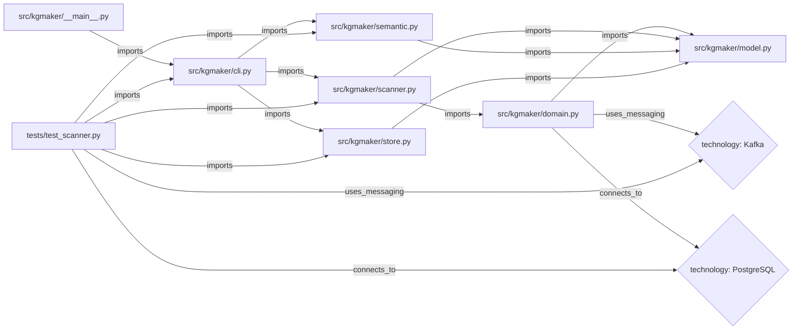

# Repository knowledge graph

> Generated locally by kgmaker. Structural edges come from source text; name-based call edges are heuristic.
> Review semantic conclusions with the repository's Copilot knowledge-graph agent.

- Files indexed: 12
- Symbols and sections: 107
- Internal imports: 13
- Heuristic cross-file calls: 116
- PostgreSQL tables/columns: 0/0
- Kafka topics: 0
- API endpoints: 0
- TypeScript frontend routes: 0
- Semantic concepts: 0
- Inferred/ambiguous relationships: 116/0

## Architecture diagram

The diagram groups declarations under their source files and shows detected imports and domain relationships. Heuristic call edges are omitted. An editable standalone Mermaid source is available at `.kgmaker/GRAPH.mmd`.

## Files and symbols

### `README.md`
- **section** `kgmaker` line 1
- **section** `Requirements` line 7
- **section** `Install` line 12
- **section** `Commands` line 26
- **section** `What gets indexed` line 55
- **section** `Copilot workflow` line 63
- **section** `Development` line 69

### `docs/architecture.md`
- **section** `Architecture` line 1
- **section** `Relationship confidence` line 14
- **section** `Hook lifecycle` line 27
- **section** `Extension points` line 31

### `docs/project-scope.md`
- **section** `Project scope` line 1
- **section** `Goals` line 5
- **section** `Out of scope` line 14
- **section** `Initial implementation` line 22
- **section** `Graph workflows` line 28

### `src/kgmaker/__init__.py`
- No declarations extracted.

### `src/kgmaker/__main__.py`
- No declarations extracted.

### `src/kgmaker/cli.py`
- **function** `_write_if_missing` line 166 — `_write_if_missing(path: Path, text: str, force: bool = False)`
- **function** `init` line 174 — `init(root: Path, force: bool = False)`
- **function** `scan` line 209 — `scan(root: Path, generate_docs: bool = True)`
- **function** `status` line 228 — `status(root: Path)`
- **function** `check` line 251 — `check(root: Path)`
- **function** `docs` line 280 — `docs(root: Path)`
- **function** `semantic_prepare` line 296 — `semantic_prepare(root: Path)`
- **function** `semantic_update` line 310 — `semantic_update(root: Path, base_ref: str, note_path: str | None = None, token_budget: int | None = None)`
- **function** `semantic_apply` line 375 — `semantic_apply(root: Path)`
- **function** `semantic_validate` line 395 — `semantic_validate(root: Path)`
- **function** `impact` line 410 — `impact(root: Path, changed_files: list[str])`
- **function** `query` line 482 — `query(root: Path, terms: str, limit: int = 10)`
- **function** `hook_context` line 511 — `hook_context(root: Path, token_budget: int | None = None)`
- **function** `build_parser` line 530 — `build_parser`
- **function** `main` line 586 — `main`

### `src/kgmaker/domain.py`
- **technology** `Kafka`
- **technology** `PostgreSQL`
- **function** `_line` line 65 — `_line(text: str, offset: int)`
- **function** `_unquote_identifier` line 69 — `_unquote_identifier(value: str)`
- **function** `_canon` line 73 — `_canon(value: str)`
- **function** `_node_id` line 77 — `_node_id(kind: str, key: str)`
- **function** `_shared_node` line 81 — `_shared_node(kind: str, key: str, display: str, path: str, line: int | None = None, summary: str | None = None)`
- **function** `_split_sql_items` line 85 — `_split_sql_items(body: str)`
- **function** `_sql_objects` line 108 — `_sql_objects(text: str, path: str, file_id: str)`
- **function** `_entity_edges` line 137 — `_entity_edges(text: str, path: str, symbols: list[Node], tables: dict[str, Node], columns: dict[str, Node])`
- **function** `_string_literals` line 191 — `_string_literals(value: str)`
- **function** `_kafka_references` line 195 — `_kafka_references(text: str, path: str, file_id: str)`
- **function** `add` line 200 — `add(topic: str, offset: int, relation: str, evidence: str)`
- **function** `normalize_api_path` line 230 — `normalize_api_path(path: str)`
- **function** `_api_node` line 241 — `_api_node(method: str, path: str, source: str, line: int | None, operation: str | None = None)`
- **function** `_mapping_path` line 254 — `_mapping_path(args: str)`
- **function** `_openapi_yaml` line 259 — `_openapi_yaml(text: str, path: str, file_id: str)`
- **function** `flush` line 271 — `flush(offset: int)`
- **function** `_openapi_json` line 302 — `_openapi_json(text: str, path: str, file_id: str)`
- **function** `_api_references` line 324 — `_api_references(text: str, path: str, language: str, file_id: str)`
- **function** `add` line 329 — `add(method: str, endpoint_path: str, offset: int, relation: str, evidence: str)`
- **function** `_typescript_routes` line 392 — `_typescript_routes(path: str, text: str, file_id: str)`
- **function** `_technology_nodes` line 426 — `_technology_nodes(text: str, path: str, file_id: str)`
- **function** `extract_domain` line 440 — `extract_domain(path: str, text: str, language: str, file_id: str, symbols: list[Node])`
- **function** `extract_openapi` line 475 — `extract_openapi(path: str, text: str, file_id: str)`
- **function** `connect_persistence` line 484 — `connect_persistence(symbols_by_file: dict[str, list[Node]], text_by_file: dict[str, str], nodes: list[Node])`
- **function** `merge_domain_nodes` line 515 — `merge_domain_nodes(nodes: list[Node])`

### `src/kgmaker/model.py`
- **class** `Node` line 10 — `Node`
- **class** `Edge` line 21 — `Edge`
- **class** `KnowledgeGraph` line 33 — `KnowledgeGraph`
- **function** `to_dict` line 40 — `to_dict(self)`
- **function** `from_dict` line 52 — `from_dict(cls, data: dict[str, Any])`

### `src/kgmaker/scanner.py`
- **function** `_safe_text` line 74 — `_safe_text(path: Path)`
- **function** `_file_digest` line 83 — `_file_digest(text: str)`
- **function** `_stable_id` line 87 — `_stable_id(kind: str, path: str, name: str, line: int | None = None)`
- **function** `_line_for` line 92 — `_line_for(text: str, offset: int)`
- **function** `_doc_for_line` line 96 — `_doc_for_line(lines: list[str], index: int)`
- **function** `_extract_symbols` line 104 — `_extract_symbols(text: str, path: str, language: str)`
- **function** `_imports` line 160 — `_imports(text: str, language: str)`
- **function** `_candidate_paths` line 178 — `_candidate_paths(root: Path, source: str, import_name: str, known_files: set[str])`
- **function** `_should_skip` line 207 — `_should_skip(path: Path, relative: Path)`
- **function** `scan_repository` line 216 — `scan_repository(root: Path)`

### `src/kgmaker/semantic.py`
- **class** `SemanticValidationError` line 30 — `SemanticValidationError(ValueError)`
- **function** `concept_id` line 34 — `concept_id(source_file: str, name: str)`
- **function** `graph_fingerprint` line 40 — `graph_fingerprint(graph: KnowledgeGraph)`
- **function** `build_semantic_input` line 51 — `build_semantic_input(graph: KnowledgeGraph)`
- **function** `_positive_line` line 72 — `_positive_line(value: Any, field: str)`
- **function** `_check_line` line 80 — `_check_line(root: Path, source_file: str, line: int | None, field: str, line_counts: dict[str, int])`
- **function** `validate_semantic_data` line 95 — `validate_semantic_data(data: Any, graph: KnowledgeGraph, root: Path)`
- **function** `_run_git` line 199 — `_run_git(root: Path, *args: str, check: bool = True)`
- **function** `_is_sensitive_path` line 214 — `_is_sensitive_path(path: str)`
- **function** `apply_semantic_patch` line 411 — `apply_semantic_patch(patch: Any, update: Any, graph: KnowledgeGraph, root: Path)`
- **function** `apply_semantic_layer` line 523 — `apply_semantic_layer(graph: KnowledgeGraph, root: Path)`

### `src/kgmaker/store.py`
- **function** `save_graph` line 14 — `save_graph(graph: KnowledgeGraph, root: Path, generate_docs: bool = True)`
- **function** `load_graph` line 27 — `load_graph(root: Path)`
- **function** `render_markdown` line 35 — `render_markdown(graph: KnowledgeGraph)`
- **function** `render_mermaid` line 112 — `render_mermaid(graph: KnowledgeGraph)`
- **function** `render_context` line 163 — `render_context(graph: KnowledgeGraph, limit: int = 8_000, root: Path | None = None)`
- **function** `_edge_details` line 205 — `_edge_details(edge)`

### `tests/test_scanner.py`
- **class** `ScannerTests` line 15 — `ScannerTests(unittest.TestCase)`
- **function** `test_extracts_python_symbols_and_internal_imports` line 18 — `test_extracts_python_symbols_and_internal_imports(self)`
- **function** `test_skips_secrets_and_dependency_folders` line 35 — `test_skips_secrets_and_dependency_folders(self)`
- **function** `test_persists_and_loads_graph` line 48 — `test_persists_and_loads_graph(self)`
- **function** `test_scan_no_docs_skips_markdown_and_mermaid_but_keeps_index` line 63 — `test_scan_no_docs_skips_markdown_and_mermaid_but_keeps_index(self)`
- **function** `test_mermaid_visualization_groups_symbols_and_shows_imports` line 81 — `test_mermaid_visualization_groups_symbols_and_shows_imports(self)`
- **function** `test_resolves_python_package_relative_import` line 96 — `test_resolves_python_package_relative_import(self)`
- **function** `test_init_preserves_existing_user_files` line 111 — `test_init_preserves_existing_user_files(self)`
- **function** `test_semantic_layer_uses_stable_ids_and_rejects_stale_or_dangling_edges` line 138 — `test_semantic_layer_uses_stable_ids_and_rejects_stale_or_dangling_edges(self)`
- **function** `test_semantic_update_refreshes_only_affected_entries` line 210 — `test_semantic_update_refreshes_only_affected_entries(self)`
- **function** `test_hook_emits_session_context_json` line 282 — `test_hook_emits_session_context_json(self)`
- **function** `test_impact_reports_exact_transitive_import_dependents` line 303 — `test_impact_reports_exact_transitive_import_dependents(self)`
- **function** `test_check_detects_stale_graph_and_docs_regenerate_markdown` line 322 — `test_check_detects_stale_graph_and_docs_regenerate_markdown(self)`
- **function** `test_check_command_works_without_local_json_index` line 343 — `test_check_command_works_without_local_json_index(self)`
- **function** `test_maps_kotlin_entities_repositories_and_columns_to_postgres_schema` line 356 — `test_maps_kotlin_entities_repositories_and_columns_to_postgres_schema(self)`
- **function** `test_finds_kafka_topics_and_postgres_connection_from_kotlin_and_yaml` line 391 — `test_finds_kafka_topics_and_postgres_connection_from_kotlin_and_yaml(self)`
- **function** `test_links_openapi_server_and_typescript_client_paths` line 423 — `test_links_openapi_server_and_typescript_client_paths(self)`

## Internal relationships

- `src/kgmaker/__main__.py` imports `src/kgmaker/cli.py` (.cli)
- `src/kgmaker/cli.py` imports `src/kgmaker/scanner.py` (.scanner)
- `src/kgmaker/cli.py` imports `src/kgmaker/semantic.py` (.semantic)
- `src/kgmaker/cli.py` imports `src/kgmaker/store.py` (.store)
- `src/kgmaker/domain.py` imports `src/kgmaker/model.py` (.model)
- `src/kgmaker/scanner.py` imports `src/kgmaker/domain.py` (.domain)
- `src/kgmaker/scanner.py` imports `src/kgmaker/model.py` (.model)
- `src/kgmaker/semantic.py` imports `src/kgmaker/model.py` (.model)
- `src/kgmaker/store.py` imports `src/kgmaker/model.py` (.model)
- `tests/test_scanner.py` imports `src/kgmaker/cli.py` (kgmaker.cli)
- `tests/test_scanner.py` imports `src/kgmaker/scanner.py` (kgmaker.scanner)
- `tests/test_scanner.py` imports `src/kgmaker/semantic.py` (kgmaker.semantic)
- `tests/test_scanner.py` imports `src/kgmaker/store.py` (kgmaker.store)
- `src/kgmaker/__main__.py` may call `586 in `src/kgmaker/cli.py`` (name match at line 3; INFERRED 0.85)
- `src/kgmaker/cli.py` may call `216 in `src/kgmaker/scanner.py`` (name match at line 212; INFERRED 0.85)
- `src/kgmaker/cli.py` may call `216 in `src/kgmaker/scanner.py`` (name match at line 235; INFERRED 0.85)
- `src/kgmaker/cli.py` may call `216 in `src/kgmaker/scanner.py`` (name match at line 255; INFERRED 0.85)
- `src/kgmaker/cli.py` may call `216 in `src/kgmaker/scanner.py`` (name match at line 300; INFERRED 0.85)
- `src/kgmaker/cli.py` may call `216 in `src/kgmaker/scanner.py`` (name match at line 315; INFERRED 0.85)
- `src/kgmaker/cli.py` may call `216 in `src/kgmaker/scanner.py`` (name match at line 382; INFERRED 0.85)
- `src/kgmaker/cli.py` may call `216 in `src/kgmaker/scanner.py`` (name match at line 402; INFERRED 0.85)
- `src/kgmaker/cli.py` may call `216 in `src/kgmaker/scanner.py`` (name match at line 518; INFERRED 0.85)
- `src/kgmaker/cli.py` may call `523 in `src/kgmaker/semantic.py`` (name match at line 212; INFERRED 0.85)
- `src/kgmaker/cli.py` may call `523 in `src/kgmaker/semantic.py`` (name match at line 235; INFERRED 0.85)
- `src/kgmaker/cli.py` may call `523 in `src/kgmaker/semantic.py`` (name match at line 255; INFERRED 0.85)
- `src/kgmaker/cli.py` may call `523 in `src/kgmaker/semantic.py`` (name match at line 518; INFERRED 0.85)
- `src/kgmaker/cli.py` may call `411 in `src/kgmaker/semantic.py`` (name match at line 383; INFERRED 0.85)
- `src/kgmaker/cli.py` may call `51 in `src/kgmaker/semantic.py`` (name match at line 301; INFERRED 0.85)
- `src/kgmaker/cli.py` may call `95 in `src/kgmaker/semantic.py`` (name match at line 403; INFERRED 0.85)
- `src/kgmaker/cli.py` may call `27 in `src/kgmaker/store.py`` (name match at line 231; INFERRED 0.85)
- `src/kgmaker/cli.py` may call `27 in `src/kgmaker/store.py`` (name match at line 284; INFERRED 0.85)
- `src/kgmaker/cli.py` may call `27 in `src/kgmaker/store.py`` (name match at line 314; INFERRED 0.85)
- `src/kgmaker/cli.py` may call `27 in `src/kgmaker/store.py`` (name match at line 414; INFERRED 0.85)
- `src/kgmaker/cli.py` may call `27 in `src/kgmaker/store.py`` (name match at line 485; INFERRED 0.85)
- `src/kgmaker/cli.py` may call `163 in `src/kgmaker/store.py`` (name match at line 523; INFERRED 0.85)
- `src/kgmaker/cli.py` may call `35 in `src/kgmaker/store.py`` (name match at line 260; INFERRED 0.85)
- `src/kgmaker/cli.py` may call `35 in `src/kgmaker/store.py`` (name match at line 290; INFERRED 0.85)
- `src/kgmaker/cli.py` may call `112 in `src/kgmaker/store.py`` (name match at line 262; INFERRED 0.85)
- `src/kgmaker/cli.py` may call `112 in `src/kgmaker/store.py`` (name match at line 292; INFERRED 0.85)
- `src/kgmaker/cli.py` may call `14 in `src/kgmaker/store.py`` (name match at line 213; INFERRED 0.85)
- `src/kgmaker/cli.py` may call `14 in `src/kgmaker/store.py`` (name match at line 521; INFERRED 0.85)
- `src/kgmaker/domain.py` may call `21 in `src/kgmaker/model.py`` (name match at line 118; INFERRED 0.85)
- `src/kgmaker/domain.py` may call `21 in `src/kgmaker/model.py`` (name match at line 135; INFERRED 0.85)
- `src/kgmaker/domain.py` may call `21 in `src/kgmaker/model.py`` (name match at line 155; INFERRED 0.85)
- `src/kgmaker/domain.py` may call `21 in `src/kgmaker/model.py`` (name match at line 179; INFERRED 0.85)
- `src/kgmaker/domain.py` may call `21 in `src/kgmaker/model.py`` (name match at line 189; INFERRED 0.85)
- `src/kgmaker/domain.py` may call `21 in `src/kgmaker/model.py`` (name match at line 206; INFERRED 0.85)
- `src/kgmaker/domain.py` may call `21 in `src/kgmaker/model.py`` (name match at line 276; INFERRED 0.85)
- `src/kgmaker/domain.py` may call `21 in `src/kgmaker/model.py`` (name match at line 322; INFERRED 0.85)
- `src/kgmaker/domain.py` may call `21 in `src/kgmaker/model.py`` (name match at line 335; INFERRED 0.85)
- `src/kgmaker/domain.py` may call `21 in `src/kgmaker/model.py`` (name match at line 380; INFERRED 0.85)
- `src/kgmaker/domain.py` may call `21 in `src/kgmaker/model.py`` (name match at line 417; INFERRED 0.85)
- `src/kgmaker/domain.py` may call `21 in `src/kgmaker/model.py`` (name match at line 424; INFERRED 0.85)
- `src/kgmaker/domain.py` may call `21 in `src/kgmaker/model.py`` (name match at line 434; INFERRED 0.85)
- `src/kgmaker/domain.py` may call `21 in `src/kgmaker/model.py`` (name match at line 438; INFERRED 0.85)
- `src/kgmaker/domain.py` may call `21 in `src/kgmaker/model.py`` (name match at line 509; INFERRED 0.85)
- `src/kgmaker/domain.py` may call `21 in `src/kgmaker/model.py`` (name match at line 513; INFERRED 0.85)
- `src/kgmaker/domain.py` may call `10 in `src/kgmaker/model.py`` (name match at line 126; INFERRED 0.85)
- `src/kgmaker/domain.py` may call `10 in `src/kgmaker/model.py`` (name match at line 246; INFERRED 0.85)
- `src/kgmaker/domain.py` may call `10 in `src/kgmaker/model.py`` (name match at line 415; INFERRED 0.85)
- `src/kgmaker/domain.py` may call `10 in `src/kgmaker/model.py`` (name match at line 84; INFERRED 0.85)
- `src/kgmaker/scanner.py` may call `21 in `src/kgmaker/model.py`` (name match at line 260; INFERRED 0.85)
- `src/kgmaker/scanner.py` may call `21 in `src/kgmaker/model.py`` (name match at line 272; INFERRED 0.85)
- `src/kgmaker/scanner.py` may call `21 in `src/kgmaker/model.py`` (name match at line 282; INFERRED 0.85)
- `src/kgmaker/scanner.py` may call `33 in `src/kgmaker/model.py`` (name match at line 309; INFERRED 0.85)
- `src/kgmaker/scanner.py` may call `10 in `src/kgmaker/model.py`` (name match at line 120; INFERRED 0.85)
- `src/kgmaker/scanner.py` may call `10 in `src/kgmaker/model.py`` (name match at line 149; INFERRED 0.85)
- `src/kgmaker/scanner.py` may call `10 in `src/kgmaker/model.py`` (name match at line 250; INFERRED 0.85)
- `src/kgmaker/scanner.py` may call `484 in `src/kgmaker/domain.py`` (name match at line 304; INFERRED 0.85)
- `src/kgmaker/scanner.py` may call `440 in `src/kgmaker/domain.py`` (name match at line 296; INFERRED 0.85)
- `src/kgmaker/scanner.py` may call `475 in `src/kgmaker/domain.py`` (name match at line 299; INFERRED 0.85)
- `src/kgmaker/scanner.py` may call `515 in `src/kgmaker/domain.py`` (name match at line 303; INFERRED 0.85)
- `src/kgmaker/semantic.py` may call `21 in `src/kgmaker/model.py`` (name match at line 191; INFERRED 0.85)
- `src/kgmaker/semantic.py` may call `10 in `src/kgmaker/model.py`` (name match at line 142; INFERRED 0.85)
- `src/kgmaker/store.py` may call `52 in `src/kgmaker/model.py`` (name match at line 32; INFERRED 0.85)
- `src/kgmaker/store.py` may call `40 in `src/kgmaker/model.py`` (name match at line 22; INFERRED 0.85)
- `tests/test_scanner.py` may call `251 in `src/kgmaker/cli.py`` (name match at line 329; INFERRED 0.85)
- `tests/test_scanner.py` may call `251 in `src/kgmaker/cli.py`` (name match at line 333; INFERRED 0.85)
- `tests/test_scanner.py` may call `251 in `src/kgmaker/cli.py`` (name match at line 336; INFERRED 0.85)
- `tests/test_scanner.py` may call `280 in `src/kgmaker/cli.py`` (name match at line 340; INFERRED 0.85)
- `tests/test_scanner.py` may call `280 in `src/kgmaker/cli.py`` (name match at line 78; INFERRED 0.85)
- `tests/test_scanner.py` may call `511 in `src/kgmaker/cli.py`` (name match at line 292; INFERRED 0.85)
- `tests/test_scanner.py` may call `511 in `src/kgmaker/cli.py`` (name match at line 300; INFERRED 0.85)
- `tests/test_scanner.py` may call `410 in `src/kgmaker/cli.py`` (name match at line 317; INFERRED 0.85)
- `tests/test_scanner.py` may call `174 in `src/kgmaker/cli.py`` (name match at line 119; INFERRED 0.85)
- `tests/test_scanner.py` may call `586 in `src/kgmaker/cli.py`` (name match at line 21; INFERRED 0.85)
- `tests/test_scanner.py` may call `586 in `src/kgmaker/cli.py`` (name match at line 289; INFERRED 0.85)
- `tests/test_scanner.py` may call `586 in `src/kgmaker/cli.py`` (name match at line 354; INFERRED 0.85)
- `tests/test_scanner.py` may call `586 in `src/kgmaker/cli.py`` (name match at line 479; INFERRED 0.85)
- `tests/test_scanner.py` may call `586 in `src/kgmaker/cli.py`` (name match at line 72; INFERRED 0.85)
- `tests/test_scanner.py` may call `375 in `src/kgmaker/cli.py`` (name match at line 272; INFERRED 0.85)
- `tests/test_scanner.py` may call `375 in `src/kgmaker/cli.py`` (name match at line 281; INFERRED 0.85)
- `tests/test_scanner.py` may call `310 in `src/kgmaker/cli.py`` (name match at line 251; INFERRED 0.85)
- `tests/test_scanner.py` may call `395 in `src/kgmaker/cli.py`` (name match at line 181; INFERRED 0.85)
- `tests/test_scanner.py` may call `395 in `src/kgmaker/cli.py`` (name match at line 277; INFERRED 0.85)
- `tests/test_scanner.py` may call `40 in `src/kgmaker/model.py`` (name match at line 47; INFERRED 0.85)
- `tests/test_scanner.py` may call `216 in `src/kgmaker/scanner.py`` (name match at line 106; INFERRED 0.85)
- `tests/test_scanner.py` may call `216 in `src/kgmaker/scanner.py`` (name match at line 150; INFERRED 0.85)
- `tests/test_scanner.py` may call `216 in `src/kgmaker/scanner.py`` (name match at line 193; INFERRED 0.85)
- `tests/test_scanner.py` may call `216 in `src/kgmaker/scanner.py`` (name match at line 199; INFERRED 0.85)
- `tests/test_scanner.py` may call `216 in `src/kgmaker/scanner.py`` (name match at line 207; INFERRED 0.85)
- `tests/test_scanner.py` may call `216 in `src/kgmaker/scanner.py`` (name match at line 226; INFERRED 0.85)
- `tests/test_scanner.py` may call `216 in `src/kgmaker/scanner.py`` (name match at line 24; INFERRED 0.85)
- `tests/test_scanner.py` may call `216 in `src/kgmaker/scanner.py`` (name match at line 247; INFERRED 0.85)
- `tests/test_scanner.py` may call `216 in `src/kgmaker/scanner.py`` (name match at line 313; INFERRED 0.85)
- `tests/test_scanner.py` may call `216 in `src/kgmaker/scanner.py`` (name match at line 328; INFERRED 0.85)
- `tests/test_scanner.py` may call `216 in `src/kgmaker/scanner.py`` (name match at line 350; INFERRED 0.85)
- `tests/test_scanner.py` may call `216 in `src/kgmaker/scanner.py`` (name match at line 382; INFERRED 0.85)
- `tests/test_scanner.py` may call `216 in `src/kgmaker/scanner.py`` (name match at line 415; INFERRED 0.85)
- `tests/test_scanner.py` may call `216 in `src/kgmaker/scanner.py`` (name match at line 44; INFERRED 0.85)
- `tests/test_scanner.py` may call `216 in `src/kgmaker/scanner.py`` (name match at line 463; INFERRED 0.85)
- `tests/test_scanner.py` may call `216 in `src/kgmaker/scanner.py`` (name match at line 53; INFERRED 0.85)
- `tests/test_scanner.py` may call `216 in `src/kgmaker/scanner.py`` (name match at line 87; INFERRED 0.85)
- `tests/test_scanner.py` may call `523 in `src/kgmaker/semantic.py`` (name match at line 182; INFERRED 0.85)
- `tests/test_scanner.py` may call `523 in `src/kgmaker/semantic.py`` (name match at line 193; INFERRED 0.85)
- `tests/test_scanner.py` may call `523 in `src/kgmaker/semantic.py`` (name match at line 199; INFERRED 0.85)
- `tests/test_scanner.py` may call `523 in `src/kgmaker/semantic.py`` (name match at line 207; INFERRED 0.85)
- `tests/test_scanner.py` may call `51 in `src/kgmaker/semantic.py`` (name match at line 151; INFERRED 0.85)
- `tests/test_scanner.py` may call `34 in `src/kgmaker/semantic.py`` (name match at line 156; INFERRED 0.85)
- `tests/test_scanner.py` may call `34 in `src/kgmaker/semantic.py`` (name match at line 231; INFERRED 0.85)
- `tests/test_scanner.py` may call `27 in `src/kgmaker/store.py`` (name match at line 56; INFERRED 0.85)
- `tests/test_scanner.py` may call `163 in `src/kgmaker/store.py`` (name match at line 189; INFERRED 0.85)
- `tests/test_scanner.py` may call `35 in `src/kgmaker/store.py`` (name match at line 188; INFERRED 0.85)
- `tests/test_scanner.py` may call `112 in `src/kgmaker/store.py`` (name match at line 89; INFERRED 0.85)
- `tests/test_scanner.py` may call `14 in `src/kgmaker/store.py`` (name match at line 227; INFERRED 0.85)
- `tests/test_scanner.py` may call `14 in `src/kgmaker/store.py`` (name match at line 313; INFERRED 0.85)
- `tests/test_scanner.py` may call `14 in `src/kgmaker/store.py`` (name match at line 328; INFERRED 0.85)
- `tests/test_scanner.py` may call `14 in `src/kgmaker/store.py`` (name match at line 350; INFERRED 0.85)
- `tests/test_scanner.py` may call `14 in `src/kgmaker/store.py`` (name match at line 54; INFERRED 0.85)
- `src/kgmaker/domain.py` **connects_to** technology `PostgreSQL` in `src/kgmaker/domain.py` — PostgreSQL driver or connection string
- `src/kgmaker/domain.py` **uses_messaging** technology `Kafka` in `src/kgmaker/domain.py` — Kafka import, client, annotation, or configuration
- `tests/test_scanner.py` **connects_to** technology `PostgreSQL` in `src/kgmaker/domain.py` — PostgreSQL driver or connection string
- `tests/test_scanner.py` **uses_messaging** technology `Kafka` in `src/kgmaker/domain.py` — Kafka import, client, annotation, or configuration

## Reading this graph

File and symbol locations are repository-relative. `contains` edges bind declarations to their files. Domain edges such as `maps_to_table`, `consumes`, and `calls_endpoint` record annotations, SQL definitions, configuration, or literal paths found in source. `calls` edges are conservative name matches and must be verified before relying on them.
