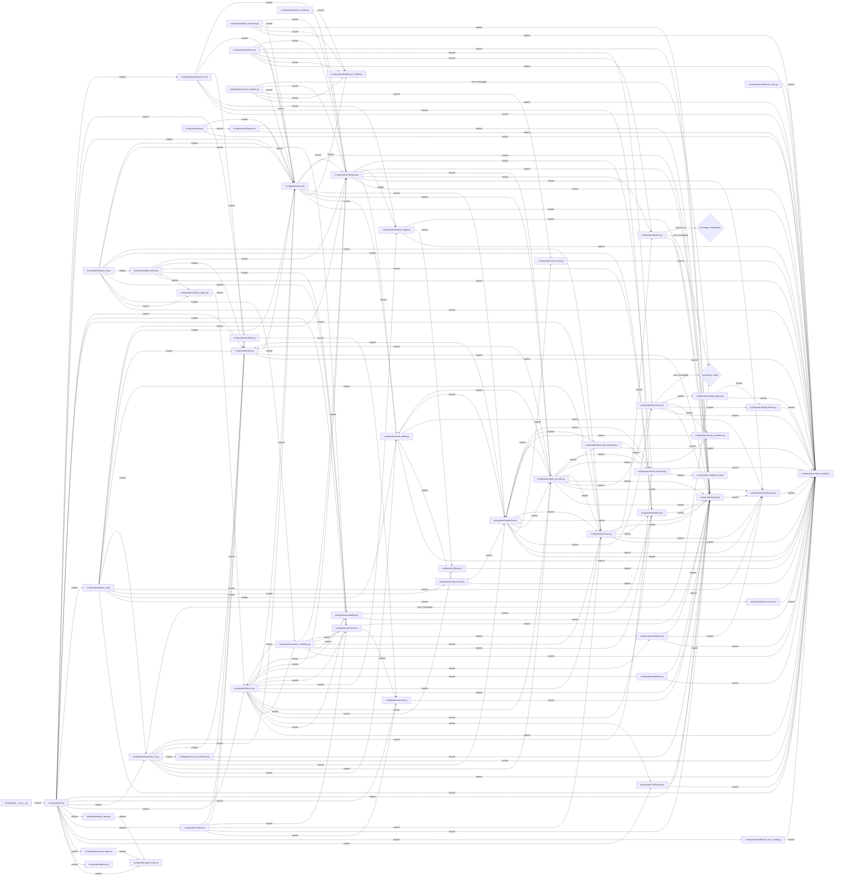

# Repository knowledge graph

> Generated locally by kgmaker. Structural edges come from source text; name-based call edges are heuristic.
> Review semantic conclusions with the repository's Copilot knowledge-graph agent.

- Scope: production; omitted files: 312
- Mode: SOURCE_ONLY; coverage: PARTIAL; no build/test/runtime result is implied.
- Freshness below describes the captured snapshot; use `kgmaker status` to compare current inputs.
- Context: `8ce285a508eccd6552fa15c84f8e31bde7b77247d83d7e3b588ae50339259a49`; content: `1a94dc2446a8525225f8eeba4822386b51c7e08754ef07b4db28eff96f770c3e`; freshness: CONTENT_VERIFIED
- Files indexed: 66
- Symbols and sections: 775
- Internal imports: 206
- Heuristic cross-file calls: 4052
- PostgreSQL tables/columns: 0/0
- Kafka topics: 0
- API endpoints: 0
- TypeScript frontend routes: 0
- Workbooks/cells: 0/0
- Templates/variables: 0/0
- Semantic concepts: 0
- Implementation episodes: 183
- Inferred/ambiguous relationships: 4052/0

## Architecture diagram

The diagram groups declarations under their source files and shows detected imports and domain relationships. Heuristic call edges are omitted. An editable standalone Mermaid source is available at `.kgmaker/GRAPH.mmd`.

## Files and symbols

### `src/kgmaker/__init__.py`
- No declarations extracted.

### `src/kgmaker/__main__.py`
- No declarations extracted.

### `src/kgmaker/_windows_job.py`
- **class** `Job` line 4 — `Job`
- **function** `__init__` line 7 — `__init__(self)`
- **class** `Basic` line 26 — `Basic(ctypes.Structure)`
- **class** `Extended` line 32 — `Extended(ctypes.Structure)`
- **function** `attach_and_resume` line 47 — `attach_and_resume(self, process)`
- **class** `ThreadEntry` line 59 — `ThreadEntry(ctypes.Structure)`
- **function** `terminate` line 85 — `terminate(self)`
- **function** `close` line 89 — `close(self)`

### `src/kgmaker/agent_rules.py`
- No declarations extracted.

### `src/kgmaker/agents.py`
- No declarations extracted.

### `src/kgmaker/analysis_agent.py`
- No declarations extracted.

### `src/kgmaker/analysis_model.py`
- **class** `AnalysisError` line 31 — `AnalysisError(ValueError)`
- **function** `__init__` line 34 — `__init__(self, message: str, code: int = 2)`
- **function** `canonical` line 37 — `canonical(value: Any)`
- **function** `digest` line 41 — `digest(value: Any)`
- **function** `file_hash` line 45 — `file_hash(path: Path)`
- **function** `safe_path` line 49 — `safe_path(root: Path, value: str)`
- **function** `analysis_dir` line 67 — `analysis_dir(root: Path, analysis_id: str)`
- **function** `read_json` line 73 — `read_json(path: Path)`
- **function** `reject_constant` line 76 — `reject_constant(value: str)`
- **function** `unique` line 78 — `unique(pairs: list)`
- **function** `atomic_write` line 89 — `atomic_write(path: Path, text: str)`
- **function** `write_json` line 103 — `write_json(path: Path, value: Any)`
- **class** `FeatureAnalysis` line 110 — `FeatureAnalysis` — Serializable envelope. Nested contracts are checked by analysis_validation.
- **function** `from_dict` line 115 — `from_dict(cls, data: Any)`
- **function** `to_dict` line 132 — `to_dict(self)`
- **function** `inventory_candidate` line 135 — `inventory_candidate(packet: dict)`

### `src/kgmaker/analysis_report.py`
- **function** `cell` line 16 — `cell(value)`
- **function** `render_report` line 24 — `render_report(candidate: dict, packet: dict, stale: list[str], applied: bool = True, *, data_audit: dict | None = None)`
- **function** `section` line 34 — `section(index)`
- **function** `objects` line 36 — `objects(items)`

### `src/kgmaker/analysis_validation.py`
- **class** `_Anchors` line 17 — `_Anchors(HTMLParser)`
- **function** `__init__` line 20 — `__init__(self)`
- **function** `handle_starttag` line 23 — `handle_starttag(self, tag, attrs)`
- **function** `_location` line 28 — `_location(root: Path, item: dict, packet: dict)`
- **function** `validate_candidate` line 118 — `validate_candidate(root: Path, packet: dict, data: object)`
- **function** `_validate_candidate` line 125 — `_validate_candidate(root: Path, packet: dict, data: object)`
- **function** `strings` line 203 — `strings(item, key, choices=None, nullable=False)`
- **function** `refs` line 210 — `refs(item, key, targets, required=False)`
- **function** `visit` line 301 — `visit(identity)`

### `src/kgmaker/architecture_model.py`
- **class** `ViewValidationError` line 24 — `ViewValidationError(ValueError)`
- **function** `__init__` line 28 — `__init__(self, errors: list[dict[str, str]])`
- **function** `_reference_buckets` line 32 — `_reference_buckets(refs: Sequence[str], supporting: Sequence[str] = ()`
- **function** `_canonical_freshness` line 41 — `_canonical_freshness(value: Any)`
- **function** `raw_contexts_for_claim` line 250 — `raw_contexts_for_claim(edge: ViewEdge)`
- **function** `_canonical` line 255 — `_canonical(value: Any)`
- **class** `ViewNode` line 262 — `ViewNode`
- **function** `to_dict` line 276 — `to_dict(self)`
- **class** `ViewEdge` line 294 — `ViewEdge`
- **function** `to_dict` line 308 — `to_dict(self)`
- **class** `ViewDocument` line 326 — `ViewDocument`
- **function** `to_dict` line 341 — `to_dict(self, *, include_generation_metadata: bool = True)`
- **function** `to_json` line 362 — `to_json(self, *, include_generation_metadata: bool = True)`
- **function** `content_fingerprint` line 367 — `content_fingerprint(self)`
- **function** `from_dict` line 371 — `from_dict(cls, data: Mapping[str, Any])`
- **function** `ref_buckets` line 375 — `ref_buckets(item: Mapping[str, Any])`
- **function** `validate_view_document` line 419 — `validate_view_document(data: Mapping[str, Any])`
- **function** `err` line 424 — `err(code: str, path: str)`

### `src/kgmaker/availability.py`
- **function** `observation_staleness` line 14 — `observation_staleness(candidate: dict)`
- **function** `evaluate_proof` line 35 — `evaluate_proof(root, packet, candidate, item, graph=None)`

### `src/kgmaker/build_maven.py`
- **function** `_tag` line 19 — `_tag(name: str)`
- **function** `_text` line 23 — `_text(parent: ET.Element | None, name: str, default: str | None = None)`
- **function** `_children` line 31 — `_children(parent: ET.Element | None, name: str)`
- **function** `_interpolate` line 35 — `_interpolate(value: str | None, properties: dict[str, str])`
- **function** `_parse` line 41 — `_parse(path: Path, root: Path, properties: dict[str, str])`
- **function** `discover` line 79 — `discover(root: Path)`
- **function** `visit` line 90 — `visit(path: Path, inherited: dict[str, str])`

### `src/kgmaker/build_model.py`
- **function** `_validate_toolchain_selection` line 15 — `_validate_toolchain_selection(value: object)`
- **function** `validate_kotlin_options` line 40 — `validate_kotlin_options(options: dict)`
- **function** `validate_manifest` line 77 — `validate_manifest(root: Path, manifest: dict)`
- **function** `import_manifest` line 264 — `import_manifest(root: Path, manifest: dict)`
- **function** `inspection_inputs` line 279 — `inspection_inputs(root: Path, manifest: dict, *, context_id: str | None, scope: str)`
- **function** `absolute` line 291 — `absolute(raw)`

### `src/kgmaker/build_runner.py`
- **function** `exporter_contract` line 22 — `exporter_contract(home: Path, build_system: str, adapter: Path, *, required=False)`
- **function** `snapshot` line 56 — `snapshot(root: Path)`
- **function** `_jdk_executable` line 72 — `_jdk_executable(java_home: Path, name: str)`
- **function** `_select_java_home` line 81 — `_select_java_home(java_home: Path | None)`
- **function** `build_output_realms` line 97 — `build_output_realms(contexts: list[dict])`
- **function** `register` line 102 — `register(path, realm)`
- **function** `tests_report` line 176 — `tests_report(work: Path, phase: str)`
- **function** `run_plan` line 192 — `run_plan(plan: dict, *, cancel_file: Path | None=None)`

### `src/kgmaker/callgraph.py`
- **function** `adjacency` line 9 — `adjacency(graph: KnowledgeGraph, include_candidates=True)`
- **function** `callees` line 41 — `callees(graph, symbol, *, scope="production", include_candidates=False)`
- **function** `callers` line 50 — `callers(graph, symbol, *, scope="production")`
- **function** `path` line 61 — `path(graph, source, target, *, scope="production", max_depth=30, max_nodes=5000, include_candidates=True)`
- **function** `strongly_connected` line 89 — `strongly_connected(graph: KnowledgeGraph)`

### `src/kgmaker/classification.py`
- **class** `Classification` line 20 — `Classification`
- **class** `Classifier` line 26 — `Classifier`
- **function** `__init__` line 29 — `__init__(self, root: Path, model: dict | None = None, strict: bool = False)`
- **function** `classify` line 59 — `classify(self, path: str)`

### `src/kgmaker/cli.py`
- **function** `_write_if_missing` line 243 — `_write_if_missing(path: Path, text: str, force: bool = False)`
- **function** `init` line 251 — `init(root: Path, force: bool = False)`
- **function** `scan` line 295 — `scan(root: Path, generate_docs: bool = True, confluence_dir: str | None = None, report: str | None = None)`
- **function** `status` line 331 — `status(root: Path)`
- **function** `check` line 365 — `check(root: Path)`
- **function** `docs` line 402 — `docs(root: Path, action: str | None = None, confluence_dir: str | None = None, report: str | None = None)`
- **function** `semantic_prepare` line 426 — `semantic_prepare(root: Path)`
- **function** `semantic_extract` line 440 — `semantic_extract(root: Path, base_ref: str, note_path: str | None = None, token_budget: int | None = None)`
- **function** `semantic_update` line 491 — `semantic_update(root: Path, base_ref: str, note_path: str | None = None, token_budget: int | None = None)`
- **function** `semantic_apply` line 572 — `semantic_apply(root: Path)`
- **function** `semantic_validate` line 592 — `semantic_validate(root: Path)`
- **function** `impact` line 607 — `impact(root: Path, changed_files: list[str])`
- **function** `memory_capture` line 705 — `memory_capture(root: Path, base: str, validation_values: list[str])`
- **function** `memory_recall` line 762 — `memory_recall(root: Path, terms: str, limit: int = 8, token_budget: int = 1_000)`
- **function** `task_add` line 782 — `task_add(root: Path, request: str, title: str | None, max_iterations: int)`
- **function** `task_list` line 793 — `task_list(root: Path, status_filter: str | None)`
- **function** `task_show` line 804 — `task_show(root: Path, task_id_value: str)`
- **function** `task_advance` line 814 — `task_advance(root: Path, task_id_value: str, target: str)`
- **function** `task_stop` line 824 — `task_stop(root: Path, task_id_value: str, reason: str)`
- **function** `task_record` line 834 — `task_record(root: Path, task_id_value: str, role: str, artifact_path: Path)`
- **function** `task_context` line 849 — `task_context(root: Path, task_id_value: str, role: str, token_budget: int)`
- **function** `hook_context` line 859 — `hook_context(root: Path, token_budget: int | None = None)`
- **function** `build_parser` line 879 — `build_parser`
- **function** `main` line 1014 — `main`

### `src/kgmaker/confluence.py`
- **function** `_norm` line 32 — `_norm(value: str)`
- **function** `_safe_rel` line 36 — `_safe_rel(path: str)`
- **function** `_sha` line 40 — `_sha(path: Path)`
- **class** `ConfluenceDocument` line 51 — `ConfluenceDocument`
- **class** `DocumentationAssertion` line 66 — `DocumentationAssertion`
- **class** `_ExportHTMLParser` line 89 — `_ExportHTMLParser(HTMLParser)`
- **function** `__init__` line 95 — `__init__(self)`
- **function** `_attrs` line 114 — `_attrs(self, attrs: list[tuple[str, str | None]])`
- **function** `handle_starttag` line 117 — `handle_starttag(self, tag: str, attrs: list[tuple[str, str | None]])`
- **function** `handle_endtag` line 148 — `handle_endtag(self, tag: str)`
- **function** `handle_data` line 178 — `handle_data(self, data: str)`
- **function** `text` line 192 — `text(self)`
- **function** `_resolve_local_ref` line 196 — `_resolve_local_ref(value: str, current_file: str)`
- **function** `_parse_mermaid` line 203 — `_parse_mermaid(source: str)`
- **function** `_parse_drawio` line 218 — `_parse_drawio(path: Path, source_file: str)`
- **function** `_parse_svg` line 241 — `_parse_svg(path: Path)`
- **function** `_document_from_html` line 252 — `_document_from_html(path: Path, export_root: Path, digest: str)`
- **function** `_load_cache` line 271 — `_load_cache(root: Path)`
- **function** `_write_cache` line 279 — `_write_cache(root: Path, payload: dict[str, Any])`
- **function** `discover_export` line 285 — `discover_export(export_root: Path)`
- **function** `ingest_export` line 289 — `ingest_export(export_root: Path, repository_root: Path)`
- **function** `current_documentation_assertions` line 368 — `current_documentation_assertions(cache: dict[str, Any])`
- **function** `_assertions_from_document` line 388 — `_assertions_from_document(doc: ConfluenceDocument)`
- **function** `_code_nodes` line 437 — `_code_nodes(graph: KnowledgeGraph)`
- **function** `_missing_category` line 444 — `_missing_category(assertion: DocumentationAssertion)`
- **function** `validate_documents` line 456 — `validate_documents(documents: list[ConfluenceDocument], graph: KnowledgeGraph)`
- **function** `merge_into_graph` line 511 — `merge_into_graph(graph: KnowledgeGraph, documents: list[ConfluenceDocument], attachments: list[dict[str, Any]], assertions: list[DocumentationAssertion])`
- **function** `render_report` line 552 — `render_report(assertions: list[DocumentationAssertion], report_path: Path, export_root: Path, revision: str = "working tree")`
- **function** `persist_validation_index` line 586 — `persist_validation_index(root: Path, assertions: list[DocumentationAssertion])`
- **function** `resolve_confluence_dir` line 597 — `resolve_confluence_dir(root: Path, cli_value: str | None)`
- **function** `documentation_check` line 631 — `documentation_check(root: Path, confluence_dir: str | None = None, report: str | None = None, graph: KnowledgeGraph | None = None)`

### `src/kgmaker/confluence_sync.py`
- **class** `PageSnapshot` line 20 — `PageSnapshot`
- **class** `PublishPackage` line 31 — `PublishPackage`
- **class** `Approval` line 46 — `Approval`
- **class** `PublishAudit` line 58 — `PublishAudit`
- **class** `ConfluenceSyncAdapter` line 69 — `ConfluenceSyncAdapter(Protocol)`
- **function** `pull` line 74 — `pull(self, page_ids: list[str])`
- **function** `_validate_page` line 79 — `_validate_page(page: PageSnapshot)`
- **class** `FakeConfluenceAdapter` line 88 — `FakeConfluenceAdapter`
- **function** `__init__` line 95 — `__init__(self, pages: list[PageSnapshot])`
- **function** `pull` line 103 — `pull(self, page_ids: list[str])`
- **function** `mutate_page` line 126 — `mutate_page(self, page_id: str, content: str)`
- **function** `pull_selected` line 131 — `pull_selected(adapter: ConfluenceSyncAdapter, page_ids: list[str])`
- **function** `save_pull_snapshot` line 139 — `save_pull_snapshot(root: Path, snapshot: dict, name: str = "pull-snapshot.json")`
- **function** `_markers` line 149 — `_markers(section: str)`
- **function** `_replace_section` line 155 — `_replace_section(content: str, section: str, body: str)`
- **function** `prepare_publish` line 170 — `prepare_publish(page: PageSnapshot, managed_section: str, proposed_section: str)`
- **function** `_package_hash` line 189 — `_package_hash(package: PublishPackage)`
- **function** `_package_diff` line 194 — `_package_diff(package: PublishPackage)`
- **function** `_validate_package` line 203 — `_validate_package(package: PublishPackage)`
- **function** `_approval_id` line 210 — `_approval_id(approval: Approval)`
- **function** `approve` line 215 — `approve(package: PublishPackage, decision_id: str)`
- **function** `audit_json` line 250 — `audit_json(audit: PublishAudit)`

### `src/kgmaker/confluence_sync_config.py`
- **class** `ConfluenceConnectionConfiguration` line 20 — `ConfluenceConnectionConfiguration`
- **function** `_unique_object` line 28 — `_unique_object(pairs)`
- **function** `_reject_constant` line 37 — `_reject_constant(_value)`
- **function** `_environment_name` line 41 — `_environment_name(value, field)`
- **function** `_connection` line 47 — `_connection(value)`
- **function** `load_connection_configuration` line 94 — `load_connection_configuration(root: Path, config_file: Path | None = None)`
- **function** `register` line 146 — `register(sub)`
- **function** `run` line 154 — `run(args)`

### `src/kgmaker/context.py`
- **class** `ContextError` line 28 — `ContextError(ValueError)`
- **function** `_terms` line 32 — `_terms(text: str)`
- **function** `_origin` line 36 — `_origin(kind: str)`
- **function** `_node_payload` line 44 — `_node_payload(node: Any, include_summary: bool = True)`
- **function** `_score_node` line 58 — `_score_node(node: Any, terms: list[str])`
- **function** `_rank_nodes` line 64 — `_rank_nodes(graph: KnowledgeGraph, terms: list[str], limit: int)`
- **function** `_neighbors` line 80 — `_neighbors(graph: KnowledgeGraph, seeds: list[Any], limit: int)`
- **function** `_episode_items` line 104 — `_episode_items(graph: KnowledgeGraph, terms: list[str], limit: int)`
- **function** `_semantic_hits` line 135 — `_semantic_hits(graph: KnowledgeGraph, root: Path, terms: list[str], limit: int)`
- **function** `_impact_items` line 164 — `_impact_items(graph: KnowledgeGraph, seed_paths: list[str], limit: int)`
- **function** `_compact_artifact` line 218 — `_compact_artifact(artifact: dict[str, Any])`
- **function** `_query_terms` line 237 — `_query_terms(task: dict[str, Any])`
- **function** `_token_estimate` line 249 — `_token_estimate(payload: dict[str, Any])`
- **function** `_truncate` line 254 — `_truncate(packet: dict[str, Any], token_budget: int)`
- **function** `_select_prior` line 275 — `_select_prior(task: dict[str, Any], role: str)`
- **function** `_graph_status` line 291 — `_graph_status(root: Path, graph: KnowledgeGraph | None)`
- **function** `_test_nodes` line 303 — `_test_nodes(graph: KnowledgeGraph, terms: list[str], limit: int)`
- **function** `_render_markdown` line 422 — `_render_markdown(packet: dict[str, Any], task: dict[str, Any])`

### `src/kgmaker/control_flow.py`
- **class** `Environment` line 17 — `Environment`
- **class** `Builder` line 23 — `Builder`
- **function** `__init__` line 26 — `__init__(self, method: str, context_id: str, *, max_blocks: int = 3000, max_depth: int = 150)`
- **function** `node` line 34 — `node(self, kind, label, ir, env)`
- **function** `edge` line 48 — `edge(self, source, target, kind="normal", **metadata)`
- **function** `computation` line 54 — `computation(self, ir, destination, env, kind="basic_block", label=None)`
- **function** `abrupt` line 61 — `abrupt(self, destination, env, *, keep=0, reason="return", depth=0)`
- **function** `condition` line 71 — `condition(self, ir, when_true, when_false, env, depth)`
- **function** `emit` line 93 — `emit(self, ir, destination, env, depth=0)`
- **function** `boundary` line 211 — `boundary(self, ir, reason, env)`
- **function** `build` line 215 — `build(self, body: dict)`
- **function** `from_body` line 228 — `from_body(record: dict, **limits)`

### `src/kgmaker/data_agent.py`
- No declarations extracted.

### `src/kgmaker/data_check.py`
- **function** `_object` line 19 — `_object(value, required, optional=())`
- **function** `_array` line 24 — `_array(value, label)`
- **function** `_ids` line 29 — `_ids(value, allowed, label)`
- **function** `data_check` line 35 — `data_check(root: Path, analysis_id: str, specification: dict)`
- **function** `reference_evidence` line 54 — `reference_evidence(reference, identity)`

### `src/kgmaker/data_resources.py`
- **class** `DataResourceError` line 22 — `DataResourceError(ValueError)`
- **function** `issue` line 59 — `issue(code, **fields)`
- **function** `local_path` line 64 — `local_path(path)`
- **function** `current` line 75 — `current(path, checksum)`
- **function** `owners` line 85 — `owners(repo, path, context=None)`
- **function** `realm` line 105 — `realm(database, stream)`
- **function** `resource` line 108 — `resource(repo, selected_realm, boundary)`
- **function** `source_proof` line 119 — `source_proof(source_id, *, kind='SOURCE_ONLY', checksum=None, derivation=None)`
- **function** `endpoint_matches` line 244 — `endpoint_matches(node, context)`
- **function** `edge_reference` line 260 — `edge_reference(edge)`
- **function** `proofs_for` line 266 — `proofs_for(edge, context)`

### `src/kgmaker/dataflow.py`
- **function** `masked` line 32 — `masked(text: str)`
- **function** `closing` line 38 — `closing(text: str, start: int, opening='(', ending=')')`
- **function** `parts` line 50 — `parts(text: str)`
- **class** `Extraction` line 57 — `Extraction`
- **function** `extract_dataflow` line 61 — `extract_dataflow(sources: dict[str, str])`
- **function** `node` line 68 — `node(path, kind, qualified, offset, signature=None, summary=None)`
- **function** `issue` line 78 — `issue(path, offset, reason)`
- **function** `relation` line 81 — `relation(source, target, kind, path, offset, evidence)`
- **function** `walk` line 146 — `walk(value, pointer='')`
- **function** `resolve` line 207 — `resolve(token)`
- **function** `expression` line 218 — `expression(value, destination, statement_offset)`
- **function** `impact_paths` line 283 — `impact_paths(graph: KnowledgeGraph, entity: str, max_depth: int = 20)`

### `src/kgmaker/domain.py`
- **technology** `Kafka`
- **technology** `PostgreSQL`
- **function** `_line` line 67 — `_line(text: str, offset: int)`
- **function** `_unquote_identifier` line 71 — `_unquote_identifier(value: str)`
- **function** `_canon` line 75 — `_canon(value: str)`
- **function** `_node_id` line 79 — `_node_id(kind: str, key: str)`
- **function** `_shared_node` line 83 — `_shared_node(kind: str, key: str, display: str, path: str, line: int | None = None, summary: str | None = None)`
- **function** `_split_sql_items` line 87 — `_split_sql_items(body: str)`
- **function** `_sql_objects` line 110 — `_sql_objects(text: str, path: str, file_id: str)`
- **function** `_entity_edges` line 139 — `_entity_edges(text: str, path: str, symbols: list[Node], tables: dict[str, Node], columns: dict[str, Node])`
- **function** `_string_literals` line 193 — `_string_literals(value: str)`
- **function** `_kafka_references` line 197 — `_kafka_references(text: str, path: str, file_id: str)`
- **function** `add` line 202 — `add(topic: str, offset: int, relation: str, evidence: str)`
- **function** `normalize_api_path` line 232 — `normalize_api_path(path: str)`
- **function** `_api_node` line 243 — `_api_node(method: str, path: str, source: str, line: int | None, operation: str | None = None)`
- **function** `safe_path` line 271 — `safe_path(value)`
- **function** `_merge_api_node` line 309 — `_merge_api_node(first: Node, second: Node)`
- **function** `_keep_api` line 317 — `_keep_api(nodes: dict[str, Node], node: Node)`
- **function** `_mapping_path` line 321 — `_mapping_path(args: str)`
- **function** `_openapi_yaml` line 326 — `_openapi_yaml(text: str, path: str, file_id: str, *, source_sha256: str | None = None)`
- **function** `flush` line 338 — `flush(offset: int)`
- **function** `_openapi_json` line 371 — `_openapi_json(text: str, path: str, file_id: str, *, source_sha256: str | None = None)`
- **function** `_api_references` line 395 — `_api_references(text: str, path: str, language: str, file_id: str, *, source_sha256: str | None = None)`
- **function** `_typescript_routes` line 478 — `_typescript_routes(path: str, text: str, file_id: str)`
- **function** `_technology_nodes` line 512 — `_technology_nodes(text: str, path: str, file_id: str)`
- **function** `extract_domain` line 526 — `extract_domain(path: str, text: str, language: str, file_id: str, symbols: list[Node], *, source_sha256: str | None = None)`
- **function** `extract_openapi` line 561 — `extract_openapi(path: str, text: str, file_id: str, *, source_sha256: str | None = None)`
- **function** `connect_persistence` line 570 — `connect_persistence(symbols_by_file: dict[str, list[Node]], text_by_file: dict[str, str], nodes: list[Node])`
- **function** `merge_domain_nodes` line 601 — `merge_domain_nodes(nodes: list[Node])`

### `src/kgmaker/feature.py`
- **function** `_analysis_details` line 23 — `_analysis_details(graph)`
- **function** `source_inventory` line 40 — `source_inventory(root: Path)`
- **function** `current_graph` line 79 — `current_graph(root: Path, workspace: Path | None = None)`
- **function** `attach_schema` line 100 — `attach_schema(graph, schema, root: Path | None = None)`
- **function** `source_path` line 131 — `source_path(root: Path, key: str, packet: dict)`
- **function** `graph_for_packet` line 138 — `graph_for_packet(root: Path, packet: dict)`
- **function** `packet_identity` line 241 — `packet_identity(packet: dict)`
- **function** `load_packet` line 245 — `load_packet(root: Path, analysis_id: str)`
- **function** `freshness` line 254 — `freshness(root: Path, packet: dict)`
- **function** `validate` line 395 — `validate(root: Path, analysis_id: str, candidate: dict)`
- **function** `apply` line 415 — `apply(root: Path, analysis_id: str, candidate: dict)`
- **function** `status` line 433 — `status(root: Path, analysis_id: str)`
- **function** `revise` line 442 — `revise(root: Path, analysis_id: str, answers: dict)`

### `src/kgmaker/feature_cli.py`
- **function** `register` line 11 — `register(subparsers)`
- **function** `run` line 41 — `run(args)`

### `src/kgmaker/flow.py`
- **function** `_label` line 10 — `_label(value)`
- **function** `control_flow` line 14 — `control_flow(graph, entry, *, scope="production", max_nodes=500, representation="SOURCE")`
- **function** `process` line 56 — `process(graph, entry, *, scope="production", max_depth=3, max_nodes=500)`
- **function** `expand` line 76 — `expand(method, depth, ancestry, prefix)`
- **function** `mermaid` line 122 — `mermaid(report)`
- **function** `markdown` line 143 — `markdown(report)`

### `src/kgmaker/flyway.py`
- **function** `version` line 22 — `version(value: str)`
- **function** `configuration` line 31 — `configuration(root: Path, overrides: dict | None = None)`
- **function** `migration_plan` line 148 — `migration_plan(root: Path, overrides: dict | None = None)`

### `src/kgmaker/framework.py`
- **function** `_simple` line 78 — `_simple(value: str)`
- **function** `_line` line 82 — `_line(text: str, offset: int)`
- **function** `_args` line 86 — `_args(annotation: str)`
- **function** `_string_arg` line 91 — `_string_arg(args: str, names: tuple[str, ...] = ("name", "value", "path"))`
- **function** `_named_string_arg` line 102 — `_named_string_arg(args: str, name: str)`
- **function** `_annotation_values` line 107 — `_annotation_values(text: str, line: int)`
- **function** `_imports` line 123 — `_imports(text: str)`
- **function** `_allowed_annotation` line 127 — `_allowed_annotation(name: str, imports: set[str], families: tuple[str, ...])`
- **function** `_allowed_jpa_annotation` line 138 — `_allowed_jpa_annotation(name: str, imports: set[str])`
- **function** `_xml_local` line 155 — `_xml_local(element: ET.Element)`
- **function** `_xml_bool` line 163 — `_xml_bool(value: str | None)`
- **function** `_safe_jpa_xml` line 173 — `_safe_jpa_xml(root: Path, relative: str)`
- **function** `reject_doctype` line 199 — `reject_doctype(*_args)`
- **function** `_jpa_xml_model` line 216 — `_jpa_xml_model(root: Path, context: dict[str, Any])`
- **function** `_annotation_map` line 517 — `_annotation_map(symbol: dict[str, Any], source: str)`
- **function** `render_value` line 520 — `render_value(value: Any)`
- **function** `_format_annotation_value` line 560 — `_format_annotation_value(value: Any)`
- **function** `_annotation` line 574 — `_annotation(values: list[tuple[str, str]], name: str)`
- **function** `_class_args` line 578 — `_class_args(args: str)`
- **function** `_combined_state` line 584 — `_combined_state(*states: str)`
- **function** `_derived_query` line 588 — `_derived_query(method_name: str)`
- **function** `_path_text` line 619 — `_path_text(root: Path, path: str)`
- **function** `_node_id` line 628 — `_node_id(prefix: str, payload: Any)`
- **function** `augment_framework_graph` line 632 — `augment_framework_graph(root: Path, graph: KnowledgeGraph, context: dict[str, Any])`
- **function** `symbol_node` line 711 — `symbol_node(item: dict[str, Any])`
- **function** `bean_selection` line 714 — `bean_selection(values: list[tuple[str, str]])`
- **function** `expanded_annotations` line 730 — `expanded_annotations(values: list[tuple[str, str]], imports: set[str])`
- **function** `component_scan_state` line 760 — `component_scan_state(item: dict[str, Any])`
- **function** `condition_state` line 771 — `condition_state(values: list[tuple[str, str]], path: str, line: int | None)`
- **function** `class_for` line 787 — `class_for(item: dict[str, Any])`
- **function** `processor` line 829 — `processor(exact: str)`
- **function** `import_state` line 834 — `import_state(exact: str, state: str, reason: str)`
- **function** `registration_types` line 1127 — `registration_types(declared_type)`
- **function** `resolve_query_property` line 1238 — `resolve_query_property(model_owner: str, property_name: str)`
- **function** `repository_entity_owner` line 1261 — `repository_entity_owner(repository_symbol: dict[str, Any] | None)`
- **function** `in_schema_realm` line 1377 — `in_schema_realm(candidate: Node)`
- **function** `entity_index_key` line 1490 — `entity_index_key(declaration: dict[str, Any])`
- **function** `java_mapped_fields` line 1505 — `java_mapped_fields(declaration: dict[str, Any])`
- **function** `inherited_mapped_access` line 1528 — `inherited_mapped_access(symbol: dict[str, Any])`
- **function** `visit` line 1533 — `visit(owner: str)`
- **function** `property_site_annotations` line 1698 — `property_site_annotations(candidate: dict[str, Any])`
- **function** `mapped_ancestors` line 1978 — `mapped_ancestors(owner: str, seen: set[str] | None = None)`
- **function** `entity_ancestors` line 2002 — `entity_ancestors(owner: str, seen: set[str] | None = None)`
- **function** `mapped_ancestors_for_entity` line 2022 — `mapped_ancestors_for_entity(owner: str, seen: set[str] | None = None)`
- **function** `descriptor_return_owner` line 2480 — `descriptor_return_owner(descriptor: Any)`
- **function** `remove_attribute_columns` line 2640 — `remove_attribute_columns(attribute_id: str)`
- **function** `remove_entity_tables` line 2660 — `remove_entity_tables(entity_id: str)`
- **function** `entity_attribute_targets` line 2674 — `entity_attribute_targets(owner: str, attribute_name: str, class_kind: str)`
- **function** `xml_unknown` line 2696 — `xml_unknown(owner: str, record: dict[str, Any] | None, reason: str)`

### `src/kgmaker/graph_provider.py`
- **function** `_compiler_contexts` line 8 — `_compiler_contexts(graph: KnowledgeGraph, *, include_stale: bool = True)`
- **function** `_inspection_command` line 14 — `_inspection_command(context: dict)`
- **function** `_stale_context` line 37 — `_stale_context(context: dict, reason: str)`
- **function** `_selection_key` line 52 — `_selection_key(context: dict)`
- **function** `validate_context_snapshot` line 79 — `validate_context_snapshot(root: Path, context: dict)`
- **function** `validate_compiler_snapshot` line 176 — `validate_compiler_snapshot(root: Path, graph: KnowledgeGraph)`
- **function** `resolve_context_classpath_artifact` line 182 — `resolve_context_classpath_artifact(root: Path, context: dict, sha256: str)`
- **function** `merge_compiler_context` line 272 — `merge_compiler_context(root: Path, fresh: KnowledgeGraph, selected_context: dict)`
- **function** `retain_compiler_layer` line 289 — `retain_compiler_layer(root: Path, syntax: KnowledgeGraph)`

### `src/kgmaker/inspection.py`
- **function** `artifact_hash` line 24 — `artifact_hash(path: Path)`
- **function** `worker_home` line 37 — `worker_home(path: Path | None = None)`
- **function** `_jvm_worker_jar` line 54 — `_jvm_worker_jar(home: Path, *, kotlin_backend="k1")`
- **function** `command` line 77 — `command(language: str, home: Path | None = None, *, kotlin_backend="k1")`
- **function** `distribution` line 118 — `distribution(language: str, home=None, *, kotlin_backend="k1")`
- **function** `sanitize` line 132 — `sanitize(value, *, key="")`
- **function** `source_snapshot` line 150 — `source_snapshot(root: Path, graph: KnowledgeGraph, selected: dict)`
- **function** `jpa_xml_input_snapshot` line 186 — `jpa_xml_input_snapshot(root: Path, selected: dict)`
- **function** `validate_response` line 259 — `validate_response(response: dict, selected_context: dict)`
- **function** `proof` line 299 — `proof(fact: dict, kind: str, *, source: str, target: str, relation: str)`
- **function** `relation` line 318 — `relation(source, target, name, fact, kind="SYMBOL_RESOLVED")`
- **function** `input_closure` line 407 — `input_closure(project: dict)`

### `src/kgmaker/inspection_cli.py`
- **function** `common` line 11 — `common(parser)`
- **function** `register` line 18 — `register(sub)`
- **function** `indexed` line 71 — `indexed(args)`
- **function** `run` line 101 — `run(args)`

### `src/kgmaker/interfaces.py`
- **class** `InterfaceProjectionError` line 24 — `InterfaceProjectionError(ValueError)`
- **function** `__init__` line 27 — `__init__(self, code, message)`
- **function** `_fail` line 30 — `_fail(code, message)`
- **function** `_registration` line 34 — `_registration(record, graph, path)`
- **function** `_mirror_mapping` line 74 — `_mirror_mapping(symbol, *, class_level=False)`
- **function** `strings` line 112 — `strings(key)`
- **function** `_canonical_owner` line 126 — `_canonical_owner(value)`
- **function** `_compiler_source_binding` line 130 — `_compiler_source_binding(symbol, node, context, graph)`
- **function** `_framework_edge_binding` line 165 — `_framework_edge_binding(edge, handler, endpoint, context, evidence, checksum)`
- **function** `_compiler_registrations` line 184 — `_compiler_registrations(handler, endpoint, symbols, graph, context, by_id)`
- **function** `component` line 239 — `component(value)`
- **function** `project_http_providers` line 265 — `project_http_providers(workspace, graph, *, scope='production', selected_contexts=None, source_coverage=None)`
- **function** `emit` line 302 — `emit(record, source, endpoint, edge, context_id, repo, *, evidence_kind='SYNTAX_CANDIDATE', handler_ids=(), class_id=None)`

### `src/kgmaker/memory.py`
- **class** `EpisodeValidationError` line 23 — `EpisodeValidationError(ValueError)`
- **class** `CaptureError` line 27 — `CaptureError(ValueError)`
- **function** `_canonical_payload` line 31 — `_canonical_payload(record: dict[str, Any])`
- **function** `episode_id` line 35 — `episode_id(record: dict[str, Any])`
- **function** `_safe_path` line 43 — `_safe_path(value: Any, field: str)`
- **function** `_string_list` line 52 — `_string_list(value: Any, field: str, limit: int = 2_000)`
- **function** `validate_episode` line 62 — `validate_episode(record: Any, index: int | None = None)`
- **function** `episode_freshness` line 130 — `episode_freshness(record: dict[str, Any], current_files: dict[str, str])`
- **function** `project_episode` line 145 — `project_episode(record: dict[str, Any], current_nodes: set[str], current_files: dict[str, str])`
- **function** `_terms` line 158 — `_terms(text: str)`
- **function** `_text_score` line 162 — `_text_score(query: list[str], exact_query: str, fields: list[str])`
- **function** `parse_validations` line 255 — `parse_validations(values: list[str])`
- **function** `_git` line 275 — `_git(root: Path, *args: str)`
- **function** `is_sensitive_path` line 285 — `is_sensitive_path(path: str)`
- **function** `_sensitive_path` line 298 — `_sensitive_path(path: str)`
- **function** `_changed_paths` line 302 — `_changed_paths(root: Path, base_commit: str)`
- **function** `_file_hash` line 332 — `_file_hash(root: Path, path: str)`
- **function** `_node_payload` line 344 — `_node_payload(node: Node)`

### `src/kgmaker/model.py`
- **class** `Node` line 10 — `Node`
- **class** `Edge` line 27 — `Edge`
- **class** `KnowledgeGraph` line 42 — `KnowledgeGraph`
- **function** `migrate_legacy` line 56 — `migrate_legacy(self)`
- **function** `to_dict` line 71 — `to_dict(self)`
- **function** `from_dict` line 90 — `from_dict(cls, data: dict[str, Any])`

### `src/kgmaker/process_model.py`
- **function** `_canonical` line 32 — `_canonical(value)`
- **function** `_fingerprint` line 36 — `_fingerprint(value)`
- **class** `_Validation` line 40 — `_Validation`
- **function** `__init__` line 43 — `__init__(self)`
- **function** `error` line 45 — `error(self, code, path)`
- **function** `object` line 50 — `object(self, value, allowed, required, path)`
- **function** `strings` line 60 — `strings(self, value, path, *, nonempty=False)`
- **function** `json` line 70 — `json(self, value)`
- **function** `finish` line 76 — `finish(self)`
- **function** `_definition` line 80 — `_definition(data, check, prefix='definition')`
- **function** `validate_process_definition` line 99 — `validate_process_definition(data)`
- **function** `_canonical_definition` line 108 — `_canonical_definition(data)`
- **function** `validate_process_view` line 115 — `validate_process_view(data)`
- **function** `scope_context` line 173 — `scope_context(item, path)`
- **class** `ProcessDefinition` line 307 — `ProcessDefinition` — Declared process identity and revision; approval here is supplied metadata.
- **function** `__post_init__` line 310 — `__post_init__(self)`
- **function** `from_dict` line 316 — `from_dict(cls, data)`
- **function** `to_dict` line 318 — `to_dict(self)`
- **function** `to_json` line 321 — `to_json(self)`
- **function** `content_fingerprint` line 326 — `content_fingerprint(self)`
- **function** `process_id` line 330 — `process_id(self)`
- **function** `revision` line 332 — `revision(self)`
- **function** `scope` line 334 — `scope(self)`
- **function** `semantic_review_status` line 336 — `semantic_review_status(self)`
- **function** `trigger_ids` line 338 — `trigger_ids(self): return tuple(self._document['trigger_ids'])`
- **class** `ProcessView` line 342 — `ProcessView` — Technical view plus a strictly separate, non-executable semantic overlay.
- **function** `__post_init__` line 345 — `__post_init__(self)`
- **function** `from_dict` line 351 — `from_dict(cls, data)`
- **function** `to_dict` line 353 — `to_dict(self, *, include_generation_metadata=True)`
- **function** `to_json` line 365 — `to_json(self, *, include_generation_metadata=True)`
- **function** `content_fingerprint` line 370 — `content_fingerprint(self)`
- **function** `technical_fingerprint` line 374 — `technical_fingerprint(self)`
- **function** `definition` line 376 — `definition(self): return ProcessDefinition.from_dict(self._document['definition'])`
- **function** `technical_view` line 378 — `technical_view(self): return ViewDocument.from_dict(self._document['technical_view'])`
- **function** `steps` line 380 — `steps(self)`
- **function** `transitions` line 382 — `transitions(self)`
- **function** `outcome_ids` line 384 — `outcome_ids(self): return tuple(sorted(self._document['outcome_ids']))`
- **function** `technical_status` line 386 — `technical_status(self)`

### `src/kgmaker/process_triggers.py`
- **class** `TriggerInventoryError` line 24 — `TriggerInventoryError(ValueError)`
- **function** `__init__` line 28 — `__init__(self, code, message)`
- **function** `_annotations` line 31 — `_annotations(symbol)`
- **function** `_same_line` line 36 — `_same_line(value, canonical)`
- **function** `_canonical_symbol` line 40 — `_canonical_symbol(symbol, node, context)`
- **function** `discover_process_triggers` line 81 — `discover_process_triggers(workspace, graph, *, source_coverage, scope='production', selected_contexts=None)`
- **function** `issue` line 126 — `issue(code, source_id=None, **fields)`
- **function** `local_path` line 131 — `local_path(path, repo)`
- **function** `current` line 139 — `current(path, checksum, repo)`
- **function** `endpoint_valid` line 150 — `endpoint_valid(node, context)`
- **function** `body_status` line 164 — `body_status(method, context)`

### `src/kgmaker/project_cli.py`
- **function** `common` line 13 — `common(parser)`
- **function** `register` line 21 — `register(sub)`
- **function** `run` line 71 — `run(args)`

### `src/kgmaker/runtime_evidence.py`
- **function** `_check_hashes` line 16 — `_check_hashes(root: Path, context: dict[str, Any], manifest: dict[str, Any])`
- **function** `validate_manifest` line 36 — `validate_manifest(graph: KnowledgeGraph, root: Path, manifest: dict[str, Any])`
- **function** `import_manifest` line 69 — `import_manifest(root: Path, manifest: dict[str, Any], *, graph: KnowledgeGraph | None = None)`

### `src/kgmaker/scanner.py`
- **function** `_safe_source` line 84 — `_safe_source(path: Path)`
- **function** `_safe_text` line 99 — `_safe_text(path: Path)`
- **function** `_file_digest` line 103 — `_file_digest(text: str)`
- **function** `_stable_id` line 107 — `_stable_id(kind: str, path: str, name: str, line: int | None = None)`
- **function** `_line_for` line 112 — `_line_for(text: str, offset: int)`
- **function** `_doc_for_line` line 116 — `_doc_for_line(lines: list[str], index: int)`
- **function** `_extract_symbols` line 124 — `_extract_symbols(text: str, path: str, language: str)`
- **function** `_imports` line 180 — `_imports(text: str, language: str)`
- **function** `_candidate_paths` line 198 — `_candidate_paths(root: Path, source: str, import_name: str, known_files: set[str])`
- **function** `_should_skip` line 227 — `_should_skip(path: Path, relative: Path)`
- **function** `_candidate_files` line 238 — `_candidate_files(root: Path, project_model: dict | None = None)`
- **function** `selected_directory` line 245 — `selected_directory(name)`
- **function** `scan_repository` line 261 — `scan_repository(root: Path, *, project_model: dict | None = None, strict: bool = False)`

### `src/kgmaker/schema_replay.py`
- **function** `statements` line 19 — `statements(text: str)`
- **function** `identifier` line 83 — `identifier(token: str)`
- **function** `groups` line 91 — `groups(tokens: list[str])`
- **class** `Replay` line 103 — `Replay`
- **function** `__init__` line 106 — `__init__(self, config: dict)`
- **function** `name` line 111 — `name(self, tokens, offset=0)`
- **function** `key` line 121 — `key(kind, name)`
- **function** `create` line 123 — `create(self, kind, name, **attributes)`
- **function** `get` line 136 — `get(self, kind, name)`
- **function** `change` line 142 — `change(self, item)`
- **function** `drop` line 146 — `drop(self, kind, name, optional=False)`
- **function** `rename` line 156 — `rename(self, kind, name, target)`
- **function** `constraint` line 180 — `constraint(self, table, tokens, fallback)`
- **function** `column` line 206 — `column(self, table, tokens)`
- **function** `apply` line 231 — `apply(self, tokens)`
- **function** `reconstruct` line 394 — `reconstruct(root: Path, config: dict | None = None, *, use_cache: bool = True)`
- **function** `schema_diff` line 463 — `schema_diff(root: Path, config: dict, start: str, end: str)`
- **function** `graph_entities` line 472 — `graph_entities(schema: dict)`
- **function** `schema_mappings` line 510 — `schema_mappings(root: Path, schema: dict, graph)`

### `src/kgmaker/semantic.py`
- **class** `SemanticValidationError` line 33 — `SemanticValidationError(ValueError)`
- **function** `concept_id` line 37 — `concept_id(source_file: str, name: str)`
- **function** `graph_fingerprint` line 43 — `graph_fingerprint(graph: KnowledgeGraph)`
- **function** `build_semantic_input` line 55 — `build_semantic_input(graph: KnowledgeGraph)`
- **function** `_positive_line` line 77 — `_positive_line(value: Any, field: str)`
- **function** `_check_line` line 85 — `_check_line(root: Path, source_file: str, line: int | None, field: str, line_counts: dict[str, int])`
- **function** `validate_semantic_data` line 100 — `validate_semantic_data(data: Any, graph: KnowledgeGraph, root: Path)`
- **function** `_run_git` line 227 — `_run_git(root: Path, *args: str, check: bool = True)`
- **function** `_is_sensitive_path` line 242 — `_is_sensitive_path(path: str)`
- **function** `apply_semantic_patch` line 440 — `apply_semantic_patch(patch: Any, update: Any, graph: KnowledgeGraph, root: Path)`
- **function** `apply_semantic_layer` line 562 — `apply_semantic_layer(graph: KnowledgeGraph, root: Path)`

### `src/kgmaker/spring_beans.py`
- **function** `_schema` line 6 — `_schema(value, fields, label)`
- **function** `_name` line 12 — `_name(value)`
- **function** `_method` line 16 — `_method(symbols, owner, name, context_id, descriptor=None)`
- **function** `registrar_info` line 23 — `registrar_info(symbol, symbols, context_id, reasons=())`
- **function** `factory_info` line 64 — `factory_info(symbol, symbols, context_id)`
- **function** `registration_assignability` line 160 — `registration_assignability(declared_type, field_type, injection_kind, types)`

### `src/kgmaker/spring_conditions.py`
- **class** `AnnotationArguments` line 16 — `AnnotationArguments(str)`
- **function** `__new__` line 20 — `__new__(cls, text, members, resolved=True)`
- **function** `__getnewargs__` line 26 — `__getnewargs__(self)`
- **function** `condition_inputs` line 29 — `condition_inputs(context)`
- **function** `_ignore_case` line 33 — `_ignore_case(actual, expected)`
- **function** `_strings` line 43 — `_strings(value)`
- **function** `_profile` line 50 — `_profile(expression, active)`
- **function** `group` line 59 — `group(depth=0)`
- **function** `atom` line 64 — `atom`
- **function** `_evaluate` line 101 — `_evaluate(name, members, context)`
- **function** `evaluate_conditions` line 157 — `evaluate_conditions(values, context)`

### `src/kgmaker/spring_imports.py`
- **function** `selector_info` line 14 — `selector_info(record: dict, types: dict, symbols: dict, context_id: str)`
- **function** `legacy_supertypes` line 32 — `legacy_supertypes(item)`

### `src/kgmaker/store.py`
- **function** `save_graph` line 38 — `save_graph(graph: KnowledgeGraph, root: Path, generate_docs: bool = True)`
- **function** `load_graph` line 55 — `load_graph(root: Path)`
- **function** `render_markdown` line 63 — `render_markdown(graph: KnowledgeGraph, scope: str = "production")`
- **function** `render_mermaid` line 176 — `render_mermaid(graph: KnowledgeGraph, scope: str = "production")`
- **function** `render_context` line 230 — `render_context(graph: KnowledgeGraph, limit: int = 8_000, root: Path | None = None)`
- **function** `render_bootstrap` line 276 — `render_bootstrap(graph: KnowledgeGraph, limit: int = 8_000)`
- **function** `_edge_details` line 305 — `_edge_details(edge)`

### `src/kgmaker/templates.py`
- **function** `_line` line 16 — `_line(text: str, offset: int)`
- **function** `_node_id` line 20 — `_node_id(kind: str, path: str, name: str)`
- **function** `attach_templates` line 24 — `attach_templates(root: Path, graph: KnowledgeGraph)`

### `src/kgmaker/typescript_snapshot.py`
- **function** `_invalid` line 13 — `_invalid`
- **function** `_absolute` line 17 — `_absolute(value)`
- **function** `validate_capture` line 23 — `validate_capture(project)`
- **function** `canonical_path` line 56 — `canonical_path(value)`
- **function** `captured_sources` line 85 — `captured_sources(root: Path, project: dict)`
- **function** `_entries` line 97 — `_entries(root: Path, directory: Path)`
- **function** `replay` line 114 — `replay(root: Path, project: dict)`

### `src/kgmaker/views.py`
- **function** `_canonical_kind` line 20 — `_canonical_kind(value: Any)`
- **function** `_canonical_polarity` line 24 — `_canonical_polarity(value: Any)`
- **function** `_canonical_freshness` line 28 — `_canonical_freshness(value: Any)`
- **function** `_summarize_view_evidence` line 32 — `_summarize_view_evidence(refs, provenance)`
- **class** `ContextSelectionError` line 47 — `ContextSelectionError(ValueError)`
- **function** `__init__` line 51 — `__init__(self, diagnostic: dict)`
- **class** `ServiceInventoryError` line 55 — `ServiceInventoryError(ValueError)`
- **function** `__init__` line 59 — `__init__(self, diagnostic: dict)`
- **function** `fail` line 85 — `fail(code: str, message: str)`
- **function** `project` line 842 — `project(graph: KnowledgeGraph, scope: str = "production", *, view: str = "architecture", context_id: str | None = None)`
- **function** `rank` line 910 — `rank(graph: KnowledgeGraph, entry: str | None = None, profile: str = "execution", scope: str = "production")`

### `src/kgmaker/workbooks.py`
- **function** `binary_format` line 37 — `binary_format(header: bytes)`
- **function** `workbook_hash` line 52 — `workbook_hash(path: Path)`
- **function** `unsupported_binary` line 58 — `unsupported_binary(path: Path, relative: str)`
- **function** `_identity` line 72 — `_identity(kind: str, path: str, name: str)`
- **function** `_xml` line 76 — `_xml(archive: zipfile.ZipFile, name: str)`
- **function** `_part` line 93 — `_part(target: str)`
- **function** `_cell_value` line 112 — `_cell_value(cell: ET.Element, shared: list[str])`
- **function** `_column_number` line 126 — `_column_number(value: str)`
- **function** `_column_name` line 133 — `_column_name(value: int)`
- **function** `_range_cells` line 141 — `_range_cells(start: str, end: str | None)`
- **function** `_formula_syntax` line 154 — `_formula_syntax(expression: str)`
- **function** `_formula_calls` line 160 — `_formula_calls(syntax: str)`
- **function** `_reference_matches` line 165 — `_reference_matches(syntax: str)`
- **function** `_unsupported_reference_form` line 174 — `_unsupported_reference_form(syntax: str)`
- **function** `_references` line 189 — `_references(expression: str)`
- **function** `extract` line 197 — `extract(path: Path, relative: str, classifier: Classifier)`
- **function** `attach_workbooks` line 377 — `attach_workbooks(root: Path, graph: KnowledgeGraph)`
- **function** `locate_cell` line 422 — `locate_cell(path: Path, sheet: str, cell: str)`

### `src/kgmaker/worker_protocol.py`
- **class** `WorkerError` line 20 — `WorkerError(AnalysisError)`
- **function** `__init__` line 23 — `__init__(self, message: str, status: str, stderr: str = "")`
- **function** `_terminate` line 26 — `_terminate(process, job=None)`
- **function** `_exchange` line 47 — `_exchange(process, payload, *, deadline, cancel_file, max_response, job=None, abort)`
- **function** `send` line 58 — `send(name, value)`
- **function** `read` line 66 — `read(stream, name)`
- **function** `write` line 85 — `write`
- **function** `abort` line 179 — `abort`
- **function** `unique` line 215 — `unique(pairs)`
- **function** `reject_constant` line 222 — `reject_constant(value)`
- **function** `handshake` line 235 — `handshake(argv: list[str], *, cwd: Path, timeout: float = 30)`

### `src/kgmaker/workflow.py`
- **class** `WorkflowError` line 62 — `WorkflowError(ValueError)`
- **function** `_canonical` line 66 — `_canonical(record: dict[str, Any], exclude: set[str])`
- **function** `task_id` line 71 — `task_id(title: str, request: str, max_iterations: int, base_commit: str | None)`
- **function** `artifact_id` line 80 — `artifact_id(record: dict[str, Any])`
- **function** `packet_id` line 85 — `packet_id(record: dict[str, Any])`
- **function** `_safe_path` line 90 — `_safe_path(value: Any, field: str)`
- **function** `_string_list` line 101 — `_string_list(value: Any, field: str, limit: int = 200, item_limit: int = 500)`
- **function** `_bounded_text` line 111 — `_bounded_text(value: Any, field: str, limit: int, allow_empty: bool = False)`
- **function** `_git_head` line 119 — `_git_head(root: Path)`
- **function** `_non_negative_int` line 139 — `_non_negative_int(value: Any, field: str)`
- **function** `_artifact_fields` line 145 — `_artifact_fields(role: str, phase: str)`
- **function** `_validate_plan_steps` line 157 — `_validate_plan_steps(steps: Any, field: str)`
- **function** `_validate_validations` line 177 — `_validate_validations(values: Any, field: str)`
- **function** `_validate_findings` line 197 — `_validate_findings(values: Any, field: str)`
- **function** `validate_artifact` line 220 — `validate_artifact(record: Any, index: int | None = None)`
- **function** `validate_task` line 271 — `validate_task(record: Any)`
- **function** `legal_transitions` line 328 — `legal_transitions(task: dict[str, Any])`
- **function** `normalize_task_id` line 390 — `normalize_task_id(value: str)`
- **function** `task_path` line 404 — `task_path(root: Path, task_id_value: str)`
- **function** `_atomic_write` line 409 — `_atomic_write(path: Path, payload: dict[str, Any])`
- **function** `save_task` line 423 — `save_task(root: Path, task: dict[str, Any])`
- **function** `load_task` line 431 — `load_task(root: Path, task_id_value: str)`
- **function** `list_tasks` line 440 — `list_tasks(root: Path, status: str | None = None)`
- **function** `advance_task` line 473 — `advance_task(root: Path, task_id_value: str, target: str)`
- **function** `stop_task` line 494 — `stop_task(root: Path, task_id_value: str, reason: str)`
- **function** `_merge_paths` line 505 — `_merge_paths(existing: list[str], extra: list[str])`
- **function** `packet_path` line 515 — `packet_path(root: Path, task: dict[str, Any], role: str, iteration: int)`
- **function** `record_artifact` line 521 — `record_artifact(root: Path, task_id_value: str, role: str, payload: dict[str, Any])`

### `src/kgmaker/workspace.py`
- **function** `qualified` line 19 — `qualified(repo: str, identity: str)`
- **function** `split_id` line 23 — `split_id(identity: str)`
- **function** `source_key` line 33 — `source_key(repo: str, path: str)`
- **function** `_qualified_context` line 37 — `_qualified_context(repo: str, value: dict)`
- **function** `_qualified_symbol` line 46 — `_qualified_symbol(repo: str, value: dict)`
- **function** `_qualified_call_site` line 55 — `_qualified_call_site(repo: str, value: dict)`
- **function** `_qualified_cfg` line 69 — `_qualified_cfg(repo: str, value: dict)`
- **function** `_qualified_annotation` line 101 — `_qualified_annotation(repo: str, value: dict)`
- **function** `_validate_release_mapping` line 109 — `_validate_release_mapping(data: dict, repo_ids: set[str])`
- **function** `load_workspace` line 145 — `load_workspace(path: Path)`
- **function** `resolve_service_ownership` line 259 — `resolve_service_ownership(symbol: dict, declaration: dict | None, *, context_id: str)`
- **function** `_release_artifact_links` line 316 — `_release_artifact_links(workspace: dict, graphs: dict[str, KnowledgeGraph])`
- **function** `_regular_file_hash` line 413 — `_regular_file_hash(path: Path)`
- **function** `_validate_release_artifact_snapshot` line 439 — `_validate_release_artifact_snapshot(workspace: dict, report: dict | None)`
- **function** `source_path` line 468 — `source_path(packet: dict, key: str)`
- **function** `snapshot_workspace` line 478 — `snapshot_workspace(manifest: Path, *, cache_root: Path | None = None, persist_cache: bool = False)`

### `src/kgmaker/workspace_cli.py`
- **function** `register_schema` line 6 — `register_schema(subparsers)`
- **function** `schema_command` line 23 — `schema_command(args)`
- **function** `workspace_command` line 54 — `workspace_command(args)`

### `workers/jvm/src/main/java/org/kgmaker/worker/Bytecode.java`
- **data_field** `Bytecode.state` line 14 — `State`
- **data_field** `Bytecode.hierarchy` line 15 — `DependencyHierarchy`
- **data_field** `Bytecode.sourceHierarchyView` line 21 — `boolean`
- **data_field** `Bytecode.targetFailureReason` line 22 — `String`
- **data_field** `Bytecode.sourceConflictReason` line 23 — `String`
- **function** `Bytecode` line 31 — `Bytecode(State state)`
- **function** `read` line 36 — `read(String owner)`
- **function** `hasDeclaredMethod` line 50 — `hasDeclaredMethod(String owner,String name,String descriptor)`
- **function** `classMethod` line 54 — `classMethod(String owner,String name,String descriptor,Set<String> visited)`
- **function** `definingOwner` line 62 — `definingOwner(String owner,String name,String descriptor,Set<String> visited)`
- **function** `interfaceMethods` line 77 — `interfaceMethods(String owner,String name,String descriptor,Set<String> visited,Set<String> result)`
- **function** `definingField` line 84 — `definingField(String owner,String name,String descriptor,Set<String> visited)`
- **function** `subtype` line 92 — `subtype(String child,String parent,Set<String> visited)`
- **function** `analyze` line 101 — `analyze(List<?> roots)` — A source backend without a type-hierarchy proof must not reuse stale
- **function** `load` line 145 — `load(byte[] data,Map<String,Object> realm)`
- **function** `sourceAbiConflict` line 153 — `sourceAbiConflict(String owner,String name,String descriptor,boolean physicalStatic)`
- **function** `method` line 166 — `method(ClassNode owner,MethodNode method)`
- **function** `target` line 182 — `target(String owner,String name,String descriptor)`
- **function** `inspect` line 191 — `inspect(ClassNode owner,MethodNode method)`
- **function** `sourceFlags` line 234 — `sourceFlags(Map<String,Object> symbol)`
- **function** `authoritativeMethod` line 242 — `authoritativeMethod(String owner,String name,String descriptor)`
- **function** `hierarchyDepth` line 250 — `hierarchyDepth`
- **function** `completeHierarchy` line 256 — `completeHierarchy(String owner,Set<String> visited)`
- **function** `dispatch` line 266 — `dispatch(Map<String,Object> site,String receiver,String name,String descriptor)`
- **function** `copySourceMapping` line 322 — `copySourceMapping(String caller,Map<String,Object> site)`
- **function** `cfg` line 334 — `cfg(String caller,MethodNode method,Map<AbstractInsnNode,Integer> positions)`
- **function** `if` line 346 — `if(insns[i] instanceof JumpInsnNode jump)`
- **function** `switchEdges` line 364 — `switchEdges(List<Map<String,Object>> edges,String source,List<LabelNode> labels,LabelNode defaultLabel,Map<AbstractInsnNode,Integer> positions,TreeMap<Integer,String> executable)`
- **function** `flags` line 368 — `flags(int flags)`
- **function** `annotationValue` line 372 — `annotationValue(Object v)`
- **function** `opcode` line 373 — `opcode(int op)`

### `workers/jvm/src/main/java/org/kgmaker/worker/DependencyHierarchy.java`
- **data_field** `DependencyHierarchy.MAX_CLASSES` line 11 — `int`
- **data_field** `DependencyHierarchy.state` line 15 — `State`
- **data_field** `DependencyHierarchy.entries` line 16 — `int`
- **data_field** `DependencyHierarchy.bytesRead` line 17 — `long`
- **function** `effectiveName` line 69 — `effectiveName(String name,boolean multiRelease)`
- **function** `budget` line 80 — `budget`
- **function** `select` line 86 — `select(String resource,Path path)`
- **function** `add` line 94 — `add(String resource,InputStream stream,Path path,Map<String,ClassNode> artifact)`
- **function** `selected` line 110 — `selected(String owner)`
- **function** `candidateUnsupported` line 111 — `candidateUnsupported(String owner)`
- **function** `problem` line 112 — `problem(String code,String detail)`

### `workers/jvm/src/main/java/org/kgmaker/worker/JavaFrontend.java`
- **data_field** `JavaFrontend.state` line 14 — `State`
- **data_field** `JavaFrontend.trees` line 15 — `Trees`
- **data_field** `JavaFrontend.elements` line 16 — `Elements`
- **data_field** `JavaFrontend.selectorFacts` line 16 — `SelectorFacts`
- **data_field** `JavaFrontend.types` line 16 — `Types`
- **data_field** `JavaFrontend.registrationFacts` line 17 — `RegistrationFacts`
- **data_field** `JavaFrontend.unit` line 18 — `CompilationUnitTree`
- **data_field** `JavaFrontend.file` line 19 — `Path`
- **data_field** `JavaFrontend.source` line 19 — `String`
- **function** `JavaFrontend` line 22 — `JavaFrontend(State state)`
- **function** `analyze` line 23 — `analyze(List<Path> sources)`
- **function** `typeDescriptor` line 47 — `typeDescriptor(TypeMirror type)`
- **function** `switch` line 49 — `switch(type.getKind())`
- **function** `descriptor` line 57 — `descriptor(ExecutableElement element)`
- **function** `owner` line 61 — `owner(Element element)`
- **function** `loc` line 66 — `loc(Tree tree)`
- **function** `declarationLocation` line 72 — `declarationLocation(Element element)`
- **function** `label` line 84 — `label(Tree tree)` — Locations retain original conditions; display strings are not payload storage.
- **function** `annotations` line 89 — `annotations(Element element)`
- **function** `annotationValue` line 99 — `annotationValue(Object value)`
- **function** `errorAt` line 106 — `errorAt(Tree tree)`
- **function** `method` line 111 — `method(ExecutableElement element,Map<String,Object> location)`
- **data_field** `Visitor.caller` line 120 — `String`
- **type** `Visitor` line 120 — `Visitor(extends TreePathScanner<Void,Void>)`
- **function** `invocation` line 163 — `invocation(Tree tree,String kind)`
- **function** `reference` line 217 — `reference(Tree tree)`
- **function** `callsIn` line 231 — `callsIn(Tree node)`
- **function** `ir` line 240 — `ir(Tree node)`

### `workers/jvm/src/main/java/org/kgmaker/worker/RegistrationFacts.java`
- **data_field** `RegistrationFacts.FACTORY` line 12 — `String`
- **data_field** `RegistrationFacts.REGISTRAR` line 13 — `String`
- **data_field** `RegistrationFacts.REGISTRY` line 14 — `String`
- **data_field** `RegistrationFacts.trees` line 15 — `Trees`
- **data_field** `RegistrationFacts.elements` line 16 — `Elements`
- **data_field** `RegistrationFacts.types` line 16 — `Types`
- **function** `name` line 18 — `name(TypeMirror type)`
- **function** `ancestor` line 22 — `ancestor(TypeMirror type,String wanted)`
- **function** `callable` line 32 — `callable(ExecutableElement method,String wanted,int count)`
- **function** `methods` line 36 — `methods(TypeElement type,String wanted,int count)`
- **function** `owner` line 40 — `owner(List<ExecutableElement> methods)`
- **function** `factory` line 43 — `factory(TypeMirror type)`
- **function** `describe` line 57 — `describe(TypeElement type)`
- **function** `registrarMethod` line 67 — `registrarMethod(ExecutableElement method)`
- **function** `literalClass` line 73 — `literalClass(TreePath path,ExpressionTree expression)`
- **function** `method` line 78 — `method(ExecutableElement method,MethodTree tree,TreePath path,boolean erroneous)`

### `workers/jvm/src/main/java/org/kgmaker/worker/SelectorFacts.java`
- **data_field** `SelectorFacts.SELECTOR` line 11 — `String`
- **data_field** `SelectorFacts.DEFERRED` line 12 — `String`
- **data_field** `SelectorFacts.REGISTRAR` line 13 — `String`
- **data_field** `SelectorFacts.LIMIT` line 14 — `int`
- **data_field** `SelectorFacts.types` line 15 — `Types`
- **data_field** `SelectorFacts.elements` line 16 — `Elements`
- **function** `name` line 20 — `name(TypeMirror type)`
- **function** `selectMethod` line 25 — `selectMethod(ExecutableElement method)`
- **function** `describe` line 35 — `describe(TypeElement owner)`
- **function** `literalReturn` line 64 — `literalReturn(ExecutableElement method,MethodTree tree,boolean erroneous)`

### `workers/jvm/src/main/java/org/kgmaker/worker/SourceMapping.java`
- **data_field** `SourceMapping.state` line 9 — `State`
- **data_field** `SourceMapping.abiFailure` line 12 — `String`
- **function** `sameRealm` line 17 — `sameRealm(Map<String,Object> left,Map<String,Object> right)`
- **function** `source` line 25 — `source(String owner,String name,String descriptor,boolean expectedStatic)` — Source declarations belong to the selected request context. Scope is
- **function** `metadata` line 37 — `metadata(ClassNode owner,int kind)`
- **function** `defaultImpl` line 45 — `defaultImpl(ClassNode owner,MethodNode method)`
- **function** `bridge` line 65 — `bridge(ClassNode owner,MethodNode method)`
- **function** `coroutine` line 88 — `coroutine(ClassNode owner,MethodNode method)` — Only a compiler continuation's re-entry method. Suspend lambdas and
- **function** `mapMethod` line 124 — `mapMethod(ClassNode owner,MethodNode method,String bytecodeId)`

### `workers/jvm/src/main/java/org/kgmaker/worker/State.java`
- **data_field** `State.root` line 12 — `Path`
- **function** `State` line 22 — `State(Map<String,Object> request)`
- **function** `map` line 33 — `map(Object... values)`
- **function** `hash` line 38 — `hash(byte[] content)`
- **function** `fileHash` line 42 — `fileHash(Path path)`
- **function** `artifactHash` line 49 — `artifactHash(Path path)`
- **function** `bindRealm` line 50 — `bindRealm(String owner,Map<String,Object> realm)`
- **function** `text` line 51 — `text(Path file)`
- **function** `location` line 55 — `location(Path file,long start,long end,int startLine,int startColumn,int endLine,int endColumn)`
- **function** `platformResource` line 67 — `platformResource(String owner)`
- **function** `toolchainRealm` line 73 — `toolchainRealm(String owner)`
- **function** `realm` line 78 — `realm(String owner,Map<String,Object> loc)`
- **function** `prefix` line 95 — `prefix(Map<String,Object> realm)`
- **function** `methodIdentity` line 98 — `methodIdentity(String owner,String name,String descriptor,Map<String,Object> loc)`
- **function** `method` line 101 — `method(String owner,String name,String descriptor,Map<String,Object> loc,Map<String,Object> metadata)`
- **function** `type` line 111 — `type(String owner,Map<String,Object> loc,Map<String,Object> metadata)`
- **function** `field` line 119 — `field(String owner,String name,String descriptor,Map<String,Object> loc,Map<String,Object> metadata)`
- **function** `site` line 128 — `site(String caller,Map<String,Object> loc,String target,String invocation,String receiver,String reason)`
- **function** `diagnostic` line 137 — `diagnostic(String code,String reason,Map<String,Object> loc)`
- **function** `verifyInputs` line 140 — `verifyInputs`

### `workers/jvm/src/main/kotlin/org/kgmaker/worker/JvmWorker.kt`
- **function** `handshake` line 8 — `handshake`
- **function** `main` line 15 — `main`

### `workers/jvm/src/main/kotlin/org/kgmaker/worker/KotlinFrontend.kt`
- **data_field** `KotlinFrontend.state` line 32 — `State`
- **type** `KotlinFrontend` line 32 — `KotlinFrontend((private val state: State))`
- **function** `loc` line 44 — `loc(element: PsiElement)`
- **function** `line` line 50 — `line(offset: Int)=text.take(offset)`
- **function** `column` line 51 — `column(offset: Int)=offset-(text.lastIndexOf('\n', (offset-1).coerceAtLeast(0)))`
- **function** `owner` line 55 — `owner(descriptor: DeclarationDescriptor)=mapper.mapOwner(descriptor).internalName.replace('/','.')`
- **function** `constant` line 56 — `constant(value: ConstantValue<*>): Any? = when(value)`
- **function** `annotation` line 66 — `annotation(value: org.jetbrains.kotlin.descriptors.annotations.AnnotationDescriptor)`
- **function** `annotations` line 68 — `annotations(descriptor: DeclarationDescriptor)=descriptor.annotations.map(::annotation)`
- **function** `staticAbi` line 69 — `staticAbi(descriptor: FunctionDescriptor)`
- **function** `method` line 85 — `method(descriptor: FunctionDescriptor, element: PsiElement? = null)`
- **function** `property` line 98 — `property(descriptor: PropertyDescriptor, element: PsiElement?=null)`
- **function** `analyze` line 104 — `analyze(files: List<Path>)`
- **data_field** `Visitor.caller` line 133 — `String`
- **function** `Visitor` line 133 — `Visitor(private var caller: String): KtTreeVisitorVoid()`
- **function** `processFileInitializers` line 134 — `processFileInitializers(file: KtFile)`
- **function** `visitClassOrObject` line 156 — `visitClassOrObject(declaration: KtClassOrObject)`
- **function** `visitAnonymousInitializer` line 189 — `visitAnonymousInitializer(initializer: KtAnonymousInitializer)` — Already visited once above under the primary constructor caller.
- **function** `visitNamedFunction` line 192 — `visitNamedFunction(function: KtNamedFunction)`
- **function** `visitSecondaryConstructor` line 206 — `visitSecondaryConstructor(constructor: KtSecondaryConstructor)`
- **function** `visitLambdaExpression` line 215 — `visitLambdaExpression(expression: KtLambdaExpression)`
- **function** `visitProperty` line 224 — `visitProperty(declaration: KtProperty)`
- **function** `visitParameter` line 247 — `visitParameter(parameter: KtParameter)`
- **function** `visitCallExpression` line 255 — `visitCallExpression(expression: KtCallExpression)`
- **function** `visitBinaryExpression` line 303 — `visitBinaryExpression(expression: KtBinaryExpression)`
- **function** `visitCallableReferenceExpression` line 318 — `visitCallableReferenceExpression(expression: KtCallableReferenceExpression)`
- **function** `visitSimpleNameExpression` line 325 — `visitSimpleNameExpression(expression: KtSimpleNameExpression)`
- **function** `callsIn` line 346 — `callsIn(element: KtExpression)`
- **function** `visitLambdaExpression` line 349 — `visitLambdaExpression(expression: KtLambdaExpression)`
- **function** `visitNamedFunction` line 350 — `visitNamedFunction(function: KtNamedFunction)`
- **function** `visitCallExpression` line 351 — `visitCallExpression(expression: KtCallExpression) {calls[expression]?.let(result::add);super.visitCallExpression(expression)`
- **function** `label` line 355 — `label(element: PsiElement)=element.text.replace(Regex("\"(?:\\\\.|[^\"\\\\])*\""),"\"…\"").take(300)`
- **function** `ir` line 356 — `ir(expression: KtExpression?)`

## Implementation history

- **feat: map bounded coroutine source boundaries and continuations** — removed; files: .github/workflows/test.yml, README.md, docs/acceptance-inventory.md, docs/changes/51_mapCoroutineSourceBoundaries.md, docs/compiler-inspection.md; validation: combined_build_focus=unknown, combined_full=unknown
- **Integrate Windows main with bounded Spring imports** — removed; files: .github/workflows/test.yml, README.md, docs/acceptance-inventory.md, docs/changes/42_resolveBoundedSpringImports.md, docs/compiler-inspection.md; validation: integration38=passed, actualSpring24=passed, sourceIdentity=passed, semantic=passed, graphCheck=passed
- **Change Agent reads packet.json and candidate-template.json, writes candidate.json., Aktualizace stavu, Aktuální stav a zbývající práce** — removed; files: .github/agents/kgmaker-analyst.agent.md, .github/agents/kgmaker-architect.agent.md, .github/agents/kgmaker-data-auditor.agent.md, .github/agents/kgmaker-extract.agent.md, .github/agents/kgmaker.agent.md; validation: pytest193=passed, kotlin-operator-cfg=passed, jvm-construction-matrix=passed
- **Integrate current TypeScript selectors with bounded Spring imports** — removed; files: .github/workflows/test.yml, README.md, docs/acceptance-inventory.md, docs/changes/42_resolveBoundedSpringImports.md, docs/compiler-inspection.md; validation: combinedIntegration54=passed, currentMainTsContext2=passed, sourceIdentity=passed, semantic=passed, graphCheck=passed
- **feat(t010): catalog scoped HTTP provider declarations** — removed; files: .github/workflows/test.yml, README.md, docs/acceptance-inventory.md, docs/architecture.md, docs/changes/67_catalogHttpProviders.md; validation: strict-source-full=passed, integrated=passed, compiler=passed, source-closure=passed, remote-ci=unknown
- **merge current W01 and dependency dispatch into corrected inherited JPA projection** — changed; files: README.md, docs/acceptance-inventory.md, docs/changes/49_projectJpaInheritedAttributes.md, docs/compiler-inspection.md, docs/production-analysis-progress.md; validation: actual-compiler=passed, pure-integration=passed
- **Merge remote-tracking branch 'origin/main' into feat/t003-s04-01-k2-analysis-api-backend** — removed; files: .github/workflows/test.yml, .gitignore, README.md, docs/acceptance-inventory.md, docs/changes/35_addK2AnalysisBackend.md; validation: k2_30=passed, full321=passed, execution7=skipped, installed_k2=passed
- **feat(t010): catalog scoped HTTP provider declarations** — removed; files: .github/workflows/test.yml, README.md, docs/acceptance-inventory.md, docs/architecture.md, docs/changes/67_catalogHttpProviders.md; validation: resumed-pure=passed, historical-raw-receipts=unknown
- **Change 2 passed, 364 passed, 24 skipped, Aktualizace stavu** — changed; files: README.md, docs/acceptance-inventory.md, docs/changes/43_kotlinJpaUseSiteAccess.md, docs/compiler-inspection.md, docs/production-analysis-progress.md; validation: focused_k2_jpa=passed, framework_java_regression=passed, full_pytest_364_pass_24_skip=passed, explicit_k2_build=passed
- **Change Agent reads packet.json and candidate-template.json, writes candidate.json., Aktualizace stavu, Aktuální stav a zbývající práce** — removed; files: .github/agents/kgmaker-analyst.agent.md, .github/agents/kgmaker-architect.agent.md, .github/agents/kgmaker-data-auditor.agent.md, .github/agents/kgmaker-extract.agent.md, .github/agents/kgmaker.agent.md; validation: pytest192=passed, maven-effective-model=passed
- **Import explicit Gradle custom source-set scopes** — removed; files: README.md, docs/acceptance-inventory.md, docs/changes/13_importGradleSourceSetScopes.md, docs/compiler-inspection.md, docs/production-analysis-progress.md; validation: mandatory206=passed, gradle813=passed, semantic=passed
- **Project explicit datasource resources from scoped upstream evidence** — changed; files: README.md, docs/acceptance-inventory.md, docs/architecture.md, docs/changes/68_projectDataResources.md, docs/compiler-inspection.md; validation: focused115=passed, target_scope_guard=passed, strict_full=unknown, semantic=passed
- **Change 2 passed, 36 passed, 364 passed, 24 skipped** — changed; files: README.md, docs/acceptance-inventory.md, docs/changes/43_kotlinJpaUseSiteAccess.md, docs/compiler-inspection.md, docs/production-analysis-progress.md; validation: Full pytest=passed, Actual Javac AC06 and K2=passed, Focused Java and K2 JPA=passed, Semantic validate=passed, kgmaker check=passed
- **fix(t006): validate workspace context bindings** — changed; files: README.md, docs/acceptance-inventory.md, docs/architecture.md, docs/changes/32_selectServiceContexts.md, docs/production-analysis-progress.md; validation: focused=passed, full=passed, worker=skipped
- **Change Acceptance a ověření, Aktualizace stavu, Aktuální stav a zbývající práce** — removed; files: README.md, docs/acceptance-inventory.md, docs/architecture.md, docs/changes/58_propagateViewEvidence.md, docs/production-analysis-progress.md; validation: focused=passed, full_suite=unknown, semantic_validate=passed, scan=passed, kgmaker_check=passed
- **Change Agent reads packet.json and candidate-template.json, writes candidate.json., Aktualizace stavu, Aktuální stav a zbývající práce** — removed; files: .github/agents/kgmaker-analyst.agent.md, .github/agents/kgmaker-architect.agent.md, .github/agents/kgmaker-data-auditor.agent.md, .github/agents/kgmaker-extract.agent.md, .github/agents/kgmaker.agent.md; validation: pytest191=passed
- **fix(t006): bind external cache classpath evidence** — changed; files: README.md, docs/acceptance-inventory.md, docs/architecture.md, docs/changes/32_selectServiceContexts.md, docs/production-analysis-progress.md; validation: focused=passed, exporter_negative=passed, live_exporter_builds=skipped
- **Configure deferred Confluence connection without live execution** — changed; files: README.md, docs/acceptance-inventory.md, docs/changes/38_configureDeferredConfluence.md, docs/feature-analysis.md, docs/production-analysis-progress.md; validation: full297=passed, configuration28=passed, live=skipped
- **Implement next steps from implementation plan** — removed; files: .github/agents/kgmaker-analyst.agent.md, .github/agents/kgmaker-architect.agent.md, .github/agents/kgmaker-data-auditor.agent.md, .github/agents/kgmaker-extract.agent.md, .github/agents/kgmaker-implementation.agent.md; validation: pytest197=passed, focused53=passed, derived-query-paths=passed, derived-query-intents=passed
- **merge: integrate verified main into data resource projection** — removed; files: .github/workflows/test.yml, README.md, docs/acceptance-inventory.md, docs/architecture.md, docs/changes/68_projectDataResources.md; validation: pure_integration=passed, prior_actual_k1_k2=passed, prior_source_full=passed
- **Merge approved process model parent before combined worker validation** — removed; files: .github/workflows/test.yml, README.md, docs/acceptance-inventory.md, docs/changes/47_declareSpringRegistrations.md, docs/compiler-inspection.md; validation: integration=passed
- **merge Factory and current main into typed Spring conditions** — removed; files: .github/workflows/test.yml, README.md, docs/acceptance-inventory.md, docs/changes/50_expandSpringConditions.md, docs/compiler-inspection.md; validation: integrated-actual=passed, integrated-pure=passed, required-prerequisites=passed
- **Change Aktualizace stavu, Aktuální stav a zbývající práce, Architecture** — changed; files: README.md, docs/acceptance-inventory.md, docs/architecture.md, docs/changes/33_defineServiceOwnership.md, docs/production-analysis-progress.md; validation: focused-tests=passed, full-pytest=passed, toolchain-gates=skipped, semantic-validation=passed, docs-check=passed
- **fix(t007): validate repo-qualified ownership context** — changed; files: README.md, docs/acceptance-inventory.md, docs/architecture.md, docs/changes/33_defineServiceOwnership.md, docs/production-analysis-progress.md; validation: focused-tests=passed, full-pytest=unknown, toolchain-gates=skipped, semantic-validation=passed, binary-integration=passed
- **fix(worker): retain descendant lifetime during bounded pipe cleanup** — removed; files: .github/workflows/test.yml, README.md, docs/acceptance-inventory.md, docs/changes/40_supportWindowsUserInstall.md, docs/compiler-inspection.md; validation: harness-python-yaml-powershell-syntax=passed, linux-focused=passed, actual-windows-smoke=skipped
- **Change AC a kompatibilita, Aktualizace stavu, Aktuální stav a zbývající práce** — removed; files: .github/workflows/test.yml, README.md, docs/acceptance-inventory.md, docs/changes/40_supportWindowsUserInstall.md, docs/compiler-inspection.md; validation: linux-strict=passed, linux-installed-workers=passed, powershell-parser-linux=passed, windows-actual-smoke=skipped
- **merge mandatory worker CI main into S06 JPA** — changed; files: README.md, docs/acceptance-inventory.md, docs/changes/43_kotlinJpaUseSiteAccess.md, docs/compiler-inspection.md, docs/production-analysis-progress.md; validation: K1-worker-build=passed, K2-worker-build=passed, actual-K2-JPA=passed, same-realm-static-ABI-K1K2-debug-nondebug=passed, mandatory-worker-CI-15=passed
- **merge current coroutine main into validated XML and Spring evidence composition** — current; files: README.md, docs/acceptance-inventory.md, docs/changes/65_ormXmlOverrides.md, docs/compiler-inspection.md, docs/production-analysis-progress.md; validation: combined-actual=passed, parent-pure=passed, semantic=passed
- **merge current main 5430388 into S06 JPA W01** — changed; files: README.md, docs/acceptance-inventory.md, docs/changes/43_kotlinJpaUseSiteAccess.md, docs/compiler-inspection.md, docs/production-analysis-progress.md; validation: parent_only_integration79=passed, unchanged_JPA_source_actual35=passed, current_remote_ci=unknown
- **fix(data-resources): validate actual framework query provenance** — removed; files: .github/workflows/test.yml, README.md, docs/acceptance-inventory.md, docs/architecture.md, docs/changes/68_projectDataResources.md; validation: actual_focused=passed, strict_full=passed, toolchain_gates=skipped
- **Implement next steps from implementation plan** — removed; files: .github/agents/kgmaker-analyst.agent.md, .github/agents/kgmaker-architect.agent.md, .github/agents/kgmaker-data-auditor.agent.md, .github/agents/kgmaker-extract.agent.md, .github/agents/kgmaker-implementation.agent.md; validation: pytest197=passed, focused53=passed, jpa-embedded-id=passed, jpa-association-roles=passed, jpa-property-access=passed
- **merge typed Spring conditions and preserve XML snapshot evidence** — changed; files: README.md, docs/acceptance-inventory.md, docs/changes/65_ormXmlOverrides.md, docs/compiler-inspection.md, docs/production-analysis-progress.md; validation: combined-actual=passed, current-pure=passed, semantic=passed
- **Change Akceptační kritéria, Atomické work packages pro dokončení T003, Cíl** — changed; files: docs/changes/6_splitRemainingImplementation.md, docs/tasks/README.md, docs/tasks/T003-S03-01-externalToolchainSelection.md, docs/tasks/T003-S03-02-gradleCustomVariants.md, docs/tasks/T003-S03-03-gradleIncludedBuilds.md; validation: task_specs=passed, links=passed, pytest=passed, semantic=passed
- **Reconcile methodology integration with merged view model** — changed; files: README.md, docs/acceptance-inventory.md, docs/changes/9_bindMethodologyApproval.md, docs/feature-analysis.md, docs/production-analysis-progress.md; validation: integration_tests=passed, compiler_acceptance=passed, optional_toolchains=skipped, semantic=passed
- **Change Acceptance a ověření, Kompatibilita a omezení, Následné nezávislé review — aktuální source checkpoint** — removed; files: docs/changes/64_propagateViewEvidence.md, tests/windows/no_admin_smoke.ps1; validation: windows_dependency_focus=passed, actual_windows=unknown, remote_ci=unknown
- **merge current main mandatory CI and JVM source mapping** — removed; files: .github/workflows/test.yml, README.md, docs/acceptance-inventory.md, docs/changes/45_scopeTypeScriptConfigFreshness.md, docs/compiler-inspection.md; validation: focused70=passed, full=unknown, ci=unknown
- **Change Agent reads packet.json and candidate-template.json, writes candidate.json., Aktualizace stavu, Aktuální stav a zbývající práce** — changed; files: README.md, docs/acceptance-inventory.md, docs/changes/5_preserveCompilerRefresh.md, docs/compiler-inspection.md, docs/feature-analysis.md; validation: pytest190=passed
- **chore(T005): include refreshed semantic index** — changed; files: README.md, docs/acceptance-inventory.md, docs/architecture.md, docs/changes/11_addViewModel.md, docs/production-analysis-progress.md; validation: t005=passed, pytest242=passed, toolchain21=skipped
- **fix(T003-S06-W02): require proven query return owner** — changed; files: README.md, docs/acceptance-inventory.md, docs/changes/43_kotlinJpaUseSiteAccess.md, docs/changes/49_projectJpaInheritedAttributes.md, docs/compiler-inspection.md; validation: jpa-focused=passed, t009-parent=passed, semantic=passed, source-identities=passed
- **Change Agent reads packet.json and candidate-template.json, writes candidate.json., Aktualizace stavu, Aktuální stav a zbývající práce** — changed; files: README.md, docs/acceptance-inventory.md, docs/changes/9_bindMethodologyApproval.md, docs/feature-analysis.md, docs/production-analysis-progress.md; validation: pytest203=passed, methodology27=passed, semantic=passed
- **Change Aktualizace stavu, Aktuální stav a zbývající práce, Alternativa s vlastní kompletní distribucí, bez fallbacku:** — changed; files: README.md, docs/acceptance-inventory.md, docs/changes/49_projectJpaInheritedAttributes.md, docs/compiler-inspection.md, docs/production-analysis-progress.md; validation: focused=passed, full=passed, semantic=passed, toolchain=passed
- **Change Acceptance a ověření, Doplnění T003-S11-W01 (2026-10-26), Inventář acceptance T001 a T002** — changed; files: docs/acceptance-inventory.md, docs/changes/64_propagateViewEvidence.md, src/kgmaker/architecture_model.py, tests/test_t009_propagate_view_evidence.py; validation: focused=passed, full_suite=passed, compiler_prerequisites=skipped, semantic_validate=passed
- **Reject frontend compiler input membership changes before publication** — removed; files: .github/workflows/test.yml, README.md, docs/acceptance-inventory.md, docs/changes/36_resolveTypeScriptProjectReferences.md, docs/compiler-inspection.md; validation: strict-full=passed, actual-TS-closure-and-legacy-selection=passed, unavailable-build-fixtures=skipped
- **feat(t007): define service ownership** — changed; files: README.md, docs/acceptance-inventory.md, docs/architecture.md, docs/changes/33_defineServiceOwnership.md, docs/production-analysis-progress.md; validation: focused-tests=passed, full-pytest=passed, toolchain-gates=skipped, semantic-validation=passed, docs-check=passed
- **Change Aktualizace stavu, Aktuální stav a zbývající práce, Atomické work packages pro dokončení T003** — removed; files: .codex/agents/README.md, .codex/agents/t003-s03-w01-external-toolchain-selection.toml, .codex/agents/t003-s03-w02-gradle-custom-variants.toml, .codex/agents/t003-s03-w03-gradle-included-builds.toml, .codex/agents/t003-s03-w04-kotlin-compiler-options.toml; validation: agent-profiles=passed, toml=passed, codex-loader=passed, links=passed, pytest197=passed
- **Change Akceptace a ověření, Aktualizace stavu, Aktuální stav a zbývající práce** — removed; files: .codex/agents/README.md, .codex/agents/code-review.toml, AGENTS.md, README.md, docs/changes/26_addCodeReviewAgent.md; validation: profile197=passed, conflict=passed
- **merge verified T009 main into S06 JPA W01** — changed; files: README.md, docs/acceptance-inventory.md, docs/changes/43_kotlinJpaUseSiteAccess.md, docs/compiler-inspection.md, docs/production-analysis-progress.md; validation: k2-jpa=passed, javac-ac06=passed, tsconfig-freshness=passed, semantic=passed
- **fix(ci): use native-verified user default ACL for restricted Windows smoke** — removed; files: .github/workflows/test.yml, README.md, docs/acceptance-inventory.md, docs/changes/40_supportWindowsUserInstall.md, docs/compiler-inspection.md; validation: actual-windows-installed-space=passed, actual-windows-nonadmin-protocol-cleanup=passed, all-seven-ci-on-d311=passed
- **Integrate T045 code-review agent with feat/impl** — removed; files: .codex/agents/README.md, .codex/agents/code-review.toml, AGENTS.md, README.md, docs/changes/26_addCodeReviewAgent.md; validation: full221=passed, graph=passed, toml=passed
- **Change Aktualizace stavu, Aktuální stav a zbývající práce, Alternativa s vlastní kompletní distribucí, bez fallbacku:** — changed; files: README.md, docs/acceptance-inventory.md, docs/changes/49_projectJpaInheritedAttributes.md, docs/compiler-inspection.md, docs/production-analysis-progress.md; validation: focused=passed, full=passed, semantic=passed
- **fix(worker): own initialization cleanup including unassigned Windows children** — removed; files: .github/workflows/test.yml, README.md, docs/acceptance-inventory.md, docs/changes/40_supportWindowsUserInstall.md, docs/compiler-inspection.md; validation: linux-transport-prerequisites=passed, native-corrected-startup=skipped
- **Change BuildInputs, Distribuce Maven/Gradle exporterů s ověřením obsahu, Finální ověření integrovaného worktree** — current; files: docs/changes/37_packageBuildExporters.md, tests/test_exporter_distribution.py; validation: exporter-prerequisites=passed, exporter-runtime-unchanged=passed
- **fix: preserve compiler dispatch proof and physical ABI boundaries** — removed; files: .github/workflows/test.yml, README.md, docs/acceptance-inventory.md, docs/changes/44_addDependencyDispatchHierarchy.md, docs/compiler-inspection.md; validation: full-current-source=passed, focus-realm-abi=passed, protocol-ci=passed, jvm-k1=passed, jvm-k2=passed
- **ci(data-resources): explicitly prepare pinned persistence APIs** — removed; files: .github/workflows/test.yml, README.md, docs/acceptance-inventory.md, docs/architecture.md, docs/changes/68_projectDataResources.md; validation: cold_api_bootstrap=passed, actual_k1_k2=passed, integration_focused=passed, inherited_strict_full=passed
- **docs: preserve scoped freshness evidence and pending full validation** — removed; files: .github/workflows/test.yml, README.md, docs/acceptance-inventory.md, docs/changes/45_scopeTypeScriptConfigFreshness.md, docs/compiler-inspection.md; validation: focused70=passed, full567=passed, ci=unknown
- **Record scoped Spring condition evidence and explicit PR32 dependency** — removed; files: .github/workflows/test.yml, README.md, docs/acceptance-inventory.md, docs/changes/50_expandSpringConditions.md, docs/compiler-inspection.md; validation: conditions-full573=passed, focused40=passed, github-actions=skipped
- **merge: compose coroutine boundaries with selected-classpath dispatch** — removed; files: .github/workflows/test.yml, README.md, docs/acceptance-inventory.md, docs/changes/51_mapCoroutineSourceBoundaries.md, docs/compiler-inspection.md; validation: member_extension_regression=unknown, fresh_build_focus=unknown, fresh_full=unknown
- **fix(ci): launch Windows smoke with an explicit restricted token** — removed; files: .github/workflows/test.yml, README.md, docs/acceptance-inventory.md, docs/changes/40_supportWindowsUserInstall.md, docs/compiler-inspection.md; validation: linux-strict-final=passed, cleanup-init-regressions=passed, actual-corrected-windows=skipped
- **Implement next steps from implementation plan** — removed; files: .github/agents/kgmaker-analyst.agent.md, .github/agents/kgmaker-architect.agent.md, .github/agents/kgmaker-data-auditor.agent.md, .github/agents/kgmaker-extract.agent.md, .github/agents/kgmaker-implementation.agent.md; validation: pytest195=passed, focused51=passed, spring-collection-injection=passed, spring-provider-boundary=passed
- **Change Aktualizace stavu, Aktuální stav a zbývající práce, Alternativa s vlastní kompletní distribucí, bez fallbacku:** — removed; files: .github/workflows/test.yml, README.md, docs/acceptance-inventory.md, docs/changes/46_mapDefaultBodySources.md, docs/compiler-inspection.md; validation: focused16=passed, full410=passed, actualK1K2=passed, optional9=skipped, semantic=passed
- **Merge remote-tracking branch 'origin/main' into feat/t003-s08-01-typescript-project-references** — removed; files: .github/workflows/test.yml, README.md, docs/acceptance-inventory.md, docs/changes/36_addTypeScriptProjectReferences.md, docs/changes/36_resolveTypeScriptProjectReferences.md; validation: integration=passed, semantic=passed
- **Integrate final T009 metadata and bind persistence access to both endpoint snapshots** — removed; files: .github/workflows/test.yml, README.md, docs/acceptance-inventory.md, docs/architecture.md, docs/changes/68_projectDataResources.md; validation: actual_focused=passed, pure_focused=passed, strict_full=unknown
- **fix(T003-S09-W01): preserve qualified sheet and spaced range boundaries** — changed; files: README.md, docs/acceptance-inventory.md, docs/changes/39_boundXlsxFormulaReferences.md, docs/feature-analysis.md, docs/production-analysis-progress.md; validation: focused161=passed, full350=passed, toolchain25=skipped, semantic=passed
- **Change Aktualizace stavu, Aktuální stav a zbývající práce, Alternativa s vlastní kompletní distribucí, bez fallbacku:** — changed; files: README.md, docs/acceptance-inventory.md, docs/architecture.md, docs/changes/68_projectDataResources.md, docs/compiler-inspection.md; validation: focused110=passed, strict_full=unknown, semantic=passed
- **Integrate merged TypeScript callback prerequisite baseline** — removed; files: .github/workflows/test.yml, README.md, docs/acceptance-inventory.md, docs/changes/44_addDependencyDispatchHierarchy.md, docs/compiler-inspection.md; validation: pure_parent_integration=passed, prior_actual_dispatch=passed, prior_source_full=passed
- **merge refreshed W01 current-main evidence into S06 W02** — changed; files: README.md, docs/acceptance-inventory.md, docs/changes/49_projectJpaInheritedAttributes.md, docs/compiler-inspection.md, docs/production-analysis-progress.md; validation: actual-compiler=passed, pure-integration=passed
- **Document stacked Gradle PR validation** — removed; files: README.md, docs/acceptance-inventory.md, docs/changes/17_exportGradleIncludedBuilds.md, docs/compiler-inspection.md, docs/production-analysis-progress.md; validation: full221=passed, gradle=passed, integration=passed
- **Change Aktualizace stavu, Aktuální stav a zbývající práce, Co lze nyní použít** — removed; files: README.md, docs/acceptance-inventory.md, docs/changes/12_mapCrossRepoArtifacts.md, docs/flyway-workspace-proofs.md, docs/production-analysis-progress.md; validation: focused5=passed, workspace-provider=passed, real-maven-jdk21-jdk22=passed, mandatory-workers-full205=passed, semantic=passed
- **merge refreshed W01 T009 parent into S06 W02** — changed; files: README.md, docs/acceptance-inventory.md, docs/changes/43_kotlinJpaUseSiteAccess.md, docs/changes/49_projectJpaInheritedAttributes.md, docs/compiler-inspection.md; validation: jpa-focused=passed, semantic=passed, current-main=passed
- **Change Agent reads packet.json and candidate-template.json, writes candidate.json., Aktualizace stavu, Aktuální stav a zbývající práce** — removed; files: .github/agents/kgmaker-analyst.agent.md, .github/agents/kgmaker-architect.agent.md, .github/agents/kgmaker-data-auditor.agent.md, .github/agents/kgmaker-extract.agent.md, .github/agents/kgmaker.agent.md; validation: pytest195=passed, spring-meta-stereotype=passed, component-scan-scope=passed
- **Change Aktualizace stavu, Aktuální stav a zbývající práce, Architecture** — changed; files: README.md, docs/acceptance-inventory.md, docs/architecture.md, docs/changes/33_defineServiceOwnership.md, docs/production-analysis-progress.md; validation: focused-tests=passed, full-pytest=passed, toolchain-gates=skipped, semantic-validation=passed, docs-check=passed
- **Change Aktualizace stavu, Aktuální stav a zbývající práce, Audit-boundary repair (2026-10-27)** — changed; files: docs/acceptance-inventory.md, docs/changes/65_ormXmlOverrides.md, docs/production-analysis-progress.md, src/kgmaker/framework.py, src/kgmaker/graph_provider.py; validation: strict-full=passed, immutable-source=passed
- **feat(t023): define revision-bound business process documents** — changed; files: README.md, docs/acceptance-inventory.md, docs/architecture.md, docs/changes/70_defineBusinessProcessModel.md, docs/process-model.md; validation: focused130=passed, full729=passed, optional10=skipped, source-freeze=passed, semantic=passed
- **Change Agent reads packet.json and candidate-template.json, writes candidate.json., Aktualizace stavu, Aktuální stav a zbývající práce** — removed; files: .github/agents/kgmaker-analyst.agent.md, .github/agents/kgmaker-architect.agent.md, .github/agents/kgmaker-data-auditor.agent.md, .github/agents/kgmaker-extract.agent.md, .github/agents/kgmaker.agent.md; validation: pytest194=passed, file-facade-clinit=passed, object-constructor-realm=passed
- **Bind methodology approval to current offline export content** — changed; files: README.md, docs/acceptance-inventory.md, docs/changes/9_bindMethodologyApproval.md, docs/feature-analysis.md, docs/production-analysis-progress.md; validation: focused_tests=passed, full_suite=passed, missing_toolchains=skipped, semantic=passed
- **Change Aktualizace stavu, Aktuální stav a zbývající práce, Atomické work packages pro dokončení T003** — removed; files: .codex/agents/README.md, .codex/agents/t003-s03-w01-external-toolchain-selection.toml, .codex/agents/t003-s03-w02-gradle-custom-variants.toml, .codex/agents/t003-s03-w03-gradle-included-builds.toml, .codex/agents/t003-s03-w04-kotlin-compiler-options.toml; validation: agent-profiles=passed, toml=passed, codex-loader=passed, links=passed, pytest197=passed
- **Change Aktualizace stavu, Aktuální stav a zbývající práce, Atomické work packages pro dokončení T003** — removed; files: .codex/agents/README.md, .codex/agents/t003-s03-w01-external-toolchain-selection.toml, .codex/agents/t003-s03-w02-gradle-custom-variants.toml, .codex/agents/t003-s03-w03-gradle-included-builds.toml, .codex/agents/t003-s03-w04-kotlin-compiler-options.toml; validation: agent-profiles=passed, toml=passed, codex-loader=passed, links=passed, pytest197=passed
- **Change Acceptance a ověření, Kompatibilita a omezení, Následné nezávislé review — aktuální source checkpoint** — removed; files: .github/workflows/test.yml, docs/changes/64_propagateViewEvidence.md; validation: ci_dependency_focus=passed, remote_ci=unknown, semantic_validate=passed
- **Integrate merged data resource baseline into Spring registrations** — removed; files: .github/workflows/test.yml, README.md, docs/acceptance-inventory.md, docs/changes/47_declareSpringRegistrations.md, docs/compiler-inspection.md; validation: combined_projection_integration124=passed, combined_JVM_compiler_CI=unknown
- **feat(t003-s04-w02): map proven default and bridge declarations** — removed; files: .github/workflows/test.yml, README.md, docs/acceptance-inventory.md, docs/changes/46_mapDefaultBodySources.md, docs/compiler-inspection.md; validation: abi8=passed, full425=passed, actualK1K2=passed, optional10=skipped, semantic=passed
- **Change Agent reads packet.json and candidate-template.json, writes candidate.json., Aktualizace stavu, Aktuální stav a zbývající práce** — removed; files: .github/agents/kgmaker-analyst.agent.md, .github/agents/kgmaker-architect.agent.md, .github/agents/kgmaker-data-auditor.agent.md, .github/agents/kgmaker-extract.agent.md, .github/agents/kgmaker.agent.md; validation: pytest192=passed, generated-source-e2e=passed, generated-source-tamper=passed
- **Change Aktualizace stavu, Aktuální stav a zbývající práce, Alternativa s vlastní kompletní distribucí, bez fallbacku:** — changed; files: README.md, docs/acceptance-inventory.md, docs/changes/44_addDependencyDispatchHierarchy.md, docs/compiler-inspection.md, docs/production-analysis-progress.md; validation: focused=passed, full-pytest=passed, jvm-k1=passed, jvm-k2=passed, semantic=passed
- **Harden release artifact snapshot validation** — changed; files: README.md, docs/acceptance-inventory.md, docs/changes/29_mapCrossRepoArtifacts.md, docs/flyway-workspace-proofs.md, docs/production-analysis-progress.md; validation: focused45=passed, strict242=passed, semantic=passed, gradle=passed
- **merge verified W02 local validation metadata into stacked callbacks** — removed; files: .github/workflows/test.yml, README.md, docs/acceptance-inventory.md, docs/changes/53_resolveBoundedTypeScriptCallbacks.md, docs/compiler-inspection.md; validation: actual15=passed, regression34=passed, full=unknown, ci=unknown
- **Record Spring selector validation and semantic evidence** — changed; files: docs/changes/42_resolveBoundedSpringImports.md; validation: semantic=passed, graphCheck=passed, diffCheck=passed, full402=passed, optionalBuilds9=skipped
- **merge: preserve Spring selector facts with source mapping ABI guards** — removed; files: .github/workflows/test.yml, README.md, docs/acceptance-inventory.md, docs/changes/46_mapDefaultBodySources.md, docs/compiler-inspection.md; validation: spring_mapping_34_pass=passed, views_integration=passed, windows=skipped, semantic=passed
- **Integrate explicit PR32 compiler-facts dependency for Kotlin conditions** — removed; files: .github/workflows/test.yml, README.md, docs/acceptance-inventory.md, docs/changes/50_expandSpringConditions.md, docs/compiler-inspection.md; validation: conditions-focused40=passed, variants=passed, full=unknown, github-actions=skipped
- **Verify owner-bound project reference targets and fail-closed redirect limits** — removed; files: .github/workflows/test.yml, README.md, docs/acceptance-inventory.md, docs/changes/36_resolveTypeScriptProjectReferences.md, docs/compiler-inspection.md; validation: integration10=passed, ts-runtime-byte-identical=passed, readme-evidence=passed, prior-strict302=passed
- **fix(worker): bound inherited-pipe cleanup and integrate service contexts** — removed; files: .github/workflows/test.yml, README.md, docs/acceptance-inventory.md, docs/changes/40_supportWindowsUserInstall.md, docs/compiler-inspection.md; validation: linux-strict=passed, inherited-pipe-regression=passed, windows-actual-smoke=skipped
- **docs: delimit overload signature and body navigation evidence** — removed; files: .github/workflows/test.yml, README.md, docs/acceptance-inventory.md, docs/changes/53_resolveBoundedTypeScriptCallbacks.md, docs/compiler-inspection.md; validation: actual15=passed, full582=passed, ci=unknown
- **Synthetic PR16 diff against feat/impl for local integration** — removed; files: README.md, docs/acceptance-inventory.md, docs/changes/28_captureKotlinCompilerOptions.md, docs/compiler-inspection.md, docs/production-analysis-progress.md; validation: focused34=passed, full234=passed, gradle=passed
- **Implement next steps from implementation plan** — removed; files: .github/agents/kgmaker-analyst.agent.md, .github/agents/kgmaker-architect.agent.md, .github/agents/kgmaker-data-auditor.agent.md, .github/agents/kgmaker-extract.agent.md, .github/agents/kgmaker-implementation.agent.md; validation: pytest197=passed, focused53=passed, jpql-symbol-query=passed, native-query-table=passed, named-query-reference=passed
- **Change Agent reads packet.json and candidate-template.json, writes candidate.json., Aktualizace stavu, Aktuální stav a zbývající práce** — removed; files: .github/agents/kgmaker-analyst.agent.md, .github/agents/kgmaker-architect.agent.md, .github/agents/kgmaker-data-auditor.agent.md, .github/agents/kgmaker-extract.agent.md, .github/agents/kgmaker.agent.md; validation: pytest193=passed, primary-constructor-cfg=passed, kotlin-init-order=passed
- **Integrate current main into bounded dependency dispatch** — removed; files: .github/workflows/test.yml, README.md, docs/acceptance-inventory.md, docs/changes/44_addDependencyDispatchHierarchy.md, docs/compiler-inspection.md; validation: parent_only_integration79=passed, unchanged_JVM_dispatch_source120=passed, current_remote_ci=unknown
- **merge: integrate current main and preserve exact dispatch realm proof** — removed; files: .github/workflows/test.yml, README.md, docs/acceptance-inventory.md, docs/changes/44_addDependencyDispatchHierarchy.md, docs/compiler-inspection.md; validation: dispatch_and_view_integration120=passed, prior_unchanged_source_full575pass10skip=passed, current_remote_ci=unknown
- **Change Aktualizace stavu, Aktuální stav a zbývající práce, Co lze nyní použít** — removed; files: README.md, docs/acceptance-inventory.md, docs/changes/12_mapCrossRepoArtifacts.md, docs/flyway-workspace-proofs.md, docs/production-analysis-progress.md; validation: cr_directory_regression_6=passed, full_pytest_206=passed
- **docs(t024): include CLI-generated graph diagram** — removed; files: .github/workflows/test.yml, README.md, docs/acceptance-inventory.md, docs/changes/71_discoverProcessTriggers.md, docs/process-triggers.md; validation: full812=passed, optional10=skipped, focus199=passed, frozen206=passed
- **merge T008 main and guard optional K2 JPA CI fixture** — changed; files: README.md, docs/acceptance-inventory.md, docs/changes/43_kotlinJpaUseSiteAccess.md, docs/compiler-inspection.md, docs/production-analysis-progress.md; validation: mandatory-worker-ci-15=passed, t008-inventory-workspace=passed, spring-typescript-context=passed, pure-integration-29=passed, semantic-validate=passed
- **Change Aktualizace stavu, Aktuální stav a zbývající práce, Alternativa s vlastní kompletní distribucí, bez fallbacku:** — changed; files: README.md, docs/acceptance-inventory.md, docs/changes/49_projectJpaInheritedAttributes.md, docs/compiler-inspection.md, docs/production-analysis-progress.md; validation: focused=passed, full=passed, semantic=passed, prerequisites=passed
- **merge: integrate source-only views and validate final W02 composition** — removed; files: .github/workflows/test.yml, README.md, docs/acceptance-inventory.md, docs/changes/46_mapDefaultBodySources.md, docs/compiler-inspection.md; validation: mandatory_core_36_pass=passed, semantic=passed
- **Change Agent reads packet.json and candidate-template.json, writes candidate.json., Aktualizace stavu, Aktuální stav a zbývající práce** — removed; files: .github/agents/kgmaker-analyst.agent.md, .github/agents/kgmaker-architect.agent.md, .github/agents/kgmaker-data-auditor.agent.md, .github/agents/kgmaker-extract.agent.md, .github/agents/kgmaker.agent.md; validation: pytest192=passed, ac02-real-worker=passed
- **Change Aktualizace stavu, Aktuální stav a zbývající práce, Alternativa s vlastní kompletní distribucí, bez fallbacku:** — removed; files: .github/workflows/test.yml, README.md, docs/acceptance-inventory.md, docs/changes/51_mapCoroutineSourceBoundaries.md, docs/compiler-inspection.md; validation: full_584_pass=passed, await_focus_2_pass=passed, semantic=passed, windows=skipped
- **docs: record verified bounded TypeScript callback full validation** — removed; files: .github/workflows/test.yml, README.md, docs/acceptance-inventory.md, docs/changes/53_resolveBoundedTypeScriptCallbacks.md, docs/compiler-inspection.md; validation: actual_callbacks=passed, view_evidence_integration=passed, prior_source_full=passed
- **Record final registrar and factory namespace validation** — removed; files: .github/workflows/test.yml, README.md, docs/acceptance-inventory.md, docs/changes/47_declareSpringRegistrations.md, docs/compiler-inspection.md; validation: strict-full-558-final=passed, actual-focused-59=passed, optional-10=skipped
- **docs(coroutines): refresh current scanner semantic citations** — removed; files: .github/workflows/test.yml, README.md, docs/acceptance-inventory.md, docs/changes/51_mapCoroutineSourceBoundaries.md, docs/compiler-inspection.md; validation: frozen-full=passed, combined-actual=passed, pure-integration=passed
- **Implement next steps from implementation plan** — removed; files: .github/agents/kgmaker-analyst.agent.md, .github/agents/kgmaker-architect.agent.md, .github/agents/kgmaker-data-auditor.agent.md, .github/agents/kgmaker-extract.agent.md, .github/agents/kgmaker-implementation.agent.md; validation: pytest=passed, task_specs=passed, semantic=passed, diff_check=passed
- **Change Aktualizace stavu, Aktuální stav a zbývající práce, Architecture** — changed; files: README.md, docs/acceptance-inventory.md, docs/architecture.md, docs/changes/33_defineServiceOwnership.md, docs/production-analysis-progress.md; validation: focused-tests=passed, full-pytest=passed, toolchain-gates=skipped, semantic-validation=passed, docs-check=passed
- **Change Aktualizace stavu, Aktuální stav a zbývající práce, Architecture** — changed; files: README.md, docs/acceptance-inventory.md, docs/architecture.md, docs/changes/32_selectServiceContexts.md, docs/production-analysis-progress.md; validation: t006-focused=passed, t005-workspace-regressions=passed, full-pytest=passed, full-suite-toolchain-gates=skipped, semantic-validate=passed
- **Integrate dependency dispatch with Spring registration hooks** — removed; files: .github/workflows/test.yml, README.md, docs/acceptance-inventory.md, docs/changes/47_declareSpringRegistrations.md, docs/compiler-inspection.md; validation: pure=passed
- **Integrate deferred connection settings with verified exporter distribution** — changed; files: README.md, docs/acceptance-inventory.md, docs/changes/38_configureDeferredConfluence.md, docs/feature-analysis.md, docs/production-analysis-progress.md; validation: configuration28=passed, full331=passed, live=skipped
- **Change Akceptační kritéria, Aktualizace stavu, Aktuální stav a zbývající práce** — changed; files: README.md, docs/acceptance-inventory.md, docs/changes/10_selectExternalToolchain.md, docs/compiler-inspection.md, docs/production-analysis-progress.md; validation: toolchain-acceptance=passed
- **Change Agent reads packet.json and candidate-template.json, writes candidate.json., Aktualizace stavu, Aktuální stav a zbývající práce** — changed; files: README.md, docs/acceptance-inventory.md, docs/changes/9_bindMethodologyApproval.md, docs/feature-analysis.md, docs/production-analysis-progress.md; validation: pytest=passed, methodology=passed
- **Change Agent reads packet.json and candidate-template.json, writes candidate.json., Aktualizace stavu, Aktuální stav a zbývající práce** — removed; files: .github/agents/kgmaker-analyst.agent.md, .github/agents/kgmaker-architect.agent.md, .github/agents/kgmaker-data-auditor.agent.md, .github/agents/kgmaker-extract.agent.md, .github/agents/kgmaker.agent.md; validation: pytest195=passed, ac05-spring-matrix=passed, spring-short-name-guard=passed
- **Bind methodology approval to current offline export content** — changed; files: README.md, docs/acceptance-inventory.md, docs/changes/9_bindMethodologyApproval.md, docs/feature-analysis.md, docs/production-analysis-progress.md; validation: focused_tests=passed, full_suite=passed, missing_toolchains=skipped, strict_workers=failed, semantic=passed
- **test(ci): diagnose restricted Windows native startup across tokens and object ACLs** — removed; files: .github/workflows/test.yml, README.md, docs/acceptance-inventory.md, docs/changes/40_supportWindowsUserInstall.md, docs/compiler-inspection.md; validation: native-acl-comparison=passed, linux-focused=passed, full-windows-install=skipped
- **Change Agent reads packet.json and candidate-template.json, writes candidate.json., Aktualizace stavu, Aktuální stav a zbývající práce** — changed; files: README.md, docs/changes/5_preserveCompilerRefresh.md, docs/compiler-inspection.md, docs/feature-analysis.md, docs/production-analysis-progress.md; validation: pytest189=passed
- **Change Acceptance a ověření, Aktualizace stavu, Aktuální stav a zbývající práce** — changed; files: docs/acceptance-inventory.md, docs/changes/58_propagateViewEvidence.md, docs/changes/64_propagateViewEvidence.md, docs/production-analysis-progress.md, src/kgmaker/architecture_model.py; validation: focused=passed, full_suite=passed, compiler_prerequisites=skipped, semantic_validate=passed
- **merge verified W02 source mapping into S06 JPA** — changed; files: README.md, docs/acceptance-inventory.md, docs/changes/43_kotlinJpaUseSiteAccess.md, docs/compiler-inspection.md, docs/production-analysis-progress.md; validation: jpa-focused=passed, t005=passed, t008=passed, t009=passed, semantic=passed
- **feat(T003-S11-W02): package verified Maven and Gradle exporters** — removed; files: .github/workflows/test.yml, README.md, docs/acceptance-inventory.md, docs/changes/37_packageBuildExporters.md, docs/compiler-inspection.md; validation: integration106=passed, exporter-runtime-unchanged=passed
- **feat(t006): select service contexts** — changed; files: README.md, docs/acceptance-inventory.md, docs/architecture.md, docs/changes/32_selectServiceContexts.md, docs/production-analysis-progress.md; validation: t006-workspace-integration=passed, t006-negative-mappings=passed, full-pytest=passed, full-suite-toolchain-gates=skipped, semantic-validate=passed
- **docs(T003-S08-W01): preserve main episode order through K2 integration** — removed; files: .github/workflows/test.yml, README.md, docs/acceptance-inventory.md, docs/changes/36_resolveTypeScriptProjectReferences.md, docs/compiler-inspection.md; validation: actual-ts-critical-regressions=passed, context-owner-provider-integration=passed, reviewed-source-byte-identity=passed, native-windows-local=skipped
- **Change Acceptance a ověření, Doplnění T003-S11-W01 (2026-10-26), Inventář acceptance T001 a T002** — changed; files: docs/acceptance-inventory.md, docs/changes/64_propagateViewEvidence.md; validation: focused=passed, full_suite=passed, compiler_prerequisites=skipped, semantic_validate=passed
- **Merge current main worker distribution into methodology integration** — changed; files: README.md, docs/acceptance-inventory.md, docs/changes/9_bindMethodologyApproval.md, docs/feature-analysis.md, docs/production-analysis-progress.md; validation: strict274=passed, packet_freshness=passed
- **Record strict registrar validation and corrected producer boundaries** — removed; files: .github/workflows/test.yml, README.md, docs/acceptance-inventory.md, docs/changes/47_declareSpringRegistrations.md, docs/compiler-inspection.md; validation: strict-full-558=passed, actual-focused-57=passed, optional-10=skipped
- **Integrate merged callback main into Kotlin JPA access** — changed; files: README.md, docs/acceptance-inventory.md, docs/changes/43_kotlinJpaUseSiteAccess.md, docs/compiler-inspection.md, docs/production-analysis-progress.md; validation: parent_T015_integration124=passed, unchanged_JPA_source_actual35=passed, current_remote_ci=unknown
- **Change 2 passed, 36 passed, 364 passed, 24 skipped** — changed; files: README.md, docs/acceptance-inventory.md, docs/changes/43_kotlinJpaUseSiteAccess.md, docs/compiler-inspection.md, docs/production-analysis-progress.md; validation: Final K2 and Javac JPA tests=passed, K2 and build-aware scoped suites=passed, Full pytest baseline=passed, Semantic validate=passed
- **feat(t007): define service ownership** — changed; files: README.md, docs/acceptance-inventory.md, docs/architecture.md, docs/changes/33_defineServiceOwnership.md, docs/production-analysis-progress.md; validation: focused-tests=passed, reviewer-full-suite=passed, toolchain-gates=skipped, semantic-validation=passed, docs-check=passed
- **capture W03 ORM XML integration evidence** — changed; files: README.md, docs/acceptance-inventory.md, docs/changes/65_ormXmlOverrides.md, docs/compiler-inspection.md, docs/production-analysis-progress.md; validation: xml-actual-javac=passed, w02-repository-owner=passed, k2-mapped-superclass=passed, full-suite=passed, semantic=passed
- **Change Acceptance a ověření, Aktualizace stavu, Aktuální stav a zbývající práce** — removed; files: README.md, docs/acceptance-inventory.md, docs/architecture.md, docs/changes/58_propagateViewEvidence.md, docs/production-analysis-progress.md; validation: focused=passed, full_suite=passed, semantic_validate=passed, scan=passed, kgmaker_check=passed
- **merge: integrate verified Windows main into TypeScript project references** — removed; files: .github/workflows/test.yml, README.md, docs/acceptance-inventory.md, docs/changes/36_resolveTypeScriptProjectReferences.md, docs/compiler-inspection.md; validation: actual-ts-critical-six=passed, workspace-workbook-xlsx-cache=passed, reviewed-runtime-byte-identity=passed
- **merge: integrate K2 main with portable Windows installation candidate** — removed; files: .github/workflows/test.yml, README.md, docs/acceptance-inventory.md, docs/changes/40_supportWindowsUserInstall.md, docs/compiler-inspection.md; validation: linux-focused=passed, diagnostic-syntax=passed, native-diagnostic-matrix=skipped
- **Change Aktualizace stavu, Aktuální stav a zbývající práce, Alternativa s vlastní kompletní distribucí, bez fallbacku:** — changed; files: README.md, docs/acceptance-inventory.md, docs/changes/49_projectJpaInheritedAttributes.md, docs/compiler-inspection.md, docs/production-analysis-progress.md; validation: full_pytest=passed, focused_k2_javac=passed, actual_javac_compat=passed, semantic_validate=passed, graph_check=passed
- **Change Agent reads packet.json and candidate-template.json, writes candidate.json., Aktualizace stavu, Aktuální stav a zbývající práce** — removed; files: .github/agents/kgmaker-analyst.agent.md, .github/agents/kgmaker-architect.agent.md, .github/agents/kgmaker-data-auditor.agent.md, .github/agents/kgmaker-extract.agent.md, .github/agents/kgmaker.agent.md; validation: pytest192=passed, maven-effective-model=passed, bom-property-interpolation=passed
- **Change Acceptance a ověření, Agent reads packet.json and candidate-template.json, writes candidate.json., Akceptační kritéria** — changed; files: README.md, docs/acceptance-inventory.md, docs/changes/38_configureDeferredConfluence.md, docs/feature-analysis.md, docs/production-analysis-progress.md; validation: configuration28=passed, full281=passed, live=skipped
- **Change Aktualizace stavu, Aktuální stav a zbývající práce, Alternativa s vlastní kompletní distribucí, bez fallbacku:** — removed; files: .github/workflows/test.yml, README.md, docs/acceptance-inventory.md, docs/changes/37_packageBuildExporters.md, docs/compiler-inspection.md; validation: installed-exporters=passed, strict-full=passed, schema=passed
- **Merge remote-tracking branch 'origin/main' into feat/t003-s08-01-typescript-project-references** — removed; files: .github/workflows/test.yml, README.md, docs/acceptance-inventory.md, docs/changes/36_resolveTypeScriptProjectReferences.md, docs/compiler-inspection.md; validation: contexts-ownership-workspace52=passed, ts-runtime-byte-identical=passed, actual-citations=passed, prior-strict302=passed
- **Change Acceptance a ověření, Doplnění T003-S11-W01 (2026-10-26), Inventář acceptance T001 a T002** — changed; files: docs/acceptance-inventory.md, docs/changes/64_propagateViewEvidence.md, src/kgmaker/architecture_model.py, tests/test_t009_propagate_view_evidence.py; validation: focused=passed, full_suite=unknown, compiler_prerequisites=skipped, semantic_validate=passed
- **fix(T003-S06-W03): bind safe ORM XML overlays to current input snapshots** — changed; files: README.md, docs/acceptance-inventory.md, docs/changes/65_ormXmlOverrides.md, docs/compiler-inspection.md, docs/production-analysis-progress.md; validation: actual-xml-dispatch=passed, provider-freshness=passed
- **Change Aktualizace stavu, Aktuální stav a zbývající práce, Co lze nyní použít** — removed; files: README.md, docs/acceptance-inventory.md, docs/changes/11_captureKotlinCompilerOptions.md, docs/compiler-inspection.md, docs/production-analysis-progress.md; validation: focused=passed, full=passed, real_maven=passed
- **Implement next steps from implementation plan** — removed; files: .github/agents/kgmaker-analyst.agent.md, .github/agents/kgmaker-architect.agent.md, .github/agents/kgmaker-data-auditor.agent.md, .github/agents/kgmaker-extract.agent.md, .github/agents/kgmaker-implementation.agent.md; validation: pytest195=passed, focused51=passed, spring-configuration-import=passed, framework-rule-invalidation=passed
- **fix(T003-S09-W01): bound XLSX formula reference tokens** — changed; files: README.md, docs/acceptance-inventory.md, docs/changes/39_boundXlsxFormulaReferences.md, docs/feature-analysis.md, docs/production-analysis-progress.md; validation: focused133=passed, full298=passed, toolchain23=skipped, semantic=passed, diff-check=passed
- **Change Aktualizace stavu, Aktuální stav a zbývající práce, Architecture** — changed; files: README.md, docs/acceptance-inventory.md, docs/architecture.md, docs/changes/32_selectServiceContexts.md, docs/production-analysis-progress.md; validation: t006-focused=passed, t005-workspace-regressions=passed, full-pytest-on-07ad865=passed, full-suite-toolchain-gates=skipped, rebase-focused=passed
- **Change Aktualizace stavu, Aktuální stav a zbývající práce, Architecture** — changed; files: README.md, docs/acceptance-inventory.md, docs/architecture.md, docs/changes/32_selectServiceContexts.md, docs/production-analysis-progress.md; validation: t006-focused=passed, t005-workspace-regressions=passed, full-pytest=passed, full-suite-toolchain-gates=skipped, semantic-validate=passed
- **Merge remote-tracking branch 'origin/main' into feat/t003-s08-01-typescript-project-references** — changed; files: README.md, docs/acceptance-inventory.md, docs/changes/36_resolveTypeScriptProjectReferences.md, docs/compiler-inspection.md, docs/production-analysis-progress.md; validation: strict284=passed, ts-project-references=passed, fingerprint=passed, methodology12=passed
- **merge W02 canonical owner indexes into ORM XML mapping** — changed; files: README.md, docs/acceptance-inventory.md, docs/changes/65_ormXmlOverrides.md, docs/compiler-inspection.md, docs/production-analysis-progress.md; validation: jpa-xml-focused=passed, w02-jpql-owner=passed, k2-mapped-superclass=passed, semantic=passed, scan-check=passed
- **Merge HTTP catalog parent and preserve factory acceptance workflow** — removed; files: .github/workflows/test.yml, README.md, docs/acceptance-inventory.md, docs/changes/47_declareSpringRegistrations.md, docs/compiler-inspection.md; validation: integration=passed
- **Change 2 passed, 36 passed, 379 passed, 9 skipped in 144.12s (final suite after canonical JPA package guard)** — changed; files: README.md, docs/acceptance-inventory.md, docs/changes/43_kotlinJpaUseSiteAccess.md, docs/compiler-inspection.md, docs/production-analysis-progress.md; validation: Full pytest 379 pass 9 skip=passed, Actual Javac AC06 and K2 JPA=passed, Semantic validate=passed, kgmaker check=passed, review_registry=passed
- **Add bounded compiler-derived Spring import selections** — removed; files: .github/workflows/test.yml, README.md, docs/acceptance-inventory.md, docs/changes/42_resolveBoundedSpringImports.md, docs/compiler-inspection.md; validation: full402=passed, actualSpringK1K2=passed, apiGuards=passed, tsContextCompatibility=passed, optionalBuilds9=skipped
- **Change Acceptance a ověření, Aktualizace stavu, Aktuální stav a zbývající práce** — removed; files: .github/workflows/test.yml, README.md, docs/acceptance-inventory.md, docs/architecture.md, docs/changes/45_scopeTypeScriptConfigFreshness.md; validation: integration_view_core=passed, actual_ts_freshness=passed, semantic_validate=passed, remote_ci=unknown
- **docs: document clean-install test prerequisites and CI evidence** — removed; files: .github/workflows/test.yml, README.md, docs/acceptance-inventory.md, docs/changes/30_packageWorkerResources.md, docs/compiler-inspection.md; validation: strict242=passed, actual_maven_fixture=passed
- **Change Agent reads packet.json and candidate-template.json, writes candidate.json., Aktualizace stavu, Aktuální stav a zbývající práce** — changed; files: docs/acceptance-inventory.md, docs/changes/34_diagnoseBinaryXls.md, docs/feature-analysis.md, docs/production-analysis-progress.md, src/kgmaker/feature.py; validation: focused100=passed, full274=passed, toolchain23=skipped
- **fix(t008): retain root-owned source inventory** — changed; files: README.md, docs/acceptance-inventory.md, docs/architecture.md, docs/changes/41_projectServiceInventory.md, docs/production-analysis-progress.md; validation: focused=passed, full=passed, toolchain_skips=skipped, semantic=passed, scan=passed
- **feat(t008): project explicit service inventory** — changed; files: README.md, docs/acceptance-inventory.md, docs/architecture.md, docs/changes/41_projectServiceInventory.md, docs/production-analysis-progress.md; validation: focused=passed, full=passed, toolchain_skips=skipped, semantic=passed, scan=passed
- **fix(ci): isolate restricted Windows smoke desktop access** — removed; files: .github/workflows/test.yml, README.md, docs/acceptance-inventory.md, docs/changes/40_supportWindowsUserInstall.md, docs/compiler-inspection.md; validation: integration-focused=passed, actual-offline-k1-build=passed, actual-installed-space-smoke=passed, actual-windows-startup=skipped
- **Merge remote-tracking branch 'origin/main' into feat/t003-s08-01-typescript-project-references** — removed; files: .github/workflows/test.yml, README.md, docs/acceptance-inventory.md, docs/changes/36_resolveTypeScriptProjectReferences.md, docs/compiler-inspection.md; validation: strict302=passed, owner-checker=passed, redirect-disabled=passed, real-ts-workers=passed
- **Change Aktualizace stavu, Aktuální stav a zbývající práce, Co lze nyní použít** — changed; files: README.md, docs/acceptance-inventory.md, docs/changes/13_importGradleSourceSetScopes.md, docs/compiler-inspection.md, docs/production-analysis-progress.md; validation: focused25=passed, full215=passed, negative9=passed
- **Export snapshot-bound Gradle included build identities and realms** — removed; files: README.md, docs/acceptance-inventory.md, docs/changes/17_exportGradleIncludedBuilds.md, docs/compiler-inspection.md, docs/production-analysis-progress.md; validation: focused=passed, full=passed, gradle=passed
- **Capture Kotlin compiler options in build manifests** — removed; files: README.md, docs/acceptance-inventory.md, docs/changes/11_captureKotlinCompilerOptions.md, docs/compiler-inspection.md, docs/production-analysis-progress.md; validation: focused=passed, full-workers=passed, real-gradle=passed, semantic=passed, diff-check=passed
- **Merge remote-tracking branch 'origin/main' into feat/t003-s11-04-mandatory-worker-ci** — removed; files: .github/workflows/test.yml, README.md, docs/acceptance-inventory.md, docs/changes/48_enforceMandatoryWorkerCi.md, docs/compiler-inspection.md; validation: mandatory-prerequisites=passed, full498=passed, optional-toolchains=skipped
- **Record scoped Spring condition evidence and explicit PR32 dependency** — removed; files: .github/workflows/test.yml, README.md, docs/acceptance-inventory.md, docs/changes/50_expandSpringConditions.md, docs/compiler-inspection.md; validation: conditions-full573=passed, focused40=passed, github-actions=skipped
- **Change AC → konkrétní test, Aktualizace stavu, Aktuální stav a zbývající práce** — removed; files: .github/workflows/test.yml, README.md, docs/acceptance-inventory.md, docs/architecture.md, docs/changes/67_catalogHttpProviders.md; validation: focused=passed, full=passed, compiler=passed, source-closure=passed
- **feat(t006): select service contexts** — changed; files: README.md, docs/acceptance-inventory.md, docs/architecture.md, docs/changes/32_selectServiceContexts.md, docs/production-analysis-progress.md; validation: t006-workspace-integration=passed, t006-negative-mappings=passed, full-pytest=passed, full-suite-toolchain-gates=skipped, semantic-validate=passed
- **Change Acceptance a ověření, Aktualizace stavu, Aktuální stav a zbývající práce** — removed; files: README.md, docs/acceptance-inventory.md, docs/architecture.md, docs/changes/58_propagateViewEvidence.md, docs/production-analysis-progress.md; validation: focused=passed, full_suite=passed, semantic_validate=passed, kgmaker_check=passed, diff_check=passed
- **Merge reviewed TypeScript callbacks main into Spring factories** — removed; files: .github/workflows/test.yml, README.md, docs/acceptance-inventory.md, docs/changes/47_declareSpringRegistrations.md, docs/compiler-inspection.md; validation: parent_T015_integration124=passed, unchanged_Factory_source_actual38=passed, current_remote_ci=unknown
- **fix: preserve compiler dispatch proof and physical ABI boundaries** — removed; files: .github/workflows/test.yml, README.md, docs/acceptance-inventory.md, docs/changes/44_addDependencyDispatchHierarchy.md, docs/compiler-inspection.md; validation: composition=passed, dispatch-proof=passed, jvm-k1=passed, jvm-k2=passed, semantic=passed
- **Record integrated TypeScript reference acceptance and preserved semantic history** — removed; files: .github/workflows/test.yml, README.md, docs/acceptance-inventory.md, docs/changes/36_resolveTypeScriptProjectReferences.md, docs/compiler-inspection.md; validation: strict284=passed, ts-project-references=passed, fingerprint=passed, methodology12=passed
- **Change 1 expected setup error: mandatory K2/JDK is unavailable, 1 skipped: blocked: explicit K2 worker build and JDK required, 2 passed** — removed; files: .github/workflows/test.yml, README.md, docs/acceptance-inventory.md, docs/changes/43_kotlinJpaUseSiteAccess.md, docs/changes/49_projectJpaInheritedAttributes.md; validation: jpa-focused=passed, semantic-scan-check=passed, full-suite=skipped
- **Change Akceptace a ověření, Aktualizace stavu, Aktuální stav a zbývající práce** — removed; files: .codex/agents/README.md, .codex/agents/code-review.toml, AGENTS.md, README.md, docs/changes/72_makeGithubCiOptional.md; validation: profiles=passed, links=passed
- **Integrate dependency dispatch with Kotlin JPA metadata** — changed; files: README.md, docs/acceptance-inventory.md, docs/changes/43_kotlinJpaUseSiteAccess.md, docs/compiler-inspection.md, docs/production-analysis-progress.md; validation: pure-integration=passed, actual-compiler-receipt=passed
- **Integrate Windows main into approved XLSX boundaries** — changed; files: README.md, docs/acceptance-inventory.md, docs/changes/39_boundXlsxFormulaReferences.md, docs/feature-analysis.md, docs/production-analysis-progress.md; validation: integration198=passed, sourceIdentity=passed, semantic=passed, graphCheck=passed, diffCheck=passed
- **merge: refresh TypeScript references against bounded XLSX main** — removed; files: .github/workflows/test.yml, README.md, docs/acceptance-inventory.md, docs/changes/36_resolveTypeScriptProjectReferences.md, docs/compiler-inspection.md; validation: protocol=passed, semantic=passed
- **Merge remote-tracking branch 'origin/main' into feat/t003-s06-01-kotlin-jpa-access** — changed; files: README.md, docs/acceptance-inventory.md, docs/changes/43_kotlinJpaUseSiteAccess.md, docs/compiler-inspection.md, docs/production-analysis-progress.md; validation: K2-JPA-actual=passed, K2-missing-toolchain-optional-skip=passed, K2-missing-toolchain-mandatory-fail=passed, JPA-Spring-T008-focused-38=passed, semantic-validate=passed
- **Change Aktualizace stavu, Aktuální stav a zbývající práce, Architecture** — changed; files: README.md, docs/acceptance-inventory.md, docs/architecture.md, docs/changes/41_projectServiceInventory.md, docs/production-analysis-progress.md; validation: focused=passed, full=passed, toolchain_skips=skipped, semantic=passed, scan=passed
- **Change Acceptance a ověření, Aktualizace stavu, Aktuální stav a zbývající práce** — removed; files: README.md, docs/acceptance-inventory.md, docs/architecture.md, docs/changes/58_propagateViewEvidence.md, docs/production-analysis-progress.md; validation: focused=passed
- **Change Aktualizace stavu, Aktuální stav a zbývající práce, Alternativa s vlastní kompletní distribucí, bez fallbacku:** — removed; files: .github/workflows/test.yml, README.md, docs/acceptance-inventory.md, docs/changes/30_packageWorkerResources.md, docs/compiler-inspection.md; validation: wheel7=passed, pytest244=passed, toolchain5=skipped
- **Change Agent reads packet.json and candidate-template.json, writes candidate.json., Aktualizace stavu, Aktuální stav a zbývající práce** — removed; files: .github/agents/kgmaker-analyst.agent.md, .github/agents/kgmaker-architect.agent.md, .github/agents/kgmaker-data-auditor.agent.md, .github/agents/kgmaker-extract.agent.md, .github/agents/kgmaker.agent.md; validation: pytest193=passed, kotlin-accessor-cfg=passed, backing-field-no-recursion=passed
- **merge main into T007 ownership branch** — changed; files: README.md, docs/acceptance-inventory.md, docs/architecture.md, docs/changes/33_defineServiceOwnership.md, docs/production-analysis-progress.md; validation: ownership-tests=passed, exporter-negative-tests=passed, toolchain-gates=skipped, semantic-validation=passed, full-pytest=unknown
- **merge exporters main into T007 branch** — changed; files: README.md, docs/acceptance-inventory.md, docs/architecture.md, docs/changes/33_defineServiceOwnership.md, docs/production-analysis-progress.md; validation: focused-tests=passed, t006-context-tests=passed, semantic-validation=passed, full-pytest=unknown
- **Change Aktualizace stavu, Aktuální stav a zbývající práce, Alternativa s vlastní kompletní distribucí, bez fallbacku:** — removed; files: .github/workflows/test.yml, README.md, docs/acceptance-inventory.md, docs/changes/44_addDependencyDispatchHierarchy.md, docs/compiler-inspection.md; validation: focused=passed, full-pytest=passed, jvm-k1=passed, jvm-k2=passed, semantic=passed
- **feat(T003-S09-W02): preserve unsupported binary XLS diagnostics** — changed; files: README.md, docs/acceptance-inventory.md, docs/changes/34_diagnoseBinaryXls.md, docs/feature-analysis.md, docs/production-analysis-progress.md; validation: focused97=passed, full271=passed, toolchain23=skipped
- **Change Kompatibilita a příklad, Neprovedené kontroly, Obsahové mapování cross-repo artefaktů** — removed; files: docs/changes/12_mapCrossRepoArtifacts.md, src/kgmaker/workspace.py, tests/test_cross_repo_artifacts.py; validation: focused=passed, full=passed, semantic=passed
- **Integrate merged data resource baseline into Kotlin JPA access** — changed; files: README.md, docs/acceptance-inventory.md, docs/changes/43_kotlinJpaUseSiteAccess.md, docs/compiler-inspection.md, docs/production-analysis-progress.md; validation: combined_projection_integration124=passed, combined_K2_JPA_dispatch_CI=unknown
- **fix(ci): isolate restricted Windows smoke desktop access** — removed; files: .github/workflows/test.yml, README.md, docs/acceptance-inventory.md, docs/changes/40_supportWindowsUserInstall.md, docs/compiler-inspection.md; validation: integration-focused=passed, actual-offline-k1-build=passed, actual-windows-startup=skipped

## Internal relationships

- `src/kgmaker/__main__.py` imports `src/kgmaker/cli.py` (.cli)
- `src/kgmaker/analysis_agent.py` imports `src/kgmaker/agent_rules.py` (.agent_rules)
- `src/kgmaker/analysis_report.py` imports `src/kgmaker/feature.py` (.feature)
- `src/kgmaker/analysis_validation.py` imports `src/kgmaker/analysis_model.py` (.analysis_model)
- `src/kgmaker/analysis_validation.py` imports `src/kgmaker/availability.py` (.availability)
- `src/kgmaker/analysis_validation.py` imports `src/kgmaker/dataflow.py` (.dataflow)
- `src/kgmaker/analysis_validation.py` imports `src/kgmaker/feature.py` (.feature)
- `src/kgmaker/analysis_validation.py` imports `src/kgmaker/scanner.py` (.scanner)
- `src/kgmaker/analysis_validation.py` imports `src/kgmaker/semantic.py` (.semantic)
- `src/kgmaker/analysis_validation.py` imports `src/kgmaker/workbooks.py` (.workbooks)
- `src/kgmaker/analysis_validation.py` imports `src/kgmaker/workspace.py` (.workspace)
- `src/kgmaker/availability.py` imports `src/kgmaker/analysis_model.py` (.analysis_model)
- `src/kgmaker/availability.py` imports `src/kgmaker/dataflow.py` (.dataflow)
- `src/kgmaker/availability.py` imports `src/kgmaker/feature.py` (.feature)
- `src/kgmaker/build_maven.py` imports `src/kgmaker/analysis_model.py` (.analysis_model)
- `src/kgmaker/build_model.py` imports `src/kgmaker/analysis_model.py` (.analysis_model)
- `src/kgmaker/build_model.py` imports `src/kgmaker/build_runner.py` (.build_runner)
- `src/kgmaker/build_model.py` imports `src/kgmaker/classification.py` (.classification)
- `src/kgmaker/build_model.py` imports `src/kgmaker/inspection.py` (.inspection)
- `src/kgmaker/build_runner.py` imports `src/kgmaker/analysis_model.py` (.analysis_model)
- `src/kgmaker/build_runner.py` imports `src/kgmaker/inspection.py` (.inspection)
- `src/kgmaker/callgraph.py` imports `src/kgmaker/analysis_model.py` (.analysis_model)
- `src/kgmaker/callgraph.py` imports `src/kgmaker/model.py` (.model)
- `src/kgmaker/callgraph.py` imports `src/kgmaker/views.py` (.views)
- `src/kgmaker/classification.py` imports `src/kgmaker/analysis_model.py` (.analysis_model)
- `src/kgmaker/cli.py` imports `src/kgmaker/agent_rules.py` (.agent_rules)
- `src/kgmaker/cli.py` imports `src/kgmaker/agents.py` (.agents)
- `src/kgmaker/cli.py` imports `src/kgmaker/analysis_agent.py` (.analysis_agent)
- `src/kgmaker/cli.py` imports `src/kgmaker/confluence.py` (.confluence)
- `src/kgmaker/cli.py` imports `src/kgmaker/confluence_sync_config.py` (.confluence_sync_config)
- `src/kgmaker/cli.py` imports `src/kgmaker/context.py` (.context)
- `src/kgmaker/cli.py` imports `src/kgmaker/data_agent.py` (.data_agent)
- `src/kgmaker/cli.py` imports `src/kgmaker/feature.py` (.feature)
- `src/kgmaker/cli.py` imports `src/kgmaker/inspection_cli.py` (.inspection_cli)
- `src/kgmaker/cli.py` imports `src/kgmaker/memory.py` (.memory)
- `src/kgmaker/cli.py` imports `src/kgmaker/model.py` (.model)
- `src/kgmaker/cli.py` imports `src/kgmaker/project_cli.py` (.project_cli)
- `src/kgmaker/cli.py` imports `src/kgmaker/scanner.py` (.scanner)
- `src/kgmaker/cli.py` imports `src/kgmaker/semantic.py` (.semantic)
- `src/kgmaker/cli.py` imports `src/kgmaker/store.py` (.store)
- `src/kgmaker/cli.py` imports `src/kgmaker/views.py` (.views)
- `src/kgmaker/cli.py` imports `src/kgmaker/workflow.py` (.workflow)
- `src/kgmaker/cli.py` imports `src/kgmaker/workspace_cli.py` (.workspace_cli)
- `src/kgmaker/confluence.py` imports `src/kgmaker/analysis_model.py` (.analysis_model)
- `src/kgmaker/confluence.py` imports `src/kgmaker/model.py` (.model)
- `src/kgmaker/confluence_sync.py` imports `src/kgmaker/analysis_model.py` (.analysis_model)
- `src/kgmaker/confluence_sync_config.py` imports `src/kgmaker/analysis_model.py` (.analysis_model)
- `src/kgmaker/context.py` imports `src/kgmaker/memory.py` (.memory)
- `src/kgmaker/context.py` imports `src/kgmaker/model.py` (.model)
- `src/kgmaker/context.py` imports `src/kgmaker/scanner.py` (.scanner)
- `src/kgmaker/context.py` imports `src/kgmaker/semantic.py` (.semantic)
- `src/kgmaker/context.py` imports `src/kgmaker/store.py` (.store)
- `src/kgmaker/context.py` imports `src/kgmaker/workflow.py` (.workflow)
- `src/kgmaker/control_flow.py` imports `src/kgmaker/analysis_model.py` (.analysis_model)
- `src/kgmaker/data_agent.py` imports `src/kgmaker/agent_rules.py` (.agent_rules)
- `src/kgmaker/data_check.py` imports `src/kgmaker/analysis_model.py` (.analysis_model)
- `src/kgmaker/data_check.py` imports `src/kgmaker/analysis_report.py` (.analysis_report)
- `src/kgmaker/data_check.py` imports `src/kgmaker/availability.py` (.availability)
- `src/kgmaker/data_check.py` imports `src/kgmaker/dataflow.py` (.dataflow)
- `src/kgmaker/data_check.py` imports `src/kgmaker/store.py` (.store)
- `src/kgmaker/data_check.py` imports `src/kgmaker/workspace.py` (.workspace)
- `src/kgmaker/data_resources.py` imports `src/kgmaker/analysis_model.py` (.analysis_model)
- `src/kgmaker/data_resources.py` imports `src/kgmaker/architecture_model.py` (.architecture_model)
- `src/kgmaker/data_resources.py` imports `src/kgmaker/model.py` (.model)
- `src/kgmaker/data_resources.py` imports `src/kgmaker/views.py` (.views)
- `src/kgmaker/data_resources.py` imports `src/kgmaker/workspace.py` (.workspace)
- `src/kgmaker/dataflow.py` imports `src/kgmaker/model.py` (.model)
- `src/kgmaker/domain.py` imports `src/kgmaker/model.py` (.model)
- `src/kgmaker/feature.py` imports `src/kgmaker/analysis_model.py` (.analysis_model)
- `src/kgmaker/feature.py` imports `src/kgmaker/analysis_validation.py` (.analysis_validation)
- `src/kgmaker/feature.py` imports `src/kgmaker/availability.py` (.availability)
- `src/kgmaker/feature.py` imports `src/kgmaker/confluence.py` (.confluence)
- `src/kgmaker/feature.py` imports `src/kgmaker/dataflow.py` (.dataflow)
- `src/kgmaker/feature.py` imports `src/kgmaker/flyway.py` (.flyway)
- `src/kgmaker/feature.py` imports `src/kgmaker/graph_provider.py` (.graph_provider)
- `src/kgmaker/feature.py` imports `src/kgmaker/model.py` (.model)
- `src/kgmaker/feature.py` imports `src/kgmaker/scanner.py` (.scanner)
- `src/kgmaker/feature.py` imports `src/kgmaker/schema_replay.py` (.schema_replay)
- `src/kgmaker/feature.py` imports `src/kgmaker/semantic.py` (.semantic)
- `src/kgmaker/feature.py` imports `src/kgmaker/templates.py` (.templates)
- `src/kgmaker/feature.py` imports `src/kgmaker/views.py` (.views)
- `src/kgmaker/feature.py` imports `src/kgmaker/workbooks.py` (.workbooks)
- `src/kgmaker/feature.py` imports `src/kgmaker/workspace.py` (.workspace)
- `src/kgmaker/feature_cli.py` imports `src/kgmaker/analysis_model.py` (.analysis_model)
- `src/kgmaker/feature_cli.py` imports `src/kgmaker/analysis_report.py` (.analysis_report)
- `src/kgmaker/feature_cli.py` imports `src/kgmaker/analysis_validation.py` (.analysis_validation)
- `src/kgmaker/feature_cli.py` imports `src/kgmaker/availability.py` (.availability)
- `src/kgmaker/feature_cli.py` imports `src/kgmaker/data_check.py` (.data_check)
- `src/kgmaker/feature_cli.py` imports `src/kgmaker/dataflow.py` (.dataflow)
- `src/kgmaker/feature_cli.py` imports `src/kgmaker/scanner.py` (.scanner)
- `src/kgmaker/feature_cli.py` imports `src/kgmaker/semantic.py` (.semantic)
- `src/kgmaker/feature_cli.py` imports `src/kgmaker/views.py` (.views)
- `src/kgmaker/flow.py` imports `src/kgmaker/analysis_model.py` (.analysis_model)
- `src/kgmaker/flow.py` imports `src/kgmaker/callgraph.py` (.callgraph)
- `src/kgmaker/flow.py` imports `src/kgmaker/views.py` (.views)
- `src/kgmaker/flyway.py` imports `src/kgmaker/analysis_model.py` (.analysis_model)
- `src/kgmaker/framework.py` imports `src/kgmaker/analysis_model.py` (.analysis_model)
- `src/kgmaker/framework.py` imports `src/kgmaker/model.py` (.model)
- `src/kgmaker/framework.py` imports `src/kgmaker/spring_beans.py` (.spring_beans)
- `src/kgmaker/framework.py` imports `src/kgmaker/spring_conditions.py` (.spring_conditions)
- `src/kgmaker/framework.py` imports `src/kgmaker/spring_imports.py` (.spring_imports)
- `src/kgmaker/graph_provider.py` imports `src/kgmaker/analysis_model.py` (.analysis_model)
- `src/kgmaker/graph_provider.py` imports `src/kgmaker/build_model.py` (.build_model)
- `src/kgmaker/graph_provider.py` imports `src/kgmaker/classification.py` (.classification)
- `src/kgmaker/graph_provider.py` imports `src/kgmaker/framework.py` (.framework)
- `src/kgmaker/graph_provider.py` imports `src/kgmaker/inspection.py` (.inspection)
- `src/kgmaker/graph_provider.py` imports `src/kgmaker/model.py` (.model)
- `src/kgmaker/graph_provider.py` imports `src/kgmaker/scanner.py` (.scanner)
- `src/kgmaker/graph_provider.py` imports `src/kgmaker/spring_conditions.py` (.spring_conditions)
- `src/kgmaker/graph_provider.py` imports `src/kgmaker/store.py` (.store)
- `src/kgmaker/graph_provider.py` imports `src/kgmaker/typescript_snapshot.py` (.typescript_snapshot)
- `src/kgmaker/graph_provider.py` imports `src/kgmaker/worker_protocol.py` (.worker_protocol)
- `src/kgmaker/inspection.py` imports `src/kgmaker/analysis_model.py` (.analysis_model)
- `src/kgmaker/inspection.py` imports `src/kgmaker/classification.py` (.classification)
- `src/kgmaker/inspection.py` imports `src/kgmaker/control_flow.py` (.control_flow)
- `src/kgmaker/inspection.py` imports `src/kgmaker/framework.py` (.framework)
- `src/kgmaker/inspection.py` imports `src/kgmaker/graph_provider.py` (.graph_provider)
- `src/kgmaker/inspection.py` imports `src/kgmaker/model.py` (.model)
- `src/kgmaker/inspection.py` imports `src/kgmaker/scanner.py` (.scanner)
- `src/kgmaker/inspection.py` imports `src/kgmaker/spring_conditions.py` (.spring_conditions)
- `src/kgmaker/inspection.py` imports `src/kgmaker/store.py` (.store)
- `src/kgmaker/inspection.py` imports `src/kgmaker/typescript_snapshot.py` (.typescript_snapshot)
- `src/kgmaker/inspection.py` imports `src/kgmaker/worker_protocol.py` (.worker_protocol)
- `src/kgmaker/inspection_cli.py` imports `src/kgmaker/analysis_model.py` (.analysis_model)
- `src/kgmaker/inspection_cli.py` imports `src/kgmaker/build_model.py` (.build_model)
- `src/kgmaker/inspection_cli.py` imports `src/kgmaker/graph_provider.py` (.graph_provider)
- `src/kgmaker/inspection_cli.py` imports `src/kgmaker/inspection.py` (.inspection)
- `src/kgmaker/inspection_cli.py` imports `src/kgmaker/runtime_evidence.py` (.runtime_evidence)
- `src/kgmaker/inspection_cli.py` imports `src/kgmaker/store.py` (.store)
- `src/kgmaker/inspection_cli.py` imports `src/kgmaker/views.py` (.views)
- `src/kgmaker/inspection_cli.py` imports `src/kgmaker/worker_protocol.py` (.worker_protocol)
- `src/kgmaker/interfaces.py` imports `src/kgmaker/analysis_model.py` (.analysis_model)
- `src/kgmaker/interfaces.py` imports `src/kgmaker/architecture_model.py` (.architecture_model)
- `src/kgmaker/interfaces.py` imports `src/kgmaker/domain.py` (.domain)
- `src/kgmaker/interfaces.py` imports `src/kgmaker/framework.py` (.framework)
- `src/kgmaker/interfaces.py` imports `src/kgmaker/model.py` (.model)
- `src/kgmaker/interfaces.py` imports `src/kgmaker/views.py` (.views)
- `src/kgmaker/interfaces.py` imports `src/kgmaker/workspace.py` (.workspace)
- `src/kgmaker/memory.py` imports `src/kgmaker/model.py` (.model)
- `src/kgmaker/model.py` imports `src/kgmaker/classification.py` (.classification)
- `src/kgmaker/process_model.py` imports `src/kgmaker/architecture_model.py` (.architecture_model)
- `src/kgmaker/process_triggers.py` imports `src/kgmaker/analysis_model.py` (.analysis_model)
- `src/kgmaker/process_triggers.py` imports `src/kgmaker/architecture_model.py` (.architecture_model)
- `src/kgmaker/process_triggers.py` imports `src/kgmaker/control_flow.py` (.control_flow)
- `src/kgmaker/process_triggers.py` imports `src/kgmaker/views.py` (.views)
- `src/kgmaker/process_triggers.py` imports `src/kgmaker/workspace.py` (.workspace)
- `src/kgmaker/project_cli.py` imports `src/kgmaker/analysis_model.py` (.analysis_model)
- `src/kgmaker/project_cli.py` imports `src/kgmaker/build_maven.py` (.build_maven)
- `src/kgmaker/project_cli.py` imports `src/kgmaker/build_model.py` (.build_model)
- `src/kgmaker/project_cli.py` imports `src/kgmaker/build_runner.py` (.build_runner)
- `src/kgmaker/project_cli.py` imports `src/kgmaker/classification.py` (.classification)
- `src/kgmaker/project_cli.py` imports `src/kgmaker/inspection_cli.py` (.inspection_cli)
- `src/kgmaker/project_cli.py` imports `src/kgmaker/scanner.py` (.scanner)
- `src/kgmaker/project_cli.py` imports `src/kgmaker/store.py` (.store)
- `src/kgmaker/project_cli.py` imports `src/kgmaker/views.py` (.views)
- `src/kgmaker/project_cli.py` imports `src/kgmaker/workspace.py` (.workspace)
- `src/kgmaker/runtime_evidence.py` imports `src/kgmaker/analysis_model.py` (.analysis_model)
- `src/kgmaker/runtime_evidence.py` imports `src/kgmaker/model.py` (.model)
- `src/kgmaker/runtime_evidence.py` imports `src/kgmaker/store.py` (.store)
- `src/kgmaker/scanner.py` imports `src/kgmaker/analysis_model.py` (.analysis_model)
- `src/kgmaker/scanner.py` imports `src/kgmaker/classification.py` (.classification)
- `src/kgmaker/scanner.py` imports `src/kgmaker/dataflow.py` (.dataflow)
- `src/kgmaker/scanner.py` imports `src/kgmaker/domain.py` (.domain)
- `src/kgmaker/scanner.py` imports `src/kgmaker/model.py` (.model)
- `src/kgmaker/schema_replay.py` imports `src/kgmaker/analysis_model.py` (.analysis_model)
- `src/kgmaker/schema_replay.py` imports `src/kgmaker/flyway.py` (.flyway)
- `src/kgmaker/schema_replay.py` imports `src/kgmaker/model.py` (.model)
- `src/kgmaker/semantic.py` imports `src/kgmaker/memory.py` (.memory)
- `src/kgmaker/semantic.py` imports `src/kgmaker/model.py` (.model)
- `src/kgmaker/spring_beans.py` imports `src/kgmaker/analysis_model.py` (.analysis_model)
- `src/kgmaker/spring_imports.py` imports `src/kgmaker/analysis_model.py` (.analysis_model)
- `src/kgmaker/spring_imports.py` imports `src/kgmaker/spring_beans.py` (.spring_beans)
- `src/kgmaker/store.py` imports `src/kgmaker/analysis_model.py` (.analysis_model)
- `src/kgmaker/store.py` imports `src/kgmaker/model.py` (.model)
- `src/kgmaker/store.py` imports `src/kgmaker/views.py` (.views)
- `src/kgmaker/templates.py` imports `src/kgmaker/analysis_model.py` (.analysis_model)
- `src/kgmaker/templates.py` imports `src/kgmaker/model.py` (.model)
- `src/kgmaker/typescript_snapshot.py` imports `src/kgmaker/analysis_model.py` (.analysis_model)
- `src/kgmaker/typescript_snapshot.py` imports `src/kgmaker/worker_protocol.py` (.worker_protocol)
- `src/kgmaker/views.py` imports `src/kgmaker/analysis_model.py` (.analysis_model)
- `src/kgmaker/views.py` imports `src/kgmaker/architecture_model.py` (.architecture_model)
- `src/kgmaker/views.py` imports `src/kgmaker/build_model.py` (.build_model)
- `src/kgmaker/views.py` imports `src/kgmaker/graph_provider.py` (.graph_provider)
- `src/kgmaker/views.py` imports `src/kgmaker/inspection.py` (.inspection)
- `src/kgmaker/views.py` imports `src/kgmaker/model.py` (.model)
- `src/kgmaker/views.py` imports `src/kgmaker/workspace.py` (.workspace)
- `src/kgmaker/workbooks.py` imports `src/kgmaker/analysis_model.py` (.analysis_model)
- `src/kgmaker/workbooks.py` imports `src/kgmaker/classification.py` (.classification)
- `src/kgmaker/workbooks.py` imports `src/kgmaker/model.py` (.model)
- `src/kgmaker/worker_protocol.py` imports `src/kgmaker/_windows_job.py` (._windows_job)
- `src/kgmaker/worker_protocol.py` imports `src/kgmaker/analysis_model.py` (.analysis_model)
- `src/kgmaker/workflow.py` imports `src/kgmaker/memory.py` (.memory)
- `src/kgmaker/workspace.py` imports `src/kgmaker/analysis_model.py` (.analysis_model)
- `src/kgmaker/workspace.py` imports `src/kgmaker/build_model.py` (.build_model)
- `src/kgmaker/workspace.py` imports `src/kgmaker/classification.py` (.classification)
- `src/kgmaker/workspace.py` imports `src/kgmaker/domain.py` (.domain)
- `src/kgmaker/workspace.py` imports `src/kgmaker/graph_provider.py` (.graph_provider)
- `src/kgmaker/workspace.py` imports `src/kgmaker/model.py` (.model)
- `src/kgmaker/workspace.py` imports `src/kgmaker/schema_replay.py` (.schema_replay)
- `src/kgmaker/workspace.py` imports `src/kgmaker/worker_protocol.py` (.worker_protocol)
- `src/kgmaker/workspace_cli.py` imports `src/kgmaker/analysis_model.py` (.analysis_model)
- `src/kgmaker/workspace_cli.py` imports `src/kgmaker/dataflow.py` (.dataflow)
- `src/kgmaker/workspace_cli.py` imports `src/kgmaker/schema_replay.py` (.schema_replay)
- `src/kgmaker/workspace_cli.py` imports `src/kgmaker/store.py` (.store)
- `src/kgmaker/workspace_cli.py` imports `src/kgmaker/views.py` (.views)
- `src/kgmaker/workspace_cli.py` imports `src/kgmaker/workspace.py` (.workspace)
- `src/kgmaker/analysis_model.py` may call `207 in `src/kgmaker/dataflow.py`` (name match at line 58; src/kgmaker/analysis_model.py:58; INFERRED 0.85)
- `src/kgmaker/analysis_model.py` may call `207 in `src/kgmaker/dataflow.py`` (name match at line 63; src/kgmaker/analysis_model.py:63; INFERRED 0.85)
- `src/kgmaker/analysis_model.py` may call `207 in `src/kgmaker/dataflow.py`` (name match at line 64; src/kgmaker/analysis_model.py:64; INFERRED 0.85)
- `src/kgmaker/analysis_model.py` may call `338 in `src/kgmaker/domain.py`` (name match at line 97; src/kgmaker/analysis_model.py:97; INFERRED 0.85)
- `src/kgmaker/analysis_model.py` may call `136 in `src/kgmaker/schema_replay.py`` (name match at line 118; src/kgmaker/analysis_model.py:118; INFERRED 0.85)
- `src/kgmaker/analysis_model.py` may call `136 in `src/kgmaker/schema_replay.py`` (name match at line 121; src/kgmaker/analysis_model.py:121; INFERRED 0.85)
- `src/kgmaker/analysis_model.py` may call `136 in `src/kgmaker/schema_replay.py`` (name match at line 123; src/kgmaker/analysis_model.py:123; INFERRED 0.85)
- `src/kgmaker/analysis_model.py` may call `136 in `src/kgmaker/schema_replay.py`` (name match at line 126; src/kgmaker/analysis_model.py:126; INFERRED 0.85)
- `src/kgmaker/analysis_model.py` may call `136 in `src/kgmaker/schema_replay.py`` (name match at line 129; src/kgmaker/analysis_model.py:129; INFERRED 0.85)
- `src/kgmaker/analysis_model.py` may call `85 in `src/kgmaker/worker_protocol.py`` (name match at line 96; src/kgmaker/analysis_model.py:96; INFERRED 0.85)
- `src/kgmaker/analysis_model.py` may call `111 in `workers/jvm/src/main/java/org/kgmaker/worker/State.java`` (name match at line 118; src/kgmaker/analysis_model.py:118; INFERRED 0.85)
- `src/kgmaker/analysis_model.py` may call `111 in `workers/jvm/src/main/java/org/kgmaker/worker/State.java`` (name match at line 123; src/kgmaker/analysis_model.py:123; INFERRED 0.85)
- `src/kgmaker/analysis_report.py` may call `136 in `src/kgmaker/schema_replay.py`` (name match at line 111; src/kgmaker/analysis_report.py:111; INFERRED 0.85)
- `src/kgmaker/analysis_report.py` may call `136 in `src/kgmaker/schema_replay.py`` (name match at line 118; src/kgmaker/analysis_report.py:118; INFERRED 0.85)
- `src/kgmaker/analysis_report.py` may call `136 in `src/kgmaker/schema_replay.py`` (name match at line 136; src/kgmaker/analysis_report.py:136; INFERRED 0.85)
- `src/kgmaker/analysis_report.py` may call `136 in `src/kgmaker/schema_replay.py`` (name match at line 137; src/kgmaker/analysis_report.py:137; INFERRED 0.85)
- `src/kgmaker/analysis_report.py` may call `136 in `src/kgmaker/schema_replay.py`` (name match at line 138; src/kgmaker/analysis_report.py:138; INFERRED 0.85)
- `src/kgmaker/analysis_report.py` may call `136 in `src/kgmaker/schema_replay.py`` (name match at line 140; src/kgmaker/analysis_report.py:140; INFERRED 0.85)
- `src/kgmaker/analysis_report.py` may call `136 in `src/kgmaker/schema_replay.py`` (name match at line 142; src/kgmaker/analysis_report.py:142; INFERRED 0.85)
- `src/kgmaker/analysis_report.py` may call `136 in `src/kgmaker/schema_replay.py`` (name match at line 144; src/kgmaker/analysis_report.py:144; INFERRED 0.85)
- `src/kgmaker/analysis_report.py` may call `136 in `src/kgmaker/schema_replay.py`` (name match at line 40; src/kgmaker/analysis_report.py:40; INFERRED 0.85)
- `src/kgmaker/analysis_report.py` may call `136 in `src/kgmaker/schema_replay.py`` (name match at line 51; src/kgmaker/analysis_report.py:51; INFERRED 0.85)
- `src/kgmaker/analysis_report.py` may call `136 in `src/kgmaker/schema_replay.py`` (name match at line 54; src/kgmaker/analysis_report.py:54; INFERRED 0.85)
- `src/kgmaker/analysis_report.py` may call `136 in `src/kgmaker/schema_replay.py`` (name match at line 60; src/kgmaker/analysis_report.py:60; INFERRED 0.85)
- `src/kgmaker/analysis_report.py` may call `136 in `src/kgmaker/schema_replay.py`` (name match at line 64; src/kgmaker/analysis_report.py:64; INFERRED 0.85)
- `src/kgmaker/analysis_report.py` may call `136 in `src/kgmaker/schema_replay.py`` (name match at line 66; src/kgmaker/analysis_report.py:66; INFERRED 0.85)
- `src/kgmaker/analysis_report.py` may call `136 in `src/kgmaker/schema_replay.py`` (name match at line 73; src/kgmaker/analysis_report.py:73; INFERRED 0.85)
- `src/kgmaker/analysis_report.py` may call `136 in `src/kgmaker/schema_replay.py`` (name match at line 75; src/kgmaker/analysis_report.py:75; INFERRED 0.85)
- `src/kgmaker/analysis_validation.py` may call `31 in `src/kgmaker/analysis_model.py`` (name match at line 100; src/kgmaker/analysis_validation.py:100; INFERRED 0.85)
- `src/kgmaker/analysis_validation.py` may call `31 in `src/kgmaker/analysis_model.py`` (name match at line 103; src/kgmaker/analysis_validation.py:103; INFERRED 0.85)
- `src/kgmaker/analysis_validation.py` may call `31 in `src/kgmaker/analysis_model.py`` (name match at line 107; src/kgmaker/analysis_validation.py:107; INFERRED 0.85)
- `src/kgmaker/analysis_validation.py` may call `31 in `src/kgmaker/analysis_model.py`` (name match at line 113; src/kgmaker/analysis_validation.py:113; INFERRED 0.85)
- `src/kgmaker/analysis_validation.py` may call `31 in `src/kgmaker/analysis_model.py`` (name match at line 115; src/kgmaker/analysis_validation.py:115; INFERRED 0.85)
- `src/kgmaker/analysis_validation.py` may call `31 in `src/kgmaker/analysis_model.py`` (name match at line 117; src/kgmaker/analysis_validation.py:117; INFERRED 0.85)
- `src/kgmaker/analysis_validation.py` may call `31 in `src/kgmaker/analysis_model.py`` (name match at line 35; src/kgmaker/analysis_validation.py:35; INFERRED 0.85)
- `src/kgmaker/analysis_validation.py` may call `31 in `src/kgmaker/analysis_model.py`` (name match at line 40; src/kgmaker/analysis_validation.py:40; INFERRED 0.85)
- `src/kgmaker/analysis_validation.py` may call `31 in `src/kgmaker/analysis_model.py`` (name match at line 42; src/kgmaker/analysis_validation.py:42; INFERRED 0.85)
- `src/kgmaker/analysis_validation.py` may call `31 in `src/kgmaker/analysis_model.py`` (name match at line 51; src/kgmaker/analysis_validation.py:51; INFERRED 0.85)
- `src/kgmaker/analysis_validation.py` may call `31 in `src/kgmaker/analysis_model.py`` (name match at line 56; src/kgmaker/analysis_validation.py:56; INFERRED 0.85)
- `src/kgmaker/analysis_validation.py` may call `31 in `src/kgmaker/analysis_model.py`` (name match at line 59; src/kgmaker/analysis_validation.py:59; INFERRED 0.85)
- `src/kgmaker/analysis_validation.py` may call `31 in `src/kgmaker/analysis_model.py`` (name match at line 61; src/kgmaker/analysis_validation.py:61; INFERRED 0.85)
- `src/kgmaker/analysis_validation.py` may call `31 in `src/kgmaker/analysis_model.py`` (name match at line 65; src/kgmaker/analysis_validation.py:65; INFERRED 0.85)
- `src/kgmaker/analysis_validation.py` may call `31 in `src/kgmaker/analysis_model.py`` (name match at line 67; src/kgmaker/analysis_validation.py:67; INFERRED 0.85)
- `src/kgmaker/analysis_validation.py` may call `31 in `src/kgmaker/analysis_model.py`` (name match at line 69; src/kgmaker/analysis_validation.py:69; INFERRED 0.85)
- `src/kgmaker/analysis_validation.py` may call `31 in `src/kgmaker/analysis_model.py`` (name match at line 72; src/kgmaker/analysis_validation.py:72; INFERRED 0.85)
- `src/kgmaker/analysis_validation.py` may call `31 in `src/kgmaker/analysis_model.py`` (name match at line 78; src/kgmaker/analysis_validation.py:78; INFERRED 0.85)
- `src/kgmaker/analysis_validation.py` may call `31 in `src/kgmaker/analysis_model.py`` (name match at line 81; src/kgmaker/analysis_validation.py:81; INFERRED 0.85)
- `src/kgmaker/analysis_validation.py` may call `31 in `src/kgmaker/analysis_model.py`` (name match at line 85; src/kgmaker/analysis_validation.py:85; INFERRED 0.85)
- `src/kgmaker/analysis_validation.py` may call `31 in `src/kgmaker/analysis_model.py`` (name match at line 89; src/kgmaker/analysis_validation.py:89; INFERRED 0.85)
- `src/kgmaker/analysis_validation.py` may call `31 in `src/kgmaker/analysis_model.py`` (name match at line 93; src/kgmaker/analysis_validation.py:93; INFERRED 0.85)
- `src/kgmaker/analysis_validation.py` may call `31 in `src/kgmaker/analysis_model.py`` (name match at line 98; src/kgmaker/analysis_validation.py:98; INFERRED 0.85)
- `src/kgmaker/analysis_validation.py` may call `45 in `src/kgmaker/analysis_model.py`` (name match at line 66; src/kgmaker/analysis_validation.py:66; INFERRED 0.85)
- `src/kgmaker/analysis_validation.py` may call `73 in `src/kgmaker/analysis_model.py`` (name match at line 86; src/kgmaker/analysis_validation.py:86; INFERRED 0.85)
- `src/kgmaker/analysis_validation.py` may call `35 in `src/kgmaker/availability.py`` (name match at line 281; src/kgmaker/analysis_validation.py:281; INFERRED 0.85)
- `src/kgmaker/analysis_validation.py` may call `283 in `src/kgmaker/dataflow.py`` (name match at line 351; src/kgmaker/analysis_validation.py:351; INFERRED 0.85)
- `src/kgmaker/analysis_validation.py` may call `138 in `src/kgmaker/feature.py`` (name match at line 341; src/kgmaker/analysis_validation.py:341; INFERRED 0.85)
- `src/kgmaker/analysis_validation.py` may call `136 in `src/kgmaker/schema_replay.py`` (name match at line 105; src/kgmaker/analysis_validation.py:105; INFERRED 0.85)
- `src/kgmaker/analysis_validation.py` may call `136 in `src/kgmaker/schema_replay.py`` (name match at line 106; src/kgmaker/analysis_validation.py:106; INFERRED 0.85)
- `src/kgmaker/analysis_validation.py` may call `136 in `src/kgmaker/schema_replay.py`` (name match at line 112; src/kgmaker/analysis_validation.py:112; INFERRED 0.85)
- `src/kgmaker/analysis_validation.py` may call `136 in `src/kgmaker/schema_replay.py`` (name match at line 164; src/kgmaker/analysis_validation.py:164; INFERRED 0.85)
- `src/kgmaker/analysis_validation.py` may call `136 in `src/kgmaker/schema_replay.py`` (name match at line 174; src/kgmaker/analysis_validation.py:174; INFERRED 0.85)
- `src/kgmaker/analysis_validation.py` may call `136 in `src/kgmaker/schema_replay.py`` (name match at line 180; src/kgmaker/analysis_validation.py:180; INFERRED 0.85)
- `src/kgmaker/analysis_validation.py` may call `136 in `src/kgmaker/schema_replay.py`` (name match at line 187; src/kgmaker/analysis_validation.py:187; INFERRED 0.85)
- `src/kgmaker/analysis_validation.py` may call `136 in `src/kgmaker/schema_replay.py`` (name match at line 190; src/kgmaker/analysis_validation.py:190; INFERRED 0.85)
- `src/kgmaker/analysis_validation.py` may call `136 in `src/kgmaker/schema_replay.py`` (name match at line 198; src/kgmaker/analysis_validation.py:198; INFERRED 0.85)
- `src/kgmaker/analysis_validation.py` may call `136 in `src/kgmaker/schema_replay.py`` (name match at line 201; src/kgmaker/analysis_validation.py:201; INFERRED 0.85)
- `src/kgmaker/analysis_validation.py` may call `136 in `src/kgmaker/schema_replay.py`` (name match at line 202; src/kgmaker/analysis_validation.py:202; INFERRED 0.85)
- `src/kgmaker/analysis_validation.py` may call `136 in `src/kgmaker/schema_replay.py`` (name match at line 205; src/kgmaker/analysis_validation.py:205; INFERRED 0.85)
- `src/kgmaker/analysis_validation.py` may call `136 in `src/kgmaker/schema_replay.py`` (name match at line 209; src/kgmaker/analysis_validation.py:209; INFERRED 0.85)
- `src/kgmaker/analysis_validation.py` may call `136 in `src/kgmaker/schema_replay.py`` (name match at line 212; src/kgmaker/analysis_validation.py:212; INFERRED 0.85)
- `src/kgmaker/analysis_validation.py` may call `136 in `src/kgmaker/schema_replay.py`` (name match at line 214; src/kgmaker/analysis_validation.py:214; INFERRED 0.85)
- `src/kgmaker/analysis_validation.py` may call `136 in `src/kgmaker/schema_replay.py`` (name match at line 217; src/kgmaker/analysis_validation.py:217; INFERRED 0.85)
- `src/kgmaker/analysis_validation.py` may call `136 in `src/kgmaker/schema_replay.py`` (name match at line 219; src/kgmaker/analysis_validation.py:219; INFERRED 0.85)
- `src/kgmaker/analysis_validation.py` may call `136 in `src/kgmaker/schema_replay.py`` (name match at line 229; src/kgmaker/analysis_validation.py:229; INFERRED 0.85)
- `src/kgmaker/analysis_validation.py` may call `136 in `src/kgmaker/schema_replay.py`` (name match at line 230; src/kgmaker/analysis_validation.py:230; INFERRED 0.85)
- `src/kgmaker/analysis_validation.py` may call `136 in `src/kgmaker/schema_replay.py`` (name match at line 234; src/kgmaker/analysis_validation.py:234; INFERRED 0.85)
- `src/kgmaker/analysis_validation.py` may call `136 in `src/kgmaker/schema_replay.py`` (name match at line 242; src/kgmaker/analysis_validation.py:242; INFERRED 0.85)
- `src/kgmaker/analysis_validation.py` may call `136 in `src/kgmaker/schema_replay.py`` (name match at line 244; src/kgmaker/analysis_validation.py:244; INFERRED 0.85)
- `src/kgmaker/analysis_validation.py` may call `136 in `src/kgmaker/schema_replay.py`` (name match at line 250; src/kgmaker/analysis_validation.py:250; INFERRED 0.85)
- `src/kgmaker/analysis_validation.py` may call `136 in `src/kgmaker/schema_replay.py`` (name match at line 252; src/kgmaker/analysis_validation.py:252; INFERRED 0.85)
- `src/kgmaker/analysis_validation.py` may call `136 in `src/kgmaker/schema_replay.py`` (name match at line 269; src/kgmaker/analysis_validation.py:269; INFERRED 0.85)
- `src/kgmaker/analysis_validation.py` may call `136 in `src/kgmaker/schema_replay.py`` (name match at line 271; src/kgmaker/analysis_validation.py:271; INFERRED 0.85)
- `src/kgmaker/analysis_validation.py` may call `136 in `src/kgmaker/schema_replay.py`` (name match at line 275; src/kgmaker/analysis_validation.py:275; INFERRED 0.85)
- `src/kgmaker/analysis_validation.py` may call `136 in `src/kgmaker/schema_replay.py`` (name match at line 276; src/kgmaker/analysis_validation.py:276; INFERRED 0.85)
- `src/kgmaker/analysis_validation.py` may call `136 in `src/kgmaker/schema_replay.py`` (name match at line 282; src/kgmaker/analysis_validation.py:282; INFERRED 0.85)
- `src/kgmaker/analysis_validation.py` may call `136 in `src/kgmaker/schema_replay.py`` (name match at line 284; src/kgmaker/analysis_validation.py:284; INFERRED 0.85)
- `src/kgmaker/analysis_validation.py` may call `136 in `src/kgmaker/schema_replay.py`` (name match at line 286; src/kgmaker/analysis_validation.py:286; INFERRED 0.85)
- `src/kgmaker/analysis_validation.py` may call `136 in `src/kgmaker/schema_replay.py`` (name match at line 289; src/kgmaker/analysis_validation.py:289; INFERRED 0.85)
- `src/kgmaker/analysis_validation.py` may call `136 in `src/kgmaker/schema_replay.py`` (name match at line 293; src/kgmaker/analysis_validation.py:293; INFERRED 0.85)
- `src/kgmaker/analysis_validation.py` may call `136 in `src/kgmaker/schema_replay.py`` (name match at line 295; src/kgmaker/analysis_validation.py:295; INFERRED 0.85)
- `src/kgmaker/analysis_validation.py` may call `136 in `src/kgmaker/schema_replay.py`` (name match at line 298; src/kgmaker/analysis_validation.py:298; INFERRED 0.85)
- `src/kgmaker/analysis_validation.py` may call `136 in `src/kgmaker/schema_replay.py`` (name match at line 299; src/kgmaker/analysis_validation.py:299; INFERRED 0.85)
- `src/kgmaker/analysis_validation.py` may call `136 in `src/kgmaker/schema_replay.py`` (name match at line 308; src/kgmaker/analysis_validation.py:308; INFERRED 0.85)
- `src/kgmaker/analysis_validation.py` may call `136 in `src/kgmaker/schema_replay.py`` (name match at line 31; src/kgmaker/analysis_validation.py:31; INFERRED 0.85)
- `src/kgmaker/analysis_validation.py` may call `136 in `src/kgmaker/schema_replay.py`` (name match at line 323; src/kgmaker/analysis_validation.py:323; INFERRED 0.85)
- `src/kgmaker/analysis_validation.py` may call `136 in `src/kgmaker/schema_replay.py`` (name match at line 325; src/kgmaker/analysis_validation.py:325; INFERRED 0.85)
- `src/kgmaker/analysis_validation.py` may call `136 in `src/kgmaker/schema_replay.py`` (name match at line 328; src/kgmaker/analysis_validation.py:328; INFERRED 0.85)
- `src/kgmaker/analysis_validation.py` may call `136 in `src/kgmaker/schema_replay.py`` (name match at line 33; src/kgmaker/analysis_validation.py:33; INFERRED 0.85)
- `src/kgmaker/analysis_validation.py` may call `136 in `src/kgmaker/schema_replay.py`` (name match at line 34; src/kgmaker/analysis_validation.py:34; INFERRED 0.85)
- `src/kgmaker/analysis_validation.py` may call `136 in `src/kgmaker/schema_replay.py`` (name match at line 352; src/kgmaker/analysis_validation.py:352; INFERRED 0.85)
- `src/kgmaker/analysis_validation.py` may call `136 in `src/kgmaker/schema_replay.py`` (name match at line 357; src/kgmaker/analysis_validation.py:357; INFERRED 0.85)
- `src/kgmaker/analysis_validation.py` may call `136 in `src/kgmaker/schema_replay.py`` (name match at line 358; src/kgmaker/analysis_validation.py:358; INFERRED 0.85)
- `src/kgmaker/analysis_validation.py` may call `136 in `src/kgmaker/schema_replay.py`` (name match at line 379; src/kgmaker/analysis_validation.py:379; INFERRED 0.85)
- `src/kgmaker/analysis_validation.py` may call `136 in `src/kgmaker/schema_replay.py`` (name match at line 38; src/kgmaker/analysis_validation.py:38; INFERRED 0.85)
- `src/kgmaker/analysis_validation.py` may call `136 in `src/kgmaker/schema_replay.py`` (name match at line 380; src/kgmaker/analysis_validation.py:380; INFERRED 0.85)
- `src/kgmaker/analysis_validation.py` may call `136 in `src/kgmaker/schema_replay.py`` (name match at line 382; src/kgmaker/analysis_validation.py:382; INFERRED 0.85)
- `src/kgmaker/analysis_validation.py` may call `136 in `src/kgmaker/schema_replay.py`` (name match at line 384; src/kgmaker/analysis_validation.py:384; INFERRED 0.85)
- `src/kgmaker/analysis_validation.py` may call `136 in `src/kgmaker/schema_replay.py`` (name match at line 389; src/kgmaker/analysis_validation.py:389; INFERRED 0.85)
- `src/kgmaker/analysis_validation.py` may call `136 in `src/kgmaker/schema_replay.py`` (name match at line 392; src/kgmaker/analysis_validation.py:392; INFERRED 0.85)
- `src/kgmaker/analysis_validation.py` may call `136 in `src/kgmaker/schema_replay.py`` (name match at line 393; src/kgmaker/analysis_validation.py:393; INFERRED 0.85)
- `src/kgmaker/analysis_validation.py` may call `136 in `src/kgmaker/schema_replay.py`` (name match at line 395; src/kgmaker/analysis_validation.py:395; INFERRED 0.85)
- `src/kgmaker/analysis_validation.py` may call `136 in `src/kgmaker/schema_replay.py`` (name match at line 397; src/kgmaker/analysis_validation.py:397; INFERRED 0.85)
- `src/kgmaker/analysis_validation.py` may call `136 in `src/kgmaker/schema_replay.py`` (name match at line 398; src/kgmaker/analysis_validation.py:398; INFERRED 0.85)
- `src/kgmaker/analysis_validation.py` may call `136 in `src/kgmaker/schema_replay.py`` (name match at line 399; src/kgmaker/analysis_validation.py:399; INFERRED 0.85)
- `src/kgmaker/analysis_validation.py` may call `136 in `src/kgmaker/schema_replay.py`` (name match at line 41; src/kgmaker/analysis_validation.py:41; INFERRED 0.85)
- `src/kgmaker/analysis_validation.py` may call `136 in `src/kgmaker/schema_replay.py`` (name match at line 44; src/kgmaker/analysis_validation.py:44; INFERRED 0.85)
- `src/kgmaker/analysis_validation.py` may call `136 in `src/kgmaker/schema_replay.py`` (name match at line 47; src/kgmaker/analysis_validation.py:47; INFERRED 0.85)
- `src/kgmaker/analysis_validation.py` may call `136 in `src/kgmaker/schema_replay.py`` (name match at line 49; src/kgmaker/analysis_validation.py:49; INFERRED 0.85)
- `src/kgmaker/analysis_validation.py` may call `136 in `src/kgmaker/schema_replay.py`` (name match at line 54; src/kgmaker/analysis_validation.py:54; INFERRED 0.85)
- `src/kgmaker/analysis_validation.py` may call `136 in `src/kgmaker/schema_replay.py`` (name match at line 57; src/kgmaker/analysis_validation.py:57; INFERRED 0.85)
- `src/kgmaker/analysis_validation.py` may call `136 in `src/kgmaker/schema_replay.py`` (name match at line 58; src/kgmaker/analysis_validation.py:58; INFERRED 0.85)
- `src/kgmaker/analysis_validation.py` may call `136 in `src/kgmaker/schema_replay.py`` (name match at line 60; src/kgmaker/analysis_validation.py:60; INFERRED 0.85)
- `src/kgmaker/analysis_validation.py` may call `136 in `src/kgmaker/schema_replay.py`` (name match at line 63; src/kgmaker/analysis_validation.py:63; INFERRED 0.85)
- `src/kgmaker/analysis_validation.py` may call `136 in `src/kgmaker/schema_replay.py`` (name match at line 66; src/kgmaker/analysis_validation.py:66; INFERRED 0.85)
- `src/kgmaker/analysis_validation.py` may call `136 in `src/kgmaker/schema_replay.py`` (name match at line 70; src/kgmaker/analysis_validation.py:70; INFERRED 0.85)
- `src/kgmaker/analysis_validation.py` may call `136 in `src/kgmaker/schema_replay.py`` (name match at line 73; src/kgmaker/analysis_validation.py:73; INFERRED 0.85)
- `src/kgmaker/analysis_validation.py` may call `136 in `src/kgmaker/schema_replay.py`` (name match at line 76; src/kgmaker/analysis_validation.py:76; INFERRED 0.85)
- `src/kgmaker/analysis_validation.py` may call `136 in `src/kgmaker/schema_replay.py`` (name match at line 79; src/kgmaker/analysis_validation.py:79; INFERRED 0.85)
- `src/kgmaker/analysis_validation.py` may call `136 in `src/kgmaker/schema_replay.py`` (name match at line 83; src/kgmaker/analysis_validation.py:83; INFERRED 0.85)
- `src/kgmaker/analysis_validation.py` may call `422 in `src/kgmaker/workbooks.py`` (name match at line 105; src/kgmaker/analysis_validation.py:105; INFERRED 0.85)
- `src/kgmaker/analysis_validation.py` may call `33 in `src/kgmaker/workspace.py`` (name match at line 357; src/kgmaker/analysis_validation.py:357; INFERRED 0.85)
- `src/kgmaker/analysis_validation.py` may call `33 in `src/kgmaker/workspace.py`` (name match at line 53; src/kgmaker/analysis_validation.py:53; INFERRED 0.85)
- `src/kgmaker/analysis_validation.py` may call `23 in `src/kgmaker/workspace.py`` (name match at line 55; src/kgmaker/analysis_validation.py:55; INFERRED 0.85)
- `src/kgmaker/analysis_validation.py` may call `346 in `workers/jvm/src/main/java/org/kgmaker/worker/Bytecode.java`` (name match at line 398; src/kgmaker/analysis_validation.py:398; INFERRED 0.85)
- `src/kgmaker/analysis_validation.py` may call `111 in `workers/jvm/src/main/java/org/kgmaker/worker/State.java`` (name match at line 229; src/kgmaker/analysis_validation.py:229; INFERRED 0.85)
- `src/kgmaker/analysis_validation.py` may call `111 in `workers/jvm/src/main/java/org/kgmaker/worker/State.java`` (name match at line 250; src/kgmaker/analysis_validation.py:250; INFERRED 0.85)
- `src/kgmaker/analysis_validation.py` may call `111 in `workers/jvm/src/main/java/org/kgmaker/worker/State.java`` (name match at line 274; src/kgmaker/analysis_validation.py:274; INFERRED 0.85)
- `src/kgmaker/analysis_validation.py` may call `111 in `workers/jvm/src/main/java/org/kgmaker/worker/State.java`` (name match at line 77; src/kgmaker/analysis_validation.py:77; INFERRED 0.85)
- `src/kgmaker/architecture_model.py` may call `136 in `src/kgmaker/schema_replay.py`` (name match at line 100; src/kgmaker/architecture_model.py:100; INFERRED 0.85)
- `src/kgmaker/architecture_model.py` may call `136 in `src/kgmaker/schema_replay.py`` (name match at line 103; src/kgmaker/architecture_model.py:103; INFERRED 0.85)
- `src/kgmaker/architecture_model.py` may call `136 in `src/kgmaker/schema_replay.py`` (name match at line 130; src/kgmaker/architecture_model.py:130; INFERRED 0.85)
- `src/kgmaker/architecture_model.py` may call `136 in `src/kgmaker/schema_replay.py`` (name match at line 131; src/kgmaker/architecture_model.py:131; INFERRED 0.85)
- `src/kgmaker/architecture_model.py` may call `136 in `src/kgmaker/schema_replay.py`` (name match at line 132; src/kgmaker/architecture_model.py:132; INFERRED 0.85)
- `src/kgmaker/architecture_model.py` may call `136 in `src/kgmaker/schema_replay.py`` (name match at line 159; src/kgmaker/architecture_model.py:159; INFERRED 0.85)
- `src/kgmaker/architecture_model.py` may call `136 in `src/kgmaker/schema_replay.py`` (name match at line 160; src/kgmaker/architecture_model.py:160; INFERRED 0.85)
- `src/kgmaker/architecture_model.py` may call `136 in `src/kgmaker/schema_replay.py`` (name match at line 165; src/kgmaker/architecture_model.py:165; INFERRED 0.85)
- `src/kgmaker/architecture_model.py` may call `136 in `src/kgmaker/schema_replay.py`` (name match at line 180; src/kgmaker/architecture_model.py:180; INFERRED 0.85)
- `src/kgmaker/architecture_model.py` may call `136 in `src/kgmaker/schema_replay.py`` (name match at line 231; src/kgmaker/architecture_model.py:231; INFERRED 0.85)
- `src/kgmaker/architecture_model.py` may call `136 in `src/kgmaker/schema_replay.py`` (name match at line 253; src/kgmaker/architecture_model.py:253; INFERRED 0.85)
- `src/kgmaker/architecture_model.py` may call `136 in `src/kgmaker/schema_replay.py`` (name match at line 373; src/kgmaker/architecture_model.py:373; INFERRED 0.85)
- `src/kgmaker/architecture_model.py` may call `136 in `src/kgmaker/schema_replay.py`` (name match at line 377; src/kgmaker/architecture_model.py:377; INFERRED 0.85)
- `src/kgmaker/architecture_model.py` may call `136 in `src/kgmaker/schema_replay.py`` (name match at line 378; src/kgmaker/architecture_model.py:378; INFERRED 0.85)
- `src/kgmaker/architecture_model.py` may call `136 in `src/kgmaker/schema_replay.py`` (name match at line 379; src/kgmaker/architecture_model.py:379; INFERRED 0.85)
- `src/kgmaker/architecture_model.py` may call `136 in `src/kgmaker/schema_replay.py`` (name match at line 382; src/kgmaker/architecture_model.py:382; INFERRED 0.85)
- `src/kgmaker/architecture_model.py` may call `136 in `src/kgmaker/schema_replay.py`` (name match at line 385; src/kgmaker/architecture_model.py:385; INFERRED 0.85)
- `src/kgmaker/architecture_model.py` may call `136 in `src/kgmaker/schema_replay.py`` (name match at line 394; src/kgmaker/architecture_model.py:394; INFERRED 0.85)
- `src/kgmaker/architecture_model.py` may call `136 in `src/kgmaker/schema_replay.py`` (name match at line 395; src/kgmaker/architecture_model.py:395; INFERRED 0.85)
- `src/kgmaker/architecture_model.py` may call `136 in `src/kgmaker/schema_replay.py`` (name match at line 396; src/kgmaker/architecture_model.py:396; INFERRED 0.85)
- `src/kgmaker/architecture_model.py` may call `136 in `src/kgmaker/schema_replay.py`` (name match at line 397; src/kgmaker/architecture_model.py:397; INFERRED 0.85)
- `src/kgmaker/architecture_model.py` may call `136 in `src/kgmaker/schema_replay.py`` (name match at line 398; src/kgmaker/architecture_model.py:398; INFERRED 0.85)
- `src/kgmaker/architecture_model.py` may call `136 in `src/kgmaker/schema_replay.py`` (name match at line 399; src/kgmaker/architecture_model.py:399; INFERRED 0.85)
- `src/kgmaker/architecture_model.py` may call `136 in `src/kgmaker/schema_replay.py`` (name match at line 404; src/kgmaker/architecture_model.py:404; INFERRED 0.85)
- `src/kgmaker/architecture_model.py` may call `136 in `src/kgmaker/schema_replay.py`` (name match at line 405; src/kgmaker/architecture_model.py:405; INFERRED 0.85)
- `src/kgmaker/architecture_model.py` may call `136 in `src/kgmaker/schema_replay.py`` (name match at line 406; src/kgmaker/architecture_model.py:406; INFERRED 0.85)
- `src/kgmaker/architecture_model.py` may call `136 in `src/kgmaker/schema_replay.py`` (name match at line 407; src/kgmaker/architecture_model.py:407; INFERRED 0.85)
- `src/kgmaker/architecture_model.py` may call `136 in `src/kgmaker/schema_replay.py`` (name match at line 408; src/kgmaker/architecture_model.py:408; INFERRED 0.85)
- `src/kgmaker/architecture_model.py` may call `136 in `src/kgmaker/schema_replay.py`` (name match at line 409; src/kgmaker/architecture_model.py:409; INFERRED 0.85)
- `src/kgmaker/architecture_model.py` may call `136 in `src/kgmaker/schema_replay.py`` (name match at line 417; src/kgmaker/architecture_model.py:417; INFERRED 0.85)
- `src/kgmaker/architecture_model.py` may call `136 in `src/kgmaker/schema_replay.py`` (name match at line 439; src/kgmaker/architecture_model.py:439; INFERRED 0.85)
- `src/kgmaker/architecture_model.py` may call `136 in `src/kgmaker/schema_replay.py`` (name match at line 442; src/kgmaker/architecture_model.py:442; INFERRED 0.85)
- `src/kgmaker/architecture_model.py` may call `136 in `src/kgmaker/schema_replay.py`` (name match at line 444; src/kgmaker/architecture_model.py:444; INFERRED 0.85)
- `src/kgmaker/architecture_model.py` may call `136 in `src/kgmaker/schema_replay.py`` (name match at line 446; src/kgmaker/architecture_model.py:446; INFERRED 0.85)
- `src/kgmaker/architecture_model.py` may call `136 in `src/kgmaker/schema_replay.py`` (name match at line 449; src/kgmaker/architecture_model.py:449; INFERRED 0.85)
- `src/kgmaker/architecture_model.py` may call `136 in `src/kgmaker/schema_replay.py`` (name match at line 451; src/kgmaker/architecture_model.py:451; INFERRED 0.85)
- `src/kgmaker/architecture_model.py` may call `136 in `src/kgmaker/schema_replay.py`` (name match at line 452; src/kgmaker/architecture_model.py:452; INFERRED 0.85)
- `src/kgmaker/architecture_model.py` may call `136 in `src/kgmaker/schema_replay.py`` (name match at line 453; src/kgmaker/architecture_model.py:453; INFERRED 0.85)
- `src/kgmaker/architecture_model.py` may call `136 in `src/kgmaker/schema_replay.py`` (name match at line 456; src/kgmaker/architecture_model.py:456; INFERRED 0.85)
- `src/kgmaker/architecture_model.py` may call `136 in `src/kgmaker/schema_replay.py`` (name match at line 459; src/kgmaker/architecture_model.py:459; INFERRED 0.85)
- `src/kgmaker/architecture_model.py` may call `136 in `src/kgmaker/schema_replay.py`` (name match at line 460; src/kgmaker/architecture_model.py:460; INFERRED 0.85)
- `src/kgmaker/architecture_model.py` may call `136 in `src/kgmaker/schema_replay.py`` (name match at line 461; src/kgmaker/architecture_model.py:461; INFERRED 0.85)
- `src/kgmaker/architecture_model.py` may call `136 in `src/kgmaker/schema_replay.py`` (name match at line 464; src/kgmaker/architecture_model.py:464; INFERRED 0.85)
- `src/kgmaker/architecture_model.py` may call `136 in `src/kgmaker/schema_replay.py`` (name match at line 470; src/kgmaker/architecture_model.py:470; INFERRED 0.85)
- `src/kgmaker/architecture_model.py` may call `136 in `src/kgmaker/schema_replay.py`` (name match at line 472; src/kgmaker/architecture_model.py:472; INFERRED 0.85)
- `src/kgmaker/architecture_model.py` may call `136 in `src/kgmaker/schema_replay.py`` (name match at line 473; src/kgmaker/architecture_model.py:473; INFERRED 0.85)
- `src/kgmaker/architecture_model.py` may call `136 in `src/kgmaker/schema_replay.py`` (name match at line 474; src/kgmaker/architecture_model.py:474; INFERRED 0.85)
- `src/kgmaker/architecture_model.py` may call `136 in `src/kgmaker/schema_replay.py`` (name match at line 485; src/kgmaker/architecture_model.py:485; INFERRED 0.85)
- `src/kgmaker/architecture_model.py` may call `136 in `src/kgmaker/schema_replay.py`` (name match at line 493; src/kgmaker/architecture_model.py:493; INFERRED 0.85)
- `src/kgmaker/architecture_model.py` may call `136 in `src/kgmaker/schema_replay.py`` (name match at line 494; src/kgmaker/architecture_model.py:494; INFERRED 0.85)
- `src/kgmaker/architecture_model.py` may call `136 in `src/kgmaker/schema_replay.py`` (name match at line 498; src/kgmaker/architecture_model.py:498; INFERRED 0.85)
- `src/kgmaker/architecture_model.py` may call `136 in `src/kgmaker/schema_replay.py`` (name match at line 501; src/kgmaker/architecture_model.py:501; INFERRED 0.85)
- `src/kgmaker/architecture_model.py` may call `136 in `src/kgmaker/schema_replay.py`` (name match at line 505; src/kgmaker/architecture_model.py:505; INFERRED 0.85)
- `src/kgmaker/architecture_model.py` may call `136 in `src/kgmaker/schema_replay.py`` (name match at line 508; src/kgmaker/architecture_model.py:508; INFERRED 0.85)
- `src/kgmaker/architecture_model.py` may call `136 in `src/kgmaker/schema_replay.py`` (name match at line 511; src/kgmaker/architecture_model.py:511; INFERRED 0.85)
- `src/kgmaker/architecture_model.py` may call `136 in `src/kgmaker/schema_replay.py`` (name match at line 512; src/kgmaker/architecture_model.py:512; INFERRED 0.85)
- `src/kgmaker/architecture_model.py` may call `136 in `src/kgmaker/schema_replay.py`` (name match at line 513; src/kgmaker/architecture_model.py:513; INFERRED 0.85)
- `src/kgmaker/architecture_model.py` may call `136 in `src/kgmaker/schema_replay.py`` (name match at line 517; src/kgmaker/architecture_model.py:517; INFERRED 0.85)
- `src/kgmaker/architecture_model.py` may call `136 in `src/kgmaker/schema_replay.py`` (name match at line 518; src/kgmaker/architecture_model.py:518; INFERRED 0.85)
- `src/kgmaker/architecture_model.py` may call `136 in `src/kgmaker/schema_replay.py`` (name match at line 522; src/kgmaker/architecture_model.py:522; INFERRED 0.85)
- `src/kgmaker/architecture_model.py` may call `136 in `src/kgmaker/schema_replay.py`` (name match at line 535; src/kgmaker/architecture_model.py:535; INFERRED 0.85)
- `src/kgmaker/architecture_model.py` may call `136 in `src/kgmaker/schema_replay.py`` (name match at line 540; src/kgmaker/architecture_model.py:540; INFERRED 0.85)
- `src/kgmaker/architecture_model.py` may call `136 in `src/kgmaker/schema_replay.py`` (name match at line 542; src/kgmaker/architecture_model.py:542; INFERRED 0.85)
- `src/kgmaker/architecture_model.py` may call `136 in `src/kgmaker/schema_replay.py`` (name match at line 543; src/kgmaker/architecture_model.py:543; INFERRED 0.85)
- `src/kgmaker/architecture_model.py` may call `136 in `src/kgmaker/schema_replay.py`` (name match at line 545; src/kgmaker/architecture_model.py:545; INFERRED 0.85)
- `src/kgmaker/architecture_model.py` may call `136 in `src/kgmaker/schema_replay.py`` (name match at line 552; src/kgmaker/architecture_model.py:552; INFERRED 0.85)
- `src/kgmaker/architecture_model.py` may call `136 in `src/kgmaker/schema_replay.py`` (name match at line 555; src/kgmaker/architecture_model.py:555; INFERRED 0.85)
- `src/kgmaker/architecture_model.py` may call `136 in `src/kgmaker/schema_replay.py`` (name match at line 559; src/kgmaker/architecture_model.py:559; INFERRED 0.85)
- `src/kgmaker/architecture_model.py` may call `136 in `src/kgmaker/schema_replay.py`` (name match at line 562; src/kgmaker/architecture_model.py:562; INFERRED 0.85)
- `src/kgmaker/architecture_model.py` may call `136 in `src/kgmaker/schema_replay.py`` (name match at line 563; src/kgmaker/architecture_model.py:563; INFERRED 0.85)
- `src/kgmaker/architecture_model.py` may call `136 in `src/kgmaker/schema_replay.py`` (name match at line 564; src/kgmaker/architecture_model.py:564; INFERRED 0.85)
- `src/kgmaker/architecture_model.py` may call `136 in `src/kgmaker/schema_replay.py`` (name match at line 568; src/kgmaker/architecture_model.py:568; INFERRED 0.85)
- `src/kgmaker/architecture_model.py` may call `136 in `src/kgmaker/schema_replay.py`` (name match at line 569; src/kgmaker/architecture_model.py:569; INFERRED 0.85)
- `src/kgmaker/architecture_model.py` may call `136 in `src/kgmaker/schema_replay.py`` (name match at line 573; src/kgmaker/architecture_model.py:573; INFERRED 0.85)
- `src/kgmaker/architecture_model.py` may call `136 in `src/kgmaker/schema_replay.py`` (name match at line 575; src/kgmaker/architecture_model.py:575; INFERRED 0.85)
- `src/kgmaker/architecture_model.py` may call `136 in `src/kgmaker/schema_replay.py`` (name match at line 579; src/kgmaker/architecture_model.py:579; INFERRED 0.85)
- `src/kgmaker/architecture_model.py` may call `136 in `src/kgmaker/schema_replay.py`` (name match at line 586; src/kgmaker/architecture_model.py:586; INFERRED 0.85)
- `src/kgmaker/architecture_model.py` may call `136 in `src/kgmaker/schema_replay.py`` (name match at line 594; src/kgmaker/architecture_model.py:594; INFERRED 0.85)
- `src/kgmaker/architecture_model.py` may call `136 in `src/kgmaker/schema_replay.py`` (name match at line 597; src/kgmaker/architecture_model.py:597; INFERRED 0.85)
- `src/kgmaker/architecture_model.py` may call `136 in `src/kgmaker/schema_replay.py`` (name match at line 600; src/kgmaker/architecture_model.py:600; INFERRED 0.85)
- `src/kgmaker/architecture_model.py` may call `136 in `src/kgmaker/schema_replay.py`` (name match at line 603; src/kgmaker/architecture_model.py:603; INFERRED 0.85)
- `src/kgmaker/architecture_model.py` may call `136 in `src/kgmaker/schema_replay.py`` (name match at line 609; src/kgmaker/architecture_model.py:609; INFERRED 0.85)
- `src/kgmaker/architecture_model.py` may call `136 in `src/kgmaker/schema_replay.py`` (name match at line 612; src/kgmaker/architecture_model.py:612; INFERRED 0.85)
- `src/kgmaker/architecture_model.py` may call `136 in `src/kgmaker/schema_replay.py`` (name match at line 619; src/kgmaker/architecture_model.py:619; INFERRED 0.85)
- `src/kgmaker/architecture_model.py` may call `136 in `src/kgmaker/schema_replay.py`` (name match at line 621; src/kgmaker/architecture_model.py:621; INFERRED 0.85)
- `src/kgmaker/architecture_model.py` may call `136 in `src/kgmaker/schema_replay.py`` (name match at line 622; src/kgmaker/architecture_model.py:622; INFERRED 0.85)
- `src/kgmaker/architecture_model.py` may call `136 in `src/kgmaker/schema_replay.py`` (name match at line 634; src/kgmaker/architecture_model.py:634; INFERRED 0.85)
- `src/kgmaker/architecture_model.py` may call `136 in `src/kgmaker/schema_replay.py`` (name match at line 635; src/kgmaker/architecture_model.py:635; INFERRED 0.85)
- `src/kgmaker/architecture_model.py` may call `136 in `src/kgmaker/schema_replay.py`` (name match at line 638; src/kgmaker/architecture_model.py:638; INFERRED 0.85)
- `src/kgmaker/architecture_model.py` may call `136 in `src/kgmaker/schema_replay.py`` (name match at line 639; src/kgmaker/architecture_model.py:639; INFERRED 0.85)
- `src/kgmaker/architecture_model.py` may call `136 in `src/kgmaker/schema_replay.py`` (name match at line 66; src/kgmaker/architecture_model.py:66; INFERRED 0.85)
- `src/kgmaker/architecture_model.py` may call `136 in `src/kgmaker/schema_replay.py`` (name match at line 67; src/kgmaker/architecture_model.py:67; INFERRED 0.85)
- `src/kgmaker/architecture_model.py` may call `346 in `workers/jvm/src/main/java/org/kgmaker/worker/Bytecode.java`` (name match at line 155; src/kgmaker/architecture_model.py:155; INFERRED 0.85)
- `src/kgmaker/architecture_model.py` may call `346 in `workers/jvm/src/main/java/org/kgmaker/worker/Bytecode.java`` (name match at line 166; src/kgmaker/architecture_model.py:166; INFERRED 0.85)
- `src/kgmaker/architecture_model.py` may call `346 in `workers/jvm/src/main/java/org/kgmaker/worker/Bytecode.java`` (name match at line 452; src/kgmaker/architecture_model.py:452; INFERRED 0.85)
- `src/kgmaker/architecture_model.py` may call `346 in `workers/jvm/src/main/java/org/kgmaker/worker/Bytecode.java`` (name match at line 458; src/kgmaker/architecture_model.py:458; INFERRED 0.85)
- `src/kgmaker/architecture_model.py` may call `346 in `workers/jvm/src/main/java/org/kgmaker/worker/Bytecode.java`` (name match at line 519; src/kgmaker/architecture_model.py:519; INFERRED 0.85)
- `src/kgmaker/architecture_model.py` may call `346 in `workers/jvm/src/main/java/org/kgmaker/worker/Bytecode.java`` (name match at line 570; src/kgmaker/architecture_model.py:570; INFERRED 0.85)
- `src/kgmaker/architecture_model.py` may call `346 in `workers/jvm/src/main/java/org/kgmaker/worker/Bytecode.java`` (name match at line 630; src/kgmaker/architecture_model.py:630; INFERRED 0.85)
- `src/kgmaker/architecture_model.py` may call `119 in `workers/jvm/src/main/java/org/kgmaker/worker/State.java`` (name match at line 269; src/kgmaker/architecture_model.py:269; INFERRED 0.85)
- `src/kgmaker/architecture_model.py` may call `119 in `workers/jvm/src/main/java/org/kgmaker/worker/State.java`` (name match at line 302; src/kgmaker/architecture_model.py:302; INFERRED 0.85)
- `src/kgmaker/architecture_model.py` may call `119 in `workers/jvm/src/main/java/org/kgmaker/worker/State.java`` (name match at line 336; src/kgmaker/architecture_model.py:336; INFERRED 0.85)
- `src/kgmaker/architecture_model.py` may call `111 in `workers/jvm/src/main/java/org/kgmaker/worker/State.java`` (name match at line 439; src/kgmaker/architecture_model.py:439; INFERRED 0.85)
- `src/kgmaker/architecture_model.py` may call `111 in `workers/jvm/src/main/java/org/kgmaker/worker/State.java`` (name match at line 459; src/kgmaker/architecture_model.py:459; INFERRED 0.85)
- `src/kgmaker/architecture_model.py` may call `111 in `workers/jvm/src/main/java/org/kgmaker/worker/State.java`` (name match at line 460; src/kgmaker/architecture_model.py:460; INFERRED 0.85)
- `src/kgmaker/architecture_model.py` may call `111 in `workers/jvm/src/main/java/org/kgmaker/worker/State.java`` (name match at line 461; src/kgmaker/architecture_model.py:461; INFERRED 0.85)
- `src/kgmaker/availability.py` may call `31 in `src/kgmaker/analysis_model.py`` (name match at line 102; src/kgmaker/availability.py:102; INFERRED 0.85)
- `src/kgmaker/availability.py` may call `31 in `src/kgmaker/analysis_model.py`` (name match at line 105; src/kgmaker/availability.py:105; INFERRED 0.85)
- `src/kgmaker/availability.py` may call `31 in `src/kgmaker/analysis_model.py`` (name match at line 109; src/kgmaker/availability.py:109; INFERRED 0.85)
- `src/kgmaker/availability.py` may call `31 in `src/kgmaker/analysis_model.py`` (name match at line 117; src/kgmaker/availability.py:117; INFERRED 0.85)
- `src/kgmaker/availability.py` may call `31 in `src/kgmaker/analysis_model.py`` (name match at line 120; src/kgmaker/availability.py:120; INFERRED 0.85)
- `src/kgmaker/availability.py` may call `31 in `src/kgmaker/analysis_model.py`` (name match at line 124; src/kgmaker/availability.py:124; INFERRED 0.85)
- `src/kgmaker/availability.py` may call `31 in `src/kgmaker/analysis_model.py`` (name match at line 127; src/kgmaker/availability.py:127; INFERRED 0.85)
- `src/kgmaker/availability.py` may call `31 in `src/kgmaker/analysis_model.py`` (name match at line 130; src/kgmaker/availability.py:130; INFERRED 0.85)
- `src/kgmaker/availability.py` may call `31 in `src/kgmaker/analysis_model.py`` (name match at line 133; src/kgmaker/availability.py:133; INFERRED 0.85)
- `src/kgmaker/availability.py` may call `31 in `src/kgmaker/analysis_model.py`` (name match at line 143; src/kgmaker/availability.py:143; INFERRED 0.85)
- `src/kgmaker/availability.py` may call `31 in `src/kgmaker/analysis_model.py`` (name match at line 151; src/kgmaker/availability.py:151; INFERRED 0.85)
- `src/kgmaker/availability.py` may call `31 in `src/kgmaker/analysis_model.py`` (name match at line 164; src/kgmaker/availability.py:164; INFERRED 0.85)
- `src/kgmaker/availability.py` may call `31 in `src/kgmaker/analysis_model.py`` (name match at line 166; src/kgmaker/availability.py:166; INFERRED 0.85)
- `src/kgmaker/availability.py` may call `31 in `src/kgmaker/analysis_model.py`` (name match at line 168; src/kgmaker/availability.py:168; INFERRED 0.85)
- `src/kgmaker/availability.py` may call `31 in `src/kgmaker/analysis_model.py`` (name match at line 177; src/kgmaker/availability.py:177; INFERRED 0.85)
- `src/kgmaker/availability.py` may call `31 in `src/kgmaker/analysis_model.py`` (name match at line 40; src/kgmaker/availability.py:40; INFERRED 0.85)
- `src/kgmaker/availability.py` may call `31 in `src/kgmaker/analysis_model.py`` (name match at line 45; src/kgmaker/availability.py:45; INFERRED 0.85)
- `src/kgmaker/availability.py` may call `31 in `src/kgmaker/analysis_model.py`` (name match at line 48; src/kgmaker/availability.py:48; INFERRED 0.85)
- `src/kgmaker/availability.py` may call `31 in `src/kgmaker/analysis_model.py`` (name match at line 52; src/kgmaker/availability.py:52; INFERRED 0.85)
- `src/kgmaker/availability.py` may call `31 in `src/kgmaker/analysis_model.py`` (name match at line 54; src/kgmaker/availability.py:54; INFERRED 0.85)
- `src/kgmaker/availability.py` may call `31 in `src/kgmaker/analysis_model.py`` (name match at line 57; src/kgmaker/availability.py:57; INFERRED 0.85)
- `src/kgmaker/availability.py` may call `31 in `src/kgmaker/analysis_model.py`` (name match at line 61; src/kgmaker/availability.py:61; INFERRED 0.85)
- `src/kgmaker/availability.py` may call `31 in `src/kgmaker/analysis_model.py`` (name match at line 64; src/kgmaker/availability.py:64; INFERRED 0.85)
- `src/kgmaker/availability.py` may call `31 in `src/kgmaker/analysis_model.py`` (name match at line 71; src/kgmaker/availability.py:71; INFERRED 0.85)
- `src/kgmaker/availability.py` may call `31 in `src/kgmaker/analysis_model.py`` (name match at line 75; src/kgmaker/availability.py:75; INFERRED 0.85)
- `src/kgmaker/availability.py` may call `31 in `src/kgmaker/analysis_model.py`` (name match at line 78; src/kgmaker/availability.py:78; INFERRED 0.85)
- `src/kgmaker/availability.py` may call `31 in `src/kgmaker/analysis_model.py`` (name match at line 85; src/kgmaker/availability.py:85; INFERRED 0.85)
- `src/kgmaker/availability.py` may call `31 in `src/kgmaker/analysis_model.py`` (name match at line 89; src/kgmaker/availability.py:89; INFERRED 0.85)
- `src/kgmaker/availability.py` may call `31 in `src/kgmaker/analysis_model.py`` (name match at line 95; src/kgmaker/availability.py:95; INFERRED 0.85)
- `src/kgmaker/availability.py` may call `31 in `src/kgmaker/analysis_model.py`` (name match at line 97; src/kgmaker/availability.py:97; INFERRED 0.85)
- `src/kgmaker/availability.py` may call `31 in `src/kgmaker/analysis_model.py`` (name match at line 99; src/kgmaker/availability.py:99; INFERRED 0.85)
- `src/kgmaker/availability.py` may call `283 in `src/kgmaker/dataflow.py`` (name match at line 82; src/kgmaker/availability.py:82; INFERRED 0.85)
- `src/kgmaker/availability.py` may call `138 in `src/kgmaker/feature.py`` (name match at line 81; src/kgmaker/availability.py:81; INFERRED 0.85)
- `src/kgmaker/availability.py` may call `136 in `src/kgmaker/schema_replay.py`` (name match at line 100; src/kgmaker/availability.py:100; INFERRED 0.85)
- `src/kgmaker/availability.py` may call `136 in `src/kgmaker/schema_replay.py`` (name match at line 108; src/kgmaker/availability.py:108; INFERRED 0.85)
- `src/kgmaker/availability.py` may call `136 in `src/kgmaker/schema_replay.py`` (name match at line 128; src/kgmaker/availability.py:128; INFERRED 0.85)
- `src/kgmaker/availability.py` may call `136 in `src/kgmaker/schema_replay.py`` (name match at line 134; src/kgmaker/availability.py:134; INFERRED 0.85)
- `src/kgmaker/availability.py` may call `136 in `src/kgmaker/schema_replay.py`` (name match at line 140; src/kgmaker/availability.py:140; INFERRED 0.85)
- `src/kgmaker/availability.py` may call `136 in `src/kgmaker/schema_replay.py`` (name match at line 146; src/kgmaker/availability.py:146; INFERRED 0.85)
- `src/kgmaker/availability.py` may call `136 in `src/kgmaker/schema_replay.py`` (name match at line 155; src/kgmaker/availability.py:155; INFERRED 0.85)
- `src/kgmaker/availability.py` may call `136 in `src/kgmaker/schema_replay.py`` (name match at line 156; src/kgmaker/availability.py:156; INFERRED 0.85)
- `src/kgmaker/availability.py` may call `136 in `src/kgmaker/schema_replay.py`` (name match at line 160; src/kgmaker/availability.py:160; INFERRED 0.85)
- `src/kgmaker/availability.py` may call `136 in `src/kgmaker/schema_replay.py`` (name match at line 171; src/kgmaker/availability.py:171; INFERRED 0.85)
- `src/kgmaker/availability.py` may call `136 in `src/kgmaker/schema_replay.py`` (name match at line 175; src/kgmaker/availability.py:175; INFERRED 0.85)
- `src/kgmaker/availability.py` may call `136 in `src/kgmaker/schema_replay.py`` (name match at line 18; src/kgmaker/availability.py:18; INFERRED 0.85)
- `src/kgmaker/availability.py` may call `136 in `src/kgmaker/schema_replay.py`` (name match at line 19; src/kgmaker/availability.py:19; INFERRED 0.85)
- `src/kgmaker/availability.py` may call `136 in `src/kgmaker/schema_replay.py`` (name match at line 20; src/kgmaker/availability.py:20; INFERRED 0.85)
- `src/kgmaker/availability.py` may call `136 in `src/kgmaker/schema_replay.py`` (name match at line 22; src/kgmaker/availability.py:22; INFERRED 0.85)
- `src/kgmaker/availability.py` may call `136 in `src/kgmaker/schema_replay.py`` (name match at line 23; src/kgmaker/availability.py:23; INFERRED 0.85)
- `src/kgmaker/availability.py` may call `136 in `src/kgmaker/schema_replay.py`` (name match at line 25; src/kgmaker/availability.py:25; INFERRED 0.85)
- `src/kgmaker/availability.py` may call `136 in `src/kgmaker/schema_replay.py`` (name match at line 38; src/kgmaker/availability.py:38; INFERRED 0.85)
- `src/kgmaker/availability.py` may call `136 in `src/kgmaker/schema_replay.py`` (name match at line 42; src/kgmaker/availability.py:42; INFERRED 0.85)
- `src/kgmaker/availability.py` may call `136 in `src/kgmaker/schema_replay.py`` (name match at line 55; src/kgmaker/availability.py:55; INFERRED 0.85)
- `src/kgmaker/availability.py` may call `136 in `src/kgmaker/schema_replay.py`` (name match at line 56; src/kgmaker/availability.py:56; INFERRED 0.85)
- `src/kgmaker/availability.py` may call `136 in `src/kgmaker/schema_replay.py`` (name match at line 62; src/kgmaker/availability.py:62; INFERRED 0.85)
- `src/kgmaker/availability.py` may call `136 in `src/kgmaker/schema_replay.py`` (name match at line 65; src/kgmaker/availability.py:65; INFERRED 0.85)
- `src/kgmaker/availability.py` may call `136 in `src/kgmaker/schema_replay.py`` (name match at line 66; src/kgmaker/availability.py:66; INFERRED 0.85)
- `src/kgmaker/availability.py` may call `136 in `src/kgmaker/schema_replay.py`` (name match at line 67; src/kgmaker/availability.py:67; INFERRED 0.85)
- `src/kgmaker/availability.py` may call `136 in `src/kgmaker/schema_replay.py`` (name match at line 68; src/kgmaker/availability.py:68; INFERRED 0.85)
- `src/kgmaker/availability.py` may call `136 in `src/kgmaker/schema_replay.py`` (name match at line 69; src/kgmaker/availability.py:69; INFERRED 0.85)
- `src/kgmaker/availability.py` may call `136 in `src/kgmaker/schema_replay.py`` (name match at line 73; src/kgmaker/availability.py:73; INFERRED 0.85)
- `src/kgmaker/availability.py` may call `136 in `src/kgmaker/schema_replay.py`` (name match at line 87; src/kgmaker/availability.py:87; INFERRED 0.85)
- `src/kgmaker/availability.py` may call `136 in `src/kgmaker/schema_replay.py`` (name match at line 90; src/kgmaker/availability.py:90; INFERRED 0.85)
- `src/kgmaker/availability.py` may call `136 in `src/kgmaker/schema_replay.py`` (name match at line 91; src/kgmaker/availability.py:91; INFERRED 0.85)
- `src/kgmaker/availability.py` may call `136 in `src/kgmaker/schema_replay.py`` (name match at line 92; src/kgmaker/availability.py:92; INFERRED 0.85)
- `src/kgmaker/availability.py` may call `136 in `src/kgmaker/schema_replay.py`` (name match at line 93; src/kgmaker/availability.py:93; INFERRED 0.85)
- `src/kgmaker/availability.py` may call `136 in `src/kgmaker/schema_replay.py`` (name match at line 94; src/kgmaker/availability.py:94; INFERRED 0.85)
- `src/kgmaker/availability.py` may call `136 in `src/kgmaker/schema_replay.py`` (name match at line 96; src/kgmaker/availability.py:96; INFERRED 0.85)
- `src/kgmaker/availability.py` may call `136 in `src/kgmaker/schema_replay.py`` (name match at line 98; src/kgmaker/availability.py:98; INFERRED 0.85)
- `src/kgmaker/availability.py` may call `91 in `src/kgmaker/schema_replay.py`` (name match at line 148; src/kgmaker/availability.py:148; INFERRED 0.85)
- `src/kgmaker/availability.py` may call `91 in `src/kgmaker/schema_replay.py`` (name match at line 149; src/kgmaker/availability.py:149; INFERRED 0.85)
- `src/kgmaker/availability.py` may call `346 in `workers/jvm/src/main/java/org/kgmaker/worker/Bytecode.java`` (name match at line 66; src/kgmaker/availability.py:66; INFERRED 0.85)
- `src/kgmaker/availability.py` may call `346 in `workers/jvm/src/main/java/org/kgmaker/worker/Bytecode.java`` (name match at line 91; src/kgmaker/availability.py:91; INFERRED 0.85)
- `src/kgmaker/availability.py` may call `111 in `workers/jvm/src/main/java/org/kgmaker/worker/State.java`` (name match at line 114; src/kgmaker/availability.py:114; INFERRED 0.85)
- `src/kgmaker/availability.py` may call `111 in `workers/jvm/src/main/java/org/kgmaker/worker/State.java`` (name match at line 163; src/kgmaker/availability.py:163; INFERRED 0.85)
- `src/kgmaker/availability.py` may call `111 in `workers/jvm/src/main/java/org/kgmaker/worker/State.java`` (name match at line 165; src/kgmaker/availability.py:165; INFERRED 0.85)
- `src/kgmaker/availability.py` may call `111 in `workers/jvm/src/main/java/org/kgmaker/worker/State.java`` (name match at line 176; src/kgmaker/availability.py:176; INFERRED 0.85)
- `src/kgmaker/availability.py` may call `111 in `workers/jvm/src/main/java/org/kgmaker/worker/State.java`` (name match at line 30; src/kgmaker/availability.py:30; INFERRED 0.85)
- `src/kgmaker/build_maven.py` may call `31 in `src/kgmaker/analysis_model.py`` (name match at line 47; src/kgmaker/build_maven.py:47; INFERRED 0.85)
- `src/kgmaker/build_maven.py` may call `31 in `src/kgmaker/analysis_model.py`` (name match at line 50; src/kgmaker/build_maven.py:50; INFERRED 0.85)
- `src/kgmaker/build_maven.py` may call `31 in `src/kgmaker/analysis_model.py`` (name match at line 86; src/kgmaker/build_maven.py:86; INFERRED 0.85)
- `src/kgmaker/build_maven.py` may call `31 in `src/kgmaker/analysis_model.py`` (name match at line 99; src/kgmaker/build_maven.py:99; INFERRED 0.85)
- `src/kgmaker/build_maven.py` may call `41 in `src/kgmaker/analysis_model.py`` (name match at line 115; src/kgmaker/build_maven.py:115; INFERRED 0.85)
- `src/kgmaker/build_maven.py` may call `45 in `src/kgmaker/analysis_model.py`` (name match at line 70; src/kgmaker/build_maven.py:70; INFERRED 0.85)
- `src/kgmaker/build_maven.py` may call `207 in `src/kgmaker/dataflow.py`` (name match at line 104; src/kgmaker/build_maven.py:104; INFERRED 0.85)
- `src/kgmaker/build_maven.py` may call `207 in `src/kgmaker/dataflow.py`` (name match at line 83; src/kgmaker/build_maven.py:83; INFERRED 0.85)
- `src/kgmaker/build_maven.py` may call `207 in `src/kgmaker/dataflow.py`` (name match at line 92; src/kgmaker/build_maven.py:92; INFERRED 0.85)
- `src/kgmaker/build_maven.py` may call `136 in `src/kgmaker/schema_replay.py`` (name match at line 40; src/kgmaker/build_maven.py:40; INFERRED 0.85)
- `src/kgmaker/build_maven.py` may call `59 in `src/kgmaker/spring_conditions.py`` (name match at line 40; src/kgmaker/build_maven.py:40; INFERRED 0.85)
- `src/kgmaker/build_model.py` may call `31 in `src/kgmaker/analysis_model.py`` (name match at line 104; src/kgmaker/build_model.py:104; INFERRED 0.85)
- `src/kgmaker/build_model.py` may call `31 in `src/kgmaker/analysis_model.py`` (name match at line 107; src/kgmaker/build_model.py:107; INFERRED 0.85)
- `src/kgmaker/build_model.py` may call `31 in `src/kgmaker/analysis_model.py`` (name match at line 111; src/kgmaker/build_model.py:111; INFERRED 0.85)
- `src/kgmaker/build_model.py` may call `31 in `src/kgmaker/analysis_model.py`` (name match at line 115; src/kgmaker/build_model.py:115; INFERRED 0.85)
- `src/kgmaker/build_model.py` may call `31 in `src/kgmaker/analysis_model.py`` (name match at line 122; src/kgmaker/build_model.py:122; INFERRED 0.85)
- `src/kgmaker/build_model.py` may call `31 in `src/kgmaker/analysis_model.py`` (name match at line 124; src/kgmaker/build_model.py:124; INFERRED 0.85)
- `src/kgmaker/build_model.py` may call `31 in `src/kgmaker/analysis_model.py`` (name match at line 130; src/kgmaker/build_model.py:130; INFERRED 0.85)
- `src/kgmaker/build_model.py` may call `31 in `src/kgmaker/analysis_model.py`` (name match at line 133; src/kgmaker/build_model.py:133; INFERRED 0.85)
- `src/kgmaker/build_model.py` may call `31 in `src/kgmaker/analysis_model.py`` (name match at line 143; src/kgmaker/build_model.py:143; INFERRED 0.85)
- `src/kgmaker/build_model.py` may call `31 in `src/kgmaker/analysis_model.py`` (name match at line 146; src/kgmaker/build_model.py:146; INFERRED 0.85)
- `src/kgmaker/build_model.py` may call `31 in `src/kgmaker/analysis_model.py`` (name match at line 150; src/kgmaker/build_model.py:150; INFERRED 0.85)
- `src/kgmaker/build_model.py` may call `31 in `src/kgmaker/analysis_model.py`` (name match at line 152; src/kgmaker/build_model.py:152; INFERRED 0.85)
- `src/kgmaker/build_model.py` may call `31 in `src/kgmaker/analysis_model.py`` (name match at line 160; src/kgmaker/build_model.py:160; INFERRED 0.85)
- `src/kgmaker/build_model.py` may call `31 in `src/kgmaker/analysis_model.py`` (name match at line 163; src/kgmaker/build_model.py:163; INFERRED 0.85)
- `src/kgmaker/build_model.py` may call `31 in `src/kgmaker/analysis_model.py`` (name match at line 171; src/kgmaker/build_model.py:171; INFERRED 0.85)
- `src/kgmaker/build_model.py` may call `31 in `src/kgmaker/analysis_model.py`` (name match at line 174; src/kgmaker/build_model.py:174; INFERRED 0.85)
- `src/kgmaker/build_model.py` may call `31 in `src/kgmaker/analysis_model.py`` (name match at line 178; src/kgmaker/build_model.py:178; INFERRED 0.85)
- `src/kgmaker/build_model.py` may call `31 in `src/kgmaker/analysis_model.py`` (name match at line 180; src/kgmaker/build_model.py:180; INFERRED 0.85)
- `src/kgmaker/build_model.py` may call `31 in `src/kgmaker/analysis_model.py`` (name match at line 183; src/kgmaker/build_model.py:183; INFERRED 0.85)
- `src/kgmaker/build_model.py` may call `31 in `src/kgmaker/analysis_model.py`` (name match at line 188; src/kgmaker/build_model.py:188; INFERRED 0.85)
- `src/kgmaker/build_model.py` may call `31 in `src/kgmaker/analysis_model.py`` (name match at line 190; src/kgmaker/build_model.py:190; INFERRED 0.85)
- `src/kgmaker/build_model.py` may call `31 in `src/kgmaker/analysis_model.py`` (name match at line 192; src/kgmaker/build_model.py:192; INFERRED 0.85)
- `src/kgmaker/build_model.py` may call `31 in `src/kgmaker/analysis_model.py`` (name match at line 195; src/kgmaker/build_model.py:195; INFERRED 0.85)
- `src/kgmaker/build_model.py` may call `31 in `src/kgmaker/analysis_model.py`` (name match at line 198; src/kgmaker/build_model.py:198; INFERRED 0.85)
- `src/kgmaker/build_model.py` may call `31 in `src/kgmaker/analysis_model.py`` (name match at line 200; src/kgmaker/build_model.py:200; INFERRED 0.85)
- `src/kgmaker/build_model.py` may call `31 in `src/kgmaker/analysis_model.py`` (name match at line 205; src/kgmaker/build_model.py:205; INFERRED 0.85)
- `src/kgmaker/build_model.py` may call `31 in `src/kgmaker/analysis_model.py`` (name match at line 21; src/kgmaker/build_model.py:21; INFERRED 0.85)
- `src/kgmaker/build_model.py` may call `31 in `src/kgmaker/analysis_model.py`` (name match at line 217; src/kgmaker/build_model.py:217; INFERRED 0.85)
- `src/kgmaker/build_model.py` may call `31 in `src/kgmaker/analysis_model.py`` (name match at line 223; src/kgmaker/build_model.py:223; INFERRED 0.85)
- `src/kgmaker/build_model.py` may call `31 in `src/kgmaker/analysis_model.py`` (name match at line 227; src/kgmaker/build_model.py:227; INFERRED 0.85)
- `src/kgmaker/build_model.py` may call `31 in `src/kgmaker/analysis_model.py`` (name match at line 229; src/kgmaker/build_model.py:229; INFERRED 0.85)
- `src/kgmaker/build_model.py` may call `31 in `src/kgmaker/analysis_model.py`` (name match at line 242; src/kgmaker/build_model.py:242; INFERRED 0.85)
- `src/kgmaker/build_model.py` may call `31 in `src/kgmaker/analysis_model.py`` (name match at line 246; src/kgmaker/build_model.py:246; INFERRED 0.85)
- `src/kgmaker/build_model.py` may call `31 in `src/kgmaker/analysis_model.py`` (name match at line 248; src/kgmaker/build_model.py:248; INFERRED 0.85)
- `src/kgmaker/build_model.py` may call `31 in `src/kgmaker/analysis_model.py`` (name match at line 25; src/kgmaker/build_model.py:25; INFERRED 0.85)
- `src/kgmaker/build_model.py` may call `31 in `src/kgmaker/analysis_model.py`` (name match at line 254; src/kgmaker/build_model.py:254; INFERRED 0.85)
- `src/kgmaker/build_model.py` may call `31 in `src/kgmaker/analysis_model.py`` (name match at line 256; src/kgmaker/build_model.py:256; INFERRED 0.85)
- `src/kgmaker/build_model.py` may call `31 in `src/kgmaker/analysis_model.py`` (name match at line 262; src/kgmaker/build_model.py:262; INFERRED 0.85)
- `src/kgmaker/build_model.py` may call `31 in `src/kgmaker/analysis_model.py`` (name match at line 284; src/kgmaker/build_model.py:284; INFERRED 0.85)
- `src/kgmaker/build_model.py` may call `31 in `src/kgmaker/analysis_model.py`` (name match at line 286; src/kgmaker/build_model.py:286; INFERRED 0.85)
- `src/kgmaker/build_model.py` may call `31 in `src/kgmaker/analysis_model.py`` (name match at line 289; src/kgmaker/build_model.py:289; INFERRED 0.85)
- `src/kgmaker/build_model.py` may call `31 in `src/kgmaker/analysis_model.py`` (name match at line 30; src/kgmaker/build_model.py:30; INFERRED 0.85)
- `src/kgmaker/build_model.py` may call `31 in `src/kgmaker/analysis_model.py`` (name match at line 33; src/kgmaker/build_model.py:33; INFERRED 0.85)
- `src/kgmaker/build_model.py` may call `31 in `src/kgmaker/analysis_model.py`` (name match at line 38; src/kgmaker/build_model.py:38; INFERRED 0.85)
- `src/kgmaker/build_model.py` may call `31 in `src/kgmaker/analysis_model.py`` (name match at line 45; src/kgmaker/build_model.py:45; INFERRED 0.85)
- `src/kgmaker/build_model.py` may call `31 in `src/kgmaker/analysis_model.py`` (name match at line 47; src/kgmaker/build_model.py:47; INFERRED 0.85)
- `src/kgmaker/build_model.py` may call `31 in `src/kgmaker/analysis_model.py`` (name match at line 51; src/kgmaker/build_model.py:51; INFERRED 0.85)
- `src/kgmaker/build_model.py` may call `31 in `src/kgmaker/analysis_model.py`` (name match at line 55; src/kgmaker/build_model.py:55; INFERRED 0.85)
- `src/kgmaker/build_model.py` may call `31 in `src/kgmaker/analysis_model.py`` (name match at line 60; src/kgmaker/build_model.py:60; INFERRED 0.85)
- `src/kgmaker/build_model.py` may call `31 in `src/kgmaker/analysis_model.py`` (name match at line 69; src/kgmaker/build_model.py:69; INFERRED 0.85)
- `src/kgmaker/build_model.py` may call `31 in `src/kgmaker/analysis_model.py`` (name match at line 73; src/kgmaker/build_model.py:73; INFERRED 0.85)
- `src/kgmaker/build_model.py` may call `31 in `src/kgmaker/analysis_model.py`` (name match at line 76; src/kgmaker/build_model.py:76; INFERRED 0.85)
- `src/kgmaker/build_model.py` may call `31 in `src/kgmaker/analysis_model.py`` (name match at line 81; src/kgmaker/build_model.py:81; INFERRED 0.85)
- `src/kgmaker/build_model.py` may call `31 in `src/kgmaker/analysis_model.py`` (name match at line 83; src/kgmaker/build_model.py:83; INFERRED 0.85)
- `src/kgmaker/build_model.py` may call `31 in `src/kgmaker/analysis_model.py`` (name match at line 87; src/kgmaker/build_model.py:87; INFERRED 0.85)
- `src/kgmaker/build_model.py` may call `31 in `src/kgmaker/analysis_model.py`` (name match at line 89; src/kgmaker/build_model.py:89; INFERRED 0.85)
- `src/kgmaker/build_model.py` may call `31 in `src/kgmaker/analysis_model.py`` (name match at line 91; src/kgmaker/build_model.py:91; INFERRED 0.85)
- `src/kgmaker/build_model.py` may call `31 in `src/kgmaker/analysis_model.py`` (name match at line 95; src/kgmaker/build_model.py:95; INFERRED 0.85)
- `src/kgmaker/build_model.py` may call `31 in `src/kgmaker/analysis_model.py`` (name match at line 97; src/kgmaker/build_model.py:97; INFERRED 0.85)
- `src/kgmaker/build_model.py` may call `41 in `src/kgmaker/analysis_model.py`` (name match at line 31; src/kgmaker/build_model.py:31; INFERRED 0.85)
- `src/kgmaker/build_model.py` may call `41 in `src/kgmaker/analysis_model.py`` (name match at line 319; src/kgmaker/build_model.py:319; INFERRED 0.85)
- `src/kgmaker/build_model.py` may call `41 in `src/kgmaker/analysis_model.py`` (name match at line 322; src/kgmaker/build_model.py:322; INFERRED 0.85)
- `src/kgmaker/build_model.py` may call `41 in `src/kgmaker/analysis_model.py`` (name match at line 90; src/kgmaker/build_model.py:90; INFERRED 0.85)
- `src/kgmaker/build_model.py` may call `45 in `src/kgmaker/analysis_model.py`` (name match at line 145; src/kgmaker/build_model.py:145; INFERRED 0.85)
- `src/kgmaker/build_model.py` may call `45 in `src/kgmaker/analysis_model.py`` (name match at line 37; src/kgmaker/build_model.py:37; INFERRED 0.85)
- `src/kgmaker/build_model.py` may call `45 in `src/kgmaker/analysis_model.py`` (name match at line 72; src/kgmaker/build_model.py:72; INFERRED 0.85)
- `src/kgmaker/build_model.py` may call `45 in `src/kgmaker/analysis_model.py`` (name match at line 94; src/kgmaker/build_model.py:94; INFERRED 0.85)
- `src/kgmaker/build_model.py` may call `103 in `src/kgmaker/analysis_model.py`` (name match at line 274; src/kgmaker/build_model.py:274; INFERRED 0.85)
- `src/kgmaker/build_model.py` may call `207 in `src/kgmaker/dataflow.py`` (name match at line 162; src/kgmaker/build_model.py:162; INFERRED 0.85)
- `src/kgmaker/build_model.py` may call `207 in `src/kgmaker/dataflow.py`` (name match at line 208; src/kgmaker/build_model.py:208; INFERRED 0.85)
- `src/kgmaker/build_model.py` may call `207 in `src/kgmaker/dataflow.py`` (name match at line 221; src/kgmaker/build_model.py:221; INFERRED 0.85)
- `src/kgmaker/build_model.py` may call `207 in `src/kgmaker/dataflow.py`` (name match at line 293; src/kgmaker/build_model.py:293; INFERRED 0.85)
- `src/kgmaker/build_model.py` may call `24 in `src/kgmaker/inspection.py`` (name match at line 187; src/kgmaker/build_model.py:187; INFERRED 0.85)
- `src/kgmaker/build_model.py` may call `24 in `src/kgmaker/inspection.py`` (name match at line 204; src/kgmaker/build_model.py:204; INFERRED 0.85)
- `src/kgmaker/build_model.py` may call `136 in `src/kgmaker/schema_replay.py`` (name match at line 103; src/kgmaker/build_model.py:103; INFERRED 0.85)
- `src/kgmaker/build_model.py` may call `136 in `src/kgmaker/schema_replay.py`` (name match at line 106; src/kgmaker/build_model.py:106; INFERRED 0.85)
- `src/kgmaker/build_model.py` may call `136 in `src/kgmaker/schema_replay.py`` (name match at line 108; src/kgmaker/build_model.py:108; INFERRED 0.85)
- `src/kgmaker/build_model.py` may call `136 in `src/kgmaker/schema_replay.py`` (name match at line 117; src/kgmaker/build_model.py:117; INFERRED 0.85)
- `src/kgmaker/build_model.py` may call `136 in `src/kgmaker/schema_replay.py`` (name match at line 121; src/kgmaker/build_model.py:121; INFERRED 0.85)
- `src/kgmaker/build_model.py` may call `136 in `src/kgmaker/schema_replay.py`` (name match at line 123; src/kgmaker/build_model.py:123; INFERRED 0.85)
- `src/kgmaker/build_model.py` may call `136 in `src/kgmaker/schema_replay.py`` (name match at line 127; src/kgmaker/build_model.py:127; INFERRED 0.85)
- `src/kgmaker/build_model.py` may call `136 in `src/kgmaker/schema_replay.py`` (name match at line 131; src/kgmaker/build_model.py:131; INFERRED 0.85)
- `src/kgmaker/build_model.py` may call `136 in `src/kgmaker/schema_replay.py`` (name match at line 136; src/kgmaker/build_model.py:136; INFERRED 0.85)
- `src/kgmaker/build_model.py` may call `136 in `src/kgmaker/schema_replay.py`` (name match at line 139; src/kgmaker/build_model.py:139; INFERRED 0.85)
- `src/kgmaker/build_model.py` may call `136 in `src/kgmaker/schema_replay.py`` (name match at line 140; src/kgmaker/build_model.py:140; INFERRED 0.85)
- `src/kgmaker/build_model.py` may call `136 in `src/kgmaker/schema_replay.py`` (name match at line 141; src/kgmaker/build_model.py:141; INFERRED 0.85)
- `src/kgmaker/build_model.py` may call `136 in `src/kgmaker/schema_replay.py`` (name match at line 142; src/kgmaker/build_model.py:142; INFERRED 0.85)
- `src/kgmaker/build_model.py` may call `136 in `src/kgmaker/schema_replay.py`` (name match at line 148; src/kgmaker/build_model.py:148; INFERRED 0.85)
- `src/kgmaker/build_model.py` may call `136 in `src/kgmaker/schema_replay.py`` (name match at line 151; src/kgmaker/build_model.py:151; INFERRED 0.85)
- `src/kgmaker/build_model.py` may call `136 in `src/kgmaker/schema_replay.py`` (name match at line 153; src/kgmaker/build_model.py:153; INFERRED 0.85)
- `src/kgmaker/build_model.py` may call `136 in `src/kgmaker/schema_replay.py`` (name match at line 155; src/kgmaker/build_model.py:155; INFERRED 0.85)
- `src/kgmaker/build_model.py` may call `136 in `src/kgmaker/schema_replay.py`` (name match at line 157; src/kgmaker/build_model.py:157; INFERRED 0.85)
- `src/kgmaker/build_model.py` may call `136 in `src/kgmaker/schema_replay.py`` (name match at line 162; src/kgmaker/build_model.py:162; INFERRED 0.85)
- `src/kgmaker/build_model.py` may call `136 in `src/kgmaker/schema_replay.py`` (name match at line 166; src/kgmaker/build_model.py:166; INFERRED 0.85)
- `src/kgmaker/build_model.py` may call `136 in `src/kgmaker/schema_replay.py`` (name match at line 169; src/kgmaker/build_model.py:169; INFERRED 0.85)
- `src/kgmaker/build_model.py` may call `136 in `src/kgmaker/schema_replay.py`` (name match at line 172; src/kgmaker/build_model.py:172; INFERRED 0.85)
- `src/kgmaker/build_model.py` may call `136 in `src/kgmaker/schema_replay.py`` (name match at line 173; src/kgmaker/build_model.py:173; INFERRED 0.85)
- `src/kgmaker/build_model.py` may call `136 in `src/kgmaker/schema_replay.py`` (name match at line 175; src/kgmaker/build_model.py:175; INFERRED 0.85)
- `src/kgmaker/build_model.py` may call `136 in `src/kgmaker/schema_replay.py`` (name match at line 177; src/kgmaker/build_model.py:177; INFERRED 0.85)
- `src/kgmaker/build_model.py` may call `136 in `src/kgmaker/schema_replay.py`` (name match at line 179; src/kgmaker/build_model.py:179; INFERRED 0.85)
- `src/kgmaker/build_model.py` may call `136 in `src/kgmaker/schema_replay.py`` (name match at line 182; src/kgmaker/build_model.py:182; INFERRED 0.85)
- `src/kgmaker/build_model.py` may call `136 in `src/kgmaker/schema_replay.py`` (name match at line 189; src/kgmaker/build_model.py:189; INFERRED 0.85)
- `src/kgmaker/build_model.py` may call `136 in `src/kgmaker/schema_replay.py`` (name match at line 191; src/kgmaker/build_model.py:191; INFERRED 0.85)
- `src/kgmaker/build_model.py` may call `136 in `src/kgmaker/schema_replay.py`` (name match at line 196; src/kgmaker/build_model.py:196; INFERRED 0.85)
- `src/kgmaker/build_model.py` may call `136 in `src/kgmaker/schema_replay.py`` (name match at line 197; src/kgmaker/build_model.py:197; INFERRED 0.85)
- `src/kgmaker/build_model.py` may call `136 in `src/kgmaker/schema_replay.py`` (name match at line 199; src/kgmaker/build_model.py:199; INFERRED 0.85)
- `src/kgmaker/build_model.py` may call `136 in `src/kgmaker/schema_replay.py`` (name match at line 20; src/kgmaker/build_model.py:20; INFERRED 0.85)
- `src/kgmaker/build_model.py` may call `136 in `src/kgmaker/schema_replay.py`` (name match at line 204; src/kgmaker/build_model.py:204; INFERRED 0.85)
- `src/kgmaker/build_model.py` may call `136 in `src/kgmaker/schema_replay.py`` (name match at line 206; src/kgmaker/build_model.py:206; INFERRED 0.85)
- `src/kgmaker/build_model.py` may call `136 in `src/kgmaker/schema_replay.py`` (name match at line 211; src/kgmaker/build_model.py:211; INFERRED 0.85)
- `src/kgmaker/build_model.py` may call `136 in `src/kgmaker/schema_replay.py`` (name match at line 22; src/kgmaker/build_model.py:22; INFERRED 0.85)
- `src/kgmaker/build_model.py` may call `136 in `src/kgmaker/schema_replay.py`` (name match at line 221; src/kgmaker/build_model.py:221; INFERRED 0.85)
- `src/kgmaker/build_model.py` may call `136 in `src/kgmaker/schema_replay.py`` (name match at line 224; src/kgmaker/build_model.py:224; INFERRED 0.85)
- `src/kgmaker/build_model.py` may call `136 in `src/kgmaker/schema_replay.py`` (name match at line 228; src/kgmaker/build_model.py:228; INFERRED 0.85)
- `src/kgmaker/build_model.py` may call `136 in `src/kgmaker/schema_replay.py`` (name match at line 23; src/kgmaker/build_model.py:23; INFERRED 0.85)
- `src/kgmaker/build_model.py` may call `136 in `src/kgmaker/schema_replay.py`` (name match at line 250; src/kgmaker/build_model.py:250; INFERRED 0.85)
- `src/kgmaker/build_model.py` may call `136 in `src/kgmaker/schema_replay.py`` (name match at line 251; src/kgmaker/build_model.py:251; INFERRED 0.85)
- `src/kgmaker/build_model.py` may call `136 in `src/kgmaker/schema_replay.py`` (name match at line 27; src/kgmaker/build_model.py:27; INFERRED 0.85)
- `src/kgmaker/build_model.py` may call `136 in `src/kgmaker/schema_replay.py`` (name match at line 275; src/kgmaker/build_model.py:275; INFERRED 0.85)
- `src/kgmaker/build_model.py` may call `136 in `src/kgmaker/schema_replay.py`` (name match at line 28; src/kgmaker/build_model.py:28; INFERRED 0.85)
- `src/kgmaker/build_model.py` may call `136 in `src/kgmaker/schema_replay.py`` (name match at line 283; src/kgmaker/build_model.py:283; INFERRED 0.85)
- `src/kgmaker/build_model.py` may call `136 in `src/kgmaker/schema_replay.py`` (name match at line 29; src/kgmaker/build_model.py:29; INFERRED 0.85)
- `src/kgmaker/build_model.py` may call `136 in `src/kgmaker/schema_replay.py`` (name match at line 295; src/kgmaker/build_model.py:295; INFERRED 0.85)
- `src/kgmaker/build_model.py` may call `136 in `src/kgmaker/schema_replay.py`` (name match at line 297; src/kgmaker/build_model.py:297; INFERRED 0.85)
- `src/kgmaker/build_model.py` may call `136 in `src/kgmaker/schema_replay.py`` (name match at line 298; src/kgmaker/build_model.py:298; INFERRED 0.85)
- `src/kgmaker/build_model.py` may call `136 in `src/kgmaker/schema_replay.py`` (name match at line 302; src/kgmaker/build_model.py:302; INFERRED 0.85)
- `src/kgmaker/build_model.py` may call `136 in `src/kgmaker/schema_replay.py`` (name match at line 308; src/kgmaker/build_model.py:308; INFERRED 0.85)
- `src/kgmaker/build_model.py` may call `136 in `src/kgmaker/schema_replay.py`` (name match at line 310; src/kgmaker/build_model.py:310; INFERRED 0.85)
- `src/kgmaker/build_model.py` may call `136 in `src/kgmaker/schema_replay.py`` (name match at line 313; src/kgmaker/build_model.py:313; INFERRED 0.85)
- `src/kgmaker/build_model.py` may call `136 in `src/kgmaker/schema_replay.py`` (name match at line 314; src/kgmaker/build_model.py:314; INFERRED 0.85)
- `src/kgmaker/build_model.py` may call `136 in `src/kgmaker/schema_replay.py`` (name match at line 315; src/kgmaker/build_model.py:315; INFERRED 0.85)
- `src/kgmaker/build_model.py` may call `136 in `src/kgmaker/schema_replay.py`` (name match at line 316; src/kgmaker/build_model.py:316; INFERRED 0.85)
- `src/kgmaker/build_model.py` may call `136 in `src/kgmaker/schema_replay.py`` (name match at line 317; src/kgmaker/build_model.py:317; INFERRED 0.85)
- `src/kgmaker/build_model.py` may call `136 in `src/kgmaker/schema_replay.py`` (name match at line 318; src/kgmaker/build_model.py:318; INFERRED 0.85)
- `src/kgmaker/build_model.py` may call `136 in `src/kgmaker/schema_replay.py`` (name match at line 32; src/kgmaker/build_model.py:32; INFERRED 0.85)
- `src/kgmaker/build_model.py` may call `136 in `src/kgmaker/schema_replay.py`` (name match at line 320; src/kgmaker/build_model.py:320; INFERRED 0.85)
- `src/kgmaker/build_model.py` may call `136 in `src/kgmaker/schema_replay.py`` (name match at line 321; src/kgmaker/build_model.py:321; INFERRED 0.85)
- `src/kgmaker/build_model.py` may call `136 in `src/kgmaker/schema_replay.py`` (name match at line 44; src/kgmaker/build_model.py:44; INFERRED 0.85)
- `src/kgmaker/build_model.py` may call `136 in `src/kgmaker/schema_replay.py`` (name match at line 46; src/kgmaker/build_model.py:46; INFERRED 0.85)
- `src/kgmaker/build_model.py` may call `136 in `src/kgmaker/schema_replay.py`` (name match at line 49; src/kgmaker/build_model.py:49; INFERRED 0.85)
- `src/kgmaker/build_model.py` may call `136 in `src/kgmaker/schema_replay.py`` (name match at line 53; src/kgmaker/build_model.py:53; INFERRED 0.85)
- `src/kgmaker/build_model.py` may call `136 in `src/kgmaker/schema_replay.py`` (name match at line 56; src/kgmaker/build_model.py:56; INFERRED 0.85)
- `src/kgmaker/build_model.py` may call `136 in `src/kgmaker/schema_replay.py`` (name match at line 59; src/kgmaker/build_model.py:59; INFERRED 0.85)
- `src/kgmaker/build_model.py` may call `136 in `src/kgmaker/schema_replay.py`` (name match at line 65; src/kgmaker/build_model.py:65; INFERRED 0.85)
- `src/kgmaker/build_model.py` may call `136 in `src/kgmaker/schema_replay.py`` (name match at line 66; src/kgmaker/build_model.py:66; INFERRED 0.85)
- `src/kgmaker/build_model.py` may call `136 in `src/kgmaker/schema_replay.py`` (name match at line 67; src/kgmaker/build_model.py:67; INFERRED 0.85)
- `src/kgmaker/build_model.py` may call `136 in `src/kgmaker/schema_replay.py`` (name match at line 80; src/kgmaker/build_model.py:80; INFERRED 0.85)
- `src/kgmaker/build_model.py` may call `136 in `src/kgmaker/schema_replay.py`` (name match at line 82; src/kgmaker/build_model.py:82; INFERRED 0.85)
- `src/kgmaker/build_model.py` may call `136 in `src/kgmaker/schema_replay.py`` (name match at line 84; src/kgmaker/build_model.py:84; INFERRED 0.85)
- `src/kgmaker/build_model.py` may call `136 in `src/kgmaker/schema_replay.py`` (name match at line 85; src/kgmaker/build_model.py:85; INFERRED 0.85)
- `src/kgmaker/build_model.py` may call `136 in `src/kgmaker/schema_replay.py`` (name match at line 86; src/kgmaker/build_model.py:86; INFERRED 0.85)
- `src/kgmaker/build_model.py` may call `136 in `src/kgmaker/schema_replay.py`` (name match at line 88; src/kgmaker/build_model.py:88; INFERRED 0.85)
- `src/kgmaker/build_model.py` may call `136 in `src/kgmaker/schema_replay.py`` (name match at line 90; src/kgmaker/build_model.py:90; INFERRED 0.85)
- `src/kgmaker/build_model.py` may call `136 in `src/kgmaker/schema_replay.py`` (name match at line 96; src/kgmaker/build_model.py:96; INFERRED 0.85)
- `src/kgmaker/build_model.py` may call `136 in `src/kgmaker/schema_replay.py`` (name match at line 98; src/kgmaker/build_model.py:98; INFERRED 0.85)
- `src/kgmaker/build_model.py` may call `346 in `workers/jvm/src/main/java/org/kgmaker/worker/Bytecode.java`` (name match at line 114; src/kgmaker/build_model.py:114; INFERRED 0.85)
- `src/kgmaker/build_model.py` may call `346 in `workers/jvm/src/main/java/org/kgmaker/worker/Bytecode.java`` (name match at line 128; src/kgmaker/build_model.py:128; INFERRED 0.85)
- `src/kgmaker/build_model.py` may call `346 in `workers/jvm/src/main/java/org/kgmaker/worker/Bytecode.java`` (name match at line 137; src/kgmaker/build_model.py:137; INFERRED 0.85)
- `src/kgmaker/build_model.py` may call `346 in `workers/jvm/src/main/java/org/kgmaker/worker/Bytecode.java`` (name match at line 167; src/kgmaker/build_model.py:167; INFERRED 0.85)
- `src/kgmaker/build_model.py` may call `346 in `workers/jvm/src/main/java/org/kgmaker/worker/Bytecode.java`` (name match at line 197; src/kgmaker/build_model.py:197; INFERRED 0.85)
- `src/kgmaker/build_model.py` may call `346 in `workers/jvm/src/main/java/org/kgmaker/worker/Bytecode.java`` (name match at line 214; src/kgmaker/build_model.py:214; INFERRED 0.85)
- `src/kgmaker/build_model.py` may call `346 in `workers/jvm/src/main/java/org/kgmaker/worker/Bytecode.java`` (name match at line 28; src/kgmaker/build_model.py:28; INFERRED 0.85)
- `src/kgmaker/build_model.py` may call `346 in `workers/jvm/src/main/java/org/kgmaker/worker/Bytecode.java`` (name match at line 58; src/kgmaker/build_model.py:58; INFERRED 0.85)
- `src/kgmaker/build_model.py` may call `346 in `workers/jvm/src/main/java/org/kgmaker/worker/Bytecode.java`` (name match at line 63; src/kgmaker/build_model.py:63; INFERRED 0.85)
- `src/kgmaker/build_model.py` may call `111 in `workers/jvm/src/main/java/org/kgmaker/worker/State.java`` (name match at line 44; src/kgmaker/build_model.py:44; INFERRED 0.85)
- `src/kgmaker/build_model.py` may call `111 in `workers/jvm/src/main/java/org/kgmaker/worker/State.java`` (name match at line 75; src/kgmaker/build_model.py:75; INFERRED 0.85)
- `src/kgmaker/build_model.py` may call `111 in `workers/jvm/src/main/java/org/kgmaker/worker/State.java`` (name match at line 80; src/kgmaker/build_model.py:80; INFERRED 0.85)
- `src/kgmaker/build_runner.py` may call `31 in `src/kgmaker/analysis_model.py`` (name match at line 128; src/kgmaker/build_runner.py:128; INFERRED 0.85)
- `src/kgmaker/build_runner.py` may call `31 in `src/kgmaker/analysis_model.py`` (name match at line 130; src/kgmaker/build_runner.py:130; INFERRED 0.85)
- `src/kgmaker/build_runner.py` may call `31 in `src/kgmaker/analysis_model.py`` (name match at line 131; src/kgmaker/build_runner.py:131; INFERRED 0.85)
- `src/kgmaker/build_runner.py` may call `31 in `src/kgmaker/analysis_model.py`` (name match at line 132; src/kgmaker/build_runner.py:132; INFERRED 0.85)
- `src/kgmaker/build_runner.py` may call `31 in `src/kgmaker/analysis_model.py`` (name match at line 136; src/kgmaker/build_runner.py:136; INFERRED 0.85)
- `src/kgmaker/build_runner.py` may call `31 in `src/kgmaker/analysis_model.py`` (name match at line 138; src/kgmaker/build_runner.py:138; INFERRED 0.85)
- `src/kgmaker/build_runner.py` may call `31 in `src/kgmaker/analysis_model.py`` (name match at line 140; src/kgmaker/build_runner.py:140; INFERRED 0.85)
- `src/kgmaker/build_runner.py` may call `31 in `src/kgmaker/analysis_model.py`` (name match at line 145; src/kgmaker/build_runner.py:145; INFERRED 0.85)
- `src/kgmaker/build_runner.py` may call `31 in `src/kgmaker/analysis_model.py`` (name match at line 149; src/kgmaker/build_runner.py:149; INFERRED 0.85)
- `src/kgmaker/build_runner.py` may call `31 in `src/kgmaker/analysis_model.py`` (name match at line 158; src/kgmaker/build_runner.py:158; INFERRED 0.85)
- `src/kgmaker/build_runner.py` may call `31 in `src/kgmaker/analysis_model.py`` (name match at line 162; src/kgmaker/build_runner.py:162; INFERRED 0.85)
- `src/kgmaker/build_runner.py` may call `31 in `src/kgmaker/analysis_model.py`` (name match at line 196; src/kgmaker/build_runner.py:196; INFERRED 0.85)
- `src/kgmaker/build_runner.py` may call `31 in `src/kgmaker/analysis_model.py`` (name match at line 198; src/kgmaker/build_runner.py:198; INFERRED 0.85)
- `src/kgmaker/build_runner.py` may call `31 in `src/kgmaker/analysis_model.py`` (name match at line 199; src/kgmaker/build_runner.py:199; INFERRED 0.85)
- `src/kgmaker/build_runner.py` may call `31 in `src/kgmaker/analysis_model.py`` (name match at line 203; src/kgmaker/build_runner.py:203; INFERRED 0.85)
- `src/kgmaker/build_runner.py` may call `31 in `src/kgmaker/analysis_model.py`` (name match at line 204; src/kgmaker/build_runner.py:204; INFERRED 0.85)
- `src/kgmaker/build_runner.py` may call `31 in `src/kgmaker/analysis_model.py`` (name match at line 206; src/kgmaker/build_runner.py:206; INFERRED 0.85)
- `src/kgmaker/build_runner.py` may call `31 in `src/kgmaker/analysis_model.py`` (name match at line 210; src/kgmaker/build_runner.py:210; INFERRED 0.85)
- `src/kgmaker/build_runner.py` may call `31 in `src/kgmaker/analysis_model.py`` (name match at line 214; src/kgmaker/build_runner.py:214; INFERRED 0.85)
- `src/kgmaker/build_runner.py` may call `31 in `src/kgmaker/analysis_model.py`` (name match at line 217; src/kgmaker/build_runner.py:217; INFERRED 0.85)
- `src/kgmaker/build_runner.py` may call `31 in `src/kgmaker/analysis_model.py`` (name match at line 220; src/kgmaker/build_runner.py:220; INFERRED 0.85)
- `src/kgmaker/build_runner.py` may call `31 in `src/kgmaker/analysis_model.py`` (name match at line 227; src/kgmaker/build_runner.py:227; INFERRED 0.85)
- `src/kgmaker/build_runner.py` may call `31 in `src/kgmaker/analysis_model.py`` (name match at line 232; src/kgmaker/build_runner.py:232; INFERRED 0.85)
- `src/kgmaker/build_runner.py` may call `31 in `src/kgmaker/analysis_model.py`` (name match at line 235; src/kgmaker/build_runner.py:235; INFERRED 0.85)
- `src/kgmaker/build_runner.py` may call `31 in `src/kgmaker/analysis_model.py`` (name match at line 239; src/kgmaker/build_runner.py:239; INFERRED 0.85)
- `src/kgmaker/build_runner.py` may call `31 in `src/kgmaker/analysis_model.py`` (name match at line 245; src/kgmaker/build_runner.py:245; INFERRED 0.85)
- `src/kgmaker/build_runner.py` may call `31 in `src/kgmaker/analysis_model.py`` (name match at line 249; src/kgmaker/build_runner.py:249; INFERRED 0.85)
- `src/kgmaker/build_runner.py` may call `31 in `src/kgmaker/analysis_model.py`` (name match at line 251; src/kgmaker/build_runner.py:251; INFERRED 0.85)
- `src/kgmaker/build_runner.py` may call `31 in `src/kgmaker/analysis_model.py`` (name match at line 274; src/kgmaker/build_runner.py:274; INFERRED 0.85)
- `src/kgmaker/build_runner.py` may call `31 in `src/kgmaker/analysis_model.py`` (name match at line 34; src/kgmaker/build_runner.py:34; INFERRED 0.85)
- `src/kgmaker/build_runner.py` may call `31 in `src/kgmaker/analysis_model.py`` (name match at line 40; src/kgmaker/build_runner.py:40; INFERRED 0.85)
- `src/kgmaker/build_runner.py` may call `31 in `src/kgmaker/analysis_model.py`` (name match at line 44; src/kgmaker/build_runner.py:44; INFERRED 0.85)
- `src/kgmaker/build_runner.py` may call `31 in `src/kgmaker/analysis_model.py`` (name match at line 46; src/kgmaker/build_runner.py:46; INFERRED 0.85)
- `src/kgmaker/build_runner.py` may call `31 in `src/kgmaker/analysis_model.py`` (name match at line 50; src/kgmaker/build_runner.py:50; INFERRED 0.85)
- `src/kgmaker/build_runner.py` may call `31 in `src/kgmaker/analysis_model.py`` (name match at line 52; src/kgmaker/build_runner.py:52; INFERRED 0.85)
- `src/kgmaker/build_runner.py` may call `31 in `src/kgmaker/analysis_model.py`` (name match at line 65; src/kgmaker/build_runner.py:65; INFERRED 0.85)
- `src/kgmaker/build_runner.py` may call `31 in `src/kgmaker/analysis_model.py`` (name match at line 68; src/kgmaker/build_runner.py:68; INFERRED 0.85)
- `src/kgmaker/build_runner.py` may call `31 in `src/kgmaker/analysis_model.py`` (name match at line 69; src/kgmaker/build_runner.py:69; INFERRED 0.85)
- `src/kgmaker/build_runner.py` may call `31 in `src/kgmaker/analysis_model.py`` (name match at line 80; src/kgmaker/build_runner.py:80; INFERRED 0.85)
- `src/kgmaker/build_runner.py` may call `31 in `src/kgmaker/analysis_model.py`` (name match at line 88; src/kgmaker/build_runner.py:88; INFERRED 0.85)
- `src/kgmaker/build_runner.py` may call `41 in `src/kgmaker/analysis_model.py`` (name match at line 166; src/kgmaker/build_runner.py:166; INFERRED 0.85)
- `src/kgmaker/build_runner.py` may call `41 in `src/kgmaker/analysis_model.py`` (name match at line 169; src/kgmaker/build_runner.py:169; INFERRED 0.85)
- `src/kgmaker/build_runner.py` may call `41 in `src/kgmaker/analysis_model.py`` (name match at line 174; src/kgmaker/build_runner.py:174; INFERRED 0.85)
- `src/kgmaker/build_runner.py` may call `41 in `src/kgmaker/analysis_model.py`` (name match at line 198; src/kgmaker/build_runner.py:198; INFERRED 0.85)
- `src/kgmaker/build_runner.py` may call `41 in `src/kgmaker/analysis_model.py`` (name match at line 225; src/kgmaker/build_runner.py:225; INFERRED 0.85)
- `src/kgmaker/build_runner.py` may call `41 in `src/kgmaker/analysis_model.py`` (name match at line 239; src/kgmaker/build_runner.py:239; INFERRED 0.85)
- `src/kgmaker/build_runner.py` may call `41 in `src/kgmaker/analysis_model.py`` (name match at line 95; src/kgmaker/build_runner.py:95; INFERRED 0.85)
- `src/kgmaker/build_runner.py` may call `45 in `src/kgmaker/analysis_model.py`` (name match at line 168; src/kgmaker/build_runner.py:168; INFERRED 0.85)
- `src/kgmaker/build_runner.py` may call `45 in `src/kgmaker/analysis_model.py`` (name match at line 206; src/kgmaker/build_runner.py:206; INFERRED 0.85)
- `src/kgmaker/build_runner.py` may call `45 in `src/kgmaker/analysis_model.py`` (name match at line 216; src/kgmaker/build_runner.py:216; INFERRED 0.85)
- `src/kgmaker/build_runner.py` may call `45 in `src/kgmaker/analysis_model.py`` (name match at line 234; src/kgmaker/build_runner.py:234; INFERRED 0.85)
- `src/kgmaker/build_runner.py` may call `45 in `src/kgmaker/analysis_model.py`` (name match at line 249; src/kgmaker/build_runner.py:249; INFERRED 0.85)
- `src/kgmaker/build_runner.py` may call `45 in `src/kgmaker/analysis_model.py`` (name match at line 291; src/kgmaker/build_runner.py:291; INFERRED 0.85)
- `src/kgmaker/build_runner.py` may call `45 in `src/kgmaker/analysis_model.py`` (name match at line 295; src/kgmaker/build_runner.py:295; INFERRED 0.85)
- `src/kgmaker/build_runner.py` may call `45 in `src/kgmaker/analysis_model.py`` (name match at line 328; src/kgmaker/build_runner.py:328; INFERRED 0.85)
- `src/kgmaker/build_runner.py` may call `45 in `src/kgmaker/analysis_model.py`` (name match at line 49; src/kgmaker/build_runner.py:49; INFERRED 0.85)
- `src/kgmaker/build_runner.py` may call `45 in `src/kgmaker/analysis_model.py`` (name match at line 54; src/kgmaker/build_runner.py:54; INFERRED 0.85)
- `src/kgmaker/build_runner.py` may call `45 in `src/kgmaker/analysis_model.py`` (name match at line 55; src/kgmaker/build_runner.py:55; INFERRED 0.85)
- `src/kgmaker/build_runner.py` may call `45 in `src/kgmaker/analysis_model.py`` (name match at line 70; src/kgmaker/build_runner.py:70; INFERRED 0.85)
- `src/kgmaker/build_runner.py` may call `45 in `src/kgmaker/analysis_model.py`` (name match at line 92; src/kgmaker/build_runner.py:92; INFERRED 0.85)
- `src/kgmaker/build_runner.py` may call `73 in `src/kgmaker/analysis_model.py`` (name match at line 269; src/kgmaker/build_runner.py:269; INFERRED 0.85)
- `src/kgmaker/build_runner.py` may call `73 in `src/kgmaker/analysis_model.py`` (name match at line 36; src/kgmaker/build_runner.py:36; INFERRED 0.85)
- `src/kgmaker/build_runner.py` may call `103 in `src/kgmaker/analysis_model.py`` (name match at line 341; src/kgmaker/build_runner.py:341; INFERRED 0.85)
- `src/kgmaker/build_runner.py` may call `207 in `src/kgmaker/dataflow.py`` (name match at line 103; src/kgmaker/build_runner.py:103; INFERRED 0.85)
- `src/kgmaker/build_runner.py` may call `207 in `src/kgmaker/dataflow.py`` (name match at line 115; src/kgmaker/build_runner.py:115; INFERRED 0.85)
- `src/kgmaker/build_runner.py` may call `207 in `src/kgmaker/dataflow.py`` (name match at line 118; src/kgmaker/build_runner.py:118; INFERRED 0.85)
- `src/kgmaker/build_runner.py` may call `207 in `src/kgmaker/dataflow.py`` (name match at line 129; src/kgmaker/build_runner.py:129; INFERRED 0.85)
- `src/kgmaker/build_runner.py` may call `207 in `src/kgmaker/dataflow.py`` (name match at line 141; src/kgmaker/build_runner.py:141; INFERRED 0.85)
- `src/kgmaker/build_runner.py` may call `207 in `src/kgmaker/dataflow.py`` (name match at line 200; src/kgmaker/build_runner.py:200; INFERRED 0.85)
- `src/kgmaker/build_runner.py` may call `207 in `src/kgmaker/dataflow.py`` (name match at line 278; src/kgmaker/build_runner.py:278; INFERRED 0.85)
- `src/kgmaker/build_runner.py` may call `207 in `src/kgmaker/dataflow.py`` (name match at line 282; src/kgmaker/build_runner.py:282; INFERRED 0.85)
- `src/kgmaker/build_runner.py` may call `207 in `src/kgmaker/dataflow.py`` (name match at line 306; src/kgmaker/build_runner.py:306; INFERRED 0.85)
- `src/kgmaker/build_runner.py` may call `207 in `src/kgmaker/dataflow.py`` (name match at line 49; src/kgmaker/build_runner.py:49; INFERRED 0.85)
- `src/kgmaker/build_runner.py` may call `207 in `src/kgmaker/dataflow.py`` (name match at line 79; src/kgmaker/build_runner.py:79; INFERRED 0.85)
- `src/kgmaker/build_runner.py` may call `207 in `src/kgmaker/dataflow.py`` (name match at line 86; src/kgmaker/build_runner.py:86; INFERRED 0.85)
- `src/kgmaker/build_runner.py` may call `146 in `src/kgmaker/dataflow.py`` (name match at line 61; src/kgmaker/build_runner.py:61; INFERRED 0.85)
- `src/kgmaker/build_runner.py` may call `24 in `src/kgmaker/inspection.py`` (name match at line 305; src/kgmaker/build_runner.py:305; INFERRED 0.85)
- `src/kgmaker/build_runner.py` may call `24 in `src/kgmaker/inspection.py`` (name match at line 334; src/kgmaker/build_runner.py:334; INFERRED 0.85)
- `src/kgmaker/build_runner.py` may call `37 in `src/kgmaker/inspection.py`` (name match at line 143; src/kgmaker/build_runner.py:143; INFERRED 0.85)
- `src/kgmaker/build_runner.py` may call `136 in `src/kgmaker/schema_replay.py`` (name match at line 111; src/kgmaker/build_runner.py:111; INFERRED 0.85)
- `src/kgmaker/build_runner.py` may call `136 in `src/kgmaker/schema_replay.py`` (name match at line 113; src/kgmaker/build_runner.py:113; INFERRED 0.85)
- `src/kgmaker/build_runner.py` may call `136 in `src/kgmaker/schema_replay.py`` (name match at line 115; src/kgmaker/build_runner.py:115; INFERRED 0.85)
- `src/kgmaker/build_runner.py` may call `136 in `src/kgmaker/schema_replay.py`` (name match at line 116; src/kgmaker/build_runner.py:116; INFERRED 0.85)
- `src/kgmaker/build_runner.py` may call `136 in `src/kgmaker/schema_replay.py`` (name match at line 142; src/kgmaker/build_runner.py:142; INFERRED 0.85)
- `src/kgmaker/build_runner.py` may call `136 in `src/kgmaker/schema_replay.py`` (name match at line 169; src/kgmaker/build_runner.py:169; INFERRED 0.85)
- `src/kgmaker/build_runner.py` may call `136 in `src/kgmaker/schema_replay.py`` (name match at line 186; src/kgmaker/build_runner.py:186; INFERRED 0.85)
- `src/kgmaker/build_runner.py` may call `136 in `src/kgmaker/schema_replay.py`` (name match at line 198; src/kgmaker/build_runner.py:198; INFERRED 0.85)
- `src/kgmaker/build_runner.py` may call `136 in `src/kgmaker/schema_replay.py`` (name match at line 199; src/kgmaker/build_runner.py:199; INFERRED 0.85)
- `src/kgmaker/build_runner.py` may call `136 in `src/kgmaker/schema_replay.py`` (name match at line 207; src/kgmaker/build_runner.py:207; INFERRED 0.85)
- `src/kgmaker/build_runner.py` may call `136 in `src/kgmaker/schema_replay.py`` (name match at line 209; src/kgmaker/build_runner.py:209; INFERRED 0.85)
- `src/kgmaker/build_runner.py` may call `136 in `src/kgmaker/schema_replay.py`` (name match at line 212; src/kgmaker/build_runner.py:212; INFERRED 0.85)
- `src/kgmaker/build_runner.py` may call `136 in `src/kgmaker/schema_replay.py`` (name match at line 213; src/kgmaker/build_runner.py:213; INFERRED 0.85)
- `src/kgmaker/build_runner.py` may call `136 in `src/kgmaker/schema_replay.py`` (name match at line 216; src/kgmaker/build_runner.py:216; INFERRED 0.85)
- `src/kgmaker/build_runner.py` may call `136 in `src/kgmaker/schema_replay.py`` (name match at line 218; src/kgmaker/build_runner.py:218; INFERRED 0.85)
- `src/kgmaker/build_runner.py` may call `136 in `src/kgmaker/schema_replay.py`` (name match at line 221; src/kgmaker/build_runner.py:221; INFERRED 0.85)
- `src/kgmaker/build_runner.py` may call `136 in `src/kgmaker/schema_replay.py`` (name match at line 223; src/kgmaker/build_runner.py:223; INFERRED 0.85)
- `src/kgmaker/build_runner.py` may call `136 in `src/kgmaker/schema_replay.py`` (name match at line 224; src/kgmaker/build_runner.py:224; INFERRED 0.85)
- `src/kgmaker/build_runner.py` may call `136 in `src/kgmaker/schema_replay.py`` (name match at line 225; src/kgmaker/build_runner.py:225; INFERRED 0.85)
- `src/kgmaker/build_runner.py` may call `136 in `src/kgmaker/schema_replay.py`` (name match at line 226; src/kgmaker/build_runner.py:226; INFERRED 0.85)
- `src/kgmaker/build_runner.py` may call `136 in `src/kgmaker/schema_replay.py`` (name match at line 229; src/kgmaker/build_runner.py:229; INFERRED 0.85)
- `src/kgmaker/build_runner.py` may call `136 in `src/kgmaker/schema_replay.py`` (name match at line 230; src/kgmaker/build_runner.py:230; INFERRED 0.85)
- `src/kgmaker/build_runner.py` may call `136 in `src/kgmaker/schema_replay.py`` (name match at line 231; src/kgmaker/build_runner.py:231; INFERRED 0.85)
- `src/kgmaker/build_runner.py` may call `136 in `src/kgmaker/schema_replay.py`` (name match at line 238; src/kgmaker/build_runner.py:238; INFERRED 0.85)
- `src/kgmaker/build_runner.py` may call `136 in `src/kgmaker/schema_replay.py`` (name match at line 243; src/kgmaker/build_runner.py:243; INFERRED 0.85)
- `src/kgmaker/build_runner.py` may call `136 in `src/kgmaker/schema_replay.py`` (name match at line 271; src/kgmaker/build_runner.py:271; INFERRED 0.85)
- `src/kgmaker/build_runner.py` may call `136 in `src/kgmaker/schema_replay.py`` (name match at line 273; src/kgmaker/build_runner.py:273; INFERRED 0.85)
- `src/kgmaker/build_runner.py` may call `136 in `src/kgmaker/schema_replay.py`` (name match at line 276; src/kgmaker/build_runner.py:276; INFERRED 0.85)
- `src/kgmaker/build_runner.py` may call `136 in `src/kgmaker/schema_replay.py`` (name match at line 280; src/kgmaker/build_runner.py:280; INFERRED 0.85)
- `src/kgmaker/build_runner.py` may call `136 in `src/kgmaker/schema_replay.py`` (name match at line 281; src/kgmaker/build_runner.py:281; INFERRED 0.85)
- `src/kgmaker/build_runner.py` may call `136 in `src/kgmaker/schema_replay.py`` (name match at line 283; src/kgmaker/build_runner.py:283; INFERRED 0.85)
- `src/kgmaker/build_runner.py` may call `136 in `src/kgmaker/schema_replay.py`` (name match at line 290; src/kgmaker/build_runner.py:290; INFERRED 0.85)
- `src/kgmaker/build_runner.py` may call `136 in `src/kgmaker/schema_replay.py`` (name match at line 298; src/kgmaker/build_runner.py:298; INFERRED 0.85)
- `src/kgmaker/build_runner.py` may call `136 in `src/kgmaker/schema_replay.py`` (name match at line 300; src/kgmaker/build_runner.py:300; INFERRED 0.85)
- `src/kgmaker/build_runner.py` may call `136 in `src/kgmaker/schema_replay.py`` (name match at line 301; src/kgmaker/build_runner.py:301; INFERRED 0.85)
- `src/kgmaker/build_runner.py` may call `136 in `src/kgmaker/schema_replay.py`` (name match at line 309; src/kgmaker/build_runner.py:309; INFERRED 0.85)
- `src/kgmaker/build_runner.py` may call `136 in `src/kgmaker/schema_replay.py`` (name match at line 310; src/kgmaker/build_runner.py:310; INFERRED 0.85)
- `src/kgmaker/build_runner.py` may call `136 in `src/kgmaker/schema_replay.py`` (name match at line 317; src/kgmaker/build_runner.py:317; INFERRED 0.85)
- `src/kgmaker/build_runner.py` may call `136 in `src/kgmaker/schema_replay.py`` (name match at line 319; src/kgmaker/build_runner.py:319; INFERRED 0.85)
- `src/kgmaker/build_runner.py` may call `136 in `src/kgmaker/schema_replay.py`` (name match at line 321; src/kgmaker/build_runner.py:321; INFERRED 0.85)
- `src/kgmaker/build_runner.py` may call `136 in `src/kgmaker/schema_replay.py`` (name match at line 322; src/kgmaker/build_runner.py:322; INFERRED 0.85)
- `src/kgmaker/build_runner.py` may call `136 in `src/kgmaker/schema_replay.py`` (name match at line 339; src/kgmaker/build_runner.py:339; INFERRED 0.85)
- `src/kgmaker/build_runner.py` may call `136 in `src/kgmaker/schema_replay.py`` (name match at line 342; src/kgmaker/build_runner.py:342; INFERRED 0.85)
- `src/kgmaker/build_runner.py` may call `136 in `src/kgmaker/schema_replay.py`` (name match at line 37; src/kgmaker/build_runner.py:37; INFERRED 0.85)
- `src/kgmaker/build_runner.py` may call `136 in `src/kgmaker/schema_replay.py`` (name match at line 38; src/kgmaker/build_runner.py:38; INFERRED 0.85)
- `src/kgmaker/build_runner.py` may call `136 in `src/kgmaker/schema_replay.py`` (name match at line 41; src/kgmaker/build_runner.py:41; INFERRED 0.85)
- `src/kgmaker/build_runner.py` may call `136 in `src/kgmaker/schema_replay.py`` (name match at line 42; src/kgmaker/build_runner.py:42; INFERRED 0.85)
- `src/kgmaker/build_runner.py` may call `346 in `workers/jvm/src/main/java/org/kgmaker/worker/Bytecode.java`` (name match at line 133; src/kgmaker/build_runner.py:133; INFERRED 0.85)
- `src/kgmaker/build_runner.py` may call `346 in `workers/jvm/src/main/java/org/kgmaker/worker/Bytecode.java`` (name match at line 223; src/kgmaker/build_runner.py:223; INFERRED 0.85)
- `src/kgmaker/build_runner.py` may call `346 in `workers/jvm/src/main/java/org/kgmaker/worker/Bytecode.java`` (name match at line 230; src/kgmaker/build_runner.py:230; INFERRED 0.85)
- `src/kgmaker/build_runner.py` may call `346 in `workers/jvm/src/main/java/org/kgmaker/worker/Bytecode.java`` (name match at line 271; src/kgmaker/build_runner.py:271; INFERRED 0.85)
- `src/kgmaker/build_runner.py` may call `346 in `workers/jvm/src/main/java/org/kgmaker/worker/Bytecode.java`` (name match at line 37; src/kgmaker/build_runner.py:37; INFERRED 0.85)
- `src/kgmaker/build_runner.py` may call `346 in `workers/jvm/src/main/java/org/kgmaker/worker/Bytecode.java`` (name match at line 64; src/kgmaker/build_runner.py:64; INFERRED 0.85)
- `src/kgmaker/build_runner.py` may call `111 in `workers/jvm/src/main/java/org/kgmaker/worker/State.java`` (name match at line 271; src/kgmaker/build_runner.py:271; INFERRED 0.85)
- `src/kgmaker/build_runner.py` may call `111 in `workers/jvm/src/main/java/org/kgmaker/worker/State.java`` (name match at line 37; src/kgmaker/build_runner.py:37; INFERRED 0.85)
- `src/kgmaker/build_runner.py` may call `111 in `workers/jvm/src/main/java/org/kgmaker/worker/State.java`` (name match at line 38; src/kgmaker/build_runner.py:38; INFERRED 0.85)
- `src/kgmaker/callgraph.py` may call `31 in `src/kgmaker/analysis_model.py`` (name match at line 46; src/kgmaker/callgraph.py:46; INFERRED 0.85)
- `src/kgmaker/callgraph.py` may call `31 in `src/kgmaker/analysis_model.py`` (name match at line 55; src/kgmaker/callgraph.py:55; INFERRED 0.85)
- `src/kgmaker/callgraph.py` may call `31 in `src/kgmaker/analysis_model.py`` (name match at line 67; src/kgmaker/callgraph.py:67; INFERRED 0.85)
- `src/kgmaker/callgraph.py` may call `136 in `src/kgmaker/schema_replay.py`` (name match at line 14; src/kgmaker/callgraph.py:14; INFERRED 0.85)
- `src/kgmaker/callgraph.py` may call `136 in `src/kgmaker/schema_replay.py`` (name match at line 16; src/kgmaker/callgraph.py:16; INFERRED 0.85)
- `src/kgmaker/callgraph.py` may call `136 in `src/kgmaker/schema_replay.py`` (name match at line 19; src/kgmaker/callgraph.py:19; INFERRED 0.85)
- `src/kgmaker/callgraph.py` may call `136 in `src/kgmaker/schema_replay.py`` (name match at line 20; src/kgmaker/callgraph.py:20; INFERRED 0.85)
- `src/kgmaker/callgraph.py` may call `136 in `src/kgmaker/schema_replay.py`` (name match at line 22; src/kgmaker/callgraph.py:22; INFERRED 0.85)
- `src/kgmaker/callgraph.py` may call `136 in `src/kgmaker/schema_replay.py`` (name match at line 25; src/kgmaker/callgraph.py:25; INFERRED 0.85)
- `src/kgmaker/callgraph.py` may call `136 in `src/kgmaker/schema_replay.py`` (name match at line 26; src/kgmaker/callgraph.py:26; INFERRED 0.85)
- `src/kgmaker/callgraph.py` may call `842 in `src/kgmaker/views.py`` (name match at line 44; src/kgmaker/callgraph.py:44; INFERRED 0.85)
- `src/kgmaker/callgraph.py` may call `842 in `src/kgmaker/views.py`` (name match at line 53; src/kgmaker/callgraph.py:53; INFERRED 0.85)
- `src/kgmaker/callgraph.py` may call `842 in `src/kgmaker/views.py`` (name match at line 64; src/kgmaker/callgraph.py:64; INFERRED 0.85)
- `src/kgmaker/classification.py` may call `31 in `src/kgmaker/analysis_model.py`` (name match at line 113; src/kgmaker/classification.py:113; INFERRED 0.85)
- `src/kgmaker/classification.py` may call `31 in `src/kgmaker/analysis_model.py`` (name match at line 35; src/kgmaker/classification.py:35; INFERRED 0.85)
- `src/kgmaker/classification.py` may call `31 in `src/kgmaker/analysis_model.py`` (name match at line 37; src/kgmaker/classification.py:37; INFERRED 0.85)
- `src/kgmaker/classification.py` may call `31 in `src/kgmaker/analysis_model.py`` (name match at line 40; src/kgmaker/classification.py:40; INFERRED 0.85)
- `src/kgmaker/classification.py` may call `31 in `src/kgmaker/analysis_model.py`` (name match at line 42; src/kgmaker/classification.py:42; INFERRED 0.85)
- `src/kgmaker/classification.py` may call `31 in `src/kgmaker/analysis_model.py`` (name match at line 46; src/kgmaker/classification.py:46; INFERRED 0.85)
- `src/kgmaker/classification.py` may call `31 in `src/kgmaker/analysis_model.py`` (name match at line 49; src/kgmaker/classification.py:49; INFERRED 0.85)
- `src/kgmaker/classification.py` may call `31 in `src/kgmaker/analysis_model.py`` (name match at line 52; src/kgmaker/classification.py:52; INFERRED 0.85)
- `src/kgmaker/classification.py` may call `31 in `src/kgmaker/analysis_model.py`` (name match at line 55; src/kgmaker/classification.py:55; INFERRED 0.85)
- `src/kgmaker/classification.py` may call `41 in `src/kgmaker/analysis_model.py`` (name match at line 58; src/kgmaker/classification.py:58; INFERRED 0.85)
- `src/kgmaker/classification.py` may call `73 in `src/kgmaker/analysis_model.py`` (name match at line 33; src/kgmaker/classification.py:33; INFERRED 0.85)
- `src/kgmaker/classification.py` may call `136 in `src/kgmaker/schema_replay.py`` (name match at line 110; src/kgmaker/classification.py:110; INFERRED 0.85)
- `src/kgmaker/classification.py` may call `136 in `src/kgmaker/schema_replay.py`` (name match at line 34; src/kgmaker/classification.py:34; INFERRED 0.85)
- `src/kgmaker/classification.py` may call `136 in `src/kgmaker/schema_replay.py`` (name match at line 36; src/kgmaker/classification.py:36; INFERRED 0.85)
- `src/kgmaker/classification.py` may call `136 in `src/kgmaker/schema_replay.py`` (name match at line 41; src/kgmaker/classification.py:41; INFERRED 0.85)
- `src/kgmaker/classification.py` may call `136 in `src/kgmaker/schema_replay.py`` (name match at line 43; src/kgmaker/classification.py:43; INFERRED 0.85)
- `src/kgmaker/classification.py` may call `136 in `src/kgmaker/schema_replay.py`` (name match at line 48; src/kgmaker/classification.py:48; INFERRED 0.85)
- `src/kgmaker/classification.py` may call `136 in `src/kgmaker/schema_replay.py`` (name match at line 51; src/kgmaker/classification.py:51; INFERRED 0.85)
- `src/kgmaker/classification.py` may call `136 in `src/kgmaker/schema_replay.py`` (name match at line 53; src/kgmaker/classification.py:53; INFERRED 0.85)
- `src/kgmaker/classification.py` may call `136 in `src/kgmaker/schema_replay.py`` (name match at line 56; src/kgmaker/classification.py:56; INFERRED 0.85)
- `src/kgmaker/classification.py` may call `136 in `src/kgmaker/schema_replay.py`` (name match at line 69; src/kgmaker/classification.py:69; INFERRED 0.85)
- `src/kgmaker/classification.py` may call `136 in `src/kgmaker/schema_replay.py`` (name match at line 73; src/kgmaker/classification.py:73; INFERRED 0.85)
- `src/kgmaker/classification.py` may call `346 in `workers/jvm/src/main/java/org/kgmaker/worker/Bytecode.java`` (name match at line 53; src/kgmaker/classification.py:53; INFERRED 0.85)
- `src/kgmaker/classification.py` may call `111 in `workers/jvm/src/main/java/org/kgmaker/worker/State.java`` (name match at line 34; src/kgmaker/classification.py:34; INFERRED 0.85)
- `src/kgmaker/classification.py` may call `111 in `workers/jvm/src/main/java/org/kgmaker/worker/State.java`` (name match at line 54; src/kgmaker/classification.py:54; INFERRED 0.85)
- `src/kgmaker/cli.py` may call `27 in `src/kgmaker/memory.py`` (name match at line 712; src/kgmaker/cli.py:712; INFERRED 0.85)
- `src/kgmaker/cli.py` may call `27 in `src/kgmaker/memory.py`` (name match at line 728; src/kgmaker/cli.py:728; INFERRED 0.85)
- `src/kgmaker/cli.py` may call `27 in `src/kgmaker/memory.py`` (name match at line 731; src/kgmaker/cli.py:731; INFERRED 0.85)
- `src/kgmaker/cli.py` may call `27 in `src/kgmaker/memory.py`` (name match at line 735; src/kgmaker/cli.py:735; INFERRED 0.85)
- `src/kgmaker/cli.py` may call `62 in `src/kgmaker/workflow.py`` (name match at line 842; src/kgmaker/cli.py:842; INFERRED 0.85)
- `src/kgmaker/cli.py` may call `631 in `src/kgmaker/confluence.py`` (name match at line 408; src/kgmaker/cli.py:408; INFERRED 0.85)
- `src/kgmaker/cli.py` may call `289 in `src/kgmaker/confluence.py`` (name match at line 302; src/kgmaker/cli.py:302; INFERRED 0.85)
- `src/kgmaker/cli.py` may call `511 in `src/kgmaker/confluence.py`` (name match at line 305; src/kgmaker/cli.py:305; INFERRED 0.85)
- `src/kgmaker/cli.py` may call `586 in `src/kgmaker/confluence.py`` (name match at line 304; src/kgmaker/cli.py:304; INFERRED 0.85)
- `src/kgmaker/cli.py` may call `597 in `src/kgmaker/confluence.py`` (name match at line 300; src/kgmaker/cli.py:300; INFERRED 0.85)
- `src/kgmaker/cli.py` may call `456 in `src/kgmaker/confluence.py`` (name match at line 303; src/kgmaker/cli.py:303; INFERRED 0.85)
- `src/kgmaker/cli.py` may call `207 in `src/kgmaker/dataflow.py`` (name match at line 1019; src/kgmaker/cli.py:1019; INFERRED 0.85)
- `src/kgmaker/cli.py` may call `207 in `src/kgmaker/dataflow.py`` (name match at line 616; src/kgmaker/cli.py:616; INFERRED 0.85)
- `src/kgmaker/cli.py` may call `207 in `src/kgmaker/dataflow.py`` (name match at line 624; src/kgmaker/cli.py:624; INFERRED 0.85)
- `src/kgmaker/cli.py` may call `207 in `src/kgmaker/dataflow.py`` (name match at line 838; src/kgmaker/cli.py:838; INFERRED 0.85)
- `src/kgmaker/cli.py` may call `207 in `src/kgmaker/dataflow.py`` (name match at line 839; src/kgmaker/cli.py:839; INFERRED 0.85)
- `src/kgmaker/cli.py` may call `79 in `src/kgmaker/feature.py`` (name match at line 299; src/kgmaker/cli.py:299; INFERRED 0.85)
- `src/kgmaker/cli.py` may call `79 in `src/kgmaker/feature.py`` (name match at line 339; src/kgmaker/cli.py:339; INFERRED 0.85)
- `src/kgmaker/cli.py` may call `79 in `src/kgmaker/feature.py`` (name match at line 370; src/kgmaker/cli.py:370; INFERRED 0.85)
- `src/kgmaker/cli.py` may call `79 in `src/kgmaker/feature.py`` (name match at line 689; src/kgmaker/cli.py:689; INFERRED 0.85)
- `src/kgmaker/cli.py` may call `79 in `src/kgmaker/feature.py`` (name match at line 867; src/kgmaker/cli.py:867; INFERRED 0.85)
- `src/kgmaker/cli.py` may call `255 in `src/kgmaker/memory.py`` (name match at line 713; src/kgmaker/cli.py:713; INFERRED 0.85)
- `src/kgmaker/cli.py` may call `45 in `src/kgmaker/process_model.py`` (name match at line 1078; src/kgmaker/cli.py:1078; INFERRED 0.85)
- `src/kgmaker/cli.py` may call `45 in `src/kgmaker/process_model.py`` (name match at line 1082; src/kgmaker/cli.py:1082; INFERRED 0.85)
- `src/kgmaker/cli.py` may call `45 in `src/kgmaker/process_model.py`` (name match at line 1089; src/kgmaker/cli.py:1089; INFERRED 0.85)
- `src/kgmaker/cli.py` may call `261 in `src/kgmaker/scanner.py`` (name match at line 407; src/kgmaker/cli.py:407; INFERRED 0.85)
- `src/kgmaker/cli.py` may call `261 in `src/kgmaker/scanner.py`` (name match at line 430; src/kgmaker/cli.py:430; INFERRED 0.85)
- `src/kgmaker/cli.py` may call `261 in `src/kgmaker/scanner.py`` (name match at line 496; src/kgmaker/cli.py:496; INFERRED 0.85)
- `src/kgmaker/cli.py` may call `261 in `src/kgmaker/scanner.py`` (name match at line 579; src/kgmaker/cli.py:579; INFERRED 0.85)
- `src/kgmaker/cli.py` may call `261 in `src/kgmaker/scanner.py`` (name match at line 599; src/kgmaker/cli.py:599; INFERRED 0.85)
- `src/kgmaker/cli.py` may call `261 in `src/kgmaker/scanner.py`` (name match at line 714; src/kgmaker/cli.py:714; INFERRED 0.85)
- `src/kgmaker/cli.py` may call `136 in `src/kgmaker/schema_replay.py`` (name match at line 327; src/kgmaker/cli.py:327; INFERRED 0.85)
- `src/kgmaker/cli.py` may call `136 in `src/kgmaker/schema_replay.py`` (name match at line 328; src/kgmaker/cli.py:328; INFERRED 0.85)
- `src/kgmaker/cli.py` may call `136 in `src/kgmaker/schema_replay.py`` (name match at line 329; src/kgmaker/cli.py:329; INFERRED 0.85)
- `src/kgmaker/cli.py` may call `136 in `src/kgmaker/schema_replay.py`` (name match at line 341; src/kgmaker/cli.py:341; INFERRED 0.85)
- `src/kgmaker/cli.py` may call `136 in `src/kgmaker/schema_replay.py`` (name match at line 343; src/kgmaker/cli.py:343; INFERRED 0.85)
- `src/kgmaker/cli.py` may call `136 in `src/kgmaker/schema_replay.py`` (name match at line 357; src/kgmaker/cli.py:357; INFERRED 0.85)
- `src/kgmaker/cli.py` may call `136 in `src/kgmaker/schema_replay.py`` (name match at line 358; src/kgmaker/cli.py:358; INFERRED 0.85)
- `src/kgmaker/cli.py` may call `136 in `src/kgmaker/schema_replay.py`` (name match at line 359; src/kgmaker/cli.py:359; INFERRED 0.85)
- `src/kgmaker/cli.py` may call `136 in `src/kgmaker/schema_replay.py`` (name match at line 372; src/kgmaker/cli.py:372; INFERRED 0.85)
- `src/kgmaker/cli.py` may call `136 in `src/kgmaker/schema_replay.py`` (name match at line 375; src/kgmaker/cli.py:375; INFERRED 0.85)
- `src/kgmaker/cli.py` may call `136 in `src/kgmaker/schema_replay.py`` (name match at line 376; src/kgmaker/cli.py:376; INFERRED 0.85)
- `src/kgmaker/cli.py` may call `136 in `src/kgmaker/schema_replay.py`` (name match at line 519; src/kgmaker/cli.py:519; INFERRED 0.85)
- `src/kgmaker/cli.py` may call `136 in `src/kgmaker/schema_replay.py`` (name match at line 525; src/kgmaker/cli.py:525; INFERRED 0.85)
- `src/kgmaker/cli.py` may call `136 in `src/kgmaker/schema_replay.py`` (name match at line 533; src/kgmaker/cli.py:533; INFERRED 0.85)
- `src/kgmaker/cli.py` may call `136 in `src/kgmaker/schema_replay.py`` (name match at line 534; src/kgmaker/cli.py:534; INFERRED 0.85)
- `src/kgmaker/cli.py` may call `136 in `src/kgmaker/schema_replay.py`` (name match at line 537; src/kgmaker/cli.py:537; INFERRED 0.85)
- `src/kgmaker/cli.py` may call `136 in `src/kgmaker/schema_replay.py`` (name match at line 539; src/kgmaker/cli.py:539; INFERRED 0.85)
- `src/kgmaker/cli.py` may call `136 in `src/kgmaker/schema_replay.py`` (name match at line 638; src/kgmaker/cli.py:638; INFERRED 0.85)
- `src/kgmaker/cli.py` may call `136 in `src/kgmaker/schema_replay.py`` (name match at line 639; src/kgmaker/cli.py:639; INFERRED 0.85)
- `src/kgmaker/cli.py` may call `136 in `src/kgmaker/schema_replay.py`` (name match at line 642; src/kgmaker/cli.py:642; INFERRED 0.85)
- `src/kgmaker/cli.py` may call `136 in `src/kgmaker/schema_replay.py`` (name match at line 643; src/kgmaker/cli.py:643; INFERRED 0.85)
- `src/kgmaker/cli.py` may call `136 in `src/kgmaker/schema_replay.py`` (name match at line 659; src/kgmaker/cli.py:659; INFERRED 0.85)
- `src/kgmaker/cli.py` may call `136 in `src/kgmaker/schema_replay.py`` (name match at line 673; src/kgmaker/cli.py:673; INFERRED 0.85)
- `src/kgmaker/cli.py` may call `136 in `src/kgmaker/schema_replay.py`` (name match at line 727; src/kgmaker/cli.py:727; INFERRED 0.85)
- `src/kgmaker/cli.py` may call `136 in `src/kgmaker/schema_replay.py`` (name match at line 733; src/kgmaker/cli.py:733; INFERRED 0.85)
- `src/kgmaker/cli.py` may call `136 in `src/kgmaker/schema_replay.py`` (name match at line 738; src/kgmaker/cli.py:738; INFERRED 0.85)
- `src/kgmaker/cli.py` may call `136 in `src/kgmaker/schema_replay.py`` (name match at line 742; src/kgmaker/cli.py:742; INFERRED 0.85)
- `src/kgmaker/cli.py` may call `136 in `src/kgmaker/schema_replay.py`` (name match at line 747; src/kgmaker/cli.py:747; INFERRED 0.85)
- `src/kgmaker/cli.py` may call `136 in `src/kgmaker/schema_replay.py`` (name match at line 748; src/kgmaker/cli.py:748; INFERRED 0.85)
- `src/kgmaker/cli.py` may call `562 in `src/kgmaker/semantic.py`` (name match at line 729; src/kgmaker/cli.py:729; INFERRED 0.85)
- `src/kgmaker/cli.py` may call `440 in `src/kgmaker/semantic.py`` (name match at line 580; src/kgmaker/cli.py:580; INFERRED 0.85)
- `src/kgmaker/cli.py` may call `55 in `src/kgmaker/semantic.py`` (name match at line 431; src/kgmaker/cli.py:431; INFERRED 0.85)
- `src/kgmaker/cli.py` may call `100 in `src/kgmaker/semantic.py`` (name match at line 600; src/kgmaker/cli.py:600; INFERRED 0.85)
- `src/kgmaker/cli.py` may call `100 in `src/kgmaker/semantic.py`` (name match at line 718; src/kgmaker/cli.py:718; INFERRED 0.85)
- `src/kgmaker/cli.py` may call `100 in `src/kgmaker/semantic.py`` (name match at line 751; src/kgmaker/cli.py:751; INFERRED 0.85)
- `src/kgmaker/cli.py` may call `55 in `src/kgmaker/store.py`` (name match at line 334; src/kgmaker/cli.py:334; INFERRED 0.85)
- `src/kgmaker/cli.py` may call `55 in `src/kgmaker/store.py`` (name match at line 407; src/kgmaker/cli.py:407; INFERRED 0.85)
- `src/kgmaker/cli.py` may call `55 in `src/kgmaker/store.py`` (name match at line 414; src/kgmaker/cli.py:414; INFERRED 0.85)
- `src/kgmaker/cli.py` may call `55 in `src/kgmaker/store.py`` (name match at line 495; src/kgmaker/cli.py:495; INFERRED 0.85)
- `src/kgmaker/cli.py` may call `55 in `src/kgmaker/store.py`` (name match at line 611; src/kgmaker/cli.py:611; INFERRED 0.85)
- `src/kgmaker/cli.py` may call `55 in `src/kgmaker/store.py`` (name match at line 683; src/kgmaker/cli.py:683; INFERRED 0.85)
- `src/kgmaker/cli.py` may call `55 in `src/kgmaker/store.py`` (name match at line 710; src/kgmaker/cli.py:710; INFERRED 0.85)
- `src/kgmaker/cli.py` may call `55 in `src/kgmaker/store.py`` (name match at line 767; src/kgmaker/cli.py:767; INFERRED 0.85)
- `src/kgmaker/cli.py` may call `276 in `src/kgmaker/store.py`` (name match at line 872; src/kgmaker/cli.py:872; INFERRED 0.85)
- `src/kgmaker/cli.py` may call `230 in `src/kgmaker/store.py`` (name match at line 775; src/kgmaker/cli.py:775; INFERRED 0.85)
- `src/kgmaker/cli.py` may call `63 in `src/kgmaker/store.py`` (name match at line 382; src/kgmaker/cli.py:382; INFERRED 0.85)
- `src/kgmaker/cli.py` may call `63 in `src/kgmaker/store.py`` (name match at line 420; src/kgmaker/cli.py:420; INFERRED 0.85)
- `src/kgmaker/cli.py` may call `176 in `src/kgmaker/store.py`` (name match at line 384; src/kgmaker/cli.py:384; INFERRED 0.85)
- `src/kgmaker/cli.py` may call `176 in `src/kgmaker/store.py`` (name match at line 422; src/kgmaker/cli.py:422; INFERRED 0.85)
- `src/kgmaker/cli.py` may call `38 in `src/kgmaker/store.py`` (name match at line 312; src/kgmaker/cli.py:312; INFERRED 0.85)
- `src/kgmaker/cli.py` may call `38 in `src/kgmaker/store.py`` (name match at line 870; src/kgmaker/cli.py:870; INFERRED 0.85)
- `src/kgmaker/cli.py` may call `85 in `src/kgmaker/worker_protocol.py`` (name match at line 873; src/kgmaker/cli.py:873; INFERRED 0.85)
- `src/kgmaker/cli.py` may call `85 in `src/kgmaker/worker_protocol.py`` (name match at line 877; src/kgmaker/cli.py:877; INFERRED 0.85)
- `src/kgmaker/cli.py` may call `473 in `src/kgmaker/workflow.py`` (name match at line 818; src/kgmaker/cli.py:818; INFERRED 0.85)
- `src/kgmaker/cli.py` may call `440 in `src/kgmaker/workflow.py`` (name match at line 797; src/kgmaker/cli.py:797; INFERRED 0.85)
- `src/kgmaker/cli.py` may call `431 in `src/kgmaker/workflow.py`` (name match at line 808; src/kgmaker/cli.py:808; INFERRED 0.85)
- `src/kgmaker/cli.py` may call `521 in `src/kgmaker/workflow.py`` (name match at line 843; src/kgmaker/cli.py:843; INFERRED 0.85)
- `src/kgmaker/cli.py` may call `494 in `src/kgmaker/workflow.py`` (name match at line 828; src/kgmaker/cli.py:828; INFERRED 0.85)
- `src/kgmaker/cli.py` may call `6 in `src/kgmaker/workspace_cli.py`` (name match at line 1010; src/kgmaker/cli.py:1010; INFERRED 0.85)
- `src/kgmaker/cli.py` may call `23 in `src/kgmaker/workspace_cli.py`` (name match at line 1028; src/kgmaker/cli.py:1028; INFERRED 0.85)
- `src/kgmaker/cli.py` may call `54 in `src/kgmaker/workspace_cli.py`` (name match at line 1031; src/kgmaker/cli.py:1031; INFERRED 0.85)
- `src/kgmaker/cli.py` may call `80 in `workers/jvm/src/main/java/org/kgmaker/worker/DependencyHierarchy.java`` (name match at line 548; src/kgmaker/cli.py:548; INFERRED 0.85)
- `src/kgmaker/confluence.py` may call `31 in `src/kgmaker/analysis_model.py`` (name match at line 320; src/kgmaker/confluence.py:320; INFERRED 0.85)
- `src/kgmaker/confluence.py` may call `31 in `src/kgmaker/analysis_model.py`` (name match at line 328; src/kgmaker/confluence.py:328; INFERRED 0.85)
- `src/kgmaker/confluence.py` may call `31 in `src/kgmaker/analysis_model.py`` (name match at line 333; src/kgmaker/confluence.py:333; INFERRED 0.85)
- `src/kgmaker/confluence.py` may call `31 in `src/kgmaker/analysis_model.py`` (name match at line 337; src/kgmaker/confluence.py:337; INFERRED 0.85)
- `src/kgmaker/confluence.py` may call `31 in `src/kgmaker/analysis_model.py`` (name match at line 341; src/kgmaker/confluence.py:341; INFERRED 0.85)
- `src/kgmaker/confluence.py` may call `31 in `src/kgmaker/analysis_model.py`` (name match at line 344; src/kgmaker/confluence.py:344; INFERRED 0.85)
- `src/kgmaker/confluence.py` may call `31 in `src/kgmaker/analysis_model.py`` (name match at line 374; src/kgmaker/confluence.py:374; INFERRED 0.85)
- `src/kgmaker/confluence.py` may call `31 in `src/kgmaker/analysis_model.py`` (name match at line 378; src/kgmaker/confluence.py:378; INFERRED 0.85)
- `src/kgmaker/confluence.py` may call `31 in `src/kgmaker/analysis_model.py`` (name match at line 382; src/kgmaker/confluence.py:382; INFERRED 0.85)
- `src/kgmaker/confluence.py` may call `31 in `src/kgmaker/analysis_model.py`` (name match at line 386; src/kgmaker/confluence.py:386; INFERRED 0.85)
- `src/kgmaker/confluence.py` may call `31 in `src/kgmaker/analysis_model.py`` (name match at line 435; src/kgmaker/confluence.py:435; INFERRED 0.85)
- `src/kgmaker/confluence.py` may call `27 in `src/kgmaker/model.py`` (name match at line 525; src/kgmaker/confluence.py:525; INFERRED 0.85)
- `src/kgmaker/confluence.py` may call `27 in `src/kgmaker/model.py`` (name match at line 535; src/kgmaker/confluence.py:535; INFERRED 0.85)
- `src/kgmaker/confluence.py` may call `27 in `src/kgmaker/model.py`` (name match at line 542; src/kgmaker/confluence.py:542; INFERRED 0.85)
- `src/kgmaker/confluence.py` may call `27 in `src/kgmaker/model.py`` (name match at line 550; src/kgmaker/confluence.py:550; INFERRED 0.85)
- `src/kgmaker/confluence.py` may call `42 in `src/kgmaker/model.py`` (name match at line 643; src/kgmaker/confluence.py:643; INFERRED 0.85)
- `src/kgmaker/confluence.py` may call `10 in `src/kgmaker/model.py`` (name match at line 519; src/kgmaker/confluence.py:519; INFERRED 0.85)
- `src/kgmaker/confluence.py` may call `10 in `src/kgmaker/model.py`` (name match at line 529; src/kgmaker/confluence.py:529; INFERRED 0.85)
- `src/kgmaker/confluence.py` may call `10 in `src/kgmaker/model.py`` (name match at line 547; src/kgmaker/confluence.py:547; INFERRED 0.85)
- `src/kgmaker/confluence.py` may call `73 in `src/kgmaker/analysis_model.py`` (name match at line 317; src/kgmaker/confluence.py:317; INFERRED 0.85)
- `src/kgmaker/confluence.py` may call `207 in `src/kgmaker/dataflow.py`` (name match at line 293; src/kgmaker/confluence.py:293; INFERRED 0.85)
- `src/kgmaker/confluence.py` may call `207 in `src/kgmaker/dataflow.py`` (name match at line 602; src/kgmaker/confluence.py:602; INFERRED 0.85)
- `src/kgmaker/confluence.py` may call `207 in `src/kgmaker/dataflow.py`` (name match at line 617; src/kgmaker/confluence.py:617; INFERRED 0.85)
- `src/kgmaker/confluence.py` may call `207 in `src/kgmaker/dataflow.py`` (name match at line 629; src/kgmaker/confluence.py:629; INFERRED 0.85)
- `src/kgmaker/confluence.py` may call `136 in `src/kgmaker/schema_replay.py`` (name match at line 122; src/kgmaker/confluence.py:122; INFERRED 0.85)
- `src/kgmaker/confluence.py` may call `136 in `src/kgmaker/schema_replay.py`` (name match at line 126; src/kgmaker/confluence.py:126; INFERRED 0.85)
- `src/kgmaker/confluence.py` may call `136 in `src/kgmaker/schema_replay.py`` (name match at line 132; src/kgmaker/confluence.py:132; INFERRED 0.85)
- `src/kgmaker/confluence.py` may call `136 in `src/kgmaker/schema_replay.py`` (name match at line 147; src/kgmaker/confluence.py:147; INFERRED 0.85)
- `src/kgmaker/confluence.py` may call `136 in `src/kgmaker/schema_replay.py`` (name match at line 173; src/kgmaker/confluence.py:173; INFERRED 0.85)
- `src/kgmaker/confluence.py` may call `136 in `src/kgmaker/schema_replay.py`` (name match at line 194; src/kgmaker/confluence.py:194; INFERRED 0.85)
- `src/kgmaker/confluence.py` may call `136 in `src/kgmaker/schema_replay.py`` (name match at line 230; src/kgmaker/confluence.py:230; INFERRED 0.85)
- `src/kgmaker/confluence.py` may call `136 in `src/kgmaker/schema_replay.py`` (name match at line 231; src/kgmaker/confluence.py:231; INFERRED 0.85)
- `src/kgmaker/confluence.py` may call `136 in `src/kgmaker/schema_replay.py`` (name match at line 235; src/kgmaker/confluence.py:235; INFERRED 0.85)
- `src/kgmaker/confluence.py` may call `136 in `src/kgmaker/schema_replay.py`` (name match at line 237; src/kgmaker/confluence.py:237; INFERRED 0.85)
- `src/kgmaker/confluence.py` may call `136 in `src/kgmaker/schema_replay.py`` (name match at line 297; src/kgmaker/confluence.py:297; INFERRED 0.85)
- `src/kgmaker/confluence.py` may call `136 in `src/kgmaker/schema_replay.py`` (name match at line 303; src/kgmaker/confluence.py:303; INFERRED 0.85)
- `src/kgmaker/confluence.py` may call `136 in `src/kgmaker/schema_replay.py`` (name match at line 304; src/kgmaker/confluence.py:304; INFERRED 0.85)
- `src/kgmaker/confluence.py` may call `136 in `src/kgmaker/schema_replay.py`` (name match at line 305; src/kgmaker/confluence.py:305; INFERRED 0.85)
- `src/kgmaker/confluence.py` may call `136 in `src/kgmaker/schema_replay.py`` (name match at line 318; src/kgmaker/confluence.py:318; INFERRED 0.85)
- `src/kgmaker/confluence.py` may call `136 in `src/kgmaker/schema_replay.py`` (name match at line 319; src/kgmaker/confluence.py:319; INFERRED 0.85)
- `src/kgmaker/confluence.py` may call `136 in `src/kgmaker/schema_replay.py`` (name match at line 326; src/kgmaker/confluence.py:326; INFERRED 0.85)
- `src/kgmaker/confluence.py` may call `136 in `src/kgmaker/schema_replay.py`` (name match at line 330; src/kgmaker/confluence.py:330; INFERRED 0.85)
- `src/kgmaker/confluence.py` may call `136 in `src/kgmaker/schema_replay.py`` (name match at line 331; src/kgmaker/confluence.py:331; INFERRED 0.85)
- `src/kgmaker/confluence.py` may call `136 in `src/kgmaker/schema_replay.py`` (name match at line 332; src/kgmaker/confluence.py:332; INFERRED 0.85)
- `src/kgmaker/confluence.py` may call `136 in `src/kgmaker/schema_replay.py`` (name match at line 334; src/kgmaker/confluence.py:334; INFERRED 0.85)
- `src/kgmaker/confluence.py` may call `136 in `src/kgmaker/schema_replay.py`` (name match at line 335; src/kgmaker/confluence.py:335; INFERRED 0.85)
- `src/kgmaker/confluence.py` may call `136 in `src/kgmaker/schema_replay.py`` (name match at line 336; src/kgmaker/confluence.py:336; INFERRED 0.85)
- `src/kgmaker/confluence.py` may call `136 in `src/kgmaker/schema_replay.py`` (name match at line 338; src/kgmaker/confluence.py:338; INFERRED 0.85)
- `src/kgmaker/confluence.py` may call `136 in `src/kgmaker/schema_replay.py`` (name match at line 339; src/kgmaker/confluence.py:339; INFERRED 0.85)
- `src/kgmaker/confluence.py` may call `136 in `src/kgmaker/schema_replay.py`` (name match at line 379; src/kgmaker/confluence.py:379; INFERRED 0.85)
- `src/kgmaker/confluence.py` may call `136 in `src/kgmaker/schema_replay.py`` (name match at line 381; src/kgmaker/confluence.py:381; INFERRED 0.85)
- `src/kgmaker/confluence.py` may call `136 in `src/kgmaker/schema_replay.py`` (name match at line 383; src/kgmaker/confluence.py:383; INFERRED 0.85)
- `src/kgmaker/confluence.py` may call `136 in `src/kgmaker/schema_replay.py`` (name match at line 385; src/kgmaker/confluence.py:385; INFERRED 0.85)
- `src/kgmaker/confluence.py` may call `136 in `src/kgmaker/schema_replay.py`` (name match at line 387; src/kgmaker/confluence.py:387; INFERRED 0.85)
- `src/kgmaker/confluence.py` may call `136 in `src/kgmaker/schema_replay.py`` (name match at line 397; src/kgmaker/confluence.py:397; INFERRED 0.85)
- `src/kgmaker/confluence.py` may call `136 in `src/kgmaker/schema_replay.py`` (name match at line 402; src/kgmaker/confluence.py:402; INFERRED 0.85)
- `src/kgmaker/confluence.py` may call `136 in `src/kgmaker/schema_replay.py`` (name match at line 405; src/kgmaker/confluence.py:405; INFERRED 0.85)
- `src/kgmaker/confluence.py` may call `136 in `src/kgmaker/schema_replay.py`` (name match at line 407; src/kgmaker/confluence.py:407; INFERRED 0.85)
- `src/kgmaker/confluence.py` may call `136 in `src/kgmaker/schema_replay.py`` (name match at line 413; src/kgmaker/confluence.py:413; INFERRED 0.85)
- `src/kgmaker/confluence.py` may call `136 in `src/kgmaker/schema_replay.py`` (name match at line 471; src/kgmaker/confluence.py:471; INFERRED 0.85)
- `src/kgmaker/confluence.py` may call `136 in `src/kgmaker/schema_replay.py`` (name match at line 472; src/kgmaker/confluence.py:472; INFERRED 0.85)
- `src/kgmaker/confluence.py` may call `136 in `src/kgmaker/schema_replay.py`` (name match at line 483; src/kgmaker/confluence.py:483; INFERRED 0.85)
- `src/kgmaker/confluence.py` may call `136 in `src/kgmaker/schema_replay.py`` (name match at line 489; src/kgmaker/confluence.py:489; INFERRED 0.85)
- `src/kgmaker/confluence.py` may call `136 in `src/kgmaker/schema_replay.py`` (name match at line 494; src/kgmaker/confluence.py:494; INFERRED 0.85)
- `src/kgmaker/confluence.py` may call `136 in `src/kgmaker/schema_replay.py`` (name match at line 539; src/kgmaker/confluence.py:539; INFERRED 0.85)
- `src/kgmaker/confluence.py` may call `136 in `src/kgmaker/schema_replay.py`` (name match at line 544; src/kgmaker/confluence.py:544; INFERRED 0.85)
- `src/kgmaker/confluence.py` may call `136 in `src/kgmaker/schema_replay.py`` (name match at line 614; src/kgmaker/confluence.py:614; INFERRED 0.85)
- `src/kgmaker/confluence.py` may call `136 in `src/kgmaker/schema_replay.py`` (name match at line 615; src/kgmaker/confluence.py:615; INFERRED 0.85)
- `src/kgmaker/confluence.py` may call `59 in `src/kgmaker/spring_conditions.py`` (name match at line 213; src/kgmaker/confluence.py:213; INFERRED 0.85)
- `src/kgmaker/confluence.py` may call `59 in `src/kgmaker/spring_conditions.py`` (name match at line 214; src/kgmaker/confluence.py:214; INFERRED 0.85)
- `src/kgmaker/confluence.py` may call `59 in `src/kgmaker/spring_conditions.py`` (name match at line 393; src/kgmaker/confluence.py:393; INFERRED 0.85)
- `src/kgmaker/confluence.py` may call `59 in `src/kgmaker/spring_conditions.py`` (name match at line 397; src/kgmaker/confluence.py:397; INFERRED 0.85)
- `src/kgmaker/confluence.py` may call `59 in `src/kgmaker/spring_conditions.py`` (name match at line 398; src/kgmaker/confluence.py:398; INFERRED 0.85)
- `src/kgmaker/confluence.py` may call `346 in `workers/jvm/src/main/java/org/kgmaker/worker/Bytecode.java`` (name match at line 549; src/kgmaker/confluence.py:549; INFERRED 0.85)
- `src/kgmaker/confluence.py` may call `119 in `workers/jvm/src/main/java/org/kgmaker/worker/State.java`` (name match at line 55; src/kgmaker/confluence.py:55; INFERRED 0.85)
- `src/kgmaker/confluence.py` may call `119 in `workers/jvm/src/main/java/org/kgmaker/worker/State.java`` (name match at line 56; src/kgmaker/confluence.py:56; INFERRED 0.85)
- `src/kgmaker/confluence.py` may call `119 in `workers/jvm/src/main/java/org/kgmaker/worker/State.java`` (name match at line 57; src/kgmaker/confluence.py:57; INFERRED 0.85)
- `src/kgmaker/confluence.py` may call `119 in `workers/jvm/src/main/java/org/kgmaker/worker/State.java`` (name match at line 58; src/kgmaker/confluence.py:58; INFERRED 0.85)
- `src/kgmaker/confluence.py` may call `119 in `workers/jvm/src/main/java/org/kgmaker/worker/State.java`` (name match at line 59; src/kgmaker/confluence.py:59; INFERRED 0.85)
- `src/kgmaker/confluence.py` may call `119 in `workers/jvm/src/main/java/org/kgmaker/worker/State.java`` (name match at line 62; src/kgmaker/confluence.py:62; INFERRED 0.85)
- `src/kgmaker/confluence.py` may call `119 in `workers/jvm/src/main/java/org/kgmaker/worker/State.java`` (name match at line 82; src/kgmaker/confluence.py:82; INFERRED 0.85)
- `src/kgmaker/confluence.py` may call `111 in `workers/jvm/src/main/java/org/kgmaker/worker/State.java`` (name match at line 335; src/kgmaker/confluence.py:335; INFERRED 0.85)
- `src/kgmaker/confluence_sync.py` may call `31 in `src/kgmaker/analysis_model.py`` (name match at line 101; src/kgmaker/confluence_sync.py:101; INFERRED 0.85)
- `src/kgmaker/confluence_sync.py` may call `31 in `src/kgmaker/analysis_model.py`` (name match at line 106; src/kgmaker/confluence_sync.py:106; INFERRED 0.85)
- `src/kgmaker/confluence_sync.py` may call `31 in `src/kgmaker/analysis_model.py`` (name match at line 109; src/kgmaker/confluence_sync.py:109; INFERRED 0.85)
- `src/kgmaker/confluence_sync.py` may call `31 in `src/kgmaker/analysis_model.py`` (name match at line 116; src/kgmaker/confluence_sync.py:116; INFERRED 0.85)
- `src/kgmaker/confluence_sync.py` may call `31 in `src/kgmaker/analysis_model.py`` (name match at line 118; src/kgmaker/confluence_sync.py:118; INFERRED 0.85)
- `src/kgmaker/confluence_sync.py` may call `31 in `src/kgmaker/analysis_model.py`` (name match at line 122; src/kgmaker/confluence_sync.py:122; INFERRED 0.85)
- `src/kgmaker/confluence_sync.py` may call `31 in `src/kgmaker/analysis_model.py`` (name match at line 143; src/kgmaker/confluence_sync.py:143; INFERRED 0.85)
- `src/kgmaker/confluence_sync.py` may call `31 in `src/kgmaker/analysis_model.py`` (name match at line 146; src/kgmaker/confluence_sync.py:146; INFERRED 0.85)
- `src/kgmaker/confluence_sync.py` may call `31 in `src/kgmaker/analysis_model.py`` (name match at line 153; src/kgmaker/confluence_sync.py:153; INFERRED 0.85)
- `src/kgmaker/confluence_sync.py` may call `31 in `src/kgmaker/analysis_model.py`` (name match at line 160; src/kgmaker/confluence_sync.py:160; INFERRED 0.85)
- `src/kgmaker/confluence_sync.py` may call `31 in `src/kgmaker/analysis_model.py`` (name match at line 163; src/kgmaker/confluence_sync.py:163; INFERRED 0.85)
- `src/kgmaker/confluence_sync.py` may call `31 in `src/kgmaker/analysis_model.py`` (name match at line 168; src/kgmaker/confluence_sync.py:168; INFERRED 0.85)
- `src/kgmaker/confluence_sync.py` may call `31 in `src/kgmaker/analysis_model.py`` (name match at line 175; src/kgmaker/confluence_sync.py:175; INFERRED 0.85)
- `src/kgmaker/confluence_sync.py` may call `31 in `src/kgmaker/analysis_model.py`` (name match at line 209; src/kgmaker/confluence_sync.py:209; INFERRED 0.85)
- `src/kgmaker/confluence_sync.py` may call `31 in `src/kgmaker/analysis_model.py`` (name match at line 220; src/kgmaker/confluence_sync.py:220; INFERRED 0.85)
- `src/kgmaker/confluence_sync.py` may call `31 in `src/kgmaker/analysis_model.py`` (name match at line 234; src/kgmaker/confluence_sync.py:234; INFERRED 0.85)
- `src/kgmaker/confluence_sync.py` may call `31 in `src/kgmaker/analysis_model.py`` (name match at line 239; src/kgmaker/confluence_sync.py:239; INFERRED 0.85)
- `src/kgmaker/confluence_sync.py` may call `31 in `src/kgmaker/analysis_model.py`` (name match at line 244; src/kgmaker/confluence_sync.py:244; INFERRED 0.85)
- `src/kgmaker/confluence_sync.py` may call `31 in `src/kgmaker/analysis_model.py`` (name match at line 83; src/kgmaker/confluence_sync.py:83; INFERRED 0.85)
- `src/kgmaker/confluence_sync.py` may call `31 in `src/kgmaker/analysis_model.py`` (name match at line 85; src/kgmaker/confluence_sync.py:85; INFERRED 0.85)
- `src/kgmaker/confluence_sync.py` may call `31 in `src/kgmaker/analysis_model.py`` (name match at line 87; src/kgmaker/confluence_sync.py:87; INFERRED 0.85)
- `src/kgmaker/confluence_sync.py` may call `37 in `src/kgmaker/analysis_model.py`` (name match at line 254; src/kgmaker/confluence_sync.py:254; INFERRED 0.85)
- `src/kgmaker/confluence_sync.py` may call `41 in `src/kgmaker/analysis_model.py`` (name match at line 181; src/kgmaker/confluence_sync.py:181; INFERRED 0.85)
- `src/kgmaker/confluence_sync.py` may call `41 in `src/kgmaker/analysis_model.py`` (name match at line 192; src/kgmaker/confluence_sync.py:192; INFERRED 0.85)
- `src/kgmaker/confluence_sync.py` may call `41 in `src/kgmaker/analysis_model.py`` (name match at line 214; src/kgmaker/confluence_sync.py:214; INFERRED 0.85)
- `src/kgmaker/confluence_sync.py` may call `103 in `src/kgmaker/analysis_model.py`` (name match at line 147; src/kgmaker/confluence_sync.py:147; INFERRED 0.85)
- `src/kgmaker/confluence_sync.py` may call `207 in `src/kgmaker/dataflow.py`` (name match at line 145; src/kgmaker/confluence_sync.py:145; INFERRED 0.85)
- `src/kgmaker/confluence_sync.py` may call `136 in `src/kgmaker/schema_replay.py`` (name match at line 114; src/kgmaker/confluence_sync.py:114; INFERRED 0.85)
- `src/kgmaker/confluence_sync.py` may call `136 in `src/kgmaker/schema_replay.py`` (name match at line 142; src/kgmaker/confluence_sync.py:142; INFERRED 0.85)
- `src/kgmaker/confluence_sync.py` may call `346 in `workers/jvm/src/main/java/org/kgmaker/worker/Bytecode.java`` (name match at line 162; src/kgmaker/confluence_sync.py:162; INFERRED 0.85)
- `src/kgmaker/confluence_sync.py` may call `111 in `workers/jvm/src/main/java/org/kgmaker/worker/State.java`` (name match at line 82; src/kgmaker/confluence_sync.py:82; INFERRED 0.85)
- `src/kgmaker/confluence_sync_config.py` may call `31 in `src/kgmaker/analysis_model.py`` (name match at line 111; src/kgmaker/confluence_sync_config.py:111; INFERRED 0.85)
- `src/kgmaker/confluence_sync_config.py` may call `31 in `src/kgmaker/analysis_model.py`` (name match at line 113; src/kgmaker/confluence_sync_config.py:113; INFERRED 0.85)
- `src/kgmaker/confluence_sync_config.py` may call `31 in `src/kgmaker/analysis_model.py`` (name match at line 120; src/kgmaker/confluence_sync_config.py:120; INFERRED 0.85)
- `src/kgmaker/confluence_sync_config.py` may call `31 in `src/kgmaker/analysis_model.py`` (name match at line 122; src/kgmaker/confluence_sync_config.py:122; INFERRED 0.85)
- `src/kgmaker/confluence_sync_config.py` may call `31 in `src/kgmaker/analysis_model.py`` (name match at line 127; src/kgmaker/confluence_sync_config.py:127; INFERRED 0.85)
- `src/kgmaker/confluence_sync_config.py` may call `31 in `src/kgmaker/analysis_model.py`` (name match at line 34; src/kgmaker/confluence_sync_config.py:34; INFERRED 0.85)
- `src/kgmaker/confluence_sync_config.py` may call `31 in `src/kgmaker/analysis_model.py`` (name match at line 40; src/kgmaker/confluence_sync_config.py:40; INFERRED 0.85)
- `src/kgmaker/confluence_sync_config.py` may call `31 in `src/kgmaker/analysis_model.py`` (name match at line 45; src/kgmaker/confluence_sync_config.py:45; INFERRED 0.85)
- `src/kgmaker/confluence_sync_config.py` may call `31 in `src/kgmaker/analysis_model.py`` (name match at line 51; src/kgmaker/confluence_sync_config.py:51; INFERRED 0.85)
- `src/kgmaker/confluence_sync_config.py` may call `31 in `src/kgmaker/analysis_model.py`` (name match at line 53; src/kgmaker/confluence_sync_config.py:53; INFERRED 0.85)
- `src/kgmaker/confluence_sync_config.py` may call `31 in `src/kgmaker/analysis_model.py`` (name match at line 56; src/kgmaker/confluence_sync_config.py:56; INFERRED 0.85)
- `src/kgmaker/confluence_sync_config.py` may call `31 in `src/kgmaker/analysis_model.py`` (name match at line 61; src/kgmaker/confluence_sync_config.py:61; INFERRED 0.85)
- `src/kgmaker/confluence_sync_config.py` may call `31 in `src/kgmaker/analysis_model.py`` (name match at line 70; src/kgmaker/confluence_sync_config.py:70; INFERRED 0.85)
- `src/kgmaker/confluence_sync_config.py` may call `31 in `src/kgmaker/analysis_model.py`` (name match at line 73; src/kgmaker/confluence_sync_config.py:73; INFERRED 0.85)
- `src/kgmaker/confluence_sync_config.py` may call `31 in `src/kgmaker/analysis_model.py`` (name match at line 77; src/kgmaker/confluence_sync_config.py:77; INFERRED 0.85)
- `src/kgmaker/confluence_sync_config.py` may call `31 in `src/kgmaker/analysis_model.py`` (name match at line 82; src/kgmaker/confluence_sync_config.py:82; INFERRED 0.85)
- `src/kgmaker/confluence_sync_config.py` may call `31 in `src/kgmaker/analysis_model.py`` (name match at line 85; src/kgmaker/confluence_sync_config.py:85; INFERRED 0.85)
- `src/kgmaker/confluence_sync_config.py` may call `31 in `src/kgmaker/analysis_model.py`` (name match at line 90; src/kgmaker/confluence_sync_config.py:90; INFERRED 0.85)
- `src/kgmaker/confluence_sync_config.py` may call `31 in `src/kgmaker/analysis_model.py`` (name match at line 92; src/kgmaker/confluence_sync_config.py:92; INFERRED 0.85)
- `src/kgmaker/confluence_sync_config.py` may call `37 in `src/kgmaker/analysis_model.py`` (name match at line 160; src/kgmaker/confluence_sync_config.py:160; INFERRED 0.85)
- `src/kgmaker/confluence_sync_config.py` may call `207 in `src/kgmaker/dataflow.py`` (name match at line 159; src/kgmaker/confluence_sync_config.py:159; INFERRED 0.85)
- `src/kgmaker/confluence_sync_config.py` may call `136 in `src/kgmaker/schema_replay.py`` (name match at line 125; src/kgmaker/confluence_sync_config.py:125; INFERRED 0.85)
- `src/kgmaker/confluence_sync_config.py` may call `136 in `src/kgmaker/schema_replay.py`` (name match at line 138; src/kgmaker/confluence_sync_config.py:138; INFERRED 0.85)
- `src/kgmaker/confluence_sync_config.py` may call `136 in `src/kgmaker/schema_replay.py`` (name match at line 140; src/kgmaker/confluence_sync_config.py:140; INFERRED 0.85)
- `src/kgmaker/confluence_sync_config.py` may call `136 in `src/kgmaker/schema_replay.py`` (name match at line 54; src/kgmaker/confluence_sync_config.py:54; INFERRED 0.85)
- `src/kgmaker/confluence_sync_config.py` may call `136 in `src/kgmaker/schema_replay.py`` (name match at line 57; src/kgmaker/confluence_sync_config.py:57; INFERRED 0.85)
- `src/kgmaker/confluence_sync_config.py` may call `136 in `src/kgmaker/schema_replay.py`` (name match at line 71; src/kgmaker/confluence_sync_config.py:71; INFERRED 0.85)
- `src/kgmaker/confluence_sync_config.py` may call `136 in `src/kgmaker/schema_replay.py`` (name match at line 74; src/kgmaker/confluence_sync_config.py:74; INFERRED 0.85)
- `src/kgmaker/confluence_sync_config.py` may call `136 in `src/kgmaker/schema_replay.py`` (name match at line 78; src/kgmaker/confluence_sync_config.py:78; INFERRED 0.85)
- `src/kgmaker/confluence_sync_config.py` may call `136 in `src/kgmaker/schema_replay.py`` (name match at line 83; src/kgmaker/confluence_sync_config.py:83; INFERRED 0.85)
- `src/kgmaker/confluence_sync_config.py` may call `136 in `src/kgmaker/schema_replay.py`` (name match at line 86; src/kgmaker/confluence_sync_config.py:86; INFERRED 0.85)
- `src/kgmaker/confluence_sync_config.py` may call `136 in `src/kgmaker/schema_replay.py`` (name match at line 88; src/kgmaker/confluence_sync_config.py:88; INFERRED 0.85)
- `src/kgmaker/confluence_sync_config.py` may call `346 in `workers/jvm/src/main/java/org/kgmaker/worker/Bytecode.java`` (name match at line 59; src/kgmaker/confluence_sync_config.py:59; INFERRED 0.85)
- `src/kgmaker/confluence_sync_config.py` may call `111 in `workers/jvm/src/main/java/org/kgmaker/worker/State.java`` (name match at line 55; src/kgmaker/confluence_sync_config.py:55; INFERRED 0.85)
- `src/kgmaker/context.py` may call `285 in `src/kgmaker/memory.py`` (name match at line 128; src/kgmaker/context.py:128; INFERRED 0.85)
- `src/kgmaker/context.py` may call `285 in `src/kgmaker/memory.py`` (name match at line 140; src/kgmaker/context.py:140; INFERRED 0.85)
- `src/kgmaker/context.py` may call `285 in `src/kgmaker/memory.py`` (name match at line 206; src/kgmaker/context.py:206; INFERRED 0.85)
- `src/kgmaker/context.py` may call `285 in `src/kgmaker/memory.py`` (name match at line 309; src/kgmaker/context.py:309; INFERRED 0.85)
- `src/kgmaker/context.py` may call `285 in `src/kgmaker/memory.py`` (name match at line 47; src/kgmaker/context.py:47; INFERRED 0.85)
- `src/kgmaker/context.py` may call `285 in `src/kgmaker/memory.py`` (name match at line 70; src/kgmaker/context.py:70; INFERRED 0.85)
- `src/kgmaker/context.py` may call `285 in `src/kgmaker/memory.py`` (name match at line 92; src/kgmaker/context.py:92; INFERRED 0.85)
- `src/kgmaker/context.py` may call `261 in `src/kgmaker/scanner.py`` (name match at line 297; src/kgmaker/context.py:297; INFERRED 0.85)
- `src/kgmaker/context.py` may call `136 in `src/kgmaker/schema_replay.py`` (name match at line 113; src/kgmaker/context.py:113; INFERRED 0.85)
- `src/kgmaker/context.py` may call `136 in `src/kgmaker/schema_replay.py`` (name match at line 114; src/kgmaker/context.py:114; INFERRED 0.85)
- `src/kgmaker/context.py` may call `136 in `src/kgmaker/schema_replay.py`` (name match at line 118; src/kgmaker/context.py:118; INFERRED 0.85)
- `src/kgmaker/context.py` may call `136 in `src/kgmaker/schema_replay.py`` (name match at line 122; src/kgmaker/context.py:122; INFERRED 0.85)
- `src/kgmaker/context.py` may call `136 in `src/kgmaker/schema_replay.py`` (name match at line 123; src/kgmaker/context.py:123; INFERRED 0.85)
- `src/kgmaker/context.py` may call `136 in `src/kgmaker/schema_replay.py`` (name match at line 158; src/kgmaker/context.py:158; INFERRED 0.85)
- `src/kgmaker/context.py` may call `136 in `src/kgmaker/schema_replay.py`` (name match at line 160; src/kgmaker/context.py:160; INFERRED 0.85)
- `src/kgmaker/context.py` may call `136 in `src/kgmaker/schema_replay.py`` (name match at line 176; src/kgmaker/context.py:176; INFERRED 0.85)
- `src/kgmaker/context.py` may call `136 in `src/kgmaker/schema_replay.py`` (name match at line 177; src/kgmaker/context.py:177; INFERRED 0.85)
- `src/kgmaker/context.py` may call `136 in `src/kgmaker/schema_replay.py`` (name match at line 180; src/kgmaker/context.py:180; INFERRED 0.85)
- `src/kgmaker/context.py` may call `136 in `src/kgmaker/schema_replay.py`` (name match at line 181; src/kgmaker/context.py:181; INFERRED 0.85)
- `src/kgmaker/context.py` may call `136 in `src/kgmaker/schema_replay.py`` (name match at line 196; src/kgmaker/context.py:196; INFERRED 0.85)
- `src/kgmaker/context.py` may call `136 in `src/kgmaker/schema_replay.py`` (name match at line 208; src/kgmaker/context.py:208; INFERRED 0.85)
- `src/kgmaker/context.py` may call `136 in `src/kgmaker/schema_replay.py`` (name match at line 264; src/kgmaker/context.py:264; INFERRED 0.85)
- `src/kgmaker/context.py` may call `136 in `src/kgmaker/schema_replay.py`` (name match at line 278; src/kgmaker/context.py:278; INFERRED 0.85)
- `src/kgmaker/context.py` may call `136 in `src/kgmaker/schema_replay.py`` (name match at line 367; src/kgmaker/context.py:367; INFERRED 0.85)
- `src/kgmaker/context.py` may call `136 in `src/kgmaker/schema_replay.py`` (name match at line 368; src/kgmaker/context.py:368; INFERRED 0.85)
- `src/kgmaker/context.py` may call `136 in `src/kgmaker/schema_replay.py`` (name match at line 369; src/kgmaker/context.py:369; INFERRED 0.85)
- `src/kgmaker/context.py` may call `136 in `src/kgmaker/schema_replay.py`` (name match at line 371; src/kgmaker/context.py:371; INFERRED 0.85)
- `src/kgmaker/context.py` may call `136 in `src/kgmaker/schema_replay.py`` (name match at line 443; src/kgmaker/context.py:443; INFERRED 0.85)
- `src/kgmaker/context.py` may call `136 in `src/kgmaker/schema_replay.py`` (name match at line 77; src/kgmaker/context.py:77; INFERRED 0.85)
- `src/kgmaker/context.py` may call `55 in `src/kgmaker/store.py`` (name match at line 329; src/kgmaker/context.py:329; INFERRED 0.85)
- `src/kgmaker/context.py` may call `328 in `src/kgmaker/workflow.py`` (name match at line 338; src/kgmaker/context.py:338; INFERRED 0.85)
- `src/kgmaker/context.py` may call `431 in `src/kgmaker/workflow.py`` (name match at line 466; src/kgmaker/context.py:466; INFERRED 0.85)
- `src/kgmaker/context.py` may call `85 in `src/kgmaker/workflow.py`` (name match at line 403; src/kgmaker/context.py:403; INFERRED 0.85)
- `src/kgmaker/context.py` may call `515 in `src/kgmaker/workflow.py`` (name match at line 406; src/kgmaker/context.py:406; INFERRED 0.85)
- `src/kgmaker/context.py` may call `271 in `src/kgmaker/workflow.py`` (name match at line 328; src/kgmaker/context.py:328; INFERRED 0.85)
- `src/kgmaker/context.py` may call `346 in `workers/jvm/src/main/java/org/kgmaker/worker/Bytecode.java`` (name match at line 308; src/kgmaker/context.py:308; INFERRED 0.85)
- `src/kgmaker/context.py` may call `346 in `workers/jvm/src/main/java/org/kgmaker/worker/Bytecode.java`` (name match at line 325; src/kgmaker/context.py:325; INFERRED 0.85)
- `src/kgmaker/context.py` may call `346 in `workers/jvm/src/main/java/org/kgmaker/worker/Bytecode.java`` (name match at line 350; src/kgmaker/context.py:350; INFERRED 0.85)
- `src/kgmaker/control_flow.py` may call `31 in `src/kgmaker/analysis_model.py`` (name match at line 37; src/kgmaker/control_flow.py:37; INFERRED 0.85)
- `src/kgmaker/control_flow.py` may call `31 in `src/kgmaker/analysis_model.py`` (name match at line 51; src/kgmaker/control_flow.py:51; INFERRED 0.85)
- `src/kgmaker/control_flow.py` may call `31 in `src/kgmaker/analysis_model.py`` (name match at line 96; src/kgmaker/control_flow.py:96; INFERRED 0.85)
- `src/kgmaker/control_flow.py` may call `31 in `src/kgmaker/analysis_model.py`` (name match at line 98; src/kgmaker/control_flow.py:98; INFERRED 0.85)
- `src/kgmaker/control_flow.py` may call `41 in `src/kgmaker/analysis_model.py`` (name match at line 39; src/kgmaker/control_flow.py:39; INFERRED 0.85)
- `src/kgmaker/control_flow.py` may call `41 in `src/kgmaker/analysis_model.py`` (name match at line 40; src/kgmaker/control_flow.py:40; INFERRED 0.85)
- `src/kgmaker/control_flow.py` may call `41 in `src/kgmaker/analysis_model.py`` (name match at line 68; src/kgmaker/control_flow.py:68; INFERRED 0.85)
- `src/kgmaker/control_flow.py` may call `136 in `src/kgmaker/schema_replay.py`` (name match at line 100; src/kgmaker/control_flow.py:100; INFERRED 0.85)
- `src/kgmaker/control_flow.py` may call `136 in `src/kgmaker/schema_replay.py`` (name match at line 107; src/kgmaker/control_flow.py:107; INFERRED 0.85)
- `src/kgmaker/control_flow.py` may call `136 in `src/kgmaker/schema_replay.py`` (name match at line 111; src/kgmaker/control_flow.py:111; INFERRED 0.85)
- `src/kgmaker/control_flow.py` may call `136 in `src/kgmaker/schema_replay.py`` (name match at line 112; src/kgmaker/control_flow.py:112; INFERRED 0.85)
- `src/kgmaker/control_flow.py` may call `136 in `src/kgmaker/schema_replay.py`` (name match at line 113; src/kgmaker/control_flow.py:113; INFERRED 0.85)
- `src/kgmaker/control_flow.py` may call `136 in `src/kgmaker/schema_replay.py`` (name match at line 116; src/kgmaker/control_flow.py:116; INFERRED 0.85)
- `src/kgmaker/control_flow.py` may call `136 in `src/kgmaker/schema_replay.py`` (name match at line 118; src/kgmaker/control_flow.py:118; INFERRED 0.85)
- `src/kgmaker/control_flow.py` may call `136 in `src/kgmaker/schema_replay.py`` (name match at line 119; src/kgmaker/control_flow.py:119; INFERRED 0.85)
- `src/kgmaker/control_flow.py` may call `136 in `src/kgmaker/schema_replay.py`` (name match at line 123; src/kgmaker/control_flow.py:123; INFERRED 0.85)
- `src/kgmaker/control_flow.py` may call `136 in `src/kgmaker/schema_replay.py`` (name match at line 125; src/kgmaker/control_flow.py:125; INFERRED 0.85)
- `src/kgmaker/control_flow.py` may call `136 in `src/kgmaker/schema_replay.py`` (name match at line 128; src/kgmaker/control_flow.py:128; INFERRED 0.85)
- `src/kgmaker/control_flow.py` may call `136 in `src/kgmaker/schema_replay.py`` (name match at line 141; src/kgmaker/control_flow.py:141; INFERRED 0.85)
- `src/kgmaker/control_flow.py` may call `136 in `src/kgmaker/schema_replay.py`` (name match at line 143; src/kgmaker/control_flow.py:143; INFERRED 0.85)
- `src/kgmaker/control_flow.py` may call `136 in `src/kgmaker/schema_replay.py`` (name match at line 145; src/kgmaker/control_flow.py:145; INFERRED 0.85)
- `src/kgmaker/control_flow.py` may call `136 in `src/kgmaker/schema_replay.py`` (name match at line 151; src/kgmaker/control_flow.py:151; INFERRED 0.85)
- `src/kgmaker/control_flow.py` may call `136 in `src/kgmaker/schema_replay.py`` (name match at line 153; src/kgmaker/control_flow.py:153; INFERRED 0.85)
- `src/kgmaker/control_flow.py` may call `136 in `src/kgmaker/schema_replay.py`` (name match at line 154; src/kgmaker/control_flow.py:154; INFERRED 0.85)
- `src/kgmaker/control_flow.py` may call `136 in `src/kgmaker/schema_replay.py`` (name match at line 161; src/kgmaker/control_flow.py:161; INFERRED 0.85)
- `src/kgmaker/control_flow.py` may call `136 in `src/kgmaker/schema_replay.py`` (name match at line 166; src/kgmaker/control_flow.py:166; INFERRED 0.85)
- `src/kgmaker/control_flow.py` may call `136 in `src/kgmaker/schema_replay.py`` (name match at line 172; src/kgmaker/control_flow.py:172; INFERRED 0.85)
- `src/kgmaker/control_flow.py` may call `136 in `src/kgmaker/schema_replay.py`` (name match at line 173; src/kgmaker/control_flow.py:173; INFERRED 0.85)
- `src/kgmaker/control_flow.py` may call `136 in `src/kgmaker/schema_replay.py`` (name match at line 176; src/kgmaker/control_flow.py:176; INFERRED 0.85)
- `src/kgmaker/control_flow.py` may call `136 in `src/kgmaker/schema_replay.py`` (name match at line 178; src/kgmaker/control_flow.py:178; INFERRED 0.85)
- `src/kgmaker/control_flow.py` may call `136 in `src/kgmaker/schema_replay.py`` (name match at line 179; src/kgmaker/control_flow.py:179; INFERRED 0.85)
- `src/kgmaker/control_flow.py` may call `136 in `src/kgmaker/schema_replay.py`` (name match at line 189; src/kgmaker/control_flow.py:189; INFERRED 0.85)
- `src/kgmaker/control_flow.py` may call `136 in `src/kgmaker/schema_replay.py`` (name match at line 194; src/kgmaker/control_flow.py:194; INFERRED 0.85)
- `src/kgmaker/control_flow.py` may call `136 in `src/kgmaker/schema_replay.py`` (name match at line 196; src/kgmaker/control_flow.py:196; INFERRED 0.85)
- `src/kgmaker/control_flow.py` may call `136 in `src/kgmaker/schema_replay.py`` (name match at line 203; src/kgmaker/control_flow.py:203; INFERRED 0.85)
- `src/kgmaker/control_flow.py` may call `136 in `src/kgmaker/schema_replay.py`` (name match at line 205; src/kgmaker/control_flow.py:205; INFERRED 0.85)
- `src/kgmaker/control_flow.py` may call `136 in `src/kgmaker/schema_replay.py`` (name match at line 207; src/kgmaker/control_flow.py:207; INFERRED 0.85)
- `src/kgmaker/control_flow.py` may call `136 in `src/kgmaker/schema_replay.py`` (name match at line 209; src/kgmaker/control_flow.py:209; INFERRED 0.85)
- `src/kgmaker/control_flow.py` may call `136 in `src/kgmaker/schema_replay.py`` (name match at line 213; src/kgmaker/control_flow.py:213; INFERRED 0.85)
- `src/kgmaker/control_flow.py` may call `136 in `src/kgmaker/schema_replay.py`` (name match at line 224; src/kgmaker/control_flow.py:224; INFERRED 0.85)
- `src/kgmaker/control_flow.py` may call `136 in `src/kgmaker/schema_replay.py`` (name match at line 39; src/kgmaker/control_flow.py:39; INFERRED 0.85)
- `src/kgmaker/control_flow.py` may call `136 in `src/kgmaker/schema_replay.py`` (name match at line 42; src/kgmaker/control_flow.py:42; INFERRED 0.85)
- `src/kgmaker/control_flow.py` may call `136 in `src/kgmaker/schema_replay.py`` (name match at line 43; src/kgmaker/control_flow.py:43; INFERRED 0.85)
- `src/kgmaker/control_flow.py` may call `136 in `src/kgmaker/schema_replay.py`` (name match at line 44; src/kgmaker/control_flow.py:44; INFERRED 0.85)
- `src/kgmaker/control_flow.py` may call `136 in `src/kgmaker/schema_replay.py`` (name match at line 45; src/kgmaker/control_flow.py:45; INFERRED 0.85)
- `src/kgmaker/control_flow.py` may call `136 in `src/kgmaker/schema_replay.py`` (name match at line 52; src/kgmaker/control_flow.py:52; INFERRED 0.85)
- `src/kgmaker/control_flow.py` may call `136 in `src/kgmaker/schema_replay.py`` (name match at line 56; src/kgmaker/control_flow.py:56; INFERRED 0.85)
- `src/kgmaker/control_flow.py` may call `136 in `src/kgmaker/schema_replay.py`` (name match at line 58; src/kgmaker/control_flow.py:58; INFERRED 0.85)
- `src/kgmaker/control_flow.py` may call `136 in `src/kgmaker/schema_replay.py`` (name match at line 73; src/kgmaker/control_flow.py:73; INFERRED 0.85)
- `src/kgmaker/control_flow.py` may call `136 in `src/kgmaker/schema_replay.py`` (name match at line 80; src/kgmaker/control_flow.py:80; INFERRED 0.85)
- `src/kgmaker/control_flow.py` may call `136 in `src/kgmaker/schema_replay.py`` (name match at line 87; src/kgmaker/control_flow.py:87; INFERRED 0.85)
- `src/kgmaker/control_flow.py` may call `136 in `src/kgmaker/schema_replay.py`` (name match at line 90; src/kgmaker/control_flow.py:90; INFERRED 0.85)
- `src/kgmaker/control_flow.py` may call `136 in `src/kgmaker/schema_replay.py`` (name match at line 99; src/kgmaker/control_flow.py:99; INFERRED 0.85)
- `src/kgmaker/data_check.py` may call `31 in `src/kgmaker/analysis_model.py`` (name match at line 141; src/kgmaker/data_check.py:141; INFERRED 0.85)
- `src/kgmaker/data_check.py` may call `31 in `src/kgmaker/analysis_model.py`` (name match at line 23; src/kgmaker/data_check.py:23; INFERRED 0.85)
- `src/kgmaker/data_check.py` may call `31 in `src/kgmaker/analysis_model.py`` (name match at line 28; src/kgmaker/data_check.py:28; INFERRED 0.85)
- `src/kgmaker/data_check.py` may call `31 in `src/kgmaker/analysis_model.py`` (name match at line 34; src/kgmaker/data_check.py:34; INFERRED 0.85)
- `src/kgmaker/data_check.py` may call `31 in `src/kgmaker/analysis_model.py`` (name match at line 46; src/kgmaker/data_check.py:46; INFERRED 0.85)
- `src/kgmaker/data_check.py` may call `31 in `src/kgmaker/analysis_model.py`` (name match at line 48; src/kgmaker/data_check.py:48; INFERRED 0.85)
- `src/kgmaker/data_check.py` may call `31 in `src/kgmaker/analysis_model.py`` (name match at line 50; src/kgmaker/data_check.py:50; INFERRED 0.85)
- `src/kgmaker/data_check.py` may call `31 in `src/kgmaker/analysis_model.py`` (name match at line 60; src/kgmaker/data_check.py:60; INFERRED 0.85)
- `src/kgmaker/data_check.py` may call `31 in `src/kgmaker/analysis_model.py`` (name match at line 86; src/kgmaker/data_check.py:86; INFERRED 0.85)
- `src/kgmaker/data_check.py` may call `31 in `src/kgmaker/analysis_model.py`` (name match at line 95; src/kgmaker/data_check.py:95; INFERRED 0.85)
- `src/kgmaker/data_check.py` may call `31 in `src/kgmaker/analysis_model.py`` (name match at line 97; src/kgmaker/data_check.py:97; INFERRED 0.85)
- `src/kgmaker/data_check.py` may call `135 in `src/kgmaker/analysis_model.py`` (name match at line 40; src/kgmaker/data_check.py:40; INFERRED 0.85)
- `src/kgmaker/data_check.py` may call `35 in `src/kgmaker/availability.py`` (name match at line 205; src/kgmaker/data_check.py:205; INFERRED 0.85)
- `src/kgmaker/data_check.py` may call `283 in `src/kgmaker/dataflow.py`` (name match at line 155; src/kgmaker/data_check.py:155; INFERRED 0.85)
- `src/kgmaker/data_check.py` may call `138 in `src/kgmaker/feature.py`` (name match at line 83; src/kgmaker/data_check.py:83; INFERRED 0.85)
- `src/kgmaker/data_check.py` may call `245 in `src/kgmaker/feature.py`` (name match at line 39; src/kgmaker/data_check.py:39; INFERRED 0.85)
- `src/kgmaker/data_check.py` may call `395 in `src/kgmaker/feature.py`` (name match at line 224; src/kgmaker/data_check.py:224; INFERRED 0.85)
- `src/kgmaker/data_check.py` may call `395 in `src/kgmaker/feature.py`` (name match at line 41; src/kgmaker/data_check.py:41; INFERRED 0.85)
- `src/kgmaker/data_check.py` may call `395 in `src/kgmaker/feature.py`` (name match at line 80; src/kgmaker/data_check.py:80; INFERRED 0.85)
- `src/kgmaker/data_check.py` may call `136 in `src/kgmaker/schema_replay.py`` (name match at line 101; src/kgmaker/data_check.py:101; INFERRED 0.85)
- `src/kgmaker/data_check.py` may call `136 in `src/kgmaker/schema_replay.py`` (name match at line 102; src/kgmaker/data_check.py:102; INFERRED 0.85)
- `src/kgmaker/data_check.py` may call `136 in `src/kgmaker/schema_replay.py`` (name match at line 115; src/kgmaker/data_check.py:115; INFERRED 0.85)
- `src/kgmaker/data_check.py` may call `136 in `src/kgmaker/schema_replay.py`` (name match at line 123; src/kgmaker/data_check.py:123; INFERRED 0.85)
- `src/kgmaker/data_check.py` may call `136 in `src/kgmaker/schema_replay.py`` (name match at line 127; src/kgmaker/data_check.py:127; INFERRED 0.85)
- `src/kgmaker/data_check.py` may call `136 in `src/kgmaker/schema_replay.py`` (name match at line 144; src/kgmaker/data_check.py:144; INFERRED 0.85)
- `src/kgmaker/data_check.py` may call `136 in `src/kgmaker/schema_replay.py`` (name match at line 151; src/kgmaker/data_check.py:151; INFERRED 0.85)
- `src/kgmaker/data_check.py` may call `136 in `src/kgmaker/schema_replay.py`` (name match at line 162; src/kgmaker/data_check.py:162; INFERRED 0.85)
- `src/kgmaker/data_check.py` may call `136 in `src/kgmaker/schema_replay.py`` (name match at line 173; src/kgmaker/data_check.py:173; INFERRED 0.85)
- `src/kgmaker/data_check.py` may call `136 in `src/kgmaker/schema_replay.py`` (name match at line 180; src/kgmaker/data_check.py:180; INFERRED 0.85)
- `src/kgmaker/data_check.py` may call `136 in `src/kgmaker/schema_replay.py`` (name match at line 181; src/kgmaker/data_check.py:181; INFERRED 0.85)
- `src/kgmaker/data_check.py` may call `136 in `src/kgmaker/schema_replay.py`` (name match at line 184; src/kgmaker/data_check.py:184; INFERRED 0.85)
- `src/kgmaker/data_check.py` may call `136 in `src/kgmaker/schema_replay.py`` (name match at line 189; src/kgmaker/data_check.py:189; INFERRED 0.85)
- `src/kgmaker/data_check.py` may call `136 in `src/kgmaker/schema_replay.py`` (name match at line 191; src/kgmaker/data_check.py:191; INFERRED 0.85)
- `src/kgmaker/data_check.py` may call `136 in `src/kgmaker/schema_replay.py`` (name match at line 192; src/kgmaker/data_check.py:192; INFERRED 0.85)
- `src/kgmaker/data_check.py` may call `136 in `src/kgmaker/schema_replay.py`` (name match at line 215; src/kgmaker/data_check.py:215; INFERRED 0.85)
- `src/kgmaker/data_check.py` may call `136 in `src/kgmaker/schema_replay.py`` (name match at line 217; src/kgmaker/data_check.py:217; INFERRED 0.85)
- `src/kgmaker/data_check.py` may call `136 in `src/kgmaker/schema_replay.py`` (name match at line 57; src/kgmaker/data_check.py:57; INFERRED 0.85)
- `src/kgmaker/data_check.py` may call `136 in `src/kgmaker/schema_replay.py`` (name match at line 58; src/kgmaker/data_check.py:58; INFERRED 0.85)
- `src/kgmaker/data_check.py` may call `136 in `src/kgmaker/schema_replay.py`` (name match at line 65; src/kgmaker/data_check.py:65; INFERRED 0.85)
- `src/kgmaker/data_check.py` may call `136 in `src/kgmaker/schema_replay.py`` (name match at line 76; src/kgmaker/data_check.py:76; INFERRED 0.85)
- `src/kgmaker/data_check.py` may call `33 in `src/kgmaker/workspace.py`` (name match at line 57; src/kgmaker/data_check.py:57; INFERRED 0.85)
- `src/kgmaker/data_check.py` may call `346 in `workers/jvm/src/main/java/org/kgmaker/worker/Bytecode.java`` (name match at line 32; src/kgmaker/data_check.py:32; INFERRED 0.85)
- `src/kgmaker/data_check.py` may call `111 in `workers/jvm/src/main/java/org/kgmaker/worker/State.java`` (name match at line 45; src/kgmaker/data_check.py:45; INFERRED 0.85)
- `src/kgmaker/data_resources.py` may call `326 in `src/kgmaker/architecture_model.py`` (name match at line 401; src/kgmaker/data_resources.py:401; INFERRED 0.85)
- `src/kgmaker/data_resources.py` may call `294 in `src/kgmaker/architecture_model.py`` (name match at line 359; src/kgmaker/data_resources.py:359; INFERRED 0.85)
- `src/kgmaker/data_resources.py` may call `294 in `src/kgmaker/architecture_model.py`` (name match at line 392; src/kgmaker/data_resources.py:392; INFERRED 0.85)
- `src/kgmaker/data_resources.py` may call `262 in `src/kgmaker/architecture_model.py`` (name match at line 381; src/kgmaker/data_resources.py:381; INFERRED 0.85)
- `src/kgmaker/data_resources.py` may call `41 in `src/kgmaker/analysis_model.py`` (name match at line 110; src/kgmaker/data_resources.py:110; INFERRED 0.85)
- `src/kgmaker/data_resources.py` may call `41 in `src/kgmaker/analysis_model.py`` (name match at line 126; src/kgmaker/data_resources.py:126; INFERRED 0.85)
- `src/kgmaker/data_resources.py` may call `41 in `src/kgmaker/analysis_model.py`` (name match at line 153; src/kgmaker/data_resources.py:153; INFERRED 0.85)
- `src/kgmaker/data_resources.py` may call `41 in `src/kgmaker/analysis_model.py`` (name match at line 308; src/kgmaker/data_resources.py:308; INFERRED 0.85)
- `src/kgmaker/data_resources.py` may call `41 in `src/kgmaker/analysis_model.py`` (name match at line 359; src/kgmaker/data_resources.py:359; INFERRED 0.85)
- `src/kgmaker/data_resources.py` may call `41 in `src/kgmaker/analysis_model.py`` (name match at line 392; src/kgmaker/data_resources.py:392; INFERRED 0.85)
- `src/kgmaker/data_resources.py` may call `41 in `src/kgmaker/analysis_model.py`` (name match at line 402; src/kgmaker/data_resources.py:402; INFERRED 0.85)
- `src/kgmaker/data_resources.py` may call `45 in `src/kgmaker/analysis_model.py`` (name match at line 80; src/kgmaker/data_resources.py:80; INFERRED 0.85)
- `src/kgmaker/data_resources.py` may call `136 in `src/kgmaker/schema_replay.py`` (name match at line 131; src/kgmaker/data_resources.py:131; INFERRED 0.85)
- `src/kgmaker/data_resources.py` may call `136 in `src/kgmaker/schema_replay.py`` (name match at line 136; src/kgmaker/data_resources.py:136; INFERRED 0.85)
- `src/kgmaker/data_resources.py` may call `136 in `src/kgmaker/schema_replay.py`` (name match at line 137; src/kgmaker/data_resources.py:137; INFERRED 0.85)
- `src/kgmaker/data_resources.py` may call `136 in `src/kgmaker/schema_replay.py`` (name match at line 138; src/kgmaker/data_resources.py:138; INFERRED 0.85)
- `src/kgmaker/data_resources.py` may call `136 in `src/kgmaker/schema_replay.py`` (name match at line 141; src/kgmaker/data_resources.py:141; INFERRED 0.85)
- `src/kgmaker/data_resources.py` may call `136 in `src/kgmaker/schema_replay.py`` (name match at line 144; src/kgmaker/data_resources.py:144; INFERRED 0.85)
- `src/kgmaker/data_resources.py` may call `136 in `src/kgmaker/schema_replay.py`` (name match at line 146; src/kgmaker/data_resources.py:146; INFERRED 0.85)
- `src/kgmaker/data_resources.py` may call `136 in `src/kgmaker/schema_replay.py`` (name match at line 148; src/kgmaker/data_resources.py:148; INFERRED 0.85)
- `src/kgmaker/data_resources.py` may call `136 in `src/kgmaker/schema_replay.py`` (name match at line 151; src/kgmaker/data_resources.py:151; INFERRED 0.85)
- `src/kgmaker/data_resources.py` may call `136 in `src/kgmaker/schema_replay.py`` (name match at line 153; src/kgmaker/data_resources.py:153; INFERRED 0.85)
- `src/kgmaker/data_resources.py` may call `136 in `src/kgmaker/schema_replay.py`` (name match at line 156; src/kgmaker/data_resources.py:156; INFERRED 0.85)
- `src/kgmaker/data_resources.py` may call `136 in `src/kgmaker/schema_replay.py`` (name match at line 157; src/kgmaker/data_resources.py:157; INFERRED 0.85)
- `src/kgmaker/data_resources.py` may call `136 in `src/kgmaker/schema_replay.py`` (name match at line 160; src/kgmaker/data_resources.py:160; INFERRED 0.85)
- `src/kgmaker/data_resources.py` may call `136 in `src/kgmaker/schema_replay.py`` (name match at line 167; src/kgmaker/data_resources.py:167; INFERRED 0.85)
- `src/kgmaker/data_resources.py` may call `136 in `src/kgmaker/schema_replay.py`` (name match at line 168; src/kgmaker/data_resources.py:168; INFERRED 0.85)
- `src/kgmaker/data_resources.py` may call `136 in `src/kgmaker/schema_replay.py`` (name match at line 169; src/kgmaker/data_resources.py:169; INFERRED 0.85)
- `src/kgmaker/data_resources.py` may call `136 in `src/kgmaker/schema_replay.py`` (name match at line 170; src/kgmaker/data_resources.py:170; INFERRED 0.85)
- `src/kgmaker/data_resources.py` may call `136 in `src/kgmaker/schema_replay.py`` (name match at line 183; src/kgmaker/data_resources.py:183; INFERRED 0.85)
- `src/kgmaker/data_resources.py` may call `136 in `src/kgmaker/schema_replay.py`` (name match at line 189; src/kgmaker/data_resources.py:189; INFERRED 0.85)
- `src/kgmaker/data_resources.py` may call `136 in `src/kgmaker/schema_replay.py`` (name match at line 191; src/kgmaker/data_resources.py:191; INFERRED 0.85)
- `src/kgmaker/data_resources.py` may call `136 in `src/kgmaker/schema_replay.py`` (name match at line 197; src/kgmaker/data_resources.py:197; INFERRED 0.85)
- `src/kgmaker/data_resources.py` may call `136 in `src/kgmaker/schema_replay.py`` (name match at line 200; src/kgmaker/data_resources.py:200; INFERRED 0.85)
- `src/kgmaker/data_resources.py` may call `136 in `src/kgmaker/schema_replay.py`` (name match at line 203; src/kgmaker/data_resources.py:203; INFERRED 0.85)
- `src/kgmaker/data_resources.py` may call `136 in `src/kgmaker/schema_replay.py`` (name match at line 205; src/kgmaker/data_resources.py:205; INFERRED 0.85)
- `src/kgmaker/data_resources.py` may call `136 in `src/kgmaker/schema_replay.py`` (name match at line 210; src/kgmaker/data_resources.py:210; INFERRED 0.85)
- `src/kgmaker/data_resources.py` may call `136 in `src/kgmaker/schema_replay.py`` (name match at line 227; src/kgmaker/data_resources.py:227; INFERRED 0.85)
- `src/kgmaker/data_resources.py` may call `136 in `src/kgmaker/schema_replay.py`` (name match at line 228; src/kgmaker/data_resources.py:228; INFERRED 0.85)
- `src/kgmaker/data_resources.py` may call `136 in `src/kgmaker/schema_replay.py`` (name match at line 229; src/kgmaker/data_resources.py:229; INFERRED 0.85)
- `src/kgmaker/data_resources.py` may call `136 in `src/kgmaker/schema_replay.py`` (name match at line 236; src/kgmaker/data_resources.py:236; INFERRED 0.85)
- `src/kgmaker/data_resources.py` may call `136 in `src/kgmaker/schema_replay.py`` (name match at line 242; src/kgmaker/data_resources.py:242; INFERRED 0.85)
- `src/kgmaker/data_resources.py` may call `136 in `src/kgmaker/schema_replay.py`` (name match at line 246; src/kgmaker/data_resources.py:246; INFERRED 0.85)
- `src/kgmaker/data_resources.py` may call `136 in `src/kgmaker/schema_replay.py`` (name match at line 250; src/kgmaker/data_resources.py:250; INFERRED 0.85)
- `src/kgmaker/data_resources.py` may call `136 in `src/kgmaker/schema_replay.py`` (name match at line 258; src/kgmaker/data_resources.py:258; INFERRED 0.85)
- `src/kgmaker/data_resources.py` may call `136 in `src/kgmaker/schema_replay.py`` (name match at line 259; src/kgmaker/data_resources.py:259; INFERRED 0.85)
- `src/kgmaker/data_resources.py` may call `136 in `src/kgmaker/schema_replay.py`` (name match at line 279; src/kgmaker/data_resources.py:279; INFERRED 0.85)
- `src/kgmaker/data_resources.py` may call `136 in `src/kgmaker/schema_replay.py`` (name match at line 280; src/kgmaker/data_resources.py:280; INFERRED 0.85)
- `src/kgmaker/data_resources.py` may call `136 in `src/kgmaker/schema_replay.py`` (name match at line 281; src/kgmaker/data_resources.py:281; INFERRED 0.85)
- `src/kgmaker/data_resources.py` may call `136 in `src/kgmaker/schema_replay.py`` (name match at line 282; src/kgmaker/data_resources.py:282; INFERRED 0.85)
- `src/kgmaker/data_resources.py` may call `136 in `src/kgmaker/schema_replay.py`` (name match at line 284; src/kgmaker/data_resources.py:284; INFERRED 0.85)
- `src/kgmaker/data_resources.py` may call `136 in `src/kgmaker/schema_replay.py`` (name match at line 287; src/kgmaker/data_resources.py:287; INFERRED 0.85)
- `src/kgmaker/data_resources.py` may call `136 in `src/kgmaker/schema_replay.py`` (name match at line 299; src/kgmaker/data_resources.py:299; INFERRED 0.85)
- `src/kgmaker/data_resources.py` may call `136 in `src/kgmaker/schema_replay.py`` (name match at line 323; src/kgmaker/data_resources.py:323; INFERRED 0.85)
- `src/kgmaker/data_resources.py` may call `136 in `src/kgmaker/schema_replay.py`` (name match at line 324; src/kgmaker/data_resources.py:324; INFERRED 0.85)
- `src/kgmaker/data_resources.py` may call `136 in `src/kgmaker/schema_replay.py`` (name match at line 325; src/kgmaker/data_resources.py:325; INFERRED 0.85)
- `src/kgmaker/data_resources.py` may call `136 in `src/kgmaker/schema_replay.py`` (name match at line 330; src/kgmaker/data_resources.py:330; INFERRED 0.85)
- `src/kgmaker/data_resources.py` may call `136 in `src/kgmaker/schema_replay.py`` (name match at line 332; src/kgmaker/data_resources.py:332; INFERRED 0.85)
- `src/kgmaker/data_resources.py` may call `136 in `src/kgmaker/schema_replay.py`` (name match at line 333; src/kgmaker/data_resources.py:333; INFERRED 0.85)
- `src/kgmaker/data_resources.py` may call `136 in `src/kgmaker/schema_replay.py`` (name match at line 335; src/kgmaker/data_resources.py:335; INFERRED 0.85)
- `src/kgmaker/data_resources.py` may call `136 in `src/kgmaker/schema_replay.py`` (name match at line 336; src/kgmaker/data_resources.py:336; INFERRED 0.85)
- `src/kgmaker/data_resources.py` may call `136 in `src/kgmaker/schema_replay.py`` (name match at line 37; src/kgmaker/data_resources.py:37; INFERRED 0.85)
- `src/kgmaker/data_resources.py` may call `136 in `src/kgmaker/schema_replay.py`` (name match at line 403; src/kgmaker/data_resources.py:403; INFERRED 0.85)
- `src/kgmaker/data_resources.py` may call `136 in `src/kgmaker/schema_replay.py`` (name match at line 57; src/kgmaker/data_resources.py:57; INFERRED 0.85)
- `src/kgmaker/data_resources.py` may call `136 in `src/kgmaker/schema_replay.py`` (name match at line 79; src/kgmaker/data_resources.py:79; INFERRED 0.85)
- `src/kgmaker/data_resources.py` may call `136 in `src/kgmaker/schema_replay.py`` (name match at line 87; src/kgmaker/data_resources.py:87; INFERRED 0.85)
- `src/kgmaker/data_resources.py` may call `136 in `src/kgmaker/schema_replay.py`` (name match at line 90; src/kgmaker/data_resources.py:90; INFERRED 0.85)
- `src/kgmaker/data_resources.py` may call `136 in `src/kgmaker/schema_replay.py`` (name match at line 91; src/kgmaker/data_resources.py:91; INFERRED 0.85)
- `src/kgmaker/data_resources.py` may call `136 in `src/kgmaker/schema_replay.py`` (name match at line 92; src/kgmaker/data_resources.py:92; INFERRED 0.85)
- `src/kgmaker/data_resources.py` may call `136 in `src/kgmaker/schema_replay.py`` (name match at line 96; src/kgmaker/data_resources.py:96; INFERRED 0.85)
- `src/kgmaker/data_resources.py` may call `136 in `src/kgmaker/schema_replay.py`` (name match at line 97; src/kgmaker/data_resources.py:97; INFERRED 0.85)
- `src/kgmaker/data_resources.py` may call `32 in `src/kgmaker/views.py`` (name match at line 358; src/kgmaker/data_resources.py:358; INFERRED 0.85)
- `src/kgmaker/data_resources.py` may call `32 in `src/kgmaker/views.py`` (name match at line 374; src/kgmaker/data_resources.py:374; INFERRED 0.85)
- `src/kgmaker/data_resources.py` may call `145 in `src/kgmaker/workspace.py`` (name match at line 44; src/kgmaker/data_resources.py:44; INFERRED 0.85)
- `src/kgmaker/data_resources.py` may call `19 in `src/kgmaker/workspace.py`` (name match at line 182; src/kgmaker/data_resources.py:182; INFERRED 0.85)
- `src/kgmaker/data_resources.py` may call `19 in `src/kgmaker/workspace.py`` (name match at line 184; src/kgmaker/data_resources.py:184; INFERRED 0.85)
- `src/kgmaker/data_resources.py` may call `19 in `src/kgmaker/workspace.py`` (name match at line 196; src/kgmaker/data_resources.py:196; INFERRED 0.85)
- `src/kgmaker/data_resources.py` may call `19 in `src/kgmaker/workspace.py`` (name match at line 232; src/kgmaker/data_resources.py:232; INFERRED 0.85)
- `src/kgmaker/data_resources.py` may call `19 in `src/kgmaker/workspace.py`` (name match at line 255; src/kgmaker/data_resources.py:255; INFERRED 0.85)
- `src/kgmaker/data_resources.py` may call `259 in `src/kgmaker/workspace.py`` (name match at line 95; src/kgmaker/data_resources.py:95; INFERRED 0.85)
- `src/kgmaker/data_resources.py` may call `346 in `workers/jvm/src/main/java/org/kgmaker/worker/Bytecode.java`` (name match at line 136; src/kgmaker/data_resources.py:136; INFERRED 0.85)
- `src/kgmaker/data_resources.py` may call `346 in `workers/jvm/src/main/java/org/kgmaker/worker/Bytecode.java`` (name match at line 141; src/kgmaker/data_resources.py:141; INFERRED 0.85)
- `src/kgmaker/data_resources.py` may call `346 in `workers/jvm/src/main/java/org/kgmaker/worker/Bytecode.java`` (name match at line 269; src/kgmaker/data_resources.py:269; INFERRED 0.85)
- `src/kgmaker/data_resources.py` may call `346 in `workers/jvm/src/main/java/org/kgmaker/worker/Bytecode.java`` (name match at line 279; src/kgmaker/data_resources.py:279; INFERRED 0.85)
- `src/kgmaker/dataflow.py` may call `27 in `src/kgmaker/model.py`` (name match at line 83; src/kgmaker/dataflow.py:83; INFERRED 0.85)
- `src/kgmaker/dataflow.py` may call `10 in `src/kgmaker/model.py`` (name match at line 71; src/kgmaker/dataflow.py:71; INFERRED 0.85)
- `src/kgmaker/dataflow.py` may call `136 in `src/kgmaker/schema_replay.py`` (name match at line 148; src/kgmaker/dataflow.py:148; INFERRED 0.85)
- `src/kgmaker/dataflow.py` may call `136 in `src/kgmaker/schema_replay.py`` (name match at line 152; src/kgmaker/dataflow.py:152; INFERRED 0.85)
- `src/kgmaker/dataflow.py` may call `136 in `src/kgmaker/schema_replay.py`` (name match at line 210; src/kgmaker/dataflow.py:210; INFERRED 0.85)
- `src/kgmaker/dataflow.py` may call `136 in `src/kgmaker/schema_replay.py`` (name match at line 212; src/kgmaker/dataflow.py:212; INFERRED 0.85)
- `src/kgmaker/dataflow.py` may call `136 in `src/kgmaker/schema_replay.py`` (name match at line 213; src/kgmaker/dataflow.py:213; INFERRED 0.85)
- `src/kgmaker/dataflow.py` may call `136 in `src/kgmaker/schema_replay.py`` (name match at line 217; src/kgmaker/dataflow.py:217; INFERRED 0.85)
- `src/kgmaker/dataflow.py` may call `136 in `src/kgmaker/schema_replay.py`` (name match at line 223; src/kgmaker/dataflow.py:223; INFERRED 0.85)
- `src/kgmaker/dataflow.py` may call `136 in `src/kgmaker/schema_replay.py`` (name match at line 236; src/kgmaker/dataflow.py:236; INFERRED 0.85)
- `src/kgmaker/dataflow.py` may call `136 in `src/kgmaker/schema_replay.py`` (name match at line 313; src/kgmaker/dataflow.py:313; INFERRED 0.85)
- `src/kgmaker/dataflow.py` may call `59 in `src/kgmaker/spring_conditions.py`` (name match at line 37; src/kgmaker/dataflow.py:37; INFERRED 0.85)
- `src/kgmaker/domain.py` may call `27 in `src/kgmaker/model.py`` (name match at line 120; src/kgmaker/domain.py:120; INFERRED 0.85)
- `src/kgmaker/domain.py` may call `27 in `src/kgmaker/model.py`` (name match at line 137; src/kgmaker/domain.py:137; INFERRED 0.85)
- `src/kgmaker/domain.py` may call `27 in `src/kgmaker/model.py`` (name match at line 157; src/kgmaker/domain.py:157; INFERRED 0.85)
- `src/kgmaker/domain.py` may call `27 in `src/kgmaker/model.py`` (name match at line 181; src/kgmaker/domain.py:181; INFERRED 0.85)
- `src/kgmaker/domain.py` may call `27 in `src/kgmaker/model.py`` (name match at line 191; src/kgmaker/domain.py:191; INFERRED 0.85)
- `src/kgmaker/domain.py` may call `27 in `src/kgmaker/model.py`` (name match at line 208; src/kgmaker/domain.py:208; INFERRED 0.85)
- `src/kgmaker/domain.py` may call `27 in `src/kgmaker/model.py`` (name match at line 344; src/kgmaker/domain.py:344; INFERRED 0.85)
- `src/kgmaker/domain.py` may call `27 in `src/kgmaker/model.py`` (name match at line 392; src/kgmaker/domain.py:392; INFERRED 0.85)
- `src/kgmaker/domain.py` may call `27 in `src/kgmaker/model.py`` (name match at line 408; src/kgmaker/domain.py:408; INFERRED 0.85)
- `src/kgmaker/domain.py` may call `27 in `src/kgmaker/model.py`` (name match at line 415; src/kgmaker/domain.py:415; INFERRED 0.85)
- `src/kgmaker/domain.py` may call `27 in `src/kgmaker/model.py`` (name match at line 466; src/kgmaker/domain.py:466; INFERRED 0.85)
- `src/kgmaker/domain.py` may call `27 in `src/kgmaker/model.py`` (name match at line 503; src/kgmaker/domain.py:503; INFERRED 0.85)
- `src/kgmaker/domain.py` may call `27 in `src/kgmaker/model.py`` (name match at line 510; src/kgmaker/domain.py:510; INFERRED 0.85)
- `src/kgmaker/domain.py` may call `27 in `src/kgmaker/model.py`` (name match at line 520; src/kgmaker/domain.py:520; INFERRED 0.85)
- `src/kgmaker/domain.py` may call `27 in `src/kgmaker/model.py`` (name match at line 524; src/kgmaker/domain.py:524; INFERRED 0.85)
- `src/kgmaker/domain.py` may call `27 in `src/kgmaker/model.py`` (name match at line 595; src/kgmaker/domain.py:595; INFERRED 0.85)
- `src/kgmaker/domain.py` may call `27 in `src/kgmaker/model.py`` (name match at line 599; src/kgmaker/domain.py:599; INFERRED 0.85)
- `src/kgmaker/domain.py` may call `10 in `src/kgmaker/model.py`` (name match at line 128; src/kgmaker/domain.py:128; INFERRED 0.85)
- `src/kgmaker/domain.py` may call `10 in `src/kgmaker/model.py`` (name match at line 248; src/kgmaker/domain.py:248; INFERRED 0.85)
- `src/kgmaker/domain.py` may call `10 in `src/kgmaker/model.py`` (name match at line 306; src/kgmaker/domain.py:306; INFERRED 0.85)
- `src/kgmaker/domain.py` may call `10 in `src/kgmaker/model.py`` (name match at line 501; src/kgmaker/domain.py:501; INFERRED 0.85)
- `src/kgmaker/domain.py` may call `10 in `src/kgmaker/model.py`` (name match at line 86; src/kgmaker/domain.py:86; INFERRED 0.85)
- `src/kgmaker/domain.py` may call `136 in `src/kgmaker/schema_replay.py`` (name match at line 312; src/kgmaker/domain.py:312; INFERRED 0.85)
- `src/kgmaker/domain.py` may call `136 in `src/kgmaker/schema_replay.py`` (name match at line 313; src/kgmaker/domain.py:313; INFERRED 0.85)
- `src/kgmaker/domain.py` may call `136 in `src/kgmaker/schema_replay.py`` (name match at line 378; src/kgmaker/domain.py:378; INFERRED 0.85)
- `src/kgmaker/domain.py` may call `136 in `src/kgmaker/schema_replay.py`` (name match at line 388; src/kgmaker/domain.py:388; INFERRED 0.85)
- `src/kgmaker/domain.py` may call `91 in `src/kgmaker/schema_replay.py`` (name match at line 152; src/kgmaker/domain.py:152; INFERRED 0.85)
- `src/kgmaker/domain.py` may call `91 in `src/kgmaker/schema_replay.py`` (name match at line 178; src/kgmaker/domain.py:178; INFERRED 0.85)
- `src/kgmaker/domain.py` may call `91 in `src/kgmaker/schema_replay.py`` (name match at line 224; src/kgmaker/domain.py:224; INFERRED 0.85)
- `src/kgmaker/domain.py` may call `91 in `src/kgmaker/schema_replay.py`` (name match at line 325; src/kgmaker/domain.py:325; INFERRED 0.85)
- `src/kgmaker/domain.py` may call `59 in `src/kgmaker/spring_conditions.py`` (name match at line 116; src/kgmaker/domain.py:116; INFERRED 0.85)
- `src/kgmaker/domain.py` may call `59 in `src/kgmaker/spring_conditions.py`` (name match at line 121; src/kgmaker/domain.py:121; INFERRED 0.85)
- `src/kgmaker/domain.py` may call `59 in `src/kgmaker/spring_conditions.py`` (name match at line 125; src/kgmaker/domain.py:125; INFERRED 0.85)
- `src/kgmaker/domain.py` may call `59 in `src/kgmaker/spring_conditions.py`` (name match at line 133; src/kgmaker/domain.py:133; INFERRED 0.85)
- `src/kgmaker/domain.py` may call `59 in `src/kgmaker/spring_conditions.py`` (name match at line 134; src/kgmaker/domain.py:134; INFERRED 0.85)
- `src/kgmaker/domain.py` may call `59 in `src/kgmaker/spring_conditions.py`` (name match at line 137; src/kgmaker/domain.py:137; INFERRED 0.85)
- `src/kgmaker/domain.py` may call `59 in `src/kgmaker/spring_conditions.py`` (name match at line 154; src/kgmaker/domain.py:154; INFERRED 0.85)
- `src/kgmaker/domain.py` may call `59 in `src/kgmaker/spring_conditions.py`` (name match at line 171; src/kgmaker/domain.py:171; INFERRED 0.85)
- `src/kgmaker/domain.py` may call `59 in `src/kgmaker/spring_conditions.py`` (name match at line 174; src/kgmaker/domain.py:174; INFERRED 0.85)
- `src/kgmaker/domain.py` may call `59 in `src/kgmaker/spring_conditions.py`` (name match at line 184; src/kgmaker/domain.py:184; INFERRED 0.85)
- `src/kgmaker/domain.py` may call `59 in `src/kgmaker/spring_conditions.py`` (name match at line 211; src/kgmaker/domain.py:211; INFERRED 0.85)
- `src/kgmaker/domain.py` may call `59 in `src/kgmaker/spring_conditions.py`` (name match at line 213; src/kgmaker/domain.py:213; INFERRED 0.85)
- `src/kgmaker/domain.py` may call `59 in `src/kgmaker/spring_conditions.py`` (name match at line 226; src/kgmaker/domain.py:226; INFERRED 0.85)
- `src/kgmaker/domain.py` may call `59 in `src/kgmaker/spring_conditions.py`` (name match at line 230; src/kgmaker/domain.py:230; INFERRED 0.85)
- `src/kgmaker/domain.py` may call `59 in `src/kgmaker/spring_conditions.py`` (name match at line 355; src/kgmaker/domain.py:355; INFERRED 0.85)
- `src/kgmaker/domain.py` may call `59 in `src/kgmaker/spring_conditions.py`` (name match at line 362; src/kgmaker/domain.py:362; INFERRED 0.85)
- `src/kgmaker/domain.py` may call `59 in `src/kgmaker/spring_conditions.py`` (name match at line 368; src/kgmaker/domain.py:368; INFERRED 0.85)
- `src/kgmaker/domain.py` may call `59 in `src/kgmaker/spring_conditions.py`` (name match at line 420; src/kgmaker/domain.py:420; INFERRED 0.85)
- `src/kgmaker/domain.py` may call `59 in `src/kgmaker/spring_conditions.py`` (name match at line 422; src/kgmaker/domain.py:422; INFERRED 0.85)
- `src/kgmaker/domain.py` may call `59 in `src/kgmaker/spring_conditions.py`` (name match at line 429; src/kgmaker/domain.py:429; INFERRED 0.85)
- `src/kgmaker/domain.py` may call `59 in `src/kgmaker/spring_conditions.py`` (name match at line 441; src/kgmaker/domain.py:441; INFERRED 0.85)
- `src/kgmaker/domain.py` may call `59 in `src/kgmaker/spring_conditions.py`` (name match at line 444; src/kgmaker/domain.py:444; INFERRED 0.85)
- `src/kgmaker/domain.py` may call `59 in `src/kgmaker/spring_conditions.py`` (name match at line 450; src/kgmaker/domain.py:450; INFERRED 0.85)
- `src/kgmaker/domain.py` may call `59 in `src/kgmaker/spring_conditions.py`` (name match at line 451; src/kgmaker/domain.py:451; INFERRED 0.85)
- `src/kgmaker/domain.py` may call `59 in `src/kgmaker/spring_conditions.py`` (name match at line 455; src/kgmaker/domain.py:455; INFERRED 0.85)
- `src/kgmaker/domain.py` may call `59 in `src/kgmaker/spring_conditions.py`` (name match at line 456; src/kgmaker/domain.py:456; INFERRED 0.85)
- `src/kgmaker/domain.py` may call `59 in `src/kgmaker/spring_conditions.py`` (name match at line 458; src/kgmaker/domain.py:458; INFERRED 0.85)
- `src/kgmaker/domain.py` may call `59 in `src/kgmaker/spring_conditions.py`` (name match at line 460; src/kgmaker/domain.py:460; INFERRED 0.85)
- `src/kgmaker/domain.py` may call `59 in `src/kgmaker/spring_conditions.py`` (name match at line 461; src/kgmaker/domain.py:461; INFERRED 0.85)
- `src/kgmaker/domain.py` may call `59 in `src/kgmaker/spring_conditions.py`` (name match at line 462; src/kgmaker/domain.py:462; INFERRED 0.85)
- `src/kgmaker/domain.py` may call `59 in `src/kgmaker/spring_conditions.py`` (name match at line 472; src/kgmaker/domain.py:472; INFERRED 0.85)
- `src/kgmaker/domain.py` may call `59 in `src/kgmaker/spring_conditions.py`` (name match at line 473; src/kgmaker/domain.py:473; INFERRED 0.85)
- `src/kgmaker/domain.py` may call `59 in `src/kgmaker/spring_conditions.py`` (name match at line 475; src/kgmaker/domain.py:475; INFERRED 0.85)
- `src/kgmaker/domain.py` may call `59 in `src/kgmaker/spring_conditions.py`` (name match at line 506; src/kgmaker/domain.py:506; INFERRED 0.85)
- `src/kgmaker/domain.py` may call `59 in `src/kgmaker/spring_conditions.py`` (name match at line 587; src/kgmaker/domain.py:587; INFERRED 0.85)
- `src/kgmaker/domain.py` may call `59 in `src/kgmaker/spring_conditions.py`` (name match at line 591; src/kgmaker/domain.py:591; INFERRED 0.85)
- `src/kgmaker/domain.py` may call `346 in `workers/jvm/src/main/java/org/kgmaker/worker/Bytecode.java`` (name match at line 274; src/kgmaker/domain.py:274; INFERRED 0.85)
- `src/kgmaker/feature.py` may call `31 in `src/kgmaker/analysis_model.py`` (name match at line 250; src/kgmaker/feature.py:250; INFERRED 0.85)
- `src/kgmaker/feature.py` may call `31 in `src/kgmaker/analysis_model.py`` (name match at line 252; src/kgmaker/feature.py:252; INFERRED 0.85)
- `src/kgmaker/feature.py` may call `31 in `src/kgmaker/analysis_model.py`` (name match at line 308; src/kgmaker/feature.py:308; INFERRED 0.85)
- `src/kgmaker/feature.py` may call `31 in `src/kgmaker/analysis_model.py`` (name match at line 312; src/kgmaker/feature.py:312; INFERRED 0.85)
- `src/kgmaker/feature.py` may call `31 in `src/kgmaker/analysis_model.py`` (name match at line 317; src/kgmaker/feature.py:317; INFERRED 0.85)
- `src/kgmaker/feature.py` may call `31 in `src/kgmaker/analysis_model.py`` (name match at line 330; src/kgmaker/feature.py:330; INFERRED 0.85)
- `src/kgmaker/feature.py` may call `31 in `src/kgmaker/analysis_model.py`` (name match at line 332; src/kgmaker/feature.py:332; INFERRED 0.85)
- `src/kgmaker/feature.py` may call `31 in `src/kgmaker/analysis_model.py`` (name match at line 427; src/kgmaker/feature.py:427; INFERRED 0.85)
- `src/kgmaker/feature.py` may call `31 in `src/kgmaker/analysis_model.py`` (name match at line 449; src/kgmaker/feature.py:449; INFERRED 0.85)
- `src/kgmaker/feature.py` may call `31 in `src/kgmaker/analysis_model.py`` (name match at line 453; src/kgmaker/feature.py:453; INFERRED 0.85)
- `src/kgmaker/feature.py` may call `31 in `src/kgmaker/analysis_model.py`` (name match at line 459; src/kgmaker/feature.py:459; INFERRED 0.85)
- `src/kgmaker/feature.py` may call `31 in `src/kgmaker/analysis_model.py`` (name match at line 461; src/kgmaker/feature.py:461; INFERRED 0.85)
- `src/kgmaker/feature.py` may call `31 in `src/kgmaker/analysis_model.py`` (name match at line 464; src/kgmaker/feature.py:464; INFERRED 0.85)
- `src/kgmaker/feature.py` may call `31 in `src/kgmaker/analysis_model.py`` (name match at line 466; src/kgmaker/feature.py:466; INFERRED 0.85)
- `src/kgmaker/feature.py` may call `31 in `src/kgmaker/analysis_model.py`` (name match at line 469; src/kgmaker/feature.py:469; INFERRED 0.85)
- `src/kgmaker/feature.py` may call `31 in `src/kgmaker/analysis_model.py`` (name match at line 473; src/kgmaker/feature.py:473; INFERRED 0.85)
- `src/kgmaker/feature.py` may call `31 in `src/kgmaker/analysis_model.py`` (name match at line 478; src/kgmaker/feature.py:478; INFERRED 0.85)
- `src/kgmaker/feature.py` may call `27 in `src/kgmaker/model.py`` (name match at line 124; src/kgmaker/feature.py:124; INFERRED 0.85)
- `src/kgmaker/feature.py` may call `67 in `src/kgmaker/analysis_model.py`` (name match at line 248; src/kgmaker/feature.py:248; INFERRED 0.85)
- `src/kgmaker/feature.py` may call `67 in `src/kgmaker/analysis_model.py`` (name match at line 309; src/kgmaker/feature.py:309; INFERRED 0.85)
- `src/kgmaker/feature.py` may call `89 in `src/kgmaker/analysis_model.py`` (name match at line 390; src/kgmaker/feature.py:390; INFERRED 0.85)
- `src/kgmaker/feature.py` may call `37 in `src/kgmaker/analysis_model.py`` (name match at line 354; src/kgmaker/feature.py:354; INFERRED 0.85)
- `src/kgmaker/feature.py` may call `37 in `src/kgmaker/analysis_model.py`` (name match at line 366; src/kgmaker/feature.py:366; INFERRED 0.85)
- `src/kgmaker/feature.py` may call `41 in `src/kgmaker/analysis_model.py`` (name match at line 167; src/kgmaker/feature.py:167; INFERRED 0.85)
- `src/kgmaker/feature.py` may call `41 in `src/kgmaker/analysis_model.py`` (name match at line 192; src/kgmaker/feature.py:192; INFERRED 0.85)
- `src/kgmaker/feature.py` may call `41 in `src/kgmaker/analysis_model.py`` (name match at line 193; src/kgmaker/feature.py:193; INFERRED 0.85)
- `src/kgmaker/feature.py` may call `41 in `src/kgmaker/analysis_model.py`` (name match at line 195; src/kgmaker/feature.py:195; INFERRED 0.85)
- `src/kgmaker/feature.py` may call `41 in `src/kgmaker/analysis_model.py`` (name match at line 244; src/kgmaker/feature.py:244; INFERRED 0.85)
- `src/kgmaker/feature.py` may call `41 in `src/kgmaker/analysis_model.py`` (name match at line 337; src/kgmaker/feature.py:337; INFERRED 0.85)
- `src/kgmaker/feature.py` may call `41 in `src/kgmaker/analysis_model.py`` (name match at line 36; src/kgmaker/feature.py:36; INFERRED 0.85)
- `src/kgmaker/feature.py` may call `41 in `src/kgmaker/analysis_model.py`` (name match at line 430; src/kgmaker/feature.py:430; INFERRED 0.85)
- `src/kgmaker/feature.py` may call `45 in `src/kgmaker/analysis_model.py`` (name match at line 194; src/kgmaker/feature.py:194; INFERRED 0.85)
- `src/kgmaker/feature.py` may call `45 in `src/kgmaker/analysis_model.py`` (name match at line 299; src/kgmaker/feature.py:299; INFERRED 0.85)
- `src/kgmaker/feature.py` may call `45 in `src/kgmaker/analysis_model.py`` (name match at line 331; src/kgmaker/feature.py:331; INFERRED 0.85)
- `src/kgmaker/feature.py` may call `135 in `src/kgmaker/analysis_model.py`` (name match at line 393; src/kgmaker/feature.py:393; INFERRED 0.85)
- `src/kgmaker/feature.py` may call `135 in `src/kgmaker/analysis_model.py`` (name match at line 438; src/kgmaker/feature.py:438; INFERRED 0.85)
- `src/kgmaker/feature.py` may call `73 in `src/kgmaker/analysis_model.py`` (name match at line 221; src/kgmaker/feature.py:221; INFERRED 0.85)
- `src/kgmaker/feature.py` may call `73 in `src/kgmaker/analysis_model.py`` (name match at line 248; src/kgmaker/feature.py:248; INFERRED 0.85)
- `src/kgmaker/feature.py` may call `73 in `src/kgmaker/analysis_model.py`` (name match at line 423; src/kgmaker/feature.py:423; INFERRED 0.85)
- `src/kgmaker/feature.py` may call `73 in `src/kgmaker/analysis_model.py`` (name match at line 438; src/kgmaker/feature.py:438; INFERRED 0.85)
- `src/kgmaker/feature.py` may call `73 in `src/kgmaker/analysis_model.py`` (name match at line 450; src/kgmaker/feature.py:450; INFERRED 0.85)
- `src/kgmaker/feature.py` may call `103 in `src/kgmaker/analysis_model.py`` (name match at line 389; src/kgmaker/feature.py:389; INFERRED 0.85)
- `src/kgmaker/feature.py` may call `103 in `src/kgmaker/analysis_model.py`` (name match at line 391; src/kgmaker/feature.py:391; INFERRED 0.85)
- `src/kgmaker/feature.py` may call `103 in `src/kgmaker/analysis_model.py`` (name match at line 393; src/kgmaker/feature.py:393; INFERRED 0.85)
- `src/kgmaker/feature.py` may call `103 in `src/kgmaker/analysis_model.py`` (name match at line 428; src/kgmaker/feature.py:428; INFERRED 0.85)
- `src/kgmaker/feature.py` may call `103 in `src/kgmaker/analysis_model.py`` (name match at line 429; src/kgmaker/feature.py:429; INFERRED 0.85)
- `src/kgmaker/feature.py` may call `103 in `src/kgmaker/analysis_model.py`` (name match at line 431; src/kgmaker/feature.py:431; INFERRED 0.85)
- `src/kgmaker/feature.py` may call `118 in `src/kgmaker/analysis_validation.py`` (name match at line 401; src/kgmaker/feature.py:401; INFERRED 0.85)
- `src/kgmaker/feature.py` may call `14 in `src/kgmaker/availability.py`` (name match at line 407; src/kgmaker/feature.py:407; INFERRED 0.85)
- `src/kgmaker/feature.py` may call `56 in `src/kgmaker/build_runner.py`` (name match at line 151; src/kgmaker/feature.py:151; INFERRED 0.85)
- `src/kgmaker/feature.py` may call `56 in `src/kgmaker/build_runner.py`` (name match at line 263; src/kgmaker/feature.py:263; INFERRED 0.85)
- `src/kgmaker/feature.py` may call `56 in `src/kgmaker/build_runner.py`` (name match at line 265; src/kgmaker/feature.py:265; INFERRED 0.85)
- `src/kgmaker/feature.py` may call `56 in `src/kgmaker/build_runner.py`` (name match at line 326; src/kgmaker/feature.py:326; INFERRED 0.85)
- `src/kgmaker/feature.py` may call `368 in `src/kgmaker/confluence.py`` (name match at line 221; src/kgmaker/feature.py:221; INFERRED 0.85)
- `src/kgmaker/feature.py` may call `61 in `src/kgmaker/dataflow.py`` (name match at line 207; src/kgmaker/feature.py:207; INFERRED 0.85)
- `src/kgmaker/feature.py` may call `207 in `src/kgmaker/dataflow.py`` (name match at line 136; src/kgmaker/feature.py:136; INFERRED 0.85)
- `src/kgmaker/feature.py` may call `146 in `src/kgmaker/dataflow.py`` (name match at line 45; src/kgmaker/feature.py:45; INFERRED 0.85)
- `src/kgmaker/feature.py` may call `31 in `src/kgmaker/flyway.py`` (name match at line 232; src/kgmaker/feature.py:232; INFERRED 0.85)
- `src/kgmaker/feature.py` may call `31 in `src/kgmaker/flyway.py`` (name match at line 94; src/kgmaker/feature.py:94; INFERRED 0.85)
- `src/kgmaker/feature.py` may call `289 in `src/kgmaker/graph_provider.py`` (name match at line 90; src/kgmaker/feature.py:90; INFERRED 0.85)
- `src/kgmaker/feature.py` may call `261 in `src/kgmaker/scanner.py`` (name match at line 89; src/kgmaker/feature.py:89; INFERRED 0.85)
- `src/kgmaker/feature.py` may call `136 in `src/kgmaker/schema_replay.py`` (name match at line 134; src/kgmaker/feature.py:134; INFERRED 0.85)
- `src/kgmaker/feature.py` may call `136 in `src/kgmaker/schema_replay.py`` (name match at line 141; src/kgmaker/feature.py:141; INFERRED 0.85)
- `src/kgmaker/feature.py` may call `136 in `src/kgmaker/schema_replay.py`` (name match at line 145; src/kgmaker/feature.py:145; INFERRED 0.85)
- `src/kgmaker/feature.py` may call `136 in `src/kgmaker/schema_replay.py`` (name match at line 147; src/kgmaker/feature.py:147; INFERRED 0.85)
- `src/kgmaker/feature.py` may call `136 in `src/kgmaker/schema_replay.py`` (name match at line 162; src/kgmaker/feature.py:162; INFERRED 0.85)
- `src/kgmaker/feature.py` may call `136 in `src/kgmaker/schema_replay.py`` (name match at line 163; src/kgmaker/feature.py:163; INFERRED 0.85)
- `src/kgmaker/feature.py` may call `136 in `src/kgmaker/schema_replay.py`` (name match at line 178; src/kgmaker/feature.py:178; INFERRED 0.85)
- `src/kgmaker/feature.py` may call `136 in `src/kgmaker/schema_replay.py`` (name match at line 179; src/kgmaker/feature.py:179; INFERRED 0.85)
- `src/kgmaker/feature.py` may call `136 in `src/kgmaker/schema_replay.py`` (name match at line 223; src/kgmaker/feature.py:223; INFERRED 0.85)
- `src/kgmaker/feature.py` may call `136 in `src/kgmaker/schema_replay.py`` (name match at line 226; src/kgmaker/feature.py:226; INFERRED 0.85)
- `src/kgmaker/feature.py` may call `136 in `src/kgmaker/schema_replay.py`` (name match at line 227; src/kgmaker/feature.py:227; INFERRED 0.85)
- `src/kgmaker/feature.py` may call `136 in `src/kgmaker/schema_replay.py`` (name match at line 249; src/kgmaker/feature.py:249; INFERRED 0.85)
- `src/kgmaker/feature.py` may call `136 in `src/kgmaker/schema_replay.py`` (name match at line 251; src/kgmaker/feature.py:251; INFERRED 0.85)
- `src/kgmaker/feature.py` may call `136 in `src/kgmaker/schema_replay.py`` (name match at line 257; src/kgmaker/feature.py:257; INFERRED 0.85)
- `src/kgmaker/feature.py` may call `136 in `src/kgmaker/schema_replay.py`` (name match at line 258; src/kgmaker/feature.py:258; INFERRED 0.85)
- `src/kgmaker/feature.py` may call `136 in `src/kgmaker/schema_replay.py`` (name match at line 266; src/kgmaker/feature.py:266; INFERRED 0.85)
- `src/kgmaker/feature.py` may call `136 in `src/kgmaker/schema_replay.py`` (name match at line 270; src/kgmaker/feature.py:270; INFERRED 0.85)
- `src/kgmaker/feature.py` may call `136 in `src/kgmaker/schema_replay.py`` (name match at line 274; src/kgmaker/feature.py:274; INFERRED 0.85)
- `src/kgmaker/feature.py` may call `136 in `src/kgmaker/schema_replay.py`` (name match at line 283; src/kgmaker/feature.py:283; INFERRED 0.85)
- `src/kgmaker/feature.py` may call `136 in `src/kgmaker/schema_replay.py`` (name match at line 286; src/kgmaker/feature.py:286; INFERRED 0.85)
- `src/kgmaker/feature.py` may call `136 in `src/kgmaker/schema_replay.py`` (name match at line 292; src/kgmaker/feature.py:292; INFERRED 0.85)
- `src/kgmaker/feature.py` may call `136 in `src/kgmaker/schema_replay.py`` (name match at line 296; src/kgmaker/feature.py:296; INFERRED 0.85)
- `src/kgmaker/feature.py` may call `136 in `src/kgmaker/schema_replay.py`` (name match at line 319; src/kgmaker/feature.py:319; INFERRED 0.85)
- `src/kgmaker/feature.py` may call `136 in `src/kgmaker/schema_replay.py`` (name match at line 322; src/kgmaker/feature.py:322; INFERRED 0.85)
- `src/kgmaker/feature.py` may call `136 in `src/kgmaker/schema_replay.py`` (name match at line 333; src/kgmaker/feature.py:333; INFERRED 0.85)
- `src/kgmaker/feature.py` may call `136 in `src/kgmaker/schema_replay.py`` (name match at line 34; src/kgmaker/feature.py:34; INFERRED 0.85)
- `src/kgmaker/feature.py` may call `136 in `src/kgmaker/schema_replay.py`` (name match at line 340; src/kgmaker/feature.py:340; INFERRED 0.85)
- `src/kgmaker/feature.py` may call `136 in `src/kgmaker/schema_replay.py`` (name match at line 374; src/kgmaker/feature.py:374; INFERRED 0.85)
- `src/kgmaker/feature.py` may call `136 in `src/kgmaker/schema_replay.py`` (name match at line 377; src/kgmaker/feature.py:377; INFERRED 0.85)
- `src/kgmaker/feature.py` may call `136 in `src/kgmaker/schema_replay.py`` (name match at line 409; src/kgmaker/feature.py:409; INFERRED 0.85)
- `src/kgmaker/feature.py` may call `136 in `src/kgmaker/schema_replay.py`` (name match at line 411; src/kgmaker/feature.py:411; INFERRED 0.85)
- `src/kgmaker/feature.py` may call `136 in `src/kgmaker/schema_replay.py`` (name match at line 467; src/kgmaker/feature.py:467; INFERRED 0.85)
- `src/kgmaker/feature.py` may call `136 in `src/kgmaker/schema_replay.py`` (name match at line 477; src/kgmaker/feature.py:477; INFERRED 0.85)
- `src/kgmaker/feature.py` may call `472 in `src/kgmaker/schema_replay.py`` (name match at line 109; src/kgmaker/feature.py:109; INFERRED 0.85)
- `src/kgmaker/feature.py` may call `394 in `src/kgmaker/schema_replay.py`` (name match at line 235; src/kgmaker/feature.py:235; INFERRED 0.85)
- `src/kgmaker/feature.py` may call `394 in `src/kgmaker/schema_replay.py`` (name match at line 97; src/kgmaker/feature.py:97; INFERRED 0.85)
- `src/kgmaker/feature.py` may call `510 in `src/kgmaker/schema_replay.py`` (name match at line 127; src/kgmaker/feature.py:127; INFERRED 0.85)
- `src/kgmaker/feature.py` may call `510 in `src/kgmaker/schema_replay.py`` (name match at line 236; src/kgmaker/feature.py:236; INFERRED 0.85)
- `src/kgmaker/feature.py` may call `562 in `src/kgmaker/semantic.py`` (name match at line 90; src/kgmaker/feature.py:90; INFERRED 0.85)
- `src/kgmaker/feature.py` may call `24 in `src/kgmaker/templates.py`` (name match at line 89; src/kgmaker/feature.py:89; INFERRED 0.85)
- `src/kgmaker/feature.py` may call `842 in `src/kgmaker/views.py`` (name match at line 148; src/kgmaker/feature.py:148; INFERRED 0.85)
- `src/kgmaker/feature.py` may call `842 in `src/kgmaker/views.py`` (name match at line 160; src/kgmaker/feature.py:160; INFERRED 0.85)
- `src/kgmaker/feature.py` may call `842 in `src/kgmaker/views.py`` (name match at line 183; src/kgmaker/feature.py:183; INFERRED 0.85)
- `src/kgmaker/feature.py` may call `377 in `src/kgmaker/workbooks.py`` (name match at line 89; src/kgmaker/feature.py:89; INFERRED 0.85)
- `src/kgmaker/feature.py` may call `37 in `src/kgmaker/workbooks.py`` (name match at line 77; src/kgmaker/feature.py:77; INFERRED 0.85)
- `src/kgmaker/feature.py` may call `52 in `src/kgmaker/workbooks.py`` (name match at line 280; src/kgmaker/feature.py:280; INFERRED 0.85)
- `src/kgmaker/feature.py` may call `52 in `src/kgmaker/workbooks.py`` (name match at line 65; src/kgmaker/feature.py:65; INFERRED 0.85)
- `src/kgmaker/feature.py` may call `478 in `src/kgmaker/workspace.py`` (name match at line 156; src/kgmaker/feature.py:156; INFERRED 0.85)
- `src/kgmaker/feature.py` may call `478 in `src/kgmaker/workspace.py`` (name match at line 85; src/kgmaker/feature.py:85; INFERRED 0.85)
- `src/kgmaker/feature.py` may call `346 in `workers/jvm/src/main/java/org/kgmaker/worker/Bytecode.java`` (name match at line 233; src/kgmaker/feature.py:233; INFERRED 0.85)
- `src/kgmaker/feature.py` may call `346 in `workers/jvm/src/main/java/org/kgmaker/worker/Bytecode.java`` (name match at line 318; src/kgmaker/feature.py:318; INFERRED 0.85)
- `src/kgmaker/feature.py` may call `346 in `workers/jvm/src/main/java/org/kgmaker/worker/Bytecode.java`` (name match at line 96; src/kgmaker/feature.py:96; INFERRED 0.85)
- `src/kgmaker/feature.py` may call `111 in `workers/jvm/src/main/java/org/kgmaker/worker/State.java`` (name match at line 307; src/kgmaker/feature.py:307; INFERRED 0.85)
- `src/kgmaker/feature.py` may call `111 in `workers/jvm/src/main/java/org/kgmaker/worker/State.java`` (name match at line 465; src/kgmaker/feature.py:465; INFERRED 0.85)
- `src/kgmaker/feature_cli.py` may call `31 in `src/kgmaker/analysis_model.py`` (name match at line 103; src/kgmaker/feature_cli.py:103; INFERRED 0.85)
- `src/kgmaker/feature_cli.py` may call `31 in `src/kgmaker/analysis_model.py`` (name match at line 110; src/kgmaker/feature_cli.py:110; INFERRED 0.85)
- `src/kgmaker/feature_cli.py` may call `31 in `src/kgmaker/analysis_model.py`` (name match at line 115; src/kgmaker/feature_cli.py:115; INFERRED 0.85)
- `src/kgmaker/feature_cli.py` may call `31 in `src/kgmaker/analysis_model.py`` (name match at line 50; src/kgmaker/feature_cli.py:50; INFERRED 0.85)
- `src/kgmaker/feature_cli.py` may call `31 in `src/kgmaker/analysis_model.py`` (name match at line 56; src/kgmaker/feature_cli.py:56; INFERRED 0.85)
- `src/kgmaker/feature_cli.py` may call `31 in `src/kgmaker/analysis_model.py`` (name match at line 80; src/kgmaker/feature_cli.py:80; INFERRED 0.85)
- `src/kgmaker/feature_cli.py` may call `31 in `src/kgmaker/analysis_model.py`` (name match at line 94; src/kgmaker/feature_cli.py:94; INFERRED 0.85)
- `src/kgmaker/feature_cli.py` may call `89 in `src/kgmaker/analysis_model.py`` (name match at line 118; src/kgmaker/feature_cli.py:118; INFERRED 0.85)
- `src/kgmaker/feature_cli.py` may call `41 in `src/kgmaker/analysis_model.py`` (name match at line 102; src/kgmaker/feature_cli.py:102; INFERRED 0.85)
- `src/kgmaker/feature_cli.py` may call `135 in `src/kgmaker/analysis_model.py`` (name match at line 62; src/kgmaker/feature_cli.py:62; INFERRED 0.85)
- `src/kgmaker/feature_cli.py` may call `135 in `src/kgmaker/analysis_model.py`` (name match at line 73; src/kgmaker/feature_cli.py:73; INFERRED 0.85)
- `src/kgmaker/feature_cli.py` may call `135 in `src/kgmaker/analysis_model.py`` (name match at line 88; src/kgmaker/feature_cli.py:88; INFERRED 0.85)
- `src/kgmaker/feature_cli.py` may call `73 in `src/kgmaker/analysis_model.py`` (name match at line 101; src/kgmaker/feature_cli.py:101; INFERRED 0.85)
- `src/kgmaker/feature_cli.py` may call `73 in `src/kgmaker/analysis_model.py`` (name match at line 138; src/kgmaker/feature_cli.py:138; INFERRED 0.85)
- `src/kgmaker/feature_cli.py` may call `73 in `src/kgmaker/analysis_model.py`` (name match at line 66; src/kgmaker/feature_cli.py:66; INFERRED 0.85)
- `src/kgmaker/feature_cli.py` may call `73 in `src/kgmaker/analysis_model.py`` (name match at line 68; src/kgmaker/feature_cli.py:68; INFERRED 0.85)
- `src/kgmaker/feature_cli.py` may call `73 in `src/kgmaker/analysis_model.py`` (name match at line 71; src/kgmaker/feature_cli.py:71; INFERRED 0.85)
- `src/kgmaker/feature_cli.py` may call `73 in `src/kgmaker/analysis_model.py`` (name match at line 75; src/kgmaker/feature_cli.py:75; INFERRED 0.85)
- `src/kgmaker/feature_cli.py` may call `73 in `src/kgmaker/analysis_model.py`` (name match at line 88; src/kgmaker/feature_cli.py:88; INFERRED 0.85)
- `src/kgmaker/feature_cli.py` may call `73 in `src/kgmaker/analysis_model.py`` (name match at line 92; src/kgmaker/feature_cli.py:92; INFERRED 0.85)
- `src/kgmaker/feature_cli.py` may call `118 in `src/kgmaker/analysis_validation.py`` (name match at line 108; src/kgmaker/feature_cli.py:108; INFERRED 0.85)
- `src/kgmaker/feature_cli.py` may call `14 in `src/kgmaker/availability.py`` (name match at line 97; src/kgmaker/feature_cli.py:97; INFERRED 0.85)
- `src/kgmaker/feature_cli.py` may call `35 in `src/kgmaker/data_check.py`` (name match at line 66; src/kgmaker/feature_cli.py:66; INFERRED 0.85)
- `src/kgmaker/feature_cli.py` may call `283 in `src/kgmaker/dataflow.py`` (name match at line 171; src/kgmaker/feature_cli.py:171; INFERRED 0.85)
- `src/kgmaker/feature_cli.py` may call `207 in `src/kgmaker/dataflow.py`` (name match at line 44; src/kgmaker/feature_cli.py:44; INFERRED 0.85)
- `src/kgmaker/feature_cli.py` may call `207 in `src/kgmaker/dataflow.py`` (name match at line 49; src/kgmaker/feature_cli.py:49; INFERRED 0.85)
- `src/kgmaker/feature_cli.py` may call `79 in `src/kgmaker/feature.py`` (name match at line 167; src/kgmaker/feature_cli.py:167; INFERRED 0.85)
- `src/kgmaker/feature_cli.py` may call `254 in `src/kgmaker/feature.py`` (name match at line 95; src/kgmaker/feature_cli.py:95; INFERRED 0.85)
- `src/kgmaker/feature_cli.py` may call `138 in `src/kgmaker/feature.py`` (name match at line 141; src/kgmaker/feature_cli.py:141; INFERRED 0.85)
- `src/kgmaker/feature_cli.py` may call `245 in `src/kgmaker/feature.py`` (name match at line 141; src/kgmaker/feature_cli.py:141; INFERRED 0.85)
- `src/kgmaker/feature_cli.py` may call `245 in `src/kgmaker/feature.py`` (name match at line 48; src/kgmaker/feature_cli.py:48; INFERRED 0.85)
- `src/kgmaker/feature_cli.py` may call `245 in `src/kgmaker/feature.py`` (name match at line 52; src/kgmaker/feature_cli.py:52; INFERRED 0.85)
- `src/kgmaker/feature_cli.py` may call `245 in `src/kgmaker/feature.py`` (name match at line 86; src/kgmaker/feature_cli.py:86; INFERRED 0.85)
- `src/kgmaker/feature_cli.py` may call `241 in `src/kgmaker/feature.py`` (name match at line 93; src/kgmaker/feature_cli.py:93; INFERRED 0.85)
- `src/kgmaker/feature_cli.py` may call `442 in `src/kgmaker/feature.py`` (name match at line 71; src/kgmaker/feature_cli.py:71; INFERRED 0.85)
- `src/kgmaker/feature_cli.py` may call `395 in `src/kgmaker/feature.py`` (name match at line 139; src/kgmaker/feature_cli.py:139; INFERRED 0.85)
- `src/kgmaker/feature_cli.py` may call `395 in `src/kgmaker/feature.py`` (name match at line 76; src/kgmaker/feature_cli.py:76; INFERRED 0.85)
- `src/kgmaker/feature_cli.py` may call `136 in `src/kgmaker/schema_replay.py`` (name match at line 120; src/kgmaker/feature_cli.py:120; INFERRED 0.85)
- `src/kgmaker/feature_cli.py` may call `136 in `src/kgmaker/schema_replay.py`` (name match at line 122; src/kgmaker/feature_cli.py:122; INFERRED 0.85)
- `src/kgmaker/feature_cli.py` may call `136 in `src/kgmaker/schema_replay.py`` (name match at line 49; src/kgmaker/feature_cli.py:49; INFERRED 0.85)
- `src/kgmaker/feature_cli.py` may call `136 in `src/kgmaker/schema_replay.py`` (name match at line 53; src/kgmaker/feature_cli.py:53; INFERRED 0.85)
- `src/kgmaker/feature_cli.py` may call `136 in `src/kgmaker/schema_replay.py`` (name match at line 54; src/kgmaker/feature_cli.py:54; INFERRED 0.85)
- `src/kgmaker/feature_cli.py` may call `136 in `src/kgmaker/schema_replay.py`` (name match at line 55; src/kgmaker/feature_cli.py:55; INFERRED 0.85)
- `src/kgmaker/feature_cli.py` may call `136 in `src/kgmaker/schema_replay.py`` (name match at line 91; src/kgmaker/feature_cli.py:91; INFERRED 0.85)
- `src/kgmaker/feature_cli.py` may call `136 in `src/kgmaker/schema_replay.py`` (name match at line 93; src/kgmaker/feature_cli.py:93; INFERRED 0.85)
- `src/kgmaker/feature_cli.py` may call `842 in `src/kgmaker/views.py`` (name match at line 144; src/kgmaker/feature_cli.py:144; INFERRED 0.85)
- `src/kgmaker/feature_cli.py` may call `842 in `src/kgmaker/views.py`` (name match at line 170; src/kgmaker/feature_cli.py:170; INFERRED 0.85)
- `src/kgmaker/flow.py` may call `31 in `src/kgmaker/analysis_model.py`` (name match at line 136; src/kgmaker/flow.py:136; INFERRED 0.85)
- `src/kgmaker/flow.py` may call `31 in `src/kgmaker/analysis_model.py`` (name match at line 18; src/kgmaker/flow.py:18; INFERRED 0.85)
- `src/kgmaker/flow.py` may call `31 in `src/kgmaker/analysis_model.py`` (name match at line 22; src/kgmaker/flow.py:22; INFERRED 0.85)
- `src/kgmaker/flow.py` may call `31 in `src/kgmaker/analysis_model.py`` (name match at line 25; src/kgmaker/flow.py:25; INFERRED 0.85)
- `src/kgmaker/flow.py` may call `31 in `src/kgmaker/analysis_model.py`` (name match at line 65; src/kgmaker/flow.py:65; INFERRED 0.85)
- `src/kgmaker/flow.py` may call `31 in `src/kgmaker/analysis_model.py`` (name match at line 69; src/kgmaker/flow.py:69; INFERRED 0.85)
- `src/kgmaker/flow.py` may call `31 in `src/kgmaker/analysis_model.py`` (name match at line 73; src/kgmaker/flow.py:73; INFERRED 0.85)
- `src/kgmaker/flow.py` may call `41 in `src/kgmaker/analysis_model.py`` (name match at line 127; src/kgmaker/flow.py:127; INFERRED 0.85)
- `src/kgmaker/flow.py` may call `41 in `src/kgmaker/analysis_model.py`` (name match at line 47; src/kgmaker/flow.py:47; INFERRED 0.85)
- `src/kgmaker/flow.py` may call `41 in `src/kgmaker/analysis_model.py`` (name match at line 80; src/kgmaker/flow.py:80; INFERRED 0.85)
- `src/kgmaker/flow.py` may call `41 in `src/kgmaker/analysis_model.py`` (name match at line 84; src/kgmaker/flow.py:84; INFERRED 0.85)
- `src/kgmaker/flow.py` may call `89 in `src/kgmaker/callgraph.py`` (name match at line 119; src/kgmaker/flow.py:119; INFERRED 0.85)
- `src/kgmaker/flow.py` may call `136 in `src/kgmaker/schema_replay.py`` (name match at line 114; src/kgmaker/flow.py:114; INFERRED 0.85)
- `src/kgmaker/flow.py` may call `136 in `src/kgmaker/schema_replay.py`` (name match at line 115; src/kgmaker/flow.py:115; INFERRED 0.85)
- `src/kgmaker/flow.py` may call `136 in `src/kgmaker/schema_replay.py`` (name match at line 129; src/kgmaker/flow.py:129; INFERRED 0.85)
- `src/kgmaker/flow.py` may call `136 in `src/kgmaker/schema_replay.py`` (name match at line 130; src/kgmaker/flow.py:130; INFERRED 0.85)
- `src/kgmaker/flow.py` may call `136 in `src/kgmaker/schema_replay.py`` (name match at line 137; src/kgmaker/flow.py:137; INFERRED 0.85)
- `src/kgmaker/flow.py` may call `136 in `src/kgmaker/schema_replay.py`` (name match at line 140; src/kgmaker/flow.py:140; INFERRED 0.85)
- `src/kgmaker/flow.py` may call `136 in `src/kgmaker/schema_replay.py`` (name match at line 149; src/kgmaker/flow.py:149; INFERRED 0.85)
- `src/kgmaker/flow.py` may call `136 in `src/kgmaker/schema_replay.py`` (name match at line 150; src/kgmaker/flow.py:150; INFERRED 0.85)
- `src/kgmaker/flow.py` may call `136 in `src/kgmaker/schema_replay.py`` (name match at line 151; src/kgmaker/flow.py:151; INFERRED 0.85)
- `src/kgmaker/flow.py` may call `136 in `src/kgmaker/schema_replay.py`` (name match at line 153; src/kgmaker/flow.py:153; INFERRED 0.85)
- `src/kgmaker/flow.py` may call `136 in `src/kgmaker/schema_replay.py`` (name match at line 154; src/kgmaker/flow.py:154; INFERRED 0.85)
- `src/kgmaker/flow.py` may call `136 in `src/kgmaker/schema_replay.py`` (name match at line 155; src/kgmaker/flow.py:155; INFERRED 0.85)
- `src/kgmaker/flow.py` may call `136 in `src/kgmaker/schema_replay.py`` (name match at line 156; src/kgmaker/flow.py:156; INFERRED 0.85)
- `src/kgmaker/flow.py` may call `136 in `src/kgmaker/schema_replay.py`` (name match at line 157; src/kgmaker/flow.py:157; INFERRED 0.85)
- `src/kgmaker/flow.py` may call `136 in `src/kgmaker/schema_replay.py`` (name match at line 158; src/kgmaker/flow.py:158; INFERRED 0.85)
- `src/kgmaker/flow.py` may call `136 in `src/kgmaker/schema_replay.py`` (name match at line 20; src/kgmaker/flow.py:20; INFERRED 0.85)
- `src/kgmaker/flow.py` may call `136 in `src/kgmaker/schema_replay.py`` (name match at line 22; src/kgmaker/flow.py:22; INFERRED 0.85)
- `src/kgmaker/flow.py` may call `136 in `src/kgmaker/schema_replay.py`` (name match at line 53; src/kgmaker/flow.py:53; INFERRED 0.85)
- `src/kgmaker/flow.py` may call `136 in `src/kgmaker/schema_replay.py`` (name match at line 54; src/kgmaker/flow.py:54; INFERRED 0.85)
- `src/kgmaker/flow.py` may call `136 in `src/kgmaker/schema_replay.py`` (name match at line 55; src/kgmaker/flow.py:55; INFERRED 0.85)
- `src/kgmaker/flow.py` may call `136 in `src/kgmaker/schema_replay.py`` (name match at line 67; src/kgmaker/flow.py:67; INFERRED 0.85)
- `src/kgmaker/flow.py` may call `136 in `src/kgmaker/schema_replay.py`` (name match at line 83; src/kgmaker/flow.py:83; INFERRED 0.85)
- `src/kgmaker/flow.py` may call `136 in `src/kgmaker/schema_replay.py`` (name match at line 86; src/kgmaker/flow.py:86; INFERRED 0.85)
- `src/kgmaker/flow.py` may call `136 in `src/kgmaker/schema_replay.py`` (name match at line 89; src/kgmaker/flow.py:89; INFERRED 0.85)
- `src/kgmaker/flow.py` may call `136 in `src/kgmaker/schema_replay.py`` (name match at line 92; src/kgmaker/flow.py:92; INFERRED 0.85)
- `src/kgmaker/flow.py` may call `136 in `src/kgmaker/schema_replay.py`` (name match at line 93; src/kgmaker/flow.py:93; INFERRED 0.85)
- `src/kgmaker/flow.py` may call `136 in `src/kgmaker/schema_replay.py`` (name match at line 94; src/kgmaker/flow.py:94; INFERRED 0.85)
- `src/kgmaker/flow.py` may call `842 in `src/kgmaker/views.py`` (name match at line 19; src/kgmaker/flow.py:19; INFERRED 0.85)
- `src/kgmaker/flow.py` may call `842 in `src/kgmaker/views.py`` (name match at line 66; src/kgmaker/flow.py:66; INFERRED 0.85)
- `src/kgmaker/flyway.py` may call `31 in `src/kgmaker/analysis_model.py`` (name match at line 131; src/kgmaker/flyway.py:131; INFERRED 0.85)
- `src/kgmaker/flyway.py` may call `31 in `src/kgmaker/analysis_model.py`` (name match at line 135; src/kgmaker/flyway.py:135; INFERRED 0.85)
- `src/kgmaker/flyway.py` may call `31 in `src/kgmaker/analysis_model.py`` (name match at line 138; src/kgmaker/flyway.py:138; INFERRED 0.85)
- `src/kgmaker/flyway.py` may call `31 in `src/kgmaker/analysis_model.py`` (name match at line 141; src/kgmaker/flyway.py:141; INFERRED 0.85)
- `src/kgmaker/flyway.py` may call `31 in `src/kgmaker/analysis_model.py`` (name match at line 143; src/kgmaker/flyway.py:143; INFERRED 0.85)
- `src/kgmaker/flyway.py` may call `31 in `src/kgmaker/analysis_model.py`` (name match at line 26; src/kgmaker/flyway.py:26; INFERRED 0.85)
- `src/kgmaker/flyway.py` may call `31 in `src/kgmaker/analysis_model.py`` (name match at line 36; src/kgmaker/flyway.py:36; INFERRED 0.85)
- `src/kgmaker/flyway.py` may call `31 in `src/kgmaker/analysis_model.py`` (name match at line 44; src/kgmaker/flyway.py:44; INFERRED 0.85)
- `src/kgmaker/flyway.py` may call `41 in `src/kgmaker/analysis_model.py`` (name match at line 228; src/kgmaker/flyway.py:228; INFERRED 0.85)
- `src/kgmaker/flyway.py` may call `45 in `src/kgmaker/analysis_model.py`` (name match at line 127; src/kgmaker/flyway.py:127; INFERRED 0.85)
- `src/kgmaker/flyway.py` may call `45 in `src/kgmaker/analysis_model.py`` (name match at line 190; src/kgmaker/flyway.py:190; INFERRED 0.85)
- `src/kgmaker/flyway.py` may call `136 in `src/kgmaker/schema_replay.py`` (name match at line 119; src/kgmaker/flyway.py:119; INFERRED 0.85)
- `src/kgmaker/flyway.py` may call `136 in `src/kgmaker/schema_replay.py`` (name match at line 212; src/kgmaker/flyway.py:212; INFERRED 0.85)
- `src/kgmaker/flyway.py` may call `136 in `src/kgmaker/schema_replay.py`` (name match at line 38; src/kgmaker/flyway.py:38; INFERRED 0.85)
- `src/kgmaker/flyway.py` may call `136 in `src/kgmaker/schema_replay.py`` (name match at line 89; src/kgmaker/flyway.py:89; INFERRED 0.85)
- `src/kgmaker/framework.py` may call `31 in `src/kgmaker/analysis_model.py`` (name match at line 643; src/kgmaker/framework.py:643; INFERRED 0.85)
- `src/kgmaker/framework.py` may call `27 in `src/kgmaker/model.py`` (name match at line 693; src/kgmaker/framework.py:693; INFERRED 0.85)
- `src/kgmaker/framework.py` may call `10 in `src/kgmaker/model.py`` (name match at line 704; src/kgmaker/framework.py:704; INFERRED 0.85)
- `src/kgmaker/framework.py` may call `16 in `src/kgmaker/spring_conditions.py`` (name match at line 555; src/kgmaker/framework.py:555; INFERRED 0.85)
- `src/kgmaker/framework.py` may call `41 in `src/kgmaker/analysis_model.py`` (name match at line 631; src/kgmaker/framework.py:631; INFERRED 0.85)
- `src/kgmaker/framework.py` may call `41 in `src/kgmaker/analysis_model.py`` (name match at line 674; src/kgmaker/framework.py:674; INFERRED 0.85)
- `src/kgmaker/framework.py` may call `207 in `src/kgmaker/dataflow.py`` (name match at line 177; src/kgmaker/framework.py:177; INFERRED 0.85)
- `src/kgmaker/framework.py` may call `207 in `src/kgmaker/dataflow.py`` (name match at line 179; src/kgmaker/framework.py:179; INFERRED 0.85)
- `src/kgmaker/framework.py` may call `207 in `src/kgmaker/dataflow.py`` (name match at line 624; src/kgmaker/framework.py:624; INFERRED 0.85)
- `src/kgmaker/framework.py` may call `136 in `src/kgmaker/schema_replay.py`` (name match at line 1005; src/kgmaker/framework.py:1005; INFERRED 0.85)
- `src/kgmaker/framework.py` may call `136 in `src/kgmaker/schema_replay.py`` (name match at line 1008; src/kgmaker/framework.py:1008; INFERRED 0.85)
- `src/kgmaker/framework.py` may call `136 in `src/kgmaker/schema_replay.py`` (name match at line 1016; src/kgmaker/framework.py:1016; INFERRED 0.85)
- `src/kgmaker/framework.py` may call `136 in `src/kgmaker/schema_replay.py`` (name match at line 1018; src/kgmaker/framework.py:1018; INFERRED 0.85)
- `src/kgmaker/framework.py` may call `136 in `src/kgmaker/schema_replay.py`` (name match at line 1020; src/kgmaker/framework.py:1020; INFERRED 0.85)
- `src/kgmaker/framework.py` may call `136 in `src/kgmaker/schema_replay.py`` (name match at line 1028; src/kgmaker/framework.py:1028; INFERRED 0.85)
- `src/kgmaker/framework.py` may call `136 in `src/kgmaker/schema_replay.py`` (name match at line 1032; src/kgmaker/framework.py:1032; INFERRED 0.85)
- `src/kgmaker/framework.py` may call `136 in `src/kgmaker/schema_replay.py`` (name match at line 1042; src/kgmaker/framework.py:1042; INFERRED 0.85)
- `src/kgmaker/framework.py` may call `136 in `src/kgmaker/schema_replay.py`` (name match at line 1050; src/kgmaker/framework.py:1050; INFERRED 0.85)
- `src/kgmaker/framework.py` may call `136 in `src/kgmaker/schema_replay.py`` (name match at line 1051; src/kgmaker/framework.py:1051; INFERRED 0.85)
- `src/kgmaker/framework.py` may call `136 in `src/kgmaker/schema_replay.py`` (name match at line 1058; src/kgmaker/framework.py:1058; INFERRED 0.85)
- `src/kgmaker/framework.py` may call `136 in `src/kgmaker/schema_replay.py`` (name match at line 1059; src/kgmaker/framework.py:1059; INFERRED 0.85)
- `src/kgmaker/framework.py` may call `136 in `src/kgmaker/schema_replay.py`` (name match at line 1060; src/kgmaker/framework.py:1060; INFERRED 0.85)
- `src/kgmaker/framework.py` may call `136 in `src/kgmaker/schema_replay.py`` (name match at line 1063; src/kgmaker/framework.py:1063; INFERRED 0.85)
- `src/kgmaker/framework.py` may call `136 in `src/kgmaker/schema_replay.py`` (name match at line 1069; src/kgmaker/framework.py:1069; INFERRED 0.85)
- `src/kgmaker/framework.py` may call `136 in `src/kgmaker/schema_replay.py`` (name match at line 1072; src/kgmaker/framework.py:1072; INFERRED 0.85)
- `src/kgmaker/framework.py` may call `136 in `src/kgmaker/schema_replay.py`` (name match at line 1074; src/kgmaker/framework.py:1074; INFERRED 0.85)
- `src/kgmaker/framework.py` may call `136 in `src/kgmaker/schema_replay.py`` (name match at line 1093; src/kgmaker/framework.py:1093; INFERRED 0.85)
- `src/kgmaker/framework.py` may call `136 in `src/kgmaker/schema_replay.py`` (name match at line 1094; src/kgmaker/framework.py:1094; INFERRED 0.85)
- `src/kgmaker/framework.py` may call `136 in `src/kgmaker/schema_replay.py`` (name match at line 1102; src/kgmaker/framework.py:1102; INFERRED 0.85)
- `src/kgmaker/framework.py` may call `136 in `src/kgmaker/schema_replay.py`` (name match at line 1130; src/kgmaker/framework.py:1130; INFERRED 0.85)
- `src/kgmaker/framework.py` may call `136 in `src/kgmaker/schema_replay.py`` (name match at line 1131; src/kgmaker/framework.py:1131; INFERRED 0.85)
- `src/kgmaker/framework.py` may call `136 in `src/kgmaker/schema_replay.py`` (name match at line 1140; src/kgmaker/framework.py:1140; INFERRED 0.85)
- `src/kgmaker/framework.py` may call `136 in `src/kgmaker/schema_replay.py`` (name match at line 1145; src/kgmaker/framework.py:1145; INFERRED 0.85)
- `src/kgmaker/framework.py` may call `136 in `src/kgmaker/schema_replay.py`` (name match at line 1148; src/kgmaker/framework.py:1148; INFERRED 0.85)
- `src/kgmaker/framework.py` may call `136 in `src/kgmaker/schema_replay.py`` (name match at line 1149; src/kgmaker/framework.py:1149; INFERRED 0.85)
- `src/kgmaker/framework.py` may call `136 in `src/kgmaker/schema_replay.py`` (name match at line 1154; src/kgmaker/framework.py:1154; INFERRED 0.85)
- `src/kgmaker/framework.py` may call `136 in `src/kgmaker/schema_replay.py`` (name match at line 1158; src/kgmaker/framework.py:1158; INFERRED 0.85)
- `src/kgmaker/framework.py` may call `136 in `src/kgmaker/schema_replay.py`` (name match at line 1173; src/kgmaker/framework.py:1173; INFERRED 0.85)
- `src/kgmaker/framework.py` may call `136 in `src/kgmaker/schema_replay.py`` (name match at line 1179; src/kgmaker/framework.py:1179; INFERRED 0.85)
- `src/kgmaker/framework.py` may call `136 in `src/kgmaker/schema_replay.py`` (name match at line 1180; src/kgmaker/framework.py:1180; INFERRED 0.85)
- `src/kgmaker/framework.py` may call `136 in `src/kgmaker/schema_replay.py`` (name match at line 1181; src/kgmaker/framework.py:1181; INFERRED 0.85)
- `src/kgmaker/framework.py` may call `136 in `src/kgmaker/schema_replay.py`` (name match at line 1206; src/kgmaker/framework.py:1206; INFERRED 0.85)
- `src/kgmaker/framework.py` may call `136 in `src/kgmaker/schema_replay.py`` (name match at line 1207; src/kgmaker/framework.py:1207; INFERRED 0.85)
- `src/kgmaker/framework.py` may call `136 in `src/kgmaker/schema_replay.py`` (name match at line 1212; src/kgmaker/framework.py:1212; INFERRED 0.85)
- `src/kgmaker/framework.py` may call `136 in `src/kgmaker/schema_replay.py`` (name match at line 1226; src/kgmaker/framework.py:1226; INFERRED 0.85)
- `src/kgmaker/framework.py` may call `136 in `src/kgmaker/schema_replay.py`` (name match at line 1232; src/kgmaker/framework.py:1232; INFERRED 0.85)
- `src/kgmaker/framework.py` may call `136 in `src/kgmaker/schema_replay.py`` (name match at line 1240; src/kgmaker/framework.py:1240; INFERRED 0.85)
- `src/kgmaker/framework.py` may call `136 in `src/kgmaker/schema_replay.py`` (name match at line 1243; src/kgmaker/framework.py:1243; INFERRED 0.85)
- `src/kgmaker/framework.py` may call `136 in `src/kgmaker/schema_replay.py`` (name match at line 1246; src/kgmaker/framework.py:1246; INFERRED 0.85)
- `src/kgmaker/framework.py` may call `136 in `src/kgmaker/schema_replay.py`` (name match at line 1252; src/kgmaker/framework.py:1252; INFERRED 0.85)
- `src/kgmaker/framework.py` may call `136 in `src/kgmaker/schema_replay.py`` (name match at line 1253; src/kgmaker/framework.py:1253; INFERRED 0.85)
- `src/kgmaker/framework.py` may call `136 in `src/kgmaker/schema_replay.py`` (name match at line 1254; src/kgmaker/framework.py:1254; INFERRED 0.85)
- `src/kgmaker/framework.py` may call `136 in `src/kgmaker/schema_replay.py`` (name match at line 1267; src/kgmaker/framework.py:1267; INFERRED 0.85)
- `src/kgmaker/framework.py` may call `136 in `src/kgmaker/schema_replay.py`` (name match at line 1284; src/kgmaker/framework.py:1284; INFERRED 0.85)
- `src/kgmaker/framework.py` may call `136 in `src/kgmaker/schema_replay.py`` (name match at line 1288; src/kgmaker/framework.py:1288; INFERRED 0.85)
- `src/kgmaker/framework.py` may call `136 in `src/kgmaker/schema_replay.py`` (name match at line 1308; src/kgmaker/framework.py:1308; INFERRED 0.85)
- `src/kgmaker/framework.py` may call `136 in `src/kgmaker/schema_replay.py`` (name match at line 1311; src/kgmaker/framework.py:1311; INFERRED 0.85)
- `src/kgmaker/framework.py` may call `136 in `src/kgmaker/schema_replay.py`` (name match at line 1312; src/kgmaker/framework.py:1312; INFERRED 0.85)
- `src/kgmaker/framework.py` may call `136 in `src/kgmaker/schema_replay.py`` (name match at line 1313; src/kgmaker/framework.py:1313; INFERRED 0.85)
- `src/kgmaker/framework.py` may call `136 in `src/kgmaker/schema_replay.py`` (name match at line 1314; src/kgmaker/framework.py:1314; INFERRED 0.85)
- `src/kgmaker/framework.py` may call `136 in `src/kgmaker/schema_replay.py`` (name match at line 1315; src/kgmaker/framework.py:1315; INFERRED 0.85)
- `src/kgmaker/framework.py` may call `136 in `src/kgmaker/schema_replay.py`` (name match at line 1319; src/kgmaker/framework.py:1319; INFERRED 0.85)
- `src/kgmaker/framework.py` may call `136 in `src/kgmaker/schema_replay.py`` (name match at line 1320; src/kgmaker/framework.py:1320; INFERRED 0.85)
- `src/kgmaker/framework.py` may call `136 in `src/kgmaker/schema_replay.py`` (name match at line 1322; src/kgmaker/framework.py:1322; INFERRED 0.85)
- `src/kgmaker/framework.py` may call `136 in `src/kgmaker/schema_replay.py`` (name match at line 1331; src/kgmaker/framework.py:1331; INFERRED 0.85)
- `src/kgmaker/framework.py` may call `136 in `src/kgmaker/schema_replay.py`` (name match at line 1333; src/kgmaker/framework.py:1333; INFERRED 0.85)
- `src/kgmaker/framework.py` may call `136 in `src/kgmaker/schema_replay.py`` (name match at line 1334; src/kgmaker/framework.py:1334; INFERRED 0.85)
- `src/kgmaker/framework.py` may call `136 in `src/kgmaker/schema_replay.py`` (name match at line 1337; src/kgmaker/framework.py:1337; INFERRED 0.85)
- `src/kgmaker/framework.py` may call `136 in `src/kgmaker/schema_replay.py`` (name match at line 1343; src/kgmaker/framework.py:1343; INFERRED 0.85)
- `src/kgmaker/framework.py` may call `136 in `src/kgmaker/schema_replay.py`` (name match at line 1345; src/kgmaker/framework.py:1345; INFERRED 0.85)
- `src/kgmaker/framework.py` may call `136 in `src/kgmaker/schema_replay.py`` (name match at line 1349; src/kgmaker/framework.py:1349; INFERRED 0.85)
- `src/kgmaker/framework.py` may call `136 in `src/kgmaker/schema_replay.py`` (name match at line 1363; src/kgmaker/framework.py:1363; INFERRED 0.85)
- `src/kgmaker/framework.py` may call `136 in `src/kgmaker/schema_replay.py`` (name match at line 1375; src/kgmaker/framework.py:1375; INFERRED 0.85)
- `src/kgmaker/framework.py` may call `136 in `src/kgmaker/schema_replay.py`` (name match at line 1387; src/kgmaker/framework.py:1387; INFERRED 0.85)
- `src/kgmaker/framework.py` may call `136 in `src/kgmaker/schema_replay.py`` (name match at line 1392; src/kgmaker/framework.py:1392; INFERRED 0.85)
- `src/kgmaker/framework.py` may call `136 in `src/kgmaker/schema_replay.py`` (name match at line 1401; src/kgmaker/framework.py:1401; INFERRED 0.85)
- `src/kgmaker/framework.py` may call `136 in `src/kgmaker/schema_replay.py`` (name match at line 1410; src/kgmaker/framework.py:1410; INFERRED 0.85)
- `src/kgmaker/framework.py` may call `136 in `src/kgmaker/schema_replay.py`` (name match at line 1411; src/kgmaker/framework.py:1411; INFERRED 0.85)
- `src/kgmaker/framework.py` may call `136 in `src/kgmaker/schema_replay.py`` (name match at line 1417; src/kgmaker/framework.py:1417; INFERRED 0.85)
- `src/kgmaker/framework.py` may call `136 in `src/kgmaker/schema_replay.py`` (name match at line 1423; src/kgmaker/framework.py:1423; INFERRED 0.85)
- `src/kgmaker/framework.py` may call `136 in `src/kgmaker/schema_replay.py`` (name match at line 1427; src/kgmaker/framework.py:1427; INFERRED 0.85)
- `src/kgmaker/framework.py` may call `136 in `src/kgmaker/schema_replay.py`` (name match at line 1438; src/kgmaker/framework.py:1438; INFERRED 0.85)
- `src/kgmaker/framework.py` may call `136 in `src/kgmaker/schema_replay.py`` (name match at line 1450; src/kgmaker/framework.py:1450; INFERRED 0.85)
- `src/kgmaker/framework.py` may call `136 in `src/kgmaker/schema_replay.py`` (name match at line 1462; src/kgmaker/framework.py:1462; INFERRED 0.85)
- `src/kgmaker/framework.py` may call `136 in `src/kgmaker/schema_replay.py`` (name match at line 1468; src/kgmaker/framework.py:1468; INFERRED 0.85)
- `src/kgmaker/framework.py` may call `136 in `src/kgmaker/schema_replay.py`` (name match at line 1469; src/kgmaker/framework.py:1469; INFERRED 0.85)
- `src/kgmaker/framework.py` may call `136 in `src/kgmaker/schema_replay.py`` (name match at line 1479; src/kgmaker/framework.py:1479; INFERRED 0.85)
- `src/kgmaker/framework.py` may call `136 in `src/kgmaker/schema_replay.py`` (name match at line 1480; src/kgmaker/framework.py:1480; INFERRED 0.85)
- `src/kgmaker/framework.py` may call `136 in `src/kgmaker/schema_replay.py`` (name match at line 1482; src/kgmaker/framework.py:1482; INFERRED 0.85)
- `src/kgmaker/framework.py` may call `136 in `src/kgmaker/schema_replay.py`` (name match at line 1484; src/kgmaker/framework.py:1484; INFERRED 0.85)
- `src/kgmaker/framework.py` may call `136 in `src/kgmaker/schema_replay.py`` (name match at line 1485; src/kgmaker/framework.py:1485; INFERRED 0.85)
- `src/kgmaker/framework.py` may call `136 in `src/kgmaker/schema_replay.py`` (name match at line 1492; src/kgmaker/framework.py:1492; INFERRED 0.85)
- `src/kgmaker/framework.py` may call `136 in `src/kgmaker/schema_replay.py`` (name match at line 1511; src/kgmaker/framework.py:1511; INFERRED 0.85)
- `src/kgmaker/framework.py` may call `136 in `src/kgmaker/schema_replay.py`` (name match at line 1538; src/kgmaker/framework.py:1538; INFERRED 0.85)
- `src/kgmaker/framework.py` may call `136 in `src/kgmaker/schema_replay.py`` (name match at line 1540; src/kgmaker/framework.py:1540; INFERRED 0.85)
- `src/kgmaker/framework.py` may call `136 in `src/kgmaker/schema_replay.py`` (name match at line 1543; src/kgmaker/framework.py:1543; INFERRED 0.85)
- `src/kgmaker/framework.py` may call `136 in `src/kgmaker/schema_replay.py`` (name match at line 1545; src/kgmaker/framework.py:1545; INFERRED 0.85)
- `src/kgmaker/framework.py` may call `136 in `src/kgmaker/schema_replay.py`` (name match at line 1554; src/kgmaker/framework.py:1554; INFERRED 0.85)
- `src/kgmaker/framework.py` may call `136 in `src/kgmaker/schema_replay.py`` (name match at line 1556; src/kgmaker/framework.py:1556; INFERRED 0.85)
- `src/kgmaker/framework.py` may call `136 in `src/kgmaker/schema_replay.py`` (name match at line 1557; src/kgmaker/framework.py:1557; INFERRED 0.85)
- `src/kgmaker/framework.py` may call `136 in `src/kgmaker/schema_replay.py`` (name match at line 1562; src/kgmaker/framework.py:1562; INFERRED 0.85)
- `src/kgmaker/framework.py` may call `136 in `src/kgmaker/schema_replay.py`` (name match at line 1572; src/kgmaker/framework.py:1572; INFERRED 0.85)
- `src/kgmaker/framework.py` may call `136 in `src/kgmaker/schema_replay.py`` (name match at line 1574; src/kgmaker/framework.py:1574; INFERRED 0.85)
- `src/kgmaker/framework.py` may call `136 in `src/kgmaker/schema_replay.py`` (name match at line 1580; src/kgmaker/framework.py:1580; INFERRED 0.85)
- `src/kgmaker/framework.py` may call `136 in `src/kgmaker/schema_replay.py`` (name match at line 1583; src/kgmaker/framework.py:1583; INFERRED 0.85)
- `src/kgmaker/framework.py` may call `136 in `src/kgmaker/schema_replay.py`` (name match at line 1606; src/kgmaker/framework.py:1606; INFERRED 0.85)
- `src/kgmaker/framework.py` may call `136 in `src/kgmaker/schema_replay.py`` (name match at line 1607; src/kgmaker/framework.py:1607; INFERRED 0.85)
- `src/kgmaker/framework.py` may call `136 in `src/kgmaker/schema_replay.py`` (name match at line 1608; src/kgmaker/framework.py:1608; INFERRED 0.85)
- `src/kgmaker/framework.py` may call `136 in `src/kgmaker/schema_replay.py`` (name match at line 1609; src/kgmaker/framework.py:1609; INFERRED 0.85)
- `src/kgmaker/framework.py` may call `136 in `src/kgmaker/schema_replay.py`` (name match at line 1611; src/kgmaker/framework.py:1611; INFERRED 0.85)
- `src/kgmaker/framework.py` may call `136 in `src/kgmaker/schema_replay.py`` (name match at line 1642; src/kgmaker/framework.py:1642; INFERRED 0.85)
- `src/kgmaker/framework.py` may call `136 in `src/kgmaker/schema_replay.py`` (name match at line 1645; src/kgmaker/framework.py:1645; INFERRED 0.85)
- `src/kgmaker/framework.py` may call `136 in `src/kgmaker/schema_replay.py`` (name match at line 1648; src/kgmaker/framework.py:1648; INFERRED 0.85)
- `src/kgmaker/framework.py` may call `136 in `src/kgmaker/schema_replay.py`` (name match at line 1657; src/kgmaker/framework.py:1657; INFERRED 0.85)
- `src/kgmaker/framework.py` may call `136 in `src/kgmaker/schema_replay.py`` (name match at line 1684; src/kgmaker/framework.py:1684; INFERRED 0.85)
- `src/kgmaker/framework.py` may call `136 in `src/kgmaker/schema_replay.py`` (name match at line 1696; src/kgmaker/framework.py:1696; INFERRED 0.85)
- `src/kgmaker/framework.py` may call `136 in `src/kgmaker/schema_replay.py`` (name match at line 1697; src/kgmaker/framework.py:1697; INFERRED 0.85)
- `src/kgmaker/framework.py` may call `136 in `src/kgmaker/schema_replay.py`` (name match at line 1700; src/kgmaker/framework.py:1700; INFERRED 0.85)
- `src/kgmaker/framework.py` may call `136 in `src/kgmaker/schema_replay.py`` (name match at line 1701; src/kgmaker/framework.py:1701; INFERRED 0.85)
- `src/kgmaker/framework.py` may call `136 in `src/kgmaker/schema_replay.py`` (name match at line 1705; src/kgmaker/framework.py:1705; INFERRED 0.85)
- `src/kgmaker/framework.py` may call `136 in `src/kgmaker/schema_replay.py`` (name match at line 1706; src/kgmaker/framework.py:1706; INFERRED 0.85)
- `src/kgmaker/framework.py` may call `136 in `src/kgmaker/schema_replay.py`` (name match at line 1707; src/kgmaker/framework.py:1707; INFERRED 0.85)
- `src/kgmaker/framework.py` may call `136 in `src/kgmaker/schema_replay.py`` (name match at line 1763; src/kgmaker/framework.py:1763; INFERRED 0.85)
- `src/kgmaker/framework.py` may call `136 in `src/kgmaker/schema_replay.py`` (name match at line 1772; src/kgmaker/framework.py:1772; INFERRED 0.85)
- `src/kgmaker/framework.py` may call `136 in `src/kgmaker/schema_replay.py`` (name match at line 1774; src/kgmaker/framework.py:1774; INFERRED 0.85)
- `src/kgmaker/framework.py` may call `136 in `src/kgmaker/schema_replay.py`` (name match at line 1807; src/kgmaker/framework.py:1807; INFERRED 0.85)
- `src/kgmaker/framework.py` may call `136 in `src/kgmaker/schema_replay.py`` (name match at line 1831; src/kgmaker/framework.py:1831; INFERRED 0.85)
- `src/kgmaker/framework.py` may call `136 in `src/kgmaker/schema_replay.py`` (name match at line 1896; src/kgmaker/framework.py:1896; INFERRED 0.85)
- `src/kgmaker/framework.py` may call `136 in `src/kgmaker/schema_replay.py`` (name match at line 1898; src/kgmaker/framework.py:1898; INFERRED 0.85)
- `src/kgmaker/framework.py` may call `136 in `src/kgmaker/schema_replay.py`` (name match at line 1920; src/kgmaker/framework.py:1920; INFERRED 0.85)
- `src/kgmaker/framework.py` may call `136 in `src/kgmaker/schema_replay.py`` (name match at line 1983; src/kgmaker/framework.py:1983; INFERRED 0.85)
- `src/kgmaker/framework.py` may call `136 in `src/kgmaker/schema_replay.py`` (name match at line 1987; src/kgmaker/framework.py:1987; INFERRED 0.85)
- `src/kgmaker/framework.py` may call `136 in `src/kgmaker/schema_replay.py`` (name match at line 1989; src/kgmaker/framework.py:1989; INFERRED 0.85)
- `src/kgmaker/framework.py` may call `136 in `src/kgmaker/schema_replay.py`` (name match at line 1991; src/kgmaker/framework.py:1991; INFERRED 0.85)
- `src/kgmaker/framework.py` may call `136 in `src/kgmaker/schema_replay.py`` (name match at line 1996; src/kgmaker/framework.py:1996; INFERRED 0.85)
- `src/kgmaker/framework.py` may call `136 in `src/kgmaker/schema_replay.py`` (name match at line 2008; src/kgmaker/framework.py:2008; INFERRED 0.85)
- `src/kgmaker/framework.py` may call `136 in `src/kgmaker/schema_replay.py`` (name match at line 2012; src/kgmaker/framework.py:2012; INFERRED 0.85)
- `src/kgmaker/framework.py` may call `136 in `src/kgmaker/schema_replay.py`` (name match at line 2028; src/kgmaker/framework.py:2028; INFERRED 0.85)
- `src/kgmaker/framework.py` may call `136 in `src/kgmaker/schema_replay.py`` (name match at line 2032; src/kgmaker/framework.py:2032; INFERRED 0.85)
- `src/kgmaker/framework.py` may call `136 in `src/kgmaker/schema_replay.py`` (name match at line 2034; src/kgmaker/framework.py:2034; INFERRED 0.85)
- `src/kgmaker/framework.py` may call `136 in `src/kgmaker/schema_replay.py`` (name match at line 2036; src/kgmaker/framework.py:2036; INFERRED 0.85)
- `src/kgmaker/framework.py` may call `136 in `src/kgmaker/schema_replay.py`` (name match at line 2049; src/kgmaker/framework.py:2049; INFERRED 0.85)
- `src/kgmaker/framework.py` may call `136 in `src/kgmaker/schema_replay.py`` (name match at line 2058; src/kgmaker/framework.py:2058; INFERRED 0.85)
- `src/kgmaker/framework.py` may call `136 in `src/kgmaker/schema_replay.py`` (name match at line 2060; src/kgmaker/framework.py:2060; INFERRED 0.85)
- `src/kgmaker/framework.py` may call `136 in `src/kgmaker/schema_replay.py`` (name match at line 2062; src/kgmaker/framework.py:2062; INFERRED 0.85)
- `src/kgmaker/framework.py` may call `136 in `src/kgmaker/schema_replay.py`` (name match at line 2067; src/kgmaker/framework.py:2067; INFERRED 0.85)
- `src/kgmaker/framework.py` may call `136 in `src/kgmaker/schema_replay.py`` (name match at line 2072; src/kgmaker/framework.py:2072; INFERRED 0.85)
- `src/kgmaker/framework.py` may call `136 in `src/kgmaker/schema_replay.py`` (name match at line 2091; src/kgmaker/framework.py:2091; INFERRED 0.85)
- `src/kgmaker/framework.py` may call `136 in `src/kgmaker/schema_replay.py`` (name match at line 2092; src/kgmaker/framework.py:2092; INFERRED 0.85)
- `src/kgmaker/framework.py` may call `136 in `src/kgmaker/schema_replay.py`` (name match at line 2093; src/kgmaker/framework.py:2093; INFERRED 0.85)
- `src/kgmaker/framework.py` may call `136 in `src/kgmaker/schema_replay.py`` (name match at line 2107; src/kgmaker/framework.py:2107; INFERRED 0.85)
- `src/kgmaker/framework.py` may call `136 in `src/kgmaker/schema_replay.py`` (name match at line 2108; src/kgmaker/framework.py:2108; INFERRED 0.85)
- `src/kgmaker/framework.py` may call `136 in `src/kgmaker/schema_replay.py`` (name match at line 2109; src/kgmaker/framework.py:2109; INFERRED 0.85)
- `src/kgmaker/framework.py` may call `136 in `src/kgmaker/schema_replay.py`` (name match at line 2110; src/kgmaker/framework.py:2110; INFERRED 0.85)
- `src/kgmaker/framework.py` may call `136 in `src/kgmaker/schema_replay.py`` (name match at line 2123; src/kgmaker/framework.py:2123; INFERRED 0.85)
- `src/kgmaker/framework.py` may call `136 in `src/kgmaker/schema_replay.py`` (name match at line 2129; src/kgmaker/framework.py:2129; INFERRED 0.85)
- `src/kgmaker/framework.py` may call `136 in `src/kgmaker/schema_replay.py`` (name match at line 2131; src/kgmaker/framework.py:2131; INFERRED 0.85)
- `src/kgmaker/framework.py` may call `136 in `src/kgmaker/schema_replay.py`` (name match at line 2139; src/kgmaker/framework.py:2139; INFERRED 0.85)
- `src/kgmaker/framework.py` may call `136 in `src/kgmaker/schema_replay.py`` (name match at line 2141; src/kgmaker/framework.py:2141; INFERRED 0.85)
- `src/kgmaker/framework.py` may call `136 in `src/kgmaker/schema_replay.py`` (name match at line 2145; src/kgmaker/framework.py:2145; INFERRED 0.85)
- `src/kgmaker/framework.py` may call `136 in `src/kgmaker/schema_replay.py`` (name match at line 2147; src/kgmaker/framework.py:2147; INFERRED 0.85)
- `src/kgmaker/framework.py` may call `136 in `src/kgmaker/schema_replay.py`` (name match at line 2150; src/kgmaker/framework.py:2150; INFERRED 0.85)
- `src/kgmaker/framework.py` may call `136 in `src/kgmaker/schema_replay.py`` (name match at line 2154; src/kgmaker/framework.py:2154; INFERRED 0.85)
- `src/kgmaker/framework.py` may call `136 in `src/kgmaker/schema_replay.py`` (name match at line 2156; src/kgmaker/framework.py:2156; INFERRED 0.85)
- `src/kgmaker/framework.py` may call `136 in `src/kgmaker/schema_replay.py`` (name match at line 2163; src/kgmaker/framework.py:2163; INFERRED 0.85)
- `src/kgmaker/framework.py` may call `136 in `src/kgmaker/schema_replay.py`` (name match at line 2168; src/kgmaker/framework.py:2168; INFERRED 0.85)
- `src/kgmaker/framework.py` may call `136 in `src/kgmaker/schema_replay.py`` (name match at line 2173; src/kgmaker/framework.py:2173; INFERRED 0.85)
- `src/kgmaker/framework.py` may call `136 in `src/kgmaker/schema_replay.py`` (name match at line 2175; src/kgmaker/framework.py:2175; INFERRED 0.85)
- `src/kgmaker/framework.py` may call `136 in `src/kgmaker/schema_replay.py`` (name match at line 2176; src/kgmaker/framework.py:2176; INFERRED 0.85)
- `src/kgmaker/framework.py` may call `136 in `src/kgmaker/schema_replay.py`` (name match at line 2181; src/kgmaker/framework.py:2181; INFERRED 0.85)
- `src/kgmaker/framework.py` may call `136 in `src/kgmaker/schema_replay.py`` (name match at line 2182; src/kgmaker/framework.py:2182; INFERRED 0.85)
- `src/kgmaker/framework.py` may call `136 in `src/kgmaker/schema_replay.py`` (name match at line 2183; src/kgmaker/framework.py:2183; INFERRED 0.85)
- `src/kgmaker/framework.py` may call `136 in `src/kgmaker/schema_replay.py`` (name match at line 2186; src/kgmaker/framework.py:2186; INFERRED 0.85)
- `src/kgmaker/framework.py` may call `136 in `src/kgmaker/schema_replay.py`` (name match at line 2188; src/kgmaker/framework.py:2188; INFERRED 0.85)
- `src/kgmaker/framework.py` may call `136 in `src/kgmaker/schema_replay.py`` (name match at line 2190; src/kgmaker/framework.py:2190; INFERRED 0.85)
- `src/kgmaker/framework.py` may call `136 in `src/kgmaker/schema_replay.py`` (name match at line 2191; src/kgmaker/framework.py:2191; INFERRED 0.85)
- `src/kgmaker/framework.py` may call `136 in `src/kgmaker/schema_replay.py`` (name match at line 2194; src/kgmaker/framework.py:2194; INFERRED 0.85)
- `src/kgmaker/framework.py` may call `136 in `src/kgmaker/schema_replay.py`` (name match at line 2196; src/kgmaker/framework.py:2196; INFERRED 0.85)
- `src/kgmaker/framework.py` may call `136 in `src/kgmaker/schema_replay.py`` (name match at line 2202; src/kgmaker/framework.py:2202; INFERRED 0.85)
- `src/kgmaker/framework.py` may call `136 in `src/kgmaker/schema_replay.py`` (name match at line 223; src/kgmaker/framework.py:223; INFERRED 0.85)
- `src/kgmaker/framework.py` may call `136 in `src/kgmaker/schema_replay.py`` (name match at line 2235; src/kgmaker/framework.py:2235; INFERRED 0.85)
- `src/kgmaker/framework.py` may call `136 in `src/kgmaker/schema_replay.py`` (name match at line 2266; src/kgmaker/framework.py:2266; INFERRED 0.85)
- `src/kgmaker/framework.py` may call `136 in `src/kgmaker/schema_replay.py`` (name match at line 2272; src/kgmaker/framework.py:2272; INFERRED 0.85)
- `src/kgmaker/framework.py` may call `136 in `src/kgmaker/schema_replay.py`` (name match at line 2295; src/kgmaker/framework.py:2295; INFERRED 0.85)
- `src/kgmaker/framework.py` may call `136 in `src/kgmaker/schema_replay.py`` (name match at line 2297; src/kgmaker/framework.py:2297; INFERRED 0.85)
- `src/kgmaker/framework.py` may call `136 in `src/kgmaker/schema_replay.py`` (name match at line 2305; src/kgmaker/framework.py:2305; INFERRED 0.85)
- `src/kgmaker/framework.py` may call `136 in `src/kgmaker/schema_replay.py`` (name match at line 2310; src/kgmaker/framework.py:2310; INFERRED 0.85)
- `src/kgmaker/framework.py` may call `136 in `src/kgmaker/schema_replay.py`` (name match at line 2346; src/kgmaker/framework.py:2346; INFERRED 0.85)
- `src/kgmaker/framework.py` may call `136 in `src/kgmaker/schema_replay.py`` (name match at line 2348; src/kgmaker/framework.py:2348; INFERRED 0.85)
- `src/kgmaker/framework.py` may call `136 in `src/kgmaker/schema_replay.py`` (name match at line 2360; src/kgmaker/framework.py:2360; INFERRED 0.85)
- `src/kgmaker/framework.py` may call `136 in `src/kgmaker/schema_replay.py`` (name match at line 2371; src/kgmaker/framework.py:2371; INFERRED 0.85)
- `src/kgmaker/framework.py` may call `136 in `src/kgmaker/schema_replay.py`` (name match at line 2400; src/kgmaker/framework.py:2400; INFERRED 0.85)
- `src/kgmaker/framework.py` may call `136 in `src/kgmaker/schema_replay.py`` (name match at line 2404; src/kgmaker/framework.py:2404; INFERRED 0.85)
- `src/kgmaker/framework.py` may call `136 in `src/kgmaker/schema_replay.py`` (name match at line 2408; src/kgmaker/framework.py:2408; INFERRED 0.85)
- `src/kgmaker/framework.py` may call `136 in `src/kgmaker/schema_replay.py`` (name match at line 241; src/kgmaker/framework.py:241; INFERRED 0.85)
- `src/kgmaker/framework.py` may call `136 in `src/kgmaker/schema_replay.py`` (name match at line 244; src/kgmaker/framework.py:244; INFERRED 0.85)
- `src/kgmaker/framework.py` may call `136 in `src/kgmaker/schema_replay.py`` (name match at line 2453; src/kgmaker/framework.py:2453; INFERRED 0.85)
- `src/kgmaker/framework.py` may call `136 in `src/kgmaker/schema_replay.py`` (name match at line 2474; src/kgmaker/framework.py:2474; INFERRED 0.85)
- `src/kgmaker/framework.py` may call `136 in `src/kgmaker/schema_replay.py`` (name match at line 2475; src/kgmaker/framework.py:2475; INFERRED 0.85)
- `src/kgmaker/framework.py` may call `136 in `src/kgmaker/schema_replay.py`` (name match at line 2491; src/kgmaker/framework.py:2491; INFERRED 0.85)
- `src/kgmaker/framework.py` may call `136 in `src/kgmaker/schema_replay.py`` (name match at line 2493; src/kgmaker/framework.py:2493; INFERRED 0.85)
- `src/kgmaker/framework.py` may call `136 in `src/kgmaker/schema_replay.py`` (name match at line 2501; src/kgmaker/framework.py:2501; INFERRED 0.85)
- `src/kgmaker/framework.py` may call `136 in `src/kgmaker/schema_replay.py`` (name match at line 2504; src/kgmaker/framework.py:2504; INFERRED 0.85)
- `src/kgmaker/framework.py` may call `136 in `src/kgmaker/schema_replay.py`` (name match at line 2509; src/kgmaker/framework.py:2509; INFERRED 0.85)
- `src/kgmaker/framework.py` may call `136 in `src/kgmaker/schema_replay.py`` (name match at line 2512; src/kgmaker/framework.py:2512; INFERRED 0.85)
- `src/kgmaker/framework.py` may call `136 in `src/kgmaker/schema_replay.py`` (name match at line 2516; src/kgmaker/framework.py:2516; INFERRED 0.85)
- `src/kgmaker/framework.py` may call `136 in `src/kgmaker/schema_replay.py`` (name match at line 2517; src/kgmaker/framework.py:2517; INFERRED 0.85)
- `src/kgmaker/framework.py` may call `136 in `src/kgmaker/schema_replay.py`` (name match at line 2525; src/kgmaker/framework.py:2525; INFERRED 0.85)
- `src/kgmaker/framework.py` may call `136 in `src/kgmaker/schema_replay.py`` (name match at line 2526; src/kgmaker/framework.py:2526; INFERRED 0.85)
- `src/kgmaker/framework.py` may call `136 in `src/kgmaker/schema_replay.py`` (name match at line 2530; src/kgmaker/framework.py:2530; INFERRED 0.85)
- `src/kgmaker/framework.py` may call `136 in `src/kgmaker/schema_replay.py`` (name match at line 2531; src/kgmaker/framework.py:2531; INFERRED 0.85)
- `src/kgmaker/framework.py` may call `136 in `src/kgmaker/schema_replay.py`` (name match at line 257; src/kgmaker/framework.py:257; INFERRED 0.85)
- `src/kgmaker/framework.py` may call `136 in `src/kgmaker/schema_replay.py`` (name match at line 2570; src/kgmaker/framework.py:2570; INFERRED 0.85)
- `src/kgmaker/framework.py` may call `136 in `src/kgmaker/schema_replay.py`` (name match at line 2579; src/kgmaker/framework.py:2579; INFERRED 0.85)
- `src/kgmaker/framework.py` may call `136 in `src/kgmaker/schema_replay.py`` (name match at line 258; src/kgmaker/framework.py:258; INFERRED 0.85)
- `src/kgmaker/framework.py` may call `136 in `src/kgmaker/schema_replay.py`` (name match at line 2581; src/kgmaker/framework.py:2581; INFERRED 0.85)
- `src/kgmaker/framework.py` may call `136 in `src/kgmaker/schema_replay.py`` (name match at line 2589; src/kgmaker/framework.py:2589; INFERRED 0.85)
- `src/kgmaker/framework.py` may call `136 in `src/kgmaker/schema_replay.py`` (name match at line 2603; src/kgmaker/framework.py:2603; INFERRED 0.85)
- `src/kgmaker/framework.py` may call `136 in `src/kgmaker/schema_replay.py`` (name match at line 2610; src/kgmaker/framework.py:2610; INFERRED 0.85)
- `src/kgmaker/framework.py` may call `136 in `src/kgmaker/schema_replay.py`` (name match at line 2621; src/kgmaker/framework.py:2621; INFERRED 0.85)
- `src/kgmaker/framework.py` may call `136 in `src/kgmaker/schema_replay.py`` (name match at line 2624; src/kgmaker/framework.py:2624; INFERRED 0.85)
- `src/kgmaker/framework.py` may call `136 in `src/kgmaker/schema_replay.py`` (name match at line 2625; src/kgmaker/framework.py:2625; INFERRED 0.85)
- `src/kgmaker/framework.py` may call `136 in `src/kgmaker/schema_replay.py`` (name match at line 2627; src/kgmaker/framework.py:2627; INFERRED 0.85)
- `src/kgmaker/framework.py` may call `136 in `src/kgmaker/schema_replay.py`` (name match at line 2676; src/kgmaker/framework.py:2676; INFERRED 0.85)
- `src/kgmaker/framework.py` may call `136 in `src/kgmaker/schema_replay.py`` (name match at line 2678; src/kgmaker/framework.py:2678; INFERRED 0.85)
- `src/kgmaker/framework.py` may call `136 in `src/kgmaker/schema_replay.py`` (name match at line 2679; src/kgmaker/framework.py:2679; INFERRED 0.85)
- `src/kgmaker/framework.py` may call `136 in `src/kgmaker/schema_replay.py`` (name match at line 2682; src/kgmaker/framework.py:2682; INFERRED 0.85)
- `src/kgmaker/framework.py` may call `136 in `src/kgmaker/schema_replay.py`` (name match at line 2686; src/kgmaker/framework.py:2686; INFERRED 0.85)
- `src/kgmaker/framework.py` may call `136 in `src/kgmaker/schema_replay.py`` (name match at line 2687; src/kgmaker/framework.py:2687; INFERRED 0.85)
- `src/kgmaker/framework.py` may call `136 in `src/kgmaker/schema_replay.py`` (name match at line 2691; src/kgmaker/framework.py:2691; INFERRED 0.85)
- `src/kgmaker/framework.py` may call `136 in `src/kgmaker/schema_replay.py`` (name match at line 2693; src/kgmaker/framework.py:2693; INFERRED 0.85)
- `src/kgmaker/framework.py` may call `136 in `src/kgmaker/schema_replay.py`` (name match at line 2698; src/kgmaker/framework.py:2698; INFERRED 0.85)
- `src/kgmaker/framework.py` may call `136 in `src/kgmaker/schema_replay.py`` (name match at line 270; src/kgmaker/framework.py:270; INFERRED 0.85)
- `src/kgmaker/framework.py` may call `136 in `src/kgmaker/schema_replay.py`` (name match at line 2705; src/kgmaker/framework.py:2705; INFERRED 0.85)
- `src/kgmaker/framework.py` may call `136 in `src/kgmaker/schema_replay.py`` (name match at line 2708; src/kgmaker/framework.py:2708; INFERRED 0.85)
- `src/kgmaker/framework.py` may call `136 in `src/kgmaker/schema_replay.py`` (name match at line 2709; src/kgmaker/framework.py:2709; INFERRED 0.85)
- `src/kgmaker/framework.py` may call `136 in `src/kgmaker/schema_replay.py`` (name match at line 2711; src/kgmaker/framework.py:2711; INFERRED 0.85)
- `src/kgmaker/framework.py` may call `136 in `src/kgmaker/schema_replay.py`` (name match at line 2718; src/kgmaker/framework.py:2718; INFERRED 0.85)
- `src/kgmaker/framework.py` may call `136 in `src/kgmaker/schema_replay.py`` (name match at line 2736; src/kgmaker/framework.py:2736; INFERRED 0.85)
- `src/kgmaker/framework.py` may call `136 in `src/kgmaker/schema_replay.py`` (name match at line 2741; src/kgmaker/framework.py:2741; INFERRED 0.85)
- `src/kgmaker/framework.py` may call `136 in `src/kgmaker/schema_replay.py`` (name match at line 2742; src/kgmaker/framework.py:2742; INFERRED 0.85)
- `src/kgmaker/framework.py` may call `136 in `src/kgmaker/schema_replay.py`` (name match at line 2745; src/kgmaker/framework.py:2745; INFERRED 0.85)
- `src/kgmaker/framework.py` may call `136 in `src/kgmaker/schema_replay.py`` (name match at line 2750; src/kgmaker/framework.py:2750; INFERRED 0.85)
- `src/kgmaker/framework.py` may call `136 in `src/kgmaker/schema_replay.py`` (name match at line 2754; src/kgmaker/framework.py:2754; INFERRED 0.85)
- `src/kgmaker/framework.py` may call `136 in `src/kgmaker/schema_replay.py`` (name match at line 2759; src/kgmaker/framework.py:2759; INFERRED 0.85)
- `src/kgmaker/framework.py` may call `136 in `src/kgmaker/schema_replay.py`` (name match at line 2763; src/kgmaker/framework.py:2763; INFERRED 0.85)
- `src/kgmaker/framework.py` may call `136 in `src/kgmaker/schema_replay.py`` (name match at line 2769; src/kgmaker/framework.py:2769; INFERRED 0.85)
- `src/kgmaker/framework.py` may call `136 in `src/kgmaker/schema_replay.py`` (name match at line 2777; src/kgmaker/framework.py:2777; INFERRED 0.85)
- `src/kgmaker/framework.py` may call `136 in `src/kgmaker/schema_replay.py`` (name match at line 2781; src/kgmaker/framework.py:2781; INFERRED 0.85)
- `src/kgmaker/framework.py` may call `136 in `src/kgmaker/schema_replay.py`` (name match at line 2790; src/kgmaker/framework.py:2790; INFERRED 0.85)
- `src/kgmaker/framework.py` may call `136 in `src/kgmaker/schema_replay.py`` (name match at line 2793; src/kgmaker/framework.py:2793; INFERRED 0.85)
- `src/kgmaker/framework.py` may call `136 in `src/kgmaker/schema_replay.py`` (name match at line 2796; src/kgmaker/framework.py:2796; INFERRED 0.85)
- `src/kgmaker/framework.py` may call `136 in `src/kgmaker/schema_replay.py`` (name match at line 2797; src/kgmaker/framework.py:2797; INFERRED 0.85)
- `src/kgmaker/framework.py` may call `136 in `src/kgmaker/schema_replay.py`` (name match at line 2801; src/kgmaker/framework.py:2801; INFERRED 0.85)
- `src/kgmaker/framework.py` may call `136 in `src/kgmaker/schema_replay.py`` (name match at line 2804; src/kgmaker/framework.py:2804; INFERRED 0.85)
- `src/kgmaker/framework.py` may call `136 in `src/kgmaker/schema_replay.py`` (name match at line 2820; src/kgmaker/framework.py:2820; INFERRED 0.85)
- `src/kgmaker/framework.py` may call `136 in `src/kgmaker/schema_replay.py`` (name match at line 2826; src/kgmaker/framework.py:2826; INFERRED 0.85)
- `src/kgmaker/framework.py` may call `136 in `src/kgmaker/schema_replay.py`` (name match at line 2827; src/kgmaker/framework.py:2827; INFERRED 0.85)
- `src/kgmaker/framework.py` may call `136 in `src/kgmaker/schema_replay.py`` (name match at line 2832; src/kgmaker/framework.py:2832; INFERRED 0.85)
- `src/kgmaker/framework.py` may call `136 in `src/kgmaker/schema_replay.py`` (name match at line 2835; src/kgmaker/framework.py:2835; INFERRED 0.85)
- `src/kgmaker/framework.py` may call `136 in `src/kgmaker/schema_replay.py`` (name match at line 2839; src/kgmaker/framework.py:2839; INFERRED 0.85)
- `src/kgmaker/framework.py` may call `136 in `src/kgmaker/schema_replay.py`` (name match at line 2843; src/kgmaker/framework.py:2843; INFERRED 0.85)
- `src/kgmaker/framework.py` may call `136 in `src/kgmaker/schema_replay.py`` (name match at line 2847; src/kgmaker/framework.py:2847; INFERRED 0.85)
- `src/kgmaker/framework.py` may call `136 in `src/kgmaker/schema_replay.py`` (name match at line 2848; src/kgmaker/framework.py:2848; INFERRED 0.85)
- `src/kgmaker/framework.py` may call `136 in `src/kgmaker/schema_replay.py`` (name match at line 2850; src/kgmaker/framework.py:2850; INFERRED 0.85)
- `src/kgmaker/framework.py` may call `136 in `src/kgmaker/schema_replay.py`` (name match at line 2853; src/kgmaker/framework.py:2853; INFERRED 0.85)
- `src/kgmaker/framework.py` may call `136 in `src/kgmaker/schema_replay.py`` (name match at line 2859; src/kgmaker/framework.py:2859; INFERRED 0.85)
- `src/kgmaker/framework.py` may call `136 in `src/kgmaker/schema_replay.py`` (name match at line 2860; src/kgmaker/framework.py:2860; INFERRED 0.85)
- `src/kgmaker/framework.py` may call `136 in `src/kgmaker/schema_replay.py`` (name match at line 2862; src/kgmaker/framework.py:2862; INFERRED 0.85)
- `src/kgmaker/framework.py` may call `136 in `src/kgmaker/schema_replay.py`` (name match at line 2863; src/kgmaker/framework.py:2863; INFERRED 0.85)
- `src/kgmaker/framework.py` may call `136 in `src/kgmaker/schema_replay.py`` (name match at line 2864; src/kgmaker/framework.py:2864; INFERRED 0.85)
- `src/kgmaker/framework.py` may call `136 in `src/kgmaker/schema_replay.py`` (name match at line 2865; src/kgmaker/framework.py:2865; INFERRED 0.85)
- `src/kgmaker/framework.py` may call `136 in `src/kgmaker/schema_replay.py`` (name match at line 2867; src/kgmaker/framework.py:2867; INFERRED 0.85)
- `src/kgmaker/framework.py` may call `136 in `src/kgmaker/schema_replay.py`` (name match at line 2880; src/kgmaker/framework.py:2880; INFERRED 0.85)
- `src/kgmaker/framework.py` may call `136 in `src/kgmaker/schema_replay.py`` (name match at line 2881; src/kgmaker/framework.py:2881; INFERRED 0.85)
- `src/kgmaker/framework.py` may call `136 in `src/kgmaker/schema_replay.py`` (name match at line 2882; src/kgmaker/framework.py:2882; INFERRED 0.85)
- `src/kgmaker/framework.py` may call `136 in `src/kgmaker/schema_replay.py`` (name match at line 2883; src/kgmaker/framework.py:2883; INFERRED 0.85)
- `src/kgmaker/framework.py` may call `136 in `src/kgmaker/schema_replay.py`` (name match at line 2884; src/kgmaker/framework.py:2884; INFERRED 0.85)
- `src/kgmaker/framework.py` may call `136 in `src/kgmaker/schema_replay.py`` (name match at line 2885; src/kgmaker/framework.py:2885; INFERRED 0.85)
- `src/kgmaker/framework.py` may call `136 in `src/kgmaker/schema_replay.py`` (name match at line 2886; src/kgmaker/framework.py:2886; INFERRED 0.85)
- `src/kgmaker/framework.py` may call `136 in `src/kgmaker/schema_replay.py`` (name match at line 2887; src/kgmaker/framework.py:2887; INFERRED 0.85)
- `src/kgmaker/framework.py` may call `136 in `src/kgmaker/schema_replay.py`` (name match at line 2923; src/kgmaker/framework.py:2923; INFERRED 0.85)
- `src/kgmaker/framework.py` may call `136 in `src/kgmaker/schema_replay.py`` (name match at line 2930; src/kgmaker/framework.py:2930; INFERRED 0.85)
- `src/kgmaker/framework.py` may call `136 in `src/kgmaker/schema_replay.py`` (name match at line 2931; src/kgmaker/framework.py:2931; INFERRED 0.85)
- `src/kgmaker/framework.py` may call `136 in `src/kgmaker/schema_replay.py`` (name match at line 2933; src/kgmaker/framework.py:2933; INFERRED 0.85)
- `src/kgmaker/framework.py` may call `136 in `src/kgmaker/schema_replay.py`` (name match at line 2934; src/kgmaker/framework.py:2934; INFERRED 0.85)
- `src/kgmaker/framework.py` may call `136 in `src/kgmaker/schema_replay.py`` (name match at line 2937; src/kgmaker/framework.py:2937; INFERRED 0.85)
- `src/kgmaker/framework.py` may call `136 in `src/kgmaker/schema_replay.py`` (name match at line 2938; src/kgmaker/framework.py:2938; INFERRED 0.85)
- `src/kgmaker/framework.py` may call `136 in `src/kgmaker/schema_replay.py`` (name match at line 2940; src/kgmaker/framework.py:2940; INFERRED 0.85)
- `src/kgmaker/framework.py` may call `136 in `src/kgmaker/schema_replay.py`` (name match at line 2943; src/kgmaker/framework.py:2943; INFERRED 0.85)
- `src/kgmaker/framework.py` may call `136 in `src/kgmaker/schema_replay.py`` (name match at line 2948; src/kgmaker/framework.py:2948; INFERRED 0.85)
- `src/kgmaker/framework.py` may call `136 in `src/kgmaker/schema_replay.py`` (name match at line 2950; src/kgmaker/framework.py:2950; INFERRED 0.85)
- `src/kgmaker/framework.py` may call `136 in `src/kgmaker/schema_replay.py`` (name match at line 2954; src/kgmaker/framework.py:2954; INFERRED 0.85)
- `src/kgmaker/framework.py` may call `136 in `src/kgmaker/schema_replay.py`` (name match at line 2959; src/kgmaker/framework.py:2959; INFERRED 0.85)
- `src/kgmaker/framework.py` may call `136 in `src/kgmaker/schema_replay.py`` (name match at line 2962; src/kgmaker/framework.py:2962; INFERRED 0.85)
- `src/kgmaker/framework.py` may call `136 in `src/kgmaker/schema_replay.py`` (name match at line 2963; src/kgmaker/framework.py:2963; INFERRED 0.85)
- `src/kgmaker/framework.py` may call `136 in `src/kgmaker/schema_replay.py`` (name match at line 2970; src/kgmaker/framework.py:2970; INFERRED 0.85)
- `src/kgmaker/framework.py` may call `136 in `src/kgmaker/schema_replay.py`` (name match at line 2971; src/kgmaker/framework.py:2971; INFERRED 0.85)
- `src/kgmaker/framework.py` may call `136 in `src/kgmaker/schema_replay.py`` (name match at line 2972; src/kgmaker/framework.py:2972; INFERRED 0.85)
- `src/kgmaker/framework.py` may call `136 in `src/kgmaker/schema_replay.py`` (name match at line 2973; src/kgmaker/framework.py:2973; INFERRED 0.85)
- `src/kgmaker/framework.py` may call `136 in `src/kgmaker/schema_replay.py`` (name match at line 2974; src/kgmaker/framework.py:2974; INFERRED 0.85)
- `src/kgmaker/framework.py` may call `136 in `src/kgmaker/schema_replay.py`` (name match at line 2975; src/kgmaker/framework.py:2975; INFERRED 0.85)
- `src/kgmaker/framework.py` may call `136 in `src/kgmaker/schema_replay.py`` (name match at line 2976; src/kgmaker/framework.py:2976; INFERRED 0.85)
- `src/kgmaker/framework.py` may call `136 in `src/kgmaker/schema_replay.py`` (name match at line 2977; src/kgmaker/framework.py:2977; INFERRED 0.85)
- `src/kgmaker/framework.py` may call `136 in `src/kgmaker/schema_replay.py`` (name match at line 2979; src/kgmaker/framework.py:2979; INFERRED 0.85)
- `src/kgmaker/framework.py` may call `136 in `src/kgmaker/schema_replay.py`` (name match at line 2983; src/kgmaker/framework.py:2983; INFERRED 0.85)
- `src/kgmaker/framework.py` may call `136 in `src/kgmaker/schema_replay.py`` (name match at line 2987; src/kgmaker/framework.py:2987; INFERRED 0.85)
- `src/kgmaker/framework.py` may call `136 in `src/kgmaker/schema_replay.py`` (name match at line 2990; src/kgmaker/framework.py:2990; INFERRED 0.85)
- `src/kgmaker/framework.py` may call `136 in `src/kgmaker/schema_replay.py`` (name match at line 2995; src/kgmaker/framework.py:2995; INFERRED 0.85)
- `src/kgmaker/framework.py` may call `136 in `src/kgmaker/schema_replay.py`` (name match at line 2997; src/kgmaker/framework.py:2997; INFERRED 0.85)
- `src/kgmaker/framework.py` may call `136 in `src/kgmaker/schema_replay.py`` (name match at line 2999; src/kgmaker/framework.py:2999; INFERRED 0.85)
- `src/kgmaker/framework.py` may call `136 in `src/kgmaker/schema_replay.py`` (name match at line 3001; src/kgmaker/framework.py:3001; INFERRED 0.85)
- `src/kgmaker/framework.py` may call `136 in `src/kgmaker/schema_replay.py`` (name match at line 3004; src/kgmaker/framework.py:3004; INFERRED 0.85)
- `src/kgmaker/framework.py` may call `136 in `src/kgmaker/schema_replay.py`` (name match at line 3008; src/kgmaker/framework.py:3008; INFERRED 0.85)
- `src/kgmaker/framework.py` may call `136 in `src/kgmaker/schema_replay.py`` (name match at line 3016; src/kgmaker/framework.py:3016; INFERRED 0.85)
- `src/kgmaker/framework.py` may call `136 in `src/kgmaker/schema_replay.py`` (name match at line 3022; src/kgmaker/framework.py:3022; INFERRED 0.85)
- `src/kgmaker/framework.py` may call `136 in `src/kgmaker/schema_replay.py`` (name match at line 3033; src/kgmaker/framework.py:3033; INFERRED 0.85)
- `src/kgmaker/framework.py` may call `136 in `src/kgmaker/schema_replay.py`` (name match at line 3039; src/kgmaker/framework.py:3039; INFERRED 0.85)
- `src/kgmaker/framework.py` may call `136 in `src/kgmaker/schema_replay.py`` (name match at line 3045; src/kgmaker/framework.py:3045; INFERRED 0.85)
- `src/kgmaker/framework.py` may call `136 in `src/kgmaker/schema_replay.py`` (name match at line 3056; src/kgmaker/framework.py:3056; INFERRED 0.85)
- `src/kgmaker/framework.py` may call `136 in `src/kgmaker/schema_replay.py`` (name match at line 3062; src/kgmaker/framework.py:3062; INFERRED 0.85)
- `src/kgmaker/framework.py` may call `136 in `src/kgmaker/schema_replay.py`` (name match at line 3072; src/kgmaker/framework.py:3072; INFERRED 0.85)
- `src/kgmaker/framework.py` may call `136 in `src/kgmaker/schema_replay.py`` (name match at line 3073; src/kgmaker/framework.py:3073; INFERRED 0.85)
- `src/kgmaker/framework.py` may call `136 in `src/kgmaker/schema_replay.py`` (name match at line 3074; src/kgmaker/framework.py:3074; INFERRED 0.85)
- `src/kgmaker/framework.py` may call `136 in `src/kgmaker/schema_replay.py`` (name match at line 3075; src/kgmaker/framework.py:3075; INFERRED 0.85)
- `src/kgmaker/framework.py` may call `136 in `src/kgmaker/schema_replay.py`` (name match at line 3079; src/kgmaker/framework.py:3079; INFERRED 0.85)
- `src/kgmaker/framework.py` may call `136 in `src/kgmaker/schema_replay.py`` (name match at line 3084; src/kgmaker/framework.py:3084; INFERRED 0.85)
- `src/kgmaker/framework.py` may call `136 in `src/kgmaker/schema_replay.py`` (name match at line 3085; src/kgmaker/framework.py:3085; INFERRED 0.85)
- `src/kgmaker/framework.py` may call `136 in `src/kgmaker/schema_replay.py`` (name match at line 3092; src/kgmaker/framework.py:3092; INFERRED 0.85)
- `src/kgmaker/framework.py` may call `136 in `src/kgmaker/schema_replay.py`` (name match at line 3106; src/kgmaker/framework.py:3106; INFERRED 0.85)
- `src/kgmaker/framework.py` may call `136 in `src/kgmaker/schema_replay.py`` (name match at line 3113; src/kgmaker/framework.py:3113; INFERRED 0.85)
- `src/kgmaker/framework.py` may call `136 in `src/kgmaker/schema_replay.py`` (name match at line 338; src/kgmaker/framework.py:338; INFERRED 0.85)
- `src/kgmaker/framework.py` may call `136 in `src/kgmaker/schema_replay.py`` (name match at line 340; src/kgmaker/framework.py:340; INFERRED 0.85)
- `src/kgmaker/framework.py` may call `136 in `src/kgmaker/schema_replay.py`` (name match at line 349; src/kgmaker/framework.py:349; INFERRED 0.85)
- `src/kgmaker/framework.py` may call `136 in `src/kgmaker/schema_replay.py`` (name match at line 355; src/kgmaker/framework.py:355; INFERRED 0.85)
- `src/kgmaker/framework.py` may call `136 in `src/kgmaker/schema_replay.py`` (name match at line 406; src/kgmaker/framework.py:406; INFERRED 0.85)
- `src/kgmaker/framework.py` may call `136 in `src/kgmaker/schema_replay.py`` (name match at line 421; src/kgmaker/framework.py:421; INFERRED 0.85)
- `src/kgmaker/framework.py` may call `136 in `src/kgmaker/schema_replay.py`` (name match at line 426; src/kgmaker/framework.py:426; INFERRED 0.85)
- `src/kgmaker/framework.py` may call `136 in `src/kgmaker/schema_replay.py`` (name match at line 439; src/kgmaker/framework.py:439; INFERRED 0.85)
- `src/kgmaker/framework.py` may call `136 in `src/kgmaker/schema_replay.py`` (name match at line 450; src/kgmaker/framework.py:450; INFERRED 0.85)
- `src/kgmaker/framework.py` may call `136 in `src/kgmaker/schema_replay.py`` (name match at line 451; src/kgmaker/framework.py:451; INFERRED 0.85)
- `src/kgmaker/framework.py` may call `136 in `src/kgmaker/schema_replay.py`` (name match at line 463; src/kgmaker/framework.py:463; INFERRED 0.85)
- `src/kgmaker/framework.py` may call `136 in `src/kgmaker/schema_replay.py`` (name match at line 475; src/kgmaker/framework.py:475; INFERRED 0.85)
- `src/kgmaker/framework.py` may call `136 in `src/kgmaker/schema_replay.py`` (name match at line 480; src/kgmaker/framework.py:480; INFERRED 0.85)
- `src/kgmaker/framework.py` may call `136 in `src/kgmaker/schema_replay.py`` (name match at line 482; src/kgmaker/framework.py:482; INFERRED 0.85)
- `src/kgmaker/framework.py` may call `136 in `src/kgmaker/schema_replay.py`` (name match at line 483; src/kgmaker/framework.py:483; INFERRED 0.85)
- `src/kgmaker/framework.py` may call `136 in `src/kgmaker/schema_replay.py`` (name match at line 488; src/kgmaker/framework.py:488; INFERRED 0.85)
- `src/kgmaker/framework.py` may call `136 in `src/kgmaker/schema_replay.py`` (name match at line 490; src/kgmaker/framework.py:490; INFERRED 0.85)
- `src/kgmaker/framework.py` may call `136 in `src/kgmaker/schema_replay.py`` (name match at line 497; src/kgmaker/framework.py:497; INFERRED 0.85)
- `src/kgmaker/framework.py` may call `136 in `src/kgmaker/schema_replay.py`` (name match at line 498; src/kgmaker/framework.py:498; INFERRED 0.85)
- `src/kgmaker/framework.py` may call `136 in `src/kgmaker/schema_replay.py`` (name match at line 503; src/kgmaker/framework.py:503; INFERRED 0.85)
- `src/kgmaker/framework.py` may call `136 in `src/kgmaker/schema_replay.py`` (name match at line 521; src/kgmaker/framework.py:521; INFERRED 0.85)
- `src/kgmaker/framework.py` may call `136 in `src/kgmaker/schema_replay.py`` (name match at line 522; src/kgmaker/framework.py:522; INFERRED 0.85)
- `src/kgmaker/framework.py` may call `136 in `src/kgmaker/schema_replay.py`` (name match at line 534; src/kgmaker/framework.py:534; INFERRED 0.85)
- `src/kgmaker/framework.py` may call `136 in `src/kgmaker/schema_replay.py`` (name match at line 535; src/kgmaker/framework.py:535; INFERRED 0.85)
- `src/kgmaker/framework.py` may call `136 in `src/kgmaker/schema_replay.py`` (name match at line 536; src/kgmaker/framework.py:536; INFERRED 0.85)
- `src/kgmaker/framework.py` may call `136 in `src/kgmaker/schema_replay.py`` (name match at line 537; src/kgmaker/framework.py:537; INFERRED 0.85)
- `src/kgmaker/framework.py` may call `136 in `src/kgmaker/schema_replay.py`` (name match at line 556; src/kgmaker/framework.py:556; INFERRED 0.85)
- `src/kgmaker/framework.py` may call `136 in `src/kgmaker/schema_replay.py`` (name match at line 557; src/kgmaker/framework.py:557; INFERRED 0.85)
- `src/kgmaker/framework.py` may call `136 in `src/kgmaker/schema_replay.py`` (name match at line 563; src/kgmaker/framework.py:563; INFERRED 0.85)
- `src/kgmaker/framework.py` may call `136 in `src/kgmaker/schema_replay.py`` (name match at line 564; src/kgmaker/framework.py:564; INFERRED 0.85)
- `src/kgmaker/framework.py` may call `136 in `src/kgmaker/schema_replay.py`` (name match at line 641; src/kgmaker/framework.py:641; INFERRED 0.85)
- `src/kgmaker/framework.py` may call `136 in `src/kgmaker/schema_replay.py`` (name match at line 645; src/kgmaker/framework.py:645; INFERRED 0.85)
- `src/kgmaker/framework.py` may call `136 in `src/kgmaker/schema_replay.py`` (name match at line 647; src/kgmaker/framework.py:647; INFERRED 0.85)
- `src/kgmaker/framework.py` may call `136 in `src/kgmaker/schema_replay.py`` (name match at line 658; src/kgmaker/framework.py:658; INFERRED 0.85)
- `src/kgmaker/framework.py` may call `136 in `src/kgmaker/schema_replay.py`` (name match at line 659; src/kgmaker/framework.py:659; INFERRED 0.85)
- `src/kgmaker/framework.py` may call `136 in `src/kgmaker/schema_replay.py`` (name match at line 665; src/kgmaker/framework.py:665; INFERRED 0.85)
- `src/kgmaker/framework.py` may call `136 in `src/kgmaker/schema_replay.py`` (name match at line 667; src/kgmaker/framework.py:667; INFERRED 0.85)
- `src/kgmaker/framework.py` may call `136 in `src/kgmaker/schema_replay.py`` (name match at line 668; src/kgmaker/framework.py:668; INFERRED 0.85)
- `src/kgmaker/framework.py` may call `136 in `src/kgmaker/schema_replay.py`` (name match at line 672; src/kgmaker/framework.py:672; INFERRED 0.85)
- `src/kgmaker/framework.py` may call `136 in `src/kgmaker/schema_replay.py`` (name match at line 673; src/kgmaker/framework.py:673; INFERRED 0.85)
- `src/kgmaker/framework.py` may call `136 in `src/kgmaker/schema_replay.py`` (name match at line 707; src/kgmaker/framework.py:707; INFERRED 0.85)
- `src/kgmaker/framework.py` may call `136 in `src/kgmaker/schema_replay.py`` (name match at line 713; src/kgmaker/framework.py:713; INFERRED 0.85)
- `src/kgmaker/framework.py` may call `136 in `src/kgmaker/schema_replay.py`` (name match at line 727; src/kgmaker/framework.py:727; INFERRED 0.85)
- `src/kgmaker/framework.py` may call `136 in `src/kgmaker/schema_replay.py`` (name match at line 748; src/kgmaker/framework.py:748; INFERRED 0.85)
- `src/kgmaker/framework.py` may call `136 in `src/kgmaker/schema_replay.py`` (name match at line 751; src/kgmaker/framework.py:751; INFERRED 0.85)
- `src/kgmaker/framework.py` may call `136 in `src/kgmaker/schema_replay.py`` (name match at line 752; src/kgmaker/framework.py:752; INFERRED 0.85)
- `src/kgmaker/framework.py` may call `136 in `src/kgmaker/schema_replay.py`` (name match at line 762; src/kgmaker/framework.py:762; INFERRED 0.85)
- `src/kgmaker/framework.py` may call `136 in `src/kgmaker/schema_replay.py`` (name match at line 763; src/kgmaker/framework.py:763; INFERRED 0.85)
- `src/kgmaker/framework.py` may call `136 in `src/kgmaker/schema_replay.py`` (name match at line 773; src/kgmaker/framework.py:773; INFERRED 0.85)
- `src/kgmaker/framework.py` may call `136 in `src/kgmaker/schema_replay.py`` (name match at line 789; src/kgmaker/framework.py:789; INFERRED 0.85)
- `src/kgmaker/framework.py` may call `136 in `src/kgmaker/schema_replay.py`` (name match at line 790; src/kgmaker/framework.py:790; INFERRED 0.85)
- `src/kgmaker/framework.py` may call `136 in `src/kgmaker/schema_replay.py`` (name match at line 792; src/kgmaker/framework.py:792; INFERRED 0.85)
- `src/kgmaker/framework.py` may call `136 in `src/kgmaker/schema_replay.py`` (name match at line 793; src/kgmaker/framework.py:793; INFERRED 0.85)
- `src/kgmaker/framework.py` may call `136 in `src/kgmaker/schema_replay.py`` (name match at line 794; src/kgmaker/framework.py:794; INFERRED 0.85)
- `src/kgmaker/framework.py` may call `136 in `src/kgmaker/schema_replay.py`` (name match at line 800; src/kgmaker/framework.py:800; INFERRED 0.85)
- `src/kgmaker/framework.py` may call `136 in `src/kgmaker/schema_replay.py`` (name match at line 802; src/kgmaker/framework.py:802; INFERRED 0.85)
- `src/kgmaker/framework.py` may call `136 in `src/kgmaker/schema_replay.py`` (name match at line 806; src/kgmaker/framework.py:806; INFERRED 0.85)
- `src/kgmaker/framework.py` may call `136 in `src/kgmaker/schema_replay.py`` (name match at line 810; src/kgmaker/framework.py:810; INFERRED 0.85)
- `src/kgmaker/framework.py` may call `136 in `src/kgmaker/schema_replay.py`` (name match at line 836; src/kgmaker/framework.py:836; INFERRED 0.85)
- `src/kgmaker/framework.py` may call `136 in `src/kgmaker/schema_replay.py`` (name match at line 848; src/kgmaker/framework.py:848; INFERRED 0.85)
- `src/kgmaker/framework.py` may call `136 in `src/kgmaker/schema_replay.py`` (name match at line 865; src/kgmaker/framework.py:865; INFERRED 0.85)
- `src/kgmaker/framework.py` may call `136 in `src/kgmaker/schema_replay.py`` (name match at line 866; src/kgmaker/framework.py:866; INFERRED 0.85)
- `src/kgmaker/framework.py` may call `136 in `src/kgmaker/schema_replay.py`` (name match at line 876; src/kgmaker/framework.py:876; INFERRED 0.85)
- `src/kgmaker/framework.py` may call `136 in `src/kgmaker/schema_replay.py`` (name match at line 883; src/kgmaker/framework.py:883; INFERRED 0.85)
- `src/kgmaker/framework.py` may call `136 in `src/kgmaker/schema_replay.py`` (name match at line 887; src/kgmaker/framework.py:887; INFERRED 0.85)
- `src/kgmaker/framework.py` may call `136 in `src/kgmaker/schema_replay.py`` (name match at line 905; src/kgmaker/framework.py:905; INFERRED 0.85)
- `src/kgmaker/framework.py` may call `136 in `src/kgmaker/schema_replay.py`` (name match at line 909; src/kgmaker/framework.py:909; INFERRED 0.85)
- `src/kgmaker/framework.py` may call `136 in `src/kgmaker/schema_replay.py`` (name match at line 911; src/kgmaker/framework.py:911; INFERRED 0.85)
- `src/kgmaker/framework.py` may call `136 in `src/kgmaker/schema_replay.py`` (name match at line 914; src/kgmaker/framework.py:914; INFERRED 0.85)
- `src/kgmaker/framework.py` may call `136 in `src/kgmaker/schema_replay.py`` (name match at line 915; src/kgmaker/framework.py:915; INFERRED 0.85)
- `src/kgmaker/framework.py` may call `136 in `src/kgmaker/schema_replay.py`` (name match at line 926; src/kgmaker/framework.py:926; INFERRED 0.85)
- `src/kgmaker/framework.py` may call `136 in `src/kgmaker/schema_replay.py`` (name match at line 933; src/kgmaker/framework.py:933; INFERRED 0.85)
- `src/kgmaker/framework.py` may call `136 in `src/kgmaker/schema_replay.py`` (name match at line 939; src/kgmaker/framework.py:939; INFERRED 0.85)
- `src/kgmaker/framework.py` may call `136 in `src/kgmaker/schema_replay.py`` (name match at line 940; src/kgmaker/framework.py:940; INFERRED 0.85)
- `src/kgmaker/framework.py` may call `136 in `src/kgmaker/schema_replay.py`` (name match at line 941; src/kgmaker/framework.py:941; INFERRED 0.85)
- `src/kgmaker/framework.py` may call `136 in `src/kgmaker/schema_replay.py`` (name match at line 944; src/kgmaker/framework.py:944; INFERRED 0.85)
- `src/kgmaker/framework.py` may call `136 in `src/kgmaker/schema_replay.py`` (name match at line 945; src/kgmaker/framework.py:945; INFERRED 0.85)
- `src/kgmaker/framework.py` may call `136 in `src/kgmaker/schema_replay.py`` (name match at line 948; src/kgmaker/framework.py:948; INFERRED 0.85)
- `src/kgmaker/framework.py` may call `136 in `src/kgmaker/schema_replay.py`` (name match at line 951; src/kgmaker/framework.py:951; INFERRED 0.85)
- `src/kgmaker/framework.py` may call `136 in `src/kgmaker/schema_replay.py`` (name match at line 954; src/kgmaker/framework.py:954; INFERRED 0.85)
- `src/kgmaker/framework.py` may call `136 in `src/kgmaker/schema_replay.py`` (name match at line 961; src/kgmaker/framework.py:961; INFERRED 0.85)
- `src/kgmaker/framework.py` may call `136 in `src/kgmaker/schema_replay.py`` (name match at line 967; src/kgmaker/framework.py:967; INFERRED 0.85)
- `src/kgmaker/framework.py` may call `136 in `src/kgmaker/schema_replay.py`` (name match at line 968; src/kgmaker/framework.py:968; INFERRED 0.85)
- `src/kgmaker/framework.py` may call `136 in `src/kgmaker/schema_replay.py`` (name match at line 969; src/kgmaker/framework.py:969; INFERRED 0.85)
- `src/kgmaker/framework.py` may call `136 in `src/kgmaker/schema_replay.py`` (name match at line 973; src/kgmaker/framework.py:973; INFERRED 0.85)
- `src/kgmaker/framework.py` may call `64 in `src/kgmaker/spring_beans.py`` (name match at line 1147; src/kgmaker/framework.py:1147; INFERRED 0.85)
- `src/kgmaker/framework.py` may call `64 in `src/kgmaker/spring_beans.py`` (name match at line 1174; src/kgmaker/framework.py:1174; INFERRED 0.85)
- `src/kgmaker/framework.py` may call `160 in `src/kgmaker/spring_beans.py`` (name match at line 1322; src/kgmaker/framework.py:1322; INFERRED 0.85)
- `src/kgmaker/framework.py` may call `157 in `src/kgmaker/spring_conditions.py`` (name match at line 786; src/kgmaker/framework.py:786; INFERRED 0.85)
- `src/kgmaker/framework.py` may call `59 in `src/kgmaker/spring_conditions.py`` (name match at line 101; src/kgmaker/framework.py:101; INFERRED 0.85)
- `src/kgmaker/framework.py` may call `59 in `src/kgmaker/spring_conditions.py`` (name match at line 106; src/kgmaker/framework.py:106; INFERRED 0.85)
- `src/kgmaker/framework.py` may call `59 in `src/kgmaker/spring_conditions.py`` (name match at line 1075; src/kgmaker/framework.py:1075; INFERRED 0.85)
- `src/kgmaker/framework.py` may call `59 in `src/kgmaker/spring_conditions.py`` (name match at line 1109; src/kgmaker/framework.py:1109; INFERRED 0.85)
- `src/kgmaker/framework.py` may call `59 in `src/kgmaker/spring_conditions.py`` (name match at line 121; src/kgmaker/framework.py:121; INFERRED 0.85)
- `src/kgmaker/framework.py` may call `59 in `src/kgmaker/spring_conditions.py`` (name match at line 1271; src/kgmaker/framework.py:1271; INFERRED 0.85)
- `src/kgmaker/framework.py` may call `59 in `src/kgmaker/spring_conditions.py`` (name match at line 1275; src/kgmaker/framework.py:1275; INFERRED 0.85)
- `src/kgmaker/framework.py` may call `59 in `src/kgmaker/spring_conditions.py`` (name match at line 1291; src/kgmaker/framework.py:1291; INFERRED 0.85)
- `src/kgmaker/framework.py` may call `59 in `src/kgmaker/spring_conditions.py`` (name match at line 1305; src/kgmaker/framework.py:1305; INFERRED 0.85)
- `src/kgmaker/framework.py` may call `59 in `src/kgmaker/spring_conditions.py`` (name match at line 1306; src/kgmaker/framework.py:1306; INFERRED 0.85)
- `src/kgmaker/framework.py` may call `59 in `src/kgmaker/spring_conditions.py`` (name match at line 1314; src/kgmaker/framework.py:1314; INFERRED 0.85)
- `src/kgmaker/framework.py` may call `59 in `src/kgmaker/spring_conditions.py`` (name match at line 1337; src/kgmaker/framework.py:1337; INFERRED 0.85)
- `src/kgmaker/framework.py` may call `59 in `src/kgmaker/spring_conditions.py`` (name match at line 1356; src/kgmaker/framework.py:1356; INFERRED 0.85)
- `src/kgmaker/framework.py` may call `59 in `src/kgmaker/spring_conditions.py`` (name match at line 1522; src/kgmaker/framework.py:1522; INFERRED 0.85)
- `src/kgmaker/framework.py` may call `59 in `src/kgmaker/spring_conditions.py`` (name match at line 1524; src/kgmaker/framework.py:1524; INFERRED 0.85)
- `src/kgmaker/framework.py` may call `59 in `src/kgmaker/spring_conditions.py`` (name match at line 1690; src/kgmaker/framework.py:1690; INFERRED 0.85)
- `src/kgmaker/framework.py` may call `59 in `src/kgmaker/spring_conditions.py`` (name match at line 1776; src/kgmaker/framework.py:1776; INFERRED 0.85)
- `src/kgmaker/framework.py` may call `59 in `src/kgmaker/spring_conditions.py`` (name match at line 1777; src/kgmaker/framework.py:1777; INFERRED 0.85)
- `src/kgmaker/framework.py` may call `59 in `src/kgmaker/spring_conditions.py`` (name match at line 1825; src/kgmaker/framework.py:1825; INFERRED 0.85)
- `src/kgmaker/framework.py` may call `59 in `src/kgmaker/spring_conditions.py`` (name match at line 1907; src/kgmaker/framework.py:1907; INFERRED 0.85)
- `src/kgmaker/framework.py` may call `59 in `src/kgmaker/spring_conditions.py`` (name match at line 1911; src/kgmaker/framework.py:1911; INFERRED 0.85)
- `src/kgmaker/framework.py` may call `59 in `src/kgmaker/spring_conditions.py`` (name match at line 1912; src/kgmaker/framework.py:1912; INFERRED 0.85)
- `src/kgmaker/framework.py` may call `59 in `src/kgmaker/spring_conditions.py`` (name match at line 2394; src/kgmaker/framework.py:2394; INFERRED 0.85)
- `src/kgmaker/framework.py` may call `59 in `src/kgmaker/spring_conditions.py`` (name match at line 2397; src/kgmaker/framework.py:2397; INFERRED 0.85)
- `src/kgmaker/framework.py` may call `59 in `src/kgmaker/spring_conditions.py`` (name match at line 2424; src/kgmaker/framework.py:2424; INFERRED 0.85)
- `src/kgmaker/framework.py` may call `59 in `src/kgmaker/spring_conditions.py`` (name match at line 2485; src/kgmaker/framework.py:2485; INFERRED 0.85)
- `src/kgmaker/framework.py` may call `59 in `src/kgmaker/spring_conditions.py`` (name match at line 2577; src/kgmaker/framework.py:2577; INFERRED 0.85)
- `src/kgmaker/framework.py` may call `59 in `src/kgmaker/spring_conditions.py`` (name match at line 2578; src/kgmaker/framework.py:2578; INFERRED 0.85)
- `src/kgmaker/framework.py` may call `59 in `src/kgmaker/spring_conditions.py`` (name match at line 596; src/kgmaker/framework.py:596; INFERRED 0.85)
- `src/kgmaker/framework.py` may call `59 in `src/kgmaker/spring_conditions.py`` (name match at line 615; src/kgmaker/framework.py:615; INFERRED 0.85)
- `src/kgmaker/framework.py` may call `59 in `src/kgmaker/spring_conditions.py`` (name match at line 616; src/kgmaker/framework.py:616; INFERRED 0.85)
- `src/kgmaker/framework.py` may call `59 in `src/kgmaker/spring_conditions.py`` (name match at line 618; src/kgmaker/framework.py:618; INFERRED 0.85)
- `src/kgmaker/framework.py` may call `59 in `src/kgmaker/spring_conditions.py`` (name match at line 90; src/kgmaker/framework.py:90; INFERRED 0.85)
- `src/kgmaker/framework.py` may call `59 in `src/kgmaker/spring_conditions.py`` (name match at line 97; src/kgmaker/framework.py:97; INFERRED 0.85)
- `src/kgmaker/framework.py` may call `14 in `src/kgmaker/spring_imports.py`` (name match at line 832; src/kgmaker/framework.py:832; INFERRED 0.85)
- `src/kgmaker/framework.py` may call `346 in `workers/jvm/src/main/java/org/kgmaker/worker/Bytecode.java`` (name match at line 1146; src/kgmaker/framework.py:1146; INFERRED 0.85)
- `src/kgmaker/framework.py` may call `346 in `workers/jvm/src/main/java/org/kgmaker/worker/Bytecode.java`` (name match at line 1333; src/kgmaker/framework.py:1333; INFERRED 0.85)
- `src/kgmaker/framework.py` may call `346 in `workers/jvm/src/main/java/org/kgmaker/worker/Bytecode.java`` (name match at line 1337; src/kgmaker/framework.py:1337; INFERRED 0.85)
- `src/kgmaker/framework.py` may call `346 in `workers/jvm/src/main/java/org/kgmaker/worker/Bytecode.java`` (name match at line 1721; src/kgmaker/framework.py:1721; INFERRED 0.85)
- `src/kgmaker/framework.py` may call `346 in `workers/jvm/src/main/java/org/kgmaker/worker/Bytecode.java`` (name match at line 2506; src/kgmaker/framework.py:2506; INFERRED 0.85)
- `src/kgmaker/framework.py` may call `346 in `workers/jvm/src/main/java/org/kgmaker/worker/Bytecode.java`` (name match at line 2518; src/kgmaker/framework.py:2518; INFERRED 0.85)
- `src/kgmaker/framework.py` may call `346 in `workers/jvm/src/main/java/org/kgmaker/worker/Bytecode.java`` (name match at line 2866; src/kgmaker/framework.py:2866; INFERRED 0.85)
- `src/kgmaker/framework.py` may call `346 in `workers/jvm/src/main/java/org/kgmaker/worker/Bytecode.java`` (name match at line 321; src/kgmaker/framework.py:321; INFERRED 0.85)
- `src/kgmaker/framework.py` may call `346 in `workers/jvm/src/main/java/org/kgmaker/worker/Bytecode.java`` (name match at line 801; src/kgmaker/framework.py:801; INFERRED 0.85)
- `src/kgmaker/framework.py` may call `346 in `workers/jvm/src/main/java/org/kgmaker/worker/Bytecode.java`` (name match at line 851; src/kgmaker/framework.py:851; INFERRED 0.85)
- `src/kgmaker/graph_provider.py` may call `31 in `src/kgmaker/analysis_model.py`` (name match at line 189; src/kgmaker/graph_provider.py:189; INFERRED 0.85)
- `src/kgmaker/graph_provider.py` may call `31 in `src/kgmaker/analysis_model.py`` (name match at line 191; src/kgmaker/graph_provider.py:191; INFERRED 0.85)
- `src/kgmaker/graph_provider.py` may call `31 in `src/kgmaker/analysis_model.py`` (name match at line 196; src/kgmaker/graph_provider.py:196; INFERRED 0.85)
- `src/kgmaker/graph_provider.py` may call `31 in `src/kgmaker/analysis_model.py`` (name match at line 198; src/kgmaker/graph_provider.py:198; INFERRED 0.85)
- `src/kgmaker/graph_provider.py` may call `31 in `src/kgmaker/analysis_model.py`` (name match at line 205; src/kgmaker/graph_provider.py:205; INFERRED 0.85)
- `src/kgmaker/graph_provider.py` may call `26 in `src/kgmaker/classification.py`` (name match at line 157; src/kgmaker/graph_provider.py:157; INFERRED 0.85)
- `src/kgmaker/graph_provider.py` may call `20 in `src/kgmaker/worker_protocol.py`` (name match at line 100; src/kgmaker/graph_provider.py:100; INFERRED 0.85)
- `src/kgmaker/graph_provider.py` may call `20 in `src/kgmaker/worker_protocol.py`` (name match at line 106; src/kgmaker/graph_provider.py:106; INFERRED 0.85)
- `src/kgmaker/graph_provider.py` may call `20 in `src/kgmaker/worker_protocol.py`` (name match at line 114; src/kgmaker/graph_provider.py:114; INFERRED 0.85)
- `src/kgmaker/graph_provider.py` may call `20 in `src/kgmaker/worker_protocol.py`` (name match at line 117; src/kgmaker/graph_provider.py:117; INFERRED 0.85)
- `src/kgmaker/graph_provider.py` may call `20 in `src/kgmaker/worker_protocol.py`` (name match at line 123; src/kgmaker/graph_provider.py:123; INFERRED 0.85)
- `src/kgmaker/graph_provider.py` may call `20 in `src/kgmaker/worker_protocol.py`` (name match at line 126; src/kgmaker/graph_provider.py:126; INFERRED 0.85)
- `src/kgmaker/graph_provider.py` may call `20 in `src/kgmaker/worker_protocol.py`` (name match at line 130; src/kgmaker/graph_provider.py:130; INFERRED 0.85)
- `src/kgmaker/graph_provider.py` may call `20 in `src/kgmaker/worker_protocol.py`` (name match at line 137; src/kgmaker/graph_provider.py:137; INFERRED 0.85)
- `src/kgmaker/graph_provider.py` may call `20 in `src/kgmaker/worker_protocol.py`` (name match at line 142; src/kgmaker/graph_provider.py:142; INFERRED 0.85)
- `src/kgmaker/graph_provider.py` may call `20 in `src/kgmaker/worker_protocol.py`` (name match at line 145; src/kgmaker/graph_provider.py:145; INFERRED 0.85)
- `src/kgmaker/graph_provider.py` may call `20 in `src/kgmaker/worker_protocol.py`` (name match at line 149; src/kgmaker/graph_provider.py:149; INFERRED 0.85)
- `src/kgmaker/graph_provider.py` may call `20 in `src/kgmaker/worker_protocol.py`` (name match at line 153; src/kgmaker/graph_provider.py:153; INFERRED 0.85)
- `src/kgmaker/graph_provider.py` may call `20 in `src/kgmaker/worker_protocol.py`` (name match at line 158; src/kgmaker/graph_provider.py:158; INFERRED 0.85)
- `src/kgmaker/graph_provider.py` may call `20 in `src/kgmaker/worker_protocol.py`` (name match at line 165; src/kgmaker/graph_provider.py:165; INFERRED 0.85)
- `src/kgmaker/graph_provider.py` may call `20 in `src/kgmaker/worker_protocol.py`` (name match at line 169; src/kgmaker/graph_provider.py:169; INFERRED 0.85)
- `src/kgmaker/graph_provider.py` may call `20 in `src/kgmaker/worker_protocol.py`` (name match at line 173; src/kgmaker/graph_provider.py:173; INFERRED 0.85)
- `src/kgmaker/graph_provider.py` may call `20 in `src/kgmaker/worker_protocol.py`` (name match at line 175; src/kgmaker/graph_provider.py:175; INFERRED 0.85)
- `src/kgmaker/graph_provider.py` may call `20 in `src/kgmaker/worker_protocol.py`` (name match at line 232; src/kgmaker/graph_provider.py:232; INFERRED 0.85)
- `src/kgmaker/graph_provider.py` may call `20 in `src/kgmaker/worker_protocol.py`` (name match at line 84; src/kgmaker/graph_provider.py:84; INFERRED 0.85)
- `src/kgmaker/graph_provider.py` may call `20 in `src/kgmaker/worker_protocol.py`` (name match at line 94; src/kgmaker/graph_provider.py:94; INFERRED 0.85)
- `src/kgmaker/graph_provider.py` may call `41 in `src/kgmaker/analysis_model.py`` (name match at line 102; src/kgmaker/graph_provider.py:102; INFERRED 0.85)
- `src/kgmaker/graph_provider.py` may call `41 in `src/kgmaker/analysis_model.py`` (name match at line 157; src/kgmaker/graph_provider.py:157; INFERRED 0.85)
- `src/kgmaker/graph_provider.py` may call `41 in `src/kgmaker/analysis_model.py`` (name match at line 75; src/kgmaker/graph_provider.py:75; INFERRED 0.85)
- `src/kgmaker/graph_provider.py` may call `41 in `src/kgmaker/analysis_model.py`` (name match at line 78; src/kgmaker/graph_provider.py:78; INFERRED 0.85)
- `src/kgmaker/graph_provider.py` may call `45 in `src/kgmaker/analysis_model.py`` (name match at line 152; src/kgmaker/graph_provider.py:152; INFERRED 0.85)
- `src/kgmaker/graph_provider.py` may call `45 in `src/kgmaker/analysis_model.py`` (name match at line 168; src/kgmaker/graph_provider.py:168; INFERRED 0.85)
- `src/kgmaker/graph_provider.py` may call `40 in `src/kgmaker/build_model.py`` (name match at line 112; src/kgmaker/graph_provider.py:112; INFERRED 0.85)
- `src/kgmaker/graph_provider.py` may call `24 in `src/kgmaker/inspection.py`` (name match at line 172; src/kgmaker/graph_provider.py:172; INFERRED 0.85)
- `src/kgmaker/graph_provider.py` may call `186 in `src/kgmaker/inspection.py`` (name match at line 129; src/kgmaker/graph_provider.py:129; INFERRED 0.85)
- `src/kgmaker/graph_provider.py` may call `186 in `src/kgmaker/inspection.py`` (name match at line 135; src/kgmaker/graph_provider.py:135; INFERRED 0.85)
- `src/kgmaker/graph_provider.py` may call `186 in `src/kgmaker/inspection.py`` (name match at line 140; src/kgmaker/graph_provider.py:140; INFERRED 0.85)
- `src/kgmaker/graph_provider.py` may call `150 in `src/kgmaker/inspection.py`` (name match at line 163; src/kgmaker/graph_provider.py:163; INFERRED 0.85)
- `src/kgmaker/graph_provider.py` may call `261 in `src/kgmaker/scanner.py`` (name match at line 161; src/kgmaker/graph_provider.py:161; INFERRED 0.85)
- `src/kgmaker/graph_provider.py` may call `136 in `src/kgmaker/schema_replay.py`` (name match at line 102; src/kgmaker/graph_provider.py:102; INFERRED 0.85)
- `src/kgmaker/graph_provider.py` may call `136 in `src/kgmaker/schema_replay.py`` (name match at line 107; src/kgmaker/graph_provider.py:107; INFERRED 0.85)
- `src/kgmaker/graph_provider.py` may call `136 in `src/kgmaker/schema_replay.py`` (name match at line 115; src/kgmaker/graph_provider.py:115; INFERRED 0.85)
- `src/kgmaker/graph_provider.py` may call `136 in `src/kgmaker/schema_replay.py`` (name match at line 118; src/kgmaker/graph_provider.py:118; INFERRED 0.85)
- `src/kgmaker/graph_provider.py` may call `136 in `src/kgmaker/schema_replay.py`` (name match at line 119; src/kgmaker/graph_provider.py:119; INFERRED 0.85)
- `src/kgmaker/graph_provider.py` may call `136 in `src/kgmaker/schema_replay.py`` (name match at line 12; src/kgmaker/graph_provider.py:12; INFERRED 0.85)
- `src/kgmaker/graph_provider.py` may call `136 in `src/kgmaker/schema_replay.py`` (name match at line 120; src/kgmaker/graph_provider.py:120; INFERRED 0.85)
- `src/kgmaker/graph_provider.py` may call `136 in `src/kgmaker/schema_replay.py`` (name match at line 125; src/kgmaker/graph_provider.py:125; INFERRED 0.85)
- `src/kgmaker/graph_provider.py` may call `136 in `src/kgmaker/schema_replay.py`` (name match at line 127; src/kgmaker/graph_provider.py:127; INFERRED 0.85)
- `src/kgmaker/graph_provider.py` may call `136 in `src/kgmaker/schema_replay.py`` (name match at line 129; src/kgmaker/graph_provider.py:129; INFERRED 0.85)
- `src/kgmaker/graph_provider.py` may call `136 in `src/kgmaker/schema_replay.py`` (name match at line 13; src/kgmaker/graph_provider.py:13; INFERRED 0.85)
- `src/kgmaker/graph_provider.py` may call `136 in `src/kgmaker/schema_replay.py`` (name match at line 131; src/kgmaker/graph_provider.py:131; INFERRED 0.85)
- `src/kgmaker/graph_provider.py` may call `136 in `src/kgmaker/schema_replay.py`` (name match at line 136; src/kgmaker/graph_provider.py:136; INFERRED 0.85)
- `src/kgmaker/graph_provider.py` may call `136 in `src/kgmaker/schema_replay.py`` (name match at line 138; src/kgmaker/graph_provider.py:138; INFERRED 0.85)
- `src/kgmaker/graph_provider.py` may call `136 in `src/kgmaker/schema_replay.py`` (name match at line 141; src/kgmaker/graph_provider.py:141; INFERRED 0.85)
- `src/kgmaker/graph_provider.py` may call `136 in `src/kgmaker/schema_replay.py`` (name match at line 144; src/kgmaker/graph_provider.py:144; INFERRED 0.85)
- `src/kgmaker/graph_provider.py` may call `136 in `src/kgmaker/schema_replay.py`` (name match at line 147; src/kgmaker/graph_provider.py:147; INFERRED 0.85)
- `src/kgmaker/graph_provider.py` may call `136 in `src/kgmaker/schema_replay.py`` (name match at line 148; src/kgmaker/graph_provider.py:148; INFERRED 0.85)
- `src/kgmaker/graph_provider.py` may call `136 in `src/kgmaker/schema_replay.py`` (name match at line 150; src/kgmaker/graph_provider.py:150; INFERRED 0.85)
- `src/kgmaker/graph_provider.py` may call `136 in `src/kgmaker/schema_replay.py`` (name match at line 151; src/kgmaker/graph_provider.py:151; INFERRED 0.85)
- `src/kgmaker/graph_provider.py` may call `136 in `src/kgmaker/schema_replay.py`` (name match at line 154; src/kgmaker/graph_provider.py:154; INFERRED 0.85)
- `src/kgmaker/graph_provider.py` may call `136 in `src/kgmaker/schema_replay.py`` (name match at line 159; src/kgmaker/graph_provider.py:159; INFERRED 0.85)
- `src/kgmaker/graph_provider.py` may call `136 in `src/kgmaker/schema_replay.py`` (name match at line 161; src/kgmaker/graph_provider.py:161; INFERRED 0.85)
- `src/kgmaker/graph_provider.py` may call `136 in `src/kgmaker/schema_replay.py`` (name match at line 164; src/kgmaker/graph_provider.py:164; INFERRED 0.85)
- `src/kgmaker/graph_provider.py` may call `136 in `src/kgmaker/schema_replay.py`` (name match at line 166; src/kgmaker/graph_provider.py:166; INFERRED 0.85)
- `src/kgmaker/graph_provider.py` may call `136 in `src/kgmaker/schema_replay.py`` (name match at line 17; src/kgmaker/graph_provider.py:17; INFERRED 0.85)
- `src/kgmaker/graph_provider.py` may call `136 in `src/kgmaker/schema_replay.py`` (name match at line 170; src/kgmaker/graph_provider.py:170; INFERRED 0.85)
- `src/kgmaker/graph_provider.py` may call `136 in `src/kgmaker/schema_replay.py`` (name match at line 188; src/kgmaker/graph_provider.py:188; INFERRED 0.85)
- `src/kgmaker/graph_provider.py` may call `136 in `src/kgmaker/schema_replay.py`` (name match at line 19; src/kgmaker/graph_provider.py:19; INFERRED 0.85)
- `src/kgmaker/graph_provider.py` may call `136 in `src/kgmaker/schema_replay.py`` (name match at line 193; src/kgmaker/graph_provider.py:193; INFERRED 0.85)
- `src/kgmaker/graph_provider.py` may call `136 in `src/kgmaker/schema_replay.py`` (name match at line 194; src/kgmaker/graph_provider.py:194; INFERRED 0.85)
- `src/kgmaker/graph_provider.py` may call `136 in `src/kgmaker/schema_replay.py`` (name match at line 20; src/kgmaker/graph_provider.py:20; INFERRED 0.85)
- `src/kgmaker/graph_provider.py` may call `136 in `src/kgmaker/schema_replay.py`` (name match at line 21; src/kgmaker/graph_provider.py:21; INFERRED 0.85)
- `src/kgmaker/graph_provider.py` may call `136 in `src/kgmaker/schema_replay.py`` (name match at line 22; src/kgmaker/graph_provider.py:22; INFERRED 0.85)
- `src/kgmaker/graph_provider.py` may call `136 in `src/kgmaker/schema_replay.py`` (name match at line 221; src/kgmaker/graph_provider.py:221; INFERRED 0.85)
- `src/kgmaker/graph_provider.py` may call `136 in `src/kgmaker/schema_replay.py`` (name match at line 222; src/kgmaker/graph_provider.py:222; INFERRED 0.85)
- `src/kgmaker/graph_provider.py` may call `136 in `src/kgmaker/schema_replay.py`` (name match at line 223; src/kgmaker/graph_provider.py:223; INFERRED 0.85)
- `src/kgmaker/graph_provider.py` may call `136 in `src/kgmaker/schema_replay.py`` (name match at line 224; src/kgmaker/graph_provider.py:224; INFERRED 0.85)
- `src/kgmaker/graph_provider.py` may call `136 in `src/kgmaker/schema_replay.py`` (name match at line 225; src/kgmaker/graph_provider.py:225; INFERRED 0.85)
- `src/kgmaker/graph_provider.py` may call `136 in `src/kgmaker/schema_replay.py`` (name match at line 229; src/kgmaker/graph_provider.py:229; INFERRED 0.85)
- `src/kgmaker/graph_provider.py` may call `136 in `src/kgmaker/schema_replay.py`` (name match at line 24; src/kgmaker/graph_provider.py:24; INFERRED 0.85)
- `src/kgmaker/graph_provider.py` may call `136 in `src/kgmaker/schema_replay.py`` (name match at line 243; src/kgmaker/graph_provider.py:243; INFERRED 0.85)
- `src/kgmaker/graph_provider.py` may call `136 in `src/kgmaker/schema_replay.py`` (name match at line 247; src/kgmaker/graph_provider.py:247; INFERRED 0.85)
- `src/kgmaker/graph_provider.py` may call `136 in `src/kgmaker/schema_replay.py`` (name match at line 249; src/kgmaker/graph_provider.py:249; INFERRED 0.85)
- `src/kgmaker/graph_provider.py` may call `136 in `src/kgmaker/schema_replay.py`` (name match at line 25; src/kgmaker/graph_provider.py:25; INFERRED 0.85)
- `src/kgmaker/graph_provider.py` may call `136 in `src/kgmaker/schema_replay.py`` (name match at line 252; src/kgmaker/graph_provider.py:252; INFERRED 0.85)
- `src/kgmaker/graph_provider.py` may call `136 in `src/kgmaker/schema_replay.py`` (name match at line 256; src/kgmaker/graph_provider.py:256; INFERRED 0.85)
- `src/kgmaker/graph_provider.py` may call `136 in `src/kgmaker/schema_replay.py`` (name match at line 259; src/kgmaker/graph_provider.py:259; INFERRED 0.85)
- `src/kgmaker/graph_provider.py` may call `136 in `src/kgmaker/schema_replay.py`` (name match at line 27; src/kgmaker/graph_provider.py:27; INFERRED 0.85)
- `src/kgmaker/graph_provider.py` may call `136 in `src/kgmaker/schema_replay.py`` (name match at line 284; src/kgmaker/graph_provider.py:284; INFERRED 0.85)
- `src/kgmaker/graph_provider.py` may call `136 in `src/kgmaker/schema_replay.py`` (name match at line 29; src/kgmaker/graph_provider.py:29; INFERRED 0.85)
- `src/kgmaker/graph_provider.py` may call `136 in `src/kgmaker/schema_replay.py`` (name match at line 298; src/kgmaker/graph_provider.py:298; INFERRED 0.85)
- `src/kgmaker/graph_provider.py` may call `136 in `src/kgmaker/schema_replay.py`` (name match at line 303; src/kgmaker/graph_provider.py:303; INFERRED 0.85)
- `src/kgmaker/graph_provider.py` may call `136 in `src/kgmaker/schema_replay.py`` (name match at line 32; src/kgmaker/graph_provider.py:32; INFERRED 0.85)
- `src/kgmaker/graph_provider.py` may call `136 in `src/kgmaker/schema_replay.py`` (name match at line 34; src/kgmaker/graph_provider.py:34; INFERRED 0.85)
- `src/kgmaker/graph_provider.py` may call `136 in `src/kgmaker/schema_replay.py`` (name match at line 35; src/kgmaker/graph_provider.py:35; INFERRED 0.85)
- `src/kgmaker/graph_provider.py` may call `136 in `src/kgmaker/schema_replay.py`` (name match at line 47; src/kgmaker/graph_provider.py:47; INFERRED 0.85)
- `src/kgmaker/graph_provider.py` may call `136 in `src/kgmaker/schema_replay.py`` (name match at line 48; src/kgmaker/graph_provider.py:48; INFERRED 0.85)
- `src/kgmaker/graph_provider.py` may call `136 in `src/kgmaker/schema_replay.py`` (name match at line 55; src/kgmaker/graph_provider.py:55; INFERRED 0.85)
- `src/kgmaker/graph_provider.py` may call `136 in `src/kgmaker/schema_replay.py`` (name match at line 56; src/kgmaker/graph_provider.py:56; INFERRED 0.85)
- `src/kgmaker/graph_provider.py` may call `136 in `src/kgmaker/schema_replay.py`` (name match at line 59; src/kgmaker/graph_provider.py:59; INFERRED 0.85)
- `src/kgmaker/graph_provider.py` may call `136 in `src/kgmaker/schema_replay.py`` (name match at line 69; src/kgmaker/graph_provider.py:69; INFERRED 0.85)
- `src/kgmaker/graph_provider.py` may call `136 in `src/kgmaker/schema_replay.py`` (name match at line 70; src/kgmaker/graph_provider.py:70; INFERRED 0.85)
- `src/kgmaker/graph_provider.py` may call `136 in `src/kgmaker/schema_replay.py`` (name match at line 71; src/kgmaker/graph_provider.py:71; INFERRED 0.85)
- `src/kgmaker/graph_provider.py` may call `136 in `src/kgmaker/schema_replay.py`` (name match at line 83; src/kgmaker/graph_provider.py:83; INFERRED 0.85)
- `src/kgmaker/graph_provider.py` may call `136 in `src/kgmaker/schema_replay.py`` (name match at line 85; src/kgmaker/graph_provider.py:85; INFERRED 0.85)
- `src/kgmaker/graph_provider.py` may call `136 in `src/kgmaker/schema_replay.py`` (name match at line 86; src/kgmaker/graph_provider.py:86; INFERRED 0.85)
- `src/kgmaker/graph_provider.py` may call `136 in `src/kgmaker/schema_replay.py`` (name match at line 92; src/kgmaker/graph_provider.py:92; INFERRED 0.85)
- `src/kgmaker/graph_provider.py` may call `136 in `src/kgmaker/schema_replay.py`` (name match at line 93; src/kgmaker/graph_provider.py:93; INFERRED 0.85)
- `src/kgmaker/graph_provider.py` may call `136 in `src/kgmaker/schema_replay.py`` (name match at line 95; src/kgmaker/graph_provider.py:95; INFERRED 0.85)
- `src/kgmaker/graph_provider.py` may call `29 in `src/kgmaker/spring_conditions.py`` (name match at line 102; src/kgmaker/graph_provider.py:102; INFERRED 0.85)
- `src/kgmaker/graph_provider.py` may call `55 in `src/kgmaker/store.py`` (name match at line 276; src/kgmaker/graph_provider.py:276; INFERRED 0.85)
- `src/kgmaker/graph_provider.py` may call `55 in `src/kgmaker/store.py`` (name match at line 297; src/kgmaker/graph_provider.py:297; INFERRED 0.85)
- `src/kgmaker/graph_provider.py` may call `114 in `src/kgmaker/typescript_snapshot.py`` (name match at line 147; src/kgmaker/graph_provider.py:147; INFERRED 0.85)
- `src/kgmaker/inspection.py` may call `31 in `src/kgmaker/analysis_model.py`` (name match at line 33; src/kgmaker/inspection.py:33; INFERRED 0.85)
- `src/kgmaker/inspection.py` may call `31 in `src/kgmaker/analysis_model.py`` (name match at line 36; src/kgmaker/inspection.py:36; INFERRED 0.85)
- `src/kgmaker/inspection.py` may call `31 in `src/kgmaker/analysis_model.py`` (name match at line 491; src/kgmaker/inspection.py:491; INFERRED 0.85)
- `src/kgmaker/inspection.py` may call `31 in `src/kgmaker/analysis_model.py`` (name match at line 493; src/kgmaker/inspection.py:493; INFERRED 0.85)
- `src/kgmaker/inspection.py` may call `31 in `src/kgmaker/analysis_model.py`` (name match at line 496; src/kgmaker/inspection.py:496; INFERRED 0.85)
- `src/kgmaker/inspection.py` may call `31 in `src/kgmaker/analysis_model.py`` (name match at line 499; src/kgmaker/inspection.py:499; INFERRED 0.85)
- `src/kgmaker/inspection.py` may call `31 in `src/kgmaker/analysis_model.py`` (name match at line 503; src/kgmaker/inspection.py:503; INFERRED 0.85)
- `src/kgmaker/inspection.py` may call `31 in `src/kgmaker/analysis_model.py`` (name match at line 505; src/kgmaker/inspection.py:505; INFERRED 0.85)
- `src/kgmaker/inspection.py` may call `31 in `src/kgmaker/analysis_model.py`` (name match at line 517; src/kgmaker/inspection.py:517; INFERRED 0.85)
- `src/kgmaker/inspection.py` may call `31 in `src/kgmaker/analysis_model.py`` (name match at line 520; src/kgmaker/inspection.py:520; INFERRED 0.85)
- `src/kgmaker/inspection.py` may call `31 in `src/kgmaker/analysis_model.py`` (name match at line 528; src/kgmaker/inspection.py:528; INFERRED 0.85)
- `src/kgmaker/inspection.py` may call `31 in `src/kgmaker/analysis_model.py`` (name match at line 530; src/kgmaker/inspection.py:530; INFERRED 0.85)
- `src/kgmaker/inspection.py` may call `31 in `src/kgmaker/analysis_model.py`` (name match at line 534; src/kgmaker/inspection.py:534; INFERRED 0.85)
- `src/kgmaker/inspection.py` may call `31 in `src/kgmaker/analysis_model.py`` (name match at line 538; src/kgmaker/inspection.py:538; INFERRED 0.85)
- `src/kgmaker/inspection.py` may call `31 in `src/kgmaker/analysis_model.py`` (name match at line 85; src/kgmaker/inspection.py:85; INFERRED 0.85)
- `src/kgmaker/inspection.py` may call `26 in `src/kgmaker/classification.py`` (name match at line 236; src/kgmaker/inspection.py:236; INFERRED 0.85)
- `src/kgmaker/inspection.py` may call `26 in `src/kgmaker/classification.py`` (name match at line 292; src/kgmaker/inspection.py:292; INFERRED 0.85)
- `src/kgmaker/inspection.py` may call `26 in `src/kgmaker/classification.py`` (name match at line 454; src/kgmaker/inspection.py:454; INFERRED 0.85)
- `src/kgmaker/inspection.py` may call `26 in `src/kgmaker/classification.py`` (name match at line 471; src/kgmaker/inspection.py:471; INFERRED 0.85)
- `src/kgmaker/inspection.py` may call `27 in `src/kgmaker/model.py`` (name match at line 322; src/kgmaker/inspection.py:322; INFERRED 0.85)
- `src/kgmaker/inspection.py` may call `42 in `src/kgmaker/model.py`` (name match at line 388; src/kgmaker/inspection.py:388; INFERRED 0.85)
- `src/kgmaker/inspection.py` may call `10 in `src/kgmaker/model.py`` (name match at line 339; src/kgmaker/inspection.py:339; INFERRED 0.85)
- `src/kgmaker/inspection.py` may call `10 in `src/kgmaker/model.py`` (name match at line 351; src/kgmaker/inspection.py:351; INFERRED 0.85)
- `src/kgmaker/inspection.py` may call `10 in `src/kgmaker/model.py`` (name match at line 362; src/kgmaker/inspection.py:362; INFERRED 0.85)
- `src/kgmaker/inspection.py` may call `10 in `src/kgmaker/model.py`` (name match at line 375; src/kgmaker/inspection.py:375; INFERRED 0.85)
- `src/kgmaker/inspection.py` may call `20 in `src/kgmaker/worker_protocol.py`` (name match at line 103; src/kgmaker/inspection.py:103; INFERRED 0.85)
- `src/kgmaker/inspection.py` may call `20 in `src/kgmaker/worker_protocol.py`` (name match at line 112; src/kgmaker/inspection.py:112; INFERRED 0.85)
- `src/kgmaker/inspection.py` may call `20 in `src/kgmaker/worker_protocol.py`` (name match at line 114; src/kgmaker/inspection.py:114; INFERRED 0.85)
- `src/kgmaker/inspection.py` may call `20 in `src/kgmaker/worker_protocol.py`` (name match at line 116; src/kgmaker/inspection.py:116; INFERRED 0.85)
- `src/kgmaker/inspection.py` may call `20 in `src/kgmaker/worker_protocol.py`` (name match at line 263; src/kgmaker/inspection.py:263; INFERRED 0.85)
- `src/kgmaker/inspection.py` may call `20 in `src/kgmaker/worker_protocol.py`` (name match at line 266; src/kgmaker/inspection.py:266; INFERRED 0.85)
- `src/kgmaker/inspection.py` may call `20 in `src/kgmaker/worker_protocol.py`` (name match at line 269; src/kgmaker/inspection.py:269; INFERRED 0.85)
- `src/kgmaker/inspection.py` may call `20 in `src/kgmaker/worker_protocol.py`` (name match at line 273; src/kgmaker/inspection.py:273; INFERRED 0.85)
- `src/kgmaker/inspection.py` may call `20 in `src/kgmaker/worker_protocol.py`` (name match at line 276; src/kgmaker/inspection.py:276; INFERRED 0.85)
- `src/kgmaker/inspection.py` may call `20 in `src/kgmaker/worker_protocol.py`` (name match at line 278; src/kgmaker/inspection.py:278; INFERRED 0.85)
- `src/kgmaker/inspection.py` may call `20 in `src/kgmaker/worker_protocol.py`` (name match at line 280; src/kgmaker/inspection.py:280; INFERRED 0.85)
- `src/kgmaker/inspection.py` may call `20 in `src/kgmaker/worker_protocol.py`` (name match at line 283; src/kgmaker/inspection.py:283; INFERRED 0.85)
- `src/kgmaker/inspection.py` may call `20 in `src/kgmaker/worker_protocol.py`` (name match at line 286; src/kgmaker/inspection.py:286; INFERRED 0.85)
- `src/kgmaker/inspection.py` may call `20 in `src/kgmaker/worker_protocol.py`` (name match at line 411; src/kgmaker/inspection.py:411; INFERRED 0.85)
- `src/kgmaker/inspection.py` may call `20 in `src/kgmaker/worker_protocol.py`` (name match at line 419; src/kgmaker/inspection.py:419; INFERRED 0.85)
- `src/kgmaker/inspection.py` may call `20 in `src/kgmaker/worker_protocol.py`` (name match at line 433; src/kgmaker/inspection.py:433; INFERRED 0.85)
- `src/kgmaker/inspection.py` may call `20 in `src/kgmaker/worker_protocol.py`` (name match at line 438; src/kgmaker/inspection.py:438; INFERRED 0.85)
- `src/kgmaker/inspection.py` may call `20 in `src/kgmaker/worker_protocol.py`` (name match at line 440; src/kgmaker/inspection.py:440; INFERRED 0.85)
- `src/kgmaker/inspection.py` may call `20 in `src/kgmaker/worker_protocol.py`` (name match at line 442; src/kgmaker/inspection.py:442; INFERRED 0.85)
- `src/kgmaker/inspection.py` may call `20 in `src/kgmaker/worker_protocol.py`` (name match at line 447; src/kgmaker/inspection.py:447; INFERRED 0.85)
- `src/kgmaker/inspection.py` may call `20 in `src/kgmaker/worker_protocol.py`` (name match at line 449; src/kgmaker/inspection.py:449; INFERRED 0.85)
- `src/kgmaker/inspection.py` may call `20 in `src/kgmaker/worker_protocol.py`` (name match at line 455; src/kgmaker/inspection.py:455; INFERRED 0.85)
- `src/kgmaker/inspection.py` may call `20 in `src/kgmaker/worker_protocol.py`` (name match at line 457; src/kgmaker/inspection.py:457; INFERRED 0.85)
- `src/kgmaker/inspection.py` may call `20 in `src/kgmaker/worker_protocol.py`` (name match at line 467; src/kgmaker/inspection.py:467; INFERRED 0.85)
- `src/kgmaker/inspection.py` may call `20 in `src/kgmaker/worker_protocol.py`` (name match at line 472; src/kgmaker/inspection.py:472; INFERRED 0.85)
- `src/kgmaker/inspection.py` may call `20 in `src/kgmaker/worker_protocol.py`` (name match at line 474; src/kgmaker/inspection.py:474; INFERRED 0.85)
- `src/kgmaker/inspection.py` may call `20 in `src/kgmaker/worker_protocol.py`` (name match at line 476; src/kgmaker/inspection.py:476; INFERRED 0.85)
- `src/kgmaker/inspection.py` may call `20 in `src/kgmaker/worker_protocol.py`` (name match at line 512; src/kgmaker/inspection.py:512; INFERRED 0.85)
- `src/kgmaker/inspection.py` may call `20 in `src/kgmaker/worker_protocol.py`` (name match at line 549; src/kgmaker/inspection.py:549; INFERRED 0.85)
- `src/kgmaker/inspection.py` may call `20 in `src/kgmaker/worker_protocol.py`` (name match at line 555; src/kgmaker/inspection.py:555; INFERRED 0.85)
- `src/kgmaker/inspection.py` may call `20 in `src/kgmaker/worker_protocol.py`` (name match at line 572; src/kgmaker/inspection.py:572; INFERRED 0.85)
- `src/kgmaker/inspection.py` may call `20 in `src/kgmaker/worker_protocol.py`` (name match at line 574; src/kgmaker/inspection.py:574; INFERRED 0.85)
- `src/kgmaker/inspection.py` may call `20 in `src/kgmaker/worker_protocol.py`` (name match at line 72; src/kgmaker/inspection.py:72; INFERRED 0.85)
- `src/kgmaker/inspection.py` may call `20 in `src/kgmaker/worker_protocol.py`` (name match at line 81; src/kgmaker/inspection.py:81; INFERRED 0.85)
- `src/kgmaker/inspection.py` may call `20 in `src/kgmaker/worker_protocol.py`` (name match at line 88; src/kgmaker/inspection.py:88; INFERRED 0.85)
- `src/kgmaker/inspection.py` may call `20 in `src/kgmaker/worker_protocol.py`` (name match at line 91; src/kgmaker/inspection.py:91; INFERRED 0.85)
- `src/kgmaker/inspection.py` may call `20 in `src/kgmaker/worker_protocol.py`` (name match at line 97; src/kgmaker/inspection.py:97; INFERRED 0.85)
- `src/kgmaker/inspection.py` may call `41 in `src/kgmaker/analysis_model.py`` (name match at line 236; src/kgmaker/inspection.py:236; INFERRED 0.85)
- `src/kgmaker/inspection.py` may call `41 in `src/kgmaker/analysis_model.py`` (name match at line 253; src/kgmaker/inspection.py:253; INFERRED 0.85)
- `src/kgmaker/inspection.py` may call `41 in `src/kgmaker/analysis_model.py`` (name match at line 257; src/kgmaker/inspection.py:257; INFERRED 0.85)
- `src/kgmaker/inspection.py` may call `41 in `src/kgmaker/analysis_model.py`` (name match at line 315; src/kgmaker/inspection.py:315; INFERRED 0.85)
- `src/kgmaker/inspection.py` may call `41 in `src/kgmaker/analysis_model.py`` (name match at line 35; src/kgmaker/inspection.py:35; INFERRED 0.85)
- `src/kgmaker/inspection.py` may call `41 in `src/kgmaker/analysis_model.py`` (name match at line 361; src/kgmaker/inspection.py:361; INFERRED 0.85)
- `src/kgmaker/inspection.py` may call `41 in `src/kgmaker/analysis_model.py`` (name match at line 374; src/kgmaker/inspection.py:374; INFERRED 0.85)
- `src/kgmaker/inspection.py` may call `41 in `src/kgmaker/analysis_model.py`` (name match at line 454; src/kgmaker/inspection.py:454; INFERRED 0.85)
- `src/kgmaker/inspection.py` may call `41 in `src/kgmaker/analysis_model.py`` (name match at line 471; src/kgmaker/inspection.py:471; INFERRED 0.85)
- `src/kgmaker/inspection.py` may call `45 in `src/kgmaker/analysis_model.py`` (name match at line 131; src/kgmaker/inspection.py:131; INFERRED 0.85)
- `src/kgmaker/inspection.py` may call `45 in `src/kgmaker/analysis_model.py`` (name match at line 184; src/kgmaker/inspection.py:184; INFERRED 0.85)
- `src/kgmaker/inspection.py` may call `45 in `src/kgmaker/analysis_model.py`` (name match at line 28; src/kgmaker/inspection.py:28; INFERRED 0.85)
- `src/kgmaker/inspection.py` may call `45 in `src/kgmaker/analysis_model.py`` (name match at line 34; src/kgmaker/inspection.py:34; INFERRED 0.85)
- `src/kgmaker/inspection.py` may call `45 in `src/kgmaker/analysis_model.py`` (name match at line 436; src/kgmaker/inspection.py:436; INFERRED 0.85)
- `src/kgmaker/inspection.py` may call `45 in `src/kgmaker/analysis_model.py`` (name match at line 466; src/kgmaker/inspection.py:466; INFERRED 0.85)
- `src/kgmaker/inspection.py` may call `45 in `src/kgmaker/analysis_model.py`` (name match at line 475; src/kgmaker/inspection.py:475; INFERRED 0.85)
- `src/kgmaker/inspection.py` may call `45 in `src/kgmaker/analysis_model.py`` (name match at line 573; src/kgmaker/inspection.py:573; INFERRED 0.85)
- `src/kgmaker/inspection.py` may call `59 in `src/kgmaker/classification.py`` (name match at line 329; src/kgmaker/inspection.py:329; INFERRED 0.85)
- `src/kgmaker/inspection.py` may call `59 in `src/kgmaker/classification.py`` (name match at line 373; src/kgmaker/inspection.py:373; INFERRED 0.85)
- `src/kgmaker/inspection.py` may call `228 in `src/kgmaker/control_flow.py`` (name match at line 377; src/kgmaker/inspection.py:377; INFERRED 0.85)
- `src/kgmaker/inspection.py` may call `207 in `src/kgmaker/dataflow.py`` (name match at line 131; src/kgmaker/inspection.py:131; INFERRED 0.85)
- `src/kgmaker/inspection.py` may call `207 in `src/kgmaker/dataflow.py`` (name match at line 196; src/kgmaker/inspection.py:196; INFERRED 0.85)
- `src/kgmaker/inspection.py` may call `207 in `src/kgmaker/dataflow.py`` (name match at line 197; src/kgmaker/inspection.py:197; INFERRED 0.85)
- `src/kgmaker/inspection.py` may call `207 in `src/kgmaker/dataflow.py`` (name match at line 213; src/kgmaker/inspection.py:213; INFERRED 0.85)
- `src/kgmaker/inspection.py` may call `207 in `src/kgmaker/dataflow.py`` (name match at line 214; src/kgmaker/inspection.py:214; INFERRED 0.85)
- `src/kgmaker/inspection.py` may call `207 in `src/kgmaker/dataflow.py`` (name match at line 399; src/kgmaker/inspection.py:399; INFERRED 0.85)
- `src/kgmaker/inspection.py` may call `207 in `src/kgmaker/dataflow.py`` (name match at line 46; src/kgmaker/inspection.py:46; INFERRED 0.85)
- `src/kgmaker/inspection.py` may call `207 in `src/kgmaker/dataflow.py`` (name match at line 48; src/kgmaker/inspection.py:48; INFERRED 0.85)
- `src/kgmaker/inspection.py` may call `207 in `src/kgmaker/dataflow.py`` (name match at line 489; src/kgmaker/inspection.py:489; INFERRED 0.85)
- `src/kgmaker/inspection.py` may call `207 in `src/kgmaker/dataflow.py`` (name match at line 52; src/kgmaker/inspection.py:52; INFERRED 0.85)
- `src/kgmaker/inspection.py` may call `207 in `src/kgmaker/dataflow.py`` (name match at line 524; src/kgmaker/inspection.py:524; INFERRED 0.85)
- `src/kgmaker/inspection.py` may call `207 in `src/kgmaker/dataflow.py`` (name match at line 53; src/kgmaker/inspection.py:53; INFERRED 0.85)
- `src/kgmaker/inspection.py` may call `207 in `src/kgmaker/dataflow.py`` (name match at line 543; src/kgmaker/inspection.py:543; INFERRED 0.85)
- `src/kgmaker/inspection.py` may call `207 in `src/kgmaker/dataflow.py`` (name match at line 89; src/kgmaker/inspection.py:89; INFERRED 0.85)
- `src/kgmaker/inspection.py` may call `173 in `src/kgmaker/framework.py`` (name match at line 201; src/kgmaker/inspection.py:201; INFERRED 0.85)
- `src/kgmaker/inspection.py` may call `155 in `src/kgmaker/framework.py`` (name match at line 203; src/kgmaker/inspection.py:203; INFERRED 0.85)
- `src/kgmaker/inspection.py` may call `155 in `src/kgmaker/framework.py`` (name match at line 208; src/kgmaker/inspection.py:208; INFERRED 0.85)
- `src/kgmaker/inspection.py` may call `632 in `src/kgmaker/framework.py`` (name match at line 561; src/kgmaker/inspection.py:561; INFERRED 0.85)
- `src/kgmaker/inspection.py` may call `52 in `src/kgmaker/graph_provider.py`` (name match at line 255; src/kgmaker/inspection.py:255; INFERRED 0.85)
- `src/kgmaker/inspection.py` may call `272 in `src/kgmaker/graph_provider.py`` (name match at line 479; src/kgmaker/inspection.py:479; INFERRED 0.85)
- `src/kgmaker/inspection.py` may call `272 in `src/kgmaker/graph_provider.py`` (name match at line 577; src/kgmaker/inspection.py:577; INFERRED 0.85)
- `src/kgmaker/inspection.py` may call `261 in `src/kgmaker/scanner.py`` (name match at line 403; src/kgmaker/inspection.py:403; INFERRED 0.85)
- `src/kgmaker/inspection.py` may call `261 in `src/kgmaker/scanner.py`` (name match at line 452; src/kgmaker/inspection.py:452; INFERRED 0.85)
- `src/kgmaker/inspection.py` may call `261 in `src/kgmaker/scanner.py`` (name match at line 458; src/kgmaker/inspection.py:458; INFERRED 0.85)
- `src/kgmaker/inspection.py` may call `261 in `src/kgmaker/scanner.py`` (name match at line 468; src/kgmaker/inspection.py:468; INFERRED 0.85)
- `src/kgmaker/inspection.py` may call `261 in `src/kgmaker/scanner.py`` (name match at line 514; src/kgmaker/inspection.py:514; INFERRED 0.85)
- `src/kgmaker/inspection.py` may call `261 in `src/kgmaker/scanner.py`` (name match at line 550; src/kgmaker/inspection.py:550; INFERRED 0.85)
- `src/kgmaker/inspection.py` may call `261 in `src/kgmaker/scanner.py`` (name match at line 567; src/kgmaker/inspection.py:567; INFERRED 0.85)
- `src/kgmaker/inspection.py` may call `136 in `src/kgmaker/schema_replay.py`` (name match at line 110; src/kgmaker/inspection.py:110; INFERRED 0.85)
- `src/kgmaker/inspection.py` may call `136 in `src/kgmaker/schema_replay.py`` (name match at line 154; src/kgmaker/inspection.py:154; INFERRED 0.85)
- `src/kgmaker/inspection.py` may call `136 in `src/kgmaker/schema_replay.py`` (name match at line 156; src/kgmaker/inspection.py:156; INFERRED 0.85)
- `src/kgmaker/inspection.py` may call `136 in `src/kgmaker/schema_replay.py`` (name match at line 158; src/kgmaker/inspection.py:158; INFERRED 0.85)
- `src/kgmaker/inspection.py` may call `136 in `src/kgmaker/schema_replay.py`` (name match at line 159; src/kgmaker/inspection.py:159; INFERRED 0.85)
- `src/kgmaker/inspection.py` may call `136 in `src/kgmaker/schema_replay.py`` (name match at line 160; src/kgmaker/inspection.py:160; INFERRED 0.85)
- `src/kgmaker/inspection.py` may call `136 in `src/kgmaker/schema_replay.py`` (name match at line 163; src/kgmaker/inspection.py:163; INFERRED 0.85)
- `src/kgmaker/inspection.py` may call `136 in `src/kgmaker/schema_replay.py`` (name match at line 170; src/kgmaker/inspection.py:170; INFERRED 0.85)
- `src/kgmaker/inspection.py` may call `136 in `src/kgmaker/schema_replay.py`` (name match at line 204; src/kgmaker/inspection.py:204; INFERRED 0.85)
- `src/kgmaker/inspection.py` may call `136 in `src/kgmaker/schema_replay.py`` (name match at line 205; src/kgmaker/inspection.py:205; INFERRED 0.85)
- `src/kgmaker/inspection.py` may call `136 in `src/kgmaker/schema_replay.py`` (name match at line 227; src/kgmaker/inspection.py:227; INFERRED 0.85)
- `src/kgmaker/inspection.py` may call `136 in `src/kgmaker/schema_replay.py`` (name match at line 237; src/kgmaker/inspection.py:237; INFERRED 0.85)
- `src/kgmaker/inspection.py` may call `136 in `src/kgmaker/schema_replay.py`` (name match at line 243; src/kgmaker/inspection.py:243; INFERRED 0.85)
- `src/kgmaker/inspection.py` may call `136 in `src/kgmaker/schema_replay.py`` (name match at line 262; src/kgmaker/inspection.py:262; INFERRED 0.85)
- `src/kgmaker/inspection.py` may call `136 in `src/kgmaker/schema_replay.py`` (name match at line 265; src/kgmaker/inspection.py:265; INFERRED 0.85)
- `src/kgmaker/inspection.py` may call `136 in `src/kgmaker/schema_replay.py`` (name match at line 267; src/kgmaker/inspection.py:267; INFERRED 0.85)
- `src/kgmaker/inspection.py` may call `136 in `src/kgmaker/schema_replay.py`` (name match at line 272; src/kgmaker/inspection.py:272; INFERRED 0.85)
- `src/kgmaker/inspection.py` may call `136 in `src/kgmaker/schema_replay.py`` (name match at line 275; src/kgmaker/inspection.py:275; INFERRED 0.85)
- `src/kgmaker/inspection.py` may call `136 in `src/kgmaker/schema_replay.py`` (name match at line 277; src/kgmaker/inspection.py:277; INFERRED 0.85)
- `src/kgmaker/inspection.py` may call `136 in `src/kgmaker/schema_replay.py`` (name match at line 279; src/kgmaker/inspection.py:279; INFERRED 0.85)
- `src/kgmaker/inspection.py` may call `136 in `src/kgmaker/schema_replay.py`` (name match at line 282; src/kgmaker/inspection.py:282; INFERRED 0.85)
- `src/kgmaker/inspection.py` may call `136 in `src/kgmaker/schema_replay.py`` (name match at line 285; src/kgmaker/inspection.py:285; INFERRED 0.85)
- `src/kgmaker/inspection.py` may call `136 in `src/kgmaker/schema_replay.py`` (name match at line 303; src/kgmaker/inspection.py:303; INFERRED 0.85)
- `src/kgmaker/inspection.py` may call `136 in `src/kgmaker/schema_replay.py`` (name match at line 304; src/kgmaker/inspection.py:304; INFERRED 0.85)
- `src/kgmaker/inspection.py` may call `136 in `src/kgmaker/schema_replay.py`` (name match at line 305; src/kgmaker/inspection.py:305; INFERRED 0.85)
- `src/kgmaker/inspection.py` may call `136 in `src/kgmaker/schema_replay.py`` (name match at line 306; src/kgmaker/inspection.py:306; INFERRED 0.85)
- `src/kgmaker/inspection.py` may call `136 in `src/kgmaker/schema_replay.py`` (name match at line 307; src/kgmaker/inspection.py:307; INFERRED 0.85)
- `src/kgmaker/inspection.py` may call `136 in `src/kgmaker/schema_replay.py`` (name match at line 308; src/kgmaker/inspection.py:308; INFERRED 0.85)
- `src/kgmaker/inspection.py` may call `136 in `src/kgmaker/schema_replay.py`` (name match at line 309; src/kgmaker/inspection.py:309; INFERRED 0.85)
- `src/kgmaker/inspection.py` may call `136 in `src/kgmaker/schema_replay.py`` (name match at line 310; src/kgmaker/inspection.py:310; INFERRED 0.85)
- `src/kgmaker/inspection.py` may call `136 in `src/kgmaker/schema_replay.py`` (name match at line 311; src/kgmaker/inspection.py:311; INFERRED 0.85)
- `src/kgmaker/inspection.py` may call `136 in `src/kgmaker/schema_replay.py`` (name match at line 312; src/kgmaker/inspection.py:312; INFERRED 0.85)
- `src/kgmaker/inspection.py` may call `136 in `src/kgmaker/schema_replay.py`` (name match at line 313; src/kgmaker/inspection.py:313; INFERRED 0.85)
- `src/kgmaker/inspection.py` may call `136 in `src/kgmaker/schema_replay.py`` (name match at line 321; src/kgmaker/inspection.py:321; INFERRED 0.85)
- `src/kgmaker/inspection.py` may call `136 in `src/kgmaker/schema_replay.py`` (name match at line 323; src/kgmaker/inspection.py:323; INFERRED 0.85)
- `src/kgmaker/inspection.py` may call `136 in `src/kgmaker/schema_replay.py`` (name match at line 328; src/kgmaker/inspection.py:328; INFERRED 0.85)
- `src/kgmaker/inspection.py` may call `136 in `src/kgmaker/schema_replay.py`` (name match at line 330; src/kgmaker/inspection.py:330; INFERRED 0.85)
- `src/kgmaker/inspection.py` may call `136 in `src/kgmaker/schema_replay.py`` (name match at line 333; src/kgmaker/inspection.py:333; INFERRED 0.85)
- `src/kgmaker/inspection.py` may call `136 in `src/kgmaker/schema_replay.py`` (name match at line 336; src/kgmaker/inspection.py:336; INFERRED 0.85)
- `src/kgmaker/inspection.py` may call `136 in `src/kgmaker/schema_replay.py`` (name match at line 338; src/kgmaker/inspection.py:338; INFERRED 0.85)
- `src/kgmaker/inspection.py` may call `136 in `src/kgmaker/schema_replay.py`` (name match at line 339; src/kgmaker/inspection.py:339; INFERRED 0.85)
- `src/kgmaker/inspection.py` may call `136 in `src/kgmaker/schema_replay.py`` (name match at line 340; src/kgmaker/inspection.py:340; INFERRED 0.85)
- `src/kgmaker/inspection.py` may call `136 in `src/kgmaker/schema_replay.py`` (name match at line 341; src/kgmaker/inspection.py:341; INFERRED 0.85)
- `src/kgmaker/inspection.py` may call `136 in `src/kgmaker/schema_replay.py`` (name match at line 350; src/kgmaker/inspection.py:350; INFERRED 0.85)
- `src/kgmaker/inspection.py` may call `136 in `src/kgmaker/schema_replay.py`` (name match at line 351; src/kgmaker/inspection.py:351; INFERRED 0.85)
- `src/kgmaker/inspection.py` may call `136 in `src/kgmaker/schema_replay.py`` (name match at line 352; src/kgmaker/inspection.py:352; INFERRED 0.85)
- `src/kgmaker/inspection.py` may call `136 in `src/kgmaker/schema_replay.py`` (name match at line 353; src/kgmaker/inspection.py:353; INFERRED 0.85)
- `src/kgmaker/inspection.py` may call `136 in `src/kgmaker/schema_replay.py`` (name match at line 354; src/kgmaker/inspection.py:354; INFERRED 0.85)
- `src/kgmaker/inspection.py` may call `136 in `src/kgmaker/schema_replay.py`` (name match at line 355; src/kgmaker/inspection.py:355; INFERRED 0.85)
- `src/kgmaker/inspection.py` may call `136 in `src/kgmaker/schema_replay.py`` (name match at line 356; src/kgmaker/inspection.py:356; INFERRED 0.85)
- `src/kgmaker/inspection.py` may call `136 in `src/kgmaker/schema_replay.py`` (name match at line 358; src/kgmaker/inspection.py:358; INFERRED 0.85)
- `src/kgmaker/inspection.py` may call `136 in `src/kgmaker/schema_replay.py`` (name match at line 366; src/kgmaker/inspection.py:366; INFERRED 0.85)
- `src/kgmaker/inspection.py` may call `136 in `src/kgmaker/schema_replay.py`` (name match at line 368; src/kgmaker/inspection.py:368; INFERRED 0.85)
- `src/kgmaker/inspection.py` may call `136 in `src/kgmaker/schema_replay.py`` (name match at line 370; src/kgmaker/inspection.py:370; INFERRED 0.85)
- `src/kgmaker/inspection.py` may call `136 in `src/kgmaker/schema_replay.py`` (name match at line 378; src/kgmaker/inspection.py:378; INFERRED 0.85)
- `src/kgmaker/inspection.py` may call `136 in `src/kgmaker/schema_replay.py`` (name match at line 381; src/kgmaker/inspection.py:381; INFERRED 0.85)
- `src/kgmaker/inspection.py` may call `136 in `src/kgmaker/schema_replay.py`` (name match at line 382; src/kgmaker/inspection.py:382; INFERRED 0.85)
- `src/kgmaker/inspection.py` may call `136 in `src/kgmaker/schema_replay.py`` (name match at line 384; src/kgmaker/inspection.py:384; INFERRED 0.85)
- `src/kgmaker/inspection.py` may call `136 in `src/kgmaker/schema_replay.py`` (name match at line 386; src/kgmaker/inspection.py:386; INFERRED 0.85)
- `src/kgmaker/inspection.py` may call `136 in `src/kgmaker/schema_replay.py`` (name match at line 387; src/kgmaker/inspection.py:387; INFERRED 0.85)
- `src/kgmaker/inspection.py` may call `136 in `src/kgmaker/schema_replay.py`` (name match at line 390; src/kgmaker/inspection.py:390; INFERRED 0.85)
- `src/kgmaker/inspection.py` may call `136 in `src/kgmaker/schema_replay.py`` (name match at line 409; src/kgmaker/inspection.py:409; INFERRED 0.85)
- `src/kgmaker/inspection.py` may call `136 in `src/kgmaker/schema_replay.py`` (name match at line 414; src/kgmaker/inspection.py:414; INFERRED 0.85)
- `src/kgmaker/inspection.py` may call `136 in `src/kgmaker/schema_replay.py`` (name match at line 415; src/kgmaker/inspection.py:415; INFERRED 0.85)
- `src/kgmaker/inspection.py` may call `136 in `src/kgmaker/schema_replay.py`` (name match at line 424; src/kgmaker/inspection.py:424; INFERRED 0.85)
- `src/kgmaker/inspection.py` may call `136 in `src/kgmaker/schema_replay.py`` (name match at line 426; src/kgmaker/inspection.py:426; INFERRED 0.85)
- `src/kgmaker/inspection.py` may call `136 in `src/kgmaker/schema_replay.py`` (name match at line 432; src/kgmaker/inspection.py:432; INFERRED 0.85)
- `src/kgmaker/inspection.py` may call `136 in `src/kgmaker/schema_replay.py`` (name match at line 441; src/kgmaker/inspection.py:441; INFERRED 0.85)
- `src/kgmaker/inspection.py` may call `136 in `src/kgmaker/schema_replay.py`` (name match at line 443; src/kgmaker/inspection.py:443; INFERRED 0.85)
- `src/kgmaker/inspection.py` may call `136 in `src/kgmaker/schema_replay.py`` (name match at line 448; src/kgmaker/inspection.py:448; INFERRED 0.85)
- `src/kgmaker/inspection.py` may call `136 in `src/kgmaker/schema_replay.py`` (name match at line 465; src/kgmaker/inspection.py:465; INFERRED 0.85)
- `src/kgmaker/inspection.py` may call `136 in `src/kgmaker/schema_replay.py`` (name match at line 47; src/kgmaker/inspection.py:47; INFERRED 0.85)
- `src/kgmaker/inspection.py` may call `136 in `src/kgmaker/schema_replay.py`` (name match at line 494; src/kgmaker/inspection.py:494; INFERRED 0.85)
- `src/kgmaker/inspection.py` may call `136 in `src/kgmaker/schema_replay.py`` (name match at line 495; src/kgmaker/inspection.py:495; INFERRED 0.85)
- `src/kgmaker/inspection.py` may call `136 in `src/kgmaker/schema_replay.py`` (name match at line 497; src/kgmaker/inspection.py:497; INFERRED 0.85)
- `src/kgmaker/inspection.py` may call `136 in `src/kgmaker/schema_replay.py`` (name match at line 498; src/kgmaker/inspection.py:498; INFERRED 0.85)
- `src/kgmaker/inspection.py` may call `136 in `src/kgmaker/schema_replay.py`` (name match at line 502; src/kgmaker/inspection.py:502; INFERRED 0.85)
- `src/kgmaker/inspection.py` may call `136 in `src/kgmaker/schema_replay.py`` (name match at line 504; src/kgmaker/inspection.py:504; INFERRED 0.85)
- `src/kgmaker/inspection.py` may call `136 in `src/kgmaker/schema_replay.py`` (name match at line 511; src/kgmaker/inspection.py:511; INFERRED 0.85)
- `src/kgmaker/inspection.py` may call `136 in `src/kgmaker/schema_replay.py`` (name match at line 527; src/kgmaker/inspection.py:527; INFERRED 0.85)
- `src/kgmaker/inspection.py` may call `136 in `src/kgmaker/schema_replay.py`` (name match at line 529; src/kgmaker/inspection.py:529; INFERRED 0.85)
- `src/kgmaker/inspection.py` may call `136 in `src/kgmaker/schema_replay.py`` (name match at line 533; src/kgmaker/inspection.py:533; INFERRED 0.85)
- `src/kgmaker/inspection.py` may call `136 in `src/kgmaker/schema_replay.py`` (name match at line 537; src/kgmaker/inspection.py:537; INFERRED 0.85)
- `src/kgmaker/inspection.py` may call `136 in `src/kgmaker/schema_replay.py`` (name match at line 548; src/kgmaker/inspection.py:548; INFERRED 0.85)
- `src/kgmaker/inspection.py` may call `136 in `src/kgmaker/schema_replay.py`` (name match at line 552; src/kgmaker/inspection.py:552; INFERRED 0.85)
- `src/kgmaker/inspection.py` may call `136 in `src/kgmaker/schema_replay.py`` (name match at line 554; src/kgmaker/inspection.py:554; INFERRED 0.85)
- `src/kgmaker/inspection.py` may call `136 in `src/kgmaker/schema_replay.py`` (name match at line 569; src/kgmaker/inspection.py:569; INFERRED 0.85)
- `src/kgmaker/inspection.py` may call `136 in `src/kgmaker/schema_replay.py`` (name match at line 571; src/kgmaker/inspection.py:571; INFERRED 0.85)
- `src/kgmaker/inspection.py` may call `29 in `src/kgmaker/spring_conditions.py`` (name match at line 253; src/kgmaker/inspection.py:253; INFERRED 0.85)
- `src/kgmaker/inspection.py` may call `59 in `src/kgmaker/spring_conditions.py`` (name match at line 96; src/kgmaker/inspection.py:96; INFERRED 0.85)
- `src/kgmaker/inspection.py` may call `38 in `src/kgmaker/store.py`` (name match at line 480; src/kgmaker/inspection.py:480; INFERRED 0.85)
- `src/kgmaker/inspection.py` may call `38 in `src/kgmaker/store.py`` (name match at line 578; src/kgmaker/inspection.py:578; INFERRED 0.85)
- `src/kgmaker/inspection.py` may call `85 in `src/kgmaker/typescript_snapshot.py`` (name match at line 156; src/kgmaker/inspection.py:156; INFERRED 0.85)
- `src/kgmaker/inspection.py` may call `23 in `src/kgmaker/typescript_snapshot.py`` (name match at line 425; src/kgmaker/inspection.py:425; INFERRED 0.85)
- `src/kgmaker/inspection.py` may call `346 in `workers/jvm/src/main/java/org/kgmaker/worker/Bytecode.java`` (name match at line 158; src/kgmaker/inspection.py:158; INFERRED 0.85)
- `src/kgmaker/inspection.py` may call `346 in `workers/jvm/src/main/java/org/kgmaker/worker/Bytecode.java`` (name match at line 416; src/kgmaker/inspection.py:416; INFERRED 0.85)
- `src/kgmaker/inspection.py` may call `346 in `workers/jvm/src/main/java/org/kgmaker/worker/Bytecode.java`` (name match at line 511; src/kgmaker/inspection.py:511; INFERRED 0.85)
- `src/kgmaker/inspection.py` may call `346 in `workers/jvm/src/main/java/org/kgmaker/worker/Bytecode.java`` (name match at line 548; src/kgmaker/inspection.py:548; INFERRED 0.85)
- `src/kgmaker/inspection.py` may call `346 in `workers/jvm/src/main/java/org/kgmaker/worker/Bytecode.java`` (name match at line 551; src/kgmaker/inspection.py:551; INFERRED 0.85)
- `src/kgmaker/inspection.py` may call `346 in `workers/jvm/src/main/java/org/kgmaker/worker/Bytecode.java`` (name match at line 568; src/kgmaker/inspection.py:568; INFERRED 0.85)
- `src/kgmaker/inspection.py` may call `111 in `workers/jvm/src/main/java/org/kgmaker/worker/State.java`` (name match at line 113; src/kgmaker/inspection.py:113; INFERRED 0.85)
- `src/kgmaker/inspection.py` may call `111 in `workers/jvm/src/main/java/org/kgmaker/worker/State.java`` (name match at line 519; src/kgmaker/inspection.py:519; INFERRED 0.85)
- `src/kgmaker/inspection_cli.py` may call `31 in `src/kgmaker/analysis_model.py`` (name match at line 114; src/kgmaker/inspection_cli.py:114; INFERRED 0.85)
- `src/kgmaker/inspection_cli.py` may call `31 in `src/kgmaker/analysis_model.py`` (name match at line 182; src/kgmaker/inspection_cli.py:182; INFERRED 0.85)
- `src/kgmaker/inspection_cli.py` may call `31 in `src/kgmaker/analysis_model.py`` (name match at line 77; src/kgmaker/inspection_cli.py:77; INFERRED 0.85)
- `src/kgmaker/inspection_cli.py` may call `31 in `src/kgmaker/analysis_model.py`` (name match at line 79; src/kgmaker/inspection_cli.py:79; INFERRED 0.85)
- `src/kgmaker/inspection_cli.py` may call `31 in `src/kgmaker/analysis_model.py`` (name match at line 88; src/kgmaker/inspection_cli.py:88; INFERRED 0.85)
- `src/kgmaker/inspection_cli.py` may call `31 in `src/kgmaker/analysis_model.py`` (name match at line 92; src/kgmaker/inspection_cli.py:92; INFERRED 0.85)
- `src/kgmaker/inspection_cli.py` may call `31 in `src/kgmaker/analysis_model.py`` (name match at line 96; src/kgmaker/inspection_cli.py:96; INFERRED 0.85)
- `src/kgmaker/inspection_cli.py` may call `31 in `src/kgmaker/analysis_model.py`` (name match at line 98; src/kgmaker/inspection_cli.py:98; INFERRED 0.85)
- `src/kgmaker/inspection_cli.py` may call `73 in `src/kgmaker/analysis_model.py`` (name match at line 107; src/kgmaker/inspection_cli.py:107; INFERRED 0.85)
- `src/kgmaker/inspection_cli.py` may call `73 in `src/kgmaker/analysis_model.py`` (name match at line 117; src/kgmaker/inspection_cli.py:117; INFERRED 0.85)
- `src/kgmaker/inspection_cli.py` may call `73 in `src/kgmaker/analysis_model.py`` (name match at line 131; src/kgmaker/inspection_cli.py:131; INFERRED 0.85)
- `src/kgmaker/inspection_cli.py` may call `279 in `src/kgmaker/build_model.py`` (name match at line 131; src/kgmaker/inspection_cli.py:131; INFERRED 0.85)
- `src/kgmaker/inspection_cli.py` may call `41 in `src/kgmaker/callgraph.py`` (name match at line 142; src/kgmaker/inspection_cli.py:142; INFERRED 0.85)
- `src/kgmaker/inspection_cli.py` may call `50 in `src/kgmaker/callgraph.py`` (name match at line 144; src/kgmaker/inspection_cli.py:144; INFERRED 0.85)
- `src/kgmaker/inspection_cli.py` may call `61 in `src/kgmaker/callgraph.py`` (name match at line 146; src/kgmaker/inspection_cli.py:146; INFERRED 0.85)
- `src/kgmaker/inspection_cli.py` may call `207 in `src/kgmaker/dataflow.py`` (name match at line 107; src/kgmaker/inspection_cli.py:107; INFERRED 0.85)
- `src/kgmaker/inspection_cli.py` may call `207 in `src/kgmaker/dataflow.py`` (name match at line 131; src/kgmaker/inspection_cli.py:131; INFERRED 0.85)
- `src/kgmaker/inspection_cli.py` may call `207 in `src/kgmaker/dataflow.py`` (name match at line 74; src/kgmaker/inspection_cli.py:74; INFERRED 0.85)
- `src/kgmaker/inspection_cli.py` may call `14 in `src/kgmaker/flow.py`` (name match at line 173; src/kgmaker/inspection_cli.py:173; INFERRED 0.85)
- `src/kgmaker/inspection_cli.py` may call `143 in `src/kgmaker/flow.py`` (name match at line 187; src/kgmaker/inspection_cli.py:187; INFERRED 0.85)
- `src/kgmaker/inspection_cli.py` may call `122 in `src/kgmaker/flow.py`` (name match at line 184; src/kgmaker/inspection_cli.py:184; INFERRED 0.85)
- `src/kgmaker/inspection_cli.py` may call `56 in `src/kgmaker/flow.py`` (name match at line 175; src/kgmaker/inspection_cli.py:175; INFERRED 0.85)
- `src/kgmaker/inspection_cli.py` may call `176 in `src/kgmaker/graph_provider.py`` (name match at line 81; src/kgmaker/inspection_cli.py:81; INFERRED 0.85)
- `src/kgmaker/inspection_cli.py` may call `136 in `src/kgmaker/schema_replay.py`` (name match at line 119; src/kgmaker/inspection_cli.py:119; INFERRED 0.85)
- `src/kgmaker/inspection_cli.py` may call `136 in `src/kgmaker/schema_replay.py`` (name match at line 120; src/kgmaker/inspection_cli.py:120; INFERRED 0.85)
- `src/kgmaker/inspection_cli.py` may call `136 in `src/kgmaker/schema_replay.py`` (name match at line 160; src/kgmaker/inspection_cli.py:160; INFERRED 0.85)
- `src/kgmaker/inspection_cli.py` may call `136 in `src/kgmaker/schema_replay.py`` (name match at line 164; src/kgmaker/inspection_cli.py:164; INFERRED 0.85)
- `src/kgmaker/inspection_cli.py` may call `136 in `src/kgmaker/schema_replay.py`` (name match at line 166; src/kgmaker/inspection_cli.py:166; INFERRED 0.85)
- `src/kgmaker/inspection_cli.py` may call `136 in `src/kgmaker/schema_replay.py`` (name match at line 190; src/kgmaker/inspection_cli.py:190; INFERRED 0.85)
- `src/kgmaker/inspection_cli.py` may call `136 in `src/kgmaker/schema_replay.py`` (name match at line 82; src/kgmaker/inspection_cli.py:82; INFERRED 0.85)
- `src/kgmaker/inspection_cli.py` may call `136 in `src/kgmaker/schema_replay.py`` (name match at line 83; src/kgmaker/inspection_cli.py:83; INFERRED 0.85)
- `src/kgmaker/inspection_cli.py` may call `136 in `src/kgmaker/schema_replay.py`` (name match at line 84; src/kgmaker/inspection_cli.py:84; INFERRED 0.85)
- `src/kgmaker/inspection_cli.py` may call `136 in `src/kgmaker/schema_replay.py`` (name match at line 88; src/kgmaker/inspection_cli.py:88; INFERRED 0.85)
- `src/kgmaker/inspection_cli.py` may call `136 in `src/kgmaker/schema_replay.py`` (name match at line 94; src/kgmaker/inspection_cli.py:94; INFERRED 0.85)
- `src/kgmaker/inspection_cli.py` may call `55 in `src/kgmaker/store.py`` (name match at line 75; src/kgmaker/inspection_cli.py:75; INFERRED 0.85)
- `src/kgmaker/inspection_cli.py` may call `842 in `src/kgmaker/views.py`` (name match at line 100; src/kgmaker/inspection_cli.py:100; INFERRED 0.85)
- `src/kgmaker/inspection_cli.py` may call `842 in `src/kgmaker/views.py`` (name match at line 150; src/kgmaker/inspection_cli.py:150; INFERRED 0.85)
- `src/kgmaker/inspection_cli.py` may call `842 in `src/kgmaker/views.py`` (name match at line 178; src/kgmaker/inspection_cli.py:178; INFERRED 0.85)
- `src/kgmaker/inspection_cli.py` may call `346 in `workers/jvm/src/main/java/org/kgmaker/worker/Bytecode.java`` (name match at line 77; src/kgmaker/inspection_cli.py:77; INFERRED 0.85)
- `src/kgmaker/interfaces.py` may call `326 in `src/kgmaker/architecture_model.py`` (name match at line 511; src/kgmaker/interfaces.py:511; INFERRED 0.85)
- `src/kgmaker/interfaces.py` may call `294 in `src/kgmaker/architecture_model.py`` (name match at line 375; src/kgmaker/interfaces.py:375; INFERRED 0.85)
- `src/kgmaker/interfaces.py` may call `262 in `src/kgmaker/architecture_model.py`` (name match at line 367; src/kgmaker/interfaces.py:367; INFERRED 0.85)
- `src/kgmaker/interfaces.py` may call `41 in `src/kgmaker/analysis_model.py`` (name match at line 258; src/kgmaker/interfaces.py:258; INFERRED 0.85)
- `src/kgmaker/interfaces.py` may call `41 in `src/kgmaker/analysis_model.py`` (name match at line 263; src/kgmaker/interfaces.py:263; INFERRED 0.85)
- `src/kgmaker/interfaces.py` may call `41 in `src/kgmaker/analysis_model.py`` (name match at line 328; src/kgmaker/interfaces.py:328; INFERRED 0.85)
- `src/kgmaker/interfaces.py` may call `41 in `src/kgmaker/analysis_model.py`` (name match at line 335; src/kgmaker/interfaces.py:335; INFERRED 0.85)
- `src/kgmaker/interfaces.py` may call `41 in `src/kgmaker/analysis_model.py`` (name match at line 339; src/kgmaker/interfaces.py:339; INFERRED 0.85)
- `src/kgmaker/interfaces.py` may call `41 in `src/kgmaker/analysis_model.py`` (name match at line 340; src/kgmaker/interfaces.py:340; INFERRED 0.85)
- `src/kgmaker/interfaces.py` may call `41 in `src/kgmaker/analysis_model.py`` (name match at line 342; src/kgmaker/interfaces.py:342; INFERRED 0.85)
- `src/kgmaker/interfaces.py` may call `41 in `src/kgmaker/analysis_model.py`` (name match at line 512; src/kgmaker/interfaces.py:512; INFERRED 0.85)
- `src/kgmaker/interfaces.py` may call `232 in `src/kgmaker/domain.py`` (name match at line 255; src/kgmaker/interfaces.py:255; INFERRED 0.85)
- `src/kgmaker/interfaces.py` may call `232 in `src/kgmaker/domain.py`` (name match at line 71; src/kgmaker/interfaces.py:71; INFERRED 0.85)
- `src/kgmaker/interfaces.py` may call `136 in `src/kgmaker/schema_replay.py`` (name match at line 109; src/kgmaker/interfaces.py:109; INFERRED 0.85)
- `src/kgmaker/interfaces.py` may call `136 in `src/kgmaker/schema_replay.py`` (name match at line 113; src/kgmaker/interfaces.py:113; INFERRED 0.85)
- `src/kgmaker/interfaces.py` may call `136 in `src/kgmaker/schema_replay.py`` (name match at line 136; src/kgmaker/interfaces.py:136; INFERRED 0.85)
- `src/kgmaker/interfaces.py` may call `136 in `src/kgmaker/schema_replay.py`` (name match at line 143; src/kgmaker/interfaces.py:143; INFERRED 0.85)
- `src/kgmaker/interfaces.py` may call `136 in `src/kgmaker/schema_replay.py`` (name match at line 144; src/kgmaker/interfaces.py:144; INFERRED 0.85)
- `src/kgmaker/interfaces.py` may call `136 in `src/kgmaker/schema_replay.py`` (name match at line 146; src/kgmaker/interfaces.py:146; INFERRED 0.85)
- `src/kgmaker/interfaces.py` may call `136 in `src/kgmaker/schema_replay.py`` (name match at line 148; src/kgmaker/interfaces.py:148; INFERRED 0.85)
- `src/kgmaker/interfaces.py` may call `136 in `src/kgmaker/schema_replay.py`` (name match at line 150; src/kgmaker/interfaces.py:150; INFERRED 0.85)
- `src/kgmaker/interfaces.py` may call `136 in `src/kgmaker/schema_replay.py`` (name match at line 153; src/kgmaker/interfaces.py:153; INFERRED 0.85)
- `src/kgmaker/interfaces.py` may call `136 in `src/kgmaker/schema_replay.py`` (name match at line 157; src/kgmaker/interfaces.py:157; INFERRED 0.85)
- `src/kgmaker/interfaces.py` may call `136 in `src/kgmaker/schema_replay.py`` (name match at line 158; src/kgmaker/interfaces.py:158; INFERRED 0.85)
- `src/kgmaker/interfaces.py` may call `136 in `src/kgmaker/schema_replay.py`` (name match at line 159; src/kgmaker/interfaces.py:159; INFERRED 0.85)
- `src/kgmaker/interfaces.py` may call `136 in `src/kgmaker/schema_replay.py`` (name match at line 160; src/kgmaker/interfaces.py:160; INFERRED 0.85)
- `src/kgmaker/interfaces.py` may call `136 in `src/kgmaker/schema_replay.py`` (name match at line 161; src/kgmaker/interfaces.py:161; INFERRED 0.85)
- `src/kgmaker/interfaces.py` may call `136 in `src/kgmaker/schema_replay.py`` (name match at line 162; src/kgmaker/interfaces.py:162; INFERRED 0.85)
- `src/kgmaker/interfaces.py` may call `136 in `src/kgmaker/schema_replay.py`` (name match at line 163; src/kgmaker/interfaces.py:163; INFERRED 0.85)
- `src/kgmaker/interfaces.py` may call `136 in `src/kgmaker/schema_replay.py`` (name match at line 164; src/kgmaker/interfaces.py:164; INFERRED 0.85)
- `src/kgmaker/interfaces.py` may call `136 in `src/kgmaker/schema_replay.py`` (name match at line 175; src/kgmaker/interfaces.py:175; INFERRED 0.85)
- `src/kgmaker/interfaces.py` may call `136 in `src/kgmaker/schema_replay.py`` (name match at line 176; src/kgmaker/interfaces.py:176; INFERRED 0.85)
- `src/kgmaker/interfaces.py` may call `136 in `src/kgmaker/schema_replay.py`` (name match at line 177; src/kgmaker/interfaces.py:177; INFERRED 0.85)
- `src/kgmaker/interfaces.py` may call `136 in `src/kgmaker/schema_replay.py`` (name match at line 178; src/kgmaker/interfaces.py:178; INFERRED 0.85)
- `src/kgmaker/interfaces.py` may call `136 in `src/kgmaker/schema_replay.py`` (name match at line 179; src/kgmaker/interfaces.py:179; INFERRED 0.85)
- `src/kgmaker/interfaces.py` may call `136 in `src/kgmaker/schema_replay.py`` (name match at line 181; src/kgmaker/interfaces.py:181; INFERRED 0.85)
- `src/kgmaker/interfaces.py` may call `136 in `src/kgmaker/schema_replay.py`` (name match at line 187; src/kgmaker/interfaces.py:187; INFERRED 0.85)
- `src/kgmaker/interfaces.py` may call `136 in `src/kgmaker/schema_replay.py`` (name match at line 190; src/kgmaker/interfaces.py:190; INFERRED 0.85)
- `src/kgmaker/interfaces.py` may call `136 in `src/kgmaker/schema_replay.py`` (name match at line 191; src/kgmaker/interfaces.py:191; INFERRED 0.85)
- `src/kgmaker/interfaces.py` may call `136 in `src/kgmaker/schema_replay.py`` (name match at line 192; src/kgmaker/interfaces.py:192; INFERRED 0.85)
- `src/kgmaker/interfaces.py` may call `136 in `src/kgmaker/schema_replay.py`` (name match at line 194; src/kgmaker/interfaces.py:194; INFERRED 0.85)
- `src/kgmaker/interfaces.py` may call `136 in `src/kgmaker/schema_replay.py`` (name match at line 195; src/kgmaker/interfaces.py:195; INFERRED 0.85)
- `src/kgmaker/interfaces.py` may call `136 in `src/kgmaker/schema_replay.py`` (name match at line 196; src/kgmaker/interfaces.py:196; INFERRED 0.85)
- `src/kgmaker/interfaces.py` may call `136 in `src/kgmaker/schema_replay.py`` (name match at line 205; src/kgmaker/interfaces.py:205; INFERRED 0.85)
- `src/kgmaker/interfaces.py` may call `136 in `src/kgmaker/schema_replay.py`` (name match at line 209; src/kgmaker/interfaces.py:209; INFERRED 0.85)
- `src/kgmaker/interfaces.py` may call `136 in `src/kgmaker/schema_replay.py`` (name match at line 213; src/kgmaker/interfaces.py:213; INFERRED 0.85)
- `src/kgmaker/interfaces.py` may call `136 in `src/kgmaker/schema_replay.py`` (name match at line 220; src/kgmaker/interfaces.py:220; INFERRED 0.85)
- `src/kgmaker/interfaces.py` may call `136 in `src/kgmaker/schema_replay.py`` (name match at line 222; src/kgmaker/interfaces.py:222; INFERRED 0.85)
- `src/kgmaker/interfaces.py` may call `136 in `src/kgmaker/schema_replay.py`` (name match at line 223; src/kgmaker/interfaces.py:223; INFERRED 0.85)
- `src/kgmaker/interfaces.py` may call `136 in `src/kgmaker/schema_replay.py`` (name match at line 229; src/kgmaker/interfaces.py:229; INFERRED 0.85)
- `src/kgmaker/interfaces.py` may call `136 in `src/kgmaker/schema_replay.py`` (name match at line 232; src/kgmaker/interfaces.py:232; INFERRED 0.85)
- `src/kgmaker/interfaces.py` may call `136 in `src/kgmaker/schema_replay.py`` (name match at line 261; src/kgmaker/interfaces.py:261; INFERRED 0.85)
- `src/kgmaker/interfaces.py` may call `136 in `src/kgmaker/schema_replay.py`` (name match at line 281; src/kgmaker/interfaces.py:281; INFERRED 0.85)
- `src/kgmaker/interfaces.py` may call `136 in `src/kgmaker/schema_replay.py`` (name match at line 287; src/kgmaker/interfaces.py:287; INFERRED 0.85)
- `src/kgmaker/interfaces.py` may call `136 in `src/kgmaker/schema_replay.py`` (name match at line 289; src/kgmaker/interfaces.py:289; INFERRED 0.85)
- `src/kgmaker/interfaces.py` may call `136 in `src/kgmaker/schema_replay.py`` (name match at line 290; src/kgmaker/interfaces.py:290; INFERRED 0.85)
- `src/kgmaker/interfaces.py` may call `136 in `src/kgmaker/schema_replay.py`` (name match at line 296; src/kgmaker/interfaces.py:296; INFERRED 0.85)
- `src/kgmaker/interfaces.py` may call `136 in `src/kgmaker/schema_replay.py`` (name match at line 308; src/kgmaker/interfaces.py:308; INFERRED 0.85)
- `src/kgmaker/interfaces.py` may call `136 in `src/kgmaker/schema_replay.py`` (name match at line 310; src/kgmaker/interfaces.py:310; INFERRED 0.85)
- `src/kgmaker/interfaces.py` may call `136 in `src/kgmaker/schema_replay.py`` (name match at line 319; src/kgmaker/interfaces.py:319; INFERRED 0.85)
- `src/kgmaker/interfaces.py` may call `136 in `src/kgmaker/schema_replay.py`` (name match at line 320; src/kgmaker/interfaces.py:320; INFERRED 0.85)
- `src/kgmaker/interfaces.py` may call `136 in `src/kgmaker/schema_replay.py`` (name match at line 321; src/kgmaker/interfaces.py:321; INFERRED 0.85)
- `src/kgmaker/interfaces.py` may call `136 in `src/kgmaker/schema_replay.py`` (name match at line 323; src/kgmaker/interfaces.py:323; INFERRED 0.85)
- `src/kgmaker/interfaces.py` may call `136 in `src/kgmaker/schema_replay.py`` (name match at line 335; src/kgmaker/interfaces.py:335; INFERRED 0.85)
- `src/kgmaker/interfaces.py` may call `136 in `src/kgmaker/schema_replay.py`` (name match at line 338; src/kgmaker/interfaces.py:338; INFERRED 0.85)
- `src/kgmaker/interfaces.py` may call `136 in `src/kgmaker/schema_replay.py`` (name match at line 344; src/kgmaker/interfaces.py:344; INFERRED 0.85)
- `src/kgmaker/interfaces.py` may call `136 in `src/kgmaker/schema_replay.py`` (name match at line 37; src/kgmaker/interfaces.py:37; INFERRED 0.85)
- `src/kgmaker/interfaces.py` may call `136 in `src/kgmaker/schema_replay.py`` (name match at line 383; src/kgmaker/interfaces.py:383; INFERRED 0.85)
- `src/kgmaker/interfaces.py` may call `136 in `src/kgmaker/schema_replay.py`` (name match at line 398; src/kgmaker/interfaces.py:398; INFERRED 0.85)
- `src/kgmaker/interfaces.py` may call `136 in `src/kgmaker/schema_replay.py`` (name match at line 406; src/kgmaker/interfaces.py:406; INFERRED 0.85)
- `src/kgmaker/interfaces.py` may call `136 in `src/kgmaker/schema_replay.py`` (name match at line 407; src/kgmaker/interfaces.py:407; INFERRED 0.85)
- `src/kgmaker/interfaces.py` may call `136 in `src/kgmaker/schema_replay.py`` (name match at line 414; src/kgmaker/interfaces.py:414; INFERRED 0.85)
- `src/kgmaker/interfaces.py` may call `136 in `src/kgmaker/schema_replay.py`` (name match at line 43; src/kgmaker/interfaces.py:43; INFERRED 0.85)
- `src/kgmaker/interfaces.py` may call `136 in `src/kgmaker/schema_replay.py`` (name match at line 433; src/kgmaker/interfaces.py:433; INFERRED 0.85)
- `src/kgmaker/interfaces.py` may call `136 in `src/kgmaker/schema_replay.py`` (name match at line 438; src/kgmaker/interfaces.py:438; INFERRED 0.85)
- `src/kgmaker/interfaces.py` may call `136 in `src/kgmaker/schema_replay.py`` (name match at line 44; src/kgmaker/interfaces.py:44; INFERRED 0.85)
- `src/kgmaker/interfaces.py` may call `136 in `src/kgmaker/schema_replay.py`` (name match at line 455; src/kgmaker/interfaces.py:455; INFERRED 0.85)
- `src/kgmaker/interfaces.py` may call `136 in `src/kgmaker/schema_replay.py`` (name match at line 46; src/kgmaker/interfaces.py:46; INFERRED 0.85)
- `src/kgmaker/interfaces.py` may call `136 in `src/kgmaker/schema_replay.py`` (name match at line 467; src/kgmaker/interfaces.py:467; INFERRED 0.85)
- `src/kgmaker/interfaces.py` may call `136 in `src/kgmaker/schema_replay.py`` (name match at line 468; src/kgmaker/interfaces.py:468; INFERRED 0.85)
- `src/kgmaker/interfaces.py` may call `136 in `src/kgmaker/schema_replay.py`` (name match at line 471; src/kgmaker/interfaces.py:471; INFERRED 0.85)
- `src/kgmaker/interfaces.py` may call `136 in `src/kgmaker/schema_replay.py`` (name match at line 472; src/kgmaker/interfaces.py:472; INFERRED 0.85)
- `src/kgmaker/interfaces.py` may call `136 in `src/kgmaker/schema_replay.py`` (name match at line 474; src/kgmaker/interfaces.py:474; INFERRED 0.85)
- `src/kgmaker/interfaces.py` may call `136 in `src/kgmaker/schema_replay.py`` (name match at line 480; src/kgmaker/interfaces.py:480; INFERRED 0.85)
- `src/kgmaker/interfaces.py` may call `136 in `src/kgmaker/schema_replay.py`` (name match at line 481; src/kgmaker/interfaces.py:481; INFERRED 0.85)
- `src/kgmaker/interfaces.py` may call `136 in `src/kgmaker/schema_replay.py`` (name match at line 50; src/kgmaker/interfaces.py:50; INFERRED 0.85)
- `src/kgmaker/interfaces.py` may call `136 in `src/kgmaker/schema_replay.py`` (name match at line 503; src/kgmaker/interfaces.py:503; INFERRED 0.85)
- `src/kgmaker/interfaces.py` may call `136 in `src/kgmaker/schema_replay.py`` (name match at line 52; src/kgmaker/interfaces.py:52; INFERRED 0.85)
- `src/kgmaker/interfaces.py` may call `136 in `src/kgmaker/schema_replay.py`` (name match at line 55; src/kgmaker/interfaces.py:55; INFERRED 0.85)
- `src/kgmaker/interfaces.py` may call `136 in `src/kgmaker/schema_replay.py`` (name match at line 60; src/kgmaker/interfaces.py:60; INFERRED 0.85)
- `src/kgmaker/interfaces.py` may call `136 in `src/kgmaker/schema_replay.py`` (name match at line 62; src/kgmaker/interfaces.py:62; INFERRED 0.85)
- `src/kgmaker/interfaces.py` may call `136 in `src/kgmaker/schema_replay.py`` (name match at line 65; src/kgmaker/interfaces.py:65; INFERRED 0.85)
- `src/kgmaker/interfaces.py` may call `136 in `src/kgmaker/schema_replay.py`` (name match at line 67; src/kgmaker/interfaces.py:67; INFERRED 0.85)
- `src/kgmaker/interfaces.py` may call `136 in `src/kgmaker/schema_replay.py`` (name match at line 78; src/kgmaker/interfaces.py:78; INFERRED 0.85)
- `src/kgmaker/interfaces.py` may call `136 in `src/kgmaker/schema_replay.py`` (name match at line 83; src/kgmaker/interfaces.py:83; INFERRED 0.85)
- `src/kgmaker/interfaces.py` may call `136 in `src/kgmaker/schema_replay.py`` (name match at line 93; src/kgmaker/interfaces.py:93; INFERRED 0.85)
- `src/kgmaker/interfaces.py` may call `136 in `src/kgmaker/schema_replay.py`` (name match at line 94; src/kgmaker/interfaces.py:94; INFERRED 0.85)
- `src/kgmaker/interfaces.py` may call `136 in `src/kgmaker/schema_replay.py`` (name match at line 95; src/kgmaker/interfaces.py:95; INFERRED 0.85)
- `src/kgmaker/interfaces.py` may call `136 in `src/kgmaker/schema_replay.py`` (name match at line 96; src/kgmaker/interfaces.py:96; INFERRED 0.85)
- `src/kgmaker/interfaces.py` may call `136 in `src/kgmaker/schema_replay.py`` (name match at line 97; src/kgmaker/interfaces.py:97; INFERRED 0.85)
- `src/kgmaker/interfaces.py` may call `136 in `src/kgmaker/schema_replay.py`` (name match at line 99; src/kgmaker/interfaces.py:99; INFERRED 0.85)
- `src/kgmaker/interfaces.py` may call `259 in `src/kgmaker/workspace.py`` (name match at line 307; src/kgmaker/interfaces.py:307; INFERRED 0.85)
- `src/kgmaker/interfaces.py` may call `33 in `src/kgmaker/workspace.py`` (name match at line 137; src/kgmaker/interfaces.py:137; INFERRED 0.85)
- `src/kgmaker/interfaces.py` may call `33 in `src/kgmaker/workspace.py`` (name match at line 139; src/kgmaker/interfaces.py:139; INFERRED 0.85)
- `src/kgmaker/interfaces.py` may call `33 in `src/kgmaker/workspace.py`` (name match at line 416; src/kgmaker/interfaces.py:416; INFERRED 0.85)
- `src/kgmaker/interfaces.py` may call `23 in `src/kgmaker/workspace.py`` (name match at line 153; src/kgmaker/interfaces.py:153; INFERRED 0.85)
- `src/kgmaker/interfaces.py` may call `23 in `src/kgmaker/workspace.py`` (name match at line 390; src/kgmaker/interfaces.py:390; INFERRED 0.85)
- `src/kgmaker/interfaces.py` may call `23 in `src/kgmaker/workspace.py`` (name match at line 391; src/kgmaker/interfaces.py:391; INFERRED 0.85)
- `src/kgmaker/interfaces.py` may call `23 in `src/kgmaker/workspace.py`` (name match at line 425; src/kgmaker/interfaces.py:425; INFERRED 0.85)
- `src/kgmaker/interfaces.py` may call `23 in `src/kgmaker/workspace.py`` (name match at line 459; src/kgmaker/interfaces.py:459; INFERRED 0.85)
- `src/kgmaker/interfaces.py` may call `23 in `src/kgmaker/workspace.py`` (name match at line 460; src/kgmaker/interfaces.py:460; INFERRED 0.85)
- `src/kgmaker/interfaces.py` may call `346 in `workers/jvm/src/main/java/org/kgmaker/worker/Bytecode.java`` (name match at line 140; src/kgmaker/interfaces.py:140; INFERRED 0.85)
- `src/kgmaker/interfaces.py` may call `346 in `workers/jvm/src/main/java/org/kgmaker/worker/Bytecode.java`` (name match at line 145; src/kgmaker/interfaces.py:145; INFERRED 0.85)
- `src/kgmaker/interfaces.py` may call `346 in `workers/jvm/src/main/java/org/kgmaker/worker/Bytecode.java`` (name match at line 149; src/kgmaker/interfaces.py:149; INFERRED 0.85)
- `src/kgmaker/interfaces.py` may call `346 in `workers/jvm/src/main/java/org/kgmaker/worker/Bytecode.java`` (name match at line 168; src/kgmaker/interfaces.py:168; INFERRED 0.85)
- `src/kgmaker/interfaces.py` may call `346 in `workers/jvm/src/main/java/org/kgmaker/worker/Bytecode.java`` (name match at line 176; src/kgmaker/interfaces.py:176; INFERRED 0.85)
- `src/kgmaker/interfaces.py` may call `346 in `workers/jvm/src/main/java/org/kgmaker/worker/Bytecode.java`` (name match at line 224; src/kgmaker/interfaces.py:224; INFERRED 0.85)
- `src/kgmaker/interfaces.py` may call `346 in `workers/jvm/src/main/java/org/kgmaker/worker/Bytecode.java`` (name match at line 242; src/kgmaker/interfaces.py:242; INFERRED 0.85)
- `src/kgmaker/interfaces.py` may call `346 in `workers/jvm/src/main/java/org/kgmaker/worker/Bytecode.java`` (name match at line 298; src/kgmaker/interfaces.py:298; INFERRED 0.85)
- `src/kgmaker/interfaces.py` may call `346 in `workers/jvm/src/main/java/org/kgmaker/worker/Bytecode.java`` (name match at line 43; src/kgmaker/interfaces.py:43; INFERRED 0.85)
- `src/kgmaker/interfaces.py` may call `346 in `workers/jvm/src/main/java/org/kgmaker/worker/Bytecode.java`` (name match at line 47; src/kgmaker/interfaces.py:47; INFERRED 0.85)
- `src/kgmaker/interfaces.py` may call `346 in `workers/jvm/src/main/java/org/kgmaker/worker/Bytecode.java`` (name match at line 475; src/kgmaker/interfaces.py:475; INFERRED 0.85)
- `src/kgmaker/interfaces.py` may call `346 in `workers/jvm/src/main/java/org/kgmaker/worker/Bytecode.java`` (name match at line 51; src/kgmaker/interfaces.py:51; INFERRED 0.85)
- `src/kgmaker/interfaces.py` may call `111 in `workers/jvm/src/main/java/org/kgmaker/worker/State.java`` (name match at line 149; src/kgmaker/interfaces.py:149; INFERRED 0.85)
- `src/kgmaker/interfaces.py` may call `111 in `workers/jvm/src/main/java/org/kgmaker/worker/State.java`` (name match at line 150; src/kgmaker/interfaces.py:150; INFERRED 0.85)
- `src/kgmaker/interfaces.py` may call `111 in `workers/jvm/src/main/java/org/kgmaker/worker/State.java`` (name match at line 169; src/kgmaker/interfaces.py:169; INFERRED 0.85)
- `src/kgmaker/interfaces.py` may call `111 in `workers/jvm/src/main/java/org/kgmaker/worker/State.java`` (name match at line 170; src/kgmaker/interfaces.py:170; INFERRED 0.85)
- `src/kgmaker/interfaces.py` may call `111 in `workers/jvm/src/main/java/org/kgmaker/worker/State.java`` (name match at line 179; src/kgmaker/interfaces.py:179; INFERRED 0.85)
- `src/kgmaker/interfaces.py` may call `111 in `workers/jvm/src/main/java/org/kgmaker/worker/State.java`` (name match at line 233; src/kgmaker/interfaces.py:233; INFERRED 0.85)
- `src/kgmaker/interfaces.py` may call `111 in `workers/jvm/src/main/java/org/kgmaker/worker/State.java`` (name match at line 299; src/kgmaker/interfaces.py:299; INFERRED 0.85)
- `src/kgmaker/interfaces.py` may call `111 in `workers/jvm/src/main/java/org/kgmaker/worker/State.java`` (name match at line 37; src/kgmaker/interfaces.py:37; INFERRED 0.85)
- `src/kgmaker/interfaces.py` may call `111 in `workers/jvm/src/main/java/org/kgmaker/worker/State.java`` (name match at line 65; src/kgmaker/interfaces.py:65; INFERRED 0.85)
- `src/kgmaker/interfaces.py` may call `111 in `workers/jvm/src/main/java/org/kgmaker/worker/State.java`` (name match at line 95; src/kgmaker/interfaces.py:95; INFERRED 0.85)
- `src/kgmaker/memory.py` may call `27 in `src/kgmaker/model.py`` (name match at line 154; src/kgmaker/memory.py:154; INFERRED 0.85)
- `src/kgmaker/memory.py` may call `10 in `src/kgmaker/model.py`` (name match at line 152; src/kgmaker/memory.py:152; INFERRED 0.85)
- `src/kgmaker/memory.py` may call `207 in `src/kgmaker/dataflow.py`` (name match at line 337; src/kgmaker/memory.py:337; INFERRED 0.85)
- `src/kgmaker/memory.py` may call `207 in `src/kgmaker/dataflow.py`` (name match at line 338; src/kgmaker/memory.py:338; INFERRED 0.85)
- `src/kgmaker/memory.py` may call `136 in `src/kgmaker/schema_replay.py`` (name match at line 137; src/kgmaker/memory.py:137; INFERRED 0.85)
- `src/kgmaker/memory.py` may call `136 in `src/kgmaker/schema_replay.py`` (name match at line 197; src/kgmaker/memory.py:197; INFERRED 0.85)
- `src/kgmaker/memory.py` may call `136 in `src/kgmaker/schema_replay.py`` (name match at line 198; src/kgmaker/memory.py:198; INFERRED 0.85)
- `src/kgmaker/memory.py` may call `136 in `src/kgmaker/schema_replay.py`` (name match at line 199; src/kgmaker/memory.py:199; INFERRED 0.85)
- `src/kgmaker/memory.py` may call `136 in `src/kgmaker/schema_replay.py`` (name match at line 200; src/kgmaker/memory.py:200; INFERRED 0.85)
- `src/kgmaker/memory.py` may call `136 in `src/kgmaker/schema_replay.py`` (name match at line 203; src/kgmaker/memory.py:203; INFERRED 0.85)
- `src/kgmaker/memory.py` may call `136 in `src/kgmaker/schema_replay.py`` (name match at line 212; src/kgmaker/memory.py:212; INFERRED 0.85)
- `src/kgmaker/memory.py` may call `136 in `src/kgmaker/schema_replay.py`` (name match at line 213; src/kgmaker/memory.py:213; INFERRED 0.85)
- `src/kgmaker/memory.py` may call `136 in `src/kgmaker/schema_replay.py`` (name match at line 214; src/kgmaker/memory.py:214; INFERRED 0.85)
- `src/kgmaker/memory.py` may call `136 in `src/kgmaker/schema_replay.py`` (name match at line 215; src/kgmaker/memory.py:215; INFERRED 0.85)
- `src/kgmaker/memory.py` may call `136 in `src/kgmaker/schema_replay.py`` (name match at line 223; src/kgmaker/memory.py:223; INFERRED 0.85)
- `src/kgmaker/memory.py` may call `136 in `src/kgmaker/schema_replay.py`` (name match at line 224; src/kgmaker/memory.py:224; INFERRED 0.85)
- `src/kgmaker/memory.py` may call `346 in `workers/jvm/src/main/java/org/kgmaker/worker/Bytecode.java`` (name match at line 224; src/kgmaker/memory.py:224; INFERRED 0.85)
- `src/kgmaker/memory.py` may call `346 in `workers/jvm/src/main/java/org/kgmaker/worker/Bytecode.java`` (name match at line 265; src/kgmaker/memory.py:265; INFERRED 0.85)
- `src/kgmaker/model.py` may call `136 in `src/kgmaker/schema_replay.py`` (name match at line 109; src/kgmaker/model.py:109; INFERRED 0.85)
- `src/kgmaker/model.py` may call `136 in `src/kgmaker/schema_replay.py`` (name match at line 128; src/kgmaker/model.py:128; INFERRED 0.85)
- `src/kgmaker/model.py` may call `136 in `src/kgmaker/schema_replay.py`` (name match at line 129; src/kgmaker/model.py:129; INFERRED 0.85)
- `src/kgmaker/model.py` may call `136 in `src/kgmaker/schema_replay.py`` (name match at line 132; src/kgmaker/model.py:132; INFERRED 0.85)
- `src/kgmaker/model.py` may call `136 in `src/kgmaker/schema_replay.py`` (name match at line 134; src/kgmaker/model.py:134; INFERRED 0.85)
- `src/kgmaker/model.py` may call `136 in `src/kgmaker/schema_replay.py`` (name match at line 146; src/kgmaker/model.py:146; INFERRED 0.85)
- `src/kgmaker/model.py` may call `136 in `src/kgmaker/schema_replay.py`` (name match at line 152; src/kgmaker/model.py:152; INFERRED 0.85)
- `src/kgmaker/model.py` may call `136 in `src/kgmaker/schema_replay.py`` (name match at line 155; src/kgmaker/model.py:155; INFERRED 0.85)
- `src/kgmaker/model.py` may call `136 in `src/kgmaker/schema_replay.py`` (name match at line 156; src/kgmaker/model.py:156; INFERRED 0.85)
- `src/kgmaker/model.py` may call `136 in `src/kgmaker/schema_replay.py`` (name match at line 160; src/kgmaker/model.py:160; INFERRED 0.85)
- `src/kgmaker/model.py` may call `136 in `src/kgmaker/schema_replay.py`` (name match at line 161; src/kgmaker/model.py:161; INFERRED 0.85)
- `src/kgmaker/model.py` may call `136 in `src/kgmaker/schema_replay.py`` (name match at line 163; src/kgmaker/model.py:163; INFERRED 0.85)
- `src/kgmaker/model.py` may call `136 in `src/kgmaker/schema_replay.py`` (name match at line 165; src/kgmaker/model.py:165; INFERRED 0.85)
- `src/kgmaker/model.py` may call `136 in `src/kgmaker/schema_replay.py`` (name match at line 168; src/kgmaker/model.py:168; INFERRED 0.85)
- `src/kgmaker/model.py` may call `136 in `src/kgmaker/schema_replay.py`` (name match at line 170; src/kgmaker/model.py:170; INFERRED 0.85)
- `src/kgmaker/model.py` may call `136 in `src/kgmaker/schema_replay.py`` (name match at line 172; src/kgmaker/model.py:172; INFERRED 0.85)
- `src/kgmaker/model.py` may call `136 in `src/kgmaker/schema_replay.py`` (name match at line 174; src/kgmaker/model.py:174; INFERRED 0.85)
- `src/kgmaker/model.py` may call `136 in `src/kgmaker/schema_replay.py`` (name match at line 175; src/kgmaker/model.py:175; INFERRED 0.85)
- `src/kgmaker/model.py` may call `136 in `src/kgmaker/schema_replay.py`` (name match at line 177; src/kgmaker/model.py:177; INFERRED 0.85)
- `src/kgmaker/model.py` may call `136 in `src/kgmaker/schema_replay.py`` (name match at line 178; src/kgmaker/model.py:178; INFERRED 0.85)
- `src/kgmaker/model.py` may call `136 in `src/kgmaker/schema_replay.py`` (name match at line 180; src/kgmaker/model.py:180; INFERRED 0.85)
- `src/kgmaker/model.py` may call `136 in `src/kgmaker/schema_replay.py`` (name match at line 182; src/kgmaker/model.py:182; INFERRED 0.85)
- `src/kgmaker/model.py` may call `136 in `src/kgmaker/schema_replay.py`` (name match at line 185; src/kgmaker/model.py:185; INFERRED 0.85)
- `src/kgmaker/model.py` may call `136 in `src/kgmaker/schema_replay.py`` (name match at line 187; src/kgmaker/model.py:187; INFERRED 0.85)
- `src/kgmaker/model.py` may call `136 in `src/kgmaker/schema_replay.py`` (name match at line 191; src/kgmaker/model.py:191; INFERRED 0.85)
- `src/kgmaker/model.py` may call `136 in `src/kgmaker/schema_replay.py`` (name match at line 192; src/kgmaker/model.py:192; INFERRED 0.85)
- `src/kgmaker/model.py` may call `136 in `src/kgmaker/schema_replay.py`` (name match at line 195; src/kgmaker/model.py:195; INFERRED 0.85)
- `src/kgmaker/model.py` may call `136 in `src/kgmaker/schema_replay.py`` (name match at line 196; src/kgmaker/model.py:196; INFERRED 0.85)
- `src/kgmaker/model.py` may call `136 in `src/kgmaker/schema_replay.py`` (name match at line 197; src/kgmaker/model.py:197; INFERRED 0.85)
- `src/kgmaker/model.py` may call `136 in `src/kgmaker/schema_replay.py`` (name match at line 198; src/kgmaker/model.py:198; INFERRED 0.85)
- `src/kgmaker/model.py` may call `136 in `src/kgmaker/schema_replay.py`` (name match at line 199; src/kgmaker/model.py:199; INFERRED 0.85)
- `src/kgmaker/model.py` may call `136 in `src/kgmaker/schema_replay.py`` (name match at line 200; src/kgmaker/model.py:200; INFERRED 0.85)
- `src/kgmaker/model.py` may call `136 in `src/kgmaker/schema_replay.py`` (name match at line 201; src/kgmaker/model.py:201; INFERRED 0.85)
- `src/kgmaker/model.py` may call `136 in `src/kgmaker/schema_replay.py`` (name match at line 202; src/kgmaker/model.py:202; INFERRED 0.85)
- `src/kgmaker/model.py` may call `136 in `src/kgmaker/schema_replay.py`` (name match at line 91; src/kgmaker/model.py:91; INFERRED 0.85)
- `src/kgmaker/model.py` may call `136 in `src/kgmaker/schema_replay.py`` (name match at line 95; src/kgmaker/model.py:95; INFERRED 0.85)
- `src/kgmaker/model.py` may call `119 in `workers/jvm/src/main/java/org/kgmaker/worker/State.java`` (name match at line 49; src/kgmaker/model.py:49; INFERRED 0.85)
- `src/kgmaker/model.py` may call `119 in `workers/jvm/src/main/java/org/kgmaker/worker/State.java`` (name match at line 50; src/kgmaker/model.py:50; INFERRED 0.85)
- `src/kgmaker/model.py` may call `119 in `workers/jvm/src/main/java/org/kgmaker/worker/State.java`` (name match at line 51; src/kgmaker/model.py:51; INFERRED 0.85)
- `src/kgmaker/model.py` may call `119 in `workers/jvm/src/main/java/org/kgmaker/worker/State.java`` (name match at line 52; src/kgmaker/model.py:52; INFERRED 0.85)
- `src/kgmaker/model.py` may call `119 in `workers/jvm/src/main/java/org/kgmaker/worker/State.java`` (name match at line 53; src/kgmaker/model.py:53; INFERRED 0.85)
- `src/kgmaker/model.py` may call `119 in `workers/jvm/src/main/java/org/kgmaker/worker/State.java`` (name match at line 54; src/kgmaker/model.py:54; INFERRED 0.85)
- `src/kgmaker/model.py` may call `119 in `workers/jvm/src/main/java/org/kgmaker/worker/State.java`` (name match at line 55; src/kgmaker/model.py:55; INFERRED 0.85)
- `src/kgmaker/model.py` may call `111 in `workers/jvm/src/main/java/org/kgmaker/worker/State.java`` (name match at line 92; src/kgmaker/model.py:92; INFERRED 0.85)
- `src/kgmaker/process_model.py` may call `24 in `src/kgmaker/architecture_model.py`` (name match at line 79; src/kgmaker/process_model.py:79; INFERRED 0.85)
- `src/kgmaker/process_model.py` may call `419 in `src/kgmaker/architecture_model.py`` (name match at line 146; src/kgmaker/process_model.py:146; INFERRED 0.85)
- `src/kgmaker/process_model.py` may call `136 in `src/kgmaker/schema_replay.py`` (name match at line 128; src/kgmaker/process_model.py:128; INFERRED 0.85)
- `src/kgmaker/process_model.py` may call `136 in `src/kgmaker/schema_replay.py`` (name match at line 130; src/kgmaker/process_model.py:130; INFERRED 0.85)
- `src/kgmaker/process_model.py` may call `136 in `src/kgmaker/schema_replay.py`` (name match at line 135; src/kgmaker/process_model.py:135; INFERRED 0.85)
- `src/kgmaker/process_model.py` may call `136 in `src/kgmaker/schema_replay.py`` (name match at line 136; src/kgmaker/process_model.py:136; INFERRED 0.85)
- `src/kgmaker/process_model.py` may call `136 in `src/kgmaker/schema_replay.py`` (name match at line 142; src/kgmaker/process_model.py:142; INFERRED 0.85)
- `src/kgmaker/process_model.py` may call `136 in `src/kgmaker/schema_replay.py`` (name match at line 144; src/kgmaker/process_model.py:144; INFERRED 0.85)
- `src/kgmaker/process_model.py` may call `136 in `src/kgmaker/schema_replay.py`` (name match at line 156; src/kgmaker/process_model.py:156; INFERRED 0.85)
- `src/kgmaker/process_model.py` may call `136 in `src/kgmaker/schema_replay.py`` (name match at line 157; src/kgmaker/process_model.py:157; INFERRED 0.85)
- `src/kgmaker/process_model.py` may call `136 in `src/kgmaker/schema_replay.py`` (name match at line 158; src/kgmaker/process_model.py:158; INFERRED 0.85)
- `src/kgmaker/process_model.py` may call `136 in `src/kgmaker/schema_replay.py`` (name match at line 159; src/kgmaker/process_model.py:159; INFERRED 0.85)
- `src/kgmaker/process_model.py` may call `136 in `src/kgmaker/schema_replay.py`` (name match at line 160; src/kgmaker/process_model.py:160; INFERRED 0.85)
- `src/kgmaker/process_model.py` may call `136 in `src/kgmaker/schema_replay.py`` (name match at line 162; src/kgmaker/process_model.py:162; INFERRED 0.85)
- `src/kgmaker/process_model.py` may call `136 in `src/kgmaker/schema_replay.py`` (name match at line 163; src/kgmaker/process_model.py:163; INFERRED 0.85)
- `src/kgmaker/process_model.py` may call `136 in `src/kgmaker/schema_replay.py`` (name match at line 164; src/kgmaker/process_model.py:164; INFERRED 0.85)
- `src/kgmaker/process_model.py` may call `136 in `src/kgmaker/schema_replay.py`` (name match at line 166; src/kgmaker/process_model.py:166; INFERRED 0.85)
- `src/kgmaker/process_model.py` may call `136 in `src/kgmaker/schema_replay.py`` (name match at line 167; src/kgmaker/process_model.py:167; INFERRED 0.85)
- `src/kgmaker/process_model.py` may call `136 in `src/kgmaker/schema_replay.py`` (name match at line 168; src/kgmaker/process_model.py:168; INFERRED 0.85)
- `src/kgmaker/process_model.py` may call `136 in `src/kgmaker/schema_replay.py`` (name match at line 169; src/kgmaker/process_model.py:169; INFERRED 0.85)
- `src/kgmaker/process_model.py` may call `136 in `src/kgmaker/schema_replay.py`` (name match at line 170; src/kgmaker/process_model.py:170; INFERRED 0.85)
- `src/kgmaker/process_model.py` may call `136 in `src/kgmaker/schema_replay.py`` (name match at line 171; src/kgmaker/process_model.py:171; INFERRED 0.85)
- `src/kgmaker/process_model.py` may call `136 in `src/kgmaker/schema_replay.py`` (name match at line 172; src/kgmaker/process_model.py:172; INFERRED 0.85)
- `src/kgmaker/process_model.py` may call `136 in `src/kgmaker/schema_replay.py`` (name match at line 175; src/kgmaker/process_model.py:175; INFERRED 0.85)
- `src/kgmaker/process_model.py` may call `136 in `src/kgmaker/schema_replay.py`` (name match at line 177; src/kgmaker/process_model.py:177; INFERRED 0.85)
- `src/kgmaker/process_model.py` may call `136 in `src/kgmaker/schema_replay.py`` (name match at line 191; src/kgmaker/process_model.py:191; INFERRED 0.85)
- `src/kgmaker/process_model.py` may call `136 in `src/kgmaker/schema_replay.py`` (name match at line 192; src/kgmaker/process_model.py:192; INFERRED 0.85)
- `src/kgmaker/process_model.py` may call `136 in `src/kgmaker/schema_replay.py`` (name match at line 196; src/kgmaker/process_model.py:196; INFERRED 0.85)
- `src/kgmaker/process_model.py` may call `136 in `src/kgmaker/schema_replay.py`` (name match at line 197; src/kgmaker/process_model.py:197; INFERRED 0.85)
- `src/kgmaker/process_model.py` may call `136 in `src/kgmaker/schema_replay.py`` (name match at line 198; src/kgmaker/process_model.py:198; INFERRED 0.85)
- `src/kgmaker/process_model.py` may call `136 in `src/kgmaker/schema_replay.py`` (name match at line 199; src/kgmaker/process_model.py:199; INFERRED 0.85)
- `src/kgmaker/process_model.py` may call `136 in `src/kgmaker/schema_replay.py`` (name match at line 207; src/kgmaker/process_model.py:207; INFERRED 0.85)
- `src/kgmaker/process_model.py` may call `136 in `src/kgmaker/schema_replay.py`` (name match at line 208; src/kgmaker/process_model.py:208; INFERRED 0.85)
- `src/kgmaker/process_model.py` may call `136 in `src/kgmaker/schema_replay.py`` (name match at line 214; src/kgmaker/process_model.py:214; INFERRED 0.85)
- `src/kgmaker/process_model.py` may call `136 in `src/kgmaker/schema_replay.py`` (name match at line 217; src/kgmaker/process_model.py:217; INFERRED 0.85)
- `src/kgmaker/process_model.py` may call `136 in `src/kgmaker/schema_replay.py`` (name match at line 221; src/kgmaker/process_model.py:221; INFERRED 0.85)
- `src/kgmaker/process_model.py` may call `136 in `src/kgmaker/schema_replay.py`` (name match at line 226; src/kgmaker/process_model.py:226; INFERRED 0.85)
- `src/kgmaker/process_model.py` may call `136 in `src/kgmaker/schema_replay.py`` (name match at line 234; src/kgmaker/process_model.py:234; INFERRED 0.85)
- `src/kgmaker/process_model.py` may call `136 in `src/kgmaker/schema_replay.py`` (name match at line 235; src/kgmaker/process_model.py:235; INFERRED 0.85)
- `src/kgmaker/process_model.py` may call `136 in `src/kgmaker/schema_replay.py`` (name match at line 236; src/kgmaker/process_model.py:236; INFERRED 0.85)
- `src/kgmaker/process_model.py` may call `136 in `src/kgmaker/schema_replay.py`` (name match at line 241; src/kgmaker/process_model.py:241; INFERRED 0.85)
- `src/kgmaker/process_model.py` may call `136 in `src/kgmaker/schema_replay.py`` (name match at line 245; src/kgmaker/process_model.py:245; INFERRED 0.85)
- `src/kgmaker/process_model.py` may call `136 in `src/kgmaker/schema_replay.py`` (name match at line 246; src/kgmaker/process_model.py:246; INFERRED 0.85)
- `src/kgmaker/process_model.py` may call `136 in `src/kgmaker/schema_replay.py`` (name match at line 248; src/kgmaker/process_model.py:248; INFERRED 0.85)
- `src/kgmaker/process_model.py` may call `136 in `src/kgmaker/schema_replay.py`` (name match at line 249; src/kgmaker/process_model.py:249; INFERRED 0.85)
- `src/kgmaker/process_model.py` may call `136 in `src/kgmaker/schema_replay.py`` (name match at line 251; src/kgmaker/process_model.py:251; INFERRED 0.85)
- `src/kgmaker/process_model.py` may call `136 in `src/kgmaker/schema_replay.py`` (name match at line 253; src/kgmaker/process_model.py:253; INFERRED 0.85)
- `src/kgmaker/process_model.py` may call `136 in `src/kgmaker/schema_replay.py`` (name match at line 258; src/kgmaker/process_model.py:258; INFERRED 0.85)
- `src/kgmaker/process_model.py` may call `136 in `src/kgmaker/schema_replay.py`` (name match at line 262; src/kgmaker/process_model.py:262; INFERRED 0.85)
- `src/kgmaker/process_model.py` may call `136 in `src/kgmaker/schema_replay.py`` (name match at line 264; src/kgmaker/process_model.py:264; INFERRED 0.85)
- `src/kgmaker/process_model.py` may call `136 in `src/kgmaker/schema_replay.py`` (name match at line 270; src/kgmaker/process_model.py:270; INFERRED 0.85)
- `src/kgmaker/process_model.py` may call `136 in `src/kgmaker/schema_replay.py`` (name match at line 272; src/kgmaker/process_model.py:272; INFERRED 0.85)
- `src/kgmaker/process_model.py` may call `136 in `src/kgmaker/schema_replay.py`` (name match at line 279; src/kgmaker/process_model.py:279; INFERRED 0.85)
- `src/kgmaker/process_model.py` may call `136 in `src/kgmaker/schema_replay.py`` (name match at line 286; src/kgmaker/process_model.py:286; INFERRED 0.85)
- `src/kgmaker/process_model.py` may call `136 in `src/kgmaker/schema_replay.py`` (name match at line 288; src/kgmaker/process_model.py:288; INFERRED 0.85)
- `src/kgmaker/process_model.py` may call `136 in `src/kgmaker/schema_replay.py`` (name match at line 294; src/kgmaker/process_model.py:294; INFERRED 0.85)
- `src/kgmaker/process_model.py` may call `136 in `src/kgmaker/schema_replay.py`` (name match at line 85; src/kgmaker/process_model.py:85; INFERRED 0.85)
- `src/kgmaker/process_model.py` may call `136 in `src/kgmaker/schema_replay.py`` (name match at line 88; src/kgmaker/process_model.py:88; INFERRED 0.85)
- `src/kgmaker/process_model.py` may call `136 in `src/kgmaker/schema_replay.py`` (name match at line 90; src/kgmaker/process_model.py:90; INFERRED 0.85)
- `src/kgmaker/process_model.py` may call `136 in `src/kgmaker/schema_replay.py`` (name match at line 92; src/kgmaker/process_model.py:92; INFERRED 0.85)
- `src/kgmaker/process_model.py` may call `136 in `src/kgmaker/schema_replay.py`` (name match at line 94; src/kgmaker/process_model.py:94; INFERRED 0.85)
- `src/kgmaker/process_model.py` may call `136 in `src/kgmaker/schema_replay.py`` (name match at line 95; src/kgmaker/process_model.py:95; INFERRED 0.85)
- `src/kgmaker/process_model.py` may call `136 in `src/kgmaker/schema_replay.py`` (name match at line 96; src/kgmaker/process_model.py:96; INFERRED 0.85)
- `src/kgmaker/process_model.py` may call `346 in `workers/jvm/src/main/java/org/kgmaker/worker/Bytecode.java`` (name match at line 135; src/kgmaker/process_model.py:135; INFERRED 0.85)
- `src/kgmaker/process_model.py` may call `346 in `workers/jvm/src/main/java/org/kgmaker/worker/Bytecode.java`` (name match at line 234; src/kgmaker/process_model.py:234; INFERRED 0.85)
- `src/kgmaker/process_model.py` may call `346 in `workers/jvm/src/main/java/org/kgmaker/worker/Bytecode.java`` (name match at line 62; src/kgmaker/process_model.py:62; INFERRED 0.85)
- `src/kgmaker/process_model.py` may call `111 in `workers/jvm/src/main/java/org/kgmaker/worker/State.java`` (name match at line 128; src/kgmaker/process_model.py:128; INFERRED 0.85)
- `src/kgmaker/process_model.py` may call `111 in `workers/jvm/src/main/java/org/kgmaker/worker/State.java`` (name match at line 135; src/kgmaker/process_model.py:135; INFERRED 0.85)
- `src/kgmaker/process_model.py` may call `111 in `workers/jvm/src/main/java/org/kgmaker/worker/State.java`` (name match at line 85; src/kgmaker/process_model.py:85; INFERRED 0.85)
- `src/kgmaker/process_model.py` may call `111 in `workers/jvm/src/main/java/org/kgmaker/worker/State.java`` (name match at line 90; src/kgmaker/process_model.py:90; INFERRED 0.85)
- `src/kgmaker/process_triggers.py` may call `326 in `src/kgmaker/architecture_model.py`` (name match at line 324; src/kgmaker/process_triggers.py:324; INFERRED 0.85)
- `src/kgmaker/process_triggers.py` may call `262 in `src/kgmaker/architecture_model.py`` (name match at line 313; src/kgmaker/process_triggers.py:313; INFERRED 0.85)
- `src/kgmaker/process_triggers.py` may call `41 in `src/kgmaker/analysis_model.py`` (name match at line 277; src/kgmaker/process_triggers.py:277; INFERRED 0.85)
- `src/kgmaker/process_triggers.py` may call `41 in `src/kgmaker/analysis_model.py`` (name match at line 290; src/kgmaker/process_triggers.py:290; INFERRED 0.85)
- `src/kgmaker/process_triggers.py` may call `41 in `src/kgmaker/analysis_model.py`` (name match at line 322; src/kgmaker/process_triggers.py:322; INFERRED 0.85)
- `src/kgmaker/process_triggers.py` may call `41 in `src/kgmaker/analysis_model.py`` (name match at line 325; src/kgmaker/process_triggers.py:325; INFERRED 0.85)
- `src/kgmaker/process_triggers.py` may call `45 in `src/kgmaker/analysis_model.py`` (name match at line 144; src/kgmaker/process_triggers.py:144; INFERRED 0.85)
- `src/kgmaker/process_triggers.py` may call `136 in `src/kgmaker/schema_replay.py`` (name match at line 106; src/kgmaker/process_triggers.py:106; INFERRED 0.85)
- `src/kgmaker/process_triggers.py` may call `136 in `src/kgmaker/schema_replay.py`` (name match at line 120; src/kgmaker/process_triggers.py:120; INFERRED 0.85)
- `src/kgmaker/process_triggers.py` may call `136 in `src/kgmaker/schema_replay.py`` (name match at line 143; src/kgmaker/process_triggers.py:143; INFERRED 0.85)
- `src/kgmaker/process_triggers.py` may call `136 in `src/kgmaker/schema_replay.py`` (name match at line 153; src/kgmaker/process_triggers.py:153; INFERRED 0.85)
- `src/kgmaker/process_triggers.py` may call `136 in `src/kgmaker/schema_replay.py`` (name match at line 156; src/kgmaker/process_triggers.py:156; INFERRED 0.85)
- `src/kgmaker/process_triggers.py` may call `136 in `src/kgmaker/schema_replay.py`` (name match at line 157; src/kgmaker/process_triggers.py:157; INFERRED 0.85)
- `src/kgmaker/process_triggers.py` may call `136 in `src/kgmaker/schema_replay.py`` (name match at line 159; src/kgmaker/process_triggers.py:159; INFERRED 0.85)
- `src/kgmaker/process_triggers.py` may call `136 in `src/kgmaker/schema_replay.py`` (name match at line 160; src/kgmaker/process_triggers.py:160; INFERRED 0.85)
- `src/kgmaker/process_triggers.py` may call `136 in `src/kgmaker/schema_replay.py`` (name match at line 163; src/kgmaker/process_triggers.py:163; INFERRED 0.85)
- `src/kgmaker/process_triggers.py` may call `136 in `src/kgmaker/schema_replay.py`` (name match at line 166; src/kgmaker/process_triggers.py:166; INFERRED 0.85)
- `src/kgmaker/process_triggers.py` may call `136 in `src/kgmaker/schema_replay.py`` (name match at line 167; src/kgmaker/process_triggers.py:167; INFERRED 0.85)
- `src/kgmaker/process_triggers.py` may call `136 in `src/kgmaker/schema_replay.py`` (name match at line 171; src/kgmaker/process_triggers.py:171; INFERRED 0.85)
- `src/kgmaker/process_triggers.py` may call `136 in `src/kgmaker/schema_replay.py`` (name match at line 173; src/kgmaker/process_triggers.py:173; INFERRED 0.85)
- `src/kgmaker/process_triggers.py` may call `136 in `src/kgmaker/schema_replay.py`` (name match at line 178; src/kgmaker/process_triggers.py:178; INFERRED 0.85)
- `src/kgmaker/process_triggers.py` may call `136 in `src/kgmaker/schema_replay.py`` (name match at line 179; src/kgmaker/process_triggers.py:179; INFERRED 0.85)
- `src/kgmaker/process_triggers.py` may call `136 in `src/kgmaker/schema_replay.py`` (name match at line 181; src/kgmaker/process_triggers.py:181; INFERRED 0.85)
- `src/kgmaker/process_triggers.py` may call `136 in `src/kgmaker/schema_replay.py`` (name match at line 182; src/kgmaker/process_triggers.py:182; INFERRED 0.85)
- `src/kgmaker/process_triggers.py` may call `136 in `src/kgmaker/schema_replay.py`` (name match at line 183; src/kgmaker/process_triggers.py:183; INFERRED 0.85)
- `src/kgmaker/process_triggers.py` may call `136 in `src/kgmaker/schema_replay.py`` (name match at line 184; src/kgmaker/process_triggers.py:184; INFERRED 0.85)
- `src/kgmaker/process_triggers.py` may call `136 in `src/kgmaker/schema_replay.py`` (name match at line 185; src/kgmaker/process_triggers.py:185; INFERRED 0.85)
- `src/kgmaker/process_triggers.py` may call `136 in `src/kgmaker/schema_replay.py`` (name match at line 188; src/kgmaker/process_triggers.py:188; INFERRED 0.85)
- `src/kgmaker/process_triggers.py` may call `136 in `src/kgmaker/schema_replay.py`` (name match at line 192; src/kgmaker/process_triggers.py:192; INFERRED 0.85)
- `src/kgmaker/process_triggers.py` may call `136 in `src/kgmaker/schema_replay.py`` (name match at line 194; src/kgmaker/process_triggers.py:194; INFERRED 0.85)
- `src/kgmaker/process_triggers.py` may call `136 in `src/kgmaker/schema_replay.py`` (name match at line 196; src/kgmaker/process_triggers.py:196; INFERRED 0.85)
- `src/kgmaker/process_triggers.py` may call `136 in `src/kgmaker/schema_replay.py`` (name match at line 198; src/kgmaker/process_triggers.py:198; INFERRED 0.85)
- `src/kgmaker/process_triggers.py` may call `136 in `src/kgmaker/schema_replay.py`` (name match at line 206; src/kgmaker/process_triggers.py:206; INFERRED 0.85)
- `src/kgmaker/process_triggers.py` may call `136 in `src/kgmaker/schema_replay.py`` (name match at line 207; src/kgmaker/process_triggers.py:207; INFERRED 0.85)
- `src/kgmaker/process_triggers.py` may call `136 in `src/kgmaker/schema_replay.py`` (name match at line 209; src/kgmaker/process_triggers.py:209; INFERRED 0.85)
- `src/kgmaker/process_triggers.py` may call `136 in `src/kgmaker/schema_replay.py`` (name match at line 210; src/kgmaker/process_triggers.py:210; INFERRED 0.85)
- `src/kgmaker/process_triggers.py` may call `136 in `src/kgmaker/schema_replay.py`` (name match at line 215; src/kgmaker/process_triggers.py:215; INFERRED 0.85)
- `src/kgmaker/process_triggers.py` may call `136 in `src/kgmaker/schema_replay.py`` (name match at line 216; src/kgmaker/process_triggers.py:216; INFERRED 0.85)
- `src/kgmaker/process_triggers.py` may call `136 in `src/kgmaker/schema_replay.py`` (name match at line 217; src/kgmaker/process_triggers.py:217; INFERRED 0.85)
- `src/kgmaker/process_triggers.py` may call `136 in `src/kgmaker/schema_replay.py`` (name match at line 234; src/kgmaker/process_triggers.py:234; INFERRED 0.85)
- `src/kgmaker/process_triggers.py` may call `136 in `src/kgmaker/schema_replay.py`` (name match at line 251; src/kgmaker/process_triggers.py:251; INFERRED 0.85)
- `src/kgmaker/process_triggers.py` may call `136 in `src/kgmaker/schema_replay.py`` (name match at line 262; src/kgmaker/process_triggers.py:262; INFERRED 0.85)
- `src/kgmaker/process_triggers.py` may call `136 in `src/kgmaker/schema_replay.py`` (name match at line 263; src/kgmaker/process_triggers.py:263; INFERRED 0.85)
- `src/kgmaker/process_triggers.py` may call `136 in `src/kgmaker/schema_replay.py`` (name match at line 264; src/kgmaker/process_triggers.py:264; INFERRED 0.85)
- `src/kgmaker/process_triggers.py` may call `136 in `src/kgmaker/schema_replay.py`` (name match at line 265; src/kgmaker/process_triggers.py:265; INFERRED 0.85)
- `src/kgmaker/process_triggers.py` may call `136 in `src/kgmaker/schema_replay.py`` (name match at line 266; src/kgmaker/process_triggers.py:266; INFERRED 0.85)
- `src/kgmaker/process_triggers.py` may call `136 in `src/kgmaker/schema_replay.py`` (name match at line 267; src/kgmaker/process_triggers.py:267; INFERRED 0.85)
- `src/kgmaker/process_triggers.py` may call `136 in `src/kgmaker/schema_replay.py`` (name match at line 270; src/kgmaker/process_triggers.py:270; INFERRED 0.85)
- `src/kgmaker/process_triggers.py` may call `136 in `src/kgmaker/schema_replay.py`` (name match at line 274; src/kgmaker/process_triggers.py:274; INFERRED 0.85)
- `src/kgmaker/process_triggers.py` may call `136 in `src/kgmaker/schema_replay.py`` (name match at line 281; src/kgmaker/process_triggers.py:281; INFERRED 0.85)
- `src/kgmaker/process_triggers.py` may call `136 in `src/kgmaker/schema_replay.py`` (name match at line 282; src/kgmaker/process_triggers.py:282; INFERRED 0.85)
- `src/kgmaker/process_triggers.py` may call `136 in `src/kgmaker/schema_replay.py`` (name match at line 303; src/kgmaker/process_triggers.py:303; INFERRED 0.85)
- `src/kgmaker/process_triggers.py` may call `136 in `src/kgmaker/schema_replay.py`` (name match at line 304; src/kgmaker/process_triggers.py:304; INFERRED 0.85)
- `src/kgmaker/process_triggers.py` may call `136 in `src/kgmaker/schema_replay.py`` (name match at line 322; src/kgmaker/process_triggers.py:322; INFERRED 0.85)
- `src/kgmaker/process_triggers.py` may call `136 in `src/kgmaker/schema_replay.py`` (name match at line 34; src/kgmaker/process_triggers.py:34; INFERRED 0.85)
- `src/kgmaker/process_triggers.py` may call `136 in `src/kgmaker/schema_replay.py`` (name match at line 35; src/kgmaker/process_triggers.py:35; INFERRED 0.85)
- `src/kgmaker/process_triggers.py` may call `136 in `src/kgmaker/schema_replay.py`` (name match at line 51; src/kgmaker/process_triggers.py:51; INFERRED 0.85)
- `src/kgmaker/process_triggers.py` may call `136 in `src/kgmaker/schema_replay.py`` (name match at line 53; src/kgmaker/process_triggers.py:53; INFERRED 0.85)
- `src/kgmaker/process_triggers.py` may call `136 in `src/kgmaker/schema_replay.py`` (name match at line 57; src/kgmaker/process_triggers.py:57; INFERRED 0.85)
- `src/kgmaker/process_triggers.py` may call `136 in `src/kgmaker/schema_replay.py`` (name match at line 58; src/kgmaker/process_triggers.py:58; INFERRED 0.85)
- `src/kgmaker/process_triggers.py` may call `136 in `src/kgmaker/schema_replay.py`` (name match at line 62; src/kgmaker/process_triggers.py:62; INFERRED 0.85)
- `src/kgmaker/process_triggers.py` may call `136 in `src/kgmaker/schema_replay.py`` (name match at line 66; src/kgmaker/process_triggers.py:66; INFERRED 0.85)
- `src/kgmaker/process_triggers.py` may call `136 in `src/kgmaker/schema_replay.py`` (name match at line 69; src/kgmaker/process_triggers.py:69; INFERRED 0.85)
- `src/kgmaker/process_triggers.py` may call `136 in `src/kgmaker/schema_replay.py`` (name match at line 72; src/kgmaker/process_triggers.py:72; INFERRED 0.85)
- `src/kgmaker/process_triggers.py` may call `136 in `src/kgmaker/schema_replay.py`` (name match at line 74; src/kgmaker/process_triggers.py:74; INFERRED 0.85)
- `src/kgmaker/process_triggers.py` may call `136 in `src/kgmaker/schema_replay.py`` (name match at line 75; src/kgmaker/process_triggers.py:75; INFERRED 0.85)
- `src/kgmaker/process_triggers.py` may call `136 in `src/kgmaker/schema_replay.py`` (name match at line 76; src/kgmaker/process_triggers.py:76; INFERRED 0.85)
- `src/kgmaker/process_triggers.py` may call `136 in `src/kgmaker/schema_replay.py`` (name match at line 78; src/kgmaker/process_triggers.py:78; INFERRED 0.85)
- `src/kgmaker/process_triggers.py` may call `32 in `src/kgmaker/views.py`` (name match at line 310; src/kgmaker/process_triggers.py:310; INFERRED 0.85)
- `src/kgmaker/process_triggers.py` may call `145 in `src/kgmaker/workspace.py`` (name match at line 95; src/kgmaker/process_triggers.py:95; INFERRED 0.85)
- `src/kgmaker/process_triggers.py` may call `19 in `src/kgmaker/workspace.py`` (name match at line 162; src/kgmaker/process_triggers.py:162; INFERRED 0.85)
- `src/kgmaker/process_triggers.py` may call `19 in `src/kgmaker/workspace.py`` (name match at line 67; src/kgmaker/process_triggers.py:67; INFERRED 0.85)
- `src/kgmaker/process_triggers.py` may call `259 in `src/kgmaker/workspace.py`` (name match at line 281; src/kgmaker/process_triggers.py:281; INFERRED 0.85)
- `src/kgmaker/process_triggers.py` may call `346 in `workers/jvm/src/main/java/org/kgmaker/worker/Bytecode.java`` (name match at line 180; src/kgmaker/process_triggers.py:180; INFERRED 0.85)
- `src/kgmaker/process_triggers.py` may call `346 in `workers/jvm/src/main/java/org/kgmaker/worker/Bytecode.java`` (name match at line 208; src/kgmaker/process_triggers.py:208; INFERRED 0.85)
- `src/kgmaker/process_triggers.py` may call `346 in `workers/jvm/src/main/java/org/kgmaker/worker/Bytecode.java`` (name match at line 216; src/kgmaker/process_triggers.py:216; INFERRED 0.85)
- `src/kgmaker/process_triggers.py` may call `346 in `workers/jvm/src/main/java/org/kgmaker/worker/Bytecode.java`` (name match at line 244; src/kgmaker/process_triggers.py:244; INFERRED 0.85)
- `src/kgmaker/process_triggers.py` may call `346 in `workers/jvm/src/main/java/org/kgmaker/worker/Bytecode.java`` (name match at line 262; src/kgmaker/process_triggers.py:262; INFERRED 0.85)
- `src/kgmaker/process_triggers.py` may call `111 in `workers/jvm/src/main/java/org/kgmaker/worker/State.java`` (name match at line 158; src/kgmaker/process_triggers.py:158; INFERRED 0.85)
- `src/kgmaker/process_triggers.py` may call `111 in `workers/jvm/src/main/java/org/kgmaker/worker/State.java`` (name match at line 39; src/kgmaker/process_triggers.py:39; INFERRED 0.85)
- `src/kgmaker/project_cli.py` may call `31 in `src/kgmaker/analysis_model.py`` (name match at line 112; src/kgmaker/project_cli.py:112; INFERRED 0.85)
- `src/kgmaker/project_cli.py` may call `31 in `src/kgmaker/analysis_model.py`` (name match at line 81; src/kgmaker/project_cli.py:81; INFERRED 0.85)
- `src/kgmaker/project_cli.py` may call `31 in `src/kgmaker/analysis_model.py`` (name match at line 84; src/kgmaker/project_cli.py:84; INFERRED 0.85)
- `src/kgmaker/project_cli.py` may call `73 in `src/kgmaker/analysis_model.py`` (name match at line 101; src/kgmaker/project_cli.py:101; INFERRED 0.85)
- `src/kgmaker/project_cli.py` may call `73 in `src/kgmaker/analysis_model.py`` (name match at line 107; src/kgmaker/project_cli.py:107; INFERRED 0.85)
- `src/kgmaker/project_cli.py` may call `73 in `src/kgmaker/analysis_model.py`` (name match at line 87; src/kgmaker/project_cli.py:87; INFERRED 0.85)
- `src/kgmaker/project_cli.py` may call `103 in `src/kgmaker/analysis_model.py`` (name match at line 98; src/kgmaker/project_cli.py:98; INFERRED 0.85)
- `src/kgmaker/project_cli.py` may call `79 in `src/kgmaker/build_maven.py`` (name match at line 125; src/kgmaker/project_cli.py:125; INFERRED 0.85)
- `src/kgmaker/project_cli.py` may call `192 in `src/kgmaker/build_runner.py`` (name match at line 101; src/kgmaker/project_cli.py:101; INFERRED 0.85)
- `src/kgmaker/project_cli.py` may call `207 in `src/kgmaker/dataflow.py`` (name match at line 75; src/kgmaker/project_cli.py:75; INFERRED 0.85)
- `src/kgmaker/project_cli.py` may call `71 in `src/kgmaker/inspection_cli.py`` (name match at line 140; src/kgmaker/project_cli.py:140; INFERRED 0.85)
- `src/kgmaker/project_cli.py` may call `56 in `src/kgmaker/model.py`` (name match at line 113; src/kgmaker/project_cli.py:113; INFERRED 0.85)
- `src/kgmaker/project_cli.py` may call `261 in `src/kgmaker/scanner.py`` (name match at line 118; src/kgmaker/project_cli.py:118; INFERRED 0.85)
- `src/kgmaker/project_cli.py` may call `136 in `src/kgmaker/schema_replay.py`` (name match at line 158; src/kgmaker/project_cli.py:158; INFERRED 0.85)
- `src/kgmaker/project_cli.py` may call `136 in `src/kgmaker/schema_replay.py`` (name match at line 159; src/kgmaker/project_cli.py:159; INFERRED 0.85)
- `src/kgmaker/project_cli.py` may call `136 in `src/kgmaker/schema_replay.py`` (name match at line 160; src/kgmaker/project_cli.py:160; INFERRED 0.85)
- `src/kgmaker/project_cli.py` may call `136 in `src/kgmaker/schema_replay.py`` (name match at line 161; src/kgmaker/project_cli.py:161; INFERRED 0.85)
- `src/kgmaker/project_cli.py` may call `136 in `src/kgmaker/schema_replay.py`` (name match at line 162; src/kgmaker/project_cli.py:162; INFERRED 0.85)
- `src/kgmaker/project_cli.py` may call `136 in `src/kgmaker/schema_replay.py`` (name match at line 163; src/kgmaker/project_cli.py:163; INFERRED 0.85)
- `src/kgmaker/project_cli.py` may call `55 in `src/kgmaker/store.py`` (name match at line 110; src/kgmaker/project_cli.py:110; INFERRED 0.85)
- `src/kgmaker/project_cli.py` may call `55 in `src/kgmaker/store.py`` (name match at line 136; src/kgmaker/project_cli.py:136; INFERRED 0.85)
- `src/kgmaker/project_cli.py` may call `38 in `src/kgmaker/store.py`` (name match at line 114; src/kgmaker/project_cli.py:114; INFERRED 0.85)
- `src/kgmaker/project_cli.py` may call `842 in `src/kgmaker/views.py`` (name match at line 146; src/kgmaker/project_cli.py:146; INFERRED 0.85)
- `src/kgmaker/project_cli.py` may call `910 in `src/kgmaker/views.py`` (name match at line 143; src/kgmaker/project_cli.py:143; INFERRED 0.85)
- `src/kgmaker/project_cli.py` may call `145 in `src/kgmaker/workspace.py`` (name match at line 78; src/kgmaker/project_cli.py:78; INFERRED 0.85)
- `src/kgmaker/project_cli.py` may call `346 in `workers/jvm/src/main/java/org/kgmaker/worker/Bytecode.java`` (name match at line 131; src/kgmaker/project_cli.py:131; INFERRED 0.85)
- `src/kgmaker/runtime_evidence.py` may call `31 in `src/kgmaker/analysis_model.py`` (name match at line 22; src/kgmaker/runtime_evidence.py:22; INFERRED 0.85)
- `src/kgmaker/runtime_evidence.py` may call `31 in `src/kgmaker/analysis_model.py`` (name match at line 26; src/kgmaker/runtime_evidence.py:26; INFERRED 0.85)
- `src/kgmaker/runtime_evidence.py` may call `31 in `src/kgmaker/analysis_model.py`` (name match at line 31; src/kgmaker/runtime_evidence.py:31; INFERRED 0.85)
- `src/kgmaker/runtime_evidence.py` may call `31 in `src/kgmaker/analysis_model.py`` (name match at line 35; src/kgmaker/runtime_evidence.py:35; INFERRED 0.85)
- `src/kgmaker/runtime_evidence.py` may call `31 in `src/kgmaker/analysis_model.py`` (name match at line 40; src/kgmaker/runtime_evidence.py:40; INFERRED 0.85)
- `src/kgmaker/runtime_evidence.py` may call `31 in `src/kgmaker/analysis_model.py`` (name match at line 43; src/kgmaker/runtime_evidence.py:43; INFERRED 0.85)
- `src/kgmaker/runtime_evidence.py` may call `31 in `src/kgmaker/analysis_model.py`` (name match at line 46; src/kgmaker/runtime_evidence.py:46; INFERRED 0.85)
- `src/kgmaker/runtime_evidence.py` may call `31 in `src/kgmaker/analysis_model.py`` (name match at line 49; src/kgmaker/runtime_evidence.py:49; INFERRED 0.85)
- `src/kgmaker/runtime_evidence.py` may call `31 in `src/kgmaker/analysis_model.py`` (name match at line 52; src/kgmaker/runtime_evidence.py:52; INFERRED 0.85)
- `src/kgmaker/runtime_evidence.py` may call `31 in `src/kgmaker/analysis_model.py`` (name match at line 54; src/kgmaker/runtime_evidence.py:54; INFERRED 0.85)
- `src/kgmaker/runtime_evidence.py` may call `31 in `src/kgmaker/analysis_model.py`` (name match at line 59; src/kgmaker/runtime_evidence.py:59; INFERRED 0.85)
- `src/kgmaker/runtime_evidence.py` may call `31 in `src/kgmaker/analysis_model.py`` (name match at line 61; src/kgmaker/runtime_evidence.py:61; INFERRED 0.85)
- `src/kgmaker/runtime_evidence.py` may call `31 in `src/kgmaker/analysis_model.py`` (name match at line 63; src/kgmaker/runtime_evidence.py:63; INFERRED 0.85)
- `src/kgmaker/runtime_evidence.py` may call `31 in `src/kgmaker/analysis_model.py`` (name match at line 65; src/kgmaker/runtime_evidence.py:65; INFERRED 0.85)
- `src/kgmaker/runtime_evidence.py` may call `31 in `src/kgmaker/analysis_model.py`` (name match at line 67; src/kgmaker/runtime_evidence.py:67; INFERRED 0.85)
- `src/kgmaker/runtime_evidence.py` may call `31 in `src/kgmaker/analysis_model.py`` (name match at line 77; src/kgmaker/runtime_evidence.py:77; INFERRED 0.85)
- `src/kgmaker/runtime_evidence.py` may call `27 in `src/kgmaker/model.py`` (name match at line 90; src/kgmaker/runtime_evidence.py:90; INFERRED 0.85)
- `src/kgmaker/runtime_evidence.py` may call `41 in `src/kgmaker/analysis_model.py`` (name match at line 88; src/kgmaker/runtime_evidence.py:88; INFERRED 0.85)
- `src/kgmaker/runtime_evidence.py` may call `45 in `src/kgmaker/analysis_model.py`` (name match at line 25; src/kgmaker/runtime_evidence.py:25; INFERRED 0.85)
- `src/kgmaker/runtime_evidence.py` may call `45 in `src/kgmaker/analysis_model.py`` (name match at line 34; src/kgmaker/runtime_evidence.py:34; INFERRED 0.85)
- `src/kgmaker/runtime_evidence.py` may call `207 in `src/kgmaker/dataflow.py`` (name match at line 72; src/kgmaker/runtime_evidence.py:72; INFERRED 0.85)
- `src/kgmaker/runtime_evidence.py` may call `136 in `src/kgmaker/schema_replay.py`` (name match at line 19; src/kgmaker/runtime_evidence.py:19; INFERRED 0.85)
- `src/kgmaker/runtime_evidence.py` may call `136 in `src/kgmaker/schema_replay.py`` (name match at line 20; src/kgmaker/runtime_evidence.py:20; INFERRED 0.85)
- `src/kgmaker/runtime_evidence.py` may call `136 in `src/kgmaker/schema_replay.py`` (name match at line 27; src/kgmaker/runtime_evidence.py:27; INFERRED 0.85)
- `src/kgmaker/runtime_evidence.py` may call `136 in `src/kgmaker/schema_replay.py`` (name match at line 28; src/kgmaker/runtime_evidence.py:28; INFERRED 0.85)
- `src/kgmaker/runtime_evidence.py` may call `136 in `src/kgmaker/schema_replay.py`` (name match at line 29; src/kgmaker/runtime_evidence.py:29; INFERRED 0.85)
- `src/kgmaker/runtime_evidence.py` may call `136 in `src/kgmaker/schema_replay.py`` (name match at line 39; src/kgmaker/runtime_evidence.py:39; INFERRED 0.85)
- `src/kgmaker/runtime_evidence.py` may call `136 in `src/kgmaker/schema_replay.py`` (name match at line 42; src/kgmaker/runtime_evidence.py:42; INFERRED 0.85)
- `src/kgmaker/runtime_evidence.py` may call `136 in `src/kgmaker/schema_replay.py`` (name match at line 44; src/kgmaker/runtime_evidence.py:44; INFERRED 0.85)
- `src/kgmaker/runtime_evidence.py` may call `136 in `src/kgmaker/schema_replay.py`` (name match at line 47; src/kgmaker/runtime_evidence.py:47; INFERRED 0.85)
- `src/kgmaker/runtime_evidence.py` may call `136 in `src/kgmaker/schema_replay.py`` (name match at line 51; src/kgmaker/runtime_evidence.py:51; INFERRED 0.85)
- `src/kgmaker/runtime_evidence.py` may call `136 in `src/kgmaker/schema_replay.py`` (name match at line 53; src/kgmaker/runtime_evidence.py:53; INFERRED 0.85)
- `src/kgmaker/runtime_evidence.py` may call `136 in `src/kgmaker/schema_replay.py`` (name match at line 60; src/kgmaker/runtime_evidence.py:60; INFERRED 0.85)
- `src/kgmaker/runtime_evidence.py` may call `136 in `src/kgmaker/schema_replay.py`` (name match at line 64; src/kgmaker/runtime_evidence.py:64; INFERRED 0.85)
- `src/kgmaker/runtime_evidence.py` may call `136 in `src/kgmaker/schema_replay.py`` (name match at line 66; src/kgmaker/runtime_evidence.py:66; INFERRED 0.85)
- `src/kgmaker/runtime_evidence.py` may call `136 in `src/kgmaker/schema_replay.py`` (name match at line 83; src/kgmaker/runtime_evidence.py:83; INFERRED 0.85)
- `src/kgmaker/runtime_evidence.py` may call `136 in `src/kgmaker/schema_replay.py`` (name match at line 86; src/kgmaker/runtime_evidence.py:86; INFERRED 0.85)
- `src/kgmaker/runtime_evidence.py` may call `136 in `src/kgmaker/schema_replay.py`` (name match at line 87; src/kgmaker/runtime_evidence.py:87; INFERRED 0.85)
- `src/kgmaker/runtime_evidence.py` may call `55 in `src/kgmaker/store.py`` (name match at line 75; src/kgmaker/runtime_evidence.py:75; INFERRED 0.85)
- `src/kgmaker/runtime_evidence.py` may call `38 in `src/kgmaker/store.py`` (name match at line 101; src/kgmaker/runtime_evidence.py:101; INFERRED 0.85)
- `src/kgmaker/scanner.py` may call `31 in `src/kgmaker/analysis_model.py`` (name match at line 375; src/kgmaker/scanner.py:375; INFERRED 0.85)
- `src/kgmaker/scanner.py` may call `31 in `src/kgmaker/analysis_model.py`` (name match at line 377; src/kgmaker/scanner.py:377; INFERRED 0.85)
- `src/kgmaker/scanner.py` may call `26 in `src/kgmaker/classification.py`` (name match at line 265; src/kgmaker/scanner.py:265; INFERRED 0.85)
- `src/kgmaker/scanner.py` may call `26 in `src/kgmaker/classification.py`` (name match at line 376; src/kgmaker/scanner.py:376; INFERRED 0.85)
- `src/kgmaker/scanner.py` may call `27 in `src/kgmaker/model.py`` (name match at line 303; src/kgmaker/scanner.py:303; INFERRED 0.85)
- `src/kgmaker/scanner.py` may call `27 in `src/kgmaker/model.py`` (name match at line 317; src/kgmaker/scanner.py:317; INFERRED 0.85)
- `src/kgmaker/scanner.py` may call `27 in `src/kgmaker/model.py`` (name match at line 327; src/kgmaker/scanner.py:327; INFERRED 0.85)
- `src/kgmaker/scanner.py` may call `42 in `src/kgmaker/model.py`` (name match at line 405; src/kgmaker/scanner.py:405; INFERRED 0.85)
- `src/kgmaker/scanner.py` may call `10 in `src/kgmaker/model.py`` (name match at line 140; src/kgmaker/scanner.py:140; INFERRED 0.85)
- `src/kgmaker/scanner.py` may call `10 in `src/kgmaker/model.py`` (name match at line 169; src/kgmaker/scanner.py:169; INFERRED 0.85)
- `src/kgmaker/scanner.py` may call `10 in `src/kgmaker/model.py`` (name match at line 289; src/kgmaker/scanner.py:289; INFERRED 0.85)
- `src/kgmaker/scanner.py` may call `41 in `src/kgmaker/analysis_model.py`` (name match at line 381; src/kgmaker/scanner.py:381; INFERRED 0.85)
- `src/kgmaker/scanner.py` may call `41 in `src/kgmaker/analysis_model.py`` (name match at line 383; src/kgmaker/scanner.py:383; INFERRED 0.85)
- `src/kgmaker/scanner.py` may call `41 in `src/kgmaker/analysis_model.py`` (name match at line 401; src/kgmaker/scanner.py:401; INFERRED 0.85)
- `src/kgmaker/scanner.py` may call `59 in `src/kgmaker/classification.py`` (name match at line 294; src/kgmaker/scanner.py:294; INFERRED 0.85)
- `src/kgmaker/scanner.py` may call `59 in `src/kgmaker/classification.py`` (name match at line 367; src/kgmaker/scanner.py:367; INFERRED 0.85)
- `src/kgmaker/scanner.py` may call `61 in `src/kgmaker/dataflow.py`` (name match at line 357; src/kgmaker/scanner.py:357; INFERRED 0.85)
- `src/kgmaker/scanner.py` may call `207 in `src/kgmaker/dataflow.py`` (name match at line 264; src/kgmaker/scanner.py:264; INFERRED 0.85)
- `src/kgmaker/scanner.py` may call `146 in `src/kgmaker/dataflow.py`` (name match at line 243; src/kgmaker/scanner.py:243; INFERRED 0.85)
- `src/kgmaker/scanner.py` may call `570 in `src/kgmaker/domain.py`` (name match at line 361; src/kgmaker/scanner.py:361; INFERRED 0.85)
- `src/kgmaker/scanner.py` may call `526 in `src/kgmaker/domain.py`` (name match at line 351; src/kgmaker/scanner.py:351; INFERRED 0.85)
- `src/kgmaker/scanner.py` may call `561 in `src/kgmaker/domain.py`` (name match at line 354; src/kgmaker/scanner.py:354; INFERRED 0.85)
- `src/kgmaker/scanner.py` may call `601 in `src/kgmaker/domain.py`` (name match at line 360; src/kgmaker/scanner.py:360; INFERRED 0.85)
- `src/kgmaker/scanner.py` may call `136 in `src/kgmaker/schema_replay.py`` (name match at line 189; src/kgmaker/scanner.py:189; INFERRED 0.85)
- `src/kgmaker/scanner.py` may call `136 in `src/kgmaker/schema_replay.py`` (name match at line 242; src/kgmaker/scanner.py:242; INFERRED 0.85)
- `src/kgmaker/scanner.py` may call `136 in `src/kgmaker/schema_replay.py`` (name match at line 324; src/kgmaker/scanner.py:324; INFERRED 0.85)
- `src/kgmaker/scanner.py` may call `136 in `src/kgmaker/schema_replay.py`` (name match at line 366; src/kgmaker/scanner.py:366; INFERRED 0.85)
- `src/kgmaker/scanner.py` may call `136 in `src/kgmaker/schema_replay.py`` (name match at line 369; src/kgmaker/scanner.py:369; INFERRED 0.85)
- `src/kgmaker/scanner.py` may call `136 in `src/kgmaker/schema_replay.py`` (name match at line 394; src/kgmaker/scanner.py:394; INFERRED 0.85)
- `src/kgmaker/scanner.py` may call `136 in `src/kgmaker/schema_replay.py`` (name match at line 398; src/kgmaker/scanner.py:398; INFERRED 0.85)
- `src/kgmaker/scanner.py` may call `91 in `src/kgmaker/schema_replay.py`` (name match at line 194; src/kgmaker/scanner.py:194; INFERRED 0.85)
- `src/kgmaker/scanner.py` may call `59 in `src/kgmaker/spring_conditions.py`` (name match at line 141; src/kgmaker/scanner.py:141; INFERRED 0.85)
- `src/kgmaker/scanner.py` may call `59 in `src/kgmaker/spring_conditions.py`` (name match at line 143; src/kgmaker/scanner.py:143; INFERRED 0.85)
- `src/kgmaker/scanner.py` may call `59 in `src/kgmaker/spring_conditions.py`` (name match at line 155; src/kgmaker/scanner.py:155; INFERRED 0.85)
- `src/kgmaker/scanner.py` may call `59 in `src/kgmaker/spring_conditions.py`` (name match at line 158; src/kgmaker/scanner.py:158; INFERRED 0.85)
- `src/kgmaker/scanner.py` may call `59 in `src/kgmaker/spring_conditions.py`` (name match at line 166; src/kgmaker/scanner.py:166; INFERRED 0.85)
- `src/kgmaker/scanner.py` may call `59 in `src/kgmaker/spring_conditions.py`` (name match at line 321; src/kgmaker/scanner.py:321; INFERRED 0.85)
- `src/kgmaker/schema_replay.py` may call `31 in `src/kgmaker/analysis_model.py`` (name match at line 117; src/kgmaker/schema_replay.py:117; INFERRED 0.85)
- `src/kgmaker/schema_replay.py` may call `31 in `src/kgmaker/analysis_model.py`` (name match at line 127; src/kgmaker/schema_replay.py:127; INFERRED 0.85)
- `src/kgmaker/schema_replay.py` may call `31 in `src/kgmaker/analysis_model.py`` (name match at line 140; src/kgmaker/schema_replay.py:140; INFERRED 0.85)
- `src/kgmaker/schema_replay.py` may call `31 in `src/kgmaker/analysis_model.py`` (name match at line 152; src/kgmaker/schema_replay.py:152; INFERRED 0.85)
- `src/kgmaker/schema_replay.py` may call `31 in `src/kgmaker/analysis_model.py`` (name match at line 160; src/kgmaker/schema_replay.py:160; INFERRED 0.85)
- `src/kgmaker/schema_replay.py` may call `31 in `src/kgmaker/analysis_model.py`` (name match at line 188; src/kgmaker/schema_replay.py:188; INFERRED 0.85)
- `src/kgmaker/schema_replay.py` may call `31 in `src/kgmaker/analysis_model.py`` (name match at line 211; src/kgmaker/schema_replay.py:211; INFERRED 0.85)
- `src/kgmaker/schema_replay.py` may call `31 in `src/kgmaker/analysis_model.py`` (name match at line 214; src/kgmaker/schema_replay.py:214; INFERRED 0.85)
- `src/kgmaker/schema_replay.py` may call `31 in `src/kgmaker/analysis_model.py`` (name match at line 238; src/kgmaker/schema_replay.py:238; INFERRED 0.85)
- `src/kgmaker/schema_replay.py` may call `31 in `src/kgmaker/analysis_model.py`` (name match at line 254; src/kgmaker/schema_replay.py:254; INFERRED 0.85)
- `src/kgmaker/schema_replay.py` may call `31 in `src/kgmaker/analysis_model.py`` (name match at line 268; src/kgmaker/schema_replay.py:268; INFERRED 0.85)
- `src/kgmaker/schema_replay.py` may call `31 in `src/kgmaker/analysis_model.py`` (name match at line 271; src/kgmaker/schema_replay.py:271; INFERRED 0.85)
- `src/kgmaker/schema_replay.py` may call `31 in `src/kgmaker/analysis_model.py`` (name match at line 284; src/kgmaker/schema_replay.py:284; INFERRED 0.85)
- `src/kgmaker/schema_replay.py` may call `31 in `src/kgmaker/analysis_model.py`` (name match at line 289; src/kgmaker/schema_replay.py:289; INFERRED 0.85)
- `src/kgmaker/schema_replay.py` may call `31 in `src/kgmaker/analysis_model.py`` (name match at line 293; src/kgmaker/schema_replay.py:293; INFERRED 0.85)
- `src/kgmaker/schema_replay.py` may call `31 in `src/kgmaker/analysis_model.py`` (name match at line 301; src/kgmaker/schema_replay.py:301; INFERRED 0.85)
- `src/kgmaker/schema_replay.py` may call `31 in `src/kgmaker/analysis_model.py`` (name match at line 307; src/kgmaker/schema_replay.py:307; INFERRED 0.85)
- `src/kgmaker/schema_replay.py` may call `31 in `src/kgmaker/analysis_model.py`` (name match at line 313; src/kgmaker/schema_replay.py:313; INFERRED 0.85)
- `src/kgmaker/schema_replay.py` may call `31 in `src/kgmaker/analysis_model.py`` (name match at line 319; src/kgmaker/schema_replay.py:319; INFERRED 0.85)
- `src/kgmaker/schema_replay.py` may call `31 in `src/kgmaker/analysis_model.py`` (name match at line 325; src/kgmaker/schema_replay.py:325; INFERRED 0.85)
- `src/kgmaker/schema_replay.py` may call `31 in `src/kgmaker/analysis_model.py`` (name match at line 339; src/kgmaker/schema_replay.py:339; INFERRED 0.85)
- `src/kgmaker/schema_replay.py` may call `31 in `src/kgmaker/analysis_model.py`` (name match at line 365; src/kgmaker/schema_replay.py:365; INFERRED 0.85)
- `src/kgmaker/schema_replay.py` may call `31 in `src/kgmaker/analysis_model.py`` (name match at line 389; src/kgmaker/schema_replay.py:389; INFERRED 0.85)
- `src/kgmaker/schema_replay.py` may call `31 in `src/kgmaker/analysis_model.py`` (name match at line 391; src/kgmaker/schema_replay.py:391; INFERRED 0.85)
- `src/kgmaker/schema_replay.py` may call `31 in `src/kgmaker/analysis_model.py`` (name match at line 393; src/kgmaker/schema_replay.py:393; INFERRED 0.85)
- `src/kgmaker/schema_replay.py` may call `31 in `src/kgmaker/analysis_model.py`` (name match at line 408; src/kgmaker/schema_replay.py:408; INFERRED 0.85)
- `src/kgmaker/schema_replay.py` may call `31 in `src/kgmaker/analysis_model.py`` (name match at line 44; src/kgmaker/schema_replay.py:44; INFERRED 0.85)
- `src/kgmaker/schema_replay.py` may call `31 in `src/kgmaker/analysis_model.py`` (name match at line 58; src/kgmaker/schema_replay.py:58; INFERRED 0.85)
- `src/kgmaker/schema_replay.py` may call `31 in `src/kgmaker/analysis_model.py`` (name match at line 73; src/kgmaker/schema_replay.py:73; INFERRED 0.85)
- `src/kgmaker/schema_replay.py` may call `31 in `src/kgmaker/analysis_model.py`` (name match at line 89; src/kgmaker/schema_replay.py:89; INFERRED 0.85)
- `src/kgmaker/schema_replay.py` may call `27 in `src/kgmaker/model.py`` (name match at line 489; src/kgmaker/schema_replay.py:489; INFERRED 0.85)
- `src/kgmaker/schema_replay.py` may call `27 in `src/kgmaker/model.py`` (name match at line 493; src/kgmaker/schema_replay.py:493; INFERRED 0.85)
- `src/kgmaker/schema_replay.py` may call `27 in `src/kgmaker/model.py`` (name match at line 498; src/kgmaker/schema_replay.py:498; INFERRED 0.85)
- `src/kgmaker/schema_replay.py` may call `27 in `src/kgmaker/model.py`` (name match at line 505; src/kgmaker/schema_replay.py:505; INFERRED 0.85)
- `src/kgmaker/schema_replay.py` may call `27 in `src/kgmaker/model.py`` (name match at line 508; src/kgmaker/schema_replay.py:508; INFERRED 0.85)
- `src/kgmaker/schema_replay.py` may call `27 in `src/kgmaker/model.py`` (name match at line 545; src/kgmaker/schema_replay.py:545; INFERRED 0.85)
- `src/kgmaker/schema_replay.py` may call `10 in `src/kgmaker/model.py`` (name match at line 479; src/kgmaker/schema_replay.py:479; INFERRED 0.85)
- `src/kgmaker/schema_replay.py` may call `10 in `src/kgmaker/model.py`` (name match at line 484; src/kgmaker/schema_replay.py:484; INFERRED 0.85)
- `src/kgmaker/schema_replay.py` may call `10 in `src/kgmaker/model.py`` (name match at line 497; src/kgmaker/schema_replay.py:497; INFERRED 0.85)
- `src/kgmaker/schema_replay.py` may call `10 in `src/kgmaker/model.py`` (name match at line 503; src/kgmaker/schema_replay.py:503; INFERRED 0.85)
- `src/kgmaker/schema_replay.py` may call `10 in `src/kgmaker/model.py`` (name match at line 504; src/kgmaker/schema_replay.py:504; INFERRED 0.85)
- `src/kgmaker/schema_replay.py` may call `41 in `src/kgmaker/analysis_model.py`` (name match at line 130; src/kgmaker/schema_replay.py:130; INFERRED 0.85)
- `src/kgmaker/schema_replay.py` may call `41 in `src/kgmaker/analysis_model.py`` (name match at line 411; src/kgmaker/schema_replay.py:411; INFERRED 0.85)
- `src/kgmaker/schema_replay.py` may call `41 in `src/kgmaker/analysis_model.py`` (name match at line 416; src/kgmaker/schema_replay.py:416; INFERRED 0.85)
- `src/kgmaker/schema_replay.py` may call `45 in `src/kgmaker/analysis_model.py`` (name match at line 410; src/kgmaker/schema_replay.py:410; INFERRED 0.85)
- `src/kgmaker/schema_replay.py` may call `73 in `src/kgmaker/analysis_model.py`` (name match at line 406; src/kgmaker/schema_replay.py:406; INFERRED 0.85)
- `src/kgmaker/schema_replay.py` may call `207 in `src/kgmaker/dataflow.py`` (name match at line 411; src/kgmaker/schema_replay.py:411; INFERRED 0.85)
- `src/kgmaker/schema_replay.py` may call `148 in `src/kgmaker/flyway.py`` (name match at line 397; src/kgmaker/schema_replay.py:397; INFERRED 0.85)
- `src/kgmaker/semantic.py` may call `27 in `src/kgmaker/model.py`` (name match at line 203; src/kgmaker/semantic.py:203; INFERRED 0.85)
- `src/kgmaker/semantic.py` may call `10 in `src/kgmaker/model.py`` (name match at line 153; src/kgmaker/semantic.py:153; INFERRED 0.85)
- `src/kgmaker/semantic.py` may call `207 in `src/kgmaker/dataflow.py`` (name match at line 196; src/kgmaker/semantic.py:196; INFERRED 0.85)
- `src/kgmaker/semantic.py` may call `207 in `src/kgmaker/dataflow.py`` (name match at line 268; src/kgmaker/semantic.py:268; INFERRED 0.85)
- `src/kgmaker/semantic.py` may call `207 in `src/kgmaker/dataflow.py`` (name match at line 269; src/kgmaker/semantic.py:269; INFERRED 0.85)
- `src/kgmaker/semantic.py` may call `207 in `src/kgmaker/dataflow.py`` (name match at line 385; src/kgmaker/semantic.py:385; INFERRED 0.85)
- `src/kgmaker/semantic.py` may call `207 in `src/kgmaker/dataflow.py`` (name match at line 94; src/kgmaker/semantic.py:94; INFERRED 0.85)
- `src/kgmaker/semantic.py` may call `145 in `src/kgmaker/memory.py`` (name match at line 223; src/kgmaker/semantic.py:223; INFERRED 0.85)
- `src/kgmaker/semantic.py` may call `62 in `src/kgmaker/memory.py`` (name match at line 217; src/kgmaker/semantic.py:217; INFERRED 0.85)
- `src/kgmaker/semantic.py` may call `136 in `src/kgmaker/schema_replay.py`` (name match at line 104; src/kgmaker/semantic.py:104; INFERRED 0.85)
- `src/kgmaker/semantic.py` may call `136 in `src/kgmaker/schema_replay.py`` (name match at line 105; src/kgmaker/semantic.py:105; INFERRED 0.85)
- `src/kgmaker/semantic.py` may call `136 in `src/kgmaker/schema_replay.py`` (name match at line 111; src/kgmaker/semantic.py:111; INFERRED 0.85)
- `src/kgmaker/semantic.py` may call `136 in `src/kgmaker/schema_replay.py`` (name match at line 113; src/kgmaker/semantic.py:113; INFERRED 0.85)
- `src/kgmaker/semantic.py` may call `136 in `src/kgmaker/schema_replay.py`` (name match at line 120; src/kgmaker/semantic.py:120; INFERRED 0.85)
- `src/kgmaker/semantic.py` may call `136 in `src/kgmaker/schema_replay.py`` (name match at line 122; src/kgmaker/semantic.py:122; INFERRED 0.85)
- `src/kgmaker/semantic.py` may call `136 in `src/kgmaker/schema_replay.py`` (name match at line 132; src/kgmaker/semantic.py:132; INFERRED 0.85)
- `src/kgmaker/semantic.py` may call `136 in `src/kgmaker/schema_replay.py`` (name match at line 133; src/kgmaker/semantic.py:133; INFERRED 0.85)
- `src/kgmaker/semantic.py` may call `136 in `src/kgmaker/schema_replay.py`` (name match at line 139; src/kgmaker/semantic.py:139; INFERRED 0.85)
- `src/kgmaker/semantic.py` may call `136 in `src/kgmaker/schema_replay.py`` (name match at line 141; src/kgmaker/semantic.py:141; INFERRED 0.85)
- `src/kgmaker/semantic.py` may call `136 in `src/kgmaker/schema_replay.py`` (name match at line 147; src/kgmaker/semantic.py:147; INFERRED 0.85)
- `src/kgmaker/semantic.py` may call `136 in `src/kgmaker/schema_replay.py`` (name match at line 149; src/kgmaker/semantic.py:149; INFERRED 0.85)
- `src/kgmaker/semantic.py` may call `136 in `src/kgmaker/schema_replay.py`` (name match at line 161; src/kgmaker/semantic.py:161; INFERRED 0.85)
- `src/kgmaker/semantic.py` may call `136 in `src/kgmaker/schema_replay.py`` (name match at line 168; src/kgmaker/semantic.py:168; INFERRED 0.85)
- `src/kgmaker/semantic.py` may call `136 in `src/kgmaker/schema_replay.py`` (name match at line 169; src/kgmaker/semantic.py:169; INFERRED 0.85)
- `src/kgmaker/semantic.py` may call `136 in `src/kgmaker/schema_replay.py`` (name match at line 181; src/kgmaker/semantic.py:181; INFERRED 0.85)
- `src/kgmaker/semantic.py` may call `136 in `src/kgmaker/schema_replay.py`` (name match at line 185; src/kgmaker/semantic.py:185; INFERRED 0.85)
- `src/kgmaker/semantic.py` may call `136 in `src/kgmaker/schema_replay.py`` (name match at line 187; src/kgmaker/semantic.py:187; INFERRED 0.85)
- `src/kgmaker/semantic.py` may call `136 in `src/kgmaker/schema_replay.py`` (name match at line 191; src/kgmaker/semantic.py:191; INFERRED 0.85)
- `src/kgmaker/semantic.py` may call `136 in `src/kgmaker/schema_replay.py`` (name match at line 298; src/kgmaker/semantic.py:298; INFERRED 0.85)
- `src/kgmaker/semantic.py` may call `136 in `src/kgmaker/schema_replay.py`` (name match at line 346; src/kgmaker/semantic.py:346; INFERRED 0.85)
- `src/kgmaker/semantic.py` may call `136 in `src/kgmaker/schema_replay.py`` (name match at line 359; src/kgmaker/semantic.py:359; INFERRED 0.85)
- `src/kgmaker/semantic.py` may call `136 in `src/kgmaker/schema_replay.py`` (name match at line 363; src/kgmaker/semantic.py:363; INFERRED 0.85)
- `src/kgmaker/semantic.py` may call `136 in `src/kgmaker/schema_replay.py`` (name match at line 364; src/kgmaker/semantic.py:364; INFERRED 0.85)
- `src/kgmaker/semantic.py` may call `136 in `src/kgmaker/schema_replay.py`` (name match at line 365; src/kgmaker/semantic.py:365; INFERRED 0.85)
- `src/kgmaker/semantic.py` may call `136 in `src/kgmaker/schema_replay.py`` (name match at line 368; src/kgmaker/semantic.py:368; INFERRED 0.85)
- `src/kgmaker/semantic.py` may call `136 in `src/kgmaker/schema_replay.py`` (name match at line 370; src/kgmaker/semantic.py:370; INFERRED 0.85)
- `src/kgmaker/semantic.py` may call `136 in `src/kgmaker/schema_replay.py`` (name match at line 372; src/kgmaker/semantic.py:372; INFERRED 0.85)
- `src/kgmaker/semantic.py` may call `136 in `src/kgmaker/schema_replay.py`` (name match at line 376; src/kgmaker/semantic.py:376; INFERRED 0.85)
- `src/kgmaker/semantic.py` may call `136 in `src/kgmaker/schema_replay.py`` (name match at line 377; src/kgmaker/semantic.py:377; INFERRED 0.85)
- `src/kgmaker/semantic.py` may call `136 in `src/kgmaker/schema_replay.py`` (name match at line 378; src/kgmaker/semantic.py:378; INFERRED 0.85)
- `src/kgmaker/semantic.py` may call `136 in `src/kgmaker/schema_replay.py`` (name match at line 379; src/kgmaker/semantic.py:379; INFERRED 0.85)
- `src/kgmaker/semantic.py` may call `136 in `src/kgmaker/schema_replay.py`` (name match at line 380; src/kgmaker/semantic.py:380; INFERRED 0.85)
- `src/kgmaker/semantic.py` may call `136 in `src/kgmaker/schema_replay.py`` (name match at line 403; src/kgmaker/semantic.py:403; INFERRED 0.85)
- `src/kgmaker/semantic.py` may call `136 in `src/kgmaker/schema_replay.py`` (name match at line 404; src/kgmaker/semantic.py:404; INFERRED 0.85)
- `src/kgmaker/semantic.py` may call `136 in `src/kgmaker/schema_replay.py`` (name match at line 407; src/kgmaker/semantic.py:407; INFERRED 0.85)
- `src/kgmaker/semantic.py` may call `136 in `src/kgmaker/schema_replay.py`` (name match at line 408; src/kgmaker/semantic.py:408; INFERRED 0.85)
- `src/kgmaker/semantic.py` may call `136 in `src/kgmaker/schema_replay.py`` (name match at line 413; src/kgmaker/semantic.py:413; INFERRED 0.85)
- `src/kgmaker/semantic.py` may call `136 in `src/kgmaker/schema_replay.py`` (name match at line 414; src/kgmaker/semantic.py:414; INFERRED 0.85)
- `src/kgmaker/semantic.py` may call `136 in `src/kgmaker/schema_replay.py`` (name match at line 422; src/kgmaker/semantic.py:422; INFERRED 0.85)
- `src/kgmaker/semantic.py` may call `136 in `src/kgmaker/schema_replay.py`` (name match at line 434; src/kgmaker/semantic.py:434; INFERRED 0.85)
- `src/kgmaker/semantic.py` may call `136 in `src/kgmaker/schema_replay.py`` (name match at line 444; src/kgmaker/semantic.py:444; INFERRED 0.85)
- `src/kgmaker/semantic.py` may call `136 in `src/kgmaker/schema_replay.py`` (name match at line 445; src/kgmaker/semantic.py:445; INFERRED 0.85)
- `src/kgmaker/semantic.py` may call `136 in `src/kgmaker/schema_replay.py`` (name match at line 447; src/kgmaker/semantic.py:447; INFERRED 0.85)
- `src/kgmaker/semantic.py` may call `136 in `src/kgmaker/schema_replay.py`` (name match at line 448; src/kgmaker/semantic.py:448; INFERRED 0.85)
- `src/kgmaker/semantic.py` may call `136 in `src/kgmaker/schema_replay.py`` (name match at line 450; src/kgmaker/semantic.py:450; INFERRED 0.85)
- `src/kgmaker/semantic.py` may call `136 in `src/kgmaker/schema_replay.py`` (name match at line 451; src/kgmaker/semantic.py:451; INFERRED 0.85)
- `src/kgmaker/semantic.py` may call `136 in `src/kgmaker/schema_replay.py`` (name match at line 452; src/kgmaker/semantic.py:452; INFERRED 0.85)
- `src/kgmaker/semantic.py` may call `136 in `src/kgmaker/schema_replay.py`` (name match at line 463; src/kgmaker/semantic.py:463; INFERRED 0.85)
- `src/kgmaker/semantic.py` may call `136 in `src/kgmaker/schema_replay.py`` (name match at line 465; src/kgmaker/semantic.py:465; INFERRED 0.85)
- `src/kgmaker/semantic.py` may call `136 in `src/kgmaker/schema_replay.py`` (name match at line 467; src/kgmaker/semantic.py:467; INFERRED 0.85)
- `src/kgmaker/semantic.py` may call `136 in `src/kgmaker/schema_replay.py`` (name match at line 468; src/kgmaker/semantic.py:468; INFERRED 0.85)
- `src/kgmaker/semantic.py` may call `136 in `src/kgmaker/schema_replay.py`` (name match at line 469; src/kgmaker/semantic.py:469; INFERRED 0.85)
- `src/kgmaker/semantic.py` may call `136 in `src/kgmaker/schema_replay.py`` (name match at line 471; src/kgmaker/semantic.py:471; INFERRED 0.85)
- `src/kgmaker/semantic.py` may call `136 in `src/kgmaker/schema_replay.py`` (name match at line 473; src/kgmaker/semantic.py:473; INFERRED 0.85)
- `src/kgmaker/semantic.py` may call `136 in `src/kgmaker/schema_replay.py`` (name match at line 479; src/kgmaker/semantic.py:479; INFERRED 0.85)
- `src/kgmaker/semantic.py` may call `136 in `src/kgmaker/schema_replay.py`` (name match at line 483; src/kgmaker/semantic.py:483; INFERRED 0.85)
- `src/kgmaker/semantic.py` may call `136 in `src/kgmaker/schema_replay.py`` (name match at line 485; src/kgmaker/semantic.py:485; INFERRED 0.85)
- `src/kgmaker/semantic.py` may call `136 in `src/kgmaker/schema_replay.py`` (name match at line 487; src/kgmaker/semantic.py:487; INFERRED 0.85)
- `src/kgmaker/semantic.py` may call `136 in `src/kgmaker/schema_replay.py`` (name match at line 488; src/kgmaker/semantic.py:488; INFERRED 0.85)
- `src/kgmaker/semantic.py` may call `136 in `src/kgmaker/schema_replay.py`` (name match at line 490; src/kgmaker/semantic.py:490; INFERRED 0.85)
- `src/kgmaker/semantic.py` may call `136 in `src/kgmaker/schema_replay.py`` (name match at line 491; src/kgmaker/semantic.py:491; INFERRED 0.85)
- `src/kgmaker/semantic.py` may call `136 in `src/kgmaker/schema_replay.py`` (name match at line 492; src/kgmaker/semantic.py:492; INFERRED 0.85)
- `src/kgmaker/semantic.py` may call `136 in `src/kgmaker/schema_replay.py`` (name match at line 494; src/kgmaker/semantic.py:494; INFERRED 0.85)
- `src/kgmaker/semantic.py` may call `136 in `src/kgmaker/schema_replay.py`` (name match at line 497; src/kgmaker/semantic.py:497; INFERRED 0.85)
- `src/kgmaker/semantic.py` may call `136 in `src/kgmaker/schema_replay.py`` (name match at line 498; src/kgmaker/semantic.py:498; INFERRED 0.85)
- `src/kgmaker/semantic.py` may call `136 in `src/kgmaker/schema_replay.py`` (name match at line 503; src/kgmaker/semantic.py:503; INFERRED 0.85)
- `src/kgmaker/semantic.py` may call `136 in `src/kgmaker/schema_replay.py`` (name match at line 504; src/kgmaker/semantic.py:504; INFERRED 0.85)
- `src/kgmaker/semantic.py` may call `136 in `src/kgmaker/schema_replay.py`` (name match at line 517; src/kgmaker/semantic.py:517; INFERRED 0.85)
- `src/kgmaker/semantic.py` may call `136 in `src/kgmaker/schema_replay.py`` (name match at line 519; src/kgmaker/semantic.py:519; INFERRED 0.85)
- `src/kgmaker/semantic.py` may call `136 in `src/kgmaker/schema_replay.py`` (name match at line 520; src/kgmaker/semantic.py:520; INFERRED 0.85)
- `src/kgmaker/semantic.py` may call `136 in `src/kgmaker/schema_replay.py`` (name match at line 528; src/kgmaker/semantic.py:528; INFERRED 0.85)
- `src/kgmaker/semantic.py` may call `136 in `src/kgmaker/schema_replay.py`` (name match at line 529; src/kgmaker/semantic.py:529; INFERRED 0.85)
- `src/kgmaker/semantic.py` may call `136 in `src/kgmaker/schema_replay.py`` (name match at line 534; src/kgmaker/semantic.py:534; INFERRED 0.85)
- `src/kgmaker/semantic.py` may call `136 in `src/kgmaker/schema_replay.py`` (name match at line 535; src/kgmaker/semantic.py:535; INFERRED 0.85)
- `src/kgmaker/semantic.py` may call `136 in `src/kgmaker/schema_replay.py`` (name match at line 536; src/kgmaker/semantic.py:536; INFERRED 0.85)
- `src/kgmaker/semantic.py` may call `136 in `src/kgmaker/schema_replay.py`` (name match at line 537; src/kgmaker/semantic.py:537; INFERRED 0.85)
- `src/kgmaker/semantic.py` may call `136 in `src/kgmaker/schema_replay.py`` (name match at line 538; src/kgmaker/semantic.py:538; INFERRED 0.85)
- `src/kgmaker/semantic.py` may call `136 in `src/kgmaker/schema_replay.py`` (name match at line 539; src/kgmaker/semantic.py:539; INFERRED 0.85)
- `src/kgmaker/semantic.py` may call `136 in `src/kgmaker/schema_replay.py`` (name match at line 542; src/kgmaker/semantic.py:542; INFERRED 0.85)
- `src/kgmaker/semantic.py` may call `136 in `src/kgmaker/schema_replay.py`` (name match at line 543; src/kgmaker/semantic.py:543; INFERRED 0.85)
- `src/kgmaker/semantic.py` may call `136 in `src/kgmaker/schema_replay.py`` (name match at line 545; src/kgmaker/semantic.py:545; INFERRED 0.85)
- `src/kgmaker/semantic.py` may call `136 in `src/kgmaker/schema_replay.py`` (name match at line 546; src/kgmaker/semantic.py:546; INFERRED 0.85)
- `src/kgmaker/semantic.py` may call `136 in `src/kgmaker/schema_replay.py`` (name match at line 550; src/kgmaker/semantic.py:550; INFERRED 0.85)
- `src/kgmaker/semantic.py` may call `136 in `src/kgmaker/schema_replay.py`` (name match at line 558; src/kgmaker/semantic.py:558; INFERRED 0.85)
- `src/kgmaker/semantic.py` may call `136 in `src/kgmaker/schema_replay.py`` (name match at line 572; src/kgmaker/semantic.py:572; INFERRED 0.85)
- `src/kgmaker/semantic.py` may call `136 in `src/kgmaker/schema_replay.py`` (name match at line 573; src/kgmaker/semantic.py:573; INFERRED 0.85)
- `src/kgmaker/semantic.py` may call `136 in `src/kgmaker/schema_replay.py`` (name match at line 574; src/kgmaker/semantic.py:574; INFERRED 0.85)
- `src/kgmaker/semantic.py` may call `136 in `src/kgmaker/schema_replay.py`` (name match at line 577; src/kgmaker/semantic.py:577; INFERRED 0.85)
- `src/kgmaker/semantic.py` may call `136 in `src/kgmaker/schema_replay.py`` (name match at line 579; src/kgmaker/semantic.py:579; INFERRED 0.85)
- `src/kgmaker/semantic.py` may call `136 in `src/kgmaker/schema_replay.py`` (name match at line 580; src/kgmaker/semantic.py:580; INFERRED 0.85)
- `src/kgmaker/semantic.py` may call `136 in `src/kgmaker/schema_replay.py`` (name match at line 581; src/kgmaker/semantic.py:581; INFERRED 0.85)
- `src/kgmaker/semantic.py` may call `136 in `src/kgmaker/schema_replay.py`` (name match at line 583; src/kgmaker/semantic.py:583; INFERRED 0.85)
- `src/kgmaker/semantic.py` may call `136 in `src/kgmaker/schema_replay.py`` (name match at line 584; src/kgmaker/semantic.py:584; INFERRED 0.85)
- `src/kgmaker/semantic.py` may call `136 in `src/kgmaker/schema_replay.py`` (name match at line 585; src/kgmaker/semantic.py:585; INFERRED 0.85)
- `src/kgmaker/semantic.py` may call `136 in `src/kgmaker/schema_replay.py`` (name match at line 586; src/kgmaker/semantic.py:586; INFERRED 0.85)
- `src/kgmaker/semantic.py` may call `136 in `src/kgmaker/schema_replay.py`` (name match at line 591; src/kgmaker/semantic.py:591; INFERRED 0.85)
- `src/kgmaker/semantic.py` may call `136 in `src/kgmaker/schema_replay.py`` (name match at line 592; src/kgmaker/semantic.py:592; INFERRED 0.85)
- `src/kgmaker/semantic.py` may call `136 in `src/kgmaker/schema_replay.py`` (name match at line 595; src/kgmaker/semantic.py:595; INFERRED 0.85)
- `src/kgmaker/semantic.py` may call `136 in `src/kgmaker/schema_replay.py`` (name match at line 605; src/kgmaker/semantic.py:605; INFERRED 0.85)
- `src/kgmaker/semantic.py` may call `346 in `workers/jvm/src/main/java/org/kgmaker/worker/Bytecode.java`` (name match at line 104; src/kgmaker/semantic.py:104; INFERRED 0.85)
- `src/kgmaker/semantic.py` may call `346 in `workers/jvm/src/main/java/org/kgmaker/worker/Bytecode.java`` (name match at line 206; src/kgmaker/semantic.py:206; INFERRED 0.85)
- `src/kgmaker/semantic.py` may call `346 in `workers/jvm/src/main/java/org/kgmaker/worker/Bytecode.java`` (name match at line 444; src/kgmaker/semantic.py:444; INFERRED 0.85)
- `src/kgmaker/semantic.py` may call `346 in `workers/jvm/src/main/java/org/kgmaker/worker/Bytecode.java`` (name match at line 447; src/kgmaker/semantic.py:447; INFERRED 0.85)
- `src/kgmaker/semantic.py` may call `346 in `workers/jvm/src/main/java/org/kgmaker/worker/Bytecode.java`` (name match at line 467; src/kgmaker/semantic.py:467; INFERRED 0.85)
- `src/kgmaker/semantic.py` may call `346 in `workers/jvm/src/main/java/org/kgmaker/worker/Bytecode.java`` (name match at line 480; src/kgmaker/semantic.py:480; INFERRED 0.85)
- `src/kgmaker/spring_beans.py` may call `31 in `src/kgmaker/analysis_model.py`` (name match at line 107; src/kgmaker/spring_beans.py:107; INFERRED 0.85)
- `src/kgmaker/spring_beans.py` may call `31 in `src/kgmaker/analysis_model.py`` (name match at line 11; src/kgmaker/spring_beans.py:11; INFERRED 0.85)
- `src/kgmaker/spring_beans.py` may call `31 in `src/kgmaker/analysis_model.py`` (name match at line 110; src/kgmaker/spring_beans.py:110; INFERRED 0.85)
- `src/kgmaker/spring_beans.py` may call `31 in `src/kgmaker/analysis_model.py`` (name match at line 125; src/kgmaker/spring_beans.py:125; INFERRED 0.85)
- `src/kgmaker/spring_beans.py` may call `31 in `src/kgmaker/analysis_model.py`` (name match at line 150; src/kgmaker/spring_beans.py:150; INFERRED 0.85)
- `src/kgmaker/spring_beans.py` may call `31 in `src/kgmaker/analysis_model.py`` (name match at line 35; src/kgmaker/spring_beans.py:35; INFERRED 0.85)
- `src/kgmaker/spring_beans.py` may call `31 in `src/kgmaker/analysis_model.py`` (name match at line 48; src/kgmaker/spring_beans.py:48; INFERRED 0.85)
- `src/kgmaker/spring_beans.py` may call `31 in `src/kgmaker/analysis_model.py`` (name match at line 53; src/kgmaker/spring_beans.py:53; INFERRED 0.85)
- `src/kgmaker/spring_beans.py` may call `31 in `src/kgmaker/analysis_model.py`` (name match at line 71; src/kgmaker/spring_beans.py:71; INFERRED 0.85)
- `src/kgmaker/spring_beans.py` may call `31 in `src/kgmaker/analysis_model.py`` (name match at line 83; src/kgmaker/spring_beans.py:83; INFERRED 0.85)
- `src/kgmaker/spring_beans.py` may call `31 in `src/kgmaker/analysis_model.py`` (name match at line 92; src/kgmaker/spring_beans.py:92; INFERRED 0.85)
- `src/kgmaker/spring_beans.py` may call `136 in `src/kgmaker/schema_replay.py`` (name match at line 100; src/kgmaker/spring_beans.py:100; INFERRED 0.85)
- `src/kgmaker/spring_beans.py` may call `136 in `src/kgmaker/schema_replay.py`` (name match at line 109; src/kgmaker/spring_beans.py:109; INFERRED 0.85)
- `src/kgmaker/spring_beans.py` may call `136 in `src/kgmaker/schema_replay.py`` (name match at line 117; src/kgmaker/spring_beans.py:117; INFERRED 0.85)
- `src/kgmaker/spring_beans.py` may call `136 in `src/kgmaker/schema_replay.py`` (name match at line 129; src/kgmaker/spring_beans.py:129; INFERRED 0.85)
- `src/kgmaker/spring_beans.py` may call `136 in `src/kgmaker/schema_replay.py`` (name match at line 130; src/kgmaker/spring_beans.py:130; INFERRED 0.85)
- `src/kgmaker/spring_beans.py` may call `136 in `src/kgmaker/schema_replay.py`` (name match at line 131; src/kgmaker/spring_beans.py:131; INFERRED 0.85)
- `src/kgmaker/spring_beans.py` may call `136 in `src/kgmaker/schema_replay.py`` (name match at line 174; src/kgmaker/spring_beans.py:174; INFERRED 0.85)
- `src/kgmaker/spring_beans.py` may call `136 in `src/kgmaker/schema_replay.py`` (name match at line 175; src/kgmaker/spring_beans.py:175; INFERRED 0.85)
- `src/kgmaker/spring_beans.py` may call `136 in `src/kgmaker/schema_replay.py`` (name match at line 177; src/kgmaker/spring_beans.py:177; INFERRED 0.85)
- `src/kgmaker/spring_beans.py` may call `136 in `src/kgmaker/schema_replay.py`` (name match at line 19; src/kgmaker/spring_beans.py:19; INFERRED 0.85)
- `src/kgmaker/spring_beans.py` may call `136 in `src/kgmaker/schema_replay.py`` (name match at line 20; src/kgmaker/spring_beans.py:20; INFERRED 0.85)
- `src/kgmaker/spring_beans.py` may call `136 in `src/kgmaker/schema_replay.py`` (name match at line 21; src/kgmaker/spring_beans.py:21; INFERRED 0.85)
- `src/kgmaker/spring_beans.py` may call `136 in `src/kgmaker/schema_replay.py`` (name match at line 28; src/kgmaker/spring_beans.py:28; INFERRED 0.85)
- `src/kgmaker/spring_beans.py` may call `136 in `src/kgmaker/schema_replay.py`` (name match at line 34; src/kgmaker/spring_beans.py:34; INFERRED 0.85)
- `src/kgmaker/spring_beans.py` may call `136 in `src/kgmaker/schema_replay.py`` (name match at line 67; src/kgmaker/spring_beans.py:67; INFERRED 0.85)
- `src/kgmaker/spring_beans.py` may call `136 in `src/kgmaker/schema_replay.py`` (name match at line 68; src/kgmaker/spring_beans.py:68; INFERRED 0.85)
- `src/kgmaker/spring_beans.py` may call `136 in `src/kgmaker/schema_replay.py`` (name match at line 69; src/kgmaker/spring_beans.py:69; INFERRED 0.85)
- `src/kgmaker/spring_beans.py` may call `136 in `src/kgmaker/schema_replay.py`` (name match at line 70; src/kgmaker/spring_beans.py:70; INFERRED 0.85)
- `src/kgmaker/spring_beans.py` may call `136 in `src/kgmaker/schema_replay.py`` (name match at line 72; src/kgmaker/spring_beans.py:72; INFERRED 0.85)
- `src/kgmaker/spring_beans.py` may call `136 in `src/kgmaker/schema_replay.py`` (name match at line 76; src/kgmaker/spring_beans.py:76; INFERRED 0.85)
- `src/kgmaker/spring_beans.py` may call `136 in `src/kgmaker/schema_replay.py`` (name match at line 77; src/kgmaker/spring_beans.py:77; INFERRED 0.85)
- `src/kgmaker/spring_beans.py` may call `136 in `src/kgmaker/schema_replay.py`` (name match at line 78; src/kgmaker/spring_beans.py:78; INFERRED 0.85)
- `src/kgmaker/spring_beans.py` may call `136 in `src/kgmaker/schema_replay.py`` (name match at line 90; src/kgmaker/spring_beans.py:90; INFERRED 0.85)
- `src/kgmaker/spring_beans.py` may call `136 in `src/kgmaker/schema_replay.py`` (name match at line 97; src/kgmaker/spring_beans.py:97; INFERRED 0.85)
- `src/kgmaker/spring_beans.py` may call `136 in `src/kgmaker/schema_replay.py`` (name match at line 98; src/kgmaker/spring_beans.py:98; INFERRED 0.85)
- `src/kgmaker/spring_beans.py` may call `346 in `workers/jvm/src/main/java/org/kgmaker/worker/Bytecode.java`` (name match at line 108; src/kgmaker/spring_beans.py:108; INFERRED 0.85)
- `src/kgmaker/spring_beans.py` may call `346 in `workers/jvm/src/main/java/org/kgmaker/worker/Bytecode.java`` (name match at line 122; src/kgmaker/spring_beans.py:122; INFERRED 0.85)
- `src/kgmaker/spring_beans.py` may call `346 in `workers/jvm/src/main/java/org/kgmaker/worker/Bytecode.java`` (name match at line 147; src/kgmaker/spring_beans.py:147; INFERRED 0.85)
- `src/kgmaker/spring_beans.py` may call `346 in `workers/jvm/src/main/java/org/kgmaker/worker/Bytecode.java`` (name match at line 33; src/kgmaker/spring_beans.py:33; INFERRED 0.85)
- `src/kgmaker/spring_beans.py` may call `346 in `workers/jvm/src/main/java/org/kgmaker/worker/Bytecode.java`` (name match at line 45; src/kgmaker/spring_beans.py:45; INFERRED 0.85)
- `src/kgmaker/spring_beans.py` may call `346 in `workers/jvm/src/main/java/org/kgmaker/worker/Bytecode.java`` (name match at line 50; src/kgmaker/spring_beans.py:50; INFERRED 0.85)
- `src/kgmaker/spring_beans.py` may call `346 in `workers/jvm/src/main/java/org/kgmaker/worker/Bytecode.java`` (name match at line 9; src/kgmaker/spring_beans.py:9; INFERRED 0.85)
- `src/kgmaker/spring_beans.py` may call `111 in `workers/jvm/src/main/java/org/kgmaker/worker/State.java`` (name match at line 10; src/kgmaker/spring_beans.py:10; INFERRED 0.85)
- `src/kgmaker/spring_beans.py` may call `111 in `workers/jvm/src/main/java/org/kgmaker/worker/State.java`` (name match at line 34; src/kgmaker/spring_beans.py:34; INFERRED 0.85)
- `src/kgmaker/spring_conditions.py` may call `136 in `src/kgmaker/schema_replay.py`` (name match at line 105; src/kgmaker/spring_conditions.py:105; INFERRED 0.85)
- `src/kgmaker/spring_conditions.py` may call `136 in `src/kgmaker/schema_replay.py`` (name match at line 108; src/kgmaker/spring_conditions.py:108; INFERRED 0.85)
- `src/kgmaker/spring_conditions.py` may call `136 in `src/kgmaker/schema_replay.py`` (name match at line 117; src/kgmaker/spring_conditions.py:117; INFERRED 0.85)
- `src/kgmaker/spring_conditions.py` may call `136 in `src/kgmaker/schema_replay.py`` (name match at line 118; src/kgmaker/spring_conditions.py:118; INFERRED 0.85)
- `src/kgmaker/spring_conditions.py` may call `136 in `src/kgmaker/schema_replay.py`` (name match at line 124; src/kgmaker/spring_conditions.py:124; INFERRED 0.85)
- `src/kgmaker/spring_conditions.py` may call `136 in `src/kgmaker/schema_replay.py`` (name match at line 125; src/kgmaker/spring_conditions.py:125; INFERRED 0.85)
- `src/kgmaker/spring_conditions.py` may call `136 in `src/kgmaker/schema_replay.py`` (name match at line 126; src/kgmaker/spring_conditions.py:126; INFERRED 0.85)
- `src/kgmaker/spring_conditions.py` may call `136 in `src/kgmaker/schema_replay.py`` (name match at line 133; src/kgmaker/spring_conditions.py:133; INFERRED 0.85)
- `src/kgmaker/spring_conditions.py` may call `136 in `src/kgmaker/schema_replay.py`` (name match at line 147; src/kgmaker/spring_conditions.py:147; INFERRED 0.85)
- `src/kgmaker/spring_conditions.py` may call `136 in `src/kgmaker/schema_replay.py`` (name match at line 151; src/kgmaker/spring_conditions.py:151; INFERRED 0.85)
- `src/kgmaker/spring_conditions.py` may call `136 in `src/kgmaker/schema_replay.py`` (name match at line 32; src/kgmaker/spring_conditions.py:32; INFERRED 0.85)
- `src/kgmaker/spring_conditions.py` may call `111 in `workers/jvm/src/main/java/org/kgmaker/worker/State.java`` (name match at line 127; src/kgmaker/spring_conditions.py:127; INFERRED 0.85)
- `src/kgmaker/spring_imports.py` may call `31 in `src/kgmaker/analysis_model.py`` (name match at line 27; src/kgmaker/spring_imports.py:27; INFERRED 0.85)
- `src/kgmaker/spring_imports.py` may call `31 in `src/kgmaker/analysis_model.py`` (name match at line 35; src/kgmaker/spring_imports.py:35; INFERRED 0.85)
- `src/kgmaker/spring_imports.py` may call `31 in `src/kgmaker/analysis_model.py`` (name match at line 57; src/kgmaker/spring_imports.py:57; INFERRED 0.85)
- `src/kgmaker/spring_imports.py` may call `31 in `src/kgmaker/analysis_model.py`` (name match at line 74; src/kgmaker/spring_imports.py:74; INFERRED 0.85)
- `src/kgmaker/spring_imports.py` may call `31 in `src/kgmaker/analysis_model.py`` (name match at line 96; src/kgmaker/spring_imports.py:96; INFERRED 0.85)
- `src/kgmaker/spring_imports.py` may call `136 in `src/kgmaker/schema_replay.py`` (name match at line 19; src/kgmaker/spring_imports.py:19; INFERRED 0.85)
- `src/kgmaker/spring_imports.py` may call `136 in `src/kgmaker/schema_replay.py`` (name match at line 33; src/kgmaker/spring_imports.py:33; INFERRED 0.85)
- `src/kgmaker/spring_imports.py` may call `136 in `src/kgmaker/schema_replay.py`` (name match at line 54; src/kgmaker/spring_imports.py:54; INFERRED 0.85)
- `src/kgmaker/spring_imports.py` may call `136 in `src/kgmaker/schema_replay.py`` (name match at line 73; src/kgmaker/spring_imports.py:73; INFERRED 0.85)
- `src/kgmaker/spring_imports.py` may call `136 in `src/kgmaker/schema_replay.py`` (name match at line 79; src/kgmaker/spring_imports.py:79; INFERRED 0.85)
- `src/kgmaker/spring_imports.py` may call `136 in `src/kgmaker/schema_replay.py`` (name match at line 80; src/kgmaker/spring_imports.py:80; INFERRED 0.85)
- `src/kgmaker/spring_imports.py` may call `136 in `src/kgmaker/schema_replay.py`` (name match at line 81; src/kgmaker/spring_imports.py:81; INFERRED 0.85)
- `src/kgmaker/spring_imports.py` may call `136 in `src/kgmaker/schema_replay.py`` (name match at line 82; src/kgmaker/spring_imports.py:82; INFERRED 0.85)
- `src/kgmaker/spring_imports.py` may call `23 in `src/kgmaker/spring_beans.py`` (name match at line 65; src/kgmaker/spring_imports.py:65; INFERRED 0.85)
- `src/kgmaker/spring_imports.py` may call `346 in `workers/jvm/src/main/java/org/kgmaker/worker/Bytecode.java`` (name match at line 21; src/kgmaker/spring_imports.py:21; INFERRED 0.85)
- `src/kgmaker/spring_imports.py` may call `346 in `workers/jvm/src/main/java/org/kgmaker/worker/Bytecode.java`` (name match at line 69; src/kgmaker/spring_imports.py:69; INFERRED 0.85)
- `src/kgmaker/spring_imports.py` may call `346 in `workers/jvm/src/main/java/org/kgmaker/worker/Bytecode.java`` (name match at line 88; src/kgmaker/spring_imports.py:88; INFERRED 0.85)
- `src/kgmaker/spring_imports.py` may call `111 in `workers/jvm/src/main/java/org/kgmaker/worker/State.java`` (name match at line 22; src/kgmaker/spring_imports.py:22; INFERRED 0.85)
- `src/kgmaker/spring_imports.py` may call `111 in `workers/jvm/src/main/java/org/kgmaker/worker/State.java`` (name match at line 23; src/kgmaker/spring_imports.py:23; INFERRED 0.85)
- `src/kgmaker/spring_imports.py` may call `111 in `workers/jvm/src/main/java/org/kgmaker/worker/State.java`` (name match at line 70; src/kgmaker/spring_imports.py:70; INFERRED 0.85)
- `src/kgmaker/spring_imports.py` may call `111 in `workers/jvm/src/main/java/org/kgmaker/worker/State.java`` (name match at line 71; src/kgmaker/spring_imports.py:71; INFERRED 0.85)
- `src/kgmaker/spring_imports.py` may call `111 in `workers/jvm/src/main/java/org/kgmaker/worker/State.java`` (name match at line 89; src/kgmaker/spring_imports.py:89; INFERRED 0.85)
- `src/kgmaker/store.py` may call `89 in `src/kgmaker/analysis_model.py`` (name match at line 50; src/kgmaker/store.py:50; INFERRED 0.85)
- `src/kgmaker/store.py` may call `89 in `src/kgmaker/analysis_model.py`` (name match at line 52; src/kgmaker/store.py:52; INFERRED 0.85)
- `src/kgmaker/store.py` may call `89 in `src/kgmaker/analysis_model.py`` (name match at line 53; src/kgmaker/store.py:53; INFERRED 0.85)
- `src/kgmaker/store.py` may call `136 in `src/kgmaker/schema_replay.py`` (name match at line 125; src/kgmaker/store.py:125; INFERRED 0.85)
- `src/kgmaker/store.py` may call `136 in `src/kgmaker/schema_replay.py`` (name match at line 140; src/kgmaker/store.py:140; INFERRED 0.85)
- `src/kgmaker/store.py` may call `136 in `src/kgmaker/schema_replay.py`` (name match at line 141; src/kgmaker/store.py:141; INFERRED 0.85)
- `src/kgmaker/store.py` may call `136 in `src/kgmaker/schema_replay.py`` (name match at line 143; src/kgmaker/store.py:143; INFERRED 0.85)
- `src/kgmaker/store.py` may call `136 in `src/kgmaker/schema_replay.py`` (name match at line 146; src/kgmaker/store.py:146; INFERRED 0.85)
- `src/kgmaker/store.py` may call `136 in `src/kgmaker/schema_replay.py`` (name match at line 147; src/kgmaker/store.py:147; INFERRED 0.85)
- `src/kgmaker/store.py` may call `136 in `src/kgmaker/schema_replay.py`` (name match at line 160; src/kgmaker/store.py:160; INFERRED 0.85)
- `src/kgmaker/store.py` may call `136 in `src/kgmaker/schema_replay.py`` (name match at line 164; src/kgmaker/store.py:164; INFERRED 0.85)
- `src/kgmaker/store.py` may call `136 in `src/kgmaker/schema_replay.py`` (name match at line 166; src/kgmaker/store.py:166; INFERRED 0.85)
- `src/kgmaker/store.py` may call `136 in `src/kgmaker/schema_replay.py`` (name match at line 167; src/kgmaker/store.py:167; INFERRED 0.85)
- `src/kgmaker/store.py` may call `136 in `src/kgmaker/schema_replay.py`` (name match at line 204; src/kgmaker/store.py:204; INFERRED 0.85)
- `src/kgmaker/store.py` may call `136 in `src/kgmaker/schema_replay.py`` (name match at line 205; src/kgmaker/store.py:205; INFERRED 0.85)
- `src/kgmaker/store.py` may call `136 in `src/kgmaker/schema_replay.py`` (name match at line 208; src/kgmaker/store.py:208; INFERRED 0.85)
- `src/kgmaker/store.py` may call `136 in `src/kgmaker/schema_replay.py`` (name match at line 209; src/kgmaker/store.py:209; INFERRED 0.85)
- `src/kgmaker/store.py` may call `136 in `src/kgmaker/schema_replay.py`` (name match at line 243; src/kgmaker/store.py:243; INFERRED 0.85)
- `src/kgmaker/store.py` may call `136 in `src/kgmaker/schema_replay.py`` (name match at line 260; src/kgmaker/store.py:260; INFERRED 0.85)
- `src/kgmaker/store.py` may call `136 in `src/kgmaker/schema_replay.py`` (name match at line 294; src/kgmaker/store.py:294; INFERRED 0.85)
- `src/kgmaker/store.py` may call `136 in `src/kgmaker/schema_replay.py`` (name match at line 297; src/kgmaker/store.py:297; INFERRED 0.85)
- `src/kgmaker/store.py` may call `136 in `src/kgmaker/schema_replay.py`` (name match at line 298; src/kgmaker/store.py:298; INFERRED 0.85)
- `src/kgmaker/store.py` may call `136 in `src/kgmaker/schema_replay.py`` (name match at line 299; src/kgmaker/store.py:299; INFERRED 0.85)
- `src/kgmaker/store.py` may call `136 in `src/kgmaker/schema_replay.py`` (name match at line 34; src/kgmaker/store.py:34; INFERRED 0.85)
- `src/kgmaker/store.py` may call `136 in `src/kgmaker/schema_replay.py`` (name match at line 98; src/kgmaker/store.py:98; INFERRED 0.85)
- `src/kgmaker/store.py` may call `842 in `src/kgmaker/views.py`` (name match at line 181; src/kgmaker/store.py:181; INFERRED 0.85)
- `src/kgmaker/store.py` may call `842 in `src/kgmaker/views.py`` (name match at line 20; src/kgmaker/store.py:20; INFERRED 0.85)
- `src/kgmaker/store.py` may call `842 in `src/kgmaker/views.py`` (name match at line 236; src/kgmaker/store.py:236; INFERRED 0.85)
- `src/kgmaker/store.py` may call `842 in `src/kgmaker/views.py`` (name match at line 68; src/kgmaker/store.py:68; INFERRED 0.85)
- `src/kgmaker/templates.py` may call `27 in `src/kgmaker/model.py`` (name match at line 102; src/kgmaker/templates.py:102; INFERRED 0.85)
- `src/kgmaker/templates.py` may call `27 in `src/kgmaker/model.py`` (name match at line 115; src/kgmaker/templates.py:115; INFERRED 0.85)
- `src/kgmaker/templates.py` may call `27 in `src/kgmaker/model.py`` (name match at line 117; src/kgmaker/templates.py:117; INFERRED 0.85)
- `src/kgmaker/templates.py` may call `27 in `src/kgmaker/model.py`` (name match at line 68; src/kgmaker/templates.py:68; INFERRED 0.85)
- `src/kgmaker/templates.py` may call `27 in `src/kgmaker/model.py`` (name match at line 70; src/kgmaker/templates.py:70; INFERRED 0.85)
- `src/kgmaker/templates.py` may call `27 in `src/kgmaker/model.py`` (name match at line 97; src/kgmaker/templates.py:97; INFERRED 0.85)
- `src/kgmaker/templates.py` may call `10 in `src/kgmaker/model.py`` (name match at line 110; src/kgmaker/templates.py:110; INFERRED 0.85)
- `src/kgmaker/templates.py` may call `10 in `src/kgmaker/model.py`` (name match at line 47; src/kgmaker/templates.py:47; INFERRED 0.85)
- `src/kgmaker/templates.py` may call `10 in `src/kgmaker/model.py`` (name match at line 59; src/kgmaker/templates.py:59; INFERRED 0.85)
- `src/kgmaker/templates.py` may call `41 in `src/kgmaker/analysis_model.py`` (name match at line 127; src/kgmaker/templates.py:127; INFERRED 0.85)
- `src/kgmaker/templates.py` may call `207 in `src/kgmaker/dataflow.py`` (name match at line 28; src/kgmaker/templates.py:28; INFERRED 0.85)
- `src/kgmaker/templates.py` may call `136 in `src/kgmaker/schema_replay.py`` (name match at line 100; src/kgmaker/templates.py:100; INFERRED 0.85)
- `src/kgmaker/templates.py` may call `136 in `src/kgmaker/schema_replay.py`` (name match at line 101; src/kgmaker/templates.py:101; INFERRED 0.85)
- `src/kgmaker/templates.py` may call `136 in `src/kgmaker/schema_replay.py`` (name match at line 106; src/kgmaker/templates.py:106; INFERRED 0.85)
- `src/kgmaker/templates.py` may call `136 in `src/kgmaker/schema_replay.py`` (name match at line 121; src/kgmaker/templates.py:121; INFERRED 0.85)
- `src/kgmaker/templates.py` may call `136 in `src/kgmaker/schema_replay.py`` (name match at line 123; src/kgmaker/templates.py:123; INFERRED 0.85)
- `src/kgmaker/templates.py` may call `136 in `src/kgmaker/schema_replay.py`` (name match at line 30; src/kgmaker/templates.py:30; INFERRED 0.85)
- `src/kgmaker/templates.py` may call `136 in `src/kgmaker/schema_replay.py`` (name match at line 31; src/kgmaker/templates.py:31; INFERRED 0.85)
- `src/kgmaker/templates.py` may call `136 in `src/kgmaker/schema_replay.py`` (name match at line 93; src/kgmaker/templates.py:93; INFERRED 0.85)
- `src/kgmaker/templates.py` may call `59 in `src/kgmaker/spring_conditions.py`` (name match at line 105; src/kgmaker/templates.py:105; INFERRED 0.85)
- `src/kgmaker/templates.py` may call `59 in `src/kgmaker/spring_conditions.py`` (name match at line 57; src/kgmaker/templates.py:57; INFERRED 0.85)
- `src/kgmaker/templates.py` may call `59 in `src/kgmaker/spring_conditions.py`` (name match at line 90; src/kgmaker/templates.py:90; INFERRED 0.85)
- `src/kgmaker/templates.py` may call `59 in `src/kgmaker/spring_conditions.py`` (name match at line 91; src/kgmaker/templates.py:91; INFERRED 0.85)
- `src/kgmaker/typescript_snapshot.py` may call `20 in `src/kgmaker/worker_protocol.py`` (name match at line 142; src/kgmaker/typescript_snapshot.py:142; INFERRED 0.85)
- `src/kgmaker/typescript_snapshot.py` may call `20 in `src/kgmaker/worker_protocol.py`` (name match at line 16; src/kgmaker/typescript_snapshot.py:16; INFERRED 0.85)
- `src/kgmaker/typescript_snapshot.py` may call `45 in `src/kgmaker/analysis_model.py`` (name match at line 120; src/kgmaker/typescript_snapshot.py:120; INFERRED 0.85)
- `src/kgmaker/typescript_snapshot.py` may call `207 in `src/kgmaker/dataflow.py`` (name match at line 130; src/kgmaker/typescript_snapshot.py:130; INFERRED 0.85)
- `src/kgmaker/typescript_snapshot.py` may call `136 in `src/kgmaker/schema_replay.py`` (name match at line 28; src/kgmaker/typescript_snapshot.py:28; INFERRED 0.85)
- `src/kgmaker/typescript_snapshot.py` may call `136 in `src/kgmaker/schema_replay.py`` (name match at line 32; src/kgmaker/typescript_snapshot.py:32; INFERRED 0.85)
- `src/kgmaker/typescript_snapshot.py` may call `136 in `src/kgmaker/schema_replay.py`` (name match at line 60; src/kgmaker/typescript_snapshot.py:60; INFERRED 0.85)
- `src/kgmaker/typescript_snapshot.py` may call `346 in `workers/jvm/src/main/java/org/kgmaker/worker/Bytecode.java`` (name match at line 29; src/kgmaker/typescript_snapshot.py:29; INFERRED 0.85)
- `src/kgmaker/typescript_snapshot.py` may call `346 in `workers/jvm/src/main/java/org/kgmaker/worker/Bytecode.java`` (name match at line 78; src/kgmaker/typescript_snapshot.py:78; INFERRED 0.85)
- `src/kgmaker/typescript_snapshot.py` may call `111 in `workers/jvm/src/main/java/org/kgmaker/worker/State.java`` (name match at line 30; src/kgmaker/typescript_snapshot.py:30; INFERRED 0.85)
- `src/kgmaker/typescript_snapshot.py` may call `111 in `workers/jvm/src/main/java/org/kgmaker/worker/State.java`` (name match at line 53; src/kgmaker/typescript_snapshot.py:53; INFERRED 0.85)
- `src/kgmaker/views.py` may call `326 in `src/kgmaker/architecture_model.py`` (name match at line 467; src/kgmaker/views.py:467; INFERRED 0.85)
- `src/kgmaker/views.py` may call `294 in `src/kgmaker/architecture_model.py`` (name match at line 420; src/kgmaker/views.py:420; INFERRED 0.85)
- `src/kgmaker/views.py` may call `262 in `src/kgmaker/architecture_model.py`` (name match at line 392; src/kgmaker/views.py:392; INFERRED 0.85)
- `src/kgmaker/views.py` may call `262 in `src/kgmaker/architecture_model.py`` (name match at line 411; src/kgmaker/views.py:411; INFERRED 0.85)
- `src/kgmaker/views.py` may call `41 in `src/kgmaker/analysis_model.py`` (name match at line 250; src/kgmaker/views.py:250; INFERRED 0.85)
- `src/kgmaker/views.py` may call `41 in `src/kgmaker/analysis_model.py`` (name match at line 279; src/kgmaker/views.py:279; INFERRED 0.85)
- `src/kgmaker/views.py` may call `41 in `src/kgmaker/analysis_model.py`` (name match at line 288; src/kgmaker/views.py:288; INFERRED 0.85)
- `src/kgmaker/views.py` may call `41 in `src/kgmaker/analysis_model.py`` (name match at line 323; src/kgmaker/views.py:323; INFERRED 0.85)
- `src/kgmaker/views.py` may call `41 in `src/kgmaker/analysis_model.py`` (name match at line 349; src/kgmaker/views.py:349; INFERRED 0.85)
- `src/kgmaker/views.py` may call `41 in `src/kgmaker/analysis_model.py`` (name match at line 465; src/kgmaker/views.py:465; INFERRED 0.85)
- `src/kgmaker/views.py` may call `41 in `src/kgmaker/analysis_model.py`` (name match at line 750; src/kgmaker/views.py:750; INFERRED 0.85)
- `src/kgmaker/views.py` may call `41 in `src/kgmaker/analysis_model.py`` (name match at line 812; src/kgmaker/views.py:812; INFERRED 0.85)
- `src/kgmaker/views.py` may call `45 in `src/kgmaker/analysis_model.py`` (name match at line 592; src/kgmaker/views.py:592; INFERRED 0.85)
- `src/kgmaker/views.py` may call `419 in `src/kgmaker/architecture_model.py`` (name match at line 487; src/kgmaker/views.py:487; INFERRED 0.85)
- `src/kgmaker/views.py` may call `207 in `src/kgmaker/dataflow.py`` (name match at line 572; src/kgmaker/views.py:572; INFERRED 0.85)
- `src/kgmaker/views.py` may call `207 in `src/kgmaker/dataflow.py`` (name match at line 573; src/kgmaker/views.py:573; INFERRED 0.85)
- `src/kgmaker/views.py` may call `207 in `src/kgmaker/dataflow.py`` (name match at line 584; src/kgmaker/views.py:584; INFERRED 0.85)
- `src/kgmaker/views.py` may call `207 in `src/kgmaker/dataflow.py`` (name match at line 585; src/kgmaker/views.py:585; INFERRED 0.85)
- `src/kgmaker/views.py` may call `79 in `src/kgmaker/graph_provider.py`` (name match at line 731; src/kgmaker/views.py:731; INFERRED 0.85)
- `src/kgmaker/views.py` may call `24 in `src/kgmaker/inspection.py`` (name match at line 593; src/kgmaker/views.py:593; INFERRED 0.85)
- `src/kgmaker/views.py` may call `24 in `src/kgmaker/inspection.py`` (name match at line 594; src/kgmaker/views.py:594; INFERRED 0.85)
- `src/kgmaker/views.py` may call `24 in `src/kgmaker/inspection.py`` (name match at line 716; src/kgmaker/views.py:716; INFERRED 0.85)
- `src/kgmaker/views.py` may call `136 in `src/kgmaker/schema_replay.py`` (name match at line 103; src/kgmaker/views.py:103; INFERRED 0.85)
- `src/kgmaker/views.py` may call `136 in `src/kgmaker/schema_replay.py`` (name match at line 104; src/kgmaker/views.py:104; INFERRED 0.85)
- `src/kgmaker/views.py` may call `136 in `src/kgmaker/schema_replay.py`` (name match at line 106; src/kgmaker/views.py:106; INFERRED 0.85)
- `src/kgmaker/views.py` may call `136 in `src/kgmaker/schema_replay.py`` (name match at line 107; src/kgmaker/views.py:107; INFERRED 0.85)
- `src/kgmaker/views.py` may call `136 in `src/kgmaker/schema_replay.py`` (name match at line 110; src/kgmaker/views.py:110; INFERRED 0.85)
- `src/kgmaker/views.py` may call `136 in `src/kgmaker/schema_replay.py`` (name match at line 145; src/kgmaker/views.py:145; INFERRED 0.85)
- `src/kgmaker/views.py` may call `136 in `src/kgmaker/schema_replay.py`` (name match at line 162; src/kgmaker/views.py:162; INFERRED 0.85)
- `src/kgmaker/views.py` may call `136 in `src/kgmaker/schema_replay.py`` (name match at line 165; src/kgmaker/views.py:165; INFERRED 0.85)
- `src/kgmaker/views.py` may call `136 in `src/kgmaker/schema_replay.py`` (name match at line 167; src/kgmaker/views.py:167; INFERRED 0.85)
- `src/kgmaker/views.py` may call `136 in `src/kgmaker/schema_replay.py`` (name match at line 169; src/kgmaker/views.py:169; INFERRED 0.85)
- `src/kgmaker/views.py` may call `136 in `src/kgmaker/schema_replay.py`` (name match at line 173; src/kgmaker/views.py:173; INFERRED 0.85)
- `src/kgmaker/views.py` may call `136 in `src/kgmaker/schema_replay.py`` (name match at line 184; src/kgmaker/views.py:184; INFERRED 0.85)
- `src/kgmaker/views.py` may call `136 in `src/kgmaker/schema_replay.py`` (name match at line 186; src/kgmaker/views.py:186; INFERRED 0.85)
- `src/kgmaker/views.py` may call `136 in `src/kgmaker/schema_replay.py`` (name match at line 190; src/kgmaker/views.py:190; INFERRED 0.85)
- `src/kgmaker/views.py` may call `136 in `src/kgmaker/schema_replay.py`` (name match at line 191; src/kgmaker/views.py:191; INFERRED 0.85)
- `src/kgmaker/views.py` may call `136 in `src/kgmaker/schema_replay.py`` (name match at line 206; src/kgmaker/views.py:206; INFERRED 0.85)
- `src/kgmaker/views.py` may call `136 in `src/kgmaker/schema_replay.py`` (name match at line 218; src/kgmaker/views.py:218; INFERRED 0.85)
- `src/kgmaker/views.py` may call `136 in `src/kgmaker/schema_replay.py`` (name match at line 230; src/kgmaker/views.py:230; INFERRED 0.85)
- `src/kgmaker/views.py` may call `136 in `src/kgmaker/schema_replay.py`` (name match at line 244; src/kgmaker/views.py:244; INFERRED 0.85)
- `src/kgmaker/views.py` may call `136 in `src/kgmaker/schema_replay.py`` (name match at line 247; src/kgmaker/views.py:247; INFERRED 0.85)
- `src/kgmaker/views.py` may call `136 in `src/kgmaker/schema_replay.py`` (name match at line 248; src/kgmaker/views.py:248; INFERRED 0.85)
- `src/kgmaker/views.py` may call `136 in `src/kgmaker/schema_replay.py`` (name match at line 249; src/kgmaker/views.py:249; INFERRED 0.85)
- `src/kgmaker/views.py` may call `136 in `src/kgmaker/schema_replay.py`` (name match at line 256; src/kgmaker/views.py:256; INFERRED 0.85)
- `src/kgmaker/views.py` may call `136 in `src/kgmaker/schema_replay.py`` (name match at line 261; src/kgmaker/views.py:261; INFERRED 0.85)
- `src/kgmaker/views.py` may call `136 in `src/kgmaker/schema_replay.py`` (name match at line 279; src/kgmaker/views.py:279; INFERRED 0.85)
- `src/kgmaker/views.py` may call `136 in `src/kgmaker/schema_replay.py`` (name match at line 285; src/kgmaker/views.py:285; INFERRED 0.85)
- `src/kgmaker/views.py` may call `136 in `src/kgmaker/schema_replay.py`` (name match at line 286; src/kgmaker/views.py:286; INFERRED 0.85)
- `src/kgmaker/views.py` may call `136 in `src/kgmaker/schema_replay.py`` (name match at line 287; src/kgmaker/views.py:287; INFERRED 0.85)
- `src/kgmaker/views.py` may call `136 in `src/kgmaker/schema_replay.py`` (name match at line 291; src/kgmaker/views.py:291; INFERRED 0.85)
- `src/kgmaker/views.py` may call `136 in `src/kgmaker/schema_replay.py`` (name match at line 308; src/kgmaker/views.py:308; INFERRED 0.85)
- `src/kgmaker/views.py` may call `136 in `src/kgmaker/schema_replay.py`` (name match at line 314; src/kgmaker/views.py:314; INFERRED 0.85)
- `src/kgmaker/views.py` may call `136 in `src/kgmaker/schema_replay.py`` (name match at line 320; src/kgmaker/views.py:320; INFERRED 0.85)
- `src/kgmaker/views.py` may call `136 in `src/kgmaker/schema_replay.py`` (name match at line 321; src/kgmaker/views.py:321; INFERRED 0.85)
- `src/kgmaker/views.py` may call `136 in `src/kgmaker/schema_replay.py`` (name match at line 322; src/kgmaker/views.py:322; INFERRED 0.85)
- `src/kgmaker/views.py` may call `136 in `src/kgmaker/schema_replay.py`` (name match at line 323; src/kgmaker/views.py:323; INFERRED 0.85)
- `src/kgmaker/views.py` may call `136 in `src/kgmaker/schema_replay.py`` (name match at line 329; src/kgmaker/views.py:329; INFERRED 0.85)
- `src/kgmaker/views.py` may call `136 in `src/kgmaker/schema_replay.py`` (name match at line 330; src/kgmaker/views.py:330; INFERRED 0.85)
- `src/kgmaker/views.py` may call `136 in `src/kgmaker/schema_replay.py`` (name match at line 333; src/kgmaker/views.py:333; INFERRED 0.85)
- `src/kgmaker/views.py` may call `136 in `src/kgmaker/schema_replay.py`` (name match at line 334; src/kgmaker/views.py:334; INFERRED 0.85)
- `src/kgmaker/views.py` may call `136 in `src/kgmaker/schema_replay.py`` (name match at line 337; src/kgmaker/views.py:337; INFERRED 0.85)
- `src/kgmaker/views.py` may call `136 in `src/kgmaker/schema_replay.py`` (name match at line 338; src/kgmaker/views.py:338; INFERRED 0.85)
- `src/kgmaker/views.py` may call `136 in `src/kgmaker/schema_replay.py`` (name match at line 339; src/kgmaker/views.py:339; INFERRED 0.85)
- `src/kgmaker/views.py` may call `136 in `src/kgmaker/schema_replay.py`` (name match at line 349; src/kgmaker/views.py:349; INFERRED 0.85)
- `src/kgmaker/views.py` may call `136 in `src/kgmaker/schema_replay.py`` (name match at line 36; src/kgmaker/views.py:36; INFERRED 0.85)
- `src/kgmaker/views.py` may call `136 in `src/kgmaker/schema_replay.py`` (name match at line 37; src/kgmaker/views.py:37; INFERRED 0.85)
- `src/kgmaker/views.py` may call `136 in `src/kgmaker/schema_replay.py`` (name match at line 371; src/kgmaker/views.py:371; INFERRED 0.85)
- `src/kgmaker/views.py` may call `136 in `src/kgmaker/schema_replay.py`` (name match at line 377; src/kgmaker/views.py:377; INFERRED 0.85)
- `src/kgmaker/views.py` may call `136 in `src/kgmaker/schema_replay.py`` (name match at line 38; src/kgmaker/views.py:38; INFERRED 0.85)
- `src/kgmaker/views.py` may call `136 in `src/kgmaker/schema_replay.py`` (name match at line 384; src/kgmaker/views.py:384; INFERRED 0.85)
- `src/kgmaker/views.py` may call `136 in `src/kgmaker/schema_replay.py`` (name match at line 386; src/kgmaker/views.py:386; INFERRED 0.85)
- `src/kgmaker/views.py` may call `136 in `src/kgmaker/schema_replay.py`` (name match at line 393; src/kgmaker/views.py:393; INFERRED 0.85)
- `src/kgmaker/views.py` may call `136 in `src/kgmaker/schema_replay.py`` (name match at line 40; src/kgmaker/views.py:40; INFERRED 0.85)
- `src/kgmaker/views.py` may call `136 in `src/kgmaker/schema_replay.py`` (name match at line 405; src/kgmaker/views.py:405; INFERRED 0.85)
- `src/kgmaker/views.py` may call `136 in `src/kgmaker/schema_replay.py`` (name match at line 406; src/kgmaker/views.py:406; INFERRED 0.85)
- `src/kgmaker/views.py` may call `136 in `src/kgmaker/schema_replay.py`` (name match at line 437; src/kgmaker/views.py:437; INFERRED 0.85)
- `src/kgmaker/views.py` may call `136 in `src/kgmaker/schema_replay.py`` (name match at line 459; src/kgmaker/views.py:459; INFERRED 0.85)
- `src/kgmaker/views.py` may call `136 in `src/kgmaker/schema_replay.py`` (name match at line 460; src/kgmaker/views.py:460; INFERRED 0.85)
- `src/kgmaker/views.py` may call `136 in `src/kgmaker/schema_replay.py`` (name match at line 500; src/kgmaker/views.py:500; INFERRED 0.85)
- `src/kgmaker/views.py` may call `136 in `src/kgmaker/schema_replay.py`` (name match at line 501; src/kgmaker/views.py:501; INFERRED 0.85)
- `src/kgmaker/views.py` may call `136 in `src/kgmaker/schema_replay.py`` (name match at line 502; src/kgmaker/views.py:502; INFERRED 0.85)
- `src/kgmaker/views.py` may call `136 in `src/kgmaker/schema_replay.py`` (name match at line 503; src/kgmaker/views.py:503; INFERRED 0.85)
- `src/kgmaker/views.py` may call `136 in `src/kgmaker/schema_replay.py`` (name match at line 504; src/kgmaker/views.py:504; INFERRED 0.85)
- `src/kgmaker/views.py` may call `136 in `src/kgmaker/schema_replay.py`` (name match at line 505; src/kgmaker/views.py:505; INFERRED 0.85)
- `src/kgmaker/views.py` may call `136 in `src/kgmaker/schema_replay.py`` (name match at line 506; src/kgmaker/views.py:506; INFERRED 0.85)
- `src/kgmaker/views.py` may call `136 in `src/kgmaker/schema_replay.py`` (name match at line 507; src/kgmaker/views.py:507; INFERRED 0.85)
- `src/kgmaker/views.py` may call `136 in `src/kgmaker/schema_replay.py`` (name match at line 508; src/kgmaker/views.py:508; INFERRED 0.85)
- `src/kgmaker/views.py` may call `136 in `src/kgmaker/schema_replay.py`` (name match at line 509; src/kgmaker/views.py:509; INFERRED 0.85)
- `src/kgmaker/views.py` may call `136 in `src/kgmaker/schema_replay.py`` (name match at line 511; src/kgmaker/views.py:511; INFERRED 0.85)
- `src/kgmaker/views.py` may call `136 in `src/kgmaker/schema_replay.py`` (name match at line 513; src/kgmaker/views.py:513; INFERRED 0.85)
- `src/kgmaker/views.py` may call `136 in `src/kgmaker/schema_replay.py`` (name match at line 515; src/kgmaker/views.py:515; INFERRED 0.85)
- `src/kgmaker/views.py` may call `136 in `src/kgmaker/schema_replay.py`` (name match at line 520; src/kgmaker/views.py:520; INFERRED 0.85)
- `src/kgmaker/views.py` may call `136 in `src/kgmaker/schema_replay.py`` (name match at line 521; src/kgmaker/views.py:521; INFERRED 0.85)
- `src/kgmaker/views.py` may call `136 in `src/kgmaker/schema_replay.py`` (name match at line 523; src/kgmaker/views.py:523; INFERRED 0.85)
- `src/kgmaker/views.py` may call `136 in `src/kgmaker/schema_replay.py`` (name match at line 531; src/kgmaker/views.py:531; INFERRED 0.85)
- `src/kgmaker/views.py` may call `136 in `src/kgmaker/schema_replay.py`` (name match at line 534; src/kgmaker/views.py:534; INFERRED 0.85)
- `src/kgmaker/views.py` may call `136 in `src/kgmaker/schema_replay.py`` (name match at line 543; src/kgmaker/views.py:543; INFERRED 0.85)
- `src/kgmaker/views.py` may call `136 in `src/kgmaker/schema_replay.py`` (name match at line 544; src/kgmaker/views.py:544; INFERRED 0.85)
- `src/kgmaker/views.py` may call `136 in `src/kgmaker/schema_replay.py`` (name match at line 545; src/kgmaker/views.py:545; INFERRED 0.85)
- `src/kgmaker/views.py` may call `136 in `src/kgmaker/schema_replay.py`` (name match at line 547; src/kgmaker/views.py:547; INFERRED 0.85)
- `src/kgmaker/views.py` may call `136 in `src/kgmaker/schema_replay.py`` (name match at line 548; src/kgmaker/views.py:548; INFERRED 0.85)
- `src/kgmaker/views.py` may call `136 in `src/kgmaker/schema_replay.py`` (name match at line 549; src/kgmaker/views.py:549; INFERRED 0.85)
- `src/kgmaker/views.py` may call `136 in `src/kgmaker/schema_replay.py`` (name match at line 550; src/kgmaker/views.py:550; INFERRED 0.85)
- `src/kgmaker/views.py` may call `136 in `src/kgmaker/schema_replay.py`` (name match at line 551; src/kgmaker/views.py:551; INFERRED 0.85)
- `src/kgmaker/views.py` may call `136 in `src/kgmaker/schema_replay.py`` (name match at line 576; src/kgmaker/views.py:576; INFERRED 0.85)
- `src/kgmaker/views.py` may call `136 in `src/kgmaker/schema_replay.py`` (name match at line 577; src/kgmaker/views.py:577; INFERRED 0.85)
- `src/kgmaker/views.py` may call `136 in `src/kgmaker/schema_replay.py`` (name match at line 580; src/kgmaker/views.py:580; INFERRED 0.85)
- `src/kgmaker/views.py` may call `136 in `src/kgmaker/schema_replay.py`` (name match at line 623; src/kgmaker/views.py:623; INFERRED 0.85)
- `src/kgmaker/views.py` may call `136 in `src/kgmaker/schema_replay.py`` (name match at line 624; src/kgmaker/views.py:624; INFERRED 0.85)
- `src/kgmaker/views.py` may call `136 in `src/kgmaker/schema_replay.py`` (name match at line 625; src/kgmaker/views.py:625; INFERRED 0.85)
- `src/kgmaker/views.py` may call `136 in `src/kgmaker/schema_replay.py`` (name match at line 626; src/kgmaker/views.py:626; INFERRED 0.85)
- `src/kgmaker/views.py` may call `136 in `src/kgmaker/schema_replay.py`` (name match at line 627; src/kgmaker/views.py:627; INFERRED 0.85)
- `src/kgmaker/views.py` may call `136 in `src/kgmaker/schema_replay.py`` (name match at line 628; src/kgmaker/views.py:628; INFERRED 0.85)
- `src/kgmaker/views.py` may call `136 in `src/kgmaker/schema_replay.py`` (name match at line 629; src/kgmaker/views.py:629; INFERRED 0.85)
- `src/kgmaker/views.py` may call `136 in `src/kgmaker/schema_replay.py`` (name match at line 630; src/kgmaker/views.py:630; INFERRED 0.85)
- `src/kgmaker/views.py` may call `136 in `src/kgmaker/schema_replay.py`` (name match at line 636; src/kgmaker/views.py:636; INFERRED 0.85)
- `src/kgmaker/views.py` may call `136 in `src/kgmaker/schema_replay.py`` (name match at line 638; src/kgmaker/views.py:638; INFERRED 0.85)
- `src/kgmaker/views.py` may call `136 in `src/kgmaker/schema_replay.py`` (name match at line 639; src/kgmaker/views.py:639; INFERRED 0.85)
- `src/kgmaker/views.py` may call `136 in `src/kgmaker/schema_replay.py`` (name match at line 640; src/kgmaker/views.py:640; INFERRED 0.85)
- `src/kgmaker/views.py` may call `136 in `src/kgmaker/schema_replay.py`` (name match at line 645; src/kgmaker/views.py:645; INFERRED 0.85)
- `src/kgmaker/views.py` may call `136 in `src/kgmaker/schema_replay.py`` (name match at line 647; src/kgmaker/views.py:647; INFERRED 0.85)
- `src/kgmaker/views.py` may call `136 in `src/kgmaker/schema_replay.py`` (name match at line 660; src/kgmaker/views.py:660; INFERRED 0.85)
- `src/kgmaker/views.py` may call `136 in `src/kgmaker/schema_replay.py`` (name match at line 661; src/kgmaker/views.py:661; INFERRED 0.85)
- `src/kgmaker/views.py` may call `136 in `src/kgmaker/schema_replay.py`` (name match at line 662; src/kgmaker/views.py:662; INFERRED 0.85)
- `src/kgmaker/views.py` may call `136 in `src/kgmaker/schema_replay.py`` (name match at line 669; src/kgmaker/views.py:669; INFERRED 0.85)
- `src/kgmaker/views.py` may call `136 in `src/kgmaker/schema_replay.py`` (name match at line 670; src/kgmaker/views.py:670; INFERRED 0.85)
- `src/kgmaker/views.py` may call `136 in `src/kgmaker/schema_replay.py`` (name match at line 690; src/kgmaker/views.py:690; INFERRED 0.85)
- `src/kgmaker/views.py` may call `136 in `src/kgmaker/schema_replay.py`` (name match at line 691; src/kgmaker/views.py:691; INFERRED 0.85)
- `src/kgmaker/views.py` may call `136 in `src/kgmaker/schema_replay.py`` (name match at line 692; src/kgmaker/views.py:692; INFERRED 0.85)
- `src/kgmaker/views.py` may call `136 in `src/kgmaker/schema_replay.py`` (name match at line 696; src/kgmaker/views.py:696; INFERRED 0.85)
- `src/kgmaker/views.py` may call `136 in `src/kgmaker/schema_replay.py`` (name match at line 700; src/kgmaker/views.py:700; INFERRED 0.85)
- `src/kgmaker/views.py` may call `136 in `src/kgmaker/schema_replay.py`` (name match at line 705; src/kgmaker/views.py:705; INFERRED 0.85)
- `src/kgmaker/views.py` may call `136 in `src/kgmaker/schema_replay.py`` (name match at line 707; src/kgmaker/views.py:707; INFERRED 0.85)
- `src/kgmaker/views.py` may call `136 in `src/kgmaker/schema_replay.py`` (name match at line 708; src/kgmaker/views.py:708; INFERRED 0.85)
- `src/kgmaker/views.py` may call `136 in `src/kgmaker/schema_replay.py`` (name match at line 715; src/kgmaker/views.py:715; INFERRED 0.85)
- `src/kgmaker/views.py` may call `136 in `src/kgmaker/schema_replay.py`` (name match at line 720; src/kgmaker/views.py:720; INFERRED 0.85)
- `src/kgmaker/views.py` may call `136 in `src/kgmaker/schema_replay.py`` (name match at line 724; src/kgmaker/views.py:724; INFERRED 0.85)
- `src/kgmaker/views.py` may call `136 in `src/kgmaker/schema_replay.py`` (name match at line 734; src/kgmaker/views.py:734; INFERRED 0.85)
- `src/kgmaker/views.py` may call `136 in `src/kgmaker/schema_replay.py`` (name match at line 737; src/kgmaker/views.py:737; INFERRED 0.85)
- `src/kgmaker/views.py` may call `136 in `src/kgmaker/schema_replay.py`` (name match at line 741; src/kgmaker/views.py:741; INFERRED 0.85)
- `src/kgmaker/views.py` may call `136 in `src/kgmaker/schema_replay.py`` (name match at line 743; src/kgmaker/views.py:743; INFERRED 0.85)
- `src/kgmaker/views.py` may call `136 in `src/kgmaker/schema_replay.py`` (name match at line 744; src/kgmaker/views.py:744; INFERRED 0.85)
- `src/kgmaker/views.py` may call `136 in `src/kgmaker/schema_replay.py`` (name match at line 746; src/kgmaker/views.py:746; INFERRED 0.85)
- `src/kgmaker/views.py` may call `136 in `src/kgmaker/schema_replay.py`` (name match at line 747; src/kgmaker/views.py:747; INFERRED 0.85)
- `src/kgmaker/views.py` may call `136 in `src/kgmaker/schema_replay.py`` (name match at line 751; src/kgmaker/views.py:751; INFERRED 0.85)
- `src/kgmaker/views.py` may call `136 in `src/kgmaker/schema_replay.py`` (name match at line 752; src/kgmaker/views.py:752; INFERRED 0.85)
- `src/kgmaker/views.py` may call `136 in `src/kgmaker/schema_replay.py`` (name match at line 753; src/kgmaker/views.py:753; INFERRED 0.85)
- `src/kgmaker/views.py` may call `136 in `src/kgmaker/schema_replay.py`` (name match at line 755; src/kgmaker/views.py:755; INFERRED 0.85)
- `src/kgmaker/views.py` may call `136 in `src/kgmaker/schema_replay.py`` (name match at line 756; src/kgmaker/views.py:756; INFERRED 0.85)
- `src/kgmaker/views.py` may call `136 in `src/kgmaker/schema_replay.py`` (name match at line 757; src/kgmaker/views.py:757; INFERRED 0.85)
- `src/kgmaker/views.py` may call `136 in `src/kgmaker/schema_replay.py`` (name match at line 758; src/kgmaker/views.py:758; INFERRED 0.85)
- `src/kgmaker/views.py` may call `136 in `src/kgmaker/schema_replay.py`` (name match at line 764; src/kgmaker/views.py:764; INFERRED 0.85)
- `src/kgmaker/views.py` may call `136 in `src/kgmaker/schema_replay.py`` (name match at line 765; src/kgmaker/views.py:765; INFERRED 0.85)
- `src/kgmaker/views.py` may call `136 in `src/kgmaker/schema_replay.py`` (name match at line 767; src/kgmaker/views.py:767; INFERRED 0.85)
- `src/kgmaker/views.py` may call `136 in `src/kgmaker/schema_replay.py`` (name match at line 768; src/kgmaker/views.py:768; INFERRED 0.85)
- `src/kgmaker/views.py` may call `136 in `src/kgmaker/schema_replay.py`` (name match at line 770; src/kgmaker/views.py:770; INFERRED 0.85)
- `src/kgmaker/views.py` may call `136 in `src/kgmaker/schema_replay.py`` (name match at line 774; src/kgmaker/views.py:774; INFERRED 0.85)
- `src/kgmaker/views.py` may call `136 in `src/kgmaker/schema_replay.py`` (name match at line 775; src/kgmaker/views.py:775; INFERRED 0.85)
- `src/kgmaker/views.py` may call `136 in `src/kgmaker/schema_replay.py`` (name match at line 788; src/kgmaker/views.py:788; INFERRED 0.85)
- `src/kgmaker/views.py` may call `136 in `src/kgmaker/schema_replay.py`` (name match at line 790; src/kgmaker/views.py:790; INFERRED 0.85)
- `src/kgmaker/views.py` may call `136 in `src/kgmaker/schema_replay.py`` (name match at line 823; src/kgmaker/views.py:823; INFERRED 0.85)
- `src/kgmaker/views.py` may call `136 in `src/kgmaker/schema_replay.py`` (name match at line 825; src/kgmaker/views.py:825; INFERRED 0.85)
- `src/kgmaker/views.py` may call `136 in `src/kgmaker/schema_replay.py`` (name match at line 829; src/kgmaker/views.py:829; INFERRED 0.85)
- `src/kgmaker/views.py` may call `136 in `src/kgmaker/schema_replay.py`` (name match at line 830; src/kgmaker/views.py:830; INFERRED 0.85)
- `src/kgmaker/views.py` may call `136 in `src/kgmaker/schema_replay.py`` (name match at line 831; src/kgmaker/views.py:831; INFERRED 0.85)
- `src/kgmaker/views.py` may call `136 in `src/kgmaker/schema_replay.py`` (name match at line 832; src/kgmaker/views.py:832; INFERRED 0.85)
- `src/kgmaker/views.py` may call `136 in `src/kgmaker/schema_replay.py`` (name match at line 836; src/kgmaker/views.py:836; INFERRED 0.85)
- `src/kgmaker/views.py` may call `136 in `src/kgmaker/schema_replay.py`` (name match at line 837; src/kgmaker/views.py:837; INFERRED 0.85)
- `src/kgmaker/views.py` may call `136 in `src/kgmaker/schema_replay.py`` (name match at line 852; src/kgmaker/views.py:852; INFERRED 0.85)
- `src/kgmaker/views.py` may call `136 in `src/kgmaker/schema_replay.py`` (name match at line 853; src/kgmaker/views.py:853; INFERRED 0.85)
- `src/kgmaker/views.py` may call `136 in `src/kgmaker/schema_replay.py`` (name match at line 854; src/kgmaker/views.py:854; INFERRED 0.85)
- `src/kgmaker/views.py` may call `136 in `src/kgmaker/schema_replay.py`` (name match at line 855; src/kgmaker/views.py:855; INFERRED 0.85)
- `src/kgmaker/views.py` may call `136 in `src/kgmaker/schema_replay.py`` (name match at line 856; src/kgmaker/views.py:856; INFERRED 0.85)
- `src/kgmaker/views.py` may call `136 in `src/kgmaker/schema_replay.py`` (name match at line 861; src/kgmaker/views.py:861; INFERRED 0.85)
- `src/kgmaker/views.py` may call `136 in `src/kgmaker/schema_replay.py`` (name match at line 862; src/kgmaker/views.py:862; INFERRED 0.85)
- `src/kgmaker/views.py` may call `136 in `src/kgmaker/schema_replay.py`` (name match at line 888; src/kgmaker/views.py:888; INFERRED 0.85)
- `src/kgmaker/views.py` may call `136 in `src/kgmaker/schema_replay.py`` (name match at line 890; src/kgmaker/views.py:890; INFERRED 0.85)
- `src/kgmaker/views.py` may call `136 in `src/kgmaker/schema_replay.py`` (name match at line 893; src/kgmaker/views.py:893; INFERRED 0.85)
- `src/kgmaker/views.py` may call `136 in `src/kgmaker/schema_replay.py`` (name match at line 897; src/kgmaker/views.py:897; INFERRED 0.85)
- `src/kgmaker/views.py` may call `136 in `src/kgmaker/schema_replay.py`` (name match at line 900; src/kgmaker/views.py:900; INFERRED 0.85)
- `src/kgmaker/views.py` may call `136 in `src/kgmaker/schema_replay.py`` (name match at line 901; src/kgmaker/views.py:901; INFERRED 0.85)
- `src/kgmaker/views.py` may call `136 in `src/kgmaker/schema_replay.py`` (name match at line 902; src/kgmaker/views.py:902; INFERRED 0.85)
- `src/kgmaker/views.py` may call `136 in `src/kgmaker/schema_replay.py`` (name match at line 905; src/kgmaker/views.py:905; INFERRED 0.85)
- `src/kgmaker/views.py` may call `136 in `src/kgmaker/schema_replay.py`` (name match at line 906; src/kgmaker/views.py:906; INFERRED 0.85)
- `src/kgmaker/views.py` may call `136 in `src/kgmaker/schema_replay.py`` (name match at line 907; src/kgmaker/views.py:907; INFERRED 0.85)
- `src/kgmaker/views.py` may call `136 in `src/kgmaker/schema_replay.py`` (name match at line 908; src/kgmaker/views.py:908; INFERRED 0.85)
- `src/kgmaker/views.py` may call `136 in `src/kgmaker/schema_replay.py`` (name match at line 94; src/kgmaker/views.py:94; INFERRED 0.85)
- `src/kgmaker/views.py` may call `136 in `src/kgmaker/schema_replay.py`` (name match at line 95; src/kgmaker/views.py:95; INFERRED 0.85)
- `src/kgmaker/views.py` may call `145 in `src/kgmaker/workspace.py`` (name match at line 99; src/kgmaker/views.py:99; INFERRED 0.85)
- `src/kgmaker/views.py` may call `19 in `src/kgmaker/workspace.py`` (name match at line 522; src/kgmaker/views.py:522; INFERRED 0.85)
- `src/kgmaker/views.py` may call `259 in `src/kgmaker/workspace.py`` (name match at line 198; src/kgmaker/views.py:198; INFERRED 0.85)
- `src/kgmaker/views.py` may call `259 in `src/kgmaker/workspace.py`` (name match at line 201; src/kgmaker/views.py:201; INFERRED 0.85)
- `src/kgmaker/views.py` may call `346 in `workers/jvm/src/main/java/org/kgmaker/worker/Bytecode.java`` (name match at line 103; src/kgmaker/views.py:103; INFERRED 0.85)
- `src/kgmaker/views.py` may call `346 in `workers/jvm/src/main/java/org/kgmaker/worker/Bytecode.java`` (name match at line 116; src/kgmaker/views.py:116; INFERRED 0.85)
- `src/kgmaker/views.py` may call `346 in `workers/jvm/src/main/java/org/kgmaker/worker/Bytecode.java`` (name match at line 121; src/kgmaker/views.py:121; INFERRED 0.85)
- `src/kgmaker/views.py` may call `346 in `workers/jvm/src/main/java/org/kgmaker/worker/Bytecode.java`` (name match at line 155; src/kgmaker/views.py:155; INFERRED 0.85)
- `src/kgmaker/views.py` may call `346 in `workers/jvm/src/main/java/org/kgmaker/worker/Bytecode.java`` (name match at line 187; src/kgmaker/views.py:187; INFERRED 0.85)
- `src/kgmaker/views.py` may call `346 in `workers/jvm/src/main/java/org/kgmaker/worker/Bytecode.java`` (name match at line 190; src/kgmaker/views.py:190; INFERRED 0.85)
- `src/kgmaker/views.py` may call `346 in `workers/jvm/src/main/java/org/kgmaker/worker/Bytecode.java`` (name match at line 506; src/kgmaker/views.py:506; INFERRED 0.85)
- `src/kgmaker/views.py` may call `346 in `workers/jvm/src/main/java/org/kgmaker/worker/Bytecode.java`` (name match at line 573; src/kgmaker/views.py:573; INFERRED 0.85)
- `src/kgmaker/views.py` may call `346 in `workers/jvm/src/main/java/org/kgmaker/worker/Bytecode.java`` (name match at line 588; src/kgmaker/views.py:588; INFERRED 0.85)
- `src/kgmaker/views.py` may call `346 in `workers/jvm/src/main/java/org/kgmaker/worker/Bytecode.java`` (name match at line 592; src/kgmaker/views.py:592; INFERRED 0.85)
- `src/kgmaker/views.py` may call `346 in `workers/jvm/src/main/java/org/kgmaker/worker/Bytecode.java`` (name match at line 635; src/kgmaker/views.py:635; INFERRED 0.85)
- `src/kgmaker/views.py` may call `346 in `workers/jvm/src/main/java/org/kgmaker/worker/Bytecode.java`` (name match at line 645; src/kgmaker/views.py:645; INFERRED 0.85)
- `src/kgmaker/views.py` may call `346 in `workers/jvm/src/main/java/org/kgmaker/worker/Bytecode.java`` (name match at line 663; src/kgmaker/views.py:663; INFERRED 0.85)
- `src/kgmaker/views.py` may call `346 in `workers/jvm/src/main/java/org/kgmaker/worker/Bytecode.java`` (name match at line 905; src/kgmaker/views.py:905; INFERRED 0.85)
- `src/kgmaker/views.py` may call `33 in `workers/jvm/src/main/java/org/kgmaker/worker/State.java`` (name match at line 126; src/kgmaker/views.py:126; INFERRED 0.85)
- `src/kgmaker/views.py` may call `111 in `workers/jvm/src/main/java/org/kgmaker/worker/State.java`` (name match at line 625; src/kgmaker/views.py:625; INFERRED 0.85)
- `src/kgmaker/views.py` may call `111 in `workers/jvm/src/main/java/org/kgmaker/worker/State.java`` (name match at line 627; src/kgmaker/views.py:627; INFERRED 0.85)
- `src/kgmaker/workbooks.py` may call `31 in `src/kgmaker/analysis_model.py`` (name match at line 104; src/kgmaker/workbooks.py:104; INFERRED 0.85)
- `src/kgmaker/workbooks.py` may call `31 in `src/kgmaker/analysis_model.py`` (name match at line 110; src/kgmaker/workbooks.py:110; INFERRED 0.85)
- `src/kgmaker/workbooks.py` may call `31 in `src/kgmaker/analysis_model.py`` (name match at line 202; src/kgmaker/workbooks.py:202; INFERRED 0.85)
- `src/kgmaker/workbooks.py` may call `31 in `src/kgmaker/analysis_model.py`` (name match at line 205; src/kgmaker/workbooks.py:205; INFERRED 0.85)
- `src/kgmaker/workbooks.py` may call `31 in `src/kgmaker/analysis_model.py`` (name match at line 209; src/kgmaker/workbooks.py:209; INFERRED 0.85)
- `src/kgmaker/workbooks.py` may call `31 in `src/kgmaker/analysis_model.py`` (name match at line 213; src/kgmaker/workbooks.py:213; INFERRED 0.85)
- `src/kgmaker/workbooks.py` may call `31 in `src/kgmaker/analysis_model.py`` (name match at line 215; src/kgmaker/workbooks.py:215; INFERRED 0.85)
- `src/kgmaker/workbooks.py` may call `31 in `src/kgmaker/analysis_model.py`` (name match at line 219; src/kgmaker/workbooks.py:219; INFERRED 0.85)
- `src/kgmaker/workbooks.py` may call `31 in `src/kgmaker/analysis_model.py`` (name match at line 427; src/kgmaker/workbooks.py:427; INFERRED 0.85)
- `src/kgmaker/workbooks.py` may call `31 in `src/kgmaker/analysis_model.py`` (name match at line 430; src/kgmaker/workbooks.py:430; INFERRED 0.85)
- `src/kgmaker/workbooks.py` may call `31 in `src/kgmaker/analysis_model.py`` (name match at line 436; src/kgmaker/workbooks.py:436; INFERRED 0.85)
- `src/kgmaker/workbooks.py` may call `31 in `src/kgmaker/analysis_model.py`` (name match at line 82; src/kgmaker/workbooks.py:82; INFERRED 0.85)
- `src/kgmaker/workbooks.py` may call `31 in `src/kgmaker/analysis_model.py`` (name match at line 84; src/kgmaker/workbooks.py:84; INFERRED 0.85)
- `src/kgmaker/workbooks.py` may call `31 in `src/kgmaker/analysis_model.py`` (name match at line 88; src/kgmaker/workbooks.py:88; INFERRED 0.85)
- `src/kgmaker/workbooks.py` may call `31 in `src/kgmaker/analysis_model.py`` (name match at line 92; src/kgmaker/workbooks.py:92; INFERRED 0.85)
- `src/kgmaker/workbooks.py` may call `26 in `src/kgmaker/classification.py`` (name match at line 382; src/kgmaker/workbooks.py:382; INFERRED 0.85)
- `src/kgmaker/workbooks.py` may call `26 in `src/kgmaker/classification.py`` (name match at line 431; src/kgmaker/workbooks.py:431; INFERRED 0.85)
- `src/kgmaker/workbooks.py` may call `27 in `src/kgmaker/model.py`` (name match at line 262; src/kgmaker/workbooks.py:262; INFERRED 0.85)
- `src/kgmaker/workbooks.py` may call `27 in `src/kgmaker/model.py`` (name match at line 284; src/kgmaker/workbooks.py:284; INFERRED 0.85)
- `src/kgmaker/workbooks.py` may call `27 in `src/kgmaker/model.py`` (name match at line 323; src/kgmaker/workbooks.py:323; INFERRED 0.85)
- `src/kgmaker/workbooks.py` may call `27 in `src/kgmaker/model.py`` (name match at line 340; src/kgmaker/workbooks.py:340; INFERRED 0.85)
- `src/kgmaker/workbooks.py` may call `27 in `src/kgmaker/model.py`` (name match at line 356; src/kgmaker/workbooks.py:356; INFERRED 0.85)
- `src/kgmaker/workbooks.py` may call `10 in `src/kgmaker/model.py`` (name match at line 239; src/kgmaker/workbooks.py:239; INFERRED 0.85)
- `src/kgmaker/workbooks.py` may call `10 in `src/kgmaker/model.py`` (name match at line 257; src/kgmaker/workbooks.py:257; INFERRED 0.85)
- `src/kgmaker/workbooks.py` may call `10 in `src/kgmaker/model.py`` (name match at line 277; src/kgmaker/workbooks.py:277; INFERRED 0.85)
- `src/kgmaker/workbooks.py` may call `10 in `src/kgmaker/model.py`` (name match at line 335; src/kgmaker/workbooks.py:335; INFERRED 0.85)
- `src/kgmaker/workbooks.py` may call `41 in `src/kgmaker/analysis_model.py`` (name match at line 363; src/kgmaker/workbooks.py:363; INFERRED 0.85)
- `src/kgmaker/workbooks.py` may call `41 in `src/kgmaker/analysis_model.py`` (name match at line 373; src/kgmaker/workbooks.py:373; INFERRED 0.85)
- `src/kgmaker/workbooks.py` may call `45 in `src/kgmaker/analysis_model.py`` (name match at line 362; src/kgmaker/workbooks.py:362; INFERRED 0.85)
- `src/kgmaker/workbooks.py` may call `45 in `src/kgmaker/analysis_model.py`` (name match at line 415; src/kgmaker/workbooks.py:415; INFERRED 0.85)
- `src/kgmaker/workbooks.py` may call `59 in `src/kgmaker/classification.py`` (name match at line 237; src/kgmaker/workbooks.py:237; INFERRED 0.85)
- `src/kgmaker/workbooks.py` may call `59 in `src/kgmaker/classification.py`` (name match at line 397; src/kgmaker/workbooks.py:397; INFERRED 0.85)
- `src/kgmaker/workbooks.py` may call `59 in `src/kgmaker/classification.py`` (name match at line 405; src/kgmaker/workbooks.py:405; INFERRED 0.85)
- `src/kgmaker/workbooks.py` may call `207 in `src/kgmaker/dataflow.py`` (name match at line 381; src/kgmaker/workbooks.py:381; INFERRED 0.85)
- `src/kgmaker/workbooks.py` may call `136 in `src/kgmaker/schema_replay.py`` (name match at line 115; src/kgmaker/workbooks.py:115; INFERRED 0.85)
- `src/kgmaker/workbooks.py` may call `136 in `src/kgmaker/schema_replay.py`` (name match at line 224; src/kgmaker/workbooks.py:224; INFERRED 0.85)
- `src/kgmaker/workbooks.py` may call `136 in `src/kgmaker/schema_replay.py`` (name match at line 226; src/kgmaker/workbooks.py:226; INFERRED 0.85)
- `src/kgmaker/workbooks.py` may call `136 in `src/kgmaker/schema_replay.py`` (name match at line 230; src/kgmaker/workbooks.py:230; INFERRED 0.85)
- `src/kgmaker/workbooks.py` may call `136 in `src/kgmaker/schema_replay.py`` (name match at line 249; src/kgmaker/workbooks.py:249; INFERRED 0.85)
- `src/kgmaker/workbooks.py` may call `136 in `src/kgmaker/schema_replay.py`` (name match at line 250; src/kgmaker/workbooks.py:250; INFERRED 0.85)
- `src/kgmaker/workbooks.py` may call `136 in `src/kgmaker/schema_replay.py`` (name match at line 265; src/kgmaker/workbooks.py:265; INFERRED 0.85)
- `src/kgmaker/workbooks.py` may call `136 in `src/kgmaker/schema_replay.py`` (name match at line 289; src/kgmaker/workbooks.py:289; INFERRED 0.85)
- `src/kgmaker/workbooks.py` may call `136 in `src/kgmaker/schema_replay.py`` (name match at line 321; src/kgmaker/workbooks.py:321; INFERRED 0.85)
- `src/kgmaker/workbooks.py` may call `136 in `src/kgmaker/schema_replay.py`` (name match at line 331; src/kgmaker/workbooks.py:331; INFERRED 0.85)
- `src/kgmaker/workbooks.py` may call `136 in `src/kgmaker/schema_replay.py`` (name match at line 354; src/kgmaker/workbooks.py:354; INFERRED 0.85)
- `src/kgmaker/workbooks.py` may call `136 in `src/kgmaker/schema_replay.py`` (name match at line 433; src/kgmaker/workbooks.py:433; INFERRED 0.85)
- `src/kgmaker/workbooks.py` may call `136 in `src/kgmaker/schema_replay.py`` (name match at line 434; src/kgmaker/workbooks.py:434; INFERRED 0.85)
- `src/kgmaker/workbooks.py` may call `136 in `src/kgmaker/schema_replay.py`` (name match at line 438; src/kgmaker/workbooks.py:438; INFERRED 0.85)
- `src/kgmaker/workbooks.py` may call `136 in `src/kgmaker/schema_replay.py`` (name match at line 439; src/kgmaker/workbooks.py:439; INFERRED 0.85)
- `src/kgmaker/workbooks.py` may call `59 in `src/kgmaker/spring_conditions.py`` (name match at line 148; src/kgmaker/workbooks.py:148; INFERRED 0.85)
- `src/kgmaker/workbooks.py` may call `59 in `src/kgmaker/spring_conditions.py`` (name match at line 149; src/kgmaker/workbooks.py:149; INFERRED 0.85)
- `src/kgmaker/workbooks.py` may call `59 in `src/kgmaker/spring_conditions.py`` (name match at line 159; src/kgmaker/workbooks.py:159; INFERRED 0.85)
- `src/kgmaker/workbooks.py` may call `59 in `src/kgmaker/spring_conditions.py`` (name match at line 164; src/kgmaker/workbooks.py:164; INFERRED 0.85)
- `src/kgmaker/workbooks.py` may call `59 in `src/kgmaker/spring_conditions.py`` (name match at line 172; src/kgmaker/workbooks.py:172; INFERRED 0.85)
- `src/kgmaker/workbooks.py` may call `59 in `src/kgmaker/spring_conditions.py`` (name match at line 195; src/kgmaker/workbooks.py:195; INFERRED 0.85)
- `src/kgmaker/workbooks.py` may call `346 in `workers/jvm/src/main/java/org/kgmaker/worker/Bytecode.java`` (name match at line 150; src/kgmaker/workbooks.py:150; INFERRED 0.85)
- `src/kgmaker/worker_protocol.py` may call `4 in `src/kgmaker/_windows_job.py`` (name match at line 191; src/kgmaker/worker_protocol.py:191; INFERRED 0.85)
- `src/kgmaker/worker_protocol.py` may call `31 in `src/kgmaker/analysis_model.py`` (name match at line 167; src/kgmaker/worker_protocol.py:167; INFERRED 0.85)
- `src/kgmaker/worker_protocol.py` may call `31 in `src/kgmaker/analysis_model.py`` (name match at line 169; src/kgmaker/worker_protocol.py:169; INFERRED 0.85)
- `src/kgmaker/worker_protocol.py` may call `31 in `src/kgmaker/analysis_model.py`` (name match at line 173; src/kgmaker/worker_protocol.py:173; INFERRED 0.85)
- `src/kgmaker/worker_protocol.py` may call `47 in `src/kgmaker/_windows_job.py`` (name match at line 196; src/kgmaker/worker_protocol.py:196; INFERRED 0.85)
- `src/kgmaker/worker_protocol.py` may call `89 in `src/kgmaker/_windows_job.py`` (name match at line 111; src/kgmaker/worker_protocol.py:111; INFERRED 0.85)
- `src/kgmaker/worker_protocol.py` may call `89 in `src/kgmaker/_windows_job.py`` (name match at line 158; src/kgmaker/worker_protocol.py:158; INFERRED 0.85)
- `src/kgmaker/worker_protocol.py` may call `89 in `src/kgmaker/_windows_job.py`` (name match at line 208; src/kgmaker/worker_protocol.py:208; INFERRED 0.85)
- `src/kgmaker/worker_protocol.py` may call `89 in `src/kgmaker/_windows_job.py`` (name match at line 212; src/kgmaker/worker_protocol.py:212; INFERRED 0.85)
- `src/kgmaker/worker_protocol.py` may call `85 in `src/kgmaker/_windows_job.py`` (name match at line 33; src/kgmaker/worker_protocol.py:33; INFERRED 0.85)
- `src/kgmaker/worker_protocol.py` may call `37 in `src/kgmaker/analysis_model.py`` (name match at line 171; src/kgmaker/worker_protocol.py:171; INFERRED 0.85)
- `src/kgmaker/worker_protocol.py` may call `338 in `src/kgmaker/domain.py`` (name match at line 98; src/kgmaker/worker_protocol.py:98; INFERRED 0.85)
- `src/kgmaker/worker_protocol.py` may call `136 in `src/kgmaker/schema_replay.py`` (name match at line 135; src/kgmaker/worker_protocol.py:135; INFERRED 0.85)
- `src/kgmaker/worker_protocol.py` may call `136 in `src/kgmaker/schema_replay.py`` (name match at line 227; src/kgmaker/worker_protocol.py:227; INFERRED 0.85)
- `src/kgmaker/worker_protocol.py` may call `136 in `src/kgmaker/schema_replay.py`` (name match at line 229; src/kgmaker/worker_protocol.py:229; INFERRED 0.85)
- `src/kgmaker/worker_protocol.py` may call `136 in `src/kgmaker/schema_replay.py`` (name match at line 230; src/kgmaker/worker_protocol.py:230; INFERRED 0.85)
- `src/kgmaker/worker_protocol.py` may call `136 in `src/kgmaker/schema_replay.py`` (name match at line 232; src/kgmaker/worker_protocol.py:232; INFERRED 0.85)
- `src/kgmaker/worker_protocol.py` may call `136 in `src/kgmaker/schema_replay.py`` (name match at line 239; src/kgmaker/worker_protocol.py:239; INFERRED 0.85)
- `src/kgmaker/workflow.py` may call `207 in `src/kgmaker/dataflow.py`` (name match at line 129; src/kgmaker/workflow.py:129; INFERRED 0.85)
- `src/kgmaker/workflow.py` may call `285 in `src/kgmaker/memory.py`` (name match at line 98; src/kgmaker/workflow.py:98; INFERRED 0.85)
- `src/kgmaker/workflow.py` may call `136 in `src/kgmaker/schema_replay.py`` (name match at line 227; src/kgmaker/workflow.py:227; INFERRED 0.85)
- `src/kgmaker/workflow.py` may call `136 in `src/kgmaker/schema_replay.py`` (name match at line 228; src/kgmaker/workflow.py:228; INFERRED 0.85)
- `src/kgmaker/workflow.py` may call `136 in `src/kgmaker/schema_replay.py`` (name match at line 535; src/kgmaker/workflow.py:535; INFERRED 0.85)
- `src/kgmaker/workflow.py` may call `136 in `src/kgmaker/schema_replay.py`` (name match at line 537; src/kgmaker/workflow.py:537; INFERRED 0.85)
- `src/kgmaker/workflow.py` may call `136 in `src/kgmaker/schema_replay.py`` (name match at line 539; src/kgmaker/workflow.py:539; INFERRED 0.85)
- `src/kgmaker/workflow.py` may call `136 in `src/kgmaker/schema_replay.py`` (name match at line 552; src/kgmaker/workflow.py:552; INFERRED 0.85)
- `src/kgmaker/workflow.py` may call `136 in `src/kgmaker/schema_replay.py`` (name match at line 554; src/kgmaker/workflow.py:554; INFERRED 0.85)
- `src/kgmaker/workflow.py` may call `136 in `src/kgmaker/schema_replay.py`` (name match at line 556; src/kgmaker/workflow.py:556; INFERRED 0.85)
- `src/kgmaker/workflow.py` may call `346 in `workers/jvm/src/main/java/org/kgmaker/worker/Bytecode.java`` (name match at line 287; src/kgmaker/workflow.py:287; INFERRED 0.85)
- `src/kgmaker/workflow.py` may call `346 in `workers/jvm/src/main/java/org/kgmaker/worker/Bytecode.java`` (name match at line 368; src/kgmaker/workflow.py:368; INFERRED 0.85)
- `src/kgmaker/workspace.py` may call `31 in `src/kgmaker/analysis_model.py`` (name match at line 118; src/kgmaker/workspace.py:118; INFERRED 0.85)
- `src/kgmaker/workspace.py` may call `31 in `src/kgmaker/analysis_model.py`` (name match at line 124; src/kgmaker/workspace.py:124; INFERRED 0.85)
- `src/kgmaker/workspace.py` may call `31 in `src/kgmaker/analysis_model.py`` (name match at line 128; src/kgmaker/workspace.py:128; INFERRED 0.85)
- `src/kgmaker/workspace.py` may call `31 in `src/kgmaker/analysis_model.py`` (name match at line 135; src/kgmaker/workspace.py:135; INFERRED 0.85)
- `src/kgmaker/workspace.py` may call `31 in `src/kgmaker/analysis_model.py`` (name match at line 138; src/kgmaker/workspace.py:138; INFERRED 0.85)
- `src/kgmaker/workspace.py` may call `31 in `src/kgmaker/analysis_model.py`` (name match at line 141; src/kgmaker/workspace.py:141; INFERRED 0.85)
- `src/kgmaker/workspace.py` may call `31 in `src/kgmaker/analysis_model.py`` (name match at line 144; src/kgmaker/workspace.py:144; INFERRED 0.85)
- `src/kgmaker/workspace.py` may call `31 in `src/kgmaker/analysis_model.py`` (name match at line 153; src/kgmaker/workspace.py:153; INFERRED 0.85)
- `src/kgmaker/workspace.py` may call `31 in `src/kgmaker/analysis_model.py`` (name match at line 156; src/kgmaker/workspace.py:156; INFERRED 0.85)
- `src/kgmaker/workspace.py` may call `31 in `src/kgmaker/analysis_model.py`` (name match at line 160; src/kgmaker/workspace.py:160; INFERRED 0.85)
- `src/kgmaker/workspace.py` may call `31 in `src/kgmaker/analysis_model.py`` (name match at line 163; src/kgmaker/workspace.py:163; INFERRED 0.85)
- `src/kgmaker/workspace.py` may call `31 in `src/kgmaker/analysis_model.py`` (name match at line 165; src/kgmaker/workspace.py:165; INFERRED 0.85)
- `src/kgmaker/workspace.py` may call `31 in `src/kgmaker/analysis_model.py`` (name match at line 168; src/kgmaker/workspace.py:168; INFERRED 0.85)
- `src/kgmaker/workspace.py` may call `31 in `src/kgmaker/analysis_model.py`` (name match at line 171; src/kgmaker/workspace.py:171; INFERRED 0.85)
- `src/kgmaker/workspace.py` may call `31 in `src/kgmaker/analysis_model.py`` (name match at line 174; src/kgmaker/workspace.py:174; INFERRED 0.85)
- `src/kgmaker/workspace.py` may call `31 in `src/kgmaker/analysis_model.py`` (name match at line 179; src/kgmaker/workspace.py:179; INFERRED 0.85)
- `src/kgmaker/workspace.py` may call `31 in `src/kgmaker/analysis_model.py`` (name match at line 183; src/kgmaker/workspace.py:183; INFERRED 0.85)
- `src/kgmaker/workspace.py` may call `31 in `src/kgmaker/analysis_model.py`` (name match at line 187; src/kgmaker/workspace.py:187; INFERRED 0.85)
- `src/kgmaker/workspace.py` may call `31 in `src/kgmaker/analysis_model.py`` (name match at line 189; src/kgmaker/workspace.py:189; INFERRED 0.85)
- `src/kgmaker/workspace.py` may call `31 in `src/kgmaker/analysis_model.py`` (name match at line 193; src/kgmaker/workspace.py:193; INFERRED 0.85)
- `src/kgmaker/workspace.py` may call `31 in `src/kgmaker/analysis_model.py`` (name match at line 196; src/kgmaker/workspace.py:196; INFERRED 0.85)
- `src/kgmaker/workspace.py` may call `31 in `src/kgmaker/analysis_model.py`` (name match at line 201; src/kgmaker/workspace.py:201; INFERRED 0.85)
- `src/kgmaker/workspace.py` may call `31 in `src/kgmaker/analysis_model.py`` (name match at line 218; src/kgmaker/workspace.py:218; INFERRED 0.85)
- `src/kgmaker/workspace.py` may call `31 in `src/kgmaker/analysis_model.py`` (name match at line 227; src/kgmaker/workspace.py:227; INFERRED 0.85)
- `src/kgmaker/workspace.py` may call `31 in `src/kgmaker/analysis_model.py`` (name match at line 231; src/kgmaker/workspace.py:231; INFERRED 0.85)
- `src/kgmaker/workspace.py` may call `31 in `src/kgmaker/analysis_model.py`` (name match at line 233; src/kgmaker/workspace.py:233; INFERRED 0.85)
- `src/kgmaker/workspace.py` may call `31 in `src/kgmaker/analysis_model.py`` (name match at line 238; src/kgmaker/workspace.py:238; INFERRED 0.85)
- `src/kgmaker/workspace.py` may call `31 in `src/kgmaker/analysis_model.py`` (name match at line 242; src/kgmaker/workspace.py:242; INFERRED 0.85)
- `src/kgmaker/workspace.py` may call `31 in `src/kgmaker/analysis_model.py`` (name match at line 248; src/kgmaker/workspace.py:248; INFERRED 0.85)
- `src/kgmaker/workspace.py` may call `31 in `src/kgmaker/analysis_model.py`` (name match at line 251; src/kgmaker/workspace.py:251; INFERRED 0.85)
- `src/kgmaker/workspace.py` may call `31 in `src/kgmaker/analysis_model.py`` (name match at line 257; src/kgmaker/workspace.py:257; INFERRED 0.85)
- `src/kgmaker/workspace.py` may call `31 in `src/kgmaker/analysis_model.py`` (name match at line 268; src/kgmaker/workspace.py:268; INFERRED 0.85)
- `src/kgmaker/workspace.py` may call `31 in `src/kgmaker/analysis_model.py`` (name match at line 271; src/kgmaker/workspace.py:271; INFERRED 0.85)
- `src/kgmaker/workspace.py` may call `31 in `src/kgmaker/analysis_model.py`` (name match at line 274; src/kgmaker/workspace.py:274; INFERRED 0.85)
- `src/kgmaker/workspace.py` may call `31 in `src/kgmaker/analysis_model.py`` (name match at line 28; src/kgmaker/workspace.py:28; INFERRED 0.85)
- `src/kgmaker/workspace.py` may call `31 in `src/kgmaker/analysis_model.py`` (name match at line 281; src/kgmaker/workspace.py:281; INFERRED 0.85)
- `src/kgmaker/workspace.py` may call `31 in `src/kgmaker/analysis_model.py`` (name match at line 286; src/kgmaker/workspace.py:286; INFERRED 0.85)
- `src/kgmaker/workspace.py` may call `31 in `src/kgmaker/analysis_model.py`` (name match at line 288; src/kgmaker/workspace.py:288; INFERRED 0.85)
- `src/kgmaker/workspace.py` may call `31 in `src/kgmaker/analysis_model.py`` (name match at line 291; src/kgmaker/workspace.py:291; INFERRED 0.85)
- `src/kgmaker/workspace.py` may call `31 in `src/kgmaker/analysis_model.py`` (name match at line 31; src/kgmaker/workspace.py:31; INFERRED 0.85)
- `src/kgmaker/workspace.py` may call `31 in `src/kgmaker/analysis_model.py`` (name match at line 336; src/kgmaker/workspace.py:336; INFERRED 0.85)
- `src/kgmaker/workspace.py` may call `31 in `src/kgmaker/analysis_model.py`` (name match at line 340; src/kgmaker/workspace.py:340; INFERRED 0.85)
- `src/kgmaker/workspace.py` may call `31 in `src/kgmaker/analysis_model.py`` (name match at line 349; src/kgmaker/workspace.py:349; INFERRED 0.85)
- `src/kgmaker/workspace.py` may call `31 in `src/kgmaker/analysis_model.py`` (name match at line 352; src/kgmaker/workspace.py:352; INFERRED 0.85)
- `src/kgmaker/workspace.py` may call `31 in `src/kgmaker/analysis_model.py`` (name match at line 467; src/kgmaker/workspace.py:467; INFERRED 0.85)
- `src/kgmaker/workspace.py` may call `31 in `src/kgmaker/analysis_model.py`` (name match at line 473; src/kgmaker/workspace.py:473; INFERRED 0.85)
- `src/kgmaker/workspace.py` may call `31 in `src/kgmaker/analysis_model.py`` (name match at line 476; src/kgmaker/workspace.py:476; INFERRED 0.85)
- `src/kgmaker/workspace.py` may call `31 in `src/kgmaker/analysis_model.py`` (name match at line 515; src/kgmaker/workspace.py:515; INFERRED 0.85)
- `src/kgmaker/workspace.py` may call `31 in `src/kgmaker/analysis_model.py`` (name match at line 533; src/kgmaker/workspace.py:533; INFERRED 0.85)
- `src/kgmaker/workspace.py` may call `31 in `src/kgmaker/analysis_model.py`` (name match at line 578; src/kgmaker/workspace.py:578; INFERRED 0.85)
- `src/kgmaker/workspace.py` may call `31 in `src/kgmaker/analysis_model.py`` (name match at line 580; src/kgmaker/workspace.py:580; INFERRED 0.85)
- `src/kgmaker/workspace.py` may call `31 in `src/kgmaker/analysis_model.py`` (name match at line 582; src/kgmaker/workspace.py:582; INFERRED 0.85)
- `src/kgmaker/workspace.py` may call `26 in `src/kgmaker/classification.py`` (name match at line 500; src/kgmaker/workspace.py:500; INFERRED 0.85)
- `src/kgmaker/workspace.py` may call `27 in `src/kgmaker/model.py`` (name match at line 397; src/kgmaker/workspace.py:397; INFERRED 0.85)
- `src/kgmaker/workspace.py` may call `42 in `src/kgmaker/model.py`` (name match at line 591; src/kgmaker/workspace.py:591; INFERRED 0.85)
- `src/kgmaker/workspace.py` may call `10 in `src/kgmaker/model.py`` (name match at line 381; src/kgmaker/workspace.py:381; INFERRED 0.85)
- `src/kgmaker/workspace.py` may call `10 in `src/kgmaker/model.py`` (name match at line 385; src/kgmaker/workspace.py:385; INFERRED 0.85)
- `src/kgmaker/workspace.py` may call `41 in `src/kgmaker/analysis_model.py`` (name match at line 501; src/kgmaker/workspace.py:501; INFERRED 0.85)
- `src/kgmaker/workspace.py` may call `41 in `src/kgmaker/analysis_model.py`` (name match at line 520; src/kgmaker/workspace.py:520; INFERRED 0.85)
- `src/kgmaker/workspace.py` may call `41 in `src/kgmaker/analysis_model.py`` (name match at line 549; src/kgmaker/workspace.py:549; INFERRED 0.85)
- `src/kgmaker/workspace.py` may call `41 in `src/kgmaker/analysis_model.py`` (name match at line 590; src/kgmaker/workspace.py:590; INFERRED 0.85)
- `src/kgmaker/workspace.py` may call `41 in `src/kgmaker/analysis_model.py`` (name match at line 611; src/kgmaker/workspace.py:611; INFERRED 0.85)
- `src/kgmaker/workspace.py` may call `41 in `src/kgmaker/analysis_model.py`` (name match at line 612; src/kgmaker/workspace.py:612; INFERRED 0.85)
- `src/kgmaker/workspace.py` may call `45 in `src/kgmaker/analysis_model.py`` (name match at line 205; src/kgmaker/workspace.py:205; INFERRED 0.85)
- `src/kgmaker/workspace.py` may call `45 in `src/kgmaker/analysis_model.py`` (name match at line 337; src/kgmaker/workspace.py:337; INFERRED 0.85)
- `src/kgmaker/workspace.py` may call `45 in `src/kgmaker/analysis_model.py`` (name match at line 339; src/kgmaker/workspace.py:339; INFERRED 0.85)
- `src/kgmaker/workspace.py` may call `45 in `src/kgmaker/analysis_model.py`` (name match at line 504; src/kgmaker/workspace.py:504; INFERRED 0.85)
- `src/kgmaker/workspace.py` may call `45 in `src/kgmaker/analysis_model.py`` (name match at line 505; src/kgmaker/workspace.py:505; INFERRED 0.85)
- `src/kgmaker/workspace.py` may call `45 in `src/kgmaker/analysis_model.py`` (name match at line 581; src/kgmaker/workspace.py:581; INFERRED 0.85)
- `src/kgmaker/workspace.py` may call `73 in `src/kgmaker/analysis_model.py`` (name match at line 149; src/kgmaker/workspace.py:149; INFERRED 0.85)
- `src/kgmaker/workspace.py` may call `73 in `src/kgmaker/analysis_model.py`` (name match at line 338; src/kgmaker/workspace.py:338; INFERRED 0.85)
- `src/kgmaker/workspace.py` may call `73 in `src/kgmaker/analysis_model.py`` (name match at line 519; src/kgmaker/workspace.py:519; INFERRED 0.85)
- `src/kgmaker/workspace.py` may call `103 in `src/kgmaker/analysis_model.py`` (name match at line 589; src/kgmaker/workspace.py:589; INFERRED 0.85)
- `src/kgmaker/workspace.py` may call `207 in `src/kgmaker/dataflow.py`` (name match at line 148; src/kgmaker/workspace.py:148; INFERRED 0.85)
- `src/kgmaker/workspace.py` may call `207 in `src/kgmaker/dataflow.py`` (name match at line 172; src/kgmaker/workspace.py:172; INFERRED 0.85)
- `src/kgmaker/workspace.py` may call `207 in `src/kgmaker/dataflow.py`` (name match at line 376; src/kgmaker/workspace.py:376; INFERRED 0.85)
- `src/kgmaker/workspace.py` may call `207 in `src/kgmaker/dataflow.py`` (name match at line 632; src/kgmaker/workspace.py:632; INFERRED 0.85)
- `src/kgmaker/workspace.py` may call `100 in `src/kgmaker/feature.py`` (name match at line 535; src/kgmaker/workspace.py:535; INFERRED 0.85)
- `src/kgmaker/workspace.py` may call `79 in `src/kgmaker/feature.py`` (name match at line 527; src/kgmaker/workspace.py:527; INFERRED 0.85)
- `src/kgmaker/workspace.py` may call `40 in `src/kgmaker/feature.py`` (name match at line 496; src/kgmaker/workspace.py:496; INFERRED 0.85)
- `src/kgmaker/workspace.py` may call `40 in `src/kgmaker/feature.py`` (name match at line 576; src/kgmaker/workspace.py:576; INFERRED 0.85)
- `src/kgmaker/workspace.py` may call `182 in `src/kgmaker/graph_provider.py`` (name match at line 354; src/kgmaker/workspace.py:354; INFERRED 0.85)
- `src/kgmaker/workspace.py` may call `136 in `src/kgmaker/schema_replay.py`` (name match at line 106; src/kgmaker/workspace.py:106; INFERRED 0.85)
- `src/kgmaker/workspace.py` may call `136 in `src/kgmaker/schema_replay.py`` (name match at line 107; src/kgmaker/workspace.py:107; INFERRED 0.85)
- `src/kgmaker/workspace.py` may call `136 in `src/kgmaker/schema_replay.py`` (name match at line 112; src/kgmaker/workspace.py:112; INFERRED 0.85)
- `src/kgmaker/workspace.py` may call `136 in `src/kgmaker/schema_replay.py`` (name match at line 116; src/kgmaker/workspace.py:116; INFERRED 0.85)
- `src/kgmaker/workspace.py` may call `136 in `src/kgmaker/schema_replay.py`` (name match at line 117; src/kgmaker/workspace.py:117; INFERRED 0.85)
- `src/kgmaker/workspace.py` may call `136 in `src/kgmaker/schema_replay.py`` (name match at line 125; src/kgmaker/workspace.py:125; INFERRED 0.85)
- `src/kgmaker/workspace.py` may call `136 in `src/kgmaker/schema_replay.py`` (name match at line 130; src/kgmaker/workspace.py:130; INFERRED 0.85)
- `src/kgmaker/workspace.py` may call `136 in `src/kgmaker/schema_replay.py`` (name match at line 136; src/kgmaker/workspace.py:136; INFERRED 0.85)
- `src/kgmaker/workspace.py` may call `136 in `src/kgmaker/schema_replay.py`` (name match at line 139; src/kgmaker/workspace.py:139; INFERRED 0.85)
- `src/kgmaker/workspace.py` may call `136 in `src/kgmaker/schema_replay.py`` (name match at line 140; src/kgmaker/workspace.py:140; INFERRED 0.85)
- `src/kgmaker/workspace.py` may call `136 in `src/kgmaker/schema_replay.py`` (name match at line 142; src/kgmaker/workspace.py:142; INFERRED 0.85)
- `src/kgmaker/workspace.py` may call `136 in `src/kgmaker/schema_replay.py`` (name match at line 143; src/kgmaker/workspace.py:143; INFERRED 0.85)
- `src/kgmaker/workspace.py` may call `136 in `src/kgmaker/schema_replay.py`` (name match at line 150; src/kgmaker/workspace.py:150; INFERRED 0.85)
- `src/kgmaker/workspace.py` may call `136 in `src/kgmaker/schema_replay.py`` (name match at line 151; src/kgmaker/workspace.py:151; INFERRED 0.85)
- `src/kgmaker/workspace.py` may call `136 in `src/kgmaker/schema_replay.py`` (name match at line 152; src/kgmaker/workspace.py:152; INFERRED 0.85)
- `src/kgmaker/workspace.py` may call `136 in `src/kgmaker/schema_replay.py`` (name match at line 161; src/kgmaker/workspace.py:161; INFERRED 0.85)
- `src/kgmaker/workspace.py` may call `136 in `src/kgmaker/schema_replay.py`` (name match at line 164; src/kgmaker/workspace.py:164; INFERRED 0.85)
- `src/kgmaker/workspace.py` may call `136 in `src/kgmaker/schema_replay.py`` (name match at line 177; src/kgmaker/workspace.py:177; INFERRED 0.85)
- `src/kgmaker/workspace.py` may call `136 in `src/kgmaker/schema_replay.py`` (name match at line 182; src/kgmaker/workspace.py:182; INFERRED 0.85)
- `src/kgmaker/workspace.py` may call `136 in `src/kgmaker/schema_replay.py`` (name match at line 188; src/kgmaker/workspace.py:188; INFERRED 0.85)
- `src/kgmaker/workspace.py` may call `136 in `src/kgmaker/schema_replay.py`` (name match at line 191; src/kgmaker/workspace.py:191; INFERRED 0.85)
- `src/kgmaker/workspace.py` may call `136 in `src/kgmaker/schema_replay.py`` (name match at line 194; src/kgmaker/workspace.py:194; INFERRED 0.85)
- `src/kgmaker/workspace.py` may call `136 in `src/kgmaker/schema_replay.py`` (name match at line 199; src/kgmaker/workspace.py:199; INFERRED 0.85)
- `src/kgmaker/workspace.py` may call `136 in `src/kgmaker/schema_replay.py`` (name match at line 202; src/kgmaker/workspace.py:202; INFERRED 0.85)
- `src/kgmaker/workspace.py` may call `136 in `src/kgmaker/schema_replay.py`` (name match at line 216; src/kgmaker/workspace.py:216; INFERRED 0.85)
- `src/kgmaker/workspace.py` may call `136 in `src/kgmaker/schema_replay.py`` (name match at line 217; src/kgmaker/workspace.py:217; INFERRED 0.85)
- `src/kgmaker/workspace.py` may call `136 in `src/kgmaker/schema_replay.py`` (name match at line 224; src/kgmaker/workspace.py:224; INFERRED 0.85)
- `src/kgmaker/workspace.py` may call `136 in `src/kgmaker/schema_replay.py`` (name match at line 237; src/kgmaker/workspace.py:237; INFERRED 0.85)
- `src/kgmaker/workspace.py` may call `136 in `src/kgmaker/schema_replay.py`` (name match at line 239; src/kgmaker/workspace.py:239; INFERRED 0.85)
- `src/kgmaker/workspace.py` may call `136 in `src/kgmaker/schema_replay.py`` (name match at line 246; src/kgmaker/workspace.py:246; INFERRED 0.85)
- `src/kgmaker/workspace.py` may call `136 in `src/kgmaker/schema_replay.py`` (name match at line 247; src/kgmaker/workspace.py:247; INFERRED 0.85)
- `src/kgmaker/workspace.py` may call `136 in `src/kgmaker/schema_replay.py`` (name match at line 255; src/kgmaker/workspace.py:255; INFERRED 0.85)
- `src/kgmaker/workspace.py` may call `136 in `src/kgmaker/schema_replay.py`` (name match at line 269; src/kgmaker/workspace.py:269; INFERRED 0.85)
- `src/kgmaker/workspace.py` may call `136 in `src/kgmaker/schema_replay.py`` (name match at line 270; src/kgmaker/workspace.py:270; INFERRED 0.85)
- `src/kgmaker/workspace.py` may call `136 in `src/kgmaker/schema_replay.py`` (name match at line 277; src/kgmaker/workspace.py:277; INFERRED 0.85)
- `src/kgmaker/workspace.py` may call `136 in `src/kgmaker/schema_replay.py`` (name match at line 278; src/kgmaker/workspace.py:278; INFERRED 0.85)
- `src/kgmaker/workspace.py` may call `136 in `src/kgmaker/schema_replay.py`` (name match at line 280; src/kgmaker/workspace.py:280; INFERRED 0.85)
- `src/kgmaker/workspace.py` may call `136 in `src/kgmaker/schema_replay.py`` (name match at line 282; src/kgmaker/workspace.py:282; INFERRED 0.85)
- `src/kgmaker/workspace.py` may call `136 in `src/kgmaker/schema_replay.py`` (name match at line 293; src/kgmaker/workspace.py:293; INFERRED 0.85)
- `src/kgmaker/workspace.py` may call `136 in `src/kgmaker/schema_replay.py`` (name match at line 320; src/kgmaker/workspace.py:320; INFERRED 0.85)
- `src/kgmaker/workspace.py` may call `136 in `src/kgmaker/schema_replay.py`` (name match at line 347; src/kgmaker/workspace.py:347; INFERRED 0.85)
- `src/kgmaker/workspace.py` may call `136 in `src/kgmaker/schema_replay.py`` (name match at line 42; src/kgmaker/workspace.py:42; INFERRED 0.85)
- `src/kgmaker/workspace.py` may call `136 in `src/kgmaker/schema_replay.py`` (name match at line 471; src/kgmaker/workspace.py:471; INFERRED 0.85)
- `src/kgmaker/workspace.py` may call `136 in `src/kgmaker/schema_replay.py`` (name match at line 501; src/kgmaker/workspace.py:501; INFERRED 0.85)
- `src/kgmaker/workspace.py` may call `136 in `src/kgmaker/schema_replay.py`` (name match at line 510; src/kgmaker/workspace.py:510; INFERRED 0.85)
- `src/kgmaker/workspace.py` may call `136 in `src/kgmaker/schema_replay.py`` (name match at line 512; src/kgmaker/workspace.py:512; INFERRED 0.85)
- `src/kgmaker/workspace.py` may call `136 in `src/kgmaker/schema_replay.py`` (name match at line 52; src/kgmaker/workspace.py:52; INFERRED 0.85)
- `src/kgmaker/workspace.py` may call `136 in `src/kgmaker/schema_replay.py`` (name match at line 529; src/kgmaker/workspace.py:529; INFERRED 0.85)
- `src/kgmaker/workspace.py` may call `136 in `src/kgmaker/schema_replay.py`` (name match at line 547; src/kgmaker/workspace.py:547; INFERRED 0.85)
- `src/kgmaker/workspace.py` may call `136 in `src/kgmaker/schema_replay.py`` (name match at line 60; src/kgmaker/workspace.py:60; INFERRED 0.85)
- `src/kgmaker/workspace.py` may call `136 in `src/kgmaker/schema_replay.py`` (name match at line 601; src/kgmaker/workspace.py:601; INFERRED 0.85)
- `src/kgmaker/workspace.py` may call `136 in `src/kgmaker/schema_replay.py`` (name match at line 602; src/kgmaker/workspace.py:602; INFERRED 0.85)
- `src/kgmaker/workspace.py` may call `136 in `src/kgmaker/schema_replay.py`` (name match at line 607; src/kgmaker/workspace.py:607; INFERRED 0.85)
- `src/kgmaker/workspace.py` may call `136 in `src/kgmaker/schema_replay.py`` (name match at line 617; src/kgmaker/workspace.py:617; INFERRED 0.85)
- `src/kgmaker/workspace.py` may call `136 in `src/kgmaker/schema_replay.py`` (name match at line 634; src/kgmaker/workspace.py:634; INFERRED 0.85)
- `src/kgmaker/workspace.py` may call `136 in `src/kgmaker/schema_replay.py`` (name match at line 64; src/kgmaker/workspace.py:64; INFERRED 0.85)
- `src/kgmaker/workspace.py` may call `136 in `src/kgmaker/schema_replay.py`` (name match at line 65; src/kgmaker/workspace.py:65; INFERRED 0.85)
- `src/kgmaker/workspace.py` may call `136 in `src/kgmaker/schema_replay.py`` (name match at line 66; src/kgmaker/workspace.py:66; INFERRED 0.85)
- `src/kgmaker/workspace.py` may call `136 in `src/kgmaker/schema_replay.py`` (name match at line 75; src/kgmaker/workspace.py:75; INFERRED 0.85)
- `src/kgmaker/workspace.py` may call `136 in `src/kgmaker/schema_replay.py`` (name match at line 76; src/kgmaker/workspace.py:76; INFERRED 0.85)
- `src/kgmaker/workspace.py` may call `136 in `src/kgmaker/schema_replay.py`` (name match at line 78; src/kgmaker/workspace.py:78; INFERRED 0.85)
- `src/kgmaker/workspace.py` may call `136 in `src/kgmaker/schema_replay.py`` (name match at line 81; src/kgmaker/workspace.py:81; INFERRED 0.85)
- `src/kgmaker/workspace.py` may call `136 in `src/kgmaker/schema_replay.py`` (name match at line 85; src/kgmaker/workspace.py:85; INFERRED 0.85)
- `src/kgmaker/workspace.py` may call `136 in `src/kgmaker/schema_replay.py`` (name match at line 87; src/kgmaker/workspace.py:87; INFERRED 0.85)
- `src/kgmaker/workspace.py` may call `136 in `src/kgmaker/schema_replay.py`` (name match at line 88; src/kgmaker/workspace.py:88; INFERRED 0.85)
- `src/kgmaker/workspace.py` may call `136 in `src/kgmaker/schema_replay.py`` (name match at line 94; src/kgmaker/workspace.py:94; INFERRED 0.85)
- `src/kgmaker/workspace.py` may call `136 in `src/kgmaker/schema_replay.py`` (name match at line 98; src/kgmaker/workspace.py:98; INFERRED 0.85)
- `src/kgmaker/workspace.py` may call `136 in `src/kgmaker/schema_replay.py`` (name match at line 99; src/kgmaker/workspace.py:99; INFERRED 0.85)
- `src/kgmaker/workspace.py` may call `394 in `src/kgmaker/schema_replay.py`` (name match at line 531; src/kgmaker/workspace.py:531; INFERRED 0.85)
- `src/kgmaker/workspace.py` may call `510 in `src/kgmaker/schema_replay.py`` (name match at line 537; src/kgmaker/workspace.py:537; INFERRED 0.85)
- `src/kgmaker/workspace.py` may call `346 in `workers/jvm/src/main/java/org/kgmaker/worker/Bytecode.java`` (name match at line 115; src/kgmaker/workspace.py:115; INFERRED 0.85)
- `src/kgmaker/workspace.py` may call `346 in `workers/jvm/src/main/java/org/kgmaker/worker/Bytecode.java`` (name match at line 122; src/kgmaker/workspace.py:122; INFERRED 0.85)
- `src/kgmaker/workspace.py` may call `346 in `workers/jvm/src/main/java/org/kgmaker/worker/Bytecode.java`` (name match at line 126; src/kgmaker/workspace.py:126; INFERRED 0.85)
- `src/kgmaker/workspace.py` may call `346 in `workers/jvm/src/main/java/org/kgmaker/worker/Bytecode.java`` (name match at line 131; src/kgmaker/workspace.py:131; INFERRED 0.85)
- `src/kgmaker/workspace.py` may call `346 in `workers/jvm/src/main/java/org/kgmaker/worker/Bytecode.java`` (name match at line 136; src/kgmaker/workspace.py:136; INFERRED 0.85)
- `src/kgmaker/workspace.py` may call `346 in `workers/jvm/src/main/java/org/kgmaker/worker/Bytecode.java`` (name match at line 139; src/kgmaker/workspace.py:139; INFERRED 0.85)
- `src/kgmaker/workspace.py` may call `346 in `workers/jvm/src/main/java/org/kgmaker/worker/Bytecode.java`` (name match at line 150; src/kgmaker/workspace.py:150; INFERRED 0.85)
- `src/kgmaker/workspace.py` may call `346 in `workers/jvm/src/main/java/org/kgmaker/worker/Bytecode.java`` (name match at line 215; src/kgmaker/workspace.py:215; INFERRED 0.85)
- `src/kgmaker/workspace.py` may call `346 in `workers/jvm/src/main/java/org/kgmaker/worker/Bytecode.java`` (name match at line 222; src/kgmaker/workspace.py:222; INFERRED 0.85)
- `src/kgmaker/workspace.py` may call `346 in `workers/jvm/src/main/java/org/kgmaker/worker/Bytecode.java`` (name match at line 236; src/kgmaker/workspace.py:236; INFERRED 0.85)
- `src/kgmaker/workspace.py` may call `346 in `workers/jvm/src/main/java/org/kgmaker/worker/Bytecode.java`` (name match at line 245; src/kgmaker/workspace.py:245; INFERRED 0.85)
- `src/kgmaker/workspace.py` may call `346 in `workers/jvm/src/main/java/org/kgmaker/worker/Bytecode.java`` (name match at line 254; src/kgmaker/workspace.py:254; INFERRED 0.85)
- `src/kgmaker/workspace.py` may call `346 in `workers/jvm/src/main/java/org/kgmaker/worker/Bytecode.java`` (name match at line 269; src/kgmaker/workspace.py:269; INFERRED 0.85)
- `src/kgmaker/workspace.py` may call `346 in `workers/jvm/src/main/java/org/kgmaker/worker/Bytecode.java`` (name match at line 504; src/kgmaker/workspace.py:504; INFERRED 0.85)
- `src/kgmaker/workspace.py` may call `111 in `workers/jvm/src/main/java/org/kgmaker/worker/State.java`` (name match at line 116; src/kgmaker/workspace.py:116; INFERRED 0.85)
- `src/kgmaker/workspace.py` may call `111 in `workers/jvm/src/main/java/org/kgmaker/worker/State.java`` (name match at line 150; src/kgmaker/workspace.py:150; INFERRED 0.85)
- `src/kgmaker/workspace.py` may call `111 in `workers/jvm/src/main/java/org/kgmaker/worker/State.java`` (name match at line 216; src/kgmaker/workspace.py:216; INFERRED 0.85)
- `src/kgmaker/workspace.py` may call `111 in `workers/jvm/src/main/java/org/kgmaker/worker/State.java`` (name match at line 277; src/kgmaker/workspace.py:277; INFERRED 0.85)
- `src/kgmaker/workspace_cli.py` may call `31 in `src/kgmaker/analysis_model.py`` (name match at line 110; src/kgmaker/workspace_cli.py:110; INFERRED 0.85)
- `src/kgmaker/workspace_cli.py` may call `31 in `src/kgmaker/analysis_model.py`` (name match at line 34; src/kgmaker/workspace_cli.py:34; INFERRED 0.85)
- `src/kgmaker/workspace_cli.py` may call `31 in `src/kgmaker/analysis_model.py`` (name match at line 40; src/kgmaker/workspace_cli.py:40; INFERRED 0.85)
- `src/kgmaker/workspace_cli.py` may call `31 in `src/kgmaker/analysis_model.py`` (name match at line 43; src/kgmaker/workspace_cli.py:43; INFERRED 0.85)
- `src/kgmaker/workspace_cli.py` may call `31 in `src/kgmaker/analysis_model.py`` (name match at line 66; src/kgmaker/workspace_cli.py:66; INFERRED 0.85)
- `src/kgmaker/workspace_cli.py` may call `31 in `src/kgmaker/analysis_model.py`` (name match at line 87; src/kgmaker/workspace_cli.py:87; INFERRED 0.85)
- `src/kgmaker/workspace_cli.py` may call `31 in `src/kgmaker/analysis_model.py`` (name match at line 98; src/kgmaker/workspace_cli.py:98; INFERRED 0.85)
- `src/kgmaker/workspace_cli.py` may call `73 in `src/kgmaker/analysis_model.py`` (name match at line 45; src/kgmaker/workspace_cli.py:45; INFERRED 0.85)
- `src/kgmaker/workspace_cli.py` may call `73 in `src/kgmaker/analysis_model.py`` (name match at line 94; src/kgmaker/workspace_cli.py:94; INFERRED 0.85)
- `src/kgmaker/workspace_cli.py` may call `283 in `src/kgmaker/dataflow.py`` (name match at line 90; src/kgmaker/workspace_cli.py:90; INFERRED 0.85)
- `src/kgmaker/workspace_cli.py` may call `207 in `src/kgmaker/dataflow.py`` (name match at line 29; src/kgmaker/workspace_cli.py:29; INFERRED 0.85)
- `src/kgmaker/workspace_cli.py` may call `207 in `src/kgmaker/dataflow.py`` (name match at line 62; src/kgmaker/workspace_cli.py:62; INFERRED 0.85)
- `src/kgmaker/workspace_cli.py` may call `207 in `src/kgmaker/dataflow.py`` (name match at line 67; src/kgmaker/workspace_cli.py:67; INFERRED 0.85)
- `src/kgmaker/workspace_cli.py` may call `207 in `src/kgmaker/dataflow.py`` (name match at line 68; src/kgmaker/workspace_cli.py:68; INFERRED 0.85)
- `src/kgmaker/workspace_cli.py` may call `207 in `src/kgmaker/dataflow.py`` (name match at line 70; src/kgmaker/workspace_cli.py:70; INFERRED 0.85)
- `src/kgmaker/workspace_cli.py` may call `207 in `src/kgmaker/dataflow.py`` (name match at line 94; src/kgmaker/workspace_cli.py:94; INFERRED 0.85)
- `src/kgmaker/workspace_cli.py` may call `207 in `src/kgmaker/dataflow.py`` (name match at line 95; src/kgmaker/workspace_cli.py:95; INFERRED 0.85)
- `src/kgmaker/workspace_cli.py` may call `207 in `src/kgmaker/dataflow.py`` (name match at line 96; src/kgmaker/workspace_cli.py:96; INFERRED 0.85)
- `src/kgmaker/workspace_cli.py` may call `207 in `src/kgmaker/dataflow.py`` (name match at line 97; src/kgmaker/workspace_cli.py:97; INFERRED 0.85)
- `src/kgmaker/workspace_cli.py` may call `245 in `src/kgmaker/feature.py`` (name match at line 96; src/kgmaker/workspace_cli.py:96; INFERRED 0.85)
- `src/kgmaker/workspace_cli.py` may call `395 in `src/kgmaker/feature.py`` (name match at line 95; src/kgmaker/workspace_cli.py:95; INFERRED 0.85)
- `src/kgmaker/workspace_cli.py` may call `136 in `src/kgmaker/schema_replay.py`` (name match at line 36; src/kgmaker/workspace_cli.py:36; INFERRED 0.85)
- `src/kgmaker/workspace_cli.py` may call `136 in `src/kgmaker/schema_replay.py`` (name match at line 38; src/kgmaker/workspace_cli.py:38; INFERRED 0.85)
- `src/kgmaker/workspace_cli.py` may call `136 in `src/kgmaker/schema_replay.py`` (name match at line 46; src/kgmaker/workspace_cli.py:46; INFERRED 0.85)
- `src/kgmaker/workspace_cli.py` may call `136 in `src/kgmaker/schema_replay.py`` (name match at line 49; src/kgmaker/workspace_cli.py:49; INFERRED 0.85)
- `src/kgmaker/workspace_cli.py` may call `136 in `src/kgmaker/schema_replay.py`` (name match at line 75; src/kgmaker/workspace_cli.py:75; INFERRED 0.85)
- `src/kgmaker/workspace_cli.py` may call `136 in `src/kgmaker/schema_replay.py`` (name match at line 78; src/kgmaker/workspace_cli.py:78; INFERRED 0.85)
- `src/kgmaker/workspace_cli.py` may call `136 in `src/kgmaker/schema_replay.py`` (name match at line 97; src/kgmaker/workspace_cli.py:97; INFERRED 0.85)
- `src/kgmaker/workspace_cli.py` may call `394 in `src/kgmaker/schema_replay.py`` (name match at line 47; src/kgmaker/workspace_cli.py:47; INFERRED 0.85)
- `src/kgmaker/workspace_cli.py` may call `463 in `src/kgmaker/schema_replay.py`` (name match at line 47; src/kgmaker/workspace_cli.py:47; INFERRED 0.85)
- `src/kgmaker/workspace_cli.py` may call `55 in `src/kgmaker/store.py`` (name match at line 70; src/kgmaker/workspace_cli.py:70; INFERRED 0.85)
- `src/kgmaker/workspace_cli.py` may call `38 in `src/kgmaker/store.py`` (name match at line 67; src/kgmaker/workspace_cli.py:67; INFERRED 0.85)
- `src/kgmaker/workspace_cli.py` may call `842 in `src/kgmaker/views.py`` (name match at line 90; src/kgmaker/workspace_cli.py:90; INFERRED 0.85)
- `src/kgmaker/workspace_cli.py` may call `145 in `src/kgmaker/workspace.py`` (name match at line 31; src/kgmaker/workspace_cli.py:31; INFERRED 0.85)
- `src/kgmaker/workspace_cli.py` may call `478 in `src/kgmaker/workspace.py`` (name match at line 62; src/kgmaker/workspace_cli.py:62; INFERRED 0.85)
- `workers/jvm/src/main/java/org/kgmaker/worker/Bytecode.java` may call `89 in `src/kgmaker/_windows_job.py`` (name match at line 374; workers/jvm/src/main/java/org/kgmaker/worker/Bytecode.java:374; INFERRED 0.85)
- `workers/jvm/src/main/java/org/kgmaker/worker/Bytecode.java` may call `146 in `src/kgmaker/dataflow.py`` (name match at line 126; workers/jvm/src/main/java/org/kgmaker/worker/Bytecode.java:126; INFERRED 0.85)
- `workers/jvm/src/main/java/org/kgmaker/worker/Bytecode.java` may call `136 in `src/kgmaker/schema_replay.py`` (name match at line 105; workers/jvm/src/main/java/org/kgmaker/worker/Bytecode.java:105; INFERRED 0.85)
- `workers/jvm/src/main/java/org/kgmaker/worker/Bytecode.java` may call `136 in `src/kgmaker/schema_replay.py`` (name match at line 112; workers/jvm/src/main/java/org/kgmaker/worker/Bytecode.java:112; INFERRED 0.85)
- `workers/jvm/src/main/java/org/kgmaker/worker/Bytecode.java` may call `136 in `src/kgmaker/schema_replay.py`` (name match at line 113; workers/jvm/src/main/java/org/kgmaker/worker/Bytecode.java:113; INFERRED 0.85)
- `workers/jvm/src/main/java/org/kgmaker/worker/Bytecode.java` may call `136 in `src/kgmaker/schema_replay.py`` (name match at line 115; workers/jvm/src/main/java/org/kgmaker/worker/Bytecode.java:115; INFERRED 0.85)
- `workers/jvm/src/main/java/org/kgmaker/worker/Bytecode.java` may call `136 in `src/kgmaker/schema_replay.py`` (name match at line 117; workers/jvm/src/main/java/org/kgmaker/worker/Bytecode.java:117; INFERRED 0.85)
- `workers/jvm/src/main/java/org/kgmaker/worker/Bytecode.java` may call `136 in `src/kgmaker/schema_replay.py`` (name match at line 118; workers/jvm/src/main/java/org/kgmaker/worker/Bytecode.java:118; INFERRED 0.85)
- `workers/jvm/src/main/java/org/kgmaker/worker/Bytecode.java` may call `136 in `src/kgmaker/schema_replay.py`` (name match at line 119; workers/jvm/src/main/java/org/kgmaker/worker/Bytecode.java:119; INFERRED 0.85)
- `workers/jvm/src/main/java/org/kgmaker/worker/Bytecode.java` may call `136 in `src/kgmaker/schema_replay.py`` (name match at line 123; workers/jvm/src/main/java/org/kgmaker/worker/Bytecode.java:123; INFERRED 0.85)
- `workers/jvm/src/main/java/org/kgmaker/worker/Bytecode.java` may call `136 in `src/kgmaker/schema_replay.py`` (name match at line 124; workers/jvm/src/main/java/org/kgmaker/worker/Bytecode.java:124; INFERRED 0.85)
- `workers/jvm/src/main/java/org/kgmaker/worker/Bytecode.java` may call `136 in `src/kgmaker/schema_replay.py`` (name match at line 125; workers/jvm/src/main/java/org/kgmaker/worker/Bytecode.java:125; INFERRED 0.85)
- `workers/jvm/src/main/java/org/kgmaker/worker/Bytecode.java` may call `136 in `src/kgmaker/schema_replay.py`` (name match at line 138; workers/jvm/src/main/java/org/kgmaker/worker/Bytecode.java:138; INFERRED 0.85)
- `workers/jvm/src/main/java/org/kgmaker/worker/Bytecode.java` may call `136 in `src/kgmaker/schema_replay.py`` (name match at line 139; workers/jvm/src/main/java/org/kgmaker/worker/Bytecode.java:139; INFERRED 0.85)
- `workers/jvm/src/main/java/org/kgmaker/worker/Bytecode.java` may call `136 in `src/kgmaker/schema_replay.py`` (name match at line 140; workers/jvm/src/main/java/org/kgmaker/worker/Bytecode.java:140; INFERRED 0.85)
- `workers/jvm/src/main/java/org/kgmaker/worker/Bytecode.java` may call `136 in `src/kgmaker/schema_replay.py`` (name match at line 141; workers/jvm/src/main/java/org/kgmaker/worker/Bytecode.java:141; INFERRED 0.85)
- `workers/jvm/src/main/java/org/kgmaker/worker/Bytecode.java` may call `136 in `src/kgmaker/schema_replay.py`` (name match at line 155; workers/jvm/src/main/java/org/kgmaker/worker/Bytecode.java:155; INFERRED 0.85)
- `workers/jvm/src/main/java/org/kgmaker/worker/Bytecode.java` may call `136 in `src/kgmaker/schema_replay.py`` (name match at line 156; workers/jvm/src/main/java/org/kgmaker/worker/Bytecode.java:156; INFERRED 0.85)
- `workers/jvm/src/main/java/org/kgmaker/worker/Bytecode.java` may call `136 in `src/kgmaker/schema_replay.py`` (name match at line 159; workers/jvm/src/main/java/org/kgmaker/worker/Bytecode.java:159; INFERRED 0.85)
- `workers/jvm/src/main/java/org/kgmaker/worker/Bytecode.java` may call `136 in `src/kgmaker/schema_replay.py`` (name match at line 160; workers/jvm/src/main/java/org/kgmaker/worker/Bytecode.java:160; INFERRED 0.85)
- `workers/jvm/src/main/java/org/kgmaker/worker/Bytecode.java` may call `136 in `src/kgmaker/schema_replay.py`` (name match at line 163; workers/jvm/src/main/java/org/kgmaker/worker/Bytecode.java:163; INFERRED 0.85)
- `workers/jvm/src/main/java/org/kgmaker/worker/Bytecode.java` may call `136 in `src/kgmaker/schema_replay.py`` (name match at line 173; workers/jvm/src/main/java/org/kgmaker/worker/Bytecode.java:173; INFERRED 0.85)
- `workers/jvm/src/main/java/org/kgmaker/worker/Bytecode.java` may call `136 in `src/kgmaker/schema_replay.py`` (name match at line 175; workers/jvm/src/main/java/org/kgmaker/worker/Bytecode.java:175; INFERRED 0.85)
- `workers/jvm/src/main/java/org/kgmaker/worker/Bytecode.java` may call `136 in `src/kgmaker/schema_replay.py`` (name match at line 208; workers/jvm/src/main/java/org/kgmaker/worker/Bytecode.java:208; INFERRED 0.85)
- `workers/jvm/src/main/java/org/kgmaker/worker/Bytecode.java` may call `136 in `src/kgmaker/schema_replay.py`` (name match at line 221; workers/jvm/src/main/java/org/kgmaker/worker/Bytecode.java:221; INFERRED 0.85)
- `workers/jvm/src/main/java/org/kgmaker/worker/Bytecode.java` may call `136 in `src/kgmaker/schema_replay.py`` (name match at line 228; workers/jvm/src/main/java/org/kgmaker/worker/Bytecode.java:228; INFERRED 0.85)
- `workers/jvm/src/main/java/org/kgmaker/worker/Bytecode.java` may call `136 in `src/kgmaker/schema_replay.py`` (name match at line 231; workers/jvm/src/main/java/org/kgmaker/worker/Bytecode.java:231; INFERRED 0.85)
- `workers/jvm/src/main/java/org/kgmaker/worker/Bytecode.java` may call `136 in `src/kgmaker/schema_replay.py`` (name match at line 236; workers/jvm/src/main/java/org/kgmaker/worker/Bytecode.java:236; INFERRED 0.85)
- `workers/jvm/src/main/java/org/kgmaker/worker/Bytecode.java` may call `136 in `src/kgmaker/schema_replay.py`` (name match at line 239; workers/jvm/src/main/java/org/kgmaker/worker/Bytecode.java:239; INFERRED 0.85)
- `workers/jvm/src/main/java/org/kgmaker/worker/Bytecode.java` may call `136 in `src/kgmaker/schema_replay.py`` (name match at line 243; workers/jvm/src/main/java/org/kgmaker/worker/Bytecode.java:243; INFERRED 0.85)
- `workers/jvm/src/main/java/org/kgmaker/worker/Bytecode.java` may call `136 in `src/kgmaker/schema_replay.py`` (name match at line 244; workers/jvm/src/main/java/org/kgmaker/worker/Bytecode.java:244; INFERRED 0.85)
- `workers/jvm/src/main/java/org/kgmaker/worker/Bytecode.java` may call `136 in `src/kgmaker/schema_replay.py`` (name match at line 267; workers/jvm/src/main/java/org/kgmaker/worker/Bytecode.java:267; INFERRED 0.85)
- `workers/jvm/src/main/java/org/kgmaker/worker/Bytecode.java` may call `136 in `src/kgmaker/schema_replay.py`` (name match at line 268; workers/jvm/src/main/java/org/kgmaker/worker/Bytecode.java:268; INFERRED 0.85)
- `workers/jvm/src/main/java/org/kgmaker/worker/Bytecode.java` may call `136 in `src/kgmaker/schema_replay.py`` (name match at line 269; workers/jvm/src/main/java/org/kgmaker/worker/Bytecode.java:269; INFERRED 0.85)
- `workers/jvm/src/main/java/org/kgmaker/worker/Bytecode.java` may call `136 in `src/kgmaker/schema_replay.py`` (name match at line 273; workers/jvm/src/main/java/org/kgmaker/worker/Bytecode.java:273; INFERRED 0.85)
- `workers/jvm/src/main/java/org/kgmaker/worker/Bytecode.java` may call `136 in `src/kgmaker/schema_replay.py`` (name match at line 323; workers/jvm/src/main/java/org/kgmaker/worker/Bytecode.java:323; INFERRED 0.85)
- `workers/jvm/src/main/java/org/kgmaker/worker/Bytecode.java` may call `136 in `src/kgmaker/schema_replay.py`` (name match at line 325; workers/jvm/src/main/java/org/kgmaker/worker/Bytecode.java:325; INFERRED 0.85)
- `workers/jvm/src/main/java/org/kgmaker/worker/Bytecode.java` may call `136 in `src/kgmaker/schema_replay.py`` (name match at line 328; workers/jvm/src/main/java/org/kgmaker/worker/Bytecode.java:328; INFERRED 0.85)
- `workers/jvm/src/main/java/org/kgmaker/worker/Bytecode.java` may call `136 in `src/kgmaker/schema_replay.py`` (name match at line 331; workers/jvm/src/main/java/org/kgmaker/worker/Bytecode.java:331; INFERRED 0.85)
- `workers/jvm/src/main/java/org/kgmaker/worker/Bytecode.java` may call `136 in `src/kgmaker/schema_replay.py`` (name match at line 332; workers/jvm/src/main/java/org/kgmaker/worker/Bytecode.java:332; INFERRED 0.85)
- `workers/jvm/src/main/java/org/kgmaker/worker/Bytecode.java` may call `136 in `src/kgmaker/schema_replay.py`` (name match at line 347; workers/jvm/src/main/java/org/kgmaker/worker/Bytecode.java:347; INFERRED 0.85)
- `workers/jvm/src/main/java/org/kgmaker/worker/Bytecode.java` may call `136 in `src/kgmaker/schema_replay.py`` (name match at line 356; workers/jvm/src/main/java/org/kgmaker/worker/Bytecode.java:356; INFERRED 0.85)
- `workers/jvm/src/main/java/org/kgmaker/worker/Bytecode.java` may call `136 in `src/kgmaker/schema_replay.py`` (name match at line 357; workers/jvm/src/main/java/org/kgmaker/worker/Bytecode.java:357; INFERRED 0.85)
- `workers/jvm/src/main/java/org/kgmaker/worker/Bytecode.java` may call `136 in `src/kgmaker/schema_replay.py`` (name match at line 362; workers/jvm/src/main/java/org/kgmaker/worker/Bytecode.java:362; INFERRED 0.85)
- `workers/jvm/src/main/java/org/kgmaker/worker/Bytecode.java` may call `136 in `src/kgmaker/schema_replay.py`` (name match at line 365; workers/jvm/src/main/java/org/kgmaker/worker/Bytecode.java:365; INFERRED 0.85)
- `workers/jvm/src/main/java/org/kgmaker/worker/Bytecode.java` may call `136 in `src/kgmaker/schema_replay.py`` (name match at line 366; workers/jvm/src/main/java/org/kgmaker/worker/Bytecode.java:366; INFERRED 0.85)
- `workers/jvm/src/main/java/org/kgmaker/worker/Bytecode.java` may call `136 in `src/kgmaker/schema_replay.py`` (name match at line 370; workers/jvm/src/main/java/org/kgmaker/worker/Bytecode.java:370; INFERRED 0.85)
- `workers/jvm/src/main/java/org/kgmaker/worker/Bytecode.java` may call `136 in `src/kgmaker/schema_replay.py`` (name match at line 39; workers/jvm/src/main/java/org/kgmaker/worker/Bytecode.java:39; INFERRED 0.85)
- `workers/jvm/src/main/java/org/kgmaker/worker/Bytecode.java` may call `136 in `src/kgmaker/schema_replay.py`` (name match at line 45; workers/jvm/src/main/java/org/kgmaker/worker/Bytecode.java:45; INFERRED 0.85)
- `workers/jvm/src/main/java/org/kgmaker/worker/Bytecode.java` may call `136 in `src/kgmaker/schema_replay.py`` (name match at line 46; workers/jvm/src/main/java/org/kgmaker/worker/Bytecode.java:46; INFERRED 0.85)
- `workers/jvm/src/main/java/org/kgmaker/worker/Bytecode.java` may call `136 in `src/kgmaker/schema_replay.py`` (name match at line 75; workers/jvm/src/main/java/org/kgmaker/worker/Bytecode.java:75; INFERRED 0.85)
- `workers/jvm/src/main/java/org/kgmaker/worker/Bytecode.java` may call `111 in `workers/jvm/src/main/java/org/kgmaker/worker/DependencyHierarchy.java`` (name match at line 287; workers/jvm/src/main/java/org/kgmaker/worker/Bytecode.java:287; INFERRED 0.85)
- `workers/jvm/src/main/java/org/kgmaker/worker/Bytecode.java` may call `110 in `workers/jvm/src/main/java/org/kgmaker/worker/DependencyHierarchy.java`` (name match at line 133; workers/jvm/src/main/java/org/kgmaker/worker/Bytecode.java:133; INFERRED 0.85)
- `workers/jvm/src/main/java/org/kgmaker/worker/Bytecode.java` may call `110 in `workers/jvm/src/main/java/org/kgmaker/worker/DependencyHierarchy.java`` (name match at line 151; workers/jvm/src/main/java/org/kgmaker/worker/Bytecode.java:151; INFERRED 0.85)
- `workers/jvm/src/main/java/org/kgmaker/worker/Bytecode.java` may call `49 in `workers/jvm/src/main/java/org/kgmaker/worker/JavaFrontend.java`` (name match at line 236; workers/jvm/src/main/java/org/kgmaker/worker/Bytecode.java:236; INFERRED 0.85)
- `workers/jvm/src/main/java/org/kgmaker/worker/Bytecode.java` may call `49 in `workers/jvm/src/main/java/org/kgmaker/worker/JavaFrontend.java`` (name match at line 373; workers/jvm/src/main/java/org/kgmaker/worker/Bytecode.java:373; INFERRED 0.85)
- `workers/jvm/src/main/java/org/kgmaker/worker/Bytecode.java` may call `124 in `workers/jvm/src/main/java/org/kgmaker/worker/SourceMapping.java`` (name match at line 172; workers/jvm/src/main/java/org/kgmaker/worker/Bytecode.java:172; INFERRED 0.85)
- `workers/jvm/src/main/java/org/kgmaker/worker/Bytecode.java` may call `50 in `workers/jvm/src/main/java/org/kgmaker/worker/State.java`` (name match at line 151; workers/jvm/src/main/java/org/kgmaker/worker/Bytecode.java:151; INFERRED 0.85)
- `workers/jvm/src/main/java/org/kgmaker/worker/Bytecode.java` may call `137 in `workers/jvm/src/main/java/org/kgmaker/worker/State.java`` (name match at line 114; workers/jvm/src/main/java/org/kgmaker/worker/Bytecode.java:114; INFERRED 0.85)
- `workers/jvm/src/main/java/org/kgmaker/worker/Bytecode.java` may call `137 in `workers/jvm/src/main/java/org/kgmaker/worker/State.java`` (name match at line 131; workers/jvm/src/main/java/org/kgmaker/worker/Bytecode.java:131; INFERRED 0.85)
- `workers/jvm/src/main/java/org/kgmaker/worker/Bytecode.java` may call `137 in `workers/jvm/src/main/java/org/kgmaker/worker/State.java`` (name match at line 134; workers/jvm/src/main/java/org/kgmaker/worker/Bytecode.java:134; INFERRED 0.85)
- `workers/jvm/src/main/java/org/kgmaker/worker/Bytecode.java` may call `137 in `workers/jvm/src/main/java/org/kgmaker/worker/State.java`` (name match at line 149; workers/jvm/src/main/java/org/kgmaker/worker/Bytecode.java:149; INFERRED 0.85)
- `workers/jvm/src/main/java/org/kgmaker/worker/Bytecode.java` may call `137 in `workers/jvm/src/main/java/org/kgmaker/worker/State.java`` (name match at line 150; workers/jvm/src/main/java/org/kgmaker/worker/Bytecode.java:150; INFERRED 0.85)
- `workers/jvm/src/main/java/org/kgmaker/worker/Bytecode.java` may call `137 in `workers/jvm/src/main/java/org/kgmaker/worker/State.java`` (name match at line 162; workers/jvm/src/main/java/org/kgmaker/worker/Bytecode.java:162; INFERRED 0.85)
- `workers/jvm/src/main/java/org/kgmaker/worker/Bytecode.java` may call `137 in `workers/jvm/src/main/java/org/kgmaker/worker/State.java`` (name match at line 214; workers/jvm/src/main/java/org/kgmaker/worker/Bytecode.java:214; INFERRED 0.85)
- `workers/jvm/src/main/java/org/kgmaker/worker/Bytecode.java` may call `137 in `workers/jvm/src/main/java/org/kgmaker/worker/State.java`` (name match at line 222; workers/jvm/src/main/java/org/kgmaker/worker/Bytecode.java:222; INFERRED 0.85)
- `workers/jvm/src/main/java/org/kgmaker/worker/Bytecode.java` may call `137 in `workers/jvm/src/main/java/org/kgmaker/worker/State.java`` (name match at line 226; workers/jvm/src/main/java/org/kgmaker/worker/Bytecode.java:226; INFERRED 0.85)
- `workers/jvm/src/main/java/org/kgmaker/worker/Bytecode.java` may call `137 in `workers/jvm/src/main/java/org/kgmaker/worker/State.java`` (name match at line 253; workers/jvm/src/main/java/org/kgmaker/worker/Bytecode.java:253; INFERRED 0.85)
- `workers/jvm/src/main/java/org/kgmaker/worker/Bytecode.java` may call `137 in `workers/jvm/src/main/java/org/kgmaker/worker/State.java`` (name match at line 261; workers/jvm/src/main/java/org/kgmaker/worker/Bytecode.java:261; INFERRED 0.85)
- `workers/jvm/src/main/java/org/kgmaker/worker/Bytecode.java` may call `137 in `workers/jvm/src/main/java/org/kgmaker/worker/State.java`` (name match at line 281; workers/jvm/src/main/java/org/kgmaker/worker/Bytecode.java:281; INFERRED 0.85)
- `workers/jvm/src/main/java/org/kgmaker/worker/Bytecode.java` may call `137 in `workers/jvm/src/main/java/org/kgmaker/worker/State.java`` (name match at line 308; workers/jvm/src/main/java/org/kgmaker/worker/Bytecode.java:308; INFERRED 0.85)
- `workers/jvm/src/main/java/org/kgmaker/worker/Bytecode.java` may call `137 in `workers/jvm/src/main/java/org/kgmaker/worker/State.java`` (name match at line 43; workers/jvm/src/main/java/org/kgmaker/worker/Bytecode.java:43; INFERRED 0.85)
- `workers/jvm/src/main/java/org/kgmaker/worker/Bytecode.java` may call `137 in `workers/jvm/src/main/java/org/kgmaker/worker/State.java`` (name match at line 74; workers/jvm/src/main/java/org/kgmaker/worker/Bytecode.java:74; INFERRED 0.85)
- `workers/jvm/src/main/java/org/kgmaker/worker/Bytecode.java` may call `119 in `workers/jvm/src/main/java/org/kgmaker/worker/State.java`` (name match at line 225; workers/jvm/src/main/java/org/kgmaker/worker/Bytecode.java:225; INFERRED 0.85)
- `workers/jvm/src/main/java/org/kgmaker/worker/Bytecode.java` may call `33 in `workers/jvm/src/main/java/org/kgmaker/worker/State.java`` (name match at line 163; workers/jvm/src/main/java/org/kgmaker/worker/Bytecode.java:163; INFERRED 0.85)
- `workers/jvm/src/main/java/org/kgmaker/worker/Bytecode.java` may call `33 in `workers/jvm/src/main/java/org/kgmaker/worker/State.java`` (name match at line 170; workers/jvm/src/main/java/org/kgmaker/worker/Bytecode.java:170; INFERRED 0.85)
- `workers/jvm/src/main/java/org/kgmaker/worker/Bytecode.java` may call `33 in `workers/jvm/src/main/java/org/kgmaker/worker/State.java`` (name match at line 174; workers/jvm/src/main/java/org/kgmaker/worker/Bytecode.java:174; INFERRED 0.85)
- `workers/jvm/src/main/java/org/kgmaker/worker/Bytecode.java` may call `33 in `workers/jvm/src/main/java/org/kgmaker/worker/State.java`` (name match at line 205; workers/jvm/src/main/java/org/kgmaker/worker/Bytecode.java:205; INFERRED 0.85)
- `workers/jvm/src/main/java/org/kgmaker/worker/Bytecode.java` may call `33 in `workers/jvm/src/main/java/org/kgmaker/worker/State.java`` (name match at line 219; workers/jvm/src/main/java/org/kgmaker/worker/Bytecode.java:219; INFERRED 0.85)
- `workers/jvm/src/main/java/org/kgmaker/worker/Bytecode.java` may call `33 in `workers/jvm/src/main/java/org/kgmaker/worker/State.java`` (name match at line 227; workers/jvm/src/main/java/org/kgmaker/worker/Bytecode.java:227; INFERRED 0.85)
- `workers/jvm/src/main/java/org/kgmaker/worker/Bytecode.java` may call `33 in `workers/jvm/src/main/java/org/kgmaker/worker/State.java`` (name match at line 248; workers/jvm/src/main/java/org/kgmaker/worker/Bytecode.java:248; INFERRED 0.85)
- `workers/jvm/src/main/java/org/kgmaker/worker/Bytecode.java` may call `33 in `workers/jvm/src/main/java/org/kgmaker/worker/State.java`` (name match at line 329; workers/jvm/src/main/java/org/kgmaker/worker/Bytecode.java:329; INFERRED 0.85)
- `workers/jvm/src/main/java/org/kgmaker/worker/Bytecode.java` may call `33 in `workers/jvm/src/main/java/org/kgmaker/worker/State.java`` (name match at line 337; workers/jvm/src/main/java/org/kgmaker/worker/Bytecode.java:337; INFERRED 0.85)
- `workers/jvm/src/main/java/org/kgmaker/worker/Bytecode.java` may call `33 in `workers/jvm/src/main/java/org/kgmaker/worker/State.java`` (name match at line 339; workers/jvm/src/main/java/org/kgmaker/worker/Bytecode.java:339; INFERRED 0.85)
- `workers/jvm/src/main/java/org/kgmaker/worker/Bytecode.java` may call `33 in `workers/jvm/src/main/java/org/kgmaker/worker/State.java`` (name match at line 340; workers/jvm/src/main/java/org/kgmaker/worker/Bytecode.java:340; INFERRED 0.85)
- `workers/jvm/src/main/java/org/kgmaker/worker/Bytecode.java` may call `33 in `workers/jvm/src/main/java/org/kgmaker/worker/State.java`` (name match at line 344; workers/jvm/src/main/java/org/kgmaker/worker/Bytecode.java:344; INFERRED 0.85)
- `workers/jvm/src/main/java/org/kgmaker/worker/Bytecode.java` may call `33 in `workers/jvm/src/main/java/org/kgmaker/worker/State.java`` (name match at line 345; workers/jvm/src/main/java/org/kgmaker/worker/Bytecode.java:345; INFERRED 0.85)
- `workers/jvm/src/main/java/org/kgmaker/worker/Bytecode.java` may call `33 in `workers/jvm/src/main/java/org/kgmaker/worker/State.java`` (name match at line 348; workers/jvm/src/main/java/org/kgmaker/worker/Bytecode.java:348; INFERRED 0.85)
- `workers/jvm/src/main/java/org/kgmaker/worker/Bytecode.java` may call `33 in `workers/jvm/src/main/java/org/kgmaker/worker/State.java`` (name match at line 349; workers/jvm/src/main/java/org/kgmaker/worker/Bytecode.java:349; INFERRED 0.85)
- `workers/jvm/src/main/java/org/kgmaker/worker/Bytecode.java` may call `33 in `workers/jvm/src/main/java/org/kgmaker/worker/State.java`` (name match at line 354; workers/jvm/src/main/java/org/kgmaker/worker/Bytecode.java:354; INFERRED 0.85)
- `workers/jvm/src/main/java/org/kgmaker/worker/Bytecode.java` may call `33 in `workers/jvm/src/main/java/org/kgmaker/worker/State.java`` (name match at line 355; workers/jvm/src/main/java/org/kgmaker/worker/Bytecode.java:355; INFERRED 0.85)
- `workers/jvm/src/main/java/org/kgmaker/worker/Bytecode.java` may call `33 in `workers/jvm/src/main/java/org/kgmaker/worker/State.java`` (name match at line 358; workers/jvm/src/main/java/org/kgmaker/worker/Bytecode.java:358; INFERRED 0.85)
- `workers/jvm/src/main/java/org/kgmaker/worker/Bytecode.java` may call `33 in `workers/jvm/src/main/java/org/kgmaker/worker/State.java`` (name match at line 361; workers/jvm/src/main/java/org/kgmaker/worker/Bytecode.java:361; INFERRED 0.85)
- `workers/jvm/src/main/java/org/kgmaker/worker/Bytecode.java` may call `33 in `workers/jvm/src/main/java/org/kgmaker/worker/State.java`` (name match at line 365; workers/jvm/src/main/java/org/kgmaker/worker/Bytecode.java:365; INFERRED 0.85)
- `workers/jvm/src/main/java/org/kgmaker/worker/Bytecode.java` may call `33 in `workers/jvm/src/main/java/org/kgmaker/worker/State.java`` (name match at line 366; workers/jvm/src/main/java/org/kgmaker/worker/Bytecode.java:366; INFERRED 0.85)
- `workers/jvm/src/main/java/org/kgmaker/worker/Bytecode.java` may call `33 in `workers/jvm/src/main/java/org/kgmaker/worker/State.java`` (name match at line 370; workers/jvm/src/main/java/org/kgmaker/worker/Bytecode.java:370; INFERRED 0.85)
- `workers/jvm/src/main/java/org/kgmaker/worker/Bytecode.java` may call `33 in `workers/jvm/src/main/java/org/kgmaker/worker/State.java`` (name match at line 372; workers/jvm/src/main/java/org/kgmaker/worker/Bytecode.java:372; INFERRED 0.85)
- `workers/jvm/src/main/java/org/kgmaker/worker/Bytecode.java` may call `98 in `workers/jvm/src/main/java/org/kgmaker/worker/State.java`` (name match at line 154; workers/jvm/src/main/java/org/kgmaker/worker/Bytecode.java:154; INFERRED 0.85)
- `workers/jvm/src/main/java/org/kgmaker/worker/Bytecode.java` may call `67 in `workers/jvm/src/main/java/org/kgmaker/worker/State.java`` (name match at line 114; workers/jvm/src/main/java/org/kgmaker/worker/Bytecode.java:114; INFERRED 0.85)
- `workers/jvm/src/main/java/org/kgmaker/worker/Bytecode.java` may call `67 in `workers/jvm/src/main/java/org/kgmaker/worker/State.java`` (name match at line 149; workers/jvm/src/main/java/org/kgmaker/worker/Bytecode.java:149; INFERRED 0.85)
- `workers/jvm/src/main/java/org/kgmaker/worker/Bytecode.java` may call `67 in `workers/jvm/src/main/java/org/kgmaker/worker/State.java`` (name match at line 243; workers/jvm/src/main/java/org/kgmaker/worker/Bytecode.java:243; INFERRED 0.85)
- `workers/jvm/src/main/java/org/kgmaker/worker/Bytecode.java` may call `67 in `workers/jvm/src/main/java/org/kgmaker/worker/State.java`` (name match at line 37; workers/jvm/src/main/java/org/kgmaker/worker/Bytecode.java:37; INFERRED 0.85)
- `workers/jvm/src/main/java/org/kgmaker/worker/DependencyHierarchy.java` may call `146 in `src/kgmaker/dataflow.py`` (name match at line 26; workers/jvm/src/main/java/org/kgmaker/worker/DependencyHierarchy.java:26; INFERRED 0.85)
- `workers/jvm/src/main/java/org/kgmaker/worker/DependencyHierarchy.java` may call `22 in `src/kgmaker/flyway.py`` (name match at line 37; workers/jvm/src/main/java/org/kgmaker/worker/DependencyHierarchy.java:37; INFERRED 0.85)
- `workers/jvm/src/main/java/org/kgmaker/worker/DependencyHierarchy.java` may call `22 in `src/kgmaker/flyway.py`` (name match at line 77; workers/jvm/src/main/java/org/kgmaker/worker/DependencyHierarchy.java:77; INFERRED 0.85)
- `workers/jvm/src/main/java/org/kgmaker/worker/DependencyHierarchy.java` may call `136 in `src/kgmaker/schema_replay.py`` (name match at line 22; workers/jvm/src/main/java/org/kgmaker/worker/DependencyHierarchy.java:22; INFERRED 0.85)
- `workers/jvm/src/main/java/org/kgmaker/worker/DependencyHierarchy.java` may call `346 in `workers/jvm/src/main/java/org/kgmaker/worker/Bytecode.java`` (name match at line 100; workers/jvm/src/main/java/org/kgmaker/worker/DependencyHierarchy.java:100; INFERRED 0.85)
- `workers/jvm/src/main/java/org/kgmaker/worker/DependencyHierarchy.java` may call `346 in `workers/jvm/src/main/java/org/kgmaker/worker/Bytecode.java`` (name match at line 102; workers/jvm/src/main/java/org/kgmaker/worker/DependencyHierarchy.java:102; INFERRED 0.85)
- `workers/jvm/src/main/java/org/kgmaker/worker/DependencyHierarchy.java` may call `346 in `workers/jvm/src/main/java/org/kgmaker/worker/Bytecode.java`` (name match at line 104; workers/jvm/src/main/java/org/kgmaker/worker/DependencyHierarchy.java:104; INFERRED 0.85)
- `workers/jvm/src/main/java/org/kgmaker/worker/DependencyHierarchy.java` may call `346 in `workers/jvm/src/main/java/org/kgmaker/worker/Bytecode.java`` (name match at line 112; workers/jvm/src/main/java/org/kgmaker/worker/DependencyHierarchy.java:112; INFERRED 0.85)
- `workers/jvm/src/main/java/org/kgmaker/worker/DependencyHierarchy.java` may call `346 in `workers/jvm/src/main/java/org/kgmaker/worker/Bytecode.java`` (name match at line 25; workers/jvm/src/main/java/org/kgmaker/worker/DependencyHierarchy.java:25; INFERRED 0.85)
- `workers/jvm/src/main/java/org/kgmaker/worker/DependencyHierarchy.java` may call `346 in `workers/jvm/src/main/java/org/kgmaker/worker/Bytecode.java`` (name match at line 29; workers/jvm/src/main/java/org/kgmaker/worker/DependencyHierarchy.java:29; INFERRED 0.85)
- `workers/jvm/src/main/java/org/kgmaker/worker/DependencyHierarchy.java` may call `346 in `workers/jvm/src/main/java/org/kgmaker/worker/Bytecode.java`` (name match at line 30; workers/jvm/src/main/java/org/kgmaker/worker/DependencyHierarchy.java:30; INFERRED 0.85)
- `workers/jvm/src/main/java/org/kgmaker/worker/DependencyHierarchy.java` may call `346 in `workers/jvm/src/main/java/org/kgmaker/worker/Bytecode.java`` (name match at line 34; workers/jvm/src/main/java/org/kgmaker/worker/DependencyHierarchy.java:34; INFERRED 0.85)
- `workers/jvm/src/main/java/org/kgmaker/worker/DependencyHierarchy.java` may call `346 in `workers/jvm/src/main/java/org/kgmaker/worker/Bytecode.java`` (name match at line 39; workers/jvm/src/main/java/org/kgmaker/worker/DependencyHierarchy.java:39; INFERRED 0.85)
- `workers/jvm/src/main/java/org/kgmaker/worker/DependencyHierarchy.java` may call `346 in `workers/jvm/src/main/java/org/kgmaker/worker/Bytecode.java`` (name match at line 43; workers/jvm/src/main/java/org/kgmaker/worker/DependencyHierarchy.java:43; INFERRED 0.85)
- `workers/jvm/src/main/java/org/kgmaker/worker/DependencyHierarchy.java` may call `346 in `workers/jvm/src/main/java/org/kgmaker/worker/Bytecode.java`` (name match at line 45; workers/jvm/src/main/java/org/kgmaker/worker/DependencyHierarchy.java:45; INFERRED 0.85)
- `workers/jvm/src/main/java/org/kgmaker/worker/DependencyHierarchy.java` may call `346 in `workers/jvm/src/main/java/org/kgmaker/worker/Bytecode.java`` (name match at line 47; workers/jvm/src/main/java/org/kgmaker/worker/DependencyHierarchy.java:47; INFERRED 0.85)
- `workers/jvm/src/main/java/org/kgmaker/worker/DependencyHierarchy.java` may call `346 in `workers/jvm/src/main/java/org/kgmaker/worker/Bytecode.java`` (name match at line 48; workers/jvm/src/main/java/org/kgmaker/worker/DependencyHierarchy.java:48; INFERRED 0.85)
- `workers/jvm/src/main/java/org/kgmaker/worker/DependencyHierarchy.java` may call `346 in `workers/jvm/src/main/java/org/kgmaker/worker/Bytecode.java`` (name match at line 53; workers/jvm/src/main/java/org/kgmaker/worker/DependencyHierarchy.java:53; INFERRED 0.85)
- `workers/jvm/src/main/java/org/kgmaker/worker/DependencyHierarchy.java` may call `346 in `workers/jvm/src/main/java/org/kgmaker/worker/Bytecode.java`` (name match at line 55; workers/jvm/src/main/java/org/kgmaker/worker/DependencyHierarchy.java:55; INFERRED 0.85)
- `workers/jvm/src/main/java/org/kgmaker/worker/DependencyHierarchy.java` may call `346 in `workers/jvm/src/main/java/org/kgmaker/worker/Bytecode.java`` (name match at line 56; workers/jvm/src/main/java/org/kgmaker/worker/DependencyHierarchy.java:56; INFERRED 0.85)
- `workers/jvm/src/main/java/org/kgmaker/worker/DependencyHierarchy.java` may call `346 in `workers/jvm/src/main/java/org/kgmaker/worker/Bytecode.java`` (name match at line 62; workers/jvm/src/main/java/org/kgmaker/worker/DependencyHierarchy.java:62; INFERRED 0.85)
- `workers/jvm/src/main/java/org/kgmaker/worker/DependencyHierarchy.java` may call `346 in `workers/jvm/src/main/java/org/kgmaker/worker/Bytecode.java`` (name match at line 63; workers/jvm/src/main/java/org/kgmaker/worker/DependencyHierarchy.java:63; INFERRED 0.85)
- `workers/jvm/src/main/java/org/kgmaker/worker/DependencyHierarchy.java` may call `346 in `workers/jvm/src/main/java/org/kgmaker/worker/Bytecode.java`` (name match at line 70; workers/jvm/src/main/java/org/kgmaker/worker/DependencyHierarchy.java:70; INFERRED 0.85)
- `workers/jvm/src/main/java/org/kgmaker/worker/DependencyHierarchy.java` may call `346 in `workers/jvm/src/main/java/org/kgmaker/worker/Bytecode.java`` (name match at line 71; workers/jvm/src/main/java/org/kgmaker/worker/DependencyHierarchy.java:71; INFERRED 0.85)
- `workers/jvm/src/main/java/org/kgmaker/worker/DependencyHierarchy.java` may call `346 in `workers/jvm/src/main/java/org/kgmaker/worker/Bytecode.java`` (name match at line 73; workers/jvm/src/main/java/org/kgmaker/worker/DependencyHierarchy.java:73; INFERRED 0.85)
- `workers/jvm/src/main/java/org/kgmaker/worker/DependencyHierarchy.java` may call `346 in `workers/jvm/src/main/java/org/kgmaker/worker/Bytecode.java`` (name match at line 74; workers/jvm/src/main/java/org/kgmaker/worker/DependencyHierarchy.java:74; INFERRED 0.85)
- `workers/jvm/src/main/java/org/kgmaker/worker/DependencyHierarchy.java` may call `346 in `workers/jvm/src/main/java/org/kgmaker/worker/Bytecode.java`` (name match at line 81; workers/jvm/src/main/java/org/kgmaker/worker/DependencyHierarchy.java:81; INFERRED 0.85)
- `workers/jvm/src/main/java/org/kgmaker/worker/DependencyHierarchy.java` may call `346 in `workers/jvm/src/main/java/org/kgmaker/worker/Bytecode.java`` (name match at line 87; workers/jvm/src/main/java/org/kgmaker/worker/DependencyHierarchy.java:87; INFERRED 0.85)
- `workers/jvm/src/main/java/org/kgmaker/worker/DependencyHierarchy.java` may call `346 in `workers/jvm/src/main/java/org/kgmaker/worker/Bytecode.java`` (name match at line 89; workers/jvm/src/main/java/org/kgmaker/worker/DependencyHierarchy.java:89; INFERRED 0.85)
- `workers/jvm/src/main/java/org/kgmaker/worker/DependencyHierarchy.java` may call `346 in `workers/jvm/src/main/java/org/kgmaker/worker/Bytecode.java`` (name match at line 90; workers/jvm/src/main/java/org/kgmaker/worker/DependencyHierarchy.java:90; INFERRED 0.85)
- `workers/jvm/src/main/java/org/kgmaker/worker/DependencyHierarchy.java` may call `346 in `workers/jvm/src/main/java/org/kgmaker/worker/Bytecode.java`` (name match at line 91; workers/jvm/src/main/java/org/kgmaker/worker/DependencyHierarchy.java:91; INFERRED 0.85)
- `workers/jvm/src/main/java/org/kgmaker/worker/DependencyHierarchy.java` may call `346 in `workers/jvm/src/main/java/org/kgmaker/worker/Bytecode.java`` (name match at line 98; workers/jvm/src/main/java/org/kgmaker/worker/DependencyHierarchy.java:98; INFERRED 0.85)
- `workers/jvm/src/main/java/org/kgmaker/worker/DependencyHierarchy.java` may call `137 in `workers/jvm/src/main/java/org/kgmaker/worker/State.java`` (name match at line 112; workers/jvm/src/main/java/org/kgmaker/worker/DependencyHierarchy.java:112; INFERRED 0.85)
- `workers/jvm/src/main/java/org/kgmaker/worker/DependencyHierarchy.java` may call `67 in `workers/jvm/src/main/java/org/kgmaker/worker/State.java`` (name match at line 89; workers/jvm/src/main/java/org/kgmaker/worker/DependencyHierarchy.java:89; INFERRED 0.85)
- `workers/jvm/src/main/java/org/kgmaker/worker/JavaFrontend.java` may call `295 in `src/kgmaker/cli.py`` (name match at line 234; workers/jvm/src/main/java/org/kgmaker/worker/JavaFrontend.java:234; INFERRED 0.85)
- `workers/jvm/src/main/java/org/kgmaker/worker/JavaFrontend.java` may call `295 in `src/kgmaker/cli.py`` (name match at line 237; workers/jvm/src/main/java/org/kgmaker/worker/JavaFrontend.java:237; INFERRED 0.85)
- `workers/jvm/src/main/java/org/kgmaker/worker/JavaFrontend.java` may call `295 in `src/kgmaker/cli.py`` (name match at line 43; workers/jvm/src/main/java/org/kgmaker/worker/JavaFrontend.java:43; INFERRED 0.85)
- `workers/jvm/src/main/java/org/kgmaker/worker/JavaFrontend.java` may call `136 in `src/kgmaker/schema_replay.py`` (name match at line 142; workers/jvm/src/main/java/org/kgmaker/worker/JavaFrontend.java:142; INFERRED 0.85)
- `workers/jvm/src/main/java/org/kgmaker/worker/JavaFrontend.java` may call `136 in `src/kgmaker/schema_replay.py`` (name match at line 145; workers/jvm/src/main/java/org/kgmaker/worker/JavaFrontend.java:145; INFERRED 0.85)
- `workers/jvm/src/main/java/org/kgmaker/worker/JavaFrontend.java` may call `136 in `src/kgmaker/schema_replay.py`` (name match at line 146; workers/jvm/src/main/java/org/kgmaker/worker/JavaFrontend.java:146; INFERRED 0.85)
- `workers/jvm/src/main/java/org/kgmaker/worker/JavaFrontend.java` may call `136 in `src/kgmaker/schema_replay.py`` (name match at line 148; workers/jvm/src/main/java/org/kgmaker/worker/JavaFrontend.java:148; INFERRED 0.85)
- `workers/jvm/src/main/java/org/kgmaker/worker/JavaFrontend.java` may call `136 in `src/kgmaker/schema_replay.py`` (name match at line 156; workers/jvm/src/main/java/org/kgmaker/worker/JavaFrontend.java:156; INFERRED 0.85)
- `workers/jvm/src/main/java/org/kgmaker/worker/JavaFrontend.java` may call `136 in `src/kgmaker/schema_replay.py`` (name match at line 157; workers/jvm/src/main/java/org/kgmaker/worker/JavaFrontend.java:157; INFERRED 0.85)
- `workers/jvm/src/main/java/org/kgmaker/worker/JavaFrontend.java` may call `136 in `src/kgmaker/schema_replay.py`` (name match at line 160; workers/jvm/src/main/java/org/kgmaker/worker/JavaFrontend.java:160; INFERRED 0.85)
- `workers/jvm/src/main/java/org/kgmaker/worker/JavaFrontend.java` may call `136 in `src/kgmaker/schema_replay.py`` (name match at line 234; workers/jvm/src/main/java/org/kgmaker/worker/JavaFrontend.java:234; INFERRED 0.85)
- `workers/jvm/src/main/java/org/kgmaker/worker/JavaFrontend.java` may call `136 in `src/kgmaker/schema_replay.py`` (name match at line 245; workers/jvm/src/main/java/org/kgmaker/worker/JavaFrontend.java:245; INFERRED 0.85)
- `workers/jvm/src/main/java/org/kgmaker/worker/JavaFrontend.java` may call `136 in `src/kgmaker/schema_replay.py`` (name match at line 246; workers/jvm/src/main/java/org/kgmaker/worker/JavaFrontend.java:246; INFERRED 0.85)
- `workers/jvm/src/main/java/org/kgmaker/worker/JavaFrontend.java` may call `136 in `src/kgmaker/schema_replay.py`` (name match at line 30; workers/jvm/src/main/java/org/kgmaker/worker/JavaFrontend.java:30; INFERRED 0.85)
- `workers/jvm/src/main/java/org/kgmaker/worker/JavaFrontend.java` may call `136 in `src/kgmaker/schema_replay.py`` (name match at line 32; workers/jvm/src/main/java/org/kgmaker/worker/JavaFrontend.java:32; INFERRED 0.85)
- `workers/jvm/src/main/java/org/kgmaker/worker/JavaFrontend.java` may call `346 in `workers/jvm/src/main/java/org/kgmaker/worker/Bytecode.java`` (name match at line 100; workers/jvm/src/main/java/org/kgmaker/worker/JavaFrontend.java:100; INFERRED 0.85)
- `workers/jvm/src/main/java/org/kgmaker/worker/JavaFrontend.java` may call `346 in `workers/jvm/src/main/java/org/kgmaker/worker/Bytecode.java`` (name match at line 101; workers/jvm/src/main/java/org/kgmaker/worker/JavaFrontend.java:101; INFERRED 0.85)
- `workers/jvm/src/main/java/org/kgmaker/worker/JavaFrontend.java` may call `346 in `workers/jvm/src/main/java/org/kgmaker/worker/Bytecode.java`` (name match at line 102; workers/jvm/src/main/java/org/kgmaker/worker/JavaFrontend.java:102; INFERRED 0.85)
- `workers/jvm/src/main/java/org/kgmaker/worker/JavaFrontend.java` may call `346 in `workers/jvm/src/main/java/org/kgmaker/worker/Bytecode.java`` (name match at line 103; workers/jvm/src/main/java/org/kgmaker/worker/JavaFrontend.java:103; INFERRED 0.85)
- `workers/jvm/src/main/java/org/kgmaker/worker/JavaFrontend.java` may call `346 in `workers/jvm/src/main/java/org/kgmaker/worker/Bytecode.java`` (name match at line 124; workers/jvm/src/main/java/org/kgmaker/worker/JavaFrontend.java:124; INFERRED 0.85)
- `workers/jvm/src/main/java/org/kgmaker/worker/JavaFrontend.java` may call `346 in `workers/jvm/src/main/java/org/kgmaker/worker/Bytecode.java`` (name match at line 140; workers/jvm/src/main/java/org/kgmaker/worker/JavaFrontend.java:140; INFERRED 0.85)
- `workers/jvm/src/main/java/org/kgmaker/worker/JavaFrontend.java` may call `346 in `workers/jvm/src/main/java/org/kgmaker/worker/Bytecode.java`` (name match at line 142; workers/jvm/src/main/java/org/kgmaker/worker/JavaFrontend.java:142; INFERRED 0.85)
- `workers/jvm/src/main/java/org/kgmaker/worker/JavaFrontend.java` may call `346 in `workers/jvm/src/main/java/org/kgmaker/worker/Bytecode.java`` (name match at line 145; workers/jvm/src/main/java/org/kgmaker/worker/JavaFrontend.java:145; INFERRED 0.85)
- `workers/jvm/src/main/java/org/kgmaker/worker/JavaFrontend.java` may call `346 in `workers/jvm/src/main/java/org/kgmaker/worker/Bytecode.java`` (name match at line 148; workers/jvm/src/main/java/org/kgmaker/worker/JavaFrontend.java:148; INFERRED 0.85)
- `workers/jvm/src/main/java/org/kgmaker/worker/JavaFrontend.java` may call `346 in `workers/jvm/src/main/java/org/kgmaker/worker/Bytecode.java`` (name match at line 164; workers/jvm/src/main/java/org/kgmaker/worker/JavaFrontend.java:164; INFERRED 0.85)
- `workers/jvm/src/main/java/org/kgmaker/worker/JavaFrontend.java` may call `346 in `workers/jvm/src/main/java/org/kgmaker/worker/Bytecode.java`` (name match at line 167; workers/jvm/src/main/java/org/kgmaker/worker/JavaFrontend.java:167; INFERRED 0.85)
- `workers/jvm/src/main/java/org/kgmaker/worker/JavaFrontend.java` may call `346 in `workers/jvm/src/main/java/org/kgmaker/worker/Bytecode.java`` (name match at line 171; workers/jvm/src/main/java/org/kgmaker/worker/JavaFrontend.java:171; INFERRED 0.85)
- `workers/jvm/src/main/java/org/kgmaker/worker/JavaFrontend.java` may call `346 in `workers/jvm/src/main/java/org/kgmaker/worker/Bytecode.java`` (name match at line 173; workers/jvm/src/main/java/org/kgmaker/worker/JavaFrontend.java:173; INFERRED 0.85)
- `workers/jvm/src/main/java/org/kgmaker/worker/JavaFrontend.java` may call `346 in `workers/jvm/src/main/java/org/kgmaker/worker/Bytecode.java`` (name match at line 174; workers/jvm/src/main/java/org/kgmaker/worker/JavaFrontend.java:174; INFERRED 0.85)
- `workers/jvm/src/main/java/org/kgmaker/worker/JavaFrontend.java` may call `346 in `workers/jvm/src/main/java/org/kgmaker/worker/Bytecode.java`` (name match at line 178; workers/jvm/src/main/java/org/kgmaker/worker/JavaFrontend.java:178; INFERRED 0.85)
- `workers/jvm/src/main/java/org/kgmaker/worker/JavaFrontend.java` may call `346 in `workers/jvm/src/main/java/org/kgmaker/worker/Bytecode.java`` (name match at line 183; workers/jvm/src/main/java/org/kgmaker/worker/JavaFrontend.java:183; INFERRED 0.85)
- `workers/jvm/src/main/java/org/kgmaker/worker/JavaFrontend.java` may call `346 in `workers/jvm/src/main/java/org/kgmaker/worker/Bytecode.java`` (name match at line 184; workers/jvm/src/main/java/org/kgmaker/worker/JavaFrontend.java:184; INFERRED 0.85)
- `workers/jvm/src/main/java/org/kgmaker/worker/JavaFrontend.java` may call `346 in `workers/jvm/src/main/java/org/kgmaker/worker/Bytecode.java`` (name match at line 185; workers/jvm/src/main/java/org/kgmaker/worker/JavaFrontend.java:185; INFERRED 0.85)
- `workers/jvm/src/main/java/org/kgmaker/worker/JavaFrontend.java` may call `346 in `workers/jvm/src/main/java/org/kgmaker/worker/Bytecode.java`` (name match at line 187; workers/jvm/src/main/java/org/kgmaker/worker/JavaFrontend.java:187; INFERRED 0.85)
- `workers/jvm/src/main/java/org/kgmaker/worker/JavaFrontend.java` may call `346 in `workers/jvm/src/main/java/org/kgmaker/worker/Bytecode.java`` (name match at line 189; workers/jvm/src/main/java/org/kgmaker/worker/JavaFrontend.java:189; INFERRED 0.85)
- `workers/jvm/src/main/java/org/kgmaker/worker/JavaFrontend.java` may call `346 in `workers/jvm/src/main/java/org/kgmaker/worker/Bytecode.java`` (name match at line 190; workers/jvm/src/main/java/org/kgmaker/worker/JavaFrontend.java:190; INFERRED 0.85)
- `workers/jvm/src/main/java/org/kgmaker/worker/JavaFrontend.java` may call `346 in `workers/jvm/src/main/java/org/kgmaker/worker/Bytecode.java`` (name match at line 194; workers/jvm/src/main/java/org/kgmaker/worker/JavaFrontend.java:194; INFERRED 0.85)
- `workers/jvm/src/main/java/org/kgmaker/worker/JavaFrontend.java` may call `346 in `workers/jvm/src/main/java/org/kgmaker/worker/Bytecode.java`` (name match at line 195; workers/jvm/src/main/java/org/kgmaker/worker/JavaFrontend.java:195; INFERRED 0.85)
- `workers/jvm/src/main/java/org/kgmaker/worker/JavaFrontend.java` may call `346 in `workers/jvm/src/main/java/org/kgmaker/worker/Bytecode.java`` (name match at line 203; workers/jvm/src/main/java/org/kgmaker/worker/JavaFrontend.java:203; INFERRED 0.85)
- `workers/jvm/src/main/java/org/kgmaker/worker/JavaFrontend.java` may call `346 in `workers/jvm/src/main/java/org/kgmaker/worker/Bytecode.java`` (name match at line 205; workers/jvm/src/main/java/org/kgmaker/worker/JavaFrontend.java:205; INFERRED 0.85)
- `workers/jvm/src/main/java/org/kgmaker/worker/JavaFrontend.java` may call `346 in `workers/jvm/src/main/java/org/kgmaker/worker/Bytecode.java`` (name match at line 207; workers/jvm/src/main/java/org/kgmaker/worker/JavaFrontend.java:207; INFERRED 0.85)
- `workers/jvm/src/main/java/org/kgmaker/worker/JavaFrontend.java` may call `346 in `workers/jvm/src/main/java/org/kgmaker/worker/Bytecode.java`` (name match at line 212; workers/jvm/src/main/java/org/kgmaker/worker/JavaFrontend.java:212; INFERRED 0.85)
- `workers/jvm/src/main/java/org/kgmaker/worker/JavaFrontend.java` may call `346 in `workers/jvm/src/main/java/org/kgmaker/worker/Bytecode.java`` (name match at line 218; workers/jvm/src/main/java/org/kgmaker/worker/JavaFrontend.java:218; INFERRED 0.85)
- `workers/jvm/src/main/java/org/kgmaker/worker/JavaFrontend.java` may call `346 in `workers/jvm/src/main/java/org/kgmaker/worker/Bytecode.java`` (name match at line 220; workers/jvm/src/main/java/org/kgmaker/worker/JavaFrontend.java:220; INFERRED 0.85)
- `workers/jvm/src/main/java/org/kgmaker/worker/JavaFrontend.java` may call `346 in `workers/jvm/src/main/java/org/kgmaker/worker/Bytecode.java`` (name match at line 234; workers/jvm/src/main/java/org/kgmaker/worker/JavaFrontend.java:234; INFERRED 0.85)
- `workers/jvm/src/main/java/org/kgmaker/worker/JavaFrontend.java` may call `346 in `workers/jvm/src/main/java/org/kgmaker/worker/Bytecode.java`` (name match at line 241; workers/jvm/src/main/java/org/kgmaker/worker/JavaFrontend.java:241; INFERRED 0.85)
- `workers/jvm/src/main/java/org/kgmaker/worker/JavaFrontend.java` may call `346 in `workers/jvm/src/main/java/org/kgmaker/worker/Bytecode.java`` (name match at line 244; workers/jvm/src/main/java/org/kgmaker/worker/JavaFrontend.java:244; INFERRED 0.85)
- `workers/jvm/src/main/java/org/kgmaker/worker/JavaFrontend.java` may call `346 in `workers/jvm/src/main/java/org/kgmaker/worker/Bytecode.java`` (name match at line 25; workers/jvm/src/main/java/org/kgmaker/worker/JavaFrontend.java:25; INFERRED 0.85)
- `workers/jvm/src/main/java/org/kgmaker/worker/JavaFrontend.java` may call `346 in `workers/jvm/src/main/java/org/kgmaker/worker/Bytecode.java`` (name match at line 27; workers/jvm/src/main/java/org/kgmaker/worker/JavaFrontend.java:27; INFERRED 0.85)
- `workers/jvm/src/main/java/org/kgmaker/worker/JavaFrontend.java` may call `346 in `workers/jvm/src/main/java/org/kgmaker/worker/Bytecode.java`` (name match at line 32; workers/jvm/src/main/java/org/kgmaker/worker/JavaFrontend.java:32; INFERRED 0.85)
- `workers/jvm/src/main/java/org/kgmaker/worker/JavaFrontend.java` may call `346 in `workers/jvm/src/main/java/org/kgmaker/worker/Bytecode.java`` (name match at line 38; workers/jvm/src/main/java/org/kgmaker/worker/JavaFrontend.java:38; INFERRED 0.85)
- `workers/jvm/src/main/java/org/kgmaker/worker/JavaFrontend.java` may call `346 in `workers/jvm/src/main/java/org/kgmaker/worker/Bytecode.java`` (name match at line 63; workers/jvm/src/main/java/org/kgmaker/worker/JavaFrontend.java:63; INFERRED 0.85)
- `workers/jvm/src/main/java/org/kgmaker/worker/JavaFrontend.java` may call `346 in `workers/jvm/src/main/java/org/kgmaker/worker/Bytecode.java`` (name match at line 73; workers/jvm/src/main/java/org/kgmaker/worker/JavaFrontend.java:73; INFERRED 0.85)
- `workers/jvm/src/main/java/org/kgmaker/worker/JavaFrontend.java` may call `346 in `workers/jvm/src/main/java/org/kgmaker/worker/Bytecode.java`` (name match at line 77; workers/jvm/src/main/java/org/kgmaker/worker/JavaFrontend.java:77; INFERRED 0.85)
- `workers/jvm/src/main/java/org/kgmaker/worker/JavaFrontend.java` may call `64 in `workers/jvm/src/main/java/org/kgmaker/worker/SelectorFacts.java`` (name match at line 144; workers/jvm/src/main/java/org/kgmaker/worker/JavaFrontend.java:144; INFERRED 0.85)
- `workers/jvm/src/main/java/org/kgmaker/worker/JavaFrontend.java` may call `137 in `workers/jvm/src/main/java/org/kgmaker/worker/State.java`` (name match at line 150; workers/jvm/src/main/java/org/kgmaker/worker/JavaFrontend.java:150; INFERRED 0.85)
- `workers/jvm/src/main/java/org/kgmaker/worker/JavaFrontend.java` may call `137 in `workers/jvm/src/main/java/org/kgmaker/worker/State.java`` (name match at line 192; workers/jvm/src/main/java/org/kgmaker/worker/JavaFrontend.java:192; INFERRED 0.85)
- `workers/jvm/src/main/java/org/kgmaker/worker/JavaFrontend.java` may call `137 in `workers/jvm/src/main/java/org/kgmaker/worker/State.java`` (name match at line 194; workers/jvm/src/main/java/org/kgmaker/worker/JavaFrontend.java:194; INFERRED 0.85)
- `workers/jvm/src/main/java/org/kgmaker/worker/JavaFrontend.java` may call `137 in `workers/jvm/src/main/java/org/kgmaker/worker/State.java`` (name match at line 196; workers/jvm/src/main/java/org/kgmaker/worker/JavaFrontend.java:196; INFERRED 0.85)
- `workers/jvm/src/main/java/org/kgmaker/worker/JavaFrontend.java` may call `137 in `workers/jvm/src/main/java/org/kgmaker/worker/State.java`` (name match at line 207; workers/jvm/src/main/java/org/kgmaker/worker/JavaFrontend.java:207; INFERRED 0.85)
- `workers/jvm/src/main/java/org/kgmaker/worker/JavaFrontend.java` may call `137 in `workers/jvm/src/main/java/org/kgmaker/worker/State.java`` (name match at line 208; workers/jvm/src/main/java/org/kgmaker/worker/JavaFrontend.java:208; INFERRED 0.85)
- `workers/jvm/src/main/java/org/kgmaker/worker/JavaFrontend.java` may call `137 in `workers/jvm/src/main/java/org/kgmaker/worker/State.java`` (name match at line 213; workers/jvm/src/main/java/org/kgmaker/worker/JavaFrontend.java:213; INFERRED 0.85)
- `workers/jvm/src/main/java/org/kgmaker/worker/JavaFrontend.java` may call `137 in `workers/jvm/src/main/java/org/kgmaker/worker/State.java`` (name match at line 226; workers/jvm/src/main/java/org/kgmaker/worker/JavaFrontend.java:226; INFERRED 0.85)
- `workers/jvm/src/main/java/org/kgmaker/worker/JavaFrontend.java` may call `137 in `workers/jvm/src/main/java/org/kgmaker/worker/State.java`` (name match at line 264; workers/jvm/src/main/java/org/kgmaker/worker/JavaFrontend.java:264; INFERRED 0.85)
- `workers/jvm/src/main/java/org/kgmaker/worker/JavaFrontend.java` may call `137 in `workers/jvm/src/main/java/org/kgmaker/worker/State.java`` (name match at line 265; workers/jvm/src/main/java/org/kgmaker/worker/JavaFrontend.java:265; INFERRED 0.85)
- `workers/jvm/src/main/java/org/kgmaker/worker/JavaFrontend.java` may call `137 in `workers/jvm/src/main/java/org/kgmaker/worker/State.java`` (name match at line 39; workers/jvm/src/main/java/org/kgmaker/worker/JavaFrontend.java:39; INFERRED 0.85)
- `workers/jvm/src/main/java/org/kgmaker/worker/JavaFrontend.java` may call `119 in `workers/jvm/src/main/java/org/kgmaker/worker/State.java`` (name match at line 206; workers/jvm/src/main/java/org/kgmaker/worker/JavaFrontend.java:206; INFERRED 0.85)
- `workers/jvm/src/main/java/org/kgmaker/worker/JavaFrontend.java` may call `119 in `workers/jvm/src/main/java/org/kgmaker/worker/State.java`` (name match at line 221; workers/jvm/src/main/java/org/kgmaker/worker/JavaFrontend.java:221; INFERRED 0.85)
- `workers/jvm/src/main/java/org/kgmaker/worker/JavaFrontend.java` may call `55 in `workers/jvm/src/main/java/org/kgmaker/worker/State.java`` (name match at line 69; workers/jvm/src/main/java/org/kgmaker/worker/JavaFrontend.java:69; INFERRED 0.85)
- `workers/jvm/src/main/java/org/kgmaker/worker/JavaFrontend.java` may call `55 in `workers/jvm/src/main/java/org/kgmaker/worker/State.java`` (name match at line 81; workers/jvm/src/main/java/org/kgmaker/worker/JavaFrontend.java:81; INFERRED 0.85)
- `workers/jvm/src/main/java/org/kgmaker/worker/JavaFrontend.java` may call `33 in `workers/jvm/src/main/java/org/kgmaker/worker/State.java`` (name match at line 100; workers/jvm/src/main/java/org/kgmaker/worker/JavaFrontend.java:100; INFERRED 0.85)
- `workers/jvm/src/main/java/org/kgmaker/worker/JavaFrontend.java` may call `33 in `workers/jvm/src/main/java/org/kgmaker/worker/State.java`` (name match at line 115; workers/jvm/src/main/java/org/kgmaker/worker/JavaFrontend.java:115; INFERRED 0.85)
- `workers/jvm/src/main/java/org/kgmaker/worker/JavaFrontend.java` may call `33 in `workers/jvm/src/main/java/org/kgmaker/worker/State.java`` (name match at line 116; workers/jvm/src/main/java/org/kgmaker/worker/JavaFrontend.java:116; INFERRED 0.85)
- `workers/jvm/src/main/java/org/kgmaker/worker/JavaFrontend.java` may call `33 in `workers/jvm/src/main/java/org/kgmaker/worker/State.java`` (name match at line 117; workers/jvm/src/main/java/org/kgmaker/worker/JavaFrontend.java:117; INFERRED 0.85)
- `workers/jvm/src/main/java/org/kgmaker/worker/JavaFrontend.java` may call `33 in `workers/jvm/src/main/java/org/kgmaker/worker/State.java`` (name match at line 126; workers/jvm/src/main/java/org/kgmaker/worker/JavaFrontend.java:126; INFERRED 0.85)
- `workers/jvm/src/main/java/org/kgmaker/worker/JavaFrontend.java` may call `33 in `workers/jvm/src/main/java/org/kgmaker/worker/State.java`` (name match at line 127; workers/jvm/src/main/java/org/kgmaker/worker/JavaFrontend.java:127; INFERRED 0.85)
- `workers/jvm/src/main/java/org/kgmaker/worker/JavaFrontend.java` may call `33 in `workers/jvm/src/main/java/org/kgmaker/worker/State.java`` (name match at line 129; workers/jvm/src/main/java/org/kgmaker/worker/JavaFrontend.java:129; INFERRED 0.85)
- `workers/jvm/src/main/java/org/kgmaker/worker/JavaFrontend.java` may call `33 in `workers/jvm/src/main/java/org/kgmaker/worker/State.java`` (name match at line 148; workers/jvm/src/main/java/org/kgmaker/worker/JavaFrontend.java:148; INFERRED 0.85)
- `workers/jvm/src/main/java/org/kgmaker/worker/JavaFrontend.java` may call `33 in `workers/jvm/src/main/java/org/kgmaker/worker/State.java`` (name match at line 157; workers/jvm/src/main/java/org/kgmaker/worker/JavaFrontend.java:157; INFERRED 0.85)
- `workers/jvm/src/main/java/org/kgmaker/worker/JavaFrontend.java` may call `33 in `workers/jvm/src/main/java/org/kgmaker/worker/State.java`` (name match at line 160; workers/jvm/src/main/java/org/kgmaker/worker/JavaFrontend.java:160; INFERRED 0.85)
- `workers/jvm/src/main/java/org/kgmaker/worker/JavaFrontend.java` may call `33 in `workers/jvm/src/main/java/org/kgmaker/worker/State.java`` (name match at line 189; workers/jvm/src/main/java/org/kgmaker/worker/JavaFrontend.java:189; INFERRED 0.85)
- `workers/jvm/src/main/java/org/kgmaker/worker/JavaFrontend.java` may call `33 in `workers/jvm/src/main/java/org/kgmaker/worker/State.java`` (name match at line 224; workers/jvm/src/main/java/org/kgmaker/worker/JavaFrontend.java:224; INFERRED 0.85)
- `workers/jvm/src/main/java/org/kgmaker/worker/JavaFrontend.java` may call `33 in `workers/jvm/src/main/java/org/kgmaker/worker/State.java`` (name match at line 241; workers/jvm/src/main/java/org/kgmaker/worker/JavaFrontend.java:241; INFERRED 0.85)
- `workers/jvm/src/main/java/org/kgmaker/worker/JavaFrontend.java` may call `33 in `workers/jvm/src/main/java/org/kgmaker/worker/State.java`` (name match at line 242; workers/jvm/src/main/java/org/kgmaker/worker/JavaFrontend.java:242; INFERRED 0.85)
- `workers/jvm/src/main/java/org/kgmaker/worker/JavaFrontend.java` may call `33 in `workers/jvm/src/main/java/org/kgmaker/worker/State.java`` (name match at line 244; workers/jvm/src/main/java/org/kgmaker/worker/JavaFrontend.java:244; INFERRED 0.85)
- `workers/jvm/src/main/java/org/kgmaker/worker/JavaFrontend.java` may call `33 in `workers/jvm/src/main/java/org/kgmaker/worker/State.java`` (name match at line 245; workers/jvm/src/main/java/org/kgmaker/worker/JavaFrontend.java:245; INFERRED 0.85)
- `workers/jvm/src/main/java/org/kgmaker/worker/JavaFrontend.java` may call `33 in `workers/jvm/src/main/java/org/kgmaker/worker/State.java`` (name match at line 246; workers/jvm/src/main/java/org/kgmaker/worker/JavaFrontend.java:246; INFERRED 0.85)
- `workers/jvm/src/main/java/org/kgmaker/worker/JavaFrontend.java` may call `33 in `workers/jvm/src/main/java/org/kgmaker/worker/State.java`` (name match at line 247; workers/jvm/src/main/java/org/kgmaker/worker/JavaFrontend.java:247; INFERRED 0.85)
- `workers/jvm/src/main/java/org/kgmaker/worker/JavaFrontend.java` may call `33 in `workers/jvm/src/main/java/org/kgmaker/worker/State.java`` (name match at line 248; workers/jvm/src/main/java/org/kgmaker/worker/JavaFrontend.java:248; INFERRED 0.85)
- `workers/jvm/src/main/java/org/kgmaker/worker/JavaFrontend.java` may call `33 in `workers/jvm/src/main/java/org/kgmaker/worker/State.java`` (name match at line 249; workers/jvm/src/main/java/org/kgmaker/worker/JavaFrontend.java:249; INFERRED 0.85)
- `workers/jvm/src/main/java/org/kgmaker/worker/JavaFrontend.java` may call `33 in `workers/jvm/src/main/java/org/kgmaker/worker/State.java`` (name match at line 250; workers/jvm/src/main/java/org/kgmaker/worker/JavaFrontend.java:250; INFERRED 0.85)
- `workers/jvm/src/main/java/org/kgmaker/worker/JavaFrontend.java` may call `33 in `workers/jvm/src/main/java/org/kgmaker/worker/State.java`` (name match at line 251; workers/jvm/src/main/java/org/kgmaker/worker/JavaFrontend.java:251; INFERRED 0.85)
- `workers/jvm/src/main/java/org/kgmaker/worker/JavaFrontend.java` may call `33 in `workers/jvm/src/main/java/org/kgmaker/worker/State.java`` (name match at line 252; workers/jvm/src/main/java/org/kgmaker/worker/JavaFrontend.java:252; INFERRED 0.85)
- `workers/jvm/src/main/java/org/kgmaker/worker/JavaFrontend.java` may call `33 in `workers/jvm/src/main/java/org/kgmaker/worker/State.java`` (name match at line 253; workers/jvm/src/main/java/org/kgmaker/worker/JavaFrontend.java:253; INFERRED 0.85)
- `workers/jvm/src/main/java/org/kgmaker/worker/JavaFrontend.java` may call `33 in `workers/jvm/src/main/java/org/kgmaker/worker/State.java`` (name match at line 254; workers/jvm/src/main/java/org/kgmaker/worker/JavaFrontend.java:254; INFERRED 0.85)
- `workers/jvm/src/main/java/org/kgmaker/worker/JavaFrontend.java` may call `33 in `workers/jvm/src/main/java/org/kgmaker/worker/State.java`` (name match at line 255; workers/jvm/src/main/java/org/kgmaker/worker/JavaFrontend.java:255; INFERRED 0.85)
- `workers/jvm/src/main/java/org/kgmaker/worker/JavaFrontend.java` may call `33 in `workers/jvm/src/main/java/org/kgmaker/worker/State.java`` (name match at line 256; workers/jvm/src/main/java/org/kgmaker/worker/JavaFrontend.java:256; INFERRED 0.85)
- `workers/jvm/src/main/java/org/kgmaker/worker/JavaFrontend.java` may call `33 in `workers/jvm/src/main/java/org/kgmaker/worker/State.java`` (name match at line 257; workers/jvm/src/main/java/org/kgmaker/worker/JavaFrontend.java:257; INFERRED 0.85)
- `workers/jvm/src/main/java/org/kgmaker/worker/JavaFrontend.java` may call `33 in `workers/jvm/src/main/java/org/kgmaker/worker/State.java`` (name match at line 259; workers/jvm/src/main/java/org/kgmaker/worker/JavaFrontend.java:259; INFERRED 0.85)
- `workers/jvm/src/main/java/org/kgmaker/worker/JavaFrontend.java` may call `33 in `workers/jvm/src/main/java/org/kgmaker/worker/State.java`` (name match at line 262; workers/jvm/src/main/java/org/kgmaker/worker/JavaFrontend.java:262; INFERRED 0.85)
- `workers/jvm/src/main/java/org/kgmaker/worker/JavaFrontend.java` may call `33 in `workers/jvm/src/main/java/org/kgmaker/worker/State.java`` (name match at line 263; workers/jvm/src/main/java/org/kgmaker/worker/JavaFrontend.java:263; INFERRED 0.85)
- `workers/jvm/src/main/java/org/kgmaker/worker/JavaFrontend.java` may call `33 in `workers/jvm/src/main/java/org/kgmaker/worker/State.java`` (name match at line 30; workers/jvm/src/main/java/org/kgmaker/worker/JavaFrontend.java:30; INFERRED 0.85)
- `workers/jvm/src/main/java/org/kgmaker/worker/JavaFrontend.java` may call `33 in `workers/jvm/src/main/java/org/kgmaker/worker/State.java`` (name match at line 58; workers/jvm/src/main/java/org/kgmaker/worker/JavaFrontend.java:58; INFERRED 0.85)
- `workers/jvm/src/main/java/org/kgmaker/worker/JavaFrontend.java` may call `33 in `workers/jvm/src/main/java/org/kgmaker/worker/State.java`` (name match at line 95; workers/jvm/src/main/java/org/kgmaker/worker/JavaFrontend.java:95; INFERRED 0.85)
- `workers/jvm/src/main/java/org/kgmaker/worker/JavaFrontend.java` may call `33 in `workers/jvm/src/main/java/org/kgmaker/worker/State.java`` (name match at line 97; workers/jvm/src/main/java/org/kgmaker/worker/JavaFrontend.java:97; INFERRED 0.85)
- `workers/jvm/src/main/java/org/kgmaker/worker/JavaFrontend.java` may call `128 in `workers/jvm/src/main/java/org/kgmaker/worker/State.java`` (name match at line 188; workers/jvm/src/main/java/org/kgmaker/worker/JavaFrontend.java:188; INFERRED 0.85)
- `workers/jvm/src/main/java/org/kgmaker/worker/JavaFrontend.java` may call `111 in `workers/jvm/src/main/java/org/kgmaker/worker/State.java`` (name match at line 132; workers/jvm/src/main/java/org/kgmaker/worker/JavaFrontend.java:132; INFERRED 0.85)
- `workers/jvm/src/main/java/org/kgmaker/worker/RegistrationFacts.java` may call `136 in `src/kgmaker/schema_replay.py`` (name match at line 106; workers/jvm/src/main/java/org/kgmaker/worker/RegistrationFacts.java:106; INFERRED 0.85)
- `workers/jvm/src/main/java/org/kgmaker/worker/RegistrationFacts.java` may call `136 in `src/kgmaker/schema_replay.py`` (name match at line 109; workers/jvm/src/main/java/org/kgmaker/worker/RegistrationFacts.java:109; INFERRED 0.85)
- `workers/jvm/src/main/java/org/kgmaker/worker/RegistrationFacts.java` may call `136 in `src/kgmaker/schema_replay.py`` (name match at line 111; workers/jvm/src/main/java/org/kgmaker/worker/RegistrationFacts.java:111; INFERRED 0.85)
- `workers/jvm/src/main/java/org/kgmaker/worker/RegistrationFacts.java` may call `136 in `src/kgmaker/schema_replay.py`` (name match at line 69; workers/jvm/src/main/java/org/kgmaker/worker/RegistrationFacts.java:69; INFERRED 0.85)
- `workers/jvm/src/main/java/org/kgmaker/worker/RegistrationFacts.java` may call `136 in `src/kgmaker/schema_replay.py`` (name match at line 70; workers/jvm/src/main/java/org/kgmaker/worker/RegistrationFacts.java:70; INFERRED 0.85)
- `workers/jvm/src/main/java/org/kgmaker/worker/RegistrationFacts.java` may call `346 in `workers/jvm/src/main/java/org/kgmaker/worker/Bytecode.java`` (name match at line 100; workers/jvm/src/main/java/org/kgmaker/worker/RegistrationFacts.java:100; INFERRED 0.85)
- `workers/jvm/src/main/java/org/kgmaker/worker/RegistrationFacts.java` may call `346 in `workers/jvm/src/main/java/org/kgmaker/worker/Bytecode.java`` (name match at line 101; workers/jvm/src/main/java/org/kgmaker/worker/RegistrationFacts.java:101; INFERRED 0.85)
- `workers/jvm/src/main/java/org/kgmaker/worker/RegistrationFacts.java` may call `346 in `workers/jvm/src/main/java/org/kgmaker/worker/Bytecode.java`` (name match at line 106; workers/jvm/src/main/java/org/kgmaker/worker/RegistrationFacts.java:106; INFERRED 0.85)
- `workers/jvm/src/main/java/org/kgmaker/worker/RegistrationFacts.java` may call `346 in `workers/jvm/src/main/java/org/kgmaker/worker/Bytecode.java`` (name match at line 114; workers/jvm/src/main/java/org/kgmaker/worker/RegistrationFacts.java:114; INFERRED 0.85)
- `workers/jvm/src/main/java/org/kgmaker/worker/RegistrationFacts.java` may call `346 in `workers/jvm/src/main/java/org/kgmaker/worker/Bytecode.java`` (name match at line 117; workers/jvm/src/main/java/org/kgmaker/worker/RegistrationFacts.java:117; INFERRED 0.85)
- `workers/jvm/src/main/java/org/kgmaker/worker/RegistrationFacts.java` may call `346 in `workers/jvm/src/main/java/org/kgmaker/worker/Bytecode.java`` (name match at line 120; workers/jvm/src/main/java/org/kgmaker/worker/RegistrationFacts.java:120; INFERRED 0.85)
- `workers/jvm/src/main/java/org/kgmaker/worker/RegistrationFacts.java` may call `346 in `workers/jvm/src/main/java/org/kgmaker/worker/Bytecode.java`` (name match at line 122; workers/jvm/src/main/java/org/kgmaker/worker/RegistrationFacts.java:122; INFERRED 0.85)
- `workers/jvm/src/main/java/org/kgmaker/worker/RegistrationFacts.java` may call `346 in `workers/jvm/src/main/java/org/kgmaker/worker/Bytecode.java`` (name match at line 124; workers/jvm/src/main/java/org/kgmaker/worker/RegistrationFacts.java:124; INFERRED 0.85)
- `workers/jvm/src/main/java/org/kgmaker/worker/RegistrationFacts.java` may call `346 in `workers/jvm/src/main/java/org/kgmaker/worker/Bytecode.java`` (name match at line 126; workers/jvm/src/main/java/org/kgmaker/worker/RegistrationFacts.java:126; INFERRED 0.85)
- `workers/jvm/src/main/java/org/kgmaker/worker/RegistrationFacts.java` may call `346 in `workers/jvm/src/main/java/org/kgmaker/worker/Bytecode.java`` (name match at line 127; workers/jvm/src/main/java/org/kgmaker/worker/RegistrationFacts.java:127; INFERRED 0.85)
- `workers/jvm/src/main/java/org/kgmaker/worker/RegistrationFacts.java` may call `346 in `workers/jvm/src/main/java/org/kgmaker/worker/Bytecode.java`` (name match at line 25; workers/jvm/src/main/java/org/kgmaker/worker/RegistrationFacts.java:25; INFERRED 0.85)
- `workers/jvm/src/main/java/org/kgmaker/worker/RegistrationFacts.java` may call `346 in `workers/jvm/src/main/java/org/kgmaker/worker/Bytecode.java`` (name match at line 26; workers/jvm/src/main/java/org/kgmaker/worker/RegistrationFacts.java:26; INFERRED 0.85)
- `workers/jvm/src/main/java/org/kgmaker/worker/RegistrationFacts.java` may call `346 in `workers/jvm/src/main/java/org/kgmaker/worker/Bytecode.java`` (name match at line 27; workers/jvm/src/main/java/org/kgmaker/worker/RegistrationFacts.java:27; INFERRED 0.85)
- `workers/jvm/src/main/java/org/kgmaker/worker/RegistrationFacts.java` may call `346 in `workers/jvm/src/main/java/org/kgmaker/worker/Bytecode.java`` (name match at line 44; workers/jvm/src/main/java/org/kgmaker/worker/RegistrationFacts.java:44; INFERRED 0.85)
- `workers/jvm/src/main/java/org/kgmaker/worker/RegistrationFacts.java` may call `346 in `workers/jvm/src/main/java/org/kgmaker/worker/Bytecode.java`` (name match at line 46; workers/jvm/src/main/java/org/kgmaker/worker/RegistrationFacts.java:46; INFERRED 0.85)
- `workers/jvm/src/main/java/org/kgmaker/worker/RegistrationFacts.java` may call `346 in `workers/jvm/src/main/java/org/kgmaker/worker/Bytecode.java`` (name match at line 48; workers/jvm/src/main/java/org/kgmaker/worker/RegistrationFacts.java:48; INFERRED 0.85)
- `workers/jvm/src/main/java/org/kgmaker/worker/RegistrationFacts.java` may call `346 in `workers/jvm/src/main/java/org/kgmaker/worker/Bytecode.java`` (name match at line 50; workers/jvm/src/main/java/org/kgmaker/worker/RegistrationFacts.java:50; INFERRED 0.85)
- `workers/jvm/src/main/java/org/kgmaker/worker/RegistrationFacts.java` may call `346 in `workers/jvm/src/main/java/org/kgmaker/worker/Bytecode.java`` (name match at line 59; workers/jvm/src/main/java/org/kgmaker/worker/RegistrationFacts.java:59; INFERRED 0.85)
- `workers/jvm/src/main/java/org/kgmaker/worker/RegistrationFacts.java` may call `346 in `workers/jvm/src/main/java/org/kgmaker/worker/Bytecode.java`` (name match at line 60; workers/jvm/src/main/java/org/kgmaker/worker/RegistrationFacts.java:60; INFERRED 0.85)
- `workers/jvm/src/main/java/org/kgmaker/worker/RegistrationFacts.java` may call `346 in `workers/jvm/src/main/java/org/kgmaker/worker/Bytecode.java`` (name match at line 74; workers/jvm/src/main/java/org/kgmaker/worker/RegistrationFacts.java:74; INFERRED 0.85)
- `workers/jvm/src/main/java/org/kgmaker/worker/RegistrationFacts.java` may call `346 in `workers/jvm/src/main/java/org/kgmaker/worker/Bytecode.java`` (name match at line 80; workers/jvm/src/main/java/org/kgmaker/worker/RegistrationFacts.java:80; INFERRED 0.85)
- `workers/jvm/src/main/java/org/kgmaker/worker/RegistrationFacts.java` may call `346 in `workers/jvm/src/main/java/org/kgmaker/worker/Bytecode.java`` (name match at line 83; workers/jvm/src/main/java/org/kgmaker/worker/RegistrationFacts.java:83; INFERRED 0.85)
- `workers/jvm/src/main/java/org/kgmaker/worker/RegistrationFacts.java` may call `346 in `workers/jvm/src/main/java/org/kgmaker/worker/Bytecode.java`` (name match at line 85; workers/jvm/src/main/java/org/kgmaker/worker/RegistrationFacts.java:85; INFERRED 0.85)
- `workers/jvm/src/main/java/org/kgmaker/worker/RegistrationFacts.java` may call `346 in `workers/jvm/src/main/java/org/kgmaker/worker/Bytecode.java`` (name match at line 91; workers/jvm/src/main/java/org/kgmaker/worker/RegistrationFacts.java:91; INFERRED 0.85)
- `workers/jvm/src/main/java/org/kgmaker/worker/RegistrationFacts.java` may call `346 in `workers/jvm/src/main/java/org/kgmaker/worker/Bytecode.java`` (name match at line 97; workers/jvm/src/main/java/org/kgmaker/worker/RegistrationFacts.java:97; INFERRED 0.85)
- `workers/jvm/src/main/java/org/kgmaker/worker/RegistrationFacts.java` may call `33 in `workers/jvm/src/main/java/org/kgmaker/worker/State.java`` (name match at line 115; workers/jvm/src/main/java/org/kgmaker/worker/RegistrationFacts.java:115; INFERRED 0.85)
- `workers/jvm/src/main/java/org/kgmaker/worker/RegistrationFacts.java` may call `33 in `workers/jvm/src/main/java/org/kgmaker/worker/State.java`` (name match at line 118; workers/jvm/src/main/java/org/kgmaker/worker/RegistrationFacts.java:118; INFERRED 0.85)
- `workers/jvm/src/main/java/org/kgmaker/worker/RegistrationFacts.java` may call `33 in `workers/jvm/src/main/java/org/kgmaker/worker/State.java`` (name match at line 129; workers/jvm/src/main/java/org/kgmaker/worker/RegistrationFacts.java:129; INFERRED 0.85)
- `workers/jvm/src/main/java/org/kgmaker/worker/RegistrationFacts.java` may call `33 in `workers/jvm/src/main/java/org/kgmaker/worker/State.java`` (name match at line 38; workers/jvm/src/main/java/org/kgmaker/worker/RegistrationFacts.java:38; INFERRED 0.85)
- `workers/jvm/src/main/java/org/kgmaker/worker/RegistrationFacts.java` may call `33 in `workers/jvm/src/main/java/org/kgmaker/worker/State.java`` (name match at line 55; workers/jvm/src/main/java/org/kgmaker/worker/RegistrationFacts.java:55; INFERRED 0.85)
- `workers/jvm/src/main/java/org/kgmaker/worker/RegistrationFacts.java` may call `33 in `workers/jvm/src/main/java/org/kgmaker/worker/State.java`` (name match at line 63; workers/jvm/src/main/java/org/kgmaker/worker/RegistrationFacts.java:63; INFERRED 0.85)
- `workers/jvm/src/main/java/org/kgmaker/worker/RegistrationFacts.java` may call `33 in `workers/jvm/src/main/java/org/kgmaker/worker/State.java`` (name match at line 94; workers/jvm/src/main/java/org/kgmaker/worker/RegistrationFacts.java:94; INFERRED 0.85)
- `workers/jvm/src/main/java/org/kgmaker/worker/SelectorFacts.java` may call `136 in `src/kgmaker/schema_replay.py`` (name match at line 37; workers/jvm/src/main/java/org/kgmaker/worker/SelectorFacts.java:37; INFERRED 0.85)
- `workers/jvm/src/main/java/org/kgmaker/worker/SelectorFacts.java` may call `346 in `workers/jvm/src/main/java/org/kgmaker/worker/Bytecode.java`` (name match at line 37; workers/jvm/src/main/java/org/kgmaker/worker/SelectorFacts.java:37; INFERRED 0.85)
- `workers/jvm/src/main/java/org/kgmaker/worker/SelectorFacts.java` may call `346 in `workers/jvm/src/main/java/org/kgmaker/worker/Bytecode.java`` (name match at line 42; workers/jvm/src/main/java/org/kgmaker/worker/SelectorFacts.java:42; INFERRED 0.85)
- `workers/jvm/src/main/java/org/kgmaker/worker/SelectorFacts.java` may call `346 in `workers/jvm/src/main/java/org/kgmaker/worker/Bytecode.java`` (name match at line 44; workers/jvm/src/main/java/org/kgmaker/worker/SelectorFacts.java:44; INFERRED 0.85)
- `workers/jvm/src/main/java/org/kgmaker/worker/SelectorFacts.java` may call `346 in `workers/jvm/src/main/java/org/kgmaker/worker/Bytecode.java`` (name match at line 46; workers/jvm/src/main/java/org/kgmaker/worker/SelectorFacts.java:46; INFERRED 0.85)
- `workers/jvm/src/main/java/org/kgmaker/worker/SelectorFacts.java` may call `346 in `workers/jvm/src/main/java/org/kgmaker/worker/Bytecode.java`` (name match at line 47; workers/jvm/src/main/java/org/kgmaker/worker/SelectorFacts.java:47; INFERRED 0.85)
- `workers/jvm/src/main/java/org/kgmaker/worker/SelectorFacts.java` may call `346 in `workers/jvm/src/main/java/org/kgmaker/worker/Bytecode.java`` (name match at line 51; workers/jvm/src/main/java/org/kgmaker/worker/SelectorFacts.java:51; INFERRED 0.85)
- `workers/jvm/src/main/java/org/kgmaker/worker/SelectorFacts.java` may call `346 in `workers/jvm/src/main/java/org/kgmaker/worker/Bytecode.java`` (name match at line 65; workers/jvm/src/main/java/org/kgmaker/worker/SelectorFacts.java:65; INFERRED 0.85)
- `workers/jvm/src/main/java/org/kgmaker/worker/SelectorFacts.java` may call `346 in `workers/jvm/src/main/java/org/kgmaker/worker/Bytecode.java`` (name match at line 68; workers/jvm/src/main/java/org/kgmaker/worker/SelectorFacts.java:68; INFERRED 0.85)
- `workers/jvm/src/main/java/org/kgmaker/worker/SelectorFacts.java` may call `346 in `workers/jvm/src/main/java/org/kgmaker/worker/Bytecode.java`` (name match at line 71; workers/jvm/src/main/java/org/kgmaker/worker/SelectorFacts.java:71; INFERRED 0.85)
- `workers/jvm/src/main/java/org/kgmaker/worker/SelectorFacts.java` may call `346 in `workers/jvm/src/main/java/org/kgmaker/worker/Bytecode.java`` (name match at line 75; workers/jvm/src/main/java/org/kgmaker/worker/SelectorFacts.java:75; INFERRED 0.85)
- `workers/jvm/src/main/java/org/kgmaker/worker/SelectorFacts.java` may call `33 in `workers/jvm/src/main/java/org/kgmaker/worker/State.java`` (name match at line 49; workers/jvm/src/main/java/org/kgmaker/worker/SelectorFacts.java:49; INFERRED 0.85)
- `workers/jvm/src/main/java/org/kgmaker/worker/SelectorFacts.java` may call `33 in `workers/jvm/src/main/java/org/kgmaker/worker/State.java`` (name match at line 53; workers/jvm/src/main/java/org/kgmaker/worker/SelectorFacts.java:53; INFERRED 0.85)
- `workers/jvm/src/main/java/org/kgmaker/worker/SelectorFacts.java` may call `33 in `workers/jvm/src/main/java/org/kgmaker/worker/State.java`` (name match at line 60; workers/jvm/src/main/java/org/kgmaker/worker/SelectorFacts.java:60; INFERRED 0.85)
- `workers/jvm/src/main/java/org/kgmaker/worker/SelectorFacts.java` may call `33 in `workers/jvm/src/main/java/org/kgmaker/worker/State.java`` (name match at line 77; workers/jvm/src/main/java/org/kgmaker/worker/SelectorFacts.java:77; INFERRED 0.85)
- `workers/jvm/src/main/java/org/kgmaker/worker/SelectorFacts.java` may call `33 in `workers/jvm/src/main/java/org/kgmaker/worker/State.java`` (name match at line 81; workers/jvm/src/main/java/org/kgmaker/worker/SelectorFacts.java:81; INFERRED 0.85)
- `workers/jvm/src/main/java/org/kgmaker/worker/SelectorFacts.java` may call `33 in `workers/jvm/src/main/java/org/kgmaker/worker/State.java`` (name match at line 84; workers/jvm/src/main/java/org/kgmaker/worker/SelectorFacts.java:84; INFERRED 0.85)
- `workers/jvm/src/main/java/org/kgmaker/worker/SourceMapping.java` may call `136 in `src/kgmaker/schema_replay.py`` (name match at line 100; workers/jvm/src/main/java/org/kgmaker/worker/SourceMapping.java:100; INFERRED 0.85)
- `workers/jvm/src/main/java/org/kgmaker/worker/SourceMapping.java` may call `136 in `src/kgmaker/schema_replay.py`` (name match at line 101; workers/jvm/src/main/java/org/kgmaker/worker/SourceMapping.java:101; INFERRED 0.85)
- `workers/jvm/src/main/java/org/kgmaker/worker/SourceMapping.java` may call `136 in `src/kgmaker/schema_replay.py`` (name match at line 102; workers/jvm/src/main/java/org/kgmaker/worker/SourceMapping.java:102; INFERRED 0.85)
- `workers/jvm/src/main/java/org/kgmaker/worker/SourceMapping.java` may call `136 in `src/kgmaker/schema_replay.py`` (name match at line 103; workers/jvm/src/main/java/org/kgmaker/worker/SourceMapping.java:103; INFERRED 0.85)
- `workers/jvm/src/main/java/org/kgmaker/worker/SourceMapping.java` may call `136 in `src/kgmaker/schema_replay.py`` (name match at line 104; workers/jvm/src/main/java/org/kgmaker/worker/SourceMapping.java:104; INFERRED 0.85)
- `workers/jvm/src/main/java/org/kgmaker/worker/SourceMapping.java` may call `136 in `src/kgmaker/schema_replay.py`` (name match at line 106; workers/jvm/src/main/java/org/kgmaker/worker/SourceMapping.java:106; INFERRED 0.85)
- `workers/jvm/src/main/java/org/kgmaker/worker/SourceMapping.java` may call `136 in `src/kgmaker/schema_replay.py`` (name match at line 109; workers/jvm/src/main/java/org/kgmaker/worker/SourceMapping.java:109; INFERRED 0.85)
- `workers/jvm/src/main/java/org/kgmaker/worker/SourceMapping.java` may call `136 in `src/kgmaker/schema_replay.py`` (name match at line 115; workers/jvm/src/main/java/org/kgmaker/worker/SourceMapping.java:115; INFERRED 0.85)
- `workers/jvm/src/main/java/org/kgmaker/worker/SourceMapping.java` may call `136 in `src/kgmaker/schema_replay.py`` (name match at line 117; workers/jvm/src/main/java/org/kgmaker/worker/SourceMapping.java:117; INFERRED 0.85)
- `workers/jvm/src/main/java/org/kgmaker/worker/SourceMapping.java` may call `136 in `src/kgmaker/schema_replay.py`` (name match at line 118; workers/jvm/src/main/java/org/kgmaker/worker/SourceMapping.java:118; INFERRED 0.85)
- `workers/jvm/src/main/java/org/kgmaker/worker/SourceMapping.java` may call `136 in `src/kgmaker/schema_replay.py`` (name match at line 119; workers/jvm/src/main/java/org/kgmaker/worker/SourceMapping.java:119; INFERRED 0.85)
- `workers/jvm/src/main/java/org/kgmaker/worker/SourceMapping.java` may call `136 in `src/kgmaker/schema_replay.py`` (name match at line 120; workers/jvm/src/main/java/org/kgmaker/worker/SourceMapping.java:120; INFERRED 0.85)
- `workers/jvm/src/main/java/org/kgmaker/worker/SourceMapping.java` may call `136 in `src/kgmaker/schema_replay.py`` (name match at line 140; workers/jvm/src/main/java/org/kgmaker/worker/SourceMapping.java:140; INFERRED 0.85)
- `workers/jvm/src/main/java/org/kgmaker/worker/SourceMapping.java` may call `136 in `src/kgmaker/schema_replay.py`` (name match at line 143; workers/jvm/src/main/java/org/kgmaker/worker/SourceMapping.java:143; INFERRED 0.85)
- `workers/jvm/src/main/java/org/kgmaker/worker/SourceMapping.java` may call `136 in `src/kgmaker/schema_replay.py`` (name match at line 144; workers/jvm/src/main/java/org/kgmaker/worker/SourceMapping.java:144; INFERRED 0.85)
- `workers/jvm/src/main/java/org/kgmaker/worker/SourceMapping.java` may call `136 in `src/kgmaker/schema_replay.py`` (name match at line 145; workers/jvm/src/main/java/org/kgmaker/worker/SourceMapping.java:145; INFERRED 0.85)
- `workers/jvm/src/main/java/org/kgmaker/worker/SourceMapping.java` may call `136 in `src/kgmaker/schema_replay.py`` (name match at line 146; workers/jvm/src/main/java/org/kgmaker/worker/SourceMapping.java:146; INFERRED 0.85)
- `workers/jvm/src/main/java/org/kgmaker/worker/SourceMapping.java` may call `136 in `src/kgmaker/schema_replay.py`` (name match at line 147; workers/jvm/src/main/java/org/kgmaker/worker/SourceMapping.java:147; INFERRED 0.85)
- `workers/jvm/src/main/java/org/kgmaker/worker/SourceMapping.java` may call `136 in `src/kgmaker/schema_replay.py`` (name match at line 148; workers/jvm/src/main/java/org/kgmaker/worker/SourceMapping.java:148; INFERRED 0.85)
- `workers/jvm/src/main/java/org/kgmaker/worker/SourceMapping.java` may call `136 in `src/kgmaker/schema_replay.py`` (name match at line 20; workers/jvm/src/main/java/org/kgmaker/worker/SourceMapping.java:20; INFERRED 0.85)
- `workers/jvm/src/main/java/org/kgmaker/worker/SourceMapping.java` may call `136 in `src/kgmaker/schema_replay.py`` (name match at line 21; workers/jvm/src/main/java/org/kgmaker/worker/SourceMapping.java:21; INFERRED 0.85)
- `workers/jvm/src/main/java/org/kgmaker/worker/SourceMapping.java` may call `136 in `src/kgmaker/schema_replay.py`` (name match at line 29; workers/jvm/src/main/java/org/kgmaker/worker/SourceMapping.java:29; INFERRED 0.85)
- `workers/jvm/src/main/java/org/kgmaker/worker/SourceMapping.java` may call `136 in `src/kgmaker/schema_replay.py`` (name match at line 30; workers/jvm/src/main/java/org/kgmaker/worker/SourceMapping.java:30; INFERRED 0.85)
- `workers/jvm/src/main/java/org/kgmaker/worker/SourceMapping.java` may call `136 in `src/kgmaker/schema_replay.py`` (name match at line 31; workers/jvm/src/main/java/org/kgmaker/worker/SourceMapping.java:31; INFERRED 0.85)
- `workers/jvm/src/main/java/org/kgmaker/worker/SourceMapping.java` may call `136 in `src/kgmaker/schema_replay.py`` (name match at line 42; workers/jvm/src/main/java/org/kgmaker/worker/SourceMapping.java:42; INFERRED 0.85)
- `workers/jvm/src/main/java/org/kgmaker/worker/SourceMapping.java` may call `136 in `src/kgmaker/schema_replay.py`` (name match at line 52; workers/jvm/src/main/java/org/kgmaker/worker/SourceMapping.java:52; INFERRED 0.85)
- `workers/jvm/src/main/java/org/kgmaker/worker/SourceMapping.java` may call `136 in `src/kgmaker/schema_replay.py`` (name match at line 63; workers/jvm/src/main/java/org/kgmaker/worker/SourceMapping.java:63; INFERRED 0.85)
- `workers/jvm/src/main/java/org/kgmaker/worker/SourceMapping.java` may call `136 in `src/kgmaker/schema_replay.py`` (name match at line 99; workers/jvm/src/main/java/org/kgmaker/worker/SourceMapping.java:99; INFERRED 0.85)
- `workers/jvm/src/main/java/org/kgmaker/worker/SourceMapping.java` may call `346 in `workers/jvm/src/main/java/org/kgmaker/worker/Bytecode.java`` (name match at line 101; workers/jvm/src/main/java/org/kgmaker/worker/SourceMapping.java:101; INFERRED 0.85)
- `workers/jvm/src/main/java/org/kgmaker/worker/SourceMapping.java` may call `346 in `workers/jvm/src/main/java/org/kgmaker/worker/Bytecode.java`` (name match at line 102; workers/jvm/src/main/java/org/kgmaker/worker/SourceMapping.java:102; INFERRED 0.85)
- `workers/jvm/src/main/java/org/kgmaker/worker/SourceMapping.java` may call `346 in `workers/jvm/src/main/java/org/kgmaker/worker/Bytecode.java`` (name match at line 103; workers/jvm/src/main/java/org/kgmaker/worker/SourceMapping.java:103; INFERRED 0.85)
- `workers/jvm/src/main/java/org/kgmaker/worker/SourceMapping.java` may call `346 in `workers/jvm/src/main/java/org/kgmaker/worker/Bytecode.java`` (name match at line 104; workers/jvm/src/main/java/org/kgmaker/worker/SourceMapping.java:104; INFERRED 0.85)
- `workers/jvm/src/main/java/org/kgmaker/worker/SourceMapping.java` may call `346 in `workers/jvm/src/main/java/org/kgmaker/worker/Bytecode.java`` (name match at line 106; workers/jvm/src/main/java/org/kgmaker/worker/SourceMapping.java:106; INFERRED 0.85)
- `workers/jvm/src/main/java/org/kgmaker/worker/SourceMapping.java` may call `346 in `workers/jvm/src/main/java/org/kgmaker/worker/Bytecode.java`` (name match at line 108; workers/jvm/src/main/java/org/kgmaker/worker/SourceMapping.java:108; INFERRED 0.85)
- `workers/jvm/src/main/java/org/kgmaker/worker/SourceMapping.java` may call `346 in `workers/jvm/src/main/java/org/kgmaker/worker/Bytecode.java`` (name match at line 111; workers/jvm/src/main/java/org/kgmaker/worker/SourceMapping.java:111; INFERRED 0.85)
- `workers/jvm/src/main/java/org/kgmaker/worker/SourceMapping.java` may call `346 in `workers/jvm/src/main/java/org/kgmaker/worker/Bytecode.java`` (name match at line 112; workers/jvm/src/main/java/org/kgmaker/worker/SourceMapping.java:112; INFERRED 0.85)
- `workers/jvm/src/main/java/org/kgmaker/worker/SourceMapping.java` may call `346 in `workers/jvm/src/main/java/org/kgmaker/worker/Bytecode.java`` (name match at line 115; workers/jvm/src/main/java/org/kgmaker/worker/SourceMapping.java:115; INFERRED 0.85)
- `workers/jvm/src/main/java/org/kgmaker/worker/SourceMapping.java` may call `346 in `workers/jvm/src/main/java/org/kgmaker/worker/Bytecode.java`` (name match at line 117; workers/jvm/src/main/java/org/kgmaker/worker/SourceMapping.java:117; INFERRED 0.85)
- `workers/jvm/src/main/java/org/kgmaker/worker/SourceMapping.java` may call `346 in `workers/jvm/src/main/java/org/kgmaker/worker/Bytecode.java`` (name match at line 128; workers/jvm/src/main/java/org/kgmaker/worker/SourceMapping.java:128; INFERRED 0.85)
- `workers/jvm/src/main/java/org/kgmaker/worker/SourceMapping.java` may call `346 in `workers/jvm/src/main/java/org/kgmaker/worker/Bytecode.java`` (name match at line 130; workers/jvm/src/main/java/org/kgmaker/worker/SourceMapping.java:130; INFERRED 0.85)
- `workers/jvm/src/main/java/org/kgmaker/worker/SourceMapping.java` may call `346 in `workers/jvm/src/main/java/org/kgmaker/worker/Bytecode.java`` (name match at line 132; workers/jvm/src/main/java/org/kgmaker/worker/SourceMapping.java:132; INFERRED 0.85)
- `workers/jvm/src/main/java/org/kgmaker/worker/SourceMapping.java` may call `346 in `workers/jvm/src/main/java/org/kgmaker/worker/Bytecode.java`` (name match at line 133; workers/jvm/src/main/java/org/kgmaker/worker/SourceMapping.java:133; INFERRED 0.85)
- `workers/jvm/src/main/java/org/kgmaker/worker/SourceMapping.java` may call `346 in `workers/jvm/src/main/java/org/kgmaker/worker/Bytecode.java`` (name match at line 135; workers/jvm/src/main/java/org/kgmaker/worker/SourceMapping.java:135; INFERRED 0.85)
- `workers/jvm/src/main/java/org/kgmaker/worker/SourceMapping.java` may call `346 in `workers/jvm/src/main/java/org/kgmaker/worker/Bytecode.java`` (name match at line 136; workers/jvm/src/main/java/org/kgmaker/worker/SourceMapping.java:136; INFERRED 0.85)
- `workers/jvm/src/main/java/org/kgmaker/worker/SourceMapping.java` may call `346 in `workers/jvm/src/main/java/org/kgmaker/worker/Bytecode.java`` (name match at line 137; workers/jvm/src/main/java/org/kgmaker/worker/SourceMapping.java:137; INFERRED 0.85)
- `workers/jvm/src/main/java/org/kgmaker/worker/SourceMapping.java` may call `346 in `workers/jvm/src/main/java/org/kgmaker/worker/Bytecode.java`` (name match at line 138; workers/jvm/src/main/java/org/kgmaker/worker/SourceMapping.java:138; INFERRED 0.85)
- `workers/jvm/src/main/java/org/kgmaker/worker/SourceMapping.java` may call `346 in `workers/jvm/src/main/java/org/kgmaker/worker/Bytecode.java`` (name match at line 149; workers/jvm/src/main/java/org/kgmaker/worker/SourceMapping.java:149; INFERRED 0.85)
- `workers/jvm/src/main/java/org/kgmaker/worker/SourceMapping.java` may call `346 in `workers/jvm/src/main/java/org/kgmaker/worker/Bytecode.java`` (name match at line 21; workers/jvm/src/main/java/org/kgmaker/worker/SourceMapping.java:21; INFERRED 0.85)
- `workers/jvm/src/main/java/org/kgmaker/worker/SourceMapping.java` may call `346 in `workers/jvm/src/main/java/org/kgmaker/worker/Bytecode.java`` (name match at line 28; workers/jvm/src/main/java/org/kgmaker/worker/SourceMapping.java:28; INFERRED 0.85)
- `workers/jvm/src/main/java/org/kgmaker/worker/SourceMapping.java` may call `346 in `workers/jvm/src/main/java/org/kgmaker/worker/Bytecode.java`` (name match at line 30; workers/jvm/src/main/java/org/kgmaker/worker/SourceMapping.java:30; INFERRED 0.85)
- `workers/jvm/src/main/java/org/kgmaker/worker/SourceMapping.java` may call `346 in `workers/jvm/src/main/java/org/kgmaker/worker/Bytecode.java`` (name match at line 31; workers/jvm/src/main/java/org/kgmaker/worker/SourceMapping.java:31; INFERRED 0.85)
- `workers/jvm/src/main/java/org/kgmaker/worker/SourceMapping.java` may call `346 in `workers/jvm/src/main/java/org/kgmaker/worker/Bytecode.java`` (name match at line 34; workers/jvm/src/main/java/org/kgmaker/worker/SourceMapping.java:34; INFERRED 0.85)
- `workers/jvm/src/main/java/org/kgmaker/worker/SourceMapping.java` may call `346 in `workers/jvm/src/main/java/org/kgmaker/worker/Bytecode.java`` (name match at line 40; workers/jvm/src/main/java/org/kgmaker/worker/SourceMapping.java:40; INFERRED 0.85)
- `workers/jvm/src/main/java/org/kgmaker/worker/SourceMapping.java` may call `346 in `workers/jvm/src/main/java/org/kgmaker/worker/Bytecode.java`` (name match at line 42; workers/jvm/src/main/java/org/kgmaker/worker/SourceMapping.java:42; INFERRED 0.85)
- `workers/jvm/src/main/java/org/kgmaker/worker/SourceMapping.java` may call `346 in `workers/jvm/src/main/java/org/kgmaker/worker/Bytecode.java`` (name match at line 46; workers/jvm/src/main/java/org/kgmaker/worker/SourceMapping.java:46; INFERRED 0.85)
- `workers/jvm/src/main/java/org/kgmaker/worker/SourceMapping.java` may call `346 in `workers/jvm/src/main/java/org/kgmaker/worker/Bytecode.java`` (name match at line 49; workers/jvm/src/main/java/org/kgmaker/worker/SourceMapping.java:49; INFERRED 0.85)
- `workers/jvm/src/main/java/org/kgmaker/worker/SourceMapping.java` may call `346 in `workers/jvm/src/main/java/org/kgmaker/worker/Bytecode.java`` (name match at line 51; workers/jvm/src/main/java/org/kgmaker/worker/SourceMapping.java:51; INFERRED 0.85)
- `workers/jvm/src/main/java/org/kgmaker/worker/SourceMapping.java` may call `346 in `workers/jvm/src/main/java/org/kgmaker/worker/Bytecode.java`` (name match at line 54; workers/jvm/src/main/java/org/kgmaker/worker/SourceMapping.java:54; INFERRED 0.85)
- `workers/jvm/src/main/java/org/kgmaker/worker/SourceMapping.java` may call `346 in `workers/jvm/src/main/java/org/kgmaker/worker/Bytecode.java`` (name match at line 56; workers/jvm/src/main/java/org/kgmaker/worker/SourceMapping.java:56; INFERRED 0.85)
- `workers/jvm/src/main/java/org/kgmaker/worker/SourceMapping.java` may call `346 in `workers/jvm/src/main/java/org/kgmaker/worker/Bytecode.java`` (name match at line 58; workers/jvm/src/main/java/org/kgmaker/worker/SourceMapping.java:58; INFERRED 0.85)
- `workers/jvm/src/main/java/org/kgmaker/worker/SourceMapping.java` may call `346 in `workers/jvm/src/main/java/org/kgmaker/worker/Bytecode.java`` (name match at line 60; workers/jvm/src/main/java/org/kgmaker/worker/SourceMapping.java:60; INFERRED 0.85)
- `workers/jvm/src/main/java/org/kgmaker/worker/SourceMapping.java` may call `346 in `workers/jvm/src/main/java/org/kgmaker/worker/Bytecode.java`` (name match at line 66; workers/jvm/src/main/java/org/kgmaker/worker/SourceMapping.java:66; INFERRED 0.85)
- `workers/jvm/src/main/java/org/kgmaker/worker/SourceMapping.java` may call `346 in `workers/jvm/src/main/java/org/kgmaker/worker/Bytecode.java`` (name match at line 70; workers/jvm/src/main/java/org/kgmaker/worker/SourceMapping.java:70; INFERRED 0.85)
- `workers/jvm/src/main/java/org/kgmaker/worker/SourceMapping.java` may call `346 in `workers/jvm/src/main/java/org/kgmaker/worker/Bytecode.java`` (name match at line 71; workers/jvm/src/main/java/org/kgmaker/worker/SourceMapping.java:71; INFERRED 0.85)
- `workers/jvm/src/main/java/org/kgmaker/worker/SourceMapping.java` may call `346 in `workers/jvm/src/main/java/org/kgmaker/worker/Bytecode.java`` (name match at line 72; workers/jvm/src/main/java/org/kgmaker/worker/SourceMapping.java:72; INFERRED 0.85)
- `workers/jvm/src/main/java/org/kgmaker/worker/SourceMapping.java` may call `346 in `workers/jvm/src/main/java/org/kgmaker/worker/Bytecode.java`` (name match at line 73; workers/jvm/src/main/java/org/kgmaker/worker/SourceMapping.java:73; INFERRED 0.85)
- `workers/jvm/src/main/java/org/kgmaker/worker/SourceMapping.java` may call `346 in `workers/jvm/src/main/java/org/kgmaker/worker/Bytecode.java`` (name match at line 76; workers/jvm/src/main/java/org/kgmaker/worker/SourceMapping.java:76; INFERRED 0.85)
- `workers/jvm/src/main/java/org/kgmaker/worker/SourceMapping.java` may call `346 in `workers/jvm/src/main/java/org/kgmaker/worker/Bytecode.java`` (name match at line 77; workers/jvm/src/main/java/org/kgmaker/worker/SourceMapping.java:77; INFERRED 0.85)
- `workers/jvm/src/main/java/org/kgmaker/worker/SourceMapping.java` may call `346 in `workers/jvm/src/main/java/org/kgmaker/worker/Bytecode.java`` (name match at line 78; workers/jvm/src/main/java/org/kgmaker/worker/SourceMapping.java:78; INFERRED 0.85)
- `workers/jvm/src/main/java/org/kgmaker/worker/SourceMapping.java` may call `346 in `workers/jvm/src/main/java/org/kgmaker/worker/Bytecode.java`` (name match at line 81; workers/jvm/src/main/java/org/kgmaker/worker/SourceMapping.java:81; INFERRED 0.85)
- `workers/jvm/src/main/java/org/kgmaker/worker/SourceMapping.java` may call `346 in `workers/jvm/src/main/java/org/kgmaker/worker/Bytecode.java`` (name match at line 83; workers/jvm/src/main/java/org/kgmaker/worker/SourceMapping.java:83; INFERRED 0.85)
- `workers/jvm/src/main/java/org/kgmaker/worker/SourceMapping.java` may call `346 in `workers/jvm/src/main/java/org/kgmaker/worker/Bytecode.java`` (name match at line 91; workers/jvm/src/main/java/org/kgmaker/worker/SourceMapping.java:91; INFERRED 0.85)
- `workers/jvm/src/main/java/org/kgmaker/worker/SourceMapping.java` may call `346 in `workers/jvm/src/main/java/org/kgmaker/worker/Bytecode.java`` (name match at line 99; workers/jvm/src/main/java/org/kgmaker/worker/SourceMapping.java:99; INFERRED 0.85)
- `workers/jvm/src/main/java/org/kgmaker/worker/SourceMapping.java` may call `33 in `workers/jvm/src/main/java/org/kgmaker/worker/State.java`` (name match at line 122; workers/jvm/src/main/java/org/kgmaker/worker/SourceMapping.java:122; INFERRED 0.85)
- `workers/jvm/src/main/java/org/kgmaker/worker/SourceMapping.java` may call `33 in `workers/jvm/src/main/java/org/kgmaker/worker/State.java`` (name match at line 139; workers/jvm/src/main/java/org/kgmaker/worker/SourceMapping.java:139; INFERRED 0.85)
- `workers/jvm/src/main/java/org/kgmaker/worker/SourceMapping.java` may call `33 in `workers/jvm/src/main/java/org/kgmaker/worker/State.java`` (name match at line 141; workers/jvm/src/main/java/org/kgmaker/worker/SourceMapping.java:141; INFERRED 0.85)
- `workers/jvm/src/main/java/org/kgmaker/worker/SourceMapping.java` may call `33 in `workers/jvm/src/main/java/org/kgmaker/worker/State.java`` (name match at line 143; workers/jvm/src/main/java/org/kgmaker/worker/SourceMapping.java:143; INFERRED 0.85)
- `workers/jvm/src/main/java/org/kgmaker/worker/SourceMapping.java` may call `33 in `workers/jvm/src/main/java/org/kgmaker/worker/State.java`` (name match at line 147; workers/jvm/src/main/java/org/kgmaker/worker/SourceMapping.java:147; INFERRED 0.85)
- `workers/jvm/src/main/java/org/kgmaker/worker/SourceMapping.java` may call `33 in `workers/jvm/src/main/java/org/kgmaker/worker/State.java`` (name match at line 149; workers/jvm/src/main/java/org/kgmaker/worker/SourceMapping.java:149; INFERRED 0.85)
- `workers/jvm/src/main/java/org/kgmaker/worker/SourceMapping.java` may call `98 in `workers/jvm/src/main/java/org/kgmaker/worker/State.java`` (name match at line 29; workers/jvm/src/main/java/org/kgmaker/worker/SourceMapping.java:29; INFERRED 0.85)
- `workers/jvm/src/main/java/org/kgmaker/worker/State.java` may call `41 in `src/kgmaker/analysis_model.py`` (name match at line 39; workers/jvm/src/main/java/org/kgmaker/worker/State.java:39; INFERRED 0.85)
- `workers/jvm/src/main/java/org/kgmaker/worker/State.java` may call `41 in `src/kgmaker/analysis_model.py`` (name match at line 46; workers/jvm/src/main/java/org/kgmaker/worker/State.java:46; INFERRED 0.85)
- `workers/jvm/src/main/java/org/kgmaker/worker/State.java` may call `207 in `src/kgmaker/dataflow.py`` (name match at line 85; workers/jvm/src/main/java/org/kgmaker/worker/State.java:85; INFERRED 0.85)
- `workers/jvm/src/main/java/org/kgmaker/worker/State.java` may call `207 in `src/kgmaker/dataflow.py`` (name match at line 89; workers/jvm/src/main/java/org/kgmaker/worker/State.java:89; INFERRED 0.85)
- `workers/jvm/src/main/java/org/kgmaker/worker/State.java` may call `22 in `src/kgmaker/flyway.py`` (name match at line 86; workers/jvm/src/main/java/org/kgmaker/worker/State.java:86; INFERRED 0.85)
- `workers/jvm/src/main/java/org/kgmaker/worker/State.java` may call `136 in `src/kgmaker/schema_replay.py`` (name match at line 105; workers/jvm/src/main/java/org/kgmaker/worker/State.java:105; INFERRED 0.85)
- `workers/jvm/src/main/java/org/kgmaker/worker/State.java` may call `136 in `src/kgmaker/schema_replay.py`` (name match at line 114; workers/jvm/src/main/java/org/kgmaker/worker/State.java:114; INFERRED 0.85)
- `workers/jvm/src/main/java/org/kgmaker/worker/State.java` may call `136 in `src/kgmaker/schema_replay.py`` (name match at line 122; workers/jvm/src/main/java/org/kgmaker/worker/State.java:122; INFERRED 0.85)
- `workers/jvm/src/main/java/org/kgmaker/worker/State.java` may call `136 in `src/kgmaker/schema_replay.py`` (name match at line 130; workers/jvm/src/main/java/org/kgmaker/worker/State.java:130; INFERRED 0.85)
- `workers/jvm/src/main/java/org/kgmaker/worker/State.java` may call `136 in `src/kgmaker/schema_replay.py`` (name match at line 131; workers/jvm/src/main/java/org/kgmaker/worker/State.java:131; INFERRED 0.85)
- `workers/jvm/src/main/java/org/kgmaker/worker/State.java` may call `136 in `src/kgmaker/schema_replay.py`` (name match at line 134; workers/jvm/src/main/java/org/kgmaker/worker/State.java:134; INFERRED 0.85)
- `workers/jvm/src/main/java/org/kgmaker/worker/State.java` may call `136 in `src/kgmaker/schema_replay.py`` (name match at line 24; workers/jvm/src/main/java/org/kgmaker/worker/State.java:24; INFERRED 0.85)
- `workers/jvm/src/main/java/org/kgmaker/worker/State.java` may call `136 in `src/kgmaker/schema_replay.py`` (name match at line 25; workers/jvm/src/main/java/org/kgmaker/worker/State.java:25; INFERRED 0.85)
- `workers/jvm/src/main/java/org/kgmaker/worker/State.java` may call `136 in `src/kgmaker/schema_replay.py`` (name match at line 26; workers/jvm/src/main/java/org/kgmaker/worker/State.java:26; INFERRED 0.85)
- `workers/jvm/src/main/java/org/kgmaker/worker/State.java` may call `136 in `src/kgmaker/schema_replay.py`` (name match at line 29; workers/jvm/src/main/java/org/kgmaker/worker/State.java:29; INFERRED 0.85)
- `workers/jvm/src/main/java/org/kgmaker/worker/State.java` may call `136 in `src/kgmaker/schema_replay.py`` (name match at line 63; workers/jvm/src/main/java/org/kgmaker/worker/State.java:63; INFERRED 0.85)
- `workers/jvm/src/main/java/org/kgmaker/worker/State.java` may call `136 in `src/kgmaker/schema_replay.py`` (name match at line 71; workers/jvm/src/main/java/org/kgmaker/worker/State.java:71; INFERRED 0.85)
- `workers/jvm/src/main/java/org/kgmaker/worker/State.java` may call `136 in `src/kgmaker/schema_replay.py`` (name match at line 74; workers/jvm/src/main/java/org/kgmaker/worker/State.java:74; INFERRED 0.85)
- `workers/jvm/src/main/java/org/kgmaker/worker/State.java` may call `136 in `src/kgmaker/schema_replay.py`` (name match at line 79; workers/jvm/src/main/java/org/kgmaker/worker/State.java:79; INFERRED 0.85)
- `workers/jvm/src/main/java/org/kgmaker/worker/State.java` may call `136 in `src/kgmaker/schema_replay.py`` (name match at line 81; workers/jvm/src/main/java/org/kgmaker/worker/State.java:81; INFERRED 0.85)
- `workers/jvm/src/main/java/org/kgmaker/worker/State.java` may call `136 in `src/kgmaker/schema_replay.py`` (name match at line 84; workers/jvm/src/main/java/org/kgmaker/worker/State.java:84; INFERRED 0.85)
- `workers/jvm/src/main/java/org/kgmaker/worker/State.java` may call `136 in `src/kgmaker/schema_replay.py`` (name match at line 88; workers/jvm/src/main/java/org/kgmaker/worker/State.java:88; INFERRED 0.85)
- `workers/jvm/src/main/java/org/kgmaker/worker/State.java` may call `136 in `src/kgmaker/schema_replay.py`` (name match at line 89; workers/jvm/src/main/java/org/kgmaker/worker/State.java:89; INFERRED 0.85)
- `workers/jvm/src/main/java/org/kgmaker/worker/State.java` may call `136 in `src/kgmaker/schema_replay.py`` (name match at line 96; workers/jvm/src/main/java/org/kgmaker/worker/State.java:96; INFERRED 0.85)
- `workers/jvm/src/main/java/org/kgmaker/worker/State.java` may call `346 in `workers/jvm/src/main/java/org/kgmaker/worker/Bytecode.java`` (name match at line 106; workers/jvm/src/main/java/org/kgmaker/worker/State.java:106; INFERRED 0.85)
- `workers/jvm/src/main/java/org/kgmaker/worker/State.java` may call `346 in `workers/jvm/src/main/java/org/kgmaker/worker/Bytecode.java`` (name match at line 107; workers/jvm/src/main/java/org/kgmaker/worker/State.java:107; INFERRED 0.85)
- `workers/jvm/src/main/java/org/kgmaker/worker/State.java` may call `346 in `workers/jvm/src/main/java/org/kgmaker/worker/Bytecode.java`` (name match at line 108; workers/jvm/src/main/java/org/kgmaker/worker/State.java:108; INFERRED 0.85)
- `workers/jvm/src/main/java/org/kgmaker/worker/State.java` may call `346 in `workers/jvm/src/main/java/org/kgmaker/worker/Bytecode.java`` (name match at line 115; workers/jvm/src/main/java/org/kgmaker/worker/State.java:115; INFERRED 0.85)
- `workers/jvm/src/main/java/org/kgmaker/worker/State.java` may call `346 in `workers/jvm/src/main/java/org/kgmaker/worker/Bytecode.java`` (name match at line 116; workers/jvm/src/main/java/org/kgmaker/worker/State.java:116; INFERRED 0.85)
- `workers/jvm/src/main/java/org/kgmaker/worker/State.java` may call `346 in `workers/jvm/src/main/java/org/kgmaker/worker/Bytecode.java`` (name match at line 123; workers/jvm/src/main/java/org/kgmaker/worker/State.java:123; INFERRED 0.85)
- `workers/jvm/src/main/java/org/kgmaker/worker/State.java` may call `346 in `workers/jvm/src/main/java/org/kgmaker/worker/Bytecode.java`` (name match at line 124; workers/jvm/src/main/java/org/kgmaker/worker/State.java:124; INFERRED 0.85)
- `workers/jvm/src/main/java/org/kgmaker/worker/State.java` may call `346 in `workers/jvm/src/main/java/org/kgmaker/worker/Bytecode.java`` (name match at line 129; workers/jvm/src/main/java/org/kgmaker/worker/State.java:129; INFERRED 0.85)
- `workers/jvm/src/main/java/org/kgmaker/worker/State.java` may call `346 in `workers/jvm/src/main/java/org/kgmaker/worker/Bytecode.java`` (name match at line 138; workers/jvm/src/main/java/org/kgmaker/worker/State.java:138; INFERRED 0.85)
- `workers/jvm/src/main/java/org/kgmaker/worker/State.java` may call `346 in `workers/jvm/src/main/java/org/kgmaker/worker/Bytecode.java`` (name match at line 141; workers/jvm/src/main/java/org/kgmaker/worker/State.java:141; INFERRED 0.85)
- `workers/jvm/src/main/java/org/kgmaker/worker/State.java` may call `346 in `workers/jvm/src/main/java/org/kgmaker/worker/Bytecode.java`` (name match at line 26; workers/jvm/src/main/java/org/kgmaker/worker/State.java:26; INFERRED 0.85)
- `workers/jvm/src/main/java/org/kgmaker/worker/State.java` may call `346 in `workers/jvm/src/main/java/org/kgmaker/worker/Bytecode.java`` (name match at line 57; workers/jvm/src/main/java/org/kgmaker/worker/State.java:57; INFERRED 0.85)
- `workers/jvm/src/main/java/org/kgmaker/worker/State.java` may call `346 in `workers/jvm/src/main/java/org/kgmaker/worker/Bytecode.java`` (name match at line 61; workers/jvm/src/main/java/org/kgmaker/worker/State.java:61; INFERRED 0.85)
- `workers/jvm/src/main/java/org/kgmaker/worker/State.java` may call `346 in `workers/jvm/src/main/java/org/kgmaker/worker/Bytecode.java`` (name match at line 69; workers/jvm/src/main/java/org/kgmaker/worker/State.java:69; INFERRED 0.85)
- `workers/jvm/src/main/java/org/kgmaker/worker/State.java` may call `346 in `workers/jvm/src/main/java/org/kgmaker/worker/Bytecode.java`` (name match at line 70; workers/jvm/src/main/java/org/kgmaker/worker/State.java:70; INFERRED 0.85)
- `workers/jvm/src/main/java/org/kgmaker/worker/State.java` may call `346 in `workers/jvm/src/main/java/org/kgmaker/worker/Bytecode.java`` (name match at line 79; workers/jvm/src/main/java/org/kgmaker/worker/State.java:79; INFERRED 0.85)
- `workers/jvm/src/main/java/org/kgmaker/worker/State.java` may call `346 in `workers/jvm/src/main/java/org/kgmaker/worker/Bytecode.java`` (name match at line 80; workers/jvm/src/main/java/org/kgmaker/worker/State.java:80; INFERRED 0.85)
- `workers/jvm/src/main/java/org/kgmaker/worker/State.java` may call `346 in `workers/jvm/src/main/java/org/kgmaker/worker/Bytecode.java`` (name match at line 81; workers/jvm/src/main/java/org/kgmaker/worker/State.java:81; INFERRED 0.85)
- `workers/jvm/src/main/java/org/kgmaker/worker/State.java` may call `346 in `workers/jvm/src/main/java/org/kgmaker/worker/Bytecode.java`` (name match at line 86; workers/jvm/src/main/java/org/kgmaker/worker/State.java:86; INFERRED 0.85)
- `workers/jvm/src/main/java/org/kgmaker/worker/State.java` may call `346 in `workers/jvm/src/main/java/org/kgmaker/worker/Bytecode.java`` (name match at line 87; workers/jvm/src/main/java/org/kgmaker/worker/State.java:87; INFERRED 0.85)
- `workers/jvm/src/main/kotlin/org/kgmaker/worker/JvmWorker.kt` may call `207 in `src/kgmaker/dataflow.py`` (name match at line 33; workers/jvm/src/main/kotlin/org/kgmaker/worker/JvmWorker.kt:33; INFERRED 0.85)
- `workers/jvm/src/main/kotlin/org/kgmaker/worker/JvmWorker.kt` may call `338 in `src/kgmaker/domain.py`` (name match at line 64; workers/jvm/src/main/kotlin/org/kgmaker/worker/JvmWorker.kt:64; INFERRED 0.85)
- `workers/jvm/src/main/kotlin/org/kgmaker/worker/JvmWorker.kt` may call `45 in `src/kgmaker/process_model.py`` (name match at line 57; workers/jvm/src/main/kotlin/org/kgmaker/worker/JvmWorker.kt:57; INFERRED 0.85)
- `workers/jvm/src/main/kotlin/org/kgmaker/worker/JvmWorker.kt` may call `85 in `src/kgmaker/worker_protocol.py`` (name match at line 61; workers/jvm/src/main/kotlin/org/kgmaker/worker/JvmWorker.kt:61; INFERRED 0.85)
- `workers/jvm/src/main/kotlin/org/kgmaker/worker/JvmWorker.kt` may call `31 in `workers/jvm/src/main/java/org/kgmaker/worker/Bytecode.java`` (name match at line 39; workers/jvm/src/main/kotlin/org/kgmaker/worker/JvmWorker.kt:39; INFERRED 0.85)
- `workers/jvm/src/main/kotlin/org/kgmaker/worker/JvmWorker.kt` may call `346 in `workers/jvm/src/main/java/org/kgmaker/worker/Bytecode.java`` (name match at line 28; workers/jvm/src/main/kotlin/org/kgmaker/worker/JvmWorker.kt:28; INFERRED 0.85)
- `workers/jvm/src/main/kotlin/org/kgmaker/worker/JvmWorker.kt` may call `346 in `workers/jvm/src/main/java/org/kgmaker/worker/Bytecode.java`` (name match at line 43; workers/jvm/src/main/kotlin/org/kgmaker/worker/JvmWorker.kt:43; INFERRED 0.85)
- `workers/jvm/src/main/kotlin/org/kgmaker/worker/JvmWorker.kt` may call `22 in `workers/jvm/src/main/java/org/kgmaker/worker/JavaFrontend.java`` (name match at line 37; workers/jvm/src/main/kotlin/org/kgmaker/worker/JvmWorker.kt:37; INFERRED 0.85)
- `workers/jvm/src/main/kotlin/org/kgmaker/worker/JvmWorker.kt` may call `22 in `workers/jvm/src/main/java/org/kgmaker/worker/State.java`` (name match at line 30; workers/jvm/src/main/kotlin/org/kgmaker/worker/JvmWorker.kt:30; INFERRED 0.85)
- `workers/jvm/src/main/kotlin/org/kgmaker/worker/JvmWorker.kt` may call `140 in `workers/jvm/src/main/java/org/kgmaker/worker/State.java`` (name match at line 41; workers/jvm/src/main/kotlin/org/kgmaker/worker/JvmWorker.kt:41; INFERRED 0.85)
- `workers/jvm/src/main/kotlin/org/kgmaker/worker/JvmWorker.kt` may call `32 in `workers/jvm/src/main/kotlin/org/kgmaker/worker/KotlinFrontend.kt`` (name match at line 38; workers/jvm/src/main/kotlin/org/kgmaker/worker/JvmWorker.kt:38; INFERRED 0.85)
- `workers/jvm/src/main/kotlin/org/kgmaker/worker/KotlinFrontend.kt` may call `45 in `src/kgmaker/process_model.py`` (name match at line 118; workers/jvm/src/main/kotlin/org/kgmaker/worker/KotlinFrontend.kt:118; INFERRED 0.85)
- `workers/jvm/src/main/kotlin/org/kgmaker/worker/KotlinFrontend.kt` may call `136 in `src/kgmaker/schema_replay.py`` (name match at line 274; workers/jvm/src/main/kotlin/org/kgmaker/worker/KotlinFrontend.kt:274; INFERRED 0.85)
- `workers/jvm/src/main/kotlin/org/kgmaker/worker/KotlinFrontend.kt` may call `136 in `src/kgmaker/schema_replay.py`` (name match at line 401; workers/jvm/src/main/kotlin/org/kgmaker/worker/KotlinFrontend.kt:401; INFERRED 0.85)
- `workers/jvm/src/main/kotlin/org/kgmaker/worker/KotlinFrontend.kt` may call `346 in `workers/jvm/src/main/java/org/kgmaker/worker/Bytecode.java`` (name match at line 105; workers/jvm/src/main/kotlin/org/kgmaker/worker/KotlinFrontend.kt:105; INFERRED 0.85)
- `workers/jvm/src/main/kotlin/org/kgmaker/worker/KotlinFrontend.kt` may call `346 in `workers/jvm/src/main/java/org/kgmaker/worker/Bytecode.java`` (name match at line 136; workers/jvm/src/main/kotlin/org/kgmaker/worker/KotlinFrontend.kt:136; INFERRED 0.85)
- `workers/jvm/src/main/kotlin/org/kgmaker/worker/KotlinFrontend.kt` may call `346 in `workers/jvm/src/main/java/org/kgmaker/worker/Bytecode.java`` (name match at line 138; workers/jvm/src/main/kotlin/org/kgmaker/worker/KotlinFrontend.kt:138; INFERRED 0.85)
- `workers/jvm/src/main/kotlin/org/kgmaker/worker/KotlinFrontend.kt` may call `346 in `workers/jvm/src/main/java/org/kgmaker/worker/Bytecode.java`` (name match at line 158; workers/jvm/src/main/kotlin/org/kgmaker/worker/KotlinFrontend.kt:158; INFERRED 0.85)
- `workers/jvm/src/main/kotlin/org/kgmaker/worker/KotlinFrontend.kt` may call `346 in `workers/jvm/src/main/java/org/kgmaker/worker/Bytecode.java`` (name match at line 164; workers/jvm/src/main/kotlin/org/kgmaker/worker/KotlinFrontend.kt:164; INFERRED 0.85)
- `workers/jvm/src/main/kotlin/org/kgmaker/worker/KotlinFrontend.kt` may call `346 in `workers/jvm/src/main/java/org/kgmaker/worker/Bytecode.java`` (name match at line 165; workers/jvm/src/main/kotlin/org/kgmaker/worker/KotlinFrontend.kt:165; INFERRED 0.85)
- `workers/jvm/src/main/kotlin/org/kgmaker/worker/KotlinFrontend.kt` may call `346 in `workers/jvm/src/main/java/org/kgmaker/worker/Bytecode.java`` (name match at line 169; workers/jvm/src/main/kotlin/org/kgmaker/worker/KotlinFrontend.kt:169; INFERRED 0.85)
- `workers/jvm/src/main/kotlin/org/kgmaker/worker/KotlinFrontend.kt` may call `346 in `workers/jvm/src/main/java/org/kgmaker/worker/Bytecode.java`` (name match at line 181; workers/jvm/src/main/kotlin/org/kgmaker/worker/KotlinFrontend.kt:181; INFERRED 0.85)
- `workers/jvm/src/main/kotlin/org/kgmaker/worker/KotlinFrontend.kt` may call `346 in `workers/jvm/src/main/java/org/kgmaker/worker/Bytecode.java`` (name match at line 194; workers/jvm/src/main/kotlin/org/kgmaker/worker/KotlinFrontend.kt:194; INFERRED 0.85)
- `workers/jvm/src/main/kotlin/org/kgmaker/worker/KotlinFrontend.kt` may call `346 in `workers/jvm/src/main/java/org/kgmaker/worker/Bytecode.java`` (name match at line 202; workers/jvm/src/main/kotlin/org/kgmaker/worker/KotlinFrontend.kt:202; INFERRED 0.85)
- `workers/jvm/src/main/kotlin/org/kgmaker/worker/KotlinFrontend.kt` may call `346 in `workers/jvm/src/main/java/org/kgmaker/worker/Bytecode.java`` (name match at line 208; workers/jvm/src/main/kotlin/org/kgmaker/worker/KotlinFrontend.kt:208; INFERRED 0.85)
- `workers/jvm/src/main/kotlin/org/kgmaker/worker/KotlinFrontend.kt` may call `346 in `workers/jvm/src/main/java/org/kgmaker/worker/Bytecode.java`` (name match at line 226; workers/jvm/src/main/kotlin/org/kgmaker/worker/KotlinFrontend.kt:226; INFERRED 0.85)
- `workers/jvm/src/main/kotlin/org/kgmaker/worker/KotlinFrontend.kt` may call `346 in `workers/jvm/src/main/java/org/kgmaker/worker/Bytecode.java`` (name match at line 227; workers/jvm/src/main/kotlin/org/kgmaker/worker/KotlinFrontend.kt:227; INFERRED 0.85)
- `workers/jvm/src/main/kotlin/org/kgmaker/worker/KotlinFrontend.kt` may call `346 in `workers/jvm/src/main/java/org/kgmaker/worker/Bytecode.java`` (name match at line 228; workers/jvm/src/main/kotlin/org/kgmaker/worker/KotlinFrontend.kt:228; INFERRED 0.85)
- `workers/jvm/src/main/kotlin/org/kgmaker/worker/KotlinFrontend.kt` may call `346 in `workers/jvm/src/main/java/org/kgmaker/worker/Bytecode.java`` (name match at line 230; workers/jvm/src/main/kotlin/org/kgmaker/worker/KotlinFrontend.kt:230; INFERRED 0.85)
- `workers/jvm/src/main/kotlin/org/kgmaker/worker/KotlinFrontend.kt` may call `346 in `workers/jvm/src/main/java/org/kgmaker/worker/Bytecode.java`` (name match at line 231; workers/jvm/src/main/kotlin/org/kgmaker/worker/KotlinFrontend.kt:231; INFERRED 0.85)
- `workers/jvm/src/main/kotlin/org/kgmaker/worker/KotlinFrontend.kt` may call `346 in `workers/jvm/src/main/java/org/kgmaker/worker/Bytecode.java`` (name match at line 233; workers/jvm/src/main/kotlin/org/kgmaker/worker/KotlinFrontend.kt:233; INFERRED 0.85)
- `workers/jvm/src/main/kotlin/org/kgmaker/worker/KotlinFrontend.kt` may call `346 in `workers/jvm/src/main/java/org/kgmaker/worker/Bytecode.java`` (name match at line 238; workers/jvm/src/main/kotlin/org/kgmaker/worker/KotlinFrontend.kt:238; INFERRED 0.85)
- `workers/jvm/src/main/kotlin/org/kgmaker/worker/KotlinFrontend.kt` may call `346 in `workers/jvm/src/main/java/org/kgmaker/worker/Bytecode.java`` (name match at line 249; workers/jvm/src/main/kotlin/org/kgmaker/worker/KotlinFrontend.kt:249; INFERRED 0.85)
- `workers/jvm/src/main/kotlin/org/kgmaker/worker/KotlinFrontend.kt` may call `346 in `workers/jvm/src/main/java/org/kgmaker/worker/Bytecode.java`` (name match at line 261; workers/jvm/src/main/kotlin/org/kgmaker/worker/KotlinFrontend.kt:261; INFERRED 0.85)
- `workers/jvm/src/main/kotlin/org/kgmaker/worker/KotlinFrontend.kt` may call `346 in `workers/jvm/src/main/java/org/kgmaker/worker/Bytecode.java`` (name match at line 262; workers/jvm/src/main/kotlin/org/kgmaker/worker/KotlinFrontend.kt:262; INFERRED 0.85)
- `workers/jvm/src/main/kotlin/org/kgmaker/worker/KotlinFrontend.kt` may call `346 in `workers/jvm/src/main/java/org/kgmaker/worker/Bytecode.java`` (name match at line 265; workers/jvm/src/main/kotlin/org/kgmaker/worker/KotlinFrontend.kt:265; INFERRED 0.85)
- `workers/jvm/src/main/kotlin/org/kgmaker/worker/KotlinFrontend.kt` may call `346 in `workers/jvm/src/main/java/org/kgmaker/worker/Bytecode.java`` (name match at line 270; workers/jvm/src/main/kotlin/org/kgmaker/worker/KotlinFrontend.kt:270; INFERRED 0.85)
- `workers/jvm/src/main/kotlin/org/kgmaker/worker/KotlinFrontend.kt` may call `346 in `workers/jvm/src/main/java/org/kgmaker/worker/Bytecode.java`` (name match at line 272; workers/jvm/src/main/kotlin/org/kgmaker/worker/KotlinFrontend.kt:272; INFERRED 0.85)
- `workers/jvm/src/main/kotlin/org/kgmaker/worker/KotlinFrontend.kt` may call `346 in `workers/jvm/src/main/java/org/kgmaker/worker/Bytecode.java`` (name match at line 275; workers/jvm/src/main/kotlin/org/kgmaker/worker/KotlinFrontend.kt:275; INFERRED 0.85)
- `workers/jvm/src/main/kotlin/org/kgmaker/worker/KotlinFrontend.kt` may call `346 in `workers/jvm/src/main/java/org/kgmaker/worker/Bytecode.java`` (name match at line 280; workers/jvm/src/main/kotlin/org/kgmaker/worker/KotlinFrontend.kt:280; INFERRED 0.85)
- `workers/jvm/src/main/kotlin/org/kgmaker/worker/KotlinFrontend.kt` may call `346 in `workers/jvm/src/main/java/org/kgmaker/worker/Bytecode.java`` (name match at line 281; workers/jvm/src/main/kotlin/org/kgmaker/worker/KotlinFrontend.kt:281; INFERRED 0.85)
- `workers/jvm/src/main/kotlin/org/kgmaker/worker/KotlinFrontend.kt` may call `346 in `workers/jvm/src/main/java/org/kgmaker/worker/Bytecode.java`` (name match at line 284; workers/jvm/src/main/kotlin/org/kgmaker/worker/KotlinFrontend.kt:284; INFERRED 0.85)
- `workers/jvm/src/main/kotlin/org/kgmaker/worker/KotlinFrontend.kt` may call `346 in `workers/jvm/src/main/java/org/kgmaker/worker/Bytecode.java`` (name match at line 288; workers/jvm/src/main/kotlin/org/kgmaker/worker/KotlinFrontend.kt:288; INFERRED 0.85)
- `workers/jvm/src/main/kotlin/org/kgmaker/worker/KotlinFrontend.kt` may call `346 in `workers/jvm/src/main/java/org/kgmaker/worker/Bytecode.java`` (name match at line 290; workers/jvm/src/main/kotlin/org/kgmaker/worker/KotlinFrontend.kt:290; INFERRED 0.85)
- `workers/jvm/src/main/kotlin/org/kgmaker/worker/KotlinFrontend.kt` may call `346 in `workers/jvm/src/main/java/org/kgmaker/worker/Bytecode.java`` (name match at line 296; workers/jvm/src/main/kotlin/org/kgmaker/worker/KotlinFrontend.kt:296; INFERRED 0.85)
- `workers/jvm/src/main/kotlin/org/kgmaker/worker/KotlinFrontend.kt` may call `346 in `workers/jvm/src/main/java/org/kgmaker/worker/Bytecode.java`` (name match at line 300; workers/jvm/src/main/kotlin/org/kgmaker/worker/KotlinFrontend.kt:300; INFERRED 0.85)
- `workers/jvm/src/main/kotlin/org/kgmaker/worker/KotlinFrontend.kt` may call `346 in `workers/jvm/src/main/java/org/kgmaker/worker/Bytecode.java`` (name match at line 306; workers/jvm/src/main/kotlin/org/kgmaker/worker/KotlinFrontend.kt:306; INFERRED 0.85)
- `workers/jvm/src/main/kotlin/org/kgmaker/worker/KotlinFrontend.kt` may call `346 in `workers/jvm/src/main/java/org/kgmaker/worker/Bytecode.java`` (name match at line 309; workers/jvm/src/main/kotlin/org/kgmaker/worker/KotlinFrontend.kt:309; INFERRED 0.85)
- `workers/jvm/src/main/kotlin/org/kgmaker/worker/KotlinFrontend.kt` may call `346 in `workers/jvm/src/main/java/org/kgmaker/worker/Bytecode.java`` (name match at line 322; workers/jvm/src/main/kotlin/org/kgmaker/worker/KotlinFrontend.kt:322; INFERRED 0.85)
- `workers/jvm/src/main/kotlin/org/kgmaker/worker/KotlinFrontend.kt` may call `346 in `workers/jvm/src/main/java/org/kgmaker/worker/Bytecode.java`` (name match at line 327; workers/jvm/src/main/kotlin/org/kgmaker/worker/KotlinFrontend.kt:327; INFERRED 0.85)
- `workers/jvm/src/main/kotlin/org/kgmaker/worker/KotlinFrontend.kt` may call `346 in `workers/jvm/src/main/java/org/kgmaker/worker/Bytecode.java`` (name match at line 329; workers/jvm/src/main/kotlin/org/kgmaker/worker/KotlinFrontend.kt:329; INFERRED 0.85)
- `workers/jvm/src/main/kotlin/org/kgmaker/worker/KotlinFrontend.kt` may call `346 in `workers/jvm/src/main/java/org/kgmaker/worker/Bytecode.java`` (name match at line 332; workers/jvm/src/main/kotlin/org/kgmaker/worker/KotlinFrontend.kt:332; INFERRED 0.85)
- `workers/jvm/src/main/kotlin/org/kgmaker/worker/KotlinFrontend.kt` may call `346 in `workers/jvm/src/main/java/org/kgmaker/worker/Bytecode.java`` (name match at line 334; workers/jvm/src/main/kotlin/org/kgmaker/worker/KotlinFrontend.kt:334; INFERRED 0.85)
- `workers/jvm/src/main/kotlin/org/kgmaker/worker/KotlinFrontend.kt` may call `346 in `workers/jvm/src/main/java/org/kgmaker/worker/Bytecode.java`` (name match at line 335; workers/jvm/src/main/kotlin/org/kgmaker/worker/KotlinFrontend.kt:335; INFERRED 0.85)
- `workers/jvm/src/main/kotlin/org/kgmaker/worker/KotlinFrontend.kt` may call `346 in `workers/jvm/src/main/java/org/kgmaker/worker/Bytecode.java`` (name match at line 338; workers/jvm/src/main/kotlin/org/kgmaker/worker/KotlinFrontend.kt:338; INFERRED 0.85)
- `workers/jvm/src/main/kotlin/org/kgmaker/worker/KotlinFrontend.kt` may call `346 in `workers/jvm/src/main/java/org/kgmaker/worker/Bytecode.java`` (name match at line 357; workers/jvm/src/main/kotlin/org/kgmaker/worker/KotlinFrontend.kt:357; INFERRED 0.85)
- `workers/jvm/src/main/kotlin/org/kgmaker/worker/KotlinFrontend.kt` may call `346 in `workers/jvm/src/main/java/org/kgmaker/worker/Bytecode.java`` (name match at line 362; workers/jvm/src/main/kotlin/org/kgmaker/worker/KotlinFrontend.kt:362; INFERRED 0.85)
- `workers/jvm/src/main/kotlin/org/kgmaker/worker/KotlinFrontend.kt` may call `346 in `workers/jvm/src/main/java/org/kgmaker/worker/Bytecode.java`` (name match at line 364; workers/jvm/src/main/kotlin/org/kgmaker/worker/KotlinFrontend.kt:364; INFERRED 0.85)
- `workers/jvm/src/main/kotlin/org/kgmaker/worker/KotlinFrontend.kt` may call `346 in `workers/jvm/src/main/java/org/kgmaker/worker/Bytecode.java`` (name match at line 371; workers/jvm/src/main/kotlin/org/kgmaker/worker/KotlinFrontend.kt:371; INFERRED 0.85)
- `workers/jvm/src/main/kotlin/org/kgmaker/worker/KotlinFrontend.kt` may call `346 in `workers/jvm/src/main/java/org/kgmaker/worker/Bytecode.java`` (name match at line 383; workers/jvm/src/main/kotlin/org/kgmaker/worker/KotlinFrontend.kt:383; INFERRED 0.85)
- `workers/jvm/src/main/kotlin/org/kgmaker/worker/KotlinFrontend.kt` may call `346 in `workers/jvm/src/main/java/org/kgmaker/worker/Bytecode.java`` (name match at line 384; workers/jvm/src/main/kotlin/org/kgmaker/worker/KotlinFrontend.kt:384; INFERRED 0.85)
- `workers/jvm/src/main/kotlin/org/kgmaker/worker/KotlinFrontend.kt` may call `346 in `workers/jvm/src/main/java/org/kgmaker/worker/Bytecode.java`` (name match at line 386; workers/jvm/src/main/kotlin/org/kgmaker/worker/KotlinFrontend.kt:386; INFERRED 0.85)
- `workers/jvm/src/main/kotlin/org/kgmaker/worker/KotlinFrontend.kt` may call `346 in `workers/jvm/src/main/java/org/kgmaker/worker/Bytecode.java`` (name match at line 388; workers/jvm/src/main/kotlin/org/kgmaker/worker/KotlinFrontend.kt:388; INFERRED 0.85)
- `workers/jvm/src/main/kotlin/org/kgmaker/worker/KotlinFrontend.kt` may call `346 in `workers/jvm/src/main/java/org/kgmaker/worker/Bytecode.java`` (name match at line 70; workers/jvm/src/main/kotlin/org/kgmaker/worker/KotlinFrontend.kt:70; INFERRED 0.85)
- `workers/jvm/src/main/kotlin/org/kgmaker/worker/KotlinFrontend.kt` may call `346 in `workers/jvm/src/main/java/org/kgmaker/worker/Bytecode.java`` (name match at line 71; workers/jvm/src/main/kotlin/org/kgmaker/worker/KotlinFrontend.kt:71; INFERRED 0.85)
- `workers/jvm/src/main/kotlin/org/kgmaker/worker/KotlinFrontend.kt` may call `346 in `workers/jvm/src/main/java/org/kgmaker/worker/Bytecode.java`` (name match at line 72; workers/jvm/src/main/kotlin/org/kgmaker/worker/KotlinFrontend.kt:72; INFERRED 0.85)
- `workers/jvm/src/main/kotlin/org/kgmaker/worker/KotlinFrontend.kt` may call `346 in `workers/jvm/src/main/java/org/kgmaker/worker/Bytecode.java`` (name match at line 78; workers/jvm/src/main/kotlin/org/kgmaker/worker/KotlinFrontend.kt:78; INFERRED 0.85)
- `workers/jvm/src/main/kotlin/org/kgmaker/worker/KotlinFrontend.kt` may call `346 in `workers/jvm/src/main/java/org/kgmaker/worker/Bytecode.java`` (name match at line 87; workers/jvm/src/main/kotlin/org/kgmaker/worker/KotlinFrontend.kt:87; INFERRED 0.85)
- `workers/jvm/src/main/kotlin/org/kgmaker/worker/KotlinFrontend.kt` may call `346 in `workers/jvm/src/main/java/org/kgmaker/worker/Bytecode.java`` (name match at line 93; workers/jvm/src/main/kotlin/org/kgmaker/worker/KotlinFrontend.kt:93; INFERRED 0.85)
- `workers/jvm/src/main/kotlin/org/kgmaker/worker/KotlinFrontend.kt` may call `346 in `workers/jvm/src/main/java/org/kgmaker/worker/Bytecode.java`` (name match at line 94; workers/jvm/src/main/kotlin/org/kgmaker/worker/KotlinFrontend.kt:94; INFERRED 0.85)
- `workers/jvm/src/main/kotlin/org/kgmaker/worker/KotlinFrontend.kt` may call `346 in `workers/jvm/src/main/java/org/kgmaker/worker/Bytecode.java`` (name match at line 95; workers/jvm/src/main/kotlin/org/kgmaker/worker/KotlinFrontend.kt:95; INFERRED 0.85)
- `workers/jvm/src/main/kotlin/org/kgmaker/worker/KotlinFrontend.kt` may call `137 in `workers/jvm/src/main/java/org/kgmaker/worker/State.java`` (name match at line 121; workers/jvm/src/main/kotlin/org/kgmaker/worker/KotlinFrontend.kt:121; INFERRED 0.85)
- `workers/jvm/src/main/kotlin/org/kgmaker/worker/KotlinFrontend.kt` may call `137 in `workers/jvm/src/main/java/org/kgmaker/worker/State.java`` (name match at line 139; workers/jvm/src/main/kotlin/org/kgmaker/worker/KotlinFrontend.kt:139; INFERRED 0.85)
- `workers/jvm/src/main/kotlin/org/kgmaker/worker/KotlinFrontend.kt` may call `137 in `workers/jvm/src/main/java/org/kgmaker/worker/State.java`` (name match at line 153; workers/jvm/src/main/kotlin/org/kgmaker/worker/KotlinFrontend.kt:153; INFERRED 0.85)
- `workers/jvm/src/main/kotlin/org/kgmaker/worker/KotlinFrontend.kt` may call `137 in `workers/jvm/src/main/java/org/kgmaker/worker/State.java`` (name match at line 183; workers/jvm/src/main/kotlin/org/kgmaker/worker/KotlinFrontend.kt:183; INFERRED 0.85)
- `workers/jvm/src/main/kotlin/org/kgmaker/worker/KotlinFrontend.kt` may call `137 in `workers/jvm/src/main/java/org/kgmaker/worker/State.java`` (name match at line 195; workers/jvm/src/main/kotlin/org/kgmaker/worker/KotlinFrontend.kt:195; INFERRED 0.85)
- `workers/jvm/src/main/kotlin/org/kgmaker/worker/KotlinFrontend.kt` may call `137 in `workers/jvm/src/main/java/org/kgmaker/worker/State.java`` (name match at line 203; workers/jvm/src/main/kotlin/org/kgmaker/worker/KotlinFrontend.kt:203; INFERRED 0.85)
- `workers/jvm/src/main/kotlin/org/kgmaker/worker/KotlinFrontend.kt` may call `137 in `workers/jvm/src/main/java/org/kgmaker/worker/State.java`` (name match at line 208; workers/jvm/src/main/kotlin/org/kgmaker/worker/KotlinFrontend.kt:208; INFERRED 0.85)
- `workers/jvm/src/main/kotlin/org/kgmaker/worker/KotlinFrontend.kt` may call `137 in `workers/jvm/src/main/java/org/kgmaker/worker/State.java`` (name match at line 226; workers/jvm/src/main/kotlin/org/kgmaker/worker/KotlinFrontend.kt:226; INFERRED 0.85)
- `workers/jvm/src/main/kotlin/org/kgmaker/worker/KotlinFrontend.kt` may call `137 in `workers/jvm/src/main/java/org/kgmaker/worker/State.java`` (name match at line 229; workers/jvm/src/main/kotlin/org/kgmaker/worker/KotlinFrontend.kt:229; INFERRED 0.85)
- `workers/jvm/src/main/kotlin/org/kgmaker/worker/KotlinFrontend.kt` may call `137 in `workers/jvm/src/main/java/org/kgmaker/worker/State.java`` (name match at line 239; workers/jvm/src/main/kotlin/org/kgmaker/worker/KotlinFrontend.kt:239; INFERRED 0.85)
- `workers/jvm/src/main/kotlin/org/kgmaker/worker/KotlinFrontend.kt` may call `137 in `workers/jvm/src/main/java/org/kgmaker/worker/State.java`` (name match at line 250; workers/jvm/src/main/kotlin/org/kgmaker/worker/KotlinFrontend.kt:250; INFERRED 0.85)
- `workers/jvm/src/main/kotlin/org/kgmaker/worker/KotlinFrontend.kt` may call `137 in `workers/jvm/src/main/java/org/kgmaker/worker/State.java`` (name match at line 293; workers/jvm/src/main/kotlin/org/kgmaker/worker/KotlinFrontend.kt:293; INFERRED 0.85)
- `workers/jvm/src/main/kotlin/org/kgmaker/worker/KotlinFrontend.kt` may call `137 in `workers/jvm/src/main/java/org/kgmaker/worker/State.java`` (name match at line 300; workers/jvm/src/main/kotlin/org/kgmaker/worker/KotlinFrontend.kt:300; INFERRED 0.85)
- `workers/jvm/src/main/kotlin/org/kgmaker/worker/KotlinFrontend.kt` may call `137 in `workers/jvm/src/main/java/org/kgmaker/worker/State.java`` (name match at line 314; workers/jvm/src/main/kotlin/org/kgmaker/worker/KotlinFrontend.kt:314; INFERRED 0.85)
- `workers/jvm/src/main/kotlin/org/kgmaker/worker/KotlinFrontend.kt` may call `137 in `workers/jvm/src/main/java/org/kgmaker/worker/State.java`` (name match at line 342; workers/jvm/src/main/kotlin/org/kgmaker/worker/KotlinFrontend.kt:342; INFERRED 0.85)
- `workers/jvm/src/main/kotlin/org/kgmaker/worker/KotlinFrontend.kt` may call `137 in `workers/jvm/src/main/java/org/kgmaker/worker/State.java`` (name match at line 398; workers/jvm/src/main/kotlin/org/kgmaker/worker/KotlinFrontend.kt:398; INFERRED 0.85)
- `workers/jvm/src/main/kotlin/org/kgmaker/worker/KotlinFrontend.kt` may call `119 in `workers/jvm/src/main/java/org/kgmaker/worker/State.java`` (name match at line 102; workers/jvm/src/main/kotlin/org/kgmaker/worker/KotlinFrontend.kt:102; INFERRED 0.85)
- `workers/jvm/src/main/kotlin/org/kgmaker/worker/KotlinFrontend.kt` may call `55 in `workers/jvm/src/main/java/org/kgmaker/worker/State.java`` (name match at line 53; workers/jvm/src/main/kotlin/org/kgmaker/worker/KotlinFrontend.kt:53; INFERRED 0.85)
- `workers/jvm/src/main/kotlin/org/kgmaker/worker/KotlinFrontend.kt` may call `33 in `workers/jvm/src/main/java/org/kgmaker/worker/State.java`` (name match at line 100; workers/jvm/src/main/kotlin/org/kgmaker/worker/KotlinFrontend.kt:100; INFERRED 0.85)
- `workers/jvm/src/main/kotlin/org/kgmaker/worker/KotlinFrontend.kt` may call `33 in `workers/jvm/src/main/java/org/kgmaker/worker/State.java`` (name match at line 125; workers/jvm/src/main/kotlin/org/kgmaker/worker/KotlinFrontend.kt:125; INFERRED 0.85)
- `workers/jvm/src/main/kotlin/org/kgmaker/worker/KotlinFrontend.kt` may call `33 in `workers/jvm/src/main/java/org/kgmaker/worker/State.java`` (name match at line 143; workers/jvm/src/main/kotlin/org/kgmaker/worker/KotlinFrontend.kt:143; INFERRED 0.85)
- `workers/jvm/src/main/kotlin/org/kgmaker/worker/KotlinFrontend.kt` may call `33 in `workers/jvm/src/main/java/org/kgmaker/worker/State.java`` (name match at line 148; workers/jvm/src/main/kotlin/org/kgmaker/worker/KotlinFrontend.kt:148; INFERRED 0.85)
- `workers/jvm/src/main/kotlin/org/kgmaker/worker/KotlinFrontend.kt` may call `33 in `workers/jvm/src/main/java/org/kgmaker/worker/State.java`` (name match at line 151; workers/jvm/src/main/kotlin/org/kgmaker/worker/KotlinFrontend.kt:151; INFERRED 0.85)
- `workers/jvm/src/main/kotlin/org/kgmaker/worker/KotlinFrontend.kt` may call `33 in `workers/jvm/src/main/java/org/kgmaker/worker/State.java`` (name match at line 152; workers/jvm/src/main/kotlin/org/kgmaker/worker/KotlinFrontend.kt:152; INFERRED 0.85)
- `workers/jvm/src/main/kotlin/org/kgmaker/worker/KotlinFrontend.kt` may call `33 in `workers/jvm/src/main/java/org/kgmaker/worker/State.java`` (name match at line 160; workers/jvm/src/main/kotlin/org/kgmaker/worker/KotlinFrontend.kt:160; INFERRED 0.85)
- `workers/jvm/src/main/kotlin/org/kgmaker/worker/KotlinFrontend.kt` may call `33 in `workers/jvm/src/main/java/org/kgmaker/worker/State.java`` (name match at line 176; workers/jvm/src/main/kotlin/org/kgmaker/worker/KotlinFrontend.kt:176; INFERRED 0.85)
- `workers/jvm/src/main/kotlin/org/kgmaker/worker/KotlinFrontend.kt` may call `33 in `workers/jvm/src/main/java/org/kgmaker/worker/State.java`` (name match at line 181; workers/jvm/src/main/kotlin/org/kgmaker/worker/KotlinFrontend.kt:181; INFERRED 0.85)
- `workers/jvm/src/main/kotlin/org/kgmaker/worker/KotlinFrontend.kt` may call `33 in `workers/jvm/src/main/java/org/kgmaker/worker/State.java`` (name match at line 182; workers/jvm/src/main/kotlin/org/kgmaker/worker/KotlinFrontend.kt:182; INFERRED 0.85)
- `workers/jvm/src/main/kotlin/org/kgmaker/worker/KotlinFrontend.kt` may call `33 in `workers/jvm/src/main/java/org/kgmaker/worker/State.java`` (name match at line 201; workers/jvm/src/main/kotlin/org/kgmaker/worker/KotlinFrontend.kt:201; INFERRED 0.85)
- `workers/jvm/src/main/kotlin/org/kgmaker/worker/KotlinFrontend.kt` may call `33 in `workers/jvm/src/main/java/org/kgmaker/worker/State.java`` (name match at line 202; workers/jvm/src/main/kotlin/org/kgmaker/worker/KotlinFrontend.kt:202; INFERRED 0.85)
- `workers/jvm/src/main/kotlin/org/kgmaker/worker/KotlinFrontend.kt` may call `33 in `workers/jvm/src/main/java/org/kgmaker/worker/State.java`` (name match at line 212; workers/jvm/src/main/kotlin/org/kgmaker/worker/KotlinFrontend.kt:212; INFERRED 0.85)
- `workers/jvm/src/main/kotlin/org/kgmaker/worker/KotlinFrontend.kt` may call `33 in `workers/jvm/src/main/java/org/kgmaker/worker/State.java`` (name match at line 218; workers/jvm/src/main/kotlin/org/kgmaker/worker/KotlinFrontend.kt:218; INFERRED 0.85)
- `workers/jvm/src/main/kotlin/org/kgmaker/worker/KotlinFrontend.kt` may call `33 in `workers/jvm/src/main/java/org/kgmaker/worker/State.java`` (name match at line 221; workers/jvm/src/main/kotlin/org/kgmaker/worker/KotlinFrontend.kt:221; INFERRED 0.85)
- `workers/jvm/src/main/kotlin/org/kgmaker/worker/KotlinFrontend.kt` may call `33 in `workers/jvm/src/main/java/org/kgmaker/worker/State.java`` (name match at line 237; workers/jvm/src/main/kotlin/org/kgmaker/worker/KotlinFrontend.kt:237; INFERRED 0.85)
- `workers/jvm/src/main/kotlin/org/kgmaker/worker/KotlinFrontend.kt` may call `33 in `workers/jvm/src/main/java/org/kgmaker/worker/State.java`` (name match at line 238; workers/jvm/src/main/kotlin/org/kgmaker/worker/KotlinFrontend.kt:238; INFERRED 0.85)
- `workers/jvm/src/main/kotlin/org/kgmaker/worker/KotlinFrontend.kt` may call `33 in `workers/jvm/src/main/java/org/kgmaker/worker/State.java`` (name match at line 280; workers/jvm/src/main/kotlin/org/kgmaker/worker/KotlinFrontend.kt:280; INFERRED 0.85)
- `workers/jvm/src/main/kotlin/org/kgmaker/worker/KotlinFrontend.kt` may call `33 in `workers/jvm/src/main/java/org/kgmaker/worker/State.java`` (name match at line 296; workers/jvm/src/main/kotlin/org/kgmaker/worker/KotlinFrontend.kt:296; INFERRED 0.85)
- `workers/jvm/src/main/kotlin/org/kgmaker/worker/KotlinFrontend.kt` may call `33 in `workers/jvm/src/main/java/org/kgmaker/worker/State.java`` (name match at line 332; workers/jvm/src/main/kotlin/org/kgmaker/worker/KotlinFrontend.kt:332; INFERRED 0.85)
- `workers/jvm/src/main/kotlin/org/kgmaker/worker/KotlinFrontend.kt` may call `33 in `workers/jvm/src/main/java/org/kgmaker/worker/State.java`` (name match at line 376; workers/jvm/src/main/kotlin/org/kgmaker/worker/KotlinFrontend.kt:376; INFERRED 0.85)
- `workers/jvm/src/main/kotlin/org/kgmaker/worker/KotlinFrontend.kt` may call `33 in `workers/jvm/src/main/java/org/kgmaker/worker/State.java`` (name match at line 57; workers/jvm/src/main/kotlin/org/kgmaker/worker/KotlinFrontend.kt:57; INFERRED 0.85)
- `workers/jvm/src/main/kotlin/org/kgmaker/worker/KotlinFrontend.kt` may call `33 in `workers/jvm/src/main/java/org/kgmaker/worker/State.java`` (name match at line 68; workers/jvm/src/main/kotlin/org/kgmaker/worker/KotlinFrontend.kt:68; INFERRED 0.85)
- `workers/jvm/src/main/kotlin/org/kgmaker/worker/KotlinFrontend.kt` may call `33 in `workers/jvm/src/main/java/org/kgmaker/worker/State.java`` (name match at line 88; workers/jvm/src/main/kotlin/org/kgmaker/worker/KotlinFrontend.kt:88; INFERRED 0.85)
- `workers/jvm/src/main/kotlin/org/kgmaker/worker/KotlinFrontend.kt` may call `33 in `workers/jvm/src/main/java/org/kgmaker/worker/State.java`` (name match at line 99; workers/jvm/src/main/kotlin/org/kgmaker/worker/KotlinFrontend.kt:99; INFERRED 0.85)
- `workers/jvm/src/main/kotlin/org/kgmaker/worker/KotlinFrontend.kt` may call `95 in `workers/jvm/src/main/java/org/kgmaker/worker/State.java`` (name match at line 124; workers/jvm/src/main/kotlin/org/kgmaker/worker/KotlinFrontend.kt:124; INFERRED 0.85)
- `workers/jvm/src/main/kotlin/org/kgmaker/worker/KotlinFrontend.kt` may call `128 in `workers/jvm/src/main/java/org/kgmaker/worker/State.java`` (name match at line 271; workers/jvm/src/main/kotlin/org/kgmaker/worker/KotlinFrontend.kt:271; INFERRED 0.85)
- `workers/jvm/src/main/kotlin/org/kgmaker/worker/KotlinFrontend.kt` may call `128 in `workers/jvm/src/main/java/org/kgmaker/worker/State.java`` (name match at line 311; workers/jvm/src/main/kotlin/org/kgmaker/worker/KotlinFrontend.kt:311; INFERRED 0.85)
- `workers/jvm/src/main/kotlin/org/kgmaker/worker/KotlinFrontend.kt` may call `128 in `workers/jvm/src/main/java/org/kgmaker/worker/State.java`` (name match at line 321; workers/jvm/src/main/kotlin/org/kgmaker/worker/KotlinFrontend.kt:321; INFERRED 0.85)
- `workers/jvm/src/main/kotlin/org/kgmaker/worker/KotlinFrontend.kt` may call `128 in `workers/jvm/src/main/java/org/kgmaker/worker/State.java`` (name match at line 339; workers/jvm/src/main/kotlin/org/kgmaker/worker/KotlinFrontend.kt:339; INFERRED 0.85)
- `workers/jvm/src/main/kotlin/org/kgmaker/worker/KotlinFrontend.kt` may call `111 in `workers/jvm/src/main/java/org/kgmaker/worker/State.java`` (name match at line 160; workers/jvm/src/main/kotlin/org/kgmaker/worker/KotlinFrontend.kt:160; INFERRED 0.85)
- `src/kgmaker/domain.py` **connects_to** technology `PostgreSQL` in `src/kgmaker/domain.py` — PostgreSQL driver or connection string
- `src/kgmaker/domain.py` **uses_messaging** technology `Kafka` in `src/kgmaker/domain.py` — Kafka import, client, annotation, or configuration
- `src/kgmaker/framework.py` **uses_messaging** technology `Kafka` in `src/kgmaker/domain.py` — Kafka import, client, annotation, or configuration
- `src/kgmaker/inspection_cli.py` **uses_messaging** technology `Kafka` in `src/kgmaker/domain.py` — Kafka import, client, annotation, or configuration
- `src/kgmaker/process_triggers.py` **uses_messaging** technology `Kafka` in `src/kgmaker/domain.py` — Kafka import, client, annotation, or configuration

## Reading this graph

File and symbol locations are repository-relative. `contains` edges bind declarations to their files. Domain edges such as `maps_to_table`, `consumes`, and `calls_endpoint` record annotations, SQL definitions, configuration, or literal paths found in source. `calls` edges are conservative name matches and must be verified before relying on them.
