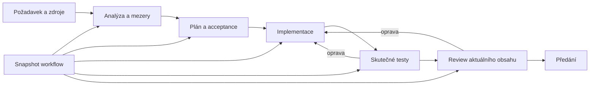

# Propojená práce na projektu

T051 propojuje stávající task, role a context packety pomocí datových profilů.
[Záznam změny](changes/118_connectProjectWorkflows.md) uvádí rozsah ověření.
Nástroj ukládá kontext a kontroluje předání; práci vykonává host agent nebo člověk.
Nevyvolává model ani test runner a neslibuje podporu libovolného projektu.



## Zvolit postup podle záměru

| Situace | Vstup a výstup |
|---|---|
| Orientace v existujícím projektu | `status`, `query`, `memory recall`, ověření zdrojů; skill kgmaker-context |
| Proveditelnost nebo návrh bez implementace | kgmaker-feature-analysis; izolovaný feature packet, varianty, impact, otázky a acceptance |
| Dostupnost vstupních dat | kgmaker-data-audit; data-check a důkazy, chybějící důkazy UNKNOWN |
| Nový projekt | profil `greenfield`; požadavky, kontrakty, volba stacku a nejmenší testovatelný průřez |
| Nová funkce existujícího projektu | profil `existing-feature`; zdrojově doložené extension points, kompatibilita a regresní rozsah |
| Oprava chyby | profil `bugfix`; reprodukce, očekávání z kontraktu, příčina a regresní test |
| Testy existující funkcionality | kgmaker-testgen; cases/data/code proposal, validate/apply, explicitní export a oddělený projektový runner |

Prázdný projekt může založit task bez Git historie a bez grafu. Chybějící graf je
viditelný v packetu; nevytváří se automaticky. Jakmile existují zdroje, lze explicitně
provést scan. Testgen potřebuje existující cíl, nelze předem vymýšlet jeho entity ID.
Compiler kontext, statické inference, skutečný test a runtime/data availability
zůstávají samostatnými důkazy. U více repozitářů používejte workspace/context na
příkazech feature/testgen, které je podporují; task je stále lokální ke koordinátoru.

## Konfigurace

```bash
kgmaker workflow list
kgmaker workflow show greenfield
kgmaker workflow check
kgmaker task add "Přidat registraci uživatele" --workflow greenfield
kgmaker task add "Rozšířit existující export" --workflow existing-feature
kgmaker task add "Opravit výpočet prázdného vstupu" --workflow bugfix
```

`workflow list/check` vypíše normalizovaný katalog jako JSON; `show` snapshot
jednoho profilu s SHA-256. Příkazy jsou čtecí, nic neinstalují ani nespouštějí.
Všechny přijímají `--root PATH`; chybný profil/konfigurace vrací exit 2.

Volitelně uložte [ukázkový profil](../examples/workflows/python-project.json) jako
`.kgmaker/workflows.json` ve vašem projektu a upravte skutečný testovací příkaz.
Soubor lze verzovat; není uvnitř ignorovaného `.kgmaker/workflow/`.
`init` konfiguraci automaticky nevytváří ani nepřepisuje.

```json
{
  "schema_version": 1,
  "default": "team",
  "profiles": {
    "team": {
      "extends": "existing-feature",
      "max_iterations": 3,
      "token_budget": 5000,
      "instructions": {"review": ["Ověř kompatibilitu API, acceptance, testy a aktualizovaný návod."]},
      "validations": [{"label": "unit", "command": "python -m unittest discover -s tests"}]
    }
  }
}
```

Schéma vyžaduje přesně `schema_version`, `default`, `profiles`. `default` je název
profilu nebo null. Každý vlastní profil má `extends` odkazující na builtin;
řetězení a přepsání builtin názvů není podporováno. Název je `[a-z][a-z0-9-]{0,63}`.
Volitelná pole: `description` (500 znaků), `max_iterations` (1–10), `token_budget`
(128–32000), `instructions`, `validations`. Pole instrukcí pro danou roli nahrazuje
zděděné pole; ostatní role se dědí. Role: architect, implementation, test_expert,
review, orchestrator; maximálně 20 instrukcí po 1000 znacích na roli.
Validace nahrazují zděděný seznam: nejvýše 30 unikátních labelů (80 znaků), command
(200 znaků). Konfigurace má nejvýše 50 vlastních profilů a 256000 bajtů.
Neznámá pole, duplicitní JSON klíče, chybné typy/verze a symlink cesta jsou chyby.
Celý soubor se validuje před založením tasku, i když volíte builtin.

Priorita výběru: explicitní `--workflow`, pak projektový `default`. Bez obojího
zůstává původní legacy task. Explicitní `--max-iterations` přebije profilový limit;
`task context --token-budget` přebije profilový budget. Bez profilu platí 3/4000.

Profilové instrukce a příkazy jsou data, ne vyšší pravidla ani souhlas k provedení.
Povinné artefaktové kontroly a volitelná lidská approval policy nelze profilem vypnout.

### Role context freshness

`kgmaker task context TASK_ID --role architect` uvádí `graph_status` podle
zdrojových hashů `kgmaker scan`, včetně sešitů evidovaných v diagnostikách.
Při kontrole sešitů se čtou pouze bajty pro SHA-256. Úprava sešitu nebo
jeho poškození se projeví jako `stale`. `graph_status` vyjadřuje čerstvost
zdrojových hashů.
Compiler a runtime důkazy mají vlastní stav a omezení. Příprava kontextu
nepřepisuje graf ani nespouští workery.
[Ověřené příklady s legacy XLS a změněným XLSX](changes/167_useCanonicalPacketSourceSnapshot.md).

## Předání mezi rolemi

Z prvního řádku `task add` vezměte skutečné runtime ID (není to dokumentové T051).
Pro každý krok připravte context, ověřte zdroje, zapište artefakt a teprve pak
přecházejte. Host může role vykonávat postupně i bez podpory subagentů.
Vstupní JSON artefakty ukládejte do `.kgmaker/workflow/inputs/` (adresář vytvořte
předem). Patří do runtime stavu: pokud je uložíte mezi projektové zdroje, jejich
pozdější vytváření či změna správně zneplatní fingerprint předchozího testu.

```bash
kgmaker task advance <task-id> analyze
kgmaker task context <task-id> --role architect
# Host vytvoří analysis.json podle níže uvedeného kontraktu.
kgmaker task record <task-id> --role architect --artifact .kgmaker/workflow/inputs/analysis.json
kgmaker task advance <task-id> plan
kgmaker task context <task-id> --role architect
kgmaker task record <task-id> --role architect --artifact .kgmaker/workflow/inputs/plan.json
kgmaker task advance <task-id> implement
kgmaker task context <task-id> --role implementation
# Host implementuje požadavek, aktualizuje dokumentaci a vytvoří implementation.json.
kgmaker task record <task-id> --role implementation --artifact .kgmaker/workflow/inputs/implementation.json
kgmaker task advance <task-id> test
kgmaker task context <task-id> --role test_expert
# Spustit oprávněné projektové kontroly, poté vytvořit tests.json se skutečnými výsledky.
kgmaker task record <task-id> --role test_expert --artifact .kgmaker/workflow/inputs/tests.json
kgmaker task advance <task-id> review
kgmaker task context <task-id> --role review
kgmaker task record <task-id> --role review --artifact .kgmaker/workflow/inputs/review.json
kgmaker task advance <task-id> done
```

Artefakt má společná pole `summary`, `status` (completed/failed/blocked),
`cited_paths` (relativní bezpečné cesty), `cited_node_ids`, `packet_id` (ID připraveného
packetu nebo null), `disposition` (null nebo bounded text). `task record` doplní
`id`, `task_id`, `role`, `phase`, `iteration`; nikdy je neopisujte z jiného tasku.
Například minimální analýza má tento tvar, skutečný obsah však musí vycházet ze zdrojů:

```json
{"summary":"Zjištění, mezery a dopady požadavku","status":"completed","cited_paths":[],"cited_node_ids":[],"packet_id":null,"disposition":null}
```

| Fáze | Další povinná pole nad společným kontraktem |
|---|---|
| analyze | Žádná; role architect |
| plan | `steps`: neprázdné pole `{id,intent,paths,tests}`, cesty v polích; `out_of_scope`: pole bezpečných cest; role architect |
| implement | `changed_paths`: pole cest, `notes`: text; role implementation |
| test | `validations`: neprázdné pole `{label,command,status}`; status passed/failed/skipped/unknown; role test_expert |
| review | `overall`: approve/request_changes/block, `findings`: pole `{severity,path,summary,disposition}`; severity blocker/major/minor/note, path relativní nebo null, disposition open/resolved/waived; role review |

Před další fází je třeba poslední dokončený artefakt odpovídající role.
Implementace/test/review patří aktuální iteraci. Všechny nakonfigurované validace
musí mít **passed pro stejný label i přesný command**. Navíc je nutný alespoň jeden
passed výsledek a nesmí být žádný failed. Nepovinné skipped/unknown se zachovávají;
nejde o důkaz úplného testového pokrytí. Pro skutečně neprovedený příkaz se používá
`unknown` (uživatelský význam NOT_RUN), ne smyšlený passed.

Test a review jsou v profilu vázané na HEAD a fingerprint aktuálního inventáře
zdrojů. Při přechodu do review/done se kontroluje aktuálnost; před done musí review
schvalovat a nesmí zbývat otevřený major/blocker. Po změně zdrojů opakujte relevantní
testy a review v nové iteraci. Identický artefakt v téže iteraci je idempotentní
a neobnovuje starou obsahovou vazbu. Při potřebě opravy `task advance <id> implement` z test/review
spotřebuje další iteraci. `task stop <id> --reason "důvod"` zůstává dostupný.

Tyto kontroly validují **lokálně deklarované artefakty**, nikoli původ stdout runneru
nebo oprávnění autora. Fingerprint používá současný source_inventory a jeho limity,
nikoli stav živé DB či libovolné prostředí. Inventář vynechává skryté adresáře
(včetně `.github`), generované/senzitivní soubory, symlinky a nadlimitní vstupy;
změny vyloučených konfigurací proto musí posoudit reviewer samostatně. Nezávislé review je odpovědností hostitele.

## Dohledatelnost a údržba

Použijte `trace sync-task --id <task-id>`, `trace sync-analysis --id <analysis-id>`,
`trace sync-testgen --id <suite>`, `trace capture-change --task <task-id> --base <ref>`
a explicitní `trace link` podle [delivery kontraktu](delivery-workflow.md).
Synchronizace a vazby nejsou automatické. Human approval se řídí stávající volitelnou
projektovou policy a vyžaduje skutečné rozhodnutí člověka nad aktuální revizí.

Každý profilovaný task ukládá v3 snapshot jména, normalizovaného profilu a hashe.
Změna/smazání workflows.json neovlivní rozpracovaný task. Pro změnu pravidel založte
nový task; jeho ID se změní. Staré v1/v2 tasky se nemigrují a chovají se jako dosud;
starší kgmaker neumí číst v3. Snapshot je v JSON i Markdown role packetu. Pokud se
povinný workflow kontext nevejde do budgetu, příkaz selže před zápisem packetu.

Instalované instrukce vycházejí z Python templates; běžný init zachovává upravené
soubory. Existující instalace porovnejte s novým renderem v dočasném adresáři a
změny slučte, nepoužívejte automaticky force. T049 profilový průvodce, hostitelská
oprávnění a atomická migrace init tímto nejsou dodané. Libovolné fáze/DAG,
automatický běh build/test, multi-repo task runner a automatická publikace nejsou
součástí tohoto kontraktu.
